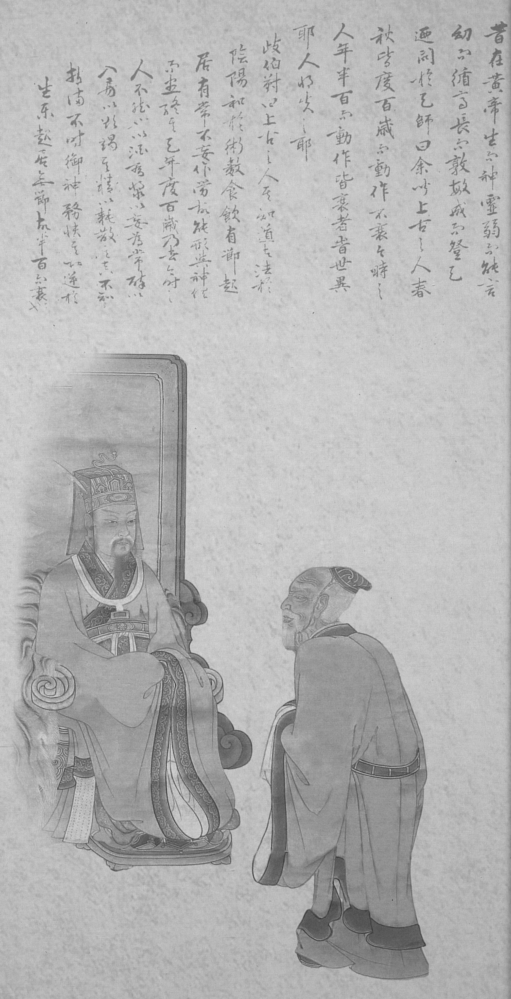

## 소문고주(素問攷注)(수정판)

상(上)

［日］삼립지(森立之)　찬

곽수매(郭秀梅)　［日］강전연길(岡田研吉)　교주

학원출판사(學苑出版社)

## 소문고주 상(素問攷注上)(수정판)

［日］삼립지(森立之)　찬

곽수매(郭秀梅)　［日］강전연길(岡田研吉)　교주

학원출판사(學苑出版社)

## 서일(序一)

삼립지(森立之)（1807~1885）는 일본 강호(江戶) 후기의 걸출한 의학 문헌학자이자 고거학자(考據學者)로, 저술이 키만큼 쌓일 정도로 많고 뛰어난 작품이 잇달아 나왔다. 『계천시집(桂川詩集)』·『영추고주(靈樞攷注)』·『편작창공전고주(扁鵲倉公傳攷注)』가 없어진 것을 빼면, 남아 있는 것으로 『소문고주(素問攷注)』·『신농본초경고주(神農本草經攷注)』·『상한론고주(傷寒論攷注)』·『금궤요략고주(金匱要略攷注)』·『사시경고주(四時經攷注)』·『기질방고주(奇疾方攷注)』·『유상의화(游相醫話)』 등이 있다. 이 저서들은 대부분 ‘고주(攷注)’라는 이름을 달았는데, 학문의 깊이를 잘 보여 준다.

（1）청대 학자들은 학문을 세 유형으로 나누었다. 의리지학(義理之學)·사장지학(詞章之學)·고거지학(考據之學)이다. 또 고거에서 나온 의리지학은 의리가 깊고 우아하며 순후하고, 고거에서 나온 사장지학은 들뜨고 가볍고 화려하기만 한 글이 되지 않는다고 하였다. 그렇다면 고거는 모든 학문의 근원이다. 청대에는 건륭(乾隆)·가경(嘉慶) 이후 문자·음운·훈고·고거·변위(辨僞)의 학문이 크게 성행하여, 한때 학자들이 거의 모두 고거와 훈고를 논했다. 이 풍조가 일어나자 멀리 일본[東瀛]까지 미쳤다. 일본 학자들, 특히 강호 의학계의 고거파 학자들은 모두 청대 고거학의 개창자 고염무(顧炎武)（1613~1682）의 『일지록(日知録)』·『음학오서(音學五書)』와 그 문도 강영(江永)（1681~1762）의 『고운표준(古韻標準)』·『음학변미(音學辨微)』를 깊이 연구했다. 강영의 제자가 대진(戴震)（1723~1777）이다. 대진은 청대 환파(皖派)의 기틀을 세운 사람으로, 음운·훈고·고거 세 방면에서 이론과 실천 양쪽으로 튼튼한 기초를 닦았고, 단옥재(段玉裁)（1735~1815）·왕염손(王念孫)（1744~1832）·공광삼(孔廣森)（1752~1786） 등 걸출한 일류 문자·음운·훈고학자를 많이 길러 냈다. 단옥재의 『설문해자주(説文解字注)』, 왕염손의 『광아소증(廣雅疏證)』·『독서잡지(讀書雜志)』, 왕염손의 아들 왕인지(王引之)（1766~1834）의 『경전석사(經傳釋詞)』·『경의술문(經義述聞)』 같은 책은 모두 강호의 고거학자들이 손에서 놓지 못한 것들이다. 삼립지는 『소문고주』에서 단옥재·왕염손·왕인지·완원(阮元)（1764~1849）의 정설[成説]을 대량으로 끌어와, 어려운 대목을 풀고 의문을 해결하는 데 썼다.

우리가 『소문고주』를 연구하고 배울 때 가장 먼저 깨달음과 정신의 자양분으로 얻어야 할 것은, 선현의 자취를 따라 그들이 읽은 책을 읽고 그들이 익힌 학문 방법을 익히는 일이다. 그래야 새로운 시대에 선현을 따라잡고 넘어설 수 있다.

（2）『소문고주』를 연구할 때에는 삼립지가 이 책을 쓴 시대 배경과 고주 방법을 살펴보아야 한다. 이 책은 1860년 정월 초닷새（안정(安政) 7년, 간지로 경신년）에 쓰기 시작해 1864년（원치(元治) 원년, 간지로 갑자년） 10월 15일에 마쳤으니, 모두 5년이 걸렸다. 이 책을 쓴 주요 원인은 셋이다. （1）1837년（문정(文政) 8년）, 삼립지가 서른한 살 되던 해에 생활에 큰 변고가 생겨, 그는 처자를 이끌고 타향을 떠돌며 온갖 어려움과 고초를 겪었다. 의술로 입에 풀칠을 하면서도 책을 읽으며 스스로를 굳세게 다졌고, 청대의 문자·음운·훈고 저작을 대량으로 읽어 100여 권의 독서 필기를 남겼는데, 이것이 훗날 새 삶의 튼튼한 밑바탕이 되었다. 1848년 5월, “번(藩)의 사면을 받아 다시 강호로 와서 살게 되었다.” 이렇게 유랑 생활을 끝내고 옛 원고를 정리하여 여러 고주를 쓰기 시작했다. 중국 고대의 철인 맹자(孟子)는 이렇게 말했다. “하늘이 이 사람에게 큰 임무를 내리려 할 때에는 반드시 먼저 그 마음과 뜻을 괴롭히고, 그 힘줄과 뼈를 수고롭게 하고, 그 몸을 굶주리게 하고, 그 몸을 궁핍하게 하며, 하는 일마다 어그러뜨린다. 이는 마음을 움직이고 성품을 참을성 있게 하여, 그가 해내지 못하던 일을 해낼 수 있게 하기 위해서이다.” 이는 삼립지를 두고 한 말이 아니겠는가? （2）당시 그는 이미 강호의 제수관(躋壽館)에서 이 책을 강의하고 있었으니, 이 원고를 강의록으로 삼아 강의하면서 고쳐 나갔다. （3）가장 중요한 원인은, 발견된 지 얼마 되지 않은 『태소(太素)』·『의심방(醫心方)』, 송판(宋版) 『천금(千金)』·『외대(外臺)』, 옛 초본 『명당(明堂)』 1권, 진본 『옥편(玉篇)』 및 완질 『신찬자경(新撰字鏡)』 같은 새 자료를 이용하고, 청대 문자·음운·훈고·고거학의 새 방법을 운용하여, “해고명리(解詁明理)를 본지로 삼아” 계산(桂山)의 『소문식(素問識)』, 채정(茝庭)의 『소문소식(素問紹識)』, 희다촌직관(喜多村直寬)의 『소문찰기(素問札記)』와는 다른 저작을 쓰려 한 것이다. 그의 목적은 완전히 달성되었다. （『소문고주』 권20 제81편 권말 발문 참조）[역1]

삼립지가 『소문고주』를 쓴 핵심 방법은 ‘해고명리(解詁明理)’이다. 그는 이렇게 말했다. “경서를 읽는 법은 한결같이 채정 선생의 구수(口授)를 받들어, 해고명리를 본지로 삼는다.” 해고란 무엇인가. 『소문』의 문자·음운·훈고·구두·교감을 풀이하는 일이다. 언어가 밝아지면 의학의 이치도 밝아진다. 문자 면에서 그는 『설문(説文)』에 깊이 통달하고 속자(俗字)에도 두루 밝았다. 속자는 삼국부터 당말 오대까지（220~961） 유행했고 약방문·의서·장부 등을 베끼는 데 많이 쓰였는데, 이 시기가 바로 선진·양한의 의서가 후대로 전사되어 퍼진 때이다. 속자체는 필획을 마음대로 늘리고 줄이고 바꿀 수 있어 규범 한자와 동떨어진 글자가 많다. 그래서 『소문』·『영추(靈樞)』·『갑을(甲乙)』·『태소』의 의심스러운 글자 가운데 많은 것이 속자와 관련이 있다. 삼립지는 책에서 많은 속자를 가려내 풀이했으니, 그 공이 매우 크다. 일본에는 중국 고대의 문학·역사·철학·의학 필사본 고서가 많이 소장되어 있고 그 속에 속자가 대량으로 들어 있으니, 이를 모아 분석한다면 참으로 명산에 간직할[藏之名山] 불후의 성대한 사업이 될 것이다. 음운 면에서 그는 상고음과 성뉴학(聲紐學)에 통달했는데, 이 점은 특히 존경스럽다. 훈고 면에서 그는 『이아(爾雅)』·『방언(方言)』·『광아(廣雅)』·『옥편』과 청대 훈고 대가들의 여러 훈고 거작에 익숙했다. 교감 면에서 그는 『갑을』·『태소』를 이용해 『소문』의 와자(訛字)를 적지 않게 바로잡았으니, 실로 『소문』 연구에서 얻기 어려운 가작이다.

『소문고주』는 성취가 크고 내용이 풍부하며 일깨워 주는 바도 많다. 요약하면 다음 네 가지가 특히 두드러진다.

첫째, 중국의 여러 『소문』 고주(古注)와 일본 강호 시기의 저명한 『소문』 고거·훈고 명저를 널리 취해 신중하게 취사하고 시비를 가렸으며, 깊이 생각하고 널리 고찰하여 자기 뜻으로 단정했다. 앞사람의 훈고를 망라하고 여러 책을 끌어다 쓴, 앞으로 『소문』을 연구할 때 반드시 읽어야 할 책이다.

둘째, 당시 발견된 지 얼마 되지 않은 23권본 『태소』의 원문과 양상선(楊上善) 주를 매우 상세하게 교감했으니, 앞으로 『태소』를 교주할 때 반드시 읽어야 할 저작이다.

셋째, 중국 전통 언어학, 곧 문자·음운·훈고학으로 중국 고전 의서를 정리·연구·고증한 것은 강호 시대의 학술사로 보나 청대의 학술사로 보나 완전히 옳았음이 증명되었다. 삼립지는 이 방면에서 저명한 전문가라 할 만하며, 그래서 성취가 매우 두드러진다.

넷째, 삼립지는 강철 같은 불굴의 의지와 인격의 힘을 지녔다. 12년의 고된 시련 속에서도 청운의 뜻을 꺾지 않고 각고로 책을 읽고 부지런히 기록하여, 마침내 스스로 불후의 기념비 『소문고주』를 세웠다.

1998년 1월 18일

북경중의약대학(北京中醫藥大學)에서

전초진(錢超塵)

## 서(序)

삼지원(森枳園) 선생을 직접 뵙고 말씀을 들은 적은 물론 없지만, 선생은 평소 내가 가장 경외하고 친애하며 사숙해 마지않는 마음의 스승이다. 그 학식의 심원함에는 나 같은 사람은 도저히 미칠 수 없다. 다만 삼 선생의 학문이 심원하여 나 따위는 도저히 미칠 수 없다는 사실을 현대에 일찍 깨달은 사람은 어쩌면 나일지도 모른다. 그것만은 속으로 자랑스럽게 여기고 있다. 『소문고주(素問攷注)』에 서문을 쓰다니, 생각만 해도 불손하여 발이 움츠러드는 듯하지만, 서문을 청받고 끝내 고사하지 않은 것은 이런 심정 때문이다.

이 책의 저본이 된 삼 선생 자필 원고본 『소문고주』는 국립국회도서관 소장품이다. 나는 소화(昭和) 53년부터 자주 그 도서관에 가서 소장된 옛 의서들을 복사하게 되었다. 처음에는 산전업광(山田業広)의 저술에 흥미가 있었으나, 곧 삼 선생의 저서에 마음을 빼앗겼다. 그 뒤로 지금까지 내가 얼마나 삼 선생의 학은을 입고 그 저술에 계속 감화되어 왔는지 모른다. 손에 남아 있는 당시의 복사 신청서를 보면, 소화 55년 6월에 『지원총고(枳園叢攷)』·『지원잡초(枳園雑鈔)』 등 전 7책을 복사했다. 같은 해 12월부터 이듬해 1월까지 여러 차례에 나누어 『상한론고주(傷寒論攷注)』 전 35책을 복사했다. 이것을 읽고 강한 충격을 받았다. 솔직히 말해 그때까지 보아 온 고전 해설 연구서 대부분이 빛을 잃어 보였다.[역2]

『소문고주』 전 39책의 복사를 국립국회도서관에 신청한 것은 소화 56년 3월 3일의 일이다. 얼마 안 되는 사비를 털어 손에 넣은 대량의 복사물은 나에게 무엇보다 소중한 보물이었다. 복사지의 제본 쪽 한가운데에서 정성껏 접고, 부전(付箋)을 원본 그대로 붙여, 제본소에 맡겨 양장본 10책으로 꾸몄다. 두께는 40센티미터 가까이 되었다.[역3]

당시 나는 두세 명의 동지와 협력하여 『태소(太素)』·『갑을경(甲乙経)』 등을 포함한 『동양의학선본총서(東洋医学善本叢書)』의 편집·간행 작업에 전념하고 있었다. 『소문고주』를 보니, 『태소』를 비롯하여 막말(幕末)까지 발견되고 정비된 서지 고증학의 성과가 남김없이 발휘되고 활용되어 있지 않은가. 그저 경탄하고 경복할 따름이었다. 이 대단함에는 몇 번을 다시 태어나도 미칠 수 없다고 생각했다.[역4]

나는 주위에 삼 선생의 대단함을 부지런히 설명하고 다녔지만, 당시 삼 선생의 진가를 이해할 수 있는 사람은 그리 많지 않았다. 소화 59년 1월에 간행된 『한방의 임상(漢方の臨床)』 30주년 기념호에 졸고 「고증학파의 내경 연구(考証学派の内経研究)」를 발표하면서 『소문고주』를 언급하여 이렇게 썼다. “필자는 수많은 『소문(素問)』 연구서 가운데 한 권만 고르라면 망설임 없이 이 책을 택한다. 이만한 것이 오늘날까지 방치되어 있는 것은 애석한 일이다.” 지금도 그 신념은 조금도 흔들리지 않는다.

나는 삼 선생의 보리사(菩提寺)인 지대(池袋) 동운사(洞雲寺)에 거듭 성묘하였고, 고(故) 옥천태액(玉川泰峉) 주지, 시수도명(矢数道明) 선생, 대총공남(大塚恭男) 선생 등의 후원 아래 소화 60년 12월 8일 그 절에서 삼지원 100주기 제사를 거행했다. 나는 「삼지원의 유업(森枳園の遺業)」이라는 제목으로 강연하며 『소문고주』·『본초경고주(本草経攷注)』·『상한론고주』의 위대함을 힘주어 말했으나, 기대한 만큼의 반응은 없었다.

나는 막말 고증학이 고전 의서 연구에서 탁월한 성과를 거두었고, 오늘날에 이르러서도 본고장 중국을 훨씬 능가하는 수준을 이루었다고 거리낌 없이 단언한다. 내가 『소문고주』를 접하고 감명을 받은 것은 20대 끝 무렵이었다. 이제는 지천명[知命]의 나이에 가까워지고 있다. 그동안 침구(鍼灸) 고전 연구 열기가 부쩍 높아졌다. 바로 그 시운이 이 책의 출판을 낳은 것이다. 참으로 격세지감이 있다.

이상의 경위를 생각할 때, 나는 이번 『소문고주』 번자(翻字) 출판의 경사를 감격의 눈물 없이 맞이할 수 없다. 앞서 말했듯이 불손한 줄 알면서도 서문을 고사하지 못한 까닭이다. 이 책의 편집·간행 작업에 긴 세월을 들이고 말로 다할 수 없는 고생을 아끼지 않은 일본내경의학회(日本内経医学会) 동지들의 노력에 한없는 경의를 표한다. 금전으로는 조금도 보상받지 못할 것이다. 그러나 앞으로 이 책이 일본은 물론이고 본고장 중국을 비롯한 여러 나라의 연구자들을 크게 감화시킬 것이며, 그 독실한 뜻에 역사가 금전과 바꿀 수 없는 영원한 포상을 내릴 것이라고 굳게 믿는다.

바라건대 가까운 장래에 그 기운이 『본초경고주』·『상한론고주』의 번자 출판에까지 미치기를.

평성(平成) 9년 10월 31일

스스로 삼지원 선생의 말류라 칭하는

불초　소증호양(小曽戸洋)

## 「소문고주」 서문 뒤에 덧붙임(「素問攷注」序補記)

이상은 지금으로부터 4년 9개월 전, 일본내경의학회(日本内経医学会)가 발행한 번자판 『소문고주(素問攷注)』에 서문을 청받아 쓴 졸문이다. 이 출판으로 『소문고주』는 일본의 침구(鍼灸) 고전 연구자들 사이에 보급되었고, 삼립지(森立之)의 업적은 널리 평가받게 되었다.

이 서문 끝에서 내가 희망을 밝힌 『상한론고주(傷寒論攷注)』도 그 뒤 곽수매(郭秀梅) 여사 등의 노력으로 번자와 교점 작업이 진행되어, 작년 10월 중국의 학원출판사(学苑出版社)에서 간행되었다.

20여 년 전 삼립지의 위대한 업적에 마음이 움직인 이래 오늘까지 사숙해 온 나에게, 현대에 일어난 이 삼립지 재평가의 기운은 참으로 꿈만 같아 기쁘다.

이제 『소문고주』가 다시 교정을 거듭하고, 더구나 『사시경고주(四時経攷注)』를 덧붙여 중국의 학원출판사에서 출판된다고 한다. 일본판에 나와 함께 서문을 쓰신 도전융사(島田隆司) 선생은 재작년에 애석하게도 세상을 떠나셨지만, 도전 선생은 하늘나라에서 삼 선생과 함께 이번 중국판 『소문고주』의 출판을 얼마나 기뻐하실까 생각한다.

일본판 『소문고주』와 중국판 『소문고주』의 간행에 관여하신 여러 선생의 노력에 이 자리에서 온 마음으로 경의를 표해 마지않는다.

이 책이 일본과 중국의 의학 고전 연구 진전에 새로운 가교가 되리라 확신하면서.

평성(平成) 14년 1월 31일

소증호양(小曽戸洋)

## 序二

當然，我無緣聆聽森枳園先生謦咳，但先生已成爲我學涯中最敬畏、最親愛的私淑之師，其深奧學識，我輩可閱而不可及。森先生學問之深厚，實有仰之彌高之感，今日我仍深信不疑，并以此私心自傲。爲《素問攷注》作序，實在因不遜而令我戰慄，而索序之時，所以未斷然回絕，亦是欣然接受的眞情表現。

本書底本，即森先生親筆稿本，現藏於國立國會圖書館。我自一九八八年起，時常赴該館複印各種古典醫籍。最初，對山田業廣先生著作產生了興趣，可是不久，這種傾慕之情被森先生的著作魅力所掠奪。而來至今，一直沐浴着森先生的學恩，爲其著作所感化着。翻閱當時複印醫籍申請書，一九八〇年六月複印《枳園叢攷》《枳園雜鈔》等全七冊。同年十二月至翌年一月，分數次複印《傷寒論攷注》全三十五冊。研讀這些内容後，使我受到強烈衝擊，率直地説，以前所參閱的古典研究書籍大多猶如雲霧了。

向國立國會圖書館申請複印《素問攷注》全三十九冊，是一九八一年三月三日的事了。那時，我將日常不多的零花錢節省下來複印大量資料，可想而知，對於我來説那是何等貴重之物。之後，我非常細心地將這些複印資料折疊，其中的附箋也完全照原本貼附，并送至製本屋裝幀成十冊，厚度大約有四十英寸。

當時我與二三名同仁合作，全力編集了包括《太素》《甲乙經》等在内的《東洋醫學善本叢書》。令人震驚和敬佩的是，《素問攷注》完全繼承、發揚、運用了《太素》等，以及幕末以前發現、完善的文獻考證學成果，其廣奧程度，即使天借數生之年，我輩亦難以實現。

我曾極力向醫界同行宣揚森先生之偉業，但當時能眞正理解其價值的人并不多。一九八四年一月《漢方の臨床》三十周年紀念號上發表了拙論『考證學派の内經研究』，其中關於《素問攷注》，我寫了這樣一段話：『如果在衆多《素問》研究書中限定選擇一種的話，我將毫不猶豫地選擇此書。如此偉大的著作，至今仍未引起重視，實爲憾事。』時至今日，我的信念絲毫沒有動搖。

我曾多次參拜森先生的菩提寺，即位於池袋洞雲寺墓地，在已故玉川泰峉住職，及矢數道明先生、大塚恭男先生的大力支持下，一九八五年十二月八日在該寺舉行了森枳園百年祭祀儀式，我作了『森枳園の遺業』講演，極力褒揚《素問攷注》《本草經攷注》《傷寒論攷注》的學術成就，但反響卻令我頗感失望。

可以驕傲地説，幕末考證學在古典醫籍研究方面的卓越成果，遠遠超過了本家中國的研究水平。我自二十幾歲始深爲《素問攷注》所感銘，今已近知命之年。這期間，鍼灸古典醫籍研究熱潮蜂起，乘此東風本書即將上梓，油然而生隔世之感。

回想往事，我不由喜泪盈眶，以激動的心情企盼着《素問攷注》點校出版。正如前述，深知不遜而未固辭之因，亦在於此。

本書的編刊工作歷經了較長歲月，耐受了筆難盡言的辛苦，在此對日本内經學會的同仁深表敬意。此項工作雖無金錢的回報，可是隨其出版面世，使日本、中國及世界的研究者普受恩惠。我堅信，對其貢獻，歷史將給予金錢不可取代的永遠的、輝煌的獎賞。

我奢望着不遠的將來，《本草經攷注》《傷寒論攷注》亦能點校出版。

一九九七年十月三十一日

自称森枳園先生末流

不肖　小曽戸洋

## 《素問攷注》序補記

以上是我四年零九個月前，應邀爲日本内經醫學會發行翻字版《素問攷注》時所寫的拙文。此書發行之後，使《素問攷注》在日本鍼灸古典研究者間得到普及與推廣，隨之，森立之的業積亦受到公允評價。序文末尾我曾表達希望《傷寒論攷注》早日出版，去年十月在郭秀梅女士等氏的努力下，已整理、點校由中國學苑出版社出版。[역5]

自二十餘年前，被森立之的偉大業績所感銘以來，私淑至今的我，對於現代再評價森立之的趨勢，完全如夢中之喜。

本次《素問攷注》將重訂再版，而且附録《四時經攷注》，由中國學苑出版社出版。與我共同爲日本版《素問攷注》作序的島田隆司先生，於前年因病不幸逝世。仙界的島田先生與森先生，一定爲中國版《素問攷注》的問世而感到無限喜悅。

在此，爲日本版《素問攷注》、中國版《素問攷注》的刊行而付出艱辛的諸位先生，深表滿腔敬意。

我堅信，本書的面世，將爲日本、中國醫學古典研究及交流架起新的橋梁。

平成十四年一月三十一日

小曽戸洋

（郭秀梅　譯）

**[역1]** 문정 8년은 서력 1825년이어서 원서의 「一八三七年」과 맞지 않으며, 「文政八年」은 1837년에 해당하는 「天保八年」의 잘못으로 보인다.
**[역2]** 같은 글의 일본어 원문은 쇼와 50년대로 되어 있고 바로 뒤에 1980년 복사 기록이 나오므로, 중국어 번역의 「一九八八年」은 잘못으로 보인다.
**[역3]** 원서 「センチメール」은 「センチメートル」의 잘못으로 보이며, 같은 글의 중국어 번역에는 「四十英寸」으로 되어 있어 단위가 일본어와 어긋난다.
**[역4]** 원서 「発見？整備」의 「？」는 나열 부호의 잘못으로 보인다(같은 글의 중국어 번역에는 「發現、完善」).
**[역5]** 원서 「業積」은 「業績」의 잘못으로 보인다(같은 글 뒤에 「偉大業績」).

## 서(序)

현대 일본의 『소문(素問)』 연구는 제2차 대전 전의 시수유도(矢数有道)와 전후의 환산창랑(丸山昌朗)에서 시작된다. 명치(明治)의 의제(醫制) 변혁 뒤에 일어난 『내경(内経)』학의 재흥이다.

시수유도는 일본 한방가들이 『소문』을 경시하는 경향에 경종을 울리며, 소화(昭和) 10년대에 잡지 『한방과 한약(漢方と漢薬)』에 『소문』에 관한 논설을 많이 집필했다.

소화 40년 봄, 환산창랑은 『교감화훈 황제소문(校勘和訓 黄帝素問)』을 저술했다. 등사판 인쇄로 발행 부수는 300부였다. 그는 이 교재를 바탕으로 매달 한 번 경락치료연구회(経絡治療研究会) 정례 모임에서 두 시간씩 『소문』을 강의했다. 일본에서 명치 이후 100년 만의 『소문』 강의였다.

이렇게 하여 끊겼던 『소문』 연구에 불이 켜진 것이다.

일본의 침구(鍼灸)는 명치 이후의 한방 억압 정책 속에서 『난경(難経)』을 중심으로 살길을 찾아내어 이미 30년을 지나왔다. 그 가운데 “다시 한번 『내경』으로 돌아가 침구의학을 기초부터 다시 세워야 한다.”고 주장한 환산창랑이, 그 길고 험난한 길을 다시 닦기 위해 내디딘 첫걸음이 바로 『소문』 강의였다.

안타깝게도 시수유도도 환산창랑도 삼립지(森立之)의 『소문고주(素問攷注)』를 보지 못했다. 강호(江戸) 시대 말기에 삼립지라는 뛰어난 『내경』 연구가가 있었다는 사실은 의사학자 석원명(石原明)을 통해 환산창랑에게 전해져 있었지만, 그 삼립지가 저술한 『소문고주』를 볼 기회는 아직 무르익지 않았다고밖에 말할 수 없다.[역1]

그래서 환산창랑은 소화 40년 봄에 대총경절(大塚敬節) 소장의 삼지원(森枳園) 저 『내경요자원(内経要字苑)』을 복각하여 그 뛰어난 업적의 일단을 세상에 물었을 뿐, 거기서 그치고 말았다. 『내경요자원』은 삼립지가 『소문고주』 등을 집필할 때 『소문』·『영추(霊枢)』 속 중요 용어의 색인으로 만들어 둔 것이다. 복각된 이 책의 권말에는 “문구(文久) 임술년 12월 13일 마침, 지원 입지(枳園立之).”（1862년）라고 적혀 있다. 이 책은 『소문』·『영추』 속의 중요 용어를 ‘구규(九竅)’에서 시작하여 ‘신체(身体)’·‘오장(五蔵)’ 등 16문으로 분류했다. ‘신체’ 문에는 피부(皮膚)에서 시작하여 피(皮)·부(膚)·피모(皮毛)·기부(肌膚)·기피(肌皮) 등 101항목이 있다. 항목마다 『소문』 제○권, 『영추』 ○편에 그것이 몇 곳 나오는지를 적어 두었다. 『영추』에서 나오는 곳까지 적혀 있으니, 『내경요자원』이 작성될 때에는 아직 발견되지 않은 삼립지의 『영추고주(霊枢攷注)』가 이미 다 쓰여 있었다고 추측된다.

시수유도·환산창랑 등이 품었던 『소문』 재흥의 열정은 가느다란 한 줄기 흐름에서 차츰 굵어져, 이제 겨우 일본 침구계의 한 흐름을 이루어 왔다.

소화 59（1984）년 봄, 정상아문(井上雅文)·강전명삼(岡田明三)·좌합창미(左合昌美) 여러분과 뜻을 나누어 “동양의학의 고전에 진지하게 몰두할 자리를 만들자.”며 ‘원숙(原塾)’을 창설했다. 정상아문이 『영추』를, 내가 『소문』을 매주 강의하게 되었다. 그런데 새삼 『소문』 강의를 시작하면서, 스승 환산창랑이 남긴 『교감화훈 황제소문』을 바탕으로 새 교재를 만들기 위해, 그 자료를 정상아문 학형이 몇 해 전에 만들어 둔 복사본 삼립지 저 『소문고주』에서 구했다. 처음으로 본격적으로 『소문고주』와 씨름하게 된 것이다. 매주 하는 강의이다. 어쨌든 날마다 『소문고주』를 읽어야 했다. 삼립지의 버릇 심한 글씨를 따라가며 ‘방광(旁光)’이 ‘방광(膀胱)’의 정자임을 알기까지 고생하기도 하고, 은사인 다기원간(多紀元簡)의 논의를 “『소문식(素問識)』의 설은 옳지 않다.”고 논박하는 데 감탄하기도 했다. 여러 설을 논파하고는 ‘희희쾌쾌(嬉々快快)’ 하는 삼립지에게 빠져들었다. 논파할 때 쓴 여러 설은 일일이 원본을 찾아 인용한 것이 아니라 아마 암기하고 있었을 것이다.[역2]

소증호양(小曽戸洋) 선생이 이 책에 내린 높은 평가에 움직였는지, 오리엔트출판사가 이 『소문고주』의 자필 원고본을 전 4권본으로 영인 출판한 것은 1985년 12월이다.

1987년 5월 천진(天津)에서 열린, 원숙과의 사이에 이루어진 제2회 ‘일중내경학술교류회(日中内経学術交流会)’ 때, 이 출판사의 호의로 『소문고주』 전 4권과 삽강추재(渋江抽斎)의 『영추강의(霊枢講義)』 전 2권을 일본내경의학회(日本内経医学会)에서 천진중의학원(天津中医学院)에 증정했다. 일본이 자랑할 만한 『내경』 연구 저작을 현대 중국 『내경』 연구가의 정상 가운데 한 사람인 곽애춘(郭靄春) 씨에게 전하고 싶었기 때문이다. 곽애춘 씨는 이미 『황제내경소문교주어역(黄帝内経素問校注語訳)』（1981, 천진과학기술출판사(天津科学技術出版社) 출판）을 펴낸 바 있었다. 곽애춘 씨는 그 뒤 주편한 중의고적정리총서(中医古籍整理叢書)의 『소문교주(素問校注)』（1992년, 인민위생출판사(人民衛生出版社) 출판）에서 곳곳에 『소문고주』의 삼립지 주를 인용했고, 그 뛰어난 연구가 현대 중국을 대표하는 『소문』 주석서의 내용을 높이게 되었다.

삼립지는 막말(幕末)까지의 『내경』 연구의 최고 성과를 총정리했다. 명치 14년에 청나라에서 일본에 온 양수경(楊守敬)에게 “명치 이래 서양 학설이 성행하여 국정이 이미 서양식이 되었다. 의업 또한 그러하다. 서양식이 아니면 의사가 아니다. 한방의는 이 늙은이의 일생으로 끝이다.”라고 탄식한 삼립지는, 100년 뒤에 반드시 『소문』 의학이 부활하리라 믿었을 것이다. 『소문』은 침구·탕액(湯液)·기공(気功)을 포함하여 지금도 살아 있는 중국계 의학의 근본이다. 그것은 날이 갈수록 더 바르게 읽혀야 한다.

시수유도·환산창랑 이래의 『내경』 재흥 노력은 마침내 하나의 흐름이 되어, 이번 『소문고주』를 번자(翻字) 출판할 힘에까지 이르렀다. 일본내경의학회의 황천록(荒川緑)·소림건이(小林健二)·궁천호야(宮川浩也) 세 분을 중심으로 한 많은 회원의 노력으로 요어 색인까지 붙여 상재하게 된 것을 진심으로 기뻐한다. 이로써 『소문』 연구는 반드시 더 넓고 깊게 진전될 것이다. 그것이 세계의 의학과 의료를 한두 걸음 발전시키리라 깊이 믿으며 서문으로 삼는다.

1998년 2월

도전융사(島田隆司)

【1998년에 간행된 『번자판 소문고주(翻字版素問攷注)』（일본내경의학회）에 서문을 쓴 전 일본내경의학회 회장 도전융사 선생은 2000년 8월에 세상을 떠나셨다. 선생은 그 재판이 중국에서 발행되는 것을 흔쾌히 승낙하고 그 간행을 손꼽아 기다리셨다. 이 책을 영전에 바친다. 문인 궁천호야(宮川浩也) 2002년 1월】

## 序

現代日本對於《素問》的研究，始於第二次世界大戰前的矢數有道，以及戰後的丸山昌朗，明治醫制變革後的《内經》學再度興盛。

矢數有道先生，三十年代曾向《漢方と漢藥》雜誌投稿，撰寫多篇與《素問》相關的文章，為日本漢方家輕視《素問》的傾向敲響了警鐘。

一九六五年春，丸山昌朗先生撰著《校勘和訓黄帝素問》一書，謄寫版印刷，發行三百部。并以此為教材，以經絡治療研究會例會的形式，每月一次，每次講授兩小時。這樣的講習，是日本明治以降，時隔百年的《素問》研究活動。

如是，為處於黑暗中的《素問》研究，點亮了一盞明燈。

明治以後壓抑漢方政策中，日本鍼灸界以《難經》為中心，探索着生存之路，至今已歷經三十餘年。其間，丸山昌朗先生曾主張，再一次踏入《内經》領域，從根本上重建鍼灸醫學理論。在漫長而充滿困難的路上，為重新構築基礎，首先邁出講習《素問》的第一步。

遺憾的是，矢數有道、丸山昌朗未曾見過森立之的《素問攷注》。現代醫史學者石原明，曾向丸山昌朗介紹江戶末期有一位優秀的《内經》研究家，名叫森立之。可是，閲覽森立之《素問攷注》的機會尚未成熟，終未如願。因此，丸山昌朗於一九六五年春，將大塚敬節所藏森枳園著《内經要字苑》復刻，其優異業績初露端倪即隱匿。《内經要字苑》是森立之在撰著《素問攷注》之際，編纂《素問》《靈樞》中重要用語，類似索引形式。該書卷末記有『文久壬戌十二月十三日卒業 枳園立之』（一八六二年）。書中所收《素問》《靈樞》要語自『九竅』始，分為『身體』『五藏』等十六門。『身體』門中有皮膚及皮、膚、皮毛、肌膚、肌皮等一百零一項，并明記各個條目出自《素問》某卷，《靈樞》某篇，以及出現次數等。依據《靈樞字苑》的編成，可以推測編集《内經字苑》之時，至今下落不明的森立之所著《靈樞攷注》已經完成。[역3]

矢數有道、丸山昌朗二氏振興《素問》的熱情，像一條細小溪水不斷流淌，漸漸寬泛，今天終成日本鍼灸界一支奔騰浪濤。

一九八四年春，與井上雅文、岡田明三、左合昌美諸氏相談，以『創設真摯研讀東洋醫學古典環境』為初衷，成立了『原塾』。每周由井上雅文講解《靈樞》，我負責講授《素問》。為重溫《素問》，在師丸山昌朗遺留的《校勘和訓 黄帝素問》基礎上，補充《素問攷注》内容，作為授課教材。該《素問攷注》是數年前的複印本，由井上雅文學兄提供。如是，首次眞正將《素問攷注》内容引進《内經》研究中。為了每周的講授，每天必須研讀《素問攷注》，時時被森立之具有個性的考證和其中辛勞所感動。例如，為解釋『旁光』即『膀胱』之正字而旁徵博引，并大膽否認恩師多紀元簡《素問識》所論之非。釋明一詞，森立之『嬉嬉快快』之情躍然紙上。今日讀此，我輩亦有同喜同樂之感。考證中大量引用諸家之説，如果是一一翻閲原本，大概不太可能，或許森立之早已暗記心中了。

小曾戸洋先生給予此書極高評價，并大力舉薦於同仁，一九八五年十二月東洋出版社影印出版《素問攷注》親筆稿本全四卷本。

一九八七年五月在中國天津召開第二屆以『原塾』為代表的『日中内經學術交流會』時，承蒙東洋出版社盛情，將《素問攷注》全四卷及澀江抽齋《靈樞講義》全二卷，以日本内經醫學會名義，贈呈天津中醫學院。其實也是把值得日本驕傲的《内經》研究著作，謹呈於現代中國《内經》研究佼佼者郭靄春氏。郭靄春氏已編著《黄帝内經素問校注語譯》（一九八一年天津科學技術出版社出版）。其後，郭靄春氏在主編中醫古籍整理叢書中《素問校注》（一九九二年人民衛生出版社出版）時，引用《素問攷注》内容隨處可見，可以説，森立之精深卓越的考證，為現代中國《素問》研究作出了貢獻。

森立之可謂幕末以前《内經》研究優異成果集大成者，明治十四年與訪日清國楊守敬筆談時，森立之感嘆曰：『明治已來，洋説盛行，國政已洋，官報亦然，在醫業亦然。不洋則非醫，漢醫者老生則一生為限。』然而，森立之仍堅信百年之後《素問》醫學必將重放光芒。

《素問》中包含鍼灸、湯液、氣功等豊富内容，現在仍為中國傳統醫學之祖本，因此，非常有必要認眞、正確研讀。

矢數有道、丸山昌朗以來，振興《内經》的力量已形成流派，正是這一力量實現了《素問攷注》翻字出版。由日本内經醫學會荒川綠、小林健二、宮川浩也三氏牽頭，多數會員共同努力，《素問攷注》及『要語索引』即將上梓，欣喜不已。今後《素問》研究必將更廣泛、更深入展開，推進世界醫學醫療不斷發展。信於此而弁之為序。

一九九八年二月

島田隆司

### 추기(追記)

1998년 『번자판 소문고주(翻字版素問攷注)』（일본내경의학회(日本内經醫學會)）에 서문을 쓴 전 일본내경의학회 회장 도전융사(島田隆司) 선생은 2000년 8월 병으로 세상을 떠나셨다. 선생은 생전에 이 책을 수정하여 중국에서 발행하는 것을 승낙하셨고, 구천에서도 하루빨리 출판되기를 기다리고 계실 것이다. 이 책은 선생의 영전에 바치는 것이기도 하다.

문인 궁천호야(宮川浩也) 2002년 1월

（곽수매(郭秀梅) 역）

## 범례(凡例)

### 1. 저본(底本)

『소문고주(素問攷注)』는 2004년 학원출판사(學苑出版社)에서 점교 출판되었으며, 곽수매(郭秀梅)·강전연길(岡田研吉)이 점교하고 최중평(崔仲平)이 심사·교정했다. 이번 수정의 저본은 일본 국립국회도서관 소장（191함 751호） 삼립지(森立之) 친필 원고본으로, 원고는 전 20권 39책이다. 이번 출판은 1998년 일본내경의학회(日本内經醫學會) 구두본（편자: 황천록(荒川綠)·소림건이(小林健二)·궁천호야(宮川浩也). 협력자: 좌합창미(左合昌美)·도전융사(島田隆司)·동해림무(東海林茂)·고교엽자(高橋葉子)·진곡나수자(津曲奈穗子)·임효신(林孝信)·고곡원(古谷円)·산구수민(山口秀敏)·산본조자(山本朝子)·길전화유(吉田和裕)）, 북리연구소(北里研究所) 동양의학종합연구소 의사학연구부（소증호양(小曾戸洋)·정천수랑(町泉壽郎)） 발행본, 그리고 2004년 학원출판사 점교본을 기초로, 삼립지 친필 원고본을 참조해 새로 점교하여 앞선 두 판의 여러 오류를 바로잡고 저자 원고의 모습을 되도록 되살렸다.

### 2. 구성(構成)

『소문고주』는 20권이다.（『소문(素問)』은 원래 24권인데, 운기(運氣) 7편과 이미 없어진 2편, 모두 4권이 빠져 있다.） 이번 점교는 원서의 내용을 되도록 보존하여 더하지도 빼지도 않았다. 다만 경문 곁에 원래 적혀 있던 작은 글자는 경문의 완전성을 지키기 위해 삭제했다.

### 3. 문자 처리

1. 원문 앞에 ‘○’를 더하고 굵은 고딕체를 썼다. 통행 규범 정자를 채택하되, 판본 교감과 자형 고증 등을 설명하기 쉽도록 이체자를 보존했다. ‘輒’과 ‘輙’, ‘并’과 ‘併’, ‘痒’과 ‘癢’ 같은 것은 모두 원문을 따랐다. 특히 인용한 『의심방(醫心方)』 등 귀중한 자료는 모두 원고의 자형을 보존했다. 서명 속의 이체자도 보존했다. 『고주(攷注)』 같은 서명이 그렇다.

2. 원문의 중문 부호 ‘〃’·‘々’·‘ヽ’ 등은 일률적으로 해당 글자로 곧바로 고쳤다.

3. 원고의 연문(衍文)·탈문(脱文)·오자·도치가 있는 곳은 본문에 원괄호로 표시하고, 따로 교주를 내지 않았다.

4. 판독하기 어려운 글자는 한 자를 ‘□’ 하나로 나타내고, 글자 수를 알기 어려운 곳은 ‘◇’로 나타냈다.

### 4. 문장부호

1. 신식 문장부호를 썼다.

2. 원고는 원괄호로 중요 어휘를 표시했는데, 읽고 이해하는 데 지장이 없으므로 보존했다.

3. 원고에 찍힌 권점(圈點)과 운각자(韻腳字) 오른쪽에 더한 △ 등의 부호는 삭제했다.

### 5. 행문 격식

1. 원고의 20권 체례를 보존하고, 내용 순서는 저본을 그대로 따랐다. 곧 경문, 교감 사항, 제가 주석, 삼립지와 삼약지(森約之)의 안어(案語) 순이다.

2. 원고의 미비(眉批)는 두 종류이다. 한 종류는 정문 내용을 보충하는 것으로, 저자가 보충해 넣을 곳에 △나 ○ 부호를 표시해 두었으므로, 일률적으로 저자의 뜻대로 정문에 넣고 따로 설명하지 않았다. 다른 한 종류는 표시가 없는 것으로, 삼립지·삼약지 부자의 미비이다. 이 종류는 정문에 넣되 단독으로 단락을 이루게 하고 ‘（眉）’ 자를 더해 표시했다. 이 책에서 삼약지의 필적은 해서체(楷體字)로 조판하여 삼립지가 쓴 내용과 구별했다.

3. 원고의 부전(附箋)은 내용 순서에 따라 정문에 넣었다.

4. 원고에 말을 다 하지 못한 곳이나 조목만 나열하고 아래 글이 없는 경우는 모두 그대로 보존했다.

5. 도표는 모두 보존했다. 선과 글자는 원작의 논리와 분류에 따라 약간 규격을 맞추었다. 규격을 맞추기 어려운 도표는 원본을 복사해 붙였다.

6. 저자는 인용문 앞에 ‘〔〕’로 서명과 저자를 표시했는데, 대부분 약칭이며 이를 보존했다. 저자는 『소문고주』 권20에서 약칭을 자세히 설명했다.

### 6. 숫자·날짜

1. 저자는 가타카나와 숫자로 원문이 있는 곳을 표시했다. 중국 독자가 읽기 쉽도록 다음과 같이 간단히 설명한다.

ノ: 지(之)·적(的), 곧 ‘~의’. ヲ·オ: 표(表)（ヲモテ）, 책장의 겉면（앞면）. ウ: 이(裏)（ウラ）, 책장의 안쪽 면（뒷면）. 예를 들어 三ノ二二ヲ 는 제3권 22장 겉면（앞면）을 가리키고, 五ノ一ウ 는 제5권 1장 안쪽 면（뒷면）을 가리킨다.

2. 원고 여러 곳에 집필·구두·강학 날짜가 적혀 있는데, 삼립지 연구의 중요한 참고 자료이므로 보존했다.

### 7. 일본어 한자 음역

이 책은 한자로 일본어 독음을 나타내기도 한다. 예를 들어 ‘상기(上氣)’를 『古美阿介留』로 읽는 따위이다. 어느 정도 문헌적 가치가 있으므로 원문을 그대로 보존하고 주석을 달지 않았다.

### 8. 색인

『소문고주』 권20 끝에는 『소문고주요의첩견(素問攷注要義捷見)』이 부록으로 실려 있는데, 이 책에서 중점적으로 풀이한 어휘를 권·편 순서로 수록했다. 활자로 조판한 뒤 쪽수가 달라져 검색의 의미는 이미 잃었으나, 원래 모습을 유지하여 책 뒤에 붙였다. 또 권 순서에 따라 『삼립지고주요어색인(森立之攷注要語索引)』을 새로 엮었다.

곽수매(郭秀梅)　2024년 봄

**[역1]** 원서 「言いいようがない」는 「言いようがない」의 잘못으로 보인다.
**[역2]** 원서의 「論白する」는 뜻으로 보아 「論駁する」의 잘못일 수 있어 「논박하는」으로 옮겼다.
**[역3]** 원서대로 옮겼다. 같은 단락의 서명은 「内經要字苑」이어서 「靈樞字苑」은 그 영추 부분을 가리키는 말이거나 서명의 잘못일 수 있다.

## 목차(目录)

- 상책(上冊)
- 소문고주(素問攷注) 권제1 …… 一
- 중광보주황제내경소문서(重廣補註黄帝内經素問序) …… 一
- 중광보주황제내경소문(重廣補註黃帝内經素問) 권제1 …… 五
- 상고천진론(上古天真論)편 제1 …… 七
- 사기조신대론(四氣調神大論)편 제2 …… 三六
- 생기통천론(生氣通天論)편 제3 …… 六三
- 금궤진언론(金匱真言論)편 제4 …… 一〇七
- 소문고주(素問攷注) 권제2 …… 一三一
- 중광보주황제내경소문(重廣補注黄帝内經素問) 권제2 …… 一三一
- 음양응상대론(陰陽應象大論)편 제5 …… 一三一
- 음양이합론(陰陽離合論)편 제6 …… 一八八
- 음양별론(陰陽別論)편 제7 …… 二〇三
- 소문고주(素問攷注) 권제3 …… 二三六
- 중광보주황제내경소문(重廣補注黃帝内經素問) 권제3 …… 二三六
- 영란비전론(靈蘭祕典論)편 제8 …… 二三六
- 육절장상론(六節藏象論)편 제9 …… 二六六
- 오장생성(五藏生成)편 제10 …… 二九二
- 오장별론(五藏別論)편 제11 …… 三二五
- 소문고주(素問攷注) 권제4 …… 三三九
- 중광보주황제내경소문(重廣補注黃帝内經素問) 권제4 …… 三三九
- 이법방의론(異法方宜論)편 제12 …… 三三九
- 이정변기론(移精變氣論)편 제13 …… 三五三
- 탕액요례론(湯液醪醴論)편 제14 …… 三六四
- 옥판론요(玉版論要)편 제15 …… 三七五
- 진요경종론(診要經終論)편 제16 …… 三八四
- 소문고주(素問攷注) 권제5 …… 四〇四
- 중광보주황제내경소문(重廣補注黃帝内經素問) 권제5 …… 四〇四

- 맥요정미론(脈要精微論)편 제17 …… 四〇四
- 평인기상론(平人氣象論)편 제18 …… 四四八
- 소문고주(素問攷注) 권제6 …… 四九一
- 중광보주황제내경소문(重廣補注黃帝内經素問) 권제6 …… 四九一
- 옥기진장론(玉機真藏論)편 제19 …… 四九一
- 삼부구후론(三部九候論)편 제20 …… 五三二
- 소문고주(素問攷注) 권제7 …… 五五六
- 중광보주황제내경소문(重廣補注黃帝内經素問) 권제7 …… 五五六
- 경맥별론(經脈別論)편 제21 …… 五五六
- 장기법시론(藏氣法時論)편 제22 …… 五七一
- 선명오기(宣明五氣)편 제23 …… 六〇七
- 혈기형지(血氣形志)편 제24 …… 六四二
- 소문고주(素問攷注) 권제8 …… 六五五
- 중광보주황제내경소문(重廣補注黃帝内經素問) 권제8 …… 六五五
- 보명전형론(寶命全形論) 제25 …… 六五五
- 팔정신명론(八正神明論)편 제26 …… 六八三
- 이합진사론(離合真邪論)편 제27 …… 七〇〇
- 통평허실론(通評虛實論)편 제28 …… 七一七
- 태음양명론(太陰陽明論)편 제29 …… 七四九
- 양명맥해(陽明脈解)편 제30 …… 七五七
- 소문고주(素問攷注) 권제9 …… 七六三
- 중광보주황제내경소문(重廣補注黃帝内經素問) 권제9 …… 七六三
- 열론(熱論)편 제31 …… 七六三
- 자열(刺熱)편 제32 …… 七九三
- 평열병론(評熱病論)편 제33 …… 八二二
- 역조론(逆調論)편 제34 …… 八四三
- 하책(下冊)
- 소문고주(素問攷注) 권제10 …… 八五五
- 중광보주황제내경소문(重廣補注黄帝内經素問) 권제10 …… 八五五
- 학론(瘧論)편 제35 …… 八五五
- 자학(刺瘧)편 제36 …… 八八一
- 기궐론(氣厥論)편 제37 …… 九〇二
- 해론(欬論)편 제38 …… 九二一
- 소문고주(素問攷注) 권제11 …… 九三三
- 중광보주황제내경소문(重廣補注黃帝内經素問) 권제11 …… 九三三
- 거통론(擧痛論)편 제39 …… 九三三

- 복중론(腹中論)편 제40 …… 九五四
- 자요통(刺腰痛)편 제41 …… 九七五
- 소문고주(素問攷注) 권제12 …… 一〇〇〇
- 중광보주황제내경소문(重廣補注黃帝内經素問) 권제12 …… 一〇〇〇
- 풍론(風論)편 제42 …… 一〇〇〇
- 비론(痺論)편 제43 …… 一〇二四
- 위론(痿論)편 제44 …… 一〇四六
- 궐론(厥論)편 제45 …… 一〇六二
- 소문고주(素問攷注) 권제13 …… 一〇八八
- 중광보주황제내경소문(重廣補注黃帝内經素問) 권제13 …… 一〇八八
- 병능론(病能論)편 제46 …… 一〇八八
- 기병론(奇病論)편 제47 …… 一一〇五
- 대기론(大奇論)편 제48 …… 一一二五
- 맥해(脈解)편 제49 …… 一一五四
- 소문고주(素問攷注) 권제14 …… 一一八〇
- 중광보주황제내경소문(重廣補注黃帝内經素問) 권제14 …… 一一八〇
- 자요론(刺要論)편 제50 …… 一一八〇
- 자제론(刺齊論)편 제51 …… 一一八四
- 자금론(刺禁論)편 제52 …… 一一八六
- 자지론(刺志論)편 제53 …… 一二〇七
- 침해(鍼解)편 제54 …… 一二一三
- 장자절론(長刺節論)편 제55 …… 一二二八
- 소문고주(素問攷注) 권제15 …… 一二三八
- 중광보주황제내경소문(重廣補注黃帝内經素問) 권제15 …… 一二三八
- 피부론(皮部論)편 제56 …… 一二三八
- 경락론(經絡論)편 제57 …… 一二五四
- 기혈론(氣穴論)편 제58 …… 一二五六
- 기부론(氣府論)편 제59 …… 一二七四
- 소문고주(素問攷注) 권제16 …… 一二九四
- 중광보주황제내경소문(重廣補注黄帝内經素問) 권제16 …… 一二九四
- 골공론(骨空論)편 제60 …… 一二九四
- 수열혈론(水熱穴論)편 제61 …… 一三四〇
- 소문고주(素問攷注) 권제17 …… 一三六一
- 중광보주황제내경소문(重廣補注黄帝内經素問) 권제17 …… 一三六一
- 조경론(調經論)편 제62 …… 一三六一
- 소문고주(素問攷注) 권제18 …… 一四〇三

- 중광보주황제내경소문(重廣補注黃帝内經素問) 권제18 …… 一四〇三
- 무자론(繆刺論)편 제63 …… 一四〇三
- 사시자역종론(四時刺逆從論)편 제64 …… 一四三三
- 표본병전론(標本病傳論)편 제65 …… 一四五三
- 소문고주(素問攷注) 권제19 …… 一四七三
- 중광보주황제내경소문(重廣補注黃帝内經素問) 권제23 …… 一四七三
- 저지교론(著至教論)편 제75 …… 一四七三
- 시종용론(示從容論)편 제76 …… 一四八六
- 소오과론(疏五過論)편 제77 …… 一五〇一
- 징사실론(徵四失論)편 제78 …… 一五一三
- 소문고주(素問攷注) 권제20 …… 一五二〇
- 중광보주황제내경소문(重廣補注黃帝内經素問) 권제24 …… 一五二〇
- 음양류론(陰陽類論)편 제79 …… 一五二〇
- 방성쇠론(方盛衰論)편 제80 …… 一五四二
- 해정미론(解精微論)편 제81 …… 一五五八
- 인용 제가 목록(引用諸家目録) …… 一五七〇
- 소문고주 발문 별호록(素問攷注跋文別號録) …… 一五七一
- 소문고주 요의첩견(素問攷注要義捷見) …… 一五七八
- 소문고주 채용 제가 예식(素問攷注採用諸家例式) …… 一五九一
- 《素問攷注》要語索引 …… 一五九三

## 상책(上冊)

## 소문고주(素問攷注) 권제1

유계산(劉桂山) 선생에게는 『소문식(素問識)』이 있어 이미 간행되었다. 채정(茝庭) 선생에게는 『소문소식(素問紹識)』이 있는데, 베껴 써서 전할 뿐 아직 세상에 나오지 않았다. 두 책을 함께 읽으면 비로소 『소문(素問)』을 읽어 냈다고 할 수 있다. 이제 제수관(躋壽館)에서 이 책을 강의하게 되어 옛 원고의 체제[眼目]를 고쳐, 한결같이 황간(皇侃)의 『논어의소(論語義疏)』 체례를 본떴다. 뜻풀이는 모두 왕주(王注)에 근거하되 왕주는 생략하여 적지 않았고, 왕주의 뜻을 근거로 삼을 수 없는 곳에는 다른 설을 두루 끌어왔다. 이제 정문(正文)과 앞사람의 주는 일본·중국과 고금을 가리지 않고 채용한 것을 모두 큰 글자로 적고, 나의 고증은 작은 주[子注]로 삼아 훗날 잊을 것에 대비하며, 아울러 아들 약지(約之)에게 전해 준다.

안정(安政) 경신년 정월 초닷새 밤 삼경, 등불 아래에서 일을 시작하다.　삼양죽(森養竹) 입지(立之)

（眉）『소문』 왕빙 서문[王序]의 소해(疏解)는 내가 소장한 일본 방각본[和坊刻]의 난상(欄上)에 자세히 적어 두었다. 따로 베껴 책으로 만들어 이 권 앞에 실어야 한다.

### 중광보주황제내경소문서(重廣補註黄帝内經素問序)

고초본(古抄本)에는 ‘重廣補註’ 네 글자가 없고, 원판(元板)도 같다. 이는 처음 새긴 송판(宋板)이 전해 온 것이니 따를 만하다. 그런데 송나라 신하들이 여러 책을 교정할 때 서명 위에 매번 적잖은 글자를 더했으니, 대체로 이와 같다. 『개보본초(開寶本草)』는 제목에 ‘重定’이라 하고, 『가우본초(嘉祐本草)』는 ‘補注’라 하고, 『정화본초(政和本草)』는 ‘重修’라 한 것으로 모두 증명할 수 있다. 다만 고초본이 근거한 송판에는 아직 이 네 글자를 더하지 않았으니, 북송(北宋) 초각본임을 알 수 있다. 원판이 근거한 것도 같은 계통의 송판이므로 고초본은 흔히 원판과 일치한다. 그래서 여기서 자세히 말해 둔다.

（眉）『의잉(醫賸)』 권상의 「왕빙(王氷)」 장을 참고해 볼 만하다. 또 『현주밀어(玄珠密語)』 서문에서 말하였다. “나는 현주자(玄珠子)를 만나 그가 나를 깨우쳐 주었으므로 스스로 계현자(啓玄子)라 불렀다. 현주자에게 깨우침을 물었다는 뜻이다.”

（眉）송(宋)나라 심작철(沈作喆)의 『우간(寓簡)』 권7에는 ‘王砅’으로 되어 있는데, ‘砅’ 자는 ‘石’을 따르고 ‘水’를 따른다.

（眉）송본(宋本) 『소문』과 왕빙(王氷)에 관한 일은 『임랑서목(琳琅書目)』 권9에 자세히 나오니 참고해 보아야 한다.

（眉）『집운(集韻)』 16 증운(蒸韻)에 “‘砅’은 피빙절(披冰切)이다. 물이 산에 부딪치는 것이다. ‘砰’으로도 쓴다.”라고 하였다. 또 47 증운(證韻)에 “‘砅’은 포응절(蒲應切)이다. 물이 돌에 부딪치는 소리이다.”라고 하였다.

（眉）『정자통(正字通)』에 “한유(韓愈)의 시에 ‘瓿墅輾砅砰’이라 하였다.”라고 하였다.

（眉）『문선(文選)』 「강부(江賦)」의 ‘砅巖鼓作’에 대한 주에서 “‘砅’은 물이 바위에 부딪치는 소리이다.”라고 하였다.

（眉）방이지(方以智)의 『통아(通雅)』 권12에서 말하였다. “왕례(王砅)는 당(唐)나라 태복령(太僕令)으로, 스스로 계현자라 불렀다. 진(陳)·조(晁)는 모두 ‘砅’으로 썼다. 『본초(本草)』·『육서고(六書故)』·『월령광의(月令廣義)』는 모두 ‘冰’으로 인용하였다.”

（眉）『황조유원(皇朝類苑)』 권59에서 말하였다. “이양빙(李陽氷)은 전서와 예서에 조예가 깊었는데, 이름을 ‘冰’으로 쓰고 음은 ‘凝’이다. 그래서 참정(参政) 왕요신(王堯臣) 공은 ‘氷’ 자로만 읽으며, ‘陽凝’은 뜻이 없고 오직 ‘陽氷’이어야 ‘不治（治로 써야 함）’라는 말이 있게 된다고 하였다.”[역1]

（眉）『문관사림(文館詞林)』 권457 첫머리에 “동진(東晉)의 손작(孫綽)이 「유빙비명(庾冰碑銘)」을 지었는데, 그 서문에서 ‘군의 휘는 冰이고 자는 계견(季堅)이다’라고 하였다.”라는 글이 있다.

**班固《漢書·藝文志》曰：《黄帝内經》十八卷，《素問》即其經之九卷也。兼《靈樞》九卷，迺其數焉。**

반고(班固)의 『한서(漢書)』 「예문지(藝文志)」에 『황제내경(黄帝内經)』 18권이라 하였는데, 『소문』은 곧 그 경의 9권이다. 『영추(靈樞)』 9권을 아우르면 그 수가 된다.

『한지(漢志)』에 기록된 것은 아직 빠진 것이 없었다. 『수지(隋志)』에는 “『황제소문(黄帝素問)』 9권. 주에서 ‘양(梁)나라 때는 8권’이라 하였다.”라고 하였고, 또 “『황제소문』 8권. 전원기(全元起) 주.”라고 하였다. 『구당지(舊唐志)』에는 “『황제소문』 8권”, 『신당지(新唐志)』에는 “전원기 주 『황제소문』 9권”이라 하였다. ‘九卷’은 ‘八卷’의 잘못인 듯하니, 전씨 주본에 9권이 있을 수 없기 때문이다. 진(晉)나라 황보밀(皇甫謐)의 『갑을경(甲乙經)』 서문에서 “『소문』 9권이니, 9권 둘인 18권이 곧 『내경(内經)』이다. 또 잃어버린 것이 있다.”라고 하였다. ‘忘’은 곧 ‘亡’의 잘못이다. 이로써 살펴보면 『소문』이라는 경전은 위진(魏晉) 이래로 완전한 권질이 아니었으니, 『한지』가 말한 ‘18권’도 과연 완본이었는지 알 수 없다. 아마 편목에 근거해 기록한 것이 아닐까? 송나라 신하들이 “『주관(周官)』에 동관(冬官)이 없어 「고공기(考工記)」로 보충한 것과 같은 부류이다.”라고 한 것은 따를 만하다. 좌씨(左氏)의 「소공 12년 전[昭十二年傳]」에 “팔색(八索)·구구(九丘)”라 하였고, 두주(杜注)에서 “모두 옛 책 이름이다.”라고 하였다. 그런데 『석문(釋文)』에는 “‘索’은 소백반(所白反)이다. 다른 본에는 ‘素’로도 되어 있다.”라고 하였다. 모씨(某氏)의 『고문상서(古文尚書)』 서문에서 “팔괘(八卦)의 설을 팔색이라 하니, 그 뜻을 구한다는 것이다.”라고 하였고, 『석문』에 “‘索’은 소백반이다. 구한다는 뜻이다. 서(徐)는 음을 ‘素’라 하였고, 어떤 본에는 ‘素’로 되어 있다.”라고 하였다. 내 생각에 고음(古音)에서 ‘索’과 ‘素’는 서로 통한다. 『이아(爾雅)』 「석초(釋草)」에 “‘素華’는 ‘軌鬷’이다.”라고 하였는데 『석문』에 “‘素’는 다른 본에 ‘索’으로도 되어 있다.”라고 하였으니, ‘八索’은 곧 ‘八素’이며 ‘八素’가 본자(本字)이고 ‘八索’이 와자(訛字)이다. 『좌전(左傳)』의 한 본이 ‘八索’으로 잘못 썼는데, 모씨가 위서(僞書)를 지으면서 좌씨의 잘못된 본에 근거해 ‘八索’으로 쓰고, 마침내 글자에 맞추어 “그 뜻을 구한다”는 설을 만들었다. 그 뒤로 주석가들이 모두 이를 따라 ‘八索’으로 풀이하였으니, ‘八索’이 곧 ‘八素’이고 지금의 『소문』 8권이라는 것을 몰랐던 것이다. 그렇다면 전원기가 근거한 것은 곧 상고로부터 전해 온 옛 경전임이 의심할 여지가 없다. 내게 따로 『팔소고(八素攷)』가 있으나 글이 번다하여 자세히 싣지 않는다.

（眉）귀경(龜鏡)은, 『북사(北史)』 「장손소원전(長孫紹遠傳)」에 “이 몇 가지 일은 전장(典章)을 환히 비추니, 대략 말하면 귀감으로 삼기에 족하다.”라고 하였고, 노조린(盧照鄰)의 「오비잡언(五悲雜言)」에 “거북이 되고 거울이 되어 덕을 세우고 말을 세우려 한다.”라고 하였다. 약지가 살펴보건대[約之案] 거북은 신령한 물건이고, 거울은 비추어 보는 것이다. 입지가 살펴보건대[立之案] 거북점은 길흉을 가르는 것이고 거울 면은 추함과 아름다움을 가르는 것이므로, 본받을 법칙이라는 뜻으로 삼은 것이다.

**或一篇重出，而別立二名。**

어떤 편은 거듭 나오는데 따로 두 이름을 세웠다.

「이합진사론(離合真邪論)」의 『신교정(新校正)』에서 말하였다. “전원기 본에는 제1권에 있으며 이름이 「경합(經合)」이고, 제2권에 거듭 나오며 이름이 「진사(真邪)」이다.”

**或兩論併吞，而都爲一目。**

어떤 두 논은 합쳐져 한 제목이 되었다.

「혈기형지(血氣形志)」편의 『신교정』에서 말하였다. “전원기 본에는 이 편이 앞 편｟「선명오기편(宣明五氣篇)」｠에 합쳐져 있는데, 왕씨(王氏)가 나누어 별도의 편으로 만들었다.” 「경락론(經絡論)」의 『신교정』에서 말하였다. “전원기 본에는 「피부론(皮部論)」 끝에 있는데, 왕씨가 편을 나누었다.”

**或問答未已，別樹篇題。**

어떤 곳은 문답이 끝나지 않았는데 따로 편 제목을 세웠다.

「골공론(骨空論)」의 『신교정』에서 말하였다. “전원기 본에는 제2권에 있고, 뜸으로 한열을 치료하는 법 이하는 제6권 「자제편(刺齊篇)」 끝에 있다.” 「사시자역종론(四時刺逆從論)」의 『신교정』에서 말하였다. “‘궐음이 남음이 있으면’부터 ‘근이 당기고 눈이 아프다’까지는 전원기 본에 제6권에 있다. ‘봄기운은 경맥에 있다’부터 편 끝까지는 전원기 본에 제1권에 있다.”

**或脱簡不書，而云世闕。**

어떤 곳은 죽간이 빠져 적지 못하였는데 세상에 전하지 않는다고 하였다.

왕씨가 말하였다. “제7권 한 권은 스승 집안에서 감추어 두었으니, 지금 받들어 행하는 것은 8권뿐이다.” 그렇다면 ‘탈간(脱簡)’이라 한 것은 제7권 한 권을 말한다.

**重《合經》而冠鍼經，**[역2]

「합경(合經)」을 거듭 두고 침경(鍼經)을 앞에 얹었고,

전원기 본에 「경합(經合)」·「조경(調經)」 두 논이 제1권에 있는 것이 이것이다.

**併《方宜》而爲《欬篇》，**

「방의(方宜)」를 합쳐 「해편(欬篇)」으로 만들었으며,

안(案): 「이법방의론(異法方宜論)」이 예전에는 「해론(欬論)」 끝에 합쳐져 있었던 것일까?

**隔《虛實》而爲《逆從》，**

「허실(虛實)」을 떼어 「역종(逆從)」으로 만들었고,

「사시자역종론」은 제6권에 있으나 ‘봄기운은 경맥에 있다’부터 편 끝까지는 제1권에 있다.

**合《經絡》而爲《論要》，**

「경락(經絡)」을 합쳐 「논요(論要)」로 만들었으며,

백헌(柏軒) 이택신도(伊澤信道)가 말하였다. “‘絡’은 ‘終’의 잘못인 듯하다.” 대개 「옥판론요(玉版論要)｟十五｠」와 「진요경종(診要經終)｟十六｠」이 예전에는 합쳐져 한 편이었던 것일까?

**節《皮部》爲《經絡》，**

「피부(皮部)」를 잘라 「경락」으로 만들었고,

「경락론」의 『신교정』에서 말하였다. “전원기 본에는 「피부론」 끝에 있는데, 왕씨가 편을 나누었다.”

**退《至教》以先鍼。**

「지교(至教)」를 뒤로 물리고 침을 앞세웠다.

안(案): 책을 펴자마자 제1권에서 병을 다스리는 지극한 가르침을 물리고 침법이라는 말단 기술을 앞세웠다는 말일까? 전원기 본에는 「평인기상론(平人氣象論)」이 제1권에, 「상고천진론(上古天真論)」이 제9권에 있다.

장개빈(張介賓)의 『유경부익(類經附翼)』 2권 「후기변의(候氣辨疑)」편에서 말하였다. “정세자(鄭世子)가 말하기를, 광무제(光武帝)가 참위로 일어나 경전을 참위에 따라 풀이하게 하였으니, 한(漢)나라 유학자들이 당시 제도를 따른 것은 어쩔 수 없었다고 하였다.”

안(案): 이는 왕빙(王冰)이 말한 “성인의 뜻을 밝게 드러내고 현묘한 말을 펴서 넓힌다”는 뜻과 맞는다.

주묵(朱墨)

（眉）『위략(魏略)』에 “동우(董遇)는 자가 계직(季直)이다. 『노자(老子)』 훈주를 지었다. 또 『좌씨전(左氏傳)』에 뛰어나 다시 『주묵별이(朱墨別異)』를 지었다.”라고 하였다. 『진서(晉書)』 「유조전(劉兆傳)」에 “또 『춘추좌씨(春秋左氏)』 해설을 지어 이름을 『전종(全綜)』이라 하였다. 『공양(公羊)』·『곡량(穀梁)』의 해고(解詁)를 모두 경전(經傳) 안에 넣고 붉은 글씨로 써서 구별하였다.”라고 하였다.

### 중광보주황제내경소문(重廣補註黃帝内經素問) 권제1

고초본에는 ‘重雕補註釋文黃帝内經素問卷之一’로, 원판에는 ‘新刊補註釋文黃帝内經素問卷之一’로 되어 있으며, 이하 매 권이 모두 이와 같다.

『신교정』에서 말하였다. “살펴보건대[按] 왕씨는 소문이라 이름 붙인 뜻과 소문이 어느 시대에 일어났는지를 풀이하지 않았다. 살펴보건대[按] 『수서(隋書)』 「경적지(經籍志)」에 비로소 소문이라는 이름이 있고, 『갑을경』 서문의 진나라 황보밀의 글에 이미 『소문』은 병을 논한 것이 정밀하고 분명하다고 하였다. 왕숙화(王叔和)는 서진(西晉) 사람으로 『맥경(脈經)』을 지으며 『소문』·『침경(針經)』에서 나왔다고 하였다. 한나라 장중경(張仲景)은 『상한졸병론집(傷寒卒病論集)』을 지으며 『소문』을 가려 썼다고 하였다. 그렇다면 『소문』이라는 이름은 『수지』에 드러났고, 위로는 한대에 보인다. 중경 이전은 볼 만한 글이 없어 알 수 없다. 근세에 남아 있는 책에 근거하면 『소문』이라는 이름은 한대에 일어났다. 『소문』이라 이름 붙인 뜻에 대해서는 전원기에게 설이 있다. ‘素’는 근본이고, ‘問’은 황제가 기백에게 물은 것이다. 바야흐로 성정의 근원과 오행의 근본을 펼쳤으므로 소문이라 한다는 것이다. 원기에게 이런 풀이가 있으나 뜻이 그다지 분명하지 않다. 살펴보건대[按] 『건착도(乾鑿度)』에서 이르기를, 형체가 있는 것은 형체가 없는 것에서 생겨나므로 태역(太易)이 있고 태초(太初)가 있고 태시(太始)가 있고 태소(太素)가 있다. 태역은 아직 기가 드러나지 않은 것이고, 태초는 기의 시작이고, 태시는 형체의 시작이고, 태소는 질(質)의 시작이다. 기·형·질이 갖추어지면 질병이 이로부터 싹트므로, 황제가 이 태소, 곧 질의 시작을 물은 것이다. 소문이라는 이름의 뜻은 아마 여기서 말미암았을 것이다.”

안(案): 대개 ‘素’는 소박하고 순일하여 섞이지 않음을 말한다. 『석명(釋名)』 「석채백(釋采帛)」에서 “‘素’는 박소(朴素)이다. 짜고 나면 곧 쓰는 데 바치고 다시 꾸밈을 더하지 않는다. 또 물건에 꾸밈을 더하지 않은 것을 모두 소라고 부른다.”라고 하였고, 『여람(呂覽)』 「물궁(勿躬)」과 『회남(淮南)』 「본경(本經)」의 주에서 모두 “‘素’는 ‘樸’이다.”라고 한 것으로 증명할 수 있다. 소녀(素女)의 ‘素’도 이 뜻이니, 그 덕이 순일하여 섞이지 않음을 일컬어 소녀라 이름한 것이다. 기백과 황제가 묻고 답한 말은 그 뜻이 현묘하고 그윽하여 이루 다 말할 수 없으므로 소문이라 일컬었다. 이른바 ‘태소는 질의 시작이다’의 ‘素’ 자도 같은 뜻이다. 그러나 “황제가 이 태소, 곧 질의 시작을 물었다”고 한 것은 잘못이다.

（眉）『광아(廣雅)』 「석언(釋言)」에 “‘傃’는 ‘經’이다.”라고 하였다. 왕염손(王念孫)의 『소증(疏證)』에 “‘傃’는 ‘素’와 통한다. ‘素’·‘經’은 모두 ‘常’이고 ‘法’이다.”라고 하였다. 『좌전』 선공(宣公) 11년에 “늘 하던 법도에 어긋나지 않는다.”라고 하였다. 「사상례(士喪禮)」의 ‘獻素’에 대해 정주(鄭注)에서 “형태와 법식이 정해진 것을 ‘素’라 한다. ‘素’와 ‘索’은 옛날에 소리가 같았으므로 ‘索’도 ‘法’으로 풀이한다.”라고 하였다. 『좌전』 정공(定公) 4년의 ‘疆以周索’에 대해 두주에서 “‘索’은 ‘注’이다.（‘注’는 ‘法’으로 써야 한다）”라고 하였다. 『정의(正義)』는 「고공기」 「양기명(量器銘)」의 ‘時文思索’을 인용하였는데, 정현(鄭玄)은 「고공기」 주에서 “문덕을 갖춘 임금이 백성을 위해 법을 세울 만한 것을 생각하고 구하여 이 양기를 만들었다는 말이다.”라고 하였다. 「용풍(鄘風) 정지방중(定之方中)」의 전(箋)은 「고공기」를 인용하면서 ‘索’을 ‘素’로 썼다. 약지가 살펴보건대[約之案] 『예기(禮記)』 「중용(中庸)」에 ‘君子素其位而行’이라 하였는데, 주에서 “‘素’는 모두 ‘傃’로 읽는다.”라고 하였다. 또 ‘素隱行怪’의 주에서 “‘素’는 ‘攻城攻其所傃’의 ‘傃’처럼 읽는다.”라고 하였다. 『이아』 「석초」의 “‘素華’는 ‘軌鬷’이다.”에 대해 『석문』에는 ‘素’가 ‘索’으로도 되어 있다. 대개 ‘소문(素問)’은 하늘과 사람의 늘 그러한[素常] 이치의 근본을 묻는다는 것이다. 또 『광아』 「석고(釋詁)」 1에 “‘祖’는 ‘法’이다.”라고 하였으니, 「석언」의 “‘傃’는 ‘經’이다.”와 같은 뜻이다.

『소문해제(素問解題)』에서 말하였다. “‘問素’라 하지 않고 ‘素問’이라 이름한 것은 굴원(屈原)에게 「천문(天問)」이 있는 것과 같으니, 아래 글자를 거꾸로 놓은 것일 뿐이다.”

또 말하였다. 이 책은 의경(醫經) 가운데 가장 오래된 것으로 옛 성인이 남긴 말이 담겨 있다. 그런데 진나라 황보밀 이하 역대 여러 학자가 기백과 황제가 손수 지은 것이라고 단정하였는데, 이는 결코 그렇지 않다. 대개 의학에서 음양을 말한 지는 오래되었다. 장자(莊子)의 책은 병을 음양의 근심이라 하였고, 『좌전』에서 의화(醫和)가 육기(六氣)를 논하며 “음이 지나치면 한질(寒疾)이 되고 양이 지나치면 열질(熱疾)이 된다.”라고 하였으며, 반고는 “의경이란 사람의 혈맥·경락·골수·음양·표리를 깊이 캐어 온갖 병의 근본과 죽고 사는 갈림을 밝히는 것이다.”라고 하였으니 알 수 있다. 그리고 한대에는 음양을 말하는 이가 반드시 황제에게 연결하였다. 『회남자(淮南子)』에 “황제가 음양을 낳았다.”라고 하였고, 유향(劉向)은 “음양오행을 말하여 황제의 도로 삼았다.”라고 하였으며, 『한지』의 음양·의학·점복 책 가운데 ‘黃帝’ 두 글자를 앞에 얹은 것이 모두 십여 가에 이르니, 이것이 그 증거이다. 이 경전이 황제와 기백의 문답으로 꾸며진 것도 한나라 사람이 지은 것임이 의심할 여지가 없다. 지금 의가들은 억지로 끌어 붙여 삼분(三墳)의 하나로 여기기도 하고, 헐뜯고 배척하여 위서로 여기기도 하는데, 둘 다 잘못이다.

안(案): 음양은 의학 이치의 본원이니, 음양에 통하지 않으면 의학 이치가 어두워진다. 이른바 음양오행이라는 것은 실로 상고 시대가 남긴 말이지, 결코 한나라 사람이 지을 수 있는 것이 아니다. 대개 삼대(三代)의 남은 책들이 겨우 진(秦)나라의 분서를 면하였으므로 『한지』에 이르러 기록된 것이다. 신농(神農)의 『본초(本草)』가 한대 방술가 무리에게 온전히 전해져 남은 것과 같다. 도은거(陶隱居)는 『본초경(本草經)』 서문에서 말하였다. “다만 헌원(軒轅) 이전에는 문자가 전해지지 않아, 육효(六爻)가 뜻을 드리우고 그림으로 농사를 형상한 것처럼 일에 따라 자취를 이루었다. 약성이 주치하는 것에 이르러서는 식견과 식견이 서로 이어졌을 것이니, 그렇지 않았다면 무엇으로 들을 수 있었겠는가. 동(桐)·뇌(雷)에 이르러서야 책에 적혔으니, 이 책은 『소문』과 같은 부류일 것이나 다만 뒷사람이 많이 고치고 꾸몄을 뿐이다.

진시황이 불사를 때 의방과 점복술은 끼지 않았으므로 오히려 온전히 기록될 수 있었다.” 이것이 그것이다.

（眉）『속시환독아서(續時還讀我書)』에서 말하였다. “내가 일찍이 제자서(諸子書)를 읽어 보니, 그 문장이 『소문』과 가장 비슷한 것으로는 『관자(管子)』만 한 것이 없다. 그 책이 가장 오래되어 시대가 가깝기 때문일 것이다. 회남왕(淮南王)의 책도 진실로 비슷하지만, 『소문』과 견주면 그 선후가 과연 어떠할까.”

（眉）안(案): 여기서 말한 ‘가장 오래되었다’는 것도 대략적인 말일 뿐이다. 따져 보면 『신농본초(神農本草)』가 가장 오래되었고 『황제내경』이 그다음이다.

（眉）해보원비(海保元備)가 『사기(史記)』 편작·창공전[扁倉傳]을 논하여 말하였다. “태사공(太史公)의 책 가운데 오직 편작·창공 두 전만이 읽기 어렵다고 일컬어진다. 그 기록한 것이 당시에는 의가가 늘 쓰던 말에 지나지 않았으나 후세에는 놀랍고 낯설어 드물게 듣는 것으로 여겼기 때문이다. 게다가 그 문장이 간결하고 질박하여 다듬지 않은 옥돌과 같고, 왕왕 당시의 속된 말로 쓴 것이 있다. 비유하자면 「주고(周誥)」·「은반(殷盤)」과 같으니, 당시에는 신하와 백성에게 타이르는 것에 지나지 않아 굳이 어려운 말을 만들 필요가 없었다. 다만 그 글에 윤색을 더하지 않았기 때문에 후세에는 그것이 껄끄럽고 읽기 어렵다고 느낄 뿐이다.”

（眉）춘대(春臺)의 『자지원만필(紫芝園漫筆)』에서 말하였다. “의도(醫道)는 밝히기 어렵고 의서는 읽기 어렵다. 『소(素)』·『영(靈)』·『난경(難經)』은 선진(先秦)의 옛 책이니, 고문사(古文辭)를 아는 이가 아니면 읽을 수 없다. 장부의 깊은 이치, 맥리의 정미함, 병정의 알기 어려움, 치법의 다단함은 진실로 깊이 생각하지 않으면 그 요체에 들어갈 수 없다. 사람의 목숨이 달려 있는 것을 어찌 하찮은 기술로 가볍게 여길 수 있겠는가? 세상에서 의업에 종사하는 이들은 대체로 책을 읽지 않고, 책을 읽을 줄 아는 이들은 대부분 유자(儒者)의 무리가 되어 의사 되기를 달갑게 여기지 않는다. 아! 세상에 훌륭한 의사가 없는 것이 당연하지 않은가!”

#### 상고천진론(上古天真論)편 제1

이 편은 『대소(大素)』 권2 「수한(壽限)」의 ‘황제가 말하였다. 사람이 늙어서 자식이 없는 것은’부터 ‘지금 오장이 모두 쇠하여’까지이다.

『신교정』에서 말하였다. “살펴보건대[按] 전원기 주본에는 제9권에 있는데, 왕씨가 편차를 다시 정하면서 옮겨 편 첫머리에 얹었다. 지금 편마다 주를 달면서 반드시 전원기 본의 권차를 갖추어 적는 것은 『소문』의 옛 차례를 보존하고, 지금의 편차가 모두 왕씨가 옮긴 것임을 보이려는 것이다.”

〔識〕『역(易)』 「계사(繫辭)」에 “상고에는 굴에서 살고 들에서 지냈다.”라고 하였고, 또 “상고에는 노끈을 매어 다스렸다.”라고 하였다. 『한서』 「예문지」에 “세상이 삼고(三古)를 거쳤다.”라고 하였는데, 맹강(孟康)은 “복희(伏羲)는 상고, 문왕(文王)은 중고, 공자(孔子)는 하고이다.”라고 하였다. 『노자』에 “그 안에 정(精)이 있으니, 그 정은 매우 참되다.”라고 하였다. 『장자(莊子)』 「어부(漁父)」편에 “참됨이란 정성이 지극한 것이다.”라고 하였다. 『순자(荀子)』에 “진실로 쌓고 오래 힘쓴다[真精（‘積’으로 써야 한다）力久].”라고 하였다. 『황정경(黃庭經)』에 “정을 쌓고 기를 모아 참됨을 이룬다.”라고 하였다.

〔箚〕『경의술문(經義述聞)』에서 말하였다. 옛날에 ‘上’은 ‘前’과 같은 뜻이었다. 『역』에서 말한 상고(上古)는 전고(前古)를 말하고, 『맹자(孟子)』에서 말한 상세(上世)는 전세(前世)를 말하며, 『예기』에서 말한 ‘扱上衽’은 앞섶[前衽]을 말한다.｟「문상(問喪)」편｠ 『여씨춘추(呂氏春秋)』 「안사(安死)」편에서 “이보다 앞서 나라를 잃은 것은 이루 다 셀 수 없다.”라고 하였는데, 고주(高注)에서 “‘上’은 ‘前’과 같다.”라고 하였다.

안(案): ‘上古天真’ 네 글자로 편 이름을 삼은 것은 왕빙이 지은 것이다. 편마다 제목이 모두 그러하니, 전원기 본의 차례와 『대소』의 편목을 견주어 보면 저절로 알 수 있다.

（眉）상고(上古)는 복희 이전이다. 후세(後世)는 신농 이후이다. 금시(今時)는 황제의 시대이다.

（眉）안(案): 이 편에 ‘上古’라는 글자가 많은데 복희 이전을 가리키니, 신농 이하를 후세로 삼은 것이다. 금시라 한 것은 황제의 때이다. 『역대전(易大傳)』은 포희(包義)를 옛사람[古者]으로 일컬으면서 따로 ‘上古’라는 글자가 두 번 보이니, 그 상고가 복희 이전을 가리킴을 알 수 있다. 또 ‘後世聖人’이라는 글자가 많이 나오니, 신농 이하를 후세로 삼았음을 알 수 있다. 이것은 공자의 가르침의 말이다. 『대전(大傳)』을 잘 읽어 보면 알 수 있을 것이다.

**○昔在黃帝，生而神靈，**

옛날 황제(黄帝)는 태어나면서부터 신령하였고,

안(案): 갓 태어났을 때 이미 신령하였으니 범상하지 않은 일이다. 『사기』 「오제기(五帝紀)」에 “고신(高辛)은 태어나면서부터 신령하여 스스로 자기 이름을 말하였다.”라고 한 것과 같은 부류이다.

**○弱而能言，**

갓난아기 때[弱] 말을 할 줄 알았으며,

안(案): 『설문(説文)』에 “‘弱’은 휜다는 뜻이다. 위는 휘어 굽은 모양을 본떴고, ‘彡’은 털이 휘고 약한 모양을 본떴다.”라고 하였다. 전주(轉注)되어 아직 힘이 없는 갓난아이를 일컫게 되었으니, ‘二十曰弱’의 뜻과는 본래 다르다. 『한시외전(韓詩外傳)』에서 “세 살에 정수리가 닫힌 뒤에 말을 할 수 있다.”라고 한 것은 보통의 경우를 말한 것이고, 여기서 ‘弱而能言’이라 한 것은 품에 안겨 있을 때 말을 할 수 있었다는 것이니 보통 사람과 다르다는 뜻이다.

**○幼而徇齊，**

어려서는 재빠르고 영민하였으며[徇齊],

『설문』에 “‘幼’는 ‘少’이다.”라고 하였다. 「곡례(曲禮)」에 “사람이 태어나 열 살을 ‘幼’라 하며 배운다.”라고 하였다. 『이아』 「석언」에 “‘幼’는 ‘稺’이다.”라고 하였다. 『의례(儀禮)』 「상복전(喪服傳)」의 ‘子幼’에 대해 주에서 “아들이 어리다는 것은 열다섯 살 이하를 말한다.”라고 하였다. ‘徇’은 곧 ‘侚’의 속자(俗字)이다. 『설문』에 “‘侚’은 빠르다는 뜻이다.”라고 하였다. 『광아』 「석고」 1에 “‘侚齊’는 빠르다는 뜻이다.”라고 하였다. 『사기』에는 ‘侚齊’로, 『대대례(大戴禮)』에는 ‘叡齊’로 되어 있고, ‘慧齊’로도 쓴다. 살펴보건대[案] ‘侚’ 자를 혹 ‘徇’으로 쓰는 것은 획을 더함[增畫]의 예이다.

**○長而敦敏，**

자라서는 돈후하고 민첩하였으며[敦敏],

안(按): 장(長)이란 스물한 살 이상 성장하는 시기를 말하니, 「곡례」의 “서른 살을 ‘壯’이라 한다.”와 같은 뜻이다. 돈민(敦敏)이란 돈후하면서 민첩하고 통달함을 말한다. 대체로 돈후한 이는 어리석음에 빠지기 쉽고 민첩하고 통달한 이는 경솔함에 빠지기 쉬운데, 이제 돈후하면서도 민첩하고 통달하였으니 이것이 보통 사람보다 뛰어난 까닭이다. 『논어(論語)』 「학이(學而)」편에 “일에는 민첩하고 말에는 신중하다.”라고 하였는데, 주자(朱子)의 주에서 “일에 민첩하다는 것은 부족한 것에 힘쓴다는 것이다.”라고 하였다.

**[역1]** 원서대로 옮겼다. 원서에 「不治（當作治）」로 고칠 글자와 고친 글자가 똑같이 찍혀 있어, 앞의 「治」는 본디 다른 글자였을 수 있다.
**[역2]** 원서대로 옮겼다. 바로 아래 주와 『新校正』에는 편명이 「經合」으로 되어 있어 「合經」은 글자가 뒤바뀐 것일 수 있다.

**○成而登天。**

다 자라서는[成] 하늘에 올랐다[登天].

〔識〕‘成’을 왕주(王注)는 솥이 완성된 것으로 보았으나 타당하지 않다. ［馬云］『사기정의(史記正義)』는 열다섯 살을 ‘成’으로 보았으니, 그렇다면 ‘登天’이라 해서는 안 된다. 도가 이루어진 것으로 풀이한다면 하늘에 오르는 일도 혹 있을 수 있다. 대개 ‘昔在黃帝’부터 여기까지는 황제의 처음과 끝을 간략히 적은 소서(小序)이니, 『서(書)』의 서문과 같다. 장(張)은 ‘登天’을 승하(升遐)로 보았다. 『예기(禮記)』 「단궁(檀弓)」 「고상(告喪)」에 “천왕(天王)이 승하하였다.”라고 하였다. 『역(易)』 「명이(明夷)」에 “처음에는 하늘에 올랐다.”라고 하였다. 『죽서기년(竹書紀年)』에 “제왕의 죽음을 ‘陟’이라 한다.”라고 하였다. ‘陟’은 오른다는 뜻이니, 하늘에 오름을 말한다.

대개 도가에서 죽음을 등천(登天)이라 하는 것은 불가에서 죽음을 천화(遷化)라 하는 것과 같은 부류일 뿐이다.

〔紹〕이상 여섯 구는 왕씨(王氏)가 보충한 것이지 옛 경문이 아닌 듯하다. 그 글은 『사기(史記)』·『대대례(大戴禮)』 및 『공자가어(孔子家語)』에서 가져온 것으로, ‘聰明’을 ‘登天’으로 고치고 ‘昔在’ 두 글자를 앞에 얹었으니, 「요전(堯典)」 서문을 본뜬 것이다. 임억(林億) 등은 오로지 왕씨를 받들어 이 일곱 구를 옛 경문의 참모습으로 믿었으므로 그대로 두고 교감하지 않았다.

（眉）어떤 이는 등천이란 천자의 자리에 오르는 것, 곧 천하에 스스로 제(帝)라 일컫는 것이라고 한다. 천사(天師)란 제왕·천자의 스승이므로 뒤에 기록한 이가 천사라 한 것이다. 『서』 「금등(金縢)」에 “이에 상제의 뜰에서 명을 받아 사방을 널리 도와, 너의 자손을 아래 땅에서 안정시킬 수 있었으니, 사방의 백성이 공경하고 두려워하지 않는 이가 없다.”라고 하였는데, 전(傳)에서 “너의 원손(元孫)이 하늘 뜰에서 명을 받아 천자가 되었다.”라고 하였으니, 관(官)은 천상이 되고 민간은 아래 땅이 됨을 알 수 있다.

（眉）또 「오운행론(五運行論)」 첫머리의 “황제가 명당(明堂)에 앉아 천사를 청하여 물었다.”로 증명할 수 있다. 「기교변대론(氣交變大論)」 첫머리의 주에서 말하였다. “성인이 창생을 불쌍히 여겨 함께 오래 살고자 하였으므로 몸을 굽히고 뜻을 낮추어 천사에게 가르침을 청하였다.”

안(案): 왕빙(王冰)은 현종(玄宗) 때, 개원(開元)·천보(天寶) 연간 사람인데 현종은 도가를 숭상하였다. 이때에는 천하의 문적이 모두 장생불사를 최상의 도술로 여겼으므로, 『소문(素問)』에서 이 편을 권 첫머리에 두고 ‘昔在’ 운운하는 몇 마디를 내걸고 ‘上古天真’이라 제목을 붙인 것은 형세상 어쩔 수 없이 그렇게 된 것이지, 왕씨가 한쪽으로 치우쳐 도가를 좋아함이 이 지경에 이른 것이 아니다. 자서(自序)에서 말한 “성인의 뜻을 밝게 드러내고 현묘한 말을 펴서 넓힌다”와 아울러 살펴볼 수 있다.

**○迺問於天師曰：**

이에 천사(天師)에게 물었다.

〔紹〕대개 왕씨가 이 논을 80편 위에 두면서 그 첫마디를 덧붙이고 이 한 구로 이었으니, 짜 맞춘 흔적을 절로 가릴 수 없다. 전씨(全氏)의 옛 모습을 돌아보면 ‘黃帝問曰’ 네 글자에 지나지 않았을 것이다. 소도춘기(小島春沂)가 말하였다. “『하년요초(遐年要抄)』가 인용한 『태소경(太素經)』에는 ‘黃帝問於岐伯曰’ 일곱 글자로 되어 있으니, 이것이 확실한 증거가 될 수 있다.”

『천금방(千金方)』 권27에 이 아래 글이 실려 있는데, 이 한 구도 ‘黃帝問於岐伯曰’ 일곱 글자로 되어 있다. 『태소(太素)』도 같다.

「육절장상(六節藏象)」의 왕주는 『팔소경(八素經)』 서문을 인용하여 “천사가 황제에게 대답하였다” 운운하였다. 『장자(莊子)』 「서무편귀(徐無篇鬼)」에 “황제가 어린아이를 만나 두 번 절하고 머리를 조아리며 천사라 일컫고 물러났다.”라고 하였는데, 주에서 “하늘을 스승으로 삼으면서 그 분수에 넘치는 것을 버리면 대외(大隗)에 이른다.”라고 하였다.[역1]

（眉）『설문(説文)』 ‘鳳’ 자 아래에 “천로(天老)가 말하였다” 운운하였고, 『한시외전(韓詩外傳)』에도 보인다. 단옥재(段玉裁)의 주에서 “천로는 황제의 신하이다.”라고 하였다. 『문선(文選)』 「양생론(養生論)」의 선주(善注)는 『양생경(養生經)』의 “황제가 천로에게 물었다”를 인용하였다.

（眉）안(案): 천사·천로의 ‘天’은 천민(天民)·천록(天祿)·천작(天爵)의 ‘天’과 같다. ‘天’이란 자연스러워 그 위가 없음을 말한다.

**○余聞上古之人，春秋皆度百歲，而動作不衰。今時之人，年｟古抄本『年』下有『至』字。《遐年》引《太素》，《千金》同。｠半百而動作皆衰者，時世異耶？人將｟《遐年》引《太素》作『將人』，《千金》同。｠失之耶｟《遐年》引《太素》『耶』作『也』，《千金》同。｠？**

내가 듣건대 상고(上古)의 사람은 나이가 모두 백 살을 넘겨도 동작이 쇠하지 않았다고 한다. 지금 사람은 나이｟고초본(古抄本)에는 ‘年’ 아래에 ‘至’ 자가 있다. 『하년(遐年)』이 인용한 『태소』와 『천금』도 같다.｠ 쉰에 동작이 모두 쇠하니, 시대가 달라서인가? 아니면 사람이｟『하년』이 인용한 『태소』에는 ‘將人’으로 되어 있고, 『천금』도 같다.｠ 그것을 잃어서인가｟『하년』이 인용한 『태소』에는 ‘耶’가 ‘也’로 되어 있고, 『천금』도 같다.｠?

（眉）「징사실론(徵四失論)」에 ‘智未及邪，將言以雜合耶’라고 하였다. 지혜가 미치지 못해서인가, 아니면 말을 뒤섞어 맞추려 해서인가 하는 말이다.

**○岐伯對曰：上古之人，其知道者，｟《遐年要抄》引《太素經》無『對』字。｠**

기백(岐伯)이 대답하였다. 상고의 사람 가운데 도를 아는 이는,｟『하년요초』가 인용한 『태소경』에는 ‘對’ 자가 없다.｠

〔識〕『한서(漢書)』 「사마상여전(司馬相如傳)」의 ‘詔岐伯使尚方’에 대한 주에서 “장읍(張揖)이 말하기를, 기백은 황제의 태의(太醫)로서 방기(方氣)를 주관하게 하였다고 하였다.”라고 하였다. 또 「예문지(藝文志)」에 “태고에 기백·유부(俞柎)가 있었다.”라고 하였다.

안(案): 기백은, 대개 ‘岐’는 산 이름이고 ‘伯’을 붙인 것은 높여 부른 것이니, 백고(伯高)·뇌공(雷公)과 같은 뜻이다. 후세에는 다섯 등급의 작위가 있어 높낮이를 매겼다. 그러나 실은 예로부터 일컬어 온 존호를 그 옛말에 나아가 높낮이로 나누었을 뿐이다. 공·후·백·자·남은 결국 모두 존호인데, 후세에 마침내 등급이 된 것이다. 『헌원황제전(軒轅黃帝傳)』에서 말하였다. “이에 명당을 세우는 논의를 하여 어진 이를 살폈다. 그때 선백(仙伯)이 기산(岐山) 아래에서 나왔는데 기백이라 불렀다. 초목의 약성과 맛을 잘 말하여 대의(大醫)가 되었다. 황제가 방약을 청하고, 황제는 이에 신농이 맛본 온갖 약의 맛과 성질을 정리하여 병을 다스리게 하고, 내외경(内外經)을 지었다｟十オ｠.”

（眉）안(案): 이른바 ‘内經’은 지금의 『소(素)』·『영(靈)』이고, ‘外經’은 지금의 『본초경(本草經)』이다.

**○法於陰陽，｟《遐》引《大素》『於』作『則』，《千金》同。｠**

음양(陰陽)을 본받고,｟『하(遐)』가 인용한 『대소(大素)』에는 ‘於’가 ‘則’으로 되어 있고, 『천금』도 같다.｠

**○和於術數。**

술수(術數)에 맞추었다.

〔馬〕천지의 음양을 본받고 인사의 술수를 조절한다. 술수가 포괄하는 바는 매우 넓으니, 호흡·안교(按蹻) 및 「사기조신론(四氣調神論)」의 양생(養生)·양장(養長)·양수(養收)·양장(養藏)의 도, 「생기통천론(生氣通天論)」의 음평양비(陰平陽祕), 「음양응상대론(陰陽應象大論)」의 칠손팔익(七損八益), 『영추(靈樞)』 「본신(本神)」편의 장생구시(長生久視), 이 편 아래 글의 음식·기거 같은 것들이다.

〔識〕『광아(廣雅)』에 “‘數’는 ‘術’이다.”라고 하였다. 『장자』 「천도(天道)」에 “술수가 그 안에 있다.”라고 하였는데, 『석문(釋文)』은 이주(李注)를 인용하여 “‘數’는 ‘術’이다.”라고 하였다. 『사기』 창공전(倉公傳)에 “방수(方數)를 잘하는 이를 물었다.”라고 하였는데, 『색은(索隱)』에 “‘數’는 음이 술수의 ‘數’이다.”라고 하였다. 『포박자(抱朴子)』에 “신선은 약물로 몸을 기르고 술수로 수명을 늘린다.”라고 하였다. 「무자론(繆刺論)」 끝에 “이것이 무자의 수(數)이다.”라고 하였다. 「징사실론」에 “치료하는 수의 도는 종용(從容)함이 그 보배이다.”라고 하였다.

〔箚〕『한서』 「예문지」에 ‘술수략(術數略)’이 있다. 『사고전서제요(四庫全書提要)』에서 말하였다. “술수의 깊은 이치는 대부분 진한(秦漢) 이후에 있으나, 그 요지를 따지면 음양오행의 생극제화(生剋制化)를 벗어나지 않는다.”

안(案): 대체로 술법에는 반드시 명목이 있어 셈하여 얻으므로 ‘數’라 이름한 것이다. 『여람(呂覽)』 「결승(決勝)」편에 “선후·원근·종사(縱舍)의 수를 안다.”라고 하였는데 고주(高注)에서 “‘數’는 ‘術’이다.”라고 하였고, 「탕액요례론(湯液醪醴論)」에 “지금 좋은 의사는 모두 그 법을 얻고 그 수를 지킨다.”라고 하였으니 모두 증명할 수 있다. 대개 술수는 예로부터 전해 온 일인데 어찌 진한 시대에 일어났겠는가. 다만 경전에 술수라는 항목이 없다 하여 마침내 의심한 것이다. 의경은 다행히 진(秦)나라의 분서를 면하였으므로 상고의 남은 말이 오늘날까지 온전히 남아 있으니, 높이 받들어야 한다. 청나라 사람의 망령된 설은 근거로 삼기에 부족하다. ‘術’은 일[事]이고 ‘數’는 물건[物]이다. 인간의 일과 물건에는 절도와 한계가 있으니, 절도와 한계가 곧 수이다.

（眉）「육원정기론(六元正紀論)」에서 “그 운(運)을 조화시키고 그 화(化)를 조절하여 위아래가 덕을 합하게 하고 서로 차례를 빼앗지 않게 한다.”라고 하였고, 또 “그 운기를 편안히 하여 사기를 받지 않게 한다.”라고 하였다.

（眉）의치(醫治)에는 셋이 있으니, 약은 수(數)이고 기구와 힘은 술(術)이다. 그런데 술 가운데 수가 있고 수 가운데 술이 있어 서로 기대어 쓰인다. 양생에도 셋이 있으니, 먹음[食]·입음[服]·힘[力]이다. 먹음 가운데 마심이 있고, 입음 가운데 거처함[居]과 싸움[戰]이 있으며, 힘 가운데 안교[按矯]와 복기(服氣)가 있다. 육자 복기법(六字服氣法)은 『의림집요(醫林集要)』 권10 노인문(老人門)과 권5 허손문(虛損門)에 보인다. 오금희법(五禽戲法)은 그 책 권5 허손문에 보인다. 도경(道經)의 육자결(六字訣)은 또 왕앙(汪昂)의 『의방집해(醫方集解)』 부록[附餘]에 보인다.

（眉）중경(仲景)이 역병을 다스리며 여섯 병으로 나누고 약방을 둔 데에는 약미의 수, 냥의 수, 물의 수, 달이고 먹는 횟수가 있으니 모두 수이다. 양생·의복·음식·남녀의 법에도 모두 본래 수가 있다. 지금 사람들이 아침에 먹고 저녁에 먹으며, 여름에 갈옷을 입고 겨울에 갖옷을 입는 것도 모두 수가 있는 것이다.

**○食飲有節，｟《遐》引《大素》作『飲食有常節』，《千金》同。《新校正》引全元起本亦同。｠**

먹고 마심에 절도가 있고,｟『하』가 인용한 『대소』에는 ‘飲食有常節’로 되어 있고, 『천금』도 같다. 『신교정(新校正)』이 인용한 전원기(全元起) 본도 같다.｠

**○起居有常，｟《遐》引《大素》『常』下有『度』字，《新校正》引全元起本同。｠**

기거에 일정함이 있으며,｟『하』가 인용한 『대소』에는 ‘常’ 아래에 ‘度’ 자가 있고, 『신교정』이 인용한 전원기 본도 같다.｠

**○不妄作勞，｟《遐》引《大素》作『不妄不作』，《新校正》引全元起本同。｠**

함부로 방사(房事)로 몸을 수고롭게 하지 않았다.｟『하』가 인용한 『대소』에는 ‘不妄不作’으로 되어 있고, 『신교정』이 인용한 전원기 본도 같다.｠

안(案): 이 구는 오로지 방사(房事)를 말한 것으로, 앞 글 ‘기거에 일정함이 있다’를 자세히 풀이한 것이다.

**○故能形與神俱，而盡終其天年，度百歲乃去。**

그러므로 형체와 정신이 함께하여 타고난 수명을 다 마치고, 백 살을 넘겨서야 세상을 떠났다.

안(案): ‘盡終’ 두 글자는 이어진 말로 죽음을 말한다. 이른바 ‘그 천수를 다 마친다’는 것은 요절하거나 횡사하지 않음을 말한다. 『이아(爾雅)』 「석고(釋詁)」에 “‘卒’은 ‘盡’이다. ‘卒’은 ‘終’이다.”라고 한 것을 참고할 수 있다.

**○今時之人｟則《遐》引《大素》｠不然也。以酒爲漿，以妄爲常，醉以入房，**

지금 사람은｟‘則’ — 『하』가 인용한 『대소』｠ 그렇지 않다. 술을 미음[漿]처럼 마시고, 망령됨을 일상으로 삼으며, 취한 채 방사(房事)를 한다.

‘술을 미음처럼 마신다’는 ‘먹고 마심에 절도가 있다’의 반대이다. ‘망령됨을 일상으로 삼고 취한 채 방사를 한다’는 ‘함부로 방사로 몸을 수고롭게 하지 않는다’의 반대이다. ‘漿’·‘常’·‘房’은 압운한다.

〔識〕［吳云］옛사람은 끼니마다 반드시 탕이나 음료를 마셨는데, 이를 수장(水漿)이라 한다. 술을 미음처럼 마신다는 것은 마심에 절도가 없음을 말한다. ［簡按］『주례(周禮)』에 장인(漿人)이 있고, 『맹자(孟子)』에 “대그릇의 밥과 병의 미음”, 『한서』 「포선전(鮑宣傳)」에 “술을 미음처럼, 고기를 콩잎처럼 여긴다”, 장형(張衡)의 「사현부(思玄賦)」에 “맑은 물을 떠서 미음으로 삼는다”, 『효자전(孝子傳)』에 “의로운 미음을 실어다 지나가는 나그네에게 준다”라고 하였으니, 모두 그 증거이다.

안(案): 『설문』에 “‘漿’은 신 미음이다. ‘水’를 따르고 ‘將’의 생략형이 소리를 나타낸다. 고문에서는 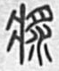（漿의 전서）로 쓴다.”라고 하였다. 『주례』 「주정(酒正)」의 “네 가지 음료 가운데 셋째가 ‘漿’이다.”에 대해 주에서 “‘漿’은 지금의 재장(酨漿)이다.”라고 하였다. 「내칙(内則)」 주에서 “‘漿’은 초재(酢酨)이다.”라고 하였다. 『설문』에 또 “‘酨’는 신 미음이다.”라고 하였다. 『석명(釋名)』에 “‘漿’은 ‘將’이다. 마실 때 차고 따뜻함과 많고 적음이 몸과 서로 잘 맞기 때문이다.”라고 하였다. 『화명초(和名抄)』에 “‘漿’은, 『사시식제경(四時食制經)』에서 봄에는 장감수(漿甘水)를 먹어야 한다고 하였다. ‘漿’은 음이 즉량반(即良反)이다.”라고 하였다. 『豆久利美豆』라 하고, 속칭 『邇於毛比』라 한다. 수곡씨(狩谷氏)가 “살펴보건대[按] 『豆久利美豆』는 만든 물[造水]이다.”라고 하였다. 옛날에는 마실 물을 『毛比』라 하였으니, 주수사(主水司)를 『毛比止里乃司』라 훈독하는 것이 이것이다. 『毛比』는 본래 그릇 이름이다. 『무열기(武烈紀)』의 「영원가(影媛歌)」에 『柂摩暮比你瀰豆佐倍母理』라 하였고, 또 『풍수궁의식장(豐受宮儀式帳)』에 『御水四毛比』라 하였으니, 『毛比』는 물을 담는 그릇이며, 바뀌어 마실 그릇에 담긴 물을 『毛比』라 하고, 다시 바뀌어 마실 그릇에 담지 않았더라도 마실 수 있는 물을 『毛比』라 한 것이다. 『於毛比』라고도 하고 『美毛比』라고도 하는데 모두 미칭이자 존칭이다. 『於毛比』는 『적염위문집(赤染衛門集)』에 보이고, 또 『최마악(催馬樂)』의 『飛鳥井，美毛比毛左牟之』가 이것이다. 『邇於毛比』는 물을 끓인다는 뜻이니, 물을 끓게 하였다가 다시 식혀 마시게 하는 것을 말한다. 입지가 살펴보건대[立之案] 『의심방(醫心方)』 권29 「음수의(飲水宜)」 제9에서 말하였다. “최우석(崔禹錫)의 『식경(食經)』에 ‘봄에는 장수(漿水)를 먹어야 하고, 여름에는 밀수(蜜水)가 알맞으며, 가을에는 명수(茗水)를 먹어야 하고, 겨울에는 백음(白飲)을 먹어야 하니, 이것을 물을 고르게 하여 성품을 기르는 것이라 한다’라고 하였다. 『양생요집(養生要集)』에 ‘대체로 물을 끓여 마시면 온갖 병이 생길 까닭이 없다’라고 하였다.” 『비니마득륵가(毘尼摩得勒伽)』 제6에서 말하였다. “어떤 것이 초장정(酢漿淨)인가. 여러 비구가 병이 들어 여러 의사에게 물으니, 의사가 미음을 마시면 나을 수 있다고 하였다.” (중략) 부처가 초장을 만들어야 한다고 말하였는데, 만드는 법은 쌀뜨물을 따뜻한 물과 섞어 한곳에 두었다가 시어지면 필요한 이가 받아 쓴다. 초장이 맑아 흐린 것이 없으면 자루로 걸러 물처럼 깨끗하게 한다.

（眉）『옥편(玉篇)』｟下ノ七七ウ｠에 “‘酨’는 작대(昨代)·조대(祖代) 두 반절이다. 신 미음이고, 쌀뜨물이다.”, “‘酢’은 차고절(且故切)이다. 시다는 뜻이고 ‘醶’이다. 지금 음은 ‘昨’이니 수작(酬酢)의 글자이다.”라고 하였다.

**○以欲竭其精，以耗散其真。**

욕심으로 그 정(精)을 고갈시키고, 소모하여 그 진기(真氣)를 흩어지게 한다.

（眉）『하년』이 인용한 『대소』에는 ‘耗’ 자 곁에 ‘好’ 자가 있다.

안(案): 이 아래 여섯 구는 모두 방사가 지나치면 몸을 망침을 말한 것이다. 내 생각에, 하고 싶은 대로 하여 절제하지 않으면 정액이 절로 고갈된다. 정액이 절로 고갈되는 것을 ‘耗’라 하며, 소모되면 진원(真元)의 기도 절로 흩어진다. 왕주가 옳다. 『경적찬고(經籍纂詁)』에 “‘秏’는 속자로 ‘耗’로 쓴다.”라고 하였다. 『한서』·『순자(荀子)』는 모두 ‘秏’로 쓰고 ‘耗’로 쓰지 않는다.

（付箋）『소서(素書)』｟十オ｠, 황석공(黃石公) 지음, 송(宋)나라 장상영(張商英) 주. ‘슬픔은 정이 흩어지는 것보다 더 슬픈 것이 없다’에 대한 주: 도가 낳은 것을 ‘一’이라 하고, 순일한 것을 ‘精’이라 한다. 정이 드러난 것을 ‘神’이라 하는데, 그것이 무(無)에 잠겨 있을 때는 삶도 죽음도 없고, 앞도 뒤도 없으며, 음도 양도 없고, 움직임도 고요함도 없다. 형체에 깃들면 밝음이 되고, 슬기가 되고, 지혜가 되고, 식견이 된다. 혈기를 가진 무리는 모두 이를 받는데, 바르게 쓰면 모여 흩어지지 않고, 그릇되게 쓰면 흩어져 모이지 않는다. 눈이 색에 빠지면 정이 색으로 흩어지고, 귀가 소리에 빠지면 정이 소리로 흩어지며, 입이 맛에 빠지면 정이 맛으로 흩어지고, 코가 냄새에 빠지면 정이 냄새로 흩어진다. 흩어지기를 그치지 않으면 오래갈 수 있겠는가. 입지가 살펴보건대[立之案] ‘精神’ 두 글자의 풀이가 적절하다. 『소문』은 ‘散真’이라 하고 여기서는 ‘精散’이라 하였으나 그 뜻은 하나이다. 그러므로 기록해 두어 참고로 삼는다.

명치(明治) 정축년 5월 14일

**○不知持滿，不時御神。**

가득 찬 것을 지킬 줄 모르고, 때에 맞게 정신을 다스리지 못한다.

고세식(高世栻)이 말하였다. “가득 찬 것을 지키는 도로 몸을 기를 줄 모르고, 때에 따라 정신을 다스리는 법으로 마음을 기를 줄 모른다.”

안(案): 때에 맞게 정신을 다스린다는 것은 이른바 ‘사기조신(四氣調神)’이 이것이다.

（眉）『사기』 「초세가(楚世家)」에서 말하였다. “군사를 이끌고 떠나 덕으로 제(齊)나라를 대하는 것만 못하니, 이것이 가득 찬 것을 지키는 술책이다.”

**○務快其心，逆於生樂，**

그 마음을 즐겁게 하는 데만 힘써 삶의 즐거움을 거스르고,

안(案): 생락(生樂)이란 음식과 남녀의 즐거움을 말한다. 이것이 삶을 보존하는 지극한 즐거움이므로 생락이라 한다. 왕주에서 ‘양생의 즐거움’이라 한 것이 곧 그 뜻이다.

**○起居｟屈《遐》引《大素》｠無節，**

기거｟‘屈’ — 『하』가 인용한 『대소』｠에 절도가 없으니,

앞 글의 ‘먹고 마심에 절도가 있고, 기거에 일정함이 있다’에 호응하여 이 한 구로 맺은 것이다.

**○故半百而衰也。**

그러므로 쉰에 쇠하는 것이다.

이 한 구는 ‘지금 사람은 쉰에 동작이 모두 쇠한다’는 물음에 답한 것으로, 시대가 달라서가 아니라 사람이 그것을 잃었기 때문임을 밝힌 것이다. 『하년요초』가 인용한 『태소』는 여기에서 그친다.

**○夫上古聖人之教下也，皆謂之。**

상고 성인의 가르침은 아랫사람이 모두 그대로 행하였다.

전원기 본·『대소』·『천금』에는 모두 ‘上古聖人之教也下皆爲之’로 되어 있으니, 이를 따라 바로잡아야 한다. 왕빙 본은 아마 왕씨가 고친 것인데, 아랫사람을 가르치는 법을 ‘病安從來’까지로 보았다. ‘皆’ 한 글자가 결국 통하지 않게 되었다. ‘爲’와 ‘謂’는 옛날에 통용되었다. 여기서 말한 성인은 군주를 말하니, 뒤 조목의 성인·현인과는 뜻이 본래 다르다.

（眉）안(案): 「저지교론(著至教論)」은 병의 손상을 밝히지 못하는 것을 “세상 군주의 배움이 다한 것”이라 하였으니, 그렇다면 의도(醫道)의 가르침은 참으로 군주의 큰 명령이다.

**○虛邪賊風，避之有時。**

허사적풍(虛邪賊風)은 때에 맞추어 피하였다.

안(案): ‘邪’는 사람의 형체 안으로 들어간 것을 일컫는 말이고, ‘風’은 천지 사이에 있는 것의 이름이다. 그러므로 「금궤진언론(金匱真言論)」에서 “팔풍(八風)이 사(邪)를 일으켜 경풍(經風)이 되고, 오장에 닿으면 사기가 병을 일으킨다.”라고 한 것으로 증명할 수 있다. 대체로 풍·한·서·습·음식 따위가 사람에게 적중한 것은 모두 사라 한다. 「사십구난(四十九難)」에서 말한 ‘오사(五邪)’가 이것이다. 여러 사 가운데 중풍(中風)이 가장 주가 되므로 흔히 풍으로 이름한다. 『소』·『영』에서 풍이라 하기도 하고 사라 하기도 하는 것은 모두 밖에서 오는 것을 통칭한 것으로 서로 통용된다. 천지 사이의 바람은 팔풍을 벗어나지 않는데, 그 충(衝)의 뒤에서 오는 것이 허풍(虛風)이고 허사(虛邪)이다. 충의 뒤에서 오는지 여부를 따지지 않고, 적중하여 사람을 해치는 것을 적풍(賊風)·적사(賊邪)라 한다. 결국 허사적풍이란 밖에서 오는 바르지 않은 바람을 통칭한 말이다. 왕주는 허사와 적풍을 둘로 나눈 듯하나 실은 그렇지 않다. 다만 ‘虛’·‘賊’ 두 글자에 나아가 뜻을 풀이했을 뿐이다. 사가 허한 틈을 타 들어오는 것을 허사라 하고, 중화(中和)를 몰래 해치는 것을 적풍이라 한다. 어찌 허한 틈을 타 들어온 사가 중화를 해치지 않고, 중화를 해치는 바람이 허한 틈을 타 들어오지 않는 이치가 있겠는가? 마시(馬蒔)가 “왕주가 ‘虛’를 사람에게 있는 것으로 가리킨 것은 잘못이다.”라고 하였는데, 이 설은 얕은 견해라 근거로 삼기에 부족하다.

（眉）「육원정기론」 주에서 “허사는 충의 뒤에서 오는 바람을 말한다.”라고 하였다.

（眉）『본초회(本草匯)』 권5에서 말하였다. “동지에는 서풍을 피하고, 입춘에는 서남풍을 피하고, 하지에는 북풍을 피하고, 입추에는 동북풍을 피하고, 춘분에는 서풍을 피하고, 입하에는 서북풍을 피하고, 추분에는 동풍을 피하고, 입동에는 동남풍을 피한다. 이상을 팔풍이라 한다.”

**○恬惔虛無，真氣從之。精神内守，病安從來。**

마음을 담담하고 텅 비게[恬惔虛無] 하면 진기(真氣)가 이를 따르고, 정신이 안에서 지켜지니 병이 어디서 오겠는가.

고초본에는 ‘惔’이 ‘憺’으로 되어 있고, 원판(元板)도 같다. 송본(宋本) 석음(釋音)도 같다.

안(案): 『설문』에서 ‘恬’·‘憺’은 모두 ‘安’으로 풀이하니, 대개 첩운(疊韻)으로 뜻을 이룬 것이다. 그러므로 현응(玄應)의 『음의(音義)』는 『창힐(蒼頡)』을 인용하여 “‘惔’은 ‘恬’이다.”라고 하였다. 그렇다면 한 글자로 말하면 ‘恬’이라 하거나 ‘惔’이라 하고, 겹쳐 말하면 ‘恬惔’이라 한다. ‘憺’을 ‘惔’으로 쓰는 것은 ‘澹’을 ‘淡’으로 쓰는 것과 같다. 대개 ‘恬淡’이 정자(正字)인데 ‘恬’ 자에 이끌려 마침내 ‘恬惔’으로 쓴 것일 뿐이다. 『노자(老子)』 31장의 ‘恬淡’을 『석문』은 ‘恬澹’으로 쓰고 “‘澹’은 다른 본에 ‘惔’으로도 되어 있다.”라고 한 것으로 증명할 수 있다. ‘時’·‘之’·‘來’ 세 글자는 압운한다. 이상 여섯 구는 성인이 아랫사람을 가르친 뜻과 예이다. 위의 두 구는 피해야 할 것이 사풍(邪風)에 있음을 말하고, 아래 네 구는 피하는 방법이 오직 자기에게 있음을 말한다.

『설문』에 “‘惔’은 ‘安’이다. ‘談’처럼 읽는다. ‘𠋴’·‘倓’은 혹 ‘剡’을 따르기도 한다.”라고 하였고, “‘恬’은 ‘心’을 따르고, ‘甜’의 생략형이 소리를 나타낸다.”라고 하였다. 『설문』에 “‘惔’은 ‘憂’이다.”라고 하였으니, 여기의 ‘惔’과는 본래 다르다.

「음양응상대론」에서 말하였다. “이 때문에 무위(無爲)의 일을 하고 염담(恬憺)의 능함을 즐기며, 허무를 지키는 가운데 욕망을 따르고 뜻을 쾌하게 하므로 수명이 끝이 없어 천지와 더불어 마치니, 이것이 성인의 몸 다스림이다.”

（眉）‘從來’는 또 「조경론(調經論)」에 보인다.

**○是以志閑而少欲，心安而不懼，形勞而不倦。**

이 때문에 백성은 뜻이 한가로워 욕심이 적고, 마음이 편안하여 두려워하지 않으며, 몸은 수고로워도 지치지 않았다.

안(案): ‘是以’ 아래에 ‘其民’ 두 글자를 덧붙여 보아야 한다. 위 여섯 구의 가르침에 따라 그 몸을 닦으면 그 백성은 마음과 뜻이 편안하고 한가로워 몸을 수고롭게 해도 지치지 않는다는 말이다. 이것은 모르는 사이에 허무의 경지에 이르는 것이다.

**○氣從以順，｟真氣從之之謂也。｠**

기가 따라서 순조로웠으며,｟진기가 이를 따른다는 말이다.｠

**○各從其欲，皆得所願。**

저마다 바라는 것을 따르고, 모두 원하는 바를 얻었다.

안(案): 바라는 것이 하나가 아니므로 ‘各’이라 하였다. 모두가 원하는 바를 얻었으므로 ‘皆’라 하였다.

**○故美其食，任其服，樂其俗，高下不相慕，**

그러므로 그 음식을 맛있게 여기고, 그 옷을 편하게 입고, 그 풍속을 즐기며, 높은 이와 낮은 이가 서로 부러워하지 않았다.

『노자』 80장의 “백성으로 하여금 다시 노끈을 매어 쓰게 하고, 그 음식을 달게 여기고 그 옷을 아름답게 여기며 그 거처를 편안히 여기고 그 풍속을 즐기게 한다. 이웃 나라가 서로 바라보이고 닭과 개 소리가 서로 들려도 백성이 늙어 죽을 때까지 서로 오가지 않는다.”는 이 글과 뜻이 같다.

**○其民故曰朴。**

그러므로 그 백성은 날로 소박해졌다.

『노자』 57장에 “내가 욕심이 없으면 백성이 절로 소박해진다.”라고 하였다. 또 19장·27장·28장에 모두 ‘朴’ 자가 있다.

안(案): ‘朴’은 곧 ‘樸’의 가차(假借)이다. 『설문』에 “‘樸’은 나무의 바탕이다.”라고 하였는데, 전주(轉注)되어 모든 바탕·소박함의 글자가 되었다. “‘朴’은 나무껍질이다.”는 여기의 뜻이 아니다. 『포박자』도 ‘朴’을 빌려 ‘樸’으로 썼다. 『회남자(淮南子)』 「본경훈(本經訓)」에서 “담담하여 욕심이 없으니 백성이 절로 소박해진다.”라고 한 것은 전적으로 『노자』의 글에 근거한 것이다.

『신교정』에서 말하였다. “다른 본에는 ‘曰’이 ‘日’로 되어 있다.”

안(案): 『효경(孝經)』의 ‘以養父母日嚴’을 위고문(僞古文)에서는 ‘日’을 ‘曰’로 썼다. 『의례(儀禮)』 「사상례(士喪禮)」의 ‘與占曰某日從’에 대해 주에서 “고문에서는 ‘曰’을 ‘日’로 썼다.”라고 하였다. 『맹자』 「등문공 상(滕文公上)」의 ‘放勳曰勞之來之’를 『음의』에서는 ‘曰’을 ‘日’로 쓰고, “정(丁)은 음을 ‘馹’로 하였고, 혹 ‘曰’로 쓰기도 하나 잘못이다.”라고 하였다. 대개 한(漢)나라 사람이 쓴 ‘日’ 자는 흔히 ‘曰’로 되어 있다. 「한칙비(韓敕碑)」·「공화비(孔龢碑)」·「위수선표(魏受禪表)」가 모두 그러하다. ‘其民日朴’은 그 백성의 풍속이 거짓으로 흐르지 않아 하루하루 날마다 소박함으로 돌아감을 말한다. 『대학(大學)』의 ‘誠日新’과 글의 예가 같다. 혹 『이아』 「석고」의 “‘粵’·‘于’·‘爰’은 ‘曰’이다.”의 뜻으로 보기도 하나, ‘故曰’ 두 글자는 이어 놓으면 말이 되지 않으니 옳지 않다. ‘食’·‘服’·‘俗’·‘朴’은 압운한다.

안(案): 해와 달의 ‘日’을 ‘云’의 뜻인 ‘曰’ 자로 쓴 예는 송본 「육절장상」의 ‘紀化生之用也’ 왕주 안에 보인다.

（眉）『노자』 52장의 ‘見小曰明，守柔曰強’의 두 ‘曰’은 하상공(河上公) 본에 혹 ‘日’로 되어 있고, 『회남자』에는 ‘日’로 되어 있다.

**○是以嗜欲不能勞其目，淫邪不能惑其心。**

이 때문에 백성은 즐기고 바라는 것이 그 눈을 수고롭게 할 수 없고, 음란하고 사특한 것이 그 마음을 미혹할 수 없었다.

고세식이 말하였다. “그 음식을 맛있게 여기고 그 옷을 편하게 입으므로 즐기고 바라는 것이 그 눈을 수고롭게 할 수 없다. 그 풍속을 즐기므로 음란하고 사특한 것이 그 마음을 미혹할 수 없다.”

‘是以’ 아래에도 ‘其民’ 두 글자를 덧붙여 보아야 한다.

**[역1]** 원서의 「徐無篇鬼」는 「徐無鬼篇」의 글자 순서가 뒤바뀐 것으로 보인다(이 책의 다른 자리에는 「徐無鬼」, 『山谷外集詩註』의 인용에는 「徐無鬼篇」으로 되어 있다).

**○愚智賢不肖，不懼於物，故合於道。**

어리석은 이·지혜로운 이·현명한 이·불초(不肖)한 이가 사물을 두려워하지 않았으므로 도(道)에 합치하였다.[역1]

고세식(高世栻)이 말하였다. “높은 이와 낮은 이가 서로 부러워하지 않았으므로 어리석은 이·지혜로운 이·현명한 이·불초한 이가 사물을 두려워하지 않았다. 그 백성이 날로 순박해졌으므로 양생의 자연스러운 도에 합치하였다.”

안(案): 앞글에서 말한 “도를 아는 이[知道者]”는 지위에 있는 사람을 이른다. 여기서 말한 “도에 합치한다[合於道]”는 도를 아는 이가 아니면서 저절로 도에 합치함을 이른다.

「해정미론(解精微論)」의 “치료를 행하는 이에 현명한 이와 불초한 이가 있어 반드시 십전(十全)할 수는 없다.”에 대한 주에 말하였다. “현명함은 마음이 밝고 지혜가 멀리 미침을 이르고, 불초함은 멋대로 지어내어 법도가 없음을 이른다.”

（眉）『상서대전(尚書大傳)』의 “요임금은 단주(丹朱)가 불초함을 알았다.”에 대한 주에 “‘肖’는 닮음이다.”라고 하였다. 또 『소이아(小爾雅)』에 “‘不肖’는 닮지 않음이다.”라고 하였다.

**○所以能年皆度百歲而動作不衰者，以其德全不危也。**

모두 나이가 100세를 넘기고도 동작이 쇠하지 않을 수 있었던 것은 그 덕이 온전하여 위태롭지 않았기 때문이다.

안(案): ‘皆’는 상고 사람들 모두를 말한다. ‘其’는 상고 사람들을 가리킨다. 멀리 “내가 듣건대 상고 사람들은 나이가 모두 100세를 넘기고도 동작이 쇠하지 않았다.”라는 구절을 덮어 받아 여기서 맺은 것이다.

（眉）이상이 제1장이다.

**○帝曰：人年老而無子者，材力盡邪。將天數然也。**

황제가 물었다. “사람이 늙어 자식이 없는 것은 재력(材力)이 다해서인가? 아니면 천수(天數)가 그러해서인가?”

（眉）『대소(大素)』 권2 「수한(壽限)」.

『대소』 권2 「수한」편에는 ‘帝曰’이 ‘黃帝問岐伯曰’ 여섯 자로 되어 있고, ‘也’ 자가 없다.

안(案): 「위기실상(衛氣失常)」편의 “사람이 50세 이상이면 늙음[老]이 된다.”는 이것과 뜻이 같다. 「곡례(曲禮)」와 『설문(説文)』에 모두 “70세를 ‘老’라 한다.”라고 한 것은 이 뜻이 아니다.

양상선(楊上善)이 말하였다. “재력은 섭양(攝養)하는 힘이다. 천수는 천명의 수이다.”

안(案): 천수는 곧 천계(天癸)의 수이다. 아래 글에서 말한 칠칠(七七)·팔팔(八八)이 이것이다.

**○岐伯曰：女子七歲，腎氣盛，齒更髮長。**

기백(岐伯)이 답했다. “여자는 7세에 신기(腎氣)가 왕성해져 이를 갈고 머리카락이 자란다.”

『대소』에는 ‘齒更’이 ‘更齒’로 되어 있다.

〔楊〕신(腎)은 뼈와 머리카락을 주관하므로, 신기가 왕성하면 이를 갈고 머리카락이 자란다.

（眉）이하 남녀의 나이에 따른 성쇠 한 대목은 『영추(靈樞)』 「천년(天年)」편과 함께 보아야 한다.

**○二七而天癸至，**

14세[二七]에 천계(天癸)가 이르고,

『갑을경(甲乙經)』에는 ‘天癸’가 ‘天水’로 되어 있고, 아래도 같다. 아래 글의 왕주(王注)에 “남녀는 음양의 바탕이 같지 않아, 천계도 정(精)과 혈(血)로 그 형체가 다르다.”라고 하였다. 「음양응상대론(陰陽應象大論)」의 “이 둘을 조화한다.”에 대한 왕주에 “‘調’는 천계의 성질을 따라 몸의 혈기(血氣)와 정기(精氣)를 다스림을 이른다.”라고 하였다. 이에 근거하면 천계란, 14세[二七]·16세[二八]의 시기에 이르러 남녀가 정을 맺는[構精] 기틀이 안에서 저절로 발동하는 것으로, 이것이 천수에 응하여 신수(腎水)가 막 차오르므로 천계라고 한 것이다. 왕씨(王氏)가 정과 혈로 남녀를 나눈 것은 사람들이 쉽게 알게 하려 한 것이지, 실은 정과 혈을 곧바로 천계로 삼은 것이 아니다. 대개 이 시기에 이르면 남녀 모두 신기가 막 통하여 정액이 넘쳐 나오는[精液溢泄] 때임을 이른다. 이상은 안정(安政) 정사년 2월 6일 밤, 채정(茝庭) 선생이 병상에서 구술해 주신 ‘천계’의 뜻이 이러하다. 같은 달 14일에 선생이 세상을 떠나셨다. 아, 이 말씀은 선생 생전의 마지막 유언이니, 어찌 기록해 전하지 않을 수 있겠는가.

**○任脈通，太衝脈盛，月事以時下，故有子。**

임맥(任脈)이 통하고 태충맥(太衝脈)이 왕성해져 월경[月事]이 때맞추어 내려오므로 자식을 둘 수 있다.

『신교정(新校正)』에서 말하였다. “살펴보건대[按] 전원기(全元起) 주본과 『대소』·『갑을경』에는 모두 ‘伏衝’으로 되어 있고, 아래의 ‘太衝’도 같다.”

지금 판본 『대소』에도 ‘伏衝’으로 되어 있고, 지금 판본 『갑을(甲乙)』에는 ‘太衝’으로 되어 있으며, 아래도 같다.

안(案): 「골공론(骨空論)」에 “충맥(衝脈)은 기가(氣街)에서 일어나 소음경(少陰經)과 나란히 배꼽을 끼고 올라가 가슴에 이르러 흩어진다.”라고 하였다. 『갑을』도 같으나, 다만 ‘氣街’가 ‘氣衝’으로 되어 있다. 『맥경(脈經)』에 “충맥은 관원(關元)에서 일어나 뱃속을 따라 곧바로 인후 속까지 올라간다.”라고 하였고, 주에 “일설에 충맥은 기충(氣衝)에서 일어나 양명경(陽明經)과 나란히 배꼽을 끼고 올라가 가슴에 이르러 흩어진다고 한다.”라고 하였다. 28난(難)에 “충맥은 기충에서 일어나 족양명경(足陽明經)과 나란히 배꼽을 끼고 올라가 가슴에 이르러 흩어진다.”라고 하였다. 양현조(楊玄操)의 주에 “‘衝’은 통함이다. 이 맥이 아래로 발까지, 위로 머리까지 이르러 십이경(十二經)의 기혈을 두루 받음을 말한다. 그러므로 ‘衝’이라 한다.”라고 하였다. 우서(虞庶)의 주에 “『소문(素問)』에 ‘충맥은 기가에서 일어난다.’라 하고, 『난경(難經)』에 ‘기충에서 일어난다.’라 하였다. 또 『침경(鍼經)』의 혈 가운데 두 이름을 함께 두었으니, ‘衝’과 ‘街’의 뜻이 모두 통한다.”라고 하였다. 입지(立之)가 생각하기에, 기경팔맥(奇經八脈) 가운데 임(任)·독(督)·대(帶)·교(蹻)는 모두 의복으로 이름 지었고, 유(維)·충(衝)은 모두 맥의 형상으로 이름 지었다. ‘維’는 몸을 얽어맨다는 뜻으로 28난에 나온다. ‘衝’은 뚫어 통한다는 말이다. 충맥은 밑동은 하나이고 끝은 두 갈래로 가서 거리[街衢]의 모양과 비슷하므로 ‘衝’이라 하고 또 ‘街’라 한다. 뱃속으로 숨어 가므로 복충(伏衝)이라 하고, 경맥의 바다이므로 태충(太衝)이라 한다. 충맥이 시작되는 곳은 그 박동이 손에 응하므로 기가라 하고 또 기충이라 한다. ‘氣’는 곧 동기(動氣)를 이른다.

（眉）안(案): 여자가 혈을 쏟고 남자가 정을 쏟는 것은 모두 자기를 찢어 남을 만드는 천리(天理)이다. 사람에게 이 가운데 하나가 있으면 곧 형체가 무너지고 쇠약해지는 기틀이 되니, 마치 나비가 교미하고 나서 가루를 떨어뜨리는 것과 같다. 대개 천계가 이른다는 것은 사람의 끝이요 말단이다. 곧 동물의 천리로서 그럴 수밖에 없는 것이다.

（眉）태충맥은 『의잉(醫賸)』 권상 「동기(動氣)」조에 자세히 나온다. 대개 경락의 두 맥 줄기가 허리에 이르러 갈라지는 곳을 곧 충맥이라 이름하였을 뿐이다.

（付箋）〔楊〕천계는 정기이다. 임맥과 충맥은 포중(胞中)에서 일어나니, 아래 끝에 있는 것이다. 지금 천계가 이르므로 임맥이 통한다. 복충맥은 기가에서 일어나는데, 또 천계가 이르므로 충맥이 왕성해진다. 두 맥이 함께 자포(子胞)를 영양하므로 월경이 와서 자식을 둘 수 있다.

**○三七腎氣平均，故真牙生而長極。**

21세[三七]에 신기가 고르게 되므로 진아(真牙)가 나고 다 자란다.

〔楊〕진아는 뒤 어금니이다. 장극(長極)은 키가 자람이다.

〔張〕평균(平均)은 충만함을 이른다.

〔識〕대개 진아가 먼저 나고, 이때에 이르러 다 자람을 이른다.

안(案): 『의례(儀禮)』 「기석례(既夕禮)」의 “우전좌전(右齻左齻)”에 대한 주에 “‘齻’은 이의 굳셈을 본뜬 것이다.”라고 하였고, 소(疏)에 “우전좌전은 치열 양쪽 가의 가장 긴 이를 이르니, 살아 있을 때 이의 굳셈을 본뜬 것이다.”라고 하였다. 『석문(釋文)』에 “‘齻’은 정천반(丁千反)이다.”라고 하였다. 『초사(楚詞)』 「대초(大招)」에 “보조개에 기이한 이[奇牙], 웃음이 어여쁘기도 하구나.”라고 하였다. 『회남자(淮南子)』에 “‘奇牙’가 드러나고 보조개가 움직인다.”라고 하였는데, 고유(高誘)의 주에 “웃으려 하기 때문에 고운 이가 드러난다.”라고 하였다. 『설문』에 “‘𤘲’는 범의 송곳니이다.”라고 하였다. 심동(沈彤)의 『석골(釋骨)』에 “이가 좌우로 돌아가는 형세가 조금 굽은 곳을 곡아(曲牙)라 한다.”라고 하였다. 이로써 ‘齻’·‘奇牙’·‘虎牙’·‘曲牙’라 한 것은 모두 같은 것으로, 지금 세속에서 사절치(絲截齒)라 부르는 것이 이것이다. 『소문』에 ‘真牙’로 쓴 것은 고자(古字)가 우연히 남은 것이다. 이 이는 끊는 일을 가장 주로 하므로 진아라 하고, 또 호아(虎牙)라 한다. ‘齻’으로 쓴 것은 속자(俗字)이다. 여러 이와 모양이 같지 않으므로 기아(奇牙)라 하고, 또 곡아라 한다. ‘𤘲’로 쓴 것은 속자이다. 왕주에 “진아는 이 가운데 가장 늦게 나는 것을 이른다.”라 하고, 양상선이 “진아는 뒤 어금니이다.”라 한 것은 지금 세속에서 오치(奧齒)라 부르는 것을 가리키니, 옛 뜻이 아니다. 나에게 따로 「석아(釋牙)」 한 편이 있어 자세히 갖추었으므로 여기서는 번거롭게 인용하지 않는다.

**○四七筋骨堅，髮長極，身體盛壯。五七陽明脈衰，面始焦，髮始墮。**

28세[四七]에 근골(筋骨)이 굳세고 머리카락이 다 자라며 몸이 왕성하고 건장하다. 35세[五七]에 양명맥(陽明脈)이 쇠하여 얼굴이 초췌해지기 시작하고 머리카락이 빠지기 시작한다.

〔楊〕몸의 근골·몸체·머리카락이 모두 왕성함이 극에 달한다.

『대소』에는 ‘焦’가 ‘燋’로, ‘墮’가 ‘惰’로 되어 있다. 『설문』에 “‘䩌’는 얼굴이 초췌하게 마르고 작아진 것이다.”라고 하였다. 『옥편(玉篇)』에 『초사(楚辭)』를 인용하여 “안색이 ‘䩌顇’하다.”라고 하였다. 『한(漢)』 「외척전(外戚傳)」에 “‘嫶妍’하여 크게 한숨짓는다.”라고 하였는데, 진작(晉灼)이 말하였다. “삼보(三輔)에서는 근심으로 얼굴이 수척해진 것을 ‘嫶冥’이라 하니, ‘嫶妍’은 ‘嫶冥’과 같다.” 대개 ‘䩌’와 ‘嫶’는 모두 속자인데, ‘䩌’는 얼굴이 초췌하다는 글자이고, ‘嫶’는 ‘妍’ 자에 이어 쓰면서 여자변을 더한 것이다. 『소문』의 ‘焦’가 가장 낫다. 「오장생성(五藏生成)」편 왕주에 “근기(筋氣)가 굳게 맺힌 것이다.”라고 하였다.

〔楊〕양명맥은 얼굴에서 일어나 머리로 가므로, 양명이 쇠하면 얼굴과 머리카락이 비로소 초췌해지고 빠진다.

**○六七三陽脈衰於上，面皆焦，髮始白。**

42세[六七]에 삼양맥(三陽脈)이 위에서 쇠하여 얼굴이 온통 초췌해지고 머리카락이 세기 시작한다.

『대소』에는 ‘焦’가 ‘燋’로 되어 있고, ‘始’ 자가 없다.

〔楊〕삼양은 소양(少陽)·대양(大陽)·양명이다. 삼양맥이 모두 머리에 있으므로, 삼양이 쇠하면 얼굴이 초췌해지고 머리카락이 센다.

**○七七任脈虛，太衝脈衰少，天癸竭，地道不通，故形壞而無子也。**

49세[七七]에 임맥이 허해지고 태충맥이 쇠하여 적어지며 천계가 다하여[竭] 지도(地道)가 통하지 않으므로, 형체가 무너지고 자식이 없다.

〔楊〕임맥과 충맥 두 맥의 기혈이 모두 적어지고 정기가 다하여 자문(子門)이 닫히고 자궁(子宮)이 무너지므로 자식이 없다.

천계가 다한다는 것은 방사(房事)에 대한 생각이 끊어짐을 이른다. 지도가 통하지 않는다는 것은 월경이 오지 않음을 이른다. 살펴보건대[案] ‘竭’은 곧 ‘渴’의 가자(假字)이다. 『설문』에 “‘渴’은 다함이다.”, “‘竭’은 짊어져 듦이다.”라고 하였다. 경전에서 대부분 ‘竭’을 써서 다한다는 글자로 삼은 것은 모두 ‘渴’의 가차(假借)이다. 『주례(周禮)』 「지관(地官)·초인(草人)」의 “무릇 거름을 주어 씨를 뿌릴 때 ‘渴澤’에는 사슴을 쓴다.”에 대해 소에 “‘渴’은 예전에는 물이 고였는데 지금은 말랐다는 것이다.”라고 하였다.

（眉）안(案): 여자가 7을 되풀이하여 쓰는 것은 『역(易)』의 시초[著]가 둥글어 칠칠 사십구의 수인 것이고, 남자가 8을 되풀이하여 쓰는 것은 『역』의 괘가 모나서 팔팔 육십사의 수인 것이다. 서로 15의 수만큼 떨어지니, 이 또한 3후(候) 1기(氣), 곧 반달의 수이다.[역2]

（眉）여자에게는 형체가 무너진다고 하고 남자에게는 무너진다고 하지 않았으니, 음미할 만하다.

**○丈夫八歲，腎氣實，髮長齒更。**

남자[丈夫]는 8세에 신기가 충실해져 머리카락이 자라고 이를 간다.

『대소』에는 ‘夫’ 아래에 ‘年’ 자가 있다.

**○二八腎氣盛，天癸至，精氣溢寫，陰陽和，故能有子。三八腎氣平均，筋骨勁強，故真牙生而長極。四八筋骨隆盛，肌肉滿壯。**

16세[二八]에 신기가 왕성해지고 천계가 이르러 정기(精氣)가 넘쳐 쏟아지며 음양이 조화되므로 자식을 둘 수 있다. 24세[三八]에 신기가 고르게 되어 근골이 굳세고 강하므로 진아가 나고 다 자란다. 32세[四八]에 근골이 융성하고 기육(肌肉)이 가득 차 건장하다.

『대소』에는 ‘壯’ 자가 없고, 고초본(古抄本)에는 ‘壯’이 ‘溢’로 되어 있다.

（眉）안(案): 남자에 대해 정기가 넘쳐 쏟아진다고 하였으니, 여자는 평생 정기가 넘쳐 쏟아지지 않음을 알 수 있다. 또 남자에 대해 음양이 조화된다고 하였으니, 평소 남녀의 도는 남자가 앞장서고 여자가 따르며, 교합 또한 남자가 행하고 여자가 응한다는 뜻이 아주 분명하다.

**○五八腎氣衰，髮墮齒槁。**

40세[五八]에 신기가 쇠하여 머리카락이 빠지고 이가 마른다.

『대소』에는 ‘墮’가 ‘惰’로, ‘槁’가 ‘稾’로 되어 있다.

치고(齒槁)는 이의 색에 광택이 없고 여위어 작아짐을 이른다. 대체로 이는 뼈의 나머지로서 손톱·머리카락과 바탕이 같으므로 밤낮으로 자라 쉬지 않지만, 손톱·머리카락에 비하면 자라는 것이 매우 더디며, 40세에 이르면 다시 자랄 기세가 없으므로 말라 여위고 작아져 광택을 잃는다.

**○六八陽氣衰竭於上，**｟《大素》無『竭』字，《甲乙》同，可從。｠**面焦，髮鬢頒白。**

48세[六八]에 양기(陽氣)가 위에서 쇠하고｟『대소』에는 ‘竭’ 자가 없고 『갑을』도 같으니, 따를 만하다.｠ 얼굴이 초췌해지며 머리카락과 귀밑털이 희끗희끗해진다.

『대소』에는 ‘焦’가 ‘燋’로, ‘髮鬢’이 ‘鬢髮’로 되어 있다.

안(案): 『설문』에 “‘頒’은 큰 머리이다.”라고 한 것은 이 뜻이 아니다. ‘頒白’의 글자는 ‘斑’으로 써야 한다. ‘斑’은 얼룩짐이다. 『설문』에는 ‘辬’으로 되어 있고 “얼룩무늬이다.”라고 하였으며, 『광운(廣韻)』에 “‘䰉’은 머리카락이 반쯤 센 것이다.”라고 하였으니, 모두 같은 뜻이다. 대개 ‘班’ 음의 글자에는 모두 저절로 얼룩진다는 뜻이 있을 뿐이다.

**○七八肝氣衰，筋不能動，天癸竭，精少，腎藏衰，形體皆極。**

56세[七八]에 간기(肝氣)가 쇠하여 근(筋)이 움직일 수 없고, 천계가 말라 가며[竭] 정이 적어지고 신장(腎藏)이 쇠하여 형체가 모두 지친다.[역3]

안(案): 근이 움직일 수 없다는 것은 간기가 쇠하고 적어져 온몸의 근력이 저절로 약해져 자유롭게 운동할 수 없음을 이른다. 세속에서 사십수(四十手)·오십수(五十手)·장명통(長命痛)이라 부르는, 한쪽 팔이 때때로 자유롭지 못한 따위가 이것이다. 그러나 그 이치를 따져 보면, 여기서 말한 “근이 움직일 수 없다”는 것은 대개 오로지 음경을 이른다. 음경은 종근(宗筋)으로 본래 간에 속한다.

그러므로 간기가 쇠하면 음경이 일을 당해도 굳세고 융성하지 못하니, 전혀 일어나지 않는 것은 아니지만 강성하게 일어나지 못할 뿐이다. 다음 구절에 “천계가 말라 가고 정이 적어지며 신기가 쇠한다.”라고 한 것으로 증명할 수 있다.

〔紹〕위아래 글을 미루어 보면 ‘天癸竭’ 이하 네 구절은 ‘八八’ 아래로 옮겨야 할 듯하니, 잘못 나온 것인 듯하다. 그러나 앞선 주석가 가운데 감히 언급한 이가 없으니, 의심이 없을 수 없다. 아래 글에 “남자는 팔팔을 넘지 않고 여자는 칠칠을 넘지 않으며, 천지의 정기가 모두 다한다.”라고 한 것으로 증명할 수 있다.

『설문』에 “연(燕) 사람은 ‘勞’를 ‘極’이라 한다.”라고 하였다. 『방언(方言)』에 “‘極’은 지침이다.”라고 하였다.

안(案): 『소식(紹識)』의 설은 옳은 듯하지만 옳지 않으니, 설명은 아래 글에 갖추었다.

**○八八則齒髮去，腎者主水，受五藏六府之精而藏之，故五藏盛乃能寫。**

64세[八八]에는 이와 머리카락이 빠진다. 신은 물을 주관하여 오장육부(五藏六府)의 정을 받아 저장하므로, 오장이 왕성해야 쏟아낼 수 있다.

『대소』에는 ‘主’가 ‘生’으로 되어 있고 ‘能’ 자가 없으며, ‘皆衰’에 이르러 그치고 ‘筋骨解墮’ 이하는 빠져 있다.

〔楊〕치고(齒槀)는 뼈가 먼저 쇠하고 살이 붙지 않아 이를 마르게 하는 것이다.

（眉）『영(靈)』 「본신(本神)」편에 말하였다. “오장은 정을 저장하는 일을 주관하는 것이다.”

（眉）왕앙(汪昂)의 『의방집해(醫方集解)』 「부여(附餘)」에 말하였다. “사람 몸의 혈은 온몸을 꿰어 통한다. 성욕이 일어나면 온몸의 혈을 모아 명문(命門)에 이르러 정으로 변화시켜 내보낸다.”

（眉）안(案): 정액은 신에 늘 있는 것이 아니다. 신이 비록 물을 낳는다고 하나, 방사를 할 때에 오장육부 속의 정수(精水)를 받아들여 저장하였다가 고환 속으로 보내어 쏟아낼 수 있게 하는 것이니, 마치 물총[水銃]이 위아래로 드나드는 당기는 힘을 얻어 물을 뿜어내는 기틀과 같다.

**○今五藏皆衰，筋骨解墮，天癸盡矣。故髮鬢白，身體重，行步不正，而無子耳。**

지금 오장이 모두 쇠하고 근골이 풀어져 늘어지며[解墮] 천계가 다하였다. 그러므로 머리카락과 귀밑털이 세고 몸이 무거우며 걸음이 바르지 못하고 자식이 없을 뿐이다.

‘筋骨’ 이하는 『대소』에 빠져 있다. 고초본에는 ‘墮’가 ‘憜’로 되어 있고, 원판(元板)도 같다.

안(案): ‘解憜’의 글자는 『설문』에는 ‘懈惰’로 되어 있다. 여기서 ‘解墮’로 쓴 것은 고문에서 통용한 것이니, 결국 뜻은 음에 있지 글자에 있지 않다. ‘墮’와 ‘惰’는 옛날에 많이 통용하였다. 『대대례(大戴禮)』 「성덕(盛德)」의 “작은 자는 구차하고 게으르다[偸墮].”에 대한 주에 “‘墮’는 ‘解墮’이다. 「자장문입관(子張問入官)」에 ‘게으름[墮怠]은 때에 뒤처지게 되는 까닭이다.’라고 하였다.”라고 하였다. 매승(枚乘)의 「칠발(七發)」에 “손발이 게으르고 약하다[惰窳].”라고 하였다. 이선(李善)의 주에 곽박(郭璞)의 『방언주(方言注)』를 인용하여 말하였다. “‘墮’는 ‘懈墮’이다.”

안(案): 앞글의 ‘七八’은 간·신 두 장이 쇠하여 천계가 말라 가고[竭] 정이 적어짐을 이른다. 여기서는 ‘八八’에 오장이 모두 쇠하여 천계가 다함[盡]을 이른다. 앞에서는 천계가 ‘竭’하여 정이 적다 하고, 뒤에서는 천계가 ‘盡’하여 자식이 없다 하였으니, 자세히 음미해야 한다. 대개 ‘竭’은 비록 ‘盡’으로 풀이하지만 아직 완전히 다하지 않고 다만 부족함을 이른다. ‘盡’은 완전히 다하여 있지 않음을 이른다. 정이 적다는 말과 자식이 없다는 말에서 그 뜻을 찾을 수 있다.

**○帝曰：有其年已老而有子者，何也？岐伯曰：此其天壽過度，氣脈常通，而腎氣有餘也。**

황제가 물었다. “나이가 이미 늙었는데도 자식을 두는 이가 있으니 어째서인가?” 기백이 답했다. “이는 타고난 수명[天壽]이 정도를 넘고 기맥(氣脈)이 늘 통하며 신기가 남음이 있기 때문이다.”

안(案): 기맥은 자세한 풀이를 얻지 못하였다. 대개 기는 남자에 매이고 맥은 여자에 매인다. 윗글에 “남자는 16세에 신기가 왕성하고 정기가 넘쳐 쏟아지며, 40세에 신기가 쇠하고 48세에 양기가 위에서 쇠갈하며 56세에 간기가 쇠한다. 여자는 14세에 임맥이 통하고 태충맥이 왕성하며, 35세에 양명맥이 쇠하고 42세에 삼양맥이 위에서 쇠하며 49세에 임맥이 허하고 태충맥이 쇠하여 적어진다.”라고 한 것으로 입증할 수 있다. 타고난 수명이 정도를 넘으면 신기가 남음이 있음을 말한다. 그러므로 남자는 기가, 여자는 맥이 몸속에서 늘 통하여 그치지 않으므로 자식을 둘 수 있는 것이다.

**○此雖有子，男不過盡八八，女不過盡七七，而天地之精氣皆竭矣。**

이들이 비록 자식을 두더라도, 남자는 64세[八八]를 넘지 않고 여자는 49세[七七]를 넘지 않아 천지의 정기가 모두 다한다.

안(案): 천기(天氣)는 남자에 매이고 지정(地精)은 여자에 매인다.

〔識〕［馬云］이는 나이 늙어 자식을 두는 이를 말한 것이다. 왕주에서 태어난 자녀의 수명이 64세·49세의 수에 그친다고 여긴 것은 잘못이다. 『한씨의통(韓氏醫通)』에 말하였다. “남자 8세에서 64세까지, 여자 7세에서 49세까지는 곧 대연(大衍)의 자연스러운 수이다.”

〔紹〕『당서(唐書)』 「이숙명전(李叔明傳)」에 말하였다. “전(傳)에 이르기를, 여자는 14세에 어미 될 도가 있고 49세에 생육의 도가 끊어진다. 남자는 16세에 아비 될 도가 있고 64세에 양이 변화하는 이치가 끊어진다고 하였다.”

안(案): 타고난 수명이 정도를 넘는 이는 신기가 남음이 있다. 그러므로 나이가 늙어서도 자식을 두니, 이것은 변칙[變]을 말한 것이다. 상례[常]를 말하면 64세·49세의 수를 넘은 이는 자식이 없다.

**○帝曰：夫道者，**

황제가 물었다. “도를 터득한 이[道者]는,

안(案): ‘道者’는 도인(道人)이라는 말과 같다. 『노자(老子)』 77장의 “오직 도 있는 이[有道者]”로 입증할 수 있다. 곧 윗글에서 말한 “상고 사람으로 도를 아는 이”를 가리킨다.

**○年皆百數，能有子乎？岐伯曰：夫道者，能卻老而全形。**

나이가 모두 100세에 이르러도 자식을 둘 수 있는가?” 기백이 답했다. “도를 터득한 이는 늙음을 물리치고 형체를 온전히 할 수 있어,

안(案): ‘卻老’는 앞글에서 말한 “얼굴이 초췌하고 머리카락이 센다”의 반대로, 얼굴이 초췌하지 않고 머리카락이 세지 않음을 이른다. ‘全形身’은 “형체가 무너진다”·“형체가 모두 지친다”의 반대로, 몸이 가볍고 걸음이 바름을 이른다.

**○身年雖壽，能生子也。**

몸까지 온전히 하니, 나이가 비록 많아도 자식을 낳을 수 있다.”

안(案): ‘身年’은 말이 되지 않는다. ‘身’ 자는 윗구에 붙여 읽어야 한다. 이른바 ‘全形身’은 윗글의 “형체가 모두 지친다”·“몸이 무겁다”의 반대이다. 혹자는 ‘身’이 곧 ‘神’의 가차자이니, 윗글에서 말한 형체와 신(神)이 함께한다는 뜻이라고 한다.

“황제가 물었다. 사람이 늙어 자식이 없는 것은…”이라고 한 데서부터 여기까지가 한 장이다. 왕주에 “도를 이룬 증험은 다음 장에 말한 바와 같다.”라고 하여 다음 장에 이어진다고 여겼으나 옳지 않다.

（眉）이상이 제2장이다.

**○黄帝曰：余聞上古有真人者，提挈天地，把握陰陽。**

황제(黄帝)가 말하였다. “내가 듣건대 상고에 진인(真人)이 있어 천지를 손에 들고 음양을 손아귀에 쥐었으며,

『맹자(孟子)』 「만장 상(萬章上)」에 말하였다. “그러므로 시를 설명하는 이는 글자로 말을 해치지 않고 말로 뜻을 해치지 않는다. 자기의 마음으로 작자의 뜻을 헤아리는 것이 터득하는 것이니, 만약 말로만 따질 뿐이라면.”

『장자(莊子)』 「대종사(大宗師)」의 “천지를 들어 올린다[挈天地]”는 경문과 『석문』을 함께 보아야 한다.

『맹자』 「만장 상」에 말하였다. “「운한(雲漢)」 시에 ‘주나라의 남은 백성은 하나도 남은 이가 없다.’라고 하였으니, 이 말을 믿는다면 주나라에는 남은 백성이 없는 것이다.”

〔識〕『회남자』의 “천지를 손에 들고 만물을 맡긴다.”에 대해 고유의 주에 “한 손으로 드는 것을 ‘提’라 한다. ‘挈’은 듦이다.”라고 하였다.

안(案): 한 손으로 쥐는 것을 ‘握’, 두 손으로 쥐는 것을 ‘把’라 한다. 그렇다면 ‘挈’은 두 손으로 드는 것을 이르는가?

장개빈(張介賓)의 『의역(醫易)』에 말하였다. “기수(氣數)는 되돌릴 수 있고 천지는 뒤엎을 수 있다. 허령(虛靈)에서 조화에 취하고, 호리병 속의 해와 달을 희롱한다. 손바닥에서 음양을 운용하고, 손가락 위에 봄기운을 떨어뜨린다.”

（眉）『맹자』 「진심 하(盡心下)」에 “맹자가 말하였다. 『서(書)』를 다 믿는다면 『서』가 없는 것만 못하다. 나는 「무성(武成)」에서 두세 쪽만 취할 뿐이다. 어진 사람은 천하에 적이 없다. 지극히 어진 이로 지극히 어질지 못한 이를 쳤는데, 어찌 그 피가 절굿공이를 띄울 만큼 흘렀겠는가.”라고 하였다.

**○呼吸精氣，獨立守神，肌肉若一。**

정기(精氣)를 호흡하고, 홀로 서서 신(神)을 지키며, 기육이 한 덩어리로 통하였다.

〔張〕내쉼은 하늘에 닿으므로 기(氣)와 통하고, 들이쉼은 땅에 닿으므로 정(精)과 통한다. 도를 지녀 홀로 보존하므로 홀로 설 수 있다. 신이 밖으로 치달리지 않으므로 신을 지킨다고 한다. 신이 안에서 지켜지면 형체가 밖에서 온전하다. 몸과 마음이 모두 도에 합치하므로 “기육이 하나와 같다”고 한다. 곧 첫 편의 형체와 신이 함께한다는 뜻이다.

「육미지대론(六微旨大論)」 끝의 ‘真人’ 운운한 대목은 경문과 주를 참고할 만하다.

『신교정』에서 말하였다. “전원기 주본에 ‘身肌宗一’로 되어 있고, 『태소(太素)』도 같다. 양상선은 ‘진인은 몸의 기체(肌體)가 태극과 바탕이 같으므로 宗一이라 한다.’라고 하였다.”

지금 글의 뜻을 살펴보면 ‘宗一’로 쓴 것이 옳은 듯하다. 왕본(王本)의 ‘若一’은 오자인 듯하다. 내가 생각하기에, 정기를 호흡한다는 것은 곧 토납(吐納)을 이른다. 홀로 서서 신을 지킨다는 것은 윗글에서 말한 “정신이 안에서 지켜진다”는 뜻이다. 기육이 ‘宗一’하다는 것은 “형체와 신이 함께한다”는 뜻이다. 정기를 호흡하면 그 정기가 형체에 두루 통하고, 그 신기(神氣)가 안에서 지켜져 움직이지 않으면 이기(裏氣)가 표로 통하고 표기(表氣)가 이로 이르러 조금도 빈틈이 없음을 말한다. 그러므로 등의 살과 배의 살이 그 기를 하나로 꿰고, 발의 살과 손의 살이 그 기를 하나로 통한다. 그러므로 살이 제 살 아닌 것이 없고 기가 통하지 않는 곳이 없어 치밀하게 한 덩어리가 되니, 이른바 적사(賊邪)가 있어도 해칠 수 없다는 것이다. 『혜음(慧音)』 권18｟五ウ｠ 『대승대집지장십륜경(大乘大集地藏十輪經)』 권1의 ‘吸精氣’ 항목 아래에 말하였다. 경문에 더러 ‘噏’으로 된 데가 있는데, 허급반(虛急反)이다. 『설문』에 “‘吸’은 안으로 들이쉬는 숨이다.”라고 하였다.

（眉）「지진요대론(至真要大論)」에 말하였다. “공교신성(工巧神聖)을 들을 수 있겠는가.” 왕주에 “침은 공교라 하고 약은 신성이라 한다.”라고 하였다.

（眉）안(案): 첫째가 신(神), 다음이 성(聖), 다음이 교(巧), 끝이 공(工)이니, 이 네 사람의 차례와 꼭 같다.

**○故能壽敝天地，無有終時。**

그러므로 수명이 천지가 다할 때까지 이어져 끝날 때가 없었다고 한다.”

『의심(醫心)』 권26 첫 편에 『금궤록(金匱録)』을 인용하여 말하였다. “늘 복용하면 수명이 천지가 다할 때까지 이어진다.”

안(案): 진인은 본래 죽음과 삶이 없으므로 끝날 때가 없다고 한 것이다. 장개빈이 죽어도 신은 여전히 남는다고 여긴 것은 옳지 않다. 『석명(釋名)』 「석상제(釋喪制)」에 “늙어 죽는 것을 수종(壽終)이라 한다. ‘壽’는 오래됨이다. ‘終’은 다함이다. 삶이 이미 오래되어 기가 다한 것이다.”라고 하였다.

（眉）안(案): 하늘에서 명령하는 것을 명(命)이라 하고, 사람이 받는 것을 수(壽)라 한다. ‘壽’와 ‘受’는 음이 같으며, 120세를 이른다. 이를 넘어서도 아직 살아 있음을 말한다. 『현주밀어(玄珠密語)』 서에 말하였다. “『음부경(陰符經)』에 ‘하늘의 도를 살피고 하늘의 운행을 지키면 그것으로 다 된 것이다.’라고 하였다. 이는 사람이 하늘의 오행·육기를 따를 수 있으면 천년(天年) 120세를 다할 수 있다는 것이다.”

（眉）『광류정속(匡謬正俗)』 권8에 “연수(年壽)의 글자를 북쪽 사람은 ‘受’ 음으로 읽고, 남쪽 사람은 ‘授’ 음으로 읽는다.”라고 하였다.

（眉）『주례』 「질의(疾醫)」에 ‘死終’이라 하였고, 주에 “젊은 이는 ‘死’라 하고, 늙은 이는 ‘終’이라 한다.”라고 하였다. 『정의(正義)』에 “수명을 다하지 못한 듯하나, 젊은 이는 ‘死’라 하고 늙은 이는 ‘終’이라 한다. 비록 치료해도 낫지 않지만 수명을 다한 듯하므로 ‘終’이라 한다는 말이다.”라고 하였다. 『예(禮)』 「제법(祭法)」 주에 “명(命)에는 세 과(科)가 있는데, 수명(受命)은 연수를 이른다.”라고 하였다.

**[역1]** 원서대로 옮겼다. 『素問直解』의 다른 각본 판독에는 「其民曰朴」으로 되어 있다.
**[역2]** 원서의 「著」는 뒤의 「卦方」과 짝을 이루어 「蓍」의 뜻으로 보이므로 시초로 옮겼다.
**[역3]** 원서대로 옮겼다. 같은 단락의 경문에는 「腎藏衰」로 되어 있다.

**○此其道生。**

이것이 그 도가 이루어진 것이다.

안(案): ‘生’은 ‘成’과 같다. 『논어(論語)』의 “근본이 서면 도가 생겨난다.”에 대해 하안(何晏)의 주에서 “기틀이 서면 크게 이룰 수 있다.”라고 하였으니 뜻이 같다. 곧 진인(真人)이란 도를 이룬 사람이다.

**○中古之時，有至人者。**

중고(中古) 시대에 지인(至人)이 있었다.

「방성쇠론(方盛衰論)」에 “음양이 함께 사귀는 것은 지인이 행하는 바이다.”라고 하였는데, 왕주(王注)에서 “‘交’는 서로 통함을 말한다. 오직 지인만이 이를 조리하여 행하게 할 수 있다.”라고 하였다.

〔識〕『장자(莊子)』에 “참됨에서 떠나지 않는 이를 지인이라 한다.”라고 하였고, 또 “지인은 자기가 없고, 신인(神人)은 공이 없으며, 성인은 이름이 없다.”라고 하였다. 곽주(郭注)에서 “자기가 없으므로 사물을 따르고, 사물을 따르므로 왕이 된다.”라고 하였다. 『석문(釋文)』에 “‘王’은 우황반(于況反)이다. 다른 본에는 ‘至’로도 되어 있다.”라고 하였다.

『장자』 「전자방(田子方)」편에 “백혼무인(伯昏無人)이 말하였다. 지인은 위로 푸른 하늘을 엿보고 아래로 황천에 잠기며, 팔방 끝까지 마음대로 내달려도 신기(神氣)가 변하지 않는다.”라고 하였다.

안(案): 지인은 도를 온전히 한 사람을 말한다. ‘至’는 곧 지극하다는 뜻이다. 왕주에서 “지극한 도를 온전히 한다”고 하고, 양상선(楊上善)이 “정을 쌓고 신을 온전히 하여 덕에 이를 수 있으므로 지인이라 한다”고 한 것은 모두 잘못이다.

**○淳德全道，和於陰陽，調於四時。**

덕을 두터이 하고 도를 온전히 하여, 음양에 조화되고 사시(四時)에 맞추었다.

‘진인은 천지를 끌어 잡고 음양을 손에 쥔다’는 경지에는 이르지 못한 이를 말한다. 뒤 글의 ‘천지 사이를 노닐고 팔방 먼 곳 밖까지 보고 듣는다’도 같다.

〔張〕‘淳’은 두터움이다.

**○去世離俗，積精全神。**

세상을 떠나고 속세를 벗어나, 정(精)을 쌓고 신(神)을 온전히 하였다.

「생기통천론(生氣通天論)」에 “성인은 정신을 전일하게 하고 천기를 받아들여 신명에 통한다.”라고 하였다. 이른바 ‘積精’은 ‘傳精’과 같은 이치이다. 이것도 진인이 정기를 호흡하고 홀로 서서 신을 지키는 경지에는 이르지 못한 것이다.

『황정경(黄庭經)』에도 “정을 쌓고 기를 모아 참됨을 이룬다.”라는 글이 있다.

**○游行天地之間，視聽八遠之外。**

천지 사이를 노닐고, 팔방 먼 곳[八遠] 밖까지 보고 들었다.

고종덕(顧從德) 본에는 ‘遠’이 ‘達’로 되어 있다.

‘遠’이 ‘達’로 잘못되었으니, 이제 고초본(古抄本)·원판(元板)에 근거해 바로잡는다.

〔識〕『회남자(淮南子)』 「지형훈(地形訓)」에서 “구주(九州) 밖에 팔인(八殥)이 있으니 역시 사방 천 리이다. 팔인 밖에 팔굉(八紘)이 있으니 역시 사방 천 리이다.”라고 하였는데, 주에서 “‘殥’은 ‘遠’과 같다.”라고 하였다.

（眉）『희음(希音)』 권10의 8쪽 아래에 실린 『한서음의(漢書音義)』에서 “팔연(八埏)은 곧 땅의 여덟 끝이다.”라고 하였다.

（眉）『의심방(醫心方)』 권23에는 ‘遠近自在’가 ‘達近自在’로 잘못되어 있다.｟22쪽 아래 6행｠

**○此蓋益其壽命而強者也，亦歸於真人。**

이는 대개 힘써서 그 수명을 늘린 이로서, 역시 진인으로 돌아간다.

안(案): ‘強’은 곧 힘쓴다[勉強]는 뜻이다. 지(志)가 “이는 대개 수련으로 보존하고 굳게 하여 얻은 것으로, 역시 천진(天真)을 다시 온전히 하여 함께 대도로 돌아갈 수 있다.”라고 한 것은 따를 만하다.

**○其次有聖人者，**

그다음에 성인(聖人)이 있었다.

안(案): 성인은 도를 따르는 이를 말한다. 『장자』 「초요유(招搖遊)」｟（‘招搖’는 ‘逍遙’로 써야 한다）｠에 “성인은 이름이 없다.”라고 하였는데, 주에서 “성인이란 사물이 그 본성을 얻은 것의 이름일 뿐이다.”라고 하였다.

**○處天地之和，從八風之理。**

천지의 조화를 헤아려 다스리고[處], 팔풍(八風)의 이치를 따랐다.

‘지인은 천지 사이를 노닐고 팔방 먼 곳 밖까지 보고 듣는다’에 이르지 못한 이를 말한다.

안(案): ‘處’ 자는 거처한다는 뜻이 아니다. 『좌씨(左氏)』 문공(文公) 18년 전의 “덕으로 일을 처리한다”에 대한 주에서 “‘處’는 ‘制’와 같다.”라고 하고, 『후한(後漢)』 「양구전(陽球傳)」 주에서 “‘處’는 결단함이다.”라고 한 것이 이 뜻이다.

**○適嗜欲於世俗之間，無恚嗔之心。**

세속 가운데서 즐기고 바라는 것을 알맞게 하고, 성내고 원망하는 마음이 없었다.

이것도 ‘지인은 세상을 떠나고 속세를 벗어난다’에 이르지 못한 것이다.

**○行不欲離於世，被服章。**

행동은 세상에서 떨어지려 하지 않았으며, 꾸민 옷을 입었다[被服章].

세 글자는 송나라 신하들의 설을 따라 지워야 한다. 오(吳)·장(張) 등이 말한 대로라면 아래 구에서 도리어 세 글자가 빠졌을 수도 있다. 그렇지 않으면 두 구가 대(對)가 맞지 않는다. 내 생각에 이 세 글자는 혹 뒷사람이 곁에 적은 것이 정문(正文)에 잘못 섞인 것이다. 왕씨(王氏)가 풀이하지 않은 것으로 알 수 있다.

（眉）우안(又案): 고문의 대구 가운데에는 왕왕 대가 맞지 않는 글이 그 사이에 있으니, 이 또한 고문의 한 체이다. 그렇다면 이 세 글자는 아마 연자(衍字)가 아니라고 보아도 되지 않을까?

**○舉不欲觀於俗，**

거동은 세속에 드러내 보이려 하지 않았고,

삽강주재(澀江籀齋)가 말하였다. “‘觀’은 보인다[示]는 뜻이고 드러낸다[顯]는 뜻이다. 세속에 드러내 보이는 것은 당시 무리와 달리하려는 것이다. 드러내 보이려 하지 않는다는 것도 빛을 누그러뜨리고 티끌과 함께한다[和光同塵]는 뜻이다. 여러 학자의 풀이는 모두 옳지 않다.”

**○外不勞形於事，内無思想之患，**

밖으로는 일에 몸을 수고롭게 하지 않고, 안으로는 생각하는 근심이 없었으며,

앞 단락의 ‘즐기고 바라는 것이 그 눈을 수고롭게 할 수 없고, 음란하고 사특한 것이 그 마음을 미혹할 수 없다’와 글의 뜻이 같다.

**○以恬愉爲務，以自得爲功。形體不敝，精神不散。**

편안하고 즐거움[恬愉]을 힘쓸 일로 삼고, 스스로 만족함을 공으로 삼았다. 형체가 해지지 않고 정신이 흩어지지 않았다.

형체가 해지지 않고 정신이 흩어지지 않는 것은 편안하고 즐거워 스스로 만족함으로 기르기 때문이다. 이것도 ‘지인은 정을 쌓고 신을 온전히 한다’에 이르지 못한 것이다.

**○亦可以百數。**

역시 백 살을 헤아릴 수 있었다.

위 글의 ‘나이가 모두 백 살을 헤아린다’에 호응한다.

**○其次有賢人者，**

그다음에 현인(賢人)이 있었다.

현인은 대개 도를 구하는 이로서, 오직 천지와 해·달에서 법칙을 취할 뿐이다. ‘성인은 천지·팔풍의 조화를 따른다’에는 이르지 못하였다.

**○法則天地，象似日月。**

천지를 법칙으로 삼고, 해와 달을 본떴다.

『회남자』 「범론훈(氾論訓)」의 ‘嫌疑肖象者’에 대한 주에서 “‘肖象’은 닮는다는 뜻이다.”라고 하였다. 『전한(前漢)』 「오왕비전(吳王濞傳)」의 ‘不肖’에 대한 주에서 “대체로 ‘不肖’라 하는 것은 비루하여 닮은 데가 없음을 말한다.”라고 하였다. 또 「형법지(刑法志)」의 ‘夫人肖天地之類｟（‘肖’는 ‘宵’로, ‘類’는 ‘貌’로 써야 한다.）｠’에 대한 주에서 “어리석고 망령된[庸忘｟（‘忘’은 ‘妄’으로 써야 한다）｠] 사람을 ‘不肖’라 하니, 그 모양[狀類｟（‘類’는 ‘貌’로 써야 한다）｠]이 닮은 데가 없음을 말한다.”라고 하였다. 여기서 ‘象似日月’이라 한 것은 곧 ‘法則天地’의 세목이다. 「사기조신론(四氣調神論)」에서 말한 “밤에 눕고 일찍 일어나며 해를 싫어하지 않는다”, “닭과 함께 일어나며 반드시 햇빛을 기다린다” 같은 것이 이것이다.

‘성인은 천지의 조화를 헤아려 다스린다’에는 이르지 못하였다.

**○辯列**｟古抄本『辯』作『辨』，『列』下有『宿』字。｠**星辰，逆從陰陽，分別四時。**

벌여 있는 성신(星辰)을 분별하고[辯列]｟고초본에는 ‘辯’이 ‘辨’으로 되어 있고, ‘列’ 아래에 ‘宿’ 자가 있다.｠, 음양을 거스르고 따르며[逆從], 사시를 나누어 구별하였다.

（眉）‘列’ 아래에 송본(宋本)은 한 글자를 비워 두었다. 「생기통천(生氣通天)」편 끝의 주에도 이렇게 한 글자를 비운 예가 있고, 송본 「옥판론요(玉版論要)」편 주에도 이렇게 한 글자가 빠진 예가 있으며, 「조경론(調經論)」 주에도 있고, 「수열혈론(水熱穴論)」 주에도 있다.

‘逆從’은 ‘逆順’과 같다. ‘지인은 음양에 조화되고 사시에 맞춘다’에 이르지 못하였다는 말이다. 저쪽은 몸에 행하는 것을 말하고, 이쪽은 배우는 것을 말할 뿐이다. 『옥편(玉篇)』 일부(日部)에 “‘曆’은 본래 ‘歷’으로 쓰고, 고문에서는 ‘厤’으로 쓴다. 성신을 본떠 절기의 차례와 사시의 역종(逆從)을 나눈다.”라고 하였다.

**○將從上古，**

상고를 따라 행하고,

안(案): ‘將從’은 ‘將順’과 같다. 『효경(孝經)』의 ‘將順其美’에 대해 명황(明皇)의 주에서 “‘將’은 행한다는 뜻이다.”라고 하였다.

**○合同於道，**

도에 합치하여 같아지니,

수행의 공이 마침내 상고에 도를 안 사람들과 같아졌다는 말일 뿐이다.

**○亦可使益壽，而有極時。**

역시 수명을 늘릴 수 있으나 다하는 때가 있다.

（眉）이상으로 제3장이 끝난다.

안(案): 현인도 수명을 늘릴 수는 있으나 지인·성인과 견주면 끝나는 데가 있다. 멀리 위 글의 ‘진인은 끝나는 때가 없다’에 호응한다.

안(案): 도를 이룬 이는 진인, 도를 온전히 한 이는 지인, 도를 따르는 이는 성인, 도를 구하는 이는 현인이니, 이와 같이 구별해 보아야 한다.

이 편은 모두 세 장이다. ‘이에 기백에게 물었다’부터 ‘그 덕이 온전하여 위태롭지 않다’까지가 한 장, ‘황제가 말하였다. 사람이 늙어서 자식이 없는 것은’부터 ‘나이가 많아도 자식을 낳을 수 있다’까지가 한 장, ‘황제가 말하였다. 내가 듣건대’부터 끝까지가 한 장이다.

경신년 정월 30일 쓰기를 마침　화타항인(華佗巷人) 입지(立之)

제1 보유(第一補)

자라서 하늘에 올랐다[成而登天]｟六ヲ一｠

〔箚〕『사기(史記)』 「오제기(五帝紀)」에는 ‘登天’이 ‘聰明’으로 되어 있으니, 구를 건너 압운하는데 ‘登天’이라면 운에 맞지 않는다. 풍여언(馮汝言)의 『시기광류(詩紀匡繆)』에서 “『소문(素問)』 한 책은 편 전체에 운이 있다.”라고 하였다.

이에 천사에게 물었다[迺問於天師曰]｟六ウ二｠

〔識〕［按］황제가 천사(天師)라 일컬은 것은 『장자』 「서무귀(徐無鬼)」에 보인다. 『한시외전(韓詩外傳)』 및 『설원(説苑)』에 “황제가 즉위하자 천하가 화평하였다. 봉황의 형상을 보고 싶어 천로(天老)를 불렀다.”라고 하였으니, 천로는 아마 천사일 것이다.

『대소(大素)』 「사전(耶傳)」에 “황제가 물었다. 나는 본래 셈에 밝지 못하므로 천사에게 묻는다.”라고 하였는데, 주에서 “천사는 높여 부르는 이름이다.”라고 하였다. 『영추(靈樞)』 「백병시생(百病始生)」에는 ‘先師’로 되어 있다.[역1]

고세식(高世栻)이 말하였다. “기백은 황제의 스승이므로 사관이 천사라 일컬었다.”

높은 이와 낮은 이가 서로 부러워하지 않는다[高下不相慕]｟十ヲ八｠

（眉）『대소』 「사전」편에 “황제가 물었다. 나는 본래 셈에 밝지 못하므로 천사에게 묻는다.”라고 하였는데, 주에서 “천사는 높여 부르는 이름이다.”라고 하였다. 『영추』 「백병사생(百病死生)」에는 ‘天師’가 ‘先師’로 되어 있다.

〔張〕높은 이는 그 귀함을 잊고 낮은 이는 그 분수에 편안하다. 둘 다 서로 부러워하지 않아 모두 소박함으로 돌아간다.

천계(天癸)｟十一ヲ九｠

북월(北越)의 해진자형(海津子亨)이 지은 『힐도대소(詰道大素)』 하책에서 말하였다. “천계란 천규(天揆)이다. 곧 하늘의 수로 헤아리는 것이다.”

〔識〕『관자(管子)』에서 말하였다. “사람은 물이다. 남녀의 정기가 합하여 물이 흘러 형체를 이룬다.” 『가어(家語)』 「본명해(本命解)」의 긴 글에서 말하였다. “남자는 여덟 달에 이가 나고 여덟 살에 이를 갈며, 16세[二八十六歲]에 변화한다. 여자는 일곱 달에 이가 나고 일곱 살에 이를 갈며, 14세[二七十四]에 변화한다.” 또 『대대례(大戴禮)』 「본명(本命)」과 『설원』 「변물(辨物)」에 보인다. 『한시외전』 권1의 긴 글에서 말하였다. “남자는 여덟 살에 이를 갈고 열여섯에 정(精)이 변화하여 조금 통한다. 여자는 일곱 살에 이를 갈고 열넷에 정이 변화하여 조금 통한다.”

안(案): ‘化’라 하고 ‘精化小通’이라 한 것은 모두 사람의 도[人道]가 이미 통하여 정액이 넘쳐 새어 나오는 때를 말한다.

엄씨(嚴氏)의 『제생속방(濟生續方)』 권7 「유정백탁평(遺精白濁評)」에서 말하였다. “의경에서 이르기를, 남자는 16세[二八]에 신기(腎氣)가 왕성해져 천계가 이른다고 하였다. 천계란 정이다. 정은 몸의 근본이다. 신(腎)은 정을 저장하니, 정을 저장하는 것은 상해서는 안 된다 운운.”

엄씨가 천계를 곧 정으로 본 것은 따를 수 없다. 대개 천계란 정을 만드는 기의 기틀[氣機]이다.

（眉）안(案): ‘癸’는 물을 가리키는 것이 아니라 그 기기(气機)를 가리킨다. 그러므로 ‘天’은 자연의 이름이고, ‘癸’는 헤아림[揆度]이라 한다. 14세[二七]·16세[二八]에 이르러 남녀가 정을 맺는 기기가 발동하는 것이 자연의 헤아림이므로 그 기기를 천계라 부른다는 말이다. 『예기(禮記)』 「월령(月令)」 주에 “‘癸’라는 말은 ‘揆’이다.”라고 하였다. 『사기』 「율서(律書)」에 “‘癸’라는 말은 ‘揆’이다.”라고 하였다. 『백호통(白虎通)』 「오행(五行)」에서 “‘癸’는 헤아림이다.”라고 하였다. 『석명(釋名)』 「석천(釋天)」에 “‘癸’는 ‘揆’이다. 헤아려 생겨나 땅 위로 나온다.”라고 하였다. 『어람(御覽)』은 최영은(崔靈恩)의 『예기의종(禮記義宗)』을 인용하여 “‘癸’는 ‘揆’이다.”라고 하였다. 『광아(廣雅)』 「석언(釋言)」에 “‘癸’는 ‘揆’이다.”라고 하였다. 『태현(太玄)』 「현수(玄數)」의 범주(范注)에서

“‘癸’는 헤아리듯 싹을 향해 나아감을 취한 것이다.”라고 하였다. 『설문(説文)』에 “‘癸’는 겨울에 물과 흙이 평평하여 헤아릴 수 있는 것이다.”라고 하였다. 『역(易)』 「단하(彖下)」의 “천하의 큰 뜻이다.”에 대해 우주(虞注)에서 “곤(坤)은 ‘癸’를 주관한다.”라고 하였다. 또 『서(書)』 「순전(舜典)」의 ‘納於百揆’에 대한 전(傳), 『서』 「공서(孔序)」의 ‘其歸一揆’에 대한 『석문』, 『맹자(孟子)』 「이루 하(離婁下)」의 ‘其揆一也’에 대한 주에서 모두 “‘揆’는 헤아림이다.”라고 하였다. 모두 ‘天癸’ 글자의 뜻을 증명할 수 있다. 왕주는 천계를 풀이하여 “천진의 기가 내려와 그것과 더불어 일을 하므로 천계라 한다.”라고 하였는데, 이 말이 매우 옳으니 따라야 한다.

（付箋）「중용(中庸)」에 “위로는 천시를 본받고 아래로는 수토(水土)를 따른다.”라고 하였다. 『도해(圖解)』에서 “수토를 합치면 ‘地’ 한 글자인데, ‘地’라 하지 않고 수토라 한 것은 땅의 이치가 수토에 다 있기 때문이다.”라고 하였다. 입지가 살펴보건대[立之案] 여기서 ‘天水’라 하지 않고 ‘天癸’라 한 것은, 하늘의 물을 신(腎)에 이르게 하는 것은 타고난 신기가 저절로 응하여 그렇게 하기 때문이다. 이른바 천계란 곧 타고나 저절로 생기는 신기이다. 곧 ‘地’라 하지 않고 ‘水土’라 한 것과 같은 글의 예이다.

장부(丈夫)｟十二ウ八｠

〔紹〕『설문』에 “주(周)나라 제도에서는 8촌을 1척으로 하고 10척을 1장(丈)으로 하였다. 사람의 키가 8척이므로 장부라 한다.”라고 하였다.

아들 약지(約之)의 『주척고(周尺攷)』에서 말하였다. “한(漢)나라 제도의 8촌이 바로 주나라 제도의 1척에 해당한다. 이른바 주나라 제도는 8촌을 1척으로, 10척을 1장으로 하며 사람의 키가 8척이므로 장부라 한다는 것은, 허씨(許氏)가 한나라 제도로 주나라 제도를 풀이한 것이다. 이제 주나라 1척을 곡척(曲尺) 6촌 8리로 정하면, 장부는 바로 곡척 6척 8푼에 해당하니, 이로써 옛사람과 지금 사람의 키도 크게 다르지 않음을 알 수 있다.”

사람이 나이 들어[人年老]｟十一ヲ七｠

『의심방』 권25 「소아방례(小兒方例)」 제1은 『소품방(小品方)』을 인용하여 말하였다. “황제가 말하였다. 사람의 나이 여섯 살 이상은 ‘小’, 열여덟 이상은 ‘少’, 스물 이상은 ‘壯’, 쉰 이상은 ‘老’이다. 여섯 살 이하는 경에 실려 있지 않으니, 이 때문에 젖먹이 어린아이의 병이 치료하기 어려우니, 모두 이어받아 근거할 데가 없다.” 살펴보건대[案] 『병원(病源)』·『천금(千金)』·『외대(外臺)』에는 ‘十八’이 ‘十六’으로, ‘廿’이 ‘卅’으로 되어 있다.

『대소』 권2 섭생(攝生)의 2 「수한(壽限)」편 안에 나오는데, 다만 「수한」편 끝이 빠져 있어 그 끝을 자세히 알 수 없다.

병이 어디서 오겠는가[病安從來]｟九ウ｠

제19에서 말하였다. “그러므로 양(陽)에서 구별하는 이는 병이 어디서 오는지를 안다.”

진아(真牙)｟十二ヲ｠

안(案): 『전체신론(全體新論)』은 ‘貳牙’와 ‘顚牙’를 서로 뒤바꾸어 잘못 적었다.

『전체신론』에서 말하였다. “대개 사람의 이는 서른두 개로, 깨물고 씹는 데 각각 그 쓰임에 맞는다. 가운데 위아래 여덟 개를 문아(門牙)라 하고, 그 곁 위아래 네 개를 이아(貳牙)라 하며, 다시 안쪽을 전아(顚牙)｟위아래 좌우 모두 여덟 개｠라 하고, 나머지를 대아(大牙)｟모두 열두 개｠라 한다.”

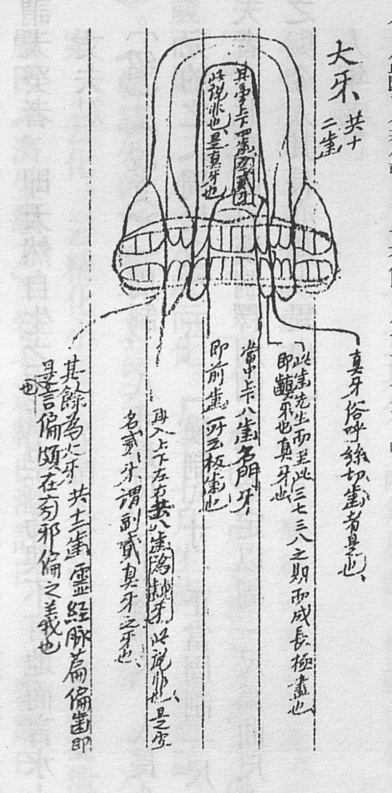

【圖】안어(案語):

그 곁 위아래 네 개를 이아라 한 이 설은 잘못이니, 이것은 진아이다.

진아는 속칭 사절치(絲切齒)라 부르는 것이다. 이 이는 먼저 나서 여기에 이르는데, 21세[三七]·24세[三八]의 시기에 성장이 다한다. 곧 전아(齻牙)이고 진아이다.

가운데 위아래 여덟 개를 문아라 한 것은 곧 앞니로, 이른바 판치(板齒)이다.

다시 안쪽 위아래 좌우 모두 여덟 개를 전아(齻牙)라 한 이 설은 잘못이니, 이것은 이아(貳牙)라 이름해야 한다. 진아를 버금하여 돕는[副貳] 이를 말한다.

나머지를 대아 모두 열두 개라 한 것은 『영(靈)』 「경맥(經脈)」편의 ‘偏齒’가 이것이다. 한쪽으로 치우쳐 곁에 있다는 치우침[邪偏]의 뜻을 말한다.

함부로 힘쓰지 않는다[不妄作勞]｟八ヲ｠

『한시외전』에서 말하였다. “사람에게는 여섯 가지 정이 있다 운운. 그 몸과 사지는 편안하여 힘쓰지 않기를 바란다.”

『백호통』에서 말하였다. “서인(庶人)의 직분은 농사와 누에치기에 있어 힘을 다해 수고롭게 일한다. 배고프면 먹고 배부르면 일하므로 정해진 수가 없다.”

『여씨춘추(呂氏春秋)』에서 말하였다. “수고로운 이는 정신이 흩어진다.”｟『홍결외전초(弘決外典抄)』 2권 15장 뒷면 인용｠

근이 움직일 수 없다[筋不能動]｟十三ヲ｠

안(案): 앞 글에서 “24세[三八]에 근골이 굳세고, 32세[四八]에 근골이 융성하다.”라고 한 것은 모두 신기가 왕성하여 음경이 시들어 약해지지 않음을 말한다. 여기서 ‘七八’에 근(筋)이 움직일 수 없다고 한 것은 음경이 시들고 약해져 뜻대로 움직이지 못함을 말하는 것이지, 움직이지 않는다는 말이 아니다. ‘能’ 한 글자를 자세히 음미해야 한다. “64세[八八]에 근골이 풀어지고 천계가 다한다.”와는 크게 구별된다. 「궐론(厥論)」｟四十五｠에서 “전음(前陰)은 종근(宗筋)이 모이는 곳이다.”라고 하였고, 「위론(痿論)」｟四十四｠에서 “생각이 끝이 없고 원하는 것을 얻지 못하며, 뜻이 밖으로 음란해지고 방사가 지나치면 종근이 늘어져 근위(筋痿)가 되고 백음(白淫)이 된다｟九ウ｠.”라고 하였으며, 또 “양명(陽明)은 오장육부의 바다로서 종근을 적시는 것을 주관하고, 종근은 뼈를 묶어 관절을 원활하게 하는 것을 주관한다｟十ヲ｠.”라고 하였고, 또 “음양의 경맥이 종근에 모두 모여 기가(氣街)에서 만나는데 양명이 그 우두머리가 되며, 모두 대맥(帶脈)에 속하고 독맥(督脈)에 이어진다｟十ウ｠.”라고 하였으니, 모두 증명할 수 있다.

천계(天癸)｟十一ウ｠

『본초강목(本草綱目)』｟五十二｠의 부인월수(婦人月水)｟송(宋) 가우(嘉祐)｠, 월경(月經)｟『소문』｠, 천계(天癸)｟『소문』｠. 시진(時珍)이 말하였다. “여자는 음의 부류로서 혈을 위주로 한다. 그 혈은 위로는 태음(太陰)에 응하고 아래로는 바다의 조수에 응한다. 달에는 차고 이지러짐이 있고 조수에는 아침·저녁이 있는데, 월사(月事)가 한 달에 한 번 행하여 이와 서로 맞으므로 월수(月水)·월신(月信)·월경(月經)이라 한다. ‘經’은 항상이니, 일정한 궤도가 있다는 것이다. 천계란 천일(天一)이 수(水)를 낳는다는 것이다. 사술가(邪術家)가 이를 홍연(紅鉛)이라 하는데, 잘못된 이름이다.”

（眉）보충[補]. 곽상(郭象)은 『장자』에 주를 달아 “‘天’이란 자연을 말한다.”라고 하였다. 정현(鄭玄)은 『예기』에 주를 달아 “‘癸’라는 말은 ‘揆’이니, 만물이 아래에서 품어져 헤아리듯 싹이 튼다.”라고 하였다. 이 두 설에 근거하면 천계는 곧 남녀의 욕정의 구멍이 비로소 열리는 것을 말한다. 장(張)은 “천계는 천일의 음기를 말한다.”라고 하였다. 오(吳)는 “‘癸’는 신수(腎水)이다. 이것이 남자의 정과 여자의 혈로서 천진이 내려 준 것이므로 천계라 한다.”라고 하였다.

기백(岐伯)｟六ウ｠

기백은 『사기』 「봉선서(封禪書)」·「사마상여전(司馬相如傳)」에 보인다. 「사마상여전」의 『집해(集解)』에서 “황제의 태의(太醫)이다.”라고 하였다.

장(漿)｟八ウ｠

『증류(證類)』 권5는 『가우(嘉祐)』를 인용하여 말하였다. “장수(漿水)는 맛이 달고 시며 약간 따뜻하고 독이 없다. 속을 조화시키는 것을 주치한다. 기를 이끌어 퍼지게 하고 조화시키며, 힘을 굳세게 하고 관문을 통하게 하며, 위를 열고 갈증을 멈추며, 곽란·설사·이질을 다스리고 묵은 음식을 소화시킨다. 죽을 쑤어 해 질 녘에 마시면 번조함을 풀고 졸음을 없애며 장부를 조리한다. 좁쌀이 새로 익은 것으로 흰 꽃이 핀 것이 좋다. 달여서 시게 하면 딸꾹질과 구역을 멈추고, 사람의 살결을 비단처럼 희게 한다. 늘 쓰는 것이기 때문에 사람들이 그 공을 대단히 여기지 않는다. 빙장(冰漿)은 지극히 차서 임신부는 먹어서는 안 된다. 『식보(食譜)』에서 꺼리는 것이다.”｟성화본(成化本) 廿一ヲ｠

경신년 정월 그믐, 지원(枳園)이 철하고 풀칠하다.

#### 사기조신대론(四氣調神大論)편 제2

이 편은 전부 『대소』 권2 「순양(順養)」편 끝에 인용되어 있다.

（眉）왕빙(王氷)이 「월령」의 설을 인용한 일은 『의잉(醫賸)』 권상에 보이니 참고해야 한다.

**○春三月，此謂發陳。**

봄 석 달을 발진(發陳)이라 한다.

〔楊〕‘陳’은 묵은 것이다. 봄 석 달에는 초목의 묵은 뿌리와 묵은 씨가 모두 피어나 자란다는 말이다.

**○天地俱生，萬物以榮。**

천지가 함께 생하여 만물이 이로써 무성해진다.

〔楊〕하늘은 아버지이니 덕을 내려 주고, 땅은 어머니이니 기를 대어 준다. 덕과 기가 모두 생하게 할 수 있다. 만물이 덕과 기로부터[目]｟（‘目’은 ‘自’의 잘못인 듯하다）｠ 꽃피어 피어난다.

**○夜臥早起，**

밤에 눕고 일찍 일어나며,

『대소』에는 ‘早’가 ‘蚤’로 되어 있고, 『의심방』 권27의 인용도 같다.

〔楊〕봄 석 달은 담(膽)을 주관하니, 간(肝)의 부(府)인 족소양(足少陽)이 일을 맡는다. 음이 줄고 양이 자라므로, 양을 기르는 이는 밤이 되면 누워서 음이 줄어드는 것을 따른다. ‘蚤’는 ‘早’의 고자(古字)이다. 아침에 일어나 양이 자라는 것을 따른다.

**○廣步於庭。**

뜰을 널찍이 거닌다.

『병원』 권15가 인용한 『양생방(養生方)』에는 ‘廣’이 ‘潤’으로 되어 있다. 살펴보건대[案] 이는 양제(煬帝)의 휘 ‘廣’을 피한 것이다.

**○被髮緩形，以使志生。**

머리를 풀고 몸을 느슨하게 하여 뜻이 생겨나게 한다.

『병원』에는 ‘志’ 위에 ‘春’ 자가 있고, ‘生’이 ‘平’으로 되어 있는데｟송본｠, 아마 음이 같아 잘못된 것이다.

‘生’·‘榮’·‘庭’·‘形’·‘生’은 운이 된다.

〔楊〕뜰을 널찍이 거니는 것은 수고로움으로 뜻을 펴는 것이고, 머리를 풀고 몸을 느슨하게 하는 것은 편안함으로 뜻을 펴는 것이다. 수고로움과 편안함이 중화(中和)에 처하여 생겨나므로, 그 조화로움은 안으로 생을 기르는 것이다.

**○生而勿殺，予而勿奪，**

살리되 죽이지 말고, 주되 빼앗지 말며,

『의심(醫心)』에는 ‘予’가 ‘與’로 되어 있고, 『병원』도 같다.

**○賞而勿罰。**

상을 주되 벌하지 않는다.

세 구는 운이 있는 말이다.

**○此春氣之應，**

이것이 봄기운에 응하는 것이니,

이 아래에 『대소』는 ‘也’ 자가 있고, 『의심』·『병원』도 같다.

**○養生之道也。**

생을 기르는 도이다.

〔楊〕살리고 주고 상 주는 것은 소양(少陽)을 따르는 것이고, 죽이고 빼앗고 벌하는 것은 소양을 거스르는 것이다. 그러므로 따라서 조화를 이루면 밖으로 생을 기르는 것이다. 안팎이 조화롭고 순하니 봄에 응하는 것이다. 이를 따르는 것은 몸을 위해서든 나라를 위해서든 생을 기르는 도이다.

**○逆之｟《大素》無『之』字｠則傷肝，**

이를 거스르면｟『대소』에는 ‘之’ 자가 없다｠ 간(肝)을 상하고,

『대소』에는 ‘傷’ 아래에 ‘於’ 자가 있고, 『병원』도 같다.

**[역1]** 원서 「百病死生」은 「百病始生」의 잘못으로 보인다(『靈樞』의 편명은 「百病始生」이고, 저자도 바로 앞 쪽에서 「百病始生」으로 적었다).

**○夏爲寒變。**

여름에 한변(寒變)이 된다.

『병원(病源)』에는 ‘爲寒變’이 ‘變爲寒’으로 되어 있다. 『대소(大素)』에는 ‘夏爲寒爲變’으로 되어 있다.

（眉）양주(楊注)에 따르면 『대소』 본문의 ‘變’ 아래 ‘爲’ 자는 잘못 들어간 연문(衍文)일 뿐이다.

（眉）안(案): 해마다 봄과 여름 사이에는 역병이 많고, 여름과 가을 사이에는 학질이 많으며, 가을과 겨울 사이에는 설사가 많고, 겨울과 봄 사이에는 궐(厥)이 많으니, 이로써 알 수 있다.

안(案): 여기서 사시(四時)에 병이 된다고 한 대목은 매우 풀기 어렵다. 내 생각으로는 이렇다. 「음양응상대론(陰陽應象大論)」에서 “겨울에 한(寒)에 상하면 봄에 반드시 온병(温病)을 앓는다. 봄에 풍(風)에 상하면 여름에 손설(飧泄)이 생긴다. 여름에 서(暑)에 상하면 가을에 반드시 해학(痎瘧)을 앓는다. 가을에 습(濕)에 상하면 겨울에 해수(欬嗽)가 생긴다.”라고 하였고, 이 글은 「생기통천론(生氣通天論)」에도 나오는데 글이 조금 다르다. 이는 풍·한·서·습이 봄·여름·가을·겨울에 미쳐 그 병의 전변(傳變)이 서로 다름을 가린 것이다. 「금궤진언론(金匱真言論)」에서 “동풍은 봄에 생기니 병이 간수(肝俞)에 있고 경항(頸項)에 있다” 운운, “그러므로 봄기운은 병이 머리에 있다” 운운, “그러므로 봄에는 구뉵(鼽衄)을 잘 앓는다” 운운한 것은 사시의 정기(正氣)가 반드시 그 부위의 경수(經俞)에 적중함을 논한 것이다. 모두 이 조문과는 본디 다르다. 여기서는 사시의 기운에 따라 신(神)을 고르지 않으면 본기(本氣)가 맺히고 굽혀져 오래되면 병이 된다는 것을 말한다. 그 설은 아래와 같다.

안(案): 한변이란 열을 말하니, 한(寒)이 변하면 열이 된다는 것이 이것이다. 밤에 눕고 일찍 일어나는 따위의 여러 양생의 도를 거스르면 간목(肝木)의 유화(柔和)한 영(令)을 잃으므로, 여름의 장양(長養)하는 기운을 받드는 것이 매우 모자라게 된다. 여름이 되어 심화(心火)가 용사(用事)하면 마침내 한변이 발하여 열병이 된다. 대개 봄과 여름에는 양을 길러야 하는데, 양을 기르지 않으면 그 손상이 양분(陽分)에 있어 기표(肌表)가 사기를 받는다. 『병원후론(病源候論)』 권9 「시기병제후(時氣病諸候)」에서 “봄철 양기가 발할 때에 이르러, 겨울철에 잠복한 한이 변하여 온병이 된다.”라고 하였으니, ‘寒變’ 두 글자의 뜻이 이로써 더욱 분명해진다.

〔楊〕간기(肝氣)는 봄에 있으므로, 늦게 자고 일찍 일어나며 몸을 함부로 놀리고 형체를 다그치며 죽이고 빼앗고 벌하는 것은 모두 소양(少陽)을 거스르는 것이다. 거스르면 간을 상하여 여름에 상한열병(傷寒熱病)의 변(變)이 된다. 봄철에 안팎으로 상한 자는 여름의 생장(生長)하는 도를 받드는 것이 모자란다. ［案］이 설은 따를 만하다.

『영추(靈樞)』 「논질진척(論疾診尺)」에서 말하였다. “사시의 변화와 한서(寒暑)의 승함에서, 음이 거듭되면 반드시 양이 되고 양이 거듭되면 반드시 음이 된다. 그러므로 음은 한을 주관하고 양은 열을 주관하니, 한이 심하면 열이 되고 열이 심하면 한이 된다. 그러므로 ‘한이 열을 낳고 열이 한을 낳는다’고 하니, 이것이 음양의 변화이다. 그러므로 말하기를, 겨울에 한에 상하면 봄에 단열(癉熱)이 생기고, 봄에 풍에 상하면 여름에 후설(後泄)과 장벽(腸澼)이 생기며, 여름에 서에 상하면 가을에 해학이 생기고, 가을에 습에 상하면 겨울에 해수(咳嗽)가 생긴다고 하니, 이를 사시의 차례라 한다.”

이는 「음양응상대론」과 「생기통천론」에서 말한 것과 같다. 다만 ‘冬傷於寒，春生癉熱’이라 한 것은 곧 한이 변하여 열이 된다는 뜻이다. 그러므로 여기에 그 전문을 실어 고찰에 보탬이 되게 한다.

（眉）어떤 이는 속이 차서 여러 변증(變證)이 자주 나타나는 것을 말한다고 한다. 『병원』 권20 「냉담후(冷痰候)」에서 “사지가 푸르게 변하고 먹고 마시지 못한다”라고 한 것이 그 증상이다.

（眉）「상한례(傷寒例)」에서 “3월·4월에 혹 갑작스러운 추위가 있으면, 그때는 양기가 아직 약하여 한에 꺾이므로 병의 열이 오히려 가볍다. 5월·6월에는 양기가 이미 성하여 한에 꺾이면 병의 열이 무겁다.”라고 하였으니, 이 또한 한이 변하여 열이 된다는 뜻이다.

**○奉長者少。**

장(長)을 받드는 것이 적어진다.

『대소』에는 ‘奉’ 아래에 ‘生’ 자가 있고, 『병원』도 같다.

〔楊〕간기는 봄에 있으므로, 늦게 자며 형체를｟（‘形’ 위에 ‘緩’이 빠진 듯하다）｠, 늦게 일어나 몸을 함부로 놀리고 형체를 다그친다. 죽이고 빼앗고 벌하는 것은 모두 소양을 거스르는 것이다. 그러므로 몸에서는 거스르면 간을 상하여 여름에 상한열병의 변이 되고, 나라에서는 서리·우박｟반절은 포각반(蒲角反)이다｠과 바람·추위의 재해의 변이 된다. 봄철에 안팎으로 상한 자는 여름의 생장하는 도를 받드는 것이 모자란다.

**○夏三月，此謂蕃秀。**

여름 석 달, 이를 번수(蕃秀)라 한다.

『병원』에는 ‘秀’가 ‘莠’로 되어 있다.

〔楊〕번(蕃)은 음이 代｟（‘代’는 ‘戊’의 잘못인 듯하다）｠元反이니, 무성함이다. 여름 석 달은 만물이 번성하고 무성하게 빼어나 자라는 때이다.

**○天地氣交，萬物華實。**

천지의 기가 사귀어 만물이 꽃피고 열매 맺는다.

『대소』에는 ‘華’가 ‘英’으로 되어 있고, 『병원』도 같다.

〔楊〕음양의 기가 조화되므로 만물이 꽃피어 성하게 열매 맺는다.

**○夜臥早起，**

늦게 눕고 일찍 일어나며,

『의심(醫心)』에는 ‘早’가 ‘蚤’로 되어 있다. 『대소』에는 ‘晚臥蚤起’로 되어 있으니, 따라 고칠 만하다.

대개 만와(晚臥)란 봄철의 야와(夜臥)에 견주어 조금 늦다는 것이다. 어떻게 그런 줄 아는가? 봄의 ‘夜臥早起’에 대해 양주에서는 “밤이 되면 곧 눕는다”라고 하였다. 그런데 이곳의 양주에서는 “여름 석 달은 음이 허하고 양이 가득 차므로 양을 기르는 자는 많이 일어나고 적게 눕는다”라고 하였고, 또 “일찍 눕고 늦게 일어나며 해를 싫어하고 노여움을 내는 것은 모두 태양의 기를 거스르는 것이다”라고 하였으니, ‘早’·‘晚’ 두 글자는 허자(虛字)로 보아야 한다. 그렇지 않으면 ‘早臥晚起’에 이르러 끝내 풀 수 없다.

〔楊〕여름 석 달은 소장(小腸)을 주관하니, 심(心)의 부(府)로서 수태양(手太陽)이 용사한다. 음이 허하고 양이 가득 차므로 양을 기르는 자는 많이 일어나고 적게 눕는다. 늦게 눕는 것은 음이 허함에 따르는 것이고, 일찍 일어나는 것은 양이 가득 참[陽盈實]에 따르는 것이다.

**○無厭於日，**

해를 싫어하지 말고,

『의심』에는 ‘無’가 ‘毋’로 되어 있다.

**○使志無怒，**

뜻을 노하지 않게 하며,

『의심』에는 ‘無’가 ‘莫’으로 되어 있다.

〔楊〕해는 양이므로 싫어해서는 안 된다. 노여움은 음이므로 뜻을 노하지 않게 한다.

**○使華英成秀，**

화영(華英)이 빼어나게 자라도록 하고,

『대소』에는 ‘華’ 자가 없고, 『병원』과 송판(宋板)도 같다. 『의심』에는 ‘華英’이 ‘英華’로 되어 있다.

〔楊〕만물의 꽃이 모두 빼어나게 자라게 한다.

이는 왕주(王注)와 뜻이 같다. 이제 앞뒤 문례로 살펴본다. 봄에 “뜻을 생하게 하여, 살리되 죽이지 말고 주되 빼앗지 말라” 운운한 것은, 그 발생하는 뜻을 넓혀 채워서 천하의 모든 만물을 살리되 죽이지 않고 주되 빼앗지 않으려는 것을 말한다. 여름의 “뜻을 노하지 않게 하고 화영이 빼어나게 자라도록 한다”, 가을의 “뜻을 안녕하게 하여 가을의 형벌을 누그러뜨린다”, 겨울의 “뜻을 엎드린 듯 숨은 듯하게 한다” 운운, “한을 떠나 온으로 나아간다”도 모두 같다. 모두 자기의 뜻을 넓혀 천하의 모든 만물에까지 미치게 함을 말한다.

**○使氣得泄，**

기가 밖으로 빠져나갈 수 있게 하며,

『대소』에는 ‘泄’이 ‘洩’으로 되어 있고 아래도 모두 같으니, 당(唐)의 휘(諱)를 피한 것이다.

〔楊〕만물의 꽃이 모두 빼어나게 자라게 하고, 몸의 주리(腠理)를 열어 기가 통하여 빠져나가게 한다.

**○若所愛在外，此夏氣之應。**

마치 아끼는 것이 밖에 있는 듯이 하니, 이것이 여름 기운에 응하는 것이다.

『대소』에는 ‘應’ 아래에 ‘也’ 자가 있고, 『의심』도 같다.

**○養長之道也。**

장(長)을 기르는 도이다.

『대소』에는 ‘長’이 ‘生’으로 되어 있고, 『의심』도 같다. 살펴보건대[案] ‘生’으로 된 것은 잘못인 듯하다.

〔楊〕안은 음이고 밖은 양이니, 아끼는 것이 모두 양에 있게 하려는 것이다. 이렇게 행하는 것은 태양의 기에 응하는 것이니, 양생(養生)의 도이다.

**○逆之則傷心，秋爲痎瘧。**

이를 거스르면 심(心)을 상하여 가을에 해학(痎瘧)이 된다.

『대소』에는 ‘痎’가 ‘㾬’로 되어 있다.

안(案): 해학은 곧 학(瘧)이다. 『설문(説文)』에 “痎는 이틀에 한 번 발작하는 학질이다”라고 하였다. 설명은 「학론(瘧論)」에 자세하다.

안(案): 봄과 여름에는 양을 길러야 하는데, 이제 여름 기운의 장(長)을 기르는 도를 거스르면 심화가 속에서 굽혀져 펴지 못하고, 가을이 되어 폐금(肺金)이 용사할 때 앞서 속에 굽혀 있던 심화와 서로 다투므로, 한열이 쉬었다 일어났다 하는 병이 발한다.

왕주에서 “‘痎’는 ‘痎瘦’의 학질이다”라고 하였는데, 이는 ‘痎’를 ‘刻’의 뜻으로 본 것이니 옳지 않다.

（眉）성주(成注) 『상한론(傷寒論)』 권2 「음석(音釋)」에 “痎는 음이 개(皆)이니, 학질이다”라고 하였다.

**○奉收者少，｟《大素》『奉』上有『則』字｠冬至重病。**

수(收)를 받드는 것이 적어져｟『대소』에는 ‘奉’ 위에 ‘則’ 자가 있다｠ 겨울에 이르러 병이 무거워진다.

〔楊〕가을의 거두는 도를 받드는 것이 모자라 겨울의 기운을 만나면 열중(熱中)이 되어 병이 무거워진다.

〔識〕［簡按］앞뒤 문례에 따르면 이 네 글자는 군더더기 글인 듯하다.

이 설은 따를 만하다. 다만 이 네 글자에 왕씨·양씨 두 사람이 모두 주해를 달았으니, 예로부터 있던 연문임을 알 수 있다.

〔楊〕일찍 눕고 늦게 일어나며 해를 싫어하고 노여움을 낸다. 꽃을 상하게 하여 빼어나지 못하게 하고 기를 안에 막는 것은 모두 태양의 기를 거스르는 것이다. 그러므로 여름에 거스르면 심을 상하고 가을에 해학(㾬瘧)이 된다. 가을의 거두는 도를 받드는 것이 모자라 겨울의 기운을 만나면 열중이 되어 병이 무거워진다.

**○秋三月，此謂容平。**

가을 석 달, 이를 용평(容平)이라 한다.

〔楊〕여름 기운은 성하게 자라지만 가을에 이르면 성하지도 자라지도 않고 그 열매를 맺으므로 용평이라 한다.

『오행대의(五行大義)』 권4 제19편에서 『녹도(録圖)』를 인용하여 “잘되면 현인이 임용되고 정사와 칭송이 고르다”라고 하였다.

〔高〕여름철에는 성함이 극에 이르고 가을 기운은 느긋하니, 그때는 조용하고 평정하다.

〔識〕［簡按］용(容)은 성(盛)이니 『설문』에 보인다. 곧 담아 받아들인다[盛受]는 뜻이지 가득 차 왕성하다[盛實]는 말이 아니다. 왕씨·마씨·장씨는 모두 ‘容狀’의 容으로 보았는데, 이는 발진(發陳)·번수(蕃秀)·폐장(閉藏)과 본디 뜻이 다르다. 『성제경(聖濟經)』 주에서 “받아들이되 다그치지 않고 고르되 치우치지 않으니, 이를 용평이라 한다”라고 하였는데, 이 설이 옳은 듯하다. 「오상정대론(五常政大論)」에서는 금(金)의 평기(平氣)를 ‘심평(審平)’이라 하였다. 『설원(説苑)』에서 “가을은 하늘의 고름[平]이다”라고 하였다.

안(案): 『설문』에 “容은 盛이다”라고 하였다. ‘盛’ 자는 ‘宬’의 가차(假借)이니, 담아 받아들이는 것이다. ‘容平’이란 받아들여 고르게 함을 말한다.

**○天氣以急，地氣以明。**

천기(天氣)는 급해지고 지기(地氣)는 밝아진다.

（眉）양상선(楊上善)이 말하였다. “천기가 급하다는 것은 바람이 맑고 기가 서늘하다는 것이다. 지기가 밝다는 것은 산천의 경치가 깨끗하다는 것이다.”

「월령(月令)」 맹추(孟秋)에 “천지가 비로소 엄숙해지니, 느슨하게 해서는 안 된다”라고 하였다.

**○早臥早起，**

일찍 눕고 일찍 일어나며,

『대소』에는 두 ‘早’가 모두 ‘蚤’로 되어 있고, 『의심』도 같다.

**○與鷄俱興，**

닭과 함께 일어나고,

『대소』에는 ‘與’가 ‘与’로 되어 있고, 『의심』도 같다. 『의심』에는 ‘俱’가 ‘共’으로 되어 있다.

〔楊〕가을 석 달은 폐장(肺藏)을 주관하여 수태음(手太陰)이 용사한다. 양이 줄고 음이 자라므로, 음을 기르는 자는 닭과 함께 누워 음이 자람에 따르고, 닭과 함께 일어나 양이 줄어듦에 따른다.

안(案): ‘닭과 함께 일어난다’고 하였지만 닭과 함께 눕는다는 뜻이 그 안에 있으니, 곧 일찍 눕고 일찍 일어난다는 뜻이다. 고세식(高世栻)이 “닭과 함께 일어난다는 것은 닭이 누우면 눕고 닭이 일어나면 일어난다는 것이다”라고 한 것은 양주와 은연중에 맞는다.

**○使志安寧，以緩秋刑。**

뜻을 안녕하게 하여 가을의 형(形)을 누그러뜨리며,

『대소』에는 ‘刑’이 ‘形’으로 되어 있고, 『의심』·『병원』과 송판도 같다.

〔楊〕봄의 누그러뜨림은 단단하고 급함을 누그러뜨리는 것이고, 가을의 누그러뜨림은 무성함을 누그러뜨리는 것이므로, 뜻을 편안히 하여 형체를 누그러뜨린다.

안(案): ‘刑’과 ‘形’은 예로부터 많이 통용되었는데, 양씨는 봄의 ‘緩形’에 얽매여 ‘形’ 자에 나아가 설명하였으니 따르기 어렵다. 이는 안녕한 뜻을 넓혀 천지의 가을 기운이 죽이고 치는 급하고 긴박한 형법을 모두 누그러뜨린다는 말이다. 왕주가 옳다.

（眉）재안(再案): ‘緩秋形’이란 가을 기운의 숙살(肅殺)을 타지 않고 뜻을 안녕하게 하여 가을의 형(形)을 누그러뜨린다는 말이다. 그러나 봄의 ‘被髮緩形’과는 본디 같지 않으니, “신기를 거두어 가을 기운을 고르게 한다” 운운한 것이 봄과 가을의 緩形이 갈리는 곳이므로 융통성 있게 보아야 한다.

**○收斂神氣，使秋氣平。**

신기(神氣)를 거두어 가을 기운을 고르게 하고,

〔楊〕여름날에는 신기가 크게 흩어지므로 이를 거두어 가을 기운에 따라 조화롭고 고르게 한다.

**○無外其志，**

그 뜻을 밖으로 내보내지 말며,

『의심』에는 ‘無’가 ‘毋’로 되어 있다.

**○使肺氣清，**

폐기(肺氣)를 맑게 한다.

『대소』에는 ‘清’이 ‘精’으로 되어 있고, 『의심』도 같다.

‘平’·‘明’·‘寧’·‘刑’·‘平’·‘清’은 압운하니, 대개 ‘容平’의 ‘平’을 이어받아 운을 일으킨 것이다.

〔楊〕뜻을 거두고 음을 보존하여 폐기가 섞임이 없게 하니, 이것이 가을 기운에 응하여 음을 기르는 도이다.

‘無雜’ 두 글자로 살펴보면 ‘精’으로 된 것이 옳은 듯하다. 그러나 옛날에는 ‘清’과 ‘精’이 많이 통용되었고, 그 뜻도 둘 다 통한다.

**○此秋氣之應。**｟《大素》此下有『也』字，《醫心方》《病源》同。｠

이것이 가을 기운에 응하는 것이다.｟『대소』에는 이 아래에 ‘也’ 자가 있고, 『의심방(醫心方)』·『병원』도 같다.｠

**○養收之道也。逆之則傷肺，冬爲飧泄，**｟《大素》作『湌洩』｠

수(收)를 기르는 도이다. 이를 거스르면 폐(肺)를 상하여 겨울에 손설(飧泄)이 되니,｟『대소』에는 ‘湌洩’으로 되어 있다｠

〔楊〕『대소』 권3 첫머리에 “湌은 물에 만 밥이다. 음은 손(孫)이다. 장위(腸胃)에 풍이 있어 수곡이 소화되지 않고 나오는 것을 말한다”라고 하였다.

안(案): 가을과 겨울에는 음을 길러야 하는데, 이제 가을 기운을 거스르면 폐금이 맑지 못하여 습사(濕邪)가 안으로 들어가므로, 겨울이 되어 신수(腎水)가 용사할 때 손설로 음식이 소화되지 않는 증상이 생긴다. 제17에서 “오래된 풍이 손설이 된다”라고 하였으니 함께 살펴볼 만하다.

〔識〕『옥편(玉篇)』에 “飧은 물에 만 밥이다”라고 하였고, 『석명(釋名)』에 “飧은 흩어짐[散]이다. 물을 그 안에 부으면 저절로 풀어 흩어진다”라고 하였으며, 『열자(列子)』 「설부(説符)」 주에 “飧은 물을 끼얹은 밥이다”라고 하였다. 대개 수곡이 섞여 내려가는 것이 물에 만 밥과 같으므로 손설이라 한다.

안(案): 『설문』에 “飧은 餔이다”, “餔는 신시(申時)의 식사이다”라고 하였다. 「벌단(伐檀)」의 정의(正義)에서 『설문』을 인용하여 “飧은 물을 끼얹은 밥이다”라고 하였고, 『석문(釋文)』에서 『자림(字林)』을 인용하여 “飧은 물을 끼얹은 밥이다”라고 하였으며, 『예기(禮記)』 「옥조(玉藻)」 소(疏)에 “飧은 마실 것을 그릇 안의 밥에 끼얹는 것을 말한다”라고 하였다. ‘飱’은 속자로 ‘飧’·‘湌’·‘飡’으로 쓰다가 마침내 ‘餐(삼킨다)’ 자와 섞였으니, 바로잡아야 한다. 『외대(外臺)』 권39에서 『갑을(甲乙)』을 인용하여 “거허상렴(巨虛上廉)은 湌泄로 미음 같은 것이 나오는 것을 주치한다”라고 하였는데, 이른바 ‘出麋’는 수곡이 섞여 내려가는 것을 말한다. ‘飱’을 ‘飧’으로 쓴 것은 획을 더한 예[增畫之例]일 뿐이다.

〔紹〕［楊曰］喰은 음이 손(孫)이니, 음식이 소화되지 않아 물에 만 밥처럼 설사하는 것을 말한다. 『대소』 권2 「순양편(順養篇)」 주이다.[역1]

**○奉藏者少。**

장(藏)을 받드는 것이 적어진다.

『대소』에는 ‘奉’ 위에 ‘則’ 자가 있고, ‘藏’이 ‘養’으로 되어 있다.

〔楊〕늦게 눕고 늦게 일어나며 뜻이 편안하지 않은 것은 가을철에 태음의 기를 거스르는 것이다. 가을에 폐를 상하면 겨울에 손설(飱洩)이 되니, 겨울의 기르는 도를 받드는 것이 적다.[역2]

**○冬三月，此謂閉藏。**

겨울 석 달, 이를 폐장(閉藏)이라 한다.

『대소』에는 ‘閉’ 위에 ‘氣’ 자가 있고, 『의심』도 같다.

「월령」에 “천기는 위로 오르고 지기는 아래로 내려가, 천지가 통하지 않고 막혀서 겨울이 된다”라고 하였다.

〔楊〕음기는 밖에서 닫히고 양기는 안에 갈무리된다.

**○水冰地坼**｟〔楊〕勅白反，分也。｠

물이 얼고 땅이 갈라진다.｟〔楊〕음은 칙백반(勅白反)이니, 갈라진다는 뜻이다.｠

『의심』에는 ‘冰’이 ‘氷’으로 되어 있다.

**○無擾乎陽，**

양을 어지럽히지 않으니,

『대소』에는 ‘無’가 ‘毋’로, ‘乎’가 ‘于’로 되어 있고, 『의심』도 모두 같다.

〔楊〕음분(陰分)에 머물므로 양을 어지럽히지 않는다는 말이다.

「월령」 맹동(孟冬)에 “물이 비로소 얼고 땅이 비로소 언다”, 중동(仲冬)에 “얼음이 더욱 단단해지고 땅이 비로소 갈라진다”라고 하였다.

안(案): ‘無擾乎陽’을 제가(諸家)는 모두 왕주를 따라 사람의 일로 보았는데, 오직 고세식만 “양을 어지럽히지 않는다는 것은 지기가 굳게 갈무리되어 하늘로 오르지 않는다는 것이다”라고 하였으니, 글로 보아 당연하다. 양상선이 “음분에 머물므로 양을 어지럽히지 않는다는 말이다”라고 한 것도 사람의 일을 가리킨 것이 아닌 듯하니, 고세식의 설을 따라야 한다.

**○早臥晚起，必待日光，**

일찍 눕고 늦게 일어나되 반드시 햇빛을 기다리며,

『대소』에는 ‘早’가 ‘蚤’로 되어 있고, 『의심』도 같다. 살펴보건대[案] ‘藏’·‘陽’·‘光’은 운어(韻語)이다.

〔楊〕겨울 석 달은 신장(腎藏)을 주관하여 족소음(足少陰)이 용사한다. 양이 허하고 음이 가득 차므로 음을 기르는 자는 많이 눕고 적게 일어난다. 일찍 눕는 것은 양이 허함에 따르는 것이고, 늦게 일어나는 것은 음이 가득 참에 따르는 것이다.

**○使志若伏若匿，**

뜻을 엎드린 듯 숨은 듯하게 하며,

『대소』에는 ‘若匿’의 ‘若’이 없고, 『의심』·『병원』도 같으니, 지금 판본은 아마 우연히 잘못된 것이다.

〔楊〕복닉(伏匿)은 고요함이다. 음분에서 잠을 다 자서 뜻을 고요하게 한다.

안(案): ‘伏匿’을 빨리 읽으면 ‘伏’이 되니, 복닉이란 엎드림[伏]을 말한다.

**○若有私意，若已有得。**

사사로운 뜻이 있는 듯, 이미 얻은 것이 있는 듯하게 하고,

『대소』에는 ‘得’이 ‘德’으로 되어 있고, 『의심』도 같다.

**○去寒就温，**

한(寒)을 떠나 온(温)으로 나아가며,

안(案): 이 네 글자는 오로지 사람의 일만 가리키는 것이 아니다. 천지만물이 모두 이와 같아야 하니, 곧 음을 기르는 이치이다. 사시의 ‘使志’ 운운 아래 구절도 모두 같은 예이다.

〔楊〕11월에는 음이 가고 양이 오므로, 음을 기르는 자는 사사로운 뜻과 얻은 것이 있으면 모두 음과 함께 떠나보내고 양을 따라 와서 서로 어지럽힘이 없게 한다는 말이다.

**○無泄皮膚，**

피부로 새어 나가게 하지 말아,

『대소』에는 ‘無泄’이 ‘毋洩’으로 되어 있다.

**○使氣亟奪，**

기가 새어 다하지 않게 한다.

『대소』에는 ‘使氣不極’으로 되어 있으니 따를 만하고, 압운도 맞는다. 『의심』에는 ‘使氣極’으로 인용되어 있으니, ‘不’ 자가 빠진 듯하다.

〔楊〕모든 주리를 닫아 기가 새어 다하지 않게 한다. 이렇게 행하는 것은 겨울 신기(腎氣)의 갈무리를 기르는 도에 응하는 것이다.

안(案): 「월령」 중동에 “군자는 재계하고, 거처할 때는 반드시 몸을 가린다. 몸을 편안히 하려고 성색(聲色)을 멀리하고 기욕을 금하며 형체와 성정을 안정시키고, 일을 고요히 하려고 음양이 정해지기를 기다린다”라고 하였고, 「상한례」에 “겨울철 혹한에는 만물이 깊이 갈무리되니, 군자가 주밀하면 한에 상하지 않는다”라고 하였으며, 『의심방』 권27에서 『천금방(千金方)』을 인용하여 “겨울철에는 천지가 닫히고 혈기가 갈무리된다. 사람이 힘써 일하여 땀을 내서 양기를 밖으로 새게 해서는 안 되니, 사람을 손상한다”라고 하였으니, 모두 이것과 뜻이 같다.

**○此冬氣之應，**

이것이 겨울 기운에 응하는 것이니,

『대소』에는 ‘應’ 아래에 ‘也’ 자가 있고, 『의심』·『병원』도 같다.

**○養藏之道也。**

장(藏)을 기르는 도이다.

〔楊〕모든 주리를 닫아 기가 새어 다하지 않게 한다. 이렇게 행하는 것은 겨울 신기에 응하는 것이니, 음을 기르는 도이다.

**○逆之則傷腎，春爲痿厥，**

이를 거스르면 신(腎)을 상하여 봄에 위궐(痿厥)이 되니,

『병원』에는 ‘痿’가 ‘萎’로 되어 있다.

（眉）앞의 예에 따르면 이 ‘痿厥’도 한 가지 병이니, 대개 그 장부가 위약(痿弱)하므로 궐이 밖으로 나타나는 것이다. 오늘날 평소 겨울과 봄 사이에 내열이 거슬러 올라 이명(耳鳴)과 目𦚣이 있고 간울(肝鬱)·기역(氣逆) 등이 있는 것은 모두 위궐이다. 이 사시의 병은 모두 늘 있는 것이다.[역3]

**○奉生者少。**

생(生)을 받드는 것이 적어진다.

『대소』에는 ‘則奉生少也’ 다섯 글자로 되어 있다.

안(案): 겨울에 장(藏)을 기르는 도를 거스르면 양기가 소모되어 빼앗기고 신수가 운화(運化)의 작용을 잃는다. 그러므로 봄이 되어 간목이 용사할 때 근락(筋絡)이 영양을 받지 못하여 마침내 위궐의 증상이 된다.

안(案): 이상은 사시의 상기(常氣)에 따라 사람의 신(神)을 고르는 것을 말한다.

（眉）이상이 제1장이다.

〔楊〕일찍 일어나고 늦게 누워 햇빛을 기다리지 않아 지기(志氣)가 밖으로 새면, 겨울에 거스른 것이다. 신을 상하여 위궐이 되니, 봄의 생을 기르는 도를 받드는 것이 적다. 위궐은 걷지 못하는 것이니, 일설에는 편고(偏枯)라고 한다. 음은 어위반(於危反)이다.

**○天氣清淨，**

천기는 청정(清淨)하여,

『대소』에는 ‘淨’이 ‘靜’으로 되어 있다. 살펴보건대[案] 『설문』에 “靜은 宷(살핌)이다”, “瀞은 때와 더러움이 없음이다”라고 하였다. 대개 ‘靜宷’의 전주(轉注)가 ‘清靜’이 되었다. ‘瀞’ 자는 도리어 뒤늦게 나온 속전(俗篆)이다. 예서에서 줄여 ‘淨’으로 쓴 것인가, 아니면 ‘靜’ 자가 위의 ‘清’ 자에 끌려 ‘淨’이 된 것인가.

**○光明者也。**

광명한 것이다.

안(案): 청정은 하늘의 푸르름을 말하고, 광명은 해·달·별을 말한다.

（眉）『예기』 「공자한거(孔子間居)」에서 말하였다. “공자가 말하였다. ‘하늘에는 사시가 있으니 봄·가을·겨울·여름이요, 바람·비·서리·이슬이 가르침 아닌 것이 없다. 땅은 신기(神氣)를 싣고 있으니, 신기와 풍정(風霆)이 흘러 형체를 이루어 뭇 만물이 드러나 생겨나니, 가르침 아닌 것이 없다. 청명함이 몸에 있으면 기와 뜻이 신과 같다. 기욕이 이르려 할 때에는 반드시 먼저 열림이 있으니, 하늘이 때맞춰 비를 내리고 산천이 구름을 낸다’” 운운.

（眉）안(案): 이것도 사람과 하늘이 한 이치라는 설로서 본론과 뜻이 같으므로 여기에 기록한다.

〔楊〕천도의 기는 맑고 비어 볼 수 없고, 편안하고 고요하여 무엇을 할 수 없으므로, 삼광(三光)과 칠요(七耀)의 광명을 얻는 것이다. 현원황제(玄元皇帝)가 “허정(虛靜)은 하늘의 밝음이다”라고 하였다.

**○藏德不止，**

덕을 갈무리하여 드러내 높이지 않는다.

『신교정(新校正)』에서 별본을 인용하여 ‘止’가 어떤 본에는 ‘上’으로 되어 있다고 하였고, 『대소』에도 ‘上’으로 되어 있으니, 따라 고쳐야 한다.

**○故不下也。**

그러므로 낮아지지 않는다.

『대소』에는 ‘也’ 자가 없다.

〔楊〕하늘은 해와 달을 베풀고 별을 늘어놓으며 사시를 펼치고 음양을 고른다. 낮에는 볕으로 쬐고 밤에는 쉬게 하며, 바람으로 말리고 비와 이슬로 적신다. 만물을 낳을 때에는 기르는 바를 볼 수 없는데도 만물이 자라고, 죽일 때에는 잃게 하는 바를 볼 수 없는데도 만물이 없어진다. 이를 일러 천도가 덕을 갈무리하여 드러내 높이지 않으므로 낮아지지 않는다고 한다.

안(案): 왕주본도 ‘不上’으로 되어 있었던 듯하니, 따로 ‘不止’에 대한 풀이가 없으므로 그런 줄 안다. 장개빈(張介賓)이 “하늘의 덕이 드러나지 않으므로 장덕(藏德)이라 하고, 굳세게 운행하여 쉬지 않으므로 부지(不止)라 한다”라고 한 것은 이치로는 조금 통하는 듯하다. 그러나 ‘不下’에 이르러서는 통하지 않는다.

〔楊〕성인은 이를 본받아, 복을 일으킬 때에는 그렇게 한 까닭을 보이지 않아도 복이 일어나고, 화를 없앨 때에는 말미암은 바를 보이지 않아도 화가 없어지니, 이는 성인이 덕을 갈무리하여 드러내 높이지 않으므로 낮아지지 않는 것이다. 현원황제가 “상덕(上德)은 덕을 내세우지 않으니, 그러므로 덕이 있다”라고 한 것이 바로 그 일이다.

**○天明則日月不明，邪害空竅。**

하늘이 스스로 밝음을 드러내면 해와 달이 밝지 못하고, 사기가 공규(空竅)를 해친다.

〔楊〕임금이 마음을 자기에게 두어 사사로이 덕을 닦으면 도리어 덕이 되지 못한다. 현원황제가 “하덕(下德)은 덕을 잃지 않으려 하니, 그러므로 덕이 없다”라고 하였다. 임금에게 덕이 없으면 해와 달이 박식(薄蝕)하여 삼광이 밝지 못하게 된다.

『대소』에는 ‘天明’이 ‘上下’로, ‘邪’가 ‘耶’로 되어 있다.

안(案): 공규는 곧 공혈(孔穴)이다. ‘空’은 음이 공(孔)이다.

안(案): ‘天明’이란 하늘이 덕을 갈무리하지 않음을 말하니, 앞 글의 ‘光明’과는 뜻이 다르다. 하늘이 덕을 갈무리하지 않으면 해와 달이 밝지 못하다. 뒤 글에서 “운무(雲霧)가 개지 않으면 위로 응하여 백로(白露)가 내리지 않는다” 운운한 것이 이것이다. 이때를 당하여 사기가 사람의 공규를 상하게 하는 일이 있으니, 곧 적사(賊邪)이다. 양상선이 “공규는 365혈을 말한다. 자려(疵癘)와 적풍(賊風)이 사람의 공규로 들어가 사람을 상해한다”라고 한 것이 이것이다.

〔楊〕공규는 365혈을 말한다. 임금이 덕을 닦아 양기를 조화시키지 않으면, 자려와 적풍이 사람의 공규로 들어가 사람을 상해한다.

**○陽氣者閉塞，地氣者冒明。**

양기는 닫혀 막히고, 지기는 밝음을 덮어 가린다.

『대소』에는 두 ‘者’ 자가 없는데 옳은 듯하다. ‘冒’는 ‘胃’로 잘못되어 있고, ‘閉’는 ‘閇’로 되어 있다.

〔楊〕양기가 조화를 잃으므로 음기가 삼광을 덮어 가리게 한다.

안(案): 왕주는 사람의 일로 보았는데 잘못인 듯하다.

**○雲霧不精，則上應白露不下。**

운무가 개지 않으면 위로 응하여 백로가 내리지 않는다.

『대소』에는 ‘霧’가 ‘露’로, ‘白’이 ‘甘’으로 되어 있는데 모두 잘못이다.

안(案): ‘精’은 ‘晴’과 통한다. 대개 운무가 개지 않는다는 것은 지기가 밝음을 가림을 말하고, 백로가 내리지 않는다는 것은 양기가 닫혀 막힘을 말한다. 왕주는 ‘精’ 자에 나아가 설명하였으니 옳지 않다.

**○交通不表，**

천지의 교통(交通)이 드러나지 않으므로,

〔楊〕음기가 조화를 잃어 구름과 이슬에 윤택한 정기가 없게 되고, 덕이 없어 하늘에 응하지 못하여 마침내 감로(甘露)가 내리지 않으니, 음양이 조화되지 못한다. 감로라고 한 것은 후대에 글자가 잘못된 듯하다.

**[역1]** 원서대로 옮겼다. 앞서 인용한 양상선 주에는 같은 자리가 「湌」으로 되어 있어 같은 말의 다른 표기일 수 있다.
**[역2]** 원문 끝의 「之」는 뜻이 드러나지 않아 옮기지 않았다(『太素』 청대 초본 판독에도 「少也」 뒤에 「之」가 이어진다).
**[역3]** 원서대로 옮겼다. 「𦚣」은 글자 뜻이 확인되지 않으며, 문맥상 눈의 증상을 가리킨다.

**○萬物命故不施，**

만물의 명(命)이 베풀어지지 않으며,

〔楊〕음양이 서로 교통하지 못하면 한가운데에서 나누어 주는 명[一中分命]이 펼쳐 드러날 길이 없어 만물에 생겨나지 못하고, 덕택이 드러나지 않으므로 베풀어지지 않는다고 한다.

**○不施則名木多死。**

베풀어지지 않으면 이름난 나무[名木]가 많이 죽는다.

‘施’·‘死’는 압운한다.

안(案): ‘故’ 자는 ‘表’ 자 아래로 옮겨서 보아야 하니, 이 또한 고문(古文)의 한 가지 법일 뿐이다. ‘施’ 자는 왕주(王注)에 따로 풀이가 없고, 두 장씨는 모두 시화(施化)의 뜻으로 보았는데 따를 만하다. 명목(名木)이란 그 열매를 먹을 수 있는 여러 나무를 말하니, 나무를 말하면 풀은 그 안에 들어 있다. 지금도 복숭아·오얏이 열매 맺지 않는 해에는 오곡도 풍성하지 않으니, 이는 천기(天氣)가 저절로 그렇게 하는 것이다. 양상선(楊上善)이 “이름난 좋은 초목이 누렇게 되지도 않았는데 떨어지는 것을 말한다”라고 하였고, 왕주에서 “명(名)은 이름난 과일과 진귀한 나무를 말한다”라고 하였으니, 모두 증거로 삼을 수 있다. 「기교변대론(氣交變大論)」에 “토(土)의 운이 모자라는 해에는 명목이 푸른 채 시든다”라고 하였고, 「오상정대론(五常政大論)」에 “금(金)의 운이 지나친 해에는 명목이 무성하지 못하다”라고 하였으며, 「육원정기론(六元正紀論)」에 “명초(名草)의 윗부분이 마른다”라고 하였다.

（眉）〔楊〕‘名木多死’ 이하를 여덟 가지로 나누었다.

（眉）「오상정론(五常政論)」에 “정사가 사납게 변하면 명목이 무성하지 못하다”라고 하였다.

**○惡氣不發，**｟《大素》無『不』字。｠**風雨不節，白露不下，**｟《大素》『白』作『甘』。｠**則菀稾不榮。**｟《大素》『稾』作『槁』，是。｠

악기(惡氣)가 발하고｟『대소(大素)』에는 ‘不’ 자가 없다.｠, 바람과 비가 절도를 잃으며 백로(白露)가 내리지 않으면｟『대소』에는 ‘白’이 ‘甘’으로 되어 있다.｠ 풀과 곡식이 시들어 말라[菀稾] 무성하지 못하다.｟『대소』에는 ‘稾’가 ‘槁’로 되어 있는데, 옳다.｠

안(案): 『대소』에는 ‘惡氣發’로 되어 있어 ‘不’ 자가 없는데, 옳은 듯하다. 대개 악기가 발한다는 것은 천지가 막힐 때에 반드시 온갖 만물을 상해하는 기운이 발해 나옴을 말한다. 양상선이 “독기와 자려(疵癘)가 나라에 유행하는 것을 말한다”라고 한 것도 악기의 한 가지일 뿐이다. ‘바람과 비가 절도를 잃고 백로가 내리지 않는다’는 것은 앞 글의 ‘운무가 개지 않아 백로가 내리지 않는다’와 뜻이 같다.

입지안(立之案): ‘宛’은 ‘薀’·‘鬱’과 소리와 뜻이 모두 통하므로, 『방언(方言)』에 “宛은 쌓음[蓄]이다”라고 하였다. ‘菀稾’는 ‘名木’과 짝을 이루어 오로지 풀과 곡식을 말한다. ‘菀’은 곧 ‘宛’의 속자로서 艸 머리를 더한 것이니, 자완(紫菀)의 글자와는 본디 다르다. 「위풍(魏風)」 전(傳)에 “宛은 피하는 모양이다”라 하였고, 「당풍(唐風)」 전에 “宛은 죽은 모양이다”라 하였다. 『회남자(淮南子)』 「숙진훈(淑真訓)」의 ‘形苑而神壯’에 대한 주에 “苑은 마르고 병든 것이다”라 하였다. 이 ‘苑’도 ‘宛’의 가차자로서 宀을 艸로 바꾼 것이니, 모두 『설문(説文)』의 “宛은 풀을 굽혀 스스로 덮는 것이다”의 전주(轉注)이다. 艸를 더한 것은 菟·蕕·炳·蓫·積·萇 따위의 예와 같을 뿐이다. ‘菀稾’는 말라 죽음을 말한다. 양상선이 “‘菀槁’는 ‘宛槁’가 되어야 한다. 宛은 시들어 죽음이고 槁는 마름이다. 음은 어완반(於阮反)이다. 묵은 뿌리와 오래된 가지가 죽어서 무성하지 못하다”라고 하였는데, 이 설은 따를 만하다.[역1]

（眉）‘不發’은 ‘丕發’의 차자(借字)이니, 곧 크게 발한다는 뜻이다. 또 살펴보건대[又案] ‘不’은 조자(助字)의 말로서 ‘不湣’·‘不診’의 ‘不’과 같다고 보아도 통한다. ‘不’ 자를 조자와 실자(實字)로 이어 쓴 것이 『가어(家語)』 「상로(相魯)」 제1에 보이는데, 이 글과는 문례가 반대이면서 비슷하다.

（眉）『영(靈)』 「위기실상(衛氣失常)」편에 “축적된 것이 돌지 않고, 울온(苑蘊)된 것이 제자리를 얻지 못한다”라고 하였다.

（眉）「소오과론(疏五過論)」의 ‘五藏菀熟’에 대한 왕주에 “菀은 쌓임이요, 熟은 열이다”라고 하였다.

『가어』 「예운(禮運)」의 ‘事大積焉而不苑’에 대한 왕숙(王肅)의 주에 “苑은 막히고 쌓임이다”라고 하였다.

**○賊風數至，暴雨數起，天地四時不相保，與道相失，**｟《大素》『與』作『乃』。｠**則未央絶滅。**

적풍(賊風)이 자주 이르고 폭우가 자주 일어나며, 천지와 사시가 서로 지켜 주지 못하고 도와 서로 어긋나면｟『대소』에는 ‘與’가 ‘乃’로 되어 있다.｠ 오래지 않아 끊어져 멸한다.

‘至’·‘起’·‘失’·‘滅’은 운이 된다.

안(案): 적풍과 폭우란 바람과 비가 절도를 잃음을 말하니, 허사적풍(虛邪賊風)의 뜻과는 본디 다르다.

삽강주재(澀江籀齋)가 “『설문』에 ‘央은 오램이다’라고 하였다. 『광류정속(匡謬正俗)』에 ‘未央이란 아직 중간에 이르지 않았고 아직 오래되지 않았다는 말이다’라고 하였다”라고 하였는데, 따를 만하다. 양상선이 未央을 ‘오래다’로 푼 것은 잘못이다.

〔楊〕도과(盜夸)한 임금의 덕이 베풀어지지 않으면 화가 곤충에 미치고 재앙이 초목에 뻗으니, 그것이 여덟 가지이다. 첫째는 명목이 많이 죽는 것이니, 이름난 좋은 초목이 누렇게 되지도 않았는데 떨어지는 것을 말한다. 둘째는 악기가 발하는 것이니, 독기와 자려가 나라에 유행하는 것을 말한다. 셋째는 바람과 비가 절도를 잃는 것이니, 바람이 때 아니게 일고 구름이 모이지 않았는데 비가 오는 것을 말한다. 넷째는 감로(甘露)가 내리지 않는 것이니, 조화로운 진액이 베풀어지지 않음을 말한다. ‘菀槁’는 ‘宛槁’가 되어야 한다. 宛은 시들어 죽음이고 槁는 마름이다. 음은 어완반이다. 묵은 뿌리와 오래된 가지가 죽어서 무성하지 못한 것이다. 다섯째는 적풍이 자주 이르는 것이니, 바람이 충(衝)의 방위에서 불어와 집을 부수고 나무를 꺾어, 먼저 허한 자가 그 해를 입어 죽는 것을 말한다. 여섯째는 폭우가 자주 일어나는 것이니, 갑자기 쏟아지는 비가 여러 곡식의 싹을 상하게 하는 것을 말한다. 일곱째는 천지와 사시가 서로 지켜 주지 못하는 것이니, 음양이 어그러져 추위와 더위에 절도가 없는 것을 말한다. 여덟째는 도를 잃어 미앙(未央)에 끊어져 멸하는 것이다. 未央이란 오래라는 뜻이니, 도과한 임금이 끊어져 멸함이 바야흐로 오래감을 말한다.

**○唯聖人從之，**｟《大素》『從』作『順』。｠**故身無奇病。**｟《大素》『病』作『疾』。｠**萬物不失，生氣不竭。**

오직 성인만이 이를 따르므로｟『대소』에는 ‘從’이 ‘順’으로 되어 있다.｠ 몸에 기이한 병이 없고｟『대소』에는 ‘病’이 ‘疾’로 되어 있다.｠, 만물을 잃지 않으며 생기(生氣)가 다하지 않는다.

‘疾’·‘失’·‘竭’은 운이 된다.

안(案): 이상은 사시의 변기(變氣)에 따라 또한 사람의 신(神)을 고르는 것을 말한다.

〔楊〕오직 성인만이 하늘에 순응하여 덕을 갈무리하고 그치지 않으므로 세 가지 덕이 있다. 첫째는 몸에 기이한 병이 없는 것이니, 기이한 사기가 몸에 미치지 않는다. 둘째는 만물을 잃지 않는 것이니, 은택이 곤충에 미치고 은혜가 초목을 적셔 저마다 생장한다. 셋째는 생기가 다하지 않는 것이다. 생기는 화기(和氣)이다. 화기가 다하지 않으면 구름과 이슬이 정윤(精潤)하여 감로가 때맞춰 내리게 된다.

안(案): 「생기통천론(生氣通天論)」에서 “창천(蒼天)의 기가 청정하면 뜻이 다스려진다. 이에 따르면 양기가 견고하여 비록 적사(賊邪)가 있더라도 해칠 수 없다. 이는 때의 차례에 말미암은 것이다”라고 하였으니, 여기서 ‘성인이 이를 따른다’고 한 것과 바로 뜻이 같다.

（眉）‘天氣清淨’에서 ‘生氣不竭’까지를 『소문식(素問識)』에서는 이미 착간된 글로 보았다. 도변규보(渡邊奎輔)는 “「생기통천론」의 ‘陽氣者，若天與日’ 위로 옮겨 넣으면 글의 이치가 비로소 순해진다”라고 하였으니, 이것도 한 설이다.

（眉）이상이 제2장이다.

**○逆春氣，則少陽不生，｟《大素》『生』下有『而』。｠肝氣内變。**

봄 기운을 거스르면 소양(少陽)이 생하지 못하여｟『대소』에는 ‘生’ 아래에 ‘而’가 있다.｠ 간기(肝氣)가 안에서 변한다.

〔楊〕소양은 족소양 담부(膽府)의 맥으로 밖이 된다. 간장(肝藏)은 음이 되어 안에 있다. 그러므로 부의 기가 생하지 못하고 장의 기가 변한다.

〔思聰〕（‘思’는 ‘志’로 써야 할 듯하다）앞에서는 받드는 것이 적어 그 장이 낳는 장이 병을 받는 것을 논하였고, 여기서는 사시의 기를 거슬러 그것이 주관하는 장의 기도 스스로 병드는 것을 논하였다.

안(案): 내변(内變)이란 간기가 발생하지 못하고 안에서 울결되어 변하는 것을 말한다. 『외대(外臺)』 권16에서 『산번(刪繁)』을 인용한 치간로실열방(治肝勞實熱方) 가운데 “기가 거슬러 올라 내려가지 않고 가슴속이 그득하고 막힌다” 및 “협하(脇下)가 당기고 소변이 어렵다” 등의 글이 있고, 또 치간로허열방(治肝勞虛熱方) 가운데 “번민(煩悶)하여 몸을 뒤척이고 열기가 가슴속에서 활활 타오른다” 및 “정신을 지키지 못하고 기가 거슬러 오르며 가슴의 열이 활활 그치지 않는다” 등의 말이 있으니, 모두 간울내변(肝鬱内變)의 증상이다. 지금 환자에게서 겪어 보아도 늘 이러한 증상이 있다. 대개 간은 혈을 갈무리하고 혼(魂)을 주관하며 희로(喜怒)가 여기에 매여 있으니, 간기가 거슬러 오르면 그 허실에 따라 내증(内證)이 온갖 꼴로 나타난다. 다만 이 ‘變’ 한 글자에 얼마나 많은 증후가 담겨 있는가.

**○逆夏氣，則太陽不長，心氣内洞。**

여름 기운을 거스르면 태양(太陽)이 자라지 못하여 심기(心氣)가 안에서 치받는다[内洞].

『대소』에는 ‘太’가 ‘大’로 되어 있다.

〔楊〕대양은 수대양 소장부(小腸府)의 맥으로 밖에 있다. 심장(心藏)은 음이 되어 안에 있다. 그러므로 부의 기가 생하지 못하고 장의 기가 안에서 통(洞)하니, 통이란 빠르게 흘러 새는 것이다.

아들 약지(約之)가 말하였다. 洞은 곧 衝의 가차이니, 『영추(靈樞)』에서 말한 ‘洞心’과 뜻이 같다. 『영추』 「오미(五味)」 제63에서 “매운맛은 기로 달려가니 많이 먹으면 사람으로 하여금 洞心하게 한다. 황제가 말하였다. ‘매운맛은 기로 달려가 사람으로 하여금 洞心하게 하는 것은 어째서인가?’ 소유(少俞)가 말하였다. ‘매운맛이 위에 들어가면 그 기가 상초로 달려간다. 상초는 기를 받아 여러 양을 영양하는 곳이다. 생강과 부추의 기가 이를 훈증하면 영위의 기가 제때 받지 못하여 오래도록 심하에 머무르므로 洞心한다. 매운맛은 기와 함께 다니므로 매운맛이 들어가면 땀과 함께 나온다’”라고 하였으니, 이는 ‘内洞’과 뜻이 같다. 洞은 대개 치받아 아프다[衝痛]는 뜻이니, 洞心은 衝心과 같다. 「금궤진언론(金匱真言論)」에서 “중하(仲夏)에는 흉협(胸脇)의 병을 잘 앓는다”라고 하였고, 왕주에서 “심의 맥이 흉협을 따라 돌기 때문이다”라고 하였으니, 증거로 삼을 수 있다. ‘衝’은 혹 ‘憧’으로 쓴다. 『천금(千金)』 권14 「풍허경계(風虛驚悸)」 제6 보심탕(補心湯) 조에 “경계(驚悸)로 심중이 憧憧하고 가슴이 그득하여 음식을 넘기지 못한다”라고 하였고, 『외대』 권12 「분돈기방(賁㹠氣方)」편에서 『소품(小品)』의 분돈탕(奔㹠湯) 조를 인용하여 “떠도는 기가 위로 돌아가는데, 위로 달릴 때 마치 돼지 떼가 서로 쫓는 듯하여 憧憧하게 때때로 기가 치밀어 온다”라고 하였으며, 또 『소품』을 인용한 데에 “모려분돈탕(牡蠣賁㹠湯)은 분돈기가 소복에서 일어나 가슴으로 憧하고 손발이 역랭(逆冷)한 것을 치료한다. 처방”이 있으니, 모두 ‘憧’이 ‘衝’과 음과 뜻이 같은 것이다. 또 『의심방(醫心方)』 권24 「치무자법(治無子法)」 제1에서 『옥방비결(玉房祕訣)』을 인용한 데에 ‘男陰同入’이라는 말이 있는데, 同入도 衝入을 말한다. 대개 이 ‘洞’ 한 글자에도 충돌·동통·번열·동란 등의 뜻이 갖추어져 있다.

「자요론(刺要論)」에 “여름에는 심통을 앓고, 겨울에는 창만과 요통을 앓는다”라고 하였다.

（眉）『영』 「근결(根結)」편에 “창름(倉廩)이 수송할 곳이 없으면 膈洞이 되니, 膈洞은 태음에서 취한다”라고 하였다. 『대소』 권10 「경맥근결편(經脈根結篇)」에는 두 ‘膈洞’ 두 글자가 없고, 또 ‘膈’이 ‘鬲’으로 되어 있다. 양주(楊注)에 “격기(膈氣)가 허약하여 통설(洞洩)이 그치지 않는다”라고 하였으니, 이것도 여름철 서갈(暑暍)로 인한 사리(瀉痢)의 뜻으로 본 것임을 알 수 있다. 그러나 ‘鬲’이라 하면서 ‘洞洩’이라 하면 그 부위가 서로 크게 멀다. 그러므로 「근결」편의 것도 흉격이 치받아 아프다[鬲衝疼]는 뜻임을 알 수 있다.

（眉）『상서(尚書)』에 ‘恫瘝乃身’이라 하였다.

안(案): 洞風·洞虛·洞泄·洞下의 ‘洞’과는 본디 뜻이 다르다.

（眉）『의심』 권1 「제병불치증(諸病不治證)」 제2에서 『의문방(醫門方)』을 인용하여 “논하여 말하기를, 사람이 갑자기 살찌면서 憒憒하고 恫恫한 자는 수십 일을 넘기지 못하고 죽는다”라고 하였다.

（眉）혜원(惠苑)의 『화엄경음의(華嚴經音義)』에 ‘洞然’이 있는데, 그 주에 “洞은 도롱반(徒弄反)이다. 『운포(韻圃)』에서는 洞徹이라 하였으니, 환히 통하여 불이 타오르는 모양을 말한다. 글자를 혹 烔으로 써야 한다. 烔은 음이 도동(徒東)이다. 『한시전(韓詩傳)』에 ‘烔은 풀을 태워 불을 옮겨 불꽃이 성한 것을 말한다’라고 하였다”라고 하였다.｟『혜음(慧音)』 廿三ノ一ヲ｠

**○逆秋氣，則太陰不收，肺氣焦滿。**｟《大素》『焦滿』作『燋漏』。｠

가을 기운을 거스르면 태음(太陰)이 거두지 못하여 폐기(肺氣)가 열로 그득해진다[焦滿].｟『대소』에는 ‘焦滿’이 ‘燋漏’로 되어 있다.｠

〔楊〕태음은 수대음 폐의 맥이다. 주리(腠理)와 호모(豪毛)가 사기를 받아 경락으로 들어가면 맥이 거두어 감싸지[收襄] 못하고, 깊이 장에 이르므로 폐기가 燋漏한다. ‘燋’는 열(熱)이고, ‘漏’는 샘[洩]이다.

안(案): ‘燋는 열이다’는 따를 만하다. ‘漏는 샘이다’는 양씨가 잘못된 글자에 나아가 설명한 것이니 옳지 않다. 왕주에서 焦를 상초(上焦)로 본 것도 옳지 않다. 『신교정(新校正)』에서 “『갑을(甲乙)』과 『대소』에는 焦滿으로 되어 있다”라고 하였으니, ‘滿’으로 보아도 ‘漏’는 잘못이다. 또 전원기(全元起)본을 인용하여 ‘進滿’으로 되어 있다고 하였는데, 이는 본디 별본이다. 다만 ‘進滿’의 ‘進’ 자는 움직임을 나타내는 글자[活字]로서 ‘獨沈’과 꼭 짝을 이루니, 그 뜻을 찾아볼 만하다. 그러나 ‘進’ 자는 결국 와자(訛字)이다.[역2]

안(案): 초만(焦滿)이란 곧 열만(熱滿)을 말하니, 폐창(肺脹)으로 천만(喘滿)하고 해역(欬逆)하는 증상이 이것이다. 「생기통천론」 제3에서 말한 “가을에 습에 상하면 위로 거슬러 기침한다”와 「음양응상(陰陽應象)」 제5에서 말한 “가을에 습에 상하면 겨울에 해수가 생긴다”가 모두 증거가 될 수 있다.

안(案): 「풍론(風論)」의 “심풍(心風)의 모습은 땀이 많고 바람을 싫어하며, 焦絶하고 잘 노한다”는 여기서 말한 ‘焦滿’의 ‘焦’와 뜻이 같으니, 함께 살펴보아야 한다.

**○逆冬氣，則少陰不藏，腎氣獨沈。**

겨울 기운을 거스르면 소음(少陰)이 갈무리하지 못하여 신기(腎氣)가 탁하게 가라앉는다[獨沈].

『대소』에는 ‘獨沈’이 ‘濁沈’으로 되어 있고, 『신교정』에서 인용한 『태소(太素)』에는 ‘沈濁’으로 되어 있어 지금 판본과 다르지만, 『외대』에서 인용한 『산번』 및 『천금방(千金方)』과는 맞는다.

『영』 「사기장부병형(邪氣藏府病形)」에 “신맥(腎脈)이 미급(微急)하면 침궐(沈厥)과 분돈(奔豚)이 되어 발을 거두지 못하고 대소변을 보지 못하며, 미색(微濇)하면 불월(不月)과 침치(沈痔)가 된다”라고 하였다.

〔識〕위 글의 ‘焦滿’에 근거하면 『갑을』에 ‘濁沈’으로 된 것이 옳다.

안(案): 소음이 갈무리하지 못한다는 것은 곧 겨울에 정(精)을 갈무리하지 못한다는 뜻이다. 그 폐단으로 마침내 신기가 가라앉아 발하지 못하고 탁하여 맑지 못하게 된다. 대개 신은 수(水)를 주관하니, 신기가 부족하면 수도(水道)가 이롭지 못하여 임력(淋瀝)·백탁(白濁) 등의 증상이 되니, 이 또한 침탁(沈濁)의 한 가지일 뿐이다. 『천금』 신로문(腎勞門)에 “신로실열(腎勞實熱)로 소복이 창만하고 소변이 황적하며 끝에 남은 방울이 있고 잦으면서 양이 적으며 음경 속이 아프고 음낭에 창(瘡)이 생기는 것을 치료하는 치자탕(梔子湯). 처방”이 있고, 『외대』에서 인용한 『산번』도 같으니, 증거로 삼을 수 있다.

안(案): 『천금』에는 “봄은 족소양, 여름은 수태양, 가을은 수태음, 겨울은 족소음”으로 되어 있고, 『외대』에서 인용한 『산번』도 같으며, 양상선의 설과 맞는다. 봄과 여름은 부(府)의 경에 의거하고 가을과 겨울은 장(藏)의 경에 의거하는 것이 이치상 당연하다. 『천금방』 권29 「오장육부방통(五藏六府傍通)」 조를 함께 보아야 한다.

（眉）『후한서(後漢書)』 「반표전(班彪傳) 하」 주에 “탁하고 가라앉은[濁沈] 것이 땅이 된다”라고 하였다.

（眉）『설문』에 “沈은 일설에 濁黕이다”라고 하였다.

（眉）『장자(莊子)』 「천하편(天下篇)」에 “천하가 침탁(沈濁)하다고 여겨 함께 바른말을 할 수 없다”라고 하였다.

〔楊〕소음은 족소음 신의 맥이다. 소음이 사기를 받아 갈무리하여 고요하지 못하고 깊이 장에 이르므로, 신기가 탁하게 가라앉아[濁沈] 영양하지 못한다.

**○夫四時陰陽者，萬物之根本也。**

사시의 음양을 잃는 것은 만물의 뿌리를 잃는 것이다.

『대소』에는 ‘夫’가 ‘失’로 되어 있고, ‘萬’ 위에 ‘失’ 자가 있으며, ‘本’ 자가 없다. 『의심방』 권27의 인용에는 ‘本’이 ‘氣’로 되어 있다.

안(案): 『대소』가 옳은 듯하다. ‘失’이란 앞 글의 사시를 거스르는 것을 말한다. ‘夫’를 단락을 바꾸는 말로 보아 앞 글과 잇지 않는 것은 옳지 않다. 또 뒤 글의 “그러므로 음양과 사시는 만물의 처음과 끝이다” 운운과 서로 중복되니, 여기는 앞 글에 이어져야 한다.

〔楊〕음양과 사시는 만물의 근본이다. 임금이 그 근본을 어기므로 만물이 그 뿌리를 잃는다.

**○所以聖人春夏養陽，秋冬養陰，以從其根，**

그러므로 성인은 봄과 여름에 양을 기르고 가을과 겨울에 음을 길러 그 뿌리를 따르니,

『대소』에는 ‘所’가 ‘是’로, ‘從’이 ‘順’으로 되어 있고, 『의심』에도 ‘順’으로 되어 있다. 『대소』에는 ‘以順’의 ‘以’가 겹쳐 있는데, 잘못 들어간 연문인 듯하다.

**○故與萬物沈浮於生長之門。**

그러므로 만물과 더불어 생장의 문에서 가라앉고 떠오른다.

‘根’·‘門’은 압운한다. 문(門)은 하늘의 한 이름이고, 근(根)은 땅의 한 이름이다. 땅 위에 사시와 음양의 복구(復姤)가 있으니, 지금 성인이 이를 본받는 것이다.

〔楊〕성인이 만물과 함께 떠오르는 것은 곧 봄과 여름에 양을 기르는 것이고, 만물과 함께 가라앉는 것은 곧 가을과 겨울에 음을 기르는 것이다. 만물과 더불어 가라앉고 떠오르며 기르는 것은 뜻이 생장의 문에 있기 때문이다.

『회남자』에 “사람의 정신은 하늘의 소유이고 뼈대는 땅의 소유이다. 정기는 그 문으로 들어가고 뼈대는 그 뿌리로 돌아간다”라고 하였다. 살펴보건대[案] 문이란 하늘의 빈 기운이 열고 거두고 닫는 빈 곳이므로 문이라 한다. 하늘은 만물의 문이 자리한 곳이고, 땅은 만물의 본근(本根)이다.

（眉）『장자』 「경상초(庚桑楚)」편의 “이를 천문(天門)이라 한다”에 대한 주에 “천문이란 만물을 통틀어 이르는 이름이다. 천문이라 하는 것은 중묘(衆妙)의 문이라고 하는 것과 같다”라고 하였다.

（眉）『열자(列子)』 「천서(天瑞)」에 “정신은 하늘에서 나뉜 것이고 뼈대는 땅에서 나뉜 것이다. 하늘에 속한 것은 맑아서 흩어지고 땅에 속한 것은 탁하여 모인다. 정신이 형체를 떠나면 저마다 그 참됨으로 돌아가므로 귀(鬼)라 한다. 귀는 돌아감[歸]이니, 그 참된 집으로 돌아가는 것이다. 황제가 말하였다. ‘정신이 그 문으로 들어가고 뼈대가 그 뿌리로 돌아가면 나에게 무엇이 남겠는가.’”라고 하였다.

**○逆其根，則伐其本，壞其真矣。**

그 뿌리를 거스르면 그 근본을 베고 그 참됨[真]을 무너뜨린다.

『대소』에는 ‘矣’ 자가 없다. ‘本’·‘真’은 압운한다.

〔楊〕사시의 뿌리를 거스르면 음양의 근본을 베는 것이고, 지극히 참된 도를 무너뜨리는 것이다.

**○故陰陽四時者，萬物之終始也，死生之本也。逆之則災害生，從之則苛疾不起。是謂得道。**

그러므로 음양과 사시는 만물의 처음과 끝이며 죽고 사는 근본이다. 이를 거스르면 재해가 생기고 따르면 기이한 병[苛疾]이 일어나지 않으니, 이를 도를 얻었다고 한다.

『대소』에는 ‘從’이 ‘順’으로, ‘苛’가 ‘奇’로 되어 있으니, 위 글과 맞아 따를 만하다.

**○道者，聖人行之，愚者佩之。**

도는 성인은 행하고, 어리석은 자는 몸에 차고 다닌다.

〔楊〕성인은 도의 말씀을 얻으면 몸에 행하고 마음에 보배로 간직한다. 어리석은 자는 도의 글을 얻으면 옷에 차고 다니며 명리(名利)에서 보배로 여긴다.

안(案): 『태평어람(太平御覽)』 권720에서 『수양잡결기명(修養雜訣氣銘)』을 인용하여 “운운. 도를 품은 군자는 이를 새기고 이를 찬다”라고 하였다. 원(元)나라 이야(李冶)의 『경재고금주(敬齋古今黈)』 권6에 “‘愚者佩之’에서 ‘佩’는 ‘背’이니, 옛날에는 글자가 통용되었다. 과연 도를 차고 따를 수 있다면 이 또한 성인의 무리이니, 어찌 어리석다 하겠는가”라고 하였다. 살펴보건대[案] 이 설에도 일리가 있다. 그러나 ‘佩’는 패복(佩服)의 佩이니, 어리석은 자는 그저 알지도 깨닫지도 못한 채 음양 사이에 있어 음양의 도를 얻지 못한다. 그러므로 혹 이를 거스르는 자가 있으니, 곧 봄과 여름에 양을 기르고 가을과 겨울에 음을 기르지 못하는 자를 말한다.

**○從陰陽則生，逆之則死，從之則治，逆之則亂，反順爲逆，是謂内格。**

음양을 따르면 살고 거스르면 죽으며, 따르면 다스려지고 거스르면 어지러워지니, 순(順)을 뒤집어 역(逆)으로 삼는 것, 이를 내격(内格)이라 한다.

『대소』에는 두 ‘從’이 모두 ‘順’으로 되어 있다. ‘逆’·‘格’은 운이 된다.

（眉）〔楊〕삶과 죽음은 몸에 있고, 다스림과 어지러움은 나라에 있다.

（眉）〔楊〕사시에 따라 몸을 기르지 않으면 안으로 개격(開格)의 병이 있다.

안(案): 『설문』의 “格은 나무가 긴 모양이다”는 여기의 뜻이 아니니, 대개 ‘閣’의 가차이다. 『설문』에 “閣은 문짝을 멈추게 하는 것이다”라고 하였고 「석궁(釋宮)」도 같으니, 이것이 전주되어 한격(扞格)·폐색(閉塞)의 뜻이 되었다.

**○是故聖人不治已病治未病，不治已亂治未亂，此之謂也。**

그러므로 성인은 이미 생긴 병을 치료하지 않고 아직 생기지 않은 병을 치료하며, 이미 생긴 어지러움을 다스리지 않고 아직 생기지 않은 어지러움을 다스린다고 한 것은 이를 말한다.

안(案): 상공(上工)이 이미 생긴 병을 치료하지 않고 아직 생기지 않은 병을 치료하는 것은, 임금이 이미 생긴 어지러움을 다스리지 않고 아직 생기지 않은 어지러움을 다스리는 것과 같다는 말이다.

**○夫病已成｟《大素》『成』下有『形』字，《醫家千文》引同。｠而後藥之，亂已成而後治之。**

병이 이미 이루어진｟『대소』에는 ‘成’ 아래에 ‘形’ 자가 있고, 『의가천문(醫家千文)』의 인용도 같다.｠ 뒤에 약을 쓰고, 어지러움이 이미 이루어진 뒤에 다스리는 것은,

『대소』에는 ‘亂’ 아래에 ‘已’ 자가 없고, 『의가천문』의 인용도 같다.

안(案): 이는 곧 앞 글과 반대되는 것이다.

**[역1]** 원서의 「炳」과 「積」은 각각 艸 머리를 더한 꼴(艸+炳, 艸+積)인데 입력할 글자가 없어 통행 글자로 적었다.
**[역2]** 원서대로면 「滿亦漏誤」는 「滿도 漏의 잘못」으로 읽히나, 앞뒤 안어의 논지에 따라 「漏」가 잘못이라는 뜻으로 옮겼다.

**○譬猶渴而穿井，鬭而鑄錐，｟《大素》『錐』作『兵』。｠不亦晚乎。**

비유하면 목마른 뒤에 우물을 파고 싸움이 붙은 뒤에 무기를 주조하는 것과 같으니｟『대소(大素)』에는 ‘錐’가 ‘兵’으로 되어 있다.｠, 또한 늦지 않겠는가.

『대소』에는 ‘不亦’이 ‘亦不’로 되어 있고, 『의가천문(醫家千文)』의 인용도 같다. ‘井’·‘兵’은 운이 된다.

（眉）이상으로 제3장이 끝난다.

〔楊〕몸의 병과 나라의 어지러움이 털끝만큼도 없을 때에 도를 행한 자는 옛 성인이다. 병과 어지러움이 아직 미미할 때 흩어 버리는 것은 현인의 도이다. 병과 어지러움이 이미 이루어진 뒤에 다스리는 것은 뭇사람의 잘못이다. 다스려도 보탬이 없으므로, 우물을 파고 무기를 주조해도 구하지 못하는 잘못으로 비유한 것이다.

안(案): 이 편은 모두 세 장이니, 처음부터 ‘奉生者少’까지가 한 장, ‘天氣清淨’에서 ‘生氣不竭’까지가 한 장, ‘逆春氣’에서 권 끝까지가 한 장이다.

『설원(説苑)』에 “목마른 뒤에 우물을 파고 난리에 임한 뒤에 무기를 주조하면, 아무리 빨리 서둘러도 미치지 못한다”라고 하였다. 「잡언(雜言)」편에 보인다.

（眉）『설원』의 ‘從’은 종사한다는 뜻이다. 사견으로 살펴보건대[私案] ‘促’의 잘못인 듯하다.

유주(劉晝)가 “목마름에 임해서야 우물을 파고, 굶주려서야 벼를 심는다”라고 하였다. 유자(劉子) 『신론(新論)』 권10 「언원편(言苑篇)」에 보인다.

『안자(晏子)』 「잡 상(雜上)」에 “비유하면 난리에 임해서야 서둘러 무기를 주조하고, 목이 메어서야 서둘러 우물을 파는 것과 같으니, 아무리 빨라도 미치지 못한다”라고 하였다. 『어람(御覽)』에는 ‘噎’ 위에 ‘臨’ 자가 있다.

『설원』 「봉사(奉使)」편에 “굶주려서야 기장을 구하고 목말라서야 우물을 파는 자”라고 하였다.

『묵자(墨子)』 「공맹(公孟)」편에 “비유하면 목이 메어서야 우물을 파고, 죽어서야 의사를 구하는 것과 같다”라고 하였다.

『신론』 권10 「언원편」에 “목마름에 임해서야 우물을 파고 굶주려서야 벼를 심으면, 아무리 빨라도 미칠 수 없다”라고 하였다. 유자(劉子)이다.

（眉）『안자』와 『묵자』의 ‘噎’은 ‘渴’의 음과 뜻인 듯하니, 밥이 막힌다는 ‘噎’이 아닌 듯하다. 또 살펴보건대[又案] 지금 밥이 목에 막힌 사람도 마실 것을 찾아 구하니, 밥이 막히는 噎로 보아도 된다.

경신년(庚申年) 화조(花朝)에 후매도소창(齅楳屠蘇窗) 안에서 쓰다.　기원노인(岐園老人) 실옹(實翁) 입지(立之)

경신년 2월 19일 빗속에서 구두(句讀)를 찍다.

제2 보(第二補)

지기가 밝음을 가린다[地氣者冒明]｟六ヲ｠

『황정내경경(黃庭内景經)』 제34장에 ‘視聽幽冥’이라 하였는데, ‘冥’이 조자앙(趙子昂)의 글씨본에는 ‘明’으로 되어 있다.

〔箚〕［寬案］‘冒明’은 ‘冒瞑’인 듯하다. 대개 ‘明’과 ‘瞑’은 옛 음이 서로 통하니, 그렇지 않으면 폐색(閉塞)의 뜻과 상관이 없게 된다. 널리 고찰해야 한다.

여름에 한변이 된다[夏爲寒變]｟一ヲ｠

『영추(靈樞)』 「전광(瘨狂)」 제22에 “풍역(風逆)…운운. 배고프면 번(煩)하고 배부르면 잘 變한다”라 하였고, 또 ‘血變而止’라 하였으니, 모두 토하고 게우는 뜻이다. 「자절진사(刺節真邪)」에 ‘血變而止’라 하였다. 「기교변론(氣交變論)」에 “배가 그득하고 당설(溏泄)하며 장명(腸鳴)이 있고 도리어 설사가 심하다”라고 하였다.

『오행대의(五行大義)』 권3에서 『양생경(養生經)』을 인용하여 “쓴맛은 뼈로 달려가니, 많이 먹으면 사람으로 하여금 變하게 한다”라고 하였다.

『영추』 「오미론(五味論)」편에는 이 글이 ‘令人變嘔’로 실려 있다. 그렇다면 단지 ‘變’이라고만 하면 토하는 것을 말한다. ‘變’은 ‘胃反’의 ‘反’과 뜻이 같다. 이른바 한변(寒變)이란 위가 차서 변구(變嘔)하는 것을 말한다. 대개 봄에 간을 상하면 목기(木氣)가 자라지 못하여 여름이 되어도 심화(心火)가 왕성하지 못하고, 심화가 왕성하지 못하면 비기(脾氣)도 쇠하므로 한구(寒嘔)가 된다. 「음양응상론(陰陽應象論)」에서 “봄에 풍에 상하면 여름에 손설이 생긴다”라고 한 것도 같은 뜻이다. 「장기법시론(藏氣法時論)」에서 “심병은 그 변병이…” 운운하였는데 왕주(王注)에서 ‘嘔變’으로 보았고, 『영』 「구문(口問)」 제28에서 “중기가 부족하면 위가 그 때문에 變한다”라고 하였으니, 모두 변토(變吐)의 뜻이다.

（眉）「불가하(不可下)」편에 “嘔變하여 도리어 장이 나오고, 엎치락뒤치락 편안하지 못하다”라고 하였다. 『옥편(玉篇)』에 “𡁈은 부원절(孚願切)이니, 토하는 것이다”라고 하였고, 『광운(廣韻)』 거성 25 원(願)에 “㽹은 방만절(芳萬切)이니, 吐㽹이다”라고 하였다. 이 두 글자는 음과 뜻이 같다. 『상한론(傷寒論)』 「태양 중(太陽中)」편 화역장(火逆章)에 “소변을 보려 해도 보지 못하고 도리어 구역하며 소변을 지리려 한다”라고 하였다.

（眉）「궐론(厥論)」에 “소음(少陰)의 궐역(厥逆)은 허만(虛滿)하고 嘔變하며 아래로 맑은 것을 설사하니, 주된 병을 치료한다”라고 하였다.

봄에 거스르면 간을 상하여 여름에 한변이 되고, 여름에 거스르면 심을 상하여 가을에 해학이 되며, 가을에 거스르면 폐를 상하여 겨울에 손설이 되고, 겨울에 거스르면 신을 상하여 봄에 위궐이 된다.

『의심방(醫心方)』 권29 「사시식금(四時食禁)」 제3에서 『양생요집(養生要集)』을 인용하여 “고평(高平)의 왕희(王熙) 숙화(叔和)가 말하였다. ‘하지부터 추분 절기까지 기름진 떡과 고깃국 따위를 먹는데, 이것들은 술·물·오이·과일과 서로 거슬리지만 그때 반드시 모두 병이 나지는 않는다. 가을 절기로 들어 계절이 바뀌면 양이 줄고 음이 자라 기가 한꺼번에 이르러 곧잘 여러 갑작스러운 병과 역병이 많아지니, 이는 여름을 지나는 동안 찬 것을 지나치게 취하고 음식을 절제하지 않았기 때문이다. 그런데 어떤 사람은 병이 이른 날을 곧 병을 받은 처음이라 여기니, 그 유래가 점진적임을 알지 못하는 것이다.’”라고 하였다.

안(案): 그때 곧바로 병이 나지 않고 뒷날에야 비로소 발한다는 뜻이다. 「상한례(傷寒例)」에 자세하니 참고해야 한다. 곧 학질이 하루걸러 평온하고 상쾌한 것과 같은 이치일 뿐이니, 괴이하게 여길 것이 없다.

천기가 급해진다[天氣以急]｟三ウ｠

〔馬〕천기는 건조하여 급해지고, 지기는 건조하여 밝아진다.

봄·여름에는 양을 기르고 가을·겨울에는 음을 기른다[春夏養陽，秋冬養陰]｟九オ｠

안(按): 『영의해(令義解)』 주에 “『문선(文選)』 「서경부(西京賦)」에서 ‘백성은 양에 있으면 펴지고 음에 있으면 움츠러든다’라고 하였다. 신(臣) □가 말하기를, 『신농씨본초(神農氏本草)』에서 ‘봄과 여름은 양이 되고 가을과 겨울은 음이 된다’라고 하였다”라고 하였다.

왕주월령언(王注月令言)

송(宋)나라 심우산(沈寓山) 작철(作喆)의 『우간(寓簡)』 권7에 “왕례(王砅)가 『소문(素問)』에 주를 달면서 기후를 서술하였는데, 중춘에 작약이 꽃피고, 계춘에 모란이 꽃피며, 중하에 목근(木槿)이 꽃피고, 중추에 경천(景天)이 꽃핀다고 한 것은 모두 지금의 월령과 역서에 없는 것이다. 또 ‘桃始華’를 ‘小桃華’로, ‘王瓜生’을 ‘赤箭生’으로, ‘苦菜秀’를 ‘吴葵榮’으로 하였는데, 무인원력(戊寅元歷)에는 모두 있다”라고 하였다.

왕빙(王冰)

일본[和]의 방각(坊刻) 왕주본 본서, 『신당지(新唐志)』·『송지(宋志)』·『서록해제(書録解題)』 원면(原面), 『숭문총목(崇文總目)』·『애일서목(愛日書目)』, 『문헌통고(文獻通考)』 권222에서 인용한 진씨(陳氏)에 한 번씩 ‘王氷’으로 되어 있다. 『갑을(甲乙)』 권1 주에서 인용한 ‘王氷曰’이 두 번 보이고, 모진(毛晉)본 『신당서(新唐書)』 「재상세계표(宰相世系表)」에 ‘王氷’으로 되어 있다. 글은 다음 조에 보인다.

『서(書)』 「고요모(皐陶謨)」의 ‘庶績其凝’에 대한 공전(孔傳)에 “凝은 이룸이다”라고 하였고, 『석문(釋文)』에서는 ［馬云］ “정함이다”라고 하였으며, 『정의(正義)』에서 정주(鄭注)를 인용하여 “凝은 이룸이다”라고 하였다.

『역(易)』 「정괘상(鼎卦象)」의 ‘正位凝命’에 대한 정주에 “凝은 이룸이다”라고 하였다.

왕빙(王冰)

『통아(通雅)』 권10에서 인용한 『본초』, 또 인용한 『육서고(六書故)』, 또 인용한 『월령광의(月令廣義)』, 본서 고초본(古抄本), 본서 송본(宋本)·정맥본(正脈本), 본서 원판본(元板本), 『사고제요(四庫提要)』, 마현대(馬玄臺)의 책.

『신당서』 「재상세계표」 제12 중에서 “분주장사(汾州長史) 왕만(王滿)은 또한 태원(太原) 진양(晉陽) 사람이다” 운운한 아래에 “빙(冰)은 경조부 참군(京兆府參軍)이다”라고 하였다. 가정(嘉靖) 10년 간행본은 이와 같고, 모진 간행본에는 ‘氷’ 자로 되어 있다.

왕례(王砅)

『우간』 권7, 『통아』 권10, 『통아』가 인용한 진씨·조씨[陳晁], 『제요』가 인용한 조공무(晁公武)의 『독서지(讀書志)』.

왕례(王砅)

『숭문총목』 전동(錢侗) 주석이 인용한 일본(一本), 조희변(趙希弁)의 『독서후지(讀書後志)』, 『문헌통고』 권222가 인용한 조씨·진씨, 『고금위서고(古今僞書考)』.

（眉）『설문(説文)』에 “仌은 얼음이다”라고 하였고, 현(鉉)의 음은 ‘筆陵切’이다. 예서의 속자로 ‘氷’이라 쓴다. 『설문』에 “冰은 물이 굳은 것이다. 仌을 따르고 水를 따른다”라고 하였고, 현의 음은 ‘魚陵切’이며, 또 “지금은 筆陵切로 읽어 빙동(冰凍)의 冰으로 쓴다”라고 하였다. 또 『설문』에 “凝은 冰의 속자이니, 疑를 따른다”라고 하였다.

（眉）안(案): 현묘한 도를 열어 밝혀[啓明玄道] 바름을 이루므로 이름을 冰, 자를 啓玄이라 하였다. 또 『회남자(淮南子)』 「병략(兵略)」의 ‘典凝如冬’ 주에 “凝은 바름이다”, 『문선』 「칠명(七命)」의 ‘天凝地閉’ 주에 “凝은 맺힘과 같다”, 「오상정대론(五常政大論)」의 ‘其候凝肅’ 주에 “凝은 차가움이다”, 『문선』 「유공간시(劉公幹詩)」의 ‘凝寒’ 주에 “凝은 엄함이다”, 『좌전(左傳)』 희공(僖公) 5년 주에 “啓는 입춘·입하이다”, 또 소공(昭公) 17년 소(疏)에 “입춘·입하를 啓라 한다”라고 하였다. 송본 『소문』 「진요경종(診要經終)」의 ‘陰氣始冰’에 대한 왕주에 “음기가 비로소 엉긴다[凝]”라고 하였다. 그러니 冰은 곧 凝이며, 이 글자는 仌의 속자가 아님을 알 수 있다. 「생기통천론(生氣通天論)」（「사기조신대론(四氣調神大論)」편으로 써야 한다）의 ‘水冰’과는 본디 다르니, 대개 仌을 속자로 冰이라 쓰게 되자 이에 ‘冰’을 다시 ‘凝’으로 쓴 것은 혼동을 염려해서이다.

소문(素問)｟一ノ四ウ｠

『하례곡(夏醴谷)』 권2에 “의설(醫説)은 황제에게서 비롯되었다고 하나 유자(儒者)들은 대부분 이를 의심한다. 그러나 내가 그 책을 보니 예스럽고 질박하며 간결하면서도 넓고 크며 정밀하고 깊다. 음양과 소식(消息)·감응의 이치를 꿰뚫고 또 만물의 본성에 밝으니, 주·진 사이의 사람이 아니면 지을 수 없다 운운. 그러나 왕엄주(王弇州)가 말하기를, 의서는 지극히 읽기 어려우니 우리가 비록 만 권을 널리 통하였어도 그 뜻을 깊이 깨닫지 못하는데, 하물며 속된 의원에게 이를 요구하겠는가 하였다. 대개 두려워한 것이다”라고 하였다.

왕엄주의 말 가운데 ‘醫’부터 ‘與’까지 26자는 『속시환독아서(續時還讀我書)』에서 인용하였으나 그 출전을 밝히지 않았다.

『헌원황제전(軒轅黃帝傳)』에 “하늘이 소녀(素女)를 내려 사람의 병을 다스리게 하였다. 황제가 그에게 물어 마침내 『소문』을 지었다”라고 하였다.｟十オ 주문(注文)｠

내동(内洞)｟二ノ七ウ｠

『시(詩)』 「사제(思齊)」의 ‘神罔時恫’에 대한 전(傳), 또 『이아(爾雅)』 「석언(釋言)」, 또 『광아(廣雅)』 「석고(釋詁) 2」, 또 『국어(國語)』 「진어(晉語)」의 ‘神罔時恫’에 대한 위주(韋注), 또 『후한서(後漢書)』 「화제기(和帝紀)」의 ‘朕寤寐恫矜’ 주, 또 「장형전(張衡傳)」 주, 『문선』 「사원부(思元賦)」의 ‘恫後辰’ 구주(舊注)에서 모두 “恫은 아픔이다”라고 하였다. 『사기(史記)』 「연세가(燕世家)」의 ‘百姓怨恫’에 대해 『색은(索隱)』에서 “恫은 아픔과 같다”라고 하였다. 『시』 「상유(桑柔)」의 ‘哀恫中國’에 대해 『석문』에서 “恫은 어떤 본에는 痌으로 되어 있다”라고 하였고, 『전(箋)』에서 “恫은 아픔이다”라고 하였다. 『서』 「강고(康誥)」 소에 “恫은 소리가 痛과 비슷하다”라고 하였다. 『설문』에 “恫은 아픔이다. 일설에는 신음이다”라고 하였다. 『서』 「반경 상(盤庚上)」의 ‘乃奉其恫’에 대한 전과 『석문』, 또 「강고」의 ‘恫瘝乃身’에 대한 전, 또 『여람(呂覽)』 「심분(審分)」의 ‘百官恫擾’ 주에서 모두 “恫은 아픔이다”라고 하였다. 『초학기(初學記)』 「국(菊)」 아래에서 진(晉)나라 반니(潘尼)의 「추국부(秋菊賦)」를 인용하여 “또 병을 없애고 洞을 그치게 한다”라고 하였으니, ‘洞’ 자를 중시할 만하다. 痌은 『옥편』에 보이는데, “痌은 아픔이다. 칙공절(敕公切)이다. 恫으로도 쓴다”라고 하였다.

（眉）『광류정속(匡謬正俗)』에 “지금 아파서 신음하는 것을 관중(關中)의 민간에서는 呻恫이라 하고, 태원(太原)의 민간에서는 恫喚이라 하는데, 痛喚을 말한다”라고 하였다.

사시(四時)

유하돈(柳河暾)의 『중외신문(中外新聞)』 제28호에 서구 신문이 수록한 것이 실려 있는데, 어느 영국인의 노국(魯國, 러시아) 제백리아(齊百利亞, 시베리아) 및 빈란토(賓蘭土, 핀란드) 변방 기행문을 초록한 것으로, 그 지역의 기후를 적은 한 조목은 다음과 같다. “하지 뒤 2~3일부터 쌓인 눈이 비로소 녹기 시작하여, 대체로 열흘쯤이면 남은 눈이 다 녹는다. 소서가 지나면 들에 푸른 싹이 돋고, 토용(土用) 하루이틀 전부터 초목이 꽃을 피운다. 대서 뒤 2~3일이면 이미 열매를 맺고, 입추 4~5일 전에는 그 열매가 모두 익는다. 입추 뒤 열흘이 채 지나지 않아 풀이 마르고 나무가 잎을 떨구며 다시 눈이 보인다. 해마다 하루이틀 차이는 있으나 대체로 이와 같다. 1년 365일 가운데 겨우 55~56일 사이에 봄·여름·가을 세 계절이 홀연히 지나가고, 반대로 겨울의 길이는 300여 일을 넘으니, 그 혹한과 꽁꽁 언 추위는 덧붙여 말할 것도 없다.”

안(案): 이로써 살펴보면, 아무리 지극히 춥거나 지극히 더운 땅이라도 사람과 만물이 살아가는 곳이라면 그 땅에 사시의 기후가 있다는 이치이니, 또한 묘하지 않은가.

왕빙(王冰)

『사고제요』에 “빙(冰)의 이름은 『신당서』 「재상세계표」에 보이며, 경조부 참군이라 칭하였다. 임억(林億) 등은 『인물지(人物志)』를 인용하여 빙이 태복령(太僕令)이었다고 하였는데, 어느 것이 옳은지 알 수 없다. 그러나 의가들이 모두 왕태복(王太僕)이라 부르는 것은 임억의 책을 익혀 읽었기 때문이다”라고 하였다. 『구당서(舊唐書)』 「위항전(韋抗傳)」에 “위항이 경기 안찰사(京畿按察使)로 있을 때 봉천위(奉天尉) 양승경(梁昇卿), 신풍위(新豐尉) 왕수(王倕), 금성위(金城尉) 왕빙(王冰), 화원위(華原尉) 왕도(王燾)를 천거하여 판관 및 탁지사(度支使)로 삼았다. 그 뒤 승경 등이 모두 이름과 지위가 높이 드러나자, 당시 사람들은 위항에게 사람을 알아보는 안목이 있다고 여겼다”라고 하였다.

『사고제요』에 “왕빙의 이름을 조공무의 『독서지』에서는 王砅로 썼는데, 두보(杜甫)의 시에 「증중표질왕례시(贈重表姪王砅詩)」가 있어 또한 서로 맞는다. 그러나 당·송의 『지(志)』에는 모두 ‘冰’으로 되어 있고, 세상에 전하는 송각본(宋槧本)에도 ‘冰’ 자로 되어 있다. 혹 조공무가 두보의 시 때문에 잘못한 것인가”라고 하였다.

『천록림랑서목(天祿琳琅書目)』에 “살펴보건대[按] 조공무의 『독서지』와 진진손(陳振孫)의 『서록해제』에서 모두 王冰이라 하고 스스로 계현자(啓玄子)라 호하였다고 하였다. 진씨는 또 그가 보응(寶應) 연간에 태복령을 지냈다고 하였다. 그런데 王冰의 이름이 『독서지』와 『문헌통고』에 실린 것은 모두 ‘砅’으로 되어 있고, 오직 『송사(宋史)』 「예문지(藝文志)」만 여전히 ‘冰’ 자로 되어 있다. 『집운(集韻)』·『운회(韻會)』 등의 책을 살펴보면 砅은 모두 음이 砰이니 물이 바위에 부딪쳐 나는 소리로서, 冰 자와는 음과 뜻이 아주 다르다. 이에 근거하면 책에 冰으로 쓴 것이 옳으니, 조씨·마씨 두 사람이 잘못했음을 알 수 있다”라고 하였다.

『의잉(醫賸)』에 왕빙에 대한 설이 있으니, 기록해 두어야 한다.

『의적고(醫籍考)』에 “살펴보건대[按] 『낭관석주제명(郎官石柱題名)』에 금부원외랑(金部員外郎) 왕빙(王冰)이 있으니, 이는 당시에 스스로 서명한 것이므로 冰으로 쓰는 것이 옳음을 더욱 알 수 있다”라고 하였다.

1(一)　장하(長夏)｟二ウ｠　장(漿)｟八ウ｠　사풍(邪風)｟九ウ｠　천계(天癸)｟十一ウ｠　진아(真牙)｟十二ヲ｠　초(焦)｟十二ウ｠　해타(解墮)｟十三ウ｠　순(順)｟十ヲ｠　술수(術數)｟七ヲ｠　갈진(竭盡)｟十三ウ｠　불초(不肖)｟十八オ｠

2(二)　한변(寒變)｟一ヲ｠　해학(痎瘧)｟二ウ｠　손설(飧泄)｟四ヲ｠　위궐(痿厥)｟五ウ｠　완고(菀稾)｟六ウ｠　내동(内洞)｟七ウ｠　내변(内變)｟七ヲ｠　초만(焦滿)｟八ヲ｠　독침(獨沈)｟八ウ｠　내격(内格)｟九ウ｠

#### 생기통천론(生氣通天論)편 제3

이 편 전체는 『대소』 권3 「조음양(調陰陽)」이다.

（眉）이 편의 첫머리부터 ‘更傷五藏’까지는 자세한 주가 명고옥현의(名古屋玄醫)의 『의학우득(醫學愚得)』 권하에 보이니, 기록해 두어야 한다.

**○黃帝曰**

황제(黄帝)가 말하였다.

『대소』에는 ‘黃帝問於岐伯曰’로 되어 있다.

（眉）이하 여섯 절의 ‘形乃困薄’까지의 글은 황제가 가르치는 말이니, 뇌공(雷公) 7편과 한가지이며, 다른 곳에도 이따금 있다.

**○夫自古通天者，生之本，**

예로부터 하늘과 통하는 것이 생명의 근본이니,

『대소』에는 ‘本’ 아래에 ‘也’ 자가 있다.

〔楊〕고(古)는 상고·중고를 말한다. 음양을 고르게 하여 그 생명을 섭양(攝養)하는 것이 하늘과 통한다는 뜻이다. 상고·중고의 임금이 섭생할 때 천지를 본받지 않음이 없었으므로 생명이 천지와 같아 오래도록 살았다. 천지와 통하는 것이 생명의 근본이다. 땅과 통한다고 말하지 않은 것은 하늘이 높기 때문이다.

「사기조신론(四氣調神論)」에 “음양과 사시는 만물의 처음과 끝이며 죽고 사는 근본이다”라고 하였다.

**○本於陰陽。**

음양에 근본한다.

〔楊〕천지 음양의 기에 근본한다.

**○天地之間，六合之内，其氣九州九竅。**

천지 사이와 육합(六合) 안에서 그 기는 구주(九州)와 구규(九竅)에 있다.

『주례(周禮)』 「질의(疾醫)」의 ‘九竅之變’에 대한 주에 “구규의 변이란 열리고 닫힘이 정상이 아닌 것을 말한다. 양규는 일곱이고 음규는 둘이다”라고 하였고, 『정의』에 “양규 일곱은 머리에 드러나 보이므로 양이 된다. 음규 둘은 아래에 있어 보이지 않으므로 음이 된다”라고 하였다.

〔楊〕구주는 몸 밖의 사물이고, 구규 등은 몸 안의 사물이다.

안(案): 구주는 왕주를 따를 만하다. 『소문』에 ‘九州’가 있고 『영추』에 ‘十二經水’가 있는 것은 『본초경(本草經)』에 우여량(禹餘粮)과 호마(胡麻)가 있는 것과 같다. 『내경(内經)』은 곧 황제가(黃帝家)의 유서(遺書)이고, 『본초』는 곧 신농가(神農家)의 유서이다. 그 안에는 당시에 전해 들은 남은 일도 있고 후세에 덧붙여 보탠 말도 있다. 그 책은 주·진 사이에 이루어졌으니 주·진 사이의 말이 없을 수 없다. 어찌 괴이하게 여길 것이 있겠는가. 자세한 것은 나의 『본초경고주서(本草經攷注序)』에 보인다.

우안(又案): 『외대(外臺)』 권14｟三六ヲ｠에서 『녹험(録驗)』을 인용한 데에 팔풍구주탕(八風九州湯)이 있어 풍으로 반신불수가 된 것을 치료한다. 여기서 말한 ‘九州’는 이곳의 ‘九州’와 같다. 구주의 기가 곧 팔풍이 되니, 이 기에 적중되면 비(痱)가 되어 몸을 쓰지 못한다는 말이다.

（眉）안(案): 대체로 지체(地體) 위에서 사방의 바닷가를 두르고 땅을 중앙과 팔방으로 나누면 곧 구주·구야(九野)이니, 반드시 중국[支那夏國]에만 매인 것은 아니다.

（眉）「오상정론(五常政論)」에 “한 주(州)의 기에도 생화(生化)와 수요(壽夭)가 같지 않다. 높고 낮은 이치는 지세가 그렇게 하는 것이다. 땅의 크고 작음이 다르니, 작은 것은 조금 다르고 큰 것은 크게 다르다”라고 하였다. 살펴보건대[案] 이는 곧 사방의 바닷가를 한 주로 삼은 것이니, 사해(四海)가 이것이다.

（眉）하늘의 구야. 야(野)는 우(宇)이니 크다는 뜻이다. 『초사(楚辭)』 「초혼(招魂)」의 ‘其外曠宇些’ 주에 “宇는 들[野]이다”라고 하였다.

**○五藏十二節，皆通乎天氣。**

오장(五藏)과 십이절(十二節)이 모두 천기와 통한다.

『대소』에는 ‘乎’가 ‘于’로 되어 있다.

〔楊〕천지 사방 상하 사이에서 생겨난 사물이 곧 구주 등이다. 구주는 몸 밖의 사물이고, 구규 등은 몸 안의 사물이다. 십이절이란 사람의 사지에 각각 세 개의 큰 마디가 있음을 말한다. 구주 등 안팎의 사물이 모두 천기와 통한다는 말이다.

『홍결(弘決)』에 “큰 마디 열둘은 열두 달을 본뜬다”라고 하였고, 『외전초(外典抄)』에 “열두 큰 마디는 좌우의 어깨·팔꿈치·손목의 큰 마디와 좌우의 비추(髀樞)·무릎·발목의 큰 마디로, 합하여 열둘이다”라고 하였다.｟권3 20엽 뒷면｠

**○其生五，其氣三。**

생겨남은 그 세 기운에 달려 있다[其生五，其氣三].

『태소(太素)』에는 ‘五’가 ‘在’로 되어 있다.

『영』 「통천(通天)」편에 “천지 사이와 육합 안은 오(五)를 떠나지 않으니 사람도 이에 응한다. 단지 한 번 음하고 한 번 양할 뿐만이 아니다”라고 하였고, 「음양이십오인(陰陽二十五人)」편도 같으나 끝 구절이 없다.

〔楊〕천지 사이의 구주 등 사물은 그 생겨남이 모두 음·양 및 화(和)의 세 기에 달려 있음을 말한다.

『고금의통(古今醫統)』 권48에 “『옥기(玉機)』에서 사람이 중화(中和)의 기를 받아 태어나는 것이 셋이 있으니 원정(元精)·원기(元氣)·원신(元神)이라 하였다”라고 하였다.

『후한서』 「양해전(襄楷傳)」 주에서 『태평경(太平經)』을 인용하여 “원기에는 세 이름이 있으니 태양·태음·중화이다. 형체에는 세 이름이 있으니 천·지·인이다”라고 하였다.

『한서(漢書)』 「율력지(律暦志)」에 “태극의 원기는 셋을 머금어 하나가 된다”라고 하였다.

안(案): 왕주에 “삼(三)은 천기·지기·운기를 말한다”라고 하였다. 이른바 운기란 대개 사람의 생명이 운용하는 기를 말한다. 그렇다면 양주의 ‘화기(和氣)’, 『태평경』의 ‘중화’와 같은 이치이다.

（眉）『노자(老子)』 제42장에 “도는 하나를 낳고, 하나는 둘을 낳고, 둘은 셋을 낳고, 셋은 만물을 낳는다. 만물은 음을 지고 양을 안으며, 충기(沖氣)로 조화를 이룬다”라고 하였다. 대개 하나는 조화의 대기(大氣)이고, 둘은 천지이며, 셋은 천기·지기·중화기이다. 만물은 하늘의 일월성신의 빛과 바람·비, 땅의 오행과 네 짐승[四嘼]이 이것이다.

（眉）『중용(中庸)』에 “유원(悠遠)하면 박후(博厚)하고, 박후하면 고명(高明)하다. 박후는 만물을 싣는 까닭이고, 고명은 만물을 덮는 까닭이며, 유구(悠久)는 만물을 이루는 까닭이다. 박후는 땅에 짝하고 고명은 하늘에 짝하며 유구는 끝이 없다”라고 하였다.

（眉）『오행대의』 권3 제2편에서 『악위(樂緯)』를 인용하여 “만물은 셋으로 이루어지고 다섯으로 선다”라고 하였다.

（眉）『열자(列子)』 「천서(天瑞)」에 “맑고 가벼운 것은 위로 올라 하늘이 되고, 탁하고 무거운 것은 아래로 내려 땅이 되며, 충화(沖和)한 기는 사람이 된다. 그러므로 천지가 정기를 머금어 만물이 화생한다”라고 하였다.

（眉）『역』 「단(彖)」에 “건도(乾道)가 변화하여 저마다 성명(性命)을 바르게 하고, 태화(太和)를 보전하고 합하니 이에 이롭고 곧다”라고 하였고, 주주(朱注)에 “태화는 음양이 모여 합한 충화의 기이다”라고 하였다. 『육십육난(六十六難)』에 “삼초는 세 기를 통행시키는 일을 주관하여 오장육부를 거친다”라고 하였고, 우주(虞注)에 “하늘에서는 삼원(三元)과 오운(五運)이 서로 말미암아 이루어지고, 사람에게서는 삼초와 오장이 서로 말미암아 이루어진다. 『소문』에서 ‘그 기는 셋이고 그 생은 다섯이다’라고 한 것이 이를 말한다”라고 하였다.

안(案): ‘其生五，其氣三’은 『대소』에 따라 ‘其生在其氣三’으로 하는 것이 옳다. 이 한 절은 전체적으로 오행을 말하지 않고 오로지 천기를 말한다. 다만 「육절장상론(六節藏象論)」에도 ‘其生五，其氣三’이라는 글이 있으니, 대개 왕씨가 이에 근거하여 ‘在’를 ‘五’로 고친 것인가. ‘其氣’ 두 글자는 앞 글의 ‘其氣’와 호응한다.

재안(再案): ‘生’·‘氣’ 두 글자를 갈라 ‘五’·‘三’으로 삼는 것도 타당하지 않다.

**○數犯此者，則邪氣傷人，此壽命之本也。**

이를 자주 범하면 사기가 사람을 상하니, 이것이 수명의 근본이다.

『대소』에는 ‘數’ 위에 ‘謂’ 자가 있고, ‘命’ 자와 ‘也’ 자가 없다.

안(案): 위 글에서 ‘皆通乎天氣’라 하고 여기서 ‘數犯此’라 한 것은 자기의 양기가 자주 천기를 거스름을 말한다. ‘皆’ 자와 ‘數’ 자를 함께 눈여겨보아야 한다. 금와공관(金窪公觀)이 “이 두 구절은 ‘壽命之本也’ 아래로 옮겨야 한다”라고 하였는데, 이 설은 옳지 않다. 고문의 도치[倒草]는 이런 예가 특히 많다. 다만 이 두 구절을 ‘壽命之本也’ 아래로 옮겨서 보아야 한다고 하면 괜찮다.

「평열병론(評熱病論)」의 “병이 머무는 것은 그 수명이 곧바로 기울어질 수 있다”에 대한 왕주에 “그 사람의 수명이 곧 위태로움에 이른다”라고 하였다.

**○蒼天之氣清淨，則志意治。夫順之則陽氣固。**

창천(蒼天)의 기가 청정(清淨)하면 지의(志意)가 다스려진다. 이를 따르면 양기(陽氣)가 굳건해진다.[역1]

『대소(大素)』에는 ‘淨’이 ‘清’으로 되어 있고, ‘順’ 위에 ‘夫’ 자가 있다.

〔楊〕창(蒼)은 하늘의 빛깔이다. 기(氣)는 사계절의 조화로운 기를 말한다. 하늘의 조화로운 기는 맑아서 탁하지 않고 고요하여 어지럽지 않으니, 사람의 지의를 모두 청정하게 할 수 있다.

안(案): 『장자(莊子)』 「초요유(招搖游)」｟（‘招搖’는 ‘逍遙’로 써야 한다）｠에 “하늘이 푸르고 푸른 것은 그 본래의 빛깔인가?”라고 하였다. 왕주(王注)는 이를 봄 하늘로 풀었으나 옳지 않다.

난헌(蘭軒) 선생이 말하였다. “경문은 ‘창천의 기가 청정하니, 이를 따르면 지의가 다스려지고 양기가 굳건해진다’고 말한 것과 같다. 이는 옛 경전의 한 가지 문법이다.”

（眉）「지진요론(至真要論)」에 “음양의 기는 청정하면 생화(生化)가 다스려지고, 움직이면 가질(苛疾)이 일어난다”라고 하였고, 왕주에 “동(動)은 평상의 기후가 변동하여 재앙[災眚]이 되는 것을 말한다”라고 하였다. 그렇다면 여기의 ‘蒼天’ 이하 열 글자는 하늘의 기를 가리키고, ‘順之’ 이하 여섯 글자는 사람의 행실을 가리킨다. 난헌의 설은 잘못이다.

**○雖有賊邪弗能害也，此因時之序。**

비록 적사(賊邪)가 있어도 해치지 못하니, 이것은 때의 차례를 따른 것이다[因時之序].

『대소』에는 ‘序’ 아래에 ‘也’ 자가 있다.

〔楊〕사람이 청정하고 조화로운 기를 따를 수 있으면 장기(藏氣)는 안을 지키고 부기(府氣)는 밖을 굳히니, 비록 팔정(八正)의 허풍(虛風)과 적사[賊耶]가 있어도 상하게 하지 못한다. 이는 사계절 차례의 조화에 따라 스스로 조섭(調攝)하는 것이다.

안(案): 「상고천진론(上古天真論)」에서 ‘虛邪賊風’이라 한 것은 나누어 말한 것[析言]이고, 여기서 ‘賊邪’라 한 것은 뭉뚱그려 말한 것[渾言]이다. 『본초경(本草經)』에서 ‘泄利腸澼’을 줄여 ‘泄澼’이라 하거나 ‘腸泄’이라 한 예와 같다.

〔張〕때의 차례를 따른다[因時之序]는 것은 「사기조신(四氣調神)」에서 말한 바와 같은 것이다.

**○故聖人傳精神，**

그러므로 성인은 정신을 전일하게 하고[傳精神],

『대소』에는 ‘傳’이 ‘搏’으로 되어 있다.

（眉）『영추(靈樞)』 「본장(本藏)」편에 “지의가 조화로우면 정신이 전일하고 곧으며, 혼백이 흩어지지 않고, 후회와 분노가 일어나지 않으며, 오장(五藏)이 사기를 받지 않는다”라고 하였다.

**○服天氣而通神明，**

천기(天氣)를 몸에 지녀[服] 신명(神明)과 통한다.

〔楊〕박(搏)은 붙는다[附]는 뜻이고, 혹은 지닌다[有]는 뜻이다. 성인은 정신이 서로 붙어 잃지 않게 하고 청정한 기를 지녀 입으며[有服], 신(神)에 통하여 맑게 하고 성(性)에 통하여 밝게 하므로, 천지가 다하도록 장수하여 도에 어긋나지 않는다[不道反].

**○失之則内閉九竅，外壅肌肉，衛氣散解，**

이를 잃으면 안으로는 구규(九竅)가 막히고, 밖으로는 기육(肌肉)이 옹체되며, 위기(衛氣)가 흩어져 풀린다.

우이(尤怡)의 『의학독서기(醫學讀書記)』에서 말하였다. “‘傳’은 ‘專’으로 써야 한다. 정신이 전일하면 청정하여 어지러움이 없으니 창천의 기와 같다는 말이다. 노자(老子)가 말한 ‘기를 전일하게 하여 부드러움에 이른다[專氣致柔]’, 태사공(太史公)이 말한 ‘정신이 전일하여 움직임이 형체 없는 것에 합하고 만물을 넉넉하게 한다’, 반씨(班氏)가 말한 ‘정신을 전일하게 하여 천수를 돕는다’는 것이 이것이다. ‘傳’으로 쓰면 뜻이 통하기 어렵다. 왕주(王注)에서는

‘정신은 전할 수 있으니, 오직 도를 얻은 성인만이 그럴 수 있다’라고 하였는데, 나는 정신을 어떻게 전한다는 것인지 모르겠다.”

경신년(庚申年) 3월 14일 입지(立之) 씀.

안(案): 우씨(尤氏)의 이 풀이는 따를 만하다. 『대소』에는 ‘傳’이 ‘搏’으로 되어 있는데, 아마 ‘摶’의 잘못일 것이다. 양주(楊注)의 ‘搏은 붙는다[附]는 뜻이다’는 잘못된 글자에 기대어 설을 세운 것이며, 『영추』 「본신(本神)」편의 ‘두 정이 서로 부딪치는 것을 신이라 한다[兩精相搏謂之神]’와 「결기(決氣)」편의 ‘두 정(兩精)｟‘神’으로 써야 한다｠이 서로 부딪쳐 합하여｟‘而’를 보충해야 한다｠ 형체를 이룬다’ 등의 설에 근거한 것이지만 옳지 않다. 『좌전(左傳)』의 ‘琴瑟之專壹’에 대해 『석문(釋文)』에 ‘專은 본래 摶으로 되어 있다’라고 하였고, 『사기(史記)』 「시황기(始皇紀)」의 ‘摶心揖志’에 대해 『색은(索隱)』에서 ‘摶은 專의 고자(古字)이다’라고 하였으니, 모두 증거로 삼을 수 있다.

우안(又案): ‘專’ 한 글자는 『설문(説文)』에는 ‘嫥’으로 되어 있고, 경전에서는 가차(假借)하여 ‘專’을 쓰기도 하고 ‘摶’을 쓰기도 한다. 이에 따르면 여기의 ‘傳’ 자도 ‘嫥’의 가차자로서 女를 바꾸어 人을 따른 것이니, 그 음은 여전히 專이며, ‘傳授’의 ‘傳’ 자와는 글자의 근원이 본래 다르다. 『설문』에서 ‘㑪’을 혹 ‘嫉’로 쓰는 예와 같을 뿐이다. 「징사실론(徵四失論)」에 “정신이 전일하지 않고 지의가 다스려지지 않는다”라고 하였고, 『영추』 「본신」편에 “지의가 조화로우면 정신이 전일하고 곧으며, 혼백이 흩어지지 않고, 후회와 분노가 일어나지 않는다”라고 하였으니, 모두 이것과 같은 뜻이다.

（眉）〔吳〕복(服)은 몸에 지닌다[佩服]는 뜻이다.

（眉）『사기』 「천관서(天官書)」에 “대체로 운기(雲氣)를 바라볼 때, 기병의 기운은 낮고 퍼져 있으며 보병의 기운은 뭉쳐 있다[摶]”라고 하였는데, 여순(如淳)은 ‘摶은 專이다’라고 하였다. 또 “이러한 구름들이 나타나면 오색으로 맞추어 점치는데, 윤택하고 뭉쳐 빽빽하다[摶密]”라고 하였다.

（眉）『논어(論語)』 「학이(學而)」 제1의 ‘傳不習乎’에 대해 정주(鄭注)에 ‘노(魯)에서는 傳을 專으로 읽는데, 지금은 고문을 따른다’라고 하였다.

（眉）『역(易)』 「계사(繫詞)」의 ‘其靜也專’에 대해 『석문』에 ‘專은 육(陸)본에 摶으로 되어 있다’라고 하였다. 『사기』 「전경중세가(田敬仲世家)」의 ‘摶三國之兵’에 대해 서광(徐廣)은 ‘음이 專이다’라고 하였고, 『색은』에서는 ‘摶은 음이 團이다. 서광의 설도 통한다’라고 하였다.

（眉）‘專精’이라는 글자는 「해정미론(解精微論)」에서 나왔다.

（眉）『한서(漢書)』 「예악지(禮樂志)」 「안세방중가(安世房中歌)」에 “정신을 전일하게 하고[專精] 뜻을 가다듬는다”라고 하였다.

**○此謂自傷，氣之削也。**

이것을 스스로 상하게 하였다[自傷]고 하니, 기가 깎인 것이다.

〔楊〕음기(陰氣)가 조화를 잃으면 안으로 구규를 닫아 대소변이 통하지 않게 하고, 밖으로 기육을 옹체시켜 주리(腠理)가 막히게 한다. 양기가 조화를 잃으면 주리가 열려 풀어져 위기가 새어 나간다. 이렇게 잃는 것은 모두 스스로 섭생[將攝]을 잘못한 것이므로 조화로운 기를 깎아 없애는 것이다.

안(案): 여기서 ‘傷’ 아래에서 구두를 끊는 것을 따라야 하니, 곧 스스로 상하게 하여 기를 깎는다는 말이다. 왕주의 구두도 이와 같아야 한다.

（眉）‘削은 상약반(相藥反)이다. 없앤다[除]는 뜻이다. 『절(切)』에서는 식략반(息略反)이다. 줄인다[減]는 뜻이다.’ 『대소』의 방주(旁注)이다.

（眉）이상은 제1장이다.

**○陽氣者，若天與日，失其所，則折壽而不彰。**

양기는 하늘에 해가 있는 것과 같으니[若天與日], 제자리를 잃으면 수명이 꺾이고 드러나지 못한다.[역2]

『대소』에는 ‘所’가 ‘行’으로, ‘折’이 ‘獨’으로, ‘章’이 ‘彰’으로 되어 있고, ‘則’ 자와 ‘而’ 자가 없다.

【楷】안(案): ‘行’으로 된 것이 옳으니, 그러면 行·章·明이 압운(押韻)한다.

【楷】（경문 ‘失其所’）이하는 사람 몸의 일이다. 땅에 이런 일이 있다고 하면 너무 멀고 길며, 하늘에 있다고 하면 더욱 멀고 기니, 다만 천지 또한 사물이므로 그런 일이 없을 수 없다.

【楷】안(案): ‘與’는 ‘有’와 같으니, 하늘 가운데 해가 있다는 말이다. 하늘의 텅 빈 어둠 속에 해가 있으므로 뭇 별과 뭇 사물이 비춤을 받아 밝아지고, 살아가며 따뜻하게 길러진다.

【楷】（眉）『유경부익(類經附翼)』 권3 「대보론(大寶論)」에서 말하였다. “천지가 조화로운 것은 오직 이 해 때문이다. 만물이 생겨나는 것도 오직 이 해 때문이다. 만약 이 해가 없다면 천지가 아무리 크다 해도 하나의 차가운 덩어리일 뿐이다. 어찌 온 세상[六合]이 다 얼음 항아리가 되고 하늘과 땅[乾坤]이 모두 지옥이 되지 않겠는가. 하늘의 큰 보배는 오직 이 한 덩이 붉은 해임을 알 수 있다.”

**○故天運當以日光明，是故陽因而上，衛外者也。**

그러므로 하늘의 운행은 해로 말미암아 밝아야 하니, 이 때문에 양기는 그로 인하여 위로 올라가 밖을 지키는 것이다.

『대소』에는 ‘而上’이 ‘上而’로 되어 있다.

【楷】천체의 기와 기 속의 찌꺼기가 모두 돌고 모두 구르므로 천운(天運)이라 한다. 그렇다면 하늘 중심의 양인 해가 움직이지 않는다는 뜻을 알 수 있으며, 또한 그 활동이 미묘하고 원대하니 운행하지 않는다는 뜻이 아니다.

【楷】（경문 ‘是故’）이하 열 글자는 사람 몸의 일이며, 하늘의 양인 해와 땅의 양기도 같은 이치이다.

〔楊〕사람의 양기는 하늘과 해의 관계와 같아 서로 없을 수 없다. 하늘에 해가 없을 수 없는 것처럼, 해가 그 운행을 잃으면 하늘이 밝지 않다. 그러므로 하늘의 운동은 반드시 해의 운행에 힘입어야 하늘이 광명을 얻는다. 사람과 양기도 서로 없을 수 없으니, 만약 삼양(三陽)이 머리 위로 가면 사람의 몸은 수명을 드러내 늘리지 못한다. 그러므로 몸이 살아 움직이는 것은 반드시 양기가 몸 위로 운행하기를 기다리니, 그래서 수명이 드러난다. 이 때문에 양기는 머리로 올라가 밖을 지킨다.[역3]

난헌 선생이 말하였다. “「사기조신」편에서 ‘천기가 청정하고 광명하다’고 한 것은 하늘의 덕을 말한 것으로 사람 몸에서는 원양(元陽)을 가리키고, 이 편에서 ‘천운’이라 한 것은 하늘의 조화[化]를 말한 것으로 사람 몸에서는 위기의 작용을 가리킨다.”

（眉）이 편의 아래 글에 “양은 밖을 지켜 굳건하게 한다”라고 하였다.

（眉）안(案): 여러 어두운 구체(球體)가 사방에서 돌고 밝은 양인 해가 한가운데 있어 비추고 데워 사방에 이르니, 사람 몸의 정양(正陽)이 중심에 있고 기·수(水)·혈·육이 몸통을 돌며 움직이는 것과 같다.

（眉）“하늘은 본래 어둡고 검은데 해가 있어 밝다. 하늘은 본래 차갑게 엉겨 있는데 해가 있어 따뜻하다”라는 말이 『각기집(脚氣集)』에 보이니, 그 책에 의거해 그 말을 적어 두어야 한다.

（眉）약지안(約之案): 해는 본래 하늘을 위해 있는 것이고 땅 또한 하늘의 한 끝일 뿐이니, 해가 오직 땅을 위해 있는 것이 아니다. 오직 땅을 위해 있는 것은 곧 땅 중심의 양기이다.

**○因於寒，欲如運樞，起居如驚，神氣乃浮。**

한(寒)으로 인한 경우에는 뜻[志]이 지도리가 꿰여 기울지 않듯[如連樞] 해야 하니, 기거하다가 놀랄 일이 있으면 신기(神氣)가 들떠 흩어진다.

『대소』에는 ‘寒’ 아래에 ‘志’ 자가 있고, ‘運’이 ‘連’으로 되어 있다. 『신교정(新校正)』에서 ‘살펴보건대[按] 전원기(全元起)본에는 連樞로 되어 있다’라고 하였다.

〔楊〕연(連)은 자주[數]라는 뜻이다. 추(樞)는 움직인다는 뜻이다. 조화로운 기가 몸을 운행하다가 한기에 상하면 뜻[志]과 욕구가 안정되지 못하여 자주 움직여 멈추지 않으므로, 기거가 놀란 듯하고 신백(神魄)이 날아 흩어진다.

〔全〕양기가 안정되어 연추(連樞)와 같다는 것은 움직임이 매여 있다[動繫]는 것이다.

『자화자(子華子)』에서 말하였다. “흐르는 물이 썩지 않는 것은 흘러가기 때문이다. 문지도리가 좀먹지 않는 것은 돌기 때문이다.”

난헌 선생이 말하였다. “이는 곧 문지도리가 썩지 않는다는 뜻이다. 마(馬)가 ‘마음은 운용하는 바가 있으되 몸은 함부로 움직이지 않는다’라고 한 것은 풀이가 잘 맞고 묘하다.”

樞와 浮가 운(韻)이 된다.

안(案): ‘運樞’는 뜻에 맞지 않으니, ‘連樞’로 되어 있고 ‘志’ 자가 있는 것이 낫다. 아마 그 뜻과 생각에서 양기가 제 분수 안에 있어 꿰뚫어 통하며 멈추지 않는 것이 지도리[樞機]가 비뚤어지지 않는 것과 같음을 말한 것이다. 기거할 즈음에 이처럼 놀랄 일이 있으면 신원(神元)의 기가 마침내 떠서 흩어진다. ‘군자는 주밀하여 양기를 어지럽히지 않고, 사사로운 뜻이 있는 듯이 하여 피부로 새지 않게 한다’라는 따위가 이것이다.

**○因於暑，汗，煩則喘喝，靜則多言。**

서(暑)로 인한 경우에는 땀이 나고, 번조하면 숨이 가쁘고 헐떡이며[喘喝], 고요하면 헛소리를 한다[多言].

〔張〕서증(暑證)에는 음·양 두 증이 있으니, 양증은 열에 맞아서[中熱] 생기고 음증은 한에 맞아서[中寒] 생긴다. 이 절에서 말한 것은 서증 가운데 양증이다.

『광운(廣韻)』 28 선(獮)운에 ‘歂은 입김을 끄는 모양이다’라고 하였다. 진본(真本) 『명당(明堂)』 권1 중부(中府) 아래에 ‘喘逆’이라 하였고, 양주에 ‘喘은 숨이 빠른 것이다’라고 하였다.

〔楊〕갈(喝)은 한갈반(漢曷反)이다. 숨을 내뿜는 소리[呵]이다. 헐떡이며 숨을 내뿜는 소리를 말한다.

【楷】『영추』 「경맥(經脈)」편에 ‘肺，上氣喘渴’이라 하였다. “땀은 음기이다. 그러므로 땀이 나면 열이 물러가는데, 지금은 열이 있어 땀이 나면서 번조하고 어지럽다. 만약 고요하여 어지럽지 않으면 속에 열이 있어 헛소리[狂言]를 한다. 이런 경우는 땀이 나도 여전히 열이 있고, 땀이 목욕한 듯 흐르며 땀방울이 구슬처럼 맺히지 않으므로 흩어지는 듯하다[如散]고 한다.”[역4]

『영추』 「경맥」편에 “신(腎) 족소음(足少陰)의 경우, 시동(是動)하면 헉헉거리며[喝喝] 숨이 가쁘고 앉으면 일어나려 한다”라고 하였다. 「오상정대론(五常政大論)」에 “견성(堅成)의 해[紀]에는 그 병이 숨이 가쁘고 헐떡이며[喘喝], 가슴을 기대고 고개를 젖혀 숨을 쉰다”라고 하였다.

안(案): 다언(多言)은 섬어(譫語)를 말한다. 『설문』에 ‘詹은 말이 많은 것이다’라고 하였고, 「열론(熱論)」의 음석(音釋)에 ‘譫은 지염절(之閻切)이다. 말이 많은 것이다’라고 하였으니 증거로 삼을 수 있다. 갈(喝)은 숨을 내쉴 때 소리가 나는 것이고, 천(喘)은 숨을 들이쉴 때 소리가 나는 것이다. 천갈(喘喝)은 제7편에도 보인다.

（眉）갈(喝)은 효(哮)이다. 수계(水鷄) 우는 소리를 말한다.

**○體若燔炭，汗出而散。**

몸이 숯불을 태우는 듯하다가, 땀이 나면서 양기가 떠서 흩어진다.

『대소』에는 ‘而’가 ‘如’로 되어 있다. 살펴보건대[案] 汗·喘·言·炭·散이 압운한다.

『대소』 방기(旁記): ‘燔은 『절』에서 부원반(附袁反)이다. 굽는다[炙]는 뜻이다.’

땀은 음기이다. 그러므로 땀이 나면 열이 물러가는데, 지금은 열이 있어 땀이 나면서 번조하고 어지럽다. 만약 고요하여 어지럽지 않으면 속에 열이 있어 헛소리를 한다. 이런 경우는 땀이 나도 여전히 열이 있어 땀이 목욕한 듯 흐르고 땀이 구슬처럼 맺히지 않으므로 흩어지는 듯하다고 한다.

〔張〕이것은 서증 가운데 음증을 말한 것이다.

안(案): 앞뒤 글의 예에 따르면 ‘汗出而散’은 땀이 나면서 양기가 떠서 흩어져 다 끊어진다는 뜻이지, 치법을 말한 것이 아니다. 대체로 서사(暑邪)는 비위(脾胃)를 많이 침범하므로, 심하면 살갗의 열이 불 같고 큰 땀이 비 오듯 하며, 양기가 졸이듯 핍박하여 진액(津液)이 마른다. 옛 처방의 백호가인삼탕(白虎加人參湯)과 후세의 청서익기탕(清暑益氣湯)이 그 치료이다.

**○因於濕，首如裹，濕熱不攘。**

습(濕)으로 인한 경우에는 머리가 무언가로 싸맨 듯하며, 습열(濕熱)이 물리쳐지지 않으면,

『대소』에는 ‘濕熱不’ 세 글자가 없다.

주진형(朱震亨)의 『격치여론(格致餘論)』에서 말하였다. “습은 흙의 탁한 기이다. 머리는 모든 양이 모이는 곳으로 그 자리가 높고 기가 맑으며 그 몸체가 비어 있는데, 탁한 기가 훈증하면 맑은 길이 통하지 않는다. 무겁고 상쾌하지 않아 마치 무언가가 덮어씌운 듯하다. 이를 놓치고 치료하지 않으면 습이 울체하여 열이 되고, 열이 머물러 떠나지 않는다. 큰 힘줄이 오그라들어 짧아지는 것은 열이 혈을 상하게 하여 힘줄을 기르지 못하므로 구련(拘攣)이 되는 것이다. 작은 힘줄이 늘어나 길어지는 것은 습이 힘줄을 상하게 하여 뼈를 묶지 못하므로 위약(痿弱)이 되는 것이다. ‘因於濕，首如裹’는 각각 세 글자로 구를 이루고, ‘濕熱不攘’ 이하는 각각 네 글자로 구를 이루니, 글이 바르고 뜻이 밝다.”

**○大筋緛短，小筋弛長。緛短爲拘，弛長爲痿。**

큰 힘줄[大筋]은 오그라들어 짧아지고 작은 힘줄[小筋]은 늘어져 길어진다. 오그라들어 짧아지면 구(拘)가 되고, 늘어져 길어지면 위(痿)가 된다.

『대소』에는 ‘緛’이 ‘濡’로 되어 있고, ‘緛短爲拘’ 네 글자가 없으며, ‘爲痿’ 위에 ‘者’ 자가 있다.

〔楊〕여(如)는 ‘而’의 뜻이다. 양(攘)은 제거한다는 뜻이다. 사람이 열병을 앓을 때 물로 머리를 적시고 물건으로 싸매어 그 열을 없애기를 바라면, 큰 힘줄은 한습(寒濕)을 받아 오그라들고 작은 힘줄은 열을 받아 늘어져 길어진다. 이(弛)는 늘어진다는 뜻이다. 시이반(施爾反)이다. 힘줄이 늘어지고 풀어져[緩瘲] 사지를 거두지 못하므로 위(痿)가 된다.

안(案): 왕(王)·양(楊) 두 설은 모두 표열병(表熱病)으로 보아 도리어 그 머리를 적시거나 젖은 물건으로 머리를 싸맨다고 하였는데, 옳지 않다. 이제 주씨(朱氏)의 장구(章句)를 따르면 그 뜻이 더욱 분명하다.

구(拘)와 위(痿) 두 증은 곧 계종(瘈瘲)이다.

큰 힘줄은 힘줄의 줄기이고, 작은 힘줄은 힘줄의 가지이다. 줄기가 굽어 오그라들면 작은 힘줄은 늘어질 수밖에 없다. 실과 끈으로 이 모양을 만들어 보면 참으로 잘 드러난다.

〔志〕대개 큰 힘줄은 골절 안에 이어져 있으므로 열이 울체되어 오그라들어 짧아지고, 작은 힘줄은 뼈와 살 밖에 얽혀 있으므로 습으로 인해 늘어져 길어진다.

안(案): 『광아(廣雅)』에 ‘緛은 오그라든다[縮]는 뜻이다’라고 하였다. 왕인지(王引之)가 말하였다. “조헌(曹憲)은 음을 이곤반(而袞反)이라 하였다. 『설문』에 ‘緛은 옷의 주름[衣戚]이다’라고 하였는데, 戚은 蹙과 같이 읽는다. 『소문(素問)』 「생기통천론(生氣通天論)」에 ‘大筋緛短，小筋弛長’이라 하였다. 『사기』 「천관서」에 ‘이미 나온 지 사흘 만에 다시 조금 들어가고, 들어간 지 사흘 만에 다시 성하게 나오는 것을 耎이라 한다’라고 하였다. 『태원(太元)』 「耎」에 ‘양기는 굳셀 수도 부드러울 수도 있고 일어날 수도 쉴 수도 있으며, 어려움을 보면 움츠러든다’라고 하였고, 범망(范望)의 주에 ‘耎하여 스스로 움츠러들므로 耎이라 한다’라고 하였다. 뜻이 緛과 같다. 『고공기(考工記)』 「궁인(弓人)」에 ‘薄其帑則需’라 하였고, 정주(鄭注)에 ‘需는 충만하지 않은 것이다’라고 하였으며, 『석문』에 ‘需는 인곤반(人袞反)이다’라고 하였다. 뜻이 역시 緛과 같다.”

（眉）「오상정대론」에 “그 움직임은 오그라들고 뒤틀리며[緛戾] 당기고 늘어진다”라고 하였고, 왕주에 ‘緛은 오그라들어 짧아지는 것이다’라고 하였다. 「육원정기론(六元正紀論)」에 “궐음(厥陰)이 이르면 오그라들고 뒤틀린다[緛戾]”라고 하였다. 이 편 아래 글 ‘大僂’의 주에 “근락(筋絡)이 당기고 오그라든다[拘緛]”라고 하였다. 이 편 음석에 ‘緛은 음이 軟이다. 오그라든다는 뜻이다’라고 하였다. 「오운행론(五運行論)」 ‘在體爲筋’의 왕주에 “오그라들고 늘어지며[繻縱] 말리고 펴지는 것이 힘줄의 작용이다”라고 하였다.

**○因於氣，爲腫，四維相代，陽氣乃竭。**

기(氣) 곧 풍(風)으로 인한 경우에는 부종[腫]이 되고, 사지[四維]가 번갈아 붓게 되면 양기가 마침내 다한다.

『대소』에는 ‘於’가 ‘陽’으로, ‘乃’가 ‘而’로 되어 있다.

〔高〕기(氣)는 풍(風)과 같다. 「음양응상대론(陰陽應象大論)」에 “양의 기는 천지의 질풍(疾風)으로 이름한다”라고 하였다. 그러므로 풍이라 하지 않고 기라 한 것이다. ‘기로 인하여 부종이 된다’는 것은 풍이 지나쳐 사지 끝에 병이 들어[風淫末疾] 사지가 붓는 것이다. 사유가 번갈아 그렇게 되면 양기가 다한다.

〔楊〕사기(邪氣)로 인하여 분육(分肉) 사이에서 위기가 막혀 운행하지 못하고 마침내 모여 부종이 된다. 사계절의 기는 각기 스스로 제자리를 지킨다[維]. 지금 네 기가 서로 바뀌면 위기의 양기가 다하고 막혀 운행하지 못하므로 부종이 된다.

안(案): 앞 글에서 ‘因於寒’·‘因於暑’·‘因於濕’이라 하고 여기서 ‘因於氣’라 하였으니, 기는 곧 풍을 말한다. 생각건대 풍은 본래 산천의 기이므로 풍이라고도 하고 기라고도 하여 서로 바꾸어 일컬은 것이다. 풍독(風毒)을 각기(脚氣)라고도 하고, 중풍(中風)을 중기(中氣)라고도 하는 것이 그 예이다. 여기서는 풍·한·서·습 네 원인을 들어 말한 것이니, 이렇게 보아야 풀린다. 여러 주가들이 사람 자신의 기로 설을 세운 것은 옳지 않다. 다만 『대소』에는 ‘因陽氣爲腫’으로 되어 있다. 그러나 양주의 “사기[耶氣]가 분육 사이에 머물러 위기가 막혀 운행하지 못하고 마침내 모여 부종이 된다”라는 글에 따르면 정문(正文)의 ‘陽’ 자는 있어서는 안 되니, 아마 앞뒤 글에 이끌려 ‘於’ 자가 ‘陽’으로 잘못된 것인 듯하다. 그렇지 않다면 양(楊)이 ‘耶氣’ 두 글자로 풀 수 없었을 것이다. 양주에서 사기가 분육 사이에 머문다고 하였으니, 그 역시 풍으로 본 것이다. 고세식(高世栻)의 설은 내 설과 부합하나, ‘四維相代’는 그 뜻을 얻지 못하였다. 대개 ‘相代’란 손이 아니면 발, 오른쪽이 아니면 왼쪽이 번갈아 붓는다는 뜻이니, ‘代指’의 ‘代’와 같은 뜻이다.[역5]

안(案): 사유(四維)는 「기교변대론(氣交變大論)」에 보이니, “토(土)가 불급하면 사유에 먼지 구름이 끼고 윤택해지는 변화가 있으면 봄에 가지가 울고 터지는[鳴條鼓拆] 정령(政令)이 있다. 사유에 진동하고 꺾이며 휘날리고 솟구치는 변고가 일어나면 가을에 숙살(肅殺)과 장맛비의 보복이 있으며, 그 재앙은 사유에 있다”라고 하였고, 왕주에 “동남·동북·서남·서북 방위이다. 유(維)는 모퉁이[隅]이다. 해가 네 모퉁이에 있는 달을 말한다”라고 하였다. 또 “그 장(藏)은 비(脾)이고, 그 병은 안으로는 심복(心腹)에 머물고 밖으로는 기육과 사지에 있다”라고 하였고, 왕주에 “사유와 중앙은 비가 주관한다”라고 하였다. 이에 따르면 사유는 하늘과 땅[乾坤]에서는 네 모퉁이를, 사람 몸에서는 사지를 말한다. 여기서 ‘四維相代’라 한 것도 사지를 가리켜 말한 것이 분명하다. 왕주는 근골혈육(筋骨血肉)으로 풀었고, 오(吳)도 같다. 양상선(楊上善)과, 주제공(朱濟公)의 설을 인용한 장사｟‘志’로 써야 한다｠총(張思聰)은 모두 사계절의 기로 풀었으니 옳지 않다. 다만 활(滑)·마(馬)·장(張)·이(李)·지(志)·고(高)·우(尤)가 모두 사지로 푼 것은 따를 만하다.

『영추』 「사기장부병형(邪氣藏府病形)」에서 말하였다. “맥이 약간 색(濇)하면 혈일(血溢)과 유궐(維厥)이 된다.”

（眉）이상은 제2장이다.

**○陽氣者，煩勞則張，精絶。**

양기는 지나치게 수고로우면 밖으로 펼쳐지고[張] 정(精)이 끊어진다.

〔張〕사람은 양기로 살아가니 오직 흩어져 잃을까 두려워해야 한다. 만약 번로(煩勞)가 지나치면 형기(形氣)는 밖으로 늘어져 펼쳐지고 정신은 안에서 다하여 끊어진다. 이 설은 따를 만하다.

안(案): 왕주에서 ‘張’을 성나 부풀어 오르는 것[瞋脹]으로 본 것은 옳지 않다.

**○辟積於夏，使人煎厥。**

이것이 여름까지 쌓이고 겹치면[辟積] 사람에게 전궐(煎厥)이 생기게 한다.

『대소』에는 ‘煎’이 ‘前’으로 되어 있다.

안(案): ‘陽氣’ 두 글자는 앞 조문을 이어받아 글을 일으킨 것이므로 竭·絶·厥 세 글자로 운을 맞추었다.

안(案): 『설문』에 ‘襞은 옷을 접어 개는 것[韏衣]이다’라고 하였다. 「사관례(士冠禮)」의 ‘皮弁服，素積’에 대한 주에 ‘積은 辟과 같다. 흰 비단으로 치마를 만들고 그 허리 부분에 주름을 잡는다’라고 하였다. 「자허부(子虚賦)」의 ‘襞積褰縐’에 대해 장읍(張揖)은 ‘襞積은 簡齰이다’라고 하였다. 여기서 ‘辟積’이라 한 것은 여전히 고자(古字)를 쓴 것이다. 『본초경고주(本草經攷注)』 「서록(序録)」에 자세히 보인다.

〔楊〕벽(辟)은 패척반(稗尺反)이다. 여름날 □（혹은 ‘陽’으로 되어 있다）기가 성할 때 방사(房事)가 지나치면 양이 허하게 일어나고 정이 끊어져 겹쳐 쌓여[辟積] 전궐(前厥)의 병이 생긴다. 벽적(辟積)·벽첩(辟疊)은 멈추어 폐하는 것을 말한다. 전궐은 곧 앞으로 엎어지는 것[前仆]이다.

왕리(王履)의 『소회집(泝洄集)』에서 말하였다. “양기는 사람 몸의 화평한 기이다. 번로(煩勞)란 대체로 동작을 지나치게 하는 것이 모두 이것이다. 장(張)은 주(主)이니, 극에 이르도록 항진함[亢極]을 말한다. 정(精)은 음기이다. 벽적(辟積)은 쌓이고 겹친다[積疊]는 말과 같으니, 끓어오르며 울체되는 것[沸鬱]을 말한다. 무릇 몸에 가득한 것은 하나의 기일 뿐이다. 고르면 정기(正氣)가 되고, 항진하면 사기(邪氣)가 된다. 양이 성하면 음이 쇠하므로 정이 끊어진다. 수(水)가 화(火)를 제어하지 못하므로 항진한 화의 울적(鬱積)이 심해진다. 또 여름철 화가 왕성한 때를 만나므로 사람을 번열(煩熱)케 하여 마치 졸이고 핍박하듯[煎迫] 기가 위로 거슬러 오르게 한다.”

우이의 『의학독서기』에서 말하였다. “전궐(煎厥)은 곧 열궐(熱厥)이니, 화가 아래에서 핍박하고 기가 위로 거슬러 궐역(厥逆)하면서 열이 나고 번조한 것이다.”

『신교정』에서 말하였다. “살펴보건대[按] 「맥해(脈解)」에 ‘이른바 기가 적고 잘 성낸다는 것은 양기가 다스려지지 않은 것이다. 양기가 다스려지지 않으면 양기가 나가지 못한다. 간기(肝氣)가 다스려져야 하는데 아직 그러지 못하므로 잘 성낸다. 잘 성내는 것을 전궐이라 한다’라고 하였다.”

안(案): 잘 성내는 것도 전궐의 한 단면이지만, 전궐을 잘 성내는 것으로만 여겨서는 안 된다.

경신년 3월 23일 빗속에서 입지 씀.

**[역1]** 원서 경문에 「夫」가 있으나 바로 아래 교감에 『대소』에는 「順」 위에 「夫」 자가 있다고 하였으므로, 이 「夫」는 『대소』의 글자가 경문에 잘못 들어간 것으로 보인다.
**[역2]** 원서의 「『章』作『彰』」은 경문이 이미 「彰」이고 이어지는 안어가 「行、章、明」을 압운으로 드는 것으로 보아 「『彰』作『章』」의 앞뒤가 뒤바뀐 것으로 보인다.
**[역3]** 원서대로 옮겼다. 뒤따르는 「必待陽行身已上，故壽命章也」로 보면 「行」 앞에 「不」이 빠졌을 수 있다.
**[역4]** 원서에는 두 곳 모두 「令熱汗出」로 되어 있으나, 문맥상 「今」의 잘못일 수 있어 「지금은」으로 옮겼다.
**[역5]** 원서대로 옮겼다. 같은 책의 안어에서 인용한 楊注에는 「因耶氣客在分肉之間」으로 되어 있다.

**○目盲不可以視，耳閉不可以聽，潰潰乎若壞都，汩汩乎不可止。**

눈이 멀어 볼 수 없고 귀가 막혀 들을 수 없으며, 둑이 터진 저수지[壞都]처럼 무너져 내리고[潰潰] 콸콸 흘러[汩汩] 멈출 수 없다.

『대소(大素)』에는 ‘汩汩乎，不可止’가 ‘滑滑不止’로 되어 있다.

視·都·止 세 글자가 운(韻)이 된다.

〔楊〕궤(潰)는 호대반(胡對反)이다. 潰潰와 滑滑은 모두 어지럽다는 뜻이다. 양기가 번로하면 정신과 혈기가 어지러워져 마치 나라의 도읍이 망하여 무너지는 것처럼 멈출 수 없다. 일설에는 뼈가 바르지 않으면 도(都)가 크다고 한다. 정신과 혈기가 무너지고 어지러울 뿐 아니라 사지의 열두 큰 뼈가 위종(痿瘲)하여 바르지 않다는 말이다.

안(案): ‘潰潰’와 ‘汩汩’은 쌍성(雙聲)이니, 대개 汩과 滑은 통한다. 「홍범(洪範)」의 ‘汩陳其五行’에 대해 전(傳)에 ‘汩은 어지럽힌다[亂]는 뜻이다’라고 하였다. 「주어(周語)」의 ‘滑夫二川之神’에 대해 위주(韋注)에 ‘滑은 어지럽힌다는 뜻이다’라고 하였다. 『순자(荀子)』 「정명(正名)」의 주와 「성상(成相)」편의 ‘吏謹將之無披滑’에 대한 주에 ‘滑은 汩과 같다’라고 하였다. 『장자(莊子)』 「제물론(齊物論)」의 『석문(釋文)』에 ‘滑은 상(向)본에 汩로 되어 있다’라고 하였다. 『설문(説文)』에 ‘滑은 미끄럽다[利]는 뜻이다’라고 하였는데, 전주(轉注)되어 어지럽힌다는 뜻의 滑 자가 되었으니, 결국 뜻이 음에 있지 글자에 있지 않다. 突兀·骨突 등의 글자와 같은 예이다. 『설문』에 ‘𣶒은 물이 흐르는 것이다’라고 하였다. 『초사(楚辭)』 「구장(九章)」에 ‘浩浩沅湘，分流汩兮’라 하였는데, 汩은 𣶒과 같다.

‘都’는 ‘瀦’와 통한다. 「우공(禹貢)」의 ‘大野既瀦’에 대해 전에 ‘물이 머무는 곳을 瀦라 한다’라고 하였다. 『사기(史記)』 「하본기(夏本紀)」와 『저경주(瀦經注)』｟『水經注』로 써야 할 듯하다｠에는 모두 ‘都’로 되어 있다.

안(案): 이 글도 도치법[倒草法]이다. ‘潰潰汩汩乎，如壞都，不可止’라는 말이다.

왕리(王履)의 『소회집(泝洄集)』에서 말하였다. “쌓인 물이 터져 흩어지는 것을 궤(潰)라 하고, 도(都)는 제방과 같다. ‘汩汩’은 물이 흘러 그치지 않는 모양이다. 화가 타오르고 기가 거슬러 오르므로 눈이 멀고 귀가 막혀 쓸 데가 없다. 이는 양이 극에 달해 끊어지려는 것이므로 정이 무너지고 신이 떠나 다시 살아날 수 없으니, 제방이 무너져 가두어 둔 물이 터져 흩어져 넘쳐흐르면 아무도 막을 수 없는 것과 같다.”

（眉）맹(盲)은 보는 것이 밝지 않은 것이지, 눈이 터지거나 눈꺼풀이 붙은 것이 아니다. 『의경소학(醫經小學)』 권4에 “눈이 멀어 귀신이 보이는 것은 탈음(脱陰)·탈양(脱陽)이다”라고 하였다.

（眉）제방 쪽에서 무너지는 것을 궤(潰)라 하고, 가두어 둔 물 쪽에서 흩어져 흐르는 것을 汩이라 한다. ‘若壞都’는 저수지 둑[都塘]이 무너진 것과 같다는 말이다. ‘不可止’는 흐르는 물을 멈출 수 없다는 말이다.

（眉）이 편 음석(音釋)의 ‘汩은 고몰절(古没切)이다. 번민하여 그치지 않는 것이다’에서 汩은 淈의 혹체(或體) 속자이다. 『설문』에 ‘淈은 물이 솟아 나오는 모양이다’라고 하였고, 현(鉉)의 음은 ‘고홀절(古忽切)’이며 『광운(廣韻)』도 같다. 이 음뉴(音紐) 안에 『광운』은 ‘汩’ 자도 수록하였으니 고홀절이며, 음이 모두 뒤섞여 어지럽다는 뜻을 지닌다.

（眉）『설문』의 ‘汨羅’는 물 이름 글자로 日을 따르니 이것과 전혀 다르다. 또 ‘汩은 물을 다스린다는 뜻이다. 曰을 따른다’라고 하였고, ‘𣶒은 물이 흐르는 것이다. 日을 따른다’라고 하였는데, 반절이 於筆로 음이 같으니, 이것이 이 ‘汩汩’ 자의 원래 글자이자 본래 음이다. 여기서는 그 음과 뜻을 바꾸어 그 글자를 쓴 것이다. 그렇지만 이 ‘汩汩’을 淈이 예서로 변한 것이라 하는 것이 옳다. 대체로 세상에서 어지럽힌다는 뜻의 汩 자로 통용하는 것은 모두 淈의 예서체이다. 그러므로 『이아(爾雅)』 「석고(釋詁)」에 ‘淈은 다스린다는 뜻이다’라고 하였고, 곽주(郭注)에 ‘淈은 『서(書)』의 서(序)에 汩로 되어 있으니 음이 같을 뿐이다’라고 하였으니 증거로 삼을 수 있다. 『서』의 『석문』에 ‘汩은 음이 骨이다’라고 하였다.

우이(尤怡)의 『의학독서기(醫學讀書記)』에서 말하였다. “정신이 흩어지고 무너져, 흙이 무너지는 듯하고 물이 터져 나가는 듯하여 다시 거두거나 덮을 수 없다는 말이다.”

**○陽氣者，大怒則形氣絶，而血菀於上，使人薄厥。**

양기는 크게 성내면 형기(形氣)가 끊어지고 혈이 위로 몰려 쌓여[菀] 사람에게 박궐(薄厥)이 생기게 한다.

『대소』에는 ‘者’ 자가 없고, ‘絶而’가 ‘而絶’로, ‘菀’이 ‘宛’으로, ‘薄’이 ‘前’으로 되어 있다.

絶과 厥이 운이 된다.

안(案): ‘菀’ 자의 풀이는 이미 「사기조신(四氣調神)」편에 보인다. 『대소』에 ‘宛’으로 된 것은 여전히 고자(古字)를 보존한 것이다.

〔楊〕음이 양에 아울러지고, 크게 성내면 위기가 막혀 끊어진다. 혈이 몰려 묵어[宛陳] 위로 머리에 아울러지면 사람을 엎어지게 하므로 전궐(前厥)이라 한다.

안(案): 『대소』에 ‘前厥’로 된 것은 아마 앞 조문에 이끌려 우연히 잘못된 것일 뿐이다.

〔馬〕양기는 청정함을 귀하게 여긴다. 만약 크게 성내어 청정하지 않으면 형기와 경락이 막히고 끊어져 통하지 않고, 혈이 가슴 사이에 쌓여 그 기가 오르기만 하고 내려가지 않으니, 사람으로 하여금 위로 몰려 부딪치고[依薄] 궐역하게 한다. 「기병론(奇病論)」의 ‘기백(岐伯)이 말하였다. 포(胞)의 낙맥(絡脈)이 끊어졌다’도 막혀 끊어진다는 뜻이지 아주 잘라져 끊어졌다는 말이 아니다.

〔張〕「거통론(舉痛論)」에 “성내면 기가 거슬러 오르고, 심하면 피를 토한다”라고 하였고, 「사기장부병형(邪氣藏府病形)」편에 “크게 성낸 일이 있으면 기가 올라가 내려오지 않고 옆구리 아래에 쌓여 간을 상한다”라고 하였으니, 모두 이것을 말한다.

〔志〕형체 속의 기가 그 돌고 구르는 기틀을 끊는 것이다.

안(案): 형기(形氣)를 양(楊)은 위기로 풀었다. 마씨(馬氏)와 지총(志聰)은 모두 표기(表氣)를 가리켜 말하였는데, 옳은 듯하다.

안(案): 박궐(薄厥)은 혈이 위로 몰려 부딪치고 사지 끝이 궐역하는 것을 말한다. 이 증은 곧 광전(狂瘨)으로 가는 조짐이다. 대체로 기혈이 내달려 아울러져 심(心)과 간(肝)을 핍박하면 광증이 생긴다. 결국 담(膽)은 작고 간은 커서 담이 간을 제어하지 못하므로 이 증이 이루어진다. 나라의 임금이 무도하더라도 충간하는 신하가 나오면 나라가 망하지 않는 것과 같으니, 이것이 담이 간을 제어할 수 있는 이치이다.

（眉）이상은 제3장이다.

**○有傷於筋縱，其若不容。**

힘줄이 상하여 늘어지면[筋縱] 그 모습이 마치 쓸모가 없는 듯하다[其若不容].

縱과 容이 운이 된다.

안(案): 縱은 위 구에 붙여 보아야 한다. 縱은 늘어져 말을 듣지 않는다[緩縱不隨]는 뜻이다. 容은 頌·庸과 옛날에 통용하였다. 『장자』 「거협(胠篋)」의 ‘容成氏’가 『육도(六韜)』 「대명(大明)」에는 ‘庸成氏’로 되어 있다. ‘頌은 容으로 읽는다’는 말이 『한서(漢書)』 주에 많이 보인다. 『회남자(淮南子)』 「수무훈(修務訓)」의 ‘而不期於洪範商頌’에 대한 주에 ‘頌은 혹 容으로 쓴다’라고 하였다. 이에 따라 생각하건대 ‘其若不容’은 筋縱을 나누어 풀이한 것으로, 그 모양이 이처럼 쓸모를 이루지 못함을 말한다. 여러 주가들이 모두 풀이를 잘못하였다. 삽강주재(澀江籀齋)가 ‘容은 받아들인다[受], 쓴다[用]는 뜻이다’라고 푼 것은 조금 옳다. 그러나 ‘其若’ 두 글자는 풀이하지 못하였다. 어떤 이는 ‘若은 곧 弱의 가차로, 나오는 것이 약하여 쓸모를 이루지 못함을 말하니 곧 韠曳의 증이다’라고 하였다. 남겨 두고 살펴본다.

〔楊〕음이 양에 아울러지고, 크게 성내면 위기가 막혀 끊어지며, 혈이 몰려 묵어 위로 머리에 아울러진다. 사람을 엎어지게 하므로 전궐이라 한다. 아울러 힘줄을 상하므로 위종(痿瘲)이 된다.

안(案): 「자금(刺禁)」편｟十五｠에 “맥을 찌르되 힘줄을 상하게 하지 말라. 힘줄이 상하면 안으로 간을 동요시킨다. 간이 동요하면 봄에 열병을 앓으며 열이 늘어진다[熱弛]”라고 하였으니, 바로 이것과 같은 뜻이다.[역1]

**○汗出偏沮，使人偏枯。**

땀이 날 때 한쪽만 옷을 벗으면[偏沮] 사람에게 편고(偏枯)가 생기게 한다.

『대소』에는 ‘汗出’이 ‘而出汗’ 세 글자로 되어 있고, ‘沮’가 ‘阻’로 되어 있다.

沮와 枯가 운이 된다.

〔楊〕조(阻)는 무너진다[壞]는 뜻이다. 자려반(慈呂反)이다. 용(容)은 늘어진다[緩]는 뜻이다. 양기가 성한 경우에는 반드시 힘줄을 상하여 위완(痿緩)이 된다. 만약 늘어지지 않으면 식은땀이 한쪽으로 나서 몸을 무너뜨려 편고불수(偏枯不隨)의 병이 되며, 혹은 편고하여 아프기도 하다.

안(案): ‘陽氣者，煩勞則張’부터 ‘鬱乃痤’까지 일곱 절은 모두 사람이 섭생을 잘못하면 양기가 순조롭지 못하여 큰 병이 된다는 말이다. ‘偏沮’로 쓰면 섭생을 잘못한 것으로 풀 수 없으니, 『천금(千金)』을 따라 ‘袒’으로 쓰는 것이 옳다. 『병원(病源)』 권1에서 『양생방(養生方)』을 인용하여 “땀을 많이 흘릴 때 한쪽만 옷을 벗지 말라. 편풍(偏風)에 걸리기 쉬워 반신을 쓰지 못한다”라고 하였다. 『천금방(千金方)』 권27 「도림양성(道林養性)」 제2에 “대체로 땀을 많이 흘릴 때 한쪽만 옷을 벗지 말라. 편풍에 걸리기 쉬워 반신을 쓰지 못한다”라고 하였다. 『대소』에는 ‘偏阻’로, 전원기(全元起)본에는 ‘偏恒’으로 되어 있는데, 모두 와자(訛字)인 듯하다. 양(楊)은 ‘阻는 무너진다는 뜻이다’라고 하였고, 마(馬)는 ‘한쪽이 막혀 땀이 없다’라고 하였으며, 오(吳)는 ‘땀이 나다가 한쪽이 그친다’라고 하였고, ［李云］ ‘이쪽이 치우쳐 나면 저쪽은 막힌다는 말이다’라고 하였으며, 지총(志聰)과 고씨(高氏)는 모두 ‘沮는 젖는다[濕]는 뜻이다’라고 하였다.｟왕주에 따른 것이다｠ 이상 여러 설은 모두 사실에는 맞으나 앞뒤 글의 예와 맞지 않으므로 따르지 않는다. 『소문식(素問識)』에 이미 이 설이 있으니 함께 살펴볼 만하다.

이 편 아래 글의 ‘筋脈沮弛’에 대해 왕주(王注)에 ‘沮는 적신다[潤]는 뜻이다’라고 하였다. 음석에 ‘偏沮: 자어절(子魚切)이다. 적신다는 뜻이다’라고 하였다.

**○汗出見濕，乃生痤疿。**

땀이 날 때 습을 만나면 좌비(痤疿)가 생긴다.

『대소』에는 ‘疿’가 ‘疽’로 되어 있다.

〔楊〕땀이 온몸에 날 때 바람에 습을 만나면 사풍[耶風]이 기육에 머물러 영위(營衛)를 막고 살을 상하게 하여 좌저(痤疽)가 생긴다. 좌(痤)는 옹(癰)의 일종이나 작은 것으로, 민간에서는 절자(癤子)라고 부른다. 오래 막혀 뼈까지 파고든 것이 좌저이다.

〔馬〕사람이 땀을 흘릴 때는 현부(玄府)가 아직 닫히지 않았는데, 이때 물이나 습을 받으면 양기가 막 새어 나가는 중이라 찬물이 이를 제압하여 열이 피부 안에 울체되고 습사가 엉겨 맺혀 마침내 좌비가 된다. 좌는 비보다 크며 그 모양이 절(癤)과 비슷하다. 비는 좌보다 작으니, 이른바 풍은(風癮)이 이것이다.

〔張〕심한 것은 좌가 되고, 가벼운 것은 비가 된다. 좌는 작은 절이다. 비는 서진(暑疹)이다.

안(案): 『설문』에 ‘痤는 작은 부스럼이다. 일설에는 족루(族累)라고 한다’라고 하였고, ‘疿’ 자는 없다. 『병원』에 「하일비란창후(夏日沸爛瘡候)」가 있어 “한여름 달에는 사람의 피부와 주리가 열려 풍열(風熱)에 상하기 쉬우니, 풍열의 독기가 피부에 부딪치면 비창(沸瘡)이 생긴다. 그 모양이 끓는 물이 끓어오르는 것 같아 세상에서는 비자(沸子)라고 부른다”라고 하였다. 『옥편(玉篇)』에 ‘疿는 열로 생긴 작은 부스럼이다’라고 하였고, 『광운』도 같다. 『화명초(和名抄)』에 “疿는 阿世毛이다. 『사성자원(四聲字苑)』에 ‘疿는 음이 佛이다. 더울 때 생기는 잔 부스럼이다’라고 하였다. 『의심방(醫心方)』 권17에서 『신록방(新録方)』을 인용하여 ‘여름철 열비창(熱沸瘡)을 치료한다’라고 하였다”라고 하였다. 대개 작은 부스럼이 피부에 끓어오르듯 돋는다는 뜻이니, ‘沸’로 쓰는 것을 바른 것으로 보아야 한다.

『대소』에 ‘痤疽’로 되어 있으니, 枯·虚와 압운이 된다. 양(楊)은 “좌는 옹의 일종이나 작은 것으로, 민간에서는 절자라고 부른다. 오래 막혀 뼈까지 파고든 것이 좌저이다”라고 하였다. 『관자(管子)』 「법법(法法)」편에 “사면하지 않는 것은 좌저[痤雎]를 다스리는 침석[礦石]이다”라고 하였는데, 雎는 곧 疽의 가차이다. 『회남자』에 “작은 물집을 터뜨리고 좌저를 일으킨다”라고 하였다. 이에 따르면 ‘痤疽’ 두 글자는 익은 말[熟語]이니, 그 뜻도 통한다.

（眉）『본초회(本草匯)』 권6에 ‘痤는 작은 절이다’라고 하였다.

（眉）『의심(醫心)』 권15에서 인용한 『대소』에도 ‘疿’가 ‘疽’로 되어 있다. 주에 “좌는 옹의 일종이나 작은 것으로, 민간에서는 절자라고 부른다”라고 하였다.

（眉）어떤 이는 “왕주 ‘寒水制之’의 ‘寒’ 자는 ‘汗’의 음이 잘못 전해진 것이다”라고 하였는데, 이 말은 타당하지 않다.

（眉）왕주에 ‘疿는 풍은(風癮)이다’라고 하였다. 이로써 땀띠[汗瘡]와 은진(癮疹)을 모두 疿라 이름했음을 알 수 있다.

（眉）좌비(痤疿)는 アセモ이다. 좌저(痤疽)는 子ブト이다.

**○高梁之變，足生大丁，受如持虚。**

기름진 고기와 좋은 곡식[高梁]으로 인한 변고로 발에 큰 정(丁)이 생기니, 사독을 받는 것이 빈 그릇을 들고 기다리는 것과 같다.

『대소』에 따르면 枯·疽·虚가 운이 된다.

『대소』에는 ‘丁’이 ‘釘’으로 되어 있다.

〔楊〕기름진 음식과 고기를 먹는[膏梁血食] 사람은 땀이 날 때 바람을 맞으면 그 변하여 병이 되는 것이 평민[布衣]과 달라 발에 큰 정종(釘腫)이 많이 생긴다. 고량을 먹는 사람은 몸이 허하여, 몸이 젖어 병을 받는 것이 빈 그릇을 들고 물건을 받는 것과 같으니, 쉽게 걸린다는 말이다.

〔王〕‘高’는 ‘膏’이다. ‘梁’은 ‘粱’이다.

안(案): 「통평허실론(通評虚實論)」에 “살찌고 귀한 사람은 고량(高梁)의 병이다”라고 하였고, 왕주에 ‘高는 膏이다. 梁은 粱 자이다’라고 하였다. 「복중론(腹中論)」에 “고량(高梁)을 먹어서는 안 된다. 이제 고량을 금한다”라고 하였고, 왕주에 ‘高는 膏이다. 梁은 쌀[米]이다’라고 하였으며, 또 「통평허실론」의 글을 인용하였다. 『설문』에 ‘粱은 쌀 이름이다. 米를 따르고, 梁의 생략형이 소리를 나타낸다’라고 하였다. ‘梁’이 옛 글자이고 ‘粱’이 지금 글자임을 알 수 있다.

『영추(靈樞)』 「근결(根結)」편에 ‘膏梁菽藿之味’라는 말이 있다.

『국어(國語)』 「진어(晉語)」에 “고량(膏梁)을 먹는 자의 성품은 바로잡기 어렵다”라고 하였고, 위소(韋昭)는 “고(膏)는 고기 가운데 기름진 것이고, 양(粱)은 곡식 가운데 정한 것이니, 기름지고 맛난 것을 먹는 자는 대개 교만하고 방자하여 그 성품을 바로잡기 어렵다는 말이다”라고 하였다.

안(案): 늘 좋은 곡식과 기름진 고기를 먹는 사람은 피부가 두껍고 살이 치밀하며 혈 속에 열이 생겨, 결국 반드시 정강이 사이에 큰 정(丁)이 생긴다. 대정(大丁)은 아마 옛날의 속칭이고 실제로는 정창(丁瘡)이 아닐 것이다. 다른 책에서는 대정이라는 이름을 보지 못했으니, 아마 발 부위에 생기는 일종의 악창(惡瘡)을 대정이라 이름한 것인 듯하다. 지금 고량을 먹는 사람을 보면 정강이 사이에 이름 없는 창종(瘡腫)이 자주 생기니, 염창(臁瘡)·좌절(痤癤) 따위가 이것이다. ‘受如持虚’라 한 것에서 受는 병을 받는다는 말이니, 왕주에서 ‘사독을 받는다[受邪毒]’라고 한 것을 따를 만하다. 「열론(熱論)」의 ‘첫날에는 거양(巨陽)이 받고, 둘째 날에는 양명(陽明)이 받는다’의 ‘受’ 자와 같은 뜻이다. 그 발이 사독을 받는 것이 빈 그릇을 들고 기다리는 것과 같으니, 반드시 생긴다는 말이다. 양(楊)은 ‘빈 그릇을 들고 물건을 받는 것과 같다’라고 하였고, 마(馬)는 ‘빈 그릇을 들고 저 물건을 받는 것과 같다’라고 하였는데, 모두 ‘受’ 자를 비유로 보아 ‘如受持虚’로 읽은 듯하니, 그 뜻을 얻지 못한 것이다.

（眉）『사기』 「귀책전(龜策傳)」의 ‘梁卵’에 대해 『색은(索隱)』에서 ‘梁은 쌀이다. 卵은 달걀이다’라고 하였고, 『정의(正義)』에서는 ‘梁米와 鷄卵으로’라고 하였다. 위의 梁은 모두 木을 따른다.

이 왕주의 ‘不忍’ 이하 열세 글자는 윗절의 주가 잘못 끼어든 착간(錯柬)이 여기에 있는 것이다.

왕주에서 말한 ‘梁은 粱의 잘못이고, 高는 膏의 잘못이라고 하는 것과 같다’는 곧 ‘熟은 熱이다’라는 예이다.

（眉）안(案): 足은 많다[多], 넉넉하다[饒]는 뜻이다. ‘足生大丁’은 큰 정이 잘 생긴다는 말과 같다. 『당시선(唐詩選)』 「오절(五絶)」의 어무릉(於武陵) 「권주(勸酒)」에 “꽃이 피면 비바람이 많고, 인생에는 이별이 잦다[足別離]”라고 하였으니, 이는 인생에 이별이 빈번하다는 말과 같다. 이 설은 옳지 않으니 지워야 한다.

（眉）명(明)나라 유순(劉純)의 『의경소학』 권4에서 『내경(内經)』의 글을 인용하였는데, 이 구가 ‘饒生大丁’으로 되어 있다.

（眉）『사기』 「이사전(李斯傳)」에 ‘足以爲寒心’이라 하였고, 「형가전(荊軻傳)」에 ‘足爲寒心’이라 하였다.

**○勞汗當風，寒薄爲皶，鬱乃痤。**

수고로이 땀을 흘리다가 바람을 맞으면 한기가 부딪쳐 사(皶)가 되고, 울체되면 좌(痤)가 된다.

『대소』에는 이 열한 글자가 없다.

皶와 痤가 운이 된다.

『의심방』 권4에서 『병원』을 인용하여 “사면(飼面)이란 얼굴 피부에 쌀알 같은 찌꺼기가 있는 것이다. 이는 피부와 주리가 풍사[風耶]를 받아 진액과 부딪치고, 진액의 기가 허함을 틈타 생긴 것이다. 또 호분(胡粉)을 발라 피부가 허한 사람에게 분의 기가 주리로 들어가 변하여 생긴 것이라고도 한다”라고 하였고, 화명(和名)은 『以呂古於毛天』이다. 또 『갈씨방(葛氏方)』과 『범왕방(范汪方)』을 인용하였는데 모두 ‘飼面’으로 되어 있다. 지금 판본 『병원』에는 ‘嗣面’으로, 왕빙(王氷)은 ‘粉刺’로, 『천금』은 ‘粉滓’로, 『외대(外臺)』 권32에서 인용한 소징(蘇澄)은 ‘粉皶’로 되어 있고, 『화명초』에서 인용한 『병원』도 ‘飼面’으로 되어 있으며 『加須毛』라고 새겼다. 加須毛는 곧 『加須於毛』의 줄임으로 찌꺼기 낀 얼굴을 말하니, 지금 민간에서 『曾婆加須』라고 부르는 것이 이것이다.

안(案): ‘皶’ 자는 『설문』에 없다. 『옥편』에 ‘皻는 여드름[皰]이다. 지금은 □齇로 쓴다’라고 하였고, 『광운』 9 마(麻)운에 ‘皻는 코의 여드름[皰鼻]이다’라고 하였으니, 모두 皻皰의 글자이다. 여기서 말한 皶는 더욱 의심스럽다. ‘粉刺’·‘粉滓’라 하거나 ‘粉皶’라 하는 것은 되지만, 홑으로 ‘皶’라고만 하는 것은 안 될 듯하다. 『대소』에 이 세 구 열한 글자가 없는 것이 옳은 듯하다. 이에 생각건대 이 열한 글자는 아마 ‘汗出見濕，乃生痤疽’의 방기(傍記) 주석이 정문에 잘못 섞여 들어간 것이니, 그렇지 않다면 이처럼 비슷한 두 절이 있을 리 없다. 또 ‘鬱乃痤’ 세 글자는 거의 통하지 않는다. ‘鬱乃爲痤’라고는 할 수 있어도 ‘鬱乃痤’라고는 할 수 없으니, 이는 말이 되지 않는다. 책 전체에 이런 문례가 없으니 지워 바로잡아야 한다.

（眉）입지안(立之案): 이 열한 글자는 혹 왕빙(王冰)이 더한 것이니, 왕빙의 서문에서 “더한 글자는 모두 붉은 글씨로 써서 구분하였다”라고 한 것이 이것이다.

（眉）자(刺)는 한 가지 창병(瘡病)의 이름이니, 분자(粉刺)·사자(皶刺) 등이 있다.

（眉）왕주의 ‘米’ 자는 조[粟米]를 가리키지 다른 쌀을 말하는 것이 아니다. ‘瘦’ 자는 ‘廋’의 잘못이니, ‘人焉廋哉’의 ‘廋’이다.

（眉）왕주에서 말한 ‘按豆’는 자세하지 않으니, 아마 완두(豌豆)의 다른 이름인 듯하다. 계산(桂山)의 설이 이미 있다.

（眉）『통아(通雅)』 권44에 “豍豆는 완두이다. 지금 사람들은 잘못 불러 安豆라고 한다”라고 하였다. 安과 按은 같이 통한다.

계산(桂山)의 『식(識)』에서 말하였다. “왕주의 按豆는 곧 登豆이니, 『당육전(唐六典)』 주에 보인다.”

（眉）『외과정종(外科正宗)』 권2 「탈저문(脱疽門)」 자웅벽력화방(雌雄霹靂火方) 뒤에 “安豆 크기의 환을 만든다”라고 하였다.

（眉）이상은 제4장이다.

**○陽氣者，精則養神，柔則養筋。**

양기는 정미로우면[精] 신(神)을 기르고, 부드러우면[柔] 힘줄을 기른다.

神과 筋이 운이 된다.

〔楊〕위기의 정기(精氣)는 낮에는 육부(六府)를, 밤에는 오장(五藏)을 운행한다. 오신(五神)을 맑고 밝게 하며, 사지와 몸을 운행하여 힘줄을 부드럽게 한다.

우이(尤怡)가 말하였다. “양의 정미함은 햇빛처럼 환히 통하므로 신을 기른다. 양의 부드러움은 봄볕처럼 온화하고 화창하므로 힘줄을 기른다.”

안(案): 이것은 양기의 정상을 말한 것이니, 만약 정상의 법도를 잃으면 아래 글에서 말한 바와 같다. 양기는 가지 않는 곳이 없으므로 정(精)이라 하였다. 성내어 펼쳐지지 않으므로 유(柔)라 하였다.

**○開闔不得，寒氣從之，乃生大僂。**

열고 닫음이 제대로 되지 않으면 한기가 이를 따라 들어와 서서히 대루(大僂)가 생긴다.

〔楊〕주리에 사기[耶]가 있으면 열어서 사기를 내보내니 여는 것이 제대로 된 것이다. 주리에 사기가 없으면 닫아서 열리지 않게 하니 닫는 것이 제대로 된 것이다. 지금 주리가 열려 사기가 들어왔는데 곧바로 닫아 버리므로 제대로 되지 않는다. 한사[寒耶]가 들어온 뒤 허리와 척추에 머물러 꽁무니가 발꿈치를 대신하므로[以尻代踵] 대루라 한다. 누(僂)는 굽는다는 뜻이다. 역구반(力矩反)이다.

〔高〕위 글에서는 땀이 나는 것과 고량을 빌려 양기가 속에서 나와 피부로 나감을 밝혔다. 여기서는 개합(開闔)을 빌려 양기가 닫힘에서 열림으로, 열림에서 닫힘으로 가는 것이지 안에서 밖으로 나가기만 하는 것이 아님을 밝혔다. 개합은 안팎의 추기(樞機)이다. 열리면 밖으로 나가고 닫히면 안으로 들어온다. 지금 개합이 제대로 되지 않으면 대양(大陽)의 한기가 이를 따라 들어온다.

『영추』 「궐병(厥病)」편에 “궐심통(厥心痛)이 등과 서로 당기고, 잘 경련하여 마치 뒤에서 심장을 건드리는 듯하며, 몸을 구부리는[傴僂] 것은 신심통(腎心痛)이다”라고 하였다.

안(案): ‘開闔’은 본래 쓰임이 고정되지 않은 글자[活字]라 쓰이는 곳마다 뜻이 다르니, 여기서는 기문(氣門)의 열고 닫음을 말한다. 「음양이합론(陰陽離合論)」에 “태양은 열림[開]이 되고, 양명은 닫힘[闔]이 되며, 소양은｟‘爲’ 자가 빠졌다｠ 지도리[樞]가 된다”라고 하였다. 『노자(老子)』 10장의 ‘天門開闔’에 대한 하상공(河上公)의 주에 “천문(天門)은 북극 자미궁(紫微宮)을 말하고, 개합은 오제(五際)의 처음과 끝을 말한다. 몸을 다스리는 데서 천문은 콧구멍을 말한다. 개(開)는 숨을 헐떡이는 것을 말하고｟［案］ 이는 날숨이다｠, 합(闔)은 숨을 내쉬고 들이쉬는 것을 말한다｟［按］ 이는 들숨이다.｠”라고 하였다. 『손자(孫子)』 「구지(九地)」에 “적이 열고 닫으면 반드시 서둘러 들어간다”라고 하였고, 위무(魏武)의 주에 “적에게 틈이 있으면 급히 들어가야 한다”라고 하였으니｟［案］ 여기서 말한 개합은 그 뜻이 오직 開 자에 있다｠, 이것이다. 대체로 양기가 열고 닫는 곳에서 한 번이라도 그 마땅함을 잃으면 한기가 그 틈을 탄다. 여기서 말한 한기는 사기이다. 피부와 구규가 모두 열고 닫는 곳이다.

안(案): ‘乃生’ 두 글자는 자세히 음미해야 하니, 곧 천천히 오랜 시간이 지남을 나타내는 말이다. 『주례(周禮)』 「소사구(小司寇)」의 주에 ‘乃는 느린 말[緩辭]이다’라고 하였다. 『공양전(公羊傳)』 선공(宣公) 8년 전에 “‘而’란 무엇인가? 어렵다는 것이다. 어찌하여 ‘而’라 하기도 하고 ‘乃’라 하기도 하는가? ‘乃’는 ‘而’보다 어렵다는 것이다”라고 하였다. 生은 생육(生育)·생장(生長)을 말한다. 한기가 따라 들어온다고 해서 반드시 대루가 되는 것은 아니고, 심한 경우 독이 골수로 들어가 점차 오래되어 대루를 생성한다는 말이다. ‘乃生痤疿’·‘乃生癰腫’과 문례가 같으며, 누(僂)에 이르지 않는 것은 아래 글의 여러 증이 된다.

안(案): 대루는 온몸의 근맥이 당기고 급해져서 생긴 것이다. 「맥요정미론(脈要精微論)」에서 말한 ‘僂附’가 이것이니, 이 또한 깊고 굳은 큰 병의 하나일 뿐이다.

（眉）안(案): ‘開闔不得，寒氣從之’는 ‘恬淡虚無，真氣從之’와 같은 문법이지만 그 뜻은 서로 반대이다.

**○陷脈爲瘻，留連肉腠。**

맥으로 파고들면 누(瘻)가 되어 육주(肉腠)에 머물러 이어진다.

『대소』에는 ‘留’가 ‘流’로 되어 있다.

僂·瘻·腠가 운이 된다.

〔楊〕한사[寒耶]가 오래 머물러 흩어지지 않으면 한열이 맥으로 파고들어 고름과 피가 되어 육주 사이에 흘러 이어지므로 누가 된다.

안(案): 구멍이 생긴 부스럼은 모두 누(瘻)라 하며, 漏로 쓰기도 한다. 『설문』에 ‘婁는 비었다[空]는 뜻이다’라고 하였다. 『홍결외전초(弘决外典抄)』 「설루(説瘻)」에 “뭇 구멍이 숭숭 뚫려[婁婁] 빈 벌집 같은 것이 이것이다”라고 하였다. 설명이 『본초경고주(本草經攷注)』 「서(序)」에 보인다.

‘肉腠’는 뒤 글의 ‘肉理’와 서로 짝을 이루어 뜻을 이룬다. 대개 주리에는 본디 위(衛)와 영(榮)의 구분이 있으니, 여기서 ‘肉腠’라 한 것은 곧 양부(陽部)의 위분(衛分)이고, 뒤에서 ‘肉理’라 한 것은 곧 음부(陰部)의 영분(榮分)이다. 기가 모여드는[輻湊] 곳을 주(腠)라 하고, 혈이 결을 따라 도는 곳을 이(理)라 한다. 대개 털구멍의 세로 관을 주라 하고, 혈도(血道)의 가로 관을 이(理)라 한다. 뒤 글에서 ‘營氣不從，逆於肉理’라 하였는데, 여기서는 ‘衛氣’라 하지 않고 다만 ‘肉腠’라 하였으니, ‘肉腠’ 두 글자 속에 위기가 담겨 있다. 저쪽에서 자세히 하고 이쪽에서 생략한 것이니, 이는 옛글의 간략히 하는 상례일 뿐이다.

**[역1]** 원서 「春病熱而熱弛」의 뒤 「熱」은 「筋」의 잘못으로 보인다(명대 웅종립 각본 『소문』의 경문과 왕주에는 「春病熱而筋㢮」으로 되어 있다).

**○俞氣化薄，傳爲善畏，及驚駭。**

수기(俞氣)의 시화(施化)가 엷어지면 전해져서 잘 두려워하게[善畏] 되고 놀라게[驚駭] 된다.

『대소(大素)』에는 ‘俞’가 ‘輸’로, ‘及’이 ‘乃’로 되어 있고, ‘驚’ 위에 ‘爲’ 자가 있다.

〔楊〕수(輸)는 각각 장(藏)에 매여 있으니, 기화가 엷으면 정령(精靈)이 지켜지지 않으므로 잘 두려워하고 잘 놀란다.

〔張〕기화가 안으로 다가붙으면[内薄] 장부(藏府)까지 침범한다.

〔志〕경수(經俞)의 기화가 엷어지면 안으로 전해 들어가 장신(藏神)까지 범한다.

안(案): 모두 ‘氣化’ 두 글자를 이어 읽고 ‘薄’을 허하고 모자란다는 뜻으로 보았으니, 따라야 한다.

안(案): ‘俞’는 곧 ‘輸’ 자의 생략형[省文]이니, 『소문(素問)』에서 ‘俞’로 쓴 것을 『대소』에서는 모두 ‘輸’로 썼다. 『영추(靈樞)』에 「본수(本輸)」편이 있고, 『의심방(醫心方)』에서 인용한 『황제명당경(黃帝明堂經)』과 『편작침구경(扁鵲鍼灸經)』도 모두 ‘輸’로 썼으니, 모두 증거로 삼을 수 있다. 『의심방』에서는 또 화타(華他)의 『침구경(鍼灸經)』을 인용하여 ‘窬’로 썼다. ‘窬’는 곧 ‘輸’에서 車를 버리고 穴을 따른 것으로, 경혈에서 기가 흘러드는 곳이므로 穴을 따른 것이다. 窬門의 글자와는 글자의 근원이 본래 다르며, 그 음은 『옥편(玉篇)』의 ‘식주반(式朱反)’을 따라야 한다. 일본[皇國]에서 예로부터 음을 俞로 읽은 것은 옳지 않다. 대개 俞穴의 글자로써 輸泄의 글자와 구분한 것이다. 『의심방』 권2 「제가취배수법(諸家取背輸法)」 제2의 방서(傍書)에 ‘乙俞’라 하였는데, 이는 곧 ‘音俞’를 줄인 가차자이다. 이것이 예로부터 음을 俞로 읽어 온 증거이다. 제4에 설명이 있으니 함께 보라.｟一ウ｠

안(案): 수기(俞氣)도 양기이니, 수혈(俞穴)에서 나오는 것이다. 화(化)는 시화(施化)의 화이다. 한기가 몸에 적중하였을 때 수기의 시화가 엷고 모자라면 마침내 전해져 장에까지 미치므로, 잘 두려워하고 놀라는 증상이 된다는 말이다.

（眉）「저지교론(著至教論)」에 “음에 아울러지면 위아래가 일정함이 없고, 다가붙어[薄] 장벽(腸澼)이 된다”라고 하였으니, 이는 薄을 핍박한다[迫]는 뜻으로 쓴 것이다. 이 편 위 글에 ‘寒薄爲皶’라 하였다.

（眉）왕씨(王氏)와 고씨(高氏)는 모두 ‘化薄’을 한사가 들어와 내 기가 변화하여 안으로 심(心)에 다가붙으면 두려움이 되고 간(肝)에 다가붙으면 놀람이 된다는 뜻으로 보았는데, 옳지 않다. 대개 여기의 ‘畏’와 ‘驚’은 모두 유음(流飲)이 일으킨 것이다.

（眉）『옥편』에 ‘腧는 식주절(式注切)이다. 오장의 수혈[腧]이다’라고 하였다. 이 편 음석(音釋)에 ‘俞는 음이 庶이다’라고 하였다.

**○營氣不從，逆於肉理，乃生癰腫。**

영기(營氣)가 따르지 않아 육리(肉理)에서 거스르면 옹종(癰腫)이 생긴다.

『대소』에는 ‘從’이 ‘順’으로 되어 있다.

從과 腫이 운(韻)이 된다.

〔楊〕맥과 살의 영기가 사기에 상하면 맥을 따라 돌 수 없다. 음양이 서로 흘러들므로 육리에서 거스르고, 살이 썩어 곧 옹이 생긴다.

안(案): 앞에서는 수기라 하고 여기서는 영기라 하였다. 수기는 곧 위기(衛氣)이다. 앞에서 말한 육주(肉腠)는 곧 양부(陽部)의 위분(衛分)이다. 여기서 말한 육리는 음부(陰部)의 영분(營分)이다. 영혈(營血)과 위기의 구별은 이와 같아야 한다.

안(案): 대체로 사기가 사람에게 적중하면 반드시 먼저 육주의 기분(氣分)으로 들어가고, 곧바로 육리의 혈분(血分)으로 들어가지는 못한다. 다만 혈은 기를 따르니, 기가 사기를 받으면 혈이 그 때문에 거스르고 울결되어 통하지 않아 점차 옹종이 생기기도 한다. 『상한론(傷寒論)』 「궐음(厥陰)」편 제7장에 “사흘 뒤 맥을 짚어 보아 맥이 삭(數)하고 열이 물러가지 않으면, 이는 열기가 남아도는 것이니 반드시 옹농(癰膿)이 생긴다”라고 한 것이 이것이다.

**○魄汗未盡，形弱而氣爍，穴俞以閉，發爲風瘧。**

백한(魄汗)이 아직 다하지 않아 형체가 약해지고 기가 녹아내리는데[爍], 혈수(穴俞)가 이로 인해 닫히면 풍학(風瘧)이 생긴다.

『대소』에는 ‘未’가 ‘不’로, ‘俞’가 ‘輸’로, ‘以’가 ‘已’로 되어 있다.

爍과 瘧이 운이 된다.

안(案): 백한(魄汗)을 왕(王)·양(楊)·마(馬)·장(張) 등은 모두 일반적으로 나는 땀을 가리켜 말하였는데, 옳지 않다. 『회남자(淮南子)』 「수무훈(修務訓)」에 “술 한 잔을 받들 때는 얼굴빛에 드러나지 않지만,

한 섬들이 술독을 들면 흰 땀[白汗]이 흘러내린다”라고 하였고, 「초책(楚策)」에서 이 글을 실었는데 포표(鮑彪)의 주에 “백한(白汗)은 더위 때문이 아니라 나는 땀이다”라고 하였다. 「음양별론(陰陽別論)」에 “음이 안에서 다투고 양이 밖에서 어지러우면 백한(魄汗)이 갈무리되지 않고 사지가 싸늘해지며[四逆] 일어나고, 일어나면 폐를 훈증하여 숨을 헐떡이며 소리가 나게 한다”라고 하였다. 「경맥별론(經脈別論)」에 “일음(一陰)이 이르는 것은 궐음(厥陰)이 다스리는 것이다. 진기가 허하여 마음이 시큰하고[痟心], 궐기(厥氣)가 머물러 다가붙으면 백한이 난다. 음식을 조절하고 약을 조화시키되, 치료는 아래의 수혈[下俞]에 있다”라고 하였다. 『금궤(金匱)』에 “한산(寒疝)으로 배꼽 둘레가 아픈데, 발작하면 백한이 나고 손발이 싸늘하며 그 맥이 침긴(沈緊)한 경우는 대오두전(大烏頭煎)이 주치한다”라고 하였다. 『병원(病源)』에 “역절풍(歷節風)의 증상은 숨이 짧고 백한이 나며, 온 마디가 참을 수 없이 아프고 굽혔다 폈다 할 수 없다”라고 하였다. 모두 더위 때문이 아니라 나는 땀, 곧 통증과 고통·노동으로 나는 땀을 말하니, 지금 민간에서 『呼阿夫良阿勢』, 또 『比也阿勢』라 하는 것이 이것이다. 白과 魄은 옛날에 많이 통용하였다. 대개 白이라는 말은 핍박한다[迫]는 뜻이다. 양기가 괴로움을 견디지 못하여 절박하게 나오는 땀이므로 백한(白汗)이라 이름한 것이다. 백한이 나서 그치지 않으면 양기가 점차 없어져 궐역 등의 증이 겹쳐 일어난다. 여기서 ‘未盡’이라 하고 「음양별론」에서 ‘未藏’이라 한 뜻을 알 수 있다. 오(吳)는 음한(陰汗)으로 보았고, 정림(程林)의 『금궤』 주에서는 냉한(冷汗)으로 보았는데, 모두 백한의 한 단면일 뿐이다.

（眉）『천금(千金)』 권7 「탕액(湯液)」 제2편 사물부자탕방(四物附子湯方)에 “백한이 나고 숨이 짧다”라고 하였다.

（眉）『소문』 「지진요론(至真要論)」에 “백한(魄汗)이 갈무리되지 않고 사지가 싸늘해지며 일어난다”라고 하였다.

안(案): 풍학(風瘧)은 「학론(瘧論)」에 그 조목이 없고, 다만 “해학(痎瘧)은 모두 풍에서 생긴다”라고 하였고, 또 “풍과 학은 서로 비슷한 같은 부류이다”라고 하였으며, 또 “학은 풍한(風寒)의 기가 일정하지 않은 것이다”라고 하였다. 「금궤진언론(金匱真言論)」에 “가을에는 풍학을 잘 앓는다”라고 하였고, 또 “여름 더위에 땀이 나지 않으면 가을에 풍학이 된다”라고 하였다. 「자학(刺瘧)」편에 “풍학은 학이 발작하면 땀이 나고 바람을 싫어한다[惡風]”라고 하였다. 이에 따르면 땀이 나는 학을 풍학이라 이름하니, 곧 풍으로 인한 것이다. ‘풍학’이라 하면 외사(外邪)의 학을 가리키므로 「학론」에 그 조목이 없고, 다른 편에서는 해학과 풍학을 서로 바꾸어 일컬었다. 그런데 『병원』 「풍학후(風瘧候)」에서 “풍은 양기이고 양은 열을 주관하니, 먼저 풍에 상하므로 열이 난 뒤에 오한으로 떤다”라고 한 것은 따로 한 종류의 풍학이지 옛 뜻이 아니다.

（眉）풍학·풍온(風温)의 풍은 모두 그 병의 성(姓)이니, 근본 원인이다.

안(案): 일이 있어 수고로이 땀이 났는데 그 땀이 아직 다하지 않았다. 그러므로 영혈이 모자라 형체가 허약해지고, 양기가 스스로 졸이듯 핍박받아 녹아내린다. 이때 한기가 따라 들어오면 혈수가 울체되어 닫혀 마침내 풍학이 된다.

안(案): ‘열고 닫음이 제대로 되지 않으면 한기가 이를 따른다’ 이하는 다섯 병으로 나뉜다. 이제 삼가 이를 나누어 풀면 다음과 같다. 사기가 근락(筋絡)에 들어가 맺히면 대루(大僂)가 생긴다. 사기가 땀이 난 뒤에 적중하면 혈수를 막아 닫히게 하여 풍학이 된다. 사기가 수기의 시화가 엷고 적은 때에 적중하면 곧바로 장으로 전해져 잘 두려워하고 잘 놀라는 증이 된다. 사기가 혈분으로 들어가 맥을 따라가다 기분으로 드러나면 누(瘻)가 된다. 사기가 혈분으로 들어가 경맥을 막아 혈분으로 드러나면 옹(癰)이 된다. 이처럼 나누어 보면 그 이치가 더욱 오묘하다. 대체로 이 책에서 풍이라 하고 한이라 하고 사라 하는 것은 일정하지 않으나, 모두 밖에서 온 기가 들어와 양기를 상하게 하는 것을 말한다. 도은거(陶隱居)의 『본초서례(本草序例)』에 “병이 생기는 까닭은 여러 갈래이지만 모두 사기와 관련된다. 사(邪)란 바르지 않은 것을 일컫는 이름이니, 사람 몸의 정상적인 이치가 아닌 것을 말한다. 풍·한·서·습과 굶주림·배부름·과로·안일은 모두 각각 사이니, 귀기(鬼氣)와 역려(疫癘)만이 사인 것은 아니다. 사람이 기 속에서 사는 것은 물고기가 물속에 있는 것과 같아서, 물이 흐리면 물고기가 여위고 기가 어두우면 사람이 병든다. 사기가 사람을 상하게 하는 것이 가장 깊고 무거우니, 경락이 이 기를 받으면 장부로 전해 들어가 그 허실과 냉열에 따라 맺혀서 병을 이룬다. 병은 또 서로 생겨나므로 흘러 변하는 것이 마침내 넓어진다. 정신은 본디 몸을 집으로 삼아 작용하니, 몸이 사기를 받으면 정신도 어지러워진다. 신이 어지러워지면 귀령(鬼靈)이 들어오고, 귀신의 힘이 점차 강해지고 신의 지킴이 점점 약해지니, 어찌 죽음에 이르지 않겠는가”라고 하였으니 증거로 삼을 수 있다. 이제 병자에게 나아가 살펴보면, 대체로 몸이 굽는[僂俯] 증이 되는 것은 대개 신기(腎氣)가 허약하고 간기가 홀로 항진한데, 마침 풍습의 사기와 굶주림·배부름·과로·안일을 만나 마침내 이 증이 되는 경우가 자주 있다. 표가 허한 틈을 타 사기가 들어와 모원(募原)에 들어가 있으면 학질이 된다. ‘穴俞已閉’라 한 것은 사기가 모원에 있음을 말한다. 사기가 허한 틈을 타 심간(心肝)에 가까이 다가가면 놀라고 두려워하는 증이 되고, 사독이 맥을 따라가 양기가 흘러드는 곳에 부스럼을 일으키면 누라 하며, 사독이 경맥을 막아 음혈이 깔깔하게 막히는 곳에 부스럼을 일으키면 옹이라 한다. 모두 양기의 허실과 사기의 경중, 그리고 받은 곳이 같지 않음에 따라 그 병이 각각 다르니, 반드시 궁구해야 한다.

**○故風者百病之始也。**

그러므로 풍(風)은 온갖 병의 시작이다.

〔楊〕백(魄)은 폐(肺)의 신이다. 폐는 피모(皮毛)와 주리(腠理)를 주관하니, 사람의 땀은 모두 폐의 백신(魄神)이 다스리는 것이므로 백한(魄汗)이라 이름한다. 여름에 서(暑)에 상하여 땀이 그치지 않으면 형체가 허약해지고 기가 쇠하여 손상되어 음사(淫耶)가 주리에 숨는다. 주리가 이미 닫힌 뒤 가을에 한기를 만나면 안팎이 서로 감응하여 마침내 풍학이 되고 기가 녹아내리므로, 사풍(耶風)은 온갖 병의 시작이다. 삭(爍)은 식약반(式藥反)이다. 음사의 기이다.

**○清靜則肉腠閉拒，雖有大風苛毒，弗之能害，此因時之序也。**

청정하면 육주(肉腠)가 닫혀 막아 내니, 비록 큰 바람과 사나운 독[苛毒]이 있어도 해치지 못한다. 이것은 때의 차례를 따른 것이다.

『대소』에는 ‘拒’가 ‘距’로, ‘害’가 ‘客’으로 되어 있다.

拒와 序가 운이 된다. 『대소』에 따르면 毒과 客도 운이 된다.

〔楊〕조급하게 움직이지 않으면 털구멍과 주리가 닫혀 막는다. 팔풍(八風)이 상하게 하지 못하는 것은 사계절의 차례를 따라 조양(調養)하기 때문이니, 그래서 병이 없다. 가(苛)는 해친다[害]는 뜻이며, 음은 何이다.

「골공론(骨空論)」에 “풍은 온갖 병의 시작이다”라고 하였고, 『영추』 「오색(五色)」편도 같다. 「풍론(風論)」에 “풍은 잘 돌아다니고 자주 변하니, 온갖 병의 으뜸이다”라고 하였다. 「옥기진장론(玉機真藏論)」에 “풍은 온갖 병의 으뜸이다”라고 하였다.

「풍론」에서 말하였다. “그러므로 풍은 온갖 병의 으뜸이다. 그것이 변화하기에 이르면 다른 병이 된다.”

안(案): 이 논의 앞 글에 “창천의 기가 청정하면 지의가 다스려지고, 이를 따르면 양기가 굳건해지니, 비록 적사가 있어도 해치지 못한다. 이것은 때의 차례를 따른 것이다”라고 하였으니, 이 글과 뜻이 서로 같다. 대개 ‘因時之序’는 「상고천진(上古天真)」에서 말한 ‘허사적풍(虛邪賊風)을 때에 맞추어 피한다’와 「사기조신(四氣調神)」의 뜻이다.

안(案): ‘苛毒’의 ‘苛’는 아마 ‘訶’의 가차일 것이다. 『설문(説文)』에 ‘訶는 크게 말하며 성내는 것이다’라고 하였는데, 전주(轉注)되어 큰 것을 두루 가리키는 뜻이 되었으니, ‘大風’과 짝을 이루어 독풍(毒風)이 사납고 크다는 뜻이 된다. 『방언(方言)』에 ‘苛는 성낸다는 뜻이다. 진(陳)에서는 苛라 한다’라고 하였고, 『광아(廣雅)』 「석고(釋詁)」에 ‘訶는 성낸다는 뜻이다’라고 하였으니, 이는 苛·訶의 고금 두 글자를 든 것이다. 왕주(王注)가 「사기조신」과 「육원정기｟（‘紀’로 써야 한다）｠대론(六元正氣大論)」의 ‘苛疾’에 대해 ‘苛는 무겁다[重]는 뜻이다’라고 하였다. 『순자(荀子)』 「부국(富國)」의 ‘苛關市之征，以難其事’에 대한 주에 ‘苛는 사납다[暴]는 뜻이다’라고 하였고, 『시(詩)』 「대서(大序)」의 ‘哀政刑之苛’에 대한 『석문(釋文)』에 ‘苛는 모질다[虐]는 뜻이다’라고 하였으니, 모두 訶의 차자(借字)이다. 『주례(周禮)』 「혼인(閽人)」의 주 ‘則苛其出入’에 대한 『석문』에 ‘苛는 본래 또 呵로 되어 있다’라고 하였다. 『예기(禮記)』 「왕제(王制)」의 ‘譏，苛察’에 대한 『석문』에 ‘苛는 본래 또한 呵로 되어 있다’라고 하였다. ‘呵’는 곧 ‘訶’의 혹체자이다. 『옥편』에 ‘呵는 꾸짖는다는 뜻이다. 訶와 같다’라고 하였고, 『광운(廣韻)』에 ‘訶는 꾸짖는다, 성낸다는 뜻이다’, ‘呵는 위와 같다’라고 하였으며, 또 ‘苛는 정사가 번거로운 것이다, 성낸다는 뜻이다’라고 하였으니, 모두 증거로 삼을 수 있다.

안(案): ‘肉腠閉拒’는 양기가 맥 밖에 충족하여 피부가 치밀한 것을 말한다.

（眉）「육원정기론(六元正紀論)」의 “사나운 지나침[暴過]이 생기지 않고 가질(苛疾)이 일어나지 않는다”에 대한 왕주에 ‘苛는 무겁다는 뜻이다’라고 하였다. 「지진요론」 주에 ‘苛는 무겁다는 뜻이다’라고 하였다. 또 ‘苛疾’의 주에 ‘苛는 무겁다는 뜻이다’라고 하였다.

**○故病久則傳化，上下不并，良醫弗爲。**

그러므로 병이 오래되면 전해지고 변화하여[傳化] 위아래가 서로 아울러 통하지 않게 되니[上下不并], 훌륭한 의사도 손쓰지 못한다.

『대소』에는 ‘故’ 아래에 ‘人’ 자가 있다.

〔志〕병이 오래되었다는 것은 사기가 머물러 떠나지 않는 것이다. 전(傳)이란 처음에 피모를 상하고, 머물러 떠나지 않으면 기주(肌腠)로 들어가고, 머물러 떠나지 않으면 경맥과 충수(衝俞)로 들어가며, 머물러 떠나지 않으면 모원과 장부로 들어가는 것이다. 화(化)란 혹은 변화하여 한(寒)이 되고, 혹은 변화하여 열이 되며, 혹은 변화하여 조결(燥結)이 되고, 혹은 변화하여 습사(濕瀉)가 되는 것이다.

〔識〕왕충(王充)의 『논형(論衡)』에서 말하였다. “의사가 한 가지 병을 고칠 수 있으면 교(巧)라 하고, 백 가지 병을 고칠 수 있으면 양(良)이라 한다. 그러므로 양의(良醫)는 백 가지 병의 처방을 익혀 백 사람의 병을 고친다.”

안(案): 여기서 다만 ‘病’이라 한 것은 앞 글의 ‘風’을 이어받은 것으로 외사를 말한다. 전화(傳化)란 사기가 전해지는 것과 정기가 변화하는 것을 말한다. 지총(志聰)의 설을 따를 만하다.

**○故陽畜積病死，而陽氣當隔。隔者當寫，不亟正治，粗乃敗之。**

그러므로 양기가 쌓여 병들어 죽는 것은 양기가 막히기[隔] 때문이다. 막힌 것은 사(寫)해야 하니, 서둘러 바르게 치료하지 않으면 거친 의사[粗]가 이를 망친다.

『대소』에는 ‘之’가 ‘亡’으로, ‘粗’가 ‘且’로 되어 있다.

爲·治·之가 운이 된다.

안(案): 앞 글의 ‘上下不并’을 이어받아, 양기는 통달하기를 좋아하고 쌓이기를 싫어함을 말해 낸 것이다. ‘粗’ 자는 ‘正’ 자와 짝을 이루어 말이 되니, 조공(粗工)을 말한다. 『소문』과 『영추』에 그런 문례가 매우 많다. 『대소』에는 ‘且乃敗亡’으로 되어 있으니, ‘亟’과 ‘且’가 짝을 이루어, 급히 치료해야 하는데 급히 치료하지 않고 날을 끌면 마침내 패망하게 된다는 뜻이니, 『소문』과 글은 다르지만 뜻은 같다.

안(案): 「양명맥해(陽明脈解)」편에 “장(藏)에 이어지면 죽고, 경(經)에 이어지면 산다”라고 하였고, 「태음양명론(太陰陽明論)」에 “양은 천기이니 밖을 주관하고, 음은 지기이니 안을 주관한다. 그러므로 양도(陽道)는｟（‘實’을 보충해야 한다）｠ 음도(陰道)는 허하다”라고 하였으니, 모두 이것과 같은 이치이므로 함께 살펴보아야 한다.

〔楊〕그러므로 양병(陽病)이 쌓여 전해지거나 변화하지 못한다. 죽을 때가 있는 것은 양맥이 막히기 때문이니, 맥이 막힐 때에는 급히 사(寫)해야 하며, 급히 치료하지 않으면 반드시 죽는다. 격(隔)은 막힌다[格]는 뜻이다. 극(亟)은 급하다는 뜻이다.

（眉）이상은 제5장이다.

**○故陽氣者，一日而主外。**

그러므로 양기는 하루 낮 동안 밖을 주관한다.

〔楊〕양은 생기(生氣)이고, 음은 사기(死氣)이다. 그러므로 양기는 하루 낮 동안 밖을 주관하고, 음기는 하룻밤 동안 안을 주관한다.

**○平旦人氣生，日中而陽氣隆，日西而陽氣已虛，氣門乃閉。**

새벽[平旦]에 사람의 기가 생겨나고, 한낮에는 양기가 왕성해지며, 해가 서쪽으로 기울면 양기가 이미 허해져 기문(氣門)이 닫힌다.

『참동계(參同契)』 황서절(黃瑞節) 부록에서 『주자(朱子)』를 인용하여 말하였다. “한 번 숨 쉬는 사이에도 그믐·초하루·상현·하현·보름이 있다. 상현은 기가 막 자라나는 것이니 위에서 아래로 간다. 하현은 기가 막 사그라드는 것이니 아래에서 위로 간다. 보름은 기가 가득 찬 것이다. 그믐과 초하루 사이에는 해와 달이 위에서 합한다.”

안(案): 날숨이 끝나는 때가 보름이고, 들숨이 끝나는 때가 그믐·초하루이다.

〔楊〕하루를 세 때로 나누니, 새벽에 사람의 기가 비로소 생겨나는 것은 소양(少陽)이다. 한낮에 사람의 기가 왕성한 것은 태양(太陽)이다. 해가 서쪽으로 기울어 사람의 기가 쇠하기 시작하는 것은 허양(虛陽)이다. 양기가 쇠한 것이다.

〔張〕낮에는 위기가 양분(陽分)을 운행하고, 해가 저물면 양기의 문이 닫혀 음분(陰分)을 운행한다.

「육원정기론」에 “기문이 닫힌다[氣門廼閉]”라고 하였는데, 『신교정(新校正)』에서 “살펴보건대[按] 왕주의 「생기통천론(生氣通天論)」 기문(氣門) 풀이에 ‘기문은 현부(玄府)이다. 경맥과 영위의 기를 발설하는 곳이므로 기문이라 한다’라고 하였다”라고 하였다.

〔志〕봄에 생겨나고 여름에 자라며 가을에 거두고 겨울에 갈무리하는 것이 기의 정상이니, 사람도 이에 응한다. 하루를 네 철로 나누면 아침은 봄, 한낮은 여름, 해 질 녘은 가을, 한밤은 겨울이 된다.

안(案): 이 조문은 양기가 늘 통달함을 귀하게 여긴다는 말이다. 앞 글에서는 ‘開闔’이라 하고 여기서는 ‘氣門’이라 하였으니, 그 뜻이 서로 밝혀 주므로 융통성 있게 보아야 한다.

（眉）사람에게는 일생의 열고 닫음이 있으니, 한 살부터 서른 살까지와 서른한 살부터 예순 살까지이다. 한 해의 열고 닫음이 있으니, 봄·여름과 가을·겨울이다. 한 달의 열고 닫음이 있으니, 상반월과 하반월이다. 하루의 열고 닫음이 있으니, 낮과 밤이다. 한 숨의 열고 닫음이 있으니, 날숨과 들숨이다.

주로(腠路)·맥로(脈路)·혁로(洫路)·낙로(絡路)·부로(府路)·수로(俞路)·피부이로(皮膚理路)·현부로(玄府路)·분리로(分理路), 이상은 모두 기문이다.

**○是故暮而收拒，無擾筋骨，無見霧露，反此三時，形乃困薄。**

그러므로 저녁에는 거두어 막아야 하니, 근골을 어지럽히지 말고 안개와 이슬을 맞지 말아야 한다. 이 세 때를 거스르면 형체가 곤궁해지고 핍박받는다[困薄].

『대소』에는 ‘拒’가 ‘距’로, ‘無見’이 ‘毋見’으로 되어 있다.

〔楊〕양기가 허하면 음기가 곧 열린다. 음기가 열린다는 것은 곧 신(申)·유(酉)·술(戌) 시에 소음(少陰)이 생겨나는 것이다. 그러므로 저녁에는 반드시 거두어 막아 바깥의 사기가 피모로 들어오지 못하게 해야 한다. 해(亥)·자(子)·축(丑) 시는 곧 지음(至陰)이다. 그러므로 지음의 때에는 뼈를 어지럽히지 말아야 한다. 인(寅)·묘(卯)·진(辰)은 곧 궐음(厥陰)이다. 그러므로 궐음의 때에는 힘줄을 어지럽히거나 안개와 이슬을 맞지 말아야 한다. 음이 쇠할 때 습을 만나면 그로 인해 한습병(寒濕病)을 부른다.

〔楊〕낮과 밤 각각 세 때의 기를 따라 양생하지 않는 사람은 반드시 병이 되어 몸이 곤궁해지고 핍박받는다. 박(薄)은 핍박한다[迫]는 뜻이다.

안(案): 薄과 迫은 옛날에 통용하였으니, 뒤 글의 ‘薄疾’도 같다.

안(案): 앞 글에서 ‘肉腠閉拒’라 하였고 왕주에서 ‘肉腠閉，陽氣拒’라 하였는데, 여기서 ‘氣門乃閉’라 하고 ‘暮而收拒’라 하여 閉와 拒를 나누어 말하였으니, 왕주에 근거가 있음을 알 수 있다.

（眉）안(案): ‘無擾筋骨’와 ‘無見霧露’에서 앞 구는 안으로 억지로 힘써 움직여 양기를 상하는 것을 말하고, 뒤 구는 밖으로 풍한을 막는 것을 말하니, 외부에 관한 것이다.

（眉）이상은 제6장이다.

**○岐伯曰：陰者，藏精而起亟也。陽者，衛外而爲固也。**

기백(岐伯)이 말하였다. “음은 정(精)을 갈무리하면서 기극(起亟)하는 것이다. 양은 밖을 지켜 굳건하게 하는 것이다.”

『대소』에는 ‘而起亟’이 ‘而極起者’ 네 글자로 되어 있고, ‘固’ 아래에 ‘者’ 자가 있다.

起와 固가 운이 된다.

안(案): 이하에서 말하는 ‘陰陽’은 몸 안의 음양, 곧 혈기를 말한다.

난헌(蘭軒) 선생이 말하였다. “‘起亟’은 곧 ‘起極’이다. 亟과 極은 옛 책에서 많이 통용하였고, 이 책은 글자가 대개 간략하다. ‘高梁’·‘草茲’ 따위가 이것이다.”

이 편 위 글에 “이 때문에 양기는 그로 인하여 위로 올라가 밖을 지키는 것이다”라고 하였다.

「음양응상대론(陰陽應象大論)」에 “음은 안에 있으면서 양을 지키고, 양은 밖에 있으면서 음의 심부름꾼이 된다”라고 하였다.

〔楊〕오장은 정을 갈무리하니 음이 극에 이르면 양이 일어난다. 육부는 밖을 지키니 양이 극에 이르면 음이 굳건해진다. 그러므로 음양이 서로 어울려야 하며 한쪽이 이겨서는 안 된다.

안(案): 음은 아래에 있고 안에 있으며, 양은 위에 있고 밖에 있다. 기(起)는 안에서 겉으로 나아가는 것이다. 극(亟)은 급하다, 빠르다는 뜻이다. 왕주는 타당하지 않다. 위 글에 이미 亟을 急으로 새긴 예가 있다.

안(案): 『소문』에 ‘亟’으로, 『대소』에 ‘極’으로 된 것은 이미 「사기조신」 제2에 보이니, 곧 고금자(古今字)임을 알 수 있다. 여기서도 『대소』를 따라 ‘極起’로 써야 ‘爲固’와 한 쌍을 이루어 말이 된다.

（眉）사람 몸에는 다만 음양 두 성질이 있을 뿐이다. 운동하고 기르고 변화시키는 것은 음이요 지(知)이니, 안에서 발하는 것이다. 느끼고 접촉하여 알고 깨닫는 것은 양이요 인(仁)이니, 밖에서 들어오는 것이다. 음은 형체를 짓는 것이고, 양은 기를 쓰는 것이다.

（眉）안(案): 정(精)과 음은 뇌에 갈무리되고 양과 신은 심에 머문다. 심이 밖에서 움직여 일을 하니, 이것이 ‘음의 심부름꾼’이다. 뇌는 안에서 편안하여 만사를 갈무리하여 쌓으니, 이것이 ‘음은 안에 있으면서 양을 지킨다’는 것이다. 『역(易)』 「계사(繫辭)」에 “신(神)으로 올 것을 알고, 지(知)로 지난 것을 갈무리한다”라고 하였으니, 이것을 말한다.

（眉）『본초강목(本草綱目)』 인정(人精) 조에서 포경상(鮑景翔)을 인용하여 “신은 기의 주인이니 신이 움직이면 기가 따른다. 기는 수(水)의 어미이니 기가 모이면 수가 생긴다. 그러므로 사람의 한 몸에서 탐하는 마음이 움직이면 침이 생기고, 슬픈 마음이 움직이면 눈물이 생기며, 부끄러운 마음이 움직이면 땀이 생기고, 욕심이 움직이면 정이 생긴다”라고 하였다. 살펴보건대[案] 이것이 곧 ‘起亟’의 뜻이니, 그러므로 왕주에 ‘사람에게서의 작용을 말한 것이다’라고 한 것을 따를 만하다.

**○陰不勝其陽，則脈流薄疾，并乃狂。**

음이 양을 이기지 못하면 맥의 흐름이 다그쳐 빨라지고[薄疾], 아울러지면[并] 광(狂)이 된다.

『대소』에는 ‘則’ 아래에 ‘其’ 자가 있다.

陽과 狂이 운이 된다.

안(案): ‘并’은 곧 ‘併病’의 ‘併’으로 합하여 아우른다는 뜻이니, 양기가 성실(盛實)하여 음혈의 분(分)에 아울러지면 왕왕 광증이 생긴다는 말이다. 「조경론(調經論)」에 “혈이 음에 아울러지고 기가 양에 아울러지므로 경광(驚狂)이 된다”라고 하였다. 또 「병능론(病能論)」에 “황제가 물었다. ‘성내며 미쳐 날뛰는 병[怒狂]이 있는데, 이 병은 어디에서 생기는가?’ 기백이 답했다. ‘양에서 생긴다.’ 황제가 물었다. ‘양이 어떻게 사람을 미치게 하는가?’ 기백이 답했다. ‘양기가 갑자기 꺾여 풀리기 어려우므로 잘 성낸다. 병명을 양궐(陽厥)이라 한다’”라고 하였다. 또 「맥해(脈解)」편에 “양이 모두 위에 있고 음기가 아래에서 따르면 아래는 허하고 위는 실하므로 광전질(狂巔疾)이 된다”라고 하였고, 또 앞 글에 “양기는 크게 성내면 형기가 끊어지고 혈이 위로 몰려 쌓여 사람에게 박궐이 생기게 한다”라고 하였으니, 모두 양이 항진하고 음이 궐하는 것이 광증의 원인임을 증명할 수 있다. 「양명맥해」편과 함께 보아야 한다.

〔馬〕만약 영기가 부족하고 위기가 남아돈다면 이것이 음이 양을 이기지 못하는 것이니, 맥기의 흐름이 급하고 빠르게 다그쳐지고｟박(薄)은 기대어 붙는다[依薄]는 뜻이다. 질(疾)은 급하고 빠르다는 뜻이다.｠, 심하면 아울러져 광증이 된다｟「선명오기편(宣明五氣篇)」과 『영추』 「구침편(九鍼篇)」에 모두 ‘사기가 양으로 들어가면 광증이 된다’라고 하였다.｠. 바로 양기가 남아돌기 때문에 이렇게 발하여 열증이 되는 것이다.

안(案): ‘薄’은 앞 글 ‘薄厥’의 ‘薄’과 같은 뜻이다. 질(疾)은 그 혈의 운행이 빠른 것을 말한다. 삼가 생각건대 양기가 남아돌고 음기가 부족하다. 양기가 혈분을 핍박하므로 음혈이 이를 타고 급히 빠르게 운행한다. 만약 그 음혈과 양기가 서로 핍박하면 마침내 광증이 된다. ‘脈流’라는 말은 후세 사람이 지어낼 수 있는 것이 아니니, 참으로 상고 시대에 남겨진 글이다.

**○陽不勝其陰，則五藏氣爭，九竅不通。**

양이 음을 이기지 못하면 오장(五藏)의 기가 다투어 구규(九竅)가 통하지 않는다.

안(案): 앞 조문에서 “성인은 정신을 전일하게 하고 천기를 몸에 지녀 신명에 통하니, 이를 잃으면 안으로는 구규가 막히고 밖으로는 기육이 옹체되며 위기가 흩어져 풀린다”라고 하였으니, 이것과 부합한다.

**○是以聖人陳陰陽，筋脈和同，骨髓堅固，氣血皆從。**

이 때문에 성인은 음양을 펼쳐서, 근맥(筋脈)이 고르게 어울리고 골수(骨髓)가 견고하며 기혈(氣血)이 모두 순조롭다.

『대소(大素)』에는 ‘固’가 ‘同’으로, ‘從’이 ‘順’으로 되어 있다.

‘同’과 ‘從’이 운(韻)을 이룬다.

안(案): 이는 음양의 도를 펼쳐 천지의 기를 본받는다는 말이다. 그러면 근맥·골수·기혈이 모두 유순하면서도 견고해진다.

안(案): 「상고천진론(上古天真論)」에서 “도를 아는 이는 음양을 본받는다”라고 하였고, 또 “지인(至人)은 음양에 조화되고, 현인(賢人)은 음양을 따른다”라고 하였으며, 이 편에서 “하늘에 통하는 것은 음양에 근본한다”라고 하였으니, 모두 이 대목과 같은 문례(文例)이다.

안(案): 앞글에서는 ‘오장(五藏)’·‘구규(九竅)’를 말하고 여기서는 ‘근맥’·‘골수’·‘기혈’을 말하였으니, 서로 엇갈려 써서[互文] 뜻을 서로 자세히 밝힌 것이다.

**○如是則内外調和，邪不能害，耳目聰明，氣立如故。**

이렇게 하면 안팎이 조화되어 사기(邪氣)가 해치지 못하고, 귀와 눈이 밝으며, 기로써 몸을 바로 세움[氣立]이 예전과 같다.

『대소』에는 ‘内外’가 ‘外内’로, ‘害’가 ‘客’으로 되어 있다.

〔張〕사람은 천지의 기를 받아 생명을 세우므로 ‘기립(氣立)’이라 한다.

안(案): 『설문(説文)』에 “‘立’은 머무름이다. ‘大’가 ‘一’ 위에 선 꼴을 따랐다”라고 하였고, “‘大’는 ‘大’의 주문(籀文)이다. 또한 사람의 형상을 본떴다”라고 하였다. 이로써 생각해 보면 ‘기립(氣立)’이란 기로써 홀로 서 있음을 말한다. 사람마다 병이 없어 오래 살며 단정하게 몸을 세우고 있는 것은 모두 양기가 충만하기 때문이니, 이 기가 이지러지는 바가 있으면 몸을 바로 세우지 못한다. 이른바 ‘기거가 편안하지 못하다[起居不安]’는 것이다. ‘氣立’ 두 글자는 이렇게 풀어야 하는데, 여러 주석이 모두 분명히 밝히지 못하였고 장개빈(張介賓)이 조금 뜻을 얻었다.[역1]

안(案): ‘내외(内外)’·‘이목(耳目)’ 역시 앞글 ‘기혈’을 나누어 풀이한 것이다. 대개 귀와 눈은 정신이 밖으로 드러나 빛나는 곳이니, 오장의 허함을 여기서 알 수 있다. 앞 조문에서 말한 ‘눈이 멀고 귀가 막힌다’와 이것은 서로 반대된다.

（眉）이상은 제7장이다.

**○風客淫氣，精乃亡，邪傷肝也。**

풍(風)이 객으로 머물러 기를 적셔 어지럽히면[淫] 정(精)이 곧 없어지고, 그러면 사기가 간을 상한다.

안(案): ‘풍객음기(風客淫氣)’는 풍사(風邪)가 몸에 객으로 머물러 양기를 적셔 어지럽힌다는 말이다. 「지진요대론(至真要大論)」의 ‘풍음소승(風淫所勝)’과 문례가 같다. ‘정내망(精乃亡)’은 풍사가 양기를 상하면 음정(陰精)도 마침내 줄어 없어진다는 말이다. ‘사상간(邪傷肝)’은 사기가 이미 혈분(血分)에 들어갔다는 말이다. 뒤의 세 절의 ‘因而’ 두 글자는 모두 ‘風客淫氣’ 네 글자를 머리에 이고서 말을 꺼낸 것이니, 앞글 ‘열고 닫음이 제대로 되지 않으면 한기가 이를 따른다’ 아래 네 절이 모두 윗글을 받는 것과 같은 예이다.

（眉）정이 없어짐이 심한 경우에는 사기가 간을 상하는 데까지 이른다. 그러므로 정이 없어지지 않으면 사기가 간을 상하지 않는다. ‘亡’ 아래에 ‘則’ 자를 보충해서 보아야 하니, 아래 글 ‘大飲則’ 절과 같은 이치이다.

（眉）「사시자역종(四時刺逆從)」에서 “이를 거스르면 어지러운 기가 생겨 서로 어지럽혀 병든다”라고 하였고, 왕주(王注)에 “‘淫’은 차례를 잃음이다”라고 하였다.

**○因而飽食，筋脈橫解，腸澼爲痔。**

이어서 배불리 먹으면 근맥이 가로로 풀어지고, 장이 주름져 막혀[腸澼] 치(痔)가 된다.

안(案): 이미 풍사가 간을 상한 데다 배불리 먹으면 비토(脾土)가 실해져 간목(肝木)을 업신여긴다[乘]. 그러므로 근맥이 가로로 풀어져 혈액이 아래로 흐르고 장 속에 주름처럼 쌓여[襞積] 통하지 않아 마침내 치질이 되니, 하혈하는 증이다. 대체로 근맥은 모두 세로 결을 따라 통행하는데, 지금 간기가 결을 따르지 않고 망령되이 움직이므로 근맥 속의 피가 가로로 흩어지고 터져 풀려서 장 속에 쌓였다가 차츰 내려가는 것이다.

안(案): ‘장벽(腸澼)’은 장 속의 기가 주름처럼 쌓여 통하지 않는 것을 말한다. 「태음양명(太陰陽明)」편에서 “아래로는 손설(飧泄)이 되고 오래되면 장벽이 된다”라고 하였고, 「대기론(大奇論)」에서 “신맥(腎脈)이 작고 치며 가라앉으면 장벽으로 하혈하고, 심·간의 벽(澼)도 하혈한다”라고 하였다. 이에 따르면 ‘腸澼’ 두 글자는 연어(聯語)로서 병기(病機)를 말한 것이지 병명이 아니다. 여기서 ‘장벽으로 치가 된다’라고 한 것과 「통평허실(通評虛實)」에서 ‘장벽으로 변혈한다’·‘장벽으로 흰 거품을 내린다’·‘장벽으로 농혈을 내린다’라고 한 것이 모두 병명이 아님이 분명하다. 다만 양상선(楊上善)이 『대소』에 주를 달며 “‘澼’은 음이 벽(僻)이다. 농혈을 쏟는 것이다”라고 한 것은 옛 뜻이 아닌 듯하다. 어떻게 그런 줄 아는가? 『대소』 「음양잡설(陰陽雜説)」에서 “음양이 허하고 장벽(腸辟)이면 죽는다”라고 하였고, 양주(楊注)에 “장이 겹쳐 쌓여 죽는다”라고 하였다. 「음양별론(陰陽別論)」에 실린 이 글도 ‘腸辟’으로 되어 있는데, 『신교정(新校正)』에서 “전원기(全元起)본에는 ‘辟’이 ‘澼’으로 되어 있다”라고 하였으니, 모두 옛날에는 ‘腸辟’으로 썼고 양주가 아직 옛 뜻을 전하고 있음을 증명할 수 있다. 왕빙(王冰)이 「음양별론」에 주를 달며 “장이 열려 막음이 없다”라고 한 것은 ‘開’로 ‘辟’을 풀이한 것으로 옳은 훈이 아니니 따를 수 없다. 『영추(靈樞)』 「근결(根結)」편의 ‘腸胃儡辟’은 『대소』에 ‘攝’으로, 『갑을(甲乙)』에 ‘懾’으로 되어 있다. 대개 ‘腸胃儡辟’이란 장 속이 펴지지 못하고 오그라들어 주름진 것을 말하니, ‘장위’라고 했지만 실은 오로지 장을 가리킨다. ‘비위(脾胃)는 창름(倉廩)의 관(官)이다’｟第八ノ七ヲ｠가 오로지 위를 말하는 예와 같다.

（眉）이 편 윗글에서 “여름에 쌓인다[辟積於夏]”라고 하였다.

**○因而大飲，則氣逆。**

이어서 크게 마시면 기가 거슬러 오른다.

『대소』에는 ‘大’가 ‘一’로, ‘氣逆’이 ‘逆氣’로 되어 있다.

〔楊〕‘一’은 크다는 뜻이다. 이미 정이 없어지고 간이 상한 데다 크게 마시기까지 하면 역기(逆氣)의 병이 된다.

안(案): ‘一’은 오로지 하나라는 뜻이므로 ‘大’로 풀이한 것이다. 대개 ‘一’로 쓴 것이 고문(古文)이고, 지금 본 『소문(素問)』에 ‘大飲’으로 된 것은 왕씨(王氏)가 고친 것인 듯하니, 주자(朱字)로 구분한 것인가 보다.

안(案): ‘대음(大飲)’은 술만을 말하는 것이 아니라 술과 장(漿) 따위를 모두 이른다. 이미 풍사가 안에 객으로 머물러 있는데 크게 마시면 그 물이 폐부에 머물러 막혀 상기(上氣)와 해역(欬逆)이 된다. ‘기역(氣逆)’은 곧 상기해역(上氣欬逆)을 줄인 말이다. 『본초경(本草經)』에서 ‘장벽설리(腸澼泄利)’를 줄여 ‘장설(腸泄)’이라 하고 또 ‘설벽(泄澼)’이라 한 따위와 같다.

안(案): ‘대음(大飲)’과 ‘포식(飽食)’은 서로 짝을 이루어 글을 이룬다.

**○因而強力，腎氣乃傷，高骨乃壞。**

이어서 힘을 억지로 쓰면 신기(腎氣)가 곧 상하고 고골(高骨)이 곧 무너진다.

〔楊〕신(腎)은 정을 갈무리하고 뼈를 주관하므로, 신이 상하면 큰 뼈가 무너진다. ‘高’는 크다는 뜻이다.

안(案): 왕(王)·마(馬)·장(張)·오(吳)가 모두 힘을 억지로 써서 방사(房事)에 드는 것으로 보았으니 따를 만하다. 곧 앞글에서 말한 ‘양기는 번로(煩勞)하면 정이 끊어진다’ 조와 뜻이 같으니, 풍사가 객으로 들어와 양기를 적셔 어지럽히면 먹기·마시기·방사 세 가지를 지나치게 해서는 안 된다는 말이다. ‘飽’·‘大’·‘強’ 세 글자가 글의 눈[字眼]이니 살려서 보아야 한다. 이 절은 세 토막인데 머리에 모두 ‘因’ 자가 있어 세 가지 욕망을 서술한다. 『맹자(孟子)』에서 “음식과 남녀에 사람의 큰 욕망이 있다”라고 하였으니 이와 뜻이 같다.[역2]

안(案): ‘고골(高骨)’은 대골(大骨)이라는 말과 같으니, 몸속의 여러 큰 뼈를 가리켜 말한 것이다.

（眉）안(案): 이상은 간·비·폐·신 네 장(藏)이 사기를 받는 것을 말하였고 심만은 말하지 않았다. 사기가 심을 핍박하면 반드시 죽을 것이 의심할 나위가 없으므로 여기서 심을 말하지 않은 것이다.

（眉）이상은 제8장이다.

**○凡陰陽之要，陽密乃固**｟一身固安也。｠

무릇 음양의 요체는, 양이 치밀하면 음이 곧 견고해진다는 것이다.｟온몸이 굳건하고 편안하다.｠

『대소』에는 ‘陽’이 ‘陰’으로, ‘乃’가 ‘陽’으로 되어 있다.

안(案): ‘양밀내고(陽密乃固)’는 양기가 닫혀 치밀하면 음기도 견고해진다는 말이다. 대개 음양이란 영위(營衛) 두 기를 말한다. 영혈(營血)은 땅을 본뜨고 위기(衛氣)는 하늘을 본뜬다. 땅의 기는 움직이지 않고 늘 하늘의 기를 따라 서로 추위와 더위를 이룬다. 영혈도 스스로 움직이지 않고 늘 위기를 따라 온몸을 두루 돈다. 그러므로 앞 단락에서 “창천(蒼天)의 기가 맑고 깨끗하면 지의(志意)가 다스려지고, 이를 따르면 양기가 견고해진다”라고 하였고, 또 “양기는 하늘과 해 같아서 그 자리를 잃으면 수명이 꺾여 드러나지 못한다”라고 하였으며, 또 “양기는 정(精)하면 신(神)을 기르고 유(柔)하면 근(筋)을 기른다”라고 하였고, 또 “양기는 하루 동안 바깥을 주관한다”라고 하였으니, 모두 오로지 양기만 말하고 음기는 생략하였다. 이는 음이 양을 따라 움직이므로 양기를 섭양하면 음기는 저절로 화순해진다는 말이다.

**○兩者不和，若春無秋，若冬無夏。**

두 가지가 조화되지 않으면 봄만 있고 가을이 없는 것과 같고, 겨울만 있고 여름이 없는 것과 같다.

『대소』에는 ‘兩’ 위에 ‘而’ 자가 있고, 두 ‘無’ 자가 모두 ‘无’ 자로 되어 있다.

안(案): ‘양자불화(兩者不和)’는 양이 치밀하고 음이 견고하지 못함을 말한다. 봄·여름은 양이 되고 가을·겨울은 음이 되니, 이로써 음양 두 기가 반드시 조화되어야 함을 비유하였다. ‘봄만 있고 가을이 없다’는 양이 성하고 음이 쇠함을, ‘겨울만 있고 여름이 없다’는 음이 성하고 양이 쇠함을 말한다.

（眉）「오운행론(五運行論)」에서 “위아래가 서로 만나고 추위와 더위가 서로 임하여, 기가 서로 맞으면 조화롭고 서로 맞지 않으면 병든다”라고 하였다.

**○因而和之，是謂聖度。**

이로 인해 조화시키는 것, 이를 성인의 법도[聖度]라 한다.

‘固’·‘和’·‘夏’·‘度’가 운을 이룬다.

안(案): 「사기조신(四氣調神)」에서 “성인은 봄·여름에 양을 기르고 가을·겨울에 음을 기른다”라고 하였고, 또 “도는 성인이 행한다”라고 하였으며, 이 편에서도 “성인은 음양을 펼친다”라고 하였는데, 여기서 ‘성도(聖度)’라 한 것과 모두 뜻이 같다.

**○故陽強不能密，陰氣乃絶。**

그러므로 양이 강하여 치밀하지 못하면 음기가 곧 끊어진다.

『대소』에는 ‘陽’ 자와 ‘密’ 자가 없다.

‘密’과 ‘絶’이 운을 이룬다.

〔張〕‘強’은 항진됨이다. 고양(孤陽)이 홀로 작용하여 굳게 닫지 못하면 음기가 소모되어 다한다. 「비론(痺論)」에서 “음기는 고요하면 신(神)이 갈무리되고, 조급하면 소멸한다”라고 하였다. ‘조(躁)’는 곧 양이 강하여 치밀하지 못함을 이른다.

안(案): 윗글에서 말한 ‘양기는 번로하면 확장되어 정이 끊어진다’·‘양기는 크게 노하면 형기가 끊어진다’·‘음이 양을 이기지 못하면 맥의 흐름이 급박하고 빠르다’가 모두 이와 뜻이 같다. 『대소』에 ‘陽’·‘密’ 두 글자가 없는 것은 잘못 빠진 듯하다.

**○陰平陽祕，精神乃治。**

음이 평온하고 양이 굳게 닫히면 정신이 곧 다스려진다.

‘祕’와 ‘治’가 운을 이룬다.

안(案): 「상고천진(上古天真)」에서 말한 “정신이 안에서 지켜진다”·“정신이 흩어지지 않는다”와 이 논에서 말한 “성인은 정신을 전일하게 한다”가 모두 이와 뜻이 같다.

（眉）어떤 이는 이 아래 네 구가 대개 위 두 구의 주석이 정문(正文)에 잘못 들어간 것이라고 한다.

**○陰陽離決，精氣乃絶。**

음양이 떨어져 갈라지면 정기(精氣)가 곧 끊어진다.

『대소』에는 ‘陰平’부터 ‘乃絶’까지 16자가 없고, 다만 ‘陰陽’ 이하 8자가 착간(錯簡)되어 뒤에 있다.

‘決’과 ‘絶’이 압운한다.

안(案): 앞글 ‘음평양비(陰平陽祕)’의 반대이니, 곧 천지가 막힌[否] 상(象)이라는 말이다. 왕주(王注)는 옳지 않다. 윗글에서 말한 ‘양기는 하늘과 해 같아서 그 자리를 잃으면 수명이 꺾여 드러나지 못한다’·‘병이 오래되어 전화(傳化)하면 위아래가 아우르지 못한다’가 이와 뜻이 같다. 대체로 ‘陰陽之要’부터 여기까지는 ‘氣立如故’ 아래에 이어서 보아야 하고, 여기서부터 아래는 다시 섭양이 마땅함을 잃은 것을 말한다.

（眉）이상은 제9장이다.

**○因於露風，乃生寒熱。**

바람에 드러나 맞으면[露風] 한열(寒熱)이 생긴다.

안(案): 풍사가 기표(肌表)를 침범하면 오한·발열의 증이 나타나니, 왕주가 따를 만하다. ‘露’는 드러내다[發露]·노출되다[暴露]의 뜻이니, 왕(王)·장(張) 두 사람이 옳게 보았다. 마(馬)·오(吳)·지총(志聰)이 무로(霧露)로 본 것은 옳지 않다.

**○是以春傷於風，邪氣留連，乃爲洞泄。**

그러므로 봄에 풍(風)에 상하면 사기가 머물러 이어져 통설(洞泄)이 된다.

『대소』에는 ‘留’가 ‘流’로, ‘泄’이 ‘洩’으로 되어 있다.

〔新〕살펴보건대[按] 「음양응상대론(陰陽應象大論)」에서 “봄에 풍에 상하면 여름에 손설이 생긴다”라고 하였다.

〔馬〕‘머물러 이어진다’라고 하였으니, 여름을 말하지 않았어도 뜻은 이미 갖추어져 있다.

（眉）이 한 절의 글은 『영추』 「논질진척(論疾診尺)」편에도 나오는데 조금 다르다.

（眉）『천금(千金)』 권15 「열리(熱痢)」 제7에서 『소문』의 글 두 구를 인용한 것은 크게 다르니 참고할 만하다.

**○夏傷於暑，秋爲痎瘧。**

여름에 서(暑)에 상하면 가을에 해학(痎瘧)이 된다.

‘해학’은 이미 「사기조신」 안에 보인다.

**○秋傷於濕，上逆而欬，**

가을에 습(濕)에 상하면 위로 거슬러 기침하고,

『대소』에는 ‘濕’ 아래에 ‘氣’ 자가 있다.

**○發爲痿厥。**

위궐(痿厥)이 발생한다.

『대소』에는 이 아래에 ‘陰陽離決，精氣乃絶’ 8자가 있는데, 착간인 듯하다.

**○冬傷於寒，春必温病。**

겨울에 한(寒)에 상하면 봄에 반드시 온병(温病)을 앓는다.

『대소』에는 ‘必温病’이 ‘乃病熱’로 되어 있다.

안(案): 온병은 곧 열병(熱病)이니, 『대소』에 ‘病熱’로 된 것으로 증명할 수 있다. 「열론(熱論)」에서 “대체로 상한(傷寒)을 앓아 온병이 된 것 가운데 하지 전이면 병온(病温)이 되고 하지 뒤이면 병서(病暑)가 된다”라고 하였고, 또 “열병은 모두 상한의 부류이다”라고 하였으니, 모두 한(寒)이 열로 변함을 말한다. 지금 환자에게서 살펴보면, 발열하는 증은 대개 외사(外邪)가 일으킨 것이니, 열병이라 하고 온병이라 하는 것은 발열하는 증을 두고 말한 것이요, 상한이라 하고 중풍(中風)이라 하는 것은 외감의 원인을 두고 말한 것이다.

안(案): 「음양응상(陰陽應象)」에서 “겨울에 한에 상하면 봄에 반드시 온병을 앓는다. 봄에 풍에 상하면 여름에 손설이 생긴다. 여름에 서에 상하면 가을에 반드시 해학을 앓는다. 가을에 습에 상하면 겨울에 해수(欬嗽)가 생긴다”라고 하였으니, 이 글과 조금 다르다. 자세히 음미하면, 여기서는 ‘사기가 머물러 이어져 통설이 된다’라 하고 저기서는 ‘여름에 손설이 생긴다’라 하였으며, 여기서는 ‘위로 거슬러 기침하고 위궐이 발생한다’라 하고 저기서는 ‘겨울에 해수가 생긴다’라 하였으니, 이는 엇갈려 써서 뜻을 드러낸 것[互文見義]이지 서로 다른 것이 아니다. 두 ‘生’ 자에 눈을 두어야 하니, ‘生’은 오래 쌓여 차츰 생긴다는 뜻이어서, 겨울의 한이 봄에 이르러 온병이 되고 여름의 서병(暑病)이 가을에 이르러 학(瘧)이 되는 것과는 저절로 구별된다. 여기서 ‘위궐이 발생한다’ 한 구로 채운 것은, 겨울의 해수는 가벼운 증이고 겨울의 위궐은 무거운 증이니, 가볍고 무거운 두 증을 함께 들어 자세히 밝힌 것이다.

안(案): ‘暑’·‘濕’·‘寒’ 세 글자 아래에 모두 ‘邪氣留連’ 네 글자를 보태어 보아야 하니, 대개 앞은 자세하고 뒤는 생략하는 문법이다.

**○四時之氣，更傷五藏。**

사시(四時)의 기가 번갈아 오장(五藏)을 상한다.

『대소』에는 ‘更’이 ‘爭’으로 되어 있고, ‘藏’ 아래에 ‘也’ 자가 있다.

안(案): 이상은 모두 사시의 기가 머물러 이어져 번갈아 오장의 기를 상해함을 말하니, 「금궤진언론(金匱真言論)」에서 말한 ‘觴｟（觸으로 써야 함）｠五藏邪氣發病’이 이것이다.

‘更’은 번갈다[更互]·차례로 바꾸다[更番]의 ‘更’이다.

（眉）이상은 제10장이다.

**○陰之所生，本在五味，陰之五宮，傷在五味。**

음이 생겨나는 바는 오미(五味)에 근본하고, 음의 오궁(五宮)은 오미에서 상한다.

『대소』에는 ‘所’ 자가 없고, ‘宮’이 ‘官’으로, ‘傷’이 ‘陽’으로 되어 있다.

〔楊〕오장은 음의 관(官)이니, 눈·귀·코·입·혀 따위를 말한다. 오관(五官)의 양은 오미에 근본한다. 그러므로 오미가 안으로 오장을 적셔 기르면 오관이 이로써 힘 있게 쓰인다.

（眉）안(案): 『태소(太素)』에 따르면, 음수(陰水)가 생겨나는 바는 그 근원이 오미에 있다. 음수가 쓰이는 칠규(七竅)·오관도 양기를 그 관직으로 삼으니, 관직은 양기로 말미암는다.

안(案): 『병원후론(病源候論)』 권15 「방광병후(膀胱病候)」에서 “오곡과 오미의 진액은 모두 방광으로 돌아가 기화(氣化)하여 나뉘어 혈맥에 들어가 골수를 이룬다. 진액의 나머지는 포(胞)로 들어가 소변이 된다”라고 하였으니, 이 대목에서 말한 ‘음이 생겨나는 바는 오미에 근본한다’와 같은 이치이다.

안(案): 왕씨(王氏)가 오궁을 오장의 다른 이름으로 본 것은 옳은 듯하나, 다른 책에 보이지 않으니 의심이 없을 수 없다.

（眉）『황정경(黃庭經)』에서는 오장과 담(膽)을 ‘궁(宮)’이라 일컫는다.

**○是故味過於酸，肝氣以津，脾氣乃絶。**

그러므로 맛이 신맛에 지나치면 간기(肝氣)가 이로써 넘치게 젖고[津], 비기(脾氣)가 곧 끊어진다.

『대소』에는 ‘脾’가 ‘肺’로 되어 있다.

안(案): ‘津’은 적신다는 뜻이니 『예기(禮記)』 정주(鄭注)에 나오며, 이 뜻이 낫다. 뒷글의 ‘비기가 적셔지지 않는다’와 서로 반대되면서 글뜻은 한 예이다. 내보내 쏟는[輸泄] 음의 맛인 신맛을 지나치게 먹으면 간기가 이로써 젖어 윤택해진다는 말이다. 간목은 마름을 싫어하고 습을 좋아하며, 비토는 습을 싫어하고 마름을 좋아한다. 그러므로 간목이 지나치게 젖으면 그 기도 지나치게 젖어, 비경(脾經)의 기가 이로 말미암아 마침내 전수(轉輸)의 기틀이 끊어지니, 여러 설주(泄注) 따위의 병이 이로부터 벌떼처럼 일어난다.

**○味過於鹹，大骨氣勞，短肌，心氣抑。**

맛이 짠맛에 지나치면 대골(大骨)의 기가 지치고, 기육이 줄며[短肌], 심기(心氣)가 억눌린다.

『대소』에는 ‘心’ 자가 없다.

안(案): 짠맛은 신(腎)으로 돌아가니, 맛이 짠맛에 지나치면 신기가 극도로 지쳐 사람으로 하여금 기육이 줄게 한다. ‘短肌’는 대개 옛말이다. ‘肌’는 기육(肌肉)을 말한다. ‘短肌’는 ‘기육을 자라게 한다’｟『본초경』에 나온다｠의 반대말로, 여위는 것을 이른다. 수가 화를 이기므로[水剋火] 심기가 억눌리고 막혀 펴지지 못한다. ‘大骨’은 곧 고골(高骨)이니 허리의 과골(髁骨)을 말하며, 곧 신의 부위이다. ‘대골의 기가 지친다’라 한 것은 신기가 지쳐 피로함을 이른다. ‘대골의 기’는 신기라는 말과 같으니, 윗글에서 “이어서 힘을 억지로 쓰면 신기가 곧 상하고 고골이 곧 무너진다”라고 한 것과 뜻이 바로 같다. 「옥기진장(玉機真藏)」의 “대골이 마르고 대육이 꺼진다”와는 다르다. 그런데 심동(沈彤)의 『석골(釋骨)』에서 “살펴보건대 허리는 신의 부(府)이니 이 대골은 허리 사이에 있어야 하며 곧 여러 고골이다. 설명하는 이들이 오로지 명문혈(命門穴) 위 한 마디만 가리켜 고골·대골로 삼은 것은 다하지 못하였다”라고 하였는데, 이 설은 따를 수 없다. 왜인가? 이 논의 ‘대골’을 「옥기진장」의 ‘대골’과 뒤섞으려 했기 때문에 이런 새 설을 만든 것이다. 심씨의 독단에는 종종 이런 따위가 있으니 함부로 따를 수 없다.

（眉）『회남(淮南)』 「수무(脩務)」의 ‘지혜로운 사람이 모자란 바’ 주에 “‘短’은 모자람이다”라고 하였고, 『여람(呂覽)』 「선식(先識)」편의 ‘이것이 치세가 적은 까닭이다’ 주에 “‘短’은 적음이다”라고 하였다. 생각건대 ‘短肌’는 기육이 모자라고 적은 것이니, 곧 수척함을 달리 말한 것이다.

**○味過於甘，心氣喘滿，色黑，腎氣不衡。**

맛이 쓴맛에 지나치면 심기가 숨차고 그득하며, 얼굴빛이 검고, 신기가 고르지 못하다[不衡].

『대소』에는 ‘甘’이 ‘苦’로, ‘衡’이 ‘衛’로 되어 있다.

안(案): 토가 수를 이기므로[土剋水] 맛이 단맛에 지나치면 신기가 고르지 못하다. 신기가 고르지 못하면 심기가 바야흐로 성하여, 불꽃이 위로 타오르듯 숨차고 그득한 상이 된다.

안(案): 『대소』에 ‘甘’이 ‘苦’로 된 것은 따를 만하다. 쓴맛이 크게 지나치면 심기가 극도로 항진되고 폐기가 막혀 답답해지므로 숨차고 그득해진다는 말이다. 화가 성하면 수가 쇠하므로 얼굴빛이 검고 신기가 고르지 못하다.

（眉）「기교변대론(氣交變大論)」의 ‘수운(水運)이 부족한 해에는 신기가 고르지 못하다’에 대한 왕주에 “‘衡’은 고름이다”라고 하였다.

**○味過於苦，脾氣不濡，胃氣乃厚。**

맛이 단맛에 지나치면 비기가 적셔지고, 위기(胃氣)가 곧 두터워진다.

『대소』에는 ‘苦’가 ‘甘’으로 되어 있고, ‘不’ 자가 없다.

안(案): ‘脾’는 ‘肺’의 잘못인 듯하니, ‘脾’로 쓰면 끝내 풀 수 없다. 『대소』에도 ‘脾’로 되어 있으므로 왕(王)·양(楊)이 모두 풀이를 그르쳤다. 이제 앞뒤의 예에 따라 고친다.

안(案): 화가 금을 이기므로[火剋金] 맛이 쓴맛에 지나치면 폐기가 적셔지지 못해 조열(燥熱)을 앓는다. 화가 토를 낳으므로[火生土] 위기가 마침내 강하고 두터워진다. 비라 하지 않고 위라 한 것은, 대체로 맛은 먼저 위로 들어가므로 위를 말하고 비를 생략한 것이다.

안(案): 『대소』에 ‘苦’가 ‘甘’으로 되어 있고 ‘不’ 자가 없는 것은 따를 만하다. 단맛이 크게 지나치면 비기가 풍만하여 적셔진다는 말이다. 오미 가운데 단맛만은 지나치더라도 다른 장과 서로 맞서지 않으므로, 위기를 더욱 둔하고 두텁게 하여 혹 기육이 부종(胕腫)하거나 근맥이 𩍍예(𩍍曳)하는 증에 이르기도 한다. 이 ‘不’ 자도 어조사일 뿐이니, 설명은 「장자절(長刺節)」 제55편 안에 보인다.

**○味過於辛，筋脈沮弛，精神乃央。**

맛이 매운맛에 지나치면 근맥이 무너지고 늘어지며[沮弛], 정신이 곧 다한다[央].

『대소』에는 ‘沮’가 ‘涅’로, ‘央’이 ‘英’으로 되어 있다.

안(案): 금이 목을 이기므로[金剋木] 맛이 매운맛에 지나치면 폐금(肺金)이 와서 간목을 업신여긴다. 그러므로 근맥이 무너지고 늘어지니, 곧 초목이 시들어 약해지는 상이다. 정신은 기부(肌膚)를 영양하는 것이다. 지금 혈맥이 무너지고 늘어져 겉에 이르는 통로를 잃었으므로 정신이 차츰 사그라지려 한다. 『소아(小雅)』 「소민(小旻)」의 모전(毛傳)에 “‘沮’는 무너짐이다”라고 하였다. 『광아(廣雅)』 「석고(釋詁)」에 “‘央’은 다함이다”라고 하였고, 「이소(離騷)」 주도 같다.

안(案): 『천금방(千金方)』 권29 「오장육부변화방통결(五藏六腑變化傍通訣)」 제4[역3]

오장(五藏)　신(腎)｟수(水) 1｠　심(心)｟화(火) 2｠　간(肝)｟목(木) 3｠　폐(肺)｟금(金) 3｠　비(脾)｟토(土) 5｠

오미(五味)　함(鹹)　고(苦)　산(酸)　신(辛)　감(甘)

오의(五宜)｟자식이 와서 어미를 돕는다｠　산(酸)　감(甘)　고(苦)　함(鹹)　신(辛)

오오(五惡)｟맛 가운데 꺼리는 것｠　감(甘)　함(鹹)　신(辛)　고(苦)　산(酸)

이 그림에 따르면 한눈에 분명하여 생극(生剋)의 이치를 알 수 있다.

안(案): 이상 오미가 지나치면 오장을 상하는 이치에는 상생·상극으로 반드시 논할 수 없는 것이 있으니, 대개 이는 일종의 옛 비결로서 그럴 수 없는데도 저절로 그러한 것이다.

**○是故謹和五味，骨正筋柔，氣血以流，湊理以密。**

그러므로 오미를 삼가 조화하면 뼈가 바르고 근이 부드러우며, 기혈이 이로써 흐르고 주리(湊理)가 이로써 치밀해진다.

『대소』에는 ‘味’ 아래에 ‘則’ 자가 있고, ‘湊’가 ‘腠’로 되어 있다.

‘柔’와 ‘流’가 운을 이룬다.

안(案): ‘골정(骨正)’은 앞글에서 말한 ‘골수가 견고하다’는 것으로, ‘대골의 기가 지치고 기육이 준다’에 이르지 않음을 이른다. ‘근유(筋柔)’는 앞글에서 말한 ‘근맥이 고르게 어울린다’는 것으로, ‘근맥이 무너지고 늘어진다’에 이르지 않음을 이른다.

안(案): ‘湊理’는 여기에 우연히 고자(古字)가 남은 것이다. 『신수본초(新修本草)』의 오수유(吴茱萸)·미지(麋脂) 조에 모두 ‘湊理’로 되어 있으니, 자세한 것은 『본초경고주(本草經攷注)』 오수유 조 아래에 보인다.

**[역1]** 원서에는 표제자와 풀이 글자가 모두 「大」로 찍혀 있어 그대로 옮겼으며, 표제자는 본래 「大」의 籀文 자형이었을 수 있다.
**[역2]** 이 구절은 『勸忍百箴考注』에 「禮運篇」의 글로 인용되어 있어, 원서의 「孟子」는 출처를 잘못 댄 것으로 보인다.
**[역3]** 이 표의 수가 「水一」 「火二」 「木三」 「土五」로 이어지고 이 책의 다른 자리에도 「金四」로 나오므로, 원서의 「金三」은 「金四」의 잘못으로 보인다.

**○如是則骨氣以精，謹道如法，長有天命。**

이렇게 하면 뼈와 기가 이로써 정밀해지니, 도를 삼가 법대로 따르면 길이 천명(天命)을 누린다.

『대소(大素)』에는 ‘骨氣’가 ‘氣骨’로 되어 있다.

‘精’과 ‘命’이 운(韻)을 이룬다.

〔紹〕［楊曰］오미를 조화하여 각각 제자리를 얻게 하면, 짠맛은 뼈를 도울 수 있으므로 뼈가 바르고, 신맛은 근을 도울 수 있으므로 근이 부드러우며, 매운맛은 기를 도울 수 있으므로 기가 흐르고, 쓴맛은 혈을 도울 수 있으므로 혈이 흐르며, 단맛은 육을 도울 수 있으므로 주리가 치밀하다. ［堅案］『여람(呂覽)』 「간선(簡選)」의 ‘그것이 정예롭기를 바란다’ 주에 “‘精’은 날카로움과 같다”라고 하였다.

안(案): 바르고·부드럽고·흐르고·치밀한, 더없이 좋은 상태가 ‘정(精)’이다.

안(案): ‘骨’이라 하면 근이 그 안에 들고, ‘氣’라 하면 혈과 주리가 그 안에 드니, 이 두 글자는 앞글을 총괄하여 말한 것이다.

안(案): 『대소』에 ‘氣骨’로 된 것이 따를 만하니, 『소문(素問)』은 잘못 뒤바뀐 듯하다. 양기가 이르는 곳과 뼈마디가 나뉘어 맞닿은 곳이 모두 정세하게 통리(通利)한다는 말이지, 뼛속의 기를 말한 것이 아니다.

안(案): 이 논에서는 오로지 양기를 말하는데, 그냥 ‘양기(陽氣)’라 한 것은 범칭(泛偁)이고, ‘위기(衞氣)’·‘형기(形氣)’라 한 것은 기표(肌表)의 양기를 말하며, ‘수기(俞氣)’라 한 것은 수혈(俞穴)의 양기를 말하고, ‘정기(精氣)’·‘신기(神氣)’라 한 것은 오장에서 나오는 진원(真元)·정수(精粹)의 양기를 말한다. 그 이름은 다르지만 실상은 오직 하나의 양기이니, 다만 그 부분에 따라 이름을 달리했을 뿐이다.

안(案): 이 논은 모두 10장이다. 편 머리부터 ‘기지삭야(氣之削也)’까지가 한 장, ‘양기자약천여일(陽氣者若天與日)’부터 ‘양기내갈(陽氣乃竭)’까지가 한 장, ‘양기자번로즉장(陽氣者煩勞則張)’부터 ‘汨汨호불가지(汨汨乎不可止)’까지가 한 장, ‘양기자대노(陽氣者大怒)’부터 ‘울내좌(鬱乃痤)’까지가 한 장, ‘양기자정즉양신(陽氣者，精則養神)’부터 ‘조내패지(粗乃敗之)’까지가 한 장, ‘고양기자(故陽氣者)’부터 ‘형내곤박(形乃困薄)’까지가 한 장, ‘기백왈(岐伯曰)’부터 ‘기립여고(氣立如故)’까지가 한 장, ‘풍객음기(風客淫氣)’부터 ‘정기내절(精氣乃絶)’까지가 한 장, ‘인어로풍(因於露風)’부터 ‘경상오장(更傷五藏)’까지가 한 장, ‘음지소생(陰之所生)’부터 끝까지가 한 장이다.

（眉）이상은 제11장이다.

경신년(庚申年) 윤3월 10일 성지관(誠之館) 의횡(醫黌)에서 쓰다.　삼립지 양죽자(森立之養竹子)

제3 보유[第三補]

이어서 배불리 먹으면[因而飽食]｟十六ウ｠

〔楊〕간은 근을 주관하고 또 혈에서 생기니, 간이 이미 상한 데다 다시 배불리 먹으면 명기(冥氣)가 성하여 근맥을 핍박하고 광장(廣腸)을 풀어 찢어 농혈이 새어 나오니, 이를 치(痔)라 한다.

천갈(喘喝)｟四ヲ｠

『영(靈)』 「오란(五亂)」편에 “폐에서 어지러워지면 구부렸다 젖혔다 하며 숨차 헐떡이고, 손을 맞잡고 소리친다”라고 하였다.

또 「본장(本藏)」편에 “폐가 작으면 적게 마시고 숨차 헐떡이는 병을 앓지 않는다”라고 하였다.

또 「자절진사론(刺節真邪論)」에 “진애(振埃)는 양기가 크게 거슬러 위로 가슴 속에 그득하여 가슴이 답답하고 부풀며[憤䐜] 어깨로 숨 쉬는 것이다. 대기(大氣)가 위로 거슬러 숨차 헐떡이며 앉거나 엎드리고, 먼지와 연기를 싫어한다”라고 하였다.

또 「경맥(經脈)」편에 “폐가 주관하여 생기는 병은 기침하고 기가 치밀며 숨차 헐떡인다[喘渴]”라고 하였다. 살펴보건대[案] ‘喘渴’은 곧 ‘喘喝’이다. 『설문(説文)』에 “‘喝’은 ‘㵣’이다.｟개본(鍇本)에는 ‘渴也’로 되어 있다.｠ ‘口’를 따르고 ‘曷’이 소리이다”라고 하였다.

또 「본신(本神)」편에 “폐기가 허하면 코가 막혀 잘 통하지 않고 숨이 짧으며, 실하면 숨차 헐떡이고 가슴이 그득하여 고개를 젖히고 숨 쉰다”라고 하였다.

또 「경맥」편에 “신(腎)이 병들면 기침하고 침을 뱉으면 피가 섞이며, 헉헉거리며 숨차다”라고 하였다.

안(案): 「수열혈론(水熱穴論)」의 “수병(水病)은 아래로는 부종(胕腫)과 대복(大腹)이 되고 위로는 천호(喘呼)가 된다”에서 말한 ‘천호’가 곧 ‘천갈’이다. ‘천호’는 또 『소문』 「태음양명론(太陰陽明論)」에도 보인다.

형기(形氣)｟七ウ｠

안(案): 이 ‘형기’도 형(形)과 기(氣)를 말한다. ‘형기가 끊어진다’는 것은 몸과 정기(正氣)가 서로 맞지 않음이다. 영위(營衞)와 기혈이 서로 조화되지 않는 것이 곧 끊어짐이니, 기혈이 서로 동떨어짐을 말한다. 아래 글에서 “혈이 위에 뭉쳐 사람으로 하여금 박궐(薄厥)하게 한다”라고 한 것이 곧 그 뜻이다. 이 편 21엽 앞면에 설이 있는데 그것이 옳다. 이 설은 옳지 않으니 지워야 한다.

땀이 한쪽으로만 나면[汗出偏沮]｟八ウ｠

『수경주(水經注)』에 “저수(沮水)는 처음 나올 때 질척질척하므로 저수라 한다”라고 하였다. 『시(詩)』의 ‘분수 가 질척한 곳[汾之沮汝]’에 대해 ［毛云］ “‘汾’은 분수(汾水)이다. ‘沮汝’는 물에 차츰 젖는 곳이다”라고 하였다.

육주(肉腠)｟十ウ｠

‘腠’는 물길이요 수맥(水脈)이다. 이 부류에 한 가지 물건이 있으니 이름을 유미맥관(乳糜脈管)이라 한다. 가슴과 배 좌우 두 갈래에 백 가닥이 무리를 이루며, 장 사이에서 음식이 소화된 액즙을 흡수하여 위로 두 유낭(乳囊)에 들인다.

청(清) 능정감(凌廷堪)의 『예경석례(禮經釋例)』에 “『의례(儀禮)』의 희생 풀이에, 고기의 결을 ‘腠’라 하고 또 ‘奏’라고도 한다. 「향음주기(鄉飲酒記)」·「향사기(鄉射記)」에는 모두 ‘腠’로 되어 있고, 「공식대부례(公食大夫禮)」에는 ‘奏’로 되어 있다”라고 하였다.

천만(喘滿)｟廿ヲ｠

〔識〕『한(漢)』 「석현전(石顯傳)」의 ‘근심하고 답답하여 먹지 않는다’ 주에 “‘滿’은 ‘懣’과 같다”라고 하였다. 왕주(王注)에 “사람으로 하여금 가슴이 답답하게 한다”라고 하였다. 대개 ‘滿’은 ‘懣’으로 읽는다.

장벽(腸澼)｟十六ウ｠

「저지교론(著至教論)」의 ‘박(薄)하면 장벽이 된다’에 대한 왕주에 “대변이 잦고 적백(赤白)이 섞인다”라고 하였다.

『외대(外臺)』 권39｟五十八ウ｠에 “사만(四滿): 포(胞) 속에 혈이 있고, 장벽으로 설사하며 끊듯이 아프다”라고 하였다. 『의심방(醫心方)』 권2｟廿七ウ｠에서 『명당(明堂)』을 인용한 글에는 ‘泄’·‘痛’ 두 글자가 없다.

육주(肉腠)｟十ウ｠

『사기(史記)』 「사마상여전(司馬相如傳)」의 ‘몸의 살결에 굳은살이 박이고 털이 없다’에 대해, 『집해(集解)』에서 인용한 서광(徐廣)의 설과, 『의례』 「향사의(鄉射義)」 ‘진주(進腠)’의 주, 또 『이아(爾雅)』 「석수(釋獸)」 주 ‘가죽 결이 주름져 오그라든다’에 대한 『석문(釋文)』, 또 『이아』 「석축(釋畜)」의 『석문』에서 인용한 『비창(埤蒼)』이 모두 “‘腠’는 살갗의 결이다”라고 하였다. 『문선(文選)』 「난촉부로(難蜀父老)」의 같은 구절 주에서 인용한 맹강(孟康)은 “‘腠’는 주리(腠理)이다”라고 하였다. 『의례』 「향음주(鄉飲酒)」와 『예기(禮記)』의 ‘진주’ 주에서는 “‘腠’는 결이다”라고 하였다. 『사기』 「편작전(扁鵲傳)」의 ‘임금께서는 주리에 병이 있습니다’에 대해 『정의(正義)』에서 “‘腠’는 피부를 이른다”라고 하였다. 『후한(後漢)』 「곽옥전(郭玉傳)」 주에서 “주리는 피부 사이를 이른다”라고 하였다. 희린(希麟)의 『음의(音義)』 권10에서 인용한 『고성(考聲)』에서 “‘腠’는 피부 안쪽이다”라고 하였다.

（眉）「피부론(皮部論)」의 ‘주리’에 대한 왕주에 “주리는 모두 피부의 구멍과 결을 이른다”라고 하였다. 대개 세로 관을 ‘腠’라 하니, 腠가 피부 밖에 드러난 것을 현부(玄府)라 한다. 가로 결을 ‘理’라 하니, 理는 피부 안팎을 통틀어 말한 것이며, 대개 살의 나뉜 곳을 理라 한다. 理 사이에 두 길이 있으니 혈과 수(水)이다. 수도(水道)를 腠라 하고 혈도(血道)를 맥(脈)이라 하여 서로 짝을 이루니, 이른바 영혈(營血)·위기(衛气)가 이것이다.

십이절(十二節)｟一ウ｠

『영추(靈樞)』 「사객편(邪客篇)」 제71에서 “한 해에 열두 달이 있고 사람에게 열두 마디가 있다”라고 하였다.

안(案): 『설문』에서 “‘體’는 열두 부속을 총괄한다”라고 하였으니, 이른바 열두 부속이 곧 열두 마디이다.

전궐(煎厥)｟六ウ｠

『의심(醫心)』 권9 「치숙식불소편(治宿食不消篇)」에서 인용한 『병원론(病源論)』과, 또 권18 「치원잠독편(治螈蠶毒篇)」에서 인용한 『병원론』에 모두 ‘煎寒壯熱’이라 하였다. 또 권8 「치족종편(治足尰篇)」에서 인용한 도씨(陶氏)의 ‘煎寒不決’이라는 것도 모두 이 ‘煎厥’의 ‘煎’과 뜻이 같다. 지금 본 『병원(病源)』에는 ‘煎’이 ‘增’으로 되어 있다.

안(案): 전궐(煎厥)은 곧 전궐(戰厥)이니, 떨며 춥고 궐역(厥逆)함을 말한다. 옛날에 ‘煎’과 ‘戰’·‘顫’·‘振’ 등의 글자는 많이 통용되었다. 『광운(廣韻)』 거성 선(線)운에 “‘顫’은 사지가 추워 떠는 것이다. 음은 전(戰)이다”라고 하였다.

사유(四維)｟六ヲ｠

안(案): 사유는 곧 사지(四肢)이니, 지절(肢節)이 매여 붙어 있고 근으로 얽어매므로 사유라 한다.

#### 금궤진언론(金匱真言論)편 제4

이 편은 『대소』 권3 「음양잡설(陰陽雜説)」에서 앞 편의 ‘장유천명(長有天命)’ 다음에 이어지니 『소문』과 합치한다.

**○黄帝問曰：天有八風，經有五風，何謂。岐伯對曰：八風發邪，以爲經風，觸五藏，**

황제(黄帝)가 물었다. “하늘에는 팔풍(八風)이 있고 경(經)에는 오풍(五風)이 있다 하니, 무엇을 말하는가?” 기백(岐伯)이 대답하였다. “팔풍이 사기를 일으켜 경풍(經風)이 되고, 오장(五藏)에 닿으면

〔楊〕팔풍은 팔정(八正)의 사풍(耶風)이다. 정월 초하루에 이 팔풍이 있어 사기로 일어나 사람을 상하게 하는 것이다. 경풍은 팔허풍(八虛風)이니, 오시(五時)의 팔풍을 말한다. 허한 방향[虛鄉]에서 와서 오장에 닿아 머무르면 병이 된다.

**○邪氣發病。**

사기가 병을 일으킨다.”

『대소』에는 ‘問’ 아래에 ‘於岐伯’ 세 글자가 있고, ‘何謂岐伯對曰’ 여섯 글자가 없으며, ‘邪發’｟‘發邪’로 써야 한다｠ 아래에 ‘氣’ 자가 있고, ‘以爲’ 두 글자가 없다.

「세로(歲露)」편에 “금궤(金匱)에 갈무리하고 이름을 삼실(三實)이라 한다”라고 하였다.

『영』 「음양이십오인(陰陽二十五人)」편에 “얻고서 누설하면 하늘이 싫어할 것이다. 나는 이것을 얻어 밝히고, 금궤(金櫃)에 갈무리하여 감히 드러내지 않으려 한다”라고 하였다.

〔識〕『영추』 「구궁팔풍(九宮八風)」편에 대약풍(大弱風)·모풍(謀風)·강풍(剛風)·절풍(折風)·대강풍(大剛風)·흉풍(凶風)·영아풍(嬰兒風)·약풍(弱風)이 있다. 또 『여람』 「절기(節氣)」에는 염풍(炎風)｟조(條)로도 쓴다｠·도풍(滔風)·훈풍(薰風)·거풍(巨風)｟경(景)으로도 쓴다｠·양풍(涼風)·요풍(飂風)·한풍(寒風)이 있다. 『백호통(白虎通)』의 팔풍도 이와 다르다.

안(案): 「상고천진론(上古天真論)」에서 “팔풍의 이치를 따른다”라고 하였다.

안(案): 경풍은 곧 기표의 사기이고, ‘오장에 닿아 사기가 병을 일으킨다’라는 것은 사기가 허함을 틈타 차츰 속으로 들어감을 말한다.

（眉）‘以爲經風’ 네 글자는 ‘邪氣發病’ 아래에 넣어서 보아야 한다.

〔張〕풍이 밖에서 들어오면 경을 따라 오장에 닿으므로 병을 일으킨다.

안(案): ‘풍(風)’은 천지 사이에 있을 때의 이름이고, ‘사(邪)’는 몸에 들어왔을 때의 이름이다. 정기를 상해하므로 ‘사’라 한다. ‘사’는 곧 ‘정(正)’의 반대이다.

**○所謂得四時之勝者。**

이른바 사시(四時)의 승(勝)을 얻는다는 것이다.

『대소』에는 ‘勝’이 ‘脈’으로 되어 있다.

〔楊〕사시가 서로 이기는 맥을 얻어 징후로 삼는 것을 말한다.

**○春勝長夏，長夏勝冬，冬勝夏，夏勝秋，秋勝春，所謂四時之勝也。**

봄은 장하(長夏)를 이기고, 장하는 겨울을 이기며, 겨울은 여름을 이기고, 여름은 가을을 이기며, 가을은 봄을 이기니, 이것이 이른바 사시의 승이다.

『대소』에는 ‘謂’와 ‘四’ 사이에 ‘得’ 자가 있다.

〔楊〕천풍(天風)과 경풍이 몸에 사기로 있어 촌구(寸口)에 나타나 서로 이기는 징후가 있음을 말한다. 이 봄·여름 등의 글자가 포괄하는 뜻은 넓다. 자세한 것은 「장기법시론(藏氣法時論)」에 나오니 참고해 볼 만하며, 곧 이 뜻이다.

〔識〕［簡按］서른두 글자는 글뜻이 순하게 이어지지 않으니, 다른 편의 착간인 듯하다. 이 한 절은 또 「육절장상론(六節藏象論)」의 왕씨 보문(補文) 안에 보인다.

**○東風生於春，病在肝，俞在頸項。**

동풍(東風)은 봄에 생기고, 병은 간에 있으며, 수(俞)는 경항(頸項)에 있다.

『대소』에는 ‘俞’가 ‘輸’로 되어 있다.

〔楊〕동풍이 봄을 따라 생겨 간과 더불어 병이 되는 것은 간의 병기가 경항으로 옮겨 이르기 때문이니, 경항은 봄에 해당한다.

〔識〕［吳云］‘輸’와 같다. 오장의 기가 여기에 이르러 전수(轉輸)하여 보내는 곳이다. ［簡按］경문에서 ‘俞’·‘輸’·‘腧’는 통용된다. 『옥편(玉篇)』에 “‘腧’는 오장의 수(腧)이다”라고 하였다. 『사기』의 ‘오장의 수’ 주에 “경혈(經穴)이다”라고 하였다. 항씨(項氏)의 『가설(家説)』에 “‘腧’는 물의 구멍[竇]을 본뜬 것이니 곧 ‘窬’ 자이다”라고 하였다. 『난경휘고(難經彙攷)』에 보인다.

안(案): ‘俞’ 자의 설은 이미 제3편 ‘수기(俞氣)’ 아래에 보이니 아울러 살펴볼 만하다.｟十一ウ｠

（眉）이 ‘俞’ 자는 간수(肝俞)·신수(腎俞) 등의 혈 자리를 말한 것이 아니라, 다만 봄에는 위로 머리를 찌르고 겨울에는 아래로 발을 찔러야 한다는 뜻이다. 그러므로 그 경혈을 봄에는 경항에서, 겨울에는 요고(腰股)에서 취한다는 말이다.

（眉）견배(肩背)를 말하면 두 손도 그 안에 포함되고, 경항을 말하면 머리를 포함하며, 요고를 말하면 다리와 발을 포함한다. 그렇다면 경항·흉협·견배·요고 밖에 남는 것은 오직 배뿐이다. 배는 보해야 하는 곳이지 사(寫)하여 발산시킬 곳이 아니므로, 비의 철에는 배를 말하지 않고 도리어 척(脊)에 있다고 하였다. 척은 흉협과 견배 사이이니, 곧 여름과 가을이 만나는 때라는 뜻이다.

**○南風生於夏，病在心，俞在胸脇。**

남풍(南風)은 여름에 생기고, 병은 심에 있으며, 수는 흉협(胸脇)에 있다.

『대소』에는 ‘南’ 아래에 ‘方’ 자가 있다.

〔楊〕흉협은 심에 해당하므로 여름이 된다.

**○西風生於秋，病在肺，俞在肩背。**

서풍(西風)은 가을에 생기고, 병은 폐에 있으며, 수는 견배(肩背)에 있다.

『대소』에는 ‘西’ 아래에 ‘方’ 자가 있다.

〔楊〕견배는 폐에 해당하므로 가을이 된다.

（眉）「금궤진언」 아래 글의 ‘폐병은 등에 있다’에 대한 왕주에 “폐가 가슴 속에 있고 등은 가슴 속의 부(府)이기 때문이다”라고 하였다.

**○北風生於冬，病在腎，俞在腰股。**

북풍(北風)은 겨울에 생기고, 병은 신에 있으며, 수는 요고(腰股)에 있다.

『대소』에는 ‘北’ 아래에 ‘方’ 자가 있다.

〔楊〕요고는 신에 가까우므로 겨울이 된다.

**○中央爲土，病在脾，俞在脊。**

중앙은 토(土)가 되고, 병은 비에 있으며, 수는 척(脊)에 있다.

『대소』에는 ‘脊’ 아래에 ‘故精者身之本也’ 일곱 글자가 있다.

〔楊〕척려(脊膂)는 비에 해당하므로 중하(仲夏)가 된다. 토는 오곡의 정(精)이 되어 네 장을 기르므로 몸의 근본이 된다.

안(案): 「생기통천론(生氣通天論)」에서 “창천(蒼天)의 기가 맑고 깨끗하면 지의(志意)가 다스려진다. 이를 따르면 양기가 견고하여 비록 적사(賊邪)가 있어도 해치지 못한다. 이것은 때의 차례를 따른 것이다”라고 하였다. 이에 따르면 이상은 모두 때의 차례를 잃은 것을 말한다.

**○故春氣者，病在頭。**

그러므로 봄기운은 병이 머리에 있다.

〔楊〕머리와 경항에 있다.

**○夏氣者，病在藏。**

여름 기운은 병이 장(藏)에 있다.

〔楊〕장은 심복(心腹)을 말한다.

〔志〕여름철에는 양기가 밖으로 발산되어 장기(藏氣)가 안으로 허하므로, 풍기가 허함을 틈타 안으로 닥친다.

안(案): ‘藏’은 속[裏]이라는 말과 같으니 심복을 통틀어 일컬으며, ‘견배’와 서로 짝을 이루는 뜻으로 오로지 위(胃)를 말한다.

**○秋氣者，病在肩背。**

가을 기운은 병이 견배에 있다.

〔楊〕견배는 가을 기운이 된다.

**○冬氣者，病在四支。**

겨울 기운은 병이 사지(四支)에 있다.

〔楊〕겨울에는 비궐(痺厥)이 되니 대개 사지에 있다.

〔高〕‘支’는 ‘肢’와 같다. 다른 편도 이와 같다.

안(案): ‘四支’의 ‘支’ 자는 『설문』에 ‘胑’로, ‘肢’로 되어 있고, 맹가(孟軻)의 책에는 ‘枝’로 되어 있는데, ‘支’는 곧 ‘枝’의 고자(古字)이니, 이른바 ‘그 뜻은 음에 있지 글자에 있지 않다’는 것이다. 옛날에 ‘支’를 빌려 ‘肢’ 자로 썼다고 말해서는 안 된다. ‘支’ 자는 본래 옛날의 ‘胑’ 자이니, 당나라[李唐] 때의 남은 사본[遺卷]은 모두 ‘支’로 되어 있다.

안(案): 이상은 모두 사기가 사람에게 붙는 데 사시에 따라 각각 부위가 있음을 말한다.

**○故春善病鼽衄，**

그러므로 봄에는 구뉵(鼽衄)을 잘 앓고,

『대소』에는 ‘善’이 ‘喜’로 되어 있다.

〔楊〕한(寒)에 상하면 봄에 병이 머리에 있으므로 구뉵을 잘 앓는다.

**○仲夏善病胸脇，長夏善病洞泄寒中，**

중하(仲夏)에는 흉협의 병을 잘 앓고, 장하에는 통설(洞泄)과 한중(寒中)을 잘 앓으며,

『대소』에는 두 ‘善’이 모두 ‘喜’로, ‘泄’이 ‘洩’으로 되어 있고, ‘長’ 자가 없다. 그리고 뒤바뀌어 ‘夏喜病洞洩寒中，仲夏喜病胸脇’으로 되어 있다.

〔楊〕풍에 상하면 여름에 병이 장에 있으므로 통설·한중을 잘 앓는다. 온(温)에 상하면 여름에 병이 흉협에 있으므로 흉협의 병을 잘 앓는다.

수(隋) 소길(蕭吉)의 『오행대의(五行大義)』 권2 「논배지간편(論配支幹篇)」에 “사람 몸에 배당하면 갑을은 머리, 병정은 흉협, 무기는 심복, 경신은 넓적다리, 임계는 손발이 된다”라고 하였으니, 이 편의 병과 서로 맞는다.

〔識〕［簡按］『시(詩)』 「용풍(鄘風)」의 ‘여자는 그리움이 많다’에 대해 『전(箋)』에서 “‘善’은 ‘多’와 같다”라고 하였다. ‘鼽’가 ‘鼽’로 되어 있는 것이 옳다. 『설문』에 “‘鼽’는 추위로 앓아 코가 막히는 것이다”라고 하였다. 『석명(釋名)』에 “코가 막힌 것을 ‘鼽’라 한다. ‘鼽’는 오래됨[久]이다. 콧물이 오래 통하지 않아 마침내 막히게 된다”라고 하였다. 『예(禮)』 「월령(月令)」의 ‘백성이 구체(鼽嚏)를 많이 앓는다’가 『여람』에는 ‘鼽窒’로 되어 있는데, 고유(高誘)의 주에 “‘鼽’는 코맹맹이[齆鼻]이다”라고 하였다. 『영추』 「경맥」편에 “실하면 코가 막히고 허하면 구뉵한다”라고 하였다. 왕씨가 콧물[洟]의 뜻으로 본 것은 근거한 바가 자세하지 않다. ‘衄’는 『설문』에 “코에서 피가 나는 것이다”라고 하였다.[역1]

왕씨가 ‘鼽’를 풍사로 콧물이 나는 병의 이름으로, ‘衄’를 콧구멍에서 피가 나는 병의 이름으로 본 것은 모두 옳다. 계산씨(桂山氏)의 말이 도리어 잘못이다.

「기교변대론(氣交變大論)」의 ‘기침하고 구(鼽)한다’에 대한 왕주에 “‘鼽’는 코에서 물이 나오는 것이다”라고 하였다.

안(案): 구뉵은 앞글의 ‘병이 머리에 있다’를 말한다. 흉협과 통설은 모두 ‘장에 있다’를 말한다. 『대소』는 글이 다르지만 그 뜻은 서로 같다. ‘鼽’는 지금 풍사에 감모(感冒)되어 코가 막히는 것이다. 왕주도 같은 뜻을 다른 말로 한 것이다.

（眉）『설문』의 십간(十干) 글자 아래에서 갑은 머리, 을은 목, 병은 어깨, 정은 심, 무는 옆구리, 기는 배, 경은 배꼽, 신은 넓적다리, 임은 정강이, 계는 발로 삼았으니, 이 또한 이 편의 병과 서로 맞는다.

**○秋善病風瘧，**

가을에는 풍학(風瘧)을 잘 앓고,

『대소』에는 ‘善’이 ‘喜’로 되어 있다.

〔楊〕중하에 서(暑)에 상한 자는 가을에 풍학을 잘 앓는다.

안(案): 풍학은 학질(瘧疾)·역학(疫瘧)·열학(熱瘧)이라는 말과 같으니, 병이 견배에 있음을 말한다.

**○冬善病痺厥，**

겨울에는 비궐(痺厥)을 잘 앓는다.

『대소』에는 ‘善’이 ‘喜’로 되어 있다.

〔楊〕습에 상하면 겨울에 병드니, 그러므로 비궐이 된다.

안(案): 비궐은 곧 사지의 병이니, 병이 사지에 있음을 말한다.

**○故冬不按蹻，**

그러므로 겨울에 안교(按蹻)를 하면,

『대소』에는 ‘蹻’가 ‘矯’로 되어 있다.

**○春不鼽衄，**

봄에 구뉵하지 않고,

『대소』에는 ‘鼽’ 위에 ‘病’ 자가 있다.

〔識〕『사기』 「편작전」의 ‘참석교인(鑱石橋引)’에 대해 『색은(索隱)』에서 “‘橋’는 안마하는 법을 말한다”라고 하였다. 『설원(説苑)』에 “자월(子越)은 형체를 붙들고 자유(子游)는 교마(矯摩)하였다”라고 하였다. 『영』 「병전(病傳)」편에 ‘교마·구·위(喬摩灸熨)’라 하였다. 대개 ‘蹻’는 구조절(九兆切)로 ‘矯’와 통하며, ‘橋’·‘喬’도 모두 같다. 『역(易)』 「설괘(説卦)」의 ‘감(坎)은 교유(矯輮)가 된다’에 대해 『소(疏)』에서 “굽은 것을 곧게 하는 것을 ‘矯’라 하고 곧은 것을 굽게 하는 것을 ‘輮’라 한다”라고 하였다. 대개 ‘蹻’는 곧 안마하여 바로잡고 주무르는 것을 말하니, 왕주는 우원한 듯하다. 『누씨강목(樓氏綱目)』에서 “‘按蹻’ 두 글자는 연문(衍文)이 아니며, 그 위아래에 반드시 탈간(脱簡)이 있다. 곧 겨울에 정을 갈무리하지 않은 자는 봄에 반드시 온병을 앓는다는 뜻이다”라고 하였다.

（眉）‘不按’은 ‘按’의 잘못이고, 또 ‘冬’ 자가 잘못 연문이 되어 ‘不’ 자 하나가 된 것이다. 그렇지 않으면 통하지 않으니 어쩔 수가 없다.

（眉）안(案): ‘不’ 자는 옛사람의 어조사이니, ‘不按蹻’는 ‘按蹻’이다. 이 ‘不’ 자의 풀이는 「장자절론(長刺節論)」 제55편에 자세히 보인다. 왕인지(王引之)가 말한 ‘不’ 자가 바로 이것이다.

안(案): 왕주에 따르면, 겨울에 안교하는 것을, 허하지 않은데 보약을 먹어 비싼 약이 병에 맞지 않는 것과 같은 이치로 보았고, 겨울에 안교를 금하는 것을 중경(仲景) 백호탕(白虎湯) 방후(方後)의 글과 같은 이치로 보았다. 다만 겨울철에 안교를 금하는 것은 다른 책에 보이지 않는다. 『의심(醫心)』 권27 「도인(道引)」 제5에서 『양생요집(養生要集)』을 인용하여 “몹시 춥거나 몹시 더울 때는 도인해서는 안 된다”라고 한 것은 이에 대한 증거로 삼기 어렵다.

（眉）『예』 「치의(緇衣)」에서 인용한 「보형(甫刑)」에 “형벌을 펴되 따르지 않는다”라고 하였는데, 정주(鄭注)에 “‘不’은 연자(衍字)일 뿐이다”라고 하였다. 지금 본 「여형(呂刑)」에도 ‘不’ 자가 없으니, 이 또한 어조사 ‘不’ 자이다.

안(案): 겨울철에 안교하여 혈맥을 잘 통하게 하면 풍사가 침범해 올 틈이 없다. ‘봄에 구뉵하지 않는다’는 혈기가 엉기어 막히지 않는다는 징표이다. ‘봄에 경항을 앓지 않는다’는 외사가 침범해 오지 않음을 말한다.

**○春不病頸項，**

봄에 경항의 병을 앓지 않으며,

〔楊〕겨울에 한기에 상하여 주리에 있게 되는 것은, 겨울에 억지로 용맹을 부려 안교하여 많이 수고롭고 지쳐 주리가 열리고 한기가 들어와 머물기 때문이다. 이제 겨울에 안교하지 않으면 상한이 없어 봄에 이르러 열병·구뉵을 앓지 않으므로, 봄에 경항의 병을 앓지 않는다. ‘矯’는 기소반(几小反)이니, 억지로 용맹을 부리는 모양이다.

안(案): 윗글에서는 ‘병이 머리에 있다’ 하고 여기서는 ‘경항을 앓는다’ 하였으니, 글은 다르나 뜻은 같다. 대개 ‘경항을 앓는다’는 곧 봄에 온병을 앓는다는 뜻이다.

**○仲夏不病胸脇，**

중하에 흉협의 병을 앓지 않고,

〔楊〕봄에 풍에 상하면 대개 머리를 따라 부장(府藏)에 들어가므로, 여름에 이르러 손설(飡洩)·한중의 병을 일으킨다. 그러므로 봄에 풍에 상하지 않으면 여름의 손설 병이 없으니, 중하에 이르러 흉협의 병을 앓지 않는다.

**○長夏不病洞泄寒中，**

장하에 통설·한중을 앓지 않으며,

『대소』에는 ‘夏不病洞泄寒中，仲夏不病胸脇’으로 되어 있다.

대개 흉협을 앓는 것은 여름에 한변(寒變)이 된다는 말이니, 한변은 곧 구역(嘔逆)이다. 제2편 안에 보인다. 장하에 통설을 앓는 것과 아울러 곽란(霍亂)의 증이 된다.

**○秋不病風瘧，**

가을에 풍학을 앓지 않고,

『대소』에는 이 아래에 ‘秋不病肩背胸脇’ 일곱 글자가 있으니, ‘春不病鼽衄，春不病頸項’과 문례가 서로 같다.

〔楊〕중하에 흉협에서 서에 상하지 않으면 가을에 이르러 학질과 견배·흉협의 병이 없다.

**○冬不病痺厥，飧泄而汗出也。**

겨울에 비궐을 앓지 않고, 손설(飧泄)하면서 땀이 나는 일도 없다.

『대소』에는 ‘飧泄’이 ‘飡洩’으로 되어 있고, ‘也’ 자가 없다.

안(案): ‘冬不按蹻’ 한 구는 오직 ‘봄에 구뉵하지 않는다’와 ‘봄에 경항을 앓지 않는다’만을 말하고, 아래의 여름·가을·겨울에도 모두 반드시 여러 증이 생기는 조짐이 있을 것인데 여기서는 겨울만 들고 나머지는 생략한 것이다. 그런데 왕주에서 “이 위 다섯 구는 모두 겨울에 안교하지 않아서 이른 것이다”라고 한 것은 옳지 않은 듯하다. 다시 생각하건대 겨울에 도인(道引)·안교의 법을 행하면 한기가 침범해 오지 않으므로, 봄에 이르러 사기가 경항에 드는 병을 앓지 않고, 또 구뉵의 증도 앓지 않는다. 사시에 모두 도인해야 하는데 겨울만 들고 다른 세 철을 말하지 않은 것은, 겨울에 한에 상한 것이 봄에 이르러 온병으로 변하고 여름에 이르러 서병으로 변한다는 것과 같은 문례이다. 또 「이법방의(異法方宜)」 제12에서 “도인·안교도 중앙에서 나왔다”라고 한 것도 사시에 모두 안교·도인해야 한다는 증거이다.

**○夫精者，身之本也。故藏於精者，春不病温。**

대저 정(精)은 몸의 근본이다. 그러므로 정을 갈무리한 자는 봄에 온병(温病)을 앓지 않는다.

『대소』에는 ‘夫精者身之本也故’ 여덟 글자가 없고, ‘精’이 ‘清’으로 되어 있으며, ‘春’ 위에 ‘至’ 자가 있다.

안(案): ‘清’으로 된 것은 대개 오자이니, 양(楊)이 오자를 두고 설을 만든 것은 옳지 않다.

〔楊〕겨울에 비궐·손설을 앓아 안이 허한 데다 땀까지 나서 한기가 들어와 안에 갈무리되므로 봄에 이르러 온병을 앓으니, 이것이 겨울에 한에 상하면 봄에 온병이 되는 까닭이다.

**○夏暑汗不出者，秋成風瘧，**

여름에 더위에 땀이 나지 않는 자는 가을에 풍학이 된다.

〔楊〕작은 한기가 주리에 들어왔는데 땀으로 배설되지 못하면 가을에 이르러 한기가 감응하여 학질이 된다.

안(案): 이것은 겨울·여름 두 철을 말하여 나머지 철을 포괄한 것이다. 겨울에 정을 갈무리하지 않으면 봄에 반드시 온병을 앓고, 여름에 바람과 서늘함을 취하면 가을에 반드시 학질을 앓는다는 말이다. ‘汗不出’ 세 글자는 ‘冬藏精’과 서로 반대되니, 여름에 정을 갈무리하지 않음을 이른다.

**[역1]** 원서는 鼻+丸 꼴(코드 없음), 통행 글자 鼽로 적음. 뒤의 『鼽』(鼻+九)와 다른 글자라 「○作鼽爲是」가 성립한다.

**○此平人脈法也。**

이것이 평인(平人)의 맥법(脈法)이다.

『대소(大素)』에는 ‘法’ 아래에 ‘地’ 자가 있는데, 아마 ‘也’ 자를 잘못 써서 덧들어간 것인가 보다.

〔楊〕평인의 맥법은 반드시 풍·한·서·습 네 기를 근본으로 알아야 하고, 그런 뒤에 현(弦)·구(勾)·모(毛)·침(沈)의 사시 맥을 살펴 알 수 있다. ‘地’는 근본이다.

〔張〕이상 두 절은 하나는 겨울에 닫아 갈무리해야 함을, 하나는 여름에 소설(疏泄)해야 함을 말하였다. 겨울에 정을 갈무리하지 않으면 온병을 앓고, 여름에 땀을 내지 않으면 학질을 앓는다. 음양이 열리고 닫힘은 철의 기가 본디 그래야 하는 것이다. 여기서 겨울과 여름을 들어 말하였으니 봄과 가을은 그 안에 들어 있다. 대체로 사시의 기는 따르면 편안하고 거스르면 병드니, 이것이 곧 평인의 맥법이다. 맥법이란 경맥이 사기를 받는 까닭을 말한다.

안(案): ‘脈’은 『왜명(倭名)』에 ‘知乃美知’라 하였으니, 곧 경맥·혈맥을 말한다. 여기서 말한 맥법은 곧 윗글에서 말한 ‘수가 흉협에 있다’·‘병이 머리에 있다’ 따위를 말한다.

（眉）맥법은 혈맥의 상칙(常則)이라는 말과 같다.

（眉）이상은 제1장이다.

**○故曰：陰中有陰，陽中有陽，平旦至日中，天之陽，陽中之陽也。日中至黄昏，天之陽，陽中之陰也。**

그러므로 말하기를, 음 가운데 음이 있고 양 가운데 양이 있다. 평단(平旦)부터 일중(日中)까지는 하늘의 양이니 양 가운데 양이다. 일중부터 황혼(黄昏)까지는 하늘의 양이니 양 가운데 음이다.

『대소』에는 ‘故’가 ‘岐伯’ 두 글자로 되어 있고, ‘黄’ 자가 없다.

〔楊〕자오(子午)선의 동쪽은 낮이라 양이 된다. 묘유(卯酉)선의 북쪽은 밤이라 음이 된다. 그러므로 평단부터 일중까지는 양 가운데 양이고, 일중부터 혼(昏)까지는 양 가운데 음이다.

**○合夜至鷄鳴，天之陰，陰中之陰也。鷄鳴至平旦，天之陰，陰中之陽也。**

합야(合夜)부터 계명(鷄鳴)까지는 하늘의 음이니 음 가운데 음이다. 계명부터 평단까지는 하늘의 음이니 음 가운데 양이다.

〔楊〕자오선의 서쪽은 밤이라 음이 된다. 묘유선의 남쪽은 낮이라 양이 된다. 그러므로 합야부터 계명까지는 음 가운데 음이고, 계명부터 평단까지는 음 가운데 양이다.

안(案): 이것은 밤낮 12시(時)의 법이지, 옛 제도인 갑을(甲乙) 10시의 법이 아니다. 평단은 묘(卯), 일중은 오(午), 황혼은 술(戌), 합야도 술, 계명은 축(丑)이다. 묘부터 술까지 8시는 낮의 몫이고, 술부터 묘까지 6시는 밤의 몫이니, 이는 양이 남고 음이 모자란 것으로 천지 자연의 이치이다. 뒷글에서 말한 ‘오장은 음이 되고 육부는 양이 된다’도 같은 이치이다. 만약 밤낮의 상도(常度)로 말한다면 『영추(靈樞)』 「영위생회(營衞生會)」편에서 말한 ‘평단은 묘, 일중은 오, 일입은 유, 야반은 자’가 밤낮 각각 6시로 고르게 나눈 법도이니, 음양의 이치와는 저절로 구별된다. 종래 주석가들이 이 이치를 밝히지 못하였으므로 합야·계명 두 시에 이르러 분명한 풀이가 없었다. 이제 실제 이치로 미루어 보면 이와 같다. 그리고 황혼과 합야가 모두 술시인 것은, 낮의 몫으로 말하므로 황혼이라 하고 밤의 몫으로 말하므로 합야라 하는 것이다.

（眉）「천원기대론(天元紀大論)」에서 “하늘에 음양이 있고 땅에도 음양이 있다, 운운. 그러므로 양 가운데 음이 있고 음 가운데 양이 있다”라고 하였다.

（眉）「오상정대론(五常政大論)」 왕주(王注)에서 “천지의 기를 밝히지 못하고 또 음양의 징후에 어두우면 장수를 요절로 여기고 요절을 장수로 여긴다. 비록 상성(上聖)의 생명을 구하는 도를 다 익히고 경맥·약석(藥石)의 묘를 다 터득하더라도 여전히 세상의 무고와 배척을 면하지 못한다”라고 하였다. 아! 세상에 음양오행·천지의 학문을 버리는 자가 있다면 이 주를 보고 부끄러워 죽을 것이다.

（眉）『사기(史記)』 「역서(歷書)」의 『정의(正義)』에서 “새벽 인(寅)부터 계명 축(丑)까지 모두 12진(辰)이다. 진이 축에서 다하면 다시 이튿날 아침 인에 이르러 하루 낮 하루 밤이 되므로 ‘유명(幽明)’이라 한다”라고 하였다.

안(案): 『의심방(醫心方)』에서 인용한 『하마경(蝦蟇經)』에 “평단｟인(寅)｠·일출(日出)｟묘(卯)｠·식시(食時)｟진(辰)｠·우중(禺中)｟사(巳)｠·일중｟오(午)｠·일질(日昳)｟미(未)｠·포시(晡時)｟신(申)｠·일입(日入)｟유(酉)｠·황혼｟술(戌)｠·인정(人定)｟해(亥)｠·야반(夜半)｟자(子)｠·계명｟축(丑)｠”이라 하였다. 이상은 이 논과 같으므로 이제 이에 근거하여 바로잡는다.

양주(楊注)는 자·오·묘·유로 풀이하였으니 합야를 유로, 계명을 자로 본 듯한데, 풀이를 그르친 듯하다.

삼선위강(三善爲康)의 『장중력(掌中歷)』 「십이시(十二時)」도 『의심방』과 같다.

（眉）『영(靈)』 「영위생회편(營衛生會篇)」 제18에서 “일중은 양롱(陽隴)이 되고, 해가 서쪽으로 기울면 양이 쇠하며, 해가 지면 양이 다하고 음이 기를 받는다. 야반에 크게 모이니 만민이 모두 누워 있어 이를 합음(合陰)이라 한다. 평단에 음이 다하고 양이 기를 받는다. 이와 같이 그치지 않으니 천지와 기강을 같이한다”라고 하였다.

（眉）안(案): 여기서도 ‘일중·일입·야반·평단’이라 하고 또 ‘야반을 합음이라 한다’ 하였으니, 합음은 아마 ‘합야’와 같은 것인가 보다.

부안(復案): 이 설은 옳지 않다.

**○故人亦應之。**

그러므로 사람도 이에 응한다.

〔楊〕사람은 음양과 같으므로 사람에게도 양 가운데 양, 양 가운데 음, 음 가운데 음, 음 가운데 양이 있다.

**○夫言人之陰陽，則外爲陽，内爲陰。**

사람의 음양을 말하면, 바깥은 양이 되고 안은 음이 된다.

〔楊〕피모(皮毛)·부육(膚肉)은 바깥에 있어 양이 되고, 근골(筋骨)·장부(藏府)는 안에 있어 음이 된다.

**○言人身之陰陽，則背爲陽，腹爲陰。**

사람 몸의 음양을 말하면, 등은 양이 되고 배는 음이 된다.

『대소』에는 ‘身之’가 뒤바뀌어 있고, ‘藏’ 위에 ‘五’ 자가 있으며, ‘府’ 자가 없다.

〔楊〕등은 가슴 위쪽에 있어 머리에 가까우므로 양이 되고, 배는 가슴 아래쪽에 있어 허리에 가까우므로 음이 된다.

（眉）만물은 양을 안고 음을 등지므로, 사람도 음인 배로 양을 마주하고 양인 등으로 음을 향한다. 그리고 『의잉(醫賸)』 권상에 군더더기 설이 있으니 참고해야 한다.

**○言人身之藏府中陰陽，則藏爲陰，府爲陽，肝心脾肺腎，**

사람 몸의 장부(藏府) 가운데 음양을 말하면, 장은 음이 되고 부는 양이 된다. 간·심·비·폐·신

『대소』에는 ‘肺肝心脾腎’으로 되어 있다.

**○五藏皆爲陰，膽胃大腸小腸膀胱三焦。**

오장(五藏)은 모두 음이 된다. 담·위·대장·소장·방광·삼초(三焦)

『대소』에는 ‘三焦膀胱’으로 되어 있다.

（眉）‘三焦’의 ‘焦’는 초명(焦螟)의 ‘焦’와 같으니 가늘고 작다는 뜻이다. 또 초요(焦僥)의 ‘焦’와도 같다. 『설문(説文)』에 “‘𥼚’는 작음이다”라고 하였다. 『여람(呂覽)』 「구인(求人)」편의 ‘주초(啁噍)가 숲에 둥지를 튼다’ 주에 “‘啁噍’는 작은 새이다”라고 하였다. 『현음(玄音)』 권1에서 인용한 「강부(江賦)」 곽주(郭注)에 “옥초(沃焦)는 바다가 물을 쏟아 내는 근원으로 물이 흘러드는 곳이다”라고 하였다. 이는 물의 부(府)를 삼초라 이름한 것과 같은 이치이니 살펴볼 만하다.

**○六府皆爲陽，**

육부(六府)는 모두 양이 된다.

안(案): 수족 삼음경(三陰經)은 모두 여섯 장이고, 수족 삼양경(三陽經)은 모두 육부이다. 『상한직격(傷寒直格)』에서 “합(合)은 표리를 주관하니, 족경은 족경과 합하고 수경은 수경과 합한다. 양은 부가 되어 표에 속하고 음은 장이 되어 리에 속한다”라고 하였다.

〔楊〕몸 가운데로 말하면, 오장은 정신을 갈무리하므로 음이고, 육부는 수곡을 저장하므로 양이다.

안(案): 왕주에서 말한 ‘足三焦’는 족방광경(足旁光經)을 가리킨다. 삼초경은 수소양(手少陽)으로 족부에 관여하지 않는 경맥이니, ‘족삼초’라 할 수 없다.

**○所以欲知陰中之陰，陽中之陽者。**

음 가운데 음과 양 가운데 양을 알고자 하는 까닭은

『대소』에는 ‘陽中’ 위에 ‘而’ 자가 있고, ‘者’ 자가 없다.

**○何也。爲冬病在陰，夏病在陽。春病在陰，秋病在陽。**

무엇 때문인가? 겨울 병은 음에 있고 여름 병은 양에 있으며, 봄 병은 음에 있고 가을 병은 양에 있기 때문이다.

〔楊〕음양이 서로 있는 곳을 알아야 하는 까닭은, 사시의 풍·한·서·습이 음양에 있기 때문이다. 왜 그런가? 겨울에 앓는 해수(欬嗽)·비궐(痺厥)은 가을날 습에 상한 음에서 얻은 것이다. 여름에 앓는 손설(飡洩)병은 봄날 풍에 상한 양에서 얻은 것이다. 봄에 앓는 온병은 겨울날 한에 상한 음에서 얻은 것이다. 가을에 앓는 해학(欬瘧)병은 여름날 서에 상한 양에서 얻은 것이다.[역1]

**○皆視其所在，爲施鍼石也。**

모두 그 있는 곳을 살펴 침석(鍼石)을 시행하기 위함이다.

〔楊〕‘視’는 살펴 헤아림이다. 삼부구후(三部九候)로 있는 곳을 살펴 안 뒤에 침·뜸·폄석(砭石)·탕약·도인(導引)을 명해야 한다. 오오(五五)의 치료 방법을 그르치지 않고 베풀어 십전(十全)하게 하는 것이다.

**○故背爲陽，陽中之陽心也。**

그러므로 가슴[背]은 양이 되니, 양 가운데 양은 심이다.

안(案): ‘여름 병은 양에 있다’는 곧 양 가운데 양인 심을 말하니, 「사기조신(四氣調神)」에서 말한 “봄에 이를 거스르면 심을 상한다”가 이것이며, 앞글에서 말한 ‘남풍은 여름에 생기고 병은 심에 있다’이다.[역2]

**○背爲陽，陽中之陰肺也。**

가슴[背]은 양이 되니, 양 가운데 음은 폐이다.

안(案): ‘가을 병은 양에 있다’는 곧 양 가운데 음인 폐를 말하니, 이른바 “가을에 이를 거스르면 폐를 상한다”가 이것이며, 앞글에서 말한 ‘서풍은 가을에 생기고 병은 폐에 있다’이다.

（眉）안(案): 이 두 ‘背’ 자는 가슴과 같다. 몸의 위 반쪽 상초(上焦)를 ‘背’라고도 하고 ‘匈’이라고도 한다. 몸의 중·하초 반쪽을 ‘腹’이라 한다. 신과 간은 등에 기대어 있지만 중초 이하에 있으므로 여전히 배에 속한다. 「금궤진언(金匱真言)」 왕주에 “등은 가슴의 부(府)이다”라고 하였고, 「맥요정미(脈要精微)」에서 “등은 가슴 속의 부이다”라고 하였다.

**○腹爲陰，陰中之陰腎也。**

배는 음이 되니, 음 가운데 음은 신이다.

〔楊〕심과 폐는 격막 위에 있고 또 등 위쪽에 가까우므로 양이 된다. 심은 화에 속하고 화는 태양이 되므로 양 가운데 양이다. 폐는 금에 속하고 금은 소음이 되므로 양 가운데 음이다.

안(案): ‘겨울 병은 음에 있다’는 곧 음 가운데 음인 신을 말하니, 이른바 “겨울에 이를 거스르면 신을 상한다”가 이것이며, 앞글에서 말한 ‘북풍은 겨울에 생기고 병은 신에 있다’이다.

**○腹爲陰，陰中之陽肝也。**

배는 음이 되니, 음 가운데 양은 간이다.

〔楊〕신과 간은 격막 아래에 있고 또 하극(下極)에 가까우므로 음이 된다. 신은 수에 속하고 수는 태음이 되므로 음 가운데 음이다. 간은 목에 속하고 목은 소양이 되므로 음 가운데 양이다.

안(案): ‘봄 병은 음에 있다’는 곧 음 가운데 양인 간을 말하니, 이른바 “봄에 이를 거스르면 간을 상한다”가 이것이며, 앞글에서 말한 ‘동풍은 봄에 생기고 병은 간에 있다’이다.

**○腹爲陰，陰中之至陰脾也。**

배는 음이 되니, 음 가운데 지음(至陰)은 비이다.

〔楊〕비는 배 속에 있어 지음의 자리이며 네 장을 기르므로 음 가운데 음이 된다.

안(案): 앞글에서 말한 ‘중앙은 토가 되고 병은 비에 있다’이다.

**○此皆陰陽表裏内外雌雄。**

이것은 모두 음양·표리(表裏)·내외·자웅(雌雄)이

『대소』에는 ‘内外雌雄’이 ‘外内左右雌雄上下’ 여덟 글자로 되어 있다.

**○相輸應也，故以應天之陰陽也。**

서로 수응(輸應)하는 것이니, 그러므로 하늘의 음양에 응한다.

『황제택경(黄帝宅經)』 상권에 “해와 달, 건과 곤, 추위와 더위, 암컷과 수컷, 낮과 밤, 음과 양 등”이라 하였다.

〔楊〕오장·육부는 곧 표리의 음양이다. 피부·근골은 곧 내외의 음양이다. 간과 폐가 주관하는 것은 곧 좌우의 음양이다. 빈장(牝藏)·모장(牡藏)은 곧 자웅의 음양이다. 허리 위와 허리 아래는 곧 상하의 음양이다. 이 다섯 음양의 기가 서로 수회(輸會)하므로 하늘에 합한다고 한다.

안(案): ‘양 가운데의 음양, 음 가운데의 음양’은 『영추』 「음양계일월(陰陽繫日月)」에 나온다. ‘모장·빈장’은 『영』 「순기일일분위사시(順氣一日分爲四時)」에 나온다.

（眉）『상한직격』에서 “합은 표리를 주관하니, 족경은 족경과 합하고 수경은 수경과 합한다”라고 하였다.

（眉）「음양류론(陰陽類論)」에서 “뇌공(雷公)이 말하였다. 음양을 알지 못하고 자웅을 알지 못합니다”라고 하였다. 또 「저지교론(著至教論)」에서 “이것은 모두 음양·표리·상하·자웅이 서로 수응하는 것이다”라고 하였다. 「소오과(疏五過)」에서 “성인이 병을 다스릴 때는 반드시 천지의 음양, 사시의 경기(經紀), 오장육부, 자웅·표리, 자침·뜸·폄석, 독약이 주관하는 바를 안다”라고 하였다. 「방성쇠론(方盛衰論)」에 “암컷을 잡고 수컷을 놓치며, 음을 버리고 양에 붙는다. 아우르고 합할 줄 모르니 진찰이 그래서 밝지 못하다”라고 하였다.

（眉）표리는 「음양응상(陰陽應象)」의 ‘육합(六合)’에 대한 왕주에 자세히 보이니, “여러 양경맥은 모두 표가 되고 여러 음경맥은 모두 리가 된다”라고 하였다.

（眉）이상은 제2장이다.

**○帝曰：五藏應四時，各有收受乎。岐伯曰：有東方青色，入通於肝，開竅於目，藏精於肝。**

황제가 말하였다. “오장이 사시(四時)에 응하여 각각 거두어 받는 것이 있는가?” 기백이 말하였다. “있다.” 동방은 청색(青色)이니, 들어가 간에 통하고, 눈에 구멍을 열며, 정(精)을 간에 갈무리한다.

〔楊〕‘精’은 목(木)의 정이니 즙이다. 3홉으로 간부(肝府)인 담(膽) 속에 갈무리된다.

안(案): 『대소』에서 “오장은 정을 갈무리하는 것을 주관하니 상하게 해서는 안 된다. 상하면 지킴을 잃어 음이 허하고, 음이 허하면 기가 없으며, 기가 없으면 죽는다”라고 하였으니 이와 뜻이 같다. 대개 정이란 위가(胃家) 곡기의 기액(氣液)이 나뉘어 오장에 들어간 것이다.

이하 오행 배당 한 절은 「음양응상」·「오운행(五運行)」·「오상정론(五常政論)」·『영』 「오미(五味)」·「오음오미(五音五味)」·「순기일일분위（사시）」편을 참고해야 한다.

**○其病發驚駭，**

그 병은 경해(驚駭)로 발하고,

〔楊〕노여움을 일으켜 혼(魂)을 잃으므로 놀라고 두려워한다.

〔識〕‘其病發驚駭’는 아래 글의 예에 따르면 ‘故病有在頭也’라 해야 하고, ‘是以春氣在頭也’는 ‘知病之在筋也’라 해야 한다.

（眉）「지진요론(至真要論)」에 “심하면 간에 들어가 놀라고 두려우며 근이 오그라든다”라고 하였다.

**○其味酸，**

그 맛은 시고,

『대소』에는 ‘酸’이 ‘辛’으로 되어 있다.

〔楊〕간의 맛은 바로 신맛인데 매운맛이라 한 것은 뜻이 통하지 않는다. 어떤 이는 금이 목을 이겨 아내로 삼으므로 간에 매운 기운이 있다고 한다.

（眉）요컨대 이 대목의 문례는 ‘其病發驚駭’ 다섯 글자 한 구만 지우면 앞뒤가 모두 들어맞아 반듯해진다.

**○其類草木，**

그 부류는 초목이고,

〔楊〕오행은 저마다 부류가 많으므로 오행 가운데 각각 ‘類’라 일컫는다. 초목은 같은 부류이면서 구별된다.

**○其畜鷄，其穀麥，其應四時，上爲歲星。**

그 가축은 닭이고, 그 곡식은 보리이며, 사시에 응하여서는 위로 세성(歲星)이 된다.

〔楊〕봄은 세성에 해당한다.

**○是以春氣在頭也。**

이 때문에 봄기운은 머리에 있다.

〔楊〕머리는 몸의 처음이요 우두머리이므로 봄기운이 있다.

**○其音角，其數八。**

그 음은 각(角)이고, 그 수는 8이다.

〔楊〕성수(成數) 8이다.

**○是以知病之在筋也。其臭臊。**

이 때문에 병이 근(筋)에 있음을 안다. 그 냄새는 누리다[臊].

〔楊〕근의 자리가 봄에 있음을 알므로 병이 근에 있다.

〔識〕또 말하기를, ‘是以知病之在筋也’는 다른 방위의 예로 미루어 보면 이 여덟 글자는 잘못 끼어든 것이니 ‘上爲歲星’ 뒤에 있어야 한다고 하였다.

**○南方赤色，入通於心，**

남방은 적색이니, 들어가 심에 통하고,

『대소』에는 ‘南方’ 두 글자가 없다.

〔楊〕화는 목에서 생기고 심은 또 화에 속하며 화의 색은 붉으므로 심에 통한다.

**○開竅於耳。**

귀에 구멍을 열며,

〔楊〕『구권(九卷)』에서 “심기는 혀에 통한다”라고 하였는데, 혀는 구멍이 아니므로 귀에 통한다고 한 것이다.

**○藏精於心。**

정을 심에 갈무리한다.

〔楊〕심에는 일곱 구멍과 세 털이 있고 정즙(精汁) 3홉을 담는다.

**○故病在五藏。**

그러므로 병이 오장에 있다.

〔楊〕심은 오장의 주인이니 외사를 받아서는 안 되며, 외사를 받으면 오장이 모두 병든다.

**○其味苦，**

그 맛은 쓰고,

『대소』에는 이 아래에 ‘酸’ 자가 있다.

〔楊〕신맛은 쓴맛의 어미이니 어미까지 아울러 말하였으므로 쓴맛·신맛이 있다.

**○其類火，其畜羊，其穀黍，其應四時。**

그 부류는 불이고, 그 가축은 양이며, 그 곡식은 기장이고, 사시에 응하여서는

『대소』에는 이 아래에 ‘其星’ 두 글자가 있다.

〔楊〕『구권』에서 “황서(黄黍)는 맛이 맵다”라고 하였는데, 쓴맛은 매운맛을 이기니 금과 화가 서로 도우므로 아울러 말하였다.

**○上爲熒惑星，**

위로 형혹성(熒惑星)이 되니,

『대소』에는 ‘星’ 자가 없고, ‘惑’이 ‘或’으로 되어 있다.

〔楊〕여름철에는 위로 형혹(熒或)이 된다.

**○是以知病之在脈也。**

이 때문에 병이 맥에 있음을 안다.

『대소』에는 ‘是’ 자와 ‘之’ 자가 없다.

〔楊〕맥의 자리가 여름에 있으므로 병이 맥에 있다.

**○其音徵，其數七，其臭焦。**

그 음은 치(徵)이고, 그 수는 7이며, 그 냄새는 탄내[焦]이다.

『대소』에는 ‘焦’가 ‘燋’로 되어 있다.

〔楊〕성수 7이다.

**○中央黄色，**

중앙은 황색이니,

『대소』에는 ‘中央’ 두 글자가 없다.

**○入通於脾，**

들어가 비에 통하고,

『대소』에는 이 아래에 ‘胃’ 자가 있다.

〔楊〕오색은 모두 장에 통한다고만 하고 그 부를 말하지 않았는데, 여기서 부를 말한 것은 위가 네 장의 양식을 대 주므로 겸하여 말한 것이다.

**○開竅於口，藏精於脾，**

입에 구멍을 열며, 정을 비에 갈무리한다.

〔楊〕비의 정은 비 속의 산고(散膏) 반 근이니, 혈을 싸고 오장을 따뜻하게 하는 것을 주관한다.

**○故病在舌本。**

그러므로 병이 설본(舌本)에 있다.

『대소』에는 ‘在’ 아래에 ‘於’ 자가 있다.

〔楊〕비맥인 족태음은 설본에 이어지므로 여름에 병이 설본에 있다.

**○其味甘，其類土，其畜牛，其穀稷，其應四時，上爲鎮星，是以知晨星，是以知病之在骨也。**

그 맛은 달고, 그 부류는 흙이며, 그 가축은 소이고, 그 곡식은 피[稷]이며, 사시에 응하여서는 위로 진성(鎮星)이 된다. 이 때문에 신성(晨星)을 알고, 이 때문에 병이 뼈에 있음을 안다.[역3]

『대소』에는 ‘是以’가 ‘故’ 한 글자로 되어 있고, ‘之’ 자가 없다.

**○其音宮，其數五，其臭香。**

그 음은 궁(宮)이고, 그 수는 5이며, 그 냄새는 향기롭다.

〔楊〕비육(脾肉)은 여름에 있으므로 병이 육에 있다. ‘그 수가 5’라는 것은 생수(生數)를 말한다.

**○西方，**

서방은

『대소』에는 이 두 글자가 없다.

**○白色入通於肺，開竅於鼻，藏精於肺。**

백색이니, 들어가 폐에 통하고, 코에 구멍을 열며, 정을 폐에 갈무리한다.

〔楊〕‘精’은 폐의 액이다.

**○故病在背。**

그러므로 병이 등에 있다.

『대소』에는 이 아래에 ‘於’ 자가 있다.

〔楊〕폐는 양 가운데 음으로 등에 있으므로 병이 등에 있다.

**○其味辛，其類金，其畜馬，其穀稻。**

그 맛은 맵고, 그 부류는 쇠이며, 그 가축은 말이고, 그 곡식은 벼이다.

〔楊〕『구권』에서 “갱미(粳米)는 맛이 달고, 기장은 맛이 맵다”라고 하였으니, 여기의 벼는 매운맛이다.

**○其應四時，上爲太白星，**

사시에 응하여서는 위로 태백성(太白星)이 되니,

『대소』에는 ‘太’가 ‘大’로 되어 있다.

〔楊〕가을철에는 위로 태백성이 된다.

**○是以知病之在皮毛也。**

이 때문에 병이 피모(皮毛)에 있음을 안다.

『대소』에는 ‘是以’가 ‘故’ 한 글자로 되어 있고, ‘之’ 자가 없다.

〔楊〕피모는 가을에 있으므로 병이 피모에 있다.

**○其音商，其數九，其臭腥。**

그 음은 상(商)이고, 그 수는 9이며, 그 냄새는 비리다[腥].

〔楊〕9는 성수이다.

**○北方，**

북방은

『대소』에는 이 두 글자가 없다.

**○黑色入通於腎，開竅於二陰。**

흑색이니, 들어가 신에 통하고, 이음(二陰)에 구멍을 연다.

〔楊〕‘이음’은 전음과 후음을 말한다.

**○藏精於腎。**

정을 신에 갈무리한다.

〔楊〕‘精’은 신의 액을 말한다.

**○故病在谿，其味鹹，其類水，其畜彘，其穀豆。**

그러므로 병이 계(谿)에 있다. 그 맛은 짜고, 그 부류는 물이며, 그 가축은 돼지[彘]이고, 그 곡식은 콩이다.

『대소』에는 ‘故’ 자가 없고, ‘谿’ 아래에 ‘谷’ 자가 있으며, ‘彘’가 ‘豕’로 되어 있다.

〔楊〕살이 크게 모이는 곳이 곡(谷)이고 작게 모이는 곳이 계(谿)이니, 살이 나뉘는 사이가 계곡이 모이는 곳이다. 신간동기(腎間動氣)가 원(原)이 되고 그 기가 계곡 사이에 있으므로 겨울에 병이 거기에 있다.

**○其應四時，上爲辰星，是以知病之在骨也。**

사시에 응하여서는 위로 진성(辰星)이 되니, 이 때문에 병이 뼈에 있음을 안다.

『대소』에는 ‘是’ 자·‘之’ 자·‘也’ 자가 없다.

〔楊〕뼈의 기는 겨울에 있으므로 병이 뼈에 있다.

**○其音羽，其數六，其臭腐。**

그 음은 우(羽)이고, 그 수는 6이며, 그 냄새는 썩은 내[腐]이다.

〔楊〕6은 성수이다.

**○故善爲脈者，謹察五藏六府。**

그러므로 맥을 잘 보는 자는 오장육부를 삼가 살핀다.

『대소』에는 ‘腐’ 아래에 ‘岐伯曰’ 세 글자가 있고, ‘故’ 자가 없다.

**○一逆一從，**

한 번 거스르고 한 번 따름과,

『대소』에는 두 ‘一’ 자가 없고, ‘從’이 ‘順’으로 되어 있다.

（眉）안(案): 다른 것은 모두 성수를 들었는데 토만 생수를 든 것은, 생수 또한 토에서는 성수와 같은 이치이기 때문이다. 5와 5를 더하면 10이 되나, 이 역시 5일 뿐이다.

**○陰陽表裏，雌雄之紀。藏之心意，合心於精。**

음양·표리와 자웅의 기강을 마음과 뜻에 갈무리하고, 마음을 정(精)에 합한다.

『대소』에는 ‘合心’이 ‘合之’로 되어 있다.

（眉）‘紀’는 경전에서 이치[理]로 풀이하고, 법(法)·도(道)·일[事]로도 풀이한다.

**○非其人勿教，非其真勿授，**

알맞은 사람이 아니면 가르치지 말고, 참된 사람이 아니면 전수하지 말아야 하니,

『대소』에는 ‘真’이 ‘人’으로 되어 있다.

**○是謂得道。**

이것을 도를 얻었다고 한다.

〔楊〕맥을 잘 살피는 자는 장부의 기를 살펴야 하니, 거스름이 있고 따름이 있으며, 음양·표리·자웅의 강기(綱紀)를 마음으로 터득하여 지극한 묘리에 합한 뒤에 남을 가르친다. 남을 가르치는 도는, 사람의 능력을 보아 소리와 빛깔의 실정을 묘하게 아는 자라야 소리를 듣고 빛깔을 살피게 할 수 있으니, 이러한 이들을 ‘그 사람’이라 한다. ‘가르친다[教]’는 어린아이를 가르치는 것을 말하고, ‘전수한다[授]’는 오래 배운 이에게 전하는 것을 말한다. 이와 같이 행하는 자는 위로 옛 성인의 도에 합한다고 할 수 있다.

（眉）『월령정의(月令正義)』에서 인용한 고(古) 『상서(尚書)』 설에 비는 목, 폐는 화, 심은 토, 간은 금, 신은 수이니, 이는 상하·좌우·중앙의 다섯 자리에 나아가 가르친 것으로 이 또한 하늘의 이치이니 의사가 알아야 한다. 대개 만 가지 이치가 만 가지로 통한 뒤에야 조화의 큼을 비로소 알 것이다. 이상 제3장이 끝난다.

안(案): 이 논의 오장 배당은 여러 책과 다르니, 이제 『천금(千金)』 권29 「오장육부변화방통결(五藏六府變化傍通訣)」 제4에 실린 것을 왼쪽에 간추려 베껴 참고에 대비한다.

| 오장(五藏) | 신(腎)｟수(水) 1｠ | 심(心)｟화(火) 2｠ | 간(肝)｟목(木) 3｠ | 폐(肺)｟금(金) 4｠ | 비(脾)｟토(土) 5｠ |
|---|---|---|---|---|---|
| 오규(五竅) | 귀(耳)｟이음(二陰)｠ | 혀·입(舌口) | 눈(目) | 코(鼻) | 입술(唇) |
| 오양(五養) | 뼈·정(骨精) | 혈맥(血脈) | 근(筋) | 피모(皮毛)｟기(氣)｠ | 육(肉) |
| 오성(五聲) | 우(羽)｟48사(絲)｠ | 치(徵)｟54사｠ | 각(角)｟64사｠ | 상(商)｟72사｠ | 궁(宮)｟81사｠ |
| 오색(五色) | 흑(黑) | 적(赤) | 청(青) | 백(白) | 황(黄) |

| 오미(五味) | 짠맛(鹹) | 쓴맛(苦) | 신맛(酸) | 매운맛(辛) | 단맛(甘) |
|---|---|---|---|---|---|
| 오취(五臭) | 썩은 내(腐) | 탄내(焦) | 누린내(羶臊) | 비린내(腥) | 향내(香) |
| 오수(五數) | 1·6 | 2·7 | 3·8 | 4·9 | 5·10 |
| 오행(五行) | 수(水) | 화(火) | 목(木) | 금(金) | 토(土) |
| 오시(五時) | 겨울(冬) | 여름(夏) | 봄(春) | 가을(秋) | 늦여름(季夏) |
| 오축(五畜) | 돼지(豕)｟『외대(外臺)』에는 돼지·쥐｠ | 양(羊)｟『외대』에는 뱀·말｠ | 닭(鷄)｟『외대』에는 범·토끼｠ | 개(犬)｟『외대』에는 원숭이·닭｠ | 소(牛)｟『외대』에는 용·양·개·소｠ |
| 오곡(五穀) | 대두(大豆) | 보리(麥) | 삼(麻) | 벼(稻)｟황서(黄黍)｠ | 직(稷) |
| 그 병[其病] | 계에 있음(在谿) | 오장(五藏) | 경해, 머리에 있음(驚駭在頭) | 등에 있음(在背) | 설본(舌本) |
| 그 곡식[其穀] |  | 기장(黍) | 보리(麥) |  |  |
| 그 응함[其應] | 진성(辰星) | 형혹성(熒惑星) | 세성(歲星) | 태백성(太白星) | 진성(鎭星) |
| 그 가축[其畜] |  |  |  | 말(馬) |  |
| 개규(開竅) |  | 귀(耳) |  |  | 입(口) |

오른쪽의 붉은 글씨는 이 편에 기록된 것으로, 특히 다른 것만 들었을 뿐이다.

이 편은 모두 한 장으로 처음부터 끝까지 한 꿰미이나, 그 안에 저절로 세 장이 있다. 권 머리부터 ‘차평인맥법야(此平人脈法也)’까지가 한 장, ‘고왈음중유양(故曰陰中有陽)’부터 ‘고이응천지음양야(故以應天之陰陽也)’까지가 한 장, ‘제왈(帝曰)’부터 권 끝까지가 한 장이다. 모두 세 장이지만 그 이치를 깊이 살피면 마침내 하나로 돌아간다.

**[역1]** 원서대로 옮겼다. 『黃帝內經太素注』 靈溪精舍 抄本에도 「欬」로 되어 있으나, 「夏傷於暑，秋爲痎瘧」에 비추어 「痎」의 잘못일 수 있다.
**[역2]** 같은 단락이 「夏病在陽者」로 시작하고 뒤에 「南風生於夏，病在心」이라 하였으므로, 원서의 「春逆之則傷心」의 「春」은 「夏」의 잘못으로 보인다.
**[역3]** 『素問注證發微』와 『古今圖書集成』에는 「是以知病之在肉也」로 되어 있어, 원서의 「是以知晨星，是以知病之在骨也」는 잘못 들어간 글로 보인다.

### 중광보주황제내경소문(重廣補註黄帝内經素問) 권제1

소문고주(素問攷注) 권제1

만연(萬延) 원년 경신년 윤3월 21일 의나원(猗儺園)에서 쓰다. 제4차 보충.

장하(長夏)｟二ウ｠

〔考〕 ‘장하(長夏)’라는 말은 여기에서 처음 보이는데, 여름의 토용(土用)을 가리키며 만물을 길러 자라게 한다[長養萬物]는 뜻이다. 「육절장상론(六節藏象論)」 차주(次注)에서 “이른바 장하란 6월이다. 토는 화에서 생겨나 여름 가운데에서 자라며, 자라고 나서 왕성해지므로 장하라고 한다.”라고 하였다. ［案］「오상정대론(五常政大論)」 70｟廿ノ十五ヲ｠의 주는 모두 여기에 자세히 보인다.

안(案): 이 단락은 사시(四時)의 이름을 들어 오행 상극(相剋)의 이치를 보인 것이다. 상극의 이치를 먼저 밝힌 뒤에야 사시의 병이 각각 이기지 못하는 데[不勝]를 따라 일어난다는 뜻을 알 수 있다.

（眉）안(案): 장하에 대한 왕빙의 설은 몹시 온당하지 않다. 정월·2월·3월이 봄, 4월·5월이 여름, 6월·7월이 장하, 8월·9월이 가을, 10월·11월·12월이 겨울이라는 이치를 살펴보면, 해가 긴 때이므로 장하라고 한 것이다.

봄에는 구뉵을 잘 앓는다 운운[春善病鼽衄云云]｟二ウ｠

【楷】원(元)나라 이야(李冶)의 『경재고금주(敬齋古今黈)』 권6에서 이 절의 뜻을 논변하였다. “가만히 의심하건대 본경은 이렇게 되어 있어야 할 것이다. 겨울에 안교(按蹻)하지 않으면 봄에 반드시 구뉵을 앓거나 목덜미 병을 앓는다. 봄에 안교하지 않으면 한여름에 반드시 가슴·옆구리 병을 앓고, 장하에 반드시 통설(洞泄)·한중(寒中)을 앓는다. 여름에 안교하지 않으면 가을에 반드시 풍학(風瘧)을 앓는다. 가을에 안교하지 않으면 겨울에 반드시 비궐(痺厥)을 앓는다. 그 ‘飧泄而汗出也’ 한 구절의 ‘飧’ 자는 쪼개어 ‘勿令’ 두 글자로 보아야 한다. 이렇게 하면 말과 뜻이 모두 통하여 두루 통하는 논의가 될 수 있다. 대체로 도인(導引)은 사시에 모두 할 수 있으나, 다만 지치도록 하여 땀이 나게 해서는 안 될 뿐이다. 진실로 지치도록 하여 땀이 나게 되면 이로움이 없을 뿐 아니라 도리어 다른 병을 부르기도 한다. 폐장(閉藏)하는 때에만 안 되는 것이 아니라, 봄·여름 발생(發生)·장육(長育)하는 때라도 안 된다. 왕태복(王太僕)은 본경이 어긋나고 빠진 것을 깨닫지 못하고 겨울에는 안교하지 않아야 한다는 것을 굳게 주장하여 안교하면 사시에 모두 병든다고 하였으니, 종이 위의 글에 끌려 함부로 억설을 세운 것이다. 이해(利害)가 걸린 바가 매우 무거우므로 내가 이에 논변한다.”

장하에는 통설·한중을 잘 앓는다[長夏善病洞泄寒中]｟二ウ｠

『천금방(千金方)』 권15 하 「열리(熱痢)」 제7｟三ヲ｠에서 말하였다. “『소문(素問)』에서 ‘봄에 풍에 상하면 여름에 농혈(膿血)이 된다.’라고 하였다. 대체로 여름[下]에는 체하(滯下)가 많다. ‘여름에 풍에 상하면 가을에 반드시 통설한다.’ 가을에는 물 같은 설사가 많다.”

（眉）‘凡下’의 ‘下’는 곧 ‘夏’의 차자(借字)이다. 송판(宋板) 『삼인방(三因方)』에 ‘半夏’가 ‘半下’로 되어 있는 것도 이와 같은 예이다.

안(案): 이는 경문을 인용하고 풀이하는 말을 덧붙인 것이다. 지금의 『소문』에는 이 글이 없다. 다만 「음양응상대론(陰陽應象大論)」에서 “봄에 풍에 상하면 여름에 손설(飧泄)이 생기고, 여름에 서(暑)에 상하면 가을에 반드시 해학(痎瘧)을 앓는다.”라고 하였는데, 이 역시 여기서 인용한 것과 맞지 않는다. 대개 농혈이란 곧 체하를 말한다. 다만 “여름에 풍에 상하면 가을에 반드시 통설한다.”라는 글만은 상고할 데가 없다. 본편에서 “장하에는 통설·한중을 잘 앓는다.”라고 한 것은 그 뜻이 꽤 같으므로, 지금 여기에 기록하여 상고할 거리로 남겨 둔다. 이런 것들은 아마 『소문』 일편(逸篇)의 글일 것이다.

그러므로 음 가운데 음이 있다고 한다[故曰陰中有陰]｟四ウ｠

안(案): 낮과 밤을 넷으로 나누어 음양 가운데의 음양이라는 이름을 두었다. 여러 주석은 모두 자야(子夜)를 계명(鷄鳴)으로, 유시(酉時)를 합혼(合昏)으로 보았으나, 자야를 계명으로 보는 것은 이치에 없는 일이라 더욱 의심스럽다. 살펴보건대[案] 『역(易)』 「복괘(復卦)」 괘사에서 “7일 만에 돌아온다.”라고 하였고, 「임괘(臨卦)」 괘사에서 “8월에 이르면 흉함이 있다.”라고 하였으니, 이는 양이 오기를 바라고 음이 오기를 바라지 않음을 말한 것이므로 날과 달로 나누어 말한 것이다. 이로 미루어 상고하면, 평단(平旦)에서 일중(日中), 일중에서 합혼까지가 묘시에서 술시까지 8시(時)인 것은 양이 떠나는 것을 아까워하기 때문이니, 유시에서 술시까지도 아직 황혼(黄昏)이 된다. 합야(合夜)란 해가 완전히 땅 밑으로 들어간 뒤를 말하니 곧 술시이다. 그렇다면 술시에서 묘시까지 6시로 그 사이가 짧은 것 역시 음을 바라지 않고 양을 바라는 뜻이다.

우안(又案): 평단은 묘시이다. 일중은 오시이다. 황혼은 술시이다. 합야는 해시이다. 계명은 축시이다. 낮과 밤으로 나누면 낮이 8시, 밤이 5시이니, 양은 넉넉하고 음은 모자라 하늘의 기가 양인 것으로 남자의 이치이다. 아침과 저녁[朝莫]으로 나누면 아침이 6시, 저녁이 8시이니, 양은 엷고 음은 두터워 땅의 물(物)이 음인 것으로 여자의 이치이다. 새벽에는 음양(侌易)을 분명히 나누기 어려우므로 함께 평단이라 일컫는다. 저녁에는 해의 몫과 밤의 몫이 분명히 갈라지므로 그 말을 나누어 황혼·합야라 일컫는다. 또 가을의 폐는 위쪽 끝에 있고 겨울의 신(腎)은 아래쪽 끝에 있어 위아래가 서로 나뉘므로 황혼과 합야 두 때를 나눈 것이다.

오장 생성수 해설(五藏生成數解)

『상서(尚書)』 「홍범(洪範)」 『정의(正義)』에서 말하였다. “또 만물의 근본은 유(有)가 무(無)에서 생기고 드러난 것[著]이 미미한 것[微]에서 생기며, 형체를 이룰 때에도 미미한 것에서 드러난 것으로 점차 나아간다. 오행의 선후도 미미한 것에서 드러난 것으로 차례를 삼는다. 오행의 체에서 수는 가장 미미하여 1이 되고, 화는 점차 드러나 2가 되고, 목은 형체가 실하여 3이 되고, 금은 체가 견고하여 4가 되고, 토는 바탕이 커서 5가 되니, 이 또한 차례로 보아 알맞다. 대류(大劉)와 고씨(顧氏)는 모두 수·화·목·금이 토의 수를 얻어 이루어진다고 보았다. 그러므로 수의 성수(成數)는 6, 화의 성수는 7, 목의 성수는 8, 금의 성수는 9, 토의 성수는 10이니, 뜻이 또한 그러하다.”

『예기(禮記)』 「월령(月令)」 ‘맹춘(孟春)의 달’ 조의 『정의』에서 말하였다. “1을 수라고 한 까닭은 천지 안에서 수의 체가 가장 미미하므로 수가 처음이 되기 때문이다. 2를 화라 한 것은 화가 수에 비해 엄하고 매서워 드러나 보이므로 화를 다음으로 한 것이다. 3을 목이라 한 것은 목이 화에 비해 형상에 체질이 있으므로 목을 다음으로 한 것이다. 4를 금이라 한 것은 금이 목에 비해 그 체가 단단하고 굳세므로 금을 다음으로 한 것이다. 5를 토라 한 것은 토가 네 행(行)을 싣고 또 넓고 크므로 토를 다음으로 한 것이다.”

또 말하였다. “황씨(皇氏)는 선유(先儒)의 뜻을 써서, 금·목·수·화가 토를 얻어 이루어진다고 보았다. 수의 수 1이 토의 수 5를 얻으므로 6이다. 화의 수 2가 토의 수 5를 얻어 성수 7이 된다. 목의 수 3이 토의 수 5를 얻어 성수 8이 된다. 또 금의 수 4가 토의 수 5를 얻어 성수 9가 된다. 운운.”

또 말하였다. “수가 북방에 있는 까닭은 성한 음의 기를 따르기 때문이고, 아래로 적시는[潤下] 까닭은 아래로 음을 따르기 때문이다. 화가 남방에 있는 까닭은 성한 양의 기를 따르기 때문이고, 위로 타오르는[炎上] 것은 양을 따르기 때문이다. 목이 동방에 있는 까닭은 동방이 반음반양이기 때문이니, 굽고 곧음[曲直]은 음양을 함께 지니고 체질이 아직 부드러우므로 굽을 수도 곧을 수도 있다. 금이 서방에 있는 까닭은 서방 역시 반음반양이나 물(物)이 이미 이루어져 체성이 단단하고 굳세기 때문이니, 바꿀 수는 있으나 여전히 화로 부드럽게 해야 한다. 토가 가운데에 있는 까닭은 네 행을 감싸 싣고 만물을 머금어 기르며 만물의 주인이 되기 때문이니, 가색(稼穡)이란 만물을 기르는 것이다.”

삼(三)

전정(傳精)｟二ウ｠

천갈(喘喝)｟四ヲ｠

연단(緛短)｟五ヲ｠

벽적(辟積)｟六ヲ｠

전전(戰顫)｟六ヲ｠

전궐(煎厥)｟同｠

불(不)｟廿オ｠

한기(寒氣)｟十ヲ｠

박궐(薄厥)｟七ウ｠

약약(若弱)｟八ヲ｠

편고(偏枯)｟八ウ｠

좌비(痤痱)｟同｠

대정(大丁)｟同｠

전화(傳化)｟十三ヲ｠

皵(皵)｟九ウ｠

대루(大僂)｟十ヲ｠

누루루(瘻漏婁)｟十ウ｠

수기(俞氣)｟十一ヲ｠

조차(粗且)｟十三ウ｠

옹종(癰腫)｟十一ヲ｠

백한(魄汗)｟十一ウ｠

풍학(風瘧)｟同｠

가가가독(訶呵苛毒)｟十二ウ｠

한열(寒熱)｟十八ウ｠

장벽(腸澼)｟十六ウ｠

대골(大骨)｟十九ウ｠

풍자(風者)｟十二ウ｠

정(精)｟廿一ヲ｠

만만(滿懣)｟廿ヲ｠

단기(短肌)｟十九ウ｠

주주리(奏腠理)｟十ウ｠

천만(喘滿)｟廿ヲ｠

종(縱)｟八ヲ｠

용용(容用)｟同｠

수수수窬(俞輸腧窬)｟十一ヲ｠

사(四)

사지(四支)｟二ヲ｠

구뉵(鼽衄)｟二ウ｠

계명(雞鳴)｟四ウ｠

정(精)｟六ウ｠

안교(按蹻)｟三ヲ｠

불(不)｟三ヲ｠

수수(輸俞)｟一ウ｠

자웅(雌雄)｟六ヲ八ヲ｠

## 소문고주(素問攷注) 권제2

### 중광보주황제내경소문(重廣補注黄帝内經素問) 권제2

#### 음양응상대론(陰陽應象大論)편 제5

『갑을경(甲乙經)』의 여러 편은 대부분 ‘大論’ 두 글자로 제목을 달았으니, 운기 7편만 ‘대론’이라는 이름을 특별히 가진 것은 아니다.

（眉）본편 전체에 대한 상세한 주가 명고옥현의(名古屋玄醫)의 『의학우득(醫學愚得)』에 보이니, 끌어다 기록해야 한다.

「오운행론(五運行論)」 편 첫머리의 왕주(王注)에서 말하였다. “음양의 도는 일 또한 아득히 넓다. 아아, 멀도다. 백성은 날마다 쓰면서도 알지 못할 뿐이다. 그러므로 태상(太上)이 말을 세워 ‘내 말은 매우 알기 쉽고 매우 행하기 쉽다. 그런데 천하에 알 수 있는 이가 없고 행할 수 있는 이가 없다.’라고 하였다.”

（眉）「육원정기론(六元正紀論)」 주에서 말하였다. “천지의 음양은 보면 볼 수 있는데, 어찌 굳이 아득하고 어두운 데서 생각하며 법을 펼쳐 미루어 구하다가, 지혜가 다하고 마음이 수고로운데도 얻는 것이 없겠는가.”

（眉）「지진요론(至真要論)」 주에서 말하였다. “요(要)란 음양이 있는 곳을 아는 것을 말한다. 알면 써서 미혹되지 않고, 모르면 그 뜻을 구하려 해도 나무를 돌며 가지를 묻는 것과 같아 머리가 희도록 애써도 여전히 이를 곳을 모르는데, 하물며 열흘이나 한 달 만에 알 수 있겠는가.”

**○黄帝曰：陰陽者，天地之道也，萬物之綱紀，變化之父母，生殺之本始。**

황제가 말하였다. 음양(陰陽)은 천지의 도(道)이고, 만물의 강기(綱紀)이며, 변화의 부모이고, 생살(生殺)의 본시(本始)이며,

안(案): 강기란 세워 놓은 근골이나 기둥·들보와 같은 것이다. 강(綱)은 큰 도리·사법(事法)이고, 기(紀)는 작은 도리·사법이다. 기는 작은 밧줄이고 강은 큰 밧줄이니, 기계의 크고 작은 밧줄과 같다. 천지 만물의 신령(神靈)과 정묘한 기력은 모두 음양(侌易)에 있으니, 곧 강기가 이것이고 신명(神明)이 이것이다. 부모와 본시는 같은 뜻으로 근원을 말한다. 『서(書)』 「태서 상(大誓上)」에서 “천지는 만물의 부모이다.”라고 하였다. ‘변화(變化)’는 운기 7편의 경문과 주에 보인다. ‘강기’가 경전에 보이는 것은 참고하여 기록해야 한다.

‘강기’는 아래 글에도 나오니 참고해야 한다. 『영(靈)』 「영기(營氣)」 편에서 “이를 천지의 기(紀)라 한다.”라고 하였다.

（眉）「금궤진언(金匱真言)」에서 말하였다. “장부의 기(紀), 한 번 거스르고 한 번 따르는 기, 음양의 기, 표리의 기, 자웅의 기를 삼가 살핀다.”

**○神明之府也。**

신명(神明)의 부(府)이다.

‘紀’와 ‘始’가 운을 이루고, ‘母’와 ‘府’가 운을 이룬다.

이상의 글은 본편 아래 글에도 모두 보이니 참고해야 한다.

〔識〕 『회남(淮南)』 「태족훈(泰族訓)」에서 말하였다. “그것이 물(物)을 낳을 때에는 기르는 것이 보이지 않는데 물이 자라고, 물을 죽일 때에는 잃게 하는 것이 보이지 않는데 물이 없어진다. 이를 신명이라 한다.”

안(案): 음양(侌易) 사이에 있는 온갖 기괴하고 신묘한 것, 아득하면서도 밝게 드러나는 일과 물(物)은 모두 음양이 뒤섞여 사귀는 데서 일어난다.

「천원기대론(天元紀大論)」에서 말하였다. “오운(五運)과 음양은 천지의 도이다. 만물의 강기이고 변화의 부모이며 생살의 본시이고 신명의 부이니, 통달하지 않을 수 있겠는가. 그러므로 물이 생겨나는 것을 화(化)라 하고, 물이 극에 이르는 것을 변(變)이라 한다. 음양을 헤아릴 수 없는 것을 신(神)이라 하고, 신의 작용에 일정한 방소가 없는 것을 성(聖)이라 한다. 변화의 작용은 하늘에서는 현(玄)이 되고, 사람에게서는 도(道)가 되며, 땅에서는 화(化)가 된다.”｟十九ノ一ウ｠

（眉）「육미지론(六微旨論)」 “기(器)는 생화(生化)의 집이다.”에 대한 왕주에서 “신령을 받아들이므로 기(器)라고 한다.”라고 하였다.

（眉）양신(陽神)　끌어 거두는 힘[引收力] 侌　펴서 일으키는 힘[申發力] 易　음령(陰靈)　감동력(感動力)｟易｠　물중력(物重力)｟侌｠

**○治病必求於本，故積陽爲天，積陰爲地。陰靜陽躁，陽生陰長，陽殺陰藏。**

병을 다스릴 때는 반드시 근본[本]에서 구해야 한다. 그러므로 양이 쌓여 하늘이 되고, 음이 쌓여 땅이 된다. 음은 고요하고 양은 조급하며, 양은 낳고 음은 기르며, 양은 죽이고 음은 갈무리한다.

『현주밀어(玄珠密語)』 「서(序)」에서 말하였다. “성인이 ‘하늘이 낳고 하늘이 죽이는 것이 도의 이치이다.’라고 하였다.”

「천원기대론」에서 말하였다. “하늘은 양으로 낳고 음으로 기르며, 땅은 양으로 죽이고 음으로 갈무리한다. 하늘에 음양이 있고 땅에도 음양이 있다. 운운. 그러므로 양 가운데 음이 있고 음 가운데 양이 있다.”｟十九ノ四ウ｠

「육원정기대론(六元正紀大論)」에서 말하였다. “비로소 낳고 비로소 기르며, 비로소 화하고 비로소 이룬다.”

안(案): 이는 여름을 음이라 일컫고 가을을 양이라 일컬은 것이다. 저 심(心)을 소음(少陰)이라 하고 폐(肺)를 양장(陽藏)이라 한 것과 같은 이치이다.

안(案): ‘병을 다스릴 때는 반드시 근본에서 구한다’는 아래 글의 ‘병의 역종(逆從)이다’에 호응한다.

생장살장(生長殺藏)은 곧 생장수장(生長收藏)이니, 수(收)와 살(殺)은 같은 뜻이다. 봄의 양이 따뜻하고 화창한 것을 생(生)이라 하고, 가을의 양이 차고 숙살(肅殺)하는 것을 살(殺)이라 한다. 다만 위 글에서 ‘생살의 본시’라 한 것은 생은 양이고 살은 음임을 말한 것이다. 여기서 ‘양생(陽生)’·‘양살(陽殺)’이라 한 것은 말이 서로 어긋나는 듯하지만 실은 그렇지 않다. 위 글의 생살은 생장살장을 두루 일컬은 것이고, 여기서는 나누어 말하여 생장에도 저절로 음양이 있고 살장에도 저절로 음양이 있다고 하였으니, 곧 위 글의 ‘생살’과 맞는다. 또 앞 글은 음양의 생사를 말하였고 여기서는 음양의 사시를 말하였으니, 그 뜻은 결국 저절로 구별된다.

（眉）「금궤진언」에서 말하였다. “겨울의 병과 봄의 병은 음에 있고, 여름의 병과 가을의 병은 양에 있다.”

【楷】（眉）약지안(約之案): 양은 겨울에 생겨나고 봄에 자라며 여름에 성하고 가을에 늙는다. 음은 여름에 생겨나고 가을에 자라며 겨울에 성하고 봄에 늙는다. 여기서는 양의 둘째·넷째와 음의 첫째·셋째를 들어 서로 생략한 것이다. 「음양류론(陰陽類論)」 “봄 석 달의 병을 양살이라 한다.”에 대한 왕주에서 “하지에 양기가 물을 죽이는 때에 죽기 때문에 양살이라 한다.”라고 하였다. 『상한직격(傷寒直格)』에서 말하였다. “인·묘·진은 수삼양(手三陽)이니 하늘의 양으로 봄이다. 사·오·미는 수삼음(手三陰)이니 하늘의 음으로 여름이다. 신·유·술은 족삼양(足三陽)이니 땅의 양으로 가을이다. 해·자·축은 족삼음(足三陰)이니 땅의 음으로 겨울이다.” 『직격』에 자세한 그림이 있으니 보유(補遺)에 기록해 둔다.

**○陽化氣，陰成形。寒極生熱，熱極生寒。寒氣生濁，熱氣生清。**

양은 기(氣)로 화하고 음은 형(形)을 이룬다. 한(寒)이 극에 이르면 열(熱)이 생기고, 열이 극에 이르면 한이 생긴다. 한기(寒氣)는 탁(濁)을 낳고 열기(熱氣)는 청(清)을 낳는다.

안(案): 한기란 음기·영기(營氣)의 부류를 말하고, 열기란 양기·위기(衛氣)의 부류를 말한다. 수곡이 위(胃)에 들어가면 그 맑은 기는 위로 타올라 주리(腠理)로 피어나고, 그 탁한 기는 아래로 적셔 오장으로 달려감을 말한다. 이 한열 두 기는 본래 기의 한열·음양을 말하는 것인데 외사(外邪)를 일컫는 말과 헷갈리기 쉬우므로, 왕주에서 “정기(正氣)를 말한다.”라고 한 것으로 증명할 수 있다.

**○清氣在下，則生飧泄。濁氣在上，則生䐜脹。**

맑은 기가 아래에 있으면 손설(飧泄)이 생기고, 탁한 기가 위에 있으면 진창(䐜脹)이 생긴다.

안(案): 위 속이 조화로우면 양기는 위로 순환하고 음액은 아래로 흘러드니, 이것이 정상이다. 만약 위 속이 조화롭지 않으면 정기(精氣)가 상초에 이르지 못하므로 아래로 장(腸) 사이로 흘러 손설·식불화(食不和)의 증을 일으키니, 이는 양기가 오르지 못하고 한(寒)을 따라 화한 것이다. 또 음액이 하초로 돌아가지 못하면 위로 흉중에 쌓여 䐜창의 증이 되니, 이는 음액이 내려가지 못하고 열을 따라 화한 것이다. 곧 천지비(天地否)의 상이 나타난 것이다.

‘손설’은 이미 제2편에 보인다.

䐜창은, 『설문(説文)』에 “‘䐜’은 일어남[起]이다. ‘肉’을 따르고 ‘真’이 성부이다. 창진절(昌真切).”이라 하여 ‘塡滿’의 ‘塡’ 자와는 음과 뜻이 모두 다르다. 그러나 실제로는 ‘䐜起’와 ‘塡滿’은 원래 같은 뜻이다.

‘瞋’·‘嗔’ 두 글자도 같다. 다만 그 꼴이 다르기 때문에 음도 다를 뿐이니, ‘昌言’｟『서』 「고요모(臯陶謨)」｠이 ‘讜言’｟『맹자(孟子)』 「공손추 상(公孫丑上)」 조주(趙注)｠으로 된 예와 같다. ‘脹’은 곧 ‘張’의 속자로, 활시위를 거는 글자인데 전주(轉注)되어 開張·腫張의 뜻이 되었다. 『좌전(左傳)』 성공(成公) 10년 ‘張如廁’의 주에서 “‘張’은 배가 그득한 것이다.”라고 하였다. 『옥편(玉篇)』은 『좌전』을 인용하면서 ‘張’을 ‘脹’으로 썼다. 『옥편』에서 또 “‘脹’은 『자서(字書)』에 ‘痮’으로도 쓴다.”라고 하였다. 『화명초(和名抄)』는 『자서』를 인용하여 “‘痮’은 배가 그득한 것이다. ‘脹’으로도 쓴다. 훈은 波良不久流이다.”라고 하였다. 『급취편(急就篇)』 ‘寒氣泄注，腹臚脹’에 대해 안주(顏注)에서 “‘脹’은 배가 북처럼 불러오름을 말한다.”라고 하였다. 옥연당본(玉煙堂本)에는 ‘脹’이 ‘張’으로 되어 있으니, ‘張’이 정자(正字)이고 ‘脹’·‘痮’은 모두 속체(俗體)이다.

（眉）진본(真本) 『명당(明堂)』 권1 척택(尺澤) 아래의 표기에서 “‘䐜’은 충인절(充人切)이다. 일어남이고, 끌어 일으킴이다.”라고 하였다.

**○此陰陽反作，病之逆從也。**

이는 음양이 뒤집혀 어긋난 것[反作]이니, 병의 역종(逆從)이다.

〔張〕 작(作)은 ‘된다[爲]’는 뜻이다. 이 구절은 위 글의 ‘治病必求其本’ 이하를 이어 말한 것이다. 음인데 장(長)이라 하고 양인데 살(殺)이라 하며, 한이 열을 낳고 열이 한을 낳으며, 청이 아래에 있고 탁이 위에 있는 것은 모두 음양이 뒤집혀 된 것이며 병의 역종이다. 순하면 종(從)이 되고 거스르면 역(逆)이 되니, 역과 종은 비록 다르나 모두 근본이 있으므로 반드시 그 근본을 구하여 다스려야 한다.

안(案): ‘反作’은 곧 ‘佼遣’을 말한다. ‘作’은 곧 ‘錯’의 가차(假借)이다. 『천금(千金)』에 ‘反祚’로 되어 있는 것으로 증명할 수 있다. 한 번 음하고 한 번 양하며 한 번 거스르고 한 번 따르는 것이 소식(消息)에 알맞으면 병들 일이 없는데, 지금 그 자리를 잃었으므로 병이 생긴다는 말이다. 이 글은 본래 일종의 도초법(倒草法)이니, 곧 음양의 역종이 뒤집혀 어긋나 된 병을 말한 것이다. 「금궤진언론(金匱真言論)」의 “한 번 거스르고 한 번 따르며, 음양·표리·자웅의 기(紀)”와 「상고천진론(上古天真論)」의 “음양을 거스르고 따른다”를 함께 아울러 상고할 수 있다.[역1]

우안(又案): ‘反’이란 저기서 여기로 오는 뜻이니 곧 역(逆)이 된다. ‘作’이란 여기서 저기로 가는 뜻이니 곧 순(順)이 된다.

（眉）병에는 역이 있고 종이 있다. 병이라는 말로 천하의 온갖 병을 포괄하니, 병은 이 두 갈래 밖을 벗어나지 않는다.

（眉）‘作’은 정모(精母)이고 ‘錯’은 청모(清母)이니 서로 가깝다. 그러므로 옛날에 ‘作’ 자를 빌려 ‘錯’의 뜻으로 썼다.

**○故清陽爲天，濁陰爲地。地氣上爲雲，天氣下爲雨。雨出地氣，雲出天氣。故清陽出上竅，濁陰出下竅。清陽發腠理，濁陰走五藏。清陽實四支，濁陰歸六府。水爲陰，火爲陽。**

그러므로 청양(清陽)은 하늘이 되고 탁음(濁陰)은 땅이 된다. 지기(地氣)가 올라가 구름이 되고, 천기(天氣)가 내려와 비가 된다. 비는 지기에서 나오고, 구름은 천기에서 나온다. 그러므로 청양은 상규(上竅)로 나가고 탁음은 하규(下竅)로 나간다. 청양은 주리로 피어나고 탁음은 오장(五藏)으로 달려간다. 청양은 사지(四支)를 채우고 탁음은 육부(六府)로 돌아간다. 수(水)는 음이 되고 화(火)는 양이 된다.

윤3월 21일 밤 입지(立之) 쓰다.

「천원기론(天元紀論)」 “하늘에 음양이 있고 땅에도 음양이 있다.”에 대한 왕주에서 말하였다. “하늘에 음이 있으므로 아래로 내려올 수 있고, 땅에 양이 있으므로 위로 오를 수 있으니, 이 때문에 각각 음양이 있는 것이다. 음양이 사귀어 통하므로 화와 변이 이로 말미암아 이루어진다.”

「육미지대론(六微旨大論)」에서 “천기는 아래로 내려와 기가 땅에 흐르고, 지기는 위로 올라 기가 하늘로 오른다. 그러므로 높고 낮은 것이 서로 부르고（召） 오르고 내림이 서로 원인이 되어 변화가 일어난다.”라고 하였다.

안(案): 이상의 음양은 모두 양을 기로, 음을 혈로 보는 뜻이다.

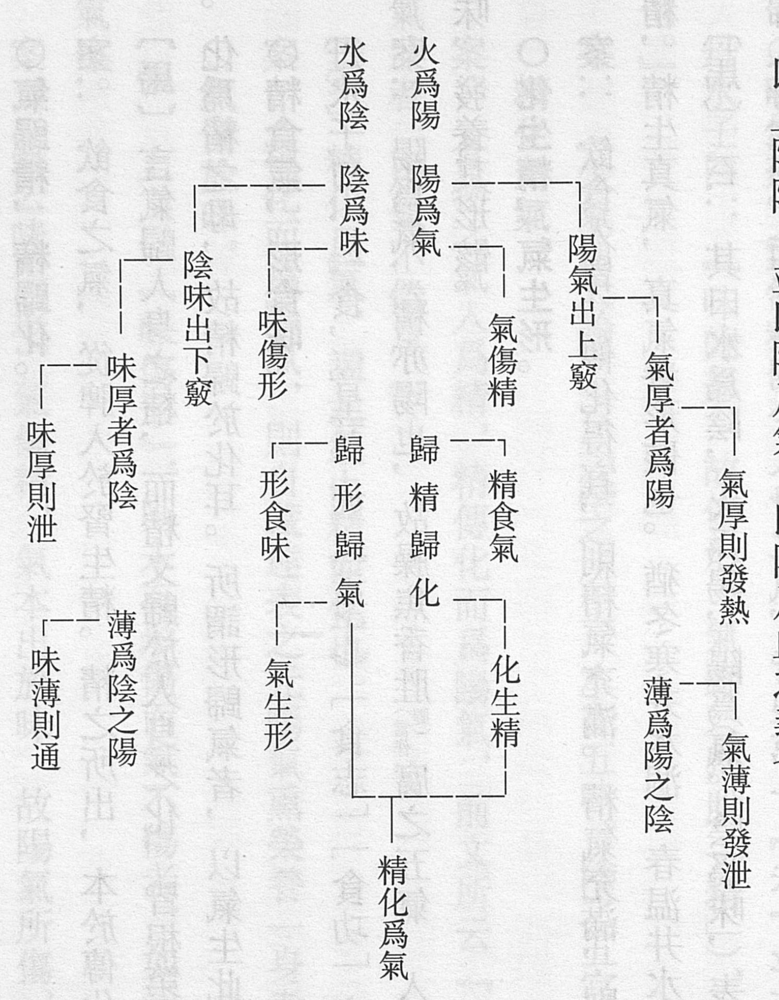

- 氣厚者爲陽 → 氣厚則發熱
- 薄爲陽之陰 → 氣薄則發泄
- 陽氣出上竅 → 氣厚者爲陽
- 陽爲氣 → 陽氣出上竅
- 陽爲氣 → 氣傷精
- 歸精歸化 → 精食氣
- 歸精歸化 → 化生精
- 化生精 → 精化爲氣　傷於味
- 火爲陽
- 水爲陰
- 陰爲味 → 陰味出下竅
- 陰爲味 → 味傷形
- 歸形歸氣 → 形食味
- 歸形歸氣 → 氣生形
- 歸形歸氣 → 精化爲氣　傷於味
- 陰味出下竅 → 味厚者爲陰
- 味厚者爲陰 → 味厚則泄
- 薄爲陰之陽 → 味薄則通

**○陽爲氣，陰爲味。**

양은 기(氣)가 되고, 음은 미(味)가 된다.

안(案): 이하는 음식 기미(氣味)의 음양이 비위의 소화를 거쳐 기혈로 변함을 말한 것이다.

**○味歸形，形歸氣。**

미는 형(形)으로 돌아가고, 형은 기로 돌아간다.

이상 두 구절은 ‘음은 미가 된다’의 각주이다.

〔馬〕 미가 사람 몸의 형으로 돌아가고 형은 또 사람 몸의 기로 돌아감을 말한 것이니, 모두 첫 번째 ‘味’ 자에 뿌리를 두고 말한 것이다.

안(案): 한 몸이 서는 것은 양기 때문이므로 ‘형은 기로 돌아간다’고 하였다. 이 ‘氣’는 곧 기혈의 기이지 기미의 기가 아니다.

**○氣歸精，精歸化。**

기는 정(精)으로 돌아가고, 정은 화(化)로 돌아간다.

안(案): 음식의 기는 비(脾)에서 신(腎)으로 들어가 정을 낳는다. 정이 나오는 곳은 전화(傳化)에 근본한다. 전화가 낳는 것도 오기(五氣)로 말미암는다. 이렇게 풀면 온당하다.

〔馬〕 기가 사람 몸의 정으로 돌아가고 정은 또 사람 몸의 화로 돌아감을 말한 것이니, 모두 첫 번째 ‘氣’ 자에 뿌리를 두고 말한 것이다. 이른바 ‘정은 화로 돌아간다’는 것은 화가 이 정을 낳기 때문이다. 화는 정의 어머니이므로 정이 화로 돌아갈 뿐이다. 이른바 ‘형은 기로 돌아간다’는 것은 기가 이 형을 낳기 때문이다. 기는 형의 아버지이므로 형이 기로 돌아갈 뿐이다.｟사람 몸의 기를 가리켜 말한 것이다｠

**○精食氣，形食味。**

정은 기로 길러지고, 형은 미로 길러진다.

단수자(丹水子)가 말하였다. “‘食’은 음이 사(寺)이다. 『맹자』 ‘食志’·‘食功’의 ‘食’과 같다.”

안(案): 양은 기가 되고 정도 양이므로, 조(臊)·초(焦)·향(香)·胜｟（‘腥’으로 써야 한다）｠·부(腐)의 오기(五氣)가 들어가 그 정기를 기른다. 음은 미가 되고 형도 음이 되므로, 산·고·감·신·함(酸苦甘辛鹹)의 오미가 퍼져 그 형해(形骸)를 기른다.

**[역1]** 원서대로 옮겼으나 「佼遣」은 뜻이 분명하지 않으며, 바로 뒤에서 「作」을 「錯」의 가차로 풀이하므로 「交錯」 같은 말의 잘못일 수 있다.

**○化生精，氣生形。**

화(化)는 정(精)을 낳고, 기는 형(形)을 낳는다.

안(案): 음식이 위에 들어가 전화(傳化)가 알맞게 이루어지면 정기가 충만해진다. 정기가 충만하면 양기가 펴지고 통하여 그 온몸을 영양할 수 있다. 그래서 음식의 전화가 정을 낳고, 정이 진기(真氣)를 낳고, 진기가 형해를 기르는 것이다. 겨울 추위에는 우물물이 마르고 봄 따뜻함에는 우물물이 불어나는 것과 같으니, 전화가 서로 맞으면 윤택해지고 전화가 서로 어긋나면 마르는 이치이다.

〔馬〕 ‘수는 음이 되고 화는 양이 되며, 양은 기가 되고 음은 미가 된다’고 한 것은 만물의 기미가 이루어지는 바를 드러낸 것이다. ‘미는 형으로 돌아가고 형은 기로 돌아간다’고 한 것은 미가 사람 몸의 형으로 돌아가고 형은 또 사람 몸의 기로 돌아감을 말한 것이니, 모두 첫 번째 ‘味’ 자에 뿌리를 두고 말한 것이다. ‘기는 정으로 돌아가고｟만물의 기를 가리켜 말한 것이다｠ 정은 화로 돌아간다’고 한 것은 기가 사람 몸의 정으로 돌아가고 정은 또 사람 몸의 화로 돌아감을 말한 것이니, 모두 첫 번째 ‘氣’ 자에 뿌리를 두고 말한 것이다. ‘정은 기로 길러진다’고 한 것은 위 글의 ‘기는 정으로 돌아간다’를 밝힌 것이다. ‘형은 미로 길러진다’고 한 것은 위 글의 ‘미는 형으로 돌아간다’를 밝힌 것이다. ‘화는 정을 낳는다’고 한 것은 위 글의 ‘정은 화로 돌아간다’를 밝힌 것이다. ‘기는 형을 낳는다’고 한 것은 위 글의 ‘형은 기로 돌아간다’를 밝힌 것이다｟사람 몸의 기를 가리켜 말한 것이다｠. 끝의 네 구절은 위 글의 가운데 네 구절을 밝힌 것이다. ‘양은 기가 된다’, ‘기는 정으로 돌아간다’, ‘정은 기로 길러진다’의 세 ‘氣’ 자는 만물의 기를 가리킨다. ‘형은 기로 돌아간다’, ‘기는 형을 낳는다’의 두 ‘氣’ 자는 사람 몸에 본래 있는 기를 가리킨다.

**○味傷形，氣傷精。**

미는 형을 상하게 하고, 기는 정을 상하게 한다.

단수자(丹水子)가 말하였다. “미는 형으로 돌아가므로 형을 상하게 한다. 기는（‘精’이 빠진 듯하다） 돌아가므로 정을 상하게 한다. 목향(木香)·향부자(香附)의 부류이다. 오래 복용하면 반드시 기를 소모하고 신(腎)을 상하게 한다.”

안(案): 「생기통천론(生氣通天論)」에서 “음이 생겨나는 것은 근본이 오미에 있고, 음의 오궁(五宮)은 상함이 오미에 있다.”라고 한 것과 같은 뜻이니, 물이 배를 띄울 수도 있고 뒤집을 수도 있는 것과 같다.

**○精化爲氣，**

정은 화하여 기가 되며,

안(案): 음식의 기가 들어가 정이 되고, 정이 전화하여 양기가 되니, 앞 글에서 ‘정은 기로 길러지고, 화는 정을 낳는다’고 한 것을 말한다. 단수자가 말하였다. “정을 갈무리하여 신기(腎氣)가 굳센 사람은 기를 써도 지치지 않는다.”

〔張〕 정이 화하여 기가 된다는 것은 원기(元氣)가 정으로 말미암아 화함을 말한다.

안(案): 정이 화하여 양기가 되면, 장(藏)에서 표(表)에 이르는 원양(元陽)의 기가 온몸을 훈증하여 영양하는 것도 모두 결국 미에서 생겨 온 것이니, 곧 형을 이루는 기가 이것이다.

**○氣傷於味，**

기는 미에 상한다.

〔張〕 위 글에서 ‘미는 형을 상하게 한다’고 하였으니, 형이 상했는데 기가 상하지 않는 경우는 없다. 예컨대 “신맛이 지나치면 간기가 넘쳐 흐르고 비위의 기가 끊어진다.”라고 한 부류가 모두 기를 상하게 하는 것이다.

안(案): 비록 ‘미는 형을 상하게 하고 기는 정을 상하게 한다’고 하였으나, 기는 본래 미에서 나오므로 양기가 상하는 것도 결국 미로 돌아간다. 대체로 음식은 모두 미를 근본으로 삼는다는 증거이다.

**○陰味出下竅，陽氣出上竅。味厚者爲陰，薄爲陰之陽。氣厚者爲陽，薄爲陽之陰。味厚則泄，薄則通。氣薄則發泄，厚則發熱。**

음미(陰味)는 하규(下竅)로 나가고, 양기(陽氣)는 상규(上竅)로 나간다. 미가 두터운 것은 음이 되고, 엷은 것은 음 가운데 양이 된다. 기가 두터운 것은 양이 되고, 엷은 것은 양 가운데 음이 된다. 미가 두터우면 설(泄)하고, 엷으면 통(通)한다. 기가 엷으면 발설(發泄)하고, 두터우면 발열(發熱)한다.

안(案): 하규로 나가는 것은 오줌과 똥이고, 상규로 나가는 것은 숨이다. 단수자가 말하였다. “미가 두터운 것은 아래로 달려가므로 설하게 하니, 대황(大黄)·지황(地黄)의 부류가 이것이다.

미가 엷은 것은 매끄럽게 잘 통하므로 통하게 하니, 활석(滑石)·택사(澤瀉)의 부류가 이것이다. 기가 엷은 것은 표로 뜨므로 발산하게 하니, 마황(麻黄)·계지(桂枝)의 부류가 이것이다. 기가 두터운 것은 굳세고 사나우므로 발열하게 하니, 부자(附子)·건강(乾薑)의 부류가 이것이다.”

〔張〕 음미는 아래로 가므로 미가 두터운 것은 아래로 설할 수 있다. 엷은 것은 통리(通利)할 수 있다. 양기는 위로 가므로 기가 엷은 것은 표로 설할 수 있고, 두터운 것은 열을 낼 수 있다.

**○壯火之氣衰，少火之氣壯。**

장화(壯火)의 기는 쇠하고, 소화(少火)의 기는 왕성해진다.

단수자가 말하였다. “소화·장화는 소양·태양이라는 말과 같다. 대한(大寒)에서 少｟（‘小’로 써야 한다）｠만(滿)까지는 양기가 화창한 절기로 천지의 기가 차츰 왕성해지니, 이것이 소화의 기가 왕성해지는 것이다. 소만에서 대서까지는 무더위가 크게 행하고, 대서 뒤에는 천지의 기가 차츰 쇠하니, 이것이 장화의 기가 쇠하는 것이다. 사람 몸도 이에 응한다. 그러므로 사람 몸의 기가 쇠한 경우 인삼·백출[參朮]로 기를 보하더라도 육계·부자[桂附]를 더해 화를 보하여 돕지 않으면 쇠약함을 일으킬 수 없다. 사람 몸의 양화(陽火)가 쇠한 경우 계부로 화를 보하더라도 삼출을 더해 돕지 않으면 소화를 왕성하게 할 수 없다. 이것이 장화가 기를 기르고 기가 소화를 기른다는 말이다. 위 두 구절은 양기의 흥쇠를 말하고, 아래 두 구절은 사람 몸의 양기가 이에 응하여 보함을 말한다.”

〔張〕 화는 천지의 양기이다. 하늘은 이 화가 아니면 물(物)을 낳을 수 없고, 사람은 이 화가 아니면 살 수 없다. 그러므로 만물이 사는 것은 모두 양기로 말미암는다. 다만 양화(陽和)의 화는 물을 낳고, 항렬(亢烈)한 화는 도리어 물을 해친다. 그러므로 화가 태과하면 기가 도리어 쇠하고, 화가 화평하면 기가 왕성해진다. 장화는 기를 흩으므로 ‘食氣’라 하니, 화가 이 기를 먹는다는 말과 같다. 소화는 기를 낳으므로 ‘食火’라 하니, 기가 이 화를 먹는다는 말과 같다. 이는 비록 기미를 이어 말한 것이지만, 조화의 도는 적으면 왕성하고 왕성하면 쇠하는 것이 본래 이와 같으니, 오로지 기미만을 말한 것은 아니다.[역1]

**○壯火食氣，氣食少火。壯火散氣，少火生氣。**

장화는 기를 먹고, 기는 소화를 먹는다. 장화는 기를 흩고, 소화는 기를 낳는다.

안(案): ‘미가 두터우면 설하고, 기가 두터우면 발열한다’는 곧 ‘장화는 기를 먹는다’·‘장화는 기를 흩는다’를 말한다. ‘미가 엷으면 통하고, 기가 엷으면 발설한다’는 곧 ‘기는 소화를 먹는다’·‘소화는 기를 낳는다’를 말한다.

**○氣味辛甘發散爲陽，酸苦涌泄爲陰。**

기미 가운데 맵고 단 것[辛甘]이 발산하는 것은 양이 되고, 시고 쓴 것[酸苦]이 용설(涌泄)하는 것은 음이 된다.

안(案): 감(甘)은 미이고 발(發)은 기이다. 신(辛)은 미이고 산(散)은 기이다. 산(酸)은 미이고 설(泄)은 기이다. 고(苦)는 미이고 설은 기이다. 대개 감평(甘平)으로 양을 발하는 것은 갈근(葛根)·감초(甘草)의 부류를 말하고, 신온(辛温)으로 풀어 흩는 것은 계지·생강(生薑)의 부류를 말하며, 고한(苦寒)으로 용토(涌吐)하는 것은 노함(鹵鹹)·과체(瓜蒂)의 부류를 말하고, 산평(酸平)으로 매끄럽게 설하는 것은 산수유(山茱萸)·산조(酸棗)의 부류를 말한다. 유임(劉任)｟（‘信’으로 써야 한다）｠보(甫)의 『활인사증(活人事證)』에서 신감은 계지·감초·건강·부자의 부류이고, 산고는 고삼(苦參)·고청(苦青)·정력(葶藶)·고주(苦酒)의 부류라 한 것은 옳지 않다.

**○陰勝則陽病，陽勝則陰病。**

음이 이기면 양이 병들고, 양이 이기면 음이 병든다.

도엽통달(稻葉通達)이 말하였다. “‘음이 이기면 양이 병든다’에서 ‘습이 이기면 유사(濡寫)한다’까지는 ‘중양은 반드시 음이 된다’ 아래에 있어야 한다.”

〔馬〕 물(物)의 기는 대체로 양이 되고, 물의 미는 대체로 음이 된다. 그런데 기 가운데 발산을 주관하는 것은 본디 양이 되고, 미 가운데 맵고 단 것도 양이 된다. 미 가운데 시고 쓴 맛을 위주로 하는 것은 본디 음이 되고, 기 가운데 용설하는 것도 음이 된다. 이는 바로 기의 양 가운데 음이 있고, 미의 음 가운데 양이 있기 때문이다. 그러므로 시고 쓰며 용설하는 약을 써서 태과하게 되면 음이 이긴다. 음이 이기면 우리의 양분(陽分)이 음의 약을 대적하지 못하여 양분이 병든다. 맵고 달며 발산하는 약을 써서 태과하게 되면 양이 이긴다. 양이 이기면 우리의 음분(陰分)이 양의 약을 대적하지 못하여 음분이 병든다.

**○陽勝則熱，陰勝則寒。**

양이 이기면 열(熱)하고, 음이 이기면 한(寒)하다.

〔新〕［按］『갑을경(甲乙經)』에는 ‘陰病則熱，陽病則寒’으로 되어 있으니, 글은 다르나 뜻은 같다.

**○重寒則熱，重熱則寒。**

한이 거듭되면 열이 되고, 열이 거듭되면 한이 된다.

〔馬〕 위 글의 ‘한열’은 모두 사람 몸의 병체를 주로 하여 말한 것이다. 이 두 구절은 아래 글의 ‘음이 거듭되면 반드시 양이 되고, 양이 거듭되면 반드시 음이 된다’ 두 구절과 비슷하다.

목흑도탁(目黑道琢)이 말하였다. “‘重’ 자는 「논질진척(論疾診尺)」 편의 중음(重陰)·중양(重陽)과 같다.”

**○寒傷形，熱傷氣。**

한은 형을 상하게 하고, 열은 기를 상하게 한다.

〔馬〕 천시와 물류의 한열은 모두 우리에게 병을 일으킬 수 있다. 그러므로 한은 우리의 형을 상하게 할 수 있으니, 바로 한은 음이 되고 형도 음에 속하기 때문이다. 한하면 기가 거두어져 형이 상한다.｟본편 제2절에서 ‘음은 형을 이룬다’고 하였다.｠ 열은 우리의 기를 상하게 할 수 있으니, 바로 열은 양이 되고 기도 양에 속하기 때문이다. 경(炅)하면 기가 흩어져 기가 병든다.｟제2편에서 ‘양은 기로 화한다’고 하였다.｠

**○氣傷痛，形傷腫。**

기가 상하면 아프고, 형이 상하면 붓는다.

『대소(大素)』 권제3에는 ‘傷腫’ 이하 ‘宜掣引之’까지가 실려 있고, 그 앞은 결일(缺佚)되었다.

〔楊〕 이미 통증에 몰려 형이 상하면 곧 붓게 된다.

〔馬〕 열이 기를 상하게 하면 상한 기에서 통증이 생기니, 이른바 “모든 통증은 다 화에 속한다.”는 것이 이것이다. 한이 형을 상하게 하면 상한 형에서 부기가 생기니, 이른바 한하면 굳고 엉겨 부기가 일어난다는 것이다.

**○故先痛而後腫者，氣傷形也。**

그러므로 먼저 아프고 뒤에 붓는 것은 기가 형을 상하게 한 것이다.

〔楊〕 먼저 사기[耶]가 위기(衛氣)를 상하게 하여 통증을 일으키고 뒤에 형이 붓는 것은, 위기의 상함이 형에 미친 것을 말한다.

**○先腫而後痛者，形傷氣也。**

먼저 붓고 뒤에 아픈 것은 형이 기를 상하게 한 것이다.

〔楊〕 사기가 먼저 피부에 머물러 부기가 되고, 뒤에 위기를 막아 통증이 되는 것은, 형의 상함이 기에 미친 것을 말한다.

〔馬〕 그러나 붓고 아픈 것에는 또 서로 원인이 되는 기틀이 있다. 먼저 이 통증이 있고 뒤에 부기가 나는 것은 기가 먼저 상하고 형도 상한 것이니, 이를 기가 형을 상하게 했다고 한다. 먼저 이 부기가 있고 뒤에 통증이 되는 것은 형이 먼저 상하고 기도 상한 것이니, 이를 형이 기를 상하게 했다고 한다. 형은 기가 아니면 채워지지 않고 기는 형이 아니면 생기지 않아 형과 기가 서로 의지하니, 병이 서로 원인이 되는 것도 이와 같다.

**○風勝則動，**

풍(風)이 이기면 움직이고,

『대소』에는 ‘動’ 자가 없다.

안(案): 이하 다섯 구절은 오운육기를 풀이하는 말이다.

〔馬〕 진도(振掉)·요동(搖動)의 부류이다.

〔識〕 계종(瘈瘲)·축닉(搐搦)의 부류이다.

「지진요대론(至真要大論)」에서 말하였다. “풍음(風淫)이 이긴 경우에는 신량(辛涼)으로 평정하고 고감(苦甘)으로 돕는다. 감(甘)으로 완화하고 산(酸)으로 사(寫)한다.” 또 말하였다. “모든 풍으로 인한 도현(掉眩)은 다 간에 속한다.” “모든 갑작스러운 강직은 다 풍에 속한다.”

（眉）안(案): 12를 반으로 나눈 수이고, 3과 3이 짝지어 합한 수이며, 또 셋씩 합하면 두 묶음이고 둘씩 합하면 세 묶음이니, 모두 하늘의 이치이다. 그런데 어떤 이는 육기 풍·한·서·습·조·화를 꺼려 배우지 않으니, 어찌 그리 어리석은가.

（眉）천지의 이치는 1에서 10, 100, 1000에 이르기까지 그 이치가 모두 합하여 함께 한 이치로 돌아가니, 그래서 천지가 천지인 것이다. 육기를 꺼리고 헐뜯는 자는 하늘이 하늘인 까닭과 땅이 땅인 까닭을 모르는 자이다.

**○熱勝則腫，**

열이 이기면 붓고,

『대소』에는 ‘熱勝則’ 세 글자가 없다.

〔馬〕 모든 옹종(癰腫)의 부류가 이것이다. 위 글에서 열은 기를 상하게 하고 기가 상하면 아프다고 하였는데 여기서 붓는다고만 한 것은, 붓고서 아프지 않은 경우는 없기 때문이다. 다만 이는 옹종의 종(腫)이니 위 글 ‘형이 상하면 붓는다’의 종과는 다르다. 저기서 말한 종은 한기가 상하게 한 것이니, 곧 아래 글에서 말하는 부(浮)이다.

안(案): 앞 글과 여기의 ‘腫’ 자는 모두 옹종을 말하니, 부(浮)와 같지 않다.

〔楊〕 사풍(耶風)이 피부에 머물면 䐜종(䐜腫)이 된다.

안(案): 『대소』는 네 글자가 빠져 있는데, 양씨는 빠진 글에 곧바로 나아가 풀이하였을 뿐이다.

「지진요대론」에서 말하였다. “모든 창만(脹滿)으로 배가 커지는 것은 다 열에 속한다.” 또 말하였다. “모든 병에 소리가 있어 두드리면 북 같은 것은 다 열에 속한다.” 또 말하였다. “모든 몸이 뒤틀리고 젖혀지며 수액이 혼탁한 것은 다 열에 속한다.”

**○燥勝則乾，**

조(燥)가 이기면 마르고,

〔楊〕 사풍이 피부에 머물면 䐜종이 된다. 사열(耶熱)이 피부를 마르게 하면 피부가 건조하고 땀이 나지 않는다.

「지진요대론」에서 말하였다. “모든 열로 인한 무계(瞀瘛)는 다 화에 속한다. 모든 역기가 위로 치받는 것은 다 화에 속한다. 모든 조급하고 미쳐 날뛰는 것은 다 화에 속한다.”

**○寒勝則浮，**

한이 이기면 부종이 생기고[浮],

『대소』에는 ‘浮’가 ‘胕’로 되어 있다.

〔楊〕 부부반(扶付反)이다. 뜻을 살피면 ‘腐’여야 하니, 한이 이기면 살이 열하여 살이 썩는다.

‘浮腫’의 글자는 또 ‘胕’로도 쓴다. 『여씨춘추(呂氏春秋)』 「정욕(情欲)」의 ‘身盡府種，筋骨沈滯’와 또 「진수(盡數)」의 ‘氣鬱處腹，則爲張爲府’는 모두 같은 뜻이니, 『난헌유고(蘭軒遺稿)』 속에 자세히 보인다.

（眉）「육원정기론(六元正紀論)」 가운데 ‘胕腫’ 자가 여러 번 보이는데, 왕주(王注)에서 “부종(胕腫)은 살이 진흙 같아 누르면 일어나지 않는 것을 말한다.”라고 하였고, 「지진요론(至真要論)」 주에서 “‘胕’는 피부와 살이 모두 부어 누르면 꺼져 진흙처럼 일어나지 않는 것을 말한다.”라고 하였다.

**○濕勝則濡寫。**

습(濕)이 이기면 유사(濡寫)한다.

『대소』에는 ‘寫’ 자가 없다.

〔楊〕 음습의 기가 성하면 땀이 많다.

「육원정기론」에서 말하였다. “태양이 사천(司天)하는 정사에는 유사와 혈일(血溢)이 있다.”

「육원정기대론(六元正紀大論)」에서 말하였다. “그러므로 풍이 이기면 움직이고, 열이 이기면 붓고, 조가 이기면 마르고, 한이 이기면 부하고, 습이 이기면 유설(濡泄)한다. 심하면 수폐(水閉)·부종이 되니, 기가 있는 곳에 따라 그 변화를 말한 것이다.” 왕주에서 말하였다. “‘動’은 편안하지 않은 것이다. ‘浮’는 떠오름을 말하니 누르면 누른 자리가 드러난다. ‘濡泄’은 물 같은 설사이다. ‘胕腫’은 살이 진흙 같아 누르면 꺼져 일어나지 않는다. ‘水閉’는 물이 피부 속으로 넘치는 것이다.”

안(案): 운기 7편의 왕주는 다른 곳과 같지 않고, 혹 본편 안에서 같은 글자를 달리 풀이한 것이 종종 있다. 대개 왕씨가 근거한 7편에는 본래 옛 주가 있었는데 왕씨가 경문과 주를 아울러 수록하였으므로, 그 문기(文氣)가 다른 편과 비슷하지 않다. 나아가 상고하고 궁구해야 한다.

（眉）「기교변대론(氣交變大論)」에서 “세수(歲水)가 불급하면 백성이 유설을 앓는다.”라고 하였다.

（眉）「지진요론」 “한이 하초에 들어가 전하여 유사가 된다.”에 대한 주에서 “‘濡’는 물 같은 설사를 말한다.”라고 하였다. 또 말하였다. “심하면 신규(腎竅)에 들어가 설사가 그치지 않는다.” 또 말하였다. “태음이 재천(在泉)하여 객기가 이기면 습이 하초에 머물러 발하여 유사가 된다.”

**○天有四時五行，**

하늘에는 사시(四時)와 오행(五行)이 있어,

〔楊〕 하늘의 작용이다.

**○以生長收藏，**

그로써 낳고 기르고 거두고 갈무리하며[生長收藏],

‘行’과 ‘藏’이 운을 이룬다.

〔楊〕 사시의 작용이다.

**○以生寒暑燥濕風。**

그로써 한(寒)·서(暑)·조(燥)·습(濕)·풍(風)을 낳는다.

『대소』에는 ‘風’ 자가 없다.

〔楊〕 주에서 “오행이 낳는 것이다. 근본이 있고 풍이 있으니, 다섯을 갖추었음을 말한다.”라고 하였다.

**○人有五藏，**

사람에게는 오장(五藏)이 있어,

〔楊〕 사람이 가진 것이다.

**○化五氣，**

오기(五氣)를 화하여,

『대소』에는 ‘化’가 ‘有’로 되어 있다.

**○以生喜怒悲憂恐。**

그로써 희(喜)·노(怒)·비(悲)·우(憂)·공(恐)을 낳는다.

『대소』에는 ‘生’ 자가 없다.

‘風’과 ‘恐’이 운을 이룬다.

〔楊〕 오기는 오장의 기이고, 희·노 등은 심·폐·간·비·신의 오지(五志)이다.

안(案): 본편 아래 글에는 ‘悲’가 ‘思’로 되어 있다. 아래 글에서 자세히 풀이한다.

「천원기론(天元紀論)」에서 말하였다. “하늘에는 오행이 있어 오위(五位)를 다스리며 한·서·조·습·풍을 낳는다. 사람에게는 오장이 있어 오기를 화하여 희·노·사·우·공을 낳는다.”

（眉）오기란 혼·백·지·의·신(魂魄志意神)이다. 희·노·비·우·공은 오정(五情)이다.

**○故喜怒傷氣，**

그러므로 희로(喜怒)는 기를 상하게 하고,

〔楊〕 내상(内傷)이다.

**○寒暑傷形。**

한서(寒暑)는 형을 상하게 한다.

〔楊〕 외상(外傷)이다.

〔張〕 희노는 안을 상하게 하므로 기를 상하게 한다. 한서는 밖을 상하게 하므로 형을 상하게 한다. 희노를 들어 말하면 비·우·공도 같다. 한서를 들어 말하면 조·습·풍도 같다.

『영추(靈樞)』 「수요강유(壽夭剛柔)」에서 말하였다. “황제가 백고(伯高)에게 물었다. ‘내가 듣건대 형과 기의 병에는 선후가 있고 바깥과 안이 응한다고 하는데, 어떠한가?’ 백고가 답하였다. ‘풍한은 형을 상하게 하고, 우공·분노는 기를 상하게 합니다. 기가 장(藏)을 상하게 하면 장이 병듭니다. 한이 형을 상하게 하면 형에 응합니다. 풍이 근맥을 상하게 하면 근맥이 응합니다. 이것이 형과 기, 바깥과 안이 서로 응하는 것입니다.’”

**○暴怒傷陰，暴喜傷陽。**

갑작스러운 노여움[暴怒]은 음을 상하게 하고, 갑작스러운 기쁨[暴喜]은 양을 상하게 한다.

‘形’과 ‘陽’이 운을 이룬다.

이하 네 구절은 『소(素)』 「소오과론(疏五過論)」의 왕주에도 보이며 이것과 같은 뜻이니, 대개 여기에 수록한 것도 왕씨가 붉은 글씨[朱書]로 더해 넣은 부분일 뿐이다. 설명은 77편 가운데 자세히 보인다.

『영추』 「행침(行鍼)」에서 말하였다. “양이 많은 사람은 기쁨이 많고, 음이 많은 사람은 노여움이 많다.”

**○厥氣上行，滿脈去形。**

궐기(厥氣)가 위로 올라가면 온몸의 맥[滿脈]이 형을 떠난다.

‘暴怒’ 이하 16자는 『대소』에 없다.

‘行’과 ‘形’이 운을 이룬다.

〔張〕 궐(厥)은 거스름[逆]이다. 한서·희노의 기가 갑자기 위로 거슬러 오르면 양만 홀로 실하므로 맥이 가득 차고, 양이 항진하면 음이 떠나므로 형을 떠나니, 이는 고양(孤陽)의 상이다. 『맥경(脈經)』에서 “모든 부맥(浮脈)에 뿌리가 없는 것은 죽고, 표만 있고 리가 없는 것은 죽는다.”라고 한 것이 이를 말한다.

（眉）만맥(滿脈)이란 온몸의 맥 전체를 말하니, 많은 수를 총괄하는 말이다. 『좌전(左傳)』 민공(閔公) 원년 “만(萬)은 가득 찬 수이다.”에 대한 복주(服注)에서 “수는 1에서 만에 이르러 가득 찬다[滿].”라고 하였다. 「육원정기론」에서 “그 병은 몸 전체가 무겁다[滿身重].”라고 하였다.

**○喜怒不節，寒暑過度，生乃不固。**

희노가 절도 없고 한서가 지나치면, 생명이 굳건하지 못하다.

‘度’와 ‘固’가 운을 이룬다.

〔楊〕 안팎으로 자신을 상하게 하고서 생명이 굳건하여 요절하지 않을 수 있는 경우는 없다.

**○故重陰必陽，重陽必陰。**

그러므로 음이 거듭되면 반드시 양이 되고, 양이 거듭되면 반드시 음이 된다.

『대소』에는 ‘喜怒不節’ 위에 ‘故曰’ 두 글자가 있고, ‘故’ 자가 없다.

〔張〕 중(重)은 거듭 쌓인다는 뜻이니, 음의 때에 다시 한에 감촉되고 양의 때에 다시 열에 감촉되거나, 하늘의 열기가 사람의 양분을 상하게 하고 하늘의 한기가 사람의 음분을 상하게 하는 것을 모두 중이라 한다. 대개 음양의 도는 같은 기끼리 서로 구하므로 양은 양에 상하고 음은 음에 상하는데, 그러면서도 중양은 반드시 음증으로 변하고 중음은 반드시 양증으로 변한다. 뜨거운 물로 목욕하면 몸이 도리어 서늘해지고 찬물로 목욕하면 몸이 도리어 더워지는 것과 같으니, 작은 것으로 큰 것을 비유할 수 있다. 아래 글 여덟 구절이 바로 그 증험이다. 이는 위 글의 ‘한이 거듭되면 열이 된다’, ‘한이 극에 이르면 열이 생긴다’는 뜻과 서로 비슷하니, 서로 견주어 구해야 한다.

**○故曰：冬傷於寒，春必温病。**

그러므로 이렇게 말한다. 겨울에 한(寒)에 상하면 봄에 반드시 온병(温病)을 앓는다.

『대소』에는 ‘温病’이 ‘病温’으로 되어 있다.

〔楊〕 상(傷)은 지나치게 많다는 뜻이다. 겨울의 한은 음이다. 사람이 겨울에 옷을 따뜻하게 입고 음식을 뜨겁게 먹어 주리가 열렸는데, 시원한 것을 많이 취하여 마음을 즐겁게 하면 한이 주리로 들어가고 주리가 마침내 닫혀 안으로 장부로 가서, 봄이 되면 한이 극에 이르러 온병으로 변한다.

**○春傷於風，夏生飧泄。**

봄에 풍(風)에 상하면 여름에 반드시 손설(飧泄)이 생긴다.

『대소』에는 ‘泄’이 ‘洩’으로, ‘飧’이 ‘飡’으로 되어 있다.

〔楊〕 봄의 풍은 양이다. 봄에는 주리가 열리므로 풍이 들어가고 주리가 닫혀 안으로 장부와 장위 속으로 가서, 여름이 되면 손설(飡洩)한다. ‘飡’은 물에 만 밥이니 음이 손(孫)이며, 장위의 수곡이 소화되지 않고 나오는 것을 말한다.

**○夏傷於暑，秋必痎瘧。**

여름에 서(暑)에 상하면 가을에 반드시 해학(痎瘧)을 앓는다.

『대소』에는 ‘必痎’가 ‘生㾬’로 되어 있다.

〔楊〕 여름에 땀이 나서 약간의 한이 주리로 들어가 안에 갈무리된다. □（‘秋’로 된 본도 있다）의 기가 일어날 때에 이르러 주리가 밖으로 닫히고 풍기가 안에서 발하여 해학(㾬瘧)을 이룬다. ‘㾬’는 음이 개(皆)이다.

（眉）이 글은 경문에 여러 번 나오는데, 옛 성인의 가르침은 간결하고 예스러우며 질박하고 생략되었으되 의미가 깊고 길다. 두 ‘必’ 아래에는 ‘生’ 자를 보충해 보아야 하고, 두 ‘生’ 위에는 ‘必’ 자를 보충해 보아야 한다.

（眉）『광운(廣韻)』에 “‘必’과 ‘畢’은 음이 같으니 비길절(卑吉切)이다.”라고 하였다. 살펴보건대[案] ‘必’은 뒷날을 미리 헤아리는 말이다.

**[역1]** 『格致餘論』 등에는 같은 구가 「人非此火不能有生」으로 되어 있어, 원서의 「下」는 잘못 들어간 글자로 보인다.

**○秋傷於濕，冬生欬嗽。**

가을에 습(濕)에 상하면 겨울에 반드시 해수(欬嗽)가 생긴다.

〔楊〕 가을에는 비와 습이 많아 사람이 습에 상한다. 습은 위에서 아래로 가서 겨울에 이르러 한과 함께 폐를 상하게 하므로 해수를 이룬다. 개대반(愷代反), 또 구리반(丘吏反)이니, 역기(逆氣)를 말한다.

안(案): 이 글은 경문에 거듭 나오는 것이 매우 많으니, 「사기조신(四氣調神)」·「생기통천(生氣通天)」·「금궤진언(金匱真言)」의 글이 이것과 조금 다른데, 주석가들은 바른 풀이를 얻지 못하였다. 가만히 생각하건대, 겨울에 한에 상한 병은 일단 치료를 베풀어 나았더라도 문득 봄의 따뜻한 기를 만나면 기표(肌表)가 아직 완전히 실하지 않아 반드시 온열(温熱)의 증을 일으키니, 곧 ‘한은 형을 상하게 한다’의 뜻이다. 또 ‘봄에 풍에 상한다’는 것은, 풍은 양사(陽邪)이므로 양사가 이미 나았더라도 안으로 양기를 손상시켜, 마침 여름의 열기를 만나면 위기(胃氣)를 많이 상하고 흔들기 때문에 왕왕 손설의 증이 생기니, 이른바 ‘열은 기를 상하게 한다’는 것이다. 또 ‘여름에 서에 상한다’는 것은, 서는 열사(熱邪)로서 열사가 곧바로 장(藏)에 달라붙으므로 비록 완전히 나았더라도 혈맥을 크게 상한다. 그래서 가을의 습기를 만나면 습열이 혈분으로 전입하므로 한열학질(寒熱瘧疾)을 일으킨다. 또 ‘가을에 습에 상한다’는 것은, 습은 냉사(冷邪)로서 냉사가 이미 풀렸더라도 폐기에 혹 털끝만큼이라도 쇠약한 곳이 있어 병나기 전만 못한데, 마침 겨울 추위가 기표에 닥치면 기표도 폐의 부분이므로 안에서 해역(欬逆)의 변이 생기는 것이다. 두 ‘必’과 두 ‘生’ 자를 자세히 음미해야 한다. ‘必’은 미리 아는 말이고, ‘生’은 점차 이루어지는 뜻이다. 「상한례(傷寒例)」에서 “곧바로 병들지 않은 것은 한독이 기부(肌膚)에 갈무리되어 있다가 봄이 되면 온병으로 변하고 여름이 되면 서병(暑病)으로 변한다.”라고 한 부류는 모두 예부터 전해 오는 설이지만, 그 실상은 모두 앞 시기에 모자란 기가 있었기 때문에 그때에 어떤 병이 된다는 말이다. 대체로 옛 경전에서 말한 것에는 글에 의지해서는 뜻을 얻을 수 없는 것이 있으니, 뜻을 얻은 뒤에야 그 글을 비로소 풀 수 있다.

（眉）『맹자(孟子)』 「만장 상(萬章上)」에서 말하였다. “그러므로 시를 해설하는 사람은 글자로 말을 해치지 않고, 말로 뜻을 해치지 않으며, 자기 생각으로 작자의 뜻을 맞이하니, 이렇게 해야 얻을 수 있다. 만약 말에만 매인다면 그뿐이다.”

안(案): 양은 기가 되고 음은 미가 된다. 이하 계통도를 왼쪽과 같이 만들어 찾아보기 편하게 하였다.

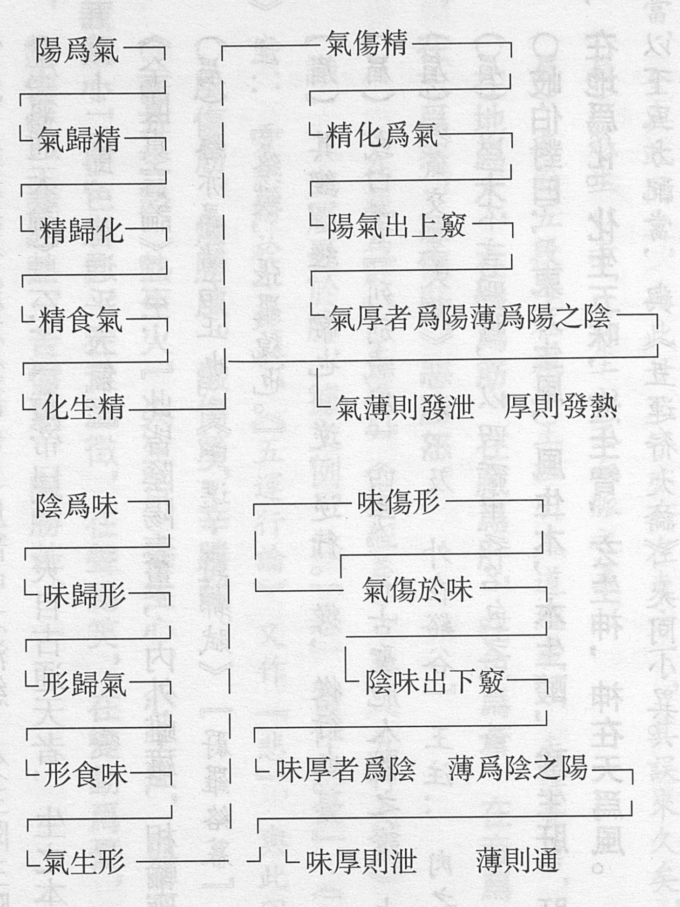

- 氣傷精 → 精化爲氣 → 陽氣出上竅 → 氣厚者爲陽薄爲陽之陰 → 氣薄則發泄　厚則發熱
- 味傷形 → 氣傷於味 → 陰味出下竅 → 味厚者爲陰　薄爲陰之陽 → 味厚則泄　薄則通
- 陽爲氣 → 氣歸精 → 精歸化 → 精食氣 → 化生精 → 氣傷精
- 陰爲味 → 味歸形 → 形歸氣 → 形食味 → 氣生形 → 味傷形

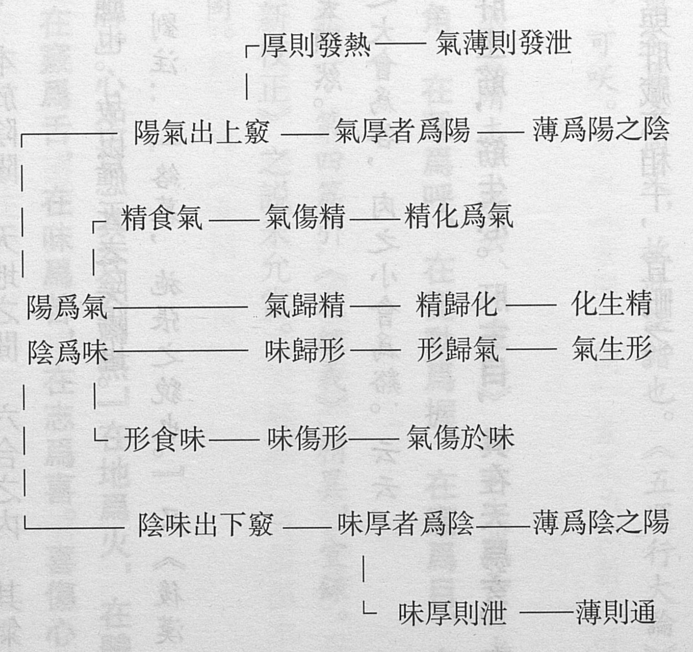

- 厚則發熱 → 氣薄則發泄
- 陽氣出上竅 → 厚則發熱
- 陽氣出上竅 → 氣厚者爲陽 → 薄爲陽之陰
- 精食氣 → 氣傷精 → 精化爲氣
- 陽爲氣 → 氣歸精 → 精歸化 → 化生精
- 陰爲味 → 味歸形 → 形歸氣 → 氣生形
- 形食味 → 味傷形 → 氣傷於味
- 陰味出下竅 → 味厚者爲陰 → 薄爲陰之陽
- 味厚者爲陰 → 味厚則泄 → 薄則通
- 陽爲氣 → 陽氣出上竅
- 陽爲氣 → 精食氣
- 陰爲味 → 形食味
- 陰爲味 → 陰味出下竅

（眉）이상 제1장.

**○帝曰：余聞上古聖人，論理人形，列別藏府，端絡經脈，會通六合，各從其經。氣穴所發，各有處名，谿谷屬骨，皆有所起。分部逆從，各有條理。四時陰陽，盡有經紀。外内之應，皆有表裏，其信然乎。**

황제가 말하였다. “내가 듣건대 상고의 성인은 사람의 형체를 논하여 다스리고, 장부(藏府)를 나누어 늘어놓으며, 경맥을 바로잡아 이어 붙이고, 육합(六合)을 모아 통하게 하여 각각 그 경(經)을 따르게 하였다. 기혈(氣穴)이 나오는 곳에는 각각 자리와 이름이 있고, 계곡(谿谷)과 속골(屬骨)에는 모두 시작하는 곳이 있다. 분부(分部)의 역종에는 각각 조리가 있고, 사시 음양에는 모두 경기(經紀)가 있다. 바깥과 안의 응함에는 모두 표리가 있다고 하는데, 정말 그러한가?”

〔□〕 단(端)은 바로잡음이다. 낙(絡)은 이어 붙인다는 뜻이다.

『원병식(原病式)』에 “‘端’은 음이 ‘揣’이니, 차례로 헤아림이다.”라고 하였다.

〔馬〕 사람에게 형체가 있으므로 그것을 논하여 다스리고｟『영추(靈樞)』 「골도(骨度)」·「맥도(脈度)」 등의 편과 같다｠, 사람에게 장부가 있으므로 그것을 나누어 늘어놓으며｟『영추』 「경수(經水)」·「장위(腸胃)」·「해론(海論)」 등의 편과 같다｠, 사람에게 경맥이 있으므로 그것을 바로잡아 이어 붙이고｟『영추』 「경맥(經脈)」 등의 편과 같다｠, 맥에 육합이 있으므로 그것을 모아 통하게 하여｟『영추』 「경별편(經別篇)」에 육합이 있는 것과 같다｠ 각각 그 경을 따르게 한다. 대체로 기혈이 나오는 곳에는 각각 그 자리가 있고 또 그 이름이 있다｟본경에 「기혈론(氣穴論)」이 있는 것과 같다｠. 살이 크게 모인 곳이 곡(谷)이고, 작게 모인 곳이 계(谿)이다. 대체로 계곡과 속골에는 모두 시작하는 곳이 있고｟본경에 「기혈론」·「기부론(氣府論)」·「골공론(骨空論)」 등의 편이 있는 것과 같다｠, 분부의 역종에는 각각 조리가 있으며｟본경에 「피부론(皮部論)」 등의 편이 있는 것과 같다｠, 사시 음양에는 사람에게 경기가 있고｟본편 아래 절에서 말한 것과 같다｠, 바깥과 안의 응함에는 모두 표리가 있다｟본경 「혈기형지론(血氣形志論)」에서 대음(大陰)과 양명이 표리가 된다고 한 것과 같다｠.

〔志〕 분부란 피부의 분부이다. 피부(皮部) 가운데의 부락(浮絡)은 삼음삼양으로 나뉘며 순과 역이 있어 각각 조리가 있다.

「생기통천론(生氣通天論)」에서 말하였다. “황제가 말하였다. ‘예로부터 하늘과 통하는 것은 생명의 근본이니, 음양에 근본한다. 천지 사이, 육합 안에서 구주(九州)·구규(九竅)·오장·십이절(十二節)의 기는 모두 천기와 통한다.’”

「금궤진언론(金匱真言論)」에서 말하였다. “이것이 모두 음양·표리·내외·자웅이 서로 수응(輸應)하는 것이다. 그러므로 하늘의 음양에 응하는 것이다.”

（眉）‘絡’ 또한 실마리를 찾아 바로잡는 것이다. 『문선(文選)』 「촉도부(蜀都賦)」 ‘罻羅絡幕’에 대한 유주(劉注)에서 “‘絡幕’은 펼쳐 친 모양이다.”라고 하였다. 또 『후한(後漢)』 「마융전(馬融傳)」 주에서 “‘絡縸’은 그물을 펼친 모양이다.”라고 하였다.

（眉）‘그 경[其經]’의 경은 상(常)이다. 역(逆)은 거슬러 감이고, 종(從)은 따라 감이다.

（眉）어떤 이는 ‘列別藏府’ 네 글자에 이르러 옛 성인이 인체를 갈라 본[肔] 증거가 매우 분명하다고 한다.

（眉）「기교변대론(氣交變大論)」 “수(水)가 불급하면 밖으로 계곡에 있다.”에 대한 왕주(王注)에서 “살이 크게 모인 곳이 곡이고, 살이 작게 모인 곳이 계이다.”라고 하였다. 운운.

（眉）이하에서 사시를 말하지 않은 것은 사방과 중앙의 이름으로 포괄했기 때문이다.

**○岐伯對曰：東方生風，風生木，木生酸，酸生肝，肝生筋，筋生心。肝主目，其在天爲玄，在人爲道，在地爲化。化生五味，道生智，玄生神，神在天爲風。**

기백이 답하였다. 동방은 풍을 낳고, 풍은 목(木)을 낳고, 목은 산(酸)을 낳고, 산은 간을 낳고, 간은 근(筋)을 낳고, 근은 심을 낳는다. 간은 눈을 주관한다. 그것이 하늘에서는 현(玄)이 되고, 사람에게서는 도(道)가 되며, 땅에서는 화(化)가 된다. 화는 오미를 낳고, 도는 지혜를 낳으며, 현은 신(神)을 낳는다. 신은 하늘에서 풍이 되고,

이하 오방(五方)의 배당은 「오운행대론(五運行大論)」과 대동소이하다.

〔識〕 아래 글의 예에 따르면 ‘在天’ 이하 23자는 연문(衍文)에 해당하고, 또 간장과 상관이 없으니 삭제해야 한다.

안(案): 이 23자는 모두 「천원기대론(天元紀大論)」에 있다. 「천원기대론」은 본편과 같은 글이 많으므로 여기에 잘못 섞인 것이다. 「오운행대론」의 오방 배당은 모두 이것과 같은 글인데, 이 23자 또한 동방 아래에 있으니 그 잘못이 오래되었다. 우습다.

（眉）근이 심을 낳는다는 것은 근이 심의 혈맥을 낳는다는 뜻이다.

（眉）본절 다섯 단락에서 장(藏)마다 그 아래 왕주가 『도경의(道經義)』를 인용하였는데, 그 책은 자세하지 않다. 아마 『수지(隋志)』와 『당지(唐志)』에서 그 목록을 싣지 못한 책이 아닐까?

**○在地爲木，在體爲筋，在藏爲肝，在色爲蒼，在音爲角，在聲爲呼，在變動爲握，在竅爲目，在味爲酸，在志爲怒，怒傷肝，悲勝怒。**

땅에서는 목이 되고, 체(體)에서는 근이 되고, 장(藏)에서는 간이 되고, 색에서는 창(蒼)이 되고, 음(音)에서는 각(角)이 되고, 성(聲)에서는 호(呼)가 되고, 변동에서는 악(握)이 되고, 규(竅)에서는 눈이 되고, 미에서는 산이 되고, 지(志)에서는 노(怒)가 된다. 노는 간을 상하게 하고, 비(悲)는 노를 이긴다.

（眉）‘在藏爲肝’에 대한 왕주에서 인용한 『도경의』는 『오행대의(五行大義)』 권3 제4편에서 인용한 『도경의』와 조금 다르니 기록해야 한다.

〔識〕 아래 글에서 우(憂)를 폐에 붙였으니, 글의 예에 따르면 이 ‘悲’는 ‘憂’여야 한다. 『신교정(新校正)』의 설은 온당하지 않다.

안(案): 우와 비는 한 이치로 돌아간다. 「오운행론(五運行論)」에도 ‘悲’로 되어 있어 이것과 같다.

**○風傷筋，燥勝風。酸傷筋，辛勝酸。**

풍은 근을 상하게 하고, 조는 풍을 이긴다. 산은 근을 상하게 하고, 신(辛)은 산을 이긴다.

**○南方生熱，熱生火，火生苦，苦生心，心生血，血生脾。心主舌，其在天爲熱，在地爲火，在體爲脈，在藏爲心，在色爲赤，在音爲徵，在聲爲笑，在變動爲憂，在竅爲舌，在味爲苦，在志爲喜。喜傷心，恐勝喜，熱傷氣，寒勝熱，苦傷氣，鹹勝苦。**

남방은 열을 낳고, 열은 화를 낳고, 화는 고(苦)를 낳고, 고는 심을 낳고, 심은 혈을 낳고, 혈은 비를 낳는다. 심은 혀를 주관한다. 그것이 하늘에서는 열이 되고, 땅에서는 화가 되고, 체에서는 맥이 되고, 장에서는 심이 되고, 색에서는 적(赤)이 되고, 음에서는 치(徵)가 되고, 성에서는 소(笑)가 되고, 변동에서는 우(憂)가 되고, 규에서는 혀가 되고, 미에서는 고가 되고, 지에서는 희(喜)가 된다. 희는 심을 상하게 하고, 공(恐)은 희를 이긴다. 열은 기를 상하게 하고, 한은 열을 이긴다. 고는 기를 상하게 하고, 함(鹹)은 고를 이긴다.

（眉）혈이 비를 낳는다는 것은 혈이 살을 길러 낸다는 뜻이다.

（眉）앞에서는 혈이라 하고 뒤에서는 맥이라 하였으니, 글은 다르나 물(物)은 하나이다. 그러므로 『신교정』이 인용한 『태소(太素)』로도 증명할 수 있고, 「오운행론」도 앞에서는 혈이라 하고 뒤에서는 맥이라 하여 이것과 같은 글이다.

（眉）‘熱傷血’이라 해야 할 것을 도리어 ‘熱傷氣’라 하였는데, 「오운행론」도 그러하다. ‘苦傷血’이라 해야 할 것을 도리어 ‘苦傷氣’라 하였는데, 「오운행론」도 그러하다.

**○中央生濕，濕生土，土生甘，甘生脾，脾生肉，肉生肺。脾主口，其在天爲濕，在地爲土，在體爲肉，在藏爲脾，在色爲黃，在音爲宮，在聲爲歌，在變動爲噦，在竅爲口，在味爲甘，在志爲思。思傷脾，怒勝思，濕傷肉，風勝濕，甘傷肉，酸勝甘。**

중앙은 습을 낳고, 습은 토를 낳고, 토는 감(甘)을 낳고, 감은 비를 낳고, 비는 육(肉)을 낳고, 육은 폐를 낳는다. 비는 입을 주관한다. 그것이 하늘에서는 습이 되고, 땅에서는 토가 되고, 체에서는 육이 되고, 장에서는 비가 되고, 색에서는 황(黃)이 되고, 음에서는 궁(宮)이 되고, 성에서는 가(歌)가 되고, 변동에서는 얼(噦)이 되고, 규에서는 입이 되고, 미에서는 감이 되고, 지에서는 사(思)가 된다. 사는 비를 상하게 하고, 노는 사를 이긴다. 습은 육을 상하게 하고, 풍은 습을 이긴다. 감은 육을 상하게 하고, 산은 감을 이긴다.

‘中央生濕’에 대한 왕주에서 『역의(易義)』를 인용하였는데, 지금 어떤 책의 약칭인지 자세하지 않다.

（眉）‘肉生肺’란 육이 피모를 낳는다는 뜻이다. 가(歌)는 소리를 길게 빼는 것이다. 왕주에서 ‘탄식하는 소리[嘆聲]’라 한 것은 틀렸다.

**○西方生燥，燥生金，金生辛，辛生肺，肺生皮毛，皮毛生腎。肺主鼻，其在天爲燥，在地爲金，在體爲皮毛，在藏爲肺，在色爲白，在音爲商，在聲爲哭，在變動爲欬，在竅爲鼻，在味爲辛，在志爲憂。憂傷肺，喜勝憂，熱傷皮毛，寒勝熱，辛傷皮毛，苦勝辛。**

서방은 조를 낳고, 조는 금을 낳고, 금은 신(辛)을 낳고, 신은 폐를 낳고, 폐는 피모(皮毛)를 낳고, 피모는 신(腎)을 낳는다. 폐는 코를 주관한다. 그것이 하늘에서는 조가 되고, 땅에서는 금이 되고, 체에서는 피모가 되고, 장에서는 폐가 되고, 색에서는 백(白)이 되고, 음에서는 상(商)이 되고, 성에서는 곡(哭)이 되고, 변동에서는 해(欬)가 되고, 규에서는 코가 되고, 미에서는 신(辛)이 되고, 지에서는 우(憂)가 된다. 우는 폐를 상하게 하고, 희는 우를 이긴다. 열은 피모를 상하게 하고, 한은 열을 이긴다. 신(辛)은 피모를 상하게 하고, 고는 신(辛)을 이긴다.

（眉）피모가 신을 낳는다는 것은 피모가 뼈를 기른다는 뜻이다.

（眉）『대소(大素)』를 따라 고쳐야 한다｟（‘燥傷皮毛，熱勝燥’로 되어 있다）｠. 송나라 신하들이 인용한 것이다. 그런데 「오운행론」은 『소문(素問)』과 같다.

**○北方生寒，寒生水，水生鹹，鹹生腎，腎生骨髓，骨髓生肝。腎主耳，其在天爲寒，在地爲水，在體爲骨，在藏爲腎，在色爲黑，在音爲羽，在聲爲呻，在變動爲慄，在竅爲耳，在味爲鹹，在志爲恐。恐傷腎，思勝恐，寒傷血，燥勝寒，鹹傷血，甘勝鹹。**

북방은 한을 낳고, 한은 수를 낳고, 수는 함(鹹)을 낳고, 함은 신(腎)을 낳고, 신은 골수(骨髓)를 낳고, 골수는 간을 낳는다. 신은 귀를 주관한다. 그것이 하늘에서는 한이 되고, 땅에서는 수가 되고, 체에서는 골(骨)이 되고, 장에서는 신이 되고, 색에서는 흑(黑)이 되고, 음에서는 우(羽)가 되고, 성에서는 신(呻)이 되고, 변동에서는 율(慄)이 되고, 규에서는 귀가 되고, 미에서는 함이 되고, 지에서는 공(恐)이 된다. 공은 신을 상하게 하고, 사는 공을 이긴다. 한은 혈을 상하게 하고, 조는 한을 이긴다. 함은 혈을 상하게 하고, 감은 함을 이긴다.

（眉）‘髓生肝’이란 골수가 근을 낳는다는 뜻이다.

（眉）‘在藏爲腎’에 대한 왕주에서 “지(志)가 영위하는 것은 정(精)이 행하는 뜻이다.”라고 하였다.

（眉）어떤 초록에서 말하였다. “귓구멍의 밑바닥은 소라처럼 겹겹이 말려 있다.”

（眉）『대소』를 따라 바로잡아야 한다｟（‘寒傷骨，濕勝寒，鹹傷骨’로 되어 있다）｠. 송나라 신하들이 인용한 것이다. 그런데 「오운행론」도 『소문』과 같다. 대개 왕씨가 전한 본이 이와 같았던 것이다.

안(案): 지금 본편의 글에 따라 방통표(傍通表)를 왼쪽과 같이 만든다.

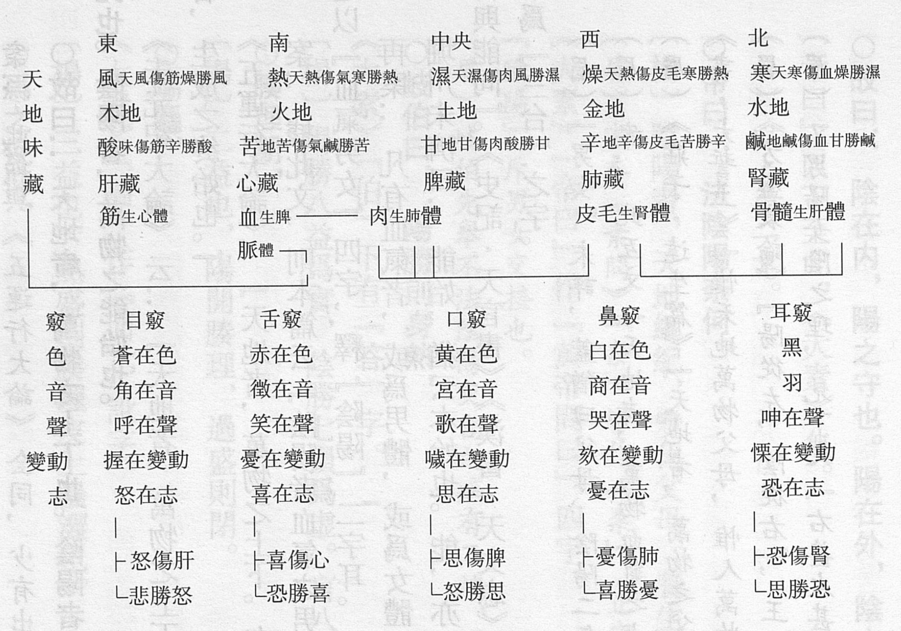

- 北
- 寒天寒傷血燥勝濕[역1]
- 水地
- 鹹地鹹傷血甘勝鹹
- 腎藏
- 骨髓生肝體
- 耳竅
- 黑
- 羽
- 呻在聲
- 慄在變動
- 恐在志 → 恐傷腎
- 恐在志 → 思勝恐
- 西
- 燥天熱傷皮毛寒勝熱
- 金地
- 辛地辛傷皮毛苦勝辛
- 肺藏
- 皮毛生腎體 → 骨髓生肝體
- 鼻竅
- 白在色
- 商在音
- 哭在聲
- 欬在變動
- 憂在志 → 憂傷肺
- 憂在志 → 喜勝憂
- 中央
- 濕天濕傷肉風勝濕
- 土地
- 甘地甘傷肉酸勝甘
- 脾藏
- 肉生肺體 → 皮毛生腎體
- 口竅
- 黃在色
- 宮在音
- 歌在聲
- 噦在變動
- 思在志 → 思傷脾
- 思在志 → 怒勝思
- 南
- 熱天熱傷氣寒勝熱
- 火地
- 苦地苦傷氣鹹勝苦
- 心藏
- 血生脾 → 肉生肺體
- 脈體
- 舌竅
- 赤在色
- 徵在音
- 笑在聲
- 憂在變動
- 喜在志 → 喜傷心
- 喜在志 → 恐勝喜
- 東
- 風天風傷筋燥勝風
- 木地
- 酸味傷筋辛勝酸
- 肝藏
- 筋生心體
- 目竅
- 蒼在色
- 角在音
- 呼在聲
- 握在變動
- 怒在志 → 怒傷肝
- 怒在志 → 悲勝怒
- 天
- 地
- 味
- 藏 → 脈體
- 竅
- 色
- 音
- 聲
- 變動
- 志

안(案): 이 절은 「오운행대론」과 완전히 같고 조금 출입이 있을 뿐이니, 참고해야 한다.

**○故曰：天地者，萬物之上下也。陰陽者，血氣之男女也。左右者，陰陽之道路也。水火者，陰陽之徵兆也。陰陽者，萬物之能始也。**

그러므로 이렇게 말한다. 천지는 만물의 위아래이다. 음양은 혈기의 남녀이다. 좌우는 음양의 길이다. 수화는 음양의 징조이다. 음양은 만물의 근원[能始]이다.

「천원기대론」에서 말하였다. “천지는 만물의 위아래이다. 좌우는 음양의 길이다. 수화는 음양의 징조이다. 금목은 생성의 처음과 끝이다.”

「오운행대론」에서 “천지는 만물의 위아래이다. 좌우는 음양의 길이다.”라고 하였다.

안(案): 이 글에 근거하면 본편의 ‘陰陽者血氣之男女也’ 9자는 잘못 덧붙은 연문인 듯하니, 대개 주문(注文)을 곁에 적어 둔 부류가 정문(正文)에 잘못 섞인 것이다. 다만 ‘血氣男女’ 네 글자로 ‘陰陽’ 두 글자를 풀이했을 뿐이다.

재안(再案): 대체로 혈기가 있는 것은 혹 남자의 몸이 되고 혹 여자의 몸이 되니, 모두 하나의 혈기가 작용하는 것이 조금 다를 뿐이다.

굴천미제(堀川未濟)가 말하였다. 능시(能始)는 본시(本始)라는 말과 같다. ‘能’ 또한 ‘始’이다. 『이아(爾雅)』 「석고(釋詁)」에 ‘胎，始也’라고 하였다. 『석문(釋文)』에 ‘胎，本作台。台與能同’이라고 하였다. 『사기(史記)』 「천관서(天官書)」와 『한서(漢書)』 「천문지(天文志)」에는 ‘三台’가 ‘三能’으로 되어 있다. 『예기(禮記)』 「악기(樂記)」 소(疏)에서, 옛날에는 지금의 ‘能’ 자를 ‘三台’의 ‘台’ 자로 썼다고 하였다.

（眉）‘男女’는 자세하지 않으나, 대개 부모라는 말과 같으니, 음양 두 기가 혈기를 지닌 만물을 낳아 기르는 두 어버이라는 것이다.

（眉）안(案): 이는 호문(互文)으로, ‘천지는 만물 혈기의 위아래이고, 음양은 만물 혈기의 남녀이다’라는 뜻이다.

（眉）『장자(莊子)』 「달생편(達生篇)」에 “천지는 만물의 부모이다.”라고 하였다.

『서(書)』 「태서 상(大誓上)」에 “천지는 만물의 부모이고, 사람은 만물의 영장이다.”라고 하였다.

（眉）「방성쇠론(方盛衰論)」에서 “양은 왼쪽을 따르고 음은 오른쪽을 따른다.”라고 하였는데, 왕주에서 “양기의 많고 적음은 모두 왼쪽을 따르고, 음기의 많고 적음은 모두 오른쪽을 따른다.”라고 하였다.

（眉）또 남양여음(男陽女陰)의 이치는 아래 글 ‘右甚左甚’ 아래에 보이니 참고해야 한다.

4월 7일

**○故曰：陰在内，陽之守也。陽在外，陰之使也。**

그러므로 이렇게 말한다. 음은 안에 있어 양을 지키는 것이고, 양은 밖에 있어 음의 심부름꾼이다.

‘帝曰’ 이하 여기까지는 『대소』에 없다.

（眉）이상 제2장.

**○帝曰：法陰陽奈何？**

황제가 말하였다. “음양을 본받으려면 어떻게 하는가?”

〔楊〕 음양은 천지의 강기이고 변화의 부모이며 양생의 도이다. 이를 본받아 이루므로 물은 것이다.

（眉）송본(宋本) 『소문』에는 ‘奈’가 모두 ‘柰’로 되어 있으니, 정자(正字)로서 높일 만하다.

『대소』에는 ‘帝曰’이 ‘黃帝問曰’ 네 글자로 되어 있다.

‘음양’은 남녀의 교접을 가리킨다.

（眉）기백은 먼저 음양 교합을 본받지 않아 생기는 병 두 갈래를 들어 세속을 경계하고, 뒤에 황제가 다시 묻기를 기다려 비로소 칠손팔익(七損八益)의 술법을 보였다.

**○岐伯曰：陽勝則身熱，**

기백이 말하였다. 양이 이기면 몸에 열이 나고,

『대소』에는 ‘伯’ 아래에 ‘答’ 자가 있다.

〔楊〕 양이 이기면 팔익(八益)이 되어 실(實)하고, 음이 이기면 칠손(七損)이 되어 허(虛)하다. 팔익을 말하자면, 몸에 열이 나는 것이 첫째 익이다. 음이 약하고 양이 성하므로 온몸에 열이 난다.

**○腠理閉，**

주리(腠理)가 닫히고,

〔楊〕 둘째 익이다. 양은 주리를 열지만 지나치게 성하면 닫힌다.

**○喘麤，**

숨이 가쁘고 거칠며,

『대소』에는 ‘喘’이 ‘而’로 되어 있으니, 와자(訛字)이다.

〔楊〕 셋째 익이다. 열이 성하면 주리와 피부 위가 거칠고 껄끄러워진다.

**○爲之俛仰，**

그 때문에 몸을 구부렸다 젖혔다 하며,

〔楊〕 넷째 익이다. 열이 위아래로 성하므로 구부렸다 젖혔다 한다.

‘俛仰’ 자는 또 「평열병(評熱病)」 33｟九ウ｠ 가운데 보인다.

**○汗不出而熱，**

땀이 나지 않으면서 열이 나고,

〔楊〕 다섯째 익이다. 음기가 안에서 끊어지므로 땀이 나지 않고 몸은 여전히 뜨겁다.

**○齒乾，**

이가 마르고,

『대소』에는 ‘齒乾’이 ‘乾齒’로 되어 있다.

〔楊〕 여섯째 익이다. 열이 성하여 뼈에까지 이르므로 이가 마른다.

**○以煩冤，**

그리하여 번원(煩冤)하며,

『대소』에는 ‘冤’이 ‘悗’으로 되어 있다.

〔楊〕 일곱째 익이다. 열이 신(神)을 어지럽히므로 번민한다.

**○腹滿死，**

배가 그득하면 죽는다.

〔楊〕 여덟째 익이다. 열이 위(胃) 속에 성하므로 배가 그득하다. 이미 일곱 익이 있는데 다시 복만이 더해지므로 죽음에 이른다.

**○能冬不能夏。**

겨울은 견디나 여름은 견디지 못한다.

〔楊〕 안에 열이 있으므로 겨울의 큰 추위는 견딜 수 있으나 여름의 작은 더위는 견디지 못한다.

안(案): 이는 대개 자기 몸의 양기·음기의 성쇠를 논한 것이다. 그러나 외감병에서도 이런 증이 된다. 가벼우면 마황탕(麻黃湯)·갈근탕(葛根湯)이 주치하고, 무거우면 대청룡탕(大青龍湯), 더욱 무거우면 백호(白虎)·승기(承氣)의 부류도 골라 쓸 수 있다.

**○陰勝則身寒，**

음이 이기면 몸이 차고,

〔楊〕 아래는 칠손을 말한다. 몸이 찬 것이 첫째 손이니, 몸이 추위에 괴롭다.

**○汗出，**

땀이 나며,

〔楊〕 둘째 손이다. 양이 없어 주리를 단속하지 못하므로 땀이 난다.

**○身常清，**

몸이 늘 서늘하고,

『대소』에는 ‘清’이 ‘凊’으로 되어 있다.

〔楊〕 셋째 손이다. ‘凊’은 차가움이니, 몸의 피부가 늘 차다.

**○數慄，**

자주 떨며,

〔楊〕 넷째 손이다. 자주자주 전율한다.

**○而寒，**

추워하고,

〔楊〕 다섯째 손이다. 떨고 나서 다시 춥다.

**○寒則厥，**

추우면 궐(厥)하며,

〔楊〕 여섯째 손이다. 추우면 손발이 거꾸로 차가워진다[逆冷].

**○厥則腹滿死。**

궐하면 배가 그득하여 죽는다.

〔楊〕 일곱째 손이다. 이미 여섯 손이 있는데 다시 냉기가 배에 가득함이 더해지니, 냉기가 배에 가득하므로 죽음에 이른다.

**○能夏不能冬。**

여름은 견디나 겨울은 견디지 못한다.

〔楊〕 찬 사람이 열을 만나므로 견딜 수 있다.

안(案): 이 증은 가벼우면 계지탕(桂枝湯)의 부류, 무거우면 사역탕(四逆湯)의 부류가 주치한다. 겨울을 견디고 여름을 견딘다는 것도 대강의 말일 뿐이다. 앞 글에서 ‘음이 이기면 양이 병들고, 양이 이기면 음이 병든다. 양이 이기면 열하고, 음이 이기면 한하다’라고 한 것과 같은 뜻이니, 아울러 상고할 수 있다.

**○此陰陽更勝之變，**

이것은 음양이 번갈아 이기는 변화로,

『대소』에는 ‘變’ 아래에 ‘也’ 자가 있다.

**○病之形能也。**

병의 형태[形能]이다.

〔楊〕 이는 음양이 변하여 극에 이르는 이치이고, 또한 사람의 병이 드러내는 모습이다.

안(案): ‘恣態’의 ‘態’ 자는 옛날에는 ‘能’으로만 썼으니, ‘才能’의 ‘能’ 자와 꼴은 같으나 음과 뜻이 모두 다르다. 『설문(説文)』에 “‘態’는 뜻[意]이다. ‘心’을 따르고 ‘能’을 따른다. 혹 ‘人’을 따라 ‘㑷’로 쓴다.”라고 하였다. 현응(玄應)의 『일체경음의(一切經音義)』 권2에 “‘態’는 고문에서 ‘能’으로 쓴다.”라고 하였다. 이로 말미암아 상고하건대, ‘耐勝’의 글자는 옛날에 ‘態’로 썼다. 형태의 ‘態’ 자는 옛날에 ‘能’으로 썼으며, ‘耐’와 ‘能’ 두 글자는 서로 통용되었다. 본서 46편에 「병능론(病能論)」이 있고 「풍론(風論)」에도 ‘病能’ 자가 있는데, 『영추』 「음양이십오인편(陰陽二十五人篇)」에는 ‘態’로 되어 있어 “그 태도가 또 뭇사람과 맞지 않는 것이 다섯이다.”라고 하였다. 『본초경(本草經)』의 ‘耐老’가 『신수본초(新修本草)』에는 ‘能老’로 되어 있으니, 모두 증거로 삼을 수 있다.[역2]

**○帝曰：**

황제가 말하였다.

『대소』에는 ‘黃帝問曰’ 네 글자로 되어 있다.

**○調此二者奈何？**

“이 둘을 조화시키려면 어떻게 하는가?”

〔楊〕 음양이 서로 이겨 마침내 칠손팔익이 있게 되어 허실이 조화롭지 않으므로 조화시키는 일을 말한 것이다.

안(案): ‘이 둘’은 앞 글을 받아 말한 것으로, 몸 안의 음기와 양기를 가리킨다. 이 두 기를 조화시키려면 먼저 방중(房中)의 비술을 밝혀야 하니, 그런 뒤에야 기혈이 조화되어 지나치거나 모자라는 폐단이 없다.

**○岐伯曰：**

기백이 말하였다.

『대소』에는 ‘伯’ 아래에 ‘答’ 자가 있다.

**[역1]** 바로 앞 경문과 『黃帝素問直解』 卷一에는 「燥勝寒」으로 되어 있어, 원서 도표의 「燥勝濕」은 그 잘못으로 보인다.
**[역2]** 원서대로 옮겼다. 뒤의 「耐、能二字互相通用」과 「能老」의 예로 보면 「態」는 「能」의 잘못일 수 있다.

**○能知七損八益，則二者可調。**｟《大素》此下有『也』字｠

칠손팔익(七損八益)을 알 수 있으면 두 가지를 조화시킬 수 있다.｟『대소(大素)』에는 이 아래 ‘也’ 자가 있다.｠

〔楊〕손(損)은 몸을 덜어 내는 것이고, 익(益)은 병을 더하는 것이다. 사람이 도를 닦고 같은 것을 살펴[察同] 손익의 병을 없애면 음양의 기가 조화되어 온갖 쇠로(衰老)가 없고, 수명이 다함이 없어 천지와 함께 끝까지 간다.

『의심방(醫心方)』 권28 「팔익(八益)」 제16에서 『옥방비결(玉房祕決)』을 인용하여 말하였다. “소녀(素女)가 말하였다. ‘음양에는 칠손팔익이 있다. 첫째 익은 고정(固精)이니, 여자를 옆으로 눕혀 다리를 벌리게 하고 남자는 그 사이에 옆으로 누워 18번[二九數]을 행하고, 수를 마치면 멈춘다. 남자의 정을 굳게 하고, 또 여자의 누혈(漏血)을 치료한다. 하루 두 번 행하면 15일이면 낫는다. 둘째 익은 안기(安氣)이니, 여자를 베개를 높이 하여 바로 눕히고 두 넓적다리를 펴서 벌리게 하며, 남자는 그 다리 사이에 꿇어앉아 찔러 27번[三九數]을 행하고, 수를 마치면 멈춘다. 사람의 기를 조화롭게 하고, 또 여자 음문이 찬 것[女門寒]을 치료한다. 하루 세 번 행하면 20일이면 낫는다. 셋째 익은 이장(利藏)이니, 여자를 옆으로 눕혀 두 다리를 구부리게 하고, 남자는 가로로 누워 물러나며 찔러 36번[四九數]을 행하고, 수를 마치면 멈춘다. 사람의 기를 조화롭게 하고, 또 여자 음문이 찬 것을 치료한다. 하루 네 번 행하면 20일이면 낫는다. 넷째 익은 강골(強骨)이니, 여자를 옆으로 눕혀 왼 무릎을 구부리고 오른 넓적다리를 펴게 하며, 남자는 엎드려 찔러 45번[五九數]을 행하고, 수를 마치면 멈춘다. 사람의 관절을 열어 조화롭게 하고, 또 여자의 폐혈(閉血)을 치료한다. 하루 다섯 번 행하면 10일이면 낫는다. 다섯째 익은 조맥(調脈)이니, 여자를 옆으로 눕혀 오른 무릎을 구부리고 왼 넓적다리를 펴게 하며, 남자는 땅을 짚고 찔러 54번[六九數]을 행하고, 수를 마치면 멈춘다. 사람의 맥을 잘 통하게 하고, 또 여자 음문이 열린 것[女門辟]을 치료한다. 하루 여섯 번 행하면 20일이면 낫는다. 여섯째 익은 축혈(畜血)이니, 남자는 반듯이 바로 눕고 여자는 엉덩이를 들어 그 위에 꿇어앉아 끝까지 들이게 하며, 여자가 63번[七九數]을 행하게 하고, 수를 마치면 멈춘다. 사람의 힘을 강하게 하고, 또 여자의 월경불리(月經不利)를 치료한다. 하루 일곱 번 행하면 10일이면 낫는다. 일곱째 익은 익액(益液)이니, 여자를 바로 엎드려 뒤를 들게 하고, 남자는 위에서 72번[八九數]을 행하고, 수를 마치면 멈춘다. 사람의 뼈를 채운다. 여덟째 익은 도체(道體)이니, 여자를 바로 눕혀 넓적다리와 발을 구부려 엉덩이 아래로 바짝 붙이게 하고, 남자는 넓적다리와 옆구리로 찔러 81번[九九數]을 행하고, 수를 마치면 멈춘다. 사람의 뼈를 실하게 하고, 또 여자 음부의 냄새를 치료한다. 하루 아홉 번 행하면 9일이면 낫는다.’”

「칠손(七損)」 제17에서 『옥방비결』을 인용하여 말하였다. “소녀가 말하였다. ‘첫째 손은 절기(絶氣)라 한다. 절기란 마음은 원하지 않는데 억지로 하는 것이니, 그러면 땀이 새고 기가 적어지며 가슴이 뜨겁고 눈이 침침해진다. 치료법은 여자를 바로 눕히고 남자가 그 두 다리를 메고 깊이 누르며[深案之], 여자가 스스로 흔들게 하여 여자의 정이 나오면 멈추고, 남자는 쾌감을 다하지 않는다[勿得快]. 하루 아홉 번 행하면 10일이면 낫는다. 둘째 손은 일정(溢精)이라 한다. 일정이란 마음은 탐하고 사랑하나 음양이 아직 조화되지 않았는데 하여 정이 도중에 넘쳐 나오는 것이다. 또 취하여 교접하여 숨이 가쁘고 기가 어지러우면 폐를 상하게 하니, 기침하며 기가 치밀고[欬逆上氣] 소갈(消渴)이 나며 잘 성내거나 혹은 슬프고 처량하며, 입이 마르고 몸에 열이 나서 오래 서 있기 어렵다. 치료법은 여자를 바로 눕혀 두 무릎을 구부려 남자를 끼게 하고, 남자는 얕게 찔러 옥경(玉莖)을 한 치 반 들이고, 여자가 스스로 흔들게 하여 여자의 정이 나오면 멈추고 남자는 쾌감을 다하지 않는다. 하루 아홉 번 행하면 10일이면 낫는다. 셋째 손은 탈맥(奪脈)이라 한다. 탈맥이란 음경이 단단하지 않은데 억지로 하여 도중에 억지로 사정하여 정기가 다하는 것이며, 배불리 먹은 뒤 교접하면 비를 상하게 하여 음식이 소화되지 않고 음위(陰痿)가 되어 정이 없어진다. 치료법은 여자를 바로 눕혀 다리로 남자의 엉덩이를 걸게 하고, 남자는 자리를 짚고 들이며, 여자가 스스로 흔들게 하여 여자의 정이 나오면 멈추고 남자는 쾌감을 다하지 않는다. 하루 아홉 번 행하면 10일이면 낫는다. 넷째 손은 기설(氣泄)이라 한다. 기설이란 피로하여 땀이 났는데 마르기 전에 교접하는 것이니, 배가 뜨겁고 입술이 탄다. 치료법은 남자를 바로 펴서 눕히고 여자가 그 위에 발 쪽을 향해 걸터앉아 자리를 짚고 음경을 얕게 들이며, 여자가 스스로 흔들게 하여 정이 나오면 멈추고 남자는 쾌감을 다하지 않는다.

하루 아홉 번 행하면 10일이면 낫는다. 다섯째 손은 기개궐상(機開厥傷)이라 한다. 기개궐상이란 막 대소변을 보아 몸이 아직 안정되지 않았는데 억지로 하면 간을 상하는 것이며, 또 갑작스럽게 교합하여 느리고 빠름에 조리가 없으면 근골이 피로해져 눈이 흐릿하고[目盳盳] 옹저(癰疽)가 함께 생기며 뭇 맥이 말라 끊어지고, 오래되면 편고(偏枯)가 생기고 음위로 일어서지 않는다. 치료법은 남자를 바로 눕히고 여자가 그 넓적다리에 걸터앉아 앞을 향해 웅크리고 천천히 눌러 들이되 여자가 스스로 흔들지 않게 하며, 여자의 정이 나오면 남자는 쾌감을 다하지 않는다. 하루 아홉 번 행하면 10일이면 낫는다. 여섯째 손은 백폐(百閉)라 한다. 백폐란 여자에게 음탕하게 빠져 스스로 절제하지 않고 자주 교접하여 법도를 잃어 그 정기를 다하며, 힘써 억지로 사정하여 정이 다해 나오지 않아 온갖 병이 함께 생기는 것이다. 소(消)｟（‘渴目冥冥，治之’를 보충해야 한다）｠ 법(法)은 남자를 바로 눕히고 여자가 그 위에 걸터앉아 앞으로 엎드려 배꼽을 짚게 하며, 여자가 옥경을 들여 스스로 흔들게 하여 정이 나오면 멈추고 남자는 쾌감을 다하지 않는다. 하루 아홉 번 행하면 10일이면 낫는다. 일곱째 손은 혈갈(血竭)이라 한다. 혈갈이란 힘든 일을 하고 빨리 걸어 피로하여 땀이 났는데 그 김에 교합하여, 둘 다 마칠 무렵 반듯이 누워 깊이 밀어 뿌리까지 묻으면 갑자기 급하고 심한 병이 이로 인해 생기며, 잇달아 사정하여 그치지 않으면 혈이 마르고 기가 다하여 피부가 허하고 살갗이 당기며 음경이 아프고 음낭이 축축하며 정이 변하여 피가 된다. 치료법은 여자를 바로 눕혀 엉덩이를 높이 들고 두 다리를 펴서 벌리게 하며, 남자는 그 사이에 꿇어앉아 깊이 찌르고, 여자가 스스로 흔들게 하여 정이 나오면 멈추고 남자는 쾌감을 다하지 않는다. 하루 아홉 번 행하면 10일이면 낫는다.’”

안(案): 칠손팔익은 예로부터 주석가들의 의견이 제각각이었으나 모두 억측에서 나온 것이라 근거로 삼기에 부족하다. 왕주(王注)가 방사(房事)로 본 것은 아마 전해 받은 바가 있어서 한 말일 것이다. 이제 『의심방』을 얻어 천고의 의문이 한꺼번에 얼음 녹듯 풀렸다. 다만 그 말이 외설스럽고 난잡하므로 왕씨가 자세히 기록하지 않은 것이다. 『옥방비결』이 ‘素女曰’을 인용하였으니 『소녀경(素女經)』의 글임을 알 수 있다. 『수지(隋志)』에 『옥방비결』 10권, 『옥방비결』 8권, 『신찬옥방비결(新撰玉房祕決)』 9권이 있다. 『구당지(舊唐志)』에 『옥방비록결(玉房祕録訣)』 8권, 충화자(沖和子) 지음이 있다. 『신지(新志)』에 충화자 『옥방비결(玉房祕訣)』 10권이 있다. 장정(張鼎)의 『숭문총목(崇文總目)』에 『황제옥방비결(黃帝玉房祕訣)』 1권이 있다. 『수지』에 『소녀비도경(素女祕道經)』 1권(『현녀경(玄女經)』을 아우름), 또 『소녀방(素女方)』 1권이 있다. 『견재서목(見在書目)』에 『소녀문(素女問)』 1권, 『소녀경』 1권, 또 『현녀경』 1권｟오행가(五行家)｠이 있고, 또 『구당지』 병서(兵書)에 『황제문현녀법(黃帝問玄女法)』 3권이 있는데, 현녀가 지었다.

안(案): 옛 성인은 마음을 바르게 하고 몸을 닦을 수 있었으므로 마침내 천하를 다스리는 데 이르렀다. 그러므로 황제와 요·순은 모두 방사에 법도가 있고 음식에 절도가 있어 장수하였다. 장수한 뒤에야 천하를 다스리는 긴 세월을 얻은 것이다. 그러므로 『중용(中庸)』에서 말하였다. “공자께서 말씀하셨다. ‘순은 큰 효자이실 것이다. 큰 덕은 반드시 그 지위를 얻고, 반드시 그 녹을 얻고, 반드시 그 이름을 얻고, 반드시 그 수명을 얻는다.’” 주자의 주[朱注]에서는 “순은 나이가 110세였다.”라고 하였다.

（眉）『소(素)』 「저지교론(著至教論)」에 “황제가 명당(明堂)에 앉아 뇌공(雷公)을 불러 물었다. ‘그대는 의술의 도를 아는가?’”라 하였고, 왕주에 “명당은 정사를 펴는 궁이다. 여덟 창과 네 문이 있고 위는 둥글고 아래는 네모나며 도성의 남쪽에 있으므로 명당이라 한다. 백성의 병을 구하고 백성의 아픔을 가엾게 여기는 것이 대성인의 마음 씀이다. 그러므로 뇌공을 불러 생령을 건지는 도를 물은 것이다.”라고 하였다.

（眉）안(案): 이로 보면 이 방술도 옛 성인이 스스로 시험해 보고 또 남에게 베푼 가르침인데, 어찌하여 예로부터 그 백성 가운데 가르침을 받드는 이가 적은가.

（眉）「소오과론(疏五過論)」: “성인의 술(術)은 만민의 법식이 된다. 뜻을 헤아려 재단함에 반드시 법칙이 있으니, 경(經)을 따르고 수(數)를 지킨다. 의사(醫事)를 살펴 따라 만민의 도움이 된다.”

『신교정(新校正)』에서 양상선(楊上善)을 인용하여 “‘副’는 돕는다[助]는 뜻이다.”라고 하였다.

（眉）「천원기론(天元紀論)」: “위로는 백성을 다스리고 아래로는 몸을 다스린다. 백성이 밝게 드러나고 위아래가 화목하며, 덕택이 아래로 흘러 자손이 근심이 없고, 후세에 전하여 끝날 때가 없게 한다.”

（眉）『소문식(素問識)』의 칠손팔익설은 일본인의 설을 실었으나, 그 설이 송(宋) 왕규(王逵)가 지은 『여해집(蠡海集)』 「인신부(人身部)」에 근본한다는 것을 몰랐다. 왕규가 말한 것은 「상고천진론(上古天真論)」의 ‘二七’·‘七七’·‘二八’·‘八八’을 칠손팔익으로 본 것이다. 아아, 이당(李唐) 이전의 가르침이 오대[五季]에 없어지고 일본에 남았으니, 송나라 사람들이 그것을 알지 못한 것은 탄식할 만하다.

（眉）『한서(漢書)』 「예문지(藝文志)」의 방중(房中) 8가 186권. 『용성음도(容成陰道)』 26권. 『무성자음도(務成子陰道)』 36권. 『요순음도(堯舜陰道)』 23권. 『탕반경음도(湯盤庚陰道)』 20권. 『천로잡자음도(天老雜子陰道)』 25권. 『천일음도(天一陰道)』 24권. 『황제삼왕양양방(黃帝三王養陽方)』 20권. 『삼가내방유자방(三家内房有子方)』 17권.

**○不知用此，則早衰之節也。**

이를 쓸 줄 모르면 일찍 쇠한다. 쇠함의 마디[衰之節]는,

『대소』에는 ‘早’가 ‘蚤’로 되어 있고, ‘衰’ 아래에 다시 ‘衰’ 자가 있으며, ‘也’ 자가 없다. ‘早衰’에서 구를 끊고 ‘衰之節’은 아래 구에 붙이니, 옳은 듯하다.

〔楊〕사람이 도를 닦지 않아 손□（‘益’으로 된 곳도 있다）를 없애지 않으면 음양이 조화되지 않으니, 이를 도에 어긋남[不道]이라 한다. 도에 어긋나면 일찍 쇠한다.

‘用’ 자가 글자의 눈[字眼]이니, 그것이 사람의 일[人事]임이 분명하다.

**○年四十，**

나이 40세가 되면

『대소』에는 ‘四十’이 ‘卌’ 한 글자로 되어 있다.

**○而陰氣自半也，起居衰矣。**

음기(陰氣)가 저절로 절반이 되어 기거(起居)가 쇠한다.

〔楊〕처음 쇠하는 시기는 나이 마흔이다. 육부(六府)는 양기가 되고 오장(五藏)은 음기가 된다. 사람이 나이 마흔이 되면 오장의 음기가 저절로 절반이 되어 이미 쇠하니, 주리(腠理)가 비로소 성글어지고 영화(榮華)가 시들어 떨어지며 머리털과 귀밑털이 희끗해지고, 걷거나 서는 일어남[起]과 앉거나 눕는 머묾[居]이 날로 점점 쇠해진다.

안(案): 하수(下壽)는 80, 중수(中壽)는 80이라 하니, 지금 40이라 한 것은 그 절반이다. 「상고천진론」을 살펴보면 남자는 ‘五八’ 곧 40세에 처음 쇠하고, 여자는 ‘五七’ 곧 35세에 처음 쇠한다.[역1]

**○年五十，體重，耳目不聰明矣。**

나이 50세가 되면 몸이 무겁고 귀와 눈이 밝지 않다.

『천금(千金)』 권27에 ‘岐伯曰：人年四十’부터 ‘此聖人之治身也’까지를 인용하였는데, ‘矣’가 ‘也’로 되어 있다.

**○年六十，陰痿，大氣衰。**

나이 60세가 되면 음위(陰痿)가 오고 대기(大氣)가 쇠한다.

『대소』에는 ‘大氣’가 ‘氣大’로 되어 있다.

**○九竅不利，下虛上實，涕泣俱出矣。**

구규(九竅)가 순조롭지 않고, 아래는 허하고 위는 실하여 콧물과 눈물이 함께 나온다.

『대소』에는 ‘矣’ 자가 없다.

안(案): ‘涕’는 곧 ‘洟’ 자이니, 예서에서 흔히 통용한다. 『설문(説文)』에 “‘洟’는 콧물이다. 水를 따르고 夷가 소리이다｟타계절(他計切)｠.” “‘泣’은 소리 없이 눈물을 흘리는 것을 泣이라 한다. 水를 따르고 立이 소리이다｟타례절(他例切)｠.”라고 하였다. 여기서 ‘涕泣俱出’이라 하였으니 콧물과 눈물이 한꺼번에 새어 나옴을 알 수 있다. 『영(靈)』 「구문편(口問篇)」의 “사람이 슬퍼하여 눈물과 콧물이 나오는 것은 운운”도 泣을 눈물로, 涕를 콧물로 삼았다. 『소』 「해정미론(解精微論)」에서도 泣·淚는 눈의 것으로, 涕는 코의 것으로 삼았다.[역2]

**○故曰：知之則強，不知則老。故同出而名異耳。**

그러므로 이를 알면 강건하고 모르면 늙는다고 한 것이다. 그러므로 같은 데서 나왔으나 이름이 다를 뿐이다.

『대소』에는 ‘出’ 자와 ‘而’ 자가 없고, ‘耳’가 ‘耶’로 되어 있다. 『천금』 권27에는 ‘故同’의 ‘故’가 없고, ‘而’ 자와 ‘耳’ 자가 없다.

**○智者察同，愚者察異。**

지혜로운 이는 같은 것을 살피고, 어리석은 이는 다른 것을 살핀다.

（眉）지혜로운 이는 도법(道法)에 합치하는 술(術)을 살필 줄 알고, 어리석은 이는 도법에 어긋나는 일을 모두 잘못 살핀다.

**○愚者不足，智者有餘，有餘則耳目聰明，身體輕強，老者復壯，壯者益治。**

어리석은 이는 부족하고 지혜로운 이는 남음이 있다. 남음이 있으면 귀와 눈이 밝고 몸이 가볍고 강건하여, 늙은이는 다시 젊어지고 젊은이는 몸이 더욱 좋아진다.

『대소』에는 ‘強’ 아래에 ‘年’ 자가 있고, ‘老者’의 ‘者’가 없으며, ‘治’가 ‘理’로 되어 있다. 『천금』 권27도 같다.

**○是以聖人爲無爲之事，樂恬憺之能。**

그러므로 성인은 무위(無爲)의 일을 하고 염담(恬憺)의 경지를 즐긴다.

『대소』에는 ‘憺’이 ‘惔’으로 되어 있다.

**○從欲快志於虛無之守，**

욕망을 마음껏 따르고 뜻을 흡족하게 하면서도 허무(虛無)의 지킴을 얻는다.

『천금』 권27에는 ‘於’가 ‘得’으로, ‘恬憺之能’이 ‘恬惔之味’로, ‘從’이 ‘縱’으로 되어 있다.

안(案): 『천금』을 따라 ‘於’를 ‘得’으로 하는 것이 옳다.

（眉）‘從’과 ‘縱’은 같다. 마음껏 쾌락함[縱快]은 황제가 120명의 여자를 거느린[御] 것과 같은 따위를 말하니, 이로움만 있고 덜어짐은 없는 것이다.

**○故壽命无窮，與天地終。**

그러므로 수명이 다함이 없어 천지와 함께 마친다.

『대소』에는 ‘无窮’의 ‘无’가 ‘無’로, ‘與’가 ‘与’로 되어 있다.

**○此聖人之治身也。**

이것이 성인이 몸을 다스리는 방법이다.

안(案): 제1편에 “상고 시대 사람으로서 도를 아는 이는 음양을 본받고 술수(術數)에 맞추었다. 먹고 마심에 절도가 있고 기거에 일정함이 있었다. 함부로 일하여 지치지 않았으므로 형체와 정신이 함께 갖추어져 천수를 다 누리고 백 살을 넘겨서야 떠났다.”라 하였고, 또 “도란 늙음을 물리치고 형체를 온전히 할 수 있으니, 나이가 많아도 자식을 낳을 수 있다.”라 하였으며, 또 “그다음에 성인이 있으니, 편안하고 즐거움을 일로 삼고 스스로 만족함을 공으로 삼는다. 형체가 해지지 않고 정신이 흩어지지 않아 백 살까지 살 수 있다.”라 하였으니, 모두 본론과 같은 이치이며 오로지 방내(房内)의 일을 말한 것이다. 왕주를 따를 만하다.

우안(又案): 제1편에 “지금 사람은 그렇지 않아서 술을 미음처럼 마시고 망령됨을 일상으로 삼으며, 취한 채 방에 들어 욕망으로 그 정을 고갈시키고 그 진기를 소모하여 흩으며, 가득 찬 것을 지킬 줄 모르고 때맞추어 신(神)을 부리지 못하며, 그 마음을 쾌하게 하기에 힘써 삶의 즐거움을 거스르고 기거에 절도가 없으므로 쉰 살에 쇠한다.”라 하였으니, 여기서 ‘智者察同，愚者察異’라 한 것과 그 뜻이 똑같다.

（眉）이상 제3장.

**○天不足西北，故西北方陰也。**｟《大素》無『北』字｠**而人右耳目不如左明也。**｟《大素》無『也』字｠**地不滿東南，故東南**｟《大素》無『南』字｠**方陽也。而人左手足不如右強也。**｟《大素》無『而』字｠

하늘은 서북쪽이 부족하므로 서북방은 음이다.｟『대소』에는 ‘北’ 자가 없다.｠ 그래서 사람은 오른쪽 귀와 눈이 왼쪽만큼 밝지 않다.｟『대소』에는 ‘也’ 자가 없다.｠ 땅은 동남쪽이 차지 않으므로 동남｟『대소』에는 ‘南’ 자가 없다.｠방은 양이다. 그래서 사람은 왼쪽 손발이 오른쪽만큼 강하지 않다.｟『대소』에는 ‘而’ 자가 없다.｠

〔識〕『회남자(淮南子)』 「천문훈(天文訓)」: “옛날 공공(共工)이 전욱(顓頊)과 임금 자리를 다투다가 노하여 부주산(不周山)을 들이받으니, 하늘 기둥이 부러지고 땅의 밧줄이 끊어졌다. 하늘이 서북쪽으로 기울었으므로 해·달·별이 그리로 옮겨 가고, 땅이 동남쪽에서 차지 않았으므로 빗물과 먼지가 그리로 돌아간다.” 『하도괄지상(河圖括地象)』에 “서북은 하늘의 문[天門]이고 동남은 땅의 문[地户]이다.”라 하였고, 그 주에 “하늘이 서북쪽에서 부족하니 이것이 천문이요, 땅이 동남쪽에서 차지 않으니 이것이 지호이다.”라고 하였다.

（眉）이 뜻은 오늘날 환자에게 매우 들어맞으니[太襯實] 허망한 말이 아니다. 오씨(吳氏) 우가(又可)의 『온역론(瘟疫論)』 권하 「손복편(損復篇)」에 자세하다. 이 하늘이 기울고 땅이 꺼졌다는 뜻은 『열자(列子)』 「탕문편(湯問篇)」에 보이고, 또 『소』 「오상정대론(五常政大論)」과 『역(易)』 「복희팔괘방위(伏義八卦方位)」의 “태(兌)는 동남에 있고 간(艮)은 서북에 있다”가 이 하늘이 기울고 땅이 꺼졌다는 뜻과 완전히 합치한다.

（眉）『의범제강(醫範提綱)』 권3에서 말하였다. “대체로 온몸의 뼈는 대개 오른쪽이 무겁고 왼쪽이 가볍다. 뼈만이 아니라 여러 부위의 근육도 모두 오른쪽이 무겁고 두터우며 왼쪽이 가볍고 얇다.”

안(案): 세계 전체의 모양은 서북이 산릉이고 동남이 바닷물이니, 본디 자연의 형세이다. 대개 그렇지 않을 수 없어 그러한 것인데, 옛 성인이 일찍이 이 이치를 깊이 연구하였으므로 이런 논이 있는 것이다. 『회남자』의 ‘공공이 노하여 부주산을 들이받아 하늘 기둥이 부러지고 땅의 밧줄이 끊어졌다’는 설도 지형에 나아가 옛이야기를 끌어다 붙인 것으로, 대개 인간 세상에 전해 온 옛말이지 본디 정사(正史)에 실린 것이 아니다. 마치 황국(皇國) 효령(孝靈) 때 하룻밤 사이에 홀연히 부사산(富士山)이 솟아나고 그 자취가 움푹 꺼진 곳이 곧 근강(近江)의 비파호(琵琶湖)가 되었다는 것과 같다. 이것도 정사에는 실리지 않고 민간에 전해 온 옛일이다. 다만 상고에는 구름 기운이 아직 걷히지 않아 처음 보았을 때 홀연히 생겨난 것 같았으므로 이런 말이 있을 뿐이지, 결코 후세에 상상해 낸 것이 아니다.

（眉）안(案): 한 나라[一國] 위에서 논하면 반드시 세계의 형세에 꼭 들어맞아 모두 이 설에 합치하여 다름이 없다. 대개 세계란 우리 지구 전체를 말한다. 한 나라란 한 주(州), 한 지역이니, 사방이 바닷가로 둘러싸인 땅을 말하며 크고 작음이 일정하지 않다. 일본도 한 나라이고 팔장도(八丈嶋)도 한 나라이며 사국(四國)·구주(九州)도 각각 한 나라이다. 아세아(亞細亞)와 구라파(歐羅巴)는 합하여 한 나라이고, 석란도(錫蘭嶋)도 한 나라이며, 아불리가(亞弗利加)도 한 나라이다. 나머지도 이 예를 따르니[放]｟（‘仿’으로 써야 한다）｠, 한 읍·한 도(都)·한 방(邦)·한 현·한 주｟구주(九州) 따위｠·한 부(府)를 한 나라로 삼는다는 말이 아니다. 그렇지만 사람은 땅 위에 살면서 반드시 따뜻한 쪽이 열리고 찬 쪽이 닫힌 땅에 모인다. 그러므로 대개 한 읍·한 부도 거의 이 뜻에 맞는다. 사방이 바닷가로 둘러싸인 땅은 천지가 자연히 이룬 한 나라이지, 사람이 갈라 차지하여 이름 지은 것이 아니다.

（眉）안(案): 『노자(老子)』에 “만물은 양을 안고 음을 등진다[反]｟（‘負’로 써야 한다）｠”라고 하였으므로, 땅의 남반구에서는 북쪽을 남쪽으로 삼으며, 따뜻한 땅 위 나라의 모양도 남반구에 있으면 북쪽이 열리고 남쪽이 닫힌다. 적도 아래에서 각각 몇 도 떨어진 곳에서도 이미 그러하다.

（眉）어떤 이가 말하였다. “땅은 둥근 공이니 서쪽·동쪽이 없다.” 나는 말한다. “그렇지 않다. 사방이 바닷가로 둘러싸인 땅마다 모두 사방·동서의 이름이 있으니, 본디 여기에서 비롯한 것이다.”

**○帝曰：何以。岐伯曰：**

황제가 물었다. “어째서인가?” 기백이 답했다.

『대소』에는 ‘帝曰’이 ‘黃帝問曰’ 네 글자로 되어 있고, ‘伯’ 아래에 ‘答’ 자가 있다.

**○東方陽也。陽者，**｟《大素》無此二字｠**其精并於上。**｟《大素》無『於』字｠

동방은 양이다. 양은｟『대소』에는 이 두 글자가 없다.｠ 그 정(精)이 위로 모인다.｟『대소』에는 ‘於’ 자가 없다.｠

**○并於上，**｟《大素》無『并於上』三字｠

위로 모이면｟『대소』에는 ‘并於上’ 세 글자가 없다.｠

**○則上明而下虛，**

위는 밝고 아래는 허하다.

『대소』에는 ‘則’이 ‘故’로 되어 있다.

**○故使耳目聰明，而手足不便也。**

그러므로 귀와 눈은 밝게 하나 손발은 편하지 않다.

『대소』에는 ‘使’가 ‘便’으로 되어 있다.

**○西方陰也。陰者，其精并於下，并於下，則下盛而上虛。故其耳目不聰明，而手足便也。**

서방은 음이다. 음은 그 정이 아래로 모이고, 아래로 모이면 아래는 성하고 위는 허하다. 그러므로 귀와 눈은 밝지 않으나 손발은 편하다.

『대소』에는 ‘西方’ 이하 32자가 없으니, 아마 빠진 것인 듯하다.

**○故俱感於邪，其在上則右甚。**

그러므로 함께 사기(邪氣)에 감촉되더라도 위에 있으면 오른쪽이 심하고,

『대소』에는 ‘上’ 아래에 ‘也’ 자가 있다.

**○在下則左甚，此天地陰陽所不能全也。**

아래에 있으면 왼쪽이 심하니, 이는 천지의 음양도 온전할 수 없는 바이다.

『대소』에는 ‘也’ 자가 없다.

**○故邪居之。**

그러므로 사기가 거기에 머문다.

안(案): 천지에는 온전한 공이 없고 만물에는 뜻대로 되는 것이 없다. 어린아이가 태어나자마자 우는 것도 이미 뜻을 얻지 못한 것이다. 『열자』 「천서편(天瑞篇)」에 “자열자(子列子)가 말하였다. ‘천지에는 온전한 공이 없고, 성인에게는 온전한 능력이 없으며, 만물에는 온전한 쓰임이 없다.’”라 하였고, 주에 “‘全’은 갖춤[備]과 같다.”라고 하였다.

〔楊〕동방은 양이니, 양기는 위로 오르므로 위는 실하고 아래는 허하여, 사람은 왼쪽[左箱]이 위는 낫고 아래는 못하다. 서방은 음이니, 음기는 아래로 가라앉으므로 아래는 실하고 위는 허하여, 사람은 오른쪽[右葙]이 아래는 낫고 위는 못하다.[역3]

오우가(吳又可) 『온역론』 하권 「손복편」에서 말하였다. “하늘은 서북으로 기울고 땅은 동남으로 꺼졌으므로, 남자는 먼저 오른쪽이 상하고 여자는 먼저 왼쪽이 상하며, 회복할 때는 남자는 먼저 왼쪽이 회복되고 여자는 먼저 오른쪽이 회복된다. 본디 이지러진 쪽은 쉽게 상하고 본디 실한 쪽은 쉽게 회복되기 때문이다.”

〔高〕사람이 남쪽을 향해 서면 왼쪽이 동쪽, 오른쪽이 서쪽이니, 왼쪽은 곧 동방으로 양이다. 양은 그 정이 위로 모이고, 위로 모이면 위는 밝고 아래는 허하므로 왼쪽 귀와 눈은 밝으나 왼쪽 손발은 편하지 않다. 오른쪽은 곧 서방으로 음이다. 음은 그 정이 아래로 모이고, 아래로 모이면 아래는 성하고 위는 허하므로 오른쪽 귀와 눈은 밝지 않으나 오른쪽 손발은 강하고 편하다.

（眉）안(案): 남반구라면 북쪽을 향하는 것이 바른 방향이므로, 그 설은 동방이 양이므로 사람의 손발은 움직여 쓰는 데 오른쪽이 강하고, 서방이 음이므로 사람의 귀와 눈은 고요히 쓰는 데 왼쪽이 밝다는 것이 된다.

（眉）‘東方陽也，西方陰也’의 풀이는 양주(楊注)가 옳고 고주(高注)가 그르다. 대개 해·달·별은 동쪽에서 떠오르므로 양이 되니 양은 위로 나오는 것이고, 서쪽으로 가라앉으므로 음이 되니 음은 아래로 들어가는 것이다.

**○故天有精，地有形。天有八紀，地有五里。**

그러므로 하늘에는 정(精)이 있고 땅에는 형(形)이 있다. 하늘에는 팔기(八紀)가 있고 땅에는 오리(五里)가 있다.

『대소』에는 ‘里’가 ‘理’로 되어 있다.

〔楊〕하늘에는 기의 정이 있어 사람의 귀와 눈을 이루고, 땅에는 질(質)의 형이 있어 사람의 손발을 이룬다.

（眉）난헌(蘭軒)이 말하였다. “‘里’를 ‘理’로 쓴 것은 ‘膏粱’을 ‘高粱’으로, ‘草滋’를 ‘草茲’로 쓴 따위이다.” 『영』 「경맥편(經脈篇)」의 ‘通里’를 『천금방(千金方)』 심문(心門)에서는 ‘通理’로 썼다.

（眉）「육절장상론(六節藏象論)」: “운행에는 나뉨과 벼리[分紀]가 있고, 둘레에는 길과 결[道理]이 있다.” 이로써 살펴보면 ‘行’은 해와 달이 운행하는 길을, ‘周’는 땅 표면의 둘레를 말한다. 理가 다섯이라는 것은 『주비(周髀)』의 이른바 ‘칠형(七衡)’으로, 열지(熱地) 하나, 정지(正地) 둘, 한지(寒地) 둘이 그것이다.

（眉）아래 글에 “하늘의 벼리를 본받지 않고 땅의 이치를 쓰지 않으면 재해가 이른다.”라 하였으니, 理란 오행이 만물을 기르는 이치임을 알 수 있다.

（眉）우안(又案): 칠형·오리는 땅 위 풍토마다 다스림을 달리하는 가르침이다.

（眉）「육원정기론(六元正紀論)」 첫머리에서 말하였다. “하늘의 벼리에 통하고 땅의 이치를 따르며, 그 운(運)을 조화시키고 그 화(化)를 고르게 한다.”

（眉）‘八紀’에 대한 왕주는 춘분·추분·하지·동지·입춘·입하·입추·입동의 팔기를 말한다. 왕주에 “‘五里’의 ‘里’는 이고(里尻)의 뜻이다. 아래 글의 ‘理’ 자도 이고의 뜻이다.”라 하였으니 따를 만하다. 정리(井里)의 ‘井’도 ‘里尻’의 뜻이지 성리(性理)의 뜻이 아니다.

**○故能爲萬物之父母。**

그러므로 만물의 부모가 될 수 있다.

『대소』에는 ‘之’ 자가 없다.

**○清陽上天，濁陰歸地。是故天地之動靜，神明爲之綱紀。**

맑은 양은 하늘로 오르고 탁한 음은 땅으로 돌아간다. 그러므로 천지의 움직임과 고요함은 신명(神明)이 그 벼리[綱紀]가 된다.

『대소』에는 ‘綱’ 자가 없다.

（眉）「기교변대론(氣交變大論)」: “천지의 움직임과 고요함은 신명이 그 벼리가 되고, 음양의 오고 감은 추위와 더위가 그 조짐을 드러낸다.” 또 「오운행론(五運行論)」도 같은데, ‘往復’이 ‘升降’으로 된 것이 다르다. ‘綱紀’의 풀이는 이 편 첫머리에서 변별한 것에 보인다.

**[역1]** 원서대로 옮겼다. 『左傳』 僖公 三十二年 疏에는 「下壽八十」, 『莊子』 盜跖에는 「中壽八十」으로 되어 있어 두 설을 나란히 든 것일 수 있다.
**[역2]** 원서대로 옮겼다. 「他例切」은 「泣」의 음으로 맞지 않아 보이며, 바로 앞 「洟」의 「他計切」에 끌린 잘못일 수 있다.
**[역3]** 같은 대구의 앞 구절은 「左箱」이고 『黃帝內經太素』 卷三에도 「右箱」으로 되어 있어, 원서 「右葙」의 「葙」은 「箱」의 잘못으로 보인다.

**○故能以生長｟《大素》此下有『化成』二字｠收藏，**

그러므로 생장(生長)하게 하고｟『대소(大素)』에는 이 아래 ‘化成’ 두 글자가 있다.｠ 수장(收藏)하게 할 수 있으며,

**○終而復始，惟賢人上配天以養頭，下象地以養足，中傍人事以養五藏。**

끝나면 다시 시작한다. 오직 현인(賢人)만이 위로는 하늘에 짝하여 머리를 기르고, 아래로는 땅을 본떠 발을 기르며, 가운데로는 사람의 일을 따라 오장(五藏)을 기른다.

『대소』에는 ‘惟’가 ‘唯’로, ‘傍’이 ‘象’으로 되어 있다. 『오행대의(五行大義)』 권5 「인배오행론(人配五行論)」 가운데 『소문(素問)』을 인용하여 “사람은 천지를 본받으므로 성인은 위로 하늘에 짝한다”라 하였고, 그 아래로 ‘災禍去矣’까지 이어진다.

안(案): 『대소』에는 ‘生長化成收藏’으로 되어 있다. 양주(楊注)에 “그러므로 사계절에 생장·화성·수장하게 하여 끝나고 시작하게 할 수 있다.”라 하였다. 이에 근거하면 ‘化成’은 중앙의 장하(長夏)를 말한다.

4월 27일

**○天氣通於肺，地氣通於嗌，風氣通於肝。**

천기(天氣)는 폐로 통하고, 지기(地氣)는 식도[嗌]로 통하며, 풍기(風氣)는 간으로 통한다.

『오행대의』 인용에는 ‘嗌’이 ‘咽’으로 되어 있다.

〔楊〕목구멍으로 음식이 들어가 오장육부를 생기게 하므로 지기가 목구멍으로 통한다. 동방은 풍을 낳고, 풍은 목을 낳고, 목은 신맛을 낳고, 신맛은 간을 낳으므로 풍기가 간으로 통한다.

안(案): 폐는 기도[氣喉]를 말하고, 익(嗌)은 식도[食咽]를 말한다.

（眉）대기(大氣), 토(土), 금(金), 소기(小氣).

（眉）『곡량전(穀梁傳)』 소공(昭公) 19년에 “목구멍으로 낟알 하나도 넘기지 못하였다”라 하였다.

**○雷氣通於心，**

뇌기(雷氣)는 심으로 통하고,

『외대(外臺)』가 인용한 『산번(刪繁)』에는 ‘風氣應於肝，雷氣動於心’으로 되어 있다.

〔楊〕심은 사지와 온몸을 깨달아 움직이게 하므로 뇌기가 심으로 통한다.

**○谷氣通於脾，**

곡기(谷氣)[穀氣]는 비로 통하며,

『대소』에는 ‘谷’이 ‘穀’으로 되어 있다. 『갑을(甲乙)』·『천금(千金)』·『오행대의』·『산번』에는 ‘穀氣感於脾’로 되어 있다.

〔楊〕오곡의 맛이 비로 들어가므로 곡기가 간｟‘脾’로 써야 한다｠으로 통한다.

안(案): 곡(穀)이란 풀·나무·과일·채소·쌀 등 먹을거리의 총칭이다. ‘穀’은 낳음[生]이다.

**○雨氣通於腎，**

우기(雨氣)는 신으로 통한다.

『산번』에는 ‘通’이 ‘潤’으로 되어 있다.

〔楊〕비는 물이다. 그러므로 우기가 신으로 통한다.

『오행대의』 권5 「논인배오행편(論人配五行篇)」에서 말하였다. “『회남자(淮南子)』와 『문자(文子)』에 모두 ‘담은 구름이 되고, 폐는 기가 되고, 비는 바람이 되고, 신은 비가 되고, 간은 번개가 되어 하늘과 서로 같은 부류이며, 심이 주인이 된다’라고 하였다.”

**○六經爲川，**

육경(六經)은 내[川]가 되고,

〔楊〕삼음삼양 육경의 맥은 온갖 혈기를 흘려 장위(腸胃)로 쏟아 넣으므로 내가 된다.

**○腸胃爲海，**

장위는 바다가 되며,

〔楊〕바다란 첫째로 뭇 내가 그리로 돌아가고, 둘째로 만물을 이롭게 적신다. 장위는 저 육경이 돌아가는 곳이 되고 또 온 마디를 적시므로 바다가 된다.

（眉）안(案): 뭇 내가 그리로 돌아간다는 것은 경락의 혈액 찌꺼기가 장 속으로 흘러들어 똥·오줌 두 길로 나간다는 것이다.

**○九竅爲水注之氣。**

구규(九竅)는 물과 기가 쏟아지는 곳이 된다.

『대소』에는 ‘水注’ 두 글자가 겹쳐 있고, 『오행대의』 인용에는 ‘注之氣’ 세 글자가 없으며, 『산번』에는 ‘爲水注之於氣’로 되어 있다.

〔楊〕소리·빛깔·향기·맛은 물과 같아서 밖으로부터 위의 일곱 구멍으로 흘러들어 경맥의 내로 쏟아 들어가고, 오줌·대변의 찌꺼기 물은 안으로부터 아래 두 구멍으로 나온다. ‘外注’로 된 본도 있는데 이치는 서로 비슷하다.

안(案): 물과 기가 쏟아지는 곳이라는 뜻이다.

〔識〕『외대』가 인용한 『산번론(刪繁論)』에는 ‘水注之於氣’로 되어 있으나 뜻을 알기 어렵다. ［按］『오행대의』가 인용한 본경에는 ‘九竅爲水，法天之紀，用地之理，則災害去矣’로 되어 있다. 열 글자가 많으니 옛 본이 이와 같았음을 알 수 있다. 왕(王)·마(馬) 등 여러 주석가는 빠진 글을 보았으므로 억지로 풀었을 뿐이다.

**○法天之紀，用地之理，則災禍去矣。**

하늘의 벼리를 본받고 땅의 이치를 쓰면 재앙이 사라진다.

이 13자는 이제 『오행대의』에 근거하여 보충하였다.

**○以天地爲之陰陽，**

천지를 음양으로 삼는다.

『대소』에는 ‘以’ 위에 ‘水注之氣’ 네 글자가 있다.

〔楊〕소리·빛깔·향기·맛의 기는 밖에서 안으로 들어와 기름이 되므로 땅을 음으로 삼는다. 찌꺼기[糖粕]와 오줌·대변은 안에서 밖으로 나가 통하므로 하늘을 양으로 삼는다. ‘糖’은 ‘糟’의 잘못인 듯하다.

안(案): 소리·빛깔·향기·맛의 기는 밖에서 안으로 들어와 기름이 되니, 그 기액(氣液)이 위의 일곱 구멍으로 흐르는 것이 양이 되고 천기가 된다. 찌꺼기와 오줌·대변이 안에서 밖으로 나가 아래 두 구멍으로 통하여 나가는 것이 음이 되고 지형(地形)이 된다. 양주는 잘못인 듯하다.

재안(再案): 귀·눈·코·입이 소리·빛깔·향기·맛을 이룰 수 있는 까닭은 음혈의 자윤(滋潤)에 의지하니 이는 지기가 위로 오르는 이치이다. 이변(二便)이 통할 수 있는 까닭은 양기의 운화(運化)에 의지하니 이는 천기가 아래로 내려오는 모습이다. 양주가 옳은 듯하다.

**○陽之汗，以天地之雨名之。**

양(陽)의 땀은 천지의 비로 이름한다.

〔楊〕양이 주리(腠理)를 열어 땀을 내는 것은 천지 사이의 비와 같으므로 땀을 비로 이름한다.

（眉）안(案): 땅 안은 음인 땅이고 땅 밖은 곧 양인 하늘이다. 사람 몸에서는 몸 안이 땅·음이 되고 몸 밖이 하늘·양이 된다. 그러므로 ‘양의 땀’, ‘양의 기’라 한 것이다.

**○陽之氣，以天地之疾風名之。**

양의 기는 천지의 질풍(疾風)으로 이름한다.

『대소』에는 ‘陽之’ 두 글자가 없고, ‘名之’ 두 글자가 없으며, ‘疾’ 자가 없다.

〔楊〕앞에서 사람의 땀을 천지의 비로 밝혔으니, 사람의 기는 천지의 바람으로 이름한다.

안(案): 질풍에 비유하였으니, 양의 기는 입김과 방귀[肛屁]를 가리켜 말한 것임을 알 수 있다.

**○暴氣象雷，**

사나운 기[暴氣]는 우레를 본뜨고,

〔楊〕사람 몸속의 기가 위아래로 소리를 내므로 우레를 본뜬다.

〔張〕하늘에는 우레와 벼락, 화(火)가 울체되었다가 터지는 것이 있고, 사람에게는 굳세고 사나운 노기가 거스르는 것이 있으므로, 속담에 ‘우레 같은 노여움’이라 한다.

안(案): 양주에서 말한 ‘上下有聲’은 대개 ‘위’는 재채기·기침을, ‘아래’는 뱃속에서 꾸르륵거림[雷鳴]과 방귀[矢氣]를 말한 것이다. 장주(張注)는 앞글의 ‘雷氣通於心’에 근거하여 설을 세웠으므로 노기로 보았다. 어느 쪽이 옳은지 자세하지 않다.

**○逆氣象陽，**

거스르는 기[逆氣]는 양을 본뜬다.

『대소』에는 ‘逆氣’가 ‘氣逆’으로 되어 있다.

〔楊〕음이 없는 양은 재앙이 된다. 그러므로 기가 거슬러 조화되지 않는 것은 양을 본뜬다.

〔張〕천지의 기는 오르고 내려 조화되면 거스르지 않는다. 하늘이 내려오지 않고 땅이 오르지 않으면 양이 위에서 항진하니, 사람의 기가 거스르는 것도 이와 같다.

（眉）이 한 절을 모두 병기(病氣)로 보는 것은 옳지 않다.

（眉）안(案): 양이란 해이니, 가운데 있으면서 빛과 따뜻함이 사방으로 이른다. 사람 몸 안의 양기가 거슬러 행하여 사유(四維)·사방으로 이르는 것과 같다. 양기가 거슬러 행하여 아래에서 위로 오르므로 사람과 하늘이 함께 편안하다.

**○故治不法天之紀，不用地之理，則災害至矣。**

그러므로 다스림에 하늘의 벼리를 본받지 않고 땅의 이치를 쓰지 않으면 재해가 이른다.

『대소』에는 ‘災’가 ‘灾’로 되어 있다.

왕주(王注)에서 ‘地理’의 ‘理’를 이고(里尻)의 뜻으로 보았으니, 윗글의 ‘五里’와 같은 뜻이다. 그러므로 여기서 『신교정(新校正)』도 말한 바가 있으니, 따를 만하다. 성리(性理)의 ‘理’가 아니다.[역1]

〔楊〕집안을 다스리고 나라를 다스리는 도가 하늘의 팔기(八紀)와 땅의 오리(五理)를 따르지 않으면, 나라에는 망하고 깨지는 재앙이 있고 몸에는 요절하여 죽는｟『절(切)』에 식랑반(息郎反)이다. 죽는다는 뜻이다.｠ 해가 있다.

（眉）이상 제4장.

**○故邪風之至，疾如風雨。**

그러므로 사풍(邪風)이 이르는 것은 비바람처럼 빠르다.

『대소』에는 ‘邪’ 자가 없고, ‘疾’이 ‘傍’으로 되어 있다.

「저지교론(著至教論)」에 “병이 질풍처럼 일어나 벼락처럼 이른다. 구규가 모두 막히고 양기가 넘쳐흘러 목이 마르고 목구멍이 막힌다.”라 하였다.

〔楊〕풍(風)이란 하늘의 사기[耶氣]를 말한다. 사기가 이르러 몸에 닿아 곁에서 인체를 상하게 하는 것이, 사나운 비바람이 사람의 주리로 들어가 점점 깊어져 병이 되는 것과 같다.

안(案): 사풍(邪風)이란 허사적풍(虛邪賊風)을 줄여 말한 것이다. 설명은 제1편에 자세히 갖추어져 있다.

（眉）안(案): 사기는 비바람 속에 있으니, 비바람은 사람이 맞지 않을 수 없고 사기도 입지 않을 수 없다. 오직 옛 성인은 비바람이 칠 때 집과 벽으로 막듯이 이를 막았으므로 내 몸에 적중하지 않는다.

**○故善治者，治皮毛，其次治肌膚，其次治筋脈，其次治六府，其次治五藏。治五藏者，半死半生也。**

그러므로 잘 다스리는 이는 피모(皮毛)를 다스리고, 그다음은 기부(肌膚)를 다스리고, 그다음은 근맥(筋脈)을 다스리고, 그다음은 육부(六府)를 다스리고, 그다음은 오장을 다스린다. 오장을 다스리는 경우는 반은 죽고 반은 산다.

『대소』에는 아래 ‘治’ 자가 없고, ‘也’ 자가 없으며, ‘藏者’의 ‘者’가 없다.

〔楊〕잘하는 이[善者]는 상공(上工)을 말하니, 소리·빛깔·형체·맥의 징후를 잘 알고 본(本)과 표(標)를 오묘하게 알므로, 피모를 치료하여 장부의 병을 낫게 할 수 있고, 장부를 치료하여 피모의 병을 없앨 수도 있다. 그러므로 병이 피모에 있으면 피모에서 치료하고, 병이 오장에 있으면 오장에서 치료한다. 혹 병이 얕아 얕게 치료하고, 혹 병이 깊어 깊게 치료하며, 혹 병이 얕은데 깊게 치료하고, 혹 병이 깊은데 얕게 치료하여 모두 낫게 하는 것, 이것이 상지(上智)의 십전(十全)이다. 지금 사기가 처음 피모의 얕은 곳에 들어와 마침내 오장의 깊은 곳에 이르면, 상공이 치료하여도 열에 다섯은 죽는다. 다섯이 죽고 다섯이 사는 것은 음양이 함께 감촉되어[兩感] 깊고 무겁기 때문이다.

（眉）안(案): 흰 살갗[白膚]과 누런 살[黃肌]을 들었으니 붉은 살[赤肉]도 이 가운데 포함된다.

（眉）『사기(史記)』 「편작전(扁鵲傳)」의 환공(桓公)의 병에 관한 글은 이 절에 근본하면서 잘못을 열었으니, 잘못이란 곧 병이 골수에 들어갔는데 환공이 알지 못한 것이다. 요컨대 환공의 병도 역사(疫邪)이니, 글 때문에 뜻을 해치지 않으면 된다.

**○故天之邪氣，感則害人五藏。**

그러므로 하늘의 사기는 감촉되면 사람의 오장을 해친다.

『대소』에는 ‘人’ 자가 없다.

**○水穀之寒熱，感則害於六府。**

수곡(水穀)의 한열(寒熱)은 감촉되면 육부를 해친다.

『대소』에는 ‘熱’이 ‘温’으로 되어 있고, ‘於’ 자가 없다.

〔楊〕천지 사이에서 온갖 맛을 길러 내니 이를 수곡이라 한다. 육부는 수곡을 저장하는데, 절도가 조화를 잃으면 이어서 육부를 해친다. ［案］‘次’는 ‘資’의 잘못인 듯하다.

**○地之濕氣，感則害皮肉筋脈。**

땅의 습기(濕氣)는 감촉되면 피육(皮肉)과 근맥을 해친다.

〔楊〕신은 수장(水藏)으로 뼈를 주관하고 또 깊이 있으므로, 습이 적으면 곧바로 상하지 못한다. 나머지 네 장이 주관하는 피·육·근·맥은 바깥에 있어 감촉되면 먼저 상하고, 육부에는 이르지 않는다.

**○故善用鍼者，從陰引陽，從陽引陰。**

그러므로 침을 잘 쓰는 이는 음에서 양을 이끌고 양에서 음을 이끈다.

『대소』에는 ‘善’ 자가 없다.

〔楊〕간장(肝藏) 족궐음맥의 맥이 실하고 간의 부(府)인 담 족소양맥이 허하면 궐음을 사하여 소양을 보해야 하니, 곧 음에서 양을 이끄는 것이다. 만약 소양이 실하고 궐음이 허하면 소양을 사하여 궐음을 보해야 하니, 곧 양에서 음을 이끄는 것이다. 나머지는 이에 준한다.

（眉）입지안(立之案): ‘脈實’의 ‘脈’은 연문(衍文)이고, ‘肝府膽’은 ‘膽府’ 두 글자로 써야 한다.

**○以右治左，以左治右，**

오른쪽으로 왼쪽을 다스리고 왼쪽으로 오른쪽을 다스리며,

〔楊〕무자(繆刺)로 여러 낙맥을 찌르는 것을 말하고, 거자(巨刺)로 경맥을 찌르는 것을 말한다. ［案］‘謂經’은 ‘諸經’의 잘못인 듯하다.

**○以我知彼，**

나로써 남을 알고,

『맹자(孟子)』 「진심 상(盡心上)」: “맹자가 말하였다. ‘만물이 모두 나에게 갖추어져 있으니, 몸을 돌이켜 성실하면 즐거움이 이보다 클 수 없다.’”

〔楊〕의사는 병들지 않았어도 병자의 병을 알 수 있음을 말한다.

**○以表知裏，**

겉으로써 속을 알며,

안(案): 겉의 맥·안색·소리로 속의 장부 질병을 아는 것을 말한다.

〔楊〕혹 육부의 겉맥을 보고[膽] 오장의 속을 알며, 혹 소리·빛깔의 겉을 보고[膽] 장부의 속을 알 수 있다. ［案］두 ‘膽’ 자는 모두 ‘瞻’의 잘못이다.

〔楊〕촌구의 맥이 50번을 넘게 뛴 뒤에 한 번 대(代)하는 것을 과(過)라 하고, 50번을 채우지 못하는 것을 불급(不及)이라 한다. 관격(關格)의 미세함을 보고 병의 과실을 알아낸다. 미세한 과(過)를 보고 사람을 구하는 것은 아직 병들지 않은 병을 말하니, 치료하면 열에 열 모두 온전하므로 위태로움이 없다.

（眉）안(案): 미세한 병을 보고 지나치게 큰 법으로 치료하므로 늘 그보다 앞서 저것을 제압하니, 낫지 않는 병이 없다.

**○善診者，察色按脈，**

진찰을 잘하는 이는 안색을 살피고 맥을 짚어,

『대소』에는 ‘察色’ 두 글자가 없다.

안(案): 이 아래에 망문문절(望聞問切)의 사진(四診)을 갖추었다.

안(案): 색(色)이란 안색이고, 맥이란 삼부구후(三部九候)이다.

〔楊〕선(善)은 상공이 진후(診候)에 능함을 말하니, 진후의 요체는 맥을 짚는 것이다.

**○先別陰陽，審清濁，而知部分，**

먼저 음양을 가르고, 청탁을 살펴 부분(部分)을 알며,

『대소』에는 ‘分’ 자 곁에 ‘候’ 자를 적어 놓았다. 살펴보건대[案] 이는 문진(問診)의 법[問法]이다.

〔楊〕맥을 짚는 도는 먼저 오장의 음맥과 육부의 양맥을 식별해야 하고, 또 영기는 탁하고 위기는 맑음을 헤아려 살펴야 하며, 두 손에 각각 촌·관·척 삼부의 구별이 있음을 알아야[和] 한다. ［案］‘知’가 ‘和’로 잘못되었다.

안(案): ‘先別陰陽’ 한 구는 사진의 총법이다. ‘審’ 이하 일곱 자는 망색(望色)이다. ‘先別陰陽’ 네 자를 왕주가 윗글에 붙인 것이 옳은 듯하다.

（眉）‘部分’의 일은 「피부론(皮部論)」·「경락론(經絡論)」에 자세하다.

**○視喘息，聽音聲，而知所苦。**

숨 쉬는 모양을 보고 음성을 들어 괴로운 바를 안다.

〔楊〕병자의 숨이 느린지 빠른지, 거친지 가는지를 보고, 병자의 오행 음성을 들으면 오장육부·피모·기육·근맥·골수 가운데 어느 것이 괴로운지 알 수 있으니, 이것을 소리를 듣고 안다고 한다.

안(案): 이는 문성(聞聲)의 법이다. ‘視’는 살펴봄[占]이요, 진찰함[診]이다.

（眉）난헌(蘭軒)이 말하였다. “만물의 호흡을 모두 천식(喘息)이라 하는데, 지금 일본 풍속[邦俗]에서 천급(喘急)을 앓는 사람을 천식가(喘息家)라 하니 크게 잘못이라 웃을 만하다.”

**○觀權衡規矩，而知病所主。**

권형규구(權衡規矩)를 보고 병이 주관하는 바를 안다.

『대소』에는 ‘主’가 ‘在’로 되어 있다.

〔楊〕얼굴 부위□에 오장육부와 오행의 기색이 있다. 살펴보면[觀平]｟‘乎’로 써야 할 듯하다｠ 곧 병이 어느 장부에 있는지 안다. 이것을 색을 살펴 안다고 한다. ［案］이것도 망색의 법이다.

안(案): 양주에 근거하면 권(權)은 두 뺨의 광대뼈[權骨] 자리, 형(衡)은 눈썹 위의 가로로 평평한 자리를 말하고, 규(規)는 아마 이마의 한가운데, 구(矩)는 아마 이마의 두 모서리일 것이다. 『설문(説文)』에 “‘頯’는 權이다.”, 『전국책(戰國策)』에 “눈썹과 눈, 콧마루와 광대뼈[準頯], 권형(權衡)이 서각(犀角)·언월(偃月) 같다.”, 『역(易)』 「쾌(夬)」 “구삼은 광대뼈[頄]에서 씩씩하다”의 왕주에 “얼굴의 광대뼈[面權]이다.”, ［翟云］ “얼굴의 광대뼈[面顴]로, 뺨 사이의 뼈이다.”라 하였다. 『영추(靈樞)』 「열병론(熱病論)」에 “열병에 찔러서는 안 되는 경우가 아홉이니, 첫째는 땀이 나지 않고 광대뼈[大顴]가 붉어지며 딸꾹질하는 것으로, 죽는다.”라 하였고, 『외대』 권2가 『구권(九卷)』을 인용하여 “황제가 말하였다. ‘상한 열병의 죽을 징후가 아홉이니, 첫째는 땀이 나지 않고 광대뼈[大灌]가 붉어지는 것으로, 죽는다.’”라 하였으며, 또 『영추』 「오변편(五變篇)」에 “황제가 말하였다. ‘무엇으로 뼈의 크고 작음, 살의 단단하고 무름, 빛깔이 한결같지 않음을 살피는가?’ 소유(少俞)가 답하였다. ‘광대뼈는 뼈의 근본이다. 광대뼈가 크면 뼈가 크고, 광대뼈가 작으면 뼈가 작다.’”라 하였으니, 모두 색을 살피는 부위로 삼았다. 『설문』에 ‘顴’ 자가 없으니, ‘權’과 ‘灌’은 모두 고자(古字)이다.

『영추』 「오변(五變)」 제46에 “눈이 단단하고 깊으며 길게 衝이 곧게 치켜 있다[長衝直揚].”라 하였는데, 『갑을』에는 ‘衝’이 ‘衡’으로 되어 있다. 「왕망전(王莽傳)」의 “눈을 치뜨고[盱衡] 낯빛을 엄하게 하며 무위의 노여움을 떨쳐 드날린다”의 주에 “눈썹 위를 衡이라 한다. 盱衡은 눈을 들고 눈썹을 치키는 것이다.”라 하였다. 또 채옹(蔡邕) 「석해(釋海)」의 “눈썹을 치키며 웃음을 머금는다[揚衡含笑]”의 주에 “衡은 눈썹과 눈 사이이다.”라 하였다. 『문선(文選)』 「위도부(魏都賦)」의 “눈썹을 치키며 말한다[盱衡而語]”에 대해 이선(李善)의 주에 “눈썹 위를 衡이라 한다.”라 하였다. 규(規)는 다른 책에서 고증할 데가 없다. 그러나 『방언(方言)』에 “‘頟’을 상강(湘江) 사이에서는 ‘巔’이라 한다.”라 하였고, 『소문』 「기부론(氣府論)」에 “이마뼈[額顱]의 발제 곁에 각각 셋”이라 하였는데 현로(懸顱)·양백(陽白)·두유(頭維)를 말한다. 巔·顱에는 모두 둥글다는 뜻이 있으니, 규가 천정(天庭)이 됨을 알 수 있다. 『석명(釋名)』에 “귀밑털이 굽은 머리를 ‘距’라 한다. ‘距’는 ‘矩’이니, 그 굽음이 곱자[矩]와 같음을 말한다.”라 하였으니, 구(矩)가 이마 모서리라는 증거이다. 여러 주석가가 모두 풀이를 잘못하였다. 대개 권(權)은 덩어리진 둥긂이고, 규(規)는 평탄한 둥긂이다. 『상한론(傷寒論)』 「서(序)」의 ‘명당궐정(明堂闕庭)’에서 이른바 궐(闕)은 형(衡)이고, 정(庭)은 규(規)이다.[역2]

（眉）『혜음(慧音)』 권20 『보성경(寶星經)』 제4권의 ‘權’ 아래 주에서 말하였다. “규원반(逵圓反)이다. 본자가 아니라 잘못 쓴 것이다. 정체는 頁을 따라 ‘顴’으로 쓴다. 『고성(考聲)』에 ‘顴은 얼굴의 광대뼈이니, 눈 아래 귀 앞이 이것이다.’라 하였다. 『고금정자(古今正字)』에 ‘顴은 䪼이며 頯이다. 頁을 따르고 雚이 소리이다.’라 하였다. 䪼은 음이 준률반(準律反)이다. 頯는 음이 규(逵)이다. 모두 顴의 다른 이름이다.”｟六ヲ｠

**○按尺寸，觀浮沈滑濇，而知病所生。**

척(尺)과 촌(寸)을 짚어 부침활색(浮沈滑濇)을 살펴 병이 생긴 바를 안다.

『대소』에는 ‘寸’ 아래에 ‘而’ 자가 있다.

안(案): 이는 절진(切診)의 법[切法]이다.

〔楊〕‘濇’은 소칙반(所敕反)이니, 매끄럽지 않다는 뜻이다. 사람의 두 손에서 관(關)부터 어(魚)까지 9푼이 촌(寸)이고, 관부터 척(尺)까지 1치가 척이니, 척촌의 처음부터 끝까지 1치 9푼이 척촌이다. 대체로 맥을 짚을 때는 촌구를 짚어 오장육부 십이경맥의 기를 얻어 좋고 나쁨을 알고, 또 척부를 짚어 좋고 나쁨을 알 수 있으니, 이 대경(大經)에 따르면 끝내 관부(關部)가 없다. 관이란 척과 촌이 나뉘는 곳이니, 관에는 본래 자리가 없다. 진월인(秦越人)에 따르면 촌구는 양으로 9푼의 자리를 얻고 척부는 음으로 1치의 자리를 얻어 척촌의 처음부터 끝까지 1치 9푼이니, 역시 관의 자리가 없다. 화타(華他)는 ‘척·촌·관 삼부에 각각 1치가 있어 삼부의 자리를 합하면 3치이다’라 하였는데, 이 말이 무엇에 근거하였는지 알지 못하겠다. 왕숙화(王叔和)·황보밀(皇甫謐) 등은 각자 설이 달라 모두 관의 자리를 두었으나, 이미 근거가 없으니 시행할 수 없다. 다만 관부를 없다고 말해서는 안 된다. 그러나 관은 척과 촌의 자리일 뿐 본래 제 자리가 없으니, 비맥(脾脈)이 가운데 있어 병이 있으면 척과 촌 사이에 의탁해 나타나는데, 아래 『맥경(脈經)』 가운데서 옳고 그름을 갖추어 정하겠다. 맥을 짚는 도는 먼저 음양·청탁을 가르고 부분을 안 뒤, 차례로 소리와 빛깔을 살펴 병의 괴로운 바와 있는 바를 알고, 비로소 척촌을 짚어 부·침 등 사시의 맥을 보아 병의 근원을 아는 것이다.

안(案): 부·침·활·색은 표리(表裏)와 실허(實虛)이니, 온갖 맥상을 이것으로 다 말할 수 있다. 이상 네 ‘知’ 자는 호문(互文)으로 뜻을 드러낸다.

안(案): 왕빙(王冰)의 구두와 주는 옳지 않다. 이제 양주에 근거하여 정한다.

촌·관·척의 여러 설이 어지러워 일정하지 않으나 결국은 모두 한 뜻으로 다르지 않고, 다만 그 푼과 치를 나누어 논하는 것이 다를 뿐이다. 그 설은 다음과 같다.

척(尺)｟약지 아래｠　관(關)｟가운뎃손가락 아래｠　촌(寸)｟집게손가락 아래｠

8푼　3푼　8푼　화타(華佗)

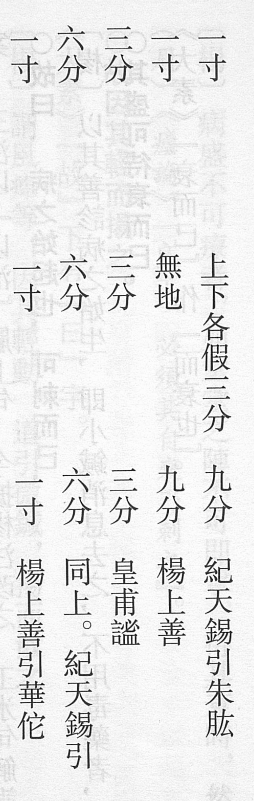

- 一寸　上下各假三分　九分　紀天錫引朱肱
- 一寸　無地　九分　楊上善
- 三分　三分　三分　皇甫謐
- 六分　六分　六分　同上。紀天錫引
- 一寸　一寸　一寸　楊上善引華佗

안(案): 양상선(楊上善)이 화타의 설을 인용하여 ‘이것이 무엇에 근거하였는지 알지 못하겠다’라 하였으나 이 설은 옳지 않다. 가만히 생각하건대 화씨가 말한 ‘3치’는 곧 양상선이 말한 ‘1치 9푼’이다. 주척(周尺) 3치는 바로 지금의 세 손가락을 대는 자리에 해당한다. 이에 근거하면 여러 설이 다르나 모두 같은 이치이다. 대개 기구(氣口)의 자리를 1치 9푼으로 한 것은 동신촌(同身寸)의 계산이고, 3치로 한 것은 주나라 때 척죽(尺竹)의 계산이니, 곧 「경맥별론(經脈別論)」의 말과 완전히 합치한다.

【楷】（眉）『홍결보행기(弘決輔行紀)』 제8에서 말하였다. “맥 짚는 법을 간략히 밝히면, 어(魚)부터 관(貫)까지를 척택(尺澤)이라 한다. 곧 엄지손가락 뒤 큰 가로무늬 앞을 어(魚)라 하고, 큰 가로무늬 뒤를 관(貫)이라 한다. 관 뒤 3치를 촌구(寸口)라 한다. 척 뒤 촌 앞을 관양(關陽)이라 한다.” 『홍결외전초(弘決外典抄)』가 이 글을 싣고 주해하여 말하였다. “『맥경요결(脈經要訣)』에 ‘삼부맥이란 촌을 상부로 하니 손바닥에 가깝다. 관은 중부, 척은 하부이다. 삼부맥은 한 부마다 서로 1치씩 떨어져 합하여 모두 3치를 이룬다’라고 하였다.”

【楷】（眉）안(案): 여기서 ‘按尺寸’ 운운하고, 「경맥별(經脈別)」에 “기구가 촌을 이루어 사생을 결단한다”, 「옥기진장(玉機真藏)」에 “오장이 각각 제때에 제 힘으로 수태음에 이른다”라 하였으니, 이상 세 곳은 모두 오늘날처럼 오직 손의 삼부만 쓰고 다른 팔후(八候)의 법을 쓰지 않는 것으로, 상고부터 나란히 달려 각각 전해 온 것이다.

도(圖)（眉）주척 3치를 자세히 정하면 이와 같다.

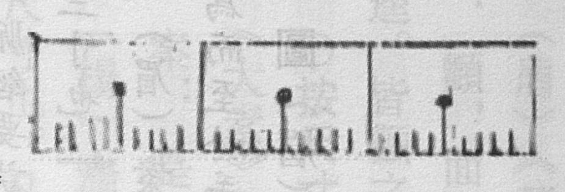

（眉）「경맥별론」 왕주에 “삼세(三世)의 맥법은 모두 3치를 촌·관·척의 구분으로 삼는다.”라 하였다. 살펴보건대[案] 주척을 가리킨 말이다.

（眉）지금 의사가 맥을 짚을 때 세 손가락을 내리면 손가락 사이에 약간 틈이 있어 바로 주척 3치에 해당한다. 대개 옛사람도 지금 사람의 진맥 모양과 같았을 것이다.

**○以治無過，以診則不失矣。**

이로써 치료하면 허물이 없고, 이로써 진찰하면 잃지 않는다.

〔楊〕이렇게 진후로 병의 근원을 안 뒤에 침·뜸·탕약 등의 법을 명하여 여러 병을 치료하면 반드시 병을 없애고 신령함을 입는 복이 있고, 결코 요절하거나 손상시키는 죄가 없으니, 진찰을 잘하면 잃음이 없기 때문이다.

안(案): 왕주는 ‘以治’를 윗구에 붙였으나 이제 양주에 근거하여 고쳤으니, 왕빙의 구두 풀이는 잘못이다.

**○故曰：病之始起也，可刺而已，**

그러므로 병이 처음 일어날 때는 찔러서 낫게 할 수 있고,

〔楊〕진찰을 잘하여 병이 처음 생길 때 곧 작은 침으로 조절해 없애고 독한 약을 쓰지 않으니, 이는 미약하여 쉽게 흩어지는 것이다.

**○其盛可待衰而已。**

성할 때는 쇠하기를 기다려 낫게 할 수 있다.

『대소』에는 ‘衰而已’가 ‘而衰也’로 되어 있다.

〔楊〕병이 성하여 치료할 수 없을 때는 당당한 진(陣)을 곧바로 칠 수 없는 것과 같으니, 그 쇠할 때를 기다린 뒤에 치료하면 쉽게 없앨 수 있다. 학질[瘧病] 따위가 그러하다.

（眉）「학론(瘧論)」에 “훌륭한 의사는 반드시 그것이 저절로 쇠하기를 기다린 뒤에 찌른다”라 하였다.

**○故因其輕而揚之，**

그러므로 가벼울 때는 그것을 따라 날려 흩고,

『대소』에는 ‘故’ 아래에 ‘曰’ 자가 있다.

〔楊〕풍비(風痺) 따위는 그 가볍게 움직이는 성질을 따라 도인(道引)과 미침(微鍼)으로 날려 흩는 것을 말한다.

（眉）아래 세 구를 앞선 주석은 대부분 탕약으로 다스리는 뜻으로 보았으니 크게 잘못이다. 이제 양주를 따른다. 그러나 이를 넓혀 쓰면 약으로 다스리는 데에도 맞는다.

**○因其重而減之，**

무거울 때는 그것을 따라 덜어 내며,

안(案): 가볍고 무거움[輕重]은 병이다. 날림과 덞[揚減]은 침의 한·토·하·온·청·보(汗吐下温清補)이다.

〔楊〕습비(濕痺) 따위는 그 무겁게 가라앉는 성질을 따라 번침(燔鍼)과 안위(按熨)로 점차 덜어 내는 것을 말한다.

**○因其衰而彰之。**

쇠할 때는 그것을 따라 드러낸다.

안(案): ‘彰’을 양주에서 크게 사하여 피를 보는 뜻으로 본 것은 따를 만하다. 왕주에서 진기가 왕성하여 혈색이 드러난다고 본 것은 타당하지 않다. 모든 치료가 다 그러하니, 어찌 유독 병이 쇠할 때뿐이겠는가. ‘衰’는 병세가 쇠한다는 뜻이니, 앞 구의 ‘衰’ 자와 같은 뜻이다.

우안(又案): 왕주는 전부 옳은 것인가[全是與].

〔楊〕전광(癲狂) 따위는 그 쇠할 때를 취하여 드러나게 사하여 없애는 것을 말한다.

**[역1]** 원서대로 옮겼다. 「尻」로는 뜻이 잘 통하지 않아 「居」의 옛 글자 「凥」의 잘못일 수 있으며, 그렇다면 「里居」의 뜻이다.
**[역2]** 원서대로 옮겼다. 채옹의 이 글은 통행 제목이 「釋誨」이나, 『快書五十種』 등에도 「蔡邕釋海」로 적은 예가 있다.

**○形不足者，温之以氣。**

형(形)이 부족한 경우는 기(氣)로 따뜻하게 한다.

안(案): 몸의 음이 허하고 찬 것은 약과 음식의 양열(陽熱)로 보한다.

〔楊〕추위를 타고 여위고 기가 적은 무리는 그 양기를 보함을 말한다.

안(案): 왕주(王注)가 기를 위기(衛氣)로 본 것은 옳지 않다. 대체로 음식과 약 두 가지에서 기가 많은 것은 형을 따뜻하게 하고 맛이 많은 것은 정을 보함을 말한다. 앞글에서 말한 ‘정은 기를 먹고 형은 맛을 먹는다’는 것은 그 상(常)을 말한 것이다. 형체 없는 정은 늘 기를 먹고, 형체 있는 혈은 늘 맛을 먹는다는 것이 이것이다. 여기서 말한 것은 이와 달리 그 변(變)을 말한 것이다. 혈이 허한 경우는 기가 들어가 표양(表陽)을 따뜻하게 하면 혈도 따라서 실해진다. 기가 허한 경우는 맛이 들어가 이음(裏陰)을 보하면 기도 따라서 실해진다. 결국 기와 맛은 서로 의지하고 혈과 기는 서로 낳으니 구별이 없다. 그러나 그 이치를 논하는 데 이르면 구별하여 말하지 않을 수 없다. 장개빈(張介賓)의 설이 옳다.

（眉）아래 두 구는 약·음식 물품의 기미(氣味)를 말한 것으로 이 편 첫 절과 같은 뜻이다. 대개 편 첫머리 기미 단락의 남은 것을 보충한 것이다.

**○精不足者，補之以味。**

정(精)이 부족한 경우는 미(味)로 보한다.

안(案): 몸의 양이 허하고 열한 것은 약과 음식의 음한(陰寒)으로 보한다.

〔楊〕오장의 정액이 적은 경우는 약과 음식의 다섯 가지 맛으로 보양한다.

〔張〕이는 바로 드러내는[彰之] 법을 말한 것인데, 약과 음식의 기미에 달려 있다. 형과 정으로 말하면 형은 양이고 정은 음이다. 기와 미로 말하면 기는 양이고 미는 음이다. 양은 밖을 지켜 굳건하게 하고, 음은 정을 간직하여 자주 일어난다[起亟]. 그러므로 형이 부족한 것은 양이 쇠한 것이니 기가 아니면 표에 이르러 따뜻하게 할 수 없다. 정이 부족한 것은 음이 쇠한 것이니 미가 아니면 속을 채워 보할 수 없다. 양의 성질은 따뜻하므로 ‘温’이라 하고, 음의 성질은 고요하므로 ‘補’라 한다. ［愚按］본론에 맛은 형으로 돌아가고 형은 맛을 먹으며, 기는 정으로 돌아가고 정은 기를 먹는다고 하였는데, 여기서는 형이 부족한 경우는 기로 따뜻하게 하고 정이 부족한 경우는 미로 보한다고 하니 뜻이 서로 반대인 듯하다. 이는 형은 정으로 이루어지고, 정은 기로 화하며, 기는 미로 생기고, 미는 기로 운행됨을 알지 못한 것이다. 그러므로 음양으로 말하면 형과 기는 모두 양이므로 따뜻하게 할 수 있고, 미와 정은 모두 음이므로 보할 수 있다. 청탁으로 말하면 미와 형은 모두 탁하므로 미는 형으로 돌아가고, 기와 정은 모두 맑으므로 기는 정으로 돌아간다. 그렇다면 기는 미를 벗어날 수 없고 미도 기를 벗어날 수 없으니, 기미에 음양·청탁의 구분이 있으나 실제로는 서로 의지하여 쓰이는 것이다.

**○其高者因而越之，**

높은 곳에 있는 것은 그 기세를 따라 넘겨 내보내고[越],

안(案): 상초 표외(表外)의 병을 침으로 땀 내고 토하게 하는 것이다. 침을 쓰면 땀과 구토가 일어난다. ‘因’ 자가 이 구의 핵심 글자[字眼]이다.

〔楊〕풍열이 머리와 가슴에 실하면 그를 따라 사하여 넘겨 내보낸다.

〔馬〕토하게 하여 위로 넘겨 내보냄을 말한다.

〔張〕‘越’은 발양(發揚)이다. 올려 흩고 토하여 솟구치게 하여 그 위의 표리를 다스릴 수 있음을 말한다.

『영(靈)』 「오사편(五邪篇)」에서 말하였다. “사기가 폐에 있으면 병이 운운. 결분(缺盆) 가운데를 취하여 넘겨 내보낸다.”

（眉）아래 세 구도 침치(鍼治)를 말한 것인데, 예로부터 오로지 약치(藥治)를 말한 뜻으로 보았으니 옳지 않다. 그러나 이를 돌려쓰면 약치에도 맞는다.

**○其下者引而竭之，**

낮은 곳에 있는 것은 끌어내어 다 없애며,

안(案): 하초의 다리 수종·소변 막힘 등을 침으로 소도(消導)하는 것이니, 침을 쓰면 소변이 잘 나온다. ‘引’은 멀리 끌어내는 것이다. ‘竭’은 그 병을 다 없애는 것이다.

〔楊〕한습이 허리와 발에 실하면 끌어내어 사하여 다 없앤다.

〔張〕‘竭’은 제거함이다. 씻어 내고 소통시켜 그 아래의 전후(前後)를 다스릴 수 있음을 말한다.

**○中滿者寫之於内，**

속이 그득한 경우는 안에서 사한다.

안(案): 중초의 명치와 배가 그득하고 실한 경우를 모두 침으로 사하하는 것이다. 침을 쓰면 대변이 시원하게 통해 나온다.

〔楊〕기가 장위 가운데 불러 있으면 사할 수 있다.

안(案): 왕주가 ‘内’를 뱃속으로 본 것은 따를 만하다. 뱃속이란 장위 밖 하초에서 수(水)·혈·기가 막혀 닫힌 곳을 말한다. 양주(楊注)는 옳지 않다. 설명은 『상한고주(傷寒攷注)』 당귀사역(當歸四逆) 아래에 보인다.｟廿七卷廿六ノ六｠

〔張〕‘中滿’ 두 글자는 가장 자세히 살펴야 한다. 곧 비(痞)·만(滿)·대실(大實)·견(堅)을 말하므로 안에서 사해야 한다. 만약 겉으로 부종이 보여 불러 있고 속에 있지 않은 것은 중만이 아니니, 함부로 공사(攻寫)하면 반드시 해가 된다. 이 절의 요점은 무엇보다 ‘中’ 한 글자에 있다.

**○其有邪者，漬形以爲汗。**

사기가 있는 경우는 형체를 적셔 땀을 낸다.

『대소(大素)』에는 ‘漬形’이 ‘清’ 한 글자로 되어 있다.

（眉）이 한 구는 씻고 목욕하여 땀을 내는 법을 말한다. 중경(仲景)의 책에서 洗라 하고 潠이라 하고 灌이라 한 것이 모두 이 적시는 법이며, 훈증(熏蒸)도 이 부류일 뿐이다. 요컨대 기표(肌表)를 다스리는 것이다.

〔張〕사기가 기표에 있으므로 형체를 적셔 땀을 내야 한다. ‘漬’는 담금이다. 땀이 나는 것이 적신 듯하게 함을 말한다. 예컨대 허윤종(許胤宗)은 황기방풍탕(黃芪防風湯) 수십 곡(斛)을 침상 아래 두어 김을 쐬어 땀을 냈고, 장묘(張苗)는 땅을 태우고 그 위에 복숭아 잎을 깔아 김을 쐬어 땀을 냈으며, 혹은 약을 달인 탕으로 목욕하고 씻었으니, 모두 형체를 적시는 법이다.

안(案): 사기가 기육에 깊이 들어가면 형체를 적시지 않고는 땀이 날 수 없는 이치이다. 뒷글과 함께 보아야 한다.

「오상정대론(五常政大論)」에 “서북의 기는 흩어 차게 한다”라 하였고, 왕주에 “‘散’은 따뜻하게 목욕시켜 안팎을 조달(條達)시키는 것을 말한다.”라 하였다.

또 “기가 차고 서늘하면 차고 서늘한 것으로 다스리고, 물을 써서 적신다”라 하였고, 왕주에 “물을 써서 적신다는 것은 탕에 담가 적시는 것이다.”라 하였다.

『병원후론(病源候論)』 「상한후(傷寒候)」에 “상한이란 풍한에서 시작되어 주리로 들어가 정기와 서로 다툰다. 영위가 막혀 두루 돌지 못하니, 1일에서 2일까지는 기가 구멍과 피부 사이에 있으므로 병자가 머리가 아프고 오한(惡寒)이 나며 허리와 등이 뻣뻣하고 무겁다. 이는 사기가 표에 있는 것이니 씻고 목욕하여 땀을 내면 곧 낫는다.”라 하였다.

안(案): 『병원』에서 말한 ‘洗浴發汗’이 바로 본편에서 말한 ‘漬形爲汗’이다.

황국(皇國)에서는 옛날부터 이 법을 전해 써서 『由由天』이라 이름하였으니, 『영화물어(榮花物語)』와 『협의(狹衣)』에 보이고 『난헌유고(蘭軒遺藁)』에 자세히 갖추어져 있다. 이제 그 대략을 다음에 적는다.

『영화물어』 「월연(月宴)」 권에 이르기를, 『九條殿奈也末之宇於保左禮天。御加勢奈止以比天。於保牟由由天奈止之天。九寸里幾古之女志天。寸久左世給不保止仁。云云。』

또 「옥촌국(玉村菊)」 권에 이르기를, 『大將殿日古呂御古古知奈也末之久於保左留。御風奈止仁也止天。御由由天世左世給保遠幾古之女之。云云。』

『협의』에 이르기를, 『雪也介仁女之毛波禮天。奈也末之宇。於保左流連波。由天都久呂比奈止之天。云云。』

『외대비요(外臺祕要)』 권3: “허인칙(許仁則)이 논하였다. ‘음양상한(陰陽傷寒)이란 독기가 음양의 기를 상한 것이다. 운운. 먼저 복숭아·버드나무 등 세 가지를 함께 달인 탕으로 목욕해야 한다. 처방: 도지(桃枝)｟잘게 썬 것 5말｠　유엽(柳葉)｟잘게 썬 것 5말｠　초장수(酢漿水)｟1말｠　위의 약은 먼저 물 1섬으로 복숭아·버드나무 가지와 잎 두 가지를 달여 즙 7말을 취하고 찌꺼기를 버린다. 초장수(醋漿水)를 넣고 저어 뜨거울 때 목욕하고, 목욕을 마치면 몸을 닦아 말린 뒤 가루로 문지르며, 바람을 쐬지 말고 밀폐된 곳에서 머리·눈 뒤 양쪽과 혀 아래를 찔러 피가 그치면 소금 가루로 찌른 곳을 누르고 이불 속에 들어가 눕는다.’”

『성혜방(聖惠方)』에서 시기(時氣) 2일에 머리가 아프고 장열(壯熱)이 나는 것을 치료하는 수해산(水解散)의 방후(方後)에 “약을 먹기 전에 먼저 뜨거운 물로 씻고 목욕한 뒤 이 약을 먹고 옷을 덮어 땀을 낸다.”라 하였다.

또 시기 2일에 장열이 나고 으슬으슬 추우며[增寒] 머리가 아프고 허리와 등뼈가 뻣뻣한 것을 치료하는 중시호산(重柴胡散)의 방후에 “뜨거운 물로 씻고 목욕한 뒤에 이 약을 먹고 옷을 덮어 땀을 낸다.”라 하였다. 『신교만전방(神巧萬全方)』에 “먼저 따뜻한 물로 씻고 목욕한 뒤 조협(皂莢)을 태운 가루를 생강즙과 꿀[密]에 섞어 먹으면 잠시 뒤 땀이 나고 낫는다.”라 하였다. 『의방유취(醫方類聚)』에서 인용하였다.[역1]

**○其在皮者，汗而發之。**

피부에 있는 경우는 땀을 내어 발산시킨다.

안(案): ‘在皮’라 한 것은 앞글의 ‘有邪者’를 받아 말한 것이고, ‘汗而發之’는 따뜻하게 덮어 약간 땀을 내는 것을 말한다.

안(案): 이는 가벼운 병에 침으로 땀을 내는 법이다.

〔楊〕‘清’은 차가움이다. ‘耶’는 장위의 한열 병기이다. 혹 장부에 들어가고 혹 피모에 있으니, 모두 침과 약으로 조절하여 땀을 내보낸다.

〔張〕앞에서 말한 ‘有邪者’는 경락까지 아울러 말한 것으로 깊은 것을 말하고, 여기서 말한 ‘在皮者’는 얕은 것을 말한다. 모두 표증이므로 다 땀을 내야 한다.

（眉）아래 세 구도 침치를 말한 것이나 운용하면 약치에도 맞는다. 앞선 주석이 이 구들을 곧바로 약치의 뜻으로 본 것은 잘못이다.

**○其慓悍者，按而收之。**

사납고 날랜[慓悍] 경우는 눌러서 거두어들인다.

『대소』에는 ‘收’가 ‘投’로 되어 있다.

안(案): 이는 침으로 보하여 찌르는 법이다.

〔楊〕‘慓’는 방조반(芳照反)이니, 급하고 빠르다는 뜻이다. ‘悍’은 호단반(胡旦反)이다. 그 기가 급하여 흩어지지 않게 막으려면 손으로 눌러 잡은 뒤에 침을 놓는다.

안(案): 慓悍이란 그 사람의 양이 약하여 탈하려는 증이다.

안(案): 慓悍이란 본기(本氣)가 빠르고 날카로움을 말한다. 按과 收는 모두 침법이니, 대개 침을 놓은 뒤 손가락으로 눌러 기가 흩어지지 않게 하는 것을 말한다. 양주가 침법으로 본 것은 따를 만하다.

**○其實者，散而寫之。**

실한 경우는 흩어서 사한다.

안(案): 이는 침으로 사하여 찌르는 법이다.

〔楊〕실한 것은 모두 흩어 사한다.

안(案): 散과 寫는 모두 침법이니, 양주를 따를 만하다.

**○審其陰陽，以別柔剛。**

그 음양을 살펴 유강(柔剛)을 가린다.

안(案): 음병에는 부드러운 것으로 다스린다는 뜻이다.

〔張〕형증에도 유강이 있고 맥색에도 유강이 있으며 기미에는 더욱 유강이 있다. 유는 음에 속하고 강은 양에 속한다. 유강의 변화를 아는 이는 음양의 묘용을 아는 것이므로 반드시 살펴 가려야 한다.

**○陽病治陰，陰病治陽。**

양병은 음을 다스리고, 음병은 양을 다스린다.

안(案): 열병에는 진액을 더하고 한병에는 기를 보함을 말한다.

〔楊〕대체로 물건이 부드럽고 약한 것은 양의 무리이고 굳세고 강한 것은 음의 무리이다. 음경이 사기를 받아 양경으로 흘러들어 병이 되면 음경이 본(本)이 되고 양경이 표(標)가 되니, 그 본을 치료하는 것은 음경을 치료하는 것이므로 곧 양병에 음을 치료하는 것이다. 양경이 사기를 받으면 음을 치료하는 것에 준하여 양을 치료하니, 곧 음병에 양을 치료하는 것이다. 또 음양 두 경에서 음경이 실하면 양경은 반드시 허하고, 양경이 실하면 음경은 반드시 허하다. 그러므로 양이 허한 병은 음을 사해야 하고, 음이 실한 병은 양을 보해야 한다.

**○定其血氣，各守其鄉。**

그 혈과 기를 정하여 각각 그 자리[鄉]를 지킨다.

안(案): 병이 기에 속하는지 혈에 속하는지, 양에 속하는지 음에 속하는지의 구별을 단정하여, 그 경혈·부수(府俞)를 지켜 다스리는 것이다. ‘鄉’도 마을[里邑]을 말하니 곧 혈자리를 가리킨다.

〔張〕병이 혹 혈분(血分)에 있고 혹 기분(氣分)에 있으니, 각각 그 자리를 살펴야 하며 어지럽혀서는 안 된다.

**○血實宜決之，氣虛宜㸷引之。**

혈이 실하면 터서 빼내야 하고, 기가 허하면 끌어당겨야[㸷引] 한다.

『대소』에는 ‘㸷’이 ‘掣’로 되어 있다.

〔楊〕병이 기에 있는지 혈에 있는지 정하여 각각 혈기 병의 다른 자리를 지켜, 사할 때는 침으로 찔러 실한 피를 빼내고, 보할 때는 침으로 기를 이끌고 피부를 끌어 보하고 나서 피부를 늦추어 문을 닫아 기가 새지 않게 한다. ‘掣’는 사예반(死曳反)이니, 끈다는 뜻이다.

안(案): 『갑을(甲乙)』에도 ‘㸷’이 ‘掣’로 되어 있다. 살펴보면 ‘㸷’은 곧 ‘掣’의 와자(訛字)이지, 牛를 따르는 ‘㸷’ 자가 따로 있는 것이 아니다. 베껴 쓴 사람이 손이 잘못하여 牛로 썼을 뿐이니, 왕빙(王氷)의 옛 본은 아마 牛를 따르지 않았을 것이다.

안(案): ‘決’은 낙맥을 찌르는 것이니 왕주가 옳다. ‘掣引’은 의사[工人]가 손으로 병자의 피부와 살을 끌어당기는 것이니, 이것으로 침 구멍을 닫아 덮는 것이다. 「이합진사론(離合真邪論)」에 자세히 보인다. 대개 결법(決法)은 침 구멍을 열므로 사법이 되고, 철인법(掣引法)은 침 구멍을 닫으므로 보법이 된다.

（眉）이상 제5장 끝.

경신년(庚申年) 4월 15일 베껴 마침. 입지(立之) 약囪(若囪)

제5 보(第五補)

기미의 매운맛·단맛은 발산하여 양이 된다[氣味辛甘發散爲陽]｟五ヲ｠

「지진요대론(至真要大論)」: “황제가 물었다. ‘오미 음양의 작용은 어떠한가?’ 기백이 답했다. ‘매운맛과 단맛은 발산하여 양이 되고, 신맛과 쓴맛은 용설(涌泄)하여 음이 되며, 짠맛은 용설하여 음이 되고, 담담한 맛은 삼설(滲泄)하여 양이 된다. 이 여섯은 거두거나 흩고, 늦추거나 급하게 하며, 말리거나 적시고, 무르게 하거나 굳게 한다. 이로운 바에 따라 행하여 그 기를 조절해 고르게 한다.’”

미세할 때 보고 넘어선다[見微得過]｟廿五ヲ｠

안(案): 병이 얕고 미세할 때 보아 치료하여 그것을 넘어섬[過]을 말한다. 왕주에서 말한 ‘깊이 밝게 알기 때문이다’도 아마 이 이치일 것이다. 여러 주석가가 대부분 과실의 뜻으로 보았으나 옳지 않은 듯하다.

간은 변동(變動)에서 악(握)이 되고, 심은 우(憂), 비는 얼(噦), 폐는 해(欬), 신은 율(慄)이 된다[肝在變動爲握，心爲憂，脾爲噦，肺爲欬，腎爲慄]

「금궤진언(金匱真言)」: “간은 그 병이 경해(驚駭)로 나타나니, 이로써 병이 근에 있음을 안다.” 「오상정론(五常政論)」: “그 장은 간이고, 그 병은 지폐(支廢)·옹종(癰腫)·창양(瘡瘍)이다.” 『관자(管子)』 「입국편(入國篇)」: “대체로 국도에는 모두 질병자를 맡아 기르는 일[掌養疾]이 있으니, 귀머거리·소경·벙어리·절름발이·편고·악체(握遞)이다.” 그 주에 “‘遞’는 붙음이다. 두 손이 서로 맞잡아 붙어 펴지지 않는 것을 握遞라 한다.”라 하였다. 『사기(史記)』 「사마상여전(司馬相如傳)」 『색은(索隱)』이 공문상(孔文祥)을 인용하여 “‘握齪’은 국촉(局促)이다.”라 하였고, 『한서(漢書)』에는 ‘握𪘏’으로 되어 있으며 주에 “‘握齪’은 국협(局陿)이다.”라 하였다. 또 「역생육가전(酈生陸賈傳)」 『집해(集解)』가 응소(應劭)를 인용하여 “‘握齱’은 급하고 촉박한 모양이다.”라 하였다. 여기 왕주의 “握은 끌어당겨 오그리는 것이다[所以牽就]”에서, 살펴보건대[案] ‘就’는 곧 ‘蹴’의 고자(古字)이다. 『논어(論語)』 「향당(鄉黨)」의 “발을 종종걸음으로 하여 따르는 바가 있는 듯하였다[足蹜蹜如有循]”에 대해 황소(皇疏)에 “‘蹜蹜’은 ‘蹴蹴’과 같다.”라 하였다. 『문선(文選)』 「우렵부(羽獵賦)」 주에 “‘蹙’과 ‘蹵’은 고자로 통한다.”라 하였다. 『시(詩)』 「강유사(江有汜)」 『전(箋)』의 『석문(釋文)』에 “‘蹙’은 본래 ‘蹴’으로도 쓴다.”라 하였다. 『예기(禮記)』 「곡례(曲禮)」의 ‘足蹙’을 『석문』에서 “본래 ‘足蹴’으로도 쓴다.”라 하였다. 『광운(廣韻)』에 ‘蹴’과 ‘蹙’은 같은 음이다. ‘蹴’을 ‘就’로 쓰는 것은 ‘蹙’을 ‘戚’으로 쓰는 것과 같다.

안(案): 握은 곧 손발이 당기고 굽어 오그라드는 증상이니, 곧 지금의 간증(肝症)으로 억간서근(抑肝舒筋)해야 한다. 요컨대 대체로 입·눈·등·배가 당기고 비뚤어지는 것도 握이다. 『영』 「종시(終始)」에서 말하였다. “손이 굽어 펴지지 않는 것은 그 병이 근에 있다.”

안(案): ‘憂’는 곧 ‘嚘’이다. 『옥편(玉篇)』에 “‘嚘’는 어구절(於求切)이다. 노자가 ‘終日號而不嚘’라 하였다. 嚘는 기가 거스르는 것이다.”라 하였다. 『광운』 십팔우(十八尤)에 “‘歐嚘’는 탄식이다. ‘歔’는 기가 거스르는 것이다.”라 하였다. 『노자(老子)』의 ‘終日號而不嗄’에 대해 『석문』에 “일매반(一邁反)이니 기가 거스르는 것이다. 또 어개반(於介反)이다. ‘而聲不嗄’의 嗄는 ‘噫’로 써야 한다.”라 하였고, 임희일(林希逸)은 “‘嗄’는 기가 거스르는 것이다.”라 하였다.｟［約之案］ 口를 따르고 夏가 소리이다.｠ 『대현경(大玄經)』 「이(夷)」에 ‘柔嬰兒於號，三日不嗄’라 하였고, 범주(范注)에 “‘嗄’는 근심하고 그리워하는 소리이다.”라 하였다. 『석문』에 “‘憂’는 ‘嚘’로 되어 있다.”라 하고 “음은 우(憂)이니 탄식이다.”라 하였으며, 또 “‘嗄’는 소가절(所嫁切)이다.”라 하였다. 『설문(説文)』에 “‘欭’는 嚘이다.” “‘嚘’는 말이 아직 정해지지 않은 모양이다.”라 하였고, 단옥재(段玉裁)는 “‘歐嚘’는 쌍성(雙聲)이다. 「왕풍(王風)」 ‘中心如噎’의 전(傳)에 ‘噎憂하여 숨을 쉬지 못한다[噎憂不能息也]’라 하였으니, ‘噎憂’는 곧 ‘歐嚘’의 가차자(假借字)이다. 「정풍(鄭風)」의 전에 ‘不能息은 憂하여 숨을 쉬지 못하는 것이다’라 하였으니, 이 ‘憂’도 곧 ‘嚘’ 자이다. 모두 기가 막혀 순조롭지 않음을 말한다.”라 하였다. 『진본옥편(真本玉篇)』에 “‘歔’는 어우반(於牛反)이다. 『노자』에 ‘終日於｟（號로 의심된다）｠而不歔’라 하였다. 야왕(野王)이 살펴보건대 歔는 기가 거스르는 것이다. 지금은 모두 嚘 자로 쓴다.”라 하였고, 또 “‘欭’는 어리반(於利反)이다. 『설문』에 嚘이라 하였고, 『성류(聲類)』에 고르지 않음이라 하였다. 야왕이 살펴보건대 嚘는 기가 거스르는 것이다.”라 하였다. 『방언(方言)』 권1에 “‘謾臺’·‘脅鬩’은 두려워함이다. 송(宋)·위(衛) 사이에서는 성내어 噎噫하는 것을 脅鬩이라 한다.”라 하였고, 곽주(郭注)에 “‘噎噫’는 憂를 말한다.” “‘噫’는 앙미반(央媚反)이다.”라 하였다. ‘央媚反’은 欭의 음 ‘於利反’과 같은 음이니, 곽주의 ‘憂’ 자도 곧 ‘嚘’ 자일 뿐이다. 『병원(病源)』 권1 「풍의후(風癔候)」에 “그 증상은 갑자기 사람을 알아보지 못하고 목구멍 속에서 噫噫 하는 소리가 나며 혀가 뻣뻣하여 말을 하지 못한다.”라 하였다. 『집운(集韻)』 십팔우(十八尤)에 “‘嚘’는 ‘歔’로 통용한다.”라 하였고, 또 “‘欭歔’는 탄식이다. 일설에 기가 거스르는 것이다. 『노자』에 ‘終日號而不歔’라 하였다.”라 하였다. 이로써 ‘憂’가 고자이고 ‘嚘’·‘歔’가 금자(今字)이며 ‘嗄’도 금자로서 모두 같은 음인 어우반(於牛反)이며, 혹 ‘噫’로 읽기도 하는데 음이 역시 같음을 알 수 있다. 육현랑(陸玄朗)의 말이 옳다. 그리고 모두 噫의 다른 이름이다. 요컨대 噎窒도 噫와 같은 부류로서 모두 가슴속 담음(痰飲)의 일에 속하므로 심병으로 삼은 것이다. 噦에 이르러서는 반드시 담음(淡飲)에 속하지는 않으므로 심병이 될 수 없으니, 이는 참으로 위·비의 일이다. 「선명오기(宣明五氣)」와 『영』 「구침론(九鍼論)」에서 모두 “심은 噫가 된다”라 하였다. 「맥해편(脈解篇)」에서 “이른바 위로 심에 달려가 噫가 된다는 것은 음이 성하여 위로 양명으로 달려가는데, 양명의 낙맥이 심에 속하므로 위로 심에 달려가 噫가 된다고 한다.”라 하였다. 「비론(痺論)」에서 “심비(心痺)는 맥이 통하지 않아 번거로우면 명치 아래가 북처럼 뛰고, 갑자기 기가 치밀어 숨이 차며, 목구멍이 마르고 잘 噫하며, 궐기(厥氣)가 위로 오르면 두려워한다.”라 하였다. 「자금론(刺禁論)」에 “심을 찔러 맞히면 하루 만에 죽으니, 그 동(動)은 噫가 된다.”라 하였고, 왕주에 “심은 기에서 噫가 된다.”라 하였다. 유계산(劉桂山)은 “握·噦·欬·慄은 모두 병에 속하나 憂는 지(志)이니 변동이라 하지 않아야 마땅하다. 반드시 글자가 잘못된 것인데 글로 고증할 수 없으니 잠시 두어 뒷날의 고증을 기다린다.”라 하였다. 이 설은 憂가 噫의 이름임을 몰랐기 때문이다. 왕주는 이 글에 대해 “憂는 일을 이룰 수 있다[成務]”라 하였다. 성무란 몸을 움직이는 것을 말하니, 물과 음식이 안에 쌓여 장기(藏氣)가 울체되므로 噫를 내어 그것을 내보낸다. 몸을 움직이면 쌓인 것이 풀려 흩어지므로 그 噫逆이 그침을 알 수 있다. 이로써 왕주가 憂를 噫로 본 것이 틀림없다. 또 살펴보건대[又案] ‘於介反’의 嗄와 ‘所嫁反’의 嗄는 본디 다른 글자이다. 또 중풍의 ‘癔’ 자를 ‘懿’로도, ‘噎’로도, ‘噫’로도 쓰니, 모두 ‘欭’와 같은 음이다. 또 『설문』 구부(口部)에서 말한 “嚘는 말이 아직 정해지지 않은 모양이다”는 嚘·欭의 뜻과 본디 다르다. 어떤 이는 “‘憂’는 곧 ‘嚘’의 잘못이다. 속자로 噫 자를 嚘로 쓴다.”라 하였는데, 이 설은 옳지 않다. 또 살펴보건대[又案] 『천금(千金)』 권17 「폐로(肺勞)」 제3 반하탕(半夏湯) 장(章)에 “명치와 배가 차고, 기가 거스르고 떠도는 기가 있으며, 가슴과 옆구리에 기가 그득하고, 憂氣가 오가며 구역한다.”라 하였으니, 이 ‘憂’ 자도 噫의 뜻이다. 『시』 「상유(桑柔)」에 “저 바람을 거슬러 가는 듯이 또한 몹시 숨이 막힌다[亦孔之僾]”라 하였고, 『전(傳)』에 “‘僾’는 唈이다.”라 하였으며, 『석문』에 “음은 애(愛)이다.”라 하였다. 일본의 후등씨(後藤氏)는 ‘僾’를 噎로 훈독하였다.[역2][역3]

우안(又案): 「자금편(刺禁篇)」 五二에 “심을 찔러 맞히면 하루 만에 죽으니, 그 동은 噫가 된다”라 하였으니, 이 또한 심의 변동이 噫가 된다는 분명한 증거이다.

또 『설문』에 “‘䯉’은 목구멍에서 숨이 순조롭지 않은 것이다.”라 하였고, 서현(徐鉉)의 음은 ‘오팔절(烏八切)’이니, 이 또한 ‘噎’의 다른 이름이다. 또 『장자(莊子)』 「대종사(大宗師)」 『석문』에 “‘哇’는 최(崔)의 일음(一音)에 어가반(於佳反)이니 맺힘이다. 목구멍의 기가 맺혀 막혀 통하지 않음을 말한다.”라 하였으니, 이 또한 噫·噎의 다른 이름이다. 또 「경상초편(庚桑楚篇)」에 “어린아이가 종일 울어도 목이 쉬지 않으니 조화가 지극한 것이다.”라 하였고, 『석문』에 “‘嗄’는 어매반(於邁反)이다. 본래 ‘嚘’로도 쓴다. 서(徐)의 음은 우(憂)이다.”라 하였다.

『대현(大玄)』 「의(疑)」의 ‘貞厲嚘鳴’ 주에 “‘嚘’는 울며 탄식함이다.”라 하였다. 『집운』이 『창힐(蒼頡)』을 인용하여 “‘嚘’는 歔이다.”라 하였다.

안(案): ‘慄’은 『영』 「구문편(口問篇)」에 나온다.

간은 지(志)에서 노(怒)가 되고, 심은 희(喜), 비는 사(思), 폐는 우(憂), 신은 공(恐)이 된다[肝在志爲怒，心爲喜，脾爲思，肺爲憂，腎爲恐]

「선명오기」와 『영』 「구침론」에서 모두 “정기가 다섯 장에 아울러 모이니, 간에 모이면 근심하고, 심에 모이면 기뻐하며, 폐에 모이면 슬퍼하고, 신에 모이면 두려워하며, 비에 모이면 겁낸다.”라 하였다. 「오운대론(五運大論)」에 “간은 그 지가 노이고, 심은 희, 비는 사, 폐는 우, 신은 공이다.”라 하였다.

안(案): 성내는 이는 반드시 근심이 있고, 근심하는 이는 반드시 노기가 있으니 한 이치이다. 겁내는 이는 반드시 생각이 있고, 생각하는 이는 반드시 두려움이 있으니 이것도 한 이치이다. 근심하는 이는 반드시 슬퍼하고, 슬퍼하는 이는 반드시 근심하니 이것도 한 이치이다.

우안(又案): 본편 윗글에 “사람에게는 오장이 있어 오기(五氣)를 화하여 희·노·비·우·공을 낳는다”라 하였으니, 思도 悲와 한 이치여서 생각하는 이는 반드시 슬픔이 있고 슬퍼하는 이는 반드시 생각이 있다. 「천원기대론(天元紀大論)」의 『신교정(新校正)』은 思와 悲가 서로를 이룬다고 보았다.

「천원기대론」에서 “사람에게는 오장이 있어 오기를 화하여 희·노·사·우·공을 낳는다”라 하였으니, 이것과 같다.

「옥기진장론(玉機真藏論)」에서 “우·공·비·희·노는 그 차례대로 전해지지 않게 하므로 사람에게 큰 병이 생기게 한다.”라 하였으니, 본편 윗글과 같다.

안(案): 悲와 憂는 서로 통한다. 「조경론(調經論)」 왕주의 ‘悲는 어떤 본에 憂로 되어 있다’는 잘못이다. 『신교정』에 “『갑을경(甲乙經)』과 『대소』 및 전원기(全元起) 주본에는 모두 憂로 되어 있다. 황보사안(皇甫士安)은 ‘심이 허하면 슬퍼하고, 슬퍼하면 근심한다’라 하였다.”라 하였으니, 증거로 삼을 만하다.

『예기』 「중용(中庸)」에서 “희로애락(喜怒哀樂)”이라 하였다.

『영』 「본신편(本神篇)」: “심은 두려워하고 사려하면 신(神)을 상하고, 비는 근심하여 풀리지 않으면 의(意)를 상하며, 간은 슬픔이 속을 움직이면 혼(魂)을 상하고, 폐는 기쁨과 즐거움이 끝이 없으면 백(魄)을 상하며, 신은 크게 성내어 그치지 않으면 지(志)를 상하고, 두려움이 풀리지 않으면 정(精)을 상한다.”

안(案): 이는 상극으로 그 장을 치는 것이니, 思는 수(水), 憂는 목(木), 哀는 금(金), 喜는 화(火), 怒·恐은 토(土)가 된다.

음양은 천지의 도이다[陰陽者，天地之道也]｟一ヲ｠

『한서』 「예문지(藝文志)」 오행가 31가에 “『태일음양(泰一陰陽)』 23권. 『황제음양(黃帝陰陽)』 25권. 『황제제자논음양(黃帝諸子論陰陽)』 25권. 『제왕자논음양(諸王子論陰陽)』 25권. 『태원음양(太元陰陽)』 26권. 『삼전음양담론(三典陰陽談論)』 27권. 『음양오행시령(陰陽五行時令)』 19권.”이 있다. 또 “오행이란 오상(五常)의 형기(形氣)이다. 『서(書)』에 ‘첫째는 오행이요, 둘째는 오사(五事)를 나아가 쓰는 것이다’라 하였으니, 오사를 나아가 써서 오행을 따름을 말한다. 모습·말·봄·들음·생각에서 마음을 잃으면 오행의 차례가 어지러워지고 오성(五星)의 변이 일어나니, 모두 율력(律曆)의 수에서 나와 갈라져 한 갈래가 된 것이다. 그 법은 또한 오덕종시(五德終始)에서 일어났으니, 그 끝을 미루면 이르지 않는 데가 없으나, 소수가(小數家)가 이로 인해 길흉을 점쳐 세상에 행해지면서 점점 서로 어지러워졌다.”라 하였다. 살펴보건대[案] 『소문(素問)』의 음양오행 여러 논은 대개 『한지(漢志)』에서 말한 『황제음양』 등의 책이 남긴 말이 겨우 여기에 남은 것이다. 무릇 사람은 음양오행의 기를 받아 서로 생성하므로 잠시도 이 기를 떠날 수 없다. 이 기의 지나침과 모자람이 질병이 되고, 이 기의 떠남과 합함이 죽음과 삶이 된다. 후세의 거친 의사[麤工]가 음양오행을 별개의 논으로 여기고, 또 한나라 유학자가 지은 것이라 하는데, 아마 그렇지 않을 것이다. 신농·황제의 학문은 다행히 방기가(方技家)에 있었으므로 진나라의 불길을 면할 수 있었고 『한지』가 이를 기록하였다. 지금의 『내경(内經)』·『본초(本草)』 두 책은 곧 옛 경전이 온전히 전해 남은 것으로 의심할 여지가 없다. 권제1의 편제(篇題) 아래와 함께 보아야 한다.[역4]

성(聲)｟十二ヲ｠

안(案): 천지 조화의 기가 내 몸에 스며드는 것이 마치 그물 바구니 속에 있고 물속에 있는 것과 같은데, 입과 코가 가장 많이 끌어 마셔 폐로 들이고 이어 다른 장에 미친다. 소리를 내려 하면 신(神)이 위로 올라 폐막(肺膜) 안의 천기를 불어 격동시키므로, 진신(真神)과 천기가 폐 안에서 서로 부딪혀 이 음성을 내는 것이니, 피리·퉁소와 같은 이치이다. 『포박자(抱朴子)』에서 “사람은 기 가운데 있고 기는 사람 가운데 있다”라 한 것이 이것이다.

장화소기(壯火少氣)｟五オ｠

『본초회(本草匯)』 권5에서 말하였다. “사람이 날마다 쓰는 불사름은 군화(君火)에 속하고, 하늘의 용뢰(龍雷)·해화(海火)는 상화(相火)에 속한다. 상화는 하늘에서는 용뢰와 바다에서 나오고, 사람에게서는 하초의 간신(肝腎)에 갖추어져 있다. 상화는 모두 땅속의 음기에 근본하니, 때 없이 망동하면 음이 졸여져 병들고 죽는 단서가 된다. 도심(道心)의 명을 들어 고요함을 주로 하면 음이 길러져 운행하게 되므로, 여러 병이 대부분 상화에 속한다.”

　양생음장(陽生陰長), 양살음장(陽殺陰藏)｟一ウ｠

『상한직격(傷寒直格)』에서 말하였다. 장부·경락의 배합.

인(寅) 삼초 수소양(三焦手少陽)　묘(卯) 대장 수양명(大腸手陽明)　진(辰) 소장 수태양(小腸手太陽)　수삼양(手三陽)　부(府)　봄[春]

사(巳) 포락 수궐음(包絡手厥陰)　오(午) 심 수소음(心手少陰)　미(未) 폐 수태음(肺手太陰)　수삼음(手三陰)　장(藏)　여름[夏]
신(申) 담 족소양(膽足少陽)　유(酉) 위 족양명(胃足陽明)　술(戌) 방광 족태양(旁胱足太陽)　족삼양(足三陽)　부(府)　가을[秋]

해(亥) 간 족궐음(肝足厥陰)　자(子) 신 족소음(腎足少陰)　축(丑) 비 족태음(脾足太陰)　족삼음(足三陰)　장(藏)　겨울[冬]

또 말하였다. “육기(六氣)의 유여·부족. 맹(孟)은 적고 중(仲)은 고르며 계(季)는 많다. 『내경』은 인·신·사·해 네 맹월을 일음일양으로, 자·오·묘·유 네 중월을 이음이양으로, 진·술·축·미 네 계월을 삼음삼양으로 삼는다.”

제5(五)　생장살장(生長殺藏)｟一ウ｠　한기열기(寒氣熱氣)｟二ヲ｠　진창(䐜脹)｟二ヲ｠　반작(反作)｟二ウ｠　장화소화(壯火少火)｟四ウ｠　기미음양(氣味陰陽)｟五ヲ｠　풍한서습조열(風寒暑濕燥熱)｟七ヲ｠　동상어한(冬傷於寒)｟九ウ｠　계곡(谿谷)｟十ウ｠　형능(形能)｟十四ウ｠　능시(能始)｟十四ヲ｠　면앙(俛仰)｟十四ヲ｠　칠손팔익(七損八益)｟十五ヲ｠　체읍구출(涕泣倶出)｟十八ウ｠　팔기오리(八紀五里)｟廿ウ｠　권형규구(權衡規矩)｟廿六ヲ｠　척촌금삼부일건(尺寸今三部一件)｟廿七ヲ｠　지형위한(漬形爲汗)｟卅ヲ｠　표한(慓悍)｟卅一ウ｠

**[역1]** 원서의 구두대로 「重柴胡散」으로 옮겼으나, 「腰脊強重，柴胡散」으로 끊어 허리와 등뼈가 뻣뻣하고 무거운 증상에 쓰는 시호산으로 읽을 수도 있다.
**[역2]** 원서의 「噎室」은 「室」로는 뜻이 잘 통하지 않아 「窒」의 잘못일 수 있으므로 「噎窒」의 뜻으로 옮겼다.
**[역3]** 원서에는 「噎室」로 되어 있으나 같은 쪽의 「氣室塞不利」와 마찬가지로 「室」은 문맥상 「窒」의 뜻으로 보여 「噎窒」로 옮겼다.
**[역4]** 원서의 구두대로 「思」 뒤에서 끊어 옮겼으나, 「貌言視聽思心失」로 이어 읽을 여지도 있다.

#### 음양이합론(陰陽離合論)편 제6

『대소(大素)』 권5 「음양합(陰陽合)」에 이 편이 전부 실려 있다.

（眉）안(案): 이 편은 고문이 뒤섞여 읽기 어렵다. 그 유래가 오래되었음을 생각해 볼 만하다.

**○黃帝問曰：余聞天爲陽，地爲陰，日爲陽，月爲陰。大小月三百六十日，成一歲，人亦應之。**

황제(黃帝)가 물었다. “나는 하늘은 양(陽)이 되고 땅은 음(陰)이 되며, 해는 양이 되고 달은 음이 되며, 큰달과 작은달 360일이 한 해를 이루고, 사람도 이에 응한다고 들었다.

『대소』에는 ‘問’ 자가 없고, ‘大小月’ 세 글자가 없으며, ‘十’ 아래에 ‘五’ 자가 있다. 옳은 듯하다. 이는 태양년(太陽年)을 가리키니 「요전(堯典)」과 같다. 지금 ‘大小月’이라는 말이 있으니 태음년(太陰年)이다.

**○今三陰三陽，不應陰陽，其故何也。**

지금 삼음삼양(三陰三陽)이 음양에 맞지 않으니, 그 까닭은 무엇인가?”

『대소』에는 ‘今’ 아래에 ‘聞’ 자가 있다.

「지진요론(至真要論)」에 “황제가 말하였다. ‘음양이 셋이라는 것에 대해 듣고 싶으니, 무엇을 말하는가?’ 기백(岐伯)이 말하였다. 운운.”이라 하였다.

〔楊〕삼음삼양의 수는 각각 셋이어서 천지·일월의 음양 두 수에 응하지 않으니 어째서인가? 황제가 모르는 것이 아니라, 음양 변화의 끝없는 수를 널리 펼친 설명을 몸소 듣고자 한 것이다.

안(案): ‘不應’은 맞지 않는다는 뜻이다. 곧 ‘明’이라 하고 ‘厥’이라 한 것이 맞지 않는 곳이다.

안(案): 하늘은 큰 양이니 사람의 진기(真氣)가 이에 응하고, 땅은 큰 음이니 사람의 형질(形質)이 이에 응한다. 해는 작은 양이니 사람의 양기가 이에 응하고, 달은 작은 음이니 사람의 혈수(血水)가 이에 응한다. 그러므로 적게 잡으면 크고 작은 두 음양이 사람과 서로 응하고, 많게 잡으면 삼백여 개의 골혈(骨穴)도 음양에 응한다. 지금 삼음삼양은 홀수이므로 응하지 않는가 의심한 것이다.

**○岐伯對曰：陰陽者，數之可十，推之可百，數之可千，推之可萬。萬之大不可勝數，然其要一也。**

기백이 대답하였다. “음양은 세면 열이 될 수 있고, 미루면 백이 될 수 있으며, 세면 천이 될 수 있고, 미루면 만이 될 수 있다. 만의 큼은 이루 다 셀 수 없으나, 그 요체는 하나이다.”

『대소』에는 ‘推之可百，數之可千’이 ‘離之可百，散之可千’으로, ‘萬’이 ‘万’으로 되어 있고, ‘勝數’ 아래에 ‘也’ 자가 있다.

〔楊〕음양의 □（‘理’로 된 곳도 있다）는 크기로는 바깥이 없고 가늘기로는 틈 없는 곳까지 들어가니, 터럭 끝만 한 형체도 모두 음양이 새겨 낸 것이다. 그러므로 그 수는 이루 다 셀 수 없다. 그래서 음 가운데 음이 있고, 양 가운데 양이 있으며, 양 가운데 음이 있고, 음 가운데 양이 있다. 그렇다면 뒤섞여 이루어져 함께 한 기운이 되니, 요체는 하나이다.

（眉）안(案): 사물은 많더라도 합하면 하나가 되고, 적더라도 나누면 둘이 되니, 각기 음양[会昜]의 이치에 따른다. 그러므로 “그 요체는 하나이다.”라고 하였다.

（眉）「오운행론(五運行論)」 첫머리에 “소음(少陰)·태음(太陰)·소양(少陽)·양명(陽明)·태양(太陽)·궐음(厥陰)이 음양에 맞지 않으니, 그 까닭은 무엇인가? 기백이 말하였다. 이것은 밝은 도이다. 이것은 천지의 음양이다. 셀 수 있는 수라는 것은 사람 몸 안의 음양이다. 음양은 세면 열이 될 수 있고, 미루면 백이 될 수 있으며, 세면 천이 될 수 있고, 미루면 만이 될 수 있다. 천지의 음양은 수로 미루지 않고 상(象)으로 일컫는다.”라고 하였다.

「육원정기론(六元正紀論)」에서 “셀 수 있는 수에 대해 이어서 말씀드리겠습니다.”라고 하였다.

（眉）『영(靈)』 「음양계일월편(陰陽系日月篇)」에 “또 음양이라는 것은 이름은 있으나 형체가 없으므로, 세면 열이 될 수 있고, 나누면 백이 될 수 있으며, 흩으면 천이 될 수 있고, 미루면 만이 될 수 있다는 것이 이를 말한다.”라고 하였다.

**○天覆地載，萬物方生。**

하늘이 덮고 땅이 실어, 만물이 바로[方] 생겨난다.

『대소』에는 ‘生’ 아래에 ‘也’ 자가 있다.

〔楊〕이의(二儀)가 기를 합한 것이다.

안(案): ‘方’은 ‘正’이다. 「진요경종론(診要經終論)」 주, 「삼부구후론(三部九候論)」 주, 「학론(瘧論)」 주, 『광아(廣雅)』 「석고(釋詁)」 1, 또 『소(素)』 「팔정신명(八正神明)」 주에 나온다.

또 『광아』 「석고」 1에 ‘方，大也’라 하고, 또 ‘方，常也’·‘方，道也’라 하였는데, 모두 흔한 뜻풀이로서 아울러 여기 ‘方生’의 뜻이다.

**○未出地者，命曰陰處，名曰陰中之陰。**

아직 땅에서 나오지 않은 것을 음처(陰處)라 하고, 음중지음(陰中之陰)이라 이름한다.

〔楊〕음양을 가린다는 것은 이른바[所□]（‘謂’로 된 곳도 있다） 암수를 말한다. □（‘人’으로 된 곳도 있다）과 사물은 아직 생겨나기 전에 함께 음 가운데 있으니, 곧 아직 땅에서 나오지 않은 것이다. 아직 생겨나지 않은 것은 음이고 음 가운데 있으므로 음중지음이 된다.

새·짐승·벌레·물고기도 아직 생겨 나오지 않은 것은 모두 ‘아직 땅에서 나오지 않았다’는 뜻이다.

（眉）이 아래 다섯 구절에서 ‘음중지음이라 하고 음중지양이라 한다’는 것은 다만 만물이 바로 생겨나는 뜻을 말한 것일 뿐이므로, 본래 양중지음·양중지양이라는 말이 있을 수 없다. 대개 만물은 모두 음이고, 만물을 지어내는 기운만이 양이다. 그러므로 아래 글에서 “양은 바름을 주고 음은 그 주인이 된다.”라고 하였다.

**○則出地者，命曰陰中之陽。**

땅에서 나온 것은 음중지양(陰中之陽)이라 한다.

〔楊〕생겨나는 것이 이미 생겨나면 양이라 하는데, 처음 생겨나 아직 □（‘地’로 된 곳도 있다）에서 떠나지 않았으므로 음중지양이라 한다.

**○陽予之正，陰爲之主。**

양은 바름[正]을 주고, 음은 그 주인이 된다.

안(案): 사람과 사물이 태를 품는 것도 이 이치이다. 「음양응상(陰陽應象)」에서 “음양은 만물의 강기(綱紀)이다.”라고 하였는데, 왕주(王注)에 “자라나게 하는 작용이다. 양은 정기를 주어 생겨나게 하고 음은 그 주인이 되어 지탱해 서게 하므로 만물의 강기가 된다.”라고 하였다. 「음양이합론」에서 “양은 바름을 주고 음은 그 주인이 된다.”라고 한 것이 이것을 말한다.

〔楊〕양기는 사람과 사물을 낳는 바름이 되고, 음기는 사람과 사물을 기르는 주인이 된다.

**○故生因春，長因夏，收因秋，藏因冬，失常則天地四塞。**

그러므로 봄으로 인해 생겨나고, 여름으로 인해 자라며, 가을로 인해 거두고, 겨울로 인해 갈무리하니, 이 법도를 잃으면 천지가 온통 막힌다[四塞].

안(案): ‘四塞’은 사방의 풍기(風氣)가 통하지 않는 것을 말한다. 봄에 동풍이 불지 않고 여름에 남풍이 불지 않으면 시기(時氣)가 막힌다는 말이다.

〔楊〕한 기운이 나뉘어 음양이 되어 낳고 기르는 근본이 되고, 다시 사시로 나뉘어 마침내 생장수장(生長收藏)의 작용이 된다. 끝나면 다시 시작하여 고리처럼 끝이 없으니, 이를 법도[常]라 한다. 그 법도를 잃으면 사시의 베풂이 막혀 행해지지 않는다.

「기교변대론(氣交變大論)」의 “법도를 잃으면 천지가 사방으로 막힌다.”에 대한 왕주 운운이 이와 같다. 「지진요론」의 “이를 사색이라 한다.”에 대한 왕주도 같다.

（眉）안(案): ‘四’ 자는 뜻이 가벼우니, 다만 천지 사이가 온통 막힌다고 하는 것과 같다.

（眉）「맥요(脈要)」에서 “봄에 침(沈)하지 않고, 여름에 현(弦)하지 않고, 겨울에 색(濇)하지 않고, 가을에 삭(數)하지 않는 것을 사색(四塞)이라 한다.”라고 하였고, 왕주에 “천지 사시의 기운이 막혀 운행하는 바가 없는 것이다.”라고 하였다. 이상은 「지진요론」에 나온다.

**○陰陽之變，其在人者，亦數之可數。**

음양의 변화가 사람에게 있는 것도 세어서 셀 수 있다.

『대소』에는 ‘可數’가 ‘可散也’ 세 글자로 되어 있다.

〔楊〕‘散’은 나눈다는 뜻이다. 음양의 변화는 두루[□]（‘偏’인 듯하다） 안팎에 통하니, 바깥 사물이 이미 그러하면 몸 안의 변화도 여럿으로 나눌 수 있어 이루 다 셀 수 없을 정도이다[□可勝數]（‘不’로 된 곳도 있다）.

（眉）「오운행대론(五運行大論)」에 “셀 수 있는 수라는 것은 사람 몸 안의 음양이다. 그러나 합하는 바는 세어서 얻을 수 있는 것이다.”라고 하였다.

**○帝曰：願聞三陰三陽之離合也。**

황제가 말하였다. “삼음삼양의 이합(離合)에 대해 듣고 싶다.”

『대소』에는 ‘帝’ 위에 ‘黃’ 자가 있고, ‘之’ 자가 없다.

〔楊〕나뉘어 삼음삼양이 되고 미루면 만이 될 수 있으므로 이(離)가 된다. 오직 일음일양(一陰一陽)뿐이므로 합(合)이 된다.

안(案): 나누면 삼음삼양이 되고, 합하면 일음일양이 된다.

**○岐伯曰：聖人南面而立，**

기백이 말하였다. “성인(聖人)이 남쪽을 향하여 서면,

안(案): 천하 백성도 성인의 가르침을 따라 남쪽을 향하니, 성인만 그런 것이 아니다. 대개 사람은 배의 음[侌]으로 하늘의 양을 안고, 등의 양으로 하늘의 음[侌]을 맞는다.

우안(又案): 가상가(家相家)·지상가(地相家)는 모두 남향을 좋게 여긴다.

〔楊〕옛날 성인은 천·지·인 삼재(三才)의 형상을 본받고자 명당(明堂)에 거처하며 남쪽을 향하여 서서 법을 취하였다.

**○前曰廣明，後曰太衝。太衝之地，名曰少陰。**

앞을 광명(廣明)이라 하고, 뒤를 태충(太衝)이라 한다. 태충의 자리를 소음이라 한다.

〔楊〕성인의 몸 가운데 위쪽은 양명이 겉이 되어 앞에 있으므로 광명이라 하고, 태음은 속이 되어 뒤에 있으므로 광명의 아래를 태음이라 한다. 충맥(衝脈)은 태음의 아래에 있으므로 뒤를 태충이라 일컫는다. 태충맥 아래 다음에 소음이 있으므로 소음이라 하고 땅이 되니, 신(腎)이 가장 아래에 있기 때문이다.

안(案): 이 아래 삼음삼양 한 단락은 『영』 「근결편(根結篇)」과 대동소이하다.

안(案): 아래 글 ‘名曰少陰’에 대해 왕빙(王氷) 주에 “장(藏)의 자리와 경맥의 차례이다.”라고 하였다. 이 말은 천금이요 천금이니, 절할 만하고 절할 만하다.

（眉）안(案): 이 아래에서는 족육경(足六經)만 들고 수육경(手六經)은 들지 않았으니, 고문이 간략하여 사람으로 하여금 한 모퉁이로 나머지를 미루어 알게[隅反] 한 것이다.

（眉）아래 글에서 “몸 가운데부터 위를 광명이라 한다.”라고 하였으니, 광명은 흉중(胸中) 격(鬲) 위 자리의 이름임을 알 수 있다. 태충은 경락의 두 큰 줄기가 갈라지는 자리, 곧 허리 부위의 이름이다. ‘前’ 자는 ‘上’의 뜻을 품고, ‘後’ 자는 ‘下’의 뜻을 품는다. 허리 부위는 신(腎)의 자리이고, 신은 일명 소음이니 곧 족소음(足少陰)이다.

**○少陰之上，名曰太陽。**

소음의 앞[上]을 태양이라 한다.

안(案): ‘上’은 ‘前’과 같다. 태양은 족태양 방광[旁光]이다. 방광부(旁光府)는 신장(腎藏)의 앞에 있고, 신은 방광의 등 쪽에 있다. 『영』 「위기(衛氣)」 제52에서 “족소음의 본(本)은 내과(内踝) 아래 위로 3촌 가운데 있다.”라고 하였는데, 이는 용천혈(湧泉穴)을 가리키니, ‘上’이 ‘前’과 같다는 것이 증명된다.

〔楊〕태양은 곧 족태양이니, 신의 부(府)인 방광의 맥이다. 장(藏)은 음으로 안에 있고 부(府)는 양으로 바깥에 있으므로 위가 된다.

**○太陽根起於至陰，結於命門，**

태양은 지음(至陰)에서 뿌리하여 일어나 명문(命門)에서 맺히니,

『대소』에는 ‘起’ 자가 없다.

『영』 「위기편(衛氣篇)」에 “족태양의 본은 발꿈치 위 5촌 가운데 있고, 표(標)는 양쪽 낙(絡)의 명문에 있는데, 명문은 눈이다.”라고 하였다.

〔楊〕지음은 신의 소음맥이다. 음의 극이자 양이 생겨나는 곳이므로 지음이라 한다. 태양은 지음을 이어 일어나므로 지음에 뿌리한다고 한다. 위로 올라가 목덜미를 얽고[胳項] 눈에 모인다. ‘結’은 모인다는 뜻이다.

안(案): 경맥이 시작하는 곳이므로 근(根)이라 하고 또 본(本)이라 한다. 경맥이 끝나는 곳이므로 결(結)이라 하고 또 표(標)라 하니, 독맥이 지나는 척려(脊呂)의 명문혈과는 본래 다르다.

안(案): 지음은 방광경의 혈로, 새끼발가락 바깥쪽에 있다.

안(案): 위는 양이 되고 아래는 음이 된다. 아래 음의 맨 끝이므로 지음혈이라 이름하였다. 다만 『영』 「위기편」에서는 지음에서 일어난다고 하지 않고 도리어 발꿈치 위 5촌 가운데에서 일어난다고 하였는데, 곧 지금의 부양혈(跗陽穴)로 외과(外踝) 위 3촌에 있다.

（眉）『영』 「근결편」에 “태양은 지음에 뿌리하고 명문에서 맺힌다. 명문은 눈이다.”라고 하였다.

（眉）안(案): 이 편 아래 글에서는 근기(根起)만 들고 결말처(結末處)는 말하지 않았다. 대개 여기에서 하나를 들고 아래에서는 생략한 것이다. 그 자세한 것은 『영』 「근결」과 「위기편」의 뜻에 보인다. 명문이라 한 것은 정명(睛明)·찬죽(攢竹) 두 혈을 가리킨다. ‘命’과 ‘明’은 옛날에 통하였고 ‘門’은 ‘穴’과 통하니, 곧 ‘明穴’의 뜻임을 알 수 있다.

**○名曰陰中之陽。**

음중지양이라 한다.

안(案): 위의 ‘陰’ 자는 족음(足陰)의 뜻이고, 아래의 ‘陽’ 자는 양경(陽經)의 뜻, 육부(六府)의 뜻이다. 발은 음이 되고 손은 양이 되므로 그렇게 말한 것이다. 「금궤진언(金匱真言)」의 “등은 양이 되고 배는 음이 된다.”는 뜻과는 본래 다르다.

〔楊〕소음의 수(水) 가운데에 이 양기가 있으므로 음중지양이라 한다.

**○中身而上，名曰廣明。廣明之下，名曰太陰。**

몸 가운데부터 위를 광명이라 하고, 광명의 아래를 태음이라 한다.

〔楊〕몸 가운데 겉의 위쪽을 광명이라 한다. 비장(脾藏)의 족태음맥은 발에서 혀 아래까지 이른다. 태음맥은 광명의 속에 있으므로 아래가 되고, 광명은 겉이 되므로 위가 된다.

안(案): 광명은 가슴[匈]의 다른 이름으로, 앞 구절에 보인다. 가슴과 격(鬲)의 아래에 비(脾)가 자리한다. 태음은 족태음 비이다.

**○太陰之前，名曰陽明，陽明根起於厲兌，**

태음의 앞을 양명이라 하니, 양명은 여태(厲兌)에서 뿌리하여 일어나고,

『대소』에는 ‘兌’가 ‘充’으로 되어 있고, 그 아래에 ‘結於顙大’ 네 글자가 있다. ‘大’ 자는 벌레 먹어 자세하지 않은데, ‘上’의 잘못인 듯하다. 양주(楊注)에 ‘顙上’으로 되어 있으므로 그러함을 안다.

안(案): 비는 뒤에 있고 위(胃)는 앞에 있으므로 그렇게 말한 것이다. 양명은 족양명 위의 다른 이름이다. 여태는 엄지발가락 다음 발가락의 끝이다.

〔楊〕양명은 비의 부(府)의 맥으로, 태음의 겉 앞에 있으며, 발가락의 여태에서 위로 올라가 이마[顙上額顱]에 모인다. ‘顙’은 이마이니, 소탕반(蘇蕩反)이다.

（眉）『영』 「근결」에서 “양명은 여태에 뿌리하고 상대(顙大)에서 맺힌다. 상대는 겸이(鉗耳)이다.”라고 하였고, 또 「위기」에서 “족양명의 본은 여태에 있고, 표는 인영(人迎)에 있으니, 뺨을 끼고 항상(頏顙)에 이른다.”라고 하였다.

（眉）송나라 사람의 「천금례(千金例)」에 “책 속에 쓴 글자는 가차가 많으니, ‘鋭’ 자를 ‘兌’로 썼다.”라고 하였다.

（眉）안(案): ‘兌’는 곧 ‘鋭’의 고자(古字)이다. 대체로 혈명·신체 부위명 등에 쓰인 것은 모두 ‘鋭’와 같은 글자이니, 태단(兌端)·예골(兌骨)이 모두 그렇다. 『광아』 「석고」 4에 ‘鑯，鋭也’라 하였는데, 왕염손(王念孫)의 『소증(疏證)』에서 “‘鋭’와 ‘兌’는 옛날에 통용하였다.”라고 하였다.

안(案): 『사(史)』·『한(漢)』 「천문(天文)」 권 가운데의 ‘末兌’·‘兩頭兌’에 대한 주의 말을 참고할 만하다.

（眉）‘鋭髮’을 ‘兌髮’로 쓴 것이 『의심(醫心)』 권2 두혈(頭穴) 화선(和扇) 아래에 보인다.

『난경(難經)』 「십오난(十五難)」에 ‘脈來上大下兌’라 하였다.

『난경』 「15난」의 ‘上大下兌’는 여주(呂注)·정주(丁注)에 ‘兌’ 자로 된 것이 많다.

（眉）안(案): 지금 경혈도를 보면 족양명경은 눈 아래 승읍(承泣)에서 끝나지만, 그 나머지 끝이 다시 이마로 올라가 귀 언저리에서 흩어지므로 그렇게 말한 것인가? 「무자론(繆刺論)」의 ‘少陰鋭骨’이 『대소』 권10에는 ‘兌骨’로 되어 있다.

（眉）안(案): ‘厲’는 ‘利’이니, 『국책(國策)』 「진책(秦策)」 주에 보인다. 또 『사기(史記)』 「진기세가(陳杞世家)」의 『색은(索隱)』에 “‘厲’와 ‘利’는 소리가 서로 가깝다.”라고 하였다. 대개 발가락 끝이 뾰족하고 날카로운 곳을 가리키므로 여태라 한 것이다.

（眉）『노자(老子)』 52장의 ‘塞其兌，開其兌’에 대해 『석문(釋文)』에 “하상공본에는 ‘兌’가 ‘鋭’로 되어 있다.”라고 하였다. 『외대(外臺)』 권1 최씨방(崔氏方) 편에 ‘外用生薑兌’라 하고, 작은 주에 “‘鋭’로 읽는다. 아래도 같다.”라고 하였다.

（眉）『장자(莊子)』 「마제(馬蹄)」의 『석문』이 인용한 이주(李注)에 “위가 뾰족하고 아래가 네모난 것을 규(珪)라 한다.”라고 하였다. 『백호통(白虎通)』 「서지(瑞贄)」 편에 ‘珪者兌上’이라 하였다.

**○名曰陰中之陽。**

음중지양이라 한다.

（眉）안(案): 위의 ‘陰’ 자는 족음의 뜻이다. 아래의 ‘陽’ 자는 양경의 뜻, 육부의 뜻이다.

〔楊〕사람의 배는 음이 되는데, 양명은 태음을 따라 일어나 배의 음을 지난다. 위로 이마에 이르므로 음 가운데의 양이 된다.

**○厥陰之表，名曰少陽。少陽根起於竅陰，名曰陰中之少陽。**

궐음의 겉을 소양이라 한다. 소양은 규음(竅陰)에서 뿌리하여 일어나니, 음중지소양(陰中之少陽)이라 한다.

『대소』에는 ‘竅陰’ 아래에 ‘結於窻籠’ 네 글자가 있다.

안(案): 족궐음은 간이고, 족소양은 담이다. 담은 간의 부이므로 겉이라 한다. 겉은 양이다.

『영』 「근결」에서 “소양은 규음에 뿌리하고 창롱(窻籠)에서 맺힌다. 창롱은 귀 속이다.”라고 하였다.

〔楊〕궐음의 맥은 엄지발가락 총모(藂毛) 위에서 일어나 넓적다리 안쪽을 따라 올라가 폐에 흘러드니, 음장(陰藏)으로 안을 지난다. 소양은 간의 부의 맥으로, 족규음에서 일어나 위로 귀에 모이니 겉의 양부(陽府)가 된다. 소양은 목(木)에 속하므로 음중지소양이 된다.

『영』 「위기」에서 “족소양의 본은 규음 사이에 있고, 표는 창롱 앞에 있다. 창롱은 귀이다.”라고 하였다.

（眉）안(案): 위의 ‘陰’ 자는 족음의 뜻이다. 아래의 ‘少陽’ 자는, 이 담이 부(府)이면서 장(藏)과 비슷하다는 뜻이므로 소양이라 한 것이다. 삼초(三焦)도 수경(手經)에서 같은 이름과 뜻이라 한다.

**○是故三陽之離合也，太陽爲開，陽明爲闔，少陽爲樞。**

그러므로 삼양의 이합은, 태양은 관(關)이 되고, 양명은 합(闔)이 되며, 소양은 추(樞)가 된다.

『대소』의 ‘開’ 자는 주에 따르면 본래 ‘開’로 되어 있었는데, 우연히 ‘開’로 잘못된 것인가?[역1]

『순자(荀子)』 「신도(臣道)」의 ‘時關内之’에 대한 주에 “‘關’은 ‘開’가 되어야 한다.”라고 하였다.

『일본기(日本紀)』 첫머리에 ‘火瓊瓊杵尊闢天開披雲路’라 하고 곁에 ‘アマノイハクラ’라 훈을 달았으니, ‘開’가 곧 ‘關’의 잘못임을 알 수 있다.

『영』 「근결」에서 “태양은 개가 되고, 양명은 합이 되며, 소양은 추가 된다.”라고 하였다.

〔楊〕삼양이 이합하여 개·합·추가 되어 몸을 경영한다. 문이 되는 것에는 세 가지 뜻이 있다. 첫째는 문의 빗장[門關]이니, 막는 것을 주관한다. 방광의 족태양맥은 진액이 털구멍으로 나가는 것을 막는 일을 주관하므로 ‘開’가 된다. 둘째는 문짝[門闔]이니, 문비를 말하며 열고 닫음을 주관한다. 위(胃)의 족양명맥은 진기를 머물러 쉬게 하여 다시는 머물러 막히지 않게 하므로 합이 된다. 셋째는 문의 지도리[門樞]이니, 돌아 움직이는 것을 주관한다. 담의 족소양맥은 근(筋)을 주관하여 여러 뼈를 얽어 붙들어 돌아 움직이게 하므로 추가 된다.

안(案): ‘開闔’은 『신교정(新校正)』이 인용한 『구허(九墟)』·『갑을(甲乙)』에 ‘關闔’으로 되어 있고, 『대소』도 같으며, 왕기(汪機)의 『독소문초(讀素問抄)』도 같으니, ‘關’으로 쓴 것이 옳은 듯하다.

〔汪〕태양은 겉에 있어 사람 몸에서 문의 빗장과 같으니, 영위(榮衛)가 바깥으로 두루 흐르게 한다. 양명은 속에 있어 사람 몸에서 문짝과 같으니, 영위가 안을 굳게 지키게 한다. 소양은 가운데 있어 사람 몸에서 문의 지도리와 같으니, 돌아 움직임이 이로 말미암아 영위가 안팎을 늘 드나들게 한다. 세 경의 관계가 이와 같다.

（眉）‘開’은 문의 기둥과 들보이다. ‘闔’은 문짝이다. ‘樞’는 돌아가는 축이다. 추는 중간 자리의 이름임을 알 수 있다.[역2]

『장자』 「인간세(人間世)」의 『석문』이 인용한 최주(崔注)에 “‘開’은 문의 가운데이다.”라고 하였다. 지금 문 가운데 ‘開’의 형질을 살펴보면, 기둥과 들보를 몸체로 하는 이치이다.

안(案): ‘開闔’ 두 글자는 여러 책에도 흩어져 보이니, 지금 아래에 적는다.

「생기통천론(生氣通天論)」에서 “열고 닫음이 제대로 되지 않으면 한기가 따라 들어온다.”라고 하였고, 왕주에 “개(開)는 피부 주리(腠理)가 발설(發泄)하는 것을 말하고, 합(闔)은 현부(玄府)가 닫히는 것을 말한다.”라고 하였다.

『노자』 제10장에 ‘天門開闔’이라 하였는데, 하상공(河上公) 주에 “천문(天門)은 북극 자궁(紫宮)을 말하고, 개합은 오제(五際)를 처음과 끝으로 하는 것을 말한다. 천문은 콧구멍을 말하고, 개는 숨을 헐떡임을, 합은 호흡을 말한다.”라고 하였고, 왕필(王弼) 주에 “천문은 천하가 말미암아 따르는 곳을 말하고, 개합은 다스림과 어지러움의 즈음이다. 혹은 열고 혹은 닫아 천하에 두루 통하므로 ‘천문개합’이라 한다.”라고 하였다. 『손자(孫子)』 「구지(九地)」 11에 “적이 열고 닫는 틈이 있으면 반드시 서둘러 들어간다.”라고 하였는데, 위무(魏武)의 주에 “적에게 틈이 있으면 급히 들어가야 한다.”라고 하였다. 대개 태양경 족방광은 등 위쪽에 있어 개가 되고, 족양명경 위는 발에서 일어나 아랫배에 이르러 합이 되며, 족소양경 담은 발에서 일어나 허리를 둘러 추가 된다. 추는 중앙에 있어 개합의 마디가 되는 것이다. 삼양경은 모두 간·신·비의 음장(陰藏)에서 생겨나므로 음중지양이라 한다.

（眉）안(案): 개·합·추를 말하면 이(離)이고, 다만 양이라고만 말하고 그치면 합(合)이다.

（眉）『혜음(慧音)』 권｟十六四ウ｠에 “‘關’은 고완반(古頑反)이다. 정(鄭)의 『주례(周禮)』 주에 ‘관(關)은 경계 위의 문이다.’라고 하였다. 『설문(説文)』에는 나무로 가로질러 문을 붙드는 것이라 하였다. 『광아』에 ‘관은 막는 것이다.’라고 하였다.”라고 하였다. 또 ｟十九十ヲ｠ 『대방등대집보살염불삼매경(大方等大集菩薩念佛三昧經)』 제1권에 “‘樞闔’에서 위 글자는 촉주반(觸朱反)이다. 곽(郭)의 『이아(爾雅)』 주에 문짝의 지도리라 하였다. 또 문에서 지도리를 붙드는 것을 말하니, 굳게 하기 위한 것이다. 『설문』에는 문지도리라 하였다. 아래 글자는 함랍반(含臘反)이다. 『이아』에 ‘합(闔)을 비(扉)라 한다.’라고 하였으니 곧 문짝이다. 정의 『주례』 주에 ‘나무로 만든 것을 합이라 하고, 대나무로 만든 것을 선(扇)이라 한다.’라고 하였다. 『설문』에 ‘합은 닫음과 같다.’라고 하였다.”라고 하였다.

（眉）『오행대의(五行大義)』 권1에 인용된 『시위추도재(詩緯推度災)』에 “봄에는 열리고, 겨울에는 닫힌다.”라고 하였다.｟九ヲ｠

**○三經者，不得相失也。搏而勿浮，命曰一陽。**

세 경은 서로 잃어서는 안 된다. 맥이 뛰되[搏] 뜨지 않으면 일양(一陽)이라 한다.

『대소』에는 ‘也’ 자가 없고, ‘浮’가 ‘傅’로, ‘搏’이 ‘槫’으로 되어 있다.

〔楊〕태양의 개만 있으면 진기의 운행과 멈춤이 머물러 막히고 뼈가 흔들린다. 양명의 합만 있으면 살과 마디가 무너지고 뼈가 흔들린다. 소양의 추만 있으면 진기의 운행과 멈춤이 머물러 막히고 살과 마디가 안에서 무너진다. 서로 얻어 각기 맡은 바를 지키면 함께 일양의 도가 된다. ‘槫’은 서로 얻는 것이다. ‘傅’는 지키는 바를 잃는 것이다.

（眉）위 삼양경의 맥관이 모두 뛰는 곳에 떠서 넘실거리는 맥이 나타나지 않으면, 세 경이 하나로 섞여 서로 잃거나 어긋나 떨어짐이 없으니 기뻐할 만하다는 말이다. ‘搏’은 맥이 뛴다는 뜻이다. ‘勿浮’라는 말과 ‘一’ 자는 모두 음미할 만하다.

**[역1]** 원서대로 옮겼다. 원서의 세 자리가 모두 「開」 꼴로 찍혀 구별이 보이지 않는데, 문맥상 가운데 글자는 「關」의 속자 「閞」을 뜻할 수 있다.
**[역2]** 원서대로 옮겼다. 『南華眞經』 검색본에도 「開門中也」로 되어 있으나, 문의 구조를 풀이한 말이어서 「閞」을 뜻할 수 있다.

**○帝曰：願聞三陰。岐伯曰：外者爲陽，内者爲陰。然則中爲陰，其衝在下，名曰太陰。太陰根起於隱白，名曰陰中之陰。**

황제가 말하였다. “삼음(三陰)에 대해 듣고 싶다.” 기백(岐伯)이 말하였다. “바깥은 양이 되고 안은 음이 된다. 그렇다면 가운데는 음이 되는데, 그 충(衝)이 아래에 있는 것을 태음(太陰)이라 한다. 태음은 은백(隱白)에서 뿌리하여 일어나니, 음중지음(陰中之陰)이라 한다.”

『대소(大素)』에는 ‘帝曰’ 두 글자가 없고, ‘在下’ 아래에 ‘者’ 자가 있으며, ‘白’ 아래에 ‘結於太倉’ 네 글자가 있다.

안(案): ‘外’는 육부(六府)를 말하고 ‘内’는 육장(六藏)을 말한다. ‘中爲陰’이란 육장 가운데 사람 몸의 정중앙에 있는 것이 음이 된다는 뜻이니, 곧 비장(脾藏)을 가리킨다. ‘太陰’은 족태음 비의 다른 이름이다. ‘衝’은 곧 위 글 ‘太衝’의 줄인 이름으로, 경맥의 두 줄기가 각각 갈라지는 곳이니 바로 비의 아래에 있다. 충·충맥(衝脈)·태충은 모두 같은 것이며, 단전(丹田)의 기가(氣街)·기충(氣衝)이 아니다.

〔楊〕충은 태음의 아래, 소음맥의 위에 있다. 족태음맥은 은백에서 나와 태창(太倉)에 모였다가 위로 혀뿌리에 이르니, 이는 비음(脾陰)의 맥이 배의 음을 지나는 것이므로 음중지음이라 한다.

『영(靈)』 「근결(根結)」에서 “태음은 은백에 뿌리하고 태창에서 맺힌다.”라고 하였다.

『영』 「위기(衛氣)」에서 “족태음의 본(本)은 중봉(中封) 앞 위로 4촌 가운데 있고, 표(標)는 배수(背腧)와 혀뿌리에 있다.”라고 하였다.

안(案): 중봉 앞 위로 4촌 가운데는 삼음교혈(三陰交穴)을 가리키니, 이것을 근기(根起)로 삼은 것이다.

〔張〕‘그 충이 아래에 있는 것을 태음이라 한다’는 것은 태음이 충맥의 위에 있기 때문이다. 위 글에서 광명의 아래를 태음이라 하였는데, 광명은 심(心)을 두고 한 말이고, 충맥은 신(腎)과 아울러 한 말이다. 대개 심·비·신 세 장 가운데 심은 남쪽에, 비는 가운데에, 신은 북쪽에 있다. 이 삼양삼음에서 모두 먼저 충맥을 말한 것은 충맥이 십이경맥의 바다이므로 먼저 언급하여 그 강령을 든 것이다.

（眉）안(案): 삼양경은 손발 모두 그 바깥 겉을 운행하고, 삼음경은 손발 모두 그 안쪽 속을 운행한다.

안(案): ‘陰中之陰’에서 위의 ‘陰’ 자는 족음(足陰)의 뜻이고, 아래의 ‘陰’ 자는 육장 음경의 뜻이다.

（眉）안(案): 대창(大倉)은 중완(中脘)의 다른 이름이다. 지금 살펴보면 비경은 대포(大包)에서 끝나는데, 대포에서 그 남은 갈래가 중완 자리에 이르러 완전히 끝나는 것인가? 「사십사난(四十四難)」에 “태창의 아래 입구가 유문(幽門)이다.”라고 하였으니, 그 뜻을 알 수 있다.

**○太陰之後，名曰少陰。少陰根起於湧泉，名曰陰中之少陰。**

태음의 뒤를 소음(少陰)이라 한다. 소음은 용천(湧泉)에서 뿌리하여 일어나니, 음중지소음(陰中之少陰)이라 한다.

『대소』에는 ‘湧泉’ 아래에 ‘結於廉泉’ 네 글자가 있고, ‘陰中之’ 세 글자가 없다.

안(案): 태음은 족태음 비이고, 소음은 족소음 신이다. 신은 비의 뒤에 있으니, 장이 자리한 위치가 그러하다.

〔楊〕신맥인 족소음은 새끼발가락 아래에서 용천으로 들어가, 위로 올라가 염천(廉泉)에 모이고 혀뿌리에 이른다.

『영』 「근결」에서 “소음은 용천에 뿌리하고 염천에서 맺힌다.”라고 하였다.

『영』 「위기」에서 “족소음의 본은 내과(内踝) 아래 위로 3촌 가운데 있고, 표는 배수와 혀 아래 두 맥에 있다.”라고 하였다.

안(案): 내과 아래 위로 3촌도 용천혈(踊泉穴)을 가리킬 뿐이다. ‘上’은 ‘前’과 같다.

〔張〕비 아래의 뒤는 신의 자리이다. 그러므로 태음의 뒤를 소음이라 한다.

（眉）안(案): ‘陰中之少陰’에서 위의 ‘陰’ 자는 족음의 뜻, 곧 발은 음이 되고 손은 양이 된다는 뜻이며, 아래의 ‘少陰’ 자는 신을 말하니, 신은 육장이면서도 도리어 육부와 비슷하므로 그렇게 말한 것이다.

（眉）안(案): 지금 살펴보면 족소음은 가슴의 수부혈(俞府穴)에서 끝나지만, 그 나머지 끝이 다시 올라가 결후(結喉)에 이르고 염천으로 올라가 흩어지는 것인가?

**○少陰之前，名曰厥陰，厥陰根起於大敦。**

소음의 앞을 궐음(厥陰)이라 하니, 궐음은 대돈(大敦)에서 뿌리하여 일어난다.

『대소』에는 ‘大’가 ‘太’로 되어 있고, 그 아래에 ‘結於玉英’ 네 글자가 있다.

안(案): 소음은 족소음 신이고, 궐음은 족궐음 간이다. 간은 신장(腎藏)의 앞에 있으므로 그렇게 말한 것이다.

〔楊〕간맥인 족궐음은 소음의 앞에 있으니, 엄지발가락 총모(藂毛) 위에서 일어나 대돈으로 들어가고, 옥영(玉英)에 모였다가 머리로 올라가 독맥과 정수리에서 만나며, 폐 속으로 흘러든다.

『영』 「근결」에서 “궐음은 대돈에 뿌리하고 옥영에서 맺히며 전중(膻中)에 이어진다.”라고 하였다.

『영』 「위기」에서 “족궐음의 본은 행간(行間) 위 5촌쯤에 있고, 표는 배수에 있다.”라고 하였다.

안(案): 행간 위 5촌은 아마 중봉혈을 가리키니, 이것을 근기로 삼은 것이다.

（眉）안(案): 지금 살펴보면 간경은 기문(期門)에서 끝나지만, 그 남은 갈래가 다시 위로 올라가 옥영 자리에 이르러 완전히 흩어지는 것인가? 옥영은 곧 옥당(玉堂)의 다른 이름이다.

**○陰之絶陽，名曰陰之絶陰。**

음이 다하여 양으로 옮겨 가는 곳[陰之絶陽]을 음의 절음(絶陰)이라 한다.

〔楊〕양이 없는 음은 반드시 끊어지는 음이므로 음의 절음이라 한다.

〔張〕이 편에서 말한 것은 오직 족경의 음양이고 수경에는 미치지 않았으니 어째서인가? 위 글을 보면 “하늘이 덮고 땅이 실어 만물이 바로 생겨난다. 아직 땅에서 나오지 않은 것을 음처라 하고 음중지음이라 이름한다. 땅에서 나온 것은 음중지양이라 한다.”라고 하였으니, 대개 만물의 기운이 모두 땅에서 올라옴을 말한 것이다. 사람은 허리 위가 하늘이 되고 허리 아래가 땅이 되니, 족경을 말하면 온몸 위아래의 경기(經氣)가 모두 포괄되고 수경은 그 가운데 있으므로 굳이 수경을 말할 필요가 없다. 그러나 발은 음이 되므로 삼양에 대해서는 음중지양이라 하고, 삼음에 대해서는 음중지음이라 하였다. 그렇다면 수경에도 이합이 있으니, 양경에서는 양중지양이 되고 음경에서는 양중지음이 될 것임을 미루어 알 수 있다.

안(案): 이 장주(張注)는 매우 정확하다. 손의 삼음삼양을 알려면 『영』 「근결편(根結篇)」과 「위기편(衛氣篇)」을 보아야 한다.

〔識〕『영』 「계일월편(繫日月篇)」에 “두 음이 만나 다하므로 궐음이라 한다.”라고 하였다. ‘厥’은 ‘蹶’로 통용한다. 『한(漢)』 「식화지(食貨志)」의 ‘天下財産，何得不蹶’에 대해 사고(師古) 주에 “‘蹶’은 다하여 마르는 것이다.”라고 하였다. 또 『안씨춘추(晏氏春秋)』에 “음이 얼어 양을 다하게 하니[陰冰厥陽] 얼음 두께가 다섯 치이다.”라고 하였다. 모두 왕주(王注)의 방증이다. 서(徐)는 ‘陰之絶陽’ 네 글자를 삭제하였는데, 옳은 듯하다. ［案］고본(稿本)에 “글의 예를 살피면 네 글자는 연문(衍文)인 듯하다.”라고 하였다.

（眉）안(案): 위 글의 예를 살피면 ‘陰之絶陽’ 네 글자는 군더더기 혹 같지만 그렇지 않다. 이 궐음은 음양의 극진(極盡)이므로 따로 이와 같은 여러 말을 둔 것이다. 대개 음이 끝나고 다시 양의 머리로 옮겨 가는 곳이므로 ‘陰之絶陽’이라 하였다. 또 그 아래 구절은 위 글의 예를 살피면 ‘陰中之陰’이라 해야 할 텐데, 지금 도리어 ‘陰之絶陰’이라 한 것도 그것이 끝나고 다하는 마지막이기 때문에 ‘絶’ 한 글자를 더 써서 분명히 보인 것이다. 곧 위의 ‘陰’ 자는 발의 뜻이고, 아래 ‘絶陰’ 두 글자는 끝에 이른 음경 육장의 뜻이다.

**○是故三陰之離合也，太陰爲開，厥陰爲闔，少陰爲樞。**

그러므로 삼음의 이합(離合)은, 태음은 관(關)이 되고, 궐음은 합(闔)이 되며, 소음은 추(樞)가 된다.

족태음 비경은 발에서 일어나 양 옆구리 아래에 이르니 개가 된다. 족궐음 간경은 발에서 일어나 아랫배에 이르니 합이 된다. 족소음 신경은 발바닥에서 일어나 가슴 속에 이르니 추가 된다.

『영』 「근결편」에서 “태음은 개가 되고, 궐음은 합이 되며, 소음은 추가 된다.”라고 하였다.

〔楊〕삼양은 바깥 문이 되고 삼음은 안쪽 문이 된다. 안쪽 문에도 세 가지가 있다. 첫째는 문의 빗장[門閞]이니, 막는 것을 주관한다. 비장의 족태음맥은 수곡(水穀)의 기운을 막아 안으로 실어 들여 잃지 않게 하는 것을 주관하므로 ‘閞’이 된다. 둘째는 문짝[門闔]이니, 문을 닫는 것을 주관한다. 간장의 족궐음맥은 신기(神氣)의 출입·통색(通塞)과 슬픔·즐거움을 지키는 것을 주관하므로 합이 된다. 셋째는 문의 지도리[門樞]이니, 돌아 움직이는 것을 주관한다. 신장의 족소음맥은 진액을 운행하고 여러 경맥을 통하게 하는 것을 주관하므로 추가 된다.

안(案): 이 양주(楊注)는 따를 만하다. 다만 ‘門關主禁’ 운운은 옳지 않다. 태음이 문의 빗장이 된다는 것은 수곡의 정기를 펴서 기육과 피부 겉까지 통하게 하는 것을 주관한다는 말이므로 ‘太陰爲關’이라 한 것이다. 대개 양경에서는 태양이 관(關)이 되고 음경에서는 태음이 관이 되니, 그 뜻은 둘이 아니다. 자세한 설명은 「피부론(皮部論)」 제56 가운데 보인다.

**○三經者，不得相失也。搏而勿沈，名曰一陰。**

세 경은 서로 잃어서는 안 된다. 맥이 뛰되[搏] 가라앉지 않으면 일음(一陰)이라 한다.

〔楊〕삼음은 경맥이다. 삼음의 맥이 뭉쳐 모이되 치우쳐 가라앉지 않으므로 삼음이 같은 하나의 작용을 얻는다.

안(案): 음경맥이 뛰는 곳들에 대해 ‘勿沈’이라 하고 ‘一陰’이라 한 것은 모두 위 글의 양경과 같은 뜻이다.

**○陰陽𩅞𩅞，積傳爲一周。**

음양이 끊임없이 오가며[𩅞𩅞] 쌓이고 전해져 한 바퀴[一周]가 된다.

『대소』에는 ‘𩅞𩅞積’이 ‘鍾鍾也’로 되어 있다.

〔楊〕‘鍾鍾’은 가기를 멈추지 않는 모양이다. 영위(營衛)가 삼음삼양의 기를 운행하여 서로 흘러들기를 그치지 않고 전해 돌아, 하루 낮 하루 밤에 50바퀴를 돈다.

（眉）약지안(約之案): ‘𩅞’은 글자가 되지 않으니, 아마 ‘鍾’ 자의 초서체가 잘못 변한 것인 듯하다. 금(金) 변의 초서는 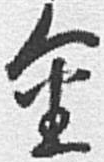로 쓰고 ‘雩’는 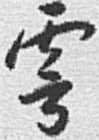로 쓰므로 서로 잘못된 것이다. 『설문(説文)』에 ‘徸，相迹也’라 하였는데, 단(段)은 “뒤의 발자취가 앞의 발자취를 잇는 것이다.”라고 하였다. 대체로 하늘이 운행하고 땅이 돌며, 물이 내려가고 불이 올라가는 등 만물의 온갖 기운이 운행하여 드러나는 데에는 모두 호흡과 숨의 움직임이 있으니, 이를 활동이라 한다. 활동이 곧 ‘鍾鍾’이다. 또 『설문』에 ‘踵，追也。一曰往來皃’라 하였다. 대개 ‘鍾’이 고자(古字)이고, ‘踵’·‘徸’은 모두 속자이면서 바른 것이다.

**○氣裏形表，而爲相成也。**

기는 속에 있고 형(形)은 겉에 있어 서로 이루어 준다.

『대소』에는 ‘爲’ 자가 없고, ‘成’ 아래에 ‘者’ 자가 있다.

〔楊〕오장의 기는 속에 있어 안에서 형체를 경영하고, 육부의 기는 겉에 있어 밖에서 형체를 이룬다.

안(案): ‘𩅞𩅞’은 ‘憧憧’과 같다. 『외대(外臺)』 권12에 인용된 『소품(小品)』의 분돈탕(奔㹠湯)에 “위로 치달을 때는 돼지 떼가 서로 쫓는 듯 憧憧하게 때때로 기가 올라온다.”라고 하였다. 『역(易)』 함괘(咸卦) 구사(九四)에 ‘憧憧往來’라 하였는데, 『석문(釋文)』에 “‘憧憧’은 창용반(昌容反)이다. ［馬云］ 가는 모양이다. 왕숙(王肅)은 ‘오가며 끊이지 않는 모양’이라 하였으며, 『광아(廣雅)』에는 ‘오가는 것’이라 하였고, ［劉云］ 뜻이 정해지지 않은 것이다. 서(徐)는 또 음이 동(童)이고, 또 음이 종(鐘)이라 하였다. 경(京)은 ‘憧’으로 썼다. 『자림(字林)』에 ‘憧은 더딘 것이다. 장가반(丈家反)’이라 하였다.”라고 하였다. 기리(氣裏)는 위기(衛氣)가 속에서 생겨나는 것을 말하고, 형표(形表)는 영기(營氣)가 겉으로 운행하는 것을 말한다. ‘形’은 ‘血’이라 하는 것과 같으니, 혈은 형체가 있는 것이다. 기도 속을 운행하고 형도 겉을 맡으니, 곧 천기가 내려오고 지기가 올라가는 것으로 태괘(泰卦)의 통함을 말한다. 그러므로 “서로 이루어 준다”라고 하였다.

이 편은 처음부터 끝까지 한 장(章)이니, 오로지 삼음삼양의 이합을 논하였다.

（眉）이 편은 한 장뿐이다.

경신년 4월 25일 밤, 빗속 등불 아래 속독서옥(速讀書屋) 남상(南廂)에서 쓰다. 화타공(華他公). 제6편 보유(第六補).

｟八ヲ｠『설문』에 “‘憧’은 뜻이 정해지지 않은 것이다.”라고 하였다. 『염철론(鹽鐵論)』 「자복편(刺復篇)」에 “마음이 憧憧하여 큰 내를 건너다 바람을 만나 아직 닿지 못한 것 같다.”라고 하였다. 『역림(易林)』 「함지곤(咸之坤)」에 “마음이 오는 괴이함을 싫어하니, 衝衝하여 무엇을 두려워하랴.”라고 하였다.

태양은 개가 되고, 양명은 합이 되며, 소양은 추가 된다[太陽爲開，陽明爲闔，少陽爲樞]｟四ウ｠

『영추(靈樞)』 「근결(根結)」 제5에 “태양은 개가 되고, 양명은 합이 되며, 소양은 추가 된다. 그러므로 개가 꺾이면 살과 마디가 문드러져[瀆] 갑작스러운 병이 일어난다. 그러므로 갑작스러운 병은 태양에서 취하되 남음과 모자람을 살핀다. ‘瀆’이란 피부와 살이 말라 여위고[宛膲] 약해지는 것이다. 합이 꺾이면 기가 머물러 쉴 곳이 없어 위질(痿疾)이 일어난다. 그러므로 위질은 양명에서 취하되 남음과 모자람을 살핀다. 머물러 쉴 곳이 없다는 것은 진기가 머물러 막히고 사기가 거기에 자리 잡는 것이다. 추가 꺾이면 뼈가 흔들려[骨繇] 땅에 편안히 서지 못한다. 그러므로 골요(骨繇)는 소양에서 취하되 남음과 모자람을 살핀다. 골요란 마디가 늘어져 거두어지지 않는 것이다. 이른바 골요란 흔들리기 때문이니, 그 근본을 끝까지 따져야 한다.”라고 하였다.

태음은 개가 되고, 궐음은 합이 되며, 소음은 추가 된다[太陰爲開，厥陰爲闔，少陰爲樞]｟七ヲ｠

『영추』 「근결편」에 “태음은 개가 되고, 궐음은 합이 되며, 소음은 추가 된다. 그러므로 개가 꺾이면 창름(倉廩)이 실어 보낼 곳이 없어 격동(膈洞)이 된다. 격동은 태음에서 취하되 남음과 모자람을 살핀다. 그러므로 개가 꺾인 것은 기가 부족하여 병이 생긴 것이다. 합이 꺾이면 기가 끊어져 잘 슬퍼하니, 슬퍼하는 것은 궐음에서 취하되 남음과 모자람을 살핀다. 추가 꺾이면 맥에 맺힌 데가 있어 통하지 않으니, 통하지 않는 것은 소음에서 취하되 남음과 모자람을 살핀다. 맺힌 데가 있는 것은 모두 부족한 데서 취한다.”라고 하였다.｟三ノ十一オ｠

『영』 「근결편」에 “관이 꺾이고 추가 무너지며[折關敗樞] 개합이 달아나면 음양을 크게 잃어 다시 취할 수 없다.”라고 하였다. 이로 보면 ‘關’과 ‘樞’가 서로 짝을 이루는 것이지 ‘開’와 ‘闔’이 서로 짝을 이루는 것이 아니니, ‘關’으로 쓰는 것이 옳다. 어떤 이는 “‘關’으로 쓰면 ‘闔’과 짝이 맞지 않으므로 옳지 않다.”라고 하는데, 이 말이 도리어 그르다.

（眉）「오장생성편(五藏生成篇)」에 ‘十二俞’라 하였는데, 『신교정(新校正)』에 “『대소』에는 ‘俞’가 ‘關’으로 되어 있다.”라고 하였으나, 지금의 『대소』에는 ‘開’으로 되어 있다. 송본 『천금(千金)』 권28 가운데에서는 ‘關’이 종종 ‘開’으로 되어 있다. 『간록자서(干禄字書)』에 ‘開關，上俗下正’이라 하였다.[역1]

（眉）『장중력(掌中歷)』 권상 「국계력편(國堺歷篇)」에서 ‘関門’의 글자를 開·関·開·開·關 등으로 썼다. 이 책은 삼선위강(三善爲康)이 지었다.[역2]

6　개합(開闔)｟五ヲ｠　𩅞｟七ウ｠　태(兌)｟三ウ｠

#### 음양별론(陰陽別論)편 제7

『대소(大素)』 권3 「음양잡설(陰陽雜説)」에 이 편 전체가 실려 있다.

（眉）안(案): 여러 음양의 분별을 보인 것이다.

**○黄帝問曰：**

황제(黄帝)가 물었다.

『대소』에는 ‘黄帝問於岐伯曰’로 되어 있다.

**○人有四經十二從，何謂。岐伯對曰：**

“사람에게는 사경(四經)과 십이종(十二從)이 있다고 하니, 무엇을 말하는가?” 기백(岐伯)이 대답하였다.

『대소』에는 ‘從’이 ‘順’으로 되어 있고, ‘何謂’ 이하 여섯 글자가 없다.

〔楊〕사경은 사시의 경맥을 말한다. 십이순(十二順)은 여섯 음효와 여섯 양효가 서로 따르는 것을 말한다.

**○四經應四時，十二從應十二月，十二月應十二脈。**

사경은 사시에 응하고, 십이종은 열두 달에 응하며, 열두 달은 십이맥(十二脈)에 응한다.

『대소』에는 ‘從’이 ‘順’으로 되어 있다.

〔楊〕간·심·폐·신 네 맥은 사시의 기에 응하고, 열두 효는 열두 달, 곧 십이경맥에 응한다.

안(案): 사경은 사시의 일정한 동맥(動脈)의 모양이니, 곧 현(弦)·구(鉤)·모(毛)·석(石)이 이것이다. 십이종은 십이맥의 다른 이름이니, 곧 십이경맥의 관도(管道)이다. ‘從’이라는 말은 ‘縱’이니, 낙맥(絡脈)이 가로인 것에 상대하여 이름 붙인 것이다. 위에서는 십이종이라 하고 아래에서는 십이맥이라 하였으니, 두 가지가 아니다.

안(案): 아래 글 ‘鼓一陽曰鉤’ 한 단락이 곧 이 사경의 조목을 풀이한 것이다.

〔馬〕십이종은 손에 삼음삼양이 있고 발에 삼음삼양이 있어, 십이경맥의 운행이 서로 따르고 어긋나지 않는 것이다.

**○脈有陰陽，**

맥에는 음양이 있으니,

안(案): 아래 글의 ‘所謂’ 두 글자로 살펴보면, 음은 오장 진장(真藏)의 맥을 가리키고, 양은 위맥(胃脈)을 가리킨다. 맥은 모두 위기(胃氣)를 근본으로 하니, 이 양이 그것이다.

〔楊〕십이경맥은 여섯 음과 여섯 양이다.

**○知陽者知陰，知陰者知陽。**

양을 아는 자는 음을 알고, 음을 아는 자는 양을 안다.

안(案): 모든 맥에 위양(胃陽)이 더해졌는지 아닌지를 살펴 알아야 한다. 위양이 더해지지 않았다면 다만 진음(真陰)일 뿐이다.

〔楊〕인영(人迎)의 변화를 묘하게 알면 기구(氣口)를 멀리서도 알아보고, 기구의 움직임으로 인영에도 통달한다.

안(案): 십이종에 대한 여러 설은 분명하지 않으니, 마(馬)·장(張) 두 사람의 설을 따라 십이경으로 보아야 한다. 대개 이른바 십이종은 사경과 함께 옛말이니, 곧 십이경맥을 말한다. 그 뜻이 분명하지 않아 질문을 일으켰으므로 그 답에서 “십이종은 열두 달에 응하고, 열두 달은 십이맥에 응한다.”라고 하여, 십이종이 곧 십이맥이며 열두 달에 응함을 분별하여 밝힌 것이다. 고문에는 이와 같은 문례가 흔히 있으니, 중복된 말이 아니다.

〔張〕십이종이 열두 달에 응한다는 것은 손에 삼음삼양이 있고 발에 삼음삼양이 있어 열두 달의 기에 응하고, 사람에게서는 십이경의 맥에 응한다는 것이다. 이른바 ‘從’은 곧 손의 삼음이 장(藏)에서 손으로 달린다는 등의 뜻이다.

**○凡陽有五，五五二十五陽。**

양에는 다섯이 있으니, 다섯에 다섯을 곱하여 이십오양(二十五陽)이다.

『대소』에는 ‘二十’이 ‘廿’으로 되어 있다.

〔楊〕오장의 맥은 다섯 철에 나타나는데, 한 철 가운데마다 다섯 맥이 있다. 다섯 맥이 나타날 때 모두 위기가 있으니, 곧 양에 다섯이 있는 것이다. 다섯 철에 맥이 나타나니, 곧 이십오양의 수이다.

（眉）안(案): 위양이 오장의 맥 위에 더해져 나타나고, 사시·사계(四季)에 두루 나타나므로, 위양에 다섯 가지 차이가 있고 또 스물다섯 가지의 전체 모양이 있다.

안(案): 이 아래에 ‘凡陰有五，五五二十五陰’ 열 글자를 넣어 보아야 하니, 곧 진장의 단음(單陰)으로 위양이 더해지지 않은 것이다.

**○所謂陰者，真藏也。見則爲敗，敗必死也。**

이른바 음이란 진장이다. 나타나면 패(敗)가 되니, 패하면 반드시 죽는다.

『대소』에는 ‘也’가 ‘其’로 되어 있고, 아래의 ‘也’ 자가 없다.

〔楊〕다섯 철 가운데 오장의 맥이 나타날 때 각각 위기가 없고 오직 진장만 홀로 나타나면, 이것이 음이 된다.

**○所謂陽者，胃脘之陽也。**

이른바 양이란 위완(胃脘)의 양이다.

『대소』에는 ‘胃脘之陽也’가 ‘胃胞之陰陽’으로 되어 있다.

〔楊〕위포(胃胞) 속에 오곡을 싸서 담아 오장의 양식이 되니, 이는 장의 음에 鍼｟（‘對’로 된 곳도 있다）｠하여 양이 되는 것이므로 위포의 음양이라 한다.

안(案): 이 주는 이해하기 어렵다. ‘五藏爲粮’이라 한 것은 아마 오장이 모두 위양의 자양을 받는 것이 사람이 양식을 얻어 자라는 것과 같음을 말한 것이다. ‘鍼’은 ‘深’ 자인 듯하니, 음이 같아 가차하다가 마침내 잘못된 것인가? 오미(五味)가 곧 음이 되고, 음기가 오장에 깊이 들어가 양맥으로 나타나므로 위포의 음양이라 한 것이다.

다시 생각해 보면 ‘粮’ 자는 혹 ‘羪’의 잘못인 듯하다. ‘羪’은 곧 ‘養’ 자이니, 더욱 읽기 쉽다.

5월 21일 등불 아래

안(案): 『소문(素問)』에는 ‘胃脘’으로, 『대소』에는 ‘胃胞’로 되어 있다. 왕주(王注)에 “어떤 데에는 ‘胃胞之陽’이라 하였는데 그르다.”라고 하였으나, 대개 위완과 위포는 그 뜻이 둘이 아니다. 위완은 위기를 말하고, 위포는 위 속을 말한다. 『설문(説文)』에 ‘脘，胃府也’라 하였다. 이것은 지금 글자로 된 속전(俗篆)이니, 대개 옛날에는 ‘管’으로 썼다. 그 위 입구가 상관(上管), 중앙이 중관(中管), 아래 입구가 하관(下管)이니, ‘胃管’으로 쓰는 것이 바르다. ‘胃管’의 글자를 따로 ‘脘’으로 쓴 것은, ‘輸穴’의 글자를 따로 ‘腧’로 쓰고 ‘塡張’의 글자를 ‘脹’으로 쓴 예와 같다.

（眉）「음양류론(陰陽類論)」에 ‘脘下空竅’라 하였다.

**○別於陽者，知病處也。**

양을 분별하면 병이 있는 곳을 안다.

『대소』에는 ‘處也’가 ‘之處’로 되어 있다.

〔楊〕양은 위기이다. 족양명맥은 위에 통하니, 이 때문에 양명의 위기를 묘하게 분별하면 여러 맥이 병을 받은 곳을 모두 안다.

안(案): 위양을 두고 분별하면 온갖 병이 있는 곳을 살필 수 있다.

**○別於陰者，知死生之期。**

음을 분별하면 죽고 사는 시기를 안다.

안(案): ‘處’와 ‘期’가 운을 이룬다.

〔楊〕오장의 맥을 묘하게 분별하면 죽고 사는 데에 시기가 있음을 안다.

안(案): 진음을 두고 분별하면 죽을지 살지의 날짜를 살필 수 있다.

안(案): 이 두 구절에 「음양별론」이라 이름한 까닭이 있다.

「옥기진장(玉機真藏)」 제19에도 “그러므로 양을 분별하면 병이 어디서 왔는지 알고, 음을 분별하면 죽고 사는 시기를 안다.”라고 하였다. ‘來’와 ‘期’도 운어이다.

**○三陽在頭，三陰在手，所謂一也。**

삼양은 머리에 있고 삼음은 손에 있으니, 이른바 하나이다.

〔楊〕삼양은 위(胃)로 가니 인영의 맥은 머리에 있고, 삼음은 대음(大陰)으로 가니 촌구(寸口)의 맥은 손에 있다. 음양이 위아래로 움직이는 것이 노끈을 당기는 것과 같으므로 하나라고 한다.

（眉）안(案): 이 열두 글자는 다른 뜻이어서 앞뒤 글에 이어지지 않고 불쑥 나온 듯하다. 그렇지 않다. 앞뒤 글은 맥의 위양과 진음을 서술하였는데, 그 음양이 나타나는 곳은 주로 삼부구후(三部九候)에 있다. 삼부구후 가운데 가장 주된 곳은 촌구와 인영에 있으므로 여기서 이를 서술한 것이다. 삼양은 곧 인영 자리의 다른 이름이고, 삼음은 곧 촌구 자리의 다른 이름이다. 인영은 족태양의 혈이니 태양의 다른 이름이 삼양이고, 촌구는 수태음맥이니 태음의 다른 이름이 삼음이다. 인영맥은 목에 있는데, 목도 머리이다. ‘一也’란 인영과 촌구가 차이 없이 서로 같은 모양이라는 것이다.[역3]

**○別於陽者，知病忌時。**

양을 분별하면 병이 꺼리는 때를 안다.

〔楊〕위맥을 잘 분별하면 위기의 유무를 알고[和], 금기가 사시에 있음을 안다. ‘知’가 ‘和’로 잘못되었다.

안(案): 병이 꺼리는 때는 「장기법시론(藏氣法時論)」에 자세히 보인다.

（眉）안(案): 양은 위양이 오장의 맥 위에 더해진 것이다. 그렇다면 양이라 한 것은 모두 상맥(常脈)의 병맥이고, 음이라 한 것은 사맥(死脈)이다.

**○別於陰者，知死生之期。**

음을 분별하면 죽고 사는 시기를 안다.

안(案): ‘時’와 ‘期’가 운을 이룬다.

〔楊〕수태음맥을 잘 분별하면 진장맥의 유무와 죽고 사는 시기를 안다.

안(案): 앞 글에서 “양을 분별하면 병이 있는 곳을 알고, 음을 분별하면 죽고 사는 시기를 안다.”라고 하였고, 여기서는 “양을 분별하면 병이 꺼리는 때를 알고”, “음을 분별하면 죽고 사는 시기를 안다.”라고 하였으니, 두 뜻이 서로 같으면서도 저절로 다르다. 병이 있는 곳, 그리고 병기와 시기(時氣)가 서로 꺼리고 피하는 것을 아는 것이 모두 위양의 맥을 잘 분별해 아는 데 있다는 말이다. 대개 양을 분별한다는 것은 정상으로 변화를 아는 것을 말하고, 음을 분별한다는 것은 변화로 정상을 아는 것을 말한다. 사람은 모두 위기를 근본으로 하니, 위양의 기가 있으면 살고 없으면 죽는 이치이다. 대개 이른바 양이란 인영·부양(趺陽)을 말하니, 앞 글에서 “삼양은 머리에 있다”라고 한 것으로 증명할 수 있다. 이른바 음이란 촌구맥을 말하니, 앞 글에서 “삼음은 손에 있다”라고 한 것이 이것이다. 양주가 이와 같으니 따라야 한다.

**○謹熟陰陽，無與衆謀。**

음양에 삼가 익숙해야 하고, 여러 사람과 의논하지 않는다.

〔楊〕음양 맥기의 도에 삼가 깊이 익숙해질 수 있어 마음으로 결단한 사람은 다시 의심이 없으므로 여러 사람과 의논하지 않는다.

**[역1]** 원서대로 옮겼다. 『讀書雜誌』는 「開關，上俗下正」을 인용하며 「關」의 속자가 「開」과 모양이 비슷하다고 하였으므로, 이 「開」은 「關」의 속자를 가리키는 것으로 보인다.
**[역2]** 원서대로 옮겼다. 「関門」의 글자 꼴을 늘어놓은 자리인데 첫째·셋째·넷째가 같은 「開」 꼴로 찍혀 서로 구별되지 않는다.
**[역3]** 원서대로 옮겼다. 인영은 일반적으로 족양명의 혈로 꼽히는데, 저자가 「太陽一名三陽」의 논증에 맞추어 쓴 말일 수도, 착오일 수도 있다.

**○所謂陰陽者，去者爲陰，至者爲陽。靜者爲陰，動者爲陽。遲者爲陰，數者爲陽。**

이른바 음양이란, 가는 것은 음이 되고 오는 것은 양이 되며, 고요한 것은 음이 되고 움직이는 것은 양이 되며, 더딘 것[遲]은 음이 되고 잦은 것[數]은 양이 된다.

『대소(大素)』에는 ‘靜者’ 이하 열여섯 글자가 ‘動者爲陽，靜爲陰，數者爲陽，遲者爲陰’ 열다섯 글자로 되어 있다.

안(案): 가는 맥은 미(微)·세(細)·허(虚)·규(芤)이다. 오는 맥은 홍(洪)·대(大)·실(實)이다. 고요한 맥은 완(緩)·색(濇)·연(軟)·약(弱)이다. 움직이는 맥은 긴(緊)·활(滑)·질(疾)·현(弦)이다.

〔楊〕무릇 음양이란, 가는 것·고요한 것·더딘 것은 모두 음이 되고, 오는 것·움직이는 것·잦은 것은 양이 된다.

안(案): 앞 글에서 말한 “음이란 진장이니, 나타나면 패가 된다”와 “음을 분별하면 죽고 사는 시기를 안다”는 곧 가는 것이 음이 된다는 것이다. 앞 글에서 말한 “양이란 위완의 양이다”와 “양을 분별하면 병이 있는 곳을 알고 병이 꺼리는 때를 안다”는 모두 오는 것이 양이 된다는 것을 말한다. 이것은 맥의 음양을 설명한 것 가운데 가장 지극한 것이다.

（眉）안(案): 가는 것·고요한 것·더딘 것은 진장맥(真藏脈)이 되고, 오는 것·움직이는 것·잦은 것은 위양(胃陽)이 더해진 맥이 된다.

（眉）이상은 제1장이다.

**○凡持真脈之藏脈者，**

진맥(真脈)인 장맥(藏脈)을 짚는 경우는 모두,

『대소』에는 ‘凡持真藏之脈者’로 되어 있다.

（眉）안(案): 진맥이란 곧 진음(真陰)의 뜻이니, 위양이 더해지지 않은 것이다.

**○肝至懸絶急，十八日死。**

간맥이 현절(懸絶)하고 급하게 이르면 18일에 죽는다.

『대소』에는 ‘急’ 이하 다섯 글자가 ‘九日死’ 세 글자로 되어 있고, 주에 “어떤 본에는 18일로 되어 있다.”라고 하였다.

**○心至懸絶，九日死。肺至懸絶，十二日死。**

심맥이 현절하게 이르면 9일에 죽는다. 폐맥이 현절하게 이르면 12일에 죽는다.

『대소』에는 ‘十日死’로 되어 있다.

**○腎至懸絶，七日死。**

신맥이 현절하게 이르면 7일에 죽는다.

『대소』에는 ‘五日死’로 되어 있다.

**○脾至懸絶，四日死。**

비맥이 현절하게 이르면 4일에 죽는다.

현절·현소(懸小)·현색(懸濇)은 또 제28편 가운데에도 보이니, 참고해야 한다.

〔楊〕진장맥을 얻은 자는 죽는다. 그러나 죽는 시기는 오장의 맥이 현절하여 이미 떠난 뒤로, 각각 그 장의 기에 따라 날수를 나누어 셈한다. 맥이 이르자마자 끊어져 오래도록 오지 않으므로 현절이라 한다.

안(案): 날수는 『대소』에서 말한 것이 모두 옳은 듯하다.

안(案): 이 날수를 왕주(王注)는 생성의 수로 보았는데, 아마 전해 받은 바가 있어서 한 말일 것이다. 내 생각에는 비·신·심 세 장은 가장 중요한 장이므로 그 죽음이 빠르고, 폐·간 두 장은 그 죽음이 조금 더디니, 「자금론(刺禁論)」 제52의 날수와 서로 반대된다. 함께 살펴볼 만하다.

（眉）안(案): 「자금론」에서 말한 것은 침으로 장부를 상했을 때의 죽는 시기에 관한 것이니, 이것과는 본래 다르다.

안(案): ‘懸’은 현(弦)하고 강하며 긴급하다는 뜻으로, 현음(懸飲)의 ‘懸’과 같은 뜻이니, 본래 매단다는 말이 아니다. ‘絶’은 심하다는 뜻이니, 결대(結代)처럼 멈추고 끊어진다는 말이 아니다. 대체로 현소·현색 등의 맥 이름은 모두 이 뜻을 얻으면 분명히 통하니, 「통평허실(通評虚實)」 제28 가운데 자세히 보인다. 대개 현절은 현긴(弦緊)이 심하다는 뜻이다. ‘絶’ 자는 허자(虚字)이다. 간맥은 특히 심하므로 또 ‘急’ 한 글자를 내었으니, ‘急’은 빠르다는 뜻이다.

**○曰二陽之病，發心脾，有不得隱曲，女子不月。其傳爲風消，其傳爲息賁者，死不治。**

이양(二陽)의 병은 심비(心痺)를 일으키고, 대소변을 보지 못함[不得隱曲]이 있으며, 여자는 월경이 끊긴다. 그것이 전변하면 풍소(風消)가 되고, 그것이 전변하여 식분(息賁)이 되면 죽으니 치료하지 못한다.

『대소』에는 ‘曰’ 위에 ‘問’ 자가 있고, ‘脾’가 ‘痺’로 되어 있으며, ‘賁’ 아래에 ‘三日者’ 세 글자가 있는데, 연문(衍文)인 듯하다.

안(案): 이 아래의 여러 병은 모두 사람 몸에 본래 있는 질환이지, 외사(外邪)에 감촉되어 이루어진 것이 아니다.

〔楊〕이양은 양명이다. 양명은 수양명 대장맥을 말하고, 족양명은 위맥이다. 양명이 일으키는 심비(心痺) 등의 병이다. 은곡(隱曲)은 대소변이다. 풍소는 풍열병으로 골육이 소모되는 것을 말한다. 식분은 분격(賁隔)이니, 숨이 막히는 것이다.

「지진요론(至真要論)」에 ‘隱曲不利’라 하였다. 『예기(禮記)』 「소의(少儀)」의 ‘不窺密’에 대한 주에 “밀(密)은 은곡처(隱曲處)이다.”라고 하였다.

안(案): 『대소』에는 ‘心痺’로 되어 있으니 따라야 한다. 대개 ‘脾’도 ‘痺’ 자이다. 옛날 ‘麻痺’·‘痺閉’의 글자에 더러 ‘脾’를 빌려 썼으니, 비위(脾胃)의 글자와는 그 근원이 다르다. 월비탕(越脾湯)을 『외대(外臺)』에서 일설에 기비탕(起脾湯)이라 한 것, 『외대』가 인용한 『갑을(甲乙)』의 ‘大淵主脾逆’을 『의심방(醫心方)』이 인용한 『황제명당경(黄帝明堂經)』에서 ‘痺逆’으로 쓴 예와 같으니, 『월비탕고(越婢湯攷)』에 자세히 갖추어 두었다.

은곡에 대해 왕주가 뒤 글에서 “은곡은 변사(便寫)이다.”라고 하였고, 양주(楊注)는 대소변이라 하였으니, 그 설이 서로 맞으므로 따라야 한다. 왕씨는 ‘心脾’로 된 본을 보고 설을 세웠으므로 마침내 ‘隱蔽委曲’으로 풀이하였는데, 옳지 않다. 대개 은곡은 대장·소장 두 장의 상태를 말한다. ‘不得隱曲’은 곧 대소변을 보지 못함을 말한다.

안(案): 양명 위실(胃實)의 병으로 대변이 통하지 않으면 심하급(心下急)·울울미번(鬱鬱微煩)의 증이 나타나는데, 하제(下劑)를 쓰면 그 증이 씻은 듯 사라지고, 여자의 월경이 통하지 않는 증도 사하(瀉下)하면 통한다. 대개 위 속이 막히면 혈도(血道)가 그 때문에 통하지 않으니, 한 번 사하하면 월사(月事)도 통한다. 이 증에는 매번 도인승기(桃人承氣)·대황목단탕(大黄牡丹湯) 따위를 쓰는데, 그 효과가 신묘하다. 이른바 한 구멍이 통하면 모든 구멍이 다 통하고, 큰 관문이 통하면 모든 관문이 다 통한다는 뜻이다.

안(案): ‘其傳’ 이하는 그 병이 전화(傳化)하여 허증(虚證)이 됨을 말한다. 풍소는 왕·양 두 설이 모두 풍열로 여위는 것이라 하였다. 대개 비위는 기육을 주관하니, 비위가 허하면 기육이 여윈다. 식분은 곧 숨이 차고 치밀어 오르는 것[喘息賁逆]을 말한다. 비위가 운화를 잃으면 오장이 통하지 않아 반드시 천역(喘逆)이 생긴다. 죽을병의 마지막에 흔히 천증(喘證)이 있는 것이 이 뜻이다.

안(案): 이 편에서 말한 삼음삼양에 더러 일·이·삼을 이름 앞에 붙인 것은 「음양류론(陰陽類論)」과 서로 같다. 그 편 왕주의 여러 말에 따르면 일·이·삼이라 이름한 것은 그 기의 많고 적음이다. 그 차례에 이르러서는 『상한론(傷寒論)』 욕해시(欲解時)의 차례와 완전히 같다.

〔馬〕‘賁’은 ‘奔’과 같다. 숨이 차서 위로 치달으니 담과 기침이 편안할 틈이 없다. 이것은 폐적(肺積)인 식분이 아니라 숨이 차서 치닫는 것이다.

（眉）안(案): ‘二陽之病’은 병명이다. ‘發心脾’ 운운은 모두 그 병증이다. 장위에 병이 있으면 재앙이 심(心)에 미치고, 심에 미치면 혈이 어지러워 맺혀서 월경이 끊기고, 이어져서[絡] 식분이 되니, 모두 심·폐·흉상(胸上)의 병이다.

（眉）「지진요론」의 ‘隱曲之疾’에 대한 주에 “은곡의 질환은 감추어지고 구부러진 곳의 병을 말한다.”라고 하였다.

（眉）안(案): 숨기고 그윽하며 구부러진 일이라는 뜻으로 대소변을 말한 것이지, 똥오줌의 다른 이름은 아니다.

（眉）「풍론(風論)」의 ‘隱曲不利’에 대한 왕주에 “은곡은 감추어지고 구부러진 곳을 말한다. 신장(腎藏)은 정(精)을 간직하고 밖으로 교접에 응한다.”라고 하였다. 추재(抽齋)는 “‘風消’는 아마 ‘風痟’일 것이다.”라고 하였다.

（眉）안(案): 자기 몸에 본래 있는 열도 풍이라 하니, 풍은 열의 뜻이다. 왕주가 그러하다.

（眉）『영(靈)』 「음양계일월편(陰陽繫日月篇)」에서 말한 차례는 조금 다르니, 이와 같은 부류가 아니다.

**○曰三陽爲病，發寒熱，下爲癰腫，及爲痿厥腨㾓。其傳爲索澤，其傳爲頹疝。**

삼양(三陽)이 병들면 한열(寒熱)이 나고, 아래로는 옹종(癰腫)이 되며, 위궐(痿厥)과 장딴지가 쑤시는 병[腨㾓]이 된다. 그것이 전변하면 삭택(索澤)이 되고, 그것이 전변하면 퇴산(頹疝)이 된다.

『대소』에는 ‘㾓’이 ‘悁’으로 되어 있다.

（眉）안(案): 태양은 표(表)를 주관하므로 오한(惡寒)과 발열이 나고 색택이 된다. 하체는 방광과 신의 부위이므로 음족(陰足)의 병이 일어난다. ‘下’는 허리와 다리를 말한다.

천연(腨㾓)은 각기(脚氣) 부류이다.

〔楊〕삼양은 대양(大陽)이니, 수대양 소장맥과 족대양 방광맥을 말한다. 대양이 일으키는 한열 등의 병이다. ‘悁’은 계면반(季綿反)이니, 근심과 걱정이다.

‘索’은 빼앗는다는 뜻이다. 근심과 성냄이 그치지 않으면 전변하여 사람의 안색과 윤택을 빼앗는다.

안(案): 『설문(説文)』에 ‘腨，腓腸也’라 하였다. 『일체경음의(一切經音義)』에 인용된 『문자집략(文字集略)』에 ‘腨，脛之腹也’라 하였다. 『어람(御覽)』 772에 인용된 『설문』에는 ‘腨，腓脹也’로 되어 있고, 주에 “‘腨’은 시곤절(市衮切), ‘腓’는 부비절(符非切), ‘脹’은 직량절(直良切)이다.”라고 하였다. 또 『동관한기(東觀漢記)』를 인용하여 “마원(馬援)이 농서태수(隴西太守)가 되어 강(羌)을 치다가 화살을 맞아 장딴지[腓脹]를 꿰뚫렸다.”라고 하였다. 대개 ‘腓脹’은 ‘腓腸’과 같고, ‘腓腸’을 빨리 말하면 ‘方’이 된다. ‘方’이라는 말은 ‘彭’이고 ‘豐’이다. 왕빙이 「지진요대론(至真要大論)」에 단 주에 “‘腨’은 정강이 뒤의 부드러운 살 부분이다.”라고 한 것이 이것이다. ‘㾓’은 『석음(釋音)』에 “음은 연(淵)이고, 아프다는 뜻이다.”라고 하였고, 『옥편(玉篇)』에 “오현절(烏玄切). 뼈마디가 아픈 것이다.”라고 하였으며, 『광운(廣韻)』도 같다. 『의심방』 권6 「심통(心痛)」 제3에 인용된 『녹험방(録驗方)』에 “사람의 심통으로, 답답하고 괴로우며[懊憹悁悶] 두근두근 양 젖가슴까지 당기고, ‘立或如刺’한 것을 치료한다.”라고 하였고, 또 「골통(骨痛)」 제24의 『산번방(刪繁方)』에 “뼈가 허한 사람은 쑤시고 아파[㾓疼] 편안하지 않다.”라고 하였으며, 또 「수병방(髓病方)」 제25의 『천금방(千金方)』에 “골수가 허하여 쑤시고 괴로워[㾓惱] 편안하지 않은 것을 치료한다.”라고 하였고, 또 권8 「각기형상(脚氣形狀)」 제2의 서사공(徐思恭)의 논에 “혹 약간 붓고 몹시 차며 쑤시고 아프다[悁疼].”라고 하였다. 『천금방』 권3 「오로(惡露)」 제5에 “포황탕(蒲黄湯)은 산후(産後)의 남은 병으로 어혈이 쌓여 없어지지 않고 손발이 쑤시고 아픈[悁疼] 것을 치료한다.”라고 하였고, 또 권17 「적기(積氣)」 제5의 분기탕(奔氣湯) 아래에 ‘劇荏便悁欲死’라 하였는데, 『외대』 권12 「잡료분돈(雜療奔豚)」 조에 인용된 글도 같으나, 다만 ‘荏’이 ‘者’로 되어 있으니 옳은 듯하다. 『외대』 권7 「제충심통방(諸蟲心痛方)」에 『필효(必效)』의 연(蜎)｟어연절(於沿切)이다. ‘蛸’로 쓴 것은 그르다｠ 심통을 치료하는 방이 있고, 또 「심하현급오통방(心下懸急懊痛方)」에 『고금록험(古今録驗)』의, 사람의 심통으로 답답하고 괴로우며[懊憹悁悶] 두근두근 양 젖가슴까지 당기고 ‘立或如刺’하여 몹시 괴로운 것을 치료하는 계심탕방(桂心湯方)이 있으며, 「한산적취방(寒疝積聚方)」의 심사(深師) 당귀환(當歸丸) 아래에 “번거롭고 괴로워[煩悁] 눕지 못한다.”라고 하였고, 또 『고금녹험』의 오두속명환(烏頭續命丸) 조를 인용하여 “손발이 쑤시고 번거롭다[悁煩].”라고 하였으며, 또 권3 「천행병발한등방(天行病發汗等方)」의 『산번』 별갑탕(鼈甲湯) 조에 “천행병이 21일[三七日]에서 28일[四七日]에 이르도록 피로하고 쑤심[勞㾓]이 그치지 않고 열독이 멎지 않는다.”라고 하였으니, 모두 ‘悁’과 ‘㾓’을 서로 통용한 것이다. 그런데 ‘㾓’ 자는 『설문』에 없으니 ‘悁’으로 쓰는 것이 바르다. 『설문』에 ‘悁，忿也。一曰憂也’라 하였다. 『옥편』에 “주문(籀文)은 ‘𢞈’으로 쓴다.”라고 하였다. 그래서 생각해 보면 ‘悁憂’·‘悁疼’의 글자는 모두 ‘剈’의 뜻이다. ‘剈’은 『설문』에 ‘挑取也’라 하였고, 『광운』에 ‘曲翦’이라 하였으며, 『옥편』에 ‘挑也，剜也’라 하였다. 심통·골통의 상태를 이로써 알 수 있다. 대개 자통(刺痛)과는 세로와 가로의 차이가 있으니, 자통은 송곳이나 칼로 찌르듯 곧바로 내리꽂혀 아픈 것을 말하고, 연통(㾓痛)은 가로로 후벼 파내는 듯한 것이니, 지금 세속에서 ‘惠倶留也宇仁伊多牟’라 부르는 것이 이것이다. 『외대』 권25 「농혈리(膿血痢)」 편의 『산번』 적석지탕(赤石脂湯) 장에 “번거롭고 아프며 쑤시고 괴로워[煩痛㾓惱] 혹 나오지 않는다.”라고 하였다.[역1]

（眉）『열자(列子)』 「양주편(楊朱篇)」에 ‘心㾓體煩’이라 하였다.

（眉）단본(段本) 『설문』에는 ‘㾓’ 자가 있고, 주에 “지금 세속에서 ‘㾓酸’이라 한다.”라고 하였다.

색택은 곧 피부갑착(皮膚甲錯)의 뜻이다. 대개 ‘索澤’은 옛말이고, ‘索澤’을 빨리 말하면 ‘皵’이 된다. 『광아(廣雅)』 「석언(釋言)」에 ‘皵，𥅗也’라 하였다. 『이아(爾雅)』 「석목(釋木)」에 ‘棤，皵’이라 하였는데, 곽주(郭注)에 “나무껍질이 갑착한 것을 말한다.”라고 하였다. 「서산경(西山經)」의 ‘羬羊其脂可以已腊’에 대해 곽주에 “몸이 트고 거친 것[皴腊]을 치료한다.”라고 하였다. 『집운(集韻)』에 ‘皵，又音錯’이라 하였다. 「고공기(考工記)」 「궁인(弓人)」의 ‘老牛之角紾而昔’에 대해 정중(鄭衆) 주에 “‘昔’은 ‘交錯’의 ‘錯’으로 읽으니, 소뿔의 거친 결이 엇갈린 것을 말한다.”라고 하였다. 「북산경(北山經)」에 “대산(帶山)에 짐승이 있는데, 그 모양은 말과 같고 뿔 하나에 錯이 있다.”라고 하였는데, 주에 “뿔에 갑착이 있다는 말이다.”라고 하였다. 살펴보건대[案] 갑착의 ‘錯’은 『설문』에 ‘金涂也’라 하였으니, 쇠 위의 고르지 않은 곳에 쇠를 바르는 것을 말하며, 지금 세속에서 상안(象眼)이라 부르는 것이 이것이다. 전주(轉注)하여 모든 고르지 않은 것을 일컫는 말이 되었다. ‘甲’은 아마 ‘介’의 가차일 것이다. 『설문』에 ‘介，畫也。從八從人。人各有介’라 하였으니, 전주하여 무릇 경계가 나뉘고 무늬가 그어진 개충(介蟲)을 일컫는 말이 되었다. 『회남(淮南)』 「추형훈(墜形訓)」에 “개린(介鱗)은 여름에 먹고 겨울에 칩거한다.”라고 하였는데, 주에 “개갑(介甲)은 거북·자라 따위이다.”라고 하였다. 『가어(家語)』 「집비(執轡)」에 “개린은 여름에 먹고 겨울에 칩거한다.”라고 하였는데, 주에 “‘介’는 갑충(甲蟲)이다.”라고 하였다. 『본초경(本草經)』에 귀갑(龜甲)·별갑(鼈甲)·악어갑(鱷魚甲)이라 하였다. 『설문』에 “‘龜’는 ‘舊’이다. 바깥은 뼈이고 안은 살인 것으로, 발·등딱지·꼬리의 모양을 본떴다.”라고 하였다. 대개 ‘介’·‘甲’·‘骨’·‘覈’·‘殼’은 ‘兀’·‘梗’·‘彊’·‘勁’ 등과 음과 뜻이 모두 같으니, 단단하다는 뜻이다.

（眉）‘索’은 심모(心母)이고, ‘錯’은 청모(清母)이다. 『급취편(急就篇)』에 ‘𩌈𩍜’이 있으니, 이로써 ‘索澤’이 연어(連語)임을 알 수 있다. 왕주는 타당하지 않다.

（眉）우안(又案): ‘索’과 ‘削’은 소리가 같으니, 색택은 깎이고 깎여 살이 빠지고 여위는 것이다.

（眉）「시종용론(示從容論)」의 ‘形氣消索也’에 대해 왕주에 “형기가 소산되어 다 없어진 것이다.”라고 하였다.

퇴산(頽疝)은 『석명(釋名)』에 “음부가 붓는 것을 ‘隤’라 하니, 기가 아래로 무너져 내린 것이다.”라고 하였다. 『일체경음의』에 인용된 것에는 ‘隤’가 ‘頽’로 되어 있다. 대개 ‘頽’는 ‘隊’·‘大’·‘槌’ 등과 음과 뜻이 모두 같으니, 아래로 늘어진다는 뜻이다. ‘疝’은 『석명』에 “또 ‘疝’이라 하니, 또한 ‘詵’을 말한다. 詵詵하게 아랫배를 당겨 급하게 아픈 것이다.”라고 하였다. 이는 앞 글에서 “심통을 ‘疝’이라 한다. ‘疝’은 ‘詵’이다. 기가 詵詵하게 위로 올라와 아프다.”라고 한 것에 상대하여 글을 이룬 것이다. 대개 ‘疝’이라는 말은 ‘籑’이며 ‘攢’이니, 한곳에 있으면서 아픈 것이다. 여러 통증이 위아래에 있거나 좌우에 있어 일정하지 않은 것과는 다르다.[역2]

안(案): 태양 실열증(實熱證)은 반드시 한열의 표증(表證)이 나타나고, 심한 것은 하부에 창(瘡)이 생기는데, 이상은 쉽게 낫는 증이다. 만약 혈기가 울체하여 창이 되지 못하면 곧 위궐·천소(腨痟)의 증이 된다. 그 병이 전변하여 마침내 허한(虚寒)에 이르면 피부갑착이 되고 겉으로 드러나는 기세가 없으므로, 수혈(水血)이 아래로 흘러 혹 퇴산(㿉疝)이 되니, 이에 치료하기 어려워진다.[역3]

**○曰一陽發病，少氣，善欬，善泄，其傳爲心掣，其傳爲隔。**

일양(一陽)이 병을 일으키면 기가 적고[少氣], 기침을 잘하며, 설사를 잘한다. 그것이 전변하면 심掣(心掣)이 되고, 그것이 전변하면 격(隔)이 된다.

『대소』에는 ‘少’가 ‘小’로 되어 있고, 두 ‘善’이 모두 ‘喜’로 되어 있으며, ‘掣’가 ‘瘛’로 되어 있다.

〔楊〕일양은 소양(小陽)이니, 수소양 삼초(三膲)맥과 족소양 담맥이다. 소양이 기가 적은 등의 병을 일으킨다. ‘隔’은 막힌다는 뜻이다.

심掣에 대해서는 여러 설이 같지 않다. 오(吳)는 “심장이 당겨져 움직이는 것이다.”라 하였고, 장(張)은 “심장이 움직여 편안하지 않아 무언가 당기는 듯한 것을 심掣이라 한다.”라 하였으며, 지(志)는 “심이 허하여 당기듯 아픈 것이다.”라 하였고, 『성제총록(聖濟總録)』에서는 “심화(心火)가 서로 응하여 편안하지 않고 그 움직임이 당기는 듯한 것이 그 증이다.”라 하였으며, 풍조장(馮兆張)의 『금낭비록(錦囊祕録)』에서는 “옛날에는 정충(怔忡)이라는 이름이 없었으니, 심掣이라 이름한 것이 이것이다.”라 하였으나, 모두 분명한 풀이를 얻지 못하였다. 내 생각에 심掣은 곧 심현(心懸)이니, ‘懸’이라는 말은 ‘牽’이다. 명치 아래가 당기며 아픈 것을 말하니, 『금궤(金匱)』에서 말한 현음(懸飲)의 증이 이것이다. 대개 소양이 병드는 곳은 바로 위(胃)의 위쪽, 폐의 아래쪽, 격막(鬲膜)의 사이이다. 이곳에 음(飲)이 없으면 소양증이 생기지 않고, 음이 있으므로 이 여러 증이 생긴다. 『상한론』에서 말한 소양증은 경문과 서로 맞는다. 대개 저것은 사기가 소양 부위에 있어 생긴 증이고, 이것은 본기(本氣)가 껄끄럽게 막혀 생긴 병이니 서로 같지 않으나, 그 증후가 나타나는 데 이르러서는 같다. 어째서인가? 본기가 흐르지 않으면 이 부위에 얼마간의 수음(水飲)이 빚어지고, 그로 인해 얼마간의 수음 증이 생기니, 결국 수음의 여러 증은 모두 소양증에 속한다. 이 설은 내가 일찍이 『상한론고주(傷寒論攷注)』에서 분별하였으므로 지금 여기서는 자세히 말하지 않는다.

（眉）안(案): ‘之病’이라 하고, ‘爲病’이라 하고, ‘發病’이라 한 것은 같은 뜻이다.

（眉）『열자』 「천서(天瑞)」의 ‘隔’ 자.

（眉）심현은 제19편 가운데 보인다.

（眉）이 단락에서 말한 것은 모두 유음(流飲)이 일으킨 것이니, 그 유음이 일어나는 것은 담과 삼초에 근본한다.

안(案): 소양 실열로 수음이 머물러 막히므로 그 병이 나면 기가 적고 기침을 잘하니, 이는 물이 폐부를 침범한 증이다. 위양이 허하면 수음이 아래로 흘러 마침내 설리(泄利)가 되고, 위양이 허하지 않으면 이 물이 요도로 달려 흘러 소변이 시원하게 통한다. 소양의 기화(氣化)가 엷고 적으면 수음이 머물러 막히는 것이 더욱 많으므로 현음이 되니, 그 증은 마신 뒤 물이 옆구리 아래로 흘러 기침하고 침 뱉을 때 당기며 아픈 것이다. 『소문(素問)』에서는 이를 ‘心掣’이라 하고 『금궤』에서는 ‘懸飲’이라 하니, 같은 것이다. 현음에 대한 풀이는 『난헌유고(蘭軒遺稿)』에 자세히 보이므로 지금 여기서 덧붙이지 않는다. 그 더욱 심한 것이 격이 되니, 격은 가로막혀 통하지 않음을 말하며, 『금궤』에서 말한 지음(支飲)이 이것이다. 「기궐론(氣厥論)」에 “간이 한(寒)을 심에 옮기면 광(狂)하고 격중(隔中)한다. 심이 열을 폐에 옮기면 전변하여 격소(鬲消)가 된다. 방광이 열을 소장에 옮기면 장이 막혀 대변이 통하지 않고, 위로는 입안이 짓무른다[口糜].”라고 하였다. 이 세 병은 유음의 일로, 이것과 서로 같다.

（眉）진본 『명당(明堂)』 권1 척택(尺澤) 아래에 “기격(氣隔)으로 구역질을 잘하고 번급(煩急)하다.”라고 하였는데, 양주에 “기격은 호흡할 때 가슴 속 기가 막히는 것을 말한다.”라고 하였다.

**○二陽一陰發病，主驚駭，背痛，善噫善欠，名曰風厥。**

이양과 일음(一陰)이 병을 일으키면 주로 경해(驚駭)와 배통(背痛)이 나타나고, 트림을 잘하고 하품을 잘하니, 풍궐(風厥)이라 한다.

『대소』에는 ‘主’가 ‘生’으로 되어 있고, 두 ‘善’ 자가 모두 ‘喜’로 되어 있다.

〔楊〕이양은 양명이다. 일음은 궐음이니, 수궐음 심포맥과 족궐음 간맥이다. 이 두 맥이 경해 등의 병을 일으키니, 풍궐이다.

〔張〕간·위 두 경은 모두 경해를 일으킨다. 「금궤진언론(金匱真言論)」에서 “동방은 간에 통하니, 그 병은 경해를 일으킨다.”라고 하고, 「경맥편(經脈篇)」에서 “족양명이 병들면 나무 소리를 듣고 깜짝 놀란다.”라고 한 것이 이것이다. 배통은 수족 양명의 근(筋)이 모두 척추를 끼고 있기 때문이다.

안(案): 경해와 배통은 모두 간경 실열의 증이다. 『천금방』 권11 「간장맥론(肝藏脈論)」 제1에 “봄 맥은 현과 같으니, 봄 맥은 간맥이다. 그 기가 실하고 현하게 오면 이를 태과(太過)라 하니 병이 바깥에 있고, 그 기가 실하지 않고 미하게 오면 이를 불급(不及)이라 하니 병이 안에 있다. 태과하면 사람으로 하여금 잘 잊게 하며｟‘忘’은 ‘怒’로 써야 한다｠ 흐릿하게 어지러워[忽忽眩冒] 전질(癲疾)이 된다. 불급하면 사람으로 하여금 가슴이 아프면서 등까지 당기고 양 옆구리가 그득하게 한다.”라고 하였고, 또 “봄 석 달은 간담(肝膽)의 청근견병(青筋牽病)을 주관한다. 부(府)가 허하면 음사(陰邪)에 상하여 허리와 등이 뻣뻣하고 당긴다 운운”이라 하였다. 대개 배통은 어깨와 등이 당기며 아픈 것을 말하니, 간경 근락(筋絡)의 병이다. 트림을 잘하고 하품을 잘하는 것은 모두 위기가 거스른 것이니, 간·위 두 경이 일으키는 병이므로 풍궐이라 한다. 풍궐은 열이 막힌 것을 말하니, 간과 위가 뜨거워 막혀서 이 여러 증이 된다. 「평열병론(評熱病論)」과 「오변편(五變篇)」에서 말한 ‘風厥’과는 본래 다르다.

〔張〕「맥해편(脈解篇)」에서 “이른바 위로 심에 달려가 트림이 된다는 것은 음이 성하여 위로 양명에 달려가기 때문이다. 양명의 낙맥은 심에 속하므로 위로 심에 달려가 트림이 된다고 한다.”라고 하였다. ‘欠’은 하품이니, 하품은 비록 신(腎)이 주관하지만 「경맥편」에서 “족양명이 병들면 자주 하품한다.”라고 하였으니, 이는 또 트림과 하품이 심포와 위경에 있는 것이다.

「평열병론」 제33에 “황제가 말하였다. ‘몸에 열이 나고 땀이 나며 번만(煩滿)하고, 번만이 땀으로 풀리지 않는 병이 있으니, 이는 무슨 병인가?’ 기백이 말하였다. ‘땀이 나면서 몸에 열이 나는 것은 풍(風)이고, 땀이 나면서 번만이 풀리지 않는 것은 궐(厥)이니, 병명을 풍궐이라 한다.’ 황제가 말하였다. ‘다 듣고 싶다.’ 기백이 말하였다. ‘거양(巨陽)은 기를 주관하므로 먼저 사기를 받고, 소음은 그것과 표리가 된다. 열을 얻으면 위로 따라 올라가고, 따라 올라가면 궐이 된다.’”라고 하였다.

『영추(靈樞)』 「오변(五變)」 제46에 “황제가 말하였다. ‘사람이 풍궐로 땀을 줄줄 흘리는 병에 잘 걸리는 것｟『갑을』에는 ‘厥漉汗’이 ‘灑灑汗出’ 네 글자로 되어 있다｠은 무엇으로 살피는가?’ 소유(少俞)가 답하였다. ‘살이 단단하지 않고 주리(腠理)가 성글면 풍병에 잘 걸린다.’”라고 하였다.

『사기(史記)』 「창공전(倉公傳)」에 “제북왕(濟北王)이 병들어 신 의(意)를 불렀습니다. 그 맥을 진찰하고 ‘풍궐(風蹶)로 가슴이 그득합니다.’라고 하고 곧 약술을 만들었는데, 세 섬을 다 마시자 병이 나았습니다. 땀을 흘리고 땅에 엎드려 있다가 얻은 병입니다.”라고 하였다.

（眉）안(案): 대장·위·간·격막에서 생기는 병은 모두 유음에 관계된다. 경해·배통은 모두 유음의 증이다. 풍은 사람 몸에 본래 있던 것이 발하여 생긴 열이고, 궐은 손발이 거꾸로 차가워지는 것이니, 모두 수음이 흐르는 증이다. 왕주에서 풍을 간열(肝熱)로 보고 외사의 열로 보지 않은 것은 앞의 ‘風消’의 ‘風’ 자와 서로 같으니, 모두 근거로 삼을 만하다.

일양(一陽)　이양(二陽)　삼양(三陽)

소양(少陽)｟수삼초(手三焦)·족담(足膽)｠　양명(陽明)｟대장(大腸)·위(胃)｠　태양(太陽)｟소장(小腸)·방광(膀光)｠

일음(一陰)　이음(二陰)　삼음(三陰)

궐음(厥陰)｟심포(心包)·간(肝)｠　소음(少陰)｟심(心)·신(腎)｠　태음(太陰)｟폐(肺)·비(脾)｠

**[역1]** 원서대로 옮겼다. 『外臺秘要方』 검색본에는 「又或如刺」로 되어 있다.
**[역2]** 원서대로 옮겼다. 「籑」은 여기서 「纂」처럼 모인다는 뜻으로 쓰인 것으로 보인다.
**[역3]** 원서대로 옮겼다. 경문과 앞 논의에는 「腨㾓」으로 되어 있는데 여기만 「腨痟」이며, 『素問』 검색본 가운데에는 「腨痟」으로 된 것이 있다.

**○二陰一陽發病，善脹心滿，善氣。**

이음(二陰)과 일양(一陽)이 병을 일으키면 잘 붓고[善脹] 가슴이 그득하며, 위로는 숨이 거세고 아래로는 방귀가 잘 나온다[善氣].

『대소(大素)』에는 두 ‘善’ 자가 모두 ‘喜’로 되어 있다.

‘氣’ 자의 풀이는 「옥기진장(玉機真藏)」 제19에 자세히 보인다.

〔楊〕이음은 소음이다. 수소음은 심맥이며, 소음 신맥으로 들어가니[入], 소음과 소양이 잘 붓는 등의 병을 일으킨다.

안(案): ‘入’은 ‘足’의 잘못인 듯하고, ‘腎脈’ 아래에 ‘也’ 자가 빠진 듯하다. 앞뒤 글의 예로 보아 그러함을 안다.

〔馬〕이음은 신경(腎經)이고, 일양은 담경(膽經)이다. 담의 사기가 남아돌아 비토(脾土)를 업신여기므로 잘 붓는다. 신의 사기가 남아돌아 심화(心火)를 타므로 가슴이 그득하다. 담기가 남아돌므로 잘 성낸다[善氣]. 「선명오기론(宣明五氣論)」에서 “담은 노(怒)가 된다”라고 한 것이 이것이다.

『옥편(玉篇)』에 “‘脹’은, 『좌씨전(左氏傳)』에 ‘먹으려 하다가 배가 불러[脹] 뒷간에 갔다’고 하였다. 脹은 아픔이다. 자서(字書)에는 ‘痮’으로도 쓴다.”라고 하였다. 또 “‘痮’은 그득함이다. ‘脹’으로도 쓴다.”라고 하였다.

『영(靈)』 「전광편(癲狂篇)」에 “기가 아래로 새면 치료하지 못한다.”라고 하였다.

〔志〕경(經)에 “신기가 실하면 붓는다”라고 하였다. 善氣란 태식(太息)이다. 심계(心系)가 급하면 기도가 죄어지므로 크게 숨을 내쉬어 펴내는 것이다.

〔高〕이음이 안에서 추전(樞轉)하지 못하고 일양이 밖에서 추전하지 못하므로 잘 붓는다. 음의 지도리가 돌지 않으면 가슴이 그득하고, 양의 지도리가 돌지 않으면 기가 잘 새어 나온다.

〔識〕『예기(禮記)』의 ‘勿氣’에 대해 정주(鄭注)에 “코로 숨 쉬지 않는 것을 말한다.”라고 하였다. 그러니 장지총(張志聰)의 뜻이 맞다.

안(案): 신수(腎水)가 통하지 않으므로 잘 붓고, 심화가 안에 울체되므로 가슴이 그득하다. 여기에 담기가 남아돌면 위로는 숨이 지나치게 거세지고, 아래로는 방귀[轉矢氣]가 새어 나온다.

「해론(欬論)」 제38에 “소장의 기침은 그 모습이, 기침하면서 방귀를 뀌는데 방귀가 기침과 함께 나온다.”라고 하였고, 왕주(王注)에 “기침하면 소장의 기가 아래로 내달리므로 방귀를 뀐다.”라고 하였다.

안(案): 여기서 말한 脹·滿·氣는 모두 음결(飮結)의 증이다. 「통평허실(通評虛實)」 28｟廿八ウ｠의 “기가 그득하여 거슬러 오른다[氣滿發逆]”도 이와 같은 증이니, 아울러 살펴보아야 한다.

（眉）안(案): 심·신·삼초·담이 일으키는 병은 모두 수류음(水流飮)이다. 脹이란 몸이 수종(水腫)으로 붓는 것이다.

**○三陽三陰發病，爲偏枯痿易，四支不舉。**

삼양(三陽)과 삼음(三陰)이 병을 일으키면 편고(偏枯)와 위역(痿易)이 되어 사지를 들지 못한다.

〔楊〕삼양은 태양이다. 삼음은 태음이니, 수태음 폐맥과 족태음 비맥이다. 태음이 편고 등의 병을 일으킨다.

안(案): 폐는 피모를 주관하고, 비는 기육을 주관하며, 소장은 혈을 주관하고, 방광은 뼈를 주관한다. 뼈·혈·피부·기육이 함께 병들면 편고불수(偏枯不隨)의 증이 된다. 대개 편고란 반신이 여위고 작아지는 것을 말한다. 위역이란 반신이 늘어지고 약해지는[軃弱] 것을 말한다. 혈맥이 통하지 않으므로 편고가 되고, 근골이 이롭지 않으므로 위역이 된다. 근맥이 통리되지 않으면 피부와 기육이 영양을 잃어 마침내 사지를 들지 못하는 심한 지경에 이르니, 모두 중풍 비병(痱病)의 증이다.

안(案): ‘二陽之病’부터 여기까지의 여러 병은 모두 본기(本氣)가 울결하여 생긴 것이다. 그러나 본기가 부족하여 외사가 그 틈을 타서 본기를 울체시켜도 이 여러 증이 되니, 여러 증이 되는 데에 이르러서는 다름이 없다.

（眉）안(案): 태양은 표를 주관하고 방광[旁胱]은 하체를 주관하며, 비는 기육을 주관하고 폐는 피모를 주관한다. 또 비는 사지를 주관하므로 이렇게 병드는 것이다.

（眉）‘易’ 자의 풀이는 왕주가 옳다.

우안(又案): 易은 병든 곳이 옮겨 바뀌는 것이니, 왼쪽으로 옮기기도 하고 오른쪽으로 옮기기도 하는 것으로, 곧 위(痿)가 옮겨 가는 것이다.

（眉）이상 제2장.

**○鼓一陽曰鉤，**

일양(一陽)이 고동하는 것을 구(鉤)라 하고,

『대소』에는 ‘鉤’ 아래에 ‘曰鼓’ 두 자가 있다. 양주(楊注)에 따르면 ‘曰鼓’ 두 자는 연문(衍文)인 듯하다.

〔楊〕일양은 소양이다. 소양맥이 수태음 촌구에 이르면 그 맥이 고동한다. 鼓는 맥이 고동하는 것이다. 일양의 고동을 구라 한다.

〔馬〕이는 오장의 맥체를 들어 말한 것이다. 일양은 미약한 양이다. 손가락 아래에서 일양이 고동하면서 맥이 올 때는 성하고 갈 때는 쇠한 것을 구라 하니, 곧 약간 갈고리 같은 맥[微鉤]으로 심의 맥이다.

〔張〕이는 다섯 맥의 체를 들어 미약함과 성함으로 음양을 나눈 것이니, 앞 글에서 경맥 차례의 음양을 말한 것과는 같지 않다. 鼓는 힘이 있는 것이다. 일양·일음은 음양이 미약함을 말한다.

【楷】（眉）안(案): 鼓란 맥이 뛰는 것을 말한다. 여름 맥, 곧 심맥은 구가 되니, 대개 심은 소음인데 여름에는 양이 극에 이르러 음이 싹트므로 양이 극에 이른 맥이다. 일양이란 양기의 기세가 이미 극에 이르렀는데 또 크게 더해진 것이다. 맥의 양은 위양(胃陽)을 가리키고, 음은 진장(真藏)의 음을 가리킨다. 이 아래 ‘曰溜’까지 한 절은 앞 글과 뜻이 확연히 따로이니 섞지 말라. 대개 봄·여름에는 위양이 많이 더해지고, 가을·겨울에는 위양이 적게 더해 들어간다.

【楷】（眉）안(案): 이 아래 한 절은 편 첫머리의 사경(四經)의 조목을 풀이한 것이다.

【楷】（眉）현(弦)·구(鉤)·모(毛)·석(石)의 뜻은 「평인기상(平人气象)」·「옥기진장」에 자세히 보인다.

**○鼓一陰曰毛，**

일음(一陰)이 고동하는 것을 모(毛)라 하며,

『대소』에는 ‘鼓’ 자가 없다. 대개 이 ‘鼓’ 자가 앞 글 안으로 잘못 들어갔고, 그 때문에 또 ‘曰’ 한 자가 덧붙은 것이다.

〔楊〕일음은 궐음이다. 궐음맥이 촌구에 이른 것을 모라 하니, 이는 음맥이라 고동한다고 일컫지 않는 것이다. 어떤 본에는 ‘一曰陰曰毛也之’로 되어 있다.

〔馬〕일음은 미약한 음이다. 손가락 아래에서 일음이 고동하면서 맥이 가볍고 허하며 뜨게 오는 것을 모라 하니, 곧 약간 터럭 같은 맥[微毛]으로 폐의 맥이다.

【楷】（眉）안(案): ‘鼓’는 앞과 뜻이 같다. 아래도 이에 준한다.

【楷】（眉）가을의 폐맥은 위양이 많이 더해지지 않고 음이 성하니, 이는 천기에 응하여 그런 것이다. 一은 오로지[專]이고 같음[同]이니, 모두 앞 구절과 같은 이치이다. 一이란 섞이지 않음이니, 모두 그 무리이다.

**○鼓陽勝急曰絃，**

고동하는 양이 이기고 급한 것을 현(絃)이라 하고,

『대소』에는 ‘急’이 ‘隱’으로, ‘絃’이 ‘弦’으로 되어 있다.

〔楊〕맥이 고동하여 양이 ‘隱’을 이기는 것을 현이라 한다. 양주에 “‘隱’은 ‘陰’으로 써야 하니, 자형이 비슷해 생긴 잘못이다.”라고 하였다.

〔馬〕양맥이 고동하는데 그 기세가 급함을 이겨 너무 급한 데까지 이르지 않는 것을 현이라 하니, 곧 약간 시위 같은 맥[微弦]으로 간의 맥이다.

（眉）봄 간의 현맥도 천기에 응한 것이다. ‘勝’ 자의 뜻은 양주가 옳다.

**○鼓陽至而絶曰石，**

고동하는 양이 이르되 끊어진 듯한 것을 석(石)이라 하며,

〔楊〕이르는 것이 양이니, 고동하는 양이 이르렀다가 끊어지는 것을 석이라 한다.

〔馬〕양맥이 고동하는데 양맥이 끊어질 듯한 것을 석이라 하니, 곧 약간 돌 같은 맥[微石]으로 신의 맥이다.

（眉）겨울 신의 석맥도 천기에 응한 것이며, ‘而’는 ‘如’와 같다. 양이 이르는 것이 겨우 있어 거의 양이 없는 듯한 것이 석맥이다.

**○陰陽相過曰溜。**

음과 양이 서로 거쳐 지나가는[相過] 것을 유(溜)라 한다.

『대소』에는 ‘溜’가 ‘彈’으로 되어 있다.

안(案): 봄의 현맥과 여름의 구맥은 위양이 지나치게 더해진 것이고, 가을의 모맥과 겨울의 석맥은 진음(真陰)이 지나치게 드러난 것이니, 이를 流라 한다. 流는 평맥의 이름이다.

〔楊〕음양의 맥이 촌구에 이르러 서로 치는 것을 탄(彈)이라 한다.

〔馬〕음양 두 맥이 서로 지나치되 이기고 짐이 없는 것은 바로 평화로운 맥이니, 그 이름을 유(溜)라 하는데 물이 느릿하게 흐르는 것과 같으며 비의 맥이다. 여기서 말한 음양은 맥체로 말한 것이다. 그 부침·대소 사이에서 뜻으로 헤아려 얻는 것이다. ‘溜’는 ‘流’로 쓴다. 『영추(靈樞)』 「본수편(本輸篇)」에 “어제(魚際)로 흐른다[溜]”라고 하였으니, 그 뜻은 흐름을 위주로 한다.

안(案): 편 첫머리에 “사람에게는 사경(四經)이 있다”라고 하고, 또 “무릇 진맥(真脈)의 장맥(藏脈)을 짚는 경우”라고 하였으니, 모두 이것과 서로 뜻을 밝혀 준다. 여기서 말한 ‘絃鉤毛石’은 곧 사경이며, 유맥(溜脈)은 사경에 두루 걸쳐 있는 것이지 다섯째 맥이 되는 것이 아니니, 이를 상맥(常脈)이라 한다. ‘진맥지장(真脈之藏)’이라 한 것은 곧 변맥(變脈)을 말한 것이다.

안(案): ‘相過’의 ‘過’는 지나침과 미치지 못함[過不及]의 ‘過’이다. 가을·겨울에는 음이 지나치게 많고 봄·여름에는 양이 지나치게 많은 것을 평맥이라 하니, 곧 流이다. ‘相’ 자가 글자의 눈[字眼]이니, 음은 촌구를, 양은 인영을 가리킨다. 이 여섯 자 한 절은 그 자체로 뜻이 따로이며 앞 글에 이어지지 않는다. 『영』 「금복(禁服)」에 “봄·여름에는 인영이 약간 크고, 가을·겨울에는 촌구가 약간 크니, 이와 같은 것을 평인(平人)이라 한다.”라고 한 것이 증거가 된다.

（眉）안(案): 相過는 『역(易)』 「대과(大過)」의 소(疏)에서 “相過란 서로 지나침이 심한 것을 말한다”라고 한 것과는 절로 다르다. 대개 『소(素)』 「옥판론요(玉版論要)」 ‘逆行一過’의 주에 “過는 두루 미침[遍]을 말한다”라고 하였으니, 여기서도 음진(陰真)과 위양이 서로 두루 이르는 것을 流라 한다는 말이며, 곧 평맥이 조화로운 것이다. 『이아(爾雅)』 「석천(釋天)」은 사시의 이름을 들고, 그 뒤에 사시가 조화로운 이름 한 구를 들고, 또 네 기운 각각의 이름 네 구를 들고, 그다음에 네 기운이 조화로운 이름 한 구를 두었으니, 모두 이 글의 문례와 같다.

（眉）溜를 『대소』에서 ‘彈’으로 쓴 것은 잘못된 글자일 뿐이다.

우안(又案): 『한(漢)』 「육가전(陸賈傳)」 주에 “過는 이름[至]이다”라고 하였다. 『여람(呂覽)』 「이보편(異寶篇)」 ‘五員過於吳’의 주에 “過는 至와 같다”라고 하였다. 또 「귀당편(貴當篇)」 ‘狐援聞而蹶往過之’의 주에 “過는 見과 같다”라고 하였다. 『국책(國策)』 「진책(秦策)」 ‘臣不得復過矣’의 주에 “過는 봄[見]이다”라고 하였다. 대개 맥동이 이르러 드러나는 뜻이니, 앞 글의 여러 ‘至’ 자와 뜻이 같다. 이 설도 통한다. 요컨대 過는 평성(平聲)으로, 음은 고화절(古禾切)이다. 경과(經過)·과력(過歷)의 뜻이니, 곧 음양의 뛰는 움직임이 그 자리를 거쳐 지나감을 말한다.

（眉）이상 제3장.

**○陰爭於内，陽擾於外，魄汗未藏，四逆而起，起則熏肺，使人喘鳴。**

음이 안에서 다투고 양이 밖에서 어지럽히면 백한(魄汗)이 갈무리되지 않고 사역(四逆)이 일어나며, 일어나면 폐를 훈증하여 사람을 숨차고 그르렁거리게[喘鳴] 한다.

『대소』에는 ‘熏’이 ‘動’으로, ‘鳴’이 ‘喝’로 되어 있다.

〔楊〕오장은 음이니, 안의 사기[耶]인 음기가 오장을 상하게 하므로 ‘안에서 다툰다’라고 하였다. 육부는 양이니, 밖의 사기인 양기가 육부를 침범하므로 ‘밖에서 어지럽힌다’라고 하였으니, 피모와 주리이다. 폐의 백(魄)이 주관하는 곳이므로 땀이 주리로 나오는 것을 백한이라 한다. 藏은 닫음[閉]과 같다. 음양이 다투고 어지럽혀 땀이 나는데 주리가 닫히지 않으면 한기가 그 틈을 타 들어와 사지가 역랭하고 안으로 폐를 상하게 하므로 숨이 차고 헐떡이게[喘喝] 된다. 喝은 헐떡이는 소리이니, 호할반(呼割反)이다. 절(切)은 고달반(古達反)이다.

『소』 「지진요론(至真要論)」에 “소음이 재천(在泉)할 때 주기(主氣)가 이기면 백한이 갈무리되지 않고 사역이 일어난다.”라고 하였다.

〔馬〕이 절의 음양은 영위 두 기를 말한다. 영위 두 기는 조화를 귀하게 여기고 한쪽이 치우쳐 이기는 것을 귀하게 여기지 않으니, 조화로우면 음양의 기가 생기고 치우치면 음양의 기가 소멸하므로 경기가 이로부터 끊어진다는 말이다. 음기는 영기이니 음은 안에 있으면서 양의 지킴이 되고, 양기는 위기이니 양은 밖에 있으면서 음의 심부름꾼이 된다. 만약 음기가 치우쳐 이겨 안에서 다투거나, 양기가 치우쳐 이겨 밖에서 어지럽히면, 치우쳐 이긴 쪽은 강(剛)이 되어 부드러워지지 못한다.

안(案): 영위의 불화가 극에 이르면 백한이 나고, 백한이 나는 것이 극에 이르면 양기가 점점 망실되므로 사역의 증이 일어난다. 사역의 증이 일어나면 아래는 차고 위는 뜨거워 폐부를 훈작(熏灼)하므로 마침내 천명(喘鳴)의 증이 된다. 대개 백한이 나는 것은 반드시 죽지는 않으나, 나면서 갈무리되지 않는 것은 마침내 죽음에 이른다. 「생기통천(生氣通天)｟三｠」에서 ‘未盡’이라 한 것은 여기서 ‘未藏’이라 한 것과 뜻이 같다. 백한의 풀이는 제3편에 자세히 보인다.

『외대(外臺)』 권14｟四五ヲ｠에서 심사(深師)를 인용하여 “유풍(柔風)으로 몸이 아프고 백한(白汗)이 나는 것을 치료하는 석고산(石膏散) 운운”이라 하였으니, 이것과 같은 이치이므로 아울러 살펴보아야 한다.

천갈(喘喝)은 제3편에도 보인다.

（眉）안(案): 이 여섯 구 한 절은 앞뒤 글과 뜻이 따로이다. 음이란 장부 속에서 생기는 고유한 음사기(陰邪氣)이다.

（眉）안(案): ‘而’는 ‘乃’와 같다.

（眉）이상 제4장.

**○陰之所生，和本曰和。**

음이 생겨나는 바, 그 조화의 근본을 미(味)라 한다.

『대소』에는 ‘曰和’가 ‘曰味’로 되어 있으니 따를 만하며, 지금의 『소문(素問)』은 잘못되었다. 대개 ‘味’가 ‘咊’로 잘못 쓰이고, 다시 ‘和’로 잘못 쓰인 것이다.

〔楊〕오장이 생겨나는 바 화기(和氣)의 근본을 오미라 한다. ［案］‘曰’은 ‘爲’와 같다.

「생기통천론(生氣通天論)」에 “음이 생겨나는 근본은 오미에 있다. 음의 오관(五官)은 오미에서 상한다.”라고 하였다.

〔張〕음은 오장의 진음(真陰)이다. 음이 생겨나는 까닭은 장기가 조화롭기 때문이고, 장기가 조화로운 것은 음양이 조화롭기 때문이다. 조화롭지 않으면 다툼[爭]이 되고 어지럽힘[擾]이 되고 강(剛)이 되고 질척임[淖]이 되어 병이 이로 말미암아 일어난다.

안(案): 영위·음양 두 기는 그 근본이 모두 오장의 진음에 있으므로, 진음이 화평하면 영위가 다투고 어지럽히는 근심이 없다.

（眉）이 아래 ‘經氣乃絶’까지 한 절.

**○是故剛與剛，陽氣破散，陰氣乃消亡。**

그러므로 강(剛)에 강이 맞서면 양기가 깨어져 흩어지고 음기도 이에 사라진다.

『대소』에는 ‘剛’이 ‘㓻’으로 되어 있다.

〔楊〕‘㓻’과 ‘㓻’은 양이 성한 것이니, 양이 성하면 반드시 쇠하므로 깨어져 흩어진다. 양이 없는 음은 반드시 사라진다.

안(案): 표리가 모두 열한 것을 ‘剛與剛’이라 한다. ‘乃消亡’·‘乃絶’의 두 ‘乃’ 자가 글자의 눈이다.

〔張〕이는 양에 치우친 해를 말한 것이다. 剛與剛은 양의 극이다. 불로 불을 도우니 성함이 극에 이르면 반드시 쇠하므로 양기가 도리어 깨어져 흩어지고, 양기가 흩어지면 음기도 홀로 존재할 수 없어 반드시 따라서 사라지니, 음양이 모두 끊어진다.

**○淖則剛柔不和，經氣乃絶。**

음이 성해 질척이면[淖] 강유(剛柔)가 조화되지 않아 경기(經氣)가 이에 끊어진다.

〔楊〕淖는 어지러움[亂]이니, 음은 탁(濁)이다. 양이 흩어지고 음이 사라지므로 강[罡]과 유가 조화되지 않으면 십이경의 기가 끊어진다는 말이다.

〔張〕이는 음에 치우친 해를 말한 것이다. 淖는 한습이 함부로 행하여 음기가 이기는 것을 말한다. 양강(陽剛)과 음유(陰柔)가 모두 그 조화를 잃으면 경기가 따라서 무너져 끊어진다.

안(案): 경기란 기표(肌表)의 양기를 말한다. 제3편에서 말한 ‘위기(衛氣)’·‘형기(形氣)’가 이것이다. 제3편에서 말한 “음이 고르고 양이 갈무리되면 정신이 이에 다스려지고, 음양이 떨어져 갈라지면 정기가 이에 끊어진다.”는 이 글과 뜻이 비슷하다.

〔吳〕淖는 음기가 지나쳐 질척거리는 것[潦淖]을 말한다.

〔識〕「행침편(行鍼篇)」에 “혈기가 淖澤하고 매끄럽다.”라고 하였다. 『춘추번로(春秋繁露)』에 “무릇 사물은 질척할수록 더 쉽게 변하고 흔들린다.”라고 하였다. 『회남자(淮南子)』 「원도훈(原道訓)」 ‘甚淖而滒’의 주에 “滒도 淖이다. 죽에 국물이 많은 것을 滒이라 한다.”라고 하였다. 淖는 『광운(廣韻)』에 노교절(奴教切)이다. 『설문(説文)』에 “진흙이다.”라고 하였다. 『일체경음의(一切經音義)』에서 『자림(字林)』을 인용하여 “젖음이 심한 것을 淖라 한다.”라고 하였다. 오(吳)·장(張)이 음기가 남아도는 뜻으로 본 것이 옳다.

안(案): 이 淖 자는 양주와 『춘추번로』·『회남자』·『설문』이 모두 그 뜻에 맞으니, 어지러움[淖亂]이며 ‘血氣淖澤’과는 절로 다르다. 淖澤은 제26편에 자세히 보인다.

（眉）안(案): 앞에서는 양성(陽盛)을 서술하고 여기서는 음성(陰盛)의 淖를 들었으니, 오주(吳注)가 옳다. ‘淖는 濁이다’는 늘 쓰는 풀이이다.

（眉）이상 제5장.

**○死陰之屬，不過三日而死。生陽之屬，不過四日而死。**

사음(死陰)에 속하는 것은 3일을 넘기지 않고 죽고, 생양(生陽)에 속하는 것은 4일을 넘기지 않고 낫는다.

『대소』에는 ‘不過四日而生’으로 되어 있으니 매우 따를 만하다. 대개 사음은 빨리 죽고, 생양도 오래지 않아 낫는다. 生은 병이 풀리는 것을 말하니, 반드시 사는 쪽으로 향하는 것이다.

〔楊〕음양의 사생(死生)의 기한이다.

안(案): 만병을 이것으로 헤아려 보면, 지금 보건대 실증은 반드시 상생(相生)으로 전변하고, 허증은 반드시 상극(相克)으로 전변한다.

안(案): 실하여 사는 것을 양이라 하고, 허하여 죽는 병을 음이라 하니, 아래 글도 이에 준한다.

〔識〕마(馬)·장(張)이 『신교정(新校正)』의 설에 따라 아래의 ‘死’를 ‘已’로 한 것이 옳다.

〔張〕이는 장기가 서로 전해지는 데에 사생의 다름이 있음을 말한 것이니, 사음·생양의 뜻은 아래 글과 같다.

（眉）이 아래 ‘辟陰死不治’까지 한 절.

**○所謂生陽死陰者，肝之心，謂之生陽。**

이른바 생양(生陽)과 사음(死陰)이란, 간에서 심으로 가는 것을 생양이라 한다.

『대소』에는 ‘所’ 위에 ‘岐伯曰’ 세 자가 있다.

〔楊〕목이 화를 낳는 것이다.

안(案): 오행이 모두 이 이치이다.

〔張〕肝之心은 간에서 심으로 전해지는 것이다. 목이 화를 낳아 그 생기를 얻으므로 이를 생양이라 하니, 4일을 넘기지 않고 낫는다.

**○心之肺，謂之死陰。**

심에서 폐로 가는 것을 사음(死陰)이라 한다.

〔楊〕화가 금을 이기는 것이다.

안(案): 오행이 모두 이 이치이다.

〔張〕心之肺는 심에서 폐로 전해지는 것이다. 화가 금을 이겨 음기가 흩어져 없어지므로 사음이라 하니, 3일을 넘기지 않고 죽는다.

**○肺之腎，謂之重陰。**

간에서 신으로 가는 것을 중음(重陰)이라 한다.

〔楊〕소음은 거듭된 지음(至陰)이다.

〔張〕폐는 금이고 신은 수이다. 비록 어미와 자식 관계이지만 금과 수가 함께 병드므로 중음이라 하니, 양이 없는 징후이다.

안(案): ‘肺’는 ‘肝’ 자의 잘못일 것이니, 『소문』과 『대소』가 모두 바르지 않다. 肝之腎은 자식이 어미를 타는 것이니, 곧 상생의 변이다. 만약 肺之腎이라면 앞의 ‘生陽’과 뜻이 같으니, 우스운 일이다. 대개 중음이란 음병, 곧 허병이 거듭 심해진 것이다. 重은 거성(去聲)이다. 아직 사음의 위태로움에는 이르지 않았으므로 죽을 병이 아니다. ‘肺’를 ‘肝’으로 하면 오행이 모두 통하는 이치가 되니, 이 구절에 대한 앞의 주들은 모두 따를 수 없다.

**○腎之脾，謂之辟陰，死不治。**

신에서 비로 가는 것을 벽음(辟陰)이라 하니, 죽는 병으로 치료할 수 없다.

안(案): 오행이 모두 이 이치이다.

〔楊〕辟은 거듭 포개진 것이니, 지음인 대음[大陰]이 거듭된 것이다.

〔張〕辟은 방벽(放辟)이다. 토는 본래 수를 제어하는데 수가 도리어 비를 업신여긴다. 수가 꺼릴 것이 없으니 이를 벽음이라 하며, 그러므로 죽는 병으로 치료할 수 없다.

안(案): 辟陰의 辟은 여러 설이 어지러워 하나같지 않다. 양(楊)은 겹쳐 포개짐[辟疊]의 뜻으로 보았으니, 왕주에서 말한 ‘辟併’과 같으며, 음수(陰水)가 겹겹이 쌓여 비토를 침벌하는 것을 말한다.

（眉）안(案): 이는 상극의 변이 뒤집힌 것이니, 더욱 크게 위태로운 병이다.

（眉）辟은 사벽(邪僻)의 辟이니, 음병 가운데 비뚤어지고 어그러진 것이다. 앞의 주들은 모두 틀렸다.

（眉）이상 제6장.

**○結陽者，腫四支。**

양이 맺힌 경우에는[結陽] 사지에 종(腫)이 생긴다.

안(案): 腫은 좌절(痤癤)의 총칭이다.

안(案): 양은 표이고 기이며 몸통 겉[軀殼]의 부분이니, 다음의 ‘結陰’과 상대된다.

〔楊〕結은 모임[聚]이다.

〔吳〕양은 수족의 여섯 양경이니, 그 맥이 사지의 겉으로 행한다. 만약 맺힌 사기가 있으면 사지의 맥기가 막히고 정체되므로 붓는다.

〔馬〕結이란 기혈이 소통되지 않는 것이다.

〔張〕이 아래는 사기가 여러 경에 모여 생기는 병을 말한다. 양은 육양이다. 結陽에 사지가 붓는 것은 사지가 모든 양의 근본이기 때문이다.

（眉）이 아래 ‘喉痺’까지 한 절은 결(結)의 병을 총괄해 설명한 것이다.

**○結陰者，便血一升，再結二升，三結三升。**

음이 맺힌 경우에는[結陰] 변혈이 한 되 나오고, 두 번 맺히면 두 되, 세 번 맺히면 세 되가 나온다.

〔楊〕두 번 모이면 많아져 세 되에 이른다.

안(案): 음은 이(裏)이고 혈이며 장부의 안이니, 앞의 ‘結陽’과 상대된다. 이는 잡병의 하혈·요혈(尿血)을 뜻한다.

〔馬〕대체로 수족의 음경은 장(藏)이 되어 이(裏)를 주관하니, 음경이 맺히면 반드시 변혈을 주로 한다. 대개 영기는 음에 속하고, 영기가 화하여 혈이 되어 생신(生身)을 받든다. 음경이 이미 맺히면 혈이 반드시 어혈로 쌓이니, 처음 맺히면 한 되, 두 번 맺히면 두 되, 세 번 맺히면 세 되로, 맺힘이 점점 더해지면 혈도 점점 많아진다.

〔張〕음은 육음이다. 음은 혈을 주관하니, 사기가 음분에 맺히면 혈이 병을 받으므로 변혈하기 마련이다. 얕은 경우 변혈이 한 되 나오면 맺힌 사기가 풀릴 것이다. 풀리지 않고 다시 맺히면 사기가 성한 것이므로 변혈이 두 되 나온다. 또 풀리지 않으면 사기가 더욱 심한 것이므로 ‘세 번 맺히면 세 되’라 한 것이다.

안(案): 대체로 사기가 양경 기부(肌膚)의 기분(氣分)에 맺히면 혈도 정체되어 통하지 않으므로 종창(腫脹)이 된다. 사기가 음경 낙맥의 혈분(血分)에 맺히면 기도 서로 조화되지 않으므로 변혈이 된다. 한 되·두 되·세 되라 한 것은 사기가 맺힌 경중을 말한 것에 지나지 않으니, 대개 대략적인 말일 뿐이다. 『상한론(傷寒論)』의 “소음병에 8~9일이 지나면 반드시 변혈한다”, 또 “입과 코로 나오기도 하고 눈으로 나오기도 한다”, 또 “하리(下利)하며 농혈을 변으로 본다” 같은 것이 모두 이것과 같은 이치이다.

**○陰陽結斜，多陰少陽，曰石水，少腹腫。**

음양이 맺혀 얽히되[結斜] 음이 많고 양이 적으면 석수(石水)라 하니, 소복(少腹)이 붓는다.

『대소』에는 ‘斜’가 ‘者針’ 두 자로 되어 있다.

안(案): 음혈과 양기가 서로 맺혀 모여 고창(鼓脹)이 되면 음한의 기는 성하고 많으며 양난(陽暖)의 기는 쇠하고 적으므로, 온궤(温潰)로 치료한다.

〔楊〕소음은 수가 되므로 ‘多’ 자는 잘못이다.

삽강전선(澀江全善)이 말하였다. “마현대(馬玄臺)는 ‘斜’와 ‘邪’가 같아 옛날에 통용했다고 하였고, 오(吳)·장(張) 등 여러 학자도 모두 이 뜻과 같다. 대개 ‘邪’를 빌려 비뚤고 바름[斜正]의 글자로 쓴 것은 옛 책에 종종 있으나, ‘斜’를 사기(邪氣)로 쓴 것은 보지 못하였다. 살펴보건대[按] ‘斜’는 아마 ‘糾’ 자의 잘못인 듯하다. 『설문』에 ‘糾는 노끈을 세 겹으로 꼰 것이니, 糸와 丩를 따른다’라고 하였다. 『후한서(後漢書)』 주에 ‘糾는 얽혀 맺힘이다’라고 하였다. 結糾는 곧 맺혀 모이고 얽혀 합쳐짐을 말하니, 경문에 비추어 보면 꽤 온당해 보인다. 『설문』에 또 ‘丩는 서로 얽힘이다. 일설에는 오이·박이 맺혀 불룩 솟은 것이다’라고 하였다. 結丩는 結糾와 같으니, 이 또한 증거가 될 수 있다.”

〔馬〕음경과 양경이 사기에 맺히고 음기는 많고 양기는 적으면 곧 음성양허(陰盛陽虛)이니, 양이 음으로 들어가지 못하여 안에 모인 것이 석수가 되고, 그 소복은 반드시 붓는다. 「대기론(大奇論)」에 “신과 간이 함께 침하면 석수가 된다”가 있고, 『영추』 「사기장부병형편(邪氣藏府病形篇)」에 “신맥이 약간 크면 석수가 되니, 배꼽 아래에서 일어나 소복에 이르기까지 늘어져 처지고[腄腄然], 위로 위완(胃脘)에 이르면 죽는 병으로 치료할 수 없다.”가 있으며, 「수창편(水脹篇)」에서는 황제가 석수에 대해 물었으나 기백의 대답이 없으니, 아마 빠진 죽간이 있는 듯하다. 내 생각으로는, 石은 형체가 있는 것이고 水는 물과 소리가 있는 것이니, 대개 적취(積聚)의 부류이다.

〔張〕석수란 가라앉아 단단한 것이 아래에 있는 것이니, 그 증은 소복이 붓는 것이다.

『금궤요략(金匱要略)』 권중 「수기(水氣)」 제14에 “석수는 그 맥이 저절로 침하고, 외증은 배가 그득하나 숨차지 않다.”라고 하였다.

안(案): 석수를 마씨(馬氏)가 적취로 본 것은 옳지 않은 듯하니, 대개 후세에 이른바 고창(鼓脹)이 이것이다.

**○二陽結，謂之消。**

삼양(三陽)이 맺힌 것을 소(消)라 한다.

『대소(大素)』에는 ‘二’가 ‘三’으로 되어 있다.

〔楊〕소갈(消渴)이고 소중(消中)이다. 삼양은 태양이다.

〔馬〕이양은 족양명 위이다. 「음양류론(陰陽類論)」에 “황제가 말하였다. 이양은 양명이다.”라고 하였다. 위 속에 열이 성하여 진액이 말라 버리면 수곡이 곧 소모되니, 이를 소(消)라 한다. 살펴보건대[按] 이 편에서는 그저 消라고만 하였는데, 「맥요정미론(脈要精微論)」에 이르러서는 “단(癉)이 이루어지면 소중이 된다”가 있고, 「기병론(奇病論)」에는 “소갈로 바뀐다”가 있으며, 『영추(靈樞)』 「사기장부병형편(邪氣藏府病形篇)」과 본경 「통평허실론(通評虛實論)」에서는 모두 ‘소단(消癉)’이라 하였고, 「기궐론(氣厥論)」에는 ‘폐소(肺消)’·‘격소(鬲消)’가 있어 가지가지로 같지 않으니, 그 사이에 각각 가리키는 바가 있다.

안(案): 『대소』에서 ‘三陽結’로 쓰고 양주(楊注)가 태양으로 본 것을 따를 만하다. 소장·방광에 열이 맺히면 진액이 말라 소갈·소중의 증이 된다는 말이다.

**○三陽結，謂之隔。**

이양(二陽)이 맺힌 것을 격(隔)이라 한다.

『대소』에는 ‘三’이 ‘二’로 되어 있다.

〔楊〕대소변이 통하지 않는 것이다. 이양은 양명이다.

안(案): 『대소』에서 ‘二陽’으로 쓴 것을 따를 만하다. 대장·위에 열이 맺히면 이변(二便)이 통하지 않아 격색(隔塞)의 병이 된다는 말이다. 이 두 조문은 지금 본 『소문(素問)』에서 ‘二’·‘三’ 자가 서로 뒤바뀌었는데, 왕씨(王氏)가 잘못된 본을 따라 설명하였고 그 뒤 주가들이 모두 이를 따랐으므로 끝내 분명한 풀이를 얻지 못하였다. 이제 『대소』에 근거하면 그 뜻이 환해져 따지지 않아도 분명해진다.

**○三陰結，謂之水。**

삼음(三陰)이 맺힌 것을 수(水)라 한다.

〔楊〕삼음은 태음이다.

〔馬〕삼음은 수태음 폐경과 족태음 비경이다. 폐가 사기에 맺히면 신수(腎水)를 낳지 못하여 신수가 허약해져 사지로 넘쳐흐른다. 비가 사기에 맺히면 수기를 이기지 못하여 수기가 넘쳐 온몸이 부으니, 그러므로 수증(水證)이 이로부터 생긴다.

안(案): 폐는 피부를 주관하고 비는 기육을 주관한다. 지금 폐·비 두 경이 사기에 맺히면 피부와 기육의 기가 통하지 않으므로 지체가 붓는 증이 된다.

**○一陰一陽結，謂之喉痺。**

일음(一陰)과 일양(一陽)이 맺힌 것을 후비(喉痺)라 한다.

〔楊〕궐음과 소양이다.

『병원후론(病源候論)』 권30에 “후비란 목구멍 속이 붓고 막혀 저리고 아파서 미음과 물을 넘기지 못하는 것이다. 사람의 음양의 기는 폐에서 나와 후롱(喉嚨)을 따라 오르내린다. 풍독이 목구멍에 머무르면 기가 맺혀 쌓여서 열이 생긴다. 그 열이 목구멍을 불어[吹] 붓고 막혀 저리고 아프며, 맥이 침한 것은 음이고 부한 것은 양이다. 오른손 관상(關上)의 맥이 음양 모두 실하면 이것이 후비의 징후이다. 또한 사람으로 하여금 장열(壯熱)이 나면서 오한하게 하니, 7~8일에 치료하지 않으면 죽는다.”라고 하였다.｟『의심방(醫心方)』 권5의 인용에는 ‘吹’가 ‘故’로 되어 있다｠

（眉）안(案): 일음은 심주(心主)와 간이고, 일양은 담과 삼초이다. 간과 격(鬲)이 이롭지 않으므로 독이 인후에 쌓인다.

（眉）이상 제7장.

**○陰搏陽別，謂之有子。**

음이 박동하면서 양과 구별되는 것을 아이를 가졌다[有子]고 한다.

『천금(千金)』에 “논하여 말하였다. 경(經)에 ‘음이 박동하고 양이 구별되는 것을 아이를 가졌다고 한다’라고 하였으니, 이는 혈기가 조화되어 양이 베풀고 음이 화하는 것이다.”라고 하였다.

「평인기상(平人氣象)」에 “부인의 수소음맥이 심하게 뛰는 것은 아이를 밴 것이다.”라고 하였다.

〔楊〕음맥은 모이고 양맥은 모이지 않는 것이다. ［案］이 풀이는 틀렸다.

〔吳〕이 아래로는 맥을 논한다.

〔馬〕곧 『맥결(脈訣)』에서 이른바 “척맥이 그치지 않으면 참으로 태가 있는 부인이다”라고 한 것이 이것이다.

〔張〕「복중론(腹中論)」에 “아이를 밴 것이 곧 태어날 것을 어떻게 아는가? 몸에 병이 있는데 사맥(邪脈)이 없는 것이다.”라고 하였다. 왕씨(王氏)의 『맥경(脈經)』에 “척중의 맥이 눌러도 끊어지지 않으면 임신으로 본다.”라고 하였다. 활백인(滑伯仁)은 “삼부의 맥이 뜨고 가라앉음이 고르게 같으며 다른 병이 없는데 월경이 없으면 임신이다.”라고 하였다. 음양 두 글자에 대해서는, 좌우로 음양을 나누면 왼쪽이 양, 오른쪽이 음이다. 촌척으로 음양을 나누면 촌이 양, 척이 음이다. 맥체로 음양을 나누면 고동하고 치며[鼓搏] 침실(沉實)한 것이 양이고, 허약하고 부삽(浮澀)한 것이 음이다. 모든 양이 실하면 사내아이이고 모든 음이 허하면 여자아이라 하는 것이 거의 일정한 논이 될 것이다. 그러나 또한 임부의 강약·노소와 평소 왼쪽·오른쪽으로 치우침, 촌척이 평소 강한지 약한지를 살펴야 그 묘를 다할 수 있다.

〔識〕왕주(王註)는 음양을 척촌으로 보았고 여러 학자가 모두 이를 따랐다. 그런데 〔高〕만은 특히 “음기가 지나치게 성하여 안에서 박격하고 양과 조화되지 않아 따로 나온 듯한 것을 말한다”라고 하였으니, 이는 맥후(脈候)로 풀지 않은 것으로, 경문에 ‘脈’ 자가 없기 때문이다. 맥을 척촌으로 나누는 것은 『난경(難經)』에서 비롯하였고 『영(靈)』·『소(素)』에는 없는 것이므로, 음양을 척촌으로 보는 것은 근거 없음이 더욱 심하다. 그러나 후세에서 징험해 보면 왕주와 들어맞는 것이 있다.｟『유문사친(儒門事親)』｠ 왕씨의 뜻은 경지(經旨)와 어긋나기는 하나 실로 버릴 수 없다.

안(案): 경문의 ‘陰陽’은 음경과 양경을 말한다. 음경이 실하면 박격하되 힘이 없고 양경과 서로 조화되지 않으므로 ‘陰搏陽別’이라 하였다. 그러나 음양 두 경이 이와 같다면 촌구의 척부에서도 힘이 있어 박격함을 알 수 있다.[역1]

（眉）이 아래 편 끝까지는 맥처(脈處)의 움직임을 설명한 것이다. ‘搏’ 자는 왕주가 옳으며 아래도 같다. ‘陽別’은 음과 그 형상이 구별되어 다른 것이다. 그렇다면 別이란 평맥이 드러나는 것을 말한다.

（眉）안(案): 음경맥을 늘 진찰하는 곳은 촌구(寸口)·신문(神門)·오리(五里)·대충(大衝)·대계(大谿)·기문(箕門) 등이고, 양경맥을 늘 진찰하는 곳은 액방(額旁)·거료(巨髎)·이전동(耳前動)·합곡(合谷) 등이니, 모두 삼부구후의 자리이다. 아래 글의 음양에 관한 글은 모두 이에 준한다.

（眉）안(案): 액방은 곧 현로(懸顱)·현리(懸釐)·곡빈(曲鬢)의 자리이다. 이전동은 객주인(客主人)·청회(聽會)·화𢨺(和𢨺)의 자리이다.

（眉）『천금』에 “그 수소음맥이 심하게 뛰는 것을 진찰하면 아이를 밴 것이다. 소음은 심맥이다. 심은 혈맥을 주관한다. 또 신을 포문(胞門)·자호(子户)라 하며, 척중은 신맥이다. 척중의 맥이 눌러도 끊어지지 않으면 임신으로 본다. 삼부의 맥이 가라앉고 뜸이 고르게 같으며 눌러도 끊어짐이 없는 것은 임신이다.”라고 하였다.｟二ノ八オ｠

**○陰陽虚，腸辟死。**

음양이 모두 허하여 장벽(腸辟)이 되면 죽는다.[역2]

『대소』에는 ‘死’ 자가 없으나, 양주에 따르면 잘못 빠진 것이다.

〔楊〕음양, 곧 부(府)와 장(藏)의 맥이 모두 허한 것은 장(腸)이 겹겹이 포개져[腸辟疊] 죽는다.

안(案): 음양 두 경이 모두 허하면 비위의 기가 화하지 못하여 장 안이 겹겹이 포개지고 쌓여[辟疊辟積] 기화·운화의 기틀을 잃으므로, 대변이 거두어지지 않고 통설(洞泄)하여 마침내 죽음에 이른다. 왕주에 “장이 열려 금할 수 없다[腸開勿禁]”라고 한 것은 뜻으로는 괜찮으나, ‘辟’을 ‘開’로 풀이한 것은 옳지 않은 듯하다. 양주에 ‘腸辟疊死’라 한 것이 뜻이 낫다. ‘腸辟’은 곧 ‘腸澼’의 고자(古字)로 겨우 남은 것이다.

**○陽加於陰，謂之汗。**

양이 음에 더해지는 것을 한(汗)이라 한다.

〔楊〕加는 이기는 것이다.

안(案): 加는 큼이다. ‘於’ 자가 글자의 눈이니, 중경(仲景)이 표허증에 대해 ‘영약위강(營弱衛強)’이라 한 것이 이것이다.

안(案): 양경이 성하면 그 기가 음경을 침범하여 영위가 요동하므로 땀이 난다. 평인이 힘들게 움직여 땀이 나는 것은 양기를 요동시키고 양기가 음혈을 박격하므로 땀이 나는 것이다. 사기가 기표에 있는데 원래 양이 실한 사람이면, 그 양기가 사기와 나뉘어 다투면서 또한 음혈을 박격하므로 땀이 난다. 마(馬)·장(張)이 모두 음양을 맥으로 본 것은 옳지 않다. 왕주를 따를 만하다.

**○陰虚陽搏，謂之崩。**

음이 허하고 양이 박동하는 것을 붕(崩)이라 한다.

〔楊〕붕은 하혈이다.

안(案): 음경이 허하고 양경이 건실하면 양기가 음혈을 박격하여 음혈이 거두어지지 않고 허한 틈을 타 미끄러져 내려오니, 곧 혈허기실(血虛氣實)의 증이다. 그렇다면 그 맥도 부대침소(浮大沈小)하고 촌긴척약(寸緊尺弱)한 부류이다. 『천금방(千金方)』 권4 「붕중(崩中)」 제3의 “소우각鰓산(小牛角鰓散)은 대하오분(帶下五賁)을 치료한다. 오분의 병은 밖은 실하고 안은 허하다. 처방.”에서 말한 외실내허(外實内虚)는 곧 기실혈허(氣實血虚)·양실음허(陽實陰虚)를 말한다. 여러 학자가 모두 또한 맥의 음양으로 본 것은 따를 수 없다.

**○三陰俱搏，二十日夜半死。**

삼음(三陰)이 모두 박동하면 20일째 한밤중에 죽는다.

『대소』에는 ‘二十’이 ‘卅’ 한 자로 되어 있다. 잘못이니, ‘廿’으로 써야 할 것이다.

〔楊〕대음[大陰]은 삼음의 기를 모두 얻는다.

안(案): 삼음이 모두 박동하는 것은 곧 삼양이 부족한 것이다. 그러므로 비·폐 두 경의 기만 박격하니, 대개 양이 부족하고 음이 남는 경우는 죽더라도 빠르지 않으므로 20일이라 한 것이다.

〔馬〕그 사기(死期)를 계산하면 20일째 한밤중에 죽는다. 20일이란, 천5가 토를 낳고 지10이 이를 이루니 그 성수(成數)는 10이고, 지4가 금을 낳고 천9가 이를 이루니 그 성수는 9이다. 두 경의 성수에 근거하여 그 나머지에 해당하는 20일에 죽는다. 한밤중에 죽는 것은 음병이 음에서 죽는 것이다.

이 절의 각한도(刻限圖)는 보유(補遺)에 보인다.

（眉）안(案): 수족 두 경이므로 ‘俱’라 하였다. 삼음경, 곧 삼음의 장부가 병들었을 때 이 박동이 보이면, 그것이 보인 날부터 19일째 한밤중에 죽는다는 뜻이다. 아래도 모두 이에 준한다. 한밤중은 19일의 끝이다. 비의 수는 10, 폐의 수는 9이다. 수화목금토, 수화목금토, 수화목금토, 수화목금토.

**○二陰俱搏，十三日夕時死。**

이음(二陰)이 모두 박동하면 13일째 저녁 무렵에 죽는다.

〔楊〕소음은 이음의 기를 모두 얻는다.

〔馬〕13일이란, 지2가 화를 낳고 천7이 이를 이루니 그 성수는 7이고, 천1이 수를 낳고 지6이 이를 이루니 그 성수는 6이니, 7과 6을 합하면 13이기 때문이다. 저녁 무렵이라 한 것은 소음의 시후(時候)이다.

（眉）수화목금토, 수화 — 심의 수 7. 수화목금토, 수 — 신의 수 6.

**○一陰俱搏，十日平旦死。**

일음(一陰)이 모두 박동하면 10일째 새벽에 죽는다.

〔楊〕궐음의 기가 모두 와서 모이므로 ‘俱’라 하였다.

안(案): 심주와 간 두 경의 맥이 서로 박동하므로 ‘俱’라 하였다. 양(楊)의 설은 옳지 않다.

〔馬〕10일이란, 천3이 목을 낳고 지8이 이를 이루며, 지2가 화를 낳고 천7이 이를 이루니, 간은 생수(生數)를 취하고 심은 성수를 취하여 합해서 10일이다. 이 마주(馬注)는 크게 잘못되었다.

（眉）안(案): 이 예는 음은 성수를 쓰고 양은 생수를 쓰니, 본래 하늘의 이치이다. 그런데 심주는 진장(真藏)이 아니므로 도리어 생수를 써서 부(府)의 양과 같다.

（眉）수화 — 심주의 수 2. 수화목금토, 수화목 — 간의 수 8.

**○三陽俱搏且鼓，三日死。**

삼양(三陽)이 모두 박동하고 또 고동하면 3일 만에 죽는다.

『대소』에는 ‘鼓’가 ‘皷’로 되어 있다.

〔楊〕삼양의 맥이 모이고 또 고동한다.

안(案): 搏이란 떠올라 의공(醫工)의 손가락을 치는 것이다. 鼓란 흔들려 움직이는 것이다.

〔馬〕3일이란, 천1이 수를 낳고 지2가 화를 낳으니 합해 3일이다.

안(案): 음경이 허하여 다하고 태양만 홀로 성한 것이다. 『금궤(金匱)』 권상 제1에서 “경(經)에 ‘궐양(厥陽)이 홀로 행한다’라고 하였다”라고 한 것이 대개 이것이다. 음이 없는 양은 항진이 극에 이름이 더욱 심하므로 박동하고 또 고동하니, 그래서 그 죽음이 가장 빠르다.

（眉）수화 — 소장의 수 2. 수 — 방광의 수 1.

**○三陰三陽俱搏，心腹滿發盡，不得隱曲，五日死。**

삼음과 삼양이 모두 박동하여 심복의 그득함이 극에 이르고[發盡] 대소변을 보지 못하면[不得隱曲] 5일 만에 죽는다.

안(案): 發盡은 오(吳)·지(志)의 설이 모두 옳으니 따를 만하다.

이는 태음·소음·궐음의 삼음과 태양·소양·양명의 삼양으로 모두 여섯이 함께하니, 대체로 열두 경이 병든 것이다. 그리고 맥이 모두 박격하니, 그래서 중토(中土)의 생수를 기한으로 삼는다.

〔馬〕5일이란 토가 중앙에 있는 징후이다. 병든 경이 많으므로 사기(死期)가 빠르다.

안(案): 심·신·간의 허열이 비·폐 두 경을 요동시키고 소장·방광도 따라서 그 기화를 잃으므로, 심복이 창만하고 대소변을 보지 못하여 관격(關格)으로 막혀 죽는다.

**○二陽俱搏，其病温，死不治，不過十日死。**

이양(二陽)이 모두 박동하면 그 병이 온(温)이니, 죽는 병으로 치료할 수 없고 10일을 넘기지 않고 죽는다.

『대소』에는 ‘其’가 ‘募’로 되어 있다.

〔楊〕양명의 기가 모두 모이면 양명의 募病이니, 어떤 본에는 ‘募’로 되어 있다.

안(案): ‘有本爲募也’의 ‘募’는 아마 ‘暮’ 자의 잘못인 듯하다. 저물녘에 온병을 앓는다[暮病温]는 것은 대개 일포(日晡)에 열이 나는 것을 말한다.

〔馬〕10일이란, 지4가 금을 낳고 천5가 토를 낳으니 9일에 그치며, 10이란 9일의 나머지이다.

안(案): 심·신 두 경의 소음이 쇠약하면 위·대장의 양명경이 박격하여 열이 생기니, 허열이므로 죽는 병으로 치료할 수 없다. 만약 심·신 두 경이 쇠하지 않고 양명경이 받은 실열의 사기가 성하다면 『상한론(傷寒論)』에서 말한 ‘양명위실증(陽明胃實證)’이 이것이다. 허열이라면 소음증이다. 『상한론』 소음편 제13조에서 말한 “소음병에 8~9일이 지나 온몸과 손발이 모두 뜨거운 것은 열이 방광에 있기 때문이니, 반드시 변혈한다.”는 이 증이 본론의 병온(病温)과 매우 비슷하니, 참고해야 한다.

안(案): 태음 비·폐와 양명 위·대장은 표리가 모두 죽는 날이 조금 늦다. 아, 옛글은 엄정하도다.

『신교정(新校正)』에 “자세히 보면 여기에 일양박(一陽搏)이 빠졌다.”라고 하였다. 이제 외람되이 다음과 같이 지어 본다. “일양이 모두 박동하면 4일 만에 죽는다.”

안(案): 담의 수는 3, 삼초의 수는 1이다.

（眉）안(案): 죽을 때 열이 심하게 나므로 ‘温死’라 하였다.

（眉）수화목금 — 대장의 수 4. 수화목금토 — 위의 수 5.

（眉）안(案): 양의 죽음에 시각을 말하지 않은 것은 옛글이 한 모퉁이를 들어 나머지를 미루게 하는 가르침이다. 삼양은 3일째 한낮에 죽고, 이양은 9일째 저물녘에 죽으며, 일양은 4일째 아침에 죽는 뜻임을 알 수 있다.

（眉）이상 제8장에서 그친다.

### 중광보주황제내경소문(重廣補注黃帝内經素問) 권제2

소문고주(素問攷注) 권제2

경신년 5월 21일 미시(未時)에 다 썼다.　화타가공오금도인(華他街公五禽道人) 입지(立之)

같은 날 밤 삼경, 등불 아래에서 구두를 한 차례 떼었다. 입지(立之)

제7편 보유(第七補)

심비(心脾)

『병원(病源)』 권30에 “심비후(心痺候): 생각이 번다하면 심을 손상한다. 심이 허하므로 사기가 그 틈을 타고, 사기가 쌓여 물러가지 않으면 때때로 음식을 방해하며, 가슴 속이 답답하여[愊愊] 그득한 듯하고 뭉근하게[蘊蘊] 아프니, 이를 심비(心痺)라 한다. 그 맥을 진찰하여 침하고 현한 것은 심비의 징후이다.”라고 하였다.

삭택(索澤)｟五ヲ｠

〔識〕누영(樓英)은 “색택은 곧 중경이 말한 피부갑착(皮膚甲錯)이다.”라고 하였다.

퇴산(頽疝)｟同｠

〔識〕［馬云］‘癩’와 같다. ［簡按］‘癩’와 ‘㿉’는 같으며, 본래 ‘隤’로 쓴다. 『시(詩)』 「주남(周南)」의 ‘我馬虺隤’를 『이아(爾雅)』에서는 ‘虺頽’로 썼고, 『석명(釋名)』에 “음부가 붓는 것을 隤라 하니, 기가 아래로 처지는 것이다[氣下隤].”라고 하였다. 또 “疝은 詵이라는 말이다. 詵詵하게 소복을 당겨 급하게 아픈 것이다.”라고 하였다. 곧 「경맥편(經脈篇)」의 ‘㿉疝’, 「맥해편(脈解篇)」의 ‘疝’, 「오색편(五色篇)」의 ‘㿉陰’이 모두 같다. 『일체경음의(一切經音義)』에 “丸頽는 ‘㿉’로도 쓴다. 음부의 병이다.”라고 하였고, 『원병식(原病式)』에 “癩疝은 소복이 고환을 당기면서 붓고 급하게 쥐어짜듯 아프다.”라고 하였으며, 주진형(朱震亨)은 “癩疝은 그 형상이 음낭이 부어 처져 되만 하기도 하고 말만 하기도 하며, 가렵지도 아프지도 않다.”라고 하였으니, 이것이 그것이다.

［吳云］頽는 완고함[頑]이다. 퇴산은 고환이 커져도 아프지 않고, 무디어[頑然] 해가 되지 않는 것이다. 頽는 떨어짐[墜]이다. 지금 頑으로 풀이한 것은 근거를 보지 못하였다.

금생수(金生水)｟十二ウ｠

이 이치에 대해 옛사람 중에는 의심을 품은 이가 있었으니 우스운 일이다. 우리 지구는 하나의 돌덩어리이니, 돌이 곧 금이고 금이 곧 돌이다. 이 돌덩어리 속에 품은 물이 위로 드러나 바다·강·우물·내가 되며, 그것이 미려(尾閭)를 거쳐 다시 산봉우리에 이르는 것이니, 물은 금이 아니면 생겨날 수 없음을 알 수 있다. 모래·돌·흙·나무 따위는 참으로 지구 표면의 얕은 것들이니, 오직 지구 중심에서 나와 드러나는 것은 반석[磐]과 물 두 가지뿐이다. 반석이 곧 금이니, 금이란 반석의 기름진 진액이자 정화이다.

음양별편 시각도(陰陽別篇時刻圖)｟중경(仲景)의 것과 조금 다르다｠

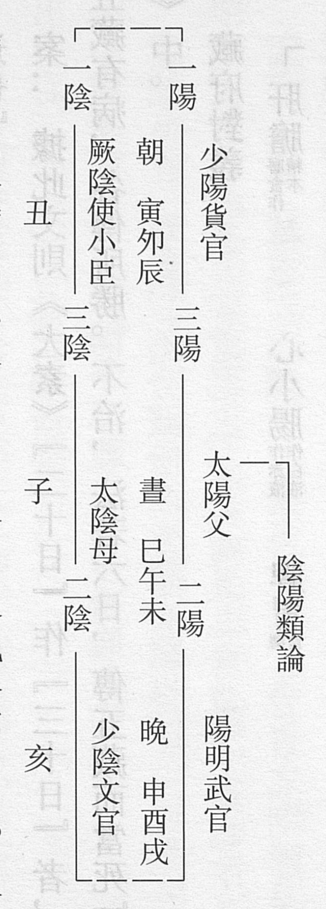

- 陰陽類論 → 太陽父
- 少陽貨官
- 陽明武官
- 一陽 → 三陽 → 二陽
- 一陽 → 一陰
- 二陽 → 二陰
- 朝　寅卯辰
- 晝　巳午未
- 晩　申酉戌
- 厥陰使小臣
- 太陰母
- 少陰文官
- 一陰 → 三陰 → 二陰
- 丑
- 子
- 亥

「천원기론(天元紀論)」에 “귀유구(鬼臾區)가 말하였다. 음양의 기에는 각각 많고 적음이 있으므로 삼음삼양이라 한다.”라고 하였고, 왕주에 “그 오르내림에 따라 셋으로 나누었다.”라고 하였다.

「지진요론(至真要論)」에 “음양이 셋인 까닭을 듣고 싶은데, 무엇을 말하는가? 기백이 말하였다. 기에 많고 적음이 있어 쓰임이 다른 것이다.”라고 하였고, 왕주에 “태음은 정음(正陰)이 되고 태양은 정양(正陽)이 되며, 그다음으로 적은 것이 소음, 그다음으로 적은 것이 소양이 되고, 또 그다음이 양명, 또 그다음이 궐음이 되니, 궐음은 다함이다. 뜻은 『영추』 「계일월론(繫日月論)」에 갖추어져 있다.”라고 하였다.

『영』 「음양계일월론(陰陽繫日月論)」에 “두 양이 앞에서 합하므로 양명이라 한다. 두 음이 서로 다하므로 궐음이라 한다. 두 화가 함께 합하므로 양명이 된다.”라고 하였다. 「지진요론」에 “두 음이 서로 다하므로 유(幽)라 하고, 두 양이 합하여 밝으므로 명(明)이라 한다. 유명(幽明)의 짝은 한서(寒暑)의 다름이다.”라고 하였다.

안(案): 「계일월론」 중의 ‘前’ 자는 낮의 뜻으로 보아야 한다.

「열론(熱論)」에 1일 거양(巨陽), 2일 양명, 3일 소양[少昜], 4일 태음[太会], 5일 소음[少会], 6일 궐음[厥会]이라 하였다. 이 순서는 중경이 의거한 것이다.

「혈기형지편(血氣形志篇)」에 족태양[太昜]은 소음[少会]과 표리가 되고, 소양은 궐음과 표리가 되며, 양명은 태음과 표리가 되고, 수태양은 소음과 표리가 되며, 소양은 궐음과 표리가 되고, 양명은 태음과 표리가 된다고 하였다. 이 순서는 중경의 역(疫) 부위 순서가 의거한 것이니, 이는 중경이 의거한 것과 반대이다.[역3]

『영』 「경수편(經水篇)」의 족태양·소양·양명·태음·소음·궐음, 수태양·소양·양명·태음·소음·궐음도 중경의 역(疫) 위치 순서가 의거한 것이다.

삼음이 모두 박동하면 20일째 한밤중에 죽는다[三陰俱搏二十日，夜半死。]｟十八ヲ｠

「창공전(倉公傳)」에 “제(齊)의 중위(中尉) 반만여(潘滿如)가 소복통을 앓았는데 운운, 30일에 죽었다. 삼음이 모두 박동하는 경우는 법대로이고, 모두 박동하지 않는 경우는 급한 기한에 결판나며, 한 번 박동하고 한 번 대(代)하는 경우는 가깝다.”라고 하였다.

안(案): 이 글에 따르면 『대소』에서 ‘二十日’을 ‘三十日’로 쓴 것을 따를 만하다. 30일이라는 죽는 날의 차례는 「옥기진장(玉機真藏)」에서 말한 “오장에 병이 있으면 각각 이기는 곳으로 전한다. 치료하지 않으면 대체로 6일이 지나 오장에 다 전해지면 죽는다.”에 해당하니, 대개 6일씩 다섯 번, 곧 30일로 날을 끌다가 죽는 것이다. 설명은 『창공전고주(倉公傳攷注)』에 자세히 보인다.

장부대의(藏府對義)

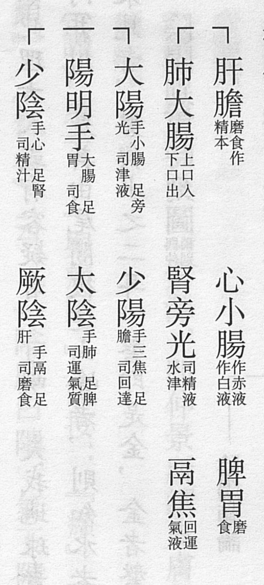

- 肝膽｟磨食作精本｠
- 心小腸｟作赤液作白液｠
- 脾胃｟磨食｠
- 肺大腸｟上口入下口出｠
- 腎旁光｟司精液水津｠
- 鬲焦｟回運氣液｠
- 大陽｟手小腸足旁光司津液｠
- 少陽｟手三焦足膽司回達｠
- 陽明手｟大腸足胃司食｠
- 太陰｟手肺足脾司運氣質｠
- 少陰｟手心足腎司精汁｠
- 厥陰｟手鬲足肝司磨食｠

소양과 궐음이 표리가 된다고 하는 것과 간과 담이 장부 표리가 된다고 하는 것은 같은 일을 다른 말로 한 것일 뿐이다. 다른 것도 모두 이에 준한다. 본편의 일음과 일양, 삼음과 삼양, 이음과 이양도 곧 이 장부 표리와 뜻이 조금 다를 뿐이다.

폐·심·격은 위에 있으므로 수경이 되고, 비·간·신은 아래에 있으므로 족경이 된다. 대장·소장·삼초는 직분이 위에 있으므로 수경이 되고, 위·담·방광[旁光]은 성질이 아래로 향하므로 족경이 된다.

7(七)

맥음양(脈陰陽)｟一ヲ｠

위완(胃脘)｟二ウ｠

심비(心脾)｟四ヲ｠

현절(懸絶)｟同｠

은곡(隱曲)｟同、十九ヲ｠

풍소(風消)｟同ウ｠

식분(息賁)｟同｠

삭택(索澤)｟五ヲ｠

천소(腨痟)｟同｠

퇴산(頽疝)｟同｠

심체(心掣)｟六ヲ｠

격(隔)｟同、十五ウ｠

풍궐(風厥)｟六ウ｠

선기(善氣)｟八ヲ｠

편고위역(偏枯痿易)｟八ウ｠

백한(魄汗)｟十ヲ｠

천명(喘鳴)｟同｠

淖(淖)｟十一ウ｠

결사(結斜)｟十四ヲ｠

석수(石水)｟同｠

소(消)｟十五ヲ｠

수(水)｟同ウ｠

후비(喉痺)｟十六ヲ｠

유자(有子)｟同ウ｠

창벽(脹辟)｟十七ウ｠

한(汗)｟同｠

붕(崩)｟十八ヲ｠

## 소문고주(素問攷注) 권제3

### 중광보주황제내경소문(重廣補注黃帝内經素問) 권제3

#### 영란비전론(靈蘭祕典論)편 제8

현존하는 『대소』에는 이 편이 빠져 있다.

**[역1]** 원서대로 옮겼다. 「搏擊無力」의 「無」는 앞의 「實」, 같은 안어 끝의 「亦有力而搏擊」과 어긋나 「有」의 잘못으로 보인다.
**[역2]** 원서 「脹辟」은 「腸辟」의 잘못으로 보인다(이 목록이 가리키는 『素問』 경문은 「陰陽虚，腸辟死」로 되어 있다).
**[역3]** 원서대로 옮겼다. 「疫」은 두 자리에 똑같이 쓰였으나 「仲景疫部位序」의 뜻이 분명하지 않아 다른 글자의 잘못일 수도 있다.

**○黃帝問曰：願聞十二藏之相使貴賤何如。**

황제가 물었다. “열두 장(藏)이 서로 부리는 관계[相使]와 귀천이 어떠한지 듣고 싶다.”

〔馬〕십이장이란 장과 부를 나누지 않고 모두 장이라 한 것이다.

『주례(周禮)』 「질의(疾醫)」의 『정의(正義)』에 “오장은 기가 갈무리되는 곳을 말한다.”라고 하였다. 이 아래는 모두 「월령(月令)」의 ‘牲南首’에 의거하여 말한 것이다.

〔張〕藏은 갈무리함[藏]이다. 육장과 육부를 합하면 열둘이 되니, 나누어 말하면 양은 부, 음은 장이 되고, 합하여 말하면 모두 장이라 일컬을 수 있으니, 창고[庫藏]의 장과 같이 물건을 갈무리하는 것이다. 「선명오기편(宣明五氣篇)」에서 “심은 신(神)을 갈무리하고, 폐는 백(魄)을 갈무리한다.”라고 한 부류가 이것이다. 상사(相使)란 보좌하는 재상과 부리는 신하를 말한다. 귀천이란 군신 상하의 구분이다.

〔識〕다음 편에 십일장(十一藏)이라는 칭호가 있고, 『주례』에는 구장(九藏), 『장자(莊子)』에는 육장(六藏)이 있으니, 정해진 이름이 없음을 알 수 있다.

〔吳〕맑은 것이 귀하고 탁한 것이 천하다.

（眉）심은 임금, 신은 작은 임금, 간은 무관, 폐는 문관, 비는 재화와 곡식을 맡은 관리이니, 국가의 관료가 다 갖추어졌다.

（眉）『서(書)』 「반경 하(盤庚下)」에 “이제 나는 내 심복신장(心腹腎腸)을 펼쳐 너희 백성에게 짐의 뜻을 낱낱이 고한다.”라고 하였다. 대개 신이 지(志)를 갈무리한다는 뜻이며, 심과 신 두 임금을 들었으니 나머지는 생략할 수 있다.

（眉）본편의 각 장 아래에 『난경(難經)』과 『십사경발휘(十四經發揮)』에서 말한 장부의 형상·위치 등의 말을 적어 두어야 한다.

（眉）본편의 ‘心者’부터 ‘乃制’까지의 글은 명고옥현의(名古屋玄醫)가 자세히 주를 달았는데, 『우득의학(愚得醫學)』 권하에 있으니 옮겨 적어야 한다.

**○岐伯對曰：悉乎哉問也。請遂言之。**

기백이 답했다. “자세하구나, 물음이여! 남김없이 말하겠다.”

〔識〕왕주(王注)에서 「육절장상(六節藏象)」을 풀이하며 “遂는 다함이다.”라고 하였다. ‘遂言’ 두 자는 『가어(家語)』에 보인다.

**○心者，君主之官也。神明出焉。**

심(心)은 군주(君主)의 관직이니, 신명(神明)이 여기서 나온다.

〔識〕『영(靈)』 「사객편(邪客篇)」에 “심은 오장육부의 큰 주인이며 정신이 머무는 곳이다.”라고 하였다. 『순자(荀子)』 「해폐편(解蔽篇)」에 “심은 형체의 임금이며 신명의 주인이다. 명령을 내리되 명령을 받는 일이 없다.”라고 하였다. 『회남자(淮南子)』에 “무릇 심은 오장의 주인이다. 사지를 부리고 혈기를 흐르게 하는 것이다.”라고 하였다. 『오행대의(五行大義)』에서는 본경을 인용하여 ‘주수지관(主守之官)’이라 쓰고, “심은 주수의 관직이 되니 신명이 나온다. 화는 남방의 양이니 그 광휘가 임금의 상이다. 신은 몸의 임금이니, 임금이 남쪽을 향해 다스리는 것과 같으며, 『역』에서는 이(離)를 화로 삼아 태양의 자리에 둔다. 임금의 상으로서, 사람의 운동과 정성(情性)의 작용이 심에서 말미암지 않는 것이 없다. 그러므로 주수의 관직이 되어 신명이 나오는 곳이다.”라고 하였다. 『설문(説文)』에 “官은 관리가 임금을 섬기는 것이다.”라고 하였다.

『백호통(白虎通)』에 “심은 화의 정기이다. 색은 붉으며, 心이라는 말은 맡음[任]이니, 생각을 맡는 것이다.”라고 하였다.

『설문』에 “心은 사람의 심이니, 토장(土藏)으로 몸의 가운데에 있다. 상형자이다. 박사의 설은 화장(火藏)으로 여긴다.”라고 하였다.

『석명(釋名)』에 “心은 가늚[纖]이다. 아는 것이 섬세하고 미세하여 꿰뚫지 않는 것이 없다.”라고 하였다.

안(案): 심장에만 유독 화명(和名)이 없으니, 대개 『古古呂』가 곧 심장의 이름이다. 심은 신명이 나오는 곳이므로 『古古呂』라 이름하였다. 古古呂는 古留의 뜻이니, 간을 『歧毛』라 훈하는 것과 뜻이 같다. 『만안방(萬安方)』에서 심계(心悸)를 『古古呂歧衣』라 훈하고 또 『幾毛歧衣』라 한 것도 증거가 될 수 있다. 『幾毛』의 풀이는 간 항목 아래에 보인다.

（眉）『맹자(孟子)』에 “귀와 눈이라는 기관은 생각하지 못하여 사물에 가려진다. 마음이라는 기관은 생각하니, 생각하면 얻는다.”라고 하였다. 가대인(家大人)께서 “천자와 왕공에게도 관사(官事)가 있으니, 하늘을 섬기고 땅을 다스리는 것이다.”라고 하셨다.

（眉）『관자(管子)』에 “심이 몸에 있는 것은 임금의 자리이다. 구규에 직분이 있는 것은 관리의 나뉨이다. 심이 그 도에 처하면 구규가 잘 다스려진다.”라고 하였다.｟『어람(御覽)』 권376에서 인용｠

（眉）『문자(文子)』에 “심은 형체의 주인이다. 신은 심의 보배이다.”라고 하였다.｟同上｠

（眉）『회남자』에 “무릇 심은 오장의 주인이다. 사지를 부리고 혈기를 흐르게 하며, 옳고 그름의 경계를 내달리고 온갖 일의 문을 드나드는 것이 이것이다.”라고 하였다.｟同上｠

【楷】（眉）“심장은 가슴 왼쪽에 자리하며, 그 위쪽 머리를 풍정(豐頂)이라 하고 아래 끝을 첨미(尖尾)라 한다. 첨미는 약간 굽어 가슴에 가까우며, 겉으로는 왼쪽 젖 아래에 해당하므로, 왼쪽 젖 아래 허리(虛里)의 박동이 곧 이것이다.” 택전정(澤田貞)의 『상한론대의(傷寒論大意)』에 나온다.

【楷】（眉）「오운행대론(五運行大論)」 ‘在藏爲心’의 주에 “심의 형상은 아직 피지 않은 연꽃과 같고, 속에 아홉 구멍이 있어 천진(天真)의 기를 이끌어 들이니, 신의 집이다. 군주의 관직이 되니 신명이 여기서 나온다.”라고 하였다.

【楷】（眉）가대인께서 “폐는 덮개가 되고 격은 수레가 된다. 심주는 가운데 자리하여 사방에 정사를 펼친다. 폐엽이 아래로 덮고 격막이 밖을 감싸 심주를 가슴 속에 보호하니, 제왕의 기내(畿內) 땅이로다.”라고 하셨다.

（眉）『사(史)』 「편창전(扁倉傳)」의 『정의』에 “心은 가늚[纖]이니, 아는 것이 섬세하고 미세하다.”라고 하였다.

**○肺者，相傳之官，治節出焉。**

폐(肺)는 재상[相傳]의 관직이니, 치절(治節)이 여기서 나온다.

『백호통』에 “폐는 금의 정기이다. 색은 희며, 肺라는 말은 費이다.”라고 하였다.

『설문』에 “肺는 금장(金藏)이다.”라고 하였다.

『석명』에 “肺는 勃이다. 그 기가 왕성하게 뭉쳐 있음을 말한다.”라고 하였다.

『오행대의』에 “폐가 재상의 관직이 되어 치절이 나오는 것은, 금은 마름질하여 결단할 수 있고 재상의 임무는 다스리는 도에 밝아 위아래가 가르침에 순종하여 모두 예절이 있으니, 폐가 오장에서 또한 치절이 생기는 곳이기 때문이다.”라고 하였다.

또 『원명포(元命苞)』를 인용하여 “비는 弁이다. 폐가 이를 얻어 커진다. 폐는 의(義)이니, 폐가 의인 까닭은 무엇인가? 폐는 금의 정기이고, 의는 서방에서 결단하여 만물을 죽이고 이루게 하므로, 폐는 금을 본뜨며 색은 희고 강함이 있다.”라고 하였다.

또 『하도(河圖)』를 인용하여 “의롭고 은혜롭고 굳세게 결단함은 폐의 정기이다. 근심·걱정·번민·울발[患憂憒勃]이 있으면 폐를 상하고, 폐가 상하면 기침과 실음(失音)을 일으킨다.”라고 하였다.

또 “폐가 백(魄)을 갈무리하는 것은, 백은 서로 붙음[相著]으로 이름한 것이다. 폐는 소음이니 음의 성질은 고요하다. 금은 죽임을 주관하고 백은 또 악(惡)을 주관하므로 여기에 갈무리한다.”라고 하였다.

또 “관자가 말하기를 ‘폐는 가죽[革]을 낳는다’라고 하였다. 『원명포』에 ‘폐가 가죽을 낳는다는 것은, 폐는 금이다. 금은 마름질하여 결단할 수 있고 가죽도 한계를 지어 끊으므로 폐가 이를 낳는다’라고 하였다.”라고 하였다.

『화명초(和名抄)』에 “肺는 화명이 布久布久之이다.”라고 하였다.｟『의심방(醫心方)』도 같다｠

안(案): 폐는 오장의 위쪽 덮개가 되니, 시들어서도 안 되고 부풀어서도 안 되며, 늘 기를 머금어 가득 뭉쳐 있으므로 『布久布久之』라 이름하였다. 『布久布久之』란 가죽 주머니 안에 기를 모아 두고 이쪽을 밀면 저쪽으로 옮겨 가는 모양 같음을 말한다. 지금 속어에서 『分久分久須留』라 부르는 것이 곧 『布久布久之』가 한 번 바뀐 말일 뿐이다.

〔馬〕무릇 다스림의 절도가 이로부터 나온다.

〔張〕節은 제어함이다. 『영』 「오륭진액별(五癃津液別)」에 “오장육부에서 심은 임금이 되고 폐는 재상이 된다.”라고 하였다.

（眉）『사』 「편창전」 『정의』에 “肺는 孛이다. 그 기가 거세므로[孛] 짧고 뭉친다는 말이다.”라고 하였다.

（眉）「오운행론(五運行論)」 ‘在藏爲肺’의 주에 “폐의 형상은 사람의 어깨와 비슷하며, 두 개의 펼친 잎과 여러 작은 잎이 있고, 속에 2,004개[二千四]의 구멍이 있어 줄지어 늘어서서 여러 장의 맑고 탁한 기를 나누어 펼치며, 백을 갈무리하는 것을 주관한다. 재상[相傅]의 관직이 되니 치절이 여기서 나온다.”라고 하였다.[역1][역2]

（眉）『소(素)』 「음양류론(陰陽類論)」에 ‘上空志心’이라 하였는데, 『신교정(新校正)』에서 양상선(楊上善)을 인용하여 “폐기는 아래로 신의 지(志)에 들어가고, 위로 심의 신(神)에 들어간다.”라고 하였다. 이는 우리 집안 설에서 말하는 심·신의 교류, 폐·신의 소통의 증거이다.

**○肝者，將軍之官，謀慮出焉。**

간(肝)은 장군(將軍)의 관직이니, 모려(謀慮)가 여기서 나온다.

『백호통』에 “간은 목의 정기이다. 색은 푸르며, 肝이라는 말은 扞(막음)이다.”라고 하였다.

『설문』에 “肝은 목장(木藏)이다.”라고 하였다.

「오운행론」 ‘在藏爲肝’의 주에 “간에는 두 개의 펼친 잎과 한 개의 작은 잎이 있어 나무 껍질이 터져 싹트는 모양과 같다. 각각 지락(支絡)이 있고 맥이 그 속을 노닐어 양화(陽和)의 기를 펼쳐 내니, 혼(魂)의 궁이다. 장군의 관직이 되니 모려가 여기서 나온다.”라고 하였다.

『영』 「천년편(天年篇)」에 “간기가 쇠하기 시작하면 간엽이 얇아지기 시작한다.”라고 하였다.

『석명』에 “肝은 幹(줄기)이다. 오행에서 목에 속하므로 그 생김새에 가지와 줄기가 있다. 대체로 사물은 나무를 줄기로 삼는다.”라고 하였다.

『오행대의』에서 『원명포』를 인용하여 “비는 弁이다. 간이 이를 얻어 일어난다. 간은 인(仁)이니, 간이 인인 까닭은 무엇인가? 간은 목의 정기이고, 인이란 살리기를 좋아하는 것이다. 동방은 양이다. 만물이 처음 생겨나므로 간은 목을 본뜨며 색은 푸르고 부드러움이 있다.”라고 하였다.

또 『소문(素問)』을 인용하여 “간은 혼이 머무는 곳이다. 음 가운데의 소양[小陽]이므로 봄기운과 통한다.”라고 하였다.

또 『하도』를 인용하여 “어질고 자애롭고 은혜를 베풂은 간의 정기이다. 슬픔이 지나치면 간을 상하고, 간이 상하면 눈이 침침해진다[芒芒].”라고 하였다.

또 “간이 장군의 관직이 되어 모려가 나오는 것은, 목의 성질은 인이고 어진 이는 반드시 깊이 생각하고 멀리 헤아릴 수 있어 늘 만물을 이롭고 편안하게 하려 한다. 장군은 군사를 움직이는 주인이니 반드시 모려를 앞세운다. 그러므로 병서에 ‘군사를 인으로 일으키면 따르지 않는 이가 없어 얻고, 인으로 나누면 따르며 기뻐하지 않는 이가 없다’라고 하였다. 또 ‘장수에게 꾀가 없으면 사졸이 근심하고, 장수에게 헤아림이 없으면 사졸이 떠난다’라고 하였다. 그러므로 간은 장군이 되어 모려를 낸다.”라고 하였다.

또 “간이 혼을 갈무리하는 것은, 혼은 움직임[運動]으로 이름한 것이다. 간은 소양이니 양의 성질은 움직인다. 목의 성질은 인이므로 혼도 선(善)을 주관하니, 그래서 간에 갈무리한다.”라고 하였다.

「기병론(奇病論)」 47에 “간은 중(中)의 장수이다. 담에서 결단을 취한다.”라고 하였다.

『영추(靈樞)』 「오륭진액별」에 “간은 장수가 된다.”라고 하였다.

또 「사전(師傳)」에 “간은 장수가 되는 것을 주관한다.”라고 하였다.

〔識〕『일지록(日知録)』에 “『춘추전(春秋傳)』 소공(昭公) 28년의 ‘어찌 장군께서 드시는데 부족함이 있겠습니까’에 대해 『정의』에 ‘이는 위자(魏子)가 중군을 거느렸으므로 장군이라 한 것이다’라고 하였다. 육국 이래 마침내 장군을 관직명으로 삼았으니, 대개 그 기원이 여기에서 비롯되었다.”라고 하였다. 『관자』 「입정편(立政篇)」에 “장군과 대부가 관리를 거느리고 조회한다.”라고 하였다.

『화명초』에 “肝은 화명이 歧毛이다.”라고 하였다.｟『의심방』도 같다｠

본거씨(本居氏)는 “옛날에는 장부를 통틀어 歧毛라 하였고, 지금 속어에서 간과 담을 모두 歧毛라 부르는 것은 옛 이름이 남은 것이다. 오장육부에 각각 화명이 있는 것은 옛것이 아니다. 새와 짐승의 장부에 이르러서는 지금도 통틀어 歧毛라 부른다.”라고 하였다.

수곡씨(狩谷氏)는 말하였다. 「흠명기(欽明紀)」에 “간을 도려내고 발을 자르되 그 통쾌함에 물리지 않으며, 뼈를 볕에 쬐고 시신을 태우되 그 잔혹함을 말하지 않는다.”라고 하였다. 이는 장부를 肝이라 한 것이니, 대개 옛날에 장부를 ‘歧毛’라 훈하였으므로 후세에 ‘歧毛’로 훈하는 肝 자로 채워 넣은 것이다. 「추고기(推古紀)」에 “너는 간[肝]이 어리다.”라고 하였다. 이는 肝을 心으로 삼은 것이다. 또 옛 노래에서 ‘肝向’과 ‘群肝’을 心의 머리말[枕詞]로 삼았다. 지금 속어에서 애태우는 것을 ‘歧毛以留’라 하고, 대담한 것을 ‘歧毛不登之’라 하며, 담력을 잃는 것을 ‘岐毛都夫須’라 하니, 모두 본거씨의 설을 증명할 수 있다.

안(案): 『歧毛』는 『古毛留』의 뜻이니, 안에 있으면서 움직이지 않음을 말한다. 『古古呂』도 『古留』의 뜻이니, 『歧毛』와 훈이 같다. 대개 간과 심 두 장은 혼과 신을 주관하여 정신이 있는 곳이 되므로, 옛날에는 간과 심이 모두 『歧毛』라는 훈을 가졌다.

『주례』 「질의」 『정의』에 “폐는 위에 있고, 심은 폐 아래에 있으며, 간은 심 아래 오른쪽 가까이 있으니, 이 세 장은 모두 격(膈) 위에 있다. 비와 신 두 장은 격 아래에 있다.”라고 하였다. 이 설은 틀렸다.

（眉）정현(鄭玄)의 『주례』 「질의」 주에 “간기는 서늘하다.”라고 하였다. 가(賈)의 『소(疏)』는 그 설을 펴서 “간은 심 아래 오른쪽 가까이 있으며 그 자리가 가을에 해당하므로 간기가 서늘하다고 하였다.”라고 하였다.

（眉）송(宋)나라 왕규(王逵)의 『여해집(蠡海集)』에 “사람 몸의 간은 자리가 오른쪽에 있는데 맥진은 도리어 왼손에 나타난다. 비는 자리가 왼쪽에 있는데 맥진은 도리어 오른손에 나타난다. 이 또한 음과 양이 서로 상대의 집에 깃들어 있다는 뜻이다.”라고 하였다.

（眉）원(元)나라 활수(滑壽)의 『십사경발휘』에 “간이라는 장은 왼쪽 세 잎, 오른쪽 네 잎으로 모두 일곱 잎이다. 그 다스림은 왼쪽에 있고, 그 장은 오른쪽 옆구리 오른쪽 신의 앞에 있으며, 위와 나란히 등뼈 제9추에 붙어 있다.”라고 하였다. 송나라 왕유일(王惟一)의 『동인수혈침구도경(銅人腧穴鍼灸圖經)』 첫머리에 장부도가 있는데, 간이 오른쪽, 비가 왼쪽에 있다. 『만병회춘(萬病回春)』 권1의 정면 인체도는 간담을 오른쪽에 두고 배면 인체도는 간담을 왼쪽에 두었으니, 그 어긋남이 우습다. 『의학입문(醫學入門)』 권1 「장부조분편(藏府條分篇)」에는 간이 격막에 이어져 오른쪽 협륵에 붙어 있다고 하였다. 이중재(李中梓)의 『이세미론(頤世微論)』 장부도에는 간이 오른쪽, 비가 왼쪽에 있고, 방광[旁光] 앞에 포(胞)가 있다.[역3]

（眉）서림(書林) 교산당(喬山堂) 유용전(劉龍田)이 간행한 『도주맥결난경(圖註脈訣難經)』 제42난의 배면도에는 간을 오른쪽에, 비를 왼쪽에 두었다.

（眉）『돈의초(頓醫抄)』 권44의 장부 그림에는 간이 오른쪽, 비가 왼쪽에 있다. 대개 송·당 무렵의 그림이 우리 쪽으로 전해 들어온 것이니, 높일 만하고 의거할 만하다.

（眉）『사』 「편창전」 끝의 『정의』에 “肝은 幹이다. 오행에서 목이 되니, 그 생김새에 가지와 줄기가 있다.”라고 하였다.

（眉）『영』 「사전편(師傳篇)」에 “간은 장수가 되는 것을 주관하니, 이로 하여금 밖을 살피게 한다.”라고 하였다.

（眉）약지안(約之案): 장부 가운데 속이 꽉 차 비어 있는 데가 없는 것은 간·비·전중(膻中) 셋뿐이니, 색이 같고 질이 같다.

（眉）어떤 이는 간이 금으로 가을이고 폐가 봄으로 목이라 하는데, 크게 틀렸다. 대개 기와 사물은 모두 아래에서 위로 오르니, 지기는 사방으로 나오는 것이다. 『역』의 괘도 아래에서 위로 오른다. 사람에게 있어서는 신이 겨울로 아래에 있고, 그다음 올라 간이 봄이 되며, 또 올라 심이 여름이 되고, 또 올라 폐가 가을이 되며, 폐는 신과 통하여 다시 내려와 신의 겨울이 된다. 비는 사계절에 왕성하므로 낮고 작게 곁에 있으면서 돕는다.

（眉）『악동성의(樂動聲儀)』에 “오장에서 간은 인이니, 간이 인인 까닭은 무엇인가? 간은 목의 정기이다. 인이란 살리기를 좋아하는 것이며, 동방은 양이다. 만물이 처음 생겨나므로 간은 목의 색을 본뜨고 가지와 잎이 있다.”라고 하였다.｟『어람』 권376에서 인용｠[역4]

**○膽者，中正之官，決斷出焉。**

담(膽)은 중정(中正)의 관직이니, 결단(決斷)이 여기서 나온다.

『어람』 권376에서 『황제소문(黃帝素問)』을 인용하여 “담은 중심(中心)의 관직이니, 단결(斷決)이 여기서 나온다.”라고 하였다.

「삼십오난(三十五難)」에 “담은 청정(清淨)의 부이다.”라고 하였다.｟『갑을경(甲乙經)』도 같다｠

『영추』 「본수편(本輸篇)」에 “담은 중정(中精)의 부이다.”라고 하였다.｟『오행대의』에서 인용한 『하도』, 『화명초』에서 인용한 『중황자(中黃子)』도 같다｠

『갑을(甲乙)』 권1에서 「본수」를 인용한 데에는 ‘中精’이 ‘清淨’으로 되어 있다.

『후한(後漢)』 「마융전(馬融傳)」 주에서 『한시외전(韓詩外傳)』을 인용하여 “담은 정(精)을 쌓는 부이다.”라고 하였다.

『설문』에 “膽은 간에 이어진 부이다.”라고 하였다.

안(案): 膽이라는 말은 澹이니, 곧 물이 움직이는 것을 말한다. 담즙은 활동하여 늘 늘었다 줄었다 하니, 물이 흔들려 움직이는 것과 같으므로 膽이라 이름한 것일까.

『오행대의』에 “담이 중정의 부가 되는 것은, 간은 눈과 통하고 눈은 정명(精明)한 것이며 또 정신의 주인이므로 중정의 부라 한다.”라고 하였다.

『화명초』에 “膽은 화명이 以이다.”라고 하였다.｟『의심방』도 같다｠

안(案): 以는 以留의 뜻이니, 쏨[射]을 말한다. 비가(脾家)가 운화한 오장의 정기는 위로 두면에 대어지고 아래로 사지에 흘러든다. 그 순수한 기는 신으로 들어가 정액이 되고, 그 거세고 매운[戟烈] 기는 소장 속에서 스며 나와 담즙이 된다. 이 즙이 남으면 위 속으로 스며들어 음식이 정체되지 않게 하고, 맥 속으로 스며들어 혈이 상하지 않게 한다. 그러므로 눈이 볼 수 있고 귀가 들을 수 있으며, 손이 쥘 수 있고 발이 디딜 수 있으며, 무거운 것을 들고 높은 데에 오를 수 있는 것은 모두 담즙이 스며든 여력이다. 그러므로 비위가 조화로우면 신수가 넉넉하고 담즙이 남는다. 그것이 미세한 혈락 사이로 스며드는 기세가 쏘아 나오는 것 같으므로 以라 이름한 것이다.

『영』 「천년편」에 “50세에 담즙이 줄기 시작하고 눈이 밝지 않기 시작한다.”라고 하였다.

〔張〕담은 굳세고 과감한 기를 타고났으므로 중정의 관직이 되어 결단이 나오는 곳이다. 담은 간에 붙어 서로 표리가 된다. 간기가 강하더라도 담이 아니면 결단하지 못한다. 간과 담이 서로 도와야 용감함이 이루어진다. 그러므로 「기병론」에 “간은 중의 장수이니, 담에서 결단을 취한다.”라고 하였다.

안(案): 담기는 곧 간기이니, 서로 표리를 이룬다. 심포가 심기를 전하여 서로 희로를 이루는 것과 같다. 위부(胃府)의 하구, 소장의 분계가 유문(幽門)이 되니, 담즙과 초액(焦液)이 함께 여기서 나오고, 또 조금 나뉘어 여기로 들어가 수곡을 쪄서 익힌다.

（眉）방이지(方以智)의 『통아(通雅)』 권51에 “열한 장이 담에서 결단을 취하니, 담은 강한 정기를 갖추어 두려움을 가라앉히고 임신에 쓰인다[以定恐用娠].”라고 하였다.

（眉）안(案): 中은 衷이고 忠이다. 속마음으로 헤아리고 바로잡는 것이니 곧 결단의 뜻이며, 대개 절충하여 바름을 의논하는 뜻이다.

（眉）『사』 「편창전」 『정의』에 “膽은 敢이다. 사람에게 담기가 있으면 과감할 수 있다는 말이다.”라고 하였다.

**[역1]** 원서대로 옮겼다. 이 책의 왕빙 주 인용에는 「相傅」로 되어 있고, 『針灸大成』 등에는 「相傳」으로 되어 있다.
**[역2]** 원서대로 옮겼다. 『素問』 왕빙 주는 趙府居敬堂本·四部叢刊本 등에 「二千四空」, 正統道藏本에 「二十四空」으로 되어 있다.
**[역3]** 원서대로 옮겼다. 이 책의 다른 자리에는 「頤生微論」으로 되어 있어 「世」는 「生」의 잘못일 수 있다.
**[역4]** 원서대로 옮겼다. 『說文解字義證』·『事言要玄事集』의 같은 구절에는 「色青而有枝葉」로 되어 있다.

**○膻中者，臣使之官，喜樂出焉。**

전중(膻中)은 신사(臣使)의 관(官)이니, 희락(喜樂)이 여기서 나온다.

왕빙(王氷)의 음석(音釋)에 “‘膻’은 도한절(徒旱切)이다.”라 하였다.

『영(靈)』 「사객편(邪客篇)」에 “여러 사기(邪氣)가 심(心)에 있는 것은 모두 심의 포락(包絡)에 있다. 포락은 심주(心主)의 맥이다.”라 하였다. 삼곡박(三谷樸)은 “‘脈’은 혹 ‘膜’의 잘못일 것이다. 그러나 『석명(釋名)』에서 ‘脈’과 ‘膜’을 같게 풀이하였으니, 옛날에는 혹 통용했을 것이다.”라고 하였다.

〔張〕단중은 상초(上焦)에 있으며 상기해(上氣海)라고도 하는데, 종기(宗氣)가 쌓이는 곳이다. 군주와 재상의 명령을 받들어 행하고 기화(氣化)를 펼치므로 신사의 관이 된다. 「행침편(行鍼篇)」에 “양이 많은 자는 기뻐함이 많고 음이 많은 자는 성냄이 많다. 단중은 두 양장(陽藏)이 자리한 곳이므로 희락이 여기서 나온다.”라 하였다. 살펴보건대[按] 12경의 표리에는 심포락(心包絡)이 있으나 단중은 없다. 심포의 자리는 바로 격(膈) 위에 있어 심을 호위한다. 「창론(脹論)」에 “단중은 심주의 궁성이다.”라 하였으니 심포가 신사라는 뜻과 꼭 들어맞는다. 생각건대 바로 이것을 가리키는 것이 아니겠는가.

『의심방(醫心方)』 권14 「치졸사방(治卒死方)」 제1편의 『집험(集驗)』 우방(又方)에 “단중혈(亶中穴)에 뜸을 뜬다.”라 하였다. ‘亶’은 권발(圈發)로 거성(去聲)으로 읽는다.

『의심방』 권9 첫 편에 인용된 『소품방(小品方)』에 “단중혈에 50장 뜸을 뜬다.”라 하였다. ‘亶’은 거성으로 권발하고, ‘中’은 상성(上聲)으로 권발한다.

안(案): 희락이라 하였으니 그 밖의 칠정(七情)에 속하는 것도 모두 여기서 나온다는 뜻이다. 『백호통(白虎通)』에 “삼초(三焦)는 포락의 부(府)이다.”라 하였다. 여기서 말하는 포락은 심주를 가리킨다.

〔李〕군주에 바짝 가까이 있으므로 신사라 일컫는다. 장부의 관은 왕의 신하 아닌 것이 없는데, 여기서만 널리 신(臣)이라 하고 또 사(使)라 한 것은 심부름시키는 신하로서 내시(内侍)와 같기 때문이다.

『상한직격(傷寒直格)』에 “포락은 명문(命門)이라고도 한다.”라 하였다.

〔識〕설설(薛雪)은 “단중은 상기해라고도 하며 종기가 쌓이는 곳이다. 심포락에서 포(包)는 막(膜)으로 심군(心君)의 궁실이고, 낙(絡)은 막 바깥의 골목으로 심군의 성부(城府)이다. 하나는 기밀을 다루는 땅[密勿之地]이고 하나는 도성 둘레의 사이[畿甸之間]이니, 신사의 뜻이 여기서 드러난다. 단중은 궁실 바깥의 성부이다.”라고 하였다.

『영』 「해론(海論)」에 “단중은 기의 바다이다.”라 하였다. 『대소(大素)』 권5 「사해합(四海合)」에 이를 실었는데, 양주(楊注)에 “‘膻’은 흉중이다. 음은 ‘檀’이다.”라 하였다.

주양준(周揚俊)의 『온열서역전서(温熱暑疫全書)』 권3 「변한서각이편(辨寒暑各異篇)」에 인용된 장봉규(張鳳逵)의 말에 “더위가 찌는 독이 입과 코로 들어온 경우는 곧바로 심포 경락에 적중한다.”라 하였고, 또 “오로지 심주에만 전해 들어가고 다른 장에는 전해 들어가지 않는다는 말이 아니다.”라 하였다.

『체아(體雅)』에 “『주후방(肘後方)』에 각기(脚氣)에는 단중에 50장 뜸을 뜨는데, 가슴 앞 양쪽으로 젖을 마주한 흉염골(匈厭骨) 이음매 사이에 있으며, 손가락으로 누르면 기가 흡흡(翕翕)하게 느껴지는 곳이 이곳이라 하였다. 『천금방(千金方)』에 하품하다 협거(頰車)가 어긋났을 때[失欠頰車蹉]는 기가(氣街)에 200장 뜸을 뜨는데, 가슴 앞 목 아래 갑골(甲骨) 가운데로서 이곳을 기당(氣堂)이라고도 한다고 하였다.｟『천금익(千金翼)』에는 ‘甲骨’이 ‘寅骨’로 되어 있다｠ 윤(胤)이 살펴보건대[胤按] 갑골은 억골(臆骨)이기도 한데 그 혈은 단중일 것이다. 단중은 기의 바다이므로 기충(氣衝)이라 하고 또 기당이라 한 것이 아니겠는가.”라 하였다.

『의설(醫説)』에 인용된 『명의록(名醫録)』에 “소병(蕭炳)이 말하기를, 갓난아이가 처음 태어나면 부추 뿌리 즙을 먹여 악혈(惡血)을 토해 내게 해야 하며 그러면 자라서 병이 없다고 하였다. 효험이 있다. 부추는 심기(心氣)로 돌아가 포(包) 속의 악기(惡氣)를 없앨 수 있으니 흉중을 다스리는 것이다. 이로써 심포를 한 글자로 ‘包’라고도 부른다는 것을 알 수 있다.”라 하였다.

（眉）안(案): 단중이라는 이름은 여기에 나오나 포락은 없다. 포락이 곧 옛날의 단중임을 알 수 있다. 심장을 싸서 잇고 있으므로 심포락이라 하고, 줄여서 심포라 한다. 곧 위의 맑은 것과 아래의 탁한 것을 가르는 격막(鬲膜)이 이것이다. 鬲은 막는다는 뜻이고 막이므로 격막이라 하며, 또 심주라고도 하니 곧 포락의 다른 이름이다. 주(主)는 거처한다는 뜻이다. 격 위는 심장이 거처하는 궁이므로 그렇게 이름하였다. 『예(禮)』 「곡례(曲禮) 상」의 ‘居不主奥’에 대한 『소(疏)』에 “‘主’는 ‘坐’와 같다.”라 하였고, 『사(史)』 「천관서(天官書)」의 ‘太白主中國’에 대한 『정의(正義)』에 “‘主’는 ‘領’과 같고 ‘入’이다.”라 하였다. 이로써 앞 글 ‘心者君主之官也’의 ‘主’ 자와는 뜻이 다름을 알 수 있다. 흉중의 격 안은 칠정이 나오는 곳이어서, 격 안에 수(水)가 많으면 성정이 따라 변한다. 이것이 단중 안에서 희락이 나오는 까닭이다. 또한 신사라 이른 까닭이다.

（眉）안(案): ‘膻中’은 혹 ‘亶中’으로 쓰는데 이것이 정자이며, 둘 다 탁음(濁音)으로 상성으로 읽는다. ‘膻’이라는 말은 ‘達’의 뜻이니 사방으로 통달한다는 것이다. 또 ‘塡’의 뜻이니 기가 격 안에 가득 찬다는 것이다. 또 ‘亶’이자 ‘單’의 뜻이니 그 모양이 넓게 펼쳐졌다는 것이다. ‘中’은 격 안이라는 뜻이고, 또 위의 맑은 것과 아래의 탁한 것 사이에 자리한다는 뜻이다.

（眉）석판간재종철(石坂竿齋宗哲)의 『의원(醫源)』에 “주굉(朱肱)이 ‘심 아래에 격막이 있어 척추·옆구리와 빙 둘러 서로 붙어 있으니, 이른바 단중이다.’라 하였는데 이 설이 옳다. 위로는 심장을 감싸 보호하고 아래로는 가슴과 배를 가른다. 심장을 감싸 보호하는 것은 그 막이 세로이고, 가슴과 배[胸膜]를 가르는 것은 그 막이 가로이다. 그 계(系)가 꼬리처럼 두 가닥으로 아래로 요추에 이르는 것을 막원(幕原)이라 한다. 세로로 심장을 보호하는 것을 후인이 심포라 하였고, 가로로 가슴과 배를 가르는 것을 격막이라 하였다. 이제 「비전론(祕典論)」에 따라 세로와 가로를 합쳐 단중이라 이름한다.”라 하였다.[역1]

（眉）이 설은 천고에 깊이 묻혀 어두웠던 것을 밝힌 것이다. 삼곡생주(三谷笙州)가 심장 바깥을 싸는 얇고 투명한 막을 심포라 한 것은 잘못일 것이다. 몸속의 모든 것이 다 얇은 막에 싸여 있는데, 어찌 유독 심장의 막만 골라 심포라 따로 부르겠는가.[역2]

（眉）「기병론(奇病論)」에 “포락(胞絡)은 신(腎)에 매여 있다.”라 하였는데, 이는 포문(胞門)의 낙맥이지 심포가 아니다.

（眉）활백인(滑伯仁)의 『십사경발휘(十四經發揮)』도 삼곡생주(三谷笙洲)와 똑같이 심포락을 잘못 보았다.

（眉）『십사경발휘』에는 심포경 아래에 세로막[豎膜]과 가로막[横膜]의 구별이 있다.

**○脾胃者，倉廩之官，五味出焉。**

비위(脾胃)는 창름(倉廩)의 관이니, 오미(五味)가 여기서 나온다.

『오행대의(五行大義)』의 인용에는 ‘胃’ 자가 없다.

『오경대의(五經大義)』｟（‘經’은 ‘行’으로 써야 한다）｠에 “비는 창름의 관이니 오미가 나온다. 만물은 살아서는 흙에서 나오고 죽어서도 흙으로 돌아간다. 오곡이 들어오면 비가 받아들이므로 오미가 나오는 것도 여기에서 말미암는다.”라 하였다.

또 『하도(河圖)』를 인용하여 “온화하고 두텁고 독실하고 미더운 것은 비의 정(精)이다. 방종하고 탐욕스러우면 비를 상하고, 비가 상하면 쌓인 것이 소화되지 않아 비결(否結)의 병에 이른다.”라 하였다.

양천(楊泉)의 『물리론(物理論)』에 “목구멍은 생명의 요긴한 구멍이다.”라 하였다. 『어람(御覽)』 「인사부(人事部)」에 인용된 「오운행대론(五運行大論)」의 ‘在藏爲脾’에 대한 주에 “모양이 말굽 같고 안으로 위완(胃脘)을 감싸니 흙의 모양을 본뜬 것이다. 경락의 기가 그 안으로 모여들어 진령(真靈)의 기를 운행하니 의(意)의 집이다. 창름의 관으로서 화물(化物)이 여기서 나온다.”라 하였다. 또 “『백호통』에 ‘脾라는 말은 并이니, 네 기가 여기에 아우러짐을 이른다.’라 하였다.”라 하였다.

『영추(靈樞)』 「본수(本輸)」에 “위(胃)는 오곡의 부이다.”라 하였다.

『사(史)』 「편창전(扁倉傳)」 끝의 『정의』에 “사람이 먹은 것은 입으로 들어가 위 속에 모이고, 곡식이 익으면 소장으로 전해 들어간다.”라 하였다. 살펴보건대[案] 위는 쌀주머니일 뿐이어서 다시 12의 수에 꼽기에는 부족함을 알 수 있다.

〔識〕『순자(荀子)』 「부국편(富國篇)」의 양경(楊倞) 주에 “곡식을 저장하는 곳을 창(倉)이라 하고 쌀을 저장하는 곳을 름(廩)이라 한다.”라 하였다. 『유경(類經)｟廿八ノ四四ヲ｠』 「유편자법론(遺篇刺法論)」에 “비는 간의(諫議)의 관이니 지주(知周)가 여기서 나온다.”라 하였다. 『삼인방(三因方)』에는 ‘公正出焉’으로 되어 있다. ‘脾爲諫議大夫’는 『천금방』과 호오(胡悟)의 『오장도설(五藏圖説)』에 나온다.[역3]

『춘추원명포(春秋元命苞)』에 “위는 비의 부로서 기를 받아들이는 일을 주관한다. 위는 곡식이 쌓이는 곳이므로 비가 기를 받는 것이다.”라 하였다.｟『어람』 376에서 인용｠

『사』 「편창전」의 『정의』에 “‘脾’는 ‘裨’이다. 기를 돕고 곡식 소화를 주관하는 데 있다.”라 하였다. 살펴보건대[案] ‘在’ 아래에 ‘左’ 자가 잘못 빠진 듯하다.

〔張〕비는 운화(運化)를 주관하고 위는 수납(受納)을 맡아 수곡(水穀)을 함께 주관하므로 둘 다 창름의 관이 된다. 오미가 위로 들어가면 비를 거쳐 퍼지므로 오미가 여기서 나온다고 한 것이다.

『사』 「편창전」의 『정의』에 “‘胃’는 ‘圍’이니, 음식물을 둘러싸 받아들인다는 말이다.”라 하였다.

『영추』 「사전(師傳)」에 “비는 호위를 주관하여 양식을 맞아들이게 한다.”라 하였다.

안(案): 오미는 혀로 알지만, 혀가 알 수 있는 것은 비기(脾氣)가 혀로 통하기 때문이다. 그러므로 “오미가 여기서 나온다.”라 한 것이다. 여기서 비위라 하면서 오로지 비를 가리키는데, 비위를 이어 부르는 것은 익은 말이기 때문이다. 『영추』 「근결편(根結篇)｟五｠」의 ‘腸胃偏辟’이 오로지 장(腸)을 이르는 것과 같은 예이다.

（眉）「사십이난(四十二難)」 우주(虞注)에 “위는 창름의 관이다.”라 하였다.

（眉）『영』 「사전편(師傳篇)」에 “비는 호위를 주관하여 양식을 맞아들이게 한다.”라 하였고, 또 「장위편(腸胃篇)」에 “위는 구불구불 굽었다 펴진다.”라 하였다.

（眉）『백호통』에 “‘脾’라는 말은 ‘併’이니 기를 아울러 쌓기 때문이다.”라 하였고, 또 “비가 신(信)인 까닭은 무엇인가. 비는 토(土)의 정이다. 토는 맡아 기르는 것을 숭상하여 만물에 사사로움이 없으니 믿음의 지극함이다. 그러므로 비는 토를 본떠 색이 누렇고 혀에 매여 있다.”라 하였다.｟『어람』 376에서 인용｠

（眉）안(案): 위는 창(倉)이고 비는 름(廩)이다. 훈고에서 알 수 있다. 위에 ‘倉’이라는 이름이 있는 증거는 적지 않다.

（眉）안(案): 오미의 음액은 비에서 나오고, 비는 이것을 사방으로 대 준다. 그 오미의 근본은 위 속의 음식에서 나온다. 그러므로 위도 음식물의 오미를 내어 소장에 준다.

**○大腸者，傳道之官，變化出焉。**

대장(大腸)은 전도(傳道)의 관이니, 변화(變化)된 것이 여기서 나온다.

『영』 「본수편(本輸篇)」에 “대장은 위에 속하고 소장은 아래에 속한다.”라 하였다.

양천의 『물리론』에 “장위(腸胃)는 오장의 부(府)이고 도야(陶冶)의 큰 조화이다.”라 하였다.｟『어람』 「인사부」에서 인용｠

〔識〕「본수편」과 『오행대의』에 인용된 『하도』에 “대장은 전도의 부이다.”라 하였다. 『한시외전(韓詩外傳)』에 “대장은 전수(轉輸)의 부이다.”라 하였다.

「삼십오난(三十五難)」에 “대장은 전사(傳瀉)하여 이끌어 내보내는 부이다.”라 하였는데, 마(馬)는 “‘道’와 ‘導’는 같다.”라 하였다.

『오행대의』에 “대장이 전도의 부인 까닭은, 폐는 코로 통하고 코는 기를 내쉬고 들이쉬며, 대장은 오곡의 기를 전도하는 길이므로 폐의 부가 된다.”라 하였다.

『난경(難經)』 「35난(卅五難)」에 “대장은 전사(傳寫)하여 이끌어 내보내는 부이다.”라 하였고, 『후한서(後漢書)』 「마융전(馬融傳)」 주에 인용된 『한시외전』에 “대장은 전수의 부이다.”라 하였다. 『영추』 「본수편」에 “대장은 전도의 부이다.”라 하였다. 『오행대의』에 인용된 『하도』와 『갑을경(甲乙經)』도 같다. 『화명초(和名抄)』에 인용된 『중황자(中黄子)』에 “대장은 전송(傳送)의 부이다.”라 하였고, 「해론(欬論)」 왕주(王注)도 같다. 『의방유취(醫方類聚)』에 인용된 『신교만전방(神巧萬全方)』에 “대장은 폐와 표리가 되며 전송의 부라 이름한다.”라 하였고, 또 인용된 『오장육부도(五藏六府圖)』에 “폐는 호흡의 나루이고 전송의 관이다.”라 하였다.

（眉）안(案): ‘變化’는 똥을 가리킨다. 똥은 대장에서 항문으로 나가 없어지므로 변화된 것이 여기서 나온다고 하였다.

（眉）『포박자(抱朴子)』에 “오래 살고자 하면 장 속이 맑아야 하고, 죽지 않고자 하면 장에 똥이 없어야 한다.”라 하였다.｟『어람』 376에서 인용｠

（眉）『백호통』에 “대장과 소장은 심·폐의 부로서 예의를 주관한다. 예의에는 나눔의 이치가 있으니, 또한 크고 작은 것이 서로 잇고 받는 것이다.”라 하였다.｟이상 포경당본(抱經堂本)｠

안(案): 대장을 전도라 하고 소장을 수성(受盛)이라 하였으니, 정밀한 뜻이 신묘한 데 들어갔구나. 『의학입문(醫學入門)』 권1 「장부조분편(藏府條分篇)」에 “대장은 회장(迴腸)이라고도 한다.”라 하였다.

『영』 「장위편」에서는 대장을 회장이라 하고 항문을 광장(廣腸)이라 하였으며, 「평인절곡편(平人絶穀篇)」도 같다.

『사』 「편창전」 끝의 『정의』에 “장위는 모두 길이가 5장 8척 4촌이다.”라 하였고, 『갑을경』에는 “장위는 모두 길이가 6장[丈六尺] 4촌 4푼이다.”라 하였다. 입에서 장까지 세면 그렇고, 이 경문은 위에서 장까지 세므로 짧다. 또 “‘腸’은 ‘暢’이니, 위기(胃氣)를 통창(通暢)하게 하고 더러운 것을 끌어 없앤다는 말이다.”라 하였고, 또 “대장은 곧 회장이니, 돌아 굽어 있으므로 그렇게 이름하였다.”라 하였다.[역4]

『화명초』에 “대장은 일본 이름[和名]이 波良和太이다.”라 하였다.｟『의심방』도 같다｠

『의심방』에서 대장은 또 『於保和多』로 훈을 달았다.

안(案): 『和多』는 『和多加末留』의 줄임말로, 곧 서려 굽는다는 뜻이다. 『波良和多』는 배 안에 서려 굽어 있다는 말로, 대체로 대장·소장 둘을 아우르는 이름이다. 『설문(説文)』의 “‘腸’은 대장·소장이다.”, 『석명』의 “‘腸’은 ‘暢’이니 위기를 통창하게 하여 찌꺼기와 더러운 것을 없앤다.”, 『광아(廣雅)』의 “‘腸’은 ‘詳’이다.”가 모두 증거가 된다. 그냥 ‘腸’이라 하면 대장·소장 둘을 아우르는 이름이다. 『於保和多』는 소장의 훈 『保曾和多』, 또 『古和多』라는 이름과 맞서는 것으로, 대장이 소장에 비해 조금 넓고 크다는 말이다. 지금 세속에서는 『久曾布久呂』라 부르고, 만명(蠻名)은 『涅墜岐駄留牟』인데 후장(厚腸)으로 옮긴다.

（眉）「사십이난」 양주(楊注)에 “회장은 대장이니, 소장의 곡식을 받아 광장으로 전해 넣는다. 광장은 䐈장(䐈腸)이다. 항문이라고도 한다.”라 하였고, 또 “대장은 곧 회장이니, 돌아 굽어 있으므로 그렇게 이름하였다.”라 하였다. 『대소』 권12 「무명편(無名篇)」 주에 “회장은 대장이다.”라 하였고, 또 권13 「장도편(腸度篇)」 주에 “회장은 태장(太腸)이다.”라 하였다.

（眉）『사』 「편창전」의 『정의』에 “‘肛’은 ‘釭’이다. 그 자리가 수레의 굴대통[車釭]과 비슷하므로 釭門이라 한다. 곧 광장의 문이며 䐈라고도 한다.”라 하였다.

금본 「사십이난」 양주의 글은 조금 다르다.

안(案): 수곡이 위로 들어가면 아직 소화되지 않았다가 소장으로 전해 들어가면 수곡이 변화하니, 꼭 아직 거르지 않은 술과 같다. 다시 대장으로 들어가면 수(水)는 방광으로 스며 나가고 곡물은 모두 변화하여 똥이 되므로 변화라 한다. 변화란, 모든 음식물이 여기에 이르면 다 변화하여 똥이 되어 본래의 모습을 남기지 않는다는 뜻이다.

안(案): 두 장 사이 난문(闌門) 자리에 충장(蟲腸)이 있으니, 길게 뻗은 장의 먼 길 가운데에서 울체된 기를 없애는 장치이다. 자장(子腸)의 화혈(花穴)이 늘 움직여 숨의 기를 드나들게 하는 것과 거의 같다.

**○小腸者，受盛之官，化物出焉。**

소장(小腸)은 수성(受盛)의 관이니, 화물(化物)이 여기서 나온다.

「삼십오난」에 “소장은 수성의 부이다.”라 하였다. 『영추』 「본수」, 『오행대의』에 인용된 『하도』 및 『갑을경』, 『화명초』에 인용된 『중황자』도 같다.

「맥요정미론(脈要精微論)」에 “병명은 심산(心疝)이니, 소복(少腹)에 형체가 있기 마련이다. 심은 모장(牡藏)이고 소장이 그 심부름을 하므로 소복에 형체가 있기 마련이라 한다.”라 하였는데, 왕주에 “소복은 소장이다.”라 하였다.

『영』 「경수편(經水篇)」에 “안으로 소장에 속하여 수도(水道)가 나온다.”라 하였다.

「거통론(舉痛論)」의 ‘寒氣客於小腸’에 대한 왕주에 “소장은 수성의 부로서 아래 회장으로 전해 넣는다. 회장은 광장이다. 전도의 부가 되어 물건이 머물지 못한다.”라 하였다.

『화명초』에 “소장은 일본 이름이 保曾和太이다.”라 하였다.｟『의심방』도 같다｠

『의심방』에 “소장은 古和多라고도 한다.”라 하였다.

안(案): 『和太』는 『和多加末留』의 줄임말이다. 『保曾和多』와 『古和多』는 모두 대장의 이름 『於保和多』와 맞선다. 지금 세속에서는 『古奈之布久呂』라 부르고, 만명은 『殿無念馱留牟』인데 박장(薄腸)으로 옮긴다.

안(案): 소장은 위쪽 어귀가 위에 이어지고 아래쪽 어귀가 대장에 이어지며, 모양은 둥글고 길며 속이 비어 꼭 대나무 통과 같다. 길이는 2장 3척쯤이며 대장에 비해 조금 가늘고 얇으므로 소장이라 하고 또 박장이라 한다. 그 중간 왼쪽에 작은 구멍이 하나 있어 크기가 후추 알만 한데, 곧 담초(膽焦) 두 액이 모여 흘러드는 곳이다. 『난경』 「사십사난(四十四難)」에서 “대창(大倉)의 아래 어귀가 유문(幽門)이다.”라 하고, 「창론」에서 “위는 대창이다.”라 한 것이 이것이다. 담초 두 액이 수곡을 조화시켜 그윽하고 묘한 작용을 하므로 유문이라 한다. 담초 두 액은 실로 수곡이 빚어 만든 것인데, 이 두 액이 또 수곡을 조화시킬 수 있으니 그 작용의 그윽하고 묘함은 이름 붙일 수 없다.

안(案): 화물은 똥과 오줌 두 가지를 이른다. ‘小腸化物出’이라 한 것은 수곡이 뒤섞여 변화했으나 아직 똥과 오줌으로 나뉘지 않은 것을 이른다. ‘大腸變化出’이라 한 것은 수곡이 뒤섞여 변화한 것을 다시 변화시켜 오줌이 되고 똥이 되게 하는 것을 이른다. 결국 위는 수곡을 받기만 하고 변화시키지 못하며, 소장은 수곡을 변화시키나 똥과 오줌을 나누지 못하고, 대장은 똥과 오줌을 나누어 두 길로 나눠 보낼 수 있다. 그래서 비위를 창름이라 하고 소장을 수성이라 하며 대장을 전도라 한 것이다.

（眉）안(案): 화물은 똥과 오줌이다. 똥은 소장에서 나가 대장으로 가고, 오줌도 소장에서 나가 방광으로 간다.

**○腎者，作強之官，伎巧出焉。**

신(腎)은 작강(作強)의 관이니, 기교(伎巧)가 여기서 나온다.

『백호통』에 “신은 수(水)의 정이다. 색이 검다.” “‘腎’이라는 말은 ‘賓’이니 구멍으로 쏟아 낸다.”라 하였다.｟『오행대의』｠

『석명』에 “‘腎’은 ‘引’이다. 신은 수에 속하여 수기(水氣)를 끌어 여러 맥락에 대 주는 일을 주관한다.”라 하였다.

원(元)나라 이치(李治)의 『고금黈(古今黈)』에 “『내경(内經)』에 신은 작강의 관이니 기교가 여기서 나온다고 하였다. 기(技)는 도(道)에 이르지 못하더라도 예(藝)에 노니는 자가 귀하게 여기는 바이고, 교(巧)는 신(神)에 이르지 못하더라도 만물을 묘하게 하는 것을 두고 하는 말이다. 힘써 일하지[作強] 않으면 어떻게 얻겠는가. 그러므로 작강이 곧 정력(精力)을 이르는 것임을 알 수 있다.”라 하였다.

방이지(方以智)의 『통아(通雅)』 권51에 인용된 우천민(虞天民)의 말에 “두 신을 합쳐 명문이라 부른다.”라 하였다.

『사』 「편창전」의 『정의』에 “‘腎’은 ‘引’이다. 신은 수에 속하여 수기를 끌어 여러 맥에 대 주는 일을 주관한다.”라 하였다.

『설문』에 “신은 수장(水藏)이다.”라 하였다.

『광아』에 “‘腎’은 ‘堅’이다.”라 하였다.

『영』 「사전편」에 “신은 바깥을 주관하여 멀리 듣게 한다.”라 하였다.

『오행대의』에 “신은 작강의 관이니 기교가 나온다.”라 하였다. 수의 성질은 지혜이고 지혜로우면 반드시 재능이 많으므로 기교가 있으며, 교묘하면 스스로 힘써 쉬지 않는다.

『팔십일문(八十一問)』에 “장은 저마다 하나인데 신만 둘인 것은 무엇 때문인가. 왼쪽은 신이고 오른쪽은 명문이다. 명문은 정신이 모이는 곳이다. 『하도』에

‘신과 명문은 함께 척부(尺部)에 나타난다.’라 하였으니 이것이 맥후(脈候)이다. 묻는다. 앞의 풀이에서는 신이 음이므로 쌍을 이룬다 하고 지금은 왼쪽은 신, 오른쪽은 명문이라 하니, 이는 스스로 어긋나는 것이 아닌가. 답한다. 명문과 신은 이름은 달라도 형체는 같다. 수장으로서 체질이 다르지 않으므로 쌍으로 음수를 주관한다. 이름으로는 좌우로 나뉘므로 저마다 주관하는 바가 있으니, 삼초와 방광이 모두 수부(水府)이면서 이름이 둘인 것과 같다. 『노자경(老子經)』과 『소문(素問)』에서 신이 정(精)을 저장한다고 한 것은, 정(精)이 정령(精靈)과 예지(叡智)로 일컬어지니 또한 정지(精智)의 기이다. 신수(腎水)가 지혜롭고 교묘하므로 정이 여기에 저장된다.”라 하였다.

또 『하도』를 인용하여 “지혜와 변론과 모략은 신의 정이다. 과로와 욕심과 울분이 가득하면 신을 상하고, 신이 상하면 정을 잃고 수명을 해친다.”라 하였다.

『고금黈』에 “기(技)는 도에 이르지 못하더라도 예에 노니는 자가 귀하게 여기는 바이다. 교(巧)는 신에 이르지 못하더라도 만물을 묘하게 하는 것을 두고 하는 말이다. 힘써 일하지 않으면 어떻게 얻겠는가. 그러므로 작강이 곧 정력을 이르는 것임을 알 수 있다.”라 하였다.

『화명초』에 “신은 일본 이름이 無良度이다.”라 하였다.｟『의심방』｠

곡천씨(谷川氏)는 “『無良度』는 취처(聚處)의 뜻일 것이니, 정기가 모이는 곳이라는 말이다.”라 하였다.

안(案): 이 설은 그른 듯하다. 『無良』와 『毛禮』는 같은 음이니, 『無良度』는 곧 『毛禮土』의 뜻이다. 오장의 정액이 이곳에서 새어 나오므로 『無良度』라 이름하였다. 『無良度』는 새어 나오는 곳이라는 말이다. 비는 곡기를 운화하여 오장의 정으로 만들 수 있고, 신은 그 남는 정액을 모아 때에 맞춰 새어 나가게 할 수 있다. 이것이 비와 신이 서로 이루어 주고 수와 토가 서로 돕는다는 뜻이다.

（眉）작강은 왕주가 옳다. ‘作’은 일을 함이니 사람의 몸을 만드는 일을 함이다. ‘強’은 힘씀이니 평생토록 교합을 그치지 않는 것이 곧 힘씀을 이른다.

（眉）기교는 사람 몸을 만드는 신묘한 영험함을 가리키니, 곧 정액을 가리켜 한 말이다.

（眉）『백호통』에 “신이 지(智)인 까닭은 무엇인가. 신은 수의 정이다. 지혜로운 자는 나아가고 그침에 의혹이 없고, 수도 나아가 미혹되지 않는다. 북방은 수이므로 신이 검고, 음이므로 신은 쌍으로 자리한다.”라 하였다.｟『어람』 376에서 인용｠

（眉）방이지의 『통아』 권51에 인용된 우천민의 말에 “명문은 중棖(中棖)이다.”라 하였고, 방이지는 “두 신의 중棖이 명문이다.”라 하였으며, 또 “명문이 두 신의 중棖이라는 것은 우천민의 정론이다.”라 하였다.

（眉）『영』 「본수」에 “신은 위로 폐에 이어지므로 두 장을 거느린다.”라 하였다.

（眉）「오운행론(五運行論)」의 ‘在藏爲腎’에 대한 주에 “신장은 둘이 있어 모양이 동부 콩[豇豆] 두 알이 나란한 것 같고, 굽어 등 힘줄[膂筋]에 붙어 있으며, 겉에 지방이 싸고 있고 속은 희고 겉은 검으며, 정을 저장하는 일을 주관한다. 작강의 관으로서 기교가 여기서 나온다.”라 하였다.

（眉）안(案): 교합할 때는 평소에 비해 자장(子腸)의 화공(花孔)과 자팔선(刺八筅)이 부채질하듯 움직이는 것이 특히 심하다.[역5]

**[역1]** 원서 「隔絶胸膜者」의 「膜」은 같은 단락의 「下隔絶胸腹」·「横隔絶胸腹」에 비추어 「腹」의 잘못으로 보인다.
**[역2]** 원서대로 옮겼다. 같은 쪽의 다른 자리에는 「三谷笙洲」로 되어 있다.
**[역3]** 원서대로 옮겼다. 「胡悟」는 『黃庭內景五藏六府圖』의 저자 「胡愔」의 잘못일 수 있다.
**[역4]** 원서와 『史記正義』(四庫全書本)에는 「丈六尺四寸四分」으로 되어 있으나 뒤의 「故短也」와 맞지 않아 뜻에 따라 6장으로 옮겼으며, 『舒蓺室續筆』은 「楊注本」에 「長六丈四寸分」으로 되어 있다고 적었다.
**[역5]** 원서대로 옮겼다. 「刺八筅」이 무엇을 가리키는지는 확인하지 못했다.

**○三焦者，決瀆之官，水道出焉。**

삼초(三焦)는 결독(決瀆)의 관(官)이니, 수도(水道)가 여기서 나온다.

「금궤진언(金匱真言)」 왕주(王注)에 인용된 『정리론(正理論)』에 “삼초는 여러 기를 알현시켜 인도하는 일을 주관하니, 사자(使者)라 이름한다.”라 하였다.

『영추(靈樞)』 「본수편(本輸篇)」에 “삼초는 중독(中瀆)의 부(府)이다. 수도가 여기서 나오고 방광에 속하니 외로운 부이며, 6부가 더불어 합하는 것이다.”라 하였다. 『갑을(甲乙)』 「오장육부음양표리(五藏六府陰陽表裏)」의 글도 같은데, 다만 ‘與’ 자가 없다.

『오행대의(五行大義)』에 인용된 『하도(河圖)』에 “삼초는 외따로 서서 내독(内瀆)의 부가 된다. 『갑을』과 『소문(素問)』의 설도 같다.”라 하였고, “삼초가 중독의 부인 것은, 오장이 저마다 부 하나와 합하는데 삼초만 합할 바가 없으므로 고립이라 한다. 오장 가운데에서 위아래로 통하여 기를 운행하므로 중독의 부가 된다.”라 하였다. 또 “삼초와 방광은 모두 수(水)의 부이므로 서로 짝이 되며 무계(戊癸)가 주관한다. 비(脾)는 두 부와 짝하고 나머지 네 장은 저마다 한 부와 짝하는데, 비는 토장(土藏)이고 토는 임금의 도이며 임금은 곧 양이다. 양수(陽數)는 하나이므로 장이 둘이 아니다. 삼초와 방광은 수부(水府)이고 수는 신하의 도이며 신하는 곧 음이다. 음수는 짝수이므로 부가 둘이다.”라 하였다.

『백호통(白虎通)』 권하 「정성편(情性篇)」에 “삼초는 포락(包絡)의 부이다. 그러므로 상초는 구멍 같고 중초는 엮은 것 같고 하초는 도랑 같다.”라 하였다. 중초의 형상을 말한 것이 참으로 정묘하구나.

『삼인방(三因方)』에 “삼초에는 형체가 있어 막과 같으며 두 척추, 곧 협척(夾脊)에 붙어 있다.”라 하였다. 삼초의 형상은 「해론(欬論)」 왕주에 자세히 나온다.[역1]

『화명초(和名抄)』에 인용된 『중황자(中黄子)』에 “삼초는 외따로 서서 중독의 부가 된다.”라 하였다.

또 인용하여 “야왕(野王)이 살펴보건대[野王案] 상·중·하를 삼초(三膲)라 한다.”라 하였다.

안(案): 『난경(難經)』과 『갑을』은 오장에 배합하였으므로 삼초가 없다. 『후한(後漢)』 「마융전(馬融傳)」 주에 “『한시외전(韓詩外傳)』에 ‘무엇을 6부라 하는가 운운’이라 하였고, 인후는 양장(量腸)의 부이다.”라 하였으며, 삼초는 없다. 여기서 말한 인후는 상초를 이른다. 장 속의 허실을 여기서 알 수 있으므로 양장이라 한 것이다.

안(案): 삼초는 소장에서 스며 나온 미묘한 정액이 흘러드는 곳이다. 하초는 대장·소장에서 뿌리가 일어나며, 그 진액이 모여들어 모두 줄기 속으로 들어가 고루 익히고 빚어진다. 비위(脾胃)·간담(肝膽)·격막(鬲膜)·다른 두 초와 기가 통하여, 그 맑은 것은 위로 간담에 들어가 혈액이 되고 그 탁한 것은 아래로 방광에 흘러 오줌이 된다. 중초는 위부(胃府) 주머니 아래에 가로로 붙어 있어 그 끝은 유문(幽門)으로 흘러들고 그 밑동은 비장에 이어지며, 전체 모양은 개의 혀처럼 길고 납작한데 끝은 넓고 밑동은 뾰족하다. 그 질은 胭과 같고 그 색은 옅은 황색에 약간 잿빛 도는 붉은색을 띠며, 겉막을 벗기면 속은 거품 모양과 같으니, 「영위생회편(營衛生會篇)」에서 “중초는 거품과 같다.”라 한 것이 이것이다. 상초는 하초의 부와 나란히 일어나 횡격막 뒷면을 지나 등뼈[脊呂] 왼쪽을 따라 왼쪽 배와 가슴 속으로 올라가, 왼쪽 어깨 아래의 낙맥｟곧 결분골(缺盆骨) 아래의 맥｠에 이어진다. 「영위생회편」에서 “상초는 안개와 같다.”라 하고, 또 “상초는 위 어귀에서 나와 인두와 나란히 올라가 격을 뚫고 흉중에 퍼진다.”라 하였으며, 「결기편(決氣篇)」에서 “상초가 열려 퍼져 오곡의 맛을 펴서 피부를 훈증하고 몸을 채우며 털을 윤택하게 하는 것이 안개와 이슬이 적시는 것과 같으니 이를 기라 한다.”라 하고, 「평인절곡편(平人絶穀篇)」에서 “위가 수곡을 받으면 상초가 기를 내보내어 그 정미(精微)를 내니 빠르고 사납고 매끄럽고 신속하다.”라 하고, 「옹저편(癰疽篇)」에서 “장위가 곡식을 받으면 상초가 기를 내어 분육(分肉)을 따뜻하게 하고 골절을 기르며 주리(腠理)를 통하게 한다.”라 한 것이 이것이다. 그 전체 모양은 힘줄처럼 가늘고 길며 스스로 긴장을 늦추고 맺힘을 푸는 작용을 하고, 그 질은 막이며 관 속에 작은 판막이 많이 있어, 하초의 영기(營氣)를 받아 기와 액이 위분(衛分)으로 훈증되어 이르게 하고 어깨 아래의 낙혈(絡血)로 모여 들어가 심폐 두 장 속으로 흘러들어 붉은 피로 화하게 한다. 경(經)에서 “위로 폐에 흘러들어 곧 혈로 화한다.”｟「영위생회」｠라 한 것이 이것이다. 대체로 중초는 영(營)을 만드는 부이고, 하초는 영을 취하는 부이며, 상초는 영을 옮기는 부이니, 물건은 셋이지만 공은 하나이다. 그러므로 외로운 부라 한다. 경론(經論)에서 “중초는 주로 혈을 논하고, 하초는 주로 수를 논하고, 상초는 주로 기를 논한다.”라 한 것은 이를 이른다. 송(宋)나라 소철(蘇轍)의 『용천약지(龍川略志)』 제2에 삼초를 논한 한 조목이 있다. 서둔(徐遁)의 설에 “오른쪽 신(腎) 아래에 손바닥만 한 지막(脂膜)이 있는데 바로 방광과 마주 본다. 두 흰 맥이 그 가운데에서 나와 척추를 끼고 올라가 뇌를 꿰뚫는다. 생각건대 이것이 곧 도인가(導引家)에서 말하는 협척쌍관(夾脊䨥關)인데, 손바닥만 한 지방이 삼초라는 것은 깨닫지 못한 것이다.”라 하였다.｟『백천학해(百川學海)』에 실려 있으며, 전문은 보(補)에 있다｠ 손바닥만 하다고 한 것은 하초이고, 두 흰 맥은 하초와 상초의 뿌리 관 둘을 이른다. 그런데 중초에 대한 설은 빠져 논하지 않았으니 의심스러울 뿐이다.[역2][역3]

『설문(説文)』에 “‘決’은 흘러가게 함이다.” “‘瀆’은 도랑이다.”라 하였다.

안(案): ‘決瀆’ 두 글자는 옛 익은 말로서 곧 물이 흐른다는 뜻이니, 그 가는 관이 힘줄과 같기 때문이다.

안(案): 삼초는 위 속의 수곡이 소장에서 나뉘어 스며 나온 미묘한 기와 액이다. 그 실제는 혈·땀·진액·침·소변이 모두 삼초가 주관하는 것이니, “상초는 안개와 같고, 중초는 거품과 같고, 하초는 도랑과 같다.”라 한 것이 이것이다. 그 병은 상초에서는 땀이 나고 기침하고 침을 뱉으며, 중초에서는 유음(留飲)과 곽란(霍亂)이 있고, 하초에서는 변폐(便閉)와 설리(泄利)가 있다. 상초는 위의 위쪽에 있고, 중초는 위의 아래쪽에 있으며, 하초는 장 사이에 있다. 『영추』 「영위생회편」에서 “상초는 위의 상구(上口)에서 나오고, 중초도 위 가운데에 나란히 있어 상초의 뒤로 나오며, 하초는 회장(迴腸)에서 갈라져 방광으로 흘러 스며든다.”라 한 것으로 증명할 수 있다.

『화명초』에 “삼초(三膲)는 일본 이름[和名]이 美能和太이다.”라 하였다.｟『의심방(醫心方)』도 같다｠

안(案): 『美能和太』는 삼장(三腸)이라는 뜻으로, 장과 비슷한 것으로서 그 이름과 자리가 셋이라는 말이다. 옛사람이 해부하여 사물을 끝까지 밝힌 뒤에 정한 이름이지 빈 이름이 아니다.

（眉）삼초에 이름만 있고 형체가 없다는 설은 「금궤진언」 왕주에 인용된 『정리론』에 나온다.

안(案): 상초가 배에서 일어나는데 어떻게 위로 어깨와 가슴에 이르는가. 답한다. 식도와 나란히 가며 한 구멍을 함께 꿰뚫는다. 그러므로 격막에는 구멍이 둘 있는데, 경락이 꿰뚫는 구멍은 작고 식도와 삼초가 꿰뚫는 구멍은 크다. 그러므로 『영(靈)』 「영위생회편」에 “상초는 위의 상구에서 나와 인두와 나란히 올라가 격을 뚫고 흉중에 퍼지며, 겨드랑이로 달려 태음(太陰)의 분을 따라 운행한다 운운”이라 하였으니, 성인의 가르침이 참되구나.

（眉）「육십이난(六十二難)」 정주(丁注)에 “삼초는 신사(臣使)의 관으로 자리가 상화(相火)에 응하여 군화(君火)의 명령을 펴서 행한다.”라 하였다.

（眉）안(案): 세상 의사들이 해부[解肔]할 때 “지방은 모두 상초·하초의 가지 끝이 막 위에 그물처럼 얽힌 것이다.”라 한다.

（眉）『백호통』에서 “포락의 부”라 한 것은 심포락이 장이 되고 삼초가 부가 된다는 뜻이니, 곧 수궐음(手厥陰)과 수소양(手少陽)이 서로 마주한다는 뜻이다.

（眉）『본초강목(本草綱目)』 과부(果部) 호도(胡桃) 아래에 “삼초는 『영(靈)』 「본장론(本藏論)」에 이미 그 두텁고 얇고 느슨하고 맺힌 모양을 밝혀 두었는데, 편작(扁鵲)의 『난경』은 원위와 체용의 구분을 모르고 오른쪽 신을 명문(命門)이라 하고 삼초에 이름만 있고 형상이 없다고 하였다. 고양생(高陽生)이 거짓으로 지은 『맥결(脈訣)』이 그 그릇된 설을 이어 후인을 그르쳤다. 주굉(朱肱)의 『남양활인서(南陽活人書)』, 진언(陳言)의 『삼인방론(三因方論)』, 대기종(戴起宗)의 『맥결간오(脈訣刊誤)』에 이르러 비로소 설을 세워 물리쳤으나, 아는 이는 아직 드물다.”라 하였다.

**○膀胱者，州都之官，津液藏焉，氣化則能出矣。**

방광(膀胱)은 주도(州都)의 관이니, 진액(津液)이 여기에 저장되고, 기화(氣化)하면 나갈 수 있다.

「35난(卅五難)」에 “방광은 진액의 부이다.”라 하였다.｟『영추』 「본수편」도 같다｠ 『영』 「경수편(經水篇)」에 “안으로 방광에 속하여 수도와 통한다.”라 하였다.

『후한서(後漢書)』 「마융전」 주에 인용된 『한시외전』에 “방광[旁光]은 액이 모이는[湊液] 부이다.”라 하였다.

『오행대의』에 “방광이 진액의 부인 까닭은, 신은 수장(水藏)이고 방광은 비어 있어 수를 받는다. 수는 맑은 기가 진액이 되고 탁한 기가 콧물과 침이 되므로 부로 삼는다.”라 하였다.

『설문』에 “‘脬’는 방광(膀光)이다.”라 하였다.

『광아(廣雅)』에 “방광을 ‘脬’라 한다.”라 하였다.

『석명(釋名)』에 “‘胞’는 ‘鞄’이다. ‘鞄’는 비어 있다는 말이다. 빈 것으로 물을 받는 일을 주관한다. 방광이라고도 하는데, 그 몸체가 짧고 가로로 넓다는 말이다.”라 하였다.

『회남자(淮南子)』 「설림훈(説林訓)」에 “방광[旁光]은 제기에 올리지 않는다.”라 하였는데, 고유(高誘) 주에 “‘旁光’은 ‘胞’이다.”라 하였다.

『사(史)』 「편창전(扁倉傳)」의 『정의(正義)』에 “‘膀’은 ‘横’이다. ‘胱’은 ‘廣’이다. 몸체가 짧으며 포(胞)라고도 하는데, 포는 비어 있다는 것으로 빈 것으로 수액을 받는 일을 주관한다.”라 하였다.

『광운(廣韻)』에 “‘脬’는 뱃속의 수부이다.”라 하였다.

안(案): ‘脬’는 ‘胞’로도 쓰며, ‘胞’를 늘여 말하면 ‘旁光’이 된다. ‘旁光’은 첩운(疊韻)으로 ‘彷徨’과 같으니, 수부의 길이와 넓이가 일정하지 않아 그 모양이 어정거리는 듯하다는 말이다.

『화명초』에 “방광은 일본 이름이 由波利布久路이다.”라 하였다.｟『의심방』도 같다｠

안(案): 『由波利』는 오줌을 이른다. 오줌이 늘 포 속에 있으므로 그렇게 이름하였으니, 위를 『久曾布久呂』라 이름하는 것과 같은 뜻이다.

〔箚〕여서공(驪恕公)은 “「단궁(檀弓)」의 ‘洿其宮而豬焉’에 대한 정주(鄭注)에 ‘豬는 都이다. 남방에서는 都를 豬라 한다.’라 하였다.”라고 하였다. ［寛案］『주관(周官)』에 “도인(稻人)은 낮은 땅에 농사짓는 일을 맡아 瀦로 물을 모은다.”라 하였고, 『이아(爾雅)』에 “물 가운데 살 만한 곳을 洲라 하고, 작은 洲를 都라 한다.”라 하였다. 대체로 ‘都’·‘豬’·‘瀦’ 세 글자는 모두 통용되며 물을 모으는 땅을 뜻하니, ‘津液藏焉’과 더욱 잘 어울린다.

〔張〕방광은 아래 어귀는 있으나 위 어귀는 없다. 들어오는 진액은 수이고, 수가 화하는 것은 기로 말미암으니, 화하여 들어옴이 있은 뒤에야 나감이 있으니, 이를 기화하면 나간다고 한다. 「영위생회편」에 “수곡이 함께 내려가 하초를 이루고, 맑은 즙을 걸러 내어 하초를 따라 방광으로 스며든다.”라 한 것이 바로 이를 이른다. 그런데 기화의 근원은 단전(丹田) 사이에 자리하니 이를 하기해(下氣海)라 한다. 천일(天一)의 원기(元氣)가 여기서 화생한다. 원기가 충족하면 운화가 일정하여 수도가 저절로 통리하니, 그래서 기는 수의 어머니이다. 기화하면 나갈 수 있다는 뜻을 알면 수를 다스리는 길은 이미 절반 넘게 깨친 것이다.

『소(素)』 「지진요대론(至真要大論)」의 ‘淡味滲泄爲陽’에 대한 주에 “삼설(滲泄)은 소변이다. 수액이 회장에서 맑은 즙으로 걸러져 방광 속으로 스며들고, 포(胞)에서 기화되어 오줌이 되어 새어 나간다는 말이다.”라 하였다.

소경(蕭京)의 『헌기구정론(軒岐救正論)』에 “삼초가 이미 상화를 주관하니, 수도가 나가는 것은 모두 기를 받아 터 주는 것이다. ‘能出’이라 하지 않고 ‘出焉’이라 한 것은 기가 본래 스스로 화하여, 기에 화함을 기다려 비로소 할 수 있는 것이 아니기 때문이다. 지금 진액은 수를 주관하고 방광은 수를 맡는데, 수는 스스로 화하지 못하고 기에 화한다. 이는 음이 양을 작용으로 삼는 것이어서 품이 조금 더 들 수밖에 없으므로 ‘出焉’이라 하지 않고 ‘則能出矣’라 하였다. 말뜻의 사이에 또 많은 묘용을 담고 있다.”라 하였다.

안(案): ‘氣化則能出矣’는 기가 화하지 않으면 오줌을 낼 수 없다는 말이니, 오줌이 나가는 것은 전적으로 위양(胃陽)의 기화에 말미암는다.

（眉）안(案): 방광의 진(津)은 오줌이다. 그 액(液)은 교합할 때의 신정(腎精)이다. 그 가운데 진은 脬에 있고 액은 胞에 있다.

（眉）『외대(外臺)』 권11 「사부이낭중편(祠部李郎中篇)」의 논에 “위로 정기를 훈증하면 기는 아래로 골수에 들어가고, 그다음은 지방이 되고, 그다음은 혈육이 된다. 그 나머지가 따로 소변이 되므로 소변의 색이 누런 것은 혈의 나머지이기 때문이다.”라 하였고, 또 “유모의 경우 곡기가 위로 새어 모두 젖이 되는 것과 같다.”라 하였다. 이제 살펴보건대[今案] 오줌은 혈의 찌꺼기와 진의 찌꺼기·액의 찌꺼기이다. 젖도 액과 진과 혈 셋이 합한 것이다.

（眉）『춘추원명포(春秋元命苞)』에 “방광은 폐의 부이다. 폐는 방광을 결단하며, 또 늘 벌어져 있는 형세가 있으므로 방광은 터 내기 어렵다.”라 하였다.

（眉）『소』 「해론」의 ‘三焦欬’에 대한 왕주에 “하초는 회장에서 갈라져 방광으로 흘러든다. 그러므로 수곡은 늘 위 속에 함께 있다가 조박(糟粕)을 담아 함께 대장으로 내려가고, 맑은 즙을 걸러 하초를 따라 방광으로 스며든다. 이 운행과 변화를 찾아보면 위 어귀와는 멀리 떨어져 있다.”라 하였다.

**○凡此十二官者，不得相失也。故主明則下安。以此養生則壽，歿世不殆，以爲天下則大昌。**

이 십이관(十二官)은 서로 제 자리를 잃어서는 안 된다. 그러므로 군주가 밝으면 아래가 편안하다. 이로써 양생(養生)하면 장수하고 죽을 때까지 위태롭지 않으며, 이로써 천하를 다스리면 크게 번창한다.

안(案): ‘六藏六府’라는 말은 『상한직격(傷寒直格)』에 나온다.

안(案): 심은 온몸의 혈기를 주관하므로 심경(心經)에 병이 있으면 낫는 경우가 없다. 큰 병으로 여러 경이 병들었더라도 심경을 범하지 않은 경우는 다스리지 못할 것이 없다.

『전체신론(全體新論)』 「태론(胎論)」에 “사람은 온갖 기관을 갖추는데 심이 가장 먼저 생기고, 생을 마칠 때는 온갖 기관이 먼저 죽고 심이 가장 나중에 죽는다. 임신 20일이면 심이 이미 틀을 이루어 처음에 관 하나가 보이고, 점차 두 방으로 나뉘고 또 점차 네 방을 이룬다. 위쪽 두 방에는 서로 통하는 문이 있다. 세상에 나온 뒤 곧 막히는데, 그렇지 않으면 자줏빛 피가 섞여 흘러 아이가 죽고 몸이 푸르게 된다.”라 하였으니, 모두 심이 군주가 된다는 뜻을 증명할 수 있다.

안(案): 왕주에는 ‘没世不殆’로 되어 있다. 이에 따르면 왕빙이 본 판본의 정문(正文)에는 ‘歿’ 자가 ‘没’로 되어 있었던 것이니, 지금의 송본(宋本)은 ‘殆’에 이끌려 잘못된 것이 아니겠는가. ‘没’로 고쳐야 한다.

（眉）『열자(列子)』 「설부편(説符篇)」에 “때를 얻은 자는 번창하고 때를 잃은 자는 망한다.”라 하였다. 『조옥집(琱玉集)』 권12에 인용된 『춘추후어(春秋後語)』에 “명을 얻은 자는 번창하고 명을 잃은 자는 망한다.”라 하였다. 『영』 「종시편(終始篇)」에 “공경하는 자는 번창하고 업신여기는 자는 망한다.”라 하였다.

（眉）안(案): 삼수(三壽)의 경지에 이르러 세상을 마치는데, 거기 이르는 사이 어리고 약할 때, 장성할 때, 늙을 때까지 늙음이 오는 때에도 위태로운[危隍] 큰 병이 없다는 것이다.

**○主不明，則十二官危。使道閉塞而不通，形乃大傷。以此養生則殃，以爲天下者，其宗大危。戒之戒之。**

군주가 밝지 못하면 12관이 위태로워진다. 사도(使道)가 막혀 통하지 않으면 형체가 크게 상한다. 이로써 양생하면 재앙이 오고, 이로써 천하를 다스리면 그 종묘[宗]가 크게 위태롭다. 경계하고 또 경계하라.

안(案): 황제가 12관이 서로 부리는 것을 물었는데 기백이 답하면서 천하를 다스리는 번창과 위태로움까지 끌어들인 것은, 마음을 바르게 하고 뜻을 정성스럽게 하며 몸을 닦고 집안을 가지런히 하고 나라를 다스리고 천하를 고르게 한다는 뜻을 말한 것이다. 황제로 하여금 양생의 큰 도를 알게 하려는 뜻이 여기에 있다. “상의(上醫)는 나라를 고친다.”라 한 것은 이를 두고 한 말인가.

〔識〕［高云］종묘[宗祧]가 곧 위태롭다. ［簡案］『설문』에 “‘宗’은 조상을 높이는 사당이다.”라 하였다. 『백호통』에 “종(宗)이란 무엇을 이르는가. 종은 높임이다. 선조를 위해 주인이 되어 받드니, 사람들이 높이는 바이다.”라 하였다.[역4]

〔箚〕［寛案］‘爲’는 ‘治’이다. 왕주는 그르다. 『한(漢)』 「예문지(藝文志)」에 “상고에는 기백(岐伯)·유부(俞拊)가 있었고, 중세에는 편작·진화(秦和)가 있었다. 병을 논하여 나라에까지 미치고, 진찰을 근거로 정치를 알았다.”라 하였다.

（眉）안(案): ‘使’ 자는 보필하고 돕는 재상과 신하의 뜻을 담고 있다.

（眉）「지진요론(至真要論)」에 “본(本)과 표(標)를 살피고 승복(勝復)을 밝게 알면 만민의 법식이 되어 하늘의 도가 다 갖추어진다.”라 하였는데, 왕주에 “천지의 변화도 다 알 수 있는데,

하물며 한 사람의 진찰을 두고 어둡다고 하겠는가. 경의 요체를 얻고 법의 근본을 잡아 천하의 스승이 된다. 그래도 그 도를 낮추어 만민의 법식이라 하였으니, 어찌 크다고 하겠는가.”라 하였다.

**○至道在微，變化無窮，孰知其原。**

지극한 도는 미묘한 데 있고 변화는 끝이 없으니, 누가 그 근원을 알겠는가.

‘至’·‘微’ 두 글자는 앞 글의 글자를 이은 것으로, 한 구 안에서 머리와 꼬리가 운을 이룬다. ‘變’·‘原’ 두 글자는 두 구에 걸쳐 머리와 꼬리가 역시 운을 이룬다. 대개 이 또한 고문의 한 문체일 뿐이다.

안(案): 12관이 서로 제 자리를 잃지 않는다는 그 지극한 도리는 지극히 미묘한 데 있다. 그러므로 그 변화의 이치를 미루어 찾아 들어가면 끝이 없다. 그 본원은 모두 기·정·신 셋 사이에서 나오니, 보아도 보이지 않고 들어도 들리지 않는다. 결국 있는 것은 모두 없음에서 나오는 것이니, 아득하고 아득하여 누가 그 시초를 알겠는가.

（眉）『소』 「징사실론(徵四失論)」에 “아아. 그윽하고 아득하니 누가 그 도를 알겠는가. 도의 큰 것은 천지에 견주고 사해에 짝한다.”라 하였다.[역5]

**○窘乎哉。消者瞿瞿，孰知其要。**

곤궁하구나[窘乎哉]. 소인[消者]이 눈을 휘둥그레 뜨고 두리번거리지만[瞿瞿], 누가 그 요체를 알겠는가.

‘窘’ 자도 앞 구 끝의 ‘原’ 자를 이어 운을 이룬다. ‘消’·‘要’ 두 글자도 구의 머리와 꼬리에 있어 운을 이룬다.

‘窘乎哉’는 『영』 「외췌편(外揣篇)」, 「본장편(本藏篇)」, 「역순비수(逆順肥瘦)」, 「병전(病傳)」 등의 편에 나오며, 이 책 「기혈론(氣穴論)｟五八｠」에도 있다.

『신교정(新校正)』에 “살펴보건대 『태소(太素)』에는 ‘肖者濯濯’으로 되어 있다.”라 하였다.

안(案): 이에 근거하여 살피면, 금본에 ‘消’로 된 것은 ‘濯濯’의 물 수(氵) 변에 이끌려 잘못 쓴 것이 아니겠는가. ‘濯濯’으로 쓴다면 거칠고 커서 정세하지 못하다는 말이니, 곧 거칠고 사나우며 제멋대로 날뛰고 성급하여 삼가지 않는 모습이다. ‘濯’은 음이 ‘棹’이다. ‘要’와 압운한다. 또 『광운(廣韻)』 34 소(嘯)에 “‘嬥嬈’는 어질지 못함이다.”라 하였다.

「기교변대론(氣交變大論)」에 “못난 자[肖者]가 두리번거리나 그 묘함을 모르고, 아득한 데에 들어맞는 것 중 무엇이 좋은가. 망령되이 행하여 징험이 없으니, 왕후를 두렵게 한다.”라 하였다.

〔箚〕‘肖’와 ‘宵’는 같다. 강엄(江淹)의 「잡체시(雜體詩)」 ‘宵人重恩光’에 대해 ［善曰］ “『춘추공연도(春秋孔演圖)』에 ‘소인[宵人]의 세상에는 굶주리고 추운 이가 많다.’라 하였고, 송균(宋均)은 ‘宵는 小와 같다.’라 하였다.”라 하였다. 『사』 「삼왕세가(三王世家)」에 “소인[宵人]을 가까이하지 말라.”라 하였다.

안(案): 이 설은 따를 만하다. ‘肖者’는 宵人과 같으니 소인을 이른다.

〔識〕［馬云］『예(禮)』 「단궁」에 “구구(瞿瞿)는 구하는 것이 있으나 얻지 못하는 듯한 것이다.”라 하였고, 주(註)에 “눈으로 빠르게 살피는 모습이다.”라 하였다. ［簡案］「동방미명편(東方未明篇)」의 “미친

사내가 두리번거린다[瞿瞿].”에 대한 전(傳)에 “지키는 바가 없는 모습이다.”라 하였다. 『예』 「옥조(玉藻)」의 “보는 모습이 구구하다.”에 대한 주에 “놀라 허둥대며 살피지 못하는 모습이다.”라 하였다.

안(案): 이 세 구는 앞의 세 구와 짝을 이루어 글이 된 것으로, 모두 지극한 도를 알 수 없음을 말한다. ‘窘’은 궁박함을 이른다. ‘窘乎哉’는 몹시 궁박함을 이른다. ‘消者瞿瞿，孰知其要’는 얕게 배운 소인이 귀와 눈을 활짝 열고 그 묘리를 구하나 끝내 그 요체를 알 수 없음을 이른다. ‘窘乎哉’는 소인이 궁곤한 모습을 가리킨다.

**○閔閔之當，孰者爲良。**

아득한[閔閔] 이치에 딱 들어맞는 자[之當], 누가 뛰어난가.

‘當’·‘良’은 운을 이룬다.

（眉）「소오과론(疏五過論)」에 “황제가 말하였다. ‘아아, 멀구나. 아득하여 깊은 못을 보는 듯, 뜬구름을 맞는 듯하다. 깊은 못을 보는 것은 그래도 헤아릴 수 있으나, 뜬구름을 맞으면 그 끝을 알 수 없다.’”라 하였는데, 왕주에 “‘아아, 멀구나.’는 지극한 도가 끝이 없음을 탄식한 것이다. ‘閔閔乎’는 묘용이 다함이 없음을 말한다.”라 하였다.

안(案): ‘閔閔’은 ‘泯泯’과 같으니, 그 요체가 은밀하고 작아 볼 수 없다는 뜻이다. 왕주의 “閔閔은 현묘함이다.”는 그 뜻을 따를 만하다. 곧 아득한 묘리에 대해 그 정당함을 얻은 지당한 설은 오직 이 도에 익숙한 자라야 가장 정밀하고 훌륭하다는 말이다.

**○怳惚之數，生於毫氂。**

황홀(怳惚)의 수는 호리(毫氂)에서 생긴다.

〔識〕『손자산경(孫子算經)』에 “누에가 토한 실이 1홀(忽)이고, 10홀이 1사(絲), 10사가 1호(毫), 10호가 1리(氂)이다.”라 하였다.

〔箚〕가의(賈誼)의 『신서(新書)』에 “수와 도(度)의 시작은 미세한 데에서 시작한다. 형체 있는 사물 가운데 털보다 가는 것이 없다. 그러므로 1호를 세워 도의 시작으로 삼는다. 10호가 발(髮), 10발이 리(氂), 10리가 푼[分]이다.”라 하였다.

안(案): ‘怳惚’은 ‘忽’을 늘인 말로, ‘怳惚’이라 하든 ‘惚’이라 하든 모두 같은 뜻이니, ‘旁光’과 ‘胞’의 예와 같다. 도(度)와 양(量) 두 가지가 모두 사람의 동신촌(同身寸)에서 생긴다는 말이 이것이다. ‘怳惚之數’는 형체 없는 한 기 안에 저절로 정·신·기·혈·영·위의 나뉨이 있어 그 사이에 머리카락 하나 들어갈 틈도 없음을 말한다. 그러므로 호리에서 생긴다고 하였다.

**○毫氂之數，起於度量。**

호리의 수는 도량(度量)에서 일어난다.

안(案): 도와 양은 모두 호(毫)에서 일어나니, 1호·1리·1푼·1촌을 도라 하고, 1호·1리·1푼·1전(錢)을 양이라 한다. 양은 가볍고 무거움을 재는 것이니 곧 권량(權量)이다. 왕주에서 ‘斗量’이라 한 것은 옳지 않은 듯하다. 『설문』에 “‘量’은 가볍고 무거움을 다는 것이다. 重의 생략형을 따르고 曏의 생략형을 소리로 한다.”라 한 것으로 증명할 수 있다.

（眉）안(案): 황홀과 호리의 수가 재고 다는 기예에서 일어난다는 것은, 천지와 인체의 미묘함도 기예로 살필 수 있음을 비유한 것이다.

（眉）안(案): 자와 산가지로 재는 것을 도라 하고, 되와 저울로 재는 것을 양이라 한다.

**○千之萬之，可以益大。推之大之，其形乃制。**

이를 천 배 만 배로 하여 더 크게 할 수 있고, 미루어 키워 나가면 그 형체가 곧 제도(制度)가 된다.

안(案): ‘其形乃制’는 여러 주석가에게 분명한 풀이가 없다. 내 생각에 ‘怳惚之數生於豪氂’ 운운은 객문(客文)이고, ‘其推大之則其形乃制’에 이른 것이 주문(主文)이다. ‘其形乃制’는 “손가락을 펴서 촌을 알고, 손을 펴서 척을 알고, 팔꿈치를 펴서 심(尋)을 안다.”｟『대대(大戴)』 「왕언(王言)」｠, “손을 옆으로 대면 부(膚)이고, 손가락을 누르면 촌이다.”｟『공양(公羊)』 희공(僖公) 31년 주｠ 같은 것을 이른다. 그 사람의 형체가 곧 제도가 된다는 것이다. 『설문』 ‘尺’ 자 아래에 “주(周)나라 제도에서 촌·척·지(咫)·심·상(常)·인(仞) 등의 도량은 모두 사람의 몸을 법으로 삼았다.”라 한 것을 아울러 참고할 만하다. 왕주가 조금 옳은 듯하나 자세하고 분명하지 않다. 사람의 여섯 자 몸도 본래 한 기가 낳고 이루어 선 것이므로, 그 시초에 근본을 두면 물 한 방울과 한 양기일 뿐이고, 이를 천 배 만 배로 하면 지극한 수[至數]가 모두 몸에 있게 된다는 말이다.

（眉）안(案): 황홀과 호리를 천 배 만 배로 합쳐 미루면 천·지·인의 큰 형체를 이루니 이름과 분수를 정할 수 있다. 나누어 쪼개어 하나의 황홀과 호리로 만들면 천·지·인의 큼을 다시 볼 수 없다. 옛사람이 “수레를 헤아리면 수레가 없다.”라 한 것은 이를 이른다. ‘推’는 미루어 합침이다.

**[역1]** 「兩脊夾脊」은 뜻이 분명하지 않으나 『三因方』의 해당 구절을 찾지 못해 원서대로 옮겼다.
**[역2]** 「胭」은 이 자리 문맥에서 뜻이 분명하지 않으나 대조할 원전을 찾지 못해 원서대로 옮겼다.
**[역3]** 원서 「不悟脂如手大者」에는 「膜」이 빠진 것으로 보인다(같은 글 앞 구와 『醫方叢話』 등의 인용에 「脂膜如手大者」).
**[역4]** 원서대로 「旦」을 살려 옮겼으나 「且」의 잘못일 수 있고, 대조할 원전은 찾지 못했다.
**[역5]** 「熟」은 『類經』의 같은 구절에도 같은 글자이고 그 주에 「熟當作孰」이라 하여 「孰」의 뜻으로 옮겼다.

**○黃帝曰：善哉。余聞精光之道，大聖之業，而宣明大道，非齋戒擇吉日，不敢受也。**

황제(黃帝)가 말하였다. “훌륭하다. 내가 들으니 정광(精光)의 도는 대성(大聖)의 업으로서 대도를 널리 밝히는 것이니, 재계(齋戒)하고 길일을 가리지 않고는 감히 받을 수 없다.”

〔志〕‘精’은 순수함이다. ‘光’은 광명이다.

（眉）『포박자(抱朴子)』 권4 「금단편(金丹篇)」에 “살펴보건대 『황제구정신단경(黃帝九鼎神丹經)』에 황제가 이를 원자(元子)에게 전하면서 경계하기를, 이 도는 지극히 중하니 반드시 어진 이에게 주어야 하며, 그럴 만한 사람이 아니면 옥이 산처럼 쌓였더라도 이 도를 알려 주지 말라고 하였다. 받는 자는 금인(金人)과 금어(金魚)를 동쪽으로 흐르는 물에 던져 약속으로 삼고, 피를 마셔 맹세한다.”라 하였다.

**○黃帝乃擇吉日良兆，而藏靈蘭之室，以傳保焉。**

황제는 이에 길일과 좋은 점괘[良兆]를 가려 영란(靈蘭)의 방에 간직하고, 전하여 보배로 삼았다[傳保].

안(案): ‘吉日良兆’는 길일에 점을 쳐 좋은 점괘를 얻었다는 말이다. 날과 점이 모두 길한 뒤에야 비로소 받아 간직했다는 말이다.

영란의 방은 대개 8문 16호의 방을 이르니, 명당(明堂)의 다른 제도이다. 명당은 당(堂)이고 당과 실(室)은 다르니, 명당의 제도와 같게 하여 따로 방을 만든 것이 아니겠는가.

‘靈’은 곧 ‘櫺’의 고자(古字)이고, ‘蘭’은 곧 ‘欄’의 이체 구성[異構]이다. 영란은 그 방의 여덟 문이 영롱하고 밝다는 말이다. ‘靈蘭’과 ‘玲瓏’은 한 소리가 바뀐 것일 뿐이다.

〔箚〕‘保’와 ‘寶’는 옛 글자에서 통용한다. 『오월춘추(吴越春秋)』의 ‘君何寶之’에 대한 주에 “‘寶’는 ‘保’로 써야 한다.”라 하였고, 「유후전(留侯傳)」 주에 “‘葆’는 ‘寶’와 통한다.”라 하였으며, 「서남이전(西南夷傳)」의 ‘弘令犍，爲自葆就’가 『한서(漢書)』에는 ‘保就’로 되어 있다. 『사기(史記)』의 ‘九鼎保玉’, 「노세가(魯世家)」의 ‘無墜天之降葆命’은 모두 ‘寶’ 자이다.[역2]

『영(靈)』 「자절진사편(刺節真邪篇)」에 “청컨대 영란의 방에 간직하고 함부로 내놓지 않겠다.”라 하였다. 『대소(大素)』 권수 미상｟권22｠ 「오절자편(五節刺篇)」에 그 글을 실었는데, 양주(楊注)에 “영란의 방은 황제가 책을 간직한 곳으로, 지금의 난대(蘭臺)이다.”라 하였다. 「기교변대론(氣交變大論)」에 “황제가 말하였다. ‘훌륭하다. 이른바 정광의 논은 대성의 업으로서 대도를 널리 밝혀 무궁에 통하고 무극까지 다다른 것이다. 내가 들으니 하늘을 잘 말하는 자는 반드시 사람에게 응하게 하고, 옛일을 잘 말하는 자는 반드시 지금에 징험하며, 기를 잘 말하는 자는 반드시 사물에 드러내고, 응함을 잘 말하는 자는 천지의 조화와 같이하며, 화와 변을 잘 말하는 자는 신명의 이치에 통한다. 선생이 아니면 누가 지극한 도를 말할 수 있겠는가.’ 이에 좋은 점괘를 가려 영실(靈室)에 간직하고 아침마다 읽으며 이름을 기교변(氣交變)이라 하였다. 재계하지 않고는 감히 열지 않고 삼가 전하였다.”라 하였다. 왕주(王注)에 “영실은 영란의 방을 이르니, 황제의 서고이다.”라 하였다.

안(案): 이 주는 왕씨(王氏)가 받은 바가 있어 말한 것이 아니겠는가. 영실을 영란의 방이라 하였으니 ‘靈’과 ‘靈蘭’이 같은 뜻임을 알 수 있다. ‘靈’이라 하든 ‘靈蘭’이라 하든 모두 영롱한[零籠] 방을 이른다. 설명은 앞에 보인다. 『광운(廣韻)』 15 청(青)에 “‘閝’은 문 위의 작은 창이다.”｟최호(崔浩)의 『여의(女儀)』에 나온다｠라 하였는데, ‘靈’과 음이 같다.

『영추(靈樞)』 「외췌편(外揣篇)」에 “청컨대 영란의 방에 간직하고 새어 나가지 않게 하겠다.”라 하였다. 『대소』 권19 「지요도편(知要道篇)」에 그 글을 실었는데, 양주에 “그러므로 영란의 방에 간직하여 보배로 삼아 소중히 여기기를 청한 것이다.”라 하였다.

「기혈론(氣穴論)」 58에 “금궤(金匱)에 간직하고 다시 내놓지 않으며, 금란(金蘭)의 방에 간직하고 표제를 기혈소재(氣穴所在)라 하였다.”라 하였다.

안(案): 금궤는 금으로 장식한 궤를 이른다. 금란도 영란으로서, 뚫린 곳을 금으로 장식한 것이다. 영란의 방이라 하든 금란의 방이라 하든 영실이라 하든 모두 같은 뜻이다. ‘金’이 곧 구리라는 증거는 매우 많다.

「육원정기대론(六元正紀大論)」 끝에 “청컨대 영란의 방에 간직하고 표제를 육원정기(六元正紀)라 하며, 재계하지 않고는 감히 보이지 않고 삼가 전하겠다.”라 하였다. 『한서』 「선제기(宣帝紀)」 첫머리에 ‘軨獵車’라 하였는데, 이기(李奇)는 “난여(蘭輿)이며 가벼운 수레이다.”라 하였다. 살펴보건대[案] ‘軨獵’과 ‘靈蘭’은 소리가 바뀌었을 뿐 뜻이 같다.

『문선(文選)』 「서경부(西京賦)」의 ‘外有蘭臺金馬’에 대해 ［翰曰］ “난대는 대(臺)의 이름으로 책을 교감하는 곳이다.” 또 「동경부(東京賦)」에 “이에 삼궁(三宮)을 지어 정사를 펴고 법도를 반포한다.”라 하였고, 또 “왼쪽에는 벽옹(辟雍)을 짓고 오른쪽에는 영대(靈臺)를 세운다.”라 하였으며, ［綜曰］ “삼궁은 명당·벽옹·영대이다.”라 하였고, 또 “덕양전(德陽殿) 동쪽에 벽옹이 있고 서쪽에 영대가 있다는 말이다. 그 위에서 교령을 반포하는 것을 명당이라 하고, 크게 음악을 합주하고 활쏘기와 향음(鄉飮)을 하는 곳을 벽옹이라 하며, 역법을 맡고 절기를 살피는 곳을 영대라 한다.”라 하였다. 『옥대신영(玉臺新詠)』 권7 양무제(梁武帝)의 「부득당로(賦得當壚)」에 “보름달이 바로 둥글둥글하니, 흐르는 빛이 상란(上蘭)에 가득하다.”라 하였다. 상란은 난간 위를 이른다. ‘蘭’은 곧 ‘欄’의 고자이다. 곧 영란의 ‘蘭’과 글자도 같고 뜻도 같다.

（眉）안(案): 영란의 방, 금란의 방, 또 영실은 모두 명당 위의 이름이다. 옛날에는 당과 실을 통틀어 불렀으니, 다만 명당 곁의 대 이름이다. 옛날에는 대·당·실을 모두 통틀어 말하였다. 『모시(毛詩)』 「영대편(靈臺篇)」 모전(毛傳)에 “신(神)의 정명(精明)한 것을 영이라 하고, 사방이 네모지고 높은 것을 대라 한다.”라 하였다. 『국어(國語)』 「초어(楚語)」의 ‘夫爲臺榭，將以教民利也’에 대한 위주(韋注)에 “대는 길흉의 기운을 바라보고 재해에 대비하는 곳이다.”라 하였다. 『여람(呂覽)』 「신대편(愼大篇)」의 ‘賦鹿臺之錢’에 대한 주에 “녹대(鹿臺)는 주(紂)의 돈 창고이다.”라 하였다. 『후한(後漢)』 「마융전(馬融傳) 상」 주에 “영대는 기운을 바라보는 대이다.”라 하였다. 『시(詩)』 「영대」의 『소(疏)』에 인용된 『예기(禮記)』 「명당위(明堂位)」의 노주(盧注)에 “천자의 태묘(太廟) 위에서 기운을 바라볼 수 있으므로 영대라 한다.”라 하였다. 『순자(荀子)』 「강국편(彊國篇)」 주에 “명당은 천자가 정사를 펴는 궁이다. 명당은 단(壇)이라고도 한다.”라 하였다. 『회남자(淮南子)』 「본경훈(本經訓)」의 ‘古者明堂之制’에 대한 주에 “명당은 왕이 정사를 펴는 당이다. 위는 둥글고 아래는 네모지며, 당의 네 방면으로 나와 저마다 좌우의 방이 있는데 이를 개(個)라 하고 모두 12곳이다. 왕이 달마다 그 방에 거처하며 초하루를 고하고 역법을 조회하며 명령을 펴니, 이를 명당이라 한다. 그 가운데서 소목(昭穆)을 차례 지을 수 있으므로 태묘라 한다. 그 위에서 길흉의 기운을 바라보고 구름의 빛깔을 기록할 수 있으므로 영대라 한다. 그 바깥은 둥글어 벽옹과 비슷하다.”라 하였다. 『채중랑집(蔡中郎集)』 3에 인용된 『월령기(月令記)』에 “명당은 천기를 밝히고 만물을 거느리는 곳이다.”라 하였다.

（眉）명당의 형태와 제도는 「저지교론(著至教論)」 첫머리 왕주에 자세히 보인다.

（眉）『대소』 권11 「기혈편(氣穴篇)」에 『소문(素問)』 「기혈론(氣穴論)」의 글을 실었는데, 양주에 “금란의 방은 책을 간직하는 곳이다.”라 하였다.

경신년 6월 18일 저녁 무렵 붓을 놓다　화타술인(華他述人) 지원생(枳園生)

같은 달 19일 한 차례 교독(校讀)하였다. 이때 창평교(昌平橋) 직사(直舍)의 누각 위에 있었는데, 불타는 듯이 더워 웃통을 벗고 썼다.

제8 보충[第八補]

신(腎)

『오행대의(五行大義)』에 “『원명포(元命苞)』에 이르기를, 비는 변(弁)이다. 신이 이를 얻어 신의 지혜[腎智]로 화한다. 신이 지혜가 되는 까닭은 무엇인가. 신은 수(水)의 정이다. 지혜로운 자는 나아가 그치지 않고 의혹이 없으며, 수도 나아가 미혹되지 않는다. 그러므로 신은 수를 본떠 색이 검고, 수는 음이므로 신은 쌍이다.”라 하였다. 또 『하도(河圖)』를 인용하여 “간과 심은 왼쪽에 나타나고, 비와 폐는 오른쪽에 나타나며, 신과 명문(命門)은 함께 척부(尺部)에 나타나니, 이것이 맥후(脈候)이다.”라 하였다.

삼초(三焦)

『백천학해(百川學海)』 소황문(蘇黃門) 『용천약지(龍川略志)』 제2, 소철(蘇轍) 지음

의술을 논하며 삼초를 말한다. 팽산(彭山)에 옛 의술에 통달한 은자가 있었는데 세상 의사들이 쓰는 법과 달라 사람들이 그를 알지 못하였다. 선양(單驤)이 그를 따라 배워 그 의술을 다 얻고 마침내 의술로 세상에 이름났다. 치평(治平) 연간에 내가 선양과 광도(廣都)에서 만나 고금 의술의 같고 다름을 논하였는데, 선양이 그 대략을 말하고 다시 탄식하였다. “옛사람이 오장육부를 논한 것에 그릇된 설이 있는데도 서로 이어 살피지 않았다. 이제 사람들에게 알리려 해도 누가 믿겠는가. 옛 설에 왼쪽 신은 그 부가 방광이고, 오른쪽 신은 명문으로 그 부가 삼초이다. 남자는 정을 저장하고 여자는 포(包)를 매어 두니, 이치로써 주관할 수 있다. 삼초는 방광과 같이 볼 수 있는 형질이 있을 것이다. 그런데 왕숙화(王叔和)는 삼초가 장은 있으나 형체가 없다고 하였으니 큰 잘못이 아닌가. 삼초는 방광처럼 형체가 있으므로 정을 갈무리하고 포를 매어 둘 수 있다. 만약 형체가 없다면 어떻게 갈무리하고 매어 두겠는가. 또 삼초라 부르는 까닭은 무엇인가. 삼초는 인체 안에 나뉘어 퍼져 상·중·하의 차이가 있다. 사람의 마음이 고요하여 욕념이 일어나지 않을 때에는 정기가 삼초에 흩어져 온몸을 윤택하게 하고, 욕념이 한번 일어나면 심화(心火)가 치성하여 삼초의 정기를 거두어 명문의 부로 들여 쏟아 내 버린다. 그러므로 이 부를 삼초라 부른다. 세상이 숙화의 잘못을 이어 깨닫지 못하니, 길게 탄식할 만하다.” 나는 그 설을 몹시 기이하게 여겼다. 뒤에 제주(齊州) 종사(從事)가 되었을 때 서둔(徐遁)이라는 거자(舉子)가 있었는데 석수도(石守道)의 사위였다. 젊어서 위주(衛州)에서 의학을 배워 고민(高敏)의 유설(遺説)을 들었으며, 병을 고치는 데 정밀한 생각이 있었다. 내가 선양의 말을 전해 주자 서둔이 기뻐하며 말하였다. “제(齊) 땅에 큰 기근이 들었을 때 거지들이 서로 저며 먹은 일이 있었다. 한 사람은 살가죽이 다 없어지고 뼈와 맥만 온전히 남았는데, 저는 의학을 배우는 까닭에 가서 그 오장을 보았다. 오른쪽 신 아래에 손바닥만 한 지막(脂膜)이 있어 바로 방광과 마주하고, 두 흰 맥이 그 가운데에서 나와 척추를 끼고 올라가 뇌를 꿰뚫는 것을 보았다. 생각건대 이것이 곧 도인가(導引家)에서 말하는 협척쌍관(夾脊䨥關)인데, 손바닥만 한 지막이 삼초라는 것은 깨닫지 못한 것이다. 선군(單君)의 말이 제가 본 것과 꼭 들어맞으니 옛사람의 잘못을 바로잡을 수 있다.”[역3]

안(案): “오른쪽 신 아래에 손바닥만 한 지막이 있다.”라 한 것은 그 사람의 왼쪽 신일 것이다. 서둔이 자기가 본 것으로[以已所見] 말했기 때문에 ‘腎下’라 한 것이 아니겠는가. 아니면 오른쪽 신이 곧 왼쪽 신의 잘못인가. “손바닥만 하다.”라 한 것은 하초의 뿌리가 소장에서 일어나는 곳에 여러 줄기의 막관(膜管)이 모여 하나의 큰 줄기를 이룬 모양을 이른다. ‘夾脊䨥關’이라 한 것은 척추를 끼고 있는 외줄기 관이라는 뜻일 것이다. 상초가 척추 양옆을 끼고 있으면서 그 왼쪽 옆으로 장을 따라 위로 올라가는 외줄기 관막을 이른 것이리라.[역1]

（眉）『삼인방(三因方)』에 “삼초는 손바닥만 한 지막으로 바로 방광과 마주한다. 두 흰 맥이 그 가운데에서 나와 척추를 끼고 올라가 가슴을 꿰뚫는다 운운”이라 하였다.

명당｟十五ウ｠

『설문(説文)』은 『월령(月令)』을 인용할 때마다 모두 ‘明堂月令’이라 일컫는다. 『대대례(大戴禮)』 「성덕편(盛德篇)」에 ‘明堂月令’이라 하였는데, 노변(盧辨)의 주에 “명당 안에서 12개월의 명령을 시행한다.”라 하였다. 『한(漢)』 「예문지(藝文志)」는 예(禮)의 목록을 기록하며 “『명당음양(明堂陰陽)』 33편은 옛 명당의 유사(遺事)이다.”라 하였고, 또 “『명당음양설(明堂陰陽説)』 5편”이라 하였다. 옛날 황제가 명당에 있으면서 음양을 살펴 연구하여 예의를 만들었음을 알 수 있다. 그러므로 음양에 관한 말이 지금 『대대기(大戴記)』·『소대기(小戴記)』 속에 섞여 보이며, 「본명편(本命篇)」 같은 것은 의경(醫經)에 더욱 가깝다.

손성연(孫星衍) 집본(輯本) 『시자(尸子)』에 “황제는 합궁(合宮)이라 하였고, 유우씨(有虞氏)는 총장(總章)이라 하였고, 은나라 사람은 양관(陽館)이라 하였고, 주나라 사람은 명당이라 하였다.”라 하였다.

격막(鬲膜)은 오장의 하나로 오장에 견주어 높이니, 곧 전중(膻中)·포락(包絡)과 이름은 달라도 같은 것이다. 이는 모두 한 가지 고찰이다.

「진요경종론(診要經終論)」에 “격을 찌른 경우는 모두 상중(傷中)이 되니, 그 병이 낫더라도 한 해를 넘기지 못하고 반드시 죽는다. 찌를 때 오장을 피하는 것은 역종(逆從)을 아는 것이다. 이른바 종(從)이란 격과 비·신의 자리를 아는 것이고, 모르는 자는 이와 반대로 한다.”라 하였다. 왕주에 “오장의 기는 한 해를 함께 주관한다. 격이 상하면 오장의 기가 서로 상극하여 치므로 한 해를 넘기지 못하고 반드시 죽는다. 신은 척추에 붙어 있고, 비장은 가운데에 자리하며, 격은 옆구리 끝에 이어져 있다. 아는 자는 순조롭고, 모르는 자는 도리어 그 장을 상한다.”라 하였다.

「기궐론(氣厥論)」에 “심이 폐로 열을 옮기면 전하여 격소(鬲消)가 된다.”라 하였는데, 왕주에 “심과 폐 두 사이에 비스듬한 격막이 있고, 격막의 아래 가장자리는 안으로 횡격막(橫鬲膜)에 이어져 있다.

그러므로 심열이 폐로 들어가 오래도록 전화하면 안으로 격열(鬲熱)이 되어 소갈(消渴)이 생기고 물을 많이 마신다.”라 하였다. 이 왕주는 횡격막 바깥 위에 따로 세로 격막[竪鬲膜]이 있어 서로 이어져 있다고 한 것이니, 석판종철(石坂宗哲) 간재씨(竿齋氏)의 설과 온전히 합치하여 따를 만하다. 또 『영(靈)』 「관능(官能)」에 “격에는 위아래가 있다.”라 하였다.

방이지(方以智)의 『통아(通雅)』 권51에 “「금궤진언(金匱真言)」에 ‘오장은 음이고 육부는 양이다.’라 하였으니 이는 11경에 그칠 뿐인데 어찌 12라 일컫는가. 수궐음은 과연 속한 곳이 없는가. 「영란비전(靈蘭祕典)」에 운운하였으니, 이는 단중으로 12장의 수를 채운 것이다. 그렇다면 수궐음경에 배합되는 것은 단중에 있지 않은가. 『영추』가 경맥을 서술하면서 포락(胞絡)은 있으나 단중은 없다. 그러나 ‘움직이면 기뻐 웃기를 그치지 않는다.’라 한 것은 ‘喜樂出焉’ 구절과 꼭 들어맞는다. 기뻐 웃음은 화(火)의 소관에 속하니 심과 응함을 알 수 있다. 유독 단중을 신사(臣使)라 일컬은 것은 군주라는 이름과 짝하기 때문이다. 이로써 말하면 심포락이 곧 단중임은 결코 의심할 수 없고, 단중을 심장에 배합하는 것은 더욱 확실한 근거가 있다. 그런데 『맥결(脈訣)』은 끝내 이를 언급하지 않았으니 궐음은 빈자리인가. 『내경(内經)』을 배반한 것이다.”라 하였다. 이 설은 천고에 드러나지 않았던 비밀이다.

『통아』 같은 권에 또 “단중[亶中]은 심주의 궁성이다.”라 하였다.

（眉）『통아』의 글은 전부 가져온 것이다. 이중재(李中梓)의 『이생미론(頤生微論)』 「변망(辨妄)」편의 말이다.

삼본양중온(杉本良仲温)의 『저원우필(樗園偶筆)』에 “『한시외전(韓詩外傳)』에 ‘순(舜)의 시루에는 膻이 없다.’라 하였다. 후세 자서에서 ‘膻’을 시루 바닥의 대나무 발로 풀이하였는데 『격지경원(格知鏡原)』에 나온다. 양(良)이 살펴보건대[良案] 시루에 대나무 발이 있는 것은 사람 몸에 단중이 있는 것과 같다. 작은 대나무가 나란히 늘어서 가지런하여 어지럽지 않은 것은 늑골이 밖에서 보호하는 것과 같다. 거친 깔개가 발 위에 대어져 있는 것은 격막이 탁기를 가로막는 것과 같다. 수기가 피어올라 오곡을 익히는 것은 위 속의 정미한 기가 위로 기해(氣海)로 수송되는 것과 같다. 그래서 『한시(韓詩)』에서 ‘膻’ 자를 빌려 시루 바닥의 발로 삼았는데, 후인은 그 까닭을 모르고 곧바로 ‘膻’을 시루 바닥의 대나무 발로 풀이하였으니, 과연 그 설이 옳겠는가. ‘亶’ 머리에는 대나무 머리를 씌워야 하고 肉을 따라서는 안 된다.”라 하였다. 약지가 살펴보건대[約之案] 이 설도 단중을 격막이라는 형체 있는 장으로 보았으니 천고의 아름다운 말이나, 다만 끝의 말에 도리어 병통이 있다.[역4]

약지안(約之案): 척추 19추 아래에 포황혈(胞肓穴)이 있는데, 포황은 곧 황막(肓膜)이고 곧 심포이다. ‘胞’는 곧 싸서 감싼다는 말이니 세속에서 肉을 따른 것이다. 『천금(千金)』 권30에 이 혈을 ‘包肓’으로 쓴 곳이 자주 보이니 더욱 증명할 수 있다. 포황혈 자리는 막원(膜原)이 끝나는 곳이다.

장개빈(張介賓)의 『유경부익(類經附翼)』 3권 「십이장맥후부위론(十二藏脈候部位論)」에 “심포는 심을 보호하는 막으로 격 위에 붙어 있다.”라 하였다.

「기병론(奇病論)」의 ‘病獨擅中’도 단중과 이름과 일은 저절로 다르나 뜻은 하나이다.

『천금』 권18 「해수(欬嗽)」 제5 끝에 “상기(上氣)와 해역(欬逆)에는 단중[亶中]에 50장 뜸을 뜬다.”라 하였고, 또 권29 「명당삼인도(明堂三人圖)」 제1편 「흉부중앙직하칠혈(胸部中央直下七穴)」 제2에 “단중은 옥당(玉堂) 아래 1촌 6푼에 있으며 두 젖 사이의 가로 일직선 위에 있고, 중정(中庭)은 단중 아래 1촌 6푼 오목한 가운데에 있다.”라 하였다. 금본 『갑을(甲乙)』 권3 제14편에는 모두 ‘膻中’으로 되어 있다.

『외대(外臺)』 권39 「명당편(明堂篇)」에 “단중[亶中]은 원아(元兒)라고도 하며 옥당 아래 1촌 6푼에 있고, 중정은 단중 아래 1촌 6푼 오목한 가운데에 있다.”라 하였다.

『의심방(醫心方)』 권2 제1편에 “단중 1혈은 원아라고도 하며 옥당 아래 1촌 6푼에 있다. 중정 1혈은 단중 아래 1촌 6푼 오목한 가운데에 있다.”라 하였다. 표기(標記)에 “‘膻’은 도한반(徒旱反)이다. 『설문』에 ‘肉膻이다.’라 하였다.”라 하였다.

『혜음(慧音)』 권43에 『관불삼매해경(觀佛三昧海經)』 제2권의 ‘肺腴肝隔’을 실어 “‘腴’는 『창힐편(蒼頡篇)』에 인후라 하였다.” “‘隔’은 막는 것이다. 경문에 혹 肉을 따라 ‘膈’으로 쓰니, 두 글자는 통용한다.”라 하였다.

안(案): 격(鬲)에는 세로와 가로가 있는데, 가로는 곧 『좌전(左傳)』의 황(肓)이고 세로는 곧 『좌전』의 고(膏)이다. 그러므로 두주(杜注)에 “심 아래를 고라 한다.”라 하였다.

#### 육절장상론(六節藏象論)편 제9

금본에는 남아 있으나 『대소』에는 이 편이 빠져 있다.

**○黃帝問曰：余聞天以六六之節，以成一歲，人以九九制會。**

황제가 물었다. “내가 들으니 하늘은 육륙(六六)의 절(節)로 1년을 이루고, 땅[人]은 구구(九九)로 제회(制會)한다고 한다.”

안(案): 하늘의 기수(氣數)는 모두 6을 벗어나지 않고, 땅의 물수(物數)는 9를 벗어나지 않는다. 『상한론(傷寒論)』은 6일을 1경으로 삼았다.

안(案): ‘制’는 나누어 셈함이다. ‘會’는 합하여 셈함이다. ‘節’은 ‘制’와 뜻이 같은 글자이다.

안(案): 뒤 글에 근거하면 ‘人’은 ‘地’로 써야 한다. 구주(九州)에 저마다 구야(九野)가 있는데, 구야는 팔방과 중앙이다. 합쳐서 9×9=81의 수가 되므로 ‘以九九制會’라 한 것이다. 어떤 이는 ‘計’ 자를 윗구에 붙여 읽는다고 한다. 여기서 ‘制會計’라 하고 뒤 글에서 ‘制會’라 한 것은 뜻이 같다. ‘六六之節’은 「육미지대론(六微旨大論)」에 자세히 보이니 참고해야 하는데, “천도(天道) 육륙의 절의 성쇠는 어떠한가 운운”이라 하였다.

「천원기론(天元紀論)」에 “귀유구(鬼臾區)가 말하였다. ‘하늘은 6으로 절을 삼고, 땅은 5로 제를 삼는다.’”라 하였다. 「지진요론(至真要論)」에 “천지의 기가 합하여 6절이 나뉘고 만물이 화생한다.”라 하였다.

（眉）『국어』 권3 「주어(周語) 하」에 “하늘은 6이고 땅은 5이니 수의 상도(常道)이다. 하늘로 날실을 삼고 땅으로 씨실을 삼는다.”라 하였는데, 위주에 “하늘에는 여섯 기가 있으니 음·양·풍·우·회·명을 이른다. 땅에는 오행이 있으니 금·목·수·화·토이다. 하늘의 여섯 기로 날실을 삼고 땅의 오행으로 씨실을 삼아 이룬다.”라 하였다.

（眉）안(案): 6은 삼음삼양(三陰三陽)이니 곧 『역(易)』 괘의 6효(爻)의 뜻이다.

**○計人亦有三百六十五節，以爲天地久矣，不知其所謂也。**

사람에게도 365절(節)이 있다고 헤아려 천지에 짝지은 지 오래되었으나, 그렇게 되는 까닭[所謂]을 알지 못한다.

안(案): 낙맥·혈·뼈는 모두 365·6의 수가 있다.

안(案): 하늘은 땅의 ‘六六’ 수로 이루어지고, 땅도 하늘의 ‘九九’ 수로 제정되니, 이것이 음양이 서로 작용하는 까닭이다. 사람도 천지의 수를 본받고 천지의 기를 받아 생성되니, 아래 글에서 “그 생은 다섯이고 그 기는 셋이다.”라 한 것이 이것이다. 사람은 곧 작은 천지로서 천지를 본받지 않는 것이 없는데, 그렇게 되는 바를 알 수 없다는 말이다. ‘所謂’는 곧 ‘所爲’이니, 옛날에 ‘謂’와 ‘爲’는 통용하였다.

**○岐伯對曰：昭乎哉問也。請遂言之。夫六六之節，九九制會者，所以正天之度。**

기백(岐伯)이 답하였다. “참으로 밝은 물음이다. 모두 말하겠다. 육륙의 절과 구구의 제회는 하늘의 도수[天之度]를 바로잡는 것이다.”

（眉）「지진요론」 왕주에 “도(度)는 날이다.”라 하였다.

**○氣之數也。天度者，所以制日月之行也。氣數者，所以紀化生之用也。**

“기의 수[氣之數]이기도 하다. 천도(天度)는 해와 달의 운행을 규제하는 것이고, 기수(氣數)는 화생(化生)의 작용을 기록하는 것이다.”

（眉）「육원정기론(六元正紀論)」 주에 “기수는 천지 오운(五運)의 기가 번갈아 쓰이는 바른 수를 이른다.”라 하였다.

**○天爲陽，地爲陰，日爲陽，月爲陰。行有分紀，周有道理。**

“하늘은 양(陽)이고 땅은 음(陰)이며, 해는 양이고 달은 음이다. 운행에는 분기(分紀)가 있고, 돌아감에는 도리(道理)가 있다.”

（眉）안(案): 의사가 해의 운행에 분기가 있음을 아는 것은 치료법이 하늘을 따른다는 것이고, 땅의 돌아감에 도리가 있음을 아는 것은 이법방의(異法方宜)이다. 온당하지 않다.

아래 13자는 매일의 해와 달의 운행이다.

**○日行一度，月行十三度而有奇焉。故大小月三百六十五日而成歲，積氣餘而盈閏矣。**

“해는 1도를 가고, 달은 13도 남짓 간다. 그러므로 큰 달·작은 달의 365일이 곧 한 해를 이루고, 이 때문에 남는 기가 쌓여 윤달을 채운다[盈閏].”

（眉）‘大小’ 아래, ‘六十五’ 아래에는 모두 ‘之’ 자를 넣어 보아야 한다. ‘而’는 ‘乃’이다. ‘積’ 위에는 ‘故’ 자를 넣어 보아야 한다.

**○立端於始，表正於中，推餘於終，而天度畢矣。**

“처음에 시작[端]을 세우고, 가운데에서 표(表)로 바로잡되 달이 늘 뒤처지므로[而月常後故] 끝에서 나머지를 미루면 천도가 다 된다.”

（眉）또 말하기를, ‘端’은 십이절(十二節)이다. ‘中’은 12중(十二中)이다.

（眉）‘正於中’ 아래에 ‘而月常後故’ 다섯 글자를 넣어 보아야 한다.

**○帝曰：余已聞天度矣。願聞氣數，何以合之。岐伯曰：天以六六爲節，地以九九制會，天有十日，日六竟而周甲，甲六復而終歲，三百六十日法也。**

황제가 말하였다. “나는 천도를 이미 들었다. 기수는 어떻게 합치는지 듣고 싶다.” 기백이 말하였다. “하늘은 육륙으로 절을 삼고, 땅은 구구로 제회한다. 하늘에는 10일[十日]이 있어, 날이 여섯 번 다하면 갑자를 한 바퀴 돌고[周甲], 갑자가 여섯 번 되풀이되면 한 해가 끝나니, 360일의 법이다.”

（眉）날의 수 10은 본래 하루 밤낮의 제도인데, 이로 말미암아 한 순(旬)의 수로 삼았다.

안(案): ‘三百六十日’도 대략의 말이니, 실제로는 365와 4분의 1일이다. 큰 달과 작은 달을 서로 가감하면 354·5일이다. 여기서는 ‘六六’의 수로 합쳤으므로 그 큰 수를 든 것이다.

（眉）태양력(太陽曆)은 365와 4분의 1일이고, 대략 말하면 366일, 365일, 360일이다. 태음력(太陰曆)은 354일 또는 355일이다.

**○夫自古通天者，生之本，本於陰陽。其氣九州九竅，皆通乎天氣，故其生五，其氣三。**

예로부터 하늘과 통한다는 것은 무엇인가? 생명의 근본이 음양에 뿌리를 두는 것이다. 그 기는 구주(九州)와 구규(九竅)가 모두 천기(天氣)에 통한다. 그러므로 그 생(生)은 다섯이고, 그 기(氣)는 셋이다.

‘夫自古’부터 여기까지는 이미 「생기통천(生氣通天)」 제3에 나왔으며, 거기에는 ‘陽’ 아래에 ‘天地之間六合之内’ 여덟 자가 있고, ‘九竅’ 아래에 ‘五藏十二節’ 다섯 자가 있으며, ‘故’ 자가 없다. 설명은 이미 제3편 안에 보인다.

안(案): ‘其生五，其氣三’은 사람이 오행을 받아 태어나지만, 그 생육은 음·양·화(和) 세 기로 이루어진다는 말이다.

（眉）안(案): ‘者’ 아래에 ‘何也’ 두 글자, ‘陽’ 아래에 ‘也’ 한 글자를 넣어 보아야 한다. 이 글에 따르면 하늘에도 본래 9의 수가 있으니, 땅에도 6의 수가 있음을 알 수 있다.

**[역1]** 원서 인쇄는 已, 문맥상 己일 것이다.

**[역2]** 원서는 「犍」과 「爲」 사이에 쉼표를 찍었으나 「犍爲」는 지명으로 붙여 읽을 수 있다.
**[역3]** 원서대로 옮겼으며, 『百川學海』와 『醫方叢話』 등에는 「故可」 없이 「以理主之，三焦當如膀胱」으로 이어진다.
**[역4]** 원서대로 옮겼으며, 「格知鏡原」은 통행 서명 「格致鏡原」을 가리키는 것일 수 있다.

**○三而成天，三而成地，三而成人。三而三之，合則爲九。九分爲九野，九野爲九藏。**

셋으로 하늘을 이루고, 셋으로 땅을 이루며, 셋으로 사람을 이룬다. 셋을 세 번 하면 합하여 아홉이 된다. 아홉이 나뉘어 구야(九野)가 되고, 구야는 구장(九藏)이 된다.

세 기는 하늘 위에 이르러 머물고, 세 기는 땅속으로 들어가 머물며, 세 기는 그 가운데를 떠돌며 머문다. 하늘의 셋과 땅의 셋, 사람의 셋이 각각 별개인 것이 아니다. 사람은 만물의 총칭이다. 하늘에 구야(九野)가 있고 땅에도 구야가 있다.

안(案): 천지 사이에서는 구야가 되니 그 형체를 볼 수 있는 것이다. 사람에게서는 구장(九藏)이 되니 이 역시 그 형체를 볼 수 있는 것이다. 사람이 소천지(小天地)임을 가장 잘 증명할 수 있는 것이 이것이다. 구야가 곧 구장이다.

（眉）안(案): 하늘에 구야가 있고 땅에도 구야가 있다. 대체로 사방 바닷가[四座海濱]의 땅은 중앙과 팔방으로 나뉘니, 곧 구야·구주(九州)이다. 모든 땅이 한 이치이니, 지나(支那)만 그런 것이 아니다.

**○故形藏四。**

그러므로 형장(形藏)은 넷이다.

안(案): 형장 넷은 담·위·이장(二腸)·포(脬)를 말하는 듯하니, 담(膽)｟一｠·포(脬)｟二｠·삼초(三焦)｟三｠·장위(腸胃)｟四｠이다. 이것들은 육부(六府) 가운데 형체가 가장 잘 보이는 것이므로, 이 넷을 들어 ‘藏’이라 한 것은 장부를 범칭한 것이다. 제8에서 말한 ‘十二藏’의 ‘藏’과 뜻이 같다. 삼초는 형체가 없는 것이 아니라 그 형체가 매우 유연하기 때문에 생략했을 뿐이다. 말하지 않았으나 안에 있으니, 이름은 있어도 형체는 없다는 설이 여기서 일어난 듯하다. 왕주(王注)는 머리·눈·입·가슴의 넷이라 하였으나 옳지 않은 듯하다. 제20에 자세히 보인다.

（眉）우안(又案): 형장은 담·포·삼초 및 장위를 말하니, 곧 육부의 다른 이름이다. 중경(仲景)이 대장을 위(胃)라 일컬은 것도 같은 뜻이다.

**○神藏五，合爲九藏，以應之也。**

신장(神藏)은 다섯이니, 합하여 구장이 되어 그에 응한다.

안(案): 구장은 사람에게 있고 구야는 땅에 있기 때문에 ‘以應之’라 한 것이다.

**○帝曰：余已聞六六九九之會也。夫子言積氣盈閏，願聞何謂氣，請夫子發蒙解惑焉。**

황제가 말하였다. “나는 이미 육륙(六六)·구구(九九)의 회(會)를 들었다. 선생이 기가 쌓여 윤달을 채운다[積氣盈閏]고 하였는데, 무엇을 기(氣)라 하는지 듣고 싶으니, 선생이 어리석음을 깨우치고 의혹을 풀어 주기[發蒙解惑]를 청한다.”

〔箚〕매승(枚乘)의 「칠발(七發)」에 “어리석음을 깨우치고 의혹을 풀어 주는 것으로도 말하기에 부족하다.”라고 한 데 대해 이선(李善)이 말하였다. “『소문(素問)』에 황제가 ‘어리석음을 깨우치고 의혹을 풀어 주는 것으로도 논하기에 부족하다’고 하였다.” 또 응휴련(應休璉)의 「여종제서(與從弟書)」에 “확 트이기가 덮개를 걷어 낸 것과 같다.”라고 한 데 대해 ［善曰］ “『예기(禮記)』에 ‘환하기가 덮개를 걷어 낸 것과 같다’고 하였고, 여순(如淳)의 『한서주(漢書注)』에 ‘물건으로 그 머리를 덮어씌운 것을 걷어 내는 것이니, 그 사람이 바라는 바이다’라고 하였다.”

**○岐伯曰：此上帝所祕，先師傳之也。帝曰：請遂聞之。岐伯曰：五日謂之候，三候謂之氣，六氣謂之時，四時謂之歲，而各從其主治焉。**

기백이 답했다. “이것은 상제께서 비장한 것을 선사(先師)가 전한 것이다.” 황제가 말하였다. “끝까지 듣기를 청한다.” 기백이 답했다. “5일을 후(候)라 하고, 3후를 기(氣)라 하며, 6기를 시(時)라 하고, 4시를 세(歲)라 하며, 각각 그 주치(主治)를 따른다.”

（眉）24기(二十四氣)는 곧 오행운기(五行運氣)이다.

（眉）‘主治’는 왕주가 옳다. 이 두 글자를 의가(醫家)에서는 자안(字眼)으로 여긴다.

**○五運相襲，而皆治之。終期之日，周而復始。時立氣布，如環無端，候亦同法。**

오운(五運)이 서로 이어받아 모두 다스린다. 1년[期]의 날이 끝나면 한 바퀴 돌아 다시 시작한다. 시(時)가 서고 기(氣)가 퍼지는 것이 고리처럼 끝이 없으며, 후(候)도 같은 법칙이다.

（眉）‘候亦’의 ‘候’는 왕주가 옳다. 5일에도 이미 오행의 배속이 있으니, 상공(上工)은 반드시 이를 안다.

**○故曰：不知年之所加，氣之盛衰，虛實之所起，不可以爲工矣。**

그러므로 이렇게 말한다. 그해에 더해지는 것[年之所加], 기의 성쇠, 허실이 일어나는 곳을 모르면 공(工)이 될 수 없다.

안(案): ‘工’은 의공(醫工)을 말하니 스승[師]이라는 말과 같다. 왕주는 ‘수양에 능숙한 자[工於修養者]’라 하였는데, 이 역시 공의 한 측면이지 통설은 아니다. ‘時立氣布云云’은 『신교정(新校正)』의 설을 따를 만하다.

（眉）안(案): 허실은 해[年]·계절[時]·달[月]·날[日]·시각[時]이 모두 오행의 생극(生克)으로 말미암아 허실이 되는 것이다.

『영추(靈樞)』 「구침십이원(九鍼十二原)」 제1에 “묘하구나! 공(工)만이 그것을 지니고 있다.”라고 하였고, 「소침해(小鍼解)」 제3도 같은데, 『갑을(甲乙)』에는 둘 다 ‘工’이 ‘上’으로 되어 있다.

또 「관침편(官鍼篇)」에 “그러므로 침을 쓰는 자가 그해에 더해지는 것, 기의 성쇠, 허실이 일어나는 곳을 모르면 공이 될 수 없다.”라고 하였다. 『대소(大素)』의 권수 미상 「삼자편(三刺篇)」과 『갑을』 권5 제2편에 모두 이 글이 실려 있다.

또 「소침해」 제3에 “상공은 그 오색을 살필 줄 안다.”라고 하였다.

또 「사기장부병형(邪氣藏府病形)」 제4에 말하였다. “황제가 기백에게 물었다. ‘내가 듣기로 그 색을 보고 그 병을 아는 것을 명(明)이라 하고, 그 맥을 짚어 그 병을 아는 것을 신(神)이라 하며, 그 병을 물어 그 자리를 아는 것을 공(工)이라 한다. 보아서 알고, 짚어서 얻고, 물어서 끝까지 밝히는 것을 어떻게 하는지 듣고 싶다.’ 기백이 답했다. ‘색·맥과 척(尺)의｟『갑을』에는 ‘皮膚’ 두 글자가 있다.｠ 상응함은 북채와 북, 그림자와 메아리의 상응과 같아 서로 어긋날 수 없다. 이 또한 뿌리·줄기·잎[本末根葉]이 드러내는 징후이니, 뿌리가 죽으면 잎이 마른다. 색·맥·형육(形肉)은 서로 어긋날 수 없다. 그러므로 하나를 알면 공이 되고, 둘을 알면 신이 되며, 셋을 알면 신묘하고도 밝다.’”

또 말하였다. “맥을 잘 살피는 자는 색을 기다리지 않는다. 이들을 참작하여 합해 행할 수 있는 자는 상공이 될 수 있으니, 상공은 열에 아홉을 온전히 고친다. 둘을 행하는 자는 중공(中工)이 되니, 중공은 열에 일곱을 온전히 고친다. 하나를 행하는 자는 하공(下工)이 되니, 하공은 열에 여섯을 온전히 고친다.”

또 「근결(根結)」 제5에 말하였다. “그러므로 상공은 기를 고르게 하고, 중공은 맥을 어지럽히며｟『대소』·『갑을』에는 모두 ‘脈’ 위에 ‘經’ 자가 있다.｠, 하공은 기를 끊고 생명을 위태롭게 한다.”

안(案): 장중경(張仲景)이 세기(歲氣)의 음양(侌易)에 밝았음은 「상한례(傷寒例)」에서 알 수 있다.[역1]

유수진(劉守真)의 『원병식(原病式)』 서문에 말하였다. “‘그해에 더해지는 것, 기의 흥쇠, 허실이 일어나는 곳을 모르면 공이 될 수 없다.’ 이로 보건대, 운기에 밝지 않으면서 의술에 잘못이 없기를 구한다면 그럴 수 있는 이는 드물다.”

경응(慶應) 병인년에 강서지상(岡西知常)이 옴[疥]을 앓았는데, 달이 찰 때마다 왕성하게 돋고 달이 이지러지면 병세가 크게 줄어든다고 하였다.

（眉）「오상정대론(五常政大論)」에 “그러므로 ‘그해에 더해지는 것과 기의 같고 다름을 모르면 생화(生化)를 말할 수 없다’고 하니, 이를 말한다.”라고 하였다.

（眉）「지진요대론(至真要大論)」에 “이른바 사기에 감촉되어 병이 생긴다는 것은, 그해의 허함을 타면 사기가 심해지고, 때의 조화를 잃어도 사기가 심해지며, 달이 빈 때를 만나도 사기가 심해진다는 것이다.”라고 하였다. 왕주에 말하였다. “목이 부족한 해에는 밖에 청사(清邪)가 있고, 화가 부족한 해에는 밖에 한사(寒邪)가 있으며, 토가 부족한 해에는 밖에 풍사(風邪)가 있고, 금이 부족한 해에는 밖에 열사(熱邪)가 있으며, 수가 부족한 해에는 밖에 습사(濕邪)가 있으니, 이것이 그해의 허함이다. 세기(歲氣)가 부족하면 외사가 몰려들어 심해진다.” 또 주에 말하였다. “육기가 임하여 다스리는데 자리의 기[位氣]와 서로 극하면, 이에 감촉되어 병들고 사기도 다시 심해진다.” 또 말하였다. “상현 전과 하현 후에 달의 바퀴 가운데가 비어 있음을 말한다.”

（眉）『참동계(參同契)』 상편의 “달의 절기는 다섯 날씩 여섯이다.”에 대해 주주(朱注)에 말하였다. “달은 5일을 1절(節)로 삼고, 6절을 1주(周)로 삼는다.”

「천원기대론(天元紀大論)」 첫머리에 “논(論)에서 ‘오운이 서로 이어받아 모두 다스리며, 1년의 날이 끝나면 한 바퀴 돌아 다시 시작한다’고 한 것을 나는 이미 알고 있다. 운운”이라 하였고, 왕주에 “논은 「육절장상론(六節藏象論)」을 말한다.”라고 하였다.

（眉）「오상정대론」에 “그러므로 병을 치료하는 자는 반드시 천도와 지리, 음양이 번갈아 이기는 것, 기의 선후, 사람의 수요(壽夭), 생화의 시기에 밝아야 사람의 형기를 알 수 있다.”라고 하였고, 왕주에 말하였다. “천지의 기에 밝지 못하고 음양의 징후에도 어두우면 오래 살 사람을 일찍 죽을 사람으로 여기고, 일찍 죽을 사람을 오래 살 사람으로 여긴다. 비록 상성(上聖)의 생명을 구하는 도를 다하고 경맥과 약석(藥石)의 묘를 다 익혔다 해도, 세상의 비방을 면하지 못한다.”

（眉）「음양응상론(陰陽應象論)」에 “치료가 하늘의 기강을 본받지 않고 땅의 이치를 쓰지 않으면 재해가 이른다.”라고 하였다.

**○帝曰：五運之始，如環無端，其太過不及何如。岐伯曰：五氣更立，各有所勝，盛虛之變，此其常也。帝曰：平氣何如。岐伯曰：無過者也。帝曰：太過不及奈何。岐伯曰：在經有也。**

황제가 물었다. “오운의 시작이 고리처럼 끝이 없다면 그 태과(太過)와 불급(不及)은 어떠한가?” 기백이 답했다. “오기(五氣)가 번갈아 서서 각각 이기는 바가 있으니, 성허(盛虛)의 변화는 그 정상이다.” 황제가 물었다. “평기(平氣)는 어떠한가?” 기백이 답했다. “지나침이 없는 것이다.” 황제가 물었다. “태과와 불급은 어떠한가?” 기백이 답했다. “경(經)에 있다.”

안(案): 「옥기진장(玉機真藏)」 제19는 곧 『대소』 권14 「사시맥형(四時脈形)」이다. 사시 맥의 태과와 불급을 갖추어 논하여 본론과 합치하니, 왕주를 따를 만하다. 『신교정』이 이를 반박한 것은 오히려 옳지 않다.

『금궤요략(金匱要略)』 상 제1에 말하였다. “스승이 말하였다. 촌구의 맥이 움직이는 것은 그 왕성한 때를 따라 움직이는 것이다. 가령 간이 왕성하면 색이 푸르니, 사시에 각각 그 색을 따른다. 간의 색이 푸르러야 하는데 도리어 희면, 그 때의 색과 맥이 아니니 모두 병들 것이다.”

또 말하였다. “물었다. 이르지 않았는데 이르는 것, 이르렀는데 이르지 않는 것, 이르렀는데 가지 않는 것, 이르렀는데 지나친 것이 있으니, 무엇을 말하는가? 스승이 말하였다. 동지 뒤 갑자일 밤중에 소양이 일어난다. 소양의 때에 양이 비로소 생겨 날씨가 온화해진다. 아직 갑자일이 되지 않았는데 날씨가 온화해지면 이것이 이르지 않았는데 이르는 것이다. 갑자일이 되었는데 날씨가 아직 온화하지 않으면 이것이 이르렀는데 이르지 않는 것이다. 갑자일이 되었는데 날씨가 크게 추워 풀리지 않으면 이것이 이르렀는데 가지 않는 것이다. 갑자일이 되었는데 날씨가 한여름 5~6월처럼 따뜻하면 이것이 이르렀는데 지나친 것이다.”

안(案): 『영추』 「위기편(衛氣篇)」에 “음양이 서로 따르고 안팎이 서로 꿰어져 고리처럼 끝이 없다. 정정순순(亭亭淳淳)하니 누가 다 밝힐 수 있겠는가?”라고 하였다. 또 「사기장부병형」에 “경락이 서로 꿰어져 있는 것이 고리처럼 끝이 없다.”라고 하였다.

（眉）안(案): 태과·불급, 승복(勝復)·성쇠·허실, 평기는 운기 7편에 자세히 보이니, 살펴 연구해야 한다.

（眉）대개 천기의 태과·불급은 「기교변론(氣交變論)」·「오상정론(五常政論)」에 보이고, 인체의 태과·불급은 「옥기진장론(玉機真藏論)」에 보이니, 둘 다 보아야 한다.

（眉）『옥편(玉篇)』에 “‘柰’는 나뢰절(那賴切)이다. 과일 이름이고, 또 ‘柰何’이다.”라고 하였다. 또 대부(大部)에 “‘奈’는 노태절(奴太切)이다. 바르게는 ‘柰’로 쓴다.”라고 하였다. 우리 집에 소장한 고초본(古杪本) 『난경(難經)』 제13난·제15난 등과 그 밖의 것에는 모두 ‘柰何’라는 정자로 되어 있고, 통속의 여러 주석본에는 모두 ‘奈何’라는 속자로 되어 있다.

**○帝曰：何謂所勝。岐伯曰：春勝長夏，長夏勝冬，冬勝夏，夏勝秋，秋勝春，所謂得五行時之勝，各以氣命其藏。**

황제가 물었다. “무엇을 이기는 바[所勝]라 하는가?” 기백이 답했다. “봄은 장하(長夏)를 이기고, 장하는 겨울을 이기며, 겨울은 여름을 이기고, 여름은 가을을 이기며, 가을은 봄을 이긴다. 이것이 이른바 오행의 시(時)의 승(勝)을 얻는다는 것이니, 각각 그 기로 그 장(藏)을 이름 짓는다.”

（眉）안(案): 이 다섯 계절의 이름 안에 오장의 이름 뜻이 들어 있다.

**○帝曰：何以知其勝。岐伯曰：求其至也，皆歸始春。未至而至，此謂太過，則薄所不勝，而乘所勝也，命曰氣淫。不分邪僻内生，工不能禁。至而不至，此謂不及，則所勝妄行，而所生受病，所不勝薄之也，命曰氣迫。所謂求其至者，氣至之時也。謹候其時，氣可與期。失時反候，五治不分，邪僻内生，工不能禁也。**

황제가 물었다. “그 승(勝)을 어떻게 아는가?” 기백이 답했다. “그 이르는 것을 구할 때는 모두 초봄으로 돌아간다. 이르지 않았는데 이르면 이를 태과(太過)라 하니, 이기지 못하는 것[所不勝]을 핍박하고 이기는 것[所勝]을 타니, 기음(氣淫)이라 한다. 나뉘지 않으면 사벽(邪僻)이 안에서 생겨 의공도 막을 수 없다. 이르렀는데 이르지 않으면 이를 불급(不及)이라 하니, 이기는 것이 함부로 행하고, 내가 낳는 것[所生]이 병을 받으며, 이기지 못하는 것이 핍박하니, 기박(氣迫)이라 한다. 이른바 그 이르는 것을 구한다는 것은 기가 이르는 때이다. 그 때를 삼가 살피면 기와 기약할 수 있다. 때를 놓치고 징후를 거스르면 오치(五治)가 나뉘지 않아 사벽이 안에서 생겨 의공도 막을 수 없다.”

‘至’·‘時’·‘時’·‘期’가 운이 되고, ‘分’·‘禁’이 운이 된다.

‘所生受病’은 예컨대 간목(肝木)의 기가 적어 토를 제어하지 못하면 화(火)도 병을 받는 것과 같다.

（眉）‘工’은 공교함[巧]과 같다.

**○帝曰：有不襲乎。岐伯曰：蒼天之氣，不得無常也。氣之不襲，是謂非常，非常則變矣。帝曰：非常而變奈何。岐伯曰：變至則病，所勝則微，所不勝則甚，因而重感於邪則死矣。故非其時則微，當其時則甚也。**

황제가 물었다. “이어받지 않는 경우도 있는가?” 기백이 답했다. “창천(蒼天)의 기는 무상(無常)할 수 없다. 기가 이어받지 않는 것을 비상(非常)이라 하니, 비상이면 변(變)이 된다.” 황제가 물었다. “비상이어서 변하면 어떠한가?” 기백이 답했다. “변이 이르면 병이 드는데, 이기는 것이면 가볍고 이기지 못하는 것이면 심하며, 이로 인해 사기에 거듭 감촉되면 죽는다. 그러므로 그 때가 아니면 가볍고, 그 때에 해당하면 심하다.”

〔張〕이기는 것이면 가볍다는 것은 목이 토사(土邪)를 받고 토가 수사(水邪)를 받는 따위와 같다. 내가 극하는 것은 미사(微邪)가 된다. 이기지 못하는 것이면 심하다는 것은 토가 목사(木邪)를 받고 화가 수사를 받는 따위와 같다. 나를 극하는 것은 적사(賊邪)가 된다. 적사가 이미 심한데 다시 거듭 감촉되면 죽음을 면하지 못하니, 시기(時氣)와 장기(藏氣)가 모두 그러하다. 사기가 영(令)을 얻지 못한 것이 그 때가 아닌 것이므로 병이 가볍다. 사기가 영을 얻은 것이 그 때에 해당하는 것이므로 병이 심하다. 이기는 것과 이기지 못하는 것이 모두 같다.

**○帝曰：善。余聞氣合而有形，因變以正名。天地之運，陰陽之化，其於萬物，孰少孰多，可得聞乎。**

황제가 말하였다. “좋다. 내가 듣기로 기가 합하여 형체가 있게 되고, 변화에 따라 이름을 바로잡는다고 한다. 천지의 운행과 음양의 변화가 만물에 대하여 어느 것이 적고 어느 것이 많은지 들을 수 있겠는가?”

『신교정』에 말하였다. “살펴보면 앞의 ‘기백이 말하였다. 참으로 밝은 물음이다’로부터 여기까지는 전원기(全元起) 주본과 『태소(太素)』에 모두 없으니, 왕씨(王氏)가 보충한 것인 듯하다.”

**○岐伯曰：悉哉問也。天至廣不可度，地至大不可量。大神靈問，請陳其方。**

기백이 답했다. “자세하구나, 질문이여! 하늘은 지극히 넓어 잴 수 없고, 땅은 지극히 커서 헤아릴 수 없다. 크고 신령한 물음[大神靈問]이니, 그 도리[方]를 펼치겠다.”

안(案): ‘廣’은 또한 높다는 뜻이니, 자로 잴 수 있다. ‘度’는 높낮이이다. 저울과 되로 헤아릴 수 있다. ‘量’은 흙과 돌이다.

‘大神靈問’은 황제가 물은 것이 지극히 현묘하고 정수임을 기린 것이다. ‘素問’이라 이름한 것도 이와 같은 뜻인 듯하다. ‘請陳其方’의 ‘方’은 도(道)이다. 왕주는 옳지 않은 듯하다.

우안(又案): ‘大神靈問’은 ‘神靈大問’이라는 말과 같으니, 또한 ‘頭項強痛’과 같은 문례(文例)이다.

（眉）‘度’ 자와 ‘量’ 자는 호문(互文)으로 뜻을 드러낸다. 하늘은 형체 없는 기이므로 ‘度’라 하고, 땅은 형체 있는 바탕의 물질이므로 ‘量’이라 한 것이다.

**○草生五色，五色之變，不可勝視。草生五味，五味之美，不可勝極。**

풀[草]은 오색(五色)을 내니, 오색의 변화는 다 볼 수 없다. 풀은 오미(五味)를 내니, 오미의 아름다움은 다 맛볼 수 없다.

‘色’·‘極’과 ‘視’·‘味’가 각각 운이 된다. ‘草’는 초목·토석·조수를 통틀어 말한 것이다. 본초(本草)라는 이름이 여기서 일어났다. 왕주가 풀을 물(物)로 본 견해가 옳다.

（眉）안(案): 만물 중에서 가장 가까이 있고 많은 것으로 풀보다 큰 것이 없으므로 ‘艸’라 일컬은 것이다. 곧 『본초경(本草經)』의 명칭의 뜻이 이와 같다. ‘草’라는 말은 섞임[雜]이다. ‘勝’은 다함[殫]이고, 감당함[堪]이다.

**○嗜欲不同，各有所通。**

기욕(嗜欲)이 같지 않아 각각 통하는 바가 있다.

‘同’·‘通’이 운이 된다. 사람·짐승·벌레·물고기는 기욕이 각각 다르면서 각각 안으로 오장에 통한다. 왕주는 아직 다 밝히지 못했다.

（眉）‘通’은 이로움이고 얻음이다. 다섯 부류의 혀가 기욕이 같지 않아 각각 얻어 좋아하는 바가 있다는 말이다.

**○天食人以五氣，地食人以五味。**

하늘은 오기(五氣)로 사람을 먹이고, 땅은 오미(五味)로 사람을 먹인다.

‘食’은 음이 사(嗣)이며, ‘飤’·‘飼’로 쓰기도 한다. 오기는 오취(五臭)이다.

「음양응상대론(陰陽應象大論)」 제5에 “양은 기가 되고 음은 미가 된다.”라고 하였다.

또 “천기는 폐에 통하고 지기는 익(嗌)에 통한다.”라고 하였다.

**○五氣入鼻，藏於心肺，上使五色脩明，音聲能彰。五味入口，藏於腸胃，味有所藏，以養五氣，氣和而生，津液相成，神乃自生。**

오기는 코로 들어가 심폐(心肺)에 갈무리되어, 위로 오색을 밝게 가려 보게 하고[脩明] 음성을 뚜렷이 듣게 한다. 오미는 입으로 들어가 장위(腸胃)에 갈무리되는데, 미가 갈무리되는 곳이 있어 오기를 기르니, 기가 조화되어 생겨나고 진액(津液)이 서로 이루어져 신(神)이 저절로 생긴다.

방각(坊刻) 차주본(次注本)에는 ‘脩’가 ‘修’로 되어 있다.

미는 기를 거둘 수 있으므로 ‘有所藏’이라 하였다.

『영추』 「소침해」에 “그 눈을 살피는 까닭은 오장이 오색을 밝게[循明] 하기 때문이니, 밝으면 소리가 뚜렷하고, 소리가 뚜렷하다는 것은 말소리가 평소와 다름을 말한다.”라고 하였다.

안(案): ‘五色脩明’은 눈이 밝음을 말하고, ‘音聲能彰’은 귀가 밝음을 말한다. ‘脩明’은 눈이 오색의 밝음을 닦아 거두어들일 수 있음을 말하는 듯하다. ‘能彰’은 귀가 음성의 뚜렷함을 들어 분별할 수 있음을 말한다.

안(案): 오기가 코로 들어가면 향기롭고 눌은 기운이 목구멍을 거쳐 심폐에 갈무리된다. 심폐는 장위라는 말과 같으니, 폐가 먼저 받아 그 기가 심으로 전해 들어가고, 그 뒤에 그 미묘한 기가 오장에 이르러 위로 귀와 눈을 총명하게 하여, 눈은 오색을 분별해 밝히고 귀는 오음을 뚜렷이 분별한다. 모두 오기의 남은 힘이 그렇게 하는 것이다.

안(案): 오미가 입으로 들어가면 달고 매운 맛이 혀를 거쳐 장위에 갈무리된다. 오미는 각각 오장으로 돌아가므로 ‘味有所藏’이라 하였다. 대체로 오미가 장으로 돌아간 것은 오기가 장으로 돌아간 것과 서로 조화하고 서로 길러 준 뒤에 서로 진액을 이룬다. 진액은 정(精)을 이루고, 정 가운데에 저절로 신이 있으니, 생겨나고 또 생겨나는 이치가 여기에 다한다. 이로써 기의 양한 것은 음인 장(藏) 안으로 곧장 들어가고, 미의 음한 것은 양인 부(府) 안으로 곧장 들어감을 알 수 있다. 이 때문에 음양과 기미가 서로 그 쓰임을 이루며, 기와 미는 나뉘지 않아 미 가운데에 저절로 기가 있는 것이다.

（眉）오색은 혈이 되니 심의 일이다. 오성은 기가 되니 폐의 일이다. 얼굴에 오색이 있으니, 머리는 푸르고 입은 붉으며 눈은 희고 검은데, 누른 것은 땅의 색이고 살의 색이다.

（眉）우안(又案): ‘脩’는 오색이 어지럽지 않은 것이고, ‘能’은 음성에 쉬거나 갈라짐이 없는 것이다.

（眉）『영추』 「종시편(終始篇)」에 “음기(音氣)가 더욱 뚜렷해지고 귀와 눈이 총명해진다.”라고 하였다.

**○帝曰：藏象何如。岐伯曰：心者，生之本，神之變也。**

황제가 물었다. “장상(藏象)은 어떠한가?” 기백이 답했다. “심(心)은 생명의 근본이고, 신(神)이 머무는 곳이다.”

〔識〕『신교정』에 “전원기본과 『태소』에는 ‘神之處’로 되어 있으니 이것이 옳다.”라고 하였다. 『영추』 「본신편(本神篇)」에 “태어남을 가져오는 것을 정(精)이라 하고, 두 정이 서로 맞붙는 것을 신(神)이라 한다.”라고 하였다. 『오행대의(五行大義)』에 “심이 신을 갈무리한다는 것에서 신은 신명이 환히 비춤을 뜻으로 삼으니, 심이 만사를 환히 밝힐 수 있어 몸의 임금이고 화(火)를 본뜸을 말한다.”라고 하였다. 『회남자(淮南子)』에 “신은 심의 보배이다.”라고 하였다.

『오행대의』에 『도경의(道經義)』를 인용하여 “신은 심에 머문다.”라고 하였으니, 이는 『소문』과 같다.

또 “심은 화기(火氣)가 된다.”라고 하였다.

또 『소문』을 인용하여 “심은 생명의 근본이고 신이 머무는 곳이며, 양중의 태양(太陽)이 되므로 여름 기운에 통한다.”라고 하였다.

안(案): 위의 두 책에 따르면, 지금의 『소문』에 ‘變’으로 된 것은 오자이다.

『영추』 「구침십이원」에 “양중의 태양은 심이다.”라고 하였다.

（眉）안(案): 여기서는 장의 형체를 말하지 않고 장상(藏象)을 말하였다.

「사십이난(四十二難)」의 기주(紀注)에 “심은 모장(牡藏)이 되고 양중의 양이 된다.”라고 하였다.

**○其華在面，其充在血脈，爲陽中之太陽，通於夏氣。**

그 화(華)는 얼굴에 있고 그 충(充)은 혈맥에 있으며, 양중의 태양이 되고 여름 기운에 통한다.

안(案): ‘華’는 곧 광화(光華)이니 색택(色澤)을 말한다. ‘充’은 곧 충만이니 장기(藏氣)가 가득 찬 곳을 말한다. 제10에 ‘其榮色也’라 하였는데, ‘榮’도 ‘華’와 같다. 화영(華榮)은 빛나고 번성한다는 뜻이다.

『오행대의』에 『갑을경(甲乙經)』을 인용하여 “혀는 심의 관(官)이 되므로, 심이 병들면 혀가 말려 짧아지고 얼굴이 붉어진다.”라고 하였다.

또 말하였다. “『갑을』은 혀를 심에 응하게 하고, 도가는 혀를 비(脾)에 응하게 하며, 『관자(管子)』는 심을 하규(下竅)에 응하게 하였다. 『갑을』이 혀를 심에 응하게 한 것은 이렇다. 대체로 몸을 돕고 생명을 기르는 데는 오미보다 나은 것이 없고, 분별하고 알아차리는 데는 심보다 나은 것이 없다. 오미가 들어오면 혀가 이를 알고, 만사의 옳고 그름은 심이 이를 살핀다. 심이 하고자 하는 바가 있으면 혀가 펼치니, 혀가 반드시 이를 말하므로 심은 혀에 응한다. 도가가 혀를 비에 응하게 한 것은 이렇다. 비는 음이다. 『노자경(老子經)』에 말하였다. 땅은 오미로 사람을 먹이니, 입으로 들어가 위에 갈무리된다. 혀가 받아들이는 것에는 진액과 실질이 있다. 땅의 몸체가 이미 질실(質實)하고, 맛은 모두 땅에서 나므로 혀는 땅과 통한다. 『관자』가 심을 하규에 응하게 한 것은, 심이 선악을 분별할 수 있으므로 하규로 통하여 찌꺼기와 더러운 것을 없애기 때문이다. 오장의 징후는 오관에 있는데, 입과 혀 두 관(管)은 함께 한 곳에 있고 나머지는 함께 있지 않다. 입은 비의 징후이니 비는 토이고, 혀는 심의 징후이니 심은 화이다. 함께 있는 것은 토가 화의 고을에 깃들여 다스리기 때문이다. 혀가 입안에 있는 것은, 화가 오행 중에 늘 보이지 않아 필요하면 있고 쓰지 않으면 숨는 것이 혀가 입안에 있어 입을 열면 보이고 닫으면 감춰지는 것과 같기 때문이다. 또 심은 몸의 주인이고 귀하므로 안에 있다. 토는 사계절에 왕성하므로 사합(四合)이라 한다. 『갑을』과 『소문』은 진찰하는 책이므로 실제 행하는 바를 따라 분별하였다. 『도경(道經)』과 『관자』는 각각 일가의 취지를 따른 것이다.”[역2][역3][역4]

『영추』 「음양계일월(陰陽繫日月)」에 “심은 양중의 태양이 된다.”라고 하였다.

**○肺者，氣之本，魄之處也。其華在毛，其充在皮，爲陽中之太陰，通於秋氣。**

폐(肺)는 기의 근본이고 백(魄)이 머무는 곳이다. 그 화는 솜털에 있고 그 충은 피부에 있으며, 양중의 소음(少陰)이 되고 가을 기운에 통한다.

（‘太陰’）은 ‘少陰’으로 써야 한다. 『오행대의』에서 인용한 『소문』에 ‘少陰’으로 되어 있다.

『신교정』에 말하였다. “살펴보건대[按] ‘太陰’은 『갑을경』과 『태소』에 ‘少陰’으로 되어 있으니, ‘少陰’으로 써야 한다. 폐는 십이경에서는 태음이지만 양의 부분 가운데에 있으므로 소음이 되어야 한다.”

「사십이난」의 기주에 “폐는 양중의 음이 된다.”라고 하였다. 『영추』 「음양계일월」에 “폐는 양중의 소음이 된다.”라고 하였다.

〔識〕「십이원편(十二原篇)」에 “양중의 소음은 폐이다.”라고 하였다. 『신교정』이 옳다.

（眉）『오행대의』 권3 「논배오장편(論配五藏篇)」에 『소문』을 인용하여 말하였다. “폐는 기의 근본이고 백이 머무는 곳이며, 양중의 소음이므로 가을 기운에 통한다.”

**[역1]** 원서 「侌易」은 「陰陽」을 옛 글자로 적은 것으로 보인다.
**[역2]** 원서 「辨耳識知」의 「耳」는 「了」의 잘못으로 보인다(『五行大義』 佚存叢書本 등에 「辨了識知」).
**[역3]** 원서 「心欲有限舌陳」은 글자대로는 뜻이 잘 통하지 않아 문맥에 따라 옮겼다. 『五行大義』 佚存叢書本에는 원서와 같이 「心欲有限」, 嘉慶刻本에는 「心欲有所陳」으로 되어 있다.
**[역4]** 원서 「口舌二管」의 「管」은 「官」의 잘못으로 보인다(『五行大義』 여러 판본에 「口舌二官」으로 되어 있다).

**○腎者，主蟄封藏之本，精之處也。其華在髮，其充在骨，爲陰中之少陰，通於冬氣。**

신(腎)은 주칩(主蟄)·봉장(封藏)의 근본이고 정(精)이 머무는 곳이다. 그 화(華)는 머리털에 있고 그 충(充)은 뼈에 있으며, 음중의 태음(太陰)이 되고 겨울 기운에 통한다.

（‘少陰’）은 ‘太陰’으로 써야 한다.

「본신편(本神篇)」에 “태어남을 가져오는 것을 정이라 한다.”라고 하였다.

「사십이난(四十二難)」의 기주(紀注)에 “신은 빈장(牝藏)이 되고 음중의 음이 된다.”라고 하였다.

『오행대의(五行大義)』에 말하였다. “『노자경(老子經)』과 『소문(素問)』에 ‘신이 정을 갈무리한다’고 한 것에서, 정은 정령(精靈)과 예지로 일컬음을 삼으니 이 또한 정지(精智)의 기이다. 신수(腎水)는 지혜롭고 기교가 있으므로 정이 여기에 갈무리된다.”

또 『소문』을 인용하여 말하였다. “신은 주칩·봉장의 근본이고 정이 머무는 곳이다. 음중의 태음이므로 겨울 기운에 통한다.”

안(案): ‘主’는 곧 머문다[住]는 뜻이다. ‘主蟄’은 안에 있으면서 움직이지 않음을 말한다. ‘封藏’은 정을 거두었다가 쓸 때에 내보냄을 말한다.

우안(又案): ‘主’는 곧 ‘注’의 고자(古字)이다. 오장 가운데 사(寫)하는 것은 오직 신뿐이다. 『순자(荀子)』 「유좌(宥坐)」의 주에 “‘主’는 ‘注’로 읽는다.”라고 하였고, 『시(詩)』 「대전(大田)」의 『석문(釋文)』에 “‘主’는 어떤 본에 ‘注’로 되어 있다.”라고 하였다.

『신교정(新校正)』에 말하였다. “살펴보건대[按] 전원기(全元起)본과 『갑을경(甲乙經)』·『태소(太素)』에는 ‘少陰’이 ‘太陰’으로 되어 있으니 ‘太陰’으로 써야 한다. 신은 십이경에서는 소음이지만 음의 부분 가운데에 있으므로 태음이 되어야 한다.”

〔識〕「십이원편(十二原篇)」에 “음중의 태음은 신이다.”라고 하였다. 「계일월편(繫日月篇)」에 “신은 음중의 태음이 된다.”라고 하였다. 『신교정』이 옳다.

（眉）우안(又案): 『광아(廣雅)』 「석고(釋詁)」 3에 “‘主’는 지킴[守]이다.”라고 하였다.

**○肝者，罷極之本，魂之居也。其華在爪，其充在筋，以生血氣。其味酸，其色蒼。**

간(肝)은 피극(罷極)의 근본이고 혼(魂)이 거처하는 곳이다. 그 화는 손발톱에 있고 그 충은 근(筋)에 있으며, 이로써 혈기(血氣)를 낳는다. 그 맛은 시고 그 색은 푸르다.

〔馬〕간은 근을 주관하므로 노권(勞倦)과 피극은 간을 근본으로 삼는다.

〔張〕사람의 운동은 근력에서 비롯되니, 운동이 지나치게 수고로우면 근이 반드시 지쳐 다한다.

안(案): 사람 몸의 사지는 밤낮으로 모두 일하고 움직인다. 일하고 움직이는 것은 반드시 피극이 되므로, 간혈이 운동하는 형상을 일러 피극의 근본이라 한 것이다. ‘以生血氣’에서 말한 ‘血氣’는 혈이라는 말과 같으니, 혈 가운데 기가 있고 기 가운데 혈이 있다. 간경은 혈을 낳는데, 혈이 생기는 까닭은 기를 얻어 자라기 때문이다. 그래서 혈이라고만 하지 않고 혈기라 한 것이다. ‘心’ 아래에서 ‘其充在血脈’이라 하였는데, 혈맥은 간이 낳은 혈에 신기(神氣)를 더하여 맥락 가운데로 흘려 넣는 것이다. 폐 아래에서 ‘肺者氣之本’이라 한 것은 오로지 기를 주관하고 혈은 주관하지 않는 것이니, 여기서 말한 ‘血氣’와 뒤섞어서는 안 된다.

〔識〕「본신편」에 “신(神)을 따라 오가는 것을 혼이라 한다.”라고 하였다. 『좌전(左傳)』 소공(昭公) 7년에 “자산(子産)이 말하였다. 사람이 처음 생겨 변화한 것을 백(魄)이라 하고, 백이 생긴 뒤의 양을 혼이라 한다. 쓰는 물건의 정(精)이 많으면 혼백이 강해지니, 이 때문에 정상(精爽)이 있어 신명에 이른다.”라고 하였는데, 두주(杜注)에 “백은 형체이다. 양은 신기이다.”라고 하였다. 공영달(孔穎達)의 『정의(正義)』에 말하였다. “사람은 오상(五常)을 받아 태어나고 음양에 감응하여 신령해진다. 신체의 바탕이 있으니 이를 형(形)이라 하고, 숨을 내쉬고 들이쉬는 움직임이 있으니 이를 기(氣)라 한다. 형과 기가 합하여 작용하며 지력(知力)이 이로써 강해지므로 사람이 될 수 있다. 사람이 처음 생길 때 비로소 변화하여 형이 되고, 형의 신령한 것을 백이라 한다. 백이 생긴 뒤에 백 안에 저절로 양기가 있으니, 기의 신묘한 것을 혼이라 한다. 혼백은 신령함의 이름이니, 형에 붙은 신령함이 백이 되고 기에 붙은 신묘함이 혼이 된다. 형에 붙은 신령함이란 처음 태어날 때 귀와 눈, 마음의 알아차림, 손발의 움직임, 울음소리를 내는 것을 말하니, 이것이 곧 백의 신령함이다. 기에 붙은 신묘함이란 정신과 성식(性識)이 차츰 앎이 있게 되는 것을 말하니, 이것이 곧 기에 붙은 신묘함이다. 『효경설(孝經説)』에 ‘魄’은 ‘白’이고 ‘魂’은 ‘芸’이라 하였다. ‘白’은 명백함이고, ‘芸’은 어지러이 움직임이다. 형에는 바탕이 있으므로 명백함을 취해 이름으로 삼았고, 기는 오직 숨을 쉬는 것이므로 어지러이 움직임을 취해 뜻으로 삼았다.”

“대개 정(精)도 신이고 상(爽)도 밝음이다. 정은 신이 아직 드러나지 않은 것이고, 상은 밝음이 아직 환해지지 않은 것이다.” 『관윤자(關尹子)』에 “혼은 간에 갈무리되고 백은 폐에 갈무리된다.”라고 하였다. 『오행대의』에 인용한 『노자경』도 같다. 『한시외전(韓詩外傳)』에 “정은 신(腎)에 갈무리되고, 신(神)은 심에 갈무리되며, 혼은 간에 갈무리되고, 백은 폐에 갈무리되며, 지(志)는 비에 갈무리된다.”라고 하였다. 『설문(説文)』에 “‘魂’은 양기이다.”, “‘魂’은 음의 신이다.”라고 하였으니, 모두 본경의 뜻과 서로 드러내 준다.[역1]

『오행대의』｟三ノ二二ヲ｠에 말하였다. “『노자경』과 『소문』에 말하였다. 간이 혼을 갈무리한다는 것에서, 혼은 운동으로 이름을 삼는다. 간은 소양(少陽)이고 양의 성질은 운동하며, 목의 성질은 인(仁)이고 혼도 선(善)을 주관하므로 간에 갈무리된다. 폐가 백을 갈무리한다는 것에서, 백은 서로 달라붙음[相著]으로 이름을 삼는다. 폐는 소음이고 음의 성질은 고요하며, 금은 살(殺)을 주관하고 백도 악(惡)을 주관하므로 여기에 갈무리된다. 오장이 주관하는 것은 신·정·지·혼·백의 다섯 가지이지만, 음양으로 논하면 두 갈래뿐이니, 양은 혼이라 하고 음은 백이라 한다. 『하상공장구(河上公章句)』에 말하였다. 오기(五氣)는 맑고 미세하여 정신·총명·음성이 된다. 오성(五性)의 귀(鬼)를 혼이라 하니, 혼은 수컷[雄]이고, 코로 드나들며 하늘과 통한다. 오미(五味)는 탁하고 더러워 형해·골육·혈맥이 된다. 육정(六情)의 귀를 백이라 하니, 백은 암컷[雌]이고, 입으로 드나들며 땅과 통한다. 『가어(家語)』에 말하였다. 재아(宰我)가 공자에게 물었다. 귀신이라는 이름은 들었으나 그것이 무엇을 말하는지 모르겠습니다. 공자가 말하였다. 사람이 나면 기가 있다. 혼기(魂氣)는 신(神)의 성한 것이고, 백기(魄氣)는 귀(鬼)의 성한 것이다. 사람은 나면 죽음이 있고, 죽으면 반드시 흙으로 돌아가니 이를 귀라 한다. 혼기는 하늘로 돌아가니 이를 신이라 한다. 귀와 신을 합하여 제사하는 것이 가르침의 지극함이다. 골육은 아래에서 스러져 들판의 흙이 되고, 그 기는 위로 피어오르니 이것이 신의 드러남이다. 성인은 사람과 사물의 정(情)에 따라 귀신이라는 이름을 밝게 붙여 백성의 법칙으로 삼았다. 희생을 불살라 누린내와 향기를 올리는 것은 기에 보답하는 것이다. 서직(黍稷)을 올리고 폐와 간을 손질하며 울창주[鬱暢]를 더하는 것은 백에 보답하는 것이다. 『한서(漢書)』 「오행지(五行志)」에 말하였다. 사람의 목숨이 다하면 형체는 갈무리되고 정신은 흩어진다. 성인은 종묘를 지어 혼기를 거두고, 봄가을로 제사하여 효도를 닦게 하였다. 『시자(尸子)』에 말하였다. 귀(鬼)는 돌아감[歸]이다. 옛사람은 죽은 사람을 돌아간 사람[歸人]이라 하였다. 『회남자(淮南子)』에 말하였다. 사람의 정신은 하늘의 것이고, 해골은 땅의 것이다. 정기(精氣)는 그 문으로 들어가고 해골은 그 뿌리로 돌아간다. 또 말하였다. 천기는 혼이 되고 지기는 백이 된다. 『예기(禮記)』 「교특생(郊特牲)」에 말하였다. 무릇 제사에서는 이 점을 삼간다. 혼기는 하늘로 돌아가고 형백(形魄)은 땅으로 돌아가므로, 제사는 음양에서 구하는 뜻이다. 그러므로 기의 맑은 것을 신이라 하니 곧 양혼(陽魂)이고, 기의 탁한 것을 귀라 하니 곧 음백(陰魄)이다. 연릉계자(延陵季子)가 그 아들을 영(贏)｟（‘嬴’으로 써야 함）｠과 박(博) 사이에 장사 지내고 말하였다. 골육이 흙으로 돌아가는 것은 명(命)이고, 혼기는 가지 못하는 곳이 없다. 『월기(越記)』에 말하였다. 왕이 범자(范子)에게 물었다. 내가 듣기로 혼백을 잃은 자는 죽고 혼백을 얻은 자는 산다고 한다. 만물이 모두 이를 지니는가, 사람뿐인가? 범려(范蠡)가 대답하였다. 백은 주머니[囊]이고, 혼은 생기의 근원입니다. 또 말하였다. 혼은 생기의 정(精)이고, 백은 사기(死氣)의 집이다. 『한시(韓詩)』에 말하였다. 진(溱)·유(洧) 두 물이 있는데, 3월 상사일(上巳日)에 정(鄭)나라에서는 늘 이 물가에서 혼을 부르고 백을 이었다. 『좌전』 소공 25년에 송공(宋公)이 잔치를 베풀어 술을 마실 때 소자숙(昭子叔)을 오른쪽에 앉히고 이야기하며 서로 울다가 즐거워하였다. 공자가 말하였다. 지금 임금과 자숙이 모두 죽을 것인가? 마음의 정상(精爽)을 혼백이라 하는데, 혼백이 떠나면 어찌 오래갈 수 있겠는가? 이상은 모두 사람 몸에 혼과 백의 두 갈래가 있음을 밝힌 것이다. 『노자경』에 혼은 간에 갈무리되고 백은 폐에 갈무리된다고 한 것은 이렇다. 혼은 하늘에 속하고, 천기는 양이며, 양은 선을 주관하고 왼쪽을 숭상하므로 간에 거처하니, 동방 목의 자리에 있다. 백은 땅에 속하고, 지기는 음이며, 음은 악을 주관하고 오른쪽을 숭상하므로 폐에 거처하니, 서방 금의 자리에 있다. 『노자(老子)』에 길한 일은 왼쪽을 숭상하고 흉한 일은 오른쪽을 숭상한다고 하였다. 또 오기는 심에 갈무리되고 오미는 위에 갈무리된다고 한 것은, 기로 논하면 양이니 장(藏)이 받는데 심은 화장(火藏)으로 양기가 머무는 곳이고, 미는 음이니 부(府)가 받는데 위는 오곡의 부로 미가 머무는 곳이기 때문이다. 심은 정신을 주관하고 위는 수납을 주관하니, 혼백과 음양의 이치에 어긋나지 않는다. 또 혼이 셋이고 백이 일곱이라 한 것은, 양수는 홀수이고 음수는 짝수이기 때문이다. 홀수는 1에서 시작하는데 1은 원기(元氣)이다. 혼은 양이지만 원시(元始)는 아니므로 1 다음의 3을 취하니, 혼의 수는 3이다. 또 말하였다. 천지의 두 기가 합하여 사람을 낳고 사람이 또 한 기이니, 삼재(三材)가 각각 한 기이므로 혼이 셋이다. 음수는 2이고 2도 음의 시작이다. 백은 음이지만 역시 원시가 아니어서 2 다음의 4를 취하는데, 음은 홀로 서지 못하고 반드시 양에 의지하므로 혼의 3에 합하여 7이 된다. 또 한 해석이 있다. 혼은 동방에 있어 진(震)의 수 3을 취하고, 백은 서방에 있어 태(兌)의 수 7을 취하니, 삼혼칠백이 합해 10이 되어, 하늘의 오행과 땅의 오행, 두 5가 합하여 10이 되는 데 응해 함께 사람을 이룬다. 5는 하늘의 오기와 땅의 오미이다. 『춘추위(春秋緯)』에 말하였다. 사람은 10에 감응하여 나므로 10개월 만에 태어난다. 또 말하였다. 육혼(六魂)이 있다는 것은 도가의 『삼황경(三皇經)』의 설로, 오장의 신을 오혼으로, 육부의 신을 육백으로 삼은 것이니, 이 또한 오행·육기의 뜻이다. 혼백은 사람의 근본이고 이미 부장(府藏)에 배속되었으므로 풀이하였다. 『갑을(甲乙)』에 말하였다. 혼은｟（‘屬’이 빠짐）｠ 정에 속하고, 백은 신에 속한다.”

안(案): 『설문』에 “‘魂’은 양기이다.”, “‘魄’은 음기이다.”라고 하였다. 『백호통(白虎通)』에 “‘魂’은 ‘沄’이니 쉼 없이 흘러가는 것과 같다. ‘魄’은 ‘迫’이니 바싹 다가붙어 사람에게 달라붙는 것과 같다.”라고 하였다. 대개 귀·눈·입·코가 소리·색·냄새·맛을 나누어 아는 것은 모두 오장의 정에서 나오니 이를 백이라 하고, 기쁨·성냄·근심·생각이 물·불·굶주림·추위를 두려워하지 않게 하는 것은 모두 오장의 신에서 나오니 이를 혼이라 한다. 『영추(靈樞)』 「본신편」에 “태어남을 가져오는 것을 정이라 하고, 두 정이 서로 맞붙는 것을 신이라 하며, 신을 따라 오가는 것을 혼이라 하고, 정과 함께 드나드는 것을 백이라 한다.”라고 하였으니, 이로써 증명할 수 있다. 살펴보건대[案] 혼은 기이고 백은 바탕이다. 이 한마디면 충분하다.

『신교정』에 말하였다. “‘其味酸其色蒼’ 여섯 자는 없애야 한다. 살펴보건대[按] 『태소』에 심은 그 맛이 쓰고 그 색이 붉으며, 폐는 그 맛이 맵고 그 색이 희고, 신은 그 맛이 짜고 그 색이 검다고 하였다. 지금은 오직 간·비 두 장에만 그 맛과 그 색을 실었다. 「음양응상대론(陰陽應象大論)」에 이미 색과 맛을 자세히 드러냈으니, 여기에 내지 말아야 한다. 이제 심·폐·신 세 장의 색과 맛을 더 보태지 않고, 간·비 두 장의 색과 맛만 없애면 된다. 그 주에 인용한 「음양응상대론」의 글 41자도 없애야 한다.”

〔張〕살펴보건대[按] 위 글의 세 장에는 모두 색과 맛을 말하지 않고 간·비 두 장에만 말하였으니, 틀림없이 탈간(脫簡)일 것이다. 오장의 색과 맛은 「오운행대론(五運行大論)」과 「음양응상대론」 등의 편에 실려 있다.

【楷】（眉）앞의 ‘心’ 아래에서 ‘血脈’이라 한 것은 그 바탕을 가리키고, 여기서 ‘血氣’라 한 것은 그 기를 가리킨다. 살펴보건대[案] 이곳과 ‘脾’ 아래에 있는 맛과 색의 여섯 자는, 나머지는 한 모서리를 들어 세 모서리를 미루어 알게 하려는 뜻이다. 송나라 사람이 여섯 자를 깎으려 한 것은 온당하지 않다.

【楷】（眉）「사십이난」의 기주에 “간은 음중의 양이 된다.”라고 하였다.

【楷】（眉）어떤 초록에 “혼백은 물속의 소금 맛, 색 속의 아교질과 같다.”라고 하였다.

【楷】『영추』 「본신편」에 “덕과 기가 정·신·혼·백과 심·의·지·사·지·려를 낳는다.”라고 하였다. 대개 정은 신(腎), 신(神)은 심, 혼은 간, 백은 폐, 심·의는 비, 지·사는 또 신(腎), 지·려는 또 심이다.

【楷】（眉）『이학유편(理學類編)』 권5에 “혼은 기의 신이고, 백은 몸의 신이다.”라고 하였다.

【楷】（眉）안(案): 예부터 혼백의 설은 대부분 분명하지 않았다. 이제 고찰하건대 혼은 신에서 나오고 백은 정에서 나온다. 그 신이 움직여 팔행(八行)·칠정(七情)과 심기·의지·재성(材性)이 되니, 이를 통틀어 혼이라 한다. 혼은 신의 움직임의 이름이니, 그 실물은 하나이다. 그 정이 움직여 구규·피육·근골·모맥·장부 등 여러 기관의 묘한 신령함과 윤택함과 밝음이 되니, 이를 백이라 한다. 백은 정의 움직임의 이름이니, 그 실물은 하나이다. 이로써 신과 혼, 백과 정은 체(體)와 용(用)의 구별일 뿐임을 알 수 있다. 그러므로 『중용설약(中庸説約)』에 말하였다. “소(疏): 하창(賀瑒)이 말하기를, 성(性)과 정(情)의 관계는 물결과 물의 관계와 같으니, 고요할 때는 물이고 움직일 때는 물결이며, 고요할 때는 성이고 움직일 때는 정이다.” 『중용(中庸)』 수서(首書)에 보인다.

【楷】（眉）정복원(程復原)의 『성리자훈(性理字訓)』에 “입과 코의 호흡과 사려·계획은 기의 신이니, 이를 혼이라 한다. 귀와 눈의 총명과 기억·분별은 정의 신령함이니, 이를 백이라 한다.”라고 하였다. 『보주주자(補註朱子)』에 “등불은 혼과 같고 거울은 백과 같다. 등불은 빛과 불꽃이 있어 물건이 오면 곧 태우니, 거둘 수도 있고 놓을 수도 있다. 거울은 비록 물건을 비춰 보지만 다만 안에 있을 뿐이다. 혼은 움직이고 백은 고요하며, 혼은 뜨겁고 백은 차다.”라고 하였다.

【楷】（眉）『각세이집(覺世二集)』에 말하였다. “일암(一菴) 당유중(唐惟中)이 말하였다. 귀·눈·입·코·사지는 형(形)이 되고, 보고 듣고 말하고 움직이고 잡고 걷는 것은 기(氣)가 되며, 총명·예지·공손·신중은 신(神)이 된다. 총명·예지·공손·신중을 움직이는 것이 혼이고, 보고 듣고 말하고 움직이고 잡고 걷는 것을 안정시키는 것이 백이다. 혼은 양에 속하고 백은 음에 속한다. 고음(孤陰)은 쉽게 해지니, 양혼이 음백을 실어야 쓰임을 감당할 수 있다. 보통 사람은 다만 백이 혼을 실을 뿐, 혼이 백을 싣는 것이 아니다.”

『오행대의』 권4 「논정성편(論情性篇)」에 『하상공장구』를 인용하여 “오성의 귀를 혼이라 하니 수컷이 되고, 육정의 귀를 백이라 하니 암컷이 된다.”라고 하였다.

**○此爲陽中之少陽｟當作『陰』｠，通於春氣。**

이것은 음중(陰中)의 소양(少陽)｟‘陰’으로 써야 한다.｠이 되고, 봄 기운에 통한다.

〔新〕［按］전원기본과 『갑을경』·『태소』에는 ‘陰中之少陽’으로 되어 있으니, ‘陰中之少陽’으로 써야 한다. 살펴보면 왕씨(王氏)는 「금궤진언론(金匱真言論)」의 “새벽에서 한낮까지는 하늘의 양이니, 양중의 양이다.”를 인용하여 증거로 삼았다. 그렇다면 왕씨의 뜻은 ‘陽中之少陽’으로 여긴 것이다. 다시 살펴보면 위 글의 ‘심장은 양중의 태양이 된다’에서 왕씨는 ‘새벽에서 한낮까지’의 설을 인용해 증거로 삼았다. 이제 간장에서 또 이를 인용해 증거로 삼고, 도리어 “닭이 울 때부터 새벽까지는 하늘의 음이니, 음양중의 양이다.”를 인용해 증거로 삼지 않았으니, 왕주(王注)의 잘못을 알 수 있다. 전원기본과 『갑을경』·『태소』를 따라 ‘陰中之少陽’으로 쓰는 것이 옳다.[역2]

『영추』 「구침십이원(九鍼十二原)」에 “음중의 소양은 간이다.”라고 하였다. 또 「계일월」에 “간은 음중의 소양이 된다.”라고 하였다.

『오행대의』 권3 「논배장부편(論配藏府篇)」에 『소문』을 인용하여 말하였다. “간은 혼이 머무는 곳이고, 음중의 소양(小陽)이므로 봄 기운에 통한다.”

**○脾胃大腸小腸三焦膀胱者，倉廩之本，營之居也，名曰器。能化糟粕，轉味而入出者也。**

비(脾)·위(胃)·대장(大腸)·소장(小腸)·삼초(三焦)·방광(膀胱)은 창름(倉廩)의 근본이고 영(營)이 거처하는 곳이니, 기(器)라 한다. 조박(糟粕)을 변화시키고 맛을 옮겨 들이고 내보낼 수 있다.

「금궤진언」의 왕주에 “부(府)는 육화부(六化府)를 말한다.”라고 하였다.

「오장별론(五藏別論)」에 “위·대장·소장·삼초·방광, 이 다섯은 천기가 낳은 것이다.”라고 하였다.

『영추』 「본수(本輸)」 제2편에 “대장과 소장은 모두 위에 속한다.”라고 하였다.

『오행대의』 권3 「논배장부편」에 『소문』을 인용하여 말하였다. “비는 창름의 근본이니 흥화(興化)라 하며, 조박을 변화시키고 맛을 옮겨 드나들게 할 수 있는 지음(至陰)의 부류이므로 토기(土氣)에 통한다.”

「본장편(本藏篇)」에 “신은 삼초·방광과 합한다.”라고 하였다.

또 말하였다. “결이 치밀하고 피부가 두꺼운 사람은 삼초와 방광이 두껍다. 결이 거칠고 피부가 얇은 사람은 삼초와 방광이 얇다.”

『영추』 「본신편」에 “비는 영을 갈무리하고, 영에 의(意)가 깃든다.”라고 하였다.

『영추』 「계일월」에 “비는 음중의 지음이 된다.”라고 하였다.

〔張〕이 여섯은 모두 수곡을 담아 받는 일을 주관하므로 똑같이 창름의 근본이라 일컫는다. 영은 수곡의 정기이다. 수곡이 육부에 저장되므로 영이 거처하는 곳이 되고, 모두 기(器)라 하니, 조박을 변화시키고 오미를 옮기는 것은 모두 여기에서 말미암는다.

안(案): 이 오부(五府)에 담을 합하면 육부(六府)가 되니, 대개 오부의 기액(氣液)은 담즙을 얻어야 비로소 이루어진다. ‘轉味而入’이라 한 것은 삼초를 말하고, ‘出’이라 한 것은 앞뒤의 두 구멍을 말한다.

‘脾胃’는 대개 예부터 쓰던 숙어로, 앞 글과 같은 예이니 위(胃)라고만 말하는 것과 같다. 장부는 서로 표리가 되지만, 심과 소장, 폐와 대장, 신과 방광[旁光]은 그 부위가 서로 멀리 떨어져 있고 다만 그 기와 경맥이 서로 통하므로 서로 표리가 된다고 할 뿐이다. 간과 담, 비와 위는 그 부위가 하나처럼 맞닿아 있으므로 비라 하고 위라 하며 간이라 하고 담이라 한다. 비와 위가 같은 음이고 간과 담이 같은 소리인 것은 참으로 까닭이 있으니, 부부·형제·음양·남녀의 글자 예와 같다.

【楷】（眉）앞 글의 ‘腎’ 아래에서 ‘精之處也’라 하였다. 정은 뇌수의 즙이다. 종맥(宗脈)에서 여러 곳으로 전해지고, 오장육부 등의 여러 액이 모두 이것이다. 여기서 말한 ‘營’은 원(原)에서 초(焦)로 들어가 비가 각처로 나누어 주는 것으로, 주관(腠管)과 무늬결의 진(津)인 양과 액(液)인 음, 몸통과 장부 각처의 지방과 액즙이 이것이다. 그 근본은 두 장(腸)에서 스며 나와 원으로 들어가 삼초로 전해지는 것이고, 그 절반은 간·폐·심으로 들어가 붉은 피가 된다.

【楷】（眉）안(案): ‘化’는 변화시켜 만듦이다. ‘味’는 음식의 맛이다. ‘轉’은 각각 옮겨 보냄이 있다는 것이다. 각각 들이고 내보내는 일이 있다는 것은, 위는 입에서 받아들여 소장으로 내보내고, 소장은 위에서 받아들여 대장으로 내보내며, 대장은 소장에서 받아들여 항문 밖으로 내보낸다. 방광은 장에서 받아들여 요혈(尿穴)로 내보낸다. 삼초는 장에서 받아들여 몸으로 내보낸다.

**○其華在脣四白，其充在肌，其味甘，其色黃。**

그 화는 입술의 사백(四白)에 있고, 그 충은 기(肌)에 있으며, 그 맛은 달고, 그 색은 누렇다.

안(案): 기의 색은 누르고 살[肉] 위에 있다.

안(案): ‘其味’ 이하 여섯 자는 『신교정』의 설을 따라 삭제해야 한다.

우안(又案): 여섯 자는 깎아서는 안 되니, 사람에게 한 모서리로 나머지를 미루어 알게 하려는 뜻이다. 간 아래에 자세히 보이니 참고해야 한다.

안(案): 장·위·초·포(脬)는 모두 비의 명령을 받들어 비의 신하가 되므로 여기서 비 아래에 합하여 설명한 것이다. 그래서 ‘其華’ 이하는 오직 비의 일만 들었다.

**○此至陰之類，通於土氣。**

이것은 지음(至陰)의 부류이니 토기에 통한다.

『영추』 「구침십이원」에 “음중의 지음은 비이다.”라고 하였다.

〔張〕비는 음중의 지음으로 사계절에 나뉘어 왕성하므로 토기에 통한다. 이것은 비를 가리켜 말한 것 같지만, 실은 육부를 총괄하여 맺은 것이다. 모두 창름의 근본이고 비기에 통솔되지 않는 것이 없으므로 ‘此至陰之類’라 하였다.

안(案): 양중의 태양은 심이고, 음중의 태음은 신이며, 양중의 소음은 폐이고, 음중의 소양은 간이며, 음중의 지음은 비이다. 그러므로 심·폐 두 장은 양이고, 신·간·비 세 장은 음이다.

（眉）지음은 땅의 다른 이름이다.

（眉）토기는 사계절 각 18일의 기를 말한다.

**○凡十一藏，取決於膽也。**

무릇 십일장(十一藏)은 담(膽)에서 결단을 취한다.

안(案): 담은 거의 장부의 밖에 있는 것이니, 여기서 말한 ‘十二藏’의 뜻이다. 『참동계(參同契)』 「정기가(鼎器歌)」에 “담이 뇌를 다스려 정(定)하여 현(玄)으로 오른다.”라고 하였다.[역3]

안(案): 장부를 통틀어 일컬어 ‘十一藏’이라 한 것이다. 장부는 모두 담즙을 나누어 받아 찌르고 쳐서 생동하는 바탕이 되므로 ‘取決於膽’이라 한 것이다. 이 한 구절 안에 담즙의 허다한 묘용이 담겨 있다.

（眉）안(案): 이 십일장의 설은 계산(桂山)의 『소문식(素問識)』 「영란비전론(靈蘭祕典論)」의 ‘十二官’ 아래에 자세히 보이니 참고해야 한다.

（眉）「기병론(奇病論)」에 “간은 중의 장군이고, 담에서 결단을 취하며, 인(咽)이 그 사자가 된다.”라고 하였다. 『신교정』에 『갑을경』을 인용하여 “담은 중정(中精)의 부(府)이니, 오장이 담에서 결단을 취하고, 인이 그 사자가 된다.”라고 하였다.

**[역1]** 원서의 둘째 「魂」은 「魄」의 잘못으로 보인다(『澹齋外言』이 인용한 『說文』에 「魄陰神也」로 되어 있고, 원서 다음 쪽에도 「魄，陰氣也」를 인용했다).
**[역2]** 원서 「陰陽中之陽」의 「陽」은 군더더기로 보인다(『素問』 新校正 여러 판본에 「陰中之陽」으로 되어 있다).
**[역3]** 원서대로 옮겼다. 경문과 바로 뒤 안어에는 「十一藏」으로 되어 있어 「十二藏」은 「十一藏」의 잘못일 수 있다.

**○故人迎一盛，病在少陽，二盛病在太陽，三盛病在陽明，四盛已上爲格陽。**

그러므로 인영(人迎)이 1배 성하면 병이 소양(少陽)에 있고, 2배 성하면 병이 태양(太陽)에 있으며, 3배 성하면 병이 양명(陽明)에 있고, 4배 이상 성하면 격양(格陽)이 된다.

안(案): 이상은 장상(藏象)을 논하였고, 여기서부터는 인영·촌구(寸口)로 음양과 사생의 징후를 아는 것을 말한다.

『의심방(醫心方)』 권2에 『명당경(明堂經)』을 인용하여 말하였다. “인영 두 혈은 일명 천오회(天五會)이다. 목의 큰 맥이 뛰어 손에 닿는 곳에 있는데, 결후(結喉) 곁에 끼어 있다. 뜸을 금하며, 4푼 자침한다. 곽란(霍亂)과 장역(腸逆), 두통과 흉만, 숨이 차서 헐떡이는 것을 주치한다.”

「평맥법(平脈法)」에 말하였다. “촌구의 맥이 부(浮)하고 대(大)하면, 부는 허가 되고 대는 실이 된다. 척(尺)에 있으면 관(關)이 되고 촌(寸)에 있으면 격(格)이 되니, 관이면 소변을 보지 못하고 격이면 구토한다. 부양(趺陽)의 맥이 복(伏)하고 색(濇)하면, 복이면 구토하여 수곡이 소화되지 않고, 색이면 음식이 들어가지 못하니, 관격(關格)이라 한다.”

『영추(靈樞)』 「종시(終始)」 제9에 말하였다. “이른바 평인(平人)은 병이 없는 사람이다. 병이 없는 사람은 맥구(脈口)와 인영이 사시에 응하고, 위아래가 상응하여 함께 오가며, 육경(六經)의 맥이 맺히거나 움직이지 않고, 본말의 한온(寒温)이 서로 지켜 주며｟『갑을(甲乙)』에는 이 한 구절이 ‘本末相遇，寒温相守司也’ 열 자로 되어 있다.｠, 형육(形肉)과 혈기가 반드시 서로 걸맞으니, 이를 평인이라 한다. 소기(少氣)한 사람은 맥구와 인영이 모두 약하여 척촌(尺寸)에 걸맞지 않다. 이런 경우는 음양이 모두 부족하니, 양을 보하면 음이 고갈되고 음을 사하면 양이 탈한다. 이런 경우는 감약(甘藥)으로 다스릴 수 있으나, 강한 약제를 마시게 해서는 안 된다. 이런 경우는 뜸을 뜨지 않으며, 낫지 않는다고 하여 사하면 오장의 기가 무너진다. 인영이 1배 성하면 병이 족소양에 있고, 1배 성하면서 조(躁)하면 병이 수소양에 있다. 인영이 2배 성하면 병이 족태양에 있고, 2배 성하면서 조하면 병이 수태양에 있다. 인영이 3배 성하면 병이 족양명에 있고, 3배 성하면서 조하면 병이 수양명에 있다. 인영이 4배 성하고 또 대하고 삭(數)하면 일양(溢陽)이라 하니, 일양은 외격(外格)이 된다.”

또 「금복(禁服)」 제48에 말하였다. “촌구는 안을 주관하고 인영은 밖을 주관하니, 둘이 상응하여 함께 오가는 것이 끈을 당긴 듯하고 크기가 같다. 봄여름에는 인영이 약간 크고, 가을겨울에는 촌구가 약간 크니, 이러한 사람을 평인이라 한다. 인영이 촌구보다 1배 크면 병이 족소양에 있고, 1배이면서 조하면 수소양에 있다. 인영이 2배이면 병이 족태양에 있고, 2배이면서 조하면 병이 수태양에 있다. 인영이 3배이면 병이 족양명에 있고, 3배이면서 조하면 병이 수양명에 있다. 성(盛)하면 열이 되고, 허하면 한이 되며, 긴(緊)하면 통비(痛痺)가 되고, 대(代)하면 잠깐 심했다가 잠깐 뜸해진다. 성하면 사하고, 허하면 보한다. 긴하고 아프면 분육(分肉)에서 취하고, 대하면 혈락(血絡)에서 취하며 약도 함께 마시게 한다. 함하(陷下)하면 뜸을 뜨고, 성하지도 허하지도 않으면 경(經)으로 취하니, 이를 경자(經刺)라 한다. 인영이 4배이고 또 대하고 삭하면 일양이라 하니, 일양은 외격이 되고 죽는 병으로 치료하지 못한다. 반드시 그 본말을 자세히 짚고 그 한열을 살펴 그 장부의 병을 징험해야 한다.”

（眉）안(案): 1·2·3·4의 수는 다만 맥동이 치는 정도의 많고 적음, 크고 작음의 등급일 뿐이다. 아래 글에서 ‘四倍以上’이라 하였으니, 곧 ‘一一倍’·‘二二倍’·‘三三倍’·‘四四倍’의 뜻임을 알 수 있다.

（眉）이 삼음·삼양의 병은 주로 잡병을 설명한 것이나, 상한(傷寒)도 이 이치일 것이다. 삼음·삼양은 십이장부의 다른 이름일 뿐이다. 격양은 육부의 위양(衛陽)의 기가 막혀 끊어진 것이다. 격양·관음(關陰)·관격의 부류는 하나같이 모두 병명이니, 혹 맥의 이름으로 여기는 것은 옳지 않다.

**○寸口一盛，病在厥陰。二盛，病在少陰。三盛，病在太陰。四盛已上爲關陰。**

촌구(寸口)가 1배 성하면 병이 궐음(厥陰)에 있다. 2배 성하면 병이 소음(少陰)에 있다. 3배 성하면 병이 태음(太陰)에 있다. 4배 이상 성하면 관음(關陰)이 된다.

『영추』 「종시」 제9에 말하였다. “맥구가 1배 성하면 병이 족궐음에 있고, 1배 성하면서 조하면 수심주(手心主)에 있다. 맥구가 2배 성하면 병이 족소음에 있고, 2배 성하면서 조하면 수소음에 있다. 맥구가 3배 성하면 병이 족태음에 있고, 3배 성하면서 조하면 수태음에 있다. 맥구가 4배 성하고 또 대하고 삭하면 일음(溢陰)이라 한다. 일음은 내관(内關)이 되니, 내관이 통하지 않으면 죽는 병으로 치료하지 못한다.”

또 「금복」 제48에 말하였다. “촌구가 인영보다 1배 크면 병이 족궐음에 있고, 1배이면서 조하면 수심주에 있다. 촌구가 2배이면 병이 족소음에 있고, 2배이면서 조하면 수소음에 있다. 촌구가 3배이면 병이 족태음에 있고, 3배이면서 조하면 수태음에 있다. 성하면 창만(脹滿)·한중(寒中)으로 음식이 소화되지 않고, 허하면 열중(熱中)으로 미죽 같은 변이 나오며, 기가 약하고 소변 색이 변한다. 긴하면 통비가 되고, 대하면 잠깐 아팠다가 잠깐 그친다. 성하면 사하고, 허하면 보한다. 긴하면 먼저 자침한 뒤에 뜸을 뜨고, 대하면 혈락에서 취한 뒤에 조리하며, 함하하면 뜸만 뜬다. 함하란 맥의 혈이 속에 맺혀 속에 달라붙은 혈이 있고 혈이 차가운 것이므로 뜸을 뜨는 것이 알맞다. 성하지도 허하지도 않으면 경으로 취한다. 촌구가 4배인 것을 내관이라 한다. 내관은 또 대하고 삭하며, 죽으니 치료하지 못한다. 반드시 그 본말의 한온을 살펴 그 장부의 병을 징험해야 한다.”

（眉）관음은 오장의 영혈(營血)의 기가 닫혀 막힌 것이다. 『방언(方言)』 12, 『여람(呂覽)』 「당무(當務)」의 주, 『회남자(淮南子)』 「남명(覽冥)」의 주에 모두 “‘關’은 닫음[閉]이다.”라고 하였다. 『사기(史記)』 「양효왕세가(梁孝王世家)」의 『색은(索隱)』에 “‘關’은 막음[隔]이다.”라고 하였다. 『광아(廣雅)』 「석고(釋詁)」 3에 “‘關’은 막음[塞]이다.”라고 하였다.

**○人迎與寸口俱盛，四倍已上爲關格。關格之脈贏，不能極於天地之精氣，則死矣。**

인영과 촌구가 함께 성하여 4배 이상이면 관격(關格)이 된다. 관격의 맥은 가득 차 넘치니[贏], 천지의 정기를 끝까지 누리지 못하고 죽는다.

（眉）왕주(王注)와 『신교정(新校正)』의 말을 살펴보면, 왕씨의 원본에는 ‘贏’이 ‘羸’로 되어 있었는데, 송나라 사람이 『신교정』을 만들 때 ‘贏’으로 고쳤을 뿐이다.

（眉）안(案): ‘羸’로 쓰면 아래 구절에 붙여 읽으니, 병자가 쇠약해져 천지의 기한을 다하지 못하고 죽는다는 말이다. ‘贏’으로 써서 위 구절에 붙여 읽으면, 관격 각 4배의 맥이 가득 크고 성하다는 뜻이다. 뒤의 설이 옳다.

『영추』 「종시」 제9에 말하였다. “인영과 태음의 맥구가 함께 성하여 4배 이상이면 관격이라 한다. 관격인 사람은 죽을 때가 가깝다고 알려 준다.”

안(案): ‘精’은 음정(陰精)이고, ‘氣’는 양기(陽氣)이다. 『역(易)』 「계사(繫辭)」의 “정기(精氣)가 물(物)이 된다.”에 대해 주주(朱注)에 “음정과 양기이다.”라고 하였다.

안(案): 왕주에 따르면, 타고난 천지의 정기와 수명의 수를 다하지 못하고 중도에 요절한다는 뜻이다.

〔張〕함께 성하여 4배 이상이라는 것은 평소의 맥보다 4배 성함을 말한다. 사물은 지나치게 성할 수 없으니, 성함이 극에 이르면 무너진다. 대체로 맥이 성하여 관격에 이른 경우는 음양이 떨어져 끊어져 서로 영위하지 못하므로, 쇠약하고 무너져 다 소진하고 정기가 타고난 바를 잃기에 이른 것이니, 천수를 다하지 못하고 요절함을 말한다. 「맥도편(脈度篇)」에 말하였다. “사기가 부(府)에 있으면 양맥이 조화되지 못하고, 양맥이 조화되지 못하면 기가 머물며, 기가 머물면 양기가 성해진다. 양기가 크게 성하면 음이 순조롭지 못하고, 음맥이 순조롭지 못하면 혈이 머물며, 혈이 머물면 음기가 성해진다. 음기가 크게 성하면 양기가 영위하지 못하므로 관(關)이라 한다. 양기가 크게 성하면 음기가 영위하지 못하므로 격(格)이라 한다. 음양이 함께 성하여 서로 영위하지 못하므로 관격이라 한다. 관격인 사람은 수명을 다하지 못하고 죽는다.” 이른바 관격은 음양이 막혀 끊어져 서로 영위하여 운행하지 못하고, 어그러지고 쇠약하여 흩어지는 징후이다. 그러므로 인영만 성한 것은 병이 삼양의 부에 있는 것이고, 촌구만 성한 것은 병이 삼음의 장에 있는 것이다. 관격의 증은 음양이 치우쳐 성함이 극에 달하여 인영에 나타나기도 하고 기구(氣口)에 나타나기도 하는데, 모두 고양(孤陽)의 역후(逆候)이고 실은 진음(真陰)이 무너져 고갈된 것이다. 그러므로 육부의 음이 탈한 것을 격양이라 하니, 격양은 양이 음을 막는 것이다. 오장의 음이 탈한 것을 관음이라 하니, 관음은 음이 양을 막는 것이다. 장부의 음이 함께 탈하므로 관격이라 한다. 그런데 이미 음양의 관격이라 하였으면 반드시 피차가 막혀 끊어진 것이니 음양을 맞세워 말해야 할 듯한데, 내가 모두 음탈(陰脫)이라 한 것은 어째서인가? 바로 맥이 성함의 극은 음이 없는 것이고, 음이 없으면 뿌리가 없어 고양이 밖으로 떠서 드러날 뿐이기 때문이다. 이것을 범하면 반드시 죽음에 이름이 의심할 여지가 없다.

〔識〕대개 관격은 표리·음양이 막혀 끊어진 징후를 말한다. 장씨(張氏)는 마주(馬註)를 이어 그 남은 뜻을 드러내었으니 더욱 명확하다. 그러나 「맥요정미론(脈要精微論)」에 “음양이 상응하지 않으면 병명을 관격이라 한다.”라고 하였고, 『사기』 「창공(倉公)」에 “그 맥을 짚으니 간기가 탁하고 고요하니, 이는 내관의 병이다.”라고 하였으니, 관격을 맥의 형체로 보고 병명이 아니라고 해도 되겠는가? 『장씨의통(張氏醫通)』에 관격문(關格門)을 세워 마씨·장씨 두 사람의 잘못을 더욱 자세히 변별하였으니, 참고해야 한다.

〔紹〕［琦曰］대개 관격은 안과 밖의 다름이 있으나, 모두 음이 성하여 양을 병들게 하는 것으로, 외격은 양이 뜨고 내관은 양이 꺼진다. 양이 성하여 음을 밖에서 막는다는 설이 아니다. 월인(越人)·중경(仲景)·『갑을경(甲乙經)』의 뜻을 풀어 보면 이를 알 수 있다.

안(案): ‘關格’ 두 글자는 닫고 막는다는 뜻이니, 맥의 형체의 이름으로 보든 병증의 뜻으로 보든 모두 통할 수 있다. 주석가들이 ‘關格’을 풀이하면서 모두 이 이치에 밝지 못하므로, 그들의 설명도 모두 관격의 병을 면하지 못했을 뿐이다.

경신년 칠석 하루 전날 밤에 쓰기를 마치다. 입지(立之)

제9 보(第九補)

영이 머무는 곳이다[營之居也]｟十三ウ｠

『영추』 「영기편(營氣篇)」에 말하였다. “영기의 도는 곡식을 받아들이는 것을 보배로 삼는다. 곡식이 위로 들어가면 기가 폐로 전해지고, 안에 넘쳐 흐르며 밖으로 퍼져 흩어진다. 정미하고 순수한 것은 경수(經隧)로 다니며 늘 영위하여 그치지 않는다.”

「비론(痺論)」에 말하였다. “영기는 수곡의 정기이다.”

「영위생회편(營衛生會篇)」에 말하였다. “영기는 중초(中焦)에서 나온다.”

하늘은 6×6으로 절(節)을 삼는다[天以六六爲節]｟一ウ｠

「천원기대론(天元紀大論)」 60에 말하였다. “귀유구(鬼臾區)가 말하였다. 하늘은 6을 절(節)로 삼고, 땅은 5를 제(制)로 삼는다. 천기를 한 바퀴 도는 것은 6기(期)가 1비(備)가 되고, 지기(地紀)를 마치는 것은 오장(五藏)이 1주(周)가 된다.”[역1]

일도(一度)｟一ウ｠

『사기』 「평준서(平準書)」에 “사｟（‘百’이 빠짐）｠만 석을 옮겼다[度].”라고 하였고, 『색은』에 악언(樂彥)을 인용하여 “‘度’는 운반[運]과 같다.”라고 하였다. 『회남자』 「병략훈(兵略訓)」에 “굽히고 펴는 데 오도(五度)를 얻지 못한다.”라고 하였고, 주에 “오도는 오행이다.”라고 하였다. 살펴보건대[案] 일도(一度)는 곧 일운(一運)이다. 365도는 곧 365운이다.

제회(制會)｟一ヲ｠

청(清) 도광(道光) 연간 『수학계몽(數學啓蒙)』의 김함복(金咸福) 발문에 말하였다. “산술을 자세히 보면 가감승제에서 시작하여 여러 제곱근풀이[開諸乘方]와 대수(對數)에 이르러 그치는데, 비록 천변만화해도 결국 가감승제의 법을 벗어나지 않는다.”

‘制’는 나눠 셈[割算]이니, 산법의 제법(除法)이다. 『예기(禮記)』 「교특생(郊特牲)」의 주 “주인이 직접 그 간을 벤다[制].”에 대해 『소(疏)』에 “‘制’는 벰[割]이다.”라고 하였다. 또 「월령(月令)」의 주 “폐와 심·간을 베어[制] 도마에 올린다.”에 대해 『소』에 “‘制’는 잘라 벰[裁割]을 말한다.”라고 하였다. 또 「악기(樂記)」의 “다스림이 안정되면 예를 제정한다[制].”에 대해 『소』에 “‘制’는 잘라 결단함[裁斷]을 말한다.”라고 하였다. 또 「표기(表記)」의 “의(義)는 천하의 제(制)이다.”에 대해 『소』에 “‘制’는 재단함[裁制]을 말한다.”라고 하였다. 허신(許愼)의 『설문(説文)』에 “‘制’는 마름[裁]이다.”라고 하였다. 『예기』 「왕제(王制)」의 “오형을 제정한다[制].”의 주에 “‘制’는 결단[斷]이다.”라고 하였다.

‘會’는 합산(合算)이니, 산법의 승법(乘法)이다. 『주례(周禮)』 「대재(大宰)」의 “연말이면 백관부에 각각 그 다스림을 바로잡게 하고 그 회(會)를 받는다.”의 주에 “‘會’는 큰 계산이다.”라고 하였다. 또 「천관(天官)·서관(序官)」의 ‘司會’의 주에 “‘會’는 큰 계산이다. 사회(司會)는 천하의 큰 계산을 주관한다.”라고 하였다. 또 「소재(小宰)」의 ‘要會’에 대한 사농(司農)의 주에 “요회(要會)는 계산을 총괄한 장부를 말한다. 월계(月計)를 요(要)라 하고 세계(歲計)를 회(會)라 한다.”라고 하였다. 『국어(國語)』 「주어(周語)」의 ‘月會’의 주에 “‘會’는 계산이다.”라고 하였다. 『대대례(大戴禮)』 「성덕(盛德)」편의 “사회가 들어온 것을 고르게 한다.”의 주에 “‘會’는 계산이다.”라고 하였다. 『후한서(後漢書)』 「영사하황후기(靈思何皇后紀)」의 주에 “회계(會計)는 그 수를 총괄하여 셈함을 말한다.”라고 하였다. 『관자(管子)』 「문(問)」편의 “드나듦과 사생의 회(會)”의 주에 “‘會’는 그 수를 합함을 말한다.”라고 하였다. 『회남자』 「본경훈(本經訓)」의 “재물이 회부(會賦)에 다 소진된다.”의 주에 “‘會’는 계산이니, 인구수를 계산하여 그 세금을 책임 지운다.”라고 하였다.

안(案): 하늘은 6×6을 쓰고 땅은 9×9를 쓰는 것은 모두 회(會)하고 제(制)하는 뜻이지, 땅만 제회하고 하늘은 제회하지 않는다는 말이 아니다. 그러므로 『예기』 「월령」의 『소』에 “1회(會)는 곧 1진(辰)이다.”라고 하였고, 『대현(大玄)』 「현도(玄圖)」의 주에 “‘會’는 해와 달이 만나는 한 차례의 끝이다.”라고 하였다. 또 예부터 십이진(十二辰)의 차례를 ‘일월이 만나는 곳’이라 한 것이 이것이다. 그러므로 본편 아래 글에 ‘余已聞六六九九之會也’라 하였으니 증거로 삼을 수 있다.

시작에서 단서를 세우고, 중간에서 바름을 드러내며, 나머지를 끝으로 미룬다[立端於始，表正於中，推餘於終。]｟一ウ｠

『정자통(正字通)』에 말하였다. “역법은 시작·중간·끝을 모두 드는 것이다. 먼저 일지(日至)를 구하여 역원(曆元)을 정하는 것이 시작에서 단서를 세우는 것[履端於始]이다. 혼성(昏星)을 참조하는 것이 중간에서 바름을 드는 것[舉正於中]이다. 해와 하늘의 만남, 달과 해의 만남의 차고 빔을 살펴 윤달로 가지런히 하는 것이 남은 것을 끝으로 돌리는 것[歸餘於終]이다.”

『사기』 「역서(曆書)」에 말하였다. “선왕이 시(時)를 바로잡을 때에는 시작에서 단서를 세우고, 중간에서 바름을 들며, 나머지[邪]를 끝으로 돌렸다.” 『집해(集解)』에 말하였다. “‘邪’는 음이 여(餘)이다. 위소(韋昭)가 말하였다. 역을 바로잡을 때 반드시 먼저 단서와 시작을 일컬으니, 11월 초하루 아침 동지와 같은 것이다. 또 말하였다. 기가 보름 가운데에 있으면 시일의 어둠과 밝음이 모두 바르다. 또 말하였다. ‘餘’는 남은 분수이다. ‘終’은 윤달이다. 중기가 그믐에 있으면 다음 달 윤달이 보름에 있으니, 이것이 그 바른 중간이다.”

이 글의 뜻을 왕후재(王厚齋)의 『소학감주(小學紺珠)』는 왕빙(王氷)의 주문으로 삼았으니, 그렇다면 여기서는 왕주를 따르는 것이 옳다.

문공(文公) 원년 『좌전(左傳)』에 말하였다. “선왕이 시를 바로잡을 때에는 시작에서 단서를 세우고[履端於始], 중간에서 바름을 들며[舉正於中], 남은 것을 끝으로 돌린다[歸餘於終]. 시작에서 단서를 세우면 차례가 어긋나지 않고, 중간에서 바름을 들면 백성이 미혹되지 않으며, 남은 것을 끝으로 돌리면 일이 어그러지지 않는다.” 두주(杜注)에 말하였다. “역(歷)을 추산하는 시작을 술(術)의 첫머리로 삼는다. 1년의 날수는 366일이고, 해와 달의 운행에 더디고 빠름이 있지만 반드시 12개월로 나눈다. 중기(中氣)를 들어 달을 바로잡고, 남는 날은 끝으로 돌려 쌓아서 윤달로 삼으므로 ‘歸餘於終’이라 한다.” 또 말하였다. “두건(斗建)이 그 차례를 잃지 않고 한서(寒暑)가 그 항상함을 잃지 않으므로 의혹이 없다.” 『정의(正義)』에 말하였다. “‘履’는 걸음[步]이다. 역을 추보(推步)하는 처음을 술력(術歷)의 첫머리로 삼음을 말한다. 달의 바른 절반을 들어 중기(中氣)에 있게 하고, 그 남은 분수[餘分]를 돌려 끝에 둔다는 것이니, 끝에 가서 윤달을 둔다는 말이다.” 또 말하였다. “진퇴가 있으면 중기로 정하니, 중기가 없으면 윤달이다. 옛 역에서는 19년이 1장(章)이고, 1장에 윤달이 일곱 번 있다.” 또 말하였다. “대체로 32개월이면 윤달을 둔다.” 또 말하였다. “역을 만드는 경우는 모두 윤달 앞의 달은 중기가 그믐에 있고, 윤달 뒤의 달은 중기가 초하루에 있다.” 또 말하였다. “해와 달이 하늘에서 운행하는 것은 사람이 걷는 것과 같으므로 역을 추산하는 것을 보력(步歷)이라 한다. 보력의 시작을 술의 첫머리로 삼는다는 것은, 역의 상원(上元)은 반드시 해와 달의 온전한 수를 시작으로 삼아 그 앞에 남은 분수가 전혀 없으니, 이 날을 술의 첫머리로 삼는다는 말이다. 그러므로 ‘履端於始’라 한다. 1년의 날수가 366일이라는 것은 동지에서 동지까지 반드시 이 수를 채워야 하늘을 한 바퀴 돈다는 말이다.” 또 말하였다. “해와 달의 운행에 더디고 빠름이 있으니, 해는 더디고 달은 빨라서 대체로 29일 남짓[過半]에 달이 해를 따라잡는데 이를 한 달이라 한다. ‘過半’이란 하루를 역법에서 940분으로 나눌 때 달이 해를 따라잡는 데 반드시 499분이 걸리니, 절반을 29분 넘는다는 말이다. 지금 1년의 기가 한 바퀴 도는 것은 365와 4분의 1일인데, 12개월의 한 바퀴는 354일뿐이니, 11과 4분의 1일이 모자라 기의 한 바퀴에 미치지 못한다.” 또 말하였다. “유현(劉炫)이 말하였다. 1년을 12개월로 하면 여전히 11일 남짓이 모자라 한 바퀴를 채우지 못한다. 한 바퀴의 날수를 12개월로 나누면 매달 늘 30일 남짓이고, 달이 해를 따라잡는 것을 한 달로 계산하면 매달 29일 남짓뿐이다. 앞 초하루와 뒤 초하루의 거리는 29일 남짓이고, 앞 기와 뒤 기의 거리는 30일 남짓이니, 달마다 들쭉날쭉하여 기가 차츰 바르지 않게 되므로, 다만 중기가 있는 곳을 보아 이 달의 바름으로 삼는다. 중기를 취하여 달을 바로잡으므로 ‘舉正於中’이라 한다. 월삭(月朔)과 월절(月節)은 매달 하루 남짓 남으니, 남는 날을 끝으로 돌린다. 쌓여 한 달이 되면 윤달로 두므로 ‘歸餘於終’이라 한다.” 또 말하였다. “윤달 뒤의 달은 중기가 초하루에 있으니 북두 자루가 달 초에 이미 세우는 진(辰)을 가리키고, 윤달 앞의 달은 중기가 그믐에 있으니 북두 자루가 달 말에야 세우는 진을 가리킨다. 그러므로 달의 바름을 중기에 두면 북두 자루가 늘 가리키는 차례를 잃지 않고, 이렇게 해야 한서가 그 항상함을 잃지 않는다.”

약지안(約之案): 지금 중경(仲景)의 「상한례(傷寒例)」에 있는 24기 두건 지시도[廿四氣斗建指之圖]를 보면, 십이지(十二支) 방위를 가리키는 것은 달의 중기이고, 팔간(八幹)·사우(四隅) 방위를 가리키는 것은 달의 절기이니, 절기는 곧 초기(初氣)이다. 이는 12방위 지시를 넓혀 24방위 지시로 만든 것이다.

십일장(十一藏)｟十四ウ｠

우안(又案): 육장(六藏)과 육부(六府)를 합해 십이장이 되므로 그 십일장이 담에서 결단을 취하니, 담은 십일장의 밖이다. 육장·육부라는 말은 유완소(劉完素)의 『상한직격(傷寒直格)』에 나오는데, “비 1, 심 2, 간 3, 폐 4, 신 5에 포락(包絡) 6을 겸하여 육장이 된다. 포락은 일명 명문(命門)이다. 위 1, 소장 2, 담 3, 대장 4, 방광 5에 삼초 6을 겸하여 육부가 된다.”라고 하였다.

『한서(漢書)』 「예문지(藝文志)」에 ‘五藏六府痺十二病方’이라 하였으니, 대개 육장·육부이므로 12가 된 것이다.

형장신, 장합구장(形藏神，藏合九藏)｟二ヲ｠[역2]

『주례』 「질의(疾醫)」의 “구장(九藏)의 움직임”의 주에 “정장(正藏)은 다섯이고, 또 위·방광·대장·소장이 있다.”라고 하였다. 『정의』에 말하였다. “정장이 다섯이라는 것은 오장인 폐·심·간·비·신을 말하니, 모두 기가 갈무리되는 곳이므로 정장이라 일컬을 수 있다. 또 위·방광·대장·소장이 있다는 것은 육부 가운데 이 넷을 취해 오장에 더하여 구장으로 삼은 것이다. 육부는 받아 담으므로 부라 하지만 장이라는 일컬음도 있어 구장의 수에 들어가는데, 육부에서 이 넷을 취한 것이다. 살펴보건대[案] 『황제팔십일난경(黃帝八十一難經)』에 위는 수곡의 부이고, 소장은 수성(受盛)의 부이며, 대장은 행도(行道)의 부이고, 방광은 진액의 부라 하였다. 기가 생겨 아래로 내려가는 기는 하늘을 본받으니, 이것이 그 정부(正府)이므로 구장에 들어간다. 나머지 담은 청정(清淨)의 부이고, 삼초는 고부(孤府)이니, 정부가 아니므로 구장에 들어가지 않는다.”[역3]

『장자(莊子)』 「제물론(齊物論)」의 “백해(百骸)·구규·육장이 갖추어 있다.”에 대해 『석문(釋文)』에 “여기서 육장이라 한 것은 출처를 보지 못하였다.”라고 하였고, 성현영(成玄英)의 『소』에 “육은 육부를 말하고, 장은 오장을 말한다.”라고 하였다. 삼약지가 살펴보건대[森約之案] 『소문(素問)』의 십이장을 이제 그 장과 부를 합쳐 육장이라 일컬은 것일 뿐이다. 『열자(列子)』 「중니편(仲尼篇)」의 “일곱 구멍과 사지가 깨닫는 바, 심복과 육장이 아는 바”에 대해 은경순(殷敬順)의 『석문』은 “신은 두 장이 있어 그 왼쪽이 신이고 오른쪽이 명문이므로 장이 여섯이라 한다.”라고 하였으나, 이 역시 옳지 않은 듯하다.

『열자』 「탕문(湯問)」에 “왕이 자세히 헤아려 보니, 안으로는 간·담·심·폐·비·신·장·위, 밖으로는 근골·지절·피모·치발이 모두 만든 물건인데 갖추지 않은 것이 없었고, 합쳐 놓으니 다시 처음 본 것과 같았다. 왕이 시험 삼아 그 심을 없애니 입이 말하지 못하고, 그 간을 없애니 눈이 보지 못하며, 그 신을 없애니 발이 걷지 못하였다. 목왕(穆王)이 비로소 기뻐하며 감탄하여

말하였다. ‘사람의 기교가 조화와 공을 같이할 수 있구나!’”라고 하였다. 살펴보건대[案] 조화의 기교와 사람의 기교는 다 같이 갖추었다. 삼대(三代)의 기교 있는 사람도 인체를 해부하여 그 재주를 다하였음을 알 수 있다. 『영추』 「경수편(經水篇)」에 삼대의 의사가 인체를 해부하여 그 술(術)을 다하였다고 말한 것과 같다. 또 「탕문」편에서 말한 것이 곧 팔장(八藏)의 항목임을 알 수 있다.

『열자』 「주목왕편(周穆王篇)」에 말하였다. “백해와 육장이 어그러져 엉기지 못하여 뜻이 미혹되고 정이 상실된다.”

또 「황제편(黃帝篇)」의 장주(張注)에 “육장·칠공·사지·백절”이라 하였다.

『국어』 「정어(鄭語)」의 “오미·사지·육률·칠체·팔삭·구기·십수, 천품·만방·억사·조물, 경입·해극”에 대해 위주(韋注)에 말하였다. “칠체는 칠규(七竅)이다. 구기는 구장이다. 정장이 다섯이고, 또 위·방광·장·담이 있다. 『주례』에 ‘구장의 움직임’이라 하였다.”

8(八)　오장(五藏)｟和名攷一ウ｠　육부(六府)｟和名攷｠　그 형체가 이에 정해진다[其形乃制]｟十五ウ｠　영란지실(靈蘭之室)｟十五ウ｠　민민(閔閔)｟十四ウ｠　숙자(孰者)｟十四ウ｠　삼초(三焦)｟十一ヲ｠　방광(膀胱)｟十二ヲ｠

9(九)　위위(謂爲)｟一ヲ｠　구야(九野)｟二ヲ｠　형장사(形藏四)｟二ヲ｠　발몽해혹(發蒙解惑)｟二ウ｠　선사(先師)｟三ヲ｠　공(工)｟同｠　여환무단(如環無端)｟四ヲ｠　柰奈(柰奈)｟四ウ｠　미심(微甚)｟五ヲ｠　기미(氣味)｟六ヲ｠　대신령문(大神靈問)｟六ヲ｠　방(方)｟六ヲ｠　오색이 닦여 밝고 음성이 드러날 수 있다[五色修明音聲能彰]｟六ウ｠　주칩(主蟄)｟八ウ｠　피극지본(罷極之本)｟九ヲ｠　혼백(魂魄)｟十二ウ｠　비위(脾胃)｟十四ヲ｠　관격(關格)｟十八ウ｠　담에서 결단을 취한다[取決於膽]｟十四ウ｠

**[역1]** 원서 「五藏」은 「五歲」의 잘못으로 보인다(『素問懸解』와 『張隱庵馬元台合注素問靈樞』에는 「五嵗」, 『瘍醫大全』에는 「五歲」로 되어 있다).
**[역2]** 원서의 구두는 「形藏神，藏合九藏」으로 찍혀 있으나, 「形藏、神藏合九藏」으로 끊어 읽어야 할 수 있다.
**[역3]** 원서의 「氣之所生下氣象天」은 뜻이 잘 통하지 않는다. 『周禮注疏』 만력 각본에도 같은 글자열이 있고 그 뒤에 「故寫而不實」 등이 이어져 있어, 원서의 인용에 줄임이 있을 수 있다.

#### 오장생성(五藏生成)편 제10

『대소(大素)』 권17 「증후지일(證候之一)」에 ‘此五色之死也’부터 ‘鍼石緣而去之’까지 실려 있고, 편 첫머리는 빠져 없어졌다. 또 권15 「진후지이(診候之二)·색진맥(色診脈)」에 ‘診病之始’ 이하 편 끝까지 실려 있다.

（眉）이 편은 오장이 낳아 이루어 내는[所生而成作] 맥·증·색·병을 설명하므로 ‘생성(生成)’이라 하였으니, 오행 생성(五行生成)의 ‘생성’과는 뜻이 다르다.

**○心之合脈也，其榮色也，其主腎也。**

심(心)의 합(合)은 맥(脈)이고, 그 영(榮)은 색(色)이며, 그 주(主)는 신(腎)이다.

옛 책에서 ‘색(色)’이라고만 한 경우는 모두 얼굴빛이다. 그래서 『설문(説文)』에 “색은 얼굴빛이다.”라고 하였다.

〔馬〕화(火)가 두려워하는 것은 오직 수(水)이므로, 심을 주관하는 것은 오직 신이다. 그래서 ‘그 주는 신이다’라고 하였으니, 임금[君主]이 아랫사람이 두려워하는 대상이어서 ‘주(主)’라 이름 붙인 것과 같다. 아래도 이를 따른다.

안(案): 주(主)는 주당(主當, 맞상대하여 맡음)과 같다. 수와 화, 화와 금, 금과 목, 목과 토, 토와 수는 모두 상극이면서 두 물건이 서로 맞상대한다. 예컨대 수가 화를 끌 수 있지만 화 또한 수를 끓는 물로 만들 수 있는 것과 같으니, 나머지도 모두 이와 같다.

（眉）영(榮)은 장기(藏氣)가 흘러들어 밖으로 드러난 것이다. 그래서 그 자리의 기색을 보고 그 장의 병을 점친다. 주(主)는 높이 받드는 주인이라는 뜻으로, 서로 번갈아 저쪽을 주인으로 삼아 내가 그 제약을 받는 것이다. 그래서 나를 극하는 장[克藏]을 ‘주’라 한다. 주는 내가 저쪽을 두려워한다는 이름이다.

**○肺之合皮也，其榮毛也，其主心也。**

폐(肺)의 합은 피(皮)이고, 그 영은 모(毛)이며, 그 주는 심이다.

**○肝之合筋也，其榮爪也，其主肺也。**

간(肝)의 합은 근(筋)이고, 그 영은 조(爪)이며, 그 주는 폐이다.

**○脾之合肉也，其榮脣也，其主肝也。**

비(脾)의 합은 육(肉)이고, 그 영은 순(脣)이며, 그 주는 간이다.

**○腎之合骨也，其榮髮也，其主脾也。**

신의 합은 골(骨)이고, 그 영은 발(髮)이며, 그 주는 비이다.

안(案): 오장의 배당은 곳마다 다른데, 아마 전승과 들은 바가 달랐기 때문이며, 서로 다 뜻이 있다. 내가 따로 지은 『장부배당고(藏府配當攷)』가 있으니 참고해 보아야 한다. 제9편에 “그 화(華)는 얼굴에 있다.”라 하고 여기서 “그 영은 색이다.”라 하였으니 뜻이 같다. 영은 곧 화영(華榮)의 뜻으로 색택(色澤)을 말한다. 『이아(爾雅)』의 “나무의 꽃을 화(華)라 하고 풀의 꽃을 영(榮)이라 한다.”도 곧 뜻이 같다.

안(案): 치아는 ‘신은 골이다’ 안에 포함된다. 여기서 조(爪)를 근에 붙이고 골에 붙이지 않은 것을 살펴보면 참으로 오묘하다.

（眉）안(案): 뼈 중에 부드럽고 질긴 것을 근(筋)이라 하니, 연골도 근 중에 큰 것이다. 근에는 액(液)이 있고 뼈에는 수(髓)가 있어 크게 다르지 않다. 손발톱은 부드럽고 질겨 뼈의 나머지[骨餘]가 아니고, 치아는 단단하여 근의 나머지가 아니다. 손발톱은 스무 개의 손가락·발가락[廿指]에 나므로, 『영(靈)』에 「경근편(經筋篇)」이 있어 근이 사지 스무 손발가락의 뼈 위에 매여 있다고 설명했으니, 대지에서 본뜬 것이다. 금(金)은 근과 같고 돌은 뼈와 같다. 짐승의 발굽·뿔은 삶으면 부드러워지니 뼈에 속하지 않음을 알 수 있고, 그렇다면 근에 속하는 손톱 같은 것이다. 그러므로 맥관은 부드러운 것이고 근관(筋管)은 단단한 것이다. 사람의 팔목·오금·겨드랑이·넓적다리·목·팔꿈치 등에서 피부 위로 드러나 만져지는 크고 단단한 관은 모두 근이지 맥관이 아니다. 근은 단단해서 힘을 내는 일을 감당한다. 맥관처럼 부드러운 것은 힘을 내는 직분이 아니다. 또 근에는 크고 작음이 있어 큰 것은 뼈를 잇고 작은 것은 살을 묶으며, 아주 가는 근은 살 속에 무수히 있으니 이것이 힘을 내는 것이다.

**○是故多食鹹，則脈凝泣而變色。**

그러므로 짠맛을 많이 먹으면 맥이 응삽(凝泣)하여 색이 변한다.

‘是故’는 앞 글의 말을 받은 것이다. 짠맛은 곧 신의 맛으로, 심의 합과 서로 맞선다. 뒤도 같다.

〔識〕웅음(熊音)에 “앞 글자는 겸릉반(兼陵反)이고 맺힌다는 뜻이다. 뒤 글자는 음이 삽(澀)이고 매끄럽지 않다는 뜻이다.”라고 하였다. ［馬云］‘泣’은 ‘澀’이다. 오(吳)도 같다. 『양신외집(楊愼外集)』에 “『소문(素問)』에 ‘脈泣則血虛’라 하고, 또 ‘寒氣入經而稽遲，泣而不行’이라 하고, 또 ‘多食鹹則脈凝泣而變色’이라 하였다. ‘泣’은 음과 뜻이 ‘澀’과 같다.”라고 하였다. ［按］『설문』에 ‘沴’는 음이 려(麗)이고 물이 잘 흐르지 않는 것이라 하였다. ‘沴’는 ‘淚’와 같다. ‘泣’도 물이 잘 흐르지 않는 것이다. ‘泣’이 ‘澀’과 같음을 서로 증명할 수 있다.

『영(靈)』 「옹저편(癰疽篇)」 음석에 “‘泣’은 음이 삽(澀)이다.”라고 하였다.

안(案): ‘泣’은 ‘澀’·‘濇’과 옛 음이 같으니, ‘泣’을 ‘澀’으로 가차한 것이 아니다. 이 편 뒷글의 ‘凝於脈者爲泣’에 왕주(王注)가 “‘泣’은 혈행이 순조롭지 않음을 말한다.”라 하였고, 「팔정신명론(八正神明論)」의 ‘人血凝泣而衛氣沈’에 왕주가 “‘泣’은 물속에 눈이 들어 있는 것과 같음을 말한다.”라 하였으며, 「조경론(調經論)」의 ‘寒則泣不能流’에 왕주가 “‘泣’은 눈이 물속에 있어 엉겨 머물러 흘러가지 못하는 것을 말한다.”라 하였고, 또 「지진요론(至真要論)」의 ‘短而濇’에 왕주가 “오가는 것이 순조롭지 않은 것을 ‘濇’이라 한다.”라 하였다. 『설문』에 “‘澀’은 매끄럽지 않은 것이다.” 또 “‘濇’은 매끄럽지 않은 것이다.”라 하였다. 대개 ‘泣’이라는 말은 ‘住’(머무르다)라는 뜻으로, ‘澀’·‘濇’과 음과 뜻이 같으니, 그 뜻은 음에 있지 글자에 있지 않다. 제14편의 ‘榮泣’이 『대소』에는 ‘營澀’으로 되어 있다. 대개 ‘澀’을 속자로 ‘泣’이라 쓴 것이니, 눈물[泣涕]의 ‘泣’ 자와는 글자 근원이 전혀 다르다.

**○多食苦，則皮槁而毛拔。**

쓴맛을 많이 먹으면 피부가 마르고 털이 빠진다.

**○多食辛，則筋急而爪枯。**

매운맛을 많이 먹으면 근이 당기고 손발톱이 마른다.

**○多食酸，則肉胝䐢而脣揭。**

신맛을 많이 먹으면 살이 지䐢(胝䐢)하고 입술이 들린다.

〔識〕［吳云］살이 거칠고 성글어 胝䐢하고 입술이 들린다. ［張云］‘胝’는 피부가 두꺼운 것이니, 손발의 변지(駢胝)를 말한다. 『통아(通雅)』에 “‘胝’는 피부와 살에 못이 박혀 감각이 없는 것이다. ‘䐢’는 포(脯)이다.”라고 하였다. ［簡按］『소원(巢源)』에 ‘사지발지후(四支發胝候)’가 있고, 『광운(廣韻)』에 “변지(胼胝)는 피부 위가 단단한 것이다.”라 하였다. ‘䐢’는 『집운(集韻)』에 “측우절(仄遇切)이고 주름이다.”라 하였다. 대개 胝䐢는 수축한다는 뜻으로, 살은 피부 속에 있어 살이 수축하는 것은 볼 수 없으나 입술은 살의 외후(外候)이니, 입술이 들리는 것으로 살이 수축함을 안다. 그래서 ‘肉胝䐢而脣揭’라 한 것이다. 변지 따위로 보면 통하지 않는다.

『순자(荀子)』 「자도(子道)」의 ‘手足胼胝’ 주에 “‘胝’는 피부가 두꺼운 것이다.”라고 하였다.

『설문』에 “‘胝’는 ‘腄’이다.”라고 하였다.

안(案): ‘胝䐢’는 아마 옛 숙어일 것이다. ‘胝䐢’는 곧 ‘䐢’를 늘여 말한 것[緩言]으로, ‘胼胝’의 ‘胝’와 다르다. 개빈(介賓)이 “‘胝’는 음이 지(支)이다.”라 하였는데 어느 책에 근거했는지 자세하지 않으나, 혹 전해 받은 바가 있어 한 말인가. ‘支’와 ‘皺’는 같은 조모(照母)이니, 胝䐢가 곧 ‘䐢’임이 더욱 분명하다. 그리고 ‘縐’가 정자(正字)이고 ‘皺’·‘䐢’는 모두 속자(俗字)이다. 『설문』의 “‘縐’는 고운 갈포[絺]의 가는 것이다. 일설에 축(蹴)이다.”, 『옥편(玉篇)』의 “‘皺’는 얼굴 주름이다. ‘皺’는 속자이고 측구절(側救切)이다.”, 『광운』의 “‘䐢’는 자서(字書)에 ‘䐢脯’라 하였다.”가 모두 증거가 될 만하다.[역1]

（眉）『설문』에 “‘縐’는 축(蹴)이다.”라 하였다. 이것이 ‘皺文’(주름)의 정자이다. 『소(素)』의 글은 원래 ‘縐’였는데 위의 ‘胝’ 자에 이끌려 肉을 따른 ‘䐢’로 잘못된 것인가.

（眉）「육원정기론(六元正紀論)」의 ‘皴揭’에 왕주가 “몸 피부의 𪎍 같은 모양이다.”라 하였다.

（眉）안(案): ‘胝’는 두꺼운 피부이니 변지(胼胝)의 글자이다. ‘䐢’는 곧 ‘縐’의 속자이다. ‘揭’은 피부가 들리는 것이다. 대개 신맛을 많이 먹으면 간화(肝火)가 위로 항진하여 살이 빠지고 녹듯이 여위므로, 피부에 윤택이 없어지고 주름이 생긴다. 곧 피부가 두껍고 거칠어지며 입술 피부가 들려 뒤집히고 벗겨지니, 모두 간화상항(肝火上亢)의 징후이다. 요즘 간기(肝氣)가 항진한 사람에게 신맛을 금하면 그 사람이 도리어 찾는 것이 바로 이 뜻이다.

（眉）이른바 살의 수축은 곧 여윔이다.

**○多食甘，則骨痛而髮落，此五味之所傷也。故心欲苦，肺欲辛，肝欲酸，脾欲甘，腎欲鹹，此五味之所合也，五藏之氣。**

단맛을 많이 먹으면 뼈가 아프고 머리털이 빠지니, 이것이 오미(五味)에 상한 것이다. 그러므로 심은 쓴맛을 바라고, 폐는 매운맛을, 간은 신맛을, 비는 단맛을, 신은 짠맛을 바라니, 이것이 오미가 오장의 기에 합하는 바이다.

〔新〕［按］전원기(全元起)본에는 ‘此五味之合五藏之氣也’로 되어 있고 윗글에 이어져 있다. 『태소(太素)』도 같다.

〔識〕［簡按］『태소』를 따라 ‘也’ 자를 ‘氣’ 아래로 옮겨야 한다.

**○故色見青如草茲者，死。**

그러므로 색이 초자(草茲)처럼 푸르게 나타나면 죽는다.

〔識〕［志云］‘茲’는 요[蓐席]이다. 초자는 죽은 풀의 색으로 푸르면서 흰빛을 띤다. ［簡按］『이아』 「석기(釋器)」에 “요[蓐]를 ‘茲’라 한다.”라 하고, 곽주(郭注)에 “『공양전(公羊傳)』에 ‘屬負茲’라 하였다. ‘茲’는 요이다.”라 하였으며, 『사기(史記)』 「창공전(倉公傳)」에 “멀리서 보면 살연(殺然)히 누렇고, 자세히 보면 죽은 푸른 茲와 같다.”라 하였으니, 모두 지총(志聰)의 풀이를 확증할 수 있다. 마(馬)·왕(王) 등 제가는 ‘滋’로 풀이했는데, 그렇다면 어찌 윤택이 마른 색이겠는가. 모두 따를 수 없다.

『순자』 「정론(正論)」의 ‘琅玕龍茲’ 주에 “용자(龍茲)는 혹 지금의 용수석(龍鬚席)이라 한다.”라고 하였다. 또 서광(徐廣)을 인용하여 “‘茲’는 깔개[藉席]의 이름이다.”라 하고, 또 “‘茲’는 ‘髭’와 같다.”라 하였다. 또 『사기』 「주본기(周本紀)」의 ‘封布茲’ 주에 “서광이 말하기를 ‘茲’는 깔개로 쓰는 풀[藉草]의 이름이다.”라고 하였다.

（眉）「기병론(奇病論)」의 ‘白色黑色見’에 왕주가 “‘色見’은 얼굴 부위에 나타나는 것을 말한다.”라 하였다. 「오상정대론(五常政大論)」에 “하늘은 색을 제어하고 땅은 형을 제어한다.”라고 하였다.

**○黃如枳實者，死。黑如炲者，死。**

누렇기가 지실(枳實) 같으면 죽는다. 검기가 그을음[炲] 같으면 죽는다.

〔識〕『천금익(千金翼)』에는 ‘炲’ 아래에 ‘煤’ 자가 있다. 『오행대의(五行大義)』에는 ‘水苔’로 되어 있는데 옳지 않다.

안(案): 문례에 따르면 ‘炲煤’로 된 것이 옳다.

（眉）안(案): 지실은 털이 있고 윤택하지 않다. 이 다섯 가지 사색(死色)은 오행상극의 뜻이므로, 마른 뼈의 색은 희면서 다갈색을 띤다는 뜻이다.

**○赤如衃血者，死，白如枯骨者，死。此五色之見死也。**

붉기가 배혈(衃血) 같으면 죽고, 희기가 마른 뼈 같으면 죽는다. 이것이 오색이 나타나 죽는 경우이다.

‘此五色’ 이하는 『대소』에 남아 있고, ‘見’ 자가 없다.

**○青如翠羽者，生。**

푸르기가 비취 깃털 같으면 산다.

〔紹〕선형(先兄)이 말하였다. “『설문』에 ‘翠는 푸른 깃의 참새[青羽雀]이다. 울림(鬱林)에서 난다. 羽를 따르고 卒이 소리이다.’라고 하였다.”

**○赤如鷄冠者，生。黃如蟹腹者，生。**

붉기가 닭 볏 같으면 산다. 누렇기가 게의 배 같으면 산다.

안(案): 게의 배는 담황색에 광택이 있으므로 살아 있는 기운의 색택에 견주었다. 해황(蟹黃)과는 다르니, 해황은 게 배 속의 누런 뇌[黃腦]이다. 이시진(李時珍)이 “배 속의 노란 것은 달의 차고 기움에 응한다.”라 하였다. 송(宋) 갈기(葛起)의 「경시(耕詩)」에 ‘催破槿香爲蠏黃’이라 한 ‘蠏黃’도 뇌를 말한다. 『소문식(素問識)』이 해황으로 풀이한 것은 옳지 않은 듯하다.[역2]

**○白如豕膏者，生。黑如烏羽者，生。**

희기가 돼지기름 같으면 산다. 검기가 까마귀 깃 같으면 산다.

『대소』의 차례는 청·흑·적·황·백이다.

**○此五色之見，生也。**

이것이 오색이 나타나 사는 경우이다.

『대소』에는 ‘之’ 자가 없고, ‘見’ 아래에 ‘而’ 자가 있으며, ‘生’ 아래에 ‘者’ 자가 있다.

**○生於心，如以縞裹朱。**

심에 병이 생겼을 때의 생색(生色)은 흰 비단[縞]으로 주(朱)를 싼 것 같다.

안(案): 이하 다섯 ‘生’ 자 위에 ‘病’ 자를 넣어 보아야 하니, 곧 병들었을 때의 각 장의 생색이다.

〔馬〕이것은 오장이 낳는 정색(正色)을 들어 외영(外榮)임을 가리킨 것이다. ‘縞’는 흰 명주[素練]이다. 심에서 나는 색이 縞로 朱를 싼 듯하다는 것은 붉은빛이 밝고 윤택한 것이다.

〔識〕『맥경(脈經)』에는 ‘縞’가 ‘綿’으로 되어 있다. 「우공(禹貢)」의 ‘厥篚玄纖縞’에 공전(孔傳)은 “‘玄’은 검은 비단이고 ‘縞’는 흰 비단이며 ‘纖’은 가늘다는 뜻이다.”라 하였다. 『소이아(小爾雅)』에 “비단 중 정밀한 것을 ‘縞’라 한다.”라 하였다. 『통아』의 ‘縞’ 조에 「자허부(子虛賦)」 주를 들어 “‘縞’는 선지(鮮支)이다. 지금 이른바 소(素)이다. ‘砑’는 돌로 비단을 문질러 색이 광택 나게 하는 것이다.”라 하였다. 『시(詩)』 「빈풍(豳風)」의 ‘我朱孔陽，爲公子裳’에 『모전(毛傳)』은 “‘朱’는 깊은 훈(纁)이다.”라 하였고, 공씨(孔氏) 『소(疏)』는 “「사관례(士冠禮)」 치마[裳]의 주에 ‘대체로 강색(絳色)을 물들일 때, 한 번 담근 것을 전(縓)이라 하고, 두 번 담근 것을 정(頳)이라 하고, 세 번 담근 것을 훈이라 하니, 주는 네 번 담근 것이다.’라 하였다. 주의 색은 훈보다 깊으므로 ‘주는 깊은 훈이다’라 한 것이다.”라 하였다. ［志云］영색(榮色)이 피부 사이에 은은히 드러나 縞로 싼 듯하다.

안(案): 『이아』 「석기제6(釋器第六)」에 “한 번 물들인 것을 전이라 하고, 두 번 물들인 것을 정이라 하고, 세 번 물들인 것을 훈이라 한다.”라고 하였다.

〔楊〕‘縞’는 공도반(工道反)이다. 흰 명주이다.

〔箚〕『시』 「정풍(鄭風)」 소(疏)에 『광아(廣雅)』를 들어 “‘縞’는 고운 비단이다.”라 하고, 『전국책(戰國策)』을 들어 “강한 쇠뇌의 끝힘으로는 노(魯)나라 縞도 뚫지 못한다.”라 하였으니, 그렇다면 縞는 얇은 비단으로 물들이지 않은 것이므로 색이 희다.

**○生於肺，如以縞裹紅。**

폐에 병이 생겼을 때의 생색은 흰 비단으로 홍(紅)을 싼 것 같다.

안(案): 『이아』의 “한 번 물들인 것을 전이라 한다.”에 곽주가 “지금의 홍(紅)이다.”라 하였다. 대개 흰 명주 한 겹을 사이에 두고 홍색 물들인 빛을 보면, 깨끗한 흰빛 속에 저절로 옅은 홍색이 배어 나오니, 생기가 왕성함이 여기에 있다.

〔識〕『설문』에 “‘紅’은 비단의 적백색이다.”, 『석명(釋名)』에 “‘紅’은 강(絳)이다. 흰빛이 강색과 비슷한 것이다.”라 하였다.

**○生於肝，如以縞裹紺。**

간에 병이 생겼을 때의 생색은 흰 비단으로 감(紺)을 싼 것 같다.

〔識〕『설문』에 “‘紺’은 비단의 짙은 청색에 붉은빛이 오르는 색이다.”, 『석명』에 “‘紺’은 함(含)이다. 푸르면서 붉은빛을 머금은 색이다.”라 하였다. ［簡按］왕주의 ‘薄青’은 무엇에 근거했는지 모르겠다. 마주(馬注)는 『설문』에 근본하였다.

안(案): 『논어(論語)』의 ‘君子不以紺緅飾’에 황간(皇侃)의 『소』가 정주(鄭注)를 인용하여 “감(紺)·추(緅)는 원(元)의 부류이다.”라 하였다. 『석문(釋文)』은 『자림(字林)』을 인용하여 “‘緅’는 청색이다.”라 하였다. 감·추는 모두 짙은 청색인데 추가 감보다 더 짙다. 『소』에 “『회남자(淮南子)』에 ‘涅로 紺을 물들이면 涅보다 검다.’라 하였다. 涅은 곧 흑색이다. 훈을 검은 즙에 넣으면 감이 되고, 다시 감을 검은 즙에 넣으면 추가 된다. 감과 추가 비슷하므로 붙여서 ‘君子不以紺緅飾’이라 한 것이다. 다시 추를 검은 즙에 넣으면 원이 되고, 다시 원을 검은 즙에 넣으면 치(緇)가 되니, 치와 원이 비슷하므로 예가(禮家)가 매양 치포의(緇布衣)를 원단(元端)이라 한다.”라 하였다. 혜림(慧琳) 『경음(經音)』 권4｟五ウ｠에 “‘紺青’의 앞 글자는 음이 감암반(甘暗反)이고, 혹 ‘絟緤’으로 쓰며 음은 위와 같다. 이는 모두 마(馬)·정(鄭)이 쓴 고자(古字)이다.”라 하였다. 또 권12｟四ヲ｠는 『고성(考聲)』을 인용하여 “색이 푸르면서 자줏빛이 오르는 것을 ‘紺’이라 한다.”라 하고, 또 권21｟十六ウ｠은 『주총(珠叢)』을 인용하여 “짙은 청색에 붉은빛이 어우러진 것을 ‘紺’이라 한다.”라 하였다.

안(案): 짙은 청색을 縞 한 겹으로 가리면 그 색은 옅은 청람색이다. 옅은 청록색과 구별하려 했으므로 ‘紺’이라 하였다.

**○生於脾，如以縞裹栝樓實。**

비에 병이 생겼을 때의 생색은 흰 비단으로 과루실(栝樓實)을 싼 것 같다.

『대소』에는 ‘實’ 자가 없다.

안(案): 과루(栝樓)는 익으면 황색에 광택이 있고, 縞로 가리면 옅은 황색으로 빛나고 윤이 난다. 나머지 네 장은 물들인 색으로 말하면서 비만 물건으로 말한 것은 무엇 때문인가. 대개 비의 생색은 본래 옅은 황색에 빛나고 윤이 나서 보통의 황색에 견줄 수 없으므로 특별히 과루에 견준 것이다. 병적인 황색, 곧 귤빛[橘色]이나 훈황(熏黃) 따위와 구별한 것이니, 앞글의 ‘蟹黃’과 함께 살펴보아야 한다.

혹자는 이렇게 말한다. 비 아래에 과루가 있고, 「맥요정미론(脈要精微論)」의 ‘赤欲如帛裹朱’ 등을 예로 삼으면, 이 오색도 물건으로 풀어야지 물들인 색으로 풀어서는 안 된다. 그래서 상고해 보면 주(朱)는 단사(丹沙)이고 홍(紅)은 홍옥이다. 『설문』의 “‘玒’은 옥이다.”는 아마 홍옥의 글자일 것이다. 감(紺)은 감주(紺珠)로 곧 노청석(盧青石)이다. 자(紫)는 자석(紫石)으로 이른바 자석영(紫石英)이다. 모두 광택 있는 돌의 색에 견준 것이다. 다만 비를 자황(雌黃)·웅황(雄黃) 따위에 견주면 병적인 황색과 비슷하므로 특별히 과루 씨[栝樓子]를 취해 견준 것이다. 이 설은 꽤 이치가 있는 듯하므로 적어 두어 후일의 고찰을 기다린다.[역3]

**○生於腎，如以縞裹紫。**

신에 병이 생겼을 때의 생색은 흰 비단으로 자(紫)를 싼 것 같다.

『설문』에 “‘紫’는 비단의 청적색이다.”라고 하였다.

안(案): 자색을 縞 한 겹으로 가리면 그 색은 은은한 자홍색으로, 고운 빛이 사랑스럽다. 대체로 자색은 청이 많고 적이 적으면 흑에 가깝고, 청이 적고 적이 많으면 홍에 가깝다. 신의 색은 흑인데 여기서 자라고 한 것은, 신의 생색은 그 흑이 저절로 빛나고 윤이 나면서 자색을 띠기 때문이니, 이른바 혈색이다. 간의 감색도 같은 이치이다. 오장의 색상은 그 부위가 모두 얼굴이다.

계산(桂山)의 『의잉(醫賸)』에 자자설(紫字説)이 있으니 참고해야 한다.

「맥요정미론 제17」에 말한다. “정명(精明)과 오색은 기의 꽃이다. 적색은 흰 비단으로 주를 싼 듯해야지 자토[赭] 같아서는 안 된다. 백색은 거위 깃 같아야지 소금 같아서는 안 된다. 청색은 푸른 옥의 윤택 같아야지 쪽[藍] 같아서는 안 된다. 황색은 비단으로 웅황을 싼 듯해야지 황토 같아서는 안 된다. 흑색은 겹으로 칠한 옻의 색 같아야지 지창(地蒼) 같아서는 안 된다. 오색의 정미한 상이 드러나면 수명이 길지 않다.”

**○此五藏所生之外榮也。**

이것이 오장이 낳는 외영이다.

『대소』에는 ‘外’ 자가 없다.

**○色味當五藏。**

색과 맛은 오장에 해당한다.

『대소』에는 ‘色’ 자가 없는데, 탈오(脱誤)인 듯하다.

**○白當肺辛，赤當心苦，青當肝酸，黃當脾甘，黑當腎鹹，故白當皮，赤當脈，青當筋，黃當肉，黑當骨。**

백색과 매운맛은 폐에 해당하고, 적색과 쓴맛은 심에, 청색과 신맛은 간에, 황색과 단맛은 비에, 흑색과 짠맛은 신에 해당한다. 그러므로 백색은 피에, 적색은 맥에, 청색은 근에, 황색은 육에, 흑색은 골에 해당한다.

『대소』는 백·적·황·청·흑 순으로 차례를 삼았다.

〔吳〕‘當’은 합한다는 뜻이다. 장(張)도 같다.

〔志〕‘當’은 받드는 것이고 마주치는 것이다.

안(案): ‘白當肺辛’은 그 색 백이 폐에 합하고, 그 맛 신(辛)도 폐에 합한다는 말이다. 옛글의 간략함이 이와 같으니, 뒤도 모두 이를 따른다. 살펴보건대[案] 피부 아래에 백부(白膚)가 있으니 이것이 폐의 ‘當’이다. 살 위에 황기(黃肌)가 있으니 이것이 비의 ‘當’이다. 기(肌)는 부(膚)와 육(肉) 사이에 있는데, 두께가 2푼쯤이고 참으로 황색이다.

**○諸脈者，皆屬於目。**

모든 맥은 다 눈에 속한다.

안(案): 중초(中焦)가 만든 진액이 곧 맥혈(脈血)이다.

「대혹론(大惑論)」에 “오장육부(五藏六府)의 정기는 모두 위로 눈에 흘러들어 눈의 정(精)이 된다.”라고 하였다.

「구문편(口問篇)」에 “눈은 종맥(宗脈)이 모이는 곳이다.”라고 하였다.

안(案): 눈은 간에 속하지만 실은 오장육부의 정화가 모두 여기로 흘러들고, 그 정화를 빚어내는 것은 오직 비위에 의지한다. 여기서 ‘諸脈者皆屬於目’이라 한 것은, 대개 모든 맥의 활동이 다 비위가 하는 일이기 때문이다.

「해정미론(解精微論)」에 “심은 오장의 전일한 정이다. 눈은 그 구멍이다. 화색(華色)은 그 영이다.”라고 하였다.

**○諸髓者，皆屬於腦。**

모든 수(髓)는 다 뇌(腦)에 속한다.

『영추(靈樞)』 「해론(海論)」에 “뇌는 수의 바다이다.”라고 하였다.

안(案): 뇌수는 모두 신에 매여 있다. 신 속의 정기가 위로 머리와 뇌 속에 모이고, 그 기가 사방으로 흩어져 여러 경에 흘러든다. 『설문』에 “‘囟’은 머리가 모인 뇌[匘] 덮개이다.”라 하였다. ‘恖’ 자는 心과 囟을 따르며 ‘容’이라 풀이했다. 대개 사람이 생각하여 마음에 새기고 수에 붙여 둘 때는 반드시 눈을 감고 안으로 보아야 기억을 잃지 않으니, 이것이 ‘恖’ 자가 囟을 따른 까닭이다.

**○諸筋者，皆屬於節。**

모든 근은 다 간(肝)에 속한다.

『대소』에는 ‘節’이 ‘肝’으로 되어 있다.

안(案): ‘節’ 자는 『대소』를 따라 ‘肝’으로 써야 하니, 근은 간이 주관함을 논할 필요도 없다. ‘節’로 쓰면 골절이 운동할 수 있는 것은 근이 유지해 주기 때문이라는 말이 된다. 근은 곧 간이 기르는 것이니 그 뜻은 역시 같다.

**○諸血者，皆屬於心。**

모든 혈은 다 심에 속한다.

「음양응상대론(陰陽應象大論)」에 “심은 혈을 낳는다.”라고 하였다.

「위론(痿論)」에 “심은 몸의 혈맥을 주관한다.”라고 하였다.

**○諸氣者，皆屬於肺。**

모든 기는 다 폐에 속한다.

「조신론(調神論)」에 “폐는 기를 저장한다.”라고 하였다.｟「본신편(本神篇)」도 같다｠

「오미편(五味篇)」에 “그 대기(大氣)가 뭉쳐 움직이지 않는 것은 가슴 속에 쌓이는데 이를 기해(氣海)라 한다. 폐에서 나와 후인(喉咽)을 따르므로 내쉬면 나가고 들이쉬면 들어온다.”라고 하였다.

안(案): 혈·기·근·맥·수 다섯은 모두 온몸을 순행하며 밤낮으로 그치지 않으니, 곧 오장의 기액(氣液)이 하는 일이지만, 실은 모두 비위가 빚어낸 것이다. 비위가 빚어내는 힘이 가장 크게 미치는 것이 맥이고, 맥동의 충격이 가장 심한 곳이 눈이니, 함께 비위에 매여 있고, 아울러 수뇌가 신에 매여 있어, 오장의 계속(係屬)이 여기에 있다.

**○此四支八谿之朝夕也。**

이것은 사지(四支)·팔계(八谿)에 혈기가 밀물·썰물처럼 드나드는 것[朝夕]이다.

〔楊〕모든 맥·수·근·혈·기 등 다섯 가지 소속은, 혈기가 모두 사지·팔계에서 아침저녁으로 오간다. 팔계는 팔맥(八脈)이다.

（眉）안(案): 양주(楊注)에 “모두 팔계·사지의 십이경맥(十二經脈)인데, 한 지(支)에 겉 바깥쪽의 양과 속 안쪽의 음이 있어 팔맥을 이룬다. 기육(肌肉) 계곡(谿谷)의 ‘谿’와는 전혀 다르다.”라고 하였다. 왕주는 옳지 않다.

〔張〕사지는 두 손과 두 발이다. 팔계는 손의 팔꿈치와 겨드랑이, 발의 □와 오금이다. 이는 사지의 관절이므로 계(谿)라 한다. 조석은 사람의 모든 맥·수·근·혈·기가 모두 이곳을 거쳐 드나들어 아침저녁으로 운행하며 떠나지 않는다는 말이다. 「사객(邪客)」편에 “사람에게 팔허(八虛)가 있으니 모두 기관(機關)의 방[室]이며, 진기가 지나는 곳이고 혈락이 노니는 곳이다.”라 한 것이 바로 이것이다. 일설에 조석은 곧 조석(潮汐)의 뜻으로, 사람 몸의 혈기가 오가는 것이 바닷물의 밀물·썰물 같다는 말이라 하고, 아침 것을 조(潮), 저녁 것을 석(汐)이라 하는데, 역시 통한다.

〔識〕대개 ‘谿’는 근골의 틈을 말한다. 왕충(王充)의 『논형(論衡)』에 “한 치 침을 찌르고 한 알의 뜸쑥을 혈맥의 계에 놓으면 중병도 낫는다.”라고 하였다.

〔紹〕『자화자(子華子)』에 “한 사람의 몸은 뼈가 모두 360개이니, 정액(精液)이 조석하는 곳이다.”라고 하였다.

「이정변기론(移精變氣論)」에 “적풍(賊風)이 자주 이르고 허사(虛邪)가 조석한다.”라고 하였다.

안(案): ‘朝夕’은 곧 ‘潮汐’의 고자로, 혈기의 오감을 바닷물의 밀물·썰물에 견준 것이다.

안(案): ‘朝’는 나아가 나오는 것이고 ‘夕’은 머물러 물러나는 것이다. 그러므로 나아가는 물을 ‘潮’라 하고 물러나는 물을 ‘汐’이라 한다. 혹자가 “‘汐’은 저녁에 밀려오는 물이다.”라 한 것은 옳지 않다. ‘朝夕’에 대한 왕주가 옳다.

**○故人臥，血歸於肝，肝受血而能視。**

그러므로 사람이 누우면 혈이 간으로 돌아가고, 간이 혈을 받아 볼 수 있다.

〔識〕이씨(李氏)의 『비위론(脾胃論)』에는 ‘目受血而能視’로 되어 있다.

안(案): 간이라 하든 눈이라 하든 그 뜻은 둘이 아니다.

（眉）혹자가 ‘肝受’는 ‘眼受’의 잘못이라 하나 옳지 않다.

**○足受血而能步，掌受血而能握，指受血而能攝。**

발은 혈을 받아 걸을 수 있고, 손바닥은 혈을 받아 쥘 수 있으며, 손가락은 혈을 받아 잡을 수 있다.

『대소』에 ‘攝’이 ‘捕’로 되어 있는데 잘못이다.

〔楊〕사람이 누웠을 때 간·발·손바닥·손가락 네 가지가 모두 받아 작용하여 네 가지 능력에 쓰이는 바가 있다.

안(案): 이상 다섯 번 말한 ‘血’ 자는 융통성 있게 보아야 한다. 눈·발·손바닥·손가락의 작용은 본디 혈이 하는 일이지만, 혈은 기를 얻어 이루어지고, 기 속에는 또 정액·담즙의 배출이 있어 거두어 잡아 주는 것이다.

**[역1]** 원서는 皺의 속자 꼴(왼쪽 卜 아래 日(가로획 있는 상자)+皮, 코드 없음)인 듯하다. 𤿝(占+皮)와는 다르다. 통행 글자 皺로 적었다.

**[역2]** 원서대로 옮겼다. 「葛起」와 「耕詩」는 시인 「葛起耕」의 시를 잘못 끊은 것일 수 있다.
**[역3]** 「赤如白裹朱」는 「欲」이 빠진 것으로 보인다(같은 단락의 다른 네 색이 모두 「欲如」 꼴이고, 저자의 앞 인용과 『脈經』·『備急千金要方』에 「赤欲如帛裹朱」로 되어 있다).

**○臥出而風吹之，血凝於膚者爲痺。**

누웠다 일어나 바람을 맞으면, 혈이 피부에 엉겨 비(痺)가 된다.

『대소(大素)』에는 ‘凝於’가 ‘涘而’로 되어 있다.

〔識〕왕주(王注)의 ‘癝’ 자는 석음(釋音)에 “음이 완(頑)이다.”라 하였고, 『광운(廣韻)』에 “비(痺)이다.”, 『자휘(字彙)』에 “수족이 마비된 것이다.”라 하였다. ［簡按］비병(痺病)이 가리키는 바가 매우 넓으므로 ‘癝’ 자를 더해 마비의 비임을 밝힌 것이다. 후세의 ‘頑麻’·‘頑痺’의 ‘頑’은 본래 ‘癝’ 자인데 음이 같아 그렇게 일컬은 것이다. ［志云］『금궤요략(金匱要略)』에 “혈비병(血痺病)은 어디서 얻는가. 스승이 말하였다. 땀이 나고 누워서 수시로 움직이다 미풍을 맞으면 곧 얻는다.”라 하였다. 땀이 난다는 것은 위기(衛氣)가 밖에서 허함을 말한다. 누우면 위기가 음으로 돌아가고 일어나면 혈이 밖으로 행하는데, 거기에 바람을 맞으면 혈이 피부에 엉겨 비가 된다. 『요략(要略)』에 “혈비는 외증이 몸에 감각이 없어 풍비(風痺)의 모습과 같다.”라 하였다. 지(志)는 비를 혈비로 보았고 왕(王)은 癝痺로 보았으니, 뜻이 서로 드러내 준다.

**○凝於脈者，爲泣。**

맥에 엉기면 삽(泣)이 된다.

『대소』에는 ‘凝’이 ‘涘’로 되어 있다.

〔馬〕혈이 맥에 엉기면 삽체(澀滯)하여 통하지 않기 마련이다.

**○凝於足者，爲厥。**

발에 엉기면 궐(厥)이 된다.

『대소』에는 ‘凝’이 ‘涘’로 되어 있다.

안(案): 사기가 혈분에 들어 피부에 엉긴 것이 부비(膚痺)이고, 맥에 엉긴 것이 맥삽(脈泣)이며, 발에 엉긴 것이 족궐(足厥)이다. ‘膚’는 곧 기부(肌膚)의 부로, 영위(營衛)의 경계 부분을 말한다. ‘脈’은 기육 안 혈맥이 흐르는 곳을 말한다. ‘足’은 양기가 이르는 곳인데, 지금 사기가 혈분에 들어 양기를 가로막아 아래에 이르지 못하므로 족궐이 되는 것이다.

안(案): 맥에 엉긴 것은 옹양(癰瘍)이다. 발에 엉긴 것은 각기(脚氣)·습비(濕痺)이다.

**○此三者，血行而不得反其空，故爲痺厥也。**

이 세 가지는 혈이 행하되 그 구멍[空]으로 돌아가지 못하므로 비와 궐이 되는 것이다.

『대소』에는 ‘空故’가 ‘故空’으로 되어 있다.

『대소』에는 ‘痺厥’이 ‘厥痺’로 되어 있고 ‘也’ 자가 없다. ‘三’은 ‘五’로 되어 있는데 잘못이다.

〔吳〕비·궐만 말하고 삽은 말하지 않았으니, 비가 삽을 겸할 수 있기 때문이다.

〔馬〕이 세 가지는 혈이 행하되 그 공혈(空穴)로 돌아가지 못하므로 비와 궐이 되는 것이 이와 같다. 삽을 말하지 않은 것은 비·궐이 모두 혈이 맥에 엉긴 것임을 말하기 때문이다. ‘泣’은 음이 삽(澀)이고, ‘空’은 ‘孔’과 같다.

안(案): 오(吳)·마(馬) 두 사람의 설은 미진하다. 대개 비·궐 두 증을 들고 삽 한 증을 생략한 것이다. 살펴보면, 누워 있는 동안 표가 성글어 깬 뒤 풍사가 침입하면, 누워 있는 동안 속을 돌던 혈이 표로 나와 돌려 하는데 표에는 마침 풍사가 침입하여 양기를 가로막으므로, 혈이 돌려 해도 돌지 못하고 공혈로 돌아가지 못한다. 그래서 피부에서는 부비, 맥에서는 맥삽, 발에서는 족궐이 된다. 보통 사람이 막 일어나 쥐지 못하는 것은 곧 비궐의 가벼운 것이다.

〔楊〕이 다섯 가지는 한사[寒耶]를 받아 혈에 들어 엉기고 삽하여 공규(空竅) 속으로 흘러들지 못하므로 모여서 족궐의 병이 된다. ‘三’은 있고 ‘五’는 없으니, ‘五’는 글자를 謙한 것일 터이다. ［案］‘謙’은 ‘誤’의 와자(訛字)인 듯하다.

（眉）‘空’은 음이 ‘孔’이니, 맥도(脈道)의 관을 말한다.

**○人有大谷十二分，小谿三百五十四名，少十二兪。**

사람에게는 대곡(大谷) 12분(分), 소계(小谿) 354명(名)이 있는데, 12수(兪)는 여기에 들지 않는다.

『대소』에는 ‘少’가 ‘小’로, ‘兪’가 ‘開’로 되어 있다.

〔楊〕작은 것을 ‘谿’라 하고 큰 것을 ‘谷’이라 하니, 계곡은 모두 물이 흐르는 곳이다. 그러므로 십이경맥(十二經脈)을 대곡이라 하고, 365락(絡)을 소계라 한다. 앞뒤 체례에 의하면 ‘五十四’는 없다. 수족의 12대절을 12관(關)이라 한다. 이 계곡·관절은 모두 기가 행하고 그치는 곳이므로, 위기가 머무르고 사기[耶氣]가 깃드는 곳이 되니, 이를 따라 침석(鍼石)을 써서 모든 병을 없앤다.

『대소』 표기(標記)에 “지금 354라 한 것은 1년의 수이다. 기영(氣盈)의 수를 더하면 365이다.”라고 하였다.

【楷】_약지안(約之案): 기영은 매달 하루씩 더하여 만든 것이다.

〔張〕대곡은 관절 중 가장 큰 것을 말한다. 마디 중 큰 것은 사지만 한 것이 없으니, 손에서는 어깨·팔꿈치·손목, 발에서는 과(髁)·무릎·발목으로, 사지에 각각 세 마디가 있어 12분이 된다. ‘分’은 곳이다. ［按］이것은 곧 윗글 팔계(八谿)의 뜻이다. 이미 ‘谿’라 하고서 어찌 또 ‘谷’이라 하는가. 「기혈론(氣穴論)」에 “살의 큰 모임을 곡이라 하고 작은 모임을 계라 한다. 살의 갈피[肉分] 사이, 계곡이 모이는 곳에서 영위를 행하고 대기(大氣)를 모은다.”라 하였으니, 계곡은 크고 작음으로 말하지만 기혈이 모이는 곳이라는 점은 하나이므로 서로 바꿔 말할 수 있다. 윗글은 홑으로 말했으므로 팔계라고만 했다. 이 구절은 아래 글의 소계 354명과 짝지어 말했으므로 대곡이라 한 것이다. 제주가 대곡 12분을 십이경맥의 부분으로 본 것은｟왕(王)·마(馬)·오(吳)도 같다｠ 모두 옳지 않다. 소계는 온몸 골절의 교차를 말한다. 「소침해(小鍼解)」에 “마디의 교차 365회(會)는 낙맥이 모든 마디에 스며드는 곳이다.”라 하였다. 12수는 12장의 수를 말하니, 폐수(肺兪)·심수(心兪) 따위가 그것이다. 여기서 12수를 제외한 것은 이들이 모두 장기(藏氣)에 통하여 소계의 부류에 들지 않기 때문이니, 그러면 353명일 것이다. 여기서 ‘五十四’라 한 것은 전사의 잘못이다.

안(案): 장(張)의 설은 모두 옳아 따를 만하다. 그러나 ‘十二兪’가 전원기(全元起)본과 『대소』에는 ‘十二關’으로 되어 있으니, 억지로 폐수·심수 따위로 볼 수 없다. 내 생각에 여기서 ‘十二關’이라 한 것은 십이경맥을 가리켜 말한 듯하다. 『금궤(金匱)』 제1에 “오장병은 각각 18이 있어 합하면 90병이다. 사람에게 또 육미(六微)가 있고 미(微)에 18병이 있어 합하면 108병이다. 오로(五勞)·칠상(七傷)·육극(六極)·부인 36병은 그 안에 들지 않는다.”라 하였는데, 이 글과 문례가 같다. 여기서 말한 것은 ‘사람에게 대곡 12분, 소계 354명이 있는데, 12수는 그 안에 들지 않는다’는 것이다. 대개 십이경이라 하든 십이관이라 하든 십이수라 하든 실은 모두 하나이다. 소락(小絡)을 나누는 쪽에서 보면 경이라 하고, 통로를 달리하는 쪽에서 보면 관이라 하며, 흘러드는 쪽에서 보면 수라 한다. 『영추(靈樞)』 「본수편(本輸篇)」이 십이경맥이 흘러드는 곳을 논한 것에서 십이경을 십이수라고도 부름을 증명할 수 있다. 『영추』 여러 편을 함께 살펴보아야 한다.[역1]

소계 354에 대해 왕주 이래 제가는 모두 ‘四’를 ‘三’의 잘못으로 보아 다른 논의가 없었다. 그러나 『대소』도 ‘五十四’로 되어 있으니, 예로부터 ‘三’으로 쓴 본은 없었다. 그래서 상고해 보면, 소계 354에 대곡 12를 더하면 366이 된다. 논자들이 혹 360이라 하고, 혹 365라 하고, 혹 354라 한 것은 모두 역수(曆數)에 근본하여 어림잡아 말한 것이다. 대개 366이 실제이고, 365라 한 것은 1년의 수에 맞추어 어림잡아 일컬은 것이며, 골절 사이의 작은 수에 이르러서는 끝까지 따져 낼 수 없다. 366은 365와 4분의 1일을 어림잡아 말한 것일 뿐이다.

안(案): 대곡은 십이경맥이다. 소계는 365락이다. 경을 곡이라 함은 큰 흐름의 이름이고, 계를 락이라 함은 작은 흐름의 이름이다. 기육 갈피의 계곡과는 뜻이 전혀 다르다. 왕주가 옳다.

『영추』 「경맥제10(經脈第十)」에 말한다. “황제(黄帝)가 말하였다. 경맥 12는 분육(分肉) 사이를 숨어 가서 깊어 보이지 않는데, 늘 보이는 것은 족태음이 외과 위를 지나 숨을 곳이 없기 때문이다. 모든 맥 중 떠서 늘 보이는 것은 다 낙맥이다. 육경의 낙맥 중 수양명·소양의 대락은 다섯 손가락 사이에서 일어나 위로 팔꿈치 속에서 합한다. 술을 마신 사람은 위기가 먼저 피부로 행하여 먼저 낙맥을 채우고, 낙맥이 먼저 성하므로 위기가 이미 고르게 되면 영기가 비로소 차서 경맥이 크게 성해진다. 맥이 갑자기 뛰는 것은 모두 사기가 머물기 때문이니 본말에 머문다. 뛰지 않으면 열이 나고, 단단하지 않으면 함몰되고 비어 여느 맥과 같지 않으니, 이로써 어느 맥이 뛰는지 안다. 뇌공(雷公)이 말하였다. 경맥이 낙맥과 다름을 어떻게 아는가. 황제가 말하였다. 경맥은 늘 볼 수 없다. 그 허실은 기구(氣口)로 안다. 보이는 맥은 모두 낙맥이다. 뇌공이 말하였다. 저는 그러한 까닭을 밝힐 길이 없다. 황제가 말하였다. 모든 낙맥은 큰 마디 사이를 지나지 못하고, 반드시 끊어진 길[絶道]로 가서 드나들며 다시 피부 속에서 합하고, 그 모임은 모두 밖으로 보인다. 그러므로 낙맥을 찌를 때는 반드시 그 맺힌 곳 위를 찌른다. 피가 심하게 몰린 것은 맺힘이 없어도 급히 취하여 그 사기를 사하고 피를 내니, 남겨 두면 발하여 비가 된다.”

이상에서 말한 바로 경·락 두 맥의 구별이 분명하다. 이 뒷글의 “위기가 머무는 곳, 사기가 깃드는 곳이니, 침석으로 그에 따라 없앤다.”라 한 것은 모두 낙맥이 흘러드는 곳을 말한 것이지 경맥을 말한 것이 아님을 증명할 수 있다.

（眉）해마다 윤달이 없으면 날수는 353이나 354로, 4가 많고 3이 적다. 한 해에 윤달이 있으면 날수는 384일이니, 『주역(周易)』의 384효와 같이 맞는다. 경응(慶應) 4년 무진년은 383일로, 4월에 윤달이 있었는데 앞 4월과 뒤 4월이 모두 작은달이어서 83의 수가 되었다. 아, 역술(歷術)이 세상에 더욱 밝아졌다.

（眉）안(案): 354는 천지의 상수(常數)이다. 지금 일본과 중국[和夏]의 해마다의 역(曆)이 대개 354일인 것은 그것이 태음년이기 때문이다. 주가들이 예로부터 ‘四’를 ‘三’으로 고치려 한 것은 크게 잘못이니, 밥을 뿜을 일이다[不堪歕飯]. 천지간에 353의 수는 들어 본 적이 없다.[역2]

（眉）안(案): 낙(絡)에서 6장 6부의 수(兪)로 가는 12개 작은 가지를 빼면 바로 354개 작은 가지가 있다는 뜻이다. 12수도 낙맥의 이름이다. 12수는 외사가 있을 때 찌르는 혈이 아니고 장기가 발하는 곳이므로, 여기서는 들지 않고 ‘少’라 한 것이다.

**○此皆衛氣之所留止，邪氣之所客也。**

이것은 모두 위기가 머무는 곳이고 사기가 깃드는 곳이다.

〔張〕대체로 이 계곡의 모임은 본래 모두 위기가 머무는 곳이고, 병이 되면 또한 사기가 깃드는 곳이다.

『영(靈)』 「소침해」에 “객(客)은 사기이다. 문(門)에 있다는 것은 사기가 정기가 드나드는 곳을 따른다는 것이다.”라고 하였다.

안(案): 여기서 위기가 머무는 곳이라 했으니 경맥의 구역이 아님이 더욱 분명하다.

안(案): 위기는 몸의 양기이다. 『영』 「금복(禁服)」에 “위기를 자세히 살펴야 하니, 위기는 백병의 어미가 된다.”, 또 「거통론(擧痛論)」에 “백병은 기에서 생긴다.”라고 하였다.

**○鍼石緣而去之。**

침석으로 그에 따라[緣] 없앤다.

『대소』에는 ‘石’이 ‘之’로, ‘之’가 ‘也’로 되어 있다.

〔張〕침석으로 치료할 때는 반드시 있는 곳을 따라 취해서 없앤다. ‘緣’은 말미암는 것이다.

안(案): 『상한론(傷寒論)』 태양상편에 “다시 경을 전하려 하면 족양명에 침을 놓아 경이 전해지지 않게 하면 낫는다.”, 또 “태양병에 처음 계지탕(桂枝湯)을 복용하고 도리어 번(煩)이 풀리지 않으면, 먼저 풍지(風池)·풍부(風府)를 찌르고 다시 계지탕을 주면 낫는다.”라 하였으니, 모두 이와 같은 뜻이다.

안(案): 침과 석이 각각 다른 물건이라는 풀이는 제24 안에 보인다.

**○診病之始，五決爲紀。欲知其始，先建其母，所謂五決者，五脈也。**

병을 진단하는 첫머리는 오결(五決)을 벼리로 삼는다. 그 시작을 알려면 먼저 그 모(母)를 세워야 하니, 이른바 오결은 오맥(五脈)이다.

『대소』에는 ‘知’가 ‘得’으로 되어 있다.

〔楊〕오장의 맥을 진단하여 그 병을 알므로 그 모가 된다. ‘母’는 근본이다.

（眉）안(案): ‘其始’는 질병의 시작을 말한다. ‘母’에 대한 왕주는 옳지 않다. ‘母’는 근본·뿌리의 뜻이다. 양주(楊注)가 옳다. 오결을 모로 삼는 것은 따를 만하다. ‘紀’는 요체이고 법이다.

**○是以頭痛巓疾，下虛上實，過在足少陰巨陽，甚則入腎。**

그래서 두통·전질(巓疾)은 아래가 허하고 위가 실한 것이니, 병[過]은 족소음·거양(巨陽)에 있고, 심하면 신으로 들어간다.

『대소』에는 ‘巓’이 ‘癲’으로 되어 있다.

『대소』에는 ‘足’ 자가 없다.

『본사(本事)』 조등산(釣藤散)의 증이다.

〔楊〕신맥은 족소음으로 속의 장이다. 방광맥은 족태양맥으로 겉의 부이다. 소음은 설본(舌本) 아래에 있고 태양은 머리에 있으므로 위가 된다. 소음이 허하고 태양이 머리에 있으므로 위가 된다. 소음이 허하고 태양이 실하므로 두통·전질이 된다. 이 두 맥이 성하면 장으로 들어간다. 『난헌유고(蘭軒遺藁)』에 말하였다. 전질(巔疾)은 넘어지는 병[顛仆之疾]을 말하니 곧 ‘癲’이다. 이 병은 본래 위가 실하고 아래가 허한 데서 생긴다. 왕빙이 정수리[上巔]의 병으로 본 것은 옳지 않다. ‘巔’과 ‘癲’은 같다. 『예기(禮記)』 「옥조(玉藻)」의 ‘色容顛顛’에 『석문(釋文)』은 “‘顛’은 본래 ‘巔’으로 되어 있다.”라 하였다. 『초사(楚辭)』 「석송(惜誦)」의 ‘行不群，以巔越兮’ 주에 “‘巔’은 떨어지는 것이다.”라 하였다. 이것은 『상서(尚書)』의 ‘顛越’과 같은 말이다. 대체로 ‘顛’을 ‘巔’으로 쓴 것은 예서의 꼴이다. 한(漢) 「북해상경군명(北海相景君銘)」 한안(漢安) 2년의 ‘巔倒剝推’, 양군(楊君)의 「석문송(石門頌)」 건화(建和) 2년의 ‘屈曲㳅巔’, 「서협송(西狹頌)」 건녕(建寧) 4년의 ‘巔覆實隧’가 증거가 된다.[역3]

안(案): 「맥요정미론(脈要精微論)」·「옥기진장론(玉機真藏論)」·「선명오기편(宣明五氣篇)」·「기병론(奇病論)」·「맥해편(脈解篇)」·「기교변대론(氣交變大論)」·「오상정대론(五常政大論)」·「방성쇠론(方盛衰論)」은 모두 ‘巔疾’로 되어 있다. 「통평허실론(通評虛實論)」·「복중론(腹中論)」과 『영추』 「전광편(癲狂篇)」은 모두 ‘癲疾’로 되어 있다. 글자는 달라도 뜻은 같으며, 「경맥편(經脈篇)」에서 “방광 족태양의 맥은 위로 이마에 올라 정수리[巔]에서 교차한다.”라 한 ‘巔’과는 글자가 본디 다르다. 『난헌유고(蘭軒遺稿)』에 자세히 보인다.

‘過在足少陰巨陽’은 신맥의 태과·불급이 있음을 말한다. 「맥요정미론」에 ‘乃可診有過之脈’이라 하였고, 『신교정(新校正)』에 살펴보건대[按] 『맥경(脈經)』과 『천금방(千金方)』에는 ‘有過之脈’이 ‘過此’로 되어 있다고 하였는데, 옳지 않다. 이른바 ‘有過’·‘過此’는 모두 태과·불급이 있어 평맥(平脈)이 아니라는 뜻이다. ‘下虛’는 불급을, ‘上實’은 태과를 말한다.

하허(下虛)는 비신(脾腎)의 허를 말한다. 상실(上實)은 신·방광 두 경의 사기의 실을 말한다. 대개 하허로 말미암은 상실이면 그 실은 오래지 않아 마침내 허를 틈타 장으로 들어가니, 여기에 이르면 그 맥이 실대(實大)한 듯하면서 뿌리가 없는 것이 그것이다.

（眉）이것은 허증의 유음(流飲)이다.

（眉）병[過]이 소음·거양에 있으면 표병(表病)이다. 병이 신으로 들어간 것은 그 병이 심하여 마침내 이병(裏病)이 된 것이다. 아래 예도 이를 따른다. 그런데 폐·비·심으로 들어간다는 세 가지를 말하지 않은 것은 어째서인가. 유음이 일어나는 까닭은 오직 간·신 둘에 있으므로, 다른 증의 유음이라도 극에 이르면 다만 신과 간으로 들어갈 뿐이다. ‘過’는 병과 같으니, 거성(去聲)으로 과실의 글자이다. 태과·불급을 함께 ‘過’라 한다. 「맥요정미」 왕주에 “‘過’는 평상시의 징후와 다른 것을 말한다.”라 하였다. 상고해 보면 ‘過’는 변이이다. 「육절장상론(六節藏象論)」에 “황제가 말하였다. 평기(平氣)는 어떠한가. 기백(岐伯)이 말하였다. 과(過)가 없는 것이다.”라 하였으니, 이 ‘過’ 자가 증거가 될 수 있다. 증거가 될 수 있다.

（眉）진본(真本) 『명당(明堂)』 권1 척택(尺澤) 아래에 ‘癲疾’이라 하고, 양주에 “‘癲’은 ‘顛’이다. ‘顛’은 정수리이다. 양기가 모두 머리 꼭대기에 모이고 아래의 음이 모두 허한 것을 말하니, 하허상실이다. 사양(邪陽)이 서로 부딪쳐 마침내 넘어지므로 ‘癲疾’이라 한다.”라 하였다. 이에 따르면 왕빙(王氷)이 매번 ‘上巔疾’이라 한 것은 모두 瘨癇·전복(顛仆)의 뜻이다. 대개 양이 머리 위에 모이므로 정신이 아득하여 알아보지 못하고 눈과 귀가 밝지 못하여 갑자기 죽는다. 상전(上巔)은 병의 근원이고 전복은 병의 귀결이다.

재안(再案): ‘是以頭痛’ 운운은 태양병의 머리와 목이 뻣뻣하고 아픈 것[頭項強痛]이고, 하허상실은 사기가 위에 실하고 정기가 아래에 허한 것이다. ‘過在足少陰巨陽’은 사기가 족소음·거양에 있다는 말과 같으니, 그 맥은 반드시 부(浮)하면서 긴삭(緊數)하고, 이는 사실(邪實)의 표맥이다. 혹자는 ‘過’가 곧 ‘邪’ 자로 같은 음의 가차(假借)라 하는데, 그런지 모르겠다. ‘甚則入腎’은 “본래 태양이 풀리지 않아 소양으로 전입한다.｟五ノ十四ヲ｠”, “태양병이 풀리지 않아 열이 방광에 맺힌다.｟三ノ十六ウ七｠”, “태양이 경을 따라 들어가 어열(瘀熱)이 속에 있다.｟三ノ廿ウ八｠”, “상한(傷寒)에 맥이 부하면서 완(緩)하고 손발이 저절로 따뜻하면 태음에 매인 것이다.｟五ノ二ヲ｠”, “태양병을 처음 얻었을 때 땀을 내었으나 땀이 먼저 나와 철저하지 못하여 양명으로 전속(轉屬)한다.｟五ノ一ウ｠”, “병자의 맥이 음양 모두 긴한데 도리어 땀이 나면 망양(亡陽)이다. 이는 소음에 속한다.｟六ノ二ウ｠” 따위로, 모두 음양 두 증을 가리지 않고 사기가 심하고 정기가 허하면 그 사기가 허를 틈타 속으로 들어간다는 말이다.

**[역1]** 원서 「開」는 「關」의 잘못으로 보인다(같은 대목 안어에 『大素』가 「十二關」으로 되어 있다고 하였고, 양상선 주에도 「名十二關」이라 하였다).
**[역2]** 원서의 「太氏」는 「大氐」(대개)의 잘못일 수 있어 그 뜻으로 옮겼다.
**[역3]** 원서대로 옮겼다. 앞 구절과 거의 겹치는 「少陰虛，太陽在頭，故爲上也」는 중복해 찍힌 것일 수 있다.

**○徇蒙招尤，目冥耳聾，下實上虛，過在足少陽厥陰，甚則入肝。**

머리가 어지럽고[徇蒙] 몸이 떨리며[招尤], 눈이 어둡고 귀가 먹는 것은 아래가 실하고 위가 허한 것이니, 태과·불급[過]은 족소양·궐음에 있고, 심하면 간으로 들어간다.

『대소(大素)』에는 ‘徇’이 ‘侚’으로 되어 있다. 『대소』에는 ‘冥’이 ‘瞑’으로 되어 있다.

〔楊〕‘侚蒙’은 현모(眩冒)를 말한다. ‘招尤’는 눈이 흔들리고 머리가 움직이며 떨리는 것을 말한다. ‘尤’는 음이 유(宥)이다. ‘過’는 소양맥이 허하고 궐음맥이 실한 것이다.

〔吳〕‘尤’는 ‘斿’와 같다. ‘招尤’는 흔들려 안정되지 않는 것이다.

〔張〕‘狥’은 ‘巡’으로도 쓰며 돌아다니며 보는 모양이다. ‘蒙’은 아득하고 어두운 것이다.

〔識〕［滑云］‘狥蒙招尤’는 ‘眴蒙招搖’로 써야 한다. ‘眴蒙’은 눈이 깜박거리고 흐릿한 것을 말하니 아랫글의 ‘目冥’이 그것이다. ‘招搖’는 머리가 떨리고 흔들려 안정되지 않는 것을 말한다.｟『요지(要旨)』도 같다｠ ［簡按］『본사방(本事方)』에는 ‘招尤’가 ‘招搖’로 되어 있다. 심승지(沈承之)가 “‘尤’는 ‘搖’와 같다. ‘狥蒙’은 물건으로 머리를 덮은 듯하고 흔들려 안정되지 않는 것이니 모두 어지럼증의 모습이다.”라 하였다. 지(志)와 고(高)는 모두 “‘狥’은 ‘眴’과 같다. ‘眴’과 ‘眩’은 옛 글자가 통한다.”라 하였다. 양웅(揚雄)의 「극진미신문(劇秦美新文)」에 보인다. 대개 ‘狥’은 ‘眴’과 같아 ‘眩’이고, ‘尤’는 ‘搖’와 같다. 글자를 고칠 필요가 없다.

〔紹〕선형(先兄)이 말하였다. “『본사방』에 ‘狥蒙’은 물건으로 머리를 덮은 듯하고 흔들려 안정되지 않는 것이다. 눈이 어지럽고 귀가 먹는 것은 모두 어지럼증의 모습이다. 그러므로 간궐(肝厥)은 머리가 어지럽고 신궐(腎厥)은 머리가 아프다. 그 다름이 이와 같다.”｟심승지는 여기에 근거했다.｠ 『장자(莊子)』의 ‘怵然有恂目之志’에 『석문(釋文)』은 이이(李頤)를 인용해 “또 ‘眴’으로 쓰며, ‘眩’이다.”라 하였다. 대개 ‘狥蒙’은 곧 현모이다. 또 「단궁(檀弓)」의 ‘人喜則斯猶猶’ 주에 “‘猶’는 ‘搖’로 써야 한다. 소리가 가깝다.”라 하였다. ［按］『설문(説文)』에 “‘柖’는 나무가 흔들리는 모양이다. ‘搖’는 나무가 움직이는 것이다.”라 하였다. 단주(段注)에 “『한지(漢志)』 「교사가(郊祀歌)」의 ‘體招搖若永望’ 주에 ‘招搖는 펴서 움직이는 모양이다.’라 하였다. 살펴보건대[按] 이 ‘招搖’는 ‘招榣’와 같다.”라 하였다. 또 『설문』 頁部에 “‘𩑣’는 떨림이다.”라 하고, 단주에 “［按］ 현응(玄應)의 책에 『설문』을 두 번 인용하면서 모두 ‘𩑣’로 쓰고 떨려 움직여 안정되지 않는 것이라 하였다.”라 하였으니, 대개 『설문』의 말을 부연한 것이다. 『통속문(通俗文)』에 “사지가 차고 움직이는 것을 ‘顫𩑣’라 한다.”라 하였다. ［今按］현응의 책에 또 말하기를 ‘戰𩑣’는 자체가 ‘顫’으로 되어 있고 또 ‘懺’으로도 쓰며, 같은 음으로 지견반(之見反)이라 하였다. 대개 위가 허하고 아래가 실하므로 어지럽고 혼모(昏冒)하며 몸이 떨려 스스로 지탱하지 못하니, 이는 늘 보이는 증이다. 『설문』에 또 ‘疣’가 있어 ‘떨림이다’라 하였고, 『옥편(玉篇)』에 “‘疣’는 우주절(尤咒切)이다. 머리가 흔들리는 것이다. ‘𩑣’와 같다.”라 하였다. 이에 따르면 양주(楊注)를 따르는 것이 좋을 듯하다. 그러나 ‘尤’가 이미 ‘搖’와 같고 또 ‘招尤’로 이어 말하니, 머리·눈에 얽매일 것이 없다. ‘머리가 움직이므로 頁을 따른다’는 것은 실로 ‘招尤’의 본뜻이 아니다. ‘顫’ 자 같은 것은 본래 머리가 움직이는 것인데 빌려서 몸이 흔들리는 것으로 썼다.

안(案): ‘徇蒙’은 머리가 어지러운 것이다. ‘招尤’는 몸이 떨리는 것이다. 대개 머리가 어지러우면 반드시 몸이 떨리고 이어서 귀가 먹고 눈이 어두운 증이 되니, 곧 상허하실(上虛下實)로, 간경(肝經)의 기가 위에서 허하고 간장(肝藏)의 기가 아래에서 실한 것이다. 오래되면 경기(經氣)의 허가 마침내 장기(藏氣)의 허에 이른다. 내 생각에, 간기가 안에서 울체되면 위가 허하여 현모가 된다. 이것은 숙음(宿飲)이 격(膈)에 있어 간기가 위로 오르는 것을 막아서 생긴 것이다. 숙음을 한 번 씻어 내면 간궐이 비로소 통하여 머리 어지럼이 저절로 낫는다. 『본사방』의 간궐 치료에 조등산(釣藤散)이 있다. “조등(釣藤)·진피(陳皮)·반하(半夏)·맥문동(麥門冬)·복령(茯苓)·복신(茯神)·인삼(人參)·감국화(甘菊花)·방풍(防風) 각 반 냥, 감초(甘草) 1푼, 석고(石膏) 1냥. 이상을 거칠게 가루 내어 1회 4돈씩 물 한 잔 반에 생강(生薑) 7쪽을 넣고 달여 복용한다.” 또 『천금방(千金方)』 권14 「풍현제4(風眩第四)」는 서사백(徐嗣伯)을 인용하여 “풍현(風眩)의 병은 심기가 안정되지 않고 가슴 위에 쌓인 것이 실한 데서 일어나므로, 고풍(高風)과 면열(面熱)이 생긴다. 담열(痰熱)이 서로 감응하여 풍을 움직이고, 풍과 심이 서로 어지러우면 민무(悶瞀)하므로 풍현이라 한다.”라 하였다. 또 서여탕(署預湯) 주치에 “심흉에 담이 가득하고 머리와 눈이 현모하여 흔들리려 하는 듯하다”는 글이 있다. 『외대(外臺)』 권15 「풍두선(風頭旋)｟（‘頭風旋’으로 써야 함）｠」문은 『광제(廣濟)』 진교음자(秦艽飲子) 주치를 인용하여 “약간 토하여 담을 없애야 한다.”라 하였고, 또 『연년(延年)』을 인용한 ‘풍담기(風淡氣)로 발작하면 머리가 돌고 구토하며 먹지 못하는 것을 치료하는 방풍음방(防風飲方)’이 있다. 두 책에 쓴 방약에는 담을 통하게 하고 음을 몰아내는 약이 많아 『본사방』 조등산과 비슷하니, 풍현이 음(飲)으로 말미암는다는 것이 오래된 일임을 알 수 있다. 『상한론(傷寒論)』 영계출감(苓桂朮甘)의 “일어나면 머리가 어지럽다｟三ノ卅七｠”, 진무탕(真武湯)의 “명치 밑이 두근거리고 머리가 어지러우며 몸이 떨려 바닥에 쓰러지려 한다｟三ノ五五｠”도 서로 증명이 된다.

『상한론』 「태양중(太陽中)」｟四七｠의 “양맥이 색(濇)하고 음맥이 현(弦)하다”와 아래｟廿二｠의 “맥이 침긴(沈緊)하다”는 모두 소시호(小柴胡)의 증이다. 색은 위가 허한 맥이고 현은 아래가 실한 맥이다.

（眉）『옥편』에 “‘眴’은 식균절(息勻切)이다. 미친 것이다. 또 음이 현(縣)이다.”라고 하였다.

（眉）안(案): 이것은 치밀어 올라 어지러워 넘어지는[逆上眩仆] 유음(流飲)이다.

‘徇蒙招尤’ 운운은 소양병으로, “눈이 어지럽고 귀가 들리지 않으며 가슴이 그득하고 번(煩)하다｟五ノ十二ウ｠”, “상한(傷寒)에 맥이 현세(弦細)하고 두통·발열이 있으면 소양에 속한다｟同上｠”의 증이다. ‘下實上虛’에서 하실이란 사기가 반표리(半表裏)에 있음을 말하니, “협하가 단단하고 그득하며 헛구역질하고 먹지 못한다｟五ノ十四ヲ｠”의 증이다. 상허는 양기가 위에서 허함을 말하니 눈이 어둡고 귀가 먹는 증이다. ‘甚則入肝’은 역시 음양 두 증을 따지지 않고 사기가 심하고 정기가 허하면 그 사기가 허를 틈타 속으로 들어감을 말한다. “상한 6, 7일에 대열(大熱)이 없는데 환자가 조번(躁煩)하면 이는 양이 떠나 음으로 들어갔기 때문이다｟五ノ十四ヲ｠”, “상한 3일에 삼양(三陽)이 다하면 삼음(三陰)이 사기를 받기 마련이다｟同上｠” 따위가 그것이다.

**○腹滿䐜脹，支鬲胠脇，下厥上冒，過在足太陰陽明。**

배가 그득하고 진창(䐜脹)하며 가슴·옆구리가 버티듯 막히고[支鬲胠脇], 아래로 궐(厥)하고 위로 모(冒)하는 것은 태과·불급[過]이 족태음·양명에 있다.

『대소』에는 ‘鬲’이 ‘高’로 되어 있고, ‘胠脇’의 ‘脇’이 없다.

〔楊〕비장·위부는 한 경의 병이다.[역1]

〔識〕［簡按］‘支’는 ‘技’와 같다. 왕주(王注)는 「육원정기(六元正紀)」의 ‘支痛’에 “‘支’는 버티어 방해하는 것이다.”라 하였다. 여러 주는 모두 옳지 않다. 『광아(廣雅)』에 “‘胠’는 옆구리이다.”라 하였다.

〔紹〕선형이 말하였다. “［按］ ‘支鬲’의 ‘鬲’은 ‘隔’과 같으니, 버티어 막히는 것이다.”

안(案): ‘䐜脹’은 이미 제5｟二ヲ｠ 안에 보인다. 『설문』에 “‘胠’는 겨드랑이 아래이다.”라 하였다. 왕염손(王念孫)은 “『옥편』에 ‘胠’는 음이 거겁(去劫)·구려(邱慮)·구려(邱閭)의 세 절이다. ‘胠’도 옆구리이다. 말이 변한 것일 뿐이다.”라 하였다. ‘胠’ 풀이는 제19 안에 자세하다.

〔紹〕선형이 말하였다. “‘冒’는 ‘瞀’로도 쓴다. 『장자』에 ‘予適有瞀病’이라 하였다. 이이는 ‘瞀는 풍현의 모양이다.’라 하였고, 사마표(司馬彪)는 ‘瞀는 眊로 읽는다.’라 하였다.”

안(案): 비위에 쌓인 것이 있으면 반드시 배가 그득하고 진창하며 양 옆구리가 버티듯 아프다. 이른바 하궐(下厥)은 위기(胃氣)가 막힌 것이니, 위기가 막히면 양기가 궐한다. 이른바 상모(上冒)는 위기가 막혀 기도가 통하지 않는 것이다. 그래서 상초가 혼모하여 물건으로 덮어씌운 듯하니, 사람이 배불리 먹을 때마다 울모(鬱冒)하여 졸리려 하는 이치와 같다. 『금궤(金匱)』 제10에 “부양맥(趺陽脈)이 미현(微弦)하면 배가 그득하기 마련이고, 그득하지 않으면 반드시 대변이 어렵고 양 옆구리가 아프니, 이는 허한이 아래에서 위로 오른 것이다. 따뜻한 약을 복용해야 한다.”, 또 “병으로 배가 그득하고 열이 난 지 10일에 맥이 부삭(浮數)하고 음식은 여전하면 후박칠물탕(厚朴七物湯)으로 주치한다.”, 또 “옆구리 아래가 한쪽으로 아프고 열이 나며 그 맥이 긴현(緊弦)하면 이는 한(寒)이다. 따뜻한 약으로 사하(瀉下)해야 하니 대황부자탕(大黄附子湯)이 알맞다.”라 하였는데, 모두 이 조문과 합한다. 『상한론』 양명편의 복만(腹滿) 여러 증을 함께 살펴볼 수 있다. 또 태양하편｟四七｠의 “가슴 속에 열이 있고 위 속에 사기가 있어 배 속이 아프고 구토하려 하면 황련탕(黄連湯)”의 증도 이 조문의 증이면서 위실(胃實)에 속하지 않는 것이다.

（眉）안(案): 복만은 수종의 유음이다.

（眉）안(案): ‘厥’은 사지가 역랭(逆冷)한 것이다. ‘冒’는 인사불성이다.

‘腹滿䐜脹’ 운운은 양명병으로, “배가 그득하고 숨이 차다｟五ノ四ウ、同七ヲ｠”, “양명중풍에 맥이 현부대(弦浮大)하고 숨이 짧으며, 배가 온통 그득하고 옆구리 아래와 심이 아프다｟五ノ八ヲ｠”의 증이다. ‘下厥上冒’에서 ‘下厥’은 “위 속이 조번실(燥煩實)하여 대변이 어렵다｟五ノ一ヲ｠”가 그것이다. ‘上冒’는 양명병의 “다만 머리가 어지럽고 오한은 없다｟五ノ三ヲ｠”, “상한 6, 7일에 눈 속이 또렷하지 않고 눈동자가 고르지 않다｟五ノ十二ヲ｠” 따위를 말한다. 하궐이 있으면 반드시 상모가 있으니 이것이 보통이다. 대개 양명증은 전할 곳이 없고 다만 양증이 음으로 변할 뿐이다. 그래서 ‘甚則入何’의 글이 없다. 이른바 “양명은 가운데 있어 토(土)를 주관한다. 만물이 돌아가는 곳이라 다시 전할 곳이 없다｟五ノ一ウ｠”로 증명할 수 있다.

**○欬逆上氣，厥在胸中，過在手陽明太陰。**

해역(欬逆)하고 상기(上氣)하며, 궐이 가슴 속에 있는 것은 태과·불급[過]이 수양명·태음에 있다.

〔楊〕폐장·대장부 두 경의 병이다.

안(案): 『본초경(本草經)』 「서례(序例)」에 ‘上氣欬逆’이라 하고 여기서 ‘欬逆上氣’라 하였으니, 대개 옛 숙어이다. 『설문』에 “‘欬’는 거스르는 기[屰氣]이다.”라 하였다. 『주례(周禮)』 「질의(疾醫)」의 ‘冬時有嗽上氣疾’에 정주(鄭注)는 “‘嗽’는 기침[欬]이다. ‘上氣’는 거슬러 숨이 차는 것이다.”라 하였다. 대개 상기는 거스르는 것을 말하므로 정현이 역천(逆喘)으로 상기를 풀었다. 상기를 지금 민간에서 『古美阿介留』라 부르는 것이 그것이다. ‘厥在胸中’은 가슴 속 기가 궐색(厥塞)하여 통하지 않는다는 말이다. 그렇게 되는 까닭은 폐부(肺部)가 순조롭지 않고 수음(水飲)이 쌓여 기도의 왕래를 방해하므로 해역상기가 되는 것이다. 가슴 속은 곧 폐의 부위이다. 『금궤』 제7 해수상기문(欬嗽上氣門)에 “기침하고 맥이 부하면 후박마황탕(厚朴麻黄湯)으로 주치한다. 폐창(肺脹)으로 기침하고 상기하며 번조(煩躁)하고 숨이 차며 맥이 부하면 심하에 수(水)가 있는 것이니 소청룡가석고탕(小青龍加石膏湯)으로 주치한다.”라 하였다. 이른바 부맥은 곧 폐경에 사기가 있는 맥이다.

（眉）안(案): 이것은 해미(欬味)의 유음이다.[역2]

（眉）안(案): 이 ‘厥’은 곧 가슴 속에서 거스르는 상기이니, 앞글 ‘下厥’의 ‘厥’과는 전혀 다르다.

‘欬嗽上氣’ 운운은 음사(飲邪)가 서로 맺힌 증을 말한다. 태양의 천해(喘欬), 소음의 진무(真武)·사역(四逆)·저령탕(猪苓湯)의 기침, 양명의 “기침하고 인후가 아프다｟五ノ三ヲ｠”, “숨이 짧고 배가 그득하며 숨이 차다｟五ノ四ウ｠”, “천모(喘冒)｟五ノ十ウ｠”, 소양의 “가슴이 그득하고 번하다｟五ノ十三ウ｠”, 소시호탕(小柴胡湯) 혹증(或證)의 “기침｟三ノ十三ウ｠”, 소음의 “기침하고 설사한다｟六ノ二ウ｠”, “심중번(心中煩)｟六ノ四ウ｠”, “인통·흉만·심번｟六ノ五ウ｠”, 궐음의 “헛구역질하고 거품침을 토한다｟六ノ十六ヲ｠”, “심중이 아프고 열감이 있다｟六ノ九ウ｠”, “인후가 아프다｟六ノ十ウ｠”, “사기가 맺혀 가슴 속에 있다｟三ノ十三ウ｠”, “병이 가슴 속에 있다｟同上｠”, 태음의 “흉하가 맺혀 단단하다｟六ノ一ヲ｠” 따위는 모두 음이 폐부 가슴 속에 있고 사기가 여기서 서로 맺혀 이런 증이 된 것이다. 역시 음양 두 증을 가르지 않고, 음사가 있으면 모두 이 증이 된다.

**○心煩頭痛，病在鬲中，過在手巨陽少陰。**

심번(心煩)과 두통은 병이 격중(鬲中)에 있는 것이니, 태과·불급[過]은 수거양(手巨陽)·소음에 있다.

안(案): 『상한론』 제5의 “태양의 병은 맥이 부하고 머리와 목이 뻣뻣하고 아프며 오한이 난다. 태양병에 맥이 음양 모두 긴하면 상한이다.”, 「상한례(傷寒例)」의 “척·촌이 모두 부하면 태양이 병을 받은 것이다. 1, 2일에 발병하기 마련이니, 그 맥이 위로 풍부(風府)에 이어지므로 머리와 목이 아프고 허리와 척추가 뻣뻣하다. 만약 양감(兩感)하면 첫날에 태양이 받아 곧 소음과 함께 병들어, 두통·입 마름·번만(煩滿)이 있고 갈증이 난다.”가 모두 이와 합한다. 대개 태양과 소음이 함께 병든 것은 맥이 반드시 부긴(浮緊)하니, 곧 태양·소음의 태과맥이다. ‘鬲中’은 심의 부위이다. ‘病在鬲中’은 수음이 사기의 소굴[邪藂]이 된 것임을 알아야 하니, 계(桂)·작(芍)·생강을 쓰는 까닭이다.

（眉）안(案): 이것은 가슴이 답답하고 괴로운[匈煩懊憹] 유음이다. ‘鬲中’은 가슴 안이다.

제9에 말한다. “황제(黄帝)가 말하였다. 오운(五運)의 시작은 고리처럼 끝이 없으니, 그 태과·불급은 어떠한가. 기백(岐伯)이 말하였다. 오기(五氣)가 번갈아 서며 각각 이기는 것이 있으니, 성쇠의 변화는 늘 있는 이치이다. 황제가 말하였다. 평기(平氣)는 어떠한가. 기백이 말하였다. 과(過)가 없는 것이다. 황제가 말하였다. 태과·불급은 어떠한가. 기백이 말하였다. 경에 있다.”

안(案): 이 글에 따르면 ‘過’는 태과·불급의 뜻임을 알아야 한다. 이른바 ‘無過’는 태과·불급이 없는 것이다.

‘心煩頭痛’ 운운은 음열이 서로 맺힌 증을 말하니, 치자탕류(梔子湯類)·사심탕류(瀉心湯類)·함흉탕류(陷胸湯類)·청룡탕류(青龍湯類)·백호탕(白虎湯)·복령사역(伏苓四逆) 따위의 증이 그것이다. 이상 다섯 부류는 중경(仲景)이 말한 삼양삼음의 여러 증과 모두 부합한다.

**○夫脈之小大滑濇浮沈，可以指別。**

맥의 소(小)·대(大)·활(滑)·색(濇)·부(浮)·침(沈)은 손가락으로 구별할 수 있다.

『대소』에는 ‘小’가 ‘少’로 되어 있고, ‘別’ 아래에 ‘也’ 자가 있다.

**○五藏之象，可以類推。五藏相音**｟《大素》『五藏』作『上醫』｠**，可以意識。**

오장의 상(象)은 유추할 수 있다. 오장에서 나는, 살펴 진단할 소리[相音]｟『대소』에는 ‘五藏’이 ‘上醫’로 되어 있다｠는 마음으로 알 수 있다.

안(案): ‘推’와 ‘識’은 운이 맞는다.

‘相音’은 여러 설이 같지 않다. 대개 오장이 내는 소리는 하나가 아니고 서로 번갈아 나타나므로 ‘相音’이라 한 것인가. 왕주가 이러하다. 또 살펴보건대[又案] ‘相’과 ‘之’는 옛 음이 매우 가까우니, ‘相音’은 혹 ‘之音’의 잘못일 수 있고, 그러면 ‘五藏之象’과 꼭 맞는 대구이다.

안(案): ‘相音’은 오장에서 나는, 살펴 점치고 진단해야 할 소리이다. 거성(去聲)으로 읽는다. 왕주가 평성으로 읽은 것은 잘못이다. 『대소』에 ‘上醫相音’으로 된 것도 거성임을 증명한다. “‘相’은 보는 것이다.”는 통상의 훈고이다. 『주례』 「대사도(大司徒)」의 ‘以相民宅而知其利害’ 주에 “‘相’은 점쳐 보는 것이다.”, 또 「견인(犬人)」의 ‘凡相犬’ 주에 “‘相’은 살펴 골라 좋고 나쁨을 아는 것이다.”, 또 「고공기(考工記)·시인(矢人)」의 ‘凡相笴’ 주에 “‘相’은 고르는 것과 같다.”라고 하였다.

**○五色微診，可以目察，能合脈色，可以萬全。**

오색의 미묘한 진단은 눈으로 살필 수 있다. 맥·상·음·색[脈色]을 합할 수 있으면 만전(萬全)할 수 있다.

‘察’과 ‘全’은 압운이다.

안(案): ‘脈色’은 맥·상·음·색 네 가지를 통틀어 말한 것으로, 앞글에서 ‘痺厥’이라 하고 ‘泣’을 생략한 것과 같은 예이다.

안(案): ‘微’는 정묘함[精眇]을 말한다. ‘萬全’은 1만 명의 환자가 모두 낫는 것을 말한다. 「지진요론(至真要論)」 끝에 “도를 삼가 법대로 하면 만 번 시행하여 만 번 온전하다.”라 하였다. 『주례』 「의사(醫師)」의 ‘十全爲上’ 주에 “‘全’은 나음과 같다.”라고 하였다.

（眉）‘脈色應見’은 『영(靈)』 「사기장부병형(邪氣藏府病形)」에 자세히 보인다. 또 ‘十全九, 十全七, 十全六’이라 하였다.

**○赤脈之至也，**

적맥(赤脈)이 이를 때는,

안(案): 적맥은 심맥이라는 말과 같다. 색을 들어 맥에 붙인 것은 적색을 심이 주관함을 아울러 밝힌 것이다. ‘至’는 촌구 구후의 맥이 이르는 것을 말하니, 『난경(難經)』의 “한 번 내쉴 때 두 번 이르면 평이라 한다.”의 뜻이다.

**○喘而堅。**

맥이 빠르게 뛰면서[喘] 단단하다[堅].

「평인기상(平人氣象)」에 “촌구맥이 침하면서 ‘喘’하면 한열이라 한다.”라 하였다. 살펴보건대[案] ‘喘’은 ‘蠕’의 뜻이다. 『설문』에 “‘蝡’은 움직이는 것이다.”, 『집운(集韻)』에 “‘蝡’은 혹 ‘蠕’으로 쓴다.”라 하였다. 곧 일상어 ‘蠉飛喘動’의 ‘喘’ 자이다. ‘喘’을 움직임으로 쓴 증거는 일일이 들 겨를이 없다.

（眉）이른바 구맥(鉤脈)이다.

안(案): ‘喘’은 아마 ‘緛’과 같아 줄어 짧아진다는 뜻일 것이다. ‘堅’은 ‘緊’과 같다. ‘喘而堅’은 긴삭실대(緊數實大)한 맥을 말한다. 『금궤』 「한산숙식문 제10(寒疝宿食門第十)」의 “그 맥이 삭하면서 긴하면 곧 현하니, 모양이 활시위 같고 눌러도 움직이지 않는다. 맥이 삭현(數弦)하면 그 한을 사하해야 한다. 맥이 긴대(緊大)하면서 지(遲)하면 반드시 심하가 단단하다. 맥이 대하면서 긴하면 양 속에 음이 있으니 사하할 수 있다.”가 이와 합한다. 또 제3 안에 보이고, 또 제20에 보인다.

（眉）안(案): 두 ‘喘’ 자, 한 ‘彈’ 자, 두 ‘大’ 자는 모두 같은 뜻으로 맥동이 부딪쳐 치는 것이 빠르고 큼을 가리킨다. ‘喘’은 동삭(動數)을 말하니, ‘喘’이라는 말은 ‘扇’이다. 지금 감기 등에서 맥동이 평소보다 빠르고 큰 것이 곧 ‘喘’이다.

**○診曰**｟《大素》『曰』作『之』｠**：有積氣在中，時害於食，名曰心痺。**

진단해 보면｟『대소』에는 ‘曰’이 ‘之’로 되어 있다｠ 적기(積氣)가 심중[中]에 있어 때로 음식 먹는 데 해가 되니, 심비(心痺)라 한다.

〔識〕정현(鄭玄)의 『역통괘험(易通卦驗)』 주에 “‘痺’는 기가 이르지 않아 병이 된 것이다.”라 하였다. 왕주는 아마 여기에 근본했을 것이다.

안(案): 이하 오장의 비는 모두 수음의 여러 변증이고, 모두 외감의 사기가 있으니, 본문으로 안다.

안(案): ‘在中’은 자세하지 않다. 뒷글로 미루어 보면 심중(心中)을 가리키는 듯하다. 그러나 「음양별론(陰陽別論)」의 ‘二陽之病發心脾｟『대소』에는 ‘痺’로 되어 있다｠’라는 글에 따르면 ‘中’은 위 속을 말하는가. 대개 위 속에 숙식(宿食)이 있으면 그 통증이 늘 심중에 있고 음식을 방해하는데, 그 부위가 바로 심중이므로 심비라 한 것이다. 이는 오적(五積)의 부위를 논한 것으로 『금궤』와 같다. 다만 『금궤』는 여섯 등급으로 나누었다. 지금 방통도(傍通圖)를 만들어 찾아보기 편하게 하니 아래와 같다.

안(案): ‘診曰’이 『대소』에 ‘診之’로 되어 있는 것이 옳은 듯하고, 뒤에 ‘診之’라 하지 않은 것은 글을 생략한 것이다.

（眉）안(案): 앞의 설이 ‘中’을 심중으로 본 것이 옳다.

（眉）이 그림은 타당하지 않다. 가슴 속을 가장 위로, 심중을 둘째로 삼아야 하니, 중경의 말이 그렇다. 가슴 속은 폐에 해당하고 폐는 심 위로 후(喉)에 가깝다. ‘中’은 심중에 해당하니 심이 격에 가깝고 폐 아래임을 말한다.

**○得之外疾，思慮而心虛，故邪從之。**

외질(外疾)에서 얻고, 사려로 심이 허해졌으므로 사기가 따른 것이다.

〔楊〕급질(急疾)에서 얻는다. 바깥일을 사려하여 수고로이 상해 심이 허해지면 사기[耶氣]가 틈타 들어오는데, 안에서 전해진 것이 아니니 비가 된다.

〔張〕외질은 외사이다. 사려하여 심이 허하므로 외사가 따라와 자리 잡는다.

안(案): 사려는 심허의 원인이니 곧 적(積)이다. 『금궤』에 “적은 장의 병이다.”라 한 것이 그것이다. 지금 사람이 사려가 지나쳐 생기는 병은 발광하지 않으면 적이 된다. 적이 되는 것은 어째서인가. 사려의 기가 울울하여 펴지지 못하다가 마침 담음[淡飲]에 막혀 심으로 미치지 못하므로, 다행히 발광하지 않고 적이 되는 것이다. 『상한론』에서는 과체산(瓜蔕散)과 치자 여러 탕이 주치하는 것이 그것이다. 이는 병인의 한 단면만 든 것이다. 대체로 사기가 상부에 붙으면 반드시 이 증이 발한다.

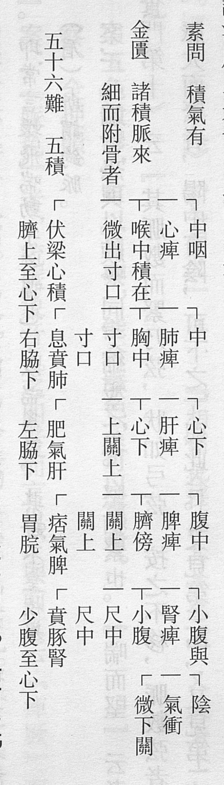

- 素問　積氣有　中〓　中　心下　腹中　小腹與　陰
- 心痺　肺痺　肝痺　脾痺　腎痺　氣衝
- 金匱　諸積脈來　喉中積在　胸中　心下　臍傍　小腹　微下關
- 細而附骨者　微出寸口　寸口　上關上　關上　尺中
- 寸口　關上　尺中
- 五十六難　五積　伏梁心積　息賁肺　肥氣肝　痞氣脾　賁豚腎
- 臍上至心下　右脇下　左脇下　胃脘　少腹至心下

**○白脈之至也，喘而浮。上虛下實，驚有積氣在胸中。喘而虛，名曰肺痺寒熱。**

백맥(白脈)이 이를 때는 맥이 빠르게 뛰면서 부(浮)하다. 위가 허하고 아래가 실하여 놀라고, 적기가 가슴 속에 있다. 숨이 차면서 허하니[喘而虛], 폐비(肺痺)·한열(寒熱)이라 한다.

〔楊〕폐맥은 수태음으로 금에 속하고 색이 희므로 백맥이라 한다. 백맥은 추맥(秋脈)이고, 추맥은 부와 같아 그 기가 오는 것이 가볍고 허하며 뜨고 올 때는 급하고 갈 때는 흩어지면 평하고 좋은 것이다. 지금 부를 얻었으나 움직임이 사람의 숨찬 듯하면 폐가 허하여 기가 심에 몰린 것임을 안다. 심이 실하므로 놀라고, 폐가 허하므로 적기가 가슴 속에 있다. 내쉬는 숨이 많고 허하므로 폐비라 하고, 또 폐가 허하므로 한열을 앓는다.

안(案): ‘喘而浮’는 부삭맥(浮數脈)을 말한다. ‘上虛’는 폐부의 표가 허하여 사기가 틈탄 것이다. ‘下實’은 위기가 충실한 것이다. 대개 폐부에 숙음이 있어 사기가 여기에 머문다. 대체로 음이 가슴 속에 있어 심에 가까이 다가오면 반드시 놀라는 증이 있다. 숨이 차서 기가 나가고 땀이 새므로 표허가 되니, 이를 ‘喘而虛’라 한다. ‘寒熱’은 표에 사기가 있음을 말한다. 『금궤』 혈비·단기·토혈·어혈·임신편에 모두 ‘無寒熱’이라는 말이 있는데 다 외사가 없음을 말하니 증명할 수 있다. ‘喘而虛’는 『상한론』 마황·청룡탕 따위의 증이다. ‘驚’은 시호용려(柴胡龍蠣)·계지구역탕(桂枝救逆湯) 따위의 증이다.

（眉）이른바 모맥(毛脈)이다.

（眉）이 두 ‘喘’ 자는 뜻이 크게 다르다.

**○得之醉而使内也。**

술에 취해 방사(房事)를 행하여 얻는다.

『대소』에는 ‘也’ 자가 없다.

안(案): 이는 표가 사기를 받는 한 단면이며, 이 증이 꼭 모두 여기서 말미암는 것은 아니다. 아랫글도 같은 예로 이를 따른다.

재안(再案): 앞글의 ‘喘而堅’·‘喘而浮’의 두 ‘喘’ 자는 모두 ‘彈’의 가차인가. 뒷글에 ‘左右彈’이라 했으니, 여기서는 우연히 같은 음으로 잘못된 것이다.

（眉）이 설이 매우 옳다.

**[역1]** 원서 「一經病」은 「二經病」의 잘못으로 보인다(『黃帝內經太素』 권15에 「二經病也」로 되어 있고, 바로 다음 조의 楊注도 「肺藏大腸府，二經病」이다).
**[역2]** 원서대로 옮겼다. 「欬味」는 바로 다음 眉批의 「欬嗽」로 보아 그 잘못일 수 있다.

**○青脈之至也，長而左右彈，有積氣在心下支胠，名曰肝痺。**

청맥(青脈)이 이를 때는 길면서 좌우로 튀니, 심하(心下)와 지거(支胠)에 적기(積氣)가 있는 것으로, 간비(肝痺)라 한다.

안(案): ‘長’이란 맥이 촌·관·척에서 고르게 함께 뛴다는 말이며, ‘左右彈’이 곧 그 뜻이다. 소시호탕(小柴胡湯)의 “옆구리와 가슴이 그득하고 괴로우며, 옆구리 아래가 비경(痞鞕)하고, 심하가 두근거린다｟三ノ十三ウ｠”, “맥이 현세(弦細)하다｟五ノ十三ウ｠”, “맥이 침긴(沈緊)하다｟五ノ十四ヲ｠”가 바로 이 증이다. 『의심방(醫心方)』 권10｟九ウ｠은 범왕방(范汪方)을 인용하여 한산(寒疝)으로 배 속이 아픈 것을 치료하는 데 소시호탕을 썼고, 『외대(外臺)』 권7｟四六ヲ｠은 한산으로 배 속이 아픈 것을 치료하는 데 시호계지탕(柴胡桂枝湯)을 썼는데, 모두 한습(寒濕)이 원인이 된 것이다.[역2]

（眉）이른바 현맥(弦脈)이다.

（眉）『상한론(傷寒論)』 태양중편(太陽中篇) 생강사심탕(生薑瀉心湯) 방문 뒤에 다섯 사심탕을 열거하고 “아울러 간을 사하는 법이다[并瀉肝法]”라고 하였으니, 심하를 사하는 것이 곧 간장(肝藏)을 사한다는 뜻임을 알 수 있다.

（眉）안(案): ‘長’이란 오고 감이 긴 것이니, 단맥(短脈)의 반대이다.

**○得之寒濕，與疝同法，腰痛足清頭痛。**

한습(寒濕)에서 얻으며, 산(疝)과 치법이 같고, 허리가 아프고 발이 차며[足清] 머리가 아프다.

안(案): 『금궤(金匱)』 상｟七ウ｠에 “습가(濕家)의 병은 몸이 아프고 열이 나며, 얼굴이 누렇고 숨이 차며, 머리가 아프고 코가 막히면서 번조하고, 맥이 크다. 음식은 잘 먹을 수 있으니 배 속은 조화로워 병이 없다. 병이 머릿속의 한습에 있으므로 코가 막힌다.”라고 하였다. 여기서 말한 ‘頭痛’이 바로 이와 같으니, 후세의 간궐두통(肝厥頭痛)이 이것이다. 「궐음병(厥陰病)」｟六ノ十三ウ｠에 “손발이 궐랭(厥冷)하고 맥이 갑자기 긴(緊)해지는 것은 사기가 흉중에 맺힌 것이다. 심하가 그득하고 번조하며, 배가 고파도 먹지 못하는 것은 병이 흉중에 있는 것이니 토하게 해야 한다. 과체산(瓜蔕散)이 알맞다.”라고 하였다. 대체로 궐음증의 궐역(厥逆)은 모두 여기서 말한 ‘足清’과 이치가 같다. 또 『금궤』 중｟二ウ｠에 “신착병(腎著病)은 그 사람의 몸이 무겁고 허리 속이 차다. 운운. 몸을 고되게 하여 땀이 나서 옷 속이 차고 축축해져 오래되면 얻는다. 허리 아래가 차고 아프며, 배가 오천 전(錢)을 찬 듯 무겁다. 감강령출탕(甘薑苓朮湯)이 주치한다.”라고 하였다. ‘清’ 자의 뜻은 「장기법시(藏氣法時)」｟廿二｠에 자세히 보인다.

**○黄脈之至也，大而虛，有積氣在腹中，有厥氣，名曰厥疝。女子同法。**

황맥(黄脈)이 이를 때는 크면서 허(虛)하니, 배 속에 적기(積氣)가 있고 궐기(厥氣)가 있는 것으로, 궐산(厥疝)이라 한다. 여자도 치법이 같다.

〔楊〕비맥(脾脈)은 족태음(足太陰)으로 토(土)에 속하여 색이 누르므로 황맥이라 한다. 황맥이 좋은 것은 대맥(代脈)이면서 드러나지 않고, 나쁜 것은 드러날 때 맥이 크면서 허하니, 곧 적기가 배 속에 있음을 안다. 배 속의 궐기를 궐산이라 한다. 남녀가 같이 앓는다.

『금궤』 권상｟四十二ヲ｠에 “배가 아프고 맥이 현(弦)하면서 긴(緊)하다. 현하면 위기(衛氣)가 돌지 못하여 곧 오한(惡寒)하고, 긴하면 먹으려 하지 않는다. 사기와 정기가 서로 부딪치면 곧 한산이 된다.”라고 하였다.

또 “한산으로 배꼽 둘레가 아프고, 발작하면 괴로워 백한(白汗)이 나며, 손발이 궐랭하고, 맥이 침현(沈弦)한 것은 대오두전(大烏頭煎)이 주치한다.”라고 하였다.｟『외대』七ノ四四ウ、『천금(千金)』十六ノ廿ヲ｠[역3]

또｟四十三ウ｠ “맥이 삭(數)하면서 긴하다가 곧 현해지는데, 모양이 활시위 같아 눌러도 움직이지 않는다. 맥이 삭현한 것은 그 한(寒)을 사하(瀉下)해야 한다[當下其寒]. 맥이 긴대(緊大)하면서 지(遲)한 것은 반드시 심하가 굳다. 맥이 대(大)하면서 긴한 것은 양 가운데 음이 있는 것이니 사하할 수 있다.”라고 하였다.

『상한론』 가하편(可下篇)에는 ‘宜大承氣湯’ 다섯 자가 있다. 『천금』에는 “무릇 한맥(寒脈)은 침현하니, 맥이 쌍현(雙弦)한 것은 한(寒)이다. 현맥은 모양이 팽팽한 활시위 같아 눌러도 움직이지 않는다. 맥이 삭현한 것은 그 한을 사하해야 한다. 맥이 쌍현하면서 지한 것은 심하가 굳다. 맥이 대하면서 긴한 것은 양 가운데 음이 있는 것이니 사하할 수 있다｟十六ノ十七ウ｠”로 되어 있다.

『상한론』 양명편(陽明篇)｟五ノ二ヲ｠에 “상한 3일에 양명맥이 크다.”라고 하였다.

또｟同ウ｠ “양명병에 중한(中寒)한 경우는 먹지 못하고 소변이 불리하며 손발에 땀이 축축이 난다[濈然汗出]. 이는 고가(固瘕)가 되려는 것이다. 반드시 대변이 처음은 단단하고 뒤는 묽다. 그렇게 되는 까닭은 위 속이 차서 수곡이 나뉘지 않기 때문이다.”라고 하였다. 여기서 말한 ‘固瘕’는 본론의 ‘厥疝’과 서로 비슷하다.

『금궤』 하｟九ウ｠에 “부인의 병은 허하고 냉이 쌓이며 기가 맺힌 데서 비롯하여 여러 경수(經水)가 끊어진다. 운운. 가운데 서리어 맺히면 배꼽을 둘러 한산이 되고, 혹은 양 옆구리가 아프며 장(藏)과 서로 이어진다.”라고 하였다. 이 논의는 ‘女子同法’과 뜻이 같다.

【楷】（眉）이른바 궐기(厥氣)는 위로 치받는 기[上衝氣]이다.

【楷】（眉）이 편의 다섯 비(痺)는 모두 남녀가 함께 앓는 것인데, 여기서 여자도 같다고 한 것은 어째서인가? 여자라고 한 것은 여자가 늘 산가(疝瘕)를 앓는 것을 가리킨다. 『설문(説文)』의 “가(瘕)는 여자의 병이다.”가 이것이다.

【楷】（眉）법(法)은 치료법을 말한다. ‘厥疝’이란 위로 치받으며 아픈 산(疝)이라는 뜻이다. 여기서 궐산이라 하고 비비(脾痺)라 하지 않은 것은, 궐산이 곧 비비의 다른 이름이기 때문이며, 그 치법이 여자의 산가와 같으므로 궐산이라는 이름을 든 것이다. 옛 성인이 후세 사람에게 치법의 은미한 뜻을 빨리 깨닫게 한 것이다.

**○得之疾使四支汗出當風。**

급히 힘을 써서 사지(四支)에 땀이 난 채 바람을 맞아 얻는다.

〔楊〕비는 사지를 주관하는데, 급히 부리고 힘을 써 사지에 땀이 나고 바람을 맞아 생긴 것이다. 양주(楊注)의 ‘役’은 『설문』의 대전(大篆)이다.

안(案): 표(表)가 사기를 받으면 비위가 조화롭지 못하여 음식이 소화되지 않으니, 곧 상식(傷食)·벽가(癖瘕)의 조짐이 된다.

**○黑脈之至也，上堅而大，有積氣在腹中與陰，名曰腎痺。**

흑맥(黑脈)이 이를 때는 위가 굳고 크니, 배 속과 음부[陰]에 적기(積氣)가 있는 것으로, 신비(腎痺)라 한다.

〔楊〕신맥(腎脈)은 족소음(足少陰)으로 수(水)에 속하여 색이 검으므로 흑맥이라 한다. 흑맥은 겨울 맥인데, 겨울 맥은 영(營)과 같아 그 기가 올 때 침(沈)하면서 치는 것[搏]을 평맥으로 좋게 여긴다. 지금 흑맥이 이르는데 위가 굳고 크니, 곧 배 속과 음부에 적기가 있음을 알며, 신비라 한다.

안(案): 신비는 곧 신적(腎積)이니, 분돈병(奔㹠病)이 이것이다. 제13 「이정(移精)」에 “팔풍(八風)과 오비(五痺)의 병”이라 한 것도 마비(麻痺)의 뜻이 아니라, 막혀서 병이 된다는 말이다.

『금궤』 상｟三十四ウ｠에 “분돈병(奔豚病)은 아랫배에서 일어나 위로 인후를 치받으며, 발작하면 죽을 것 같다가 다시 돌아와 그친다｟『옥함(玉函)』에는 ‘止’가 ‘生’으로 되어 있는데 이것이 옳다｠. 모두 놀람과 두려움에서 얻는다.”라고 하였다. 『외대』｟十二ノ四四ヲ｠는 『소품(小品)』을 인용하였다. 『옥함』에는 이 아래에 ‘腎間有膿故也’ 여섯 자가 있다.

안(案): 오적(五積)의 이름은 아마 『영추(靈樞)』 「사기장부병형편(邪氣藏府病形篇)」에서 배태된 듯하다. 이 편에서 논한 오적은 이름은 다르지만 대개 오비(五痺)와 오적은 그 뜻이 하나이다. 「오십육난(五十六難)」에 말하였다. “간의 적은 비기(肥氣)라 하며 왼쪽 옆구리 아래에 있고, 엎어 놓은 잔과 같으며 머리와 발이 있다. 오래 낫지 않으면 사람에게 해역(欬逆)과 음학(瘖瘧)을 일으키며, 해를 이어 그치지 않는다. 심의 적은 복량(伏梁)이라 하며 배꼽 위에서 일어나 크기가 팔뚝만 하고 위로 심하까지 이른다. 오래 낫지 않으면 번심(煩心)을 앓게 한다. 비의 적은 비기(痞氣)라 하며 위완(胃脘)에 있고, 엎어 놓은 쟁반만큼 크다. 오래 낫지 않으면 사지를 거두지 못하고 황달(黄疸)을 일으키며, 음식을 먹어도 살로 가지 않는다. 폐의 적은 식분(息賁)이라 하며 오른쪽 옆구리 아래에 있고, 엎어 놓은 잔만큼 크다. 오래 그치지 않으면 으슬으슬 한열(寒熱)이 나고 천해(喘欬)하며 폐옹(肺壅)을 일으킨다. 신의 적은 분돈(賁豚)이라 하며 아랫배에서 일어나 위로 심하까지 이르는데, 돼지 모양 같고 오르락내리락 일정한 때가 없다. 오래 그치지 않으면 천역(喘逆)·골위(骨痿)·소기(少氣)를 앓게 한다.”[역1]

（眉）이른바 석맥(石脈)이다.

**○得之沐浴清水而臥。**

찬물[清水]로 머리를 감고 목욕한 뒤 누워서 얻는다.

〔楊〕찬물로 머리를 감고 몸을 씻고 누워서 얻는다.

안(案): 지금 산(疝)을 앓는 사람은 아래가 차가워지면 반드시 발작하니, 이와 이치가 같다. 물로 머리 감고 물로 씻는 것도 아래가 차가워지는 한 가지 경우일 뿐이다. 대개 ‘沐浴清水’ 네 글자 안에 습랭(濕冷)을 범하는 수많은 일이 다 들어 있다. 청(清)은 차다는 뜻이다. 앞의 ‘足清’과 뜻이 같으며 청탁(清濁)의 청이 아니다. 양상선(楊上善)이 찬물[冷水]로 풀이한 것이 옳다.

（眉）정말로 찬물로 머리 감고 목욕하는 것은 여름철 일이다.

**○凡相五色之奇脈，面黄目青，面黄目赤，**

오색의 기맥(奇脈)을 살필 때, 얼굴이 누르고 눈이 푸른 경우, 얼굴이 누르고 눈이 붉은 경우,

**○面黄目白，面黄目黑者，皆不死也。**

얼굴이 누르고 눈이 흰 경우, 얼굴이 누르고 눈이 검은 경우는 모두 죽지 않는다.

『대소(大素)』에는 ‘赤’ 아래에 ‘白’ 자가 있고 ‘也’ 자가 없다.

〔楊〕앞의 오색의 기이한 맥을 살피는 것은 먼저 얼굴의 오색을 살피는 것이다. 얼굴이 누른빛을 띠고 눈의 네 색이 얼굴에 드러나는 경우는 위[上]를 근본으로 삼으므로 모두 산다.[역4]

〔新〕［按］『갑을경(甲乙經)』에는 ‘之奇脈’ 세 글자가 없다.

〔識〕［簡按］『갑을(甲乙)』에 따르면 ‘之奇脈’ 세 글자는 연문(衍文)이다.

【楷】안(案): ‘之奇脈’ 세 글자는 ‘之異於常脈而不色脈相合者’ 열두 자로 보아야 한다. 색과 맥이 합치한다는 것은 간병에 색이 푸르고 맥이 현하며, 심병에 색이 붉고 맥이 구(鉤)한 따위로, 이것이 그 상법(常法)이다. 지금 이 사(死)와 불사(不死) 두 글은 모두 색과 맥이 합치하지 않는 것이다. 합치하지 않으므로 위중한 병이다. 그렇지만 누른색이 보이며 합치하지 않는 경우는 반드시 죽지는 않으므로 ‘不死’라 하였다. 누른색은 대개 혈색의 정상이기 때문이다. 위중한 큰 병에 푸른색·붉은색·검은색이 보이는 경우는 피의 바른 색이 아니니 반드시 죽는다고 단정하므로 ‘死’라 하였다. 얼굴이 흰 것을 들지 않은 것은 어째서인가? 흰색은 누른색에 섞여 이치가 같기 때문이니, 지금 실제가 그러하므로 이 글은 누른색을 들어 흰색을 포함하였다. 누른색이란 황백(黄白)을 말한다. 또 눈이 누른 것을 들지 않은 것은 어째서인가? 눈이 누른 것은 죽을 병일 때 있는 것이 아니므로 ‘目黄’이라 할 수 없다. 눈이 누른 사람은 반드시 달병(疸病)에 있는 것이니 본디 다른 이치이며, 온갖 병의 사기(死期)를 알리는 징후가 아니다.

**○面青目赤，**

얼굴이 푸르고 눈이 붉은 경우,

〔楊〕간병에 심이 승(乘)한 것으로, 실사(實邪)라 한다.

**○面赤目白，**

얼굴이 붉고 눈이 흰 경우,

〔楊〕심병에 폐가 승한 것으로, 미사(微邪)라 한다.

**○面青目黑，**

얼굴이 푸르고 눈이 검은 경우,

〔楊〕간병에 신이 승한 것으로, 허사(虛邪)라 한다.

**○面黑目白，**

얼굴이 검고 눈이 흰 경우,

〔楊〕신병에 폐가 승한 것으로, 허사(虛耶)라 한다.[역5]

**○面赤目青，**

얼굴이 붉고 눈이 푸른 경우는,

『대소』에는 ‘青’ 아래에 ‘者’ 자가 있다.

〔楊〕심병에 간이 승한 것으로, 허사(虛耶)라 한다.

**○皆死也。**

모두 죽는다.

『대소』에는 ‘也’ 자가 없다.

〔楊〕이 다섯 색은 모두 다른 것에 극(剋)을 받고 제때를 얻지 못한 것이니, 치료하지 않으면 모두 죽는다. 다만 색은 알기 어려우니, 우선 한 가지 뜻에 따르면 이와 같다.

만연(萬延) 원년 경신년 7월 19일 쓰기를 마치다.　절재(節齋)〔화압(花押)〕

제10 보(第十補)

취우(翠羽)｟三ヲ｠

〔箚〕『이아(爾雅)』 ‘翠鷸’의 곽주(郭注)에 “제비와 비슷하고 감색(紺色)이다.”라고 하였다. 송옥(宋玉)의 「등도자호색부(登徒子好色賦)」 “눈썹이 비취 깃 같다[眉如翠羽]”에 대해 ［向曰］비취새의 깃과 같다.

오색이 죽음을 드러내는 것[五色之見死也]｟三ヲ｠

〔楊〕자(滋)는 푸른색의 나쁜 색이다. 태(炲)는 음이 태(苔)이니, 풀 연기가 엉겨 모인 것을 말한다. 태는 그을음 검은색의 나쁜 색이다. 배(衃)는 엉겨 나쁜 피이다. 마른 뼈는 흰색의 나쁜 색이다.

이것이 오색이 삶을 드러내는 것이다[此五色之見生也]｟三ウ｠

〔楊〕이 다섯은 모두 병의 징후이나 죽지 않을 색이다.

손가락은 혈을 받아야 잡을 수 있다[指受血而能攝]｟七ウ｠

〔識〕『설문』에 “섭(攝)은 끌어당겨 잡는 것이다.”라고 하였다. 『장자(莊子)』 「거협(胠篋)」에 “반드시 끈을 단단히 묶고 빗장과 자물쇠를 굳게 한다.”라고 하였는데, ‘攝’ 자의 뜻이 여기와 같다. ［張云］［按］ 혈기는 사람의 신(神)인데, 이 몇 구절은 모두 혈만 말하고 기를 말하지 않았으니 어째서인가? 대개 기는 양에 속하여 형체가 없고 혈은 음에 속하여 형체가 있는데, 사람의 형체는 음으로써 이루어진다. 「구침편(九鍼篇)」에서 “사람이 생겨나고 이루어지는 바는 혈맥이다.”라고 하고, 「영위생회편(營衛生會篇)」에서 “혈은 신기(神氣)이다.”라고 하며, 「평인절곡편(平人絶穀篇)」에서 “혈맥이 조화로우면 정신이 깃든다.”라고 한 것과 같다. 그러므로 모두 혈을 말한 것은 신이 형체에 의지해 생겨나고 작용이 본체에서 나옴을 말한 것이다.

궐이 된다[爲厥]｟八ヲ｠

〔楊〕‘出’은 몸을 덮지 않는다는 뜻이다. 누워서 몸을 덮지 않으면, 바람에 쐬어 찬 바람이 주리(腠理)로 들어가 피가 차가워져 엉겨 모인다. 살갗에 쌓이면 비(痺)가 되고, 맥에 쌓이면 피가 껄끄러워지며, 발에 쌓이면 궐(厥)이 된다. 궐은 역(逆)이다.

심하면 간으로 들어간다[甚則入肝]｟十四ヲ｠

〔楊〕수태양(手太陽)은 머리로 올라가므로 머리가 아프다. 심장과 소장부 두 경의 병이다. 뒤의 세 맥은 모두 장으로 들어감이 있으나 생략하고 말하지 않았다.

맥의 작고 큼[夫脈之小大]｟十六ヲ｠

〔楊〕촌구의 여섯 맥의 형상은 손가락 아래에서 얻으므로 지별(指別)이라 한다.

오장의 상은 유추할 수 있다[五藏之象可以類推]｟十六ヲ｠

〔楊〕피육·근맥·골 등은 오장의 외형이므로 상(象)이라 한다. 오맥은 오상의 유(類)이니, 맥을 미루어 알 수 있다.

만전할 수 있다[可以萬全]｟十六ヲ｠

〔楊〕귀로 오음을 듣고 눈으로 오색을 살펴 맥과 합한다. 이 세 가지로 사람을 살피면 병자에게 하는 일이 모두 들어맞으므로 만전을 얻는다.

심비라 한다[名曰心痺]｟十六ウ｠

〔楊〕심맥(心脈)은 수소음(手少陰)으로 화(火)에 속하여 색이 붉으므로 적맥(赤脈)이라 한다. 적맥은 여름 맥인데, 여름 맥은 갈고리[鉤] 같아 그 기가 올 때 성하고 갈 때 쇠하는 것을 평맥으로 좋게 여긴다. 지금 뛰는 것이 사람이 숨을 헐떡이는 것 같고 또 굳으므로 흉중에 적기가 있어 가슴이 그득하고 답답하며 먹는 데 방해가 되니, 심비(心痺)라 한다. 적(積)은 음기이고 취(聚)는 양기이다. 적은 오장에서 생기고 취는 육부에서 이루어진다. 적은 처음부터 일정한 자리가 있고, 취는 발작에 근본이 없어 머무는 곳이 없다.

발이 차고 머리가 아프다[足清頭痛]｟十八ヲ｠

〔楊〕한습으로 발이 차가워진 데서 얻어, 위로 올라가 그 병을 이룬다. 산병(疝病)과 같다. 족궐음맥(足厥陰脈)은 발에서 아랫배를 따라[脩]｟（‘循’으로 써야 함）｠ 머리로 올라가므로 허리·발·머리가 아프다.

살이 여위어 줄어든다[肉胝䐃]｟二ヲ｠

안(案): ‘胝䐃’의 완언(緩言)이 수(瘦)이고 또 瘷육(瘷肉)이다. 胝䐃은 살이 여위고 줄어든다는 말이다. 『광운(廣韻)』 거성 49 유운(宥韻)에 “수(瘦)는 여위어 줄어드는 것이다. 소우절(所祐切)”, “瘷는 오그라들어 작아지는 것이다. 측구절(側救切)”이라 하였으니, ‘縐’·‘䐃’과 음이 같아 증거로 삼을 수 있다.

검기가 그을음 같으면 죽는다[黑如炲者死]｟三ヲ｠

안(案): 『설문』에 “태(炱)는 그을음[灰炱煤]이다.”라고 하였다. 단옥재(段玉裁)는 “『통속문(通俗文)』에 쌓인 연기를 태매(炱煤)라 한다고 하였다. 『옥편(玉篇)』에 태매는 연기 먼지라 하였다. 『광운』도 같다.”라고 하였다. 이에 따르면 ‘炲煤’ 두 글자 숙어는 한나라 사람에게서 나왔다. 대개 옛날에는 다만 ‘炲’라 하거나 ‘煤’라 하고, 한대 이후에 ‘炲煤’라 한 것인가. 「풍론(風論)」의 “신풍(腎風)은 그 색이 炲하다”도 이와 이치가 같으니 아울러 살펴야 한다.

【楷】길면서 좌우로 튄다[長而左右彈]｟十七ウ｠

【楷】안(案): ‘左右彈’이란 좌우 양쪽이 모두 튀는 병자가 있고, 왼쪽이 튀는 병자가 있고, 오른쪽이 튀는 병자가 있다는 뜻이다. ‘一二日’·‘五六月’·‘秦漢時’·‘魯衛國’의 예처럼 하나이기도 하고 둘이기도 한 것으로 통할 수 있다. 또 이른바 ‘百年左右’·‘三十左右’ 따위와 뜻이 같으니, 일정하지 않은 말이다. 좌는 왼손이고 우는 오른손이다. 이 ‘左右彈’은 곧 쌍현(雙弦)·편현(偏弦)이다. 대개 편현이 있기에 쌍현이라는 이름이 나왔다. 대체로 세상에 현맥이 보이는 사람은 쌍이 아닌 경우가 없다. 쌍은 보통의 일이고 편은 그 변이다. 그러므로 이것도 편탄(偏彈)을 위주로 말한 것이다. ‘左右彈’이라 하면 쌍탄(雙彈)·편탄의 뜻을 포함한다. 여기서 ‘長而彈’이라 한 것은 곧 현맥일 따름이다. 『금궤』 「담음편(痰飲篇)」에 “무릇 적게 먹고 많이 마셔 물이 심하에 머물면, 심한 경우는 두근거리고 가벼운 경우는 숨이 짧다. 맥이 쌍현한 것은 한(寒)이다. 모두 크게 사하한 뒤에 허해지기 쉽다. 맥이 편현한 것은 음(飲)이다.”라고 하였다. 우이(尤怡)의 『금궤심전(金匱心典)』에 “쌍현은 두 손이 모두 현한 것으로 한기가 온몸을 두루 돈다. 편현은 한 손만 현한 것으로 음기(飲氣)가 한쪽으로 쏠린다.”라고 하였는데, 유계산(劉桂山)이 이를 근거로 삼아 또 말하였다. “살펴보건대 서빈(徐彬)의 『금궤논주(金匱論註)』에 한 손에 두 가닥 맥이 있는 것도 쌍현이라 한다고 하였으니, 이는 원기가 튼튼하지 못한 사람에게 흔히 보이는 맥으로, 역시 허에 속한다. 마침 나는 대체로 중기(中氣)를 온보(温補)하면서 담을 삭여 손을 대는 대로 낫게 하였다. 이는 오곤(吴崑)의 『맥어(脈語)』에 ‘쌍현은 맥이 올 때 두 줄을 당긴 듯한 것이다. 간이 실한 것이고 아픈 것이다. 단현(單弦)이라면 한 줄일 뿐이다’라고 한 데에 근본을 둔 것이다. 그러나 경문의 쌍현의 뜻과는 서로 다르다.” 주광피(朱光被)의 『금궤정의(金櫃正義)』에도 “두 손에 모두 현맥이 보이는 것이다. 한 손만 현하다면 병기가 한쪽으로 치우쳐 붙은 것이 분명하다.”라고 하였고, 도엽원희(稻葉元熙)는 “‘脈雙弦者，寒也’ 두 구는 객이고 ‘脈偏弦者，飲也’ 구는 주이니, 주객을 마주 든 것이다.”라고 하였는데, 모두 계산씨(桂山氏)의 설과 합치한다. 이제 살펴보건대[今案] 『상한론』 가하편에 “맥이 쌍현하면서 지한 것은 반드시 심하가 단단하다. 맥이 대하면서 긴한 것은 양 가운데 음이 있는 것이니 사하할 수 있으며, 대승기탕(大承氣湯)이 알맞다.”라고 하였고, 『맥경(脈經)』 권6 「비경병증(脾經病證)」 제5편에 “촌구맥이 쌍긴(雙緊)하면 곧 들어간 것이다. 그 기가 나가지 못하고 표는 없고 이(裏)만 있어 심하가 비견(痞堅)하다.”라고 하였는데, 모두 쌍현·쌍긴은 있으나 편현·편긴을 들지 않았다. 그렇다면 촌·관·척 세 부위에서 모두 두 번씩 나란히 뛰는 것을 쌍이라 한 것인가. 그렇다면 ‘左右’는 좌우 손을 말함이 아니라 두 박동이 나란히 짝지어 뛰므로 좌우라 부른 것인가. 『맥경』에서 말한 촌구란 세 부위를 통틀어 이른 이름일 뿐이다. 요컨대 두 가닥 맥이라도 한 손에 있는 사람도 있고 두 손에 있는 사람도 있는 것인가. 대개 과감히 단정하면 『상한론』·『금궤』·『맥경』 등의 글은 모두 두 가닥의 뜻이고, 이 경의 ‘左右’도 두 가닥이 나란히 짝짓는 뜻이니, 좌우 손이라는 설을 완전히 버린 뒤에야 비로소 분명해진다. 또 살펴보건대[又案] 현·긴 등은 모두 간병의 맥이므로 특별히 쌍으로 두 가닥이 나란히 보이는 것이며, 다른 병 다른 맥에 이런 이치가 있는 경우는 없다. 『맥경』 권4 「평잡병맥(平雜病脈)」 제2에 “편현은 음(飲)이고, 쌍현이면 옆구리 아래가 당기며 아프고 그 사람이 으슬으슬 오한한다.”라고 하였다. 『병원(病源)』 권20 「담음후(痰飲候)」에 “맥이 편현하면 담이다.”라고 하였다.

숨이 차서 몰아쉰다[喘而虛]｟十七ヲ｠

안(案): 허(虛)는 곧 ‘噓’의 가차 고자(古字)이다. ‘喘而虛’란 숨이 차면서 그 기가 내쉬고 들이쉬는 것을 말한다.

뇌(腦)｟六ヲ｠

대체로 사람이 깨어 있을 때는 뇌의 신기(神氣)가 사방으로 퍼져 지각과 운동을 이룬다. 그 뒤 뇌의 신기가 줄어들어 신기가 가라앉아 쇠하며 뇌로 돌아가니, 이에 잠이 온다. 잠든 동안 심장의 혈액이 위로 올라가 보충하여 뇌의 신기가 처음처럼 가득 차면, 뇌에 잠겨 있을 수 없어 넘쳐서 사방으로 퍼지며, 이에 다시 깨어나 지각과 운동을 이룬다. 깨어 있으면 줄고 자면 만들어져 서로 끝없이 돌고 도니, 낮에는 햇빛이 비추어 움직이고 밤에는 편안히 쉬어, 이를 되돌려 낮 동안 비추고 움직인 기의 허함을 보충해 만드는 것과 같다. 이 말은 평전독윤(平田篤胤)의 『정암실(靜岩室)』 하권에 근본을 둔 것이다.[역6]

#### 오장별론(五藏別論)편 제11

『대소(大素)』 권6 「장부지일(藏府之一) 장부기액(藏府氣液)」에 권수(卷首)부터 ‘故曰實而不滿’까지 실려 있다. 또 권14 「진후지일(診候之一) 인영맥구진(人迎脈口診)」에 ‘帝曰氣口’부터 권말까지 실려 있다.

『대소』에 전부 남아 있다.

안(案): 오장 외에 또 여러 장이 있어 그 실물을 여기서 변별하므로 이름을 붙인 것이니, 곧 오장 외의 별장(別藏)을 논한다는 뜻이다.

**○黃帝問曰：余聞方士或以腦髓爲藏，或以腸胃爲藏，或以爲府。敢問更相反，皆自謂是。不知其道，願聞其説。**

황제(黃帝)가 물었다. “내가 들으니 방사(方士)들이 뇌수(腦髓)를 장(藏)으로 삼기도 하고, 장위(腸胃)를 장으로 삼기도 하며, 혹은 부(府)로 삼기도 한다. 감히 묻는다. 서로 어긋나는데도 모두 자기가 옳다고 하니, 그 도리를 알지 못하겠다. 그 설을 듣고 싶다.”

『대소』에는 ‘問’ 아래에 ‘於岐伯’ 세 자가 있다.

『대소』에는 이 아래에 ‘或以爲府’ 네 자가 있다.

〔楊〕방(方)은 도(道)이니, 다른 도를 따르는 선비들이 말하는 바이다. 장부에 대한 설이 같지 않다. 뇌·수·골·맥·담과 여자포(女子胞), 이 여섯은 어떤 이는 장이라 하고 어떤 이는 부라 한다. 위·대장·소장·삼초(三膲)·방광, 이 다섯은 어떤 이는 장이라 하고 어떤 이는 부라 한다. 말하는 장부가 서로 어긋나니, 어느 것이 참인가?

『천금방(千金方)』 「자서(自序)」에 “황제와 방사 뇌공(雷公)·기백(岐伯)의 무리”라고 하였다.

〔箚〕［稻曰］『사기(史記)』 「봉선서(封禪書)」에 방사를 바다로 들여보냈다고 하였다.

「지진요대론(至真要大論)」에 “내가 방사에게 내려 주어 방사가 이를 쓰는데 운운”이라 하였고, 또 “방사가 승묵(繩墨)을 버리고 그 도를 바꿀 수 없다”라고 하였다.

안(案): 방사는 도사(道士)라는 말과 같으니, 방술(方術)의 선비를 이른다. 무(巫)·상(相)·의(醫)·복(卜)의 술도 모두 방사라 한다. 『태평어람(太平御覽)』 666에 『태소경(太霄經)』을 인용하여 “사람이 대도(大道)를 행하는 것을 도사라 한다. 또 도를 따라 일삼으므로 일컫는 것이라 한다.”라고 하였으니 증거로 삼을 수 있다. 대개 진(真)을 수양하고 복이(服餌)하는 여러 방법을 닦으므로 방사라 하였으니, 의방(醫方) 같은 것도 그 한 부분일 뿐이다. 곧 여기서 말한 ‘方士’는 의인(醫人)을 이른다. 『광운』 10 양운(陽韻)에 “방(方)은 법술이다.”라고 하였다.

〔箚〕「맥요정미론(脈要精微論)」에 “오장은 몸의 강함이다. 머리는 정명(精明)의 부이다. 운운”이라 하였다. ［寬案］장과 부는 호문(互文)이다. 이는 대개 뇌수를 장부로 삼은 것이다.

안(案): 이 설은 따를 수 없다. 왕주(王注)에 “뇌수를 장으로 삼는 것은 다른 경에 있을 것이다.”라고 한 것은 옳지 않다. 또 「맥요정미」에 “맥은 혈의 부이다.”라고 하고, 「해론(海論)」에 “뇌는 수의 바다이다.”라고 하였다.

（眉）‘或以爲府’란 뇌수·장위 등을 모두 부라고 이름 붙였다는 말이다. 양주가 매우 옳다. 그러므로 아래 글에 ‘此六者奇恒之府’라 하였으니, 증거로 삼을 수 있다.

（眉）방사들이 모두 옳다고 한 것은 실제로 옳다. 황제가 의심한 것은 어리석은 것이다. 장부의 이름은 각각 서로 통용할 수 있으니 얽매이지 말라.

**[역1]** 원서 인쇄는 ‘瘖’(疒+音 꼴)으로 보인다. 『난경(難經)』의 ‘痎瘧’의 ‘痎’를 잘못 찍은 것일 수 있다. 원서 글자 그대로 두었다.

**[역2]** 원서대로 옮겼다. 이 책의 다른 자리에는 「胸脇苦滿」으로 나온다.
**[역3]** 원서대로 옮겼다. 『金匱要略直解』에는 「繞臍痛苦，發則白汗出」로 끊겨 「苦」가 앞 구에 붙어 있다.
**[역4]** 원서대로 옮겼다. 『太素』 검색본에도 「以上爲本」으로 되어 있으나, 앞의 「面得黄色」으로 보아 「上」은 「土」의 잘못일 수 있다.
**[역5]** 원서의 「名曰虛耶之也」는 「之」의 뜻이 잘 통하지 않아 「허사라 한다」로만 옮겼다.
**[역6]** 원서대로 옮겼다. 平田篤胤의 저서 목록에는 「靜乃石屋」으로 실려 있고, 이 책 안에서도 「靜乃石屋」·「靜乃岩屋」·「靜岩室」로 표기가 갈린다.

**○岐伯對曰：腦、髓、骨、脈、膽、女子胞，此六者，地氣之所生也。皆藏於陰，而象於地，故藏而不寫，名曰奇恒之府。**

기백(岐伯)이 답했다. “뇌(腦)·수(髓)·골(骨)·맥(脈)·담(膽)·여자포(女子胞), 이 여섯은 지기(地氣)가 낳은 것이다. 모두 음에 갈무리되어 땅을 본받으므로, 갈무리하고 사(寫)하지 않으니, 기항지부(奇恒之府)라 한다.”

『대소(大素)』에는 ‘對’ 자가 없다.

안(案): 여기서 여자포라 한 것은, 남자에게는 정실(精室)이 되고 여자에게는 자장(子藏)이 된다는 뜻이 들어 있으니, 대개 남녀가 모두 이 여섯을 가진다는 말이다. 이 설이 지극히 옳으니, 정실은 곧 남자의 포(胞)이다.

『대소』에는 ‘對’ 자가 없다.

〔楊〕‘胞’는 표교반(豹交反)이니, 아이를 낳는 주머니이다. 땅은 감싸 받아들여 거두어 갈무리함을 주관하는데, 뇌·수 등 여섯은 땅의 기를 본받아 음으로 갈무리하고 사하지 않으므로 장이라는 이름을 얻는다. 모이므로 또한 부라고도 이름한다. 부(府)는 모임이다. 이것은 또 보통의 부가 아니라 기항지부이니, 늘 그러한 것과 달리 기이하다는 뜻이다.

안(案): 기항(奇恒)이란 뇌·수 등 여섯이 모두 기교롭고 미묘한 작용을 하며 밤낮으로 쉬지 않음을 말한다. 대개 기(奇)는 기교이고 항(恒)은 끊이지 않음이니, 곧 기교로움을 항상함으로 삼는다는 뜻이다. 여러 주석가가 모두 이상(異常)이라 한 것은 옳지 않은 듯하다.

뇌·수·골은 모두 신(腎)이 주관하는 바이나, 그 작용이｟（‘爲其’는 뒤바꾸어야 한다）｠ 각각 다르므로 여기에 들어 보인 것이다. 대개 뇌는 사려의 근원이고, 수는 정액의 근원이며, 골은 손발톱과 이의 근원이고, 맥은 생사와 길흉을 알 수 있으며, 담은 선악과 시비를 결단할 수 있고, 여자포는 남는 혈을 쏟아 내는 곳으로 그 작용도 많다. 이 여섯은 작용이 각기 다르고 장부와 저절로 구별되므로 기항지부라 한다.

각각 볼 수 있는 형상이 있으므로 ‘地氣之所生’이라 하였다. 모두 정혈을 거두어 갈무리하므로 ‘皆藏於陰’이라 하였다. 늘 남는 혈과 정을 나누어 온몸을 영양한다. 다만 그릇으로서는 차도 넘치지 않아 지나침도 모자람도 없으므로 ‘藏而不寫’라 하였다. 이는 지기가 위로 올라가 이르지 않는 곳이 없다는 뜻이다.

（眉）안(案): 뇌·수는 모두 물에 속한 것이나 혼백과 지성(志性)을 갈무리하니, 역시 골·담·맥·포와 마찬가지로 상자와 창고 같은 기구일 뿐이다. 이 다섯은 수기(水氣)로 살아가므로 ‘地氣之所生’이라 하고, ‘象地’라 하였다. 이 여섯은 그윽한 곳에 있으므로 ‘藏於陰’이라 하였다. 장(藏)은 숨기는 것이다. 음(陰)은 그늘지고 그윽한 것이다.[역1]

（眉）「대기론(大奇論)」의 “수는 뇌를 주인으로 삼는다”에 대해 왕주(王注)에 “전주(全注): 사람은 먼저 뇌가 생기니, 뇌가 있으므로 골수가 있다.”라고 하였다.

（眉）『금궤옥함(金匱玉函)』 「총례편(總例篇)」 제1장에 “천일(天一)이 물을 낳고 강유(剛柔)가 점차 형체를 이룬다. 그러므로 사람이 처음 생겨날 때 먼저 그 정을 이루고, 뇌수가 넉넉해지면 근골이 이루어지며, 피부가 굳어지고 터럭이 자라며, 신(神)이 심에 깃든다.”라고 하였다.

（眉）안(案): 뇌·수·골·맥·포의 혈액이 신진대사하는 것과 담이 즙을 내보내는 것은 모두 ‘寫’라 할 수 없다.

（眉）안(案): ‘奇恒’ 두 글자는 ‘以奇爲常’ 네 글자로 보아야 한다. 항(恒)은 곧 『맹자(孟子)』에서 말한 ‘恒心’·‘恒産’의 ‘恒’이다.

**○夫胃、大腸、小腸、三焦、膀胱此五者，｟《大素》無『此五』二字｠天氣之所生也。其氣象天，｟《大素》『天』上有『於』字｠故寫而不藏，此受五藏濁氣，名曰傳化之府，｟《大素》無『傳化之』三字｠此不能久留，輸寫者也。｟《大素》無『者也』二字｠**

위(胃)·대장(大腸)·소장(小腸)·삼초(三焦)·방광(膀胱), 이 다섯은｟『대소』에는 ‘此五’ 두 자가 없다.｠ 천기(天氣)가 낳은 것이다. 그 기가 하늘을 본받으므로｟『대소』에는 ‘天’ 위에 ‘於’ 자가 있다.｠ 사(寫)하고 갈무리하지 않으니, 이는 오장의 탁기(濁氣)를 받으며 전화지부(傳化之府)라 한다.｟『대소』에는 ‘傳化之’ 세 자가 없다.｠ 이는 오래 머물 수 없어 수사(輸寫)하는 것이다.｟『대소』에는 ‘者也’ 두 자가 없다.｠

〔楊〕하늘은 풍기와 우로를 내보내는 일을 주관하므로, 이 다섯은 오장의 조박(糟粕)의 탁함을 받아 천기로 내보내어 수사하고 갈무리하지 않으니, 그러므로 항부(恒府)이다. 오직 다섯뿐인 것은 담 한 가지가 사하지 않아 기부(奇府)로 떼어 넣었기 때문인데, 담은 간의 표(表)이므로 부라는 이름을 얻는다.

안(案): 소변·대변과 땀·침 따위는 나가기만 하고 들어오지 않으니, 비·이슬·서리·눈이 내리기만 하고 올라가지 않는 것과 같으므로 ‘其氣象天’이라 하였다. 이는 천기가 아래로 내려와 통하지 않는 곳이 없다는 뜻이니, 그래서 ‘故寫而不藏’이라 하였다.

（眉）『영(靈)』 「소침해(小鍼解)」에 “수곡이 모두 위로 들어가면 그 정기는 위로 폐에 흘러들고, 탁한 것은 장위로 흘러 머문다.”라고 하였다.

（眉）안(案): ‘此五’는 양기로 살아가는 것을 직분으로 삼으므로 ‘天氣之所生’이라 하고 ‘其氣象天’이라 하였다.

（眉）「영란비전(靈蘭祕典)」에 “대장은 전도(傳道)의 관(官)이니 변화가 여기서 나온다. 소장은 화물(化物)이 여기서 나온다.”라고 하였다. 이 편 아래 글에 “육부는 사물을 전화(傳化)하고 갈무리하지 않는다.”라고 하였다.

**○魄門亦爲五藏使，**

백문(魄門)도 오장의 심부름꾼이 되어,

『대소』에는 ‘魄門’ 두 자가 앞 구절에 붙어 있는데, 옳지 않은 듯하다.

〔楊〕정(精)을 아우르며 드나드는 곳을 백문이라 하니, 이 다섯 가운데 삼초(三膲)도 백문에 정기를 수사할 수 있다. 이 주는 백문을 혼백의 백(魄)으로 보았는데 옳지 않다.

〔識〕‘魄’은 ‘粕’과 통한다. 『장자(莊子)』 「천도편(天道篇)」에 “옛사람의 조백(糟魄)일 뿐이다.”라고 하였고, 『음의(音義)』에 “사마(司馬)가 말하였다. 문드러진 음식을 백이라 한다. 일설에 술지게미가 문드러진 것을 백이라 한다. 판본에 따라 ‘粕’으로 쓴다.”라고 하였다. 대개 항문은 조박을 전송하므로 백문이라 이름하였다. 왕주는 천착인 듯하다.

〔張〕여러 부의 조박이 참으로 이곳으로 사해지지만, 장기(藏氣)의 승강도 이에 힘입어 조절되므로 또한 오장의 심부름꾼이 된다.

（眉）안(案): 사(使)는 신사(臣使)이니, 아래에서 일을 맡는 관리이다.

**○水穀不得久藏。**

수곡(水穀)이 오래 갈무리될 수 없다.

〔楊〕오장은 안에서 주인이 되고 육부는 밖에서 심부름꾼이 되어, 수곡을 운행하게 한다.

**○所謂五藏者，藏精氣｟《大素》『氣』作『神』｠而不寫也。｟《大素》『寫』下有『者』字｠故滿而不能實。**

이른바 오장(五藏)은 정기(精氣)｟『대소』에는 ‘氣’가 ‘神’으로 되어 있다.｠를 갈무리하고 사하지 않는다.｟『대소』에는 ‘寫’ 아래에 ‘者’ 자가 있다.｠ 그러므로 가득 차되 실(實)할 수 없다.

〔楊〕정신이 장 속에 두루 퍼져 떠나지 않으므로 사하지 않고 가득 찬다. 가득 차도 늘 비어 있으므로 실하지 않다.

（眉）안(案): 만(滿)은 기가 가득한 것이고, 실(實)은 물건이 차 있는 것이다.

**○六府者，傳化物而不藏，故｟《大素》『傳化』以下七字無｠實而不能滿也。｟《大素》無『也』字｠所以然者，水穀入口，｟《大素》『穀』下有『之』字｠則胃實而腸虛，食下則腸實而胃虛，故曰實而不滿，滿而不實也。｟《大素》無『滿而』以下五字｠**

육부(六府)는 사물을 전화(傳化)하고 갈무리하지 않으므로｟『대소』에는 ‘傳化’ 이하 일곱 자가 없다.｠ 실하되 가득 찰 수 없다.｟『대소』에는 ‘也’ 자가 없다.｠ 그렇게 되는 까닭은 수곡이 입으로 들어가면｟『대소』에는 ‘穀’ 아래에 ‘之’ 자가 있다.｠ 위는 실하고 장은 허하며, 음식이 내려가면 장은 실하고 위는 허하다. 그러므로 실하되 가득 차지 않고, 가득 차되 실하지 않다고 한다.｟『대소』에는 ‘滿而’ 이하 다섯 자가 없다.｠

〔楊〕장과 위가 번갈아 차므로 실하고, 번갈아 비므로 가득 차지 않는다. 음식이 아직 소화되지 않아 장 속에 조박이 없으면 곧 위가 실하고 장이 허하다. 음식이 소화되어 장으로 내려가고 위 속에 들어온 음식이 없으면 곧 장이 실하고 위가 허하다. 위가 허하므로 기가 위로 오를 수 있고, 장이 허하므로 기가 아래로 내려갈 수 있다. 기가 오르내리면 신기가 널리 통하여 오래 산다[長生久視].

（眉）연(然)은 이와 같다는 뜻이다. ‘然’은 육부의 일을 가리키고 오장의 일을 가리키지 않는다. 장(腸)은 주로 소장을 가리킨다.

（眉）안(案): ‘滿而不實也’ 위에 ‘五藏不然故’ 다섯 자를 넣어 보아야 한다. 요컨대 『대소』를 따라 이 다섯 자를 삭제하면 매우 타당하다.

**○帝曰：氣口何以獨爲五藏主。**

황제가 말했다. “기구(氣口)는 어째서 홀로 오장의 주(主)가 되는가?”

『대소』에는 ‘帝’ 위에 ‘黃’ 자가 있고, ‘主’ 아래에 ‘氣’ 자가 있다.

〔楊〕진찰하는 맥후[請候]는 각각 오장의 기를 살피는데, 어찌하여 기구만이 홀로 오장육부 십이경맥 등의 기를 주관하는가? ［案］‘請’은 ‘診’의 잘못인 듯하다.

〔紹〕선형(先兄)이 말하였다. “「경맥별론(經脈別論)」·「사시기편(四時氣篇)」에는 ‘氣口’로, 「오색편(五色篇)」·「종시편(終始篇)」에는 ‘脈口’로, 「육절장상론(六節藏象論)」·「금복편(禁服篇)」에는 ‘寸口’로 되어 있다.”

〔識〕「창공전(倉公傳)」의 ‘太陰之口’도 촌구를 말한다. 「경맥편(經脈篇)」에 “경맥은 늘 볼 수 없다. 그 허실은 기구로 안다.”라고 하였다. 「경맥별론」에 “권형(權衡)으로 고르게 하면 기구가 촌(寸)을 이루어 사생의 구분을 결정한다.”라고 하였다. 『난경(難經)』 「일난(一難)」에 “십이경에는 모두 동맥이 있는데, 홀로 촌구를 취하여 오장육부의 사생과 길흉을 결정하는 법은 무엇을 말하는가? 그렇다. 촌구는 맥의 대회(大會)이고, 오장육부가 끝나고 시작하는 곳이므로 촌구에서 취한다.”라고 하였다.

（眉）안(案): 주(主)는 맥을 주관한다는 뜻이다. 『대소』에 ‘主氣’로 되어 있는 것도 맥기를 주관한다는 뜻이다.

（眉）기구는 기혈(氣穴)이라는 말과 같다. 기(氣)는 그 자리에 장기가 흘러들어 드러나므로 이렇게 이름한 것이다. 구(口)는 기혈의 구멍 자리이다.

（眉）오장이라 하면 육부도 그 안에 포함된다. 그러므로 아래 글에 ‘胃者’ 운운하였다.

**○岐伯曰：胃者水穀之海，六府之大源也。**

기백이 말했다. “위는 수곡의 바다이며 육부의 큰 근원이다.”

『대소』에는 ‘源’ 자가 없고, ‘海’ 아래에 ‘也’ 자가 있다.

〔識〕『영(靈)』 「오미편(五味篇)」에 “위는 오장육부의 바다이다.”라고 하였다. 「옥판론(玉版論)」에 “위는 수곡기의 바다이다.”라고 하였다.

안(案): 큰 천지에서도 바다를 근원으로 삼으니, 꼭 물이 모여드는 끝[委]이기만 한 것이 아니다. 대개 바닷물은 온갖 곳으로 스며들어 산꼭대기로도 나와 샘이 되고 호수가 되어 땅을 적시니, 우리 장위와 이치가 같다.

『오행대의(五行大義)』 권3 제4 「논배장부(論配藏府)」에 『하도(河圖)』를 인용하여 말하였다. “비는 위와 합하고, 위는 오곡의 부이다. 오곡의 부가 되는 것은 비가 입으로 통하여 입으로 오곡이 들어가면 위가 받으므로 그 부가 된다.”

**○五味入口，藏於胃，以養五藏氣，氣口亦太陰也。**

오미(五味)가 입으로 들어가 위에 갈무리되어 오장의 기를 기르니, 기구도 태음(太陰)이다.

『대소』에는 ‘五藏’의 ‘藏’이 없다. 『대소』에는 ‘太’가 ‘大’로 되어 있다.

〔馬〕오미가 입으로 들어가 위에 갈무리되고, 비의 운화를 얻어, 오장의 기가 이에 힘입어 자양되지 않음이 없게 된다. 그렇다면 비는 족태음이고 폐는 수태음이며 그 기가 본래 서로 유통하니, 기구도 수태음일 뿐이다.

안(案): 위에 갈무리된 뒤 또 간·비·신으로 전하여 갈무리되는데, 모두 격막 아래이다. 아래 글의 심폐에 갈무리됨이 격막 위인 것과 글이 서로 대를 이룬다.

〔張〕기구는 폐 수태음에 속하고, 위기를 펴서 운행하는 것은 비 족태음에 있다. 「경맥별론」에 “마신 것이 위로 들어가면 정기를 넘쳐흐르게 하여 위로 비에 보내고, 비기가 정을 흩어 위로 폐로 돌아간다.”라고 하였다. 그렇다면 위기는 반드시 비로 돌아가고 비기는 반드시 폐로 돌아간 뒤에 장부와 영위로 운행한다. 그래서 기구는 수태음이지만 실은 족태음이 돌아가는 곳이므로 ‘氣口亦太陰也’라 하였다.

（眉）안(案): 태음은 곧 비의 다른 이름이다. 중경(仲景)의 태음병과 『소문(素問)』의 태음병은 뜻이 모두 같다. 장개빈(張介賓)이 늘 “족경은 온몸을 돌아 수경의 자리를 크게 두루 감싼다.”라고 한 것이 실로 그렇다.

**○是以五藏六府之氣味，皆出於胃，變見於氣口。**

그러므로 오장육부의 기미(氣味)는 모두 위에서 나와 기구에 변화하여 드러난다.

〔楊〕위는 수곡의 바다이고 육부의 으뜸으로, 오미를 내어 장부를 기른다. 혈기와 위기가 수태음맥으로 행하여 기구에 이른다. 오장육부의 좋고 나쁨은 모두 위기가 이끌고 와서 수태음에 모여 기구에 드러나므로 ‘變見’이라 하였다.

〔識〕［吴云］오장육부의 기미는 모두 위에서 나와 폐를 훈증한다. 폐가 여러 장부의 기를 얻어 경으로 전수(轉輸)하므로 촌구에 변화하여 드러난다. ［高云］오장육부의 기미는 처음에 오미가 입으로 들어가 위에 갈무리되고, 이어서 비기가 기미를 전수하여 모두 위에서 나와 경맥을 따라 기구에 변화하여 드러난다. ［簡按］‘出’ 자는 전본(全本)에 ‘入’으로 되어 있고 왕주에도 ‘穀入於胃’라 하였으나, 오(吴)와 고(高)의 주를 보면 굳이 ‘入’ 자로 고치지 않아도 그 뜻이 저절로 분명하다.

안(案): 오장육부의 기미란 신은 썩은내에 짠맛[腐鹹], 심은 탄내에 쓴맛[焦苦], 간은 누린내에 신맛[羶酸], 폐는 비린내에 매운맛[腥辛], 비는 향내에 단맛[香甘]이라는 따위를 말한다. 이 기미는 모두 위가 영양하는 바이므로 ‘皆出於胃’라 하였으니, 앞글 ‘五味入口’의 오미와는 본디 같지 않다. 앞은 입으로 먹는 오미를 말하고, 여기는 장부가 저마다 나뉘어 가진 기미를 말하니 위가 기르는 것이다. 여러 주석가가 모두 잘못 풀었으니 옳지 않다.

**○故五氣入鼻，藏於心肺，心肺有病，而鼻爲之不利也。**

그러므로 오기(五氣)가 코로 들어가 심폐에 갈무리되니, 심폐에 병이 있으면 코가 그 때문에 불리하다.

『대소』에는 ‘氣’ 위에 ‘藏’ 자가 있다.

『대소』에는 ‘鼻’ 위에 ‘於’ 자가 있다.

〔楊〕곡식이 위로 들어가 오장을 기르고, 위로 훈증하여 코로 들어가 심폐에 갈무리된다. 코로 드나들며 코는 폐의 관(官)이므로 심폐에 병이 있으면 코의 기가 이롭다[鼻氣利].

안(案): ‘利’ 위에 ‘不’ 자가 빠진 듯하다.

안(案): 이는 ‘五味入口藏於胃’와 상대하여 글을 이룬 것으로, 대체로 음식의 맛은 입으로 들어가고 그 기(氣)는 코로 들어간다는 말이다. 그 기는 곧 기미의 기이다. 코가 불리하다는 것은 코가 막혀 통하지 않거나 냄새를 맡지 못하는 따위를 말하니, 폐기가 코로 통하지 않는 것이다.

안(案): 지금 감기에 걸리면 곧 코가 불리하니 이를 말한다. 살펴보건대[案] 오기는 향내·악취·노린내·비린내·누린내[香臭臊腥羶]이다. 『대소』에 ‘五藏氣’로 되어 있는 것은 옳지 않다.

**○凡治病，｟《大素》『凡』上有『故曰』二字，『病』下有『者』字｠必察其下，｟《大素》『其』下有『上』字｠適其脈，｟《大素》『脈』下有『候』字｠觀其志意與其病也。｟《大素》『也』作『能』｠**

대체로 병을 치료할 때는｟『대소』에는 ‘凡’ 위에 ‘故曰’ 두 자가 있고, ‘病’ 아래에 ‘者’ 자가 있다.｠ 반드시 그 아래를 살피고,｟『대소』에는 ‘其’ 아래에 ‘上’ 자가 있다.｠ 그 맥을 헤아리며,｟『대소』에는 ‘脈’ 아래에 ‘候’ 자가 있다.｠ 그 지의(志意)와 병태(病態)를 살펴야 한다.｟『대소』에는 ‘也’가 ‘能’으로 되어 있다.｠

〔識〕［吴云］하(下)는 이변(二便)을 말한다. ［張云］적(適)은 헤아리는 것이다. ［簡按］『태소(太素)』를 따라 ‘上’ 자와 ‘候’ 자를 보충하고, ‘病’ 아래에 ‘能’ 자를 보충해야 한다.

（眉）안(案): 적(適)은 측량이다. 지의는 병들었을 때의 지의와 그 사람의 평소 지의·행실을 말한다. 기병(其病)은 그 병태(病態)이다.

**○拘於鬼神者，不可與言至德。**

귀신에 얽매인 사람과는 지극한 덕[至德]을 말할 수 없다.

『대소』에는 ‘拘’ 위에 ‘乃’ 자가 있다. 『대소』에는 ‘與’가 ‘無’로 되어 있는데 잘못인 듯하다. 『대소』에는 ‘德’이 ‘治’로 되어 있다.

〔楊〕병을 치료하는 요체는 반드시 위로 인영을 살피고 아래로 촌구를 진찰하여 맥후를 헤아리는 것이다. 또 지의가 있는지 없는지를 살핀다. 지의가 없는 사람에게는 무(巫)를 행하거나 병 치료를 말해서는 안 된다. 다시 그 사람의 병태를 살펴 치료할 수 있는지 없는지[能可療以不]를 본다. 사람이 풍한서습으로 병들었는데 마음이 귀신에 매여 있다면, 이 역시 더불어 말할 수 없다. ［案］‘以不’은 곧 ‘與否’이다.

〔紹〕［堅案］적(適)은 조절[調]과 같다. 「이합진사론(離合真邪論)」을 참고해야 한다. 곧 「평인기상론(平人氣象論)」의 ‘平息以調之爲法’의 뜻이다. 양상선(楊上善)의 ‘志意’ 주는 옳지 않다. 대개 병자의 괴로움과 기쁨, 싫어함과 바람을 말하지 않았을 뿐이다.[역2]

『영추(靈樞)』 「본장편(本藏篇)」에 “지의는 정신을 다스리고 혼백을 거두며, 한온을 조절하고 희로를 조화하는 것이다. 그러므로 지의가 조화로우면 정신이 전일하고 곧으며, 혼백이 흩어지지 않고, 회한과 노여움이 일어나지 않으며, 오장이 사기를 받지 않는다.”라고 하였다.

〔馬〕저 귀신에 얽매인 사람은 오로지 기도만 일삼고 아득한 것에 현혹되니, 수신양성의 지극한 덕을 말해 주어도 반드시 믿지 않는다.

〔張〕무당을 믿고 의사를 믿지 않는 것이 한 가지 불치이다. 곧 이를 말한다.

（眉）지덕(至德)·지교(至巧)란 의도(醫道)의 지극한 덕과 지극한 기교이다.

**○惡於鍼石者，不可與言至巧。｟《大素》『鍼』作『鏡』，『鏡』即『鑱』訛｠病不許治者，｟《大素》『病』上有『治』字｠病必不治，｟《大素》作『病不必治也』五字｠治之無功矣。**

침석(鍼石)을 싫어하는 사람과는 지극한 기교[至巧]를 말할 수 없다.｟『대소』에는 ‘鍼’이 ‘鏡’으로 되어 있는데, ‘鏡’은 곧 ‘鑱’의 잘못이다.｠ 병자가 치료를 허락하지 않으면｟『대소』에는 ‘病’ 위에 ‘治’ 자가 있다.｠ 병은 반드시 낫지 않으니,｟『대소』에는 ‘病不必治也’ 다섯 자로 되어 있다.｠ 치료해도 공이 없다.

〔楊〕‘鏡’은 사감반(仕監反)이니, 피침[鈹]이다. 그 병이 침석이 아니면 안 되는데도 이를 싫어하는 경우는 기황(岐黃)이라 해도 그 공을 베풀 곳이 없고, 병이 치료될 수 있어도 치료를 허락하지 않는 경우는 창공·편작이라도 공을 이룰 수 없다. ［案］‘鏡’은 곧 ‘鑱’의 잘못이다.

（眉）‘病必不治’는 낫는 데 이르지 못함을 말한다. ‘治之無功’은 비록 나아 효험이 있어도 공적으로 상을 받을 것이 없음을 말한다. 무(無)는 업신여겨 없는 듯 여긴다는 뜻이다[蔑如].

### 중광보주황제내경소문(重廣補注黃帝内經素問) 권제3

소문고주(素問攷注) 권제3

만연(萬延) 원년 경신년 8월 6일 비 오는 가운데 쓰기를 마치다.　원립지(源立之)

제11 보(第十一補)

기항지부라 한다[名曰奇恒之府]｟一ウ｠

안(案): 뒷글에 ‘名曰傳化之府’라 하였는데 『대소』에는 ‘名曰府’로 되어 있어 ‘傳化之’ 세 자가 없다. 이에 근거해 고찰하면, 기항이란 뇌·수·골·맥·담·여자포 여섯을 기(奇)라 하고, 위·대소장·삼초·방광(旁光) 다섯을 항(恒)이라 한 것이다. 이는 「옥판론요(玉版論要)」 15와 「병능론(病能論)」 46에서 말한 ‘奇恒’과 뜻이 합치한다. 『소문』 본문의 ‘傳化之’ 세 자는 아마 왕씨(王氏)가 더한 주문(朱文)의 하나일 것이다. 앞의 설은 고쳐야 한다.

안(案): 육장·육부 외에 또 26구(具)가 있다.

장의 직분에 속하는 것 열다섯

1 비(鼻)

2 후(喉)

3 목(目)

4 뇌(腦)　‘腦’는 이 편에 나온다. 「맥요정미(脈要精微)」에 “머리는 정명(精明)의 부이다.”라고 하였다. 「해론(海論)」에 “뇌는 수의 바다이다.”라고 하였다.

5 이(耳)

6 명문(命門)　일명 이(頤)이며, ‘脠’·‘胰’로도 쓴다. 『본초강목(本草綱目)』 돼지[豕] 조와 호도(胡桃) 조에 자세히 나오니 베껴 두어야 한다.

7 설(舌)

8 포(胞)　‘胞’는 이 편에 나온다. 여포(女胞)는 일명 숙장(熟藏)이다.

9 조(爪)

10 고자(睾胔)　일명 백장(白腸)이다. 남자의 것은 고(睾)라 하고 여자의 것은 자(胔)라 한다. 고는 일명 수(垂)이고, 자는 일명 생장(生藏)이다. 『광운(廣韻)』 5 지운(支韻)에 “‘胔’는 음이 자(疵)이다. 사람의 자장(子腸) 이름이다.”라고 하고, 또 “‘胔’는 음이 자(雌)이다. 소장이다.”라고 하였다. 『맥경(脈經)』 권9 「음취탈하편(陰吹脫下篇)」에 “백장은 반드시 핵이 불거진다[挺核].”라고 하였다. 『갑을(甲乙)』 권3 「복제이행 이십편(腹第二行二十篇)」에 “기혈(氣穴)은 일명 포문(胞門), 일명 자호(子户)이다.”라고 하였다.

（眉）서현본[鉉本] 『설문(説文)』에 “‘骴’는 혹 肉을 따른다.”라고 하였다. 살펴보면 ‘胔’는 ‘觜’·‘柴’·‘些’를 말하는 것으로, 가늘고 작음을 이른다. 또 『설문』에 “‘柴’는 일설에 장(藏)이다.”라고 하였다. 대개 사람의 자장을 가리킨다.

11 막(膜)

12 골(骨)　뼈 속에 수를 갈무리한다. ‘骨’은 이 편에 나온다. 이[齒]는 뼈의 나머지이다.

13 모(毛)

14 맥(脈)　‘脈’은 이 편에 나온다. 또 「맥요정미」에 “맥은 혈의 부이다.”라고 하였다.

15 근(筋)

부의 직분에 속하는 것 열하나

1 구(口)

2 인(咽)

3 충장(蟲腸)　『의심방(醫心方)』 권2 제2편에 화타(華佗)의 『침구경(鍼灸經)』을 인용하여 “제16추는 이름이 열결료(裂結窌)이다.”라고 하였다. 또 승광(僧匡)과 철공(徹公)의 “결장수(結腸輸)는 제15절”을 인용하였는데, 여기서 말한 ‘裂結’과 ‘結腸’ 두 이름은 충장을 가리키는 듯하다.

4 피(皮)

5 연(胭)　『난경』에서는 원(原)이라 하고, 또 기가(氣街)·기충(氣衝)이라 하며, 또 원기(原氣)라 한다. 『예기(禮記)』 「교특생(郊特牲)」의 “취율료(取膟膋)”의 주에 “율료(膟膋)는 장 사이의 기름이다.”라고 하였다. 『설문』에 “‘膟’·‘膋’는 같은 글자이다. ‘膫’·‘膋’는 같은 글자이다.”라고 하였다. 또 『설문』에 “‘脟’은 장 사이의 기름이다. 일설에 ‘膫’이다.”라고 하였는데, 모두 연의 다른 이름이다.

6 부(膚)

7 단(膻)　일명 항(肛), 일명 백문(魄門)이다. 이 편에 나온다. 『태소』 권13 「장도편(腸度篇)」 주에 “광장(廣腸)은 백단(白膻)이다. 척추에 붙어 대장의 조박을 받는다. 척추에 붙은 것을 백단이라 한다.”라고 하였다.

（眉）『의심방』 권2 제2편에 화타(華他)의 『침구경』을 인용하여 “제22추는 이름이 진장료(盡腸窌)이다. 또 팔료료(八遼窌)라고도 한다. 제23추는 이름이 하극료(下極窌)이다.”라고 하였는데, 여기서 말한 ‘盡腸’·‘下極’은 모두 항장(肛腸)을 가리키는 듯하다.

8 육(肉)

9 경빈(莖牝)　‘莖’은 일명 ‘全’이고, ‘牝’은 일명 ‘也’이다. ‘全’은 『노자(老子)』에 나오고, ‘也’는 『설문』에 나온다.

10 종맥(宗脈)

11 주(湊)

이 밖에는 없다.

안(案): 자문(子門)에 어째서 상구(上口)가 있는가? 자문의 상하구가 서로 통하여 장부 속의 천기를 끌어들여 난자(卵子)를 기르니, 바람이 통해야 동식물이 자라는 것과 같다. 속담에 “남풍을 구하려면 북쪽 창을 열어야 한다”라고 한 것이 곧 이 이치이다.

안(案): 세상 사람들이 말하기를, 여자는 모두 난자 마흔을 가지는데 좌우 각 스물이라 하며, 아이를 많이 낳는 여자라도 마흔에 차지 못하는 것은 쭉정이처럼 나쁜 난자가 있기 때문이라 한다. 한 나무의 복숭아·매실이 모두 싹을 틔우지는 않는 것과 같으니 이것이 하늘의 이치이다. 아이를 전혀 낳지 못하는 경우는 가적(瘕積)이 자문의 상구나 하구, 혹은 상하 두 구를 막아 그 난자가 점차 말라 썩고 살아 있는 기운을 머금지 못한 것이니, 복숭아·매실 열매가 무성한데 그 가지를 자른 것과 같다.

안(案): 분만이 음문에서 되지 않고 등·옆구리·겨드랑이·넓적다리에서 나오는 경우는, 대개 난자가 둥지에서 나와 자문으로 가서 포(胞) 속으로 가지 않고 도리어 뒤쪽 화장(花腸)·화문(花門)의 상구에서 다른 곳으로 빠져나간 것이다.

왕앙(汪昂)의 『본초비요(本草備要)』에 말하였다. “사람의 기억은 모두 뇌 속에 있다. 소아는 뇌가 아직 차지 않았고 노인은 뇌가 점차 비므로 모두 건망하고 어리석게 생각한다. 대체로 사람이 지난 일을 떠올릴 때는 반드시 눈을 감고 위로 치떠 생각을 더듬으니, 이것이 곧 뇌에 신을 모은다는 뜻이다.” 이 글은 평전독윤(平田篤胤)의 『정내석옥(靜乃石屋)』 하권에 인용되어 있으나, 지금 상고할 곳이 없다. 『정내석옥』 하권은 또 『의학원시(醫學原始)』를 인용하여 말하였다. “사람의 한 몸에서 오장은 몸 안에 갈무리되어 생장의 도구가 되고, 오관은 몸 위에 자리하여 지각의 도구가 된다. 귀·눈·입·코는 머리에 모여 가장 드러나고 가장 높아 사물과 접하기 쉽다. 귀·눈·입·코가 끌어들이는 것은 뇌에 가장 가까우니, 반드시 뇌가 먼저 그 상을 받아 깨닫고, 이를 맡겨 두고 쪼개어 살피고 보존한다. 그러므로 심의 기억이라는 것은 실은 뇌에 기억하는 것이다.” 이 글도 그 원서를 보지 못하여 누구의 저서인지 알 수 없다. 왕기(汪機)가 지은 『의학원리(醫學原理)』의 잘못인 듯하다. 왕기의 말인지 아닌지 아직 밝혀내지 못했으니, 우선 뒷날 찾아낼 때를 기다린다.

삼곡박(三谷樸)의 『해체발몽(解體發蒙)』 권4에 말하였다. “심은 신을 갈무리하고 뇌는 정을 갈무리한다. 심은 신기를 내보내는 일을 주관하고 뇌는 정기를 갈무리해 들이는 일을 주관한다. 비유하면 보고 들으려 하는 것은 신이 나가는 것이고, 보고 듣게 된 것은 정이 들어오는 것이다.” 또 말하였다. “낮에 깨어 있을 때는 신을 밖으로 써서 일로 펼치고, 밤에 잘 때는 정을 안에 쌓아 거두어 깨어 있을 때의 쓰임으로 삼는다.”

（眉）『주역참동계(周易參同契)』 상편에 “삼광(三光)이 잠기면 자주(子珠)를 따뜻하게 기른다.”라고 하였다.

평전독윤의 『정내암옥(靜乃岩屋)』 권하에 말하였다. “대체로 사람이 깨어 있으면 신이 일어나 사방으로 퍼지므로 지각하고 활동하며, 그러므로 정액과 신기를 소모한다. 이에 잠이 온다. 잠들면 신이 거두어져 뇌에 잠기므로 신이 가라앉고 기가 거두어지며, 이 동안 혈액이 위로 올라가 뇌의 정을 보충해 빚어, 깨어 있을 때 이미 써서 다한 것을 채워 다시 온전한 양을 이루고 뒤에 깨어 있을 때의 쓰임에 댄다. 그러므로 잠자는 동안 빚어 만듦이 온전히 채워지면 신기가 저절로 펼쳐지려 하여 자연히 깨어나고, 온몸이 활동하여 그칠 수 없다. 한 번 움직임에 쓰고 한 번 고요함에 만드는 것은 천지가 낮에 써서 움직이고 밤에 만들어 고요한 것과 이치가 같다. 그렇다면 사람 몸의 신은 해의 뜨고 짐과, 사람 몸의 정은 지기의 일어나고 그침과 같은 이치이다.”[역3]

「기병론(奇病論)」 왕주는 전주(全注)를 인용하여 “사람은 먼저 뇌가 생기니, 뇌가 있으므로 골수가 있다.”라고 하였다.

（眉）『금궤옥함경(金匱玉函經)』 1권 「총례편」에 “머리는 몸의 원수(元首)이고 사람의 신이 흘러드는 곳이다. 기혈과 정명, 365락(絡)이 모두 머리로 돌아간다. 머리는 여러 양의 모임이다.”라고 하였다.

안(案): 십이경은 육장·육부에 배속되는데, 그 밖에 네 맥이 있어 역시 네 장에 배속된다.

독맥(督脈)｟뇌의 경｠　임맥(任脈)｟포의 경｠　대맥(帶脈)｟명문의 경｠　충(衝)｟원의 경｠

이 밖에 구도(九道)｟귀·눈·코·입·혀·후·인·음·단｠와 구기(九器)｟털·손발톱·피부·막·살·주·맥·근·골｠가 있어 한 몸을 이룬다.

방사(方士)｟一ヲ｠

대체로 기예·학술[藝術]의 도를 방(方)이라 한다. 사대부가 천하를 다스리고 육예(六藝)를 닦으며, 백공이 온갖 물건을 만들고 온갖 일을 하는 것이 모두 술(術)이다. 술의 변함없는 도와 법도를 방이라 한다. 「편창전(扁倉傳)」에 여러 번 나오는 ‘方’ 자와 중경(仲景) 자서의 ‘衆方’의 글자는 모두 같은 뜻이다. ‘方’ 자를 도(道)로 풀이한 것은 경사(經史)와 제자서에 매우 많은데, 모두 사대부의 도로서의 ‘方’ 자이고 방기(方伎)의 ‘方’ 자가 아니지만, 방기의 ‘方’과 뜻과 이치가 같아 모두 한 가지 기예·학술의 도이다. ‘方’을 또 법·술·법술·도술·예법으로 풀이한 것이 경사자서에 많이 나온다.

『후한(後漢)』 「환담전(桓譚傳)」 ‘方士’의 주에 “방사는 방술을 가진 선비이다.”라고 하였다. 이는 방기를 하는 사람을 가리킨다. 『예기』 「경해(經解)」의 “그러므로 예를 높이고 예를 따르는 사람을 유방지사(有方之士)라 한다”의 주에 “방은 도와 같다.”라고 하였다. 『순자(荀子)』 「예론(禮論)」의 “예를 본받고 예를 충족하는 사람을 유방지사라 한다”의 주에 “방은 도와 같다.”라고 하였다. 이는 ‘方士’라는 글자가 이미 나온 것이며 뜻은 하나이다.

10　삽(泣)｟一ウ｠　지장(胝腸)｟二ウ｠　감(紺)｟四ウ｠　뇌(腦)｟六ヲ｠　비궐(痺厥)｟八ウ｠　십이수(十二俞)｟十ヲ｠　침석(鍼石)｟十一ヲ｠　전질(巔疾)｟十一ヲ｠　과재(過在)｟十二ヲ｠　순몽(徇蒙)｟十二ウ｠　초우(招尤)｟同｠　거(胠)｟十四ヲ｠　해역(欬逆)

상기(上氣)｟十四ウ｠　오장상음(五藏相音)｟十六ヲ｠　천(喘)｟同｠　장맥(長脈)｟十七ウ｠　오장비(五藏痺)｟十九ウ｠　좌우탄(左右彈)

11　방사(方士)｟一ヲ｠　기항(奇恒)｟同ウ｠　백문(魄門)｟二ウ｠　기구(氣口)｟三ウ｠　오장육부지기미(五藏六府之氣味)｟五ヲ｠

**[역1]** 원서대로 옮겼다. 앞에 든 것이 여섯이고 바로 뒤에도 「此六者」라 하여 「五」는 「六」의 잘못일 수 있으나, 「腦髓」를 하나로 묶어 다섯으로 센 것일 수도 있다.
**[역2]** 원서대로 옮겼다. 「不」이 덧붙은 글자라면 환자의 괴로움과 좋아함, 싫어함과 바람을 말한 것일 뿐이라는 뜻이 된다.
**[역3]** 원서대로 옮겼다. 平田篤胤의 저서 목록에는 「靜乃石屋」으로 실려 있고, 이 책 안에서도 「靜乃石屋」·「靜乃岩屋」·「靜岩室」로 표기가 갈린다.

## 소문고주(素問攷注) 권제4

### 중광보주황제내경소문(重廣補注黃帝内經素問) 권제4

#### 이법방의론(異法方宜論)편 제12

『대소(大素)』 권19 「지방지(知方地)」에 이 편을 전부 실었다. 『의심방(醫心方)』 권1 「치병대체(治病大體)」 제1에 인용한 『대소경(大素經)』도 같다.

（眉）지상의 모든 나라가 이 편의 오방(五方)으로 같은 이치로 일관하니, 곧 산수·한열·도회의 다섯 땅일 뿐이며, 어떤 곳은 하나만, 어떤 곳은 겸하여 가진다.

（眉）방토(方土)의 한열에 따라 치료가 다름은 『의잉(醫賸)』 권중에 보이니 참고해야 한다.

**○黃帝問曰：醫之治病也，一病而治各不同，皆愈何也？岐伯對曰：地勢使然也。**

황제(黃帝)가 물었다. “의사가 병을 치료할 때 같은 병에 치료가 제각각 다른데도 모두 낫는 것은 어째서인가?” 기백(岐伯)이 답했다. “지세(地勢)가 그렇게 만든다.”

‘對’ 자와 ‘然也’의 ‘也’가 없다.

〔楊〕오방의 토지가 각각 달라 사람이 그 땅의 것을 먹으므로 병이 생기는 것도 다르고 치료법도 또 다르다. 성인이 병에 알맞은 것을 헤아리니, 한 병을 다른 방법으로 치료해도 모두 낫는 것은 대성(大聖)의 솜씨이다.

（眉）안(案): 천하 만국에서 대체로 물가의 땅은 이 동방 운운에 응하고, 산중의 땅은 이 서방 운운에 응하며, 북쪽 변방의 추운 땅은 이 북방 운운에 응하고, 남쪽 변방의 따뜻한 땅은 이 남방 운운에 응한다. 또 대체로 큰 도회지는 백성이 몰려드니 바로 이 중앙에 응한다.

**○故東方之域，天地之所始生也。｟《大素》『所』作『法』｠魚鹽之地，海濱｟《大素》作『濱海』｠傍水，其民食魚而嗜鹹，皆安其處，美其食。**

그러므로 동방 지역은 천지가 처음 만물을 낳는 곳이다.｟『대소』에는 ‘所’가 ‘法’으로 되어 있다.｠ 물고기와 소금이 나는 땅으로, 해변｟『대소』에는 ‘濱海’로 되어 있다.｠ 물가에 있으며, 그 백성은 물고기를 먹고 짠맛을 즐기며, 모두 그 거처를 편히 여기고 그 음식을 맛있게 여긴다.

『의심방』 인용에는 ‘皆安’ 이하 일곱 자가 없다.

안(案): ‘海濱傍水’는 ‘海水濱傍’이라 한 것과 같으니, ‘頭項強痛’과 같은 문례(文例)이다.

【楷】안(案): 땅이 동쪽으로 돌므로 해가 동쪽에서 뜬다. 그래서 만물이 동쪽에서 일어나고 천지가 동쪽에서 만물을 낳는다.

〔楊〕천지의 법에서 동방은 봄이 되니 만물이 처음 생겨나는 방위이다. 사람이 물고기와 소금이 나는 땅에 살므로 그 거처를 편히 여기고 그 음식을 맛있게 여긴다.

안(案): 물고기 맛은 짜지 않으나, 해변의 게와 갑각류, 풀과 열매 따위는 모두 짠맛이 많다. 또 소금으로 간을 많이 하니, 이것이 짠맛을 즐기는 까닭이다. 남방에서 신맛을 즐기고 부(胕)를 먹는 것과 같은 예이다.

**○魚者使人熱中，鹽者勝血，**

물고기는 사람을 열중(熱中)하게 하고, 소금은 혈을 이기니,

〔紹〕「오장생성편(五藏生成篇)」에 “짠 것을 많이 먹으면 맥이 엉겨 껄끄러워지고 색이 변한다.”라고 하였다. 「선명오기편(宣明五氣篇)」에 “짠맛은 혈로 달리니, 혈병에는 짠 것을 많이 먹지 말아야 한다.”라고 하였다.

**○故其民皆黑色疎理。**

그러므로 그 백성은 모두 얼굴이 검고 살결이 성글다[疎理].

안(案): ‘南方緻理赤色’과 서로 반대이다.

〔楊〕물고기는 성질이 열하므로 먹으면 사람을 열중하게 한다. 소금은 수(水)이고 혈은 화(火)이다. 수가 화를 극하므로 혈을 이기고, 사람의 색이 검다.

**○故其病皆爲癰瘍。**

그러므로 그 병은 모두 옹양(癰瘍)이다.

〔楊〕열중하고 살결이 성긴 사람은 옹양병이 많이 생긴다. ‘瘍’은 양량반(養良反)이니 창(瘡)이다.

안(案): 지금 일본[本邦]의 상(相)·두(豆)·총(總)·방(房) 해변 땅에는 개선(疥癬)·작은 창(瘡)·염창(臁瘡)·각슬풍(腳膝風) 따위가 많으니, 역시 물고기와 소금을 많이 먹기 때문이다. 옹양은 여러 창을 통틀어 말한 것이다.

**○其治宜砭石，故砭石者亦從東方來。**

그 치료는 폄석(砭石)이 알맞으니, 폄석도 동방에서 왔다.

『태소(太素)』에는 ‘砭’이 ‘𥐦’으로 되어 있다.

〔楊〕𥐦침(𥐦鍼)으로 이미 이루어진 옹을 터뜨리고, 냉석(冷石)으로 막 일어난 옹을 찜질한다. 이는 동방 병의 다른 치료를 말한 것이다.

〔紹〕『대소』에는 ‘𥐦石’으로 되어 있다. ［堅按］‘𥐦’은 ‘砭’의 잘못이다. 『옥편(玉篇)』에 “‘砭’은 보렴절(甫廉切)이다. 찌르는 것이다. 돌로 병을 찌르는 것이다. ‘砭’은 위와 같다.”라고 하였으니 증거로 삼을 수 있다. ‘巳’와 ‘乏’을 같이 쓰는 것은 ‘汜’와 ‘泛’, ‘犯’과 ‘犯’의 관계와 같다. 양상선(楊上善)이 폄석을 둘로 나눈 것은 잘못이다. 또 냉석은 그 풀이를 아직 살피지 못했다.[역1]

「복중론(腹中論)」의 ‘灸之則瘖，石之則狂’에 대한 왕주(王注)에 “석(石)은 돌침으로 터뜨리는 것을 말한다.”라고 하였다. 살펴보건대[案] 옛날에는 침이 없고 다만 뜸과 돌 두 치료뿐이었음을 알 수 있다. ‘石之’는 침을 놓는다는 말과 같다. 뜸과 돌을 마주 놓아 말한 데서 알 수 있다.

안(案): 냉석은 곧 활석(滑石)의 일종으로, 『본초(本草)』 도주(陶注)에 나오며, 곧 지금의 납석(蠟石)이다. 대개 이 돌로 차게 찜질하여 열이 맺히고 피가 엉긴 곳을 풀어 흩는다. 지금 모려(牡蠣)·황단(黃丹) 가루를 식초에 개어 바르고 해응산(解凝散)이라 부르는 것 따위가 이것이다.

안(案): 폄석은 곧 피침(鈹鍼)이 나온 바탕이다. 폄(砭)은 곧 석노(石弩)로, 옛날에 자연석의 폄으로 창양(瘡瘍)을 터뜨렸고, 그 뒤 이를 본떠 피침·참침(鑱鍼)을 만들었다. 미침(微鍼)도 본디 풀끝과 나무 가시로, 이를 본떠 미침을 만들었다. 침(鍼)이라는 말은 찌르는 것[刺]이고 가는 것[纖]이다. 미침 따위가 모두 풀끝과 나무 가시를 본떠 만든 것임을 반드시 알아야 한다. 『고금의통(古今醫統)』에 “석노는 곧 폄석의 다른 이름이다.”라고 하였는데 따를 만하다. 살펴보건대[案] 『설문(説文)』에 “노(砮)는 돌로, 화살촉을 만들 수 있다. 石을 따르고 奴가 성부이다. 「하서(夏書)」에 양주(梁州)에서 노(砮)와 단(丹)을 공물로 바친다고 하였다. 『춘추국어(春秋國語)』에 숙신씨(肅愼氏)가 호시(楛矢)와 석노를 공물로 바쳤다고 하였다.”라고 하였고, “폄(砭)은 돌로 병을 찌르는 것이다.”라고 하였다. 가규(賈逵)의 주에 “노는 화살촉의 돌이다.”라고 한 것은 틀리지 않았다. 옥재(玉裁)는 “살펴보건대 노는 본래 돌 이름이다. 위소(韋昭)가 석노를 주석하여 ‘촉이다. 돌로 만든다’라고 한 것은 조금 틀렸다.”라고 하였다. 『한서(漢書)』 「지리지(地理志)」 상의 ‘厲砥砮丹’의 주에 “노는 돌 이름이니 화살촉을 만들 수 있다.”라고 하였다.

「동산경(東山經)」에 “고씨산(高氏山) 아래에 잠석(箴石)이 많다.”라고 하였다. ［郭云］폄침(砭鍼)을 만들 수 있으니, 옹종(癰腫)을 치료하는 것이다. 이른바 잠석은 곧 폄석이니, 사람의 병을 찌를 수 있는 돌이므로 잠석이라 한 것이다. ‘箴’과 ‘鍼’은 고금자(古今字)이다. 동산(東山)에서 이것이 나는 것은 『소문(素問)』의 ‘從東方來’라는 말과 합치한다.

（眉）안(案): 아래 다섯 ‘亦’ 자는 이른바 한 가지가 아니라는 말이다. 그 밖의 여러 물건도 각각 오방에서 난다. 물산은 윗구절에 있다.

（眉）혜(慧) 『음(音)』 73에 실린 현응(玄應)의 『성실론음(成實論音)』에 “옛사람은 돌로 침을 만들고 지금 사람은 쇠로 만드니, 모두 병을 치료하는 것을 말한다.”라고 하였다.

（眉）「병능론(病能論)」의 ‘宜石而寫之’에 대한 왕주에 “석은 폄석이다. 큰 옹을 터뜨려 고름을 뺄 수 있는데, 지금은 피침으로 대신한다.”라고 하였다.

（眉）원(元)나라 제덕지(齊德之)의 『외과정의(外科精義)』 권상에 말하였다. “폄겸법(砭鎌法): 상고에 폄석의 크기를 정한 것은 병에 알맞은 것을 따른 것이다. 『내경(内經)』에서 말한 침석·폄석·참침은 실은 하나이다. 지금 낫[鎌]을 쓰는 것은 『성제총록(聖濟總録)』 「단독론(丹毒論)」을 따른 것이다.”

（眉）전촌람수(田村藍水)의 『물류품隲(物類品隲)』 권2에 말하였다. “석노: 『고금의통』에 석노는 곧 폄석의 다른 이름이라 하였다. 하야(下野) 나수야(那須野)에서 나는 것이 상품이고, 미장(尾張) 삼연산(三淵山)에서 나는 것이 중품이며, 찬기(讚岐) 도촌(陶村)에서 나는 것이 하품이다.”

**○西方者，金玉之域，沙石之處，天地之所收引也。**

서방은 금과 옥의 지역이며 모래와 돌의 땅으로, 천지가 거두어들이는[收引] 곳이다.

안(案): 모래와 돌이 많은 땅은 반드시 그 땅속에 금과 옥이 있으므로 ‘金玉之域，沙石之處’라 하였다. 모래 속에는 본디 금기(金氣)가 있고 돌 속에는 본디 옥수(玉髓)가 들어 있으니 자연의 이치이다. 지금 일본[本邦]의 갑주(甲州)·오주(奥州) 여러 산도 이와 같은데, 역시 서방에 속한다.

안(案): ‘收引’은 동방의 ‘始生’과 서로 반대이다.

**○其民陵居而多風，水土剛強，**

그 백성은 구릉에 살고 바람이 많으며, 수토(水土)가 강하고 굳세다.

〔馬〕높은 구릉에 기대어 살면서 바람을 잘 견딘다.

【楷】안(案): 산중의 나라는 평지에 반석과 바위가 많으므로 ‘水土剛強’이라 하였고, 또 시내가 급하고 빠르므로 그렇게 말하였다.

〔志〕높고 평평한 곳을 육(陸)이라 하고, 큰 육을 부(阜)라 하고, 큰 부를 능(陵)이라 한다. 『이아(爾雅)』 「석지(釋地)」에 나온다.

〔紹〕『후한(後漢)』 「서강전(西羌傳)」의 주에 인용한 데에는 ‘陵居’가 ‘山居’로, ‘民’이 ‘人’으로 되어 있다.

「서강전」에 말하였다. “추위와 고생을 견디는 것이 금수와 같다. 부인이 아이를 낳을 때도 바람과 눈을 피하지 않는다. 성품이 굳세고 용맹하니, 서방 금행(金行)의 기를 얻었다.”

（眉）아래 글 북방에서 ‘陵居’라 하였다.

**○其民不衣而褐薦。**

그 백성은 지어 입는 옷 없이 갈포(褐布)를 자리처럼 두른다[褐薦].

‘疊篇’으로 되어 있고, ‘疊’ 자 곁에 “『절(切)』에 도물반(徒物反)이다. 겹치는 것이다. 『소문』에는 ‘褐’로 되어 있다.”라고 적혀 있다.

〔識〕［吳云］천(薦)은 풀자리이다. ［簡按］『시경[詩]』 「빈풍(豳風)」의 “옷도 없고 갈포도 없으면 어찌 해를 넘기리.”의 주에 “갈(褐)은 털옷감이다.”라고 하였다. 『고금黈(古今黈)』에 “천은 자리이다. 풀도 천이라 할 수 있다.”라고 하였다. 『장자(莊子)』 「제물론(齊物論)」 주에 “고라니와 사슴은 천(薦)을 먹는다. 천은 곧 풀이다.”라고 하였다. 왕주의 ‘細草’는 아마 『장자』에 근본을 둔 듯하다.

〔紹〕『태소』에는 ‘褐薦’이 ‘疊篇’으로 되어 있다. ［楊曰］‘不衣’란 솜으로 옷을 짓지 않고 ‘疊’으로 그 몸을 두르는 것이다. ［堅按］‘疊篇’은 뒤의 고찰을 기다린다.

〔劄〕『대소』에는 ‘疊篇’으로 되어 있다. ［寛案］『후한서(後漢書)』 「남만전(南蠻傳)·애뢰이전(哀牢夷傳)」에 “염색과 무늬 수를 놓을 줄 알고, 계(罽)·毲·백첩(帛疊)을 짠다”의 주에 『외국전(外國傳)』을 인용하여 “제박국(諸薄國) 여자가 백첩화포(白疊花布)를 짠다.”라고 하였다. 『남사(南史)』에 “고창국(高昌國)에 풀이 있는데 열매는 고치 같고 속의 실은 가는 삼실 같으며 이름은 백첩(白疊)이다. 안자국(安子國) 사람이 이를 따서 베를 짜는데 매우 부드럽고 희며, ‘白㲲’으로도 쓴다.”라고 하였다. 『구당서(舊唐書)』에 “파리국(婆利國)에 길패초(吉貝草)가 있는데, 그 꽃을 따서[揖] 베를 짜니, 거친 것은 고패(古貝)라 하고 가는 것은 백첩(白㲲)이라 한다.”라고 하였다. 방작(方勺)의 『박택편(泊宅編)』에 “남해의 만인(蠻人)이 목면을 자아 베를 짜는데, 베에 잔글씨와 섞인 꽃무늬를 내는 것이 더욱 정교하며, 길패포(吉貝布)라 한다. 곧 옛 첩포(疊布)이다.”라고 하였다. 대개 이른바 ‘疊篇’은 백첩포로 몸을 엮어 두르는 것이다.[역4][역5]

안(案): ‘褐薦’은 대개 갈포를 재봉하지 않고 자리처럼 몸에 둘러 감는 것을 말한다. ‘疊篇’도 대개 같은 뜻이다. 통베를 겹쳐 이어 꿰매어 둘러 감는다는 말이니, 서천(西天)의 가사(袈裟) 제도와 같다.

（眉）『광아(廣雅)』 「석기(釋器)」에 “‘毦㲍’는 계(罽)이다.”라고 하였다.

（眉）『어람(御覽)』 819에 『통속문(通俗文)』을 인용하여 “가는 칡베를 ‘毦翅’라 한다.”라고 하였다.

（眉）『광운(廣韻)』 2 선운(仙韻)에 “전(氈)은 자리이다.”라고 하였다. 『주례(周禮)』에 “그 취모(毳毛)를 대어 전을 만든다.”라고 하였다. 약지가 살펴보건대[約之案] 천(薦)은 곧 ‘氊’의 고자이며, 여러 주는 모두 잘못인 듯하다. ‘薦’과 ‘氈’은 일성지전(一聲之轉)으로 모두 청음(清音)이다.

（眉）『후한서』 「서남이애뢰이전(西南夷哀牢夷傳)」의 “오동나무 꽃이 있어 길쌈하여 베를 짜는데 폭이 다섯 자이고 희고 깨끗해 때가 타지 않는다”의 주에 “『광지(廣志)』에 말하였다. 오동에는 흰 것이 있다. 표국(剽國)에 동목(桐木)이 있는데, 그 꽃과 나무의 흰 솜털을 따서 물에 담갔다가 길쌈해 베를 짠다.”라고 하였다.

**○其民華食｟作笮食｠而脂肥，**

그 백성은 눌러 짜고 갈아 부순 음식[華食]｟‘笮食’으로 되어 있다｠을 먹어 몸이 기름지고 살찌며,

『의심방』에는 ‘華食’이 ‘笮食’으로 되어 있다. 『대소』에는 ‘笮’ 자 곁에 “『절』에 측맥반(側陌反)이다.”라고 적혀 있다.

안(案): 『소문』의 ‘華食’은 잘못인 듯하다. 『대소』를 따라 ‘笮食’으로 해야 한다. ‘笮’은 곧 ‘笮’의 다른 구조[異構]이다. 양상선이 말하였다. “‘笮’은 사백반(詐白反)이다. 음식을 모두 눌러 짜고 갈아 부수어 온전한 낟알로 먹지 않는다.” 대개 서방 산중에서는 나무 열매와 과일 같은 단단한 것을 많이 먹는데, 눌러 짜고 갈아 부수지 않으면 먹을 수 없으므로 ‘笮食’이라 한 것이다. 서천의 목식(木食) 따위가 이것이다. 나무 열매는 기름기가 많으므로 먹으면 살이 윤택해지고 기름이 많아진다.[역2]

**○故邪不能傷其形體，其病生於内，**

그러므로 사기가 그 형체를 상하게 할 수 없고, 병은 안에서 생기며,

안(案): 서방 사람은 방사(房事)와 음탕함이 심하니, 그래서 석가(釋迦)가 불교를 일으켰고 마침내 온 천하에 퍼진 것이다.

【楷】안(案): 북쪽의 추운 나라는 오래 고기를 먹지 않으면 사람이 약해져 추위를 견디지 못한다. 더운 나라는 고기를 지나치게 먹으면 반드시 악병이 생긴다. 그러므로 추운 나라는 오로지 고기를 먹고, 더운 나라는 곡식·과일·채소를 주로 먹는다.

**○其治宜毒藥。**

그 치료는 독약(毒藥)이 알맞다.

제14에 “독약은 그 속을 치고, 참석(鑱石)과 침·뜸은 그 밖을 치료한다.”라고 하였다.

〔識〕［張云］독약은 약이(藥餌)를 통틀어 말한 것이다. 병을 제거할 수 있는 것은 모두 독약이라 할 수 있다. 왕기(汪機)는 “약은 풀·나무·벌레·물고기·날짐승·길짐승 따위를 말하니, 병을 칠 수 있으므로 모두 독이라 한다.”라고 하였다. ［簡按］『설문』에 “독(毒)은 두터운 것이다. 사람을 해치는 풀로, 곳곳에 난다.”, “약(藥)은 병을 치료하는 풀이다. 艸를 따르고 樂이 성부이다.”라고 하였다. 『주례』 「천관(天官)·의사(醫師)」의 ‘聚毒藥，以共醫事’에 대한 정주(鄭注)에 “독은 약 가운데 맵고 쓴 것이다. 약물에는 늘 독이 많다.”라고 하였다. 가소(賈疏)에 “약의 맵고 쓴 것 가운데 세신(細辛)·고삼(苦參)은 맵고 쓰지만 독이 없다. 다만 독이 있는 것은 맵고 쓴 것이 많다. 약 가운데 독이 있는 것은 파두(巴豆)·낭아(狼牙) 따위이다. 약 가운데 독이 없는 것은 인삼(人參)·궁궁(芎藭) 따위이다. 곧바로 독약을 모은다고 한 것은 독을 위주로 한 것이다.”라고 하였다. 이상은 모두 왕주와 같다. 오(吳)·지(志)·고(高)가 독이 있는 약이라 한 것은 잘못이다. 『본초』를 살펴보면 약물은 천촉(川蜀)에서 나는 것이 매우 많으니, 이것이 서방에서 왔다는 한 증거이다.

〔劄〕저인획(褚人獲)의 『견호집(堅瓠集)』에 “천하에 아홉 복이 있다. 운운. 촉천(蜀川)은 약복(藥福)이다.”라고 하였다.

안(案): 『설문』에서 말한 ‘害人之艸’는 곧 병을 치료하는 풀이기도 하다. 다만 병을 치료함은 깊고 고질인 병에 있으니, 『본초경(本草經)』의 ‘下藥主治病’이 이것이다. 도씨(陶氏)가 “대체로 천지간의 사물은 천지간에 쓰이지 않는 것이 없다.”라고 한 것이 이를 말한다.

**○故毒藥者，亦從西方來。**｟無『故』字｠

그러므로 독약도 서방에서 왔다.｟‘故’ 자가 없다.｠

〔楊〕‘笮’은 사백반(詐白反)이다. 서방은 금이니, 또한 금과 옥이 나는 곳이므로 금옥의 지역이라 한다. 서방은 가을이므로 만물을 거두어들이는 방위이다. ‘不衣’란 솜으로 옷을 짓지 않고 ‘疊’으로 그 몸을 두른다는 것이다. 음식을 모두 눌러 짜고[壓笮] 갈아 부수어 온전한 낟알로 먹지 않는다. 사람이 대부분 기름지고 살쪄 주리(腠理)가 치밀하므로 풍한서습의 외사(外耶)가 상하게 하지 못하고, 음식과 남녀의 내사(内耶)로 병이 생기니, 독약으로 쳐야 한다.[역3]

**○北方者，天地所閉藏之域也。其地高陵居，風寒冰冽｟冰凍｠。**

북방은 천지가 닫아 갈무리하는 지역이다. 그 땅은 높아 구릉에 살고, 바람이 차고 얼음이 매섭다｟冰凍｠.

안(案): 북방은 서방에서 말한 ‘其民陵居而多風，水土剛強’에 견주어 가장 심하다. ‘風寒冰冽’ 네 글자 속에 수토가 가장 굳세고 얼음이 많고 물이 모자라는 따위가 담겨 있다. 지금 일본[此邦] 신주(信州) 추방호(諏方湖)가 단단히 얼어 육지가 되는 것이 이것이다.

（眉）‘冰’은 대개 음이 응(凝)이니, ‘仌’·‘冰’ 자가 아니다.

**○其民樂野處而乳食，**

그 백성은 들에서 살기를 즐기고 젖을 먹으니,

〔張〕들에 살고 젖을 먹는 것은 북방 사람의 습성이니, 호지(胡地)는 지금도 그러하다.

안(案): 늘 높은 구릉 땅에 사는 것은 서북 지세에 대한 논의이다. 장주(張注)가 따를 만하다. 여기서 ‘樂野處’라 한 것은 가을·겨울·봄 사이에 얼음과 눈이 혹독히 추워 높은 곳에 살 수 없으므로, 평야의 따뜻하고 동남을 향한 땅에 풀집을 지어 찬 기운을 막는 것이다. 지금 일본[此邦] 하이(蝦夷) 북쪽 변방의 질접(秩接)｟집의 이름｠이 이것이다.

안(案): 남방은 풍기가 부드럽고 약하며 북방은 풍기가 굳세다는 이치는 『중용(中庸)』에 이미 서술되어 있으니 그 주자 주[朱注] 등을 참고해야 한다.

**○藏寒生滿病。**｟無『滿』字｠

장(藏)이 차가워 병이 생긴다.｟‘滿’ 자가 없다.｠

〔識〕［張云］지기가 차고 젖의 성질도 차므로 사람의 장을 차게 한다. 장이 차면 막힘이 많으므로 창만(脹滿) 등의 병이 생긴다. ［簡按］장이 차다고 반드시 만병이 생기는 것은 아니다. 『갑을(甲乙)』에 ‘滿’ 자가 없는 것이 옳다.

안(案): 왕주에 따르면 『소문』 옛 판본에도 ‘滿’ 자가 없었던 듯하다.

**○其治宜灸焫，故灸焫者，亦從北方來。**｟無『故』字｠

그 치료는 구설(灸焫)이 알맞으니, 구설도 북방에서 왔다.｟‘故’ 자가 없다.｠

〔楊〕북방은 겨울이므로 만물을 닫아 갈무리하는 방위이다. 북방은 땅이 점점 높고 음 가운데 음이므로 바람이 차다. 즐겨 사는 곳이 이미 차고 맛있게 여기는 음식이 따뜻하지 않으므로 오장이 차가워 병이 생기니, 구설이 알맞다. ‘焫’은 태우는 것이다. 이열반(而悦反)이다. 어떤 판본에는 ‘陳’이 ‘湖’로 되어 있는데, 북방에는 호수가 없으리라고 헤아린다.

안(案): ‘陳’은 곧 ‘凍’의 잘못이다. 이른바 ‘凍湖’는 신주 추방호 얼음 위로 사람과 말이 다니는 따위이다. 양상선이 ‘北方無湖’라 한 것은 옳지 않은 듯하다.

안(案): ‘焫’은 ‘爇’의 속자이다. 『옥편』에 “‘爇’은 이열절(而悦切)이다. 태우는 것이다. ‘焫’은 위와 같다.”라고 하였다. 『광운』에 “‘爇’은 태우는 것이다. 여렬절(如劣切)이다. ‘焫’은 위와 같다. 『예(禮)』에 보인다.”라고 하였다.

「지진요론(至真要論)」의 ‘少陽之復，枯燥燔爇’에 대한 왕주에 “‘爇’은 음이 ‘焫’이다.”라고 하였다.

성무기(成無己)가 주석한 『상한론(傷寒論)』 권2 음석(音釋)에 “‘爇’은 여렬절(如劣切)이다.”라고 하였다.

현응의 『음의(音義)』 12에 “‘焫’은 고문 ‘爇’과 같다.”라고 하였다.

（眉）희(希) 『음(音)』 권3의 5쪽에 “‘爇’은 ‘焫’로도 쓴다. 같은 음으로 여설반(如雪反)이다. 『운영(韻英)』에 불을 놓는 것이다. 태우는 것이기도 하다.”라고 하였다.

（眉）「생기통천론(生氣通天論)」 ‘爲皶’의 왕주에 “크게 심하면 지져서 빼낸다[焫出之].”라고 하였다.

（眉）혜(慧) 『음(音)』 권52의 7쪽 상단에 “‘火焫’은 고문 ‘爇’과 같다. 이열반(而悦反)이다. 『통속문』에 불을 붙이는 것을 ‘焫’이라 한다 하였으니, 태우는 것이기도 하다.”라고 하였다.

（眉）『열자(列子)』 「주목왕편(周穆王篇)」의 ‘燔焫’의 장주(張注)에 “‘焫’은 여열반(如悦反)이다.”라고 하였다.

**○南方者，天地所長養，陽之所盛處也。其地下，水土弱，**

남방은 천지가 길러 내는 곳이며 양이 성한 곳이다. 그 땅은 낮고 수토(水土)가 약하며,

『의심방』 인용에는 ‘盛’ 아래에 ‘之’ 자가 있고 ‘其地洼下’로 되어 있다. 『대소』에는 ‘汚’ 자 곁에 “‘洼’는 『절』에 위과반(爲瓜反)이다. 깊은 것이다. 또 어가반(於佳反)이다.”라고 적혀 있다.[역6]

〔識〕『가어(家語)』에 “굳은 땅의 사람은 억세고, 약한 땅의 사람은 부드럽다.”라고 하였다.

**○霧露之所聚也。**

안개와 이슬이 모이는 곳이다.

안(案): 남방은 덥고 지기가 오르므로 안개와 이슬이 많이 모인다.

〔紹〕梶원성전(梶原性全)의 『만안방(萬安方)』에 말하였다. “기백이 말하기를 남방은 땅이 낮고 수토가 약하여 안개와 이슬이 모이는 곳이라 하였으니, 그러므로 장기(瘴氣)가 광남(廣南)에 유독 성하다.”

**○其民嗜酸而食胕，**

그 백성은 신맛을 즐기고 삭힌 음식[胕]을 먹으니,

〔張〕부(胕)는 썩힌 것[腐]이다. 썩힌 것은 시(豉)·자(鮓)·국(麯)·장(醬) 따위가 이것이다.

안(案): ‘胕’는 곧 ‘腐’의 다른 구조[異構]이다. ‘膚’를 ‘臚’로 쓰는 예와 같으니, 다만 하나는 획을 더하고 하나는 획을 줄인 것이다. 오장에서 썩은내[腐]는 신의 맛이다. 남방 땅은 낮고 더우므로 부를 먹는다.

**○故其民皆緻理而赤色，其病攣痺。**

그러므로 그 백성은 모두 살결이 치밀하고 얼굴이 붉으며, 그 병은 연비(攣痺)이다.

『의심방』 방기(傍記)에 “‘緻’는 직리반(直吏反)이다. 촘촘한 것이다.”라고 하였다.

안(案): 연비는 곧 완풍(緩風)·각약(脚弱)의 증이다. 『천금방(千金方)』 권7 「각기론(脚氣論)」에 “여러 경방(經方)을 살펴보면 곳곳에 각약의 논의가 있으나, 옛사람은 이 병이 드물었다. 영가(永嘉)의 남도(南度) 이후 의관을 갖춘 사인(士人)이 많이 걸렸다. 운운. 관서(關西)와 하북(河北)은 이 병을 알지 못했으나, 성당(聖唐)이 열리면서 천하가 하나가 되어 남쪽 끝이 요충으로 중시되어 장수를 보내 진수(鎭守)하게 하니, 수토에 익숙하지 않아 가는 사람이 모두 걸렸다. 운운. 그러나 이 병이 처음 생길 때는 먼저 다리에서 시작하고 이어 정강이가 부으니, 당시 사람들이 각기(脚氣)라 불렀다.”라고 한 것이 이것이다. 그러나 본론에 이미 ‘南方病攣痺’라는 글이 있으니, 옛날에 드문 병이 아니다.

【楷】（眉）안(案): 연(攣)은 각기·중풍 따위이다. 비(痺)는 장기(藏氣)가 비벽(痞癖)한 것으로, 반드시 습비(濕痺)의 비는 아니다. 이 책 「비론(痺論)」을 참고할 수 있다.

**○其治宜微鍼，故九鍼者，亦從南方來。**

그 치료는 미침(微鍼)이 알맞으니, 구침(九鍼)도 남방에서 왔다.

〔識〕［高云］『영추(靈樞)』 「구침론(九鍼論)」에 황제가 미침으로 경맥을 통하게 하려 하였다. 미침은 소침(小鍼)이다. 기백이 소침을 논하면서 구침까지 미쳤으므로 ‘九鍼者亦從南方來’라 하였다. ［簡按］「구침십이원(九鍼十二原)」에 “황제가 물었다. 폄석을 쓰지 않고 미침으로 경맥을 통하게 하려 한다. 기백이 하나에서 시작하여 아홉에서 끝난다고 답하였다.”라고 하였으니, 미침이 곧 구침으로서 폄석에 상대하여 말한 것이지 구침 밖에 미침이 있는 것이 아니다. 지(志)가 “미침은 그 끝이 가늘어 얕게 찌르는 침이다.”라고 한 것은 옳지 않은 듯하다.

〔楊〕남방은 여름이니 만물을 기르고 자라게 하며 양이 성한 방위이다. 양 가운데 양이며 땅이 점점 낮으므로 수토가 약하고 안개와 이슬이 모이는 곳이다. 오하(汚下)는 습한 것이다.

‘胕’는 부부반(扶付反)이다. 뜻은 ‘腐’에 해당한다.｟『의심방』 방기 인용에는 ‘扶付反。義當爲腐’ 일곱 자로 되어 있다｠ 남방은 화이고 색이 붉으므로 사람의 색이 붉다. 낮고 습한 곳에 살아 연비병이 많으므로 구침을 써야 한다.

（眉）안(案): 『본초도경(本草圖經)』에 “철은 지금 강남과 서촉의 야금하는 곳에 모두 있다.”라고 하였다. 이시진(李時珍)은 “진(秦)·진(晉)·회(淮)·초(楚)·호남(湖南)·민(閩)·광(廣)의 여러 산중에 모두 철이 나는데, 광철(廣鐵)이 좋다.”라고 하였다. 이에 따르면 구침은 철을 가리켜 말한 것이니, ‘九鍼亦從南方來’라 한 것은 곧 철이 남방에서 나기 때문이다.

**○中央者，其地平以濕，天地所以生萬物也｟色者｠衆。**

중앙은 그 땅이 평평하고 습하며, 천지가 만물을 낳는 것이｟色者｠ 많다.

〔楊〕중국은 토(土)이므로 그 땅이 평평하고 습하며, 중토가 낳는 것은 물색(物色)이 많다.

**○其民食雜而不勞，故其民多痿厥｟瘚｠寒熱，其治宜導引按蹻｟撟｠，故導引按蹻｟撟｠者，亦從中央出也。**

그 백성은 여러 가지를 먹고 힘들게 일하지 않으므로 위궐(痿厥)｟瘚｠과 한열(寒熱)이 많으니, 그 치료는 도인(導引)과 안교(按蹻)｟撟｠가 알맞다. 도인과 안교｟撟｠도 중앙에서 나왔다.

〔楊〕‘撟’는 거소반(巨紹反)이다. 사람이 여러 가지를 먹으면 한온이 이치에 맞지 않으므로 한열병을 많이 얻는다. 힘들게 일하지 않으면 혈기가 통하지 않으므로 위궐(痿瘚)병을 많이 얻는다. 그러므로 도인과 안교를 하면 한열이 조화되고 혈기가 유통한다. 이는 이 두 병만 낫게 할 뿐 아니라 온갖 병에 모두 쓸 수 있다. ‘撟’는 또 구소반(九紹反)이다. 들어 올리는 것이다[舉平]. 채정선생(茝庭先生)이 말하였다. “『설문』에 따르면 ‘平’은 ‘手’의 잘못이다.”

〔識〕『장자』 석문(釋文)에 이씨(李氏)가 말하였다. “기를 이끌어 조화롭게 하고, 몸을 끌어당겨 부드럽게 한다.”

안(案): 『병원후론(病源候論)』에 실린 『양생방(養生方)』의 도인법에 옛 도인의 여러 법이 대개 남아 있다. 안교는 이미 제4 편에 보인다.

（眉）안(案): 위궐과 한열은 기혈이 엉겨 막혀 생긴 것이다. 그러므로 ‘導引按蹻’로 치료하여 근락과 골절의 기혈을 유통하게 해야 한다. 이 법은 상고 이래 중토에 전해진 것으로, 『영추』에서 곳곳에 논하고 있으며, 『병원후론』에 인용된 『양생방』 도인법은 아마 그 남은 방법일 것이다.

（眉）안(案): 위(痿)는 몸이 늘어지는 것이다. 궐(厥)은 역기가 위로 치받는 것이다.

**[역1]** ‘犯之與犯’의 둘째 ‘犯’: 원서는 犭+乏 꼴(‘犯’의 이체, 코드 없음)로 보이며, 통행 글자 ‘犯’으로 적음. 앞 구절 ‘汜之與泛’에 이은 둘째 짝이다.
**[역2]** ‘笮，即笮之異構’의 첫 ‘笮’: 원서는 竹 아래 乍 에 가로획 하나를 더한 꼴(코드 없음)로 보이며, 통행 글자 ‘笮’으로 적음. 문장이 ‘笮’의 다른 꼴을 보이는 자리이다.
**[역3]** 이 줄의 ‘笮’(‘笮，詐白反’·‘壓笮’): [역2]와 같은 글자로 보이며, 통행 글자 ‘笮’으로 적음.

**[역4]** 원서대로 옮겼다. 같은 대목을 인용한 『緯略』과 『留青日札』에도 「名曰白疊。安子國人取以爲布」로 되어 있다.
**[역5]** 원서의 「揖」은 뜻이 잘 통하지 않아 문맥으로 옮겼는데, 『禹貢錐指』가 인용한 『舊唐書』에는 「緝其花以爲布」로 되어 있어 「緝」의 잘못일 수 있다.
**[역6]** 원서대로 옮겼다. 「爲瓜反」의 「爲」는 바로 뒤 「於佳反」과 성모가 같은 「烏」의 잘못일 수 있다.

**○故聖人雜｟離｠合以治，各得其所宜。**

그러므로 성인은 치법을 잡｟離｠합(雜合)하여 치료하여, 저마다 알맞은 치료를 얻게 한다.

『의심방(醫心方)』에는 ‘雜合’을 인용하면서 ‘離合’으로 썼는데, 옳은 듯하다. 살펴보건대[案] ‘離合’은 폄석(砭石)·독약(毒藥) 따위를 저마다 그 지방 풍토에 알맞은 대로 써서 치료한다는 것이다. ‘離合’은 ‘多少’ 등의 글자와 같은 예로, 따로따로 나뉘어 있음을 말한다.

（眉）안(案): 십수 과의 의법을 함께 배운 손진인(孫真人) 같은 이가 곧 성인의 잡합(雜合)을 이른다.

**○故治所以異而病皆愈者，得病之情，知治之大體｟躰｠也。**

그러므로 치법이 다른데도 병이 모두 낫는 것은 병의 정(情)을 파악하고 치료의 대체(大體)｟躰｠를 알기 때문이다.

〔楊〕다섯 방위의 수토에 따라 생기는 병이 같지 않고, 치료도 그에 따라 저마다 다르다. 성인은 한 가지 병을 여러 약으로 치료할 수 있음을 알았으므로, 알맞은 것을 쓰는 것을 뛰어난 솜씨로 삼았으니, 병을 치료하는 대체를 얻은 것이다.

〔紹〕왕빙이 성회(性懷)로 풀이한 것은 옳지 않은 듯하다. ［志曰］병의 정을 파악한다는 것은 병이 천시(天時)로 말미암았는지, 지기(地氣)로 말미암았는지, 사람의 기욕(嗜欲)으로 말미암았는지를 알아 병의 원인과 정황을 파악하는 것이다. 이 풀이도 타당하지 않다. 대개 병의 한열허실을 모두 정(情)이라 할 수 있으니, 곧 옹양(癰瘍)이 되고, 병이 안에서 생기고, 만병(滿病)이 되고, 연비(攣痺)가 되고, 위궐(痿厥)·한열이 되는 까닭의 정을 파악한다는 말이다. “내가 듣기로 허실로 사생을 결단한다 하니, 그 정을 듣고 싶다.”｟「옥기진장론(玉機真藏論)」｠ “병을 진단하는 도리는 사람의 용감함과 겁많음, 골육과 피부를 살펴 그 정을 알 수 있는 것을 진법으로 삼는 것이다.”｟「경맥별론(經脈別論)」｠ “형체의 질병은 그 정을 아무도 알지 못한다.”｟「보명전형론(寶命全形論)」｠ “그 정을 아무도 알지 못하는데 사기의 형체가 드러난다.”｟「팔정신명론(八正神明論)」｠ “경맥에서 찾으면 환히 앞에 있으나, 눌러 보면 얻지 못하고 그 정을 알지 못하므로 형(形)이라 한다.”｟같은 편｠ “뛰어난 의공이 실수하는 것은 그 정을 알지 못하기 때문이다.”｟「소오과론(疏五過論)」｠ “어리석은 의사는 치료할 때 보사를 알지 못하고 병정을 알지 못한다.”｟같은 편｠ “정사(正邪)가 사람에게 적중하는 것은 미미하여 먼저 색에 나타나고 몸으로는 느끼지 못한다. 있는 듯 없는 듯, 사라진 듯 남아 있는 듯하며, 형체가 있는 듯 없는 듯하여 그 정을 아무도 알지 못한다.”｟「사기장부병형편(邪氣藏府病形篇)」｠ 이것들로 서로 입증할 수 있다.

『천금방(千金方)』에서 말하였다. “풍(風)은 잘 움직이고 자주 변하는데, 사람의 기부(肌膚) 속에 있으면서 안으로 빠져나가지도 못하고 밖으로 흩어지지도 못한다. 사람의 동정(動靜)에 따라 그 성질을 바꾼다.” 이른바 성(性)은 글은 달라도 뜻은 같다. 다만 다음 편의 ‘繫之病者，數問其情’이 곧 성회(性懷)이다. 「방성쇠론(方盛衰論)」의 “음양의 변화를 좇아 오중(五中)의 정을 밝힌다.”는 그 뜻이 또 다르다.

안(案): 『천금』에서 말한 ‘變其性’은 곧 병정을 이른 것이다. 성질이 변하는 것, 이것이 정(情)이다.

안(案): 서양의 학문이 청나라에서 성행하더니 우리 황국에까지 미쳤다. 근래 의가 가운데 그 술법을 닦는 자가 더욱 많은데, 대개 「이법방의(異法方宜)」의 뜻을 전혀 분별하지 못하는 자들이다. 우리나라 안에서도 남해와 북륙은 지세가 다르므로 같은 병이라도 치료가 다르니, 이는 그렇게 하지 않을 수 없어서 그렇게 되는 것이다. 지금 서양의 무리는 새롭고 기이한 것을 끝없이 늘어놓아 사람의 눈을 현혹하고, 이역의 방법을 우리나라에 시행하니, 방의(方宜)가 무엇인지 본디 모르는 것이다. 어찌 그 교졸(巧拙)을 논할 만하겠는가. 다만 오른손에 죽책(竹策)을 들고 왼손에 영원(蠑螈)을 쥐고서 입이 닳도록 효험을 내세우며 약을 팔아 생업을 삼는 무리인데, 옹저를 빨아내고 터뜨리는 술법은 혹 쓸 만하다 하더라도 별과(別科)에 두어야 하며, 결코 의가 13과와 나란히 놓을 것이 아니다.

만연(萬延) 원년 경신년 중추 초아흐레에 쓰기를 마치다.　지원(枳園) 입지(立之)　제12 보(第十二補)

중앙에서 나왔다[從中央出]｟七ヲ｠

〔高〕사방에서 모여들므로 래(來)라 하였고, 중앙에서 사방으로 퍼지므로 출(出)이라 하였다.

동방지역(東方之域)｟一ヲ｠

『박물지(博物志)』 권1에서 말하였다. “다섯 방위의 백성 가운데, 동방은 소양(少陽)으로 해와 달이 나오는 곳이다. 산골짜기가 맑고 그 사람들은 아름답다. 서방은 소음(少陰)으로 해와 달이 들어가는 곳이다. 그 땅은 그윽하고 어두우며 그 사람들은 코가 높고 눈이 깊으며 털이 많다. 남방은 태양(太陽)으로 땅이 낮고 물이 얕으며 그 사람들은 입이 크고 오만함이 많다. 북방은 태음(太陰)으로 땅이 평평하고 넓고 깊으며 그 사람들은 얼굴이 넓고 목이 움츠러들어 있다. 중앙은 사방으로 갈라지는 곳[四析]으로 비바람이 교차하고 산골짜기가 험준하며 그 사람들은 단정하다.”

또 말하였다. “산에 사는 백성에게 영종(癭腫)의 병이 많은 것은 흐르지 않는 샘물을 마시기 때문이니, 지금 형남(荊南)의 여러 산군 동쪽에 이 병이 많다. 종(瘇)은 소금기 없는 땅을 밟기 때문이니, 지금 강외(江外)의 여러 산현에 이 병이 유달리 많다.”

『유양잡조(酉陽雜俎)』 권4 「경이(境異)」에서 말하였다. “동방 사람은 코가 크고 구멍이 눈으로 통하며 근력이 여기에 속한다. 남방 사람은 입이 크고 구멍이 귀로 통한다. 서방 사람은 얼굴이 크고 구멍이 코로 통한다. 북방 사람은 구멍이 음부로 통하고 목이 짧다. 중앙 사람은 구멍이 입으로 통한다.”

물고기는 사람을 열중하게 한다[魚者令人熱中]｟一ウ｠

『박물지(博物志)』에서 말하였다. “동남 사람은 물에서 나는 것을 먹는데, 물에서 나는 것을 먹는 이들은 거북·뱀·소라·조개를 진미로 여기고 그 비린내를 느끼지 못한다.”

그 백성은 눌러 짜고 갈아 부순 음식을 먹어 기름지고 살찐다[其民華食而脂肥]｟三ウ｠

『박물지(博物志)』에 “서북 사람은 뭍의 짐승을 먹는데, 뭍의 짐승을 먹는 이들은 살쾡이·토끼·쥐·참새를 진미로 여기고 그 누린내를 느끼지 못한다.”라 하였다.

구설(灸焫)｟五ウ｠

『영(靈)』 「논통편(論痛篇)」에 ‘焫’ 자가 많이 나온다. 『갑을(甲乙)』 권6 「수요형진병후내통불내통대론(壽夭形診病候耐痛不耐痛大論)」 제11에 그 글이 실려 있는데, ‘焫’가 모두 ‘爇’로 되어 있다. 또 『영(靈)』 「병전편(病傳篇)」의 ‘灸熨刺焫’가 『갑을(甲乙)』 권6 제10편에는 ‘刺爇’로 실려 있다.

첩(疊)｟三ウ｠

혜(慧)『음(音)』 권24의 11쪽에 ‘波毓’은 경전 속에 ‘育’ 자로 많이 쓰며, 겁패(劫貝)라고도 하는데 고창(高昌)에서는 ‘㲲’이라 부른다고 하였다. 『두시초당집(杜詩草堂集)』 권3 「대운사찬공방(大雲寺贊公房)」 넷째 수에서 “가늘고 보드라운 푸른 실 신발, 빛나는 흰 㲲 수건.”이라 하였고, 그 주에 “『남사(南史)』에 고창국에 풀이 있는데 열매는 고치 같고 그 속의 실은 가는 삼실 같아 백첩(白㲲)이라 부른다. 나라 사람들이 이를 따서 짜 베를 만든다.”라 하였다. 혜(慧)『음(音)』 권64에서 『사분니갈마(四分尼羯磨)』의 백첩을 풀이하여 말하였다. “살펴보건대[案] ‘㲲’은 서국(西國)의 목면화로 버들개지 같은데, 그 나라 풍속에 모두 뽑아 꼬아서 자아 실을 만들고 짜서 베를 만들어 ‘㲲’이라 부른다. 『설문(説文)』에 ‘毛’를 따르고 ‘疊’이 소리이다.” 또 권78 제12쪽 하에서 말하였다. “『비창(埤蒼)』에서 ‘㲲은 풀꽃으로 짠 베이다. 疊은 음이 위와 같다.’라 하였다. 송(宋) 주거비(周去非)의 『영외대답(嶺外代答)』 권6 「길패편(吉貝篇)」에 ‘길패(吉貝)나무는 나지막한 뽕나무 가지 같고, 꽃받침은 부용꽃의 속과 비슷하며, 잎은 모두 가늘고, 솜털은 길이가 반 치쯤으로 버들개지 같으며, 솜 속에 검은 씨가 수십 개 있다. 남쪽 사람들은 그 솜털을 따서 쇠젓가락으로 씨를 밀어 없애고 곧바로 손으로 솜털을 쥔다. 잣기가 번거롭지 않고, 길쌈하여 베를 만들면 가장 튼튼하고 좋다. 『당사(唐史)』에서는 고패(古貝)라 하고 또 풀 종류라 하였으나, 다만 「古」와 「吉」은 글자의 잘못이다. 풀과 나무는 다른 것이니, 풀에서 나는 고패가 따로 있어 나무에서 나는 길패가 아닌 것인지 알 수 없다. 혹은 나무가 작아 풀과 비슷하기 때문인지, 자획 때문에 의심스러운 것을 의심스러운 채로 전한 것인지. 남조(南詔)에서 짠 것이 더욱 정교하고 좋은데, 흰빛인 것은 조하(朝霞)이다. 국왕은 백첩을 입고 왕비는 조하를 입는다. 『당사(唐史)』에서 말한 백첩길패·조하길패가 이것이다.’라 하였다.”

혜(慧)『음(音)』 권27의 16쪽에서 말하였다. “‘㲲’은 『절운(切韻)』에 가는 털로 짠 베라 하였다. 지금 생각건대 그렇지 않으니, 첩화(㲲花)가 따로 있어 짜서 베를 만든다. 털로 만든 것은 여러 갈(褐)·계(罽)가 그것이다.” 또 권4의 13쪽에서 말하였다. “백첩은 서국의 풀 이름이다. 그 풀의 꽃솜으로 베를 만들 수 있다.” 또 권29의 9쪽에서 말하였다. “백첩은 서국의 풀꽃 솜을 꼬아 베를 만든 것으로, 또한 그 나라의 풀 이름이다.” 또 권34의 9쪽에서 말하였다. “백첩. 『비창(埤蒼)』에서 ‘㲲은 가는 털로 짠 베이다.’라 하였다. 『고성(考聲)』에서 ‘풀꽃으로 짠 베이기도 하다.’라 하였다. 『문자전설(文字典説)』에서 ‘毛’를 따르고 ‘疊’이 소리이며, 疊은 음이 위와 같다고 하였다.” 또 권37의 14쪽에서 말하였다. “백첩은 서국의 풀꽃으로 짠 베이다. 경전에 ‘褻’로 썼으나 잘못이니, 쓰임이 다르다.” 또 권33의 17쪽에서 말하였다. “‘㲲’은 서국의 목면초 꽃으로 버들개지 같은데, 그 나라 풍속에 모두 뽑아 꼬아서 자아 실을 만들고 짜서 베를 만들어 ‘㲲’이라 부른다.” 또 권14의 18쪽에서 말하였다. “백첩은 『고성(考聲)』에서 ‘털로 짠 베이다. 풀꽃으로 짠 베이다.’라 하였다. ‘毛’를 따르고 ‘疊’이 소리이다. 경문에 ‘疊’ 한 글자로 썼으나 본래 글자가 아니니, 그것은 기물이다.” 또 권35의 2쪽에서 말하였다. “‘㲲’은 서국의 풀꽃술이다. 이 나라의 계화(薊花) 술과 같은 것을 꼬아 실을 만들어 베를 짠다. ‘糸’를 따라 ‘緤’으로 쓰기도 한다. 본래 이 글자가 없었는데 경전을 번역하는 이가 임시로 만들었으므로 정해진 꼴이 없다.” 또 권41의 10쪽에서 말하였다. “첩화(㲲花)는 서국의 풀꽃 솜이다. 이 나라의 버들개지·계화 솜·부들꽃 솜처럼 가늘고 보드라운 솜이다.” 또 권40의 14쪽에서 말하였다. “묘첩(妙㲲)은 『고성(考聲)』에서 ‘털로 짠 베이다. 풀꽃으로 짠 베이기도 하다.’라 하였다. 경문에 ‘緤’으로 썼으나 잘못이다.” 또 권37의 7쪽에서 말하였다. “백첩. 살펴보건대[案] 백첩은 서국의 풀꽃 솜이다. 빛이 희고 가늘며 보드라워 꼬아서 베를 만든다. 경전에 ‘褺’로 썼으나 잘못이다.” 또 권30의 14쪽에서 말하였다. “백첩(帛㲲). 살펴보건대[案] 백첩(帛㲲)은 서국에서 풀꽃 솜을 꼬아 짜서 베를 만든 것으로, 그 꽃은 버들개지 같다.” 또 권68의 1쪽에서 말하였다. “첩서(㲲絮). 살펴보건대[案] 첩서는 서국의 목면 꽃솜이다. 이 땅의 버들개지와 같은 부류로, 지금 남방 교지(交阯)에도 있다.” 또 권53의 6쪽에서 말하였다. “첩의(㲲衣)는 서국의 풀꽃으로 짠 베이다. 경전에 ‘疊’으로 썼는데 역시 통한다.” 또 권64의 15쪽에서 말하였다. “세첩(細㲲). 살펴보건대[案] ‘㲲’은 서국의 풀꽃 솜을 꼬아 베를 만든 것이다.” 또 권55의 12쪽에서 말하였다. “백첩. 『비창(埤蒼)』에서 ‘㲲은 털로 짠 베이다.’라 하였다. 『고성(考聲)』에서 ‘풀꽃으로 짠 베이다.’라 하였다. 『고금정자(古今正字)』에 ‘眾’을 따라 ‘𣯉’으로 쓰기도 한다고 하였다. 경문에 ‘糸’를 따라 ‘縶’으로 썼으나 잘못이다.” 또 권56의 20쪽에서 말하였다. “백첩. 고문에 ‘毲’로 쓰는 것과 같다. 털로 짠 베이다. 경문에 ‘縶’으로 썼다. 지립반(知立反)이다. 縶은 묶는 것이다. ‘縶’은 이 글자의 뜻이 아니다.” 또 권52의 25쪽에서 말하였다. “‘㲲’은 ‘毲’로도 쓰며 같다. 『자림(字林)』에서 ‘㲲은 털로 짠 베이다.’라 하였다.”

현(玄)『음(音)』 권13에서 『자림(字林)』을 인용하여 “‘㲲’은 털로 짠 베이다.”라 하였다. 또 권11에서 “‘㲲’은 고문의 ‘毲’와 같다.”라 하였다. 또 권19에서 “‘㲲’은 고문의 ‘毲’와 같다.”라 하였다.

희(希)『음(音)』 권5의 7쪽에서 말하였다. “‘㲲’은 『절운(切韻)』에 백첩이라 하였다. 서역에서 숭상하는 것이다. 경문에 ‘糸’를 따라 ‘緤’으로 쓴 것은 속용자이다.” 또 권5의 15쪽에서 말하였다. “‘㲲’은 『절운(切韻)』에 가는 털로 짠 베라 하였다. 또 백첩이며 건첩(巾㲲)이다. 경문에 ‘緤’으로 쓴 것은 속용이며 잘못이다. ‘毛’와 ‘疊’을 따른 형성자이다.” 또 혜(慧)『음(音)』 권100의 3쪽에서 말하였다. “‘白褺’은 바로 ‘㲲’으로 써야 맞다. 지금 전하는 판본에는 모두 ‘縶’으로 되어 있으나 잘못이다. 그 뜻과 예를 자세히 살피면 ‘白㲲’이 맞으며, ‘衣’를 따라 ‘褺’으로 쓰는 것도 뜻에 어긋난다. 지금은 ‘㲲’으로 쓰는 것이 옳다.”

첩(疊)

목면(木綿)　초면(草綿)　カナキン

전(氈)

『설문(説文)』에서 말하였다. “‘氈’은 털을 비벼 뭉친 것이다.” 『주례(周禮)』 「장피(掌皮)」에서 말하였다. “그 취모(毳毛)를 공급하여 전(氈)을 만든다.” 옛날에는 ‘旃’ 자를 많이 가차하였다.

氀[역1]

『설문(説文)』에 “취모로 계(罽)를 만들며, 빛깔은 虋과 같다.”라 하였다.

（眉）또 권40의 13쪽에서 말하였다. “‘㲲’은 『비창(埤蒼)』에서 ‘털로 짠 베이다.’라 하였다. 『자서(字書)』에는 ‘𣯉’으로 되어 있다. 경전 본문에는 ‘緤’으로 되어 있는데, 음은 선절반(先節反)이다. 경전의 뜻이 아니다.”

#### 이정변기론(移精變氣論)편 제13

『대소(大素)』에 전편의 글이 실려 있다.

**○黃帝問曰：余聞古之治病，惟其移精變氣，可祝由而已。今世治病，毒藥治其内，鍼石治其外，或愈或不愈。何也。**

황제(黄帝)가 물었다. “내가 듣기로 옛날에는 병을 치료할 때 오직 정(精)을 옮기고 기(氣)를 변화시켜[移精變氣] 축유(祝由)만으로 나을 수 있었다고 한다. 지금 세상에서는 병을 치료할 때 독약(毒藥)으로 안을 치료하고 침석(鍼石)으로 밖을 치료하는데, 낫기도 하고 낫지 않기도 하니 어째서인가?”

『대소(大素)』 （‘祝’ 자） 곁에 지륙반(之六反)이라 적혀 있다.

『대소(大素)』 권19 「지축유(知祝由)」에 편 머리부터 ‘帝曰善’까지 한 장이 모두 갖추어 실려 있다.

〔楊〕상고 시대에는 병이 있으면 다만 축(祝)을 병을 없애는 길로 삼았을 뿐인데도 그 병이 곧 나았다. 지금 사람들이 침과 약으로 고생하면서도 병이 낫지 않는 것은 병에 경중이 있기 때문이고, 방술이 정묘하지 못하기 때문이다.

『영(靈)』 「적풍편(賊風篇)」에 “황제가 말하였다. ‘축(祝)만으로 낫는 것은 무슨 까닭인가?’ 기백(岐伯)이 말하였다. ‘옛 무당은 온갖 병을 이기는 바를 알고, 그 병이 어디에서 생겼는지 먼저 알았기 때문에 축만으로 나을 수 있었다.’”라 하였다.

〔識〕［吳云］정신을 옮기고 바꾸며 장기(藏氣)를 변화시킨다. 슬픔이 분노를 이기고, 두려움이 기쁨을 이기고, 분노가 생각을 이기고, 기쁨이 슬픔을 이기고, 생각이 두려움을 이기는 것과 영위(營衛)를 도인(導引)하는 것이 모두 그 일이다. ［高云］이끄는 것을 이(移)라 하고, 떨쳐 일으키는 것을 변(變)이라 한다. ［簡按］왕빙의 주를 따라야 한다.

〔紹〕『설문(説文)』에서 “‘𥛅’은 축𥛅(祝𥛅)이다.”라 하였고, 현(鉉)의 음은 역구절(力救切)이다. 단옥재(段玉裁)가 말하였다. “혜사기(惠士奇)가 ‘『소문(素問)』에서 황제가 옛날의 병 치료는 축유로 나을 수 있었다고 하였다. 축유는 곧 축𥛅이다. 이(已)는 그친다는 뜻이다.’라 하였다. 옥재가 살펴보건대[玉裁按] 『옥편(玉篇)』에 고문은 ‘袖’로 쓴다고 하였다.”｟［案］혜씨의 말은 『예(禮)』설에서 나왔다.｠ 이 설이 옳은 듯하다. 또 『격치여론(格致餘論)』 「허병담병유사사수론(虛病痰病有似邪祟論)」에서 말하였다. “어떤 이가 ‘『외대비요(外臺祕要)』에 금주(禁呪) 한 과가 있는데, 어찌 폐할 수 있겠는가?’라 하였다. 내가 말하였다. ‘이정변기는 작은 술법일 뿐으로 작은 병을 치료할 수 있다. 안에 허사(虛邪)가 있고 밖에 실사(實邪)가 있으면 대법(大法)을 써야 하니, 그것은 정해진 법식이 있어 환히 상고할 수 있다.’” ［按］『외대비요』에는 금주과가 없고, 『천금익방(千金翼方)』·『성제총록(聖濟總録)』 등에 있다. 대개 옛 축유의 법이 전하지 않으므로 주씨(朱氏)가 이런 말을 한 것이다.[역2]

『성제총록(聖濟總録)』에서 말하였다. “상고에 축유의 법이 있어 정을 옮기고 기를 변화시키며, 그 병의 말미암은 바를 미루어 축(祝)하면 병이 모두 나았다. 지금의 서금(書禁)이 곧 그 남은 글이다.”

안(案): ‘祝由’는 곧 ‘祝’의 완언(緩言)이다. ‘祝’을 옛날에 ‘祝由’라 하였다. ‘巫’를 ‘苗父’라 하고 ‘俞’를 ‘俞附’라 하는 예와 같을 뿐이다. 『설문(説文)』에는 ‘祝𥛅’로 되어 있다. ‘𥛅’는 ‘祝由’를 적는 글자로 속전(俗篆)이다. 『소문(素問)』에 ‘祝由’로 된 것은 아직 고자(古字)를 보존한 것이다.

【楷】（眉）안(案): 이정변기(移精變氣)에서 정(精)은 정신이고, 기(氣)는 심기(心氣)이다. 이 일은 예나 지금이나 의가가 날마다 쓰는 치법으로 바뀌지 않는다. 이 일이 없으면 공효가 있어야 할 술법도 공효가 없다. 사대부가 국가를 다스리는 데에도 이 법이 있으니, 의학에만 있는 것이 아니다. 의사가 치료하여 병을 없애는 것은 본디 정신과 심기가 편안하고 왕성한 데 달려 있으니, 조금이라도 위태롭고 겁내는 마음이 있으면 모든 치료 술법이 공효를 드러내지 못한다. 인간 만사는 다만 정기(精氣)가 왕성한가 왕성하지 않은가에 달려 있을 뿐이다. 정은 뇌에 속하여 옛 지식을 저장하므로, 이제 이를 옮겨 다른 데로 돌리게 하는 것이다. 기는 심에 속하여 새 지식을 내므로, 이제 이를 변화시켜 다르게 되도록 하는 것이다.

【楷】（眉）『옥편(玉篇)』에 “‘袖’는 치류절(恥霤切)이다. ‘𥛅’의 고문이다.”라 하였고, “‘𥛅’는 제류절(除霤切)이다. 축𥛅(祝𥛅)이다. 또 역구절(力救切)이다.”라 하였다. 『광운(廣韻)』에 “‘𥛅’는 역구절(力救切)로 음이 ‘霤’이다. 유사(留祀)이며 축𥛅이다.”라 하였다.

（眉）안(案): 축유(祝由)·축𥛅(祝𥛅)·축수(祝袖)는 모두 뜻이 같은데 말과 음이 다른 것이니, 곧 방언의 차이일 뿐이다. 무엇을 의심하겠는가. 또 『광운(廣韻)』에 “‘祝’은 음이 ‘呪’로 직구절(職救切)이다. 또 음이 ‘粥’이다.”라 하였으니, 위 세 이름이 모두 첩운(疊韻)의 숙어임을 알 수 있다. 선철들이 ‘祝由’를 흔히 그 병의 말미암은 바[病由]를 축하는 것으로 본 것도 잘못이다.

**○岐伯對曰：往古人居禽獸之間，**

기백(岐伯)이 대답하였다. “옛날 사람들은 금수 사이에 살면서,

〔楊〕상고에는 금수가 많고 사람이 적어 사람이 금수 사이에 있었고, 둥지에 살며 금수를 피했으므로 유소씨(有巢氏)라 일컬었다.

**○動作以避寒，陰居以避暑。**

들에서 지내며[動作] 추위를 피하고, 굴에 살며[陰居] 더위를 피했다.

안(案): 동작(動作)은 들에서 지내는 것을 말하고, 음거(陰居)는 굴에서 사는 것을 말한다. 어떤 이는 동작은 들에 노니는 것이고, 음거는 그늘에 사는 것이라 하였다. 『예기(禮記)』에 “여름에는 증소(橧巢)에 산다.”라 하였다. 『문선(文選)』 「서(序)」에서 “겨울에는 굴에 살고 여름에는 둥지에 살던 때”라 하였다.

〔楊〕부산히 움직이는 것으로 추위를 이기므로 몸을 움직여 추위를 피하고, 고요함으로 더위를 이기므로 그늘에 살아 더위를 피한다.

**○内無眷慕之累，外無伸宦之形。**

안으로는 권모(眷慕)의 얽매임이 없고, 밖으로는 벼슬아치의 위아래를 가르는 차림[伸宦]이 없었다.

『설문(説文)』에 “‘宦’은 벼슬아치[吏]가 임금을 섬기는 것이다.”라 하였다. 이에 따르면 전원기(全元起)본에 ‘伸’이 ‘史’로 되어 있는 것은, ‘史’가 ‘吏’의 잘못인 듯하니, 곧 ‘吏宦’ 두 글자의 숙어이다. ‘外無吏宦之形’은 밖으로 보이는 의관과 상하의 다른 꼴이 없다는 말이다.｟주왈교(周曰校)본에는 다만 ‘吏’로 되어 있다｠ 대개 ‘吏’가 한 번 변해 ‘史’가 되고, 다시 변해 ‘申’이 되고, 세 번 변해 ‘伸’이 되었을 뿐이다.

〔吳〕신환(伸宦)은 관직에 나아가기를 구하는 것이다.

〔張〕신(伸)은 굽히고 펴는 정이고, 환(宦)은 이익과 명예의 얽매임이다.

（眉）안(案): 권(眷)은 돌아보는 것이고, 모(慕)는 그리워하는 것이다.

（眉）‘吏’, ‘史’, ‘申’, ‘伸’.

**○此恬憺之世，邪不能深入也。故毒藥不能治其内，鍼石不能治其外，故可移精祝由而已。**

이는 염담(恬憺)한 세상이라 사기가 깊이 들어갈 수 없었다. 그러므로 독약이 그 안을 치료할 일이 없고 침석이 그 밖을 치료할 일이 없어, 정을 옮기고 축유하는 것만으로 나을 수 있었다.

〔楊〕염담한 시대였으므로 타고난 성품이 있는 이는 모두 염담하게 스스로 만족하였다. 평온하게 스스로 만족하니 안으로 권모의 정이 없고, 고요히 지극히 즐거우니 밖으로 申窪｟‘窨’인 듯하다｠의 일이 없다. 申窪가 몸을 부리지 않으므로 바깥 사물이 형체에 드러나지 않고, 권모가 뜻을 수고롭게 하지 않으므로 안의 욕심이 얽매지 않는다. 안팎이 염담하고 평온하니 바깥 사(耶)가 가볍게 들어온다 한들 어찌 깊이 들어가겠는가. 그래서 병이 있으면 축을 길로 삼아 정을 옮기고 기를 변화시켜 없앨 뿐, 침과 약을 빌리지 않는다.

**○當今之世不然，憂患緣其内，苦形傷其外。**

지금 세상은 그렇지 않아, 우환(憂患)이 그 안을 얽어매고 형체를 괴롭히는 일이 그 밖을 손상시킨다.

〔楊〕권모가 마음에서 일어나면 그 안을 근심하게 하고, 申窪가 형체를 괴롭히면 밖을 손상시킨다.

안(案): ‘憂患’은 숙어이지만 그 뜻은 같지 않다. ‘憂’는 마음속으로 늘 생각하는 것이고, ‘患’은 화(禍)이자 질병이다. 때에 부딪쳐 근심이 생긴다는 말이니, 그래서 내우외환(内憂外患)이라 한다. 죄에 빠져 벌을 받는 것이 곧 환(患)이다.

（眉）안(案): 연(緣)은 얽어매는 것이다.

（眉）안(案): 동작이 이치에 어긋나 사납게 거스르므로 ‘苦形’이라 한 것이다.

**○又失四時之從，逆寒暑之宜，賊風數至，虛邪朝夕。内至五藏骨髓，外傷空竅肌膚，所以小病必甚，大病必死，故祝由不能已也。帝曰：善。**

또 사시(四時)의 순응을 잃고 한서의 마땅함을 거슬러, 적풍(賊風)이 자주 이르고 허사(虛邪)가 아침저녁으로 닥친다. 안으로는 오장(五藏)과 골수에 이르고 밖으로는 공규(空竅)와 기부(肌膚)를 손상시키므로, 작은 병은 반드시 심해지고 큰 병은 반드시 죽게 되니, 그래서 축유로 낫게 할 수 없다.” 황제가 말하였다. “좋다.”

〔楊〕여름에는 서늘한 바람으로 마음을 맞추고, 겨울에는 따뜻함을 구하여 욕심을 따른다. 사시의 역순의 마땅함을 받아들이지 않고, 겨울과 여름 한서의 알맞음을 따르지 않는다. 이로 말미암아 적풍이 주리(腠理)에 이르고, 허사가 아침저녁으로 몸을 손상시킨다. 허사(虛耶)가 몸을 손상시키면 안으로 장에 들어가 골수에 머물고, 적풍이 주리를 열면 밖으로 기육에 머물러 구멍을 손상시키니, 이 때문에 작은 병이 쌓여 큰 병이 된다. 더해져 죽음에 이르면 침과 약으로 애써도 낫게 할 수 없는데, 하물며 가벼운 축유로 몰아낼 수 있겠는가.

**○余欲臨病人，觀死生，決嫌疑，欲知其要如日月光，可得聞乎。**

“나는 병자를 대하여 사생을 살피고 의심스러운 것을 결단하고자 하니, 그 요체를 해와 달의 빛처럼 환히 알고 싶은데 들을 수 있겠는가?”

이 아래 편 끝까지는 『대소(大素)』 권15 「색진맥(色診脈)」에 실려 있다.

〔楊〕사생을 결단하는 요체를 묻는 것이다.

안(案): ‘決嫌疑’는 『예기(禮記)』 「곡례(曲禮)」 상에도 보이며, 오직 하나로 정해 미혹되지 않음을 말한다. ‘日月光’은 가장 분명함을 말한다. 이 말로 ‘明’ 자를 충분히 풀이할 수 있다.

**○岐伯曰：色脈者，上帝之所貴也，先師之所傳也。上古使僦貸季，理色脈而通神明，合之金木水火土，四時八風六合不離其常。**

기백이 말하였다. “색맥(色脈)은 상제(上帝)가 귀하게 여긴 바이고, 선사(先師)가 전한 바이다. 상고에 추대계(僦貸季)로 하여금 색맥을 다스려 신명(神明)에 통하게 하고, 이를 금목수화토와 사시·팔풍(八風)·육합(六合)에 합하되 그 상도(常道)를 벗어나지 않게 하였다.

〔識〕왕빙은 「육절장상(六節藏象)」 주에서 『팔소경(八素經)』 「서(序)」를 인용하여 “천사(天師)가 황제에게 대답하기를 ‘제가 추대계에게서 색맥을 다스린 지 이미 3대가 되었습니다.’라 하였다.”라 하였다. 나泌(羅泌)의 『노사(路史)』에서 말하였다. “신농(神農)이 방서를 세우고, 이에 추대계에게 명하여 색맥을 다스리고 대조하여 살펴 약제를 조화시켜 천하를 이롭게 하였다.”

오행·사시·음양(侌易)·팔풍·육합에 합한 것은 곧 지금의 『소(素)』·『영(靈)』 등이니, 이것이 그 당시 서술하여 전해진 것이다.

（眉）안(案): 선사(先師)는 앞 시대의 옛 스승이다.

（眉）안(案): 귀유구(鬼臾區)는 기백과 함께 황제 때의 벗이다. 대계(貸季)는 아득한 옛날 신농 때 사람이다. 「천원기론(天元紀論)」에 “귀유구가 말하였다. ‘신이 『태시천원책(太始天元册)』의 글을 오래 상고하였습니다.’”라 하였고, 그 주에서 “신농의 시대부터 귀유구의 10세조가 처음 외워 행하였다.”라 하였다. 여기서 말한 10세조가 곧 대계를 가리키는 것이 아닐까.

**○變化相移，以觀其妙，以知其要。**

변화하여 서로 옮겨 가는 것으로 그 묘함을 살피고 그 요체를 안다.

〔楊〕상제(上帝)는 상고의 제왕이다. 대계는 상고의 진인(真者)이다. 상제가 대계로 하여금 사람의 색맥을 조리하여 신명에 통하게 하고, 밖으로 오행·사시·음양·팔풍·육합 등 사물의 변화의 상도에 합하게 하여, 상도와 사물의 이치의 묘함을 깊이 살피게 하니, 깊고 묘한 색맥의 쓰임을 알 수 있었다.

**○欲知其要，則色脈是矣。**

그 요체를 알고자 한다면 색맥이 바로 그것이다.

〔楊〕삶을 편안히 하고 병들기 전에 대처하는 요체로는 색맥보다 더한 것이 없으므로 요체라 하였다.

안(案): ‘生’은 ‘知’의 잘못인 듯하고, ‘加’는 ‘如’의 잘못인 듯하다.

**○色以應日，脈以應月，常求其要，則其要也。**

색은 해에 응하고 맥은 달에 응하니, 늘 그 요체를 구하는 것이 곧 그 요체이다.

〔楊〕형색은 밖으로 드러나 양이 되므로 해에 응하고, 맥혈은 안에서 드러나 음이 되므로 달에 응한다. 해는 360일에 응하고 달은 12월에 응하니, 그러므로 색맥을 요체로 삼음을 안다.

안(案): 색으로 양기를 살피고 맥으로 음혈을 살피므로 해와 달에 응한다고 한 것이다.

**○夫色脈之變化，以應四時之脈，此上帝之所貴，以合於神明也。所以遠死而近生。**

색맥의 변화가 사시의 맥에 응하는 것, 이것이 상제가 귀하게 여겨 신명에 합한 것이다. 이로써 죽음을 멀리하고 삶을 가까이하였다.

〔楊〕사시의 화기를 뛰어난 것으로 삼으니, 상대의 제왕이 귀하게 여겨 제왕이 되었으며, 도의 쓰임이 신명에 합하여 삶을 보배로 삼았으니, 이로써 죽음을 멀리하고 오래 살며 늙지 않았다.

（眉）안(案): 색의 변화가 사시의 맥에 응한다는 것은, 고문에서 서로 생략하는 예가 왕왕 이러하다.

**[역1]** 원서는 毛+滿 꼴(코드 없음), 통행 글자 氀 로 적음. 『설문(説文)』 모부(毛部) 표제자(以毳爲罽)로 보이나 통행본 글자를 확정하지 못하여 氀 는 임시 표기이다.

**[역2]** 원서 「成大之法」의 「成」은 「正」의 잘못으로 보인다(『格致餘論』 명대 간본과 『東垣十書』 등에는 「當用正大之法」으로 되어 있다).

**○生道以長，命曰聖王。**

삶의 도가 길어지니 이를 성왕(聖王)이라 부른다.

〔楊〕상제(上帝)가 색맥(色脈)을 다스려 신명(神明)에 통하고 상도(常道)에 합하여 오래 살며 늙지 않으니, 이를 일컬어 성왕이라 한다.

（眉）안(案): 생도(生道)가 길어진다는 것은 곧 사도(死道)가 그친다는 뜻이다.

**○中古之治病，至而治之，湯液十日，以去八風五痺之病。**

중고에는 병을 치료할 때 병이 이르면 치료하였으니, 탕액(湯液)을 열흘 써서 팔풍(八風)·오비(五痺)의 병을 없앴다.

아래 글에 「탕액요례론(湯液醪醴論)」이 있다.

안(案): 맥탕(麥湯)·자탕(蔗湯)·염탕(鹽湯)·다탕(茶湯) 따위를 옛날에 탕(湯)이라 하였다. 흰쌀죽·칡가루탕 따위를 액(液)이라 하였으니, 달여 졸여 걸쭉한 탕이 이것이다.

〔楊〕아직 병들지 않았던 이의 병이 이르렀을 때 비로소 탕액을 복용하는데, 병이 미미하므로 열흘이면 병이 없어진다.

안(案): 『소(素)』 「비론(痺論)」과 『영(靈)』 「주비편(周痺篇)」을 참조해야 한다. 또 『영(靈)』 「혈락론(血絡論)」에 비(痺)에 대한 설이 있다.

『영(靈)』 「수요강유(壽夭剛柔)」에서 말하였다. “병이 양에 있는 것을 풍(風)이라 하고, 병이 음에 있는 것을 비(痺)라 하며, 병이 음양 모두에 있는 것을 풍비(風痺)라 한다.”

안(案): 팔풍오비(八風五痺)는 풍비(風痺)라는 말과 같다. 「금궤진언론(金匱真言論)」에서 “팔풍이 사기를 일으켜 경풍(經風)이 되고, 오장에 닿아 사기가 병을 일으킨다.”라 한 것이 이것이다. 팔방의 풍사가 깊이 들어가면 오장을 병들게 하여 비(痺)가 되게 함을 말한다.

（眉）안(案): 병이 이른다는 것은 사기가 몸에 이르는 것을 말한다. 팔풍은 외감 사기를 말하고, 오비는 오장의 비벽(痞癖)을 말한다. 풍은 외인이고 비는 내인이다.

**○十日不已，治以草蘇，草荄之枝，本末爲助，標本已得，邪氣乃服。**

열흘에 낫지 않으면 초소(草蘇)로 치료하되, 풀의 뿌리[荄]와 가지로 본말(本末)이 서로 돕게 한다. 표본(標本)이 이미 얻어지면 사기(邪氣)가 이에 굴복한다.

〔楊〕‘荄’는 고래반(古來反)이다. 풀의 뿌리와 줄기이다. ‘眇’는 망소반(亡紹反)이다. 약초의 뿌리와 ‘丫’가 병을 치료하는 요체이다. 탕액을 열흘 복용하여 낫지 않으면 약초의 뿌리·줄기·가지로 만든 약과 환·산·요례(醪醴)를 복용할 수 있고, 또 병의 근본과 약의 말단을 얻었으므로 사기(耶氣)가 모두 굴복한다.

안(案): ‘丫’는 ‘莖’이 깨진 글자인 듯하다.

안(案): 초소(草蘇)는 왕빙의 주가 옳다. ‘蘇’는 곧 ‘酥’의 고자로, 약을 달인 즙을 말한다. ‘草荄之枝’는 풀의 뿌리와 풀의 가지·잎을 말한다. 열흘 뒤에도 탕액으로 치료되지 않으면 초소로 치료한다는 말이다. 초소는 곧 달인 약이다. 초소라 함은 초목을 통틀어 말한 것이다. 그 가운데 뿌리·줄기·꽃·열매는 공효가 저마다 다르다. 본(本)은 뿌리이고, 말(末)은 싹과 잎이다. 서로 함께 도와 치료를 이룬다. 표본은 곧 본말이다. 그 약초를 달이는 법에서 뿌리와 싹을 서로 쓰는 법을 이미 얻으면 사기가 이에 굴복한다. ‘服’은 패복(佩服)·굴복(屈服)의 뜻이다. ‘服’은 ‘伏’과 같으니, 사기가 이에 물러남을 말한다. 표본은 자리에 따라 뜻이 다른데, 주가들은 모두 제14에서 “병은｟（‘本’ 자가 빠졌다）｠, 의공은 표(標)이다. 표본이 맞지 않으면 사기가 굴복하지 않는다.”라 한 뜻과 서로 반대된다고 하니, 그 풀이를 얻지 못한 것이다.

우안(又案): 표본은 병의 표본을 말한다. 「표본병전론(標本病傳論)」에서 “표에 있어 표에서 구하는 경우가 있고, 본에 있어 본에서 구하는 경우가 있으며, 본에 있어 표에서 구하는 경우가 있고, 표에 있어 본에서 구하는 경우가 있다. 그러므로 치료에는 표를 취하여 얻는 경우가 있고, 본을 취하여 얻는 경우가 있으며, 역취하여 얻는 경우가 있고, 종취하여 얻는 경우가 있다. 그러므로 역과 종을 알면 바르게 행하여 물을 것이 없다. 표본을 알면 만 번 시행해도 만 번 맞는다. 표본을 모르면 이를 망령된 시행이라 한다.”라 한 것이 이것이다. 병의 표본을 이미 진단으로 파악하여 치료를 시행하면 사기가 이에 항복함을 말한다.

안(案): ‘酪酥’라는 글자를 옛날에는 ‘落蘇’로도 쓰고 ‘洛蘇’로도 썼다. 『금강수명다라니염송법(金剛壽命陀羅尼念誦法)』에 ‘搵蘇’가 있다. 희린(希鱗)의 『음의(音義)』에서 말하였다. “살펴보건대[按] 경의 ‘搵蘇’의 글자는 ‘酥’로 쓰는 것이 맞다. 『절운(切韻)』에 酥는 유락(乳酪)이라 하였다.” 또 『소실지갈라경(蘇悉地羯羅經)』 권하에 ‘攣酥杓’이 있는데, 혜림(慧琳)의 『음의(音義)』에서 말하였다. “‘攣’은 음이 ‘卷’이다. 국자로 蘇를 뜨는 것이다. ‘舀’는 음이 요소반(姚小反)이고, 아래 글자는 상작반(常斫反)이다. 형성자이다.” 『본초화명(本草和名)』에서 『습유(拾遺)』를 인용하여 “가지[茄子]는 일명 낙소(落蘇)이다.”라 하였고, 『증류본초(證類本草)』 가지 아래에서 맹선(孟詵)을 인용하여 “낙소는 성질이 평(平)하다.”라 하였으니, 모두 증거로 삼을 만하다. 여기서 말한 ‘草蘇’는 그 달인 즙이 걸쭉하여 蘇와 같은 것으로, ‘鐵落｟백자(白字)｠은 일명 鐵液｟흑자(黑字)｠’에 대하여 ［陶云］“철락은 검게 물들이는 철장(鐵漿)이다.”라 한 것이나, 『본초화명(本草和名)』에서 『약결(藥訣)』을 인용하여 “노함(鹵鹹)은 일명 청우락(青牛落)이다.｟『석약이아(石藥爾雅)』도 같다｠”라 한 것과 뜻이 같다.

（眉）안(案): ‘之’는 ‘與’와 같다. 왕인지(王引之)의 『경전석사(經傳釋詞)』를 볼 만하다.

（眉）『열자(列子)』 「주목왕편(周穆王篇)」의 ‘累塊積蘇’에 대해 장주(張注)에서 “‘蘇’는 땔나무이다.”라 하였다.

（眉）명(明) 하무경(夏茂卿)의 『다동(茶董)』 하권에서 말하였다. “돈황(燉煌)의 선도개(單道開)는 추위와 더위를 두려워하지 않고, 늘 작은 돌을 복용하였다. 약에는 소나무·꿀·생강·계피·복령의 기운이 있었고, 이따금 차소(茶蘇)를 한두 되 마실 뿐이었다.”

（眉）안(案): 차소는 아마 지금의 말차를 저어 마시는 것일 것이다.

（眉）『본초(本草)』 백자(白字) 서례에 “약에는 자모(子母)와 형제가 있고 뿌리·줄기·꽃·열매가 있다.”라 하였으니, 곧 이 ‘本末爲助’의 뜻이다.

**○暮世之治病也，則不然。治不本四時，不知日月，不審逆從，病形已成，乃欲微鍼治其外，湯液治其内。**

말세의 병 치료는 그렇지 않다. 치료가 사시(四時)에 근본하지 않고, 일월을 모르고, 역종(逆從)을 살피지 않으며, 병형(病形)이 이미 이루어진 뒤에야 미침(微鍼)으로 그 밖을 치료하고 탕액으로 그 안을 치료하려 한다.

안(案): ‘四時’는 앞 글의 ‘上古四時之脈’에 응하고, ‘日月’은 ‘色以應日，脈以應月’에 대응한다. 양주(楊注)를 따를 만하다.

〔楊〕앞에서 상고·중고를 말하였으니, 황제의 때를 곧 말세로 삼은 것이다. 아래에서 황제가 상고·중고·당금의 때를 말한 것이 곧 그 증거이다. 병을 치료한다는 것은 이미 든 병을 치료하는 것이다. 말세의 병 치료가 옛날과 다른 것은 모두 다섯 가지이다. 첫째는 사시의 치료를 찾을 줄 모르고, 둘째는 색맥이 일월을 본받는 차이를 모르고, 셋째는 병의 역순을 살피지 않고, 넷째는 병이 이루어졌는지 아닌지를 모르고, 다섯째는 시행하는 치료법을 모른다. 그러므로 미침과 탕액으로 이미 이루어진 병을 없애려 한다.

**○粗工兇兇，以爲可攻，故病未已，新病復起。**

조공(粗工)은 흉흉(兇兇)하게 공격해도 된다고 여기므로, 병이 낫기도 전에 새 병이 다시 일어난다.

‘兇’은 『절(切)』에 허용반(許容反)이며, 사납게 날뛰는 것이다.

〔楊〕미침과 적은 탕액으로 이미 이루어진 병을 공격하면 다른 병을 더하게 된다. 솜씨가 없으면서 일에 용감하므로 흉(兇)이라 하였다.

안(案): ‘粗’는 ‘麤’와 같다. 『영추(靈樞)』 제1에 “추(麤)는 관(關)을 지키고 상(上)은 기(機)를 지키며, 추는 형(形)을 지키고 상은 신(神)을 지킨다.”라 하였다. 여기서 말한 추(麤)는 추공(麤工)을 말한다. ‘兇兇’은 一已로 과단하는 모습이다. 양주(楊注)가 옳다.[역1]

〔張〕흉흉(兇兇)은 제멋대로 하기를 좋아하고 경솔한 것이다.

〔箚〕동방삭(東方朔)의 「답객난(答客難)」에 “소인의 흉흉함[匈匈]”이라 하였다. ［銑曰］匈匈은 떠들썩한 모습[喧頌貌]이다.[역2]

（眉）안(案): 흉흉(兇兇)·방황(傍徨)·창황(倉皇)은 허둥대는 것[遽遽]이다.

（眉）안(案): 공(攻)은 공격하여 맹렬히 치료한다는 뜻이다.

**○帝曰：願聞要道。岐伯曰：治之要極，無失色脈，用之不惑，治之大則。逆從到行，標本不得，亡神失國，去故就新，乃得真人。**

황제가 말하였다. “요체가 되는 도를 듣고 싶다.” 기백이 말하였다. “치료의 지극한 요체는 색맥을 놓치지 않는 것이니, 이를 써서 미혹되지 않는 것이 치료의 큰 법칙이다. 역종(逆從)이 뒤바뀌어 행해지고 표본이 맞지 않으면 신을 잃고 나라를 잃는다. 옛것을 버리고 새것으로 나아가야 진인(真人)을 얻는다.”

〔楊〕색맥을 알지 못하면 손익을 알지 못함을 말한다.

안(案): 색맥이 사시·일월에 응하여 시시각각 새롭지 않은 때가 없다. 그 요체를 놓치지 않을 수 있는 것을 ‘去故就新’이라 한다. 왕빙의 주는 옳지 않다.

（眉）안(案): 한병(寒病)에 열약을 쓰는 것이 역(逆)이고, 그 반대가 종(從)이다. 그러나 역종의 뜻은 매우 넓으니, 음양의 예와 같다.

（眉）한 사람에게 있어서는 죽게 하여 그 신혼(神魂)을 잃게 하는 것이다. 국가와 천하에 있어서는 그 명군(明君)·철장(哲將)·용사·현인을 죽이면 그 영역을 잃어 다른 나라에게 땅을 빼앗기는 것이다.

**○黃帝曰：余聞其要於夫子矣。夫子言不離色脈，此余之所知也。岐伯曰：治之極於一。帝曰：何謂一。岐伯曰：一者因得之。帝曰：奈何。岐伯曰：閉户塞牖，繫之病者，數問其情，以從其意，得神者昌，失神者亡。帝曰：善。**

황제가 말하였다. “나는 부자(夫子)에게서 그 요체를 들었다. 부자의 말이 색맥을 떠나지 않으니, 이것은 내가 아는 바이다.” 기백이 말하였다. “치료의 지극함은 하나[一]에 있다.” 황제가 말하였다. “무엇을 하나라 하는가?” 기백이 말하였다. “하나란 그로 말미암아 얻는 것이다.” 황제가 말하였다. “어떻게 하는가?” 기백이 말하였다. “문을 닫고 창을 막듯 눈과 귀를 닫아[閉户塞牖] 마음을 병자에게 매어 두고, 그 정을 자주 물어 그 뜻을 따른다. 신(神)을 얻는 이는 번창하고 신을 잃는 이는 죽는다.” 황제가 말하였다. “좋다.”

〔楊〕하나는 신을 얻는 것이다. 신을 얻는다는 것은 병을 물어 그 뜻을 얻는 것을 말한다. 그 뜻을 얻은 자에게 침과 약을 더하면 죽음에서 벗어나 삶을 얻으므로 번창한다고 한다.

〔馬〕『영추(靈樞)』 「천년편(天年篇)」에서 “신을 잃는 이는 죽고 신을 얻는 이는 산다.”라 하였고, 「사전편(師傳篇)」에서 “황제가 말하였다. ‘하나를 지켜 잃지 않는다.’” “기백이 말하였다. ‘신을 낳는 이치이다.’”라 한 것이 이와 뜻이 같다.

『영(靈)』 「소침해(小鍼解)」에서 말하였다. “기를 조절하는 것은 종시(終始)에 있으니, 하나란 마음을 붙드는 것이다.”

안(案): ‘治之極於一’은 정신을 오로지 하나로 하여 병정·병기(病機)·병증과 치법을 궁구하여 꼭 들어맞아 어긋나지 않게 할 수 있음을 말한다. ‘得神者昌，失神者亡’은 정신을 보전하는 이는 살고, 정신을 흩어 잃는 이는 죽는다는 말이다. 이 생사의 두 일은 오직 병자에게 나아가 망문문절(望聞問切) 네 진단을 정밀히 궁구한 뒤 그 정과 뜻을 깊이 살피는 데 달려 있을 뿐이다. ‘閉户塞牖，繫之病者’는 귀를 닫고 눈을 막아 한마음으로 진찰하며, 마음을 병자의 몸에 매어 둔다는 말이지, 반드시 문과 창을 닫아야 진단할 수 있다는 말이 아니다. 한마음으로 진찰하여 다른 일을 생각하지 않는다는 뜻이다. 우리 집안의 비결인 진법에서 이른바 병자의 피부와 자기 손가락을 서로 잊은 뒤에야 비로소 그 진법을 얻을 수 있다고 한 것이 바로 이 말과 들어맞는다.

『영(靈)』 「종시편(終始篇)」에서 말하였다. “깊숙이 조용한 곳에 머물러 신의 왕래를 살피고, 문을 닫고 창을 막아 혼백이 흩어지지 않게 한다. 뜻을 오로지 하여 신을 하나로 하면 정기가 나뉘니, 사람 소리를 듣지 말고 그 정을 거두며, 반드시 그 신을 하나로 하여 뜻을 침에 두게 한다.”

이 ‘一’ 자의 뜻은 『영추(靈樞)』를 통해 더욱 분명해진다.

안(案): 득신(得神)·실신(失神)의 ‘神’은 대개 병자와 의공 두 쪽의 신으로 보는 것이 옳다. 의공이 자기 신사(神思)를 잘 거두어 오로지하면 병자의 신사도 알 수 있고, 의공이 자기 신사를 거두어 오로지하지 못하면 병자의 신사도 알지 못하여 잃게 됨이 분명하다는 말이다.

안(案): ‘以從其意’ 네 글자는 의가의 지극한 비결이자 보배이니, 오직 병가의 신을 얻는 것이 중요할 뿐이다.

（眉）안(案): 폐호(閉户)는 눈으로 망령되이 보는 것을 금함을 말하고, 색유(塞牖)는 귀로 망령되이 듣는 것을 금함을 말한다. 눈은 열렸다 닫혔다 하므로 문[户]이라 하고, 귀는 늘 뚫려 있으므로 창[牖]이라 한다.

（眉）안(案): ‘繫之’의 ‘之’ 자는 의공의 마음을 가리킨다. ‘其情’·‘其意’는 모두 병자의 마음을 가리킨다.

만연(萬延) 원년 8월 기망에 작락도소(作樂屠蘇)의 남쪽 창 아래에서 쓰다.　신천옹(信天翁) 원립지(源立之)

제13 보(第十三補)

조공은 제멋대로 날뛴다[粗功兇兇]｟六ヲ｠

안(案): 『설문(説文)』에 “‘洶’은 솟구치는 것이다. ‘水’를 따르고 ‘匈’이 소리이다.”라 하였다. 『사기(史記)』 「사마상여전(司馬相如傳)」의 ‘洶湧滂潰’에 대해 『색은(索隱)』에서 사마표(司馬彪)를 인용하여 “흉용(洶湧)은 뛰어오르는 모습이다.”라 하였다. 『문선(文選)』 「고당부(高唐賦)」의 ‘濞洶洶，其無聲兮’에 대해 주에서 “흉흉(洶洶)은 물결이 솟구치는 모습을 말한다.”라 하였다. 이로 보면 ‘兇兇’은 곧 ‘洶洶’과 뜻이 같다. 『광운(廣韻)』에 “‘兇’과 ‘洶’은 같으며, 허공절(許拱切)이다.”라 한 것으로 증명할 수 있다. 여기서 말한 것은 흉흉(兇兇)이다.

표본(標本)｟五ヲ｠

안(案): ‘標本已得’은 그 치병이 먼저 사시에 근본하고, 일월을 알며, 역종을 살피는 것을 말한다. 뒷글에서 “말세의 병 치료는 그렇지 않아, 치료가 사시에 근본하지 않고 일월을 모르고 역종을 살피지 않는다.”라 한 것이 곧 표본이 맞지 않음을 말한다.

적풍이 자주 이르고 허사가 아침저녁으로 닥친다[賊風數至虛邪朝夕]｟二ウ｠

안(案): 천지 사이에 있을 때는 적풍(賊風)이라 하고, 사람 몸속에 들어오면 허사(虛邪)라 한다. 양주(楊注)를 따를 만하다.

초소(草蘇)｟五ヲ｠

『천금익(千金翼)』 권12 제2에서 말하였다. “초소(草酥)를 만드는 방법. 행인(杏仁) 1두를 껍질과 뾰족한 끝과 쌍인을 제거하고 물 1두로 갈아 짜서 즙을 취한다. 거칠고 살진 지황(地黃) 10근을 잘 찧어 짜서 즙 1두를 취한다. 마자(麻子) 1두를 가루 내어 물 1두로 갈아 짜서 즙을 취한다. 위 세 가지 즙 모두 3두에 누룩 1근과 쌀 3두를 넣어 보통 술처럼 빚어, 맛이 제대로 익으면 꺼내 독에 담는다. 그러면 酥가 아래에 엉기는데, 복용할 때마다 뜨거운 술에 타서 酥가 다 녹게 하여 마시면 더욱 좋다.”

안(案): 여기서 말한 ‘草酥’는 곧 ‘草蘇’이다. 대개 옛날에 말한 酥와 酪은 모두 누룩으로 빚어 만든 것이다. 술 위에 뜨는 것을 酥라 하였다. 후세에 말하는 ‘酴醾’가 이것이다. 酪이라고도 하였으니 같은 것이다. 『어람(御覽)』 권858에서 『한서(漢書)』를 인용하여 “왕망(王莽) 때 기근이 들자 백성에게 나무를 삶아 酪을 만들게 하였으나 먹을 수 없었고, 거듭 번거로움과 소란만 일으켰다.”라 하였고, 주에서 “受日 나무 열매로 酪을 만든 것이다. 어떤 이는 지금의 이목(餌木) 따위와 같다고 한다.”라 하였다. 또 『업중기(鄴中記)』를 인용하여 말하였다. “병주(并州)의 풍속에 동지 뒤 105일에 개자추(介子推)가 불을 끊은 일로 찬 음식을 먹으며, 예락(醴酪)을 만드는데 갱미(粳米)를 삶거나 대맥으로 만든다. 또 대맥을 그 가운데 넣는다. 酪은 행자인(杏子人)을 찧어 삶아 만들고, 또 대맥 속에 넣는다.” 또 손초(孫楚)의 「사개자추축문(祠介子推祝文)」을 인용하여 말하였다. “대추밥 한 소반, 예락 두 사발, 맑은 샘과 단 물로 그대의 부엌을 채웁니다.” 또 범왕(范汪)의 『사제(祠制)』를 인용하여 말하였다. “중하에 행락(杏酪)을 올린다.”[역3]

（眉）낙주(酪酒) 위에 뜨는 흰 것을 세속에서 宇和須三이라 부른다.

（眉）지금 『한서(漢書)』 주에서 말하였다. “복건(服虔)이 ‘나무 열매를 삶는다.’라 하였다. 어떤 이는 ‘지금의 이목 따위와 같다.’라 하였다. 여순(如淳)이 ‘행락 따위를 만든다.’라 하였다. 사고(師古)가 말하였다. ‘여순의 설이 옳다.’” 이것은 ‘酢酨’의 뜻일 뿐이다.

아들 약지(約之)가 말하였다. 『예(禮)』 「예운(禮運)」에서 “옛날 선왕에게는 궁실이 없었고 불로 익혀 먹는 일도 없어, 그 피를 마시고 털째 먹었다. 뒤에 성인이 나온 뒤에야 불의 이로움을 닦아 예락(醴酪)을 만들었다.”라 하였고, 주에서 “찌고 빚은 것이다. 酪은 酢酨이다.”라 하였다. 『석문(釋文)』에 “‘酪’은 음이 낙(洛)이다. ‘酢’은 칠고반(七故反)이다. ‘酨’은 재재반(才再反)이다. 서씨(徐氏)는 조기반(祖冀反)이라 하였다.”라 하였다. 또 「잡기 하(雜記下)」에서 “공쇠(功衰)에는 나물과 과일을 먹고 물과 장을 마시며 소금과 酪을 쓰지 않는다. 먹지 못하면 소금과 酪을 먹어도 된다.”라 하였고, 주에서 “酪은 酢酨이다.”라 하였다. 『석문(釋文)』에 “‘酪’은 음이 낙(洛)이다. ‘酢’은 칠고반(七故反)이다. ‘酨’은 재대반(才代反)이다.”라 하였다. 『가어(家語)』 「문례(問禮)」의 ‘以爲醴酪’에 대해 주에서 “酪은 장초(漿酢)이다.”라 하였다. 『광아(廣雅)』 「석기(釋器)」에 “‘酪’은 ‘酨’이다. ‘䣼’은 장(漿)이다.”라 하였다. 『상한론(傷寒論)』 계지탕(桂枝湯) 방후에서 말한 ‘酒酪’도 이와 같다. 대개 중경(仲景) 이전의 고서에는 유락이 있었을 리가 없으나, 유락은 일찍이 유희(劉熙)의 『석명(釋名)』에 나온다. 『한(漢)』 「백관표 상(百官表上)」 여순 주, 『태평어람(太平御覽)』 권858에서 인용한 『통속문(通俗文)』, 『설문신부(説文新附)』 유부(酉部)를 보면, 불서가 중국에 들어오기 전 양한 시기에 이미 유락이 있었음을 알 수 있다. 다만 중경의 책에서 말한 ‘酒酪’의 酪이 유락이 아님은 분명하다. 이 설이 옳은 듯하다.

『천금익(千金翼)』에도 복령소(茯苓酥)·행인소(杏人酥)·지황주소(地黃酒酥) 등의 처방이 있다. 모두 유락의 처방이 아니라 곧 초소(草酥)의 다른 처방일 뿐이다.

12(十二)　폄석(砭石)｟二ヲ｠　갈천(褐薦)｟三ヲ｠　笮식(笮食)｟ウ同｠　독약(毒藥)｟四ヲ｠　구설(灸焫)｟五ウ｠　식부(食胕)｟六ヲ｠　도인(導引)｟七ヲ｠　병정(病情)｟七ウ｠

13(十三)　축유(祝由)｟一ウ｠　신관(伸官)｟二ヲ｠　추대계(僦貸季)｟三ウ｠　팔풍오비(八風五痺)｟四ウ｠　초소(草蘇)｟五ヲ｠　흉흉(兇兇)｟六ヲ｠　거고취신(去故就新)｟六ウ｠　낙소(酪酥)｟補一ウ｠　가결진법(家訣診法)｟七オ｠

#### 탕액요례론(湯液醪醴論)편 제14

『대소(大素)』에 전편이 남아 있다. 권 머리부터 ‘病不愈也’까지는 권19 「지고금(知古今)」에 있고, ‘帝曰：夫病之始生也’부터 끝까지는 권19 「지탕약(知湯藥)」에 있다.

（眉）「시종용론(示從容論)」에서 “독약이 어디에 알맞은지와 탕액의 자미(滋味)를 그 형상까지 갖추어 말한다.”라 하였고, 또 “독약·자구(刺灸)·폄석·탕액을 써야 하는데, 낫기도 하고 낫지 않기도 한다.”라 하였다. 이 두 말은 탕액이 약즙을 달인 것이 아님을 입증하기에 충분하다.

**○黃帝問曰：爲五穀湯液及醪醴，奈何。**

황제가 물었다. “오곡으로 탕액(湯液)과 요례(醪醴)를 만들려면 어떻게 하는가?”

〔楊〕‘醪’는 즙과 지게미가 함께 있는 술이다. ‘醴’는 하룻밤 묵힌 술이다. 이것들은 모두 병을 없애려는 데 쓰려는 것이니, 어떻게 만드는가를 물은 것이다.｟‘滓’가 ‘澤’으로 잘못되었다｠

〔紹〕［堅按］탕액과 요례의 차이를 지금 ‘湯’ 자에 근거하여 다시 상고하면, 탕액은 뜨거운 물에 쌀을 데쳐 그 맑은 즙을 취한 것이다. 요례는 빚어 만든 것으로 탁하고 끓이지 않은 것이다. 대개 벼쌀의 액이라는 점은 같으나 만드는 법이 다르다. 아득한 옛날의 것이라 자세한 것은 본디 알 수 없으나, 대략 그러하였을 것으로 생각한다. 원(元)나라 사람의 『시원단효방(施圓端效方)』에 탕액방이 실려 있어 우선 적어 상고에 대비한다. “탕액방. 여러 허약과 온갖 손상, 기혈의 노상(勞傷)으로 병이 오래 깊어져 격기(膈氣)로 변하여 복협(腹脇)이 찌르듯 아프고, 심흉이 막히고 메이며, 먹은 것이 맺혀 삭지 않고, 딸꾹질이 치밀며 물을 토하고, 번위(翻胃)로 음식을 토하고, 대변이 굳어 막히고, 몸이 여위고 마른 탓에 구하기 어렵게 된 경우를 치료한다.｟조신지(趙信之)｠ 황미(黃米)·나미(糯米) 각 3승을 식초와 함께 죽을 쑤고, 누룩을 곱게 간 가루 3근을 한온을 헤아려 그릇 안에서 섞어 두었다가, 발효가 지나 가라앉을 때 또 묽은 엿 6근을 넣고, 다시 지게미가 다 되기를 기다리면 저절로 위는 맑고 아래는 가라앉아 탕액이 이루어진다. 밤낮 12시진을 세 차례로 나눈다. 차례마다 기약(氣藥)을 한 번 복용하는데 격기에는 정침(丁沈)을 쓰고, 약을 먹은 뒤 1시진을 기다렸다가 탕액 한 잔을 따뜻하게 복용하며, 탕액 뒤 다시 1시진을 기다렸다가 흰 엿 몇 덩이를 먹는다. 밤낮의 길이에 맞추어 세 번 복용하고, 탕액을 마시고 엿을 먹는 것을 고르게 하면 모두 아홉 차례이다. 음식과 탕액을 만들고 달여, 음식과 약이 서로 응하게 하며, 생을 기르고 기를 기르며, 천명을 즐겨 알고 배를 채우고 마음을 비우면, 100일이면 안정되어 예전처럼 회복된 이가 많다.”

〔箚〕『주관(周官)』 「오제(五齊)」에 “첫째는 범제(泛齊), 둘째는 예제(醴齊)”라 하였다. ［鄭云］범(泛)은 익으면 지게미가 둥둥 떠오르는 것으로, 지금의 의성(宜成) 막걸리와 같다. 예(醴)는 체(體)와 같다. 익으면 즙과 지게미가 함께 어우러지는 것으로, 지금의 감주와 같다.

안(案): 탕(湯)은 물건을 삶은 맑은 즙을 말하니, 계지탕(桂枝湯)·마황탕(麻黃湯)처럼 약을 삶는 것이 이것이다. 액(液)은 물건을 달인 탁한 즙을 말하니, 별갑전(鱉甲煎)·오두전(烏頭煎)이 이것이다. 요컨대 탕액은 곧 삶고 달이는 두 법을 말한다. ‘醪’는 『설문(説文)』에서 “즙과 지게미가 함께 있는 술이다.”라 하였다. 현응(玄應) 『음의(音義)』 권17에서 『창힐편(蒼頡篇)』을 인용하여 “‘醪’는 지게미가 있는 술을 말한다.”라 하였다. 『후한서(後漢書)』 「번숙전(樊儵傳)」 주에서 “‘醪’는 진한 술이다. 즙과 지게미가 함께 어우러진다.”라 하였다.

『화명초(和名抄)』에서 말하였다. “『한어초(漢語抄)』에서 ‘탁료(濁醪)는 毛呂美이다.’라 하였다.” 대개 맑은 술을 아직 거르지 않은 것을 말하니, 그 맛은 달고 매운 것이 반반이다. ‘醴’는 『설문(説文)』에서 “술이 하룻밤 사이에 익은 것이다.”라 하였다. 『석명(釋名)』에서 “예제(醴齊). ‘醴’는 ‘禮’이다. 빚어 하룻밤이면 이루어지며, 겨우 술맛이 있을 뿐이다.”라 하였다. 『주례(周禮)』 「주정(酒正)」 주에서 “‘醴’는 ‘體’와 같다. 익으면 즙과 지게미가 함께 어우러지는 것으로, 지금의 염주(恬酒)와 같다.”라 하였다. 『문선(文選)』 「남도부(南都賦)」 주에서 『한시(韓詩)』를 인용하여 “예(醴)는 달고 거르지 않은 것이다.”라 하였다. 『여람(呂覽)』 「중기(重己)」 주에서 “예(醴)는 엿기름과 기장을 서로 어우러지게 한 것으로 누룩을 쓰지 않는다.”라 하였다. 대개 일종의 탁주로 달기만 하고 맵지 않은 것을 말하므로, 감천(甘泉)이라 부르고 또 예천(醴泉)이라 하고 또 주천(酒泉)이라 하니, 달고 맛있음을 일컬을 뿐이지 술맛이 있다는 말이 아니다. 지금 민간에서 겨울에 빚는 酴醾를 거른 것과 같은 부류이다. 『열자(列子)』 「탕문편(湯問篇)」에서 “냄새는 난초와 산초를 넘고 맛은 요례를 넘는다.”라 한 것도 난초·산초는 그 향이 특이하고 요례는 그 맛이 특이하다는 말이다. 『어람(御覽)』 권843에서 『세본(世本)』을 인용하여 “의적(儀狄)이 처음 주료(酒醪)를 만들어 오미를 변하게 하였고, 소강(少康)이 출주(秫酒)를 만들었다.”라 한 것으로 증명할 수 있다. 거른 것을 주(酒)라 하고 거르지 않은 것을 요(醪)라 한다. 출주는 대개 감주로, 예와 맛이 비슷한 것일 것이다. 이른바 탕액은 장(漿)의 부류이고, 요례는 술의 부류일 뿐이다. 이를 전주(轉注)하여 후세에는 탕약도 탕액이라 하고, 약주 따위도 탕액이라 하였다. 황보밀(皇甫謐)의 『갑을경(甲乙經)』 「서(序)」에서 “이윤(伊尹)이 아성(亞聖)의 재주로 『신농본초(神農本草)』를 찬용하여 탕액을 만들었다.”라 하였으니, 이것이 탕약을 탕액이라 가리킨 시초이다.

우안(又案): 『한서(漢書)』 「예문지(藝文志)」 경방가(經方家)에 『탕액경법(湯液經法)』 32권이 실려 있는데, 대개 옛 의방 가운데 겨우 남은 것이니, 지금 『상한론(傷寒論)』에 실린 여러 처방이 곧 탕액이 남긴 처방일 것이다. ‘經方’이라 하지 않고 ‘經法’이라 한 것은 그 달이고 삶는 두 방법의 물의 양을 많이 쓰고 적게 쓰는 것, 온복·냉복, 환·산·술·음료로 복용하는 것 등이 모두 정해진 법이 있기 때문이다.

（眉）『열자(列子)』 「탕문(湯問)」에 ‘味過醪禮’라 하였다. ‘禮’는 곧 ‘醴’의 고자이다.

（眉）『천금(千金)』 권7 「풍독각기문(風毒脚氣門)」에 탕액 제2, 제산 제3, 주례(酒醴) 제4, 고(膏) 제5 등 여러 편이 있는 것과, 황보씨 『갑을(甲乙)』 자서에서 “이윤이 탕액을 만들었다.”라 한 것과, 『한(漢)』 「예문지(藝文志)」의 『탕액경법(湯液經法)』 32권 따위는 모두 물로 삶은 약즙을 가리키니, 『소문(素問)』에서 말한 탕액의 뜻이 아니다.

**[역1]** 원서 인쇄는 已, 문맥상 己(一己, 자기 한 사람)일 것이다. 원서 글자 그대로 두었다.
**[역2]** 원서대로 옮겼다. 뜻으로 보면 「喧頌」은 「喧訟」일 수 있으나 원전은 확인하지 못했다.
**[역3]** 원서대로 옮겼다. 『太平御覽』 사고전서본에는 「受日」 없이 「注曰：木實為酪也」로 되어 있다.

**○岐伯對曰：必以稻米，炊之稻薪。稻米者完，稻薪者堅。帝曰：何以然。岐伯曰：此得天地之和，高下之宜。**

기백(岐伯)이 대답하였다. “반드시 도미(稻米)를 쓰고 볏짚으로 불을 때어 짓는다. 도미는 푹 익고[完] 볏짚은 (다른 땔감보다) 낫다[堅].” 황제(黄帝)가 말하였다. “어째서 그러한가?” 기백이 말하였다. “이것은 천지의 조화와 높고 낮은 땅의 마땅함을 얻었기 때문이다.

〔紹〕정요전(程瑤田)의 『구곡고(九穀考)』에서 말하였다. 『설문(説文)』에 “‘稻’는 ‘稌’이다. ‘稌’는 ‘稻’이다.”라 하였다. 『주례(周禮)』에 “소에는 稌가 알맞다.”라 하였다. ‘稬’는 패국(沛國)에서 稻를 稬라 한다. ［案］稻와 稌는 큰 이름이다. ‘稬’는 ‘儒’이니 찰진 것이다.｟『자림(字林)』에 “‘糯’는 찰진 벼이다.”라 하였다｠ ‘粳’이라는 말은 ‘硬’이니 찰지지 않은 것이다.｟『자림(字林)』에 “‘稉’은 벼 가운데 찰지지 않은 것이다.”라 하였다｠ 남방에서는 이를 ‘秈’이라 한다.｟『광아(廣雅)』에 “‘秈’은 ‘稉’이다.”라 하였고, 『옥편(玉篇)』에 “‘秈’은 메벼이다.”라 하였다｠ 「칠월(七月)」 시에 “시월에 벼를 벤다.｟「월령(月令)」의 ‘季秋嘗稻’에 대해 주에서 “벼가 비로소 익는 것이다.”라 하였다｠ 이것으로 봄술을 빚어 장수를 돕는다.”라 하였다. 「월령(月令)」 중동(仲冬)에 “이에 대추(大酋)에게 명하여 차조와 벼를 반드시 가지런히 하게 한다.”라 하였다. 「내칙(内則)」·「잡기(雜記)」에 모두 ‘稻醴’가 있다. 『좌전(左傳)』에 “도례(稻醴)와 양구(粱糗)를 올렸다.”라 하였다. 『내경(内經)』에 “황제가 오곡으로 탕액과 요례를 만드는 법을 물었다. 기백이 대답하기를 ‘반드시 도미를 쓰고 볏짚으로 불을 때어 짓는다.’라 하였으니, 모두 벼를 빚어 술과 단술을 만드는 것을 말한다.”라 하였다. 이로써 ‘稻’가 찰진 것의 이름이며, 찰진 것으로 빚음을 알 수 있다. ‘穈黏’｟구두｠ ‘黍稷黏’｟구두｠ ‘秫’은 모두 빚을 수 있는 것이다. 「내칙(内則)」에 “‘糝’과 ‘酏’｟‘餰’과 같다｠에는 도미를 쓴다.”라 하였다. 「변인직(籩人職)」의 ‘之餌餈’ 주에 “또한 도미를 쓴다고 하니, 모두 그 찰기를 취한 것이다.”라 하였다. 선형(先兄)이 말하였다. “고(高)가 말하기를 ‘탕액과 요례는 오곡으로 모두 만들 수 있으나 가을에 여문 벼가 더욱 좋다.’라 하였고, 지(志)가 말하기를 ‘벼는 봄에 나고 여름에 자라고 가을에 거두고 겨울에 저장되는 기운을 얻어 천지음양의 조화를 갖춘 것이다.’라 하였다.”

〔紹〕도신(稻薪)은 볏짚을 말한다. 불을 때어 밥을 짓는 데 매우 좋다.

안(案): 지금 상주(相州)의 시골에서는 콩을 삶을 때 콩대로 불을 때는데, 아주 쉽게 푹 익는다고 한다. 대개 이것도 같은 부류끼리 서로 누르는[制伏] 이치일 것이다.

（眉）안(案): ‘稻’는 찰벼[稌]와 메벼[粳]의 총칭이다.

안(案): 물건을 삶을 때 그와 한 몸인 것을 태워 삶으면 반드시 부드럽게 익고 고루 어우러진다. 그러므로 지금 사람들이 콩을 삶을 때 콩대를 태우는 것도 같은 뜻이다. 조식(曹植)의 「칠보시(七步詩)」에서 “콩을 삶는데 콩대를 태운다.”라 한 것이 이것이다. ‘完’과 ‘緩’은 음이 통한다. ‘完’은 삶거나 지은 쌀이 온전히 부드럽게 익어 잘 조리됨을 말한다. ‘堅’은 다른 땔감을 쓰지 않고 볏짚을 태우면 솥의 쌀이 푹 부드러워져 다른 땔감보다 낫다는 말이다. ‘堅’과 ‘賢’은 음과 뜻이 통한다. 『관자(管子)』 「임법편(任法篇)」 주에 “‘堅’은 존승(尊勝)을 말한다.”라 하였고, 『여람(呂覽)』 「귀신편(貴信篇)」·「변토편(辯土篇)」 주에 “‘堅’은 좋은 것이다.”라 한 것이 이것이다.

**○故能至完，伐取得時，故能至堅也。**

그러므로 지극히 푹 익을[完] 수 있고, 베어 취하는 데 때를 얻으므로 지극히 나을[堅] 수 있다.”

〔楊〕도미는 하늘의 화기(和氣)를 얻고 또 높고 낮은 땅의 알맞음을 얻었으므로 완(完)하다. 볏짚은 거두어 베는 때를 얻었으므로 견실하다. 이것으로 불을 때어 요례를 만들면 병을 치료할 수 있다.

**○帝曰：上古聖人作湯液醪醴，爲而不用，何也。岐伯曰：自古聖人之作湯液醪醴者，以爲備耳。**

황제가 말하였다. “상고의 성인은 탕액(湯液)과 요례(醪醴)를 만들고도 쓰지 않았으니, 어째서인가?” 기백이 말하였다. “예로부터 성인이 탕액과 요례를 만든 것은 대비하기 위해서일 뿐이다.

안(案): 기백의 이 말은 황제의 질문 글에 답한 것이고, 뒷글에서는 따로 상고·중고·당금 세 가지를 말하였으니 중복이 아니다.

**○夫上古作湯液，故爲而弗服也。**

상고에는 탕액을 만들되 일부러 만들어 두기만 하고 복용하지 않았다.

〔楊〕복희(伏羲) 이전을 상고라 하고, 복희 이후를 중고라 하며, 황제의 때를 당금이라 한다. 상고의 때에는 호흡이 사시와 기를 합하고, 기욕으로 신을 어지럽히지 않으며, 우환으로 성품을 손상시키지 않아, 정신이 넘쳐 나가지 않고 지의(志意)가 흩어지지 않으며, 영위(營衛)가 잘 통하고 주리(腠理)가 치밀하며, 신이 맑고 성품이 밝아 사기(耶氣)가 들어오지 않았다. 탕액과 요례를 만들더라도 대비할 따름이었고 복용하지는 않았다.

**○中古之世，道德稍衰，邪氣時至，服之萬全。**

중고의 세상에는 도덕이 차츰 쇠하여 사기(邪氣)가 때때로 이르렀으나, 복용하면 만전(萬全)하였다.

〔楊〕상고에는 도덕을 행하였는데, 덕을 세움이 이미 쇠하여 복희에 이르렀으므로 차츰 쇠하였다고 하였다. 제왕의 덕이 쇠하여 신으로 사물을 교화하여 질병이 일어나지 않게 하지 못하였다. 기욕과 정이 생기니 주리가 열려 사기가 그 틈으로 들어오는데, 병이 미미하였으므로 탕액과 요례를 복용하였다. 차츰 쇠하였어도 아직 순박하였으므로 탕액을 쓰면 온갖 병이 모두 온전해졌다.

**○帝曰：今之世不必已，何也。**

황제가 말하였다. “지금 세상에서는 반드시 낫지는 않으니, 어째서인가?”

〔楊〕모두 온전하게 된다고 정해지지 않았으므로 반드시 낫지는 않는다고 하였다.

**○岐伯曰：當今之世，必齊毒藥攻其中，鑱石鍼艾治其外也。帝曰：形弊血盡，而功不立者何。**

기백이 말하였다. “지금 세상에서는 반드시 독약(毒藥)을 조제하여 그 속을 공격하고, 참석(鑱石)과 침·뜸[鍼艾]으로 그 밖을 치료한다.” 황제가 말하였다. “형체가 피폐해지고 혈이 다하여도 공효가 서지 않는 것은 어째서인가?”

〔楊〕앞의 질문의 뜻을 넓힌 것이다. 질문의 뜻은 “좋은 약은 성품을 기를 수 있고, 독약은 병을 치료한다.”라는 것이다.｟［案］‘藥以’ 사이에 ‘可’ 자가 빠진 듯하다.｠ 황제가 덕을 이루지 못하니 사기가 깊이 들어가 백성의 병이 심하였다. 독약을 모두 조제하여 그 안을 공격하고 참석과 침·뜸으로 그 밖을 치료하니, 밖으로는 형체가 피폐해지고 안으로는 혈기가 다하였는데도 병이 낫지 않았다. 그 뜻은 무엇인가.

『영추(靈樞)』 제1에서 말하였다. “참침(鑱鍼)은 길이가 1촌 6푼이다.｟지금의 곡척(曲尺)으로 1촌｠ 머리가 크고 끝이 날카로워 양기를 없애 사(寫)한다.”

안(案): ‘石’은 곧 폄석(砭石)이다. 후세에 돌을 쓰지 않고 쇠로 폄석과 같은 꼴을 만들어 참침이라 불렀으니, 미침(微鍼)을 말한다. 독약의 풀이는 이미 제12 중에 보인다.

（眉）방이지(方以智)의 『통아(通雅)』 권51에서 말하였다. “옛날의 침과 폄석은 사람의 기로 사람을 보하였다. 지금은 약에 의지하니 이 또한 병으로 병을 치료할 뿐이다. 그런데 육근과 칠정으로 깎이고 수고로이 달인 몸으로 복식을 구하여 기욕을 멋대로 하려 한다. 그러므로 말세의 병은 변증이 더욱 많으니, 옛 법에 얽매일 것이 아니다.”

**○岐伯曰：神不使也。帝曰：何謂神不使。**

기백이 말하였다. “신(神)이 부려지지 않기 때문이다.” 황제가 말하였다. “신이 부려지지 않는다는 것은 무엇을 말하는가?”

〔楊〕사람의 신명이 지키는 바가 있어 몸을 운영하면 곧 부림이 있는 것이다.

**○岐伯曰：鍼石｟者｠，道也。精神不進，志意不治，故病不可愈。**

기백이 말하였다. “침석(鍼石)｟者｠은 도(道)이다. 정신이 나아가지 않고 지의(志意)가 다스려지지 않으므로 병이 나을 수 없다.

〔楊〕침석의 도라는 것은 침석을 행하는 이에게 반드시 도가 있어야 한다는 것이다. 도가 있는 이는 신이 내달리지 않고 뜻이 달리 구하지 않으며 의(意)가 망령되이 생각하지 않아 신이 맑고 안에서 부려지므로, 사용(耶容)이 있다 하더라도｟‘容’은 ‘客’의 잘못인 듯하다｠ 탕액과 요례를 복용하면 온전해진다.

안(案): 양주(楊注)에 따르면 ‘石’ 아래의 ‘者’ 자는 연문(衍文)인 듯하다.

안(案): 전원기(全元起)본과 『대소(大素)』는 글은 다르나 뜻은 같다.

**○今精壞神去，榮｟作營，下同｠衛不可復收。**

이제 정이 무너지고 신이 떠나 영(榮)｟‘營’으로 되어 있다. 아래도 같다｠위(衛)를 다시 거둘 수 없다.

〔楊〕지금은 오장의 정이 무너지고 오신(五神)이 또 떠났으며, 영위의 기가 떠나 돌아오지 않으므로 병이 낫지 않는다.

**○何者。嗜欲無窮，而憂患不止，精氣㢮壞，榮泣衛除，故神去之，而病不愈也。**

어째서인가? 기욕(嗜欲)이 끝이 없고 우환이 그치지 않아, 정기(精氣)가 풀어져 무너지고[㢮壞] 영이 껄끄러워지고[泣] 위가 없어지므로 신이 떠나 병이 낫지 않는 것이다.”

안(案): ‘泣’의 풀이는 제10 중에 갖추어져 있다. ‘嗜’는 『대소(大素)』에 ‘視’로 되어 있으니, 곧 ‘嗜’의 가차이다. 『광운(廣韻)』에 ‘嗜’와 ‘視’는 같으며 상리반(常利反)이다.

〔楊〕이 아래는 정이 무너지고 신이 떠나 영위가 돌지 않는 까닭을 풀이한 것이다. 첫째는 귀와 눈을 소리와 색에 내맡겨 즐거움이 끝이 없고, 둘째는 슬픔과 원망으로 우환을 불러 괴로움이 그치지 않는다. 이것이 하늘의 도이다. 즐거움이 끝나기도 전에 쇠퇴가 이미 뒤따른다. 그러므로 정기가 풀어져 무너지고 영이 깔깔해지고 위가 없어지며 신명이 몸을 떠나니, 치료하여도 낫지 않는다. 그러므로 항심이 없는 어리석은 무리는 의사가 될 수 없고 무의(巫醫)가 될 수 없다고 한 것이 이를 말한다. ［案］‘巫醫’의 ‘醫’ 자는 연문인 듯하다.

**○帝曰：夫病之始生也，極微極精，**

황제가 말하였다. “병이 처음 생길 때에는 지극히 미미하고 지극히 작아,

〔高〕미(微)는 가벼운 것과 같고, 정(精)은 가는 것과 같다.

안(案): 『광아(廣雅)』에 “‘精’은 작은 것이다.”라 하였다. 「석고(釋詁)」에서 ‘精’은 ‘疏’의 반대이므로 작다는 뜻으로 삼는다. 「대아(大雅)·소소(小召)」 전(傳)에 “저들은 거친 것을 먹어야 하는데, 지금 도리어 고운 것을 먹는다.”라 한 것으로 증명할 수 있다.[역1]

**○必先入結於皮膚，今良工皆稱曰病成，名曰逆，則鍼石不能治，良藥不能及也。今良工皆得其法，守其數。親戚兄弟遠近，音聲日聞於耳，五色日見於目，而病不愈者，亦何暇不早乎。**

반드시 먼저 피부에 들어가 맺힌다. 지금 양공(良工)은 모두 병이 이루어졌다[病成]고 하고 역(逆)이라 부르니, 침석으로 치료할 수 없고 좋은 약도 미치지 못한다. 지금 양공은 모두 그 법을 얻고 그 수(數)를 지킨다. 가까운 이든 먼 이든 친척과 형제가 있어 그 음성이 날마다 귀에 들리고 오색이 날마다 눈에 보이는데도 병이 낫지 않으니, 이 또한 일찍 알아본 것이 아니겠는가?”

〔楊〕정(精)은 있으되 허하지 않음[有而虛不]을 말한다. 다만 병이 피부에 있으면 미소하지만 정실(精實)하여 없는 것이 아니니, 치료하지 않으면 반드시 큰 병이 되므로 양공이 병이 이루어졌다고 일컫는 것이다. 그 병자가 정과 뜻으로 친척을 권모(眷慕)하고, 눈과 귀가 소리와 색을 즐기기[晃樂] 때문이다. 날이 오래되어 병이 이루어져 치료할 수 없게 되는 까닭은 약하고 작을 때 깨뜨리지 않았기 때문이다.[역2]

안(案): ‘晃’은 ‘翫’의 잘못인 듯하니, ‘翫’의 이구(異構)이다.

〔吳〕원근(遠近)은 친소(親疎)라는 말과 같다.

〔高〕혹 소원하여 멀고 혹 서로 친하여 가까운데, 그 음성을 날마다 귀로 들을 수 있고 오색을 날마다 눈으로 볼 수 있는데도 병이 낫지 않게 된 것은 어찌 그리 지나치게 한가로이 일찍 계책을 세우지 않아 병이 이루어져 역이 되기에 이른 것인가.

안(案): ‘亦何暇不早乎’는 『대소(大素)』에 ‘亦可謂不蚤乎’로 되어 있고, 『신교정(新校正)』에서 인용한 별본에는 ‘亦何謂不早乎’로 되어 있는데, 모두 일찍 하였음을 이른 것이다. ‘暇’로 된 것은 온당하지 않은 듯하다.

**○岐伯曰：病爲本，工爲標，標本不得，邪氣不服，此之謂也。**

기백이 말하였다. “병이 본(本)이 되고 공(工)이 표(標)가 되니, 표본이 맞지 않으면 사기가 굴복하지 않는다는 것이 이를 말한다.”

‘得’과 ‘服’은 압운이다.

〔楊〕본래 병이 없으면 치료법도 없다. 그러므로 병이 있는 것이 본이고, 그런 뒤에 의공을 두니, 병을 본으로 삼고 의공을 말로 삼음을 알 수 있다. 표(標)는 말단이다. 풍·한·서·습으로 생긴 병을 본으로 삼는다. 의공이 쓰는 침석과 탕약을 표로 삼는다. 그러므로 병과 의공이 꼭 맞으면 크더라도 낫지 않는 것이 없고, 의공과 병이 부합하지 않으면 미미하더라도 없애지 못한다. 그러므로 맞지 않으면 사(耶)가 굴복하지 않는다고 한 것이다.

**○帝曰：其有不從毫毛而生，五藏陽以竭也。**

황제가 말하였다. “털끝에서 생기지 않고 오장(五藏)이 상하여[陽] 이미 고갈되는 경우가 있다.

〔楊〕병이 풍·한·서·습의 외사가 털끝과 주리를 습격해 들어와 생긴 것이 아닌데 오장이 상하여 고갈된 경우가 있으니, 이는 총괄하여 말한 것이다.

안(案): 앞에서 외인을 논하였으므로 여기서는 내인을 말한 것이다. 『대소(大素)』와 전원기본에 ‘陽’이 ‘傷’으로 되어 있는 것이 따를 만하다.

**○津液充郭，**

진액(津液)이 곽(郭)을 가득 채우고,

〔楊〕신(腎)이 상하여 고갈된 것이다. ‘廓’은 비어 있는 것이다.

（眉）四一 신(腎).

**○其魄獨居，**

그 백(魄)이 홀로 머물고,

〔楊〕심(心)이 상하여 고갈된 것이다.

（眉）三二 심(心).

**○孤精於内，氣耗於外，**

정(精)은 안에서 외로워지고 기(氣)는 밖에서 소모되며,

〔楊〕오장의 정이 있더라도 밖으로 호흡하는 기가 적다. ‘耗’는 적은 것이다. 폐(肺)가 상하여 고갈된 것이다.

（眉）二三 폐(肺).

**○形不可與衣相保。**

형체가 옷과 서로 맞붙어 있지 못한다.

〔楊〕피부가 불인(不仁)하여 옷과 서로 가까이하지 못하니, 비(脾)가 상하여 고갈된 것이다. ‘保’는 가까이하는 것이다.

안(案): ‘也竭’은 뒤바뀐 듯하다.

（眉）一四 비(脾).

**○此四極急而動中，是氣拒於内，而形施於外，治之奈何。**

이 사극(四極)이 급하여 속을 동요시키니, 이는 기가 안에서 막히고 형체가 밖에서 해이해진 것이다. 어떻게 치료하는가?”

〔楊〕이 네 징후는 곧 오장이 상하여 고갈되어 병이 안에서 생긴 것이므로 ‘動中’이라 하였다. ‘亟’은 자주이다. 이는 오장의 대기(大氣)가 자주 발하여 병이 안에서 생기고 병형이 밖으로 퍼진 것이니, 어떻게 치료하는가를 물은 것이다.

안(案): ‘施’는 곧 ‘㢮’ 자로 ‘弛’와 같다. 앞글 ‘精氣㢮壞’의 ‘㢮’와 같으며, 늘어지고 풀어진다는 뜻이다. 오장의 기가 안에서 막혀 닫히므로 그 형체의 기가 밖에서 늘어지고 풀어짐을 말하니, 곧 앞글에서 “정은 안에서 외로워지고 기는 밖에서 소모되며 형체가 옷과 서로 맞붙어 있지 못한다.”라 한 것이 이것이다. 『대소(大素)』에 ‘可’ 자가 없는 것이 옳은 듯하다.

안(案): ‘亟’과 ‘極’은 고금자이다. 제2의 ‘使氣亟奪’이 『대소(大素)』에는 ‘使氣不極’으로 되어 있고 『의심방(醫心方)』에는 ‘使氣極’으로 인용되어 있으니 증명할 수 있다. 여기서 말한 ‘四極’은 앞글에서 말한 사장(四藏)｟신·심·폐·비｠의 상갈(傷竭)을 말한다. ‘極’은 곧 피극(疲極)·노극(勞極)의 뜻이다. 양상선이 ‘亟’의 자주라는 뜻으로 본 것은 옳지 않다. 갑작스럽고 사나운 여러 증상은 모두 사극의 부류이다. 대개 사장의 기가 이미 안에서 상하여 고갈된 것이다. 상갈이란 완전히 다 없어졌다는 뜻이 아니라 부족하다는 뜻이다. 다만 간기(肝氣)는 온몸의 혈맥을 주관하니, 사장이 부족하면 혈맥이 엉기고 막혀 옷에 닿는 피부가 불인한 증상이 된다. 간도 그 손상을 받지 않을 수 없으므로 양주(楊注)에서 “이 네 징후는 곧 오장이 상하여 고갈된 것이다.”라 한 것으로 증명할 수 있다.

（眉）신(腎)·심(心)·폐(肺)·비(脾).

（眉）왕빙의 주에서 이미 ‘施’를 늘어지고 펴진다[弛張]는 뜻으로 보았으니, 지금 본에 ‘施’로 된 것은 전사 과정의 잘못임을 알 수 있다.

**○岐伯曰：平治於權衡，**

기백이 말하였다. “권형(權衡)으로 고르게 다스리고,

〔楊〕‘卒’은 마침내이다. 권형은 장부의 음양 두 맥이다. 병이 안에서 일어나면 마침내 장부 음양 두 맥을 고르게 조절하여 알게 해야 한다.｟‘知’는 ‘和’의 잘못인 듯하다.｠

안(案): ‘平治權衡’은 맥이 고르지 않은 것을 고르게 함을 말한다. 양상선이 ‘卒’을 ‘終’으로 풀이한 것은 옳지 않은 듯하다. 『한서(漢書)』 「두흠전(杜欽傳)」 『집주(集注)』에서 정씨(鄭氏)를 인용하여 “‘卒’은 급한 것이다.”라 하였으니, 여기서는 이 뜻이 옳다. 먼저 첫째로 음양 두 맥을 조절함을 말한다.

〔紹〕［吳云］고르게 다스리는 법은 권형과 같아야 하니, 음양이 저마다 그 고름을 얻어 경중과 고저가 없게 한다. ［堅案］『계봉보제방(鷄峰普濟方)』에서 말하였다. “초화보(初和甫)가 수종 등을 치료한 처방이다. 『경(經)』에서 말한 ‘平治於權衡’은 맥의 부침을 살피는 것이다. ‘去遠陳莝’는 장위 속의 부패한 것을 씻어 내는 것이다. ‘開鬼門’은 발한시키는 것이다. ‘潔淨府’는 소변을 잘 나가게 하는 것이다. 맥이 저울대가 위에 있는 것처럼 뜨면 곧 발한시킨다. 귀문은 한공(汗空)이다. 맥이 저울추가 아래에 있는 것처럼 가라앉으면 곧 소변을 잘 나가게 한다. 정부는 소장이다.” 또 『활인사증방(活人事證方)』에서 말하였다. “맥이 저울대가 위에 있는 것처럼 뜨면 곧 발한시킨다. 귀문은 한공이다. 맥이 저울추가 아래에 있는 것처럼 가라앉으면 소변을 잘 나가게 한다. 정부는 소장이다.” 이는 유신보(劉信甫)가 『계봉방(鷄峯方)』에 근본한 것이다.

**○去宛陳，**

울진(宛陳)을 없애며,

〔楊〕울진(宛陳)은 악혈(惡血)이 모인 것이다. 악혈이 모여 있으면 찔러 없앤다.

**○莝微動｟中｠四極。**

경(莖)이 미세하게 움직이고｟中｠ 사극(四極)이 펴진다.

안(案): （『대소(大素)』에 ‘極’이 ‘函’으로 되어 있다）‘函’은 곧 ‘亟’의 잘못이다.

〔楊〕신간동기(腎間動氣)가 조화를 얻으면 음경이 미세하게 움직이고 네 가지 고갈이 살아나므로, 본과 표가 맞아 사기가 굴복한다.

안(案): ‘去宛陳’을 양주(楊注)에서 자락(刺絡)의 뜻으로 본 것은 대개 받은 바가 있어 말한 것이다. （『대소(大素)』에 ‘莝’가 ‘莖’으로 되어 있다）‘莖’ 자는 옛날에 ‘莝’로 많이 썼다. 『소문(素問)』 원본도 대개 이와 같았을 것이다. 그러므로 왕빙의 주에서 “전원기본에는 ‘草莝’로 되어 있다.”라 하였다. ‘莝’ 자도 ‘莖’ 자가 거듭 잘못된 것으로 곧 풀줄기이다. 그러므로 왕빙의 주에서 “풀줄기를 몸속에 오래 머물게 할 수 없는 것과 같다.”라 풀이하였다.｟고초본(古抄本)과 원참본(元槧本)은 모두 ‘草莖’의 ‘莖’이 ‘莝’로 되어 있다.｠ 양주에서 ‘莖’을 아래 구절에 붙여 ‘음경이 미세하게 움직인다’고 하였으니, 신기(腎氣)가 안에서 회복된다는 것이다. ‘中四亟’의 ‘中’은 ‘申’의 잘못인 듯하다. ‘申’이 ‘中’으로 잘못된 예는 많다. 『전국책(戰國策)』 「진책(秦策)」의 ‘中期推琴’이 『설원(説苑)』에는 ‘申旗’로 되어 있으니, 예서로 변하면서 ‘中’을 ‘申’으로 쓰기도 하고, 초서체에서도 ‘申’과 ‘中’이 서로 섞이므로 이런 잘못이 생겼을 뿐이다. 이른바 ‘申四亟’은 앞글의 ‘四亟’의 증상으로 그 기가 안에서 막혀 있던 것이 비로소 펴져서 땀이 나 옷과 이불을 적신다는 것이다. 이른바 ‘濕衣’는 땀이 나는 징후이다. ‘温衣’로 된 것은 잘못인 듯하다.

**○温衣，繆刺其處，以復其形。**

옷을 적시고, 그 자리를 무자(繆刺)하여 그 형체를 회복시킨다.

〔楊〕‘繆’는 다른 것이다. 옷과 살이 서로 붙어 있지 못하므로 ‘繆處’로 조절한다고 하였다. 신기의 움직임을 얻고 나면 옷과 살이 서로 맞으므로 그 형체를 회복한다고 하였다.

안(案): ‘繆處以復其形’은 곧 사극이 펴져 땀으로 옷이 젖는 효험이다.

（眉）四一 비(脾).

**○開鬼門，**

귀문(鬼門)을 열고,

〔楊〕오신(五神)이 통하는 것이다.｟오장의 신기가 땀으로 말미암아 기표(肌表)에 이르는 것을 말한다.｠

〔識〕［張云］귀문은 한공(汗空)이다. 폐는 피모를 주관하고, 그 장은 백(魄)을 간직하며 음에 속한다. 그러므로 귀문이라 한다. ［簡按］「통천론(通天論)」의 ‘氣門乃

閉’에 대해 왕빙의 주에서 “기문은 현부(玄府)를 말한다.”라 하였다. 대개 ‘氣’와 ‘鬼’는 옛날에 통하였다.

〔紹〕『옥기미의(玉機微義)』에서 말하였다. “귀문은 유현(幽玄)이라는 말과 같으니, 모규(毛竅)가 있으되 그 열리고 닫힘을 볼 수 없다.”

안(案): 귀문은 곧 현부이다. 『미의(微義)』의 풀이를 따를 만하다. 유씨(劉氏)의 ‘氣’와 ‘鬼’가 통용된다는 설은 쉽사리 따를 수 없다.

안(案): ‘鬼’ 자는 『운경(韻鏡)』 내전(内轉) 제10 합(合)의 아음(牙音) 청(清) 상성(上聲), 미운(尾韻) 견모(見母) 안에 있다. ‘氣’ 자는 내전 제9 개(開)의 아음 차청(次清) 거성(去聲), 미운(未韻) 계모(溪母) 안에 있어 그 음이 서로 매우 가깝다. 귀문이 곧 기문임을 또한 증명할 수 있다. 어떤 이는 귀문이 곧 기문(肌門)이라 하니, 한공은 기부(肌膚)의 문호이고, 또 ‘肌’와 ‘鬼’는 모두 아음 청 제3등으로 평성·상성의 차이만 있을 뿐이다. 우선 적어 상고에 대비한다.

（眉）三二 폐(肺).

**○潔淨府。**

정부(淨府)를 깨끗이 한다.

〔楊〕결(潔)은 맑고 고요한 것이다. 마음이 탁하고 어지럽지 않은 것이다.

옛 글자에서는 ‘淨’을 ‘靜’으로 썼으니, 이미 제2 중에 보인다. 양주(楊注)는 정부(靜府)를 심장으로 본 듯하다. 대개 오장의 신기가 안에서 표로 이르러 땀이 나 옷을 적시고 정신이 상쾌해지는 것이 심장이 맑고 깨끗하며 분명해지는 증거임을 말한 것이다. 왕빙의 주에서 정부를 방광으로 본 것은 이 조문의 증상이 수기(水氣)이기 때문이다. 다만 ‘淨府’ 두 글자를 심장으로 보든 방광(膀光)으로 보든 모두 분명한 글이 없으니, 상고해야 한다.

〔識〕［張云］방광(膀胱)이다. 위에 들어오는 구멍이 없고 아래에 나가는 구멍이 있어, 찌꺼기와 더러운 것이 들어올 수 없으므로 정부라 한다.

〔紹〕『옥기미의(玉機微義)』에서 말하였다. “정부는 방광을 말하니, 안에 들어오는 구멍이 없고 밖에 나가는 구멍이 있어 진액을 맑고 깨끗하게 하는 부(府)이다.” ［案］정부의 풀이는 곧 장주(張注)가 근본한 바이다.

（眉）二三 심(心).

**○精以時，**

정(精)이 때에 맞게 되고,

〔楊〕명문(命門)에 저장된 정이 많아지면 때에 따라 □이 있다.

안(案): ‘精以時’는 신기가 이미 회복됨을 말한다. 대체로 사람은 신기를 근본으로 삼으니, 오장의 울결이 처음 풀리면 신기가 먼저 회복되므로 음경이 미세하게 움직인다. 그 뒤 땀이 나 옷을 적시니 비기(脾氣)가 회복된 것이다. 그 뒤 귀문이 열리니 폐기(肺氣)가 회복된 것이다. 그 뒤 정부가 깨끗해지니 심기(心氣)가 회복된 것이다. 네 장의 기가 이미 회복되면 간기도 본디 이에 따라 나아가고 물러나니, 이것이 오장의 기가 모두 회복된다는 말이다.

（眉）一四 신(腎).

**○服五湯已布，疎滌五藏。**

오탕(五湯)을 복용하여 이미 퍼지면 오장을 소통시켜 씻어 낸다.

〔楊〕오탕은 오미의 탕이다. 약에는 오미가 있어 오행의 상극·상생에 합하여 보사로 삼는다. 오기가 소통되어 오장을 따라 돌게 된다.

안(案): 이 양주(楊注)에서 오미로 오장을 기른다는 것은 곧 신농가의 묘한 이치가 모두 여기에 있다는 것이다.

**○故精自生，形自盛，骨肉相保，巨氣乃平。帝曰善。**

그러므로 정이 저절로 생기고 형체가 저절로 왕성해지며, 골육이 서로 붙어 있고 거기(巨氣)가 이에 이루어진다[平].” 황제가 말하였다. “좋다.”

〔楊〕신간동기는 사람의 생명이므로 기가 조화로우면 정이 생긴다. 정이 생기면 형체가 왕성하고, 형체와 정이 왕성해지면 골육이 서로 친하다. 이에 대기(大氣)가 평화로워지니, 이는 병의 형체가 이루어졌어도 치료에 효험이 있음을 말한다.

안(案): 이 절은 내허를 치료하는 요체와 묘리를 말한 것이다. 왕빙의 주에서 수종의 한 증으로 본 것은 근거로 삼기에 부족하다. 이것은 전적으로 『대소(大素)』와 양주에 근거해야 비로소 분명하니, 따라야 한다.

〔馬〕거기(巨氣)는 대기(大氣)이다. 곧 정기(正氣)이다.

안(案): 거기는 곧 온몸의 양기·원기를 말한다. ‘平’은 이루는 것이니, 곧 성취의 뜻이다.

만연(萬延) 경신년 중추 20일에 정서를 마치다.　원구(員丘)　원립지(源立之)

제14 보(第十四補)

진액충곽(津液充郭)｟七ヲ｠

안(案): 이것은 『대소(大素)』를 따라 ‘虚廓’으로 고쳐야 한다. 『소문(素問)』의 이 조문에 ‘充郭’으로 된 것은 잘못인 듯하다. 『영추(靈樞)』 「근결편(根結篇)」·「상격편(上膈篇)」에서 말한 ‘腸胃充郭’과 「오륭진액별론(五癃津液別論)」에서 말한 ‘腸胃充郭’은 모두 늘어나 커진다는 뜻이다. 그로 미루어 보면 여기서 말한 ‘津液充郭’도 진액이 화(化)하지 못하여 마침내 수창(水脹)이 된 것이고, 이는 신장이 상하여 고갈된 탓에 생긴 것이니, 역시 통한다. 지금 두 설을 남겨 뒷날의 상고에 대비한다.

개귀문(開鬼門)｟九ヲ｠

청(清) 하진(何鎮)의 『본초강목유찬필독(本草綱目類纂必讀)』에서 말하였다. “개귀문(開鬼門)은 발한시키는 것이다. 마황(麻黄)·강활(羌活)·방풍(防風)·시호(柴胡) 따위이다.”

결정부(潔淨府)｟九ウ｠

또 말하였다. “결정부(潔淨府)는 소변을 나가게 하는 것이다. 택사(澤瀉)·소자(蘇子)·목통(木通)·규자(葵子) 따위이다.”

축진좌(逐陳莝)｟八ウ｠

또 말하였다. “축진좌(逐陳莝)는 대변을 나가게 하는 것이다. 대극(大戟)·감수(甘遂)·원화(芫花)·견우(牽牛) 따위이다.”

#### 옥판론요(玉版論要)편 제15

『대소(大素)』 권15 후진지이(候診之二) 「색진맥(色診脈)」 안에 전편의 글이 갖추어져 있다.

【楷】（眉）‘版’ 자는 본편 정문도 같고 본편 편목도 같다. 「옥기진장론(玉機真藏論)」 안의 글도 같은 글자이다. 송본에는 본편의 ‘版’ 자가 본권 목록에 ‘板’으로 되어 있고, 본서 총목도 같다. 『태소(太素)』에 실린 본편의 글과 「옥기진장」의 글 등은 모두 ‘板’ 자로 되어 있다.

**[역1]** 원서대로 옮겼다. 「小召」는 「召旻」을 가리키는 것일 수 있으나 원전은 확인하지 못했다.
**[역2]** 원서대로면 「有而虛不」이나 뜻으로 옮겼다. 뒤의 「精實」로 보아 「不虛」의 글자 순서가 바뀐 것일 수 있으며, 원전은 확인하지 못했다.

**○黄帝問曰：余聞揆度奇恒，所指不同，用之奈何。岐伯對曰：揆度者，度病之淺深也。奇恒者，言奇病也。**

황제가 물었다. “내가 듣기로 규탁(揆度)과 기항(奇恒)은 가리키는 바가 같지 않다는데, 어떻게 쓰는가?” 기백이 답했다. “규탁은 병의 얕고 깊음을 헤아리는 것이다. 기항은 기병(奇病)을 말한다.”

〔楊〕그 병을 절진하여 찾아[切求] 병처를 얻고 그 얕고 깊음을 알기 때문에 규탁이라 한다. 기(奇)란 병이 있어도 사시(四時)에 따라 죽지 않는 것이므로 기라 한다. 항(恒)이란 병이 있으면 사시에 따라 죽어 그 일정함을 잃지 않는 것이므로 항이라 한다.

「병능론(病能論)」에서 말하였다. “규탁이란 절진하여 헤아리는 것이다. 기항이란 기병을 말한다. 이른바 기란 기병이 사시에 따라 죽지 않게 하는 것이다. 항이란 사시에 따라 죽는 것이다. 이른바 규란 바야흐로 절진하여 찾는 것이니, 그 맥리(脈理)를 절진하여 찾는다는 말이다. 탁이란 병처를 얻어 사시로 헤아리는 것이다.” 『대소(大素)』 권30 「경해(經解)」도 같다.

안(案): 양주(楊注)는 아마 「병능론」에 근거했을 것이다. 「병능론」의 ‘奇恒者，言奇病也’는 이 『대소』의 글을 따라 ‘謂奇恒病也’로 써야 한다. 『대소』와 『소문(素問)』이 함께 ‘恒’ 한 글자를 빠뜨린 것이 아닐까.

**○請言道之至數，五色脈變，揆度奇恒，道在於一。神轉不回，回則不轉，乃失其機。**

도의 지극한 이치[至數]를 말하겠다. 오색(五色)과 맥의 변화, 규탁과 기항은 그 도가 하나에 있다. 신(神)은 돌아가며 되돌지 않으니, 되돌면 돌아가지 못하여 그 기틀[機]을 잃는다.

‘回’·‘機’·‘微’·‘機’가 운(韻)을 이룬다.

〔楊〕‘數’는 이치이다. 그 지극한 이치를 말하겠다는 것인데, 그 지극한 이치란 오색과 오맥의 변화이다. 규탁과 기항의 기틀은 그 도가 하나에 있으니, 이를 신전(神轉)이라 한다. 신전이란 신이 맑게 비추며 움직인다는 말이다. 비추기만 하고 움직이지 않으면 통하지 못하고, 사물이 변하므로 기틀을 잃는다.

〔馬〕하나란 무엇인가. 사람에게 신이 있음을 말한다.｟吳·張도 같다.｠ ‘回’란 뒤로 물러나 앞으로 나아가지 못하는 것이다. 「옥기진장론(玉機真藏論)」에서 말하였다. “황제가 말하였다. ‘내가 맥의 큰 요체를 얻었다. 천하의 지극한 이치인 오색과 맥의 변화, 규탁과 기항은 그 도가 하나에 있다. 신은 돌아가며 되돌지 않으니, 되돌면 돌아가지 못하여 그 기틀을 잃는다. 지극한 이치의 요체는 가까이 다가와 있으면서도 미묘하다. 이를 옥판에 새겨 장부(藏府)에 간직하고, 아침마다 읽으며 옥기(玉機)｟『대소』에는 ‘生機’로 되어 있다.｠라 이름한다.’”

**○至數之要，迫近以微，著之玉版，命曰合玉機。**

지극한 이치의 요체는 가까이 다가와 있으면서도 미묘하니, 이를 옥판(玉版)에 적어 생기(生機)[玉機]에 합한다고 이름한다.

〔楊〕신이 사물을 움직이는 이치는 만물의 기미(機微)한 묘리에 가깝다. 그러므로 옥판에 적고 양생의 기틀에 합한다고 이름한 것이다.

【楷】안(案): 『영(靈)』 「오란편(五亂篇)」에 “참으로 옳구나, 도여. 밝구나, 논이여. 옥판에 적어 치란(治亂)이라 이름하겠다”라 하였다. 또 「옥판편(玉版篇)」에 “옥판에 적어 귀중한 보배로 삼고 후세에 전하여 자금(刺禁)으로 삼아, 백성이 감히 범하지 못하게 하겠다”라 하였다.

안(案): 『대소』에는 ‘生機’로 되어 있다. 「옥기진장론」은 이 대목과 같은 글인데 ‘合’ 자가 없다. 『대소』는 거기서도 ‘生機’로 썼다. 이로 보면 『소문』이 ‘玉機’로 잘못 썼고, 왕빙(王氷)은 잘못된 글자를 따라 설을 세워 마침내 편 이름을 ‘玉機真藏’이라 하였다. 그 주에서 “옥판에 적었으므로 그것으로 이름을 삼았다. 옥판에 적은 생기의 기틀이라는 말이다”라 한 것은 몹시 억지스럽다. 『대소』를 따라 ‘生機’로 고치는 것이 옳다.

안(案): 『설문(説文)』에 ‘書’는 ‘箸’라 하였다.

우안(又案): ‘合生機’란 사람이 살아가는 기의 기틀을 하늘이 운행하는 기의 기틀에 합한다는 말이다.

**○容色見，上下左右，各在其要。**

객색(客色)[容色]이 얼굴의 위아래와 좌우에 나타나는데, 각각 그 요처를 살핀다.

〔楊〕사람의 오시(五時)에 왕성한 정색(正色) 위에 상승(相乘)하는 색이 나타난 것을 객색이라 한다. 객색이 얼굴의 위아래와 좌우에 나타나 각각 정색이 승(乘)을 받는 요처에 해당하면 병이 있는 것이다.

안(案): ‘容色’은 전본(全本)에도 ‘客色’으로 되어 있다. 그렇다면 왕씨가 근거한 『소문』에서 ‘客’이 ‘容’으로 잘못된 것이다. 옛 책에서는 ‘客’과 ‘容’이 서로 잘못 쓰인 경우가 많다.

〔識〕［簡按］‘在’는 ‘察’이다. 『이아(爾雅)』 「석고(釋詁)」에 보인다.

안(案): 왕주(王注)의 ‘察’ 자도 이 뜻을 담고 있는 듯하다.

〔紹〕‘容色’을 왕빙이 ‘他氣’로 주석하였으니, 원본에도 ‘客色’으로 되어 있었던 듯하다.

**○其色見淺者，湯液主治，十日已。其見深者，必齊主治，二十一日已。其見大深者，醪酒主治，百日已。色夭面脱，不治。**

그 색이 얕게 나타나면 탕액(湯液)으로 주치(主治)하여 10일이면 낫는다. 깊게 나타나면 필제(必齊)로 주치하여 21일이면 낫는다. 아주 깊게 나타나면 요주(醪酒)로 주치하여 100일이면 낫는다. 얼굴빛이 요(夭)하고 얼굴 살이 빠지면[面脱] 치료하지 못한다.

〔楊〕오색에는 각각 두 가지가 있다. 하나는 생색(生色)으로 붉기가 닭의 볏 같고, 다른 하나는 사색(死色)으로 붉기가 𨟷｟［案］‘𨟷’은 ‘衃’의 잘못이다. 아래도 같다.｠ 혈 같다. 붉은색이 옅어 닭의 볏만 못하면 병이 있는 것이다. 그 병이 가장 가벼우므로 탕액을 써서 10일이면 낫는다. 붉은색이 다시 깊어져 닭의 볏만 못하면 그 병이 그다음으로 가벼우므로 탕액을 써서 21일이면 비로소 낫는다. 붉은색이 아주 깊어 닭의 볏만 못하면 그 병이 무거워지려는 것이므로 약료(藥醪)를 써서 100일이면 비로소 낫는다. 붉은색이 𨟷혈 같으면 그 병은 반드시 죽는다. 얼굴이 뾰족하고[面兌] 붉은색이면 모두 치료할 수 없다. 宛｟［案］이 ‘宛’은 곧 ‘兌’의 잘못이다.｠은 뾰족하고 작다는 것이니, 얼굴이 야위어 살이 없음을 말한다.

〔識〕［高云］탕액은 오곡의 탕액이다. 10일에 낫는다는 것은 십간(十干)의 천기가 한 바퀴 돌면 병이 나을 수 있다는 것이니, 곧 「이정변기론(移精變氣論)」에서 말한 “탕액을 10일 써서 팔풍(八風)과 오비(五痺)의 병을 없앤다”가 이것이다. ‘齊’는 합한다는 뜻이다. 곧 「탕액요례론(湯液醪醴論)」에서 말한 “반드시 독약을 합하여[齊] 그 속을 공격한다”가 이것이다. 20일이면 십간이 두 번 돌고, 21일이면 두 번 돌아 다시 처음으로 돌아오므로 그 병이 나을 수 있다. ［馬云］‘齊’는 후세에 ‘劑’로 썼다.

안(案): 10일·21일이라는 기한은 옛 책에 종종 이런 글이 있는데, 이는 그렇게 하지 않으려 해도 그렇게 되는 것이다. 이른바 사람과 하늘이 한 이치로 순환하는 것으로, 양기의 소식(消息)이 그렇게 만든다. 『상한론(傷寒論)』 「태양상편(太陽上篇)」에 “태양병이 7일 이상 되어 저절로 낫는 것은 그 경을 다 돌았기 때문이다”라 하였고, 또 “풍가(風家)가 표가 풀리고도 개운하지 않으면 12일에 낫는다”라 하였으며, 또 「곽란편(霍亂篇)」에 “변이 반드시 굳어지고 13일에 낫는다”라 하였고, 또 「궐음편(厥陰篇)」에 “본래 발열이 6일이고 궐이 도리어 9일이었는데, 다시 3일 발열하면 앞의 6일과 합쳐 역시 9일이 된다. 궐과 상응하므로 다음 날 밤중에 낫는다고 기약한다”라 하였으니, 모두 경문의 뜻과 합한다. 오우가(吳又可)는 “대체로 역사(疫邪)가 물러날 때는 가까우면 7일, 멀면 14일, 심하면 21일에 이른다. 이를 지나도 낫지 않으면 잘못 치료한 까닭이니, 괴증(壞證)이 되지 않으면 고질(痼疾)이 된다”라 하였다.｟『온역론(瘟疫論)』 권상 「주객교(主客交)」｠ 이 설은 실제 경험에서 나왔으면서 경문의 뜻과도 합한다. 내가 ‘사람과 하늘이 한 이치이니 그렇게 하지 않으려 해도 그렇게 되는 것’이라 한 까닭이 여기에 있다.

우안(又案): 『의심방(醫心方)』 권3｟十ウ｠ 범왕방(范汪方) 방풍환(防風丸) 아래에 “풍을 치료하는 데에는 열 가지가 있으니, 첫째는 머리로 들어간 것, 둘째는 살찐 피부로 들어간 것, 셋째는 근으로 들어간 것, 넷째는 맥으로 들어간 것, 다섯째는 뼈로 들어간 것, 여섯째는 심으로 들어간 것, 일곱째는 폐로 들어간 것, 여덟째는 간으로 들어간 것, 아홉째는 비로 들어간 것, 열째는 신으로 들어간 것이다”라 하고, 방 뒤에 “약을 13일 복용하면 풍이 빠져나갈 것이다”라 하였다. 또 『천금방(千金方)』 권8｟十三ヲ｠ 상산태수마관주(常山太守馬灌酒) 아래에 “약을 20일 복용하면 힘이 배가 되고, 60일이면 지기(志氣)가 가득 차며, 80일이면 밤에도 글을 쓸 수 있고, 100일이면 신명(神明)에 이른다”라 하였다. 13일이라 하고 100일이라 한 것은 모두 이 대목과 합한다.[역1]

안(案): ‘面兌’를 양주는 뾰족하고 작은 것으로 보아 곧 ‘鋭’ 자의 뜻으로 삼았는데, 옳지 않다. ‘兌’는 곧 ‘脱’의 고자(古字)일 뿐이다. ‘面兌’란 살이 빠진 것을 말한다.

안(案): ‘醪酒’는 곧 약주(藥酒)를 말하는 것이지 요례(醪醴)를 말하는 것이 아니다. 『천금(千金)』·『외대(外臺)』·『의심방』 등에 실린 약주의 여러 방이 그것이다.

안(案): ‘主治’ 두 글자는 이 대목의 것을 옛 용례로 삼는다. 병에 꼭 들어맞는 약으로 치료한다는 말이므로 주치라 한 것이다. 계지탕(桂枝湯)으로 주치하고 마황탕(麻黄湯)으로 주치한다는 따위가 이것이다.

안(案): ‘色夭’에 대하여 보면, 『설문』에 ‘夭’는 ‘屈’이라 하였고, 예서 속자로 ‘殀’라 쓰며, 모두 어조절(於兆切)로 상성(上聲)이다. 『광운(廣韻)』에 ‘殀’는 ‘歿’이라 하였다. 『좌전(左傳)』 소공(昭公) 4년 주에 “젊어서 꺾여 죽는 것을 ‘夭’라 한다”라 하고, 그 소(疏)에 “‘夭札’은 사람이 죽는 것을 말한다”라 하였다. 「옥기진장론」의 ‘色夭不澤’의 주에 “‘夭’는 밝지 않고 나쁜 것을 말한다”라 하고, 「삼부구후론(三部九候論)」의 ‘五藏已敗，其色必夭，夭必死矣’의 주에 “‘夭’는 사색(死色)으로 평상과 다른 징후를 말한다”라 하였다. 이것들은 모두 평성(平聲)으로 어교절(於喬切)로 읽는다. ‘妖’·‘枖’·‘祅’는 글자가 다르다.

우안(又案): ‘色夭’는 그 색이 깨끗하고 희고 맑아 혈색을 잃고 메마른 것을 말하니, ‘桃夭’의 ‘夭’와 뜻이 다르지 않다. 다만 오로지 맑고 희며 때가 없음을 말할 뿐, 윤기가 있음을 말하는 것은 아니다. 『영(靈)』 「오색편(五色篇)」에 “윤택함과 요(夭)함을 살필 줄 알면 훌륭한 의사라 한다”라 한 것으로 증명할 수 있다. 『영(靈)』 「옹저편(癰疽篇)」 음석(音釋)에 “‘夭’는 음이 ‘幺’로, 색이 밝지 않은 것이다”라 하였으니, 이는 ‘夭’를 평성으로 읽은 것이다. 그러므로 완원(阮元)의 『경적찬고(經籍籑詁)』는 ‘夭’가 색이 나쁜 뜻일 때는 평성에, 일찍 꺾여 죽는 뜻일 때는 거성(去聲)에 넣었다.

（眉）「옥기진장론」에 “색이 요하고 윤기가 없으면 낫기 어렵다고 한다”라 하였다. 『영(靈)』 「옹저편」에 “그 위의 피부가 요하고 단단하다”라 하고, 그 음석에 “‘夭’는 음이 ‘幺’로, 색이 밝지 않은 것이다”라 하였다. 『영(靈)』 「결기편(決氣篇)」에 “진액[液]이 빠지면 뼈마디의 굴신이 불리하고 색이 요하다. 혈이 빠지면 얼굴빛이 희고 요하여 윤기가 없다”라 하였다.

（眉）『영(靈)』 「궐병편(厥病篇)」에 “궐심통(厥心痛)이면 색이 창백하여 죽은 사람의 모습 같다”라 하였다. 『영(靈)』 「오금편(五禁篇)」에 “음탕으로 형체가 빠지고 몸에 열이 있으며, 색이 요하여 희고, 뒤로 배혈(衃血)을 내리는 것 등은 네 번째 역증이다”라 하였다. 『영추(靈樞)』 「혈락론(血絡論)」에 “음양이 모두 빠져 표리가 서로 떨어지므로 얼굴색을 잃고 창백해진다”라 하였다. 또 「본신편(本神篇)」에 “털이 시들고 색이 요하다”라 하였다.

**○百日盡已，脈短氣絶，死。病温虚甚，死。**

100일이 다 차서 나았더라도 맥이 짧고 기가 끊어지면 죽는다. 열병[病温]을 앓으면서 허가 심하면 죽는다.

〔楊〕색이 아주 깊은 경우는 치료에 100일이 걸린다. 그러나 맥이 짧고 기가 끊어지듯 오면 역시 죽고, 온병을 앓으면서 맥이 짧고 기가 끊어져도 역시 죽는다.

안(案): ‘病温’ 운운한 대목의 양주는 옳지 않다. 『대소』에는 ‘虚’가 ‘最’로 되어 있는데, 글자의 잘못인 듯하다. ‘病温’이란 곧 열병(熱病)이니 상한(傷寒)을 말한다. 「열론(熱論)」에서 말한 “열병은 모두 상한의 부류이다”가 이것이다. 상한은 사열(邪熱)의 병이지만, 허한이 심한 경우는 양증(陽證)이 되지 않고 음증(陰證)이 되므로 종종 죽음에 이른다.

**○色見上下左右，各在其要。**

색이 위아래와 좌우에 나타나는데, 각각 그 요처를 살핀다.

안(案): 이 열 글자는 중복된 듯하지만 실은 그렇지 않다. 아래에서 색의 역순(逆順)을 말하므로 여기서 먼저 그 부위를 내세운 것이다.

**○上爲逆，下爲從。女子右爲逆，左爲從。男子左爲逆，右爲從。**

위는 역(逆)이고 아래는 종(從)이다. 여자는 오른쪽이 역이고 왼쪽이 종이다. 남자는 왼쪽이 역이고 오른쪽이 종이다.

〔楊〕요처에 색이 나타나 병이 생기는 곳이란 색부(色部)의 위아래와 좌우를 말한다. 위는 색부의 위, 아래는 색부의 아래, 왼쪽은 색부의 왼쪽, 오른쪽은 색부의 오른쪽이다. 대체로 상극(相剋)의 색이 나타날 때 색부의 위에 나타나면 역이 되고 색부의 아래에 나타나면 순(順)이 된다. 여자의 색부 오른쪽에 나타나면 요처에 해당하므로 역이 된다. 여자의 색부 왼쪽에 나타나면 요처가 아니므로 순이 된다. 남자의 색부 왼쪽 요처에 나타나면 역이 된다. 남자의 색부 오른쪽에 나타나면 요처가 아니므로 순이 된다.

안(案): 얼굴 부위의 좌우와 상하는 곧 제5편에서 말한 ‘權衡規矩’이다. 위라 한 것은 규구(規矩)의 부위를 말한다. 천정(天庭)이 규(規)이고 액각(額角)이 구(矩)이다. 아래라 한 것은 권형(權衡)을 말한다. 권(權)은 양 뺨이고 형(衡)은 눈썹 위이다. 좌우도 이 부위의 구와 권 사이에 있을 뿐이다.

**○易，重陽死，重陰死。**

또한[易] 중양(重陽)이면 죽고 중음(重陰)이면 죽는다.

안(案): ‘易’을 왕주는 변역(變易)으로 보았는데 그 설은 통하지 않는다. 살펴보면 ‘易’은 곧 ‘亦’ 자이다. 「골공론(骨空論)」 60의 ‘易髓無空’에 대한 왕주에 “‘易’은 ‘亦’이다. 골수에도 구멍이 없다는 말이다”라 하였다. 『논어(論語)』 「술이편(述而篇)」의 ‘五十以學易’에 대한 정주(鄭注)에 “노(魯)에서는 ‘易’을 ‘亦’으로 읽는데, 지금은 고문을 따른다”라 하였다. 『열자(列子)』 「황제편(黄帝篇)」의 ‘二者亦知’에 대한 장주(張注)에 “‘亦’은 ‘易’으로 써야 한다”라 하고, 『석문(釋文)』에 “‘亦’은 어떤 판본에 ‘易’으로 되어 있다”라 하였다. 『소문』 「기궐론(氣厥論)」의 ‘謂之食亦’에 대한 왕주에 “‘亦’은 ‘易’이다”라 하였다. 이것이 옛날에 ‘亦’과 ‘易’이 서로 통했다는 증거이다.

안(案): 남자는 양이고 색이 왼쪽에 나타난다. 왼쪽도 양이므로 ‘重陽’이라 하였다. ‘重陰’도 같은 뜻이다.

**○陰陽反他，**

음양이 거꾸로 작용한다[反他].

〔張〕‘作’을 예전에 ‘他’로 썼는데 잘못이다. 「음양응상대론(陰陽應象大論)」의 ‘陰陽反作’이 그것이므로 이제 고쳐 그것을 따랐다. ‘反作’은 「사기조신론(四氣調神論)」에서 말한 “순을 뒤집어 역으로 삼는다”와 같으니, 역이면 병이 생긴다.

안(案): ‘反他’는 풀이할 수 없다. 왕주에도 따로 풀이가 없고, 『대소』에도 ‘他’로 되어 있으며 양주에도 따로 주가 없다. 그렇다면 ‘作’ 자가 초서 꼴에서 ‘他’ 자로 잘못된 것이다. 송나라 신하들이 본 『소문』도 그 잘못이 『대소』와 같았으므로 이런 교어(校語)를 달았을 뿐이다. 초서로 ‘他’는 ‘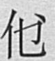’로 쓰고 ‘作’은 ‘伇’으로 써서 그 꼴이 비슷하므로 어쩌다 잘못된 것이다. 『역(易)』 「계사(繫辭)」의 ‘坤作成物’에 대해 『석문』에 “‘作’은 우(虞)·요(姚) 본에 ‘化’로 되어 있다”라 하였다. 이 역시 ‘作’과 ‘化’가 서로 잘못된 것으로, 그 잘못은 ‘作’과 ‘他’가 서로 잘못된 것과 같다.

**○治在權衡相奪，奇恒事也，揆度事也。**

치료는 권형상탈(權衡相奪)에 달려 있으니, 이는 기항의 일이고 규탁의 일이다.

〔楊〕음이 성하여 양을 거스르면 병이 되고, 양이 성하여 음을 거스르면 병이 된다. 다시 음양을 써서 허실을 저울질하고 보사(補寫)로 서로 빼앗으니, 이것이 기항의 일이다. 음양이 거꾸로 되었음을 바로 아는 것은 규탁의 일이다.

안(案): 양주는 권형을 음양 허실의 보사로 보았다. 음양이 반작(反作)할 때 양이 성하여 병이 되면 그 증이 열실(熱實)이므로 사약(寫藥)을 쓰고, 음이 성하여 병이 되면 그 증이 허한(虚寒)이므로 보약(補藥)을 쓴다. 이것이 기항의 일이다. 여기서 말한 ‘奇恒’은 「병능론」의 ‘奇恒’과 같지 않으니, 양성(陽盛)·열실을 항으로 삼고 음성(陰盛)·허한을 기로 삼은 것이다. 그렇다면 중경(仲景)의 책에서는 삼양(三陽)이 항이고 삼음(三陰)이 기이다. ‘奇恒’ 두 글자는 자리에 따라 뜻이 다르지만, 기는 변(變)이고 항은 상(常)이며, 기는 역이고 항은 순이라는 이치는 같다.

‘陰陽反作’ 네 글자는 『대소』를 따라 보충해야 한다. 음양의 반작을 규탁하면 허실과 냉열을 살펴 알 수 있다. 허실과 냉열을 살펴 안 뒤에야 권형상탈의 치료를 베풀 수 있으니, 이것이 기항의 일이다. 그렇다면 ‘陰陽反作，治在權衡相奪。治在權衡相奪，奇恒事也。陰陽反作，治在權衡相奪，揆度事也’라 해야 한다. ‘治在權衡相奪’ 여섯 글자를 거듭 쓰지 않은 것은 글을 줄인 것이다. 『소문』에 아래쪽 ‘陰陽反作’ 네 글자가 없는 것도 글을 줄인 것이고, ‘揆度事也’ 네 글자로 앞의 ‘陰陽反作’ 네 글자를 풀이한 것이다. 이는 ‘頭項強痛’과 같은 예의 문법이니 살펴 궁구할 만하다.

어떤 이는 권형상탈이 위로 토하고 아래로 사하는 뜻이라 한다. 형(衡)은 위로 토하는 것으로 곧 기이고, 권(權)은 아래로 사하는 것으로 곧 항이다. ‘奪’은 ‘脱’이니 빼내고 없앤다는 뜻이다. 이 설도 통한다. ‘治在’ 두 글자와도 아주 잘 맞으니, 한 설로 갖추어 둘 만하다.

**○搏脈痺躄，寒熱之交。**

박맥(搏脈)과 비벽(痺躄)은 한열(寒熱)이 서로 교차한 것이다.

〔楊〕맥이 뛸 때 두 맥이 서로 부딪치고 붙어서 뛰어 서로 떨어지지 못하면 이는 비벽(痺辟)의 병이니, 한열의 기가 서로 얽혀 부딪치는 것이다.

안(案): 박맥이란 그 맥이 전일하지 않고 두 맥이 서로 부딪치는 것을 말한다. 대체로 비벽의 부류는 모두 기혈이 사기를 받아 생기는 것으로, 사기와 정기가 서로 다투므로 한열이 교차하고 피부가 늘어졌다 당겼다 한다. 『금궤(金匱)』 권상 「중풍편(中風篇)」에 “촌구맥(寸口脈)이 부(浮)하면서 긴(緊)한데, 긴은 한이고 부는 허이다. 한과 허가 서로 부딪치면 사기가 피부에 있다. 부는 혈허이니, 낙맥이 공허하여 적사(賊邪)가 빠져나가지 못하고 왼쪽 또는 오른쪽에 있으며, 사기가 있는 쪽은 도리어 늘어지고 정기가 있는 쪽은 곧 당긴다”라 하고, 또 “촌구맥이 지(遲)하면서 완(緩)한데, 지는 한이고 완은 허이다. 영(榮)이 완하면 망혈(亡血)이 되고 위(衛)가 완하면 중풍이 된다”라 한 따위로 증명할 수 있다.

안(案): 비벽이란 중풍과 각약(脚弱)의 부류를 통틀어 일컫는다. 제10편에서 말한 “누웠다가 나가 바람을 맞으면 혈이 피부에 엉긴 것은 비(痺)가 되고, 맥에 엉긴 것은 삽(泣)이 되며, 발에 엉긴 것은 궐(厥)이 된다”가 이것과 같은 뜻이니 함께 살펴볼 만하다.

**○脈孤爲消氣，**

맥이 고(孤)한 것은 소기(消氣)가 된다.

〔楊〕음양의 맥이 각각 홀로 나타나는 것을 고라 한다. 족소양맥의 기가 홀로 나타나고 궐음이 없는 경우처럼 되면 소단(消癉)이 된다.

〔張〕맥이 고한 것은 고음(孤陰)·고양(孤陽)이다. 고양은 홍대(洪大)가 지극한 것이니 음기가 반드시 소모된다. 고음은 미약(微弱)이 심한 것이니 양기가 반드시 소모된다. 그러므로 맥이 고하면 소기가 된다.

〔高〕맥은 기혈에 앞서는 것이다. 맥이 고하면 양기가 안에서 손상되므로 소기가 된다. 고란 현(弦)·구(鉤)·모(毛)·석(石)에 위기(胃氣)가 적은 것을 말한다.

안(案): ‘消’는 ‘小’이니, 기육이 여위어 작아지는 것을 말한다. 비는 살을 주관하는데, 지금 맥이 고립되어 위기의 도움이 없으므로 기육이 점점 여위는 것이다.

**○虚｟爲｠泄爲奪血，**

허맥은｟爲｠ 설사가 되고 탈혈(奪血)이 된다.

〔楊〕설사하고 탈혈하는 병은 그 맥이 허하다.

안(案): 경문에 ‘爲’ 자가 빠져 거의 읽을 수 없다. 이제 『대소』를 얻으니 그 뜻이 환히 풀린다. 다만 장씨(張氏)는 나누어 풀 줄 알았으니 절묘하다. 경문을 깊이 생각할 줄 아는 사람이라 할 만하다.

〔張〕맥이 허하면서 설사를 겸하면 반드시 음을 잃는다. 음을 잃으면 혈이 허해지므로 허설(虚泄)이 탈혈이 된다고 한 것이다.

**○孤爲逆，虚爲從。**

고맥은 역이고 허맥은 종이다.

〔楊〕음양이 각각 홀로 나타나면서 그때 성한 것은 역이 된다. 홀로 나타나면서 허한 것은 기가 조화되기 쉬우므로 순이 된다.

〔高〕맥이 고하고 위기가 없으면 진원(真元)이 안에서 빠져나가므로 역이 된다. 허설이 있고 혈액이 적으면 혈이 점차 생길 수 있으므로 종이 된다.

**○行奇恒之法，以太陰始。**

기항의 법을 행할 때는 태음(太陰)에서 시작한다.

안(案): 이는 앞을 받아 뒤를 일으키는 글이다. ‘搏脈’ 운운한 몇 구절은 모두 기항의 법을 행하는 일이니, 태음 기구(氣口)의 맥을 가장 먼저 진찰한다는 것이다. 아래 글에서 다시 역순과 사생을 말해 나간다.

**○行所不勝曰逆，逆則死。行所勝曰從，從則活。**

이기지 못하는 쪽으로 가는 것을 역이라 하니 역이면 죽는다. 이기는 쪽으로 가는 것을 종이라 하니 종이면 산다.

안(案): 여기서 특별히 ‘死’와 ‘活’이라 한 것은 다른 곳에서 ‘死生’이라 한 것과 다르다. 그 색맥의 진찰에서 이기는 쪽으로 가면 순이 되므로, 비록 어떤 나쁜 증이 있더라도 죽지 않으니 죽음 가운데 삶이 있다는 말이다.

〔楊〕태음은 폐의 수태음맥으로 기를 주관한다. 보사와 권형상탈의 법을 행하려면 태음의 오행의 기로 시작한다. 오행의 기가 이기지 못하는 쪽으로 가면 다른 것의 승극(乘剋)을 받으므로 역이 되어 죽는다. 이기는 쪽으로 가면 다른 것을 극할 수 있으므로 순이 된다. 가령 간병을 금으로 치료하면 곧 이기는 쪽으로 가는 것이다.[역2]

안(案): 이 절은 왕주가 맞으니, 앞의 글을 받아 맥으로 허실을 살피는 법을 말한 것이다. 양주가 치료법으로 본 것은 옳지 않은 듯하다.

**○八風四時之勝，終而復始。**

팔풍(八風)과 사시의 승(勝)은 끝나면 다시 시작한다.

〔楊〕팔풍은 서로 극하여 이기고, 사시는 번갈아 이기니, 평상이면 끝나고 다시 시작한다.

〔箚〕『사(史)』 「봉선서(封禪書)」에 “귀유구(鬼臾區)가 말하였다. ‘하늘의 벼리를 얻으면 끝나고 다시 시작한다.’”라 하고, 또 “11월 신기(辛己) 초하루 새벽이 동지였는데, 천자가 처음으로 교제(郊祭)를 지내 태일(太一)에게 절하였다. 그 찬향(贊饗)에 ‘초하루가 지나고 또 초하루가 되어 끝나고 다시 시작한다’라 하였다”라 하였다.[역3]

**○逆行一過，不復可數，論要畢矣。**

거슬러 가는 것이 한 번 지나가면 다시 헤아릴 수 없으니, 진요(診要)[論要]가 여기서 끝난다.

〔楊〕팔풍과 사시는 이기는 쪽으로 순행한다. 만약 거슬러 한 번 이기면 일과(一過)가 된다. 재과(再過)면 죽으므로 헤아리지 않는다. 가령 간병에 폐기가 와서 승하면 일과가 되고, 재과면 곧 죽으므로 헤아림에 이르지 않는 것이다. 이것이 진요(診要)의 이치가 다한 것이므로 끝났다고 한 것이다.

안(案): 이 대목의 왕주는 옳지 않으니 양주를 따라야 한다. 또 ‘診要’를 ‘論要’로 쓴 것도 왕씨의 망령된 개작이다. 편 이름이 ‘玉版論要’이므로 여기를 ‘論要’로 고쳤다가 마침내 경문의 뜻을 잃었으니 따를 수 없다. 이제 『대소』에 근거해 이 잘못을 바로잡을 수 있으니, 이는 실로 황국(皇國)이 경전을 높인 유덕이 오늘까지 미친 것이다. 학자로서 어찌 나라의 은혜에 절하지 않을 수 있겠는가.

경신년 8월 23일 진시에 낭간절하서옥(琅玕節下書屋)에서 베껴 마쳤다.　원립지(源立之)

제15 보(第十五補)

도지지수(道之至數)｟一ウ｠

〔紹〕『관자(管子)』 주에 “‘數’는 이치이다”라 하였다. 『노자(老子)』 주에 “‘數’는 이수(理數)를 말한다”라 하였다.

「거통론(舉痛論)」 39에서 말하였다. “이와 같으면 도에 미혹되지 않고 요체의 이치가 다하니, 이른바 밝은 것이다.” 양주에서도 “‘數’는 이치이다”라 하였다.

각각 그 요처를 살핀다[各在其要]｟二ウ｠

안(案): 곽박(郭璞)의 『이아』 주에 말하였다. “『서(書)』에 ‘在璿璣玉衡’이라 하였다. 『서정의(書正義)』에 인용한 사인(舍人)의 말에 ‘在는 사물을 보고 살피는 것이다’라 하였다. 『시(詩)』의 ‘在帝左右’, 『예(禮)』 「문왕세자(文王世子)」의 ‘必在視寒煖之節’, 『일주서(逸周書)』 「대취편(大聚篇)」의 ‘王親在之’에 대해 『전(箋)』과 『주(注)』가 모두 ‘在는 察이다’라 하였다.”

규탁(揆度)｟一ウ｠

〔箚〕『사』 「율서(律書)」에 “‘癸’라는 말은 ‘揆’이니, 만물을 헤아린다는 말이다”라 하였다.

#### 진요경종론(診要經終論)편 제16

『대소』에는 없어졌다.

**[역1]** 원서대로 옮겼다. 「肥膚」는 열거 순서로 보아 「肌膚」의 잘못일 수 있으나 『醫心方』 원문은 확인하지 못했다.
**[역2]** 원서대로 옮겼다. 『黃帝內經明堂注』 권39 영초본 검색문에는 이 자리가 「假令為肝病以金療之即行所不…勝也」로 나오며, 원서의 이 구절에 글자가 빠졌을 수 있다.
**[역3]** 원서 「辛己」는 천간끼리의 짝이라 간지가 되지 않으므로 「辛巳」의 잘못으로 보인다.

**○黄帝問曰：診要何如。岐伯對曰：正月二月天氣始方，地氣始發，人氣在肝腹。**

황제가 물었다. “진찰의 요체는 어떠한가?” 기백이 답했다. “1월과 2월에는 천기(天氣)가 비로소 퍼지고[始方] 지기(地氣)가 비로소 피어나며, 인기(人氣)는 간(肝)·배[腹]에 있다.”[역1]

안(案): 『광아(廣雅)』 「석고(釋詁)」에 ‘方’은 ‘始’라 하였다. ‘方’은 ‘旁’·‘放’과 음이 같고 뜻이 같다. 『서(書)』 「요전(堯典)」의 ‘共工方鳩’가 『사기(史記)』 「오제기(五帝紀)」에는 ‘旁聚’로, 『설문(説文)』에는 ‘旁逑’로 되어 있다. 『서』 「익직(益稷)」의 ‘方施象刑惟明’에서 ‘方’이 『신서(新序)』 「절사(節士)」에는 ‘旁’으로 되어 있다. 『서』 「보형(甫刑)」의 ‘庶僇方告無辜於上’에서 ‘方’이 『논형(論衡)』 「변동(變動)」에는 ‘旁’으로 되어 있다. 『서』 「요전」의 ‘方命圮族’에서 ‘方’이 『한서(漢書)』 「부희전(傅喜傳)」과 「왕상전(王商傳)」에는 ‘放’으로 되어 있다. 이것들로 모두 증명할 수 있다. 이는 ‘地氣方發’의 ‘發’ 자와 짝을 이루어 말이 된 것이며, 또 ‘三月四月天氣正方，地氣定發’과는 두 ‘方’ 자가 서로 어울리는 글이니 함께 살펴볼 만하다.

**○三月四月天氣正方，地氣定發，人氣在脾｟四支｠。**

3월과 4월에는 천기가 한창 퍼지고[正方] 지기가 한창 피어나며[定發], 인기는 비(脾)｟사지(四支)｠에 있다.

안(案): 이 두 달에 이르면 천지의 기가 퍼져 피어남이 더욱 심하므로 ‘正’·‘定’이라 하였다. 천지의 기가 퍼져 피어나면 인기는 닫혀 비토(脾土)에 간직된다. 만물이 꽃피는 것은 토를 근본으로 하고, 인기가 발설하는 것은 비를 주로 한다.

（眉）「태음양명론(太陰陽明論)」에서 말하였다. “비는 토이니 중앙을 다스리고, 늘 사시에 사장(四藏)을 자라게 하며, 각각 18일씩 기대어 다스리고 홀로 한 계절을 주관하지 못한다. 비장은 늘 위토(胃土)의 정기를 드러낸다. 토는 만물을 낳고 천지를 본받으므로 위아래로 머리와 발에 이르기까지 미치며, 한 계절을 주관하지 못한다.” 왕주(王注)에서 말하였다. “토기는 사시 가운데 각 계절의 끝에 18일씩 기대어 왕성하니, 그러면 오행의 기가 각각 72일씩 왕성하여 한 해의 날수를 마치게 된다. 밖으로 사계(四季)를 주관하면 사람에게는 안으로 손발에 응한다.”

（眉）이에 따라 살펴보면, 한 해를 다섯으로 나누면 봄은 간·배, 여름은 심·가슴[匈], 가을은 폐·등, 겨울은 신·허리[要], 사계는 비·사지·머리이다. 한 해를 여섯으로 나누어 몸의 여섯 부분에 배합하면, 1·2월은 간·배, 3·4월은 비·사지, 5·6월은 심포·머리, 7·8월은 폐·등, 9·10월은 심·가슴, 11·12월은 신·허리이다.

**○五月六月天氣盛，地氣高，人氣在頭｟心包｠。**

5월과 6월에는 천기가 성하고 지기가 높으며, 인기는 머리｟심포(心包)｠에 있다.

안(案): 몹시 더운 때에는 천기가 내려오는 것도 심하고 지기가 올라가는 것도 심하다. 머리는 제양(諸陽)이 모이는 곳이므로 이에 응하지만, 실제로는 심과 비 두 장이 주관한다.

5·6월에 인기가 머리에 있다는 것은 곧 심포의 격막(鬲膜)을 말한다. 격의 기가 머리와 상응하므로 두현(頭眩)은 흉격에 수(水)가 있는 증이다. 영계출감탕(苓桂朮甘湯)증의 ‘起則頭眩’이 이것이다.

（眉）안(案): 오장과 오부 밖에는 오직 뇌가 으뜸이므로 여기서 머리라는 이름을 든 것이다. 머리는 곧 뇌를 달리 부르는 말이다. 삼초와 명문도 모두 뇌가 부리는 것이니, 격이 간에 속하는 것과 같다. 비에 속하고 심에 속한다.

**○七月八月，陰氣始殺，人氣在肺｟背｠。**

7월과 8월에는 음기(陰氣)가 비로소 숙살(肅殺)하고, 인기는 폐(肺)｟등(背)｠에 있다.

안(案): 이때에 이르면 천기가 차츰 내려오지 않고 지기도 올라가지 않는다. 그러므로 음기가 비로소 숙살의 기틀을 낳으며, 이때는 더운 가운데 때때로 서늘한 바람이 불어온다. 그래서 사람이 음식을 절제하지 않으면 토리(吐利)를 앓는 일이 많다. 「월령(月令)」에서 말한 “중추(仲秋)에는 낮과 밤이 나뉘고, 살기가 점점 성하며, 양기가 날로 쇠하고, 물이 마르기 시작한다”가 이것이다.

**○九月十月陰氣始冰，地氣始閉，人氣在心｟匈｠。**

9월과 10월에는 음기가 비로소 엉기고[始冰] 지기가 비로소 닫히며, 인기는 심(心)｟가슴(匈)｠에 있다.

안(案): 「월령」 맹동(孟冬)의 “천기가 위로 오르고 지기가 아래로 내려가 천지가 통하지 않고 닫혀 겨울을 이룬다”가 이것이다. 이때에는 사람의 양기도 닫히므로 심기를 길러야 한다. 심기가 안에서 한창 성하면 찬 기운이 침범해 오지 못한다. 제2편에서 말한 ‘春夏養陽，秋冬養陰’의 뜻이다.

안(案): ‘冰’과 ‘凝’은 고금자(古今字)이다. 물이 언다는 글자가 전주(轉注)되어 모든 응결의 뜻이 되었다.

（眉）이 두 ‘冰’ 자는 모두 음이 ‘凝’이어야 하니, ‘凝’의 혹체(或體)이다.

**○十一月十二月冰復，地氣合，人氣在腎｟要｠。**

11월과 12월에는 양기가 엉겨 땅속에 잠복하고[冰復] 지기가 닫혀 합하며, 인기는 신(腎)｟허리(要)｠에 있다.

안(案): ‘冰復’은 곧 ‘凝伏’이니, 양기가 땅속에 엉겨 잠복하는 것을 말한다. 어떤 이는 ‘冰復’이 물과 얼음이 거듭 쌓이는 것을 말한다고 한다. 『여씨(呂氏)』 「계동기(季冬紀)」에 ‘冰方盛，水澤復’이라 하였고, 고유(高誘)의 주에 “‘復’도 성하다는 뜻이다. ‘復’은 ‘複’으로도 쓰니, 언 것이 거듭 쌓이는 것이다”라 하였다.｟「월령」에는 ‘水澤腹堅’으로 되어 있다｠

〔吳〕‘合’은 닫혀 빽빽한 것이다.

〔志〕땅에서 나온 양이 다시 땅으로 돌아가 음과 합한다.

〔琦〕［按］본문에서 말한 인기가 있는 자리는 「금궤진언(金匱真言)」·「사시자역종(四時刺逆從)」의 여러 뜻과 같지 않다. 3·4월에 비에 있다는 것과 9·10월에 심에 있다는 것은 특히 억지로 풀기 어렵다. 우선 왕빙의 뜻대로 풀이해 두고 아는 이를 기다린다. 이 아래는 「사시자역종론(四時刺逆從論)」과 말이 서로 드나드는데, 저쪽 글이 맞다. 전하는 말이 달라졌으니 잘못 끼어들어 간 것이 없지 않다.

（眉）『난경(難經)』 「칠난(七難)」: 소양(少陽)｟격(鬲)｠은 우수(雨水)로 정월 중기, 양명(陽明)｟폐(肺)｠은 곡우(穀雨)로 3월 중기, 태양(太陽)｟심(心)｠은 하지(夏至)로 5월 중기, 태음(太陰)｟비(脾)｠은 처서(處暑)로 7월 중기, 소음(少陰)｟신(腎)｠은 상강(霜降)으로 9월 중기, 궐음(厥陰)｟간(肝)｠은 동지(冬至)로 11월 중기이다.

（眉）운기칠편(運氣七篇): 궐음｟간｠은 대한(大寒)으로 12월 중기, 소음｟심｠은 춘분(春分)으로 2월 중기, 소양｟격｠은 소만(小滿)으로 4월 중기, 태음｟비｠은 대서(大暑)로 6월 중기, 양명｟폐｠은 추분(秋分)으로 8월 중기, 태양｟신｠은 소설(小雪)로 10월 중기이다.

（眉）『옥함경(玉函經)』 「총례편(總例篇)」에 “음양의 구부(九部)이니, 머리와 등은 양부이고, 팔과 다리는 양부이며, 가슴은 음부이고, 배는 음부이다”라 하였다. 살펴보건대[案] 이는 몸을 넷으로 나눈 네 부이다. 아홉으로 나누어 구부로 삼으면 머리 하나, 왼발 하나, 왼손 하나, 오른손 하나, 오른발 하나, 가슴 하나, 배 하나, 등 하나, 허리 하나로, 이상이 구부이다.

**○故春刺散俞，及與分理，血出而止。**

그러므로 봄에는 산수(散俞)를 찌르되 분리(分理)에 미치게 하며, 피가 나오면 그친다.

『갑을(甲乙)』 권5｟一オ｠에 인용한 글도 같다.

〔紹〕선형(先兄)이 말하였다. 살펴보건대[按] 산수는 본수(本輸)에 상대하여 말한 것이다. 예컨대 태양폐경(太陽肺經)에서 소상(少商)·어제(魚際)·대연(大淵)·경거(經渠)·척택(尺澤)을 뺀 나머지는 모두 간산(間散)한 혈이니 이를 산수라 한다. 「한열병편(寒熱病篇)」에 “봄에는 낙맥을 취하고, 여름에는 분주(分腠)를 취하고, 가을에는 기구(氣口)를 취하고, 겨울에는 경수(經輸)를 취한다”라 하였다. 「사시기편(四時氣篇)」에 “봄에는 경의 혈맥과 분육 사이를 취하는데, 심하면 깊이 찌르고 가벼우면 얕게 찌른다. 여름에는 성경(盛經)과 손락(孫絡)을 취하고 분간(分間)을 취하되 피부를 끊어 들어간다. 가을에는 경수(經俞)를 취하고, 사기가 부에 있으면 합혈을 취한다. 겨울에는 정혈과 형혈을 취하되 반드시 깊이 취한다”라 하였다. 「수열혈론(水熱穴論)」에 “봄은 목이 비로소 다스리고 간기가 비로소 생기는데, 간기는 급하고 그 풍은 빠르며, 경맥은 늘 깊은 곳에 있으나 그 기가 적어 깊이 들어갈 수 없으므로 낙맥과 분육 사이를 취한다”라 하였다. 「종시편(終始篇)」에 “봄의 기는 털에 있고, 여름의 기는 피부에 있고, 가을의 기는 분육에 있고, 겨울의 기는 근골에 있다”라 운운하였다. 봄기운이 비로소 생길 때에는 사기가 얕게 들어오므로 그 찌르는 것도 깊게 하지 않으려 하고, 그래서 간산한 혈을 찌르는 것이다.[역2]

안(案): ‘及與’는 말이 되지 않는데, 여러 주가가 의심하지 않은 것은 어째서인가. ‘與’와 ‘於’는 옛 음이 통용되었다. 봄에 산수를 찌를 때 얕지도 깊지도 않게 하여 혈맥과 분리에 미치게 한다는 말이다. 대체로 기표의 흰 살을 찔러도 피가 보이지 않는 곳을 기부(肌膚) 또는 기육(肌肉)이라 하고, 피가 보이는 곳을 분육(分肉) 또는 분리라 하니, 위영(衛榮)의 혈기가 서로 나뉘는 곳이라는 말이다. 뒤 글에 ‘冬刺俞竅於分理’라 한 것도 뜻이 같다. 다만 거기서는 ‘及’ 한 글자를 줄였을 뿐이다. ‘血出而止’는 침 자리에 피가 겨우 보이면 그친다는 말이다. 이는 간혈을 사하여 내어 기표에 이르게 하면 표사도 따라서 없어지는 이치이다.

**○甚者傳氣，間者環也。**

병이 심하면 기를 전하여 내보내고[傳氣], 병이 가벼우면 기를 돌게 한다[環].

『갑을』에는 이 여덟 글자가 없다.

안(案): 병이 심한 경우에는 침 자리에서 피가 나온 뒤 그 혈을 눌러 막지 않으면 사기가 그 혈 자리에서 표로 전해져 나간다. 이를 ‘甚者傳氣’라 한다. 병이 가벼운 경우에는 침 자리에서 피가 나온 뒤 바로 그 혈을 눌러 막으면 사기가 떠나고 정기가 안에서 순환한다. 이를 ‘間者環’이라 한다. 대체로 침법에서 한 번 찌른 뒤 바로 그 혈을 눌러 막는 것이 정해진 법이지만, 사기가 심하고 표기가 실한 경우는 이 예에 들지 않는다. 뒤 글에서 ‘見血’이라 하고 ‘盡氣閉環’이라 한 것은 이 대목과 서로 밝혀 준다. 다만 이 대목에 비해 그 사기가 더 심하므로 ‘見血’·‘盡氣’라 하여, 여기서 ‘血出’·‘傳氣’라 한 것과 절로 다르다. 그 뜻은 서로 밝혀 보아야 한다.

**○夏刺絡俞，見血而止，盡氣閉環，痛病必下。**

여름에는 낙수(絡俞)를 찌르되 피가 보이면 그치고, 사기를 다 뺀 뒤 혈을 눌러 막아 기를 돌게 하면 통병(痛病)이 반드시 내려간다.

『갑을』에 인용한 글에는 ‘盡氣’ 이하 여덟 글자가 없다.

안(案): ‘盡氣’의 왕주는 따를 만하다. 여름에는 낙맥을 찔러 피가 보이면 그쳐 그 사기를 모두 빼내야 한다는 말이다. 그런 뒤 그 혈 자리를 눌러 막아 양기를 순환하게 한다. ‘痛病’은 ‘疾痛’과 같다. 대체로 상부에 있는 병은 낙맥을 찌른 뒤 반드시 아래로 내려간다.

〔吳〕그 혈을 눌러 막고 경기가 순환하기를 기다린다. 몸을 한 바퀴 도는 데에 약 2각쯤 걸린다. 통병이 반드시 내려간다는 것은 여름의 기가 머리에 있어 찌르면 아래로 옮겨 간다는 것이다.

（眉）왕주의 ‘盡氣’는 피를 내어 다하게 한다는 것이니, 침을 놓아 병든 맥의 성한 사기를 취하는 것이다.

**○秋刺皮膚，循理，上下同法，神變而止。**

가을에는 피부를 찌르되 살결을 따르며, 위아래가 같은 법이고, 신(神)이 변하면 그친다.

『갑을』에는 ‘神變而止’ 네 글자가 없다.

안(案): 가을에는 인기가 폐에 있으므로 피부를 아주 얕게 찌르고 피가 나오는 데까지 이르지 않는다. ‘理’는 육리(肉理)이다. ‘循’은 따른다는 뜻이다. 경맥이 통하여 꿰뚫는 곳을 ‘理’라 한다. 그 ‘理’를 따른다는 것은, 예컨대 머리에서는 신회(恖會)·전정(前頂)·백회(百會)·후정(後頂), 손에서는 곡지(曲池)·삼리(三里)·상렴(上廉)·하렴(下廉)을 차례로 찌르는 것이다. ‘神’은 신기(神氣)이다. 제3편에서 말한 ‘起居如驚，神氣乃浮’가 이것이다. 신기는 곧 위기(衛氣)이니, 기표의 양기를 말한다. 위기가 울체된 것이 순환하고 유통하여 평상으로 돌아가는 것을 ‘神變’이라 한다. 신변이란 신기가 찌르기 전과 달라진다는 말이다.

〔張〕‘循理’는 분육의 결을 따르는 것이다. 위는 수경을, 아래는 족경을 말하는데, 찌르는 것은 모두 같은 법이다. 가을의 기는 피부에 있어 사기가 아직 깊지 않다. 그러므로 그 신기가 변하여 찌르기 전과 달라지는지만 살펴서 침을 그칠 수 있다.

**○冬刺俞竅於分理，甚者直下，間者散下。**

겨울에는 수규(俞竅)를 분리까지 찌르는데, 심하면 곧게 침을 내리고, 가벼우면 흩어서 내린다.

『갑을』에 인용한 글은 여기서 그친다.

안(案): 봄과 여름에는 큰 침을 써서 피를 내고, 가을과 겨울에는 작은 침을 써서 기를 통하게 한다. 가을에 ‘皮膚’·‘上下’라 한 것은 손발의 양분(陽分)을 말한다. 겨울에 ‘俞竅’라 한 것은 등의 수혈(俞穴)의 여러 혈을 말한다. ‘竅’는 ‘穴’과 같다. 이 여러 혈은 모두 대양방광경(大陽旁光經)이니, 신부(腎部)를 보하는 법을 행하는 것이다.

〔吳〕손가락으로 눌러 그 표기를 흩은 뒤 침을 내린다.

**○春夏秋冬，各有所刺，法其所在。**

봄·여름·가을·겨울에는 각각 찌르는 곳이 있으니, 그 기가 있는 곳을 본받는다.

〔馬〕바로 그 인기가 있는 곳을 본받아 찌른다는 것이다.

안(案): 이상은 상법(常法)을 말하였고, 이하는 그 상법을 거스르면 병이 된다는 것을 말한다.

**○春刺夏分，脈亂氣微，入淫骨髓。**

봄에 여름의 부위[夏分]를 찌르면 맥이 어지럽고 기가 미약해지며, 사기가 들어가 골수에 번진다.

（眉）『갑을』 권5｟二オ｠에 인용되어 있다.

안(案): 여름의 부위를 찌른다는 것은 낙수를 찔러 피를 보는 것을 말한다.

〔高〕봄에 여름의 부위를 찌르면 심기를 공연히 상하게 한다. 심은 맥과 합하므로 맥이 어지러워지고, 맥이 어지러우면 기가 붙을 곳이 없으므로 기가 미약해진다. 맥이 어지럽고 기가 미약하면 사기가 도리어 안으로 들어가므로 골수에 번지는 것이다.

〔紹〕［簡按］이하 사시에 찌르는 데 역과 종을 어긴 변고는 「월령」의 봄에 여름의 정령을 행하는 따위의 재이(災異)와 같은 것으로, 사람에게 금계(禁戒)를 보인 것에 지나지 않는다.

**○病不能愈，令人不嗜食，又且少氣。**

병이 낫지 못하고, 음식을 즐기지 않게 되며, 또 기가 부족해진다.

〔高〕맥이 어지러우면 반드시 음식을 즐기지 않게 된다. 음식의 기가 위로 들어가면 탁기가 심으로 돌아가 맥으로 정기를 흘려보내기 때문이다. 기가 미약할 뿐 아니라 또 소기(少氣)가 된다.

**○春刺秋分，筋攣逆氣，環爲欬嗽。**

봄에 가을의 부위를 찌르면 근이 당기고 기가 거슬러, 돌아서 해수(欬嗽)가 된다.

〔高〕봄에 가을의 부위를 찌르면 폐기를 공연히 상하게 한다. 근련(筋攣)은 간병이다. 근련과 역기(逆氣)는 간병이 폐로 거스르는 것이다.

안(案): 폐가 상하면 간이 성해지므로 근련이라는 간증과 해수라는 폐의 징후가 번갈아 일어난다. 가을의 부위를 찌른다는 것은 피부를 찌르는 것을 말한다.

**○病不愈，令人時驚，又且哭。**

병이 낫지 않고, 때때로 놀라며, 또 운다.

『갑(甲)』에는 ‘哭’이 ‘笑’로 되어 있고, 주에 “어떤 본에는 ‘哭’으로 되어 있다”라 하였다.

〔張〕간은 경(驚)을 주관하므로 때때로 놀란다. 폐는 비우(悲憂)를 주관하므로 또 운다.

안(案): 경도 음(飲)이 일으키는 것이고, 곡은 폐가 주관하는 것이다. 그러므로 병이 낫지 않으면 이런 여러 증에 이른다.

**○春刺冬分，邪氣著藏，令人脹。**

봄에 겨울의 부위를 찌르면 사기가 달라붙어 숨어들어[著藏] 창(脹)이 생긴다.

〔張〕겨울은 신에 응하니, 신이 상하면 사기가 안으로 침범하여 장(藏)에 달라붙으므로 창만이 생긴다.

안(案): ‘邪氣著藏’은 「사시자역종론」에 ‘血氣内著’로 되어 있는데 뜻이 같다. ‘著藏’은 달라붙어 숨는 것을 말한다. ‘脹’은 심복창만(心腹脹滿)이다.

이는 등의 수혈 신부를 잘못 찌른 까닭이다.

**○病不愈，又且欲言語。**

병이 낫지 않고, 또 말을 하고 싶어 한다.

〔識〕［志云］간은 말을 주관하므로 말을 하고 싶어 한다. ［簡按］「선명오기론(宣明五氣論)」에 “오기(五氣)가 병드는 바에서 간은 말이 된다”라 하였다.

안(案): ‘言語’는 간병이다. 이는 신이 병들면 간도 병드는 것으로, 곧 수생목(水生木)의 이치이다. 신기가 쇠하면 간기가 저절로 성해지므로 말을 하고 싶어 하는 것이다. 섬(譫)이 말이 많다는 것이 이것이다.

（眉）안(案): ‘欲言語’는 병이 나서 헛소리[詀妄]와 정성(鄭聲)을 내는 것이다.

**○夏刺春分，**

여름에 봄의 부위를 찌르면,

안(案): 「사시자역종론」에서 말하였다. “여름에 경맥을 찌르면 혈기가 곧 고갈되어 해역(解㑊)이 된다.” 이로 보면 ‘病不愈’라 한 것은 ‘乃竭’이라 한 것과 그 뜻이 다르지 않다. 설은 「자역종(刺逆從)」｟六四｠ 안에 자세하다.

**○病不愈，令人解墮。**

병이 낫지 않고, 몸이 풀려 나른해진다[解墮].

‘解憜’는 『신교정(新校正)』에 「자역종」을 인용하여 ‘解墮’로 썼다. 주본(周本)에는 ‘解㑊’으로 되어 있어 지금 판본의 「자역종론」과 합한다. 고초본(古抄本)에도 ‘憜’로 되어 있으니, 주씨는 곧바로 지금 판본에 따라 고친 것이 아닐까. ‘解憜’의 풀이는 이미 제1편에 있다.

안(案): 여름에 경맥을 찔러 피를 보면 혈기가 흔히 쇠갈되어 마침내 근력이 풀려 나른한 증이 된다.

**○夏刺秋分，**

여름에 가을의 부위를 찌르면,

안(案): 「자역종론」에는 ‘夏刺肌肉，血氣内卻，令人恐’ 열한 글자로 되어 있는데, 그 뜻이 서로 같다. 설은 거기에 보인다.

**○病不愈，令人心中欲無言，惕惕如人將捕之。**

병이 낫지 않고, 마음속으로 말을 하고 싶어 하지 않으며, 누가 잡으러 오는 것처럼 두려워한다.

〔吳〕폐는 소리를 주관한다. 가을의 부위를 찔러 폐가 상하므로 말을 하고 싶어 하지 않고 두려워하는 것이다. 공(恐)은 신의 지(志)이다. 폐금이 손상되어 신이 그 어미를 잃으므로 허해져 저절로 두려워하는 것이다.

안(案): 여름에 낙맥을 찌르지 않고 작은 침으로 피부를 찌르면 폐부(肺部) 피부의 혈기가 막혀 안으로 물러난다. 그러므로 말을 하지 않고 잘 두려워하는 증이 된다. 이는 폐부의 기가 불리한 것인데, 기가 불리하면 혈도 울체되어 간까지 미치고, 간울(肝鬱)이 더욱 지극해져 마침내 두려워하는 간허(肝虛) 비슷한 증이 된다.

**○夏刺冬分，**

여름에 겨울의 부위를 찌르면,

안(案): 이것도 「자역종론」을 따라 ‘血氣上逆’ 네 글자를 보충하여 보아야 한다.

**○病不愈，令人少氣，時欲怒。**

병이 낫지 않고, 기가 부족해지며, 때때로 성을 내려 한다.

〔張〕여름에 그 신이 상하면 정이 허하여 기로 변화하지 못하므로 소기(少氣)가 된다. 수가 부족하면 목이 길러지지 못하여 간기가 강하고 급해지므로 성을 내려 한다.

안(案): 여름에 등의 수혈을 찌르면 신이 상한다.

**○秋刺春分，**

가을에 봄의 부위를 찌르면,

안(案): 「자역종론」에 근거하면 이 아래에 ‘血氣上逆’ 네 글자를 보충하여 보아야 한다.

**○病不已，令人惕然欲有所爲，起而忘之。**

병이 낫지 않고, 두려워하며[惕然] 무언가 하려 하다가 일어나서는 잊어버린다.

〔張〕간기가 상한 것이다. 심이 그 어미를 잃으면 신이 부족하므로 놀라고 또 잘 잊는다.

안(案): 가을에 경맥을 찌르면 공연히 간기만 움직인다. 간기가 안으로 상하면 심기가 위로 거스르므로 잘 두려워하고 잘 잊는 증이 된다.

**○秋刺夏分，**

가을에 여름의 부위를 찌르면,

안(案): 「자역종론」에 근거하면 이 아래에 ‘氣不外行’ 네 글자를 보충해야 한다.

**○病不已，令人益嗜臥，又且善㝱。**

병이 낫지 않고, 더욱 눕기를 좋아하며, 또 꿈을 잘 꾼다.

『갑』에는 이 아래에 ‘謂立秋之後’ 다섯 글자가 있다.

안(案): 가을에는 작은 침을 얕게 놓아야 하는데 낙맥을 찌르면 혈이 밖으로 새어 나가고 양기가 안에서 모자라므로 눕기를 좋아하고 꿈을 잘 꾼다. ‘㝱’은 『설문』의 정자(正字)이고, 예서에서 ‘夢’을 쓰는 것은 예부터의 가자(假字)이다. ‘堊’을 ‘惡’으로, ‘嗜’를 ‘耆’로 쓰는 예와 같다.

**○秋刺冬分，**

가을에 겨울의 부위를 찌르면,

안(案): 「자역종론」에 근거하면 이 아래에 ‘血氣内散’ 네 글자가 있어야 한다.

**○病不已，令人洒洒時寒。**

병이 낫지 않고, 오싹오싹[洒洒] 때때로 춥다.

안(案): 가을에는 피부를 찔러야 하는데, 지금 잘못하여 등의 수혈을 찌르면 양기가 밖으로 새고 혈기가 안에서 흩어지므로 몸을 떨며 춥다.

『영(靈)』 「한열병편」에 ‘振寒洒洒鼓頷’이라 하였다. 또 「사기장부병형(邪氣藏府病形)」에 ‘灑淅動形’이라 하였다. 또 「경맥(經脈)」에 ‘胃動則病洒洒振寒’이라 하였다.

**○冬刺春分，**

겨울에 봄의 부위를 찌르면,

안(案): 「자역종론」에 근거하면 이 아래에 ‘血氣皆脫，令人目不明’ 아홉 글자가 있어야 한다.

**○病不已，令人欲臥，不能眠，眠而有見。**

병이 낫지 않고, 눕고 싶으나 잠들지 못하며, 잠들면 무언가 보인다.

『갑』에는 이 아래에 ‘謂十二月中旬以前’ 여덟 글자가 있다.

〔張〕간은 혼(魂)을 간직한다. 간기가 상하면 신혼(神魂)이 흩어지고 어지러워지므로 눕고 싶어 한다. 잠들지 못하거나 잠들면 무언가 보인다는 것은 괴이한 것들을 말한다.

안(案): 겨울에 등의 수혈을 찔러 신부를 보하지 않고 경수(經俞)를 찔러 간부(肝部)를 사하므로 혈기가 모두 빠지는 것이다.

〔識〕［馬云］‘而’는 ‘如’로 써야 한다. ［簡按］‘而’와 ‘如’는 옛날에 통하였다. 예컨대 『시(詩)』 「소아(小雅)」의 ‘垂帶而厲’에 대해 『전(箋)』에 “‘而’는 ‘如’이다”라 하였고, 『춘추(春秋)』에 ‘星隕如雨’라 하였으니, 글자를 고칠 필요가 없다.

**○冬刺夏分，**

겨울에 여름의 부위를 찌르면,

안(案): 「자역종론」에 근거하면 ‘内氣外泄’ 네 글자가 있어야 한다.

**○病不愈，氣上發爲諸痺。**

병이 낫지 않고, 기가 위로 피어나 여러 비(痺)가 된다.

「자역종론」에는 ‘留爲大痺’로 되어 있다.

안(案): 여기서 ‘愈’로 쓰기도 하고 ‘已’로 쓰기도 하는데, ‘已’는 곧 ‘以’ 자이다. ‘以’는 ‘愈’와 옛날에 통용되었다. 『운경(韻鏡)』에 ‘以’와 ‘愈’는 함께 상성(上聲) 제4등 후음(喉音) 청탁(清濁) 유모(喻母)에 있다. ‘病愈’라는 말을 흔히 ‘病已’로 쓰니 통용하는 것이 마땅하다.

안(案): ‘氣上發’은 「자역종론」에서 말한 ‘内氣外泄’의 뜻이다. 겨울에는 음을 길러야 하는데, 지금 낙맥을 찔러 음혈을 잃으므로 내기(内氣)가 밖으로 새어 영위의 조화를 잃어 여러 마비[麻痺]의 증이 되는 것이다.

**○冬刺秋分，**

겨울에 가을의 부위를 찌르면,

안(案): 「자역종」에 근거하면 ‘陽氣竭絶’ 네 글자가 있어야 한다.

**○病不已，令人善渴。**

병이 낫지 않고, 갈증이 잘 난다.

『갑을』의 인용은 여기까지이다.

안(案): 겨울에는 음을 길러야 하는데 잘못하여 피부와 기육을 찌르면 비위가 상한다. 비위가 상하면 양기가 고갈되어 끊어지므로 갈증이 난다.

**○凡刺胸腹者，必避五藏，中心者環死。**

가슴과 배를 찌를 때는 모두 반드시 오장(五藏)을 피해야 한다. 심(心)을 맞히면 일주시[環] 만에 죽는다.

안(案): ‘環’은 일주시(一周時)를 말한다.

안(案): ‘環’의 풀이는 왕주가 옳으니, 전해 받은 바가 있어 말한 것일 뿐이다. 「자금론(刺禁論)」 52에 “심을 찔러 맞히면 하루 만에 죽는다”라 한 것과 같은 뜻으로, 하루 낮 하루 밤 일주시를 말한다. 「자금」과 「자역종」이 같으니, 이제 이것으로 정설을 삼는다.

〔張〕［按］「자금론」에서 말한 오장의 사기(死期)는 특히 상세하지만 본 절과 조금 다르다. 이 절은 네 장만 말하고 간에만 미치지 않았으니, 반드시 탈간(脫簡)일 것이다.

**○中脾者五日死，**

비(脾)를 맞히면 10일[五日] 만에 죽는다.

「자금론」에는 ‘五日’이 ‘十日’로 되어 있고, 「자역종론」도 같으니 이를 따라 고쳐야 한다. 「진요경종(診要經終)」에는 ‘五日’로, 전본(全本)과 『갑을』에는 ‘十五日’로 되어 있는데, 모두 잘못이다.

**○中腎者七日死，**

신(腎)을 맞히면 6일[七日] 만에 죽는다.

「자금론」에는 ‘七日’이 ‘六日’로 되어 있고, 「자역종」도 같으니 이를 따라 고쳐야 한다. 「진요경종」에는 ‘七日’로, 전본과 『갑을』에는 ‘三日’로 되어 있는데, 모두 잘못이다.

**○中肺者五日死，**

폐(肺)를 맞히면 3일[五日] 만에 죽는다.

「자금론」에는 ‘五日’이 ‘三日’로 되어 있고, 「자역종」도 같으니 따라야 한다. 「진요」에 ‘五日’로 된 것은 잘못이고, 전본과 『갑을』에 ‘三日’로 된 것은 따를 만하다.

안(案): 이상 오장의 자금(刺禁)과 죽는 날을 보면, 심은 1일, 폐는 3일, 간은 5일로 모두 상부이다. 또 간과 심은 모장(牡藏)이니 『영추(靈樞)』 44에 보인다. 폐는 빈장(牝藏)이지만 상부에 자리하여 오로지 기를 주관하고 오장의 윗덮개가 되므로, 이 세 장이 상하면 죽는 시기가 가깝다. 신은 6일, 비는 10일로 함께 하부의 빈장이어서 죽는 시기가 조금 멀다. 다만 비의 죽는 시기가 가장 먼 것은, 비는 곡식을 받아 영양할 수 있어 다른 장과 절로 다르기 때문이다. 비유하면 풀과 나무가 뿌리가 이미 잘렸어도 가지와 잎이 무성하여 일찍 시들지 않고, 벌레와 물고기가 뿌리와 뼈를 없앴어도 머리와 눈이 팔팔하여 빨리 죽지 않는 것과 같다.

안(案): 여기서 간의 죽음을 말하지 않은 것은 궐문(闕文)에 해당한다. 송나라 신하들의 설을 따를 만하다.[역3]

| | 심(心) | 폐(肺) | 간(肝) | 신(腎) | 비(脾) |
|---|---|---|---|---|---|
| 「진요(診要)」 | 환(環) | 5 | 5 | 7 | 5 |
| 「자금(刺禁)」 | 1일 | 3 | 5 | 6 | 10 |
| 전본(全本)·『갑을(甲乙)』 | 1 | 3 | 5 | 3 | 15 |
| 「자역종(刺逆從)」 | 1 | 3 | 5 | 6 | 10 |

**[역1]** 원서대로 옮겼다. 경문에는 「地氣始發」로 되어 있다.
**[역2]** 폐경은 수태음에 속하고 이어 든 少商·魚際·大淵·經渠·尺澤도 그 경의 혈이므로, 원서 「太陽肺經」은 「太陰肺經」의 잘못으로 보인다.
**[역3]** 원서대로 옮겼다. 이 편 경문에는 肝의 사기가 없고 저자도 안어에서 闕文으로 보았으므로, 표 《診要》 행의 「五」는 저자가 다른 편에 따라 채운 것일 수 있다.

**○中鬲者，皆爲傷中。其病雖愈，不過一歲必死。**

격(鬲)을 맞히면 모두 상중(傷中)이 된다. 그 병이 비록 낫더라도 1년을 넘기지 못하고 반드시 죽는다.

〔張〕격막(鬲膜)은 앞으로는 구미(鳩尾)와 가지런하고 뒤로는 제11추와 가지런하다. 심과 폐는 격 위에 있고, 간과 신은 격 아래에 있으며, 비는 아래에 있으면서 격 사이에 가깝다. 격은 청탁(清濁)을 가르고 상하를 나누어 오장을 경계 짓는 것이다. 오장의 기는 사계를 나누어 주관하는데, 그 격을 상하면 장기의 음양이 서로 어지러워지니 이것이 상중이다. 그러므로 1년을 넘기지 못하고 죽는다.

안(案): ‘傷中’은 이미 『본초경(本草經)』의 맥문동(麥門冬)·건지황(乾地黃) 외 11조에 보인다. ‘中’은 비위를 말한다. 『상한론(傷寒論)』에서 말한 이중(理中)·건중(建中)이 이와 같은 뜻이다. 내 생각에, 격을 잘못 찌르면 막(膜)이 상한다. 격막은 오장의 운화가 매여 있는 곳이고, 육부의 수사(輸寫)도 그 도움을 받는다. 「학론(瘧論)」에서 말한 ‘膜原’이 이것이다. 지금 세속에서는 『與古於宇末久』 또는 『末久於保祢』라 부르고, 만명(蠻名)으로는 『美通天留利不突』이라 한다. 이곳이 상하면 비위가 상하고, 비위가 상하면 오장육부가 모두 상한다. 그러므로 당시에는 큰 탈이 없더라도 오장육부가 서로 상하고 고갈되어 1년을 넘기지 못하고 반드시 죽는다. 그 기한이 1년을 넘기지 못하는 것은 오장이 서로 극벌(剋伐)하기 때문이다. 왕주(王注)가 옳은 듯하다.

（眉）「지진요론(至真要論)」의 ‘胃鬲如寒’에 대한 왕주에 “심하(心下)에서 배꼽 위까지가 위의 부위이다. 위격(胃鬲)은 위완(胃脘)의 위와 대격(大鬲)의 아래를 말하니, 풍한의 기가 생긴다”라 하였다.

**○刺避五藏者，知逆從也。**

찌를 때 오장을 피하는 것은 역종(逆從)을 알기 때문이다.

앞 글의 ‘凡刺胸腹者，必避五藏’에 응한다.

**○所謂從者，鬲與脾腎之處，不知者反之。**

이른바 종(從)이란 격과 비·신이 있는 곳을 아는 것이니, 모르는 자는 이와 반대로 한다.

〔張〕알고 피하는 것이 종이고 모르는 것이 역이니, 이것을 ‘反’이라 한다.

안(案): 격은 오장에 매여 있지만, 그 아래 격막이 비에 접하고 신에 이어지는 곳이 가장 긴요하다. 그러므로 이곳을 피하라고 다시 말한 것이다.

**○刺胸腹者，必以布憿著之，乃從單布上刺。**

가슴과 배를 찌를 때는 반드시 베로 감아 고정하고[布憿著之], 홑겹 베 위로 찌른다.

〔識〕［馬云］‘憿’은 ‘𢅎’으로 써야 하니 베 수건이다. 張·吳본에는 ‘𢅎’으로 되어 있다. 高는 ‘繳’으로 썼다. ［志云］‘憿’은 고정한다는 뜻이니, 베로 가슴과 배에 고정하는 것이다. ［滑云］‘𢅎’은 감아 묶는 것과 같다. ［簡按］자서(字書)에 ‘𢅎’은 ‘繳’로도 쓰며 음은 ‘皎’이다. 『옥편(玉篇)』에는 정강이 행전[脛行縢]이라 하였고, 『집운(集韻)』에는 정강이 베[脛布]라 하였다. 『본초(本草)』에 교각포(繳脚布)가 있는데, 이시진(李時珍)은 “곧 과각포(裹脚布)이니 옛 이름은 행등(行縢)이다”라 하였다. 그러니 滑의 주가 옳은 듯하다. 자서에는 ‘憿’ 자가 없다. 지총(志聰)은 왕주의 ‘形定’ 풀이를 따랐는데 억지스럽다.

〔吳〕베로 감아 고정하는 것은 가슴과 배가 오장에 가까우므로 풍한을 막기 위해서이다.

〔馬〕베 위로 찌르는 것은 깊이 들어가지 않으려는 것이다.

〔箚〕［寛案］‘從單布上刺’라는 말에 근거하면 ‘憿著’ 두 글자는 이어 읽는다.

고초본(古抄本)의 『신교정(新校正)』에는 또 ‘撽’으로 되어 있고, 그 아래에 ‘又憿，公了反，行縢也’ 여덟 글자가 있다.

안(案): 『설문(説文)』에 ‘⿱敫糸，生絲縷也’라 하였다. 『광아(廣雅)』 尺古四에 ‘⿱敫糸，纏也’라 하였다. 『한서(漢書)』 「사마천전(司馬遷傳)」의 ‘名家苛察繳繞’에 대한 주에 “여순(如淳)이 말하기를, ‘繳繞’는 ‘纏繞’와 같다”라 하였다. 『옥편』에 ‘𢅎，公了切。𢅎脛，行縢也’라 하고, 『광운(廣韻)』 상성 29 소(篠)에 ‘古了切。𢅎，行縢。𢅎，脛布也。繳，纏也。䘨，小袴’라 하였으니, 모두 같은 음이다. ‘繳’ 자는 『설문』 본뜻으로는 지약절(之若切)이지만, ‘繳纏’의 글자로 가차되면 음이 변하여 고료절(古了切)이 된다. ‘貍貓’의 글자를 ‘薶瘞’의 글자처럼 읽으면 음이 막개절(莫皆切)이 되고, ‘兌卦’의 글자를 ‘尖銳’의 글자로 읽으면 음이 이예절(以芮切)이 되는 예와 같다. 또 살펴보건대[又案] ‘憿’은 곧 ‘𢅎’의 속자이니, ‘帖’을 ‘怗’으로, ‘帳’을 ‘悵’으로 쓰는 예와 같다. ‘憿’은 ‘憿幸’의 글자이다. 『설문』 이하 여러 책에서는 ‘徼’·‘傲’로도 쓰는데, 이 대목의 뜻과는 절로 다르다. 『소문(素問)』의 ‘𢅎’ 자와 『설문』의 ‘繳’ 자는 그 근원이 아마 하나일 것이다. 『광운』에서 ‘𢅎’과 ‘繳’이 같은 음이니 증명할 수 있다. 『신교정』에 “또 ‘撽’으로 쓴다”라 하였다. ‘撽’도 ‘繳’의 초서 꼴이 변한 것으로, 『설문』의 ‘擊，旁擊也’의 글자와는 절로 다르다.[역1][역3]

**○刺之不愈，復刺，刺鍼必肅。**

찔러서 낫지 않으면 다시 찌르되, 침을 찌를 때는 반드시 엄숙히 한다.

안(案): ‘肅’이란 말을 하지 않고 몸을 움직이지 않으며 온 마음으로 정성을 다하는 것이다. 정신의 힘이 침 끝에 있으면 기가 이르렀는지 이르지 않았는지 알 수 있다.

**○刺腫搖鍼，**

종기를 찌를 때는 침을 흔들고,

안(案): ‘腫’은 옹종(癰腫)을 말한다. ‘鍼’은 피침(鈹鍼)을 말한다.

**○經刺勿搖，**

경맥을 찌를 때는 흔들지 않는다.

안(案): ‘經’은 경맥을 말한다.

**○此刺之道也。**

이것이 찌르는 도이다.

‘刺鍼’ 이하 여기까지 열일곱 글자는 『갑을(甲乙)』 권5｟十八オ｠ 「침도(鍼道)」 제4에 있는데 글자 차이가 없다.

「사시자역종론(四時刺逆從論)」에서 말하였다. “기백이 말하였다. 봄에 낙맥을 찌르면 혈기가 밖으로 넘쳐 소기(少氣)가 된다. 봄에 기육을 찌르면 혈기가 돌아 거슬러 상기(上氣)가 된다. 봄에 근골을 찌르면 혈기가 안으로 달라붙어 복창(腹脹)이 된다. 여름에 경맥을 찌르면 혈기가 곧 고갈되어 해역(解㑊)이 된다. 여름에 기육을 찌르면 혈기가 안으로 물러나 잘 두려워하게 된다. 여름에 근골을 찌르면 혈기가 위로 거슬러 잘 성내게 된다. 가을에 경맥을 찌르면 혈기가 위로 거슬러 잘 잊게 된다. 가을에 낙맥을 찌르면 기가 밖으로 돌지 않아 누워서 움직이려 하지 않게 된다. 가을에 근골을 찌르면 혈기가 안으로 흩어져 한율(寒慄)이 된다. 겨울에 경맥을 찌르면 혈기가 모두 빠져 눈이 밝지 않게 된다. 겨울에 낙맥을 찌르면 내기(内氣)가 밖으로 새어 머물러 대비(大痺)가 된다. 겨울에 기육을 찌르면 양기가 고갈되어 끊어져 잘 잊게 된다. 대체로 이 사시에 찌르는 것은 크게 거슬러 생기는 병이니 따라야 한다. 이를 어기면 난기(亂氣)가 생겨 서로 번져 병이 된다. 그러므로 찌를 때 사시의 법도와 병이 생기는 바를 모르면 종을 역으로 삼게 된다. 정기가 안에서 어지러워지고 정(精)과 서로 부딪치니 반드시 구후(九候)를 살펴야 한다. 그러면 정기가 어지럽지 않고 정기(精氣)가 뒤바뀌지 않는다. 황제가 말하였다. 좋다. 오장을 찌를 때 심을 맞히면 하루 만에 죽고 그 변동은 트림[噫]이 된다. 간을 맞히면 5일 만에 죽고 그 변동은 말이 된다. 폐를 맞히면 3일 만에 죽고 그 변동은 기침이 된다. 신을 맞히면 6일 만에 죽고 그 변동은 재채기와 하품이 된다. 비를 맞히면 10일 만에 죽고 그 변동은 삼킴이 된다. 찔러서 사람의 오장을 상하면 반드시 죽는다. 그 변동은 그 장이 변하는 바에 따르므로 이로 그 죽음을 살펴 안다.”｟十八ノ八ウ｠

**○帝曰：願聞十二經脈之終奈何。岐伯曰：太陽之脈，其終也，戴眼反折瘈瘲，其色白。絶汗乃出，出則死矣。**

황제가 말하였다. “십이경맥(十二經脈)의 기가 끝나는 모습을 듣고 싶다.” 기백이 말하였다. “태양맥(太陽脈)이 끝날 때는 대안(戴眼)·반절(反折)·계종(瘈瘲)이 나타나고 얼굴빛이 희다. 절한(絶汗)이 나오는데, 나오면 죽는다.”

안(案): 이하 육경의 종증(終證)은 『영(靈)』 「종시편(終始篇)」을 참고해야 한다.

안(案): 수태양은 소장경이고, 족태양은 방광경[旁光經]이다. 소장은 심화에 속하고, 방광은 신수에 속한다. 신이 다하려 하면 눈동자가 신을 잃고 얼굴빛이 희어지며 절한이 나온다. 절한은 탈한(脫汗)이고 음한(陰汗)이니, 심음(心陰)이 고갈되어 끊어져 나는 땀이다. 반절과 계종은 방광경이 발과 등에 매여 있고 소장경이 손과 어깨에 매여 있으므로 이런 증이 된다. 이는 수화가 함께 쇠하면 토목이 손상되는 이치이다.

**○少陽終者，耳聾，百節皆縱，目睘絶系。絶系一日半死，其死也，色先青白，乃死矣。**

소양(少陽)이 끝날 때는 귀가 먹고 온몸의 관절이 다 풀어지며, 목계(目系)가 끊어진다[目睘絶系]. 목계가 끊어지면 하루 반 만에 죽는데, 죽을 때는 얼굴빛이 먼저 청백색이 되고서야 죽는다.

〔識〕［馬云］‘目睘’은 세속에서 말하는 안권(眼圈)과 같다. 여기서 말한 계(系)는 곧 「대혹편(大惑篇)」에서 말한 계이다. 吳는 ‘睘’을 ‘環’으로 쓰고, 주에서 “‘目環’은 눈을 굴려 곁눈질하는 것이다”라 하였다. 高는 ‘寰’으로 쓰고, 주에서 “눈의 테두리가 안계(眼系)와 끊어져 서로 얽어매지 못함을 말한다”라 하였다. ［簡按］‘睘’은 음석(音釋)에 “음이 ‘瓊’이다”라 하였다. 『설문』에는 “‘睘’은 눈으로 놀라서 보는 것이다”라 하였다. 張·志가 모두 왕주를 따른 것이 옳다.

〔箚〕양씨(楊氏)의 『난경주(難經注)』에는 ‘目睘’이 ‘目環’으로 되어 있고, 『영(靈)』 「종시편」에는 ‘目系絶，目系絶一日半則死矣’로 되어 있다. ［寛案］『영추』에 근거하면 ‘睘’ 자는 연문인 듯하다.

안(案): 이 설은 괜찮다. 내가 보기에 ‘睘’은 곧 ‘系’의 음이 통하는 가차자이고, ‘睘’이 고자(古字)이며, 아래의 ‘系’ 자는 후인이 곁에 적은 것이 본문에 잘못 들어간 것이 아닐까. 『설문』에 ‘睘’은 거영절(渠營切), ‘系’는 호계절(胡計切)로 그 음이 서로 가깝다. ‘睘’은 아탁음(牙濁音)이고 ‘系’는 후탁음(喉濁音)이다.

〔高〕「자금론(刺禁論)」에서 말하였다. “담을 찔러 맞히면 하루 반 만에 죽는다.” 얼굴빛이 먼저 청백색이 된다는 것은 하루 반이 되기 전에 먼저 목(木)이 금(金)의 형벌을 받는 색이 나타나고 나서 죽는다는 것이다.

안(案): 수소양은 삼초경이고, 족소양은 담경이다. 두 경은 함께 귀 안으로 들어가는데, 지금 두 경의 맥이 다하려 하므로 귀가 먹는다. 온몸의 관절과 온갖 근은 모두 담즙이 스며든 나머지 힘으로 움직일 수 있다. 지금 담즙이 고갈되어 끊어졌으므로 온몸의 관절이 다 풀어진다. 목계가 끊어지는 것도 담즙과 간혈이 함께 고갈된 증이다. 얼굴빛이 청백한 것 역시 간목(肝木)의 본색이 나타나고 심경의 혈색을 잃은 것이다.

안(案): 이하 「종시편」의 같은 글을 참고해야 한다.

（眉）본 편 음석에 ‘睘’은 음이 ‘瓊’이라 하였다.

**○陽明終者，口目動作，善驚妄言，色黃，其上下經盛不仁則終矣。**

양명(陽明)이 끝날 때는 입과 눈이 움직이고, 잘 놀라며 헛소리를 하고, 얼굴빛이 누렇다. 그 위아래 경맥이 성하여 불인(不仁)이 되면 끝난다.

〔張〕입과 눈이 움직인다는 것은 당겨서 비뚤어지는 것이다.｟志·高도 모두 같다.｠

안(案): 왕주에 “눈이 번뜩이고 턱을 떤다”라 하였다. 음석에 “‘睒’은 음이 ‘閃’이다”라 하였다. 눈꼬리가 번뜩이며 움직이고 입술이 떨린다는 말이다. 『설문』에 “‘睒’은 잠깐 보는 모양이다. 실염절(失冉切)이다”라 하였다.

「양명맥해편(陽明脈解篇)」 30에서 말하였다. “족양명맥의 병은 사람과 불을 싫어하고, 나무 소리를 들으면 깜짝 놀란다.” 또 말하였다. “헛소리하고 욕하며 친소를 가리지 않고 노래한다.”

〔識〕［吳云］아픔을 몰라서 마치 제 몸을 어질게 아끼지 않는 사람과 같다. ［高云］불인이란 몸이 차고 피부가 굳은 것이다. ［馬云］아프고 가려움을 모르는 것이다.

［簡按］왕빙은 「비론(痺論)」에 주를 달아 “불인이란 피부가 무뎌 있고 없음을 모르는 것이다”라 하였다. 『정씨유서(程氏遺書)』에 “의가(醫家)는 아프고 가려움을 알지 못하는 것을 불인이라 하고, 사람은 지각하지 못하고 의리를 알지 못하는 것을 불인이라 하니, 비유가 아주 가깝다”라 하였다. 마주(馬注)는 정자(程子)에 근본을 둔 것이다.

〔紹〕양주(楊注)는 「비론」에 대해 말하였다. “인(仁)이란 친한 것이고 깨닫는 것이다. 영위(營衛)와 경락의 기가 성글고 껄끄러워 피부 □ 속을 영양하지 못하므로, 피부가 아프고 가려움을 깨닫지 못하니 이를 불인이라 한다.” ［堅案］성무기(成無己)는 「평맥법(平脈法)」에 주를 달아 말하였다. “인이란 부드러운 것이다. 불인이란 부드럽고 조화롭지 않다는 말이다. 한열과 통양을 모두 깨닫지 못하는 것이다.” 또 말하였다. “불인은 뻣뻣하고 감각이 없는 것이다.” 조대중(趙大中)의 『풍과집험명방(風科集驗名方)』에서 말하였다. “중풍의 불인은 인이 뭇 선의 으뜸으로 온화하고 자애롭고 순함을 주로 하는데, 지금은 사지가 뻣뻣하여 펴고 말지 못하고 근이 당겨 긴급하니, 이는 영위가 통하지 않기 때문이다. 그러므로 불인이 된다.” 두 사람은 뻣뻣함으로 풀이하였는데, 정확함이 모자란다.

불인의 풀이는 「혈기형지편(血氣形志篇)」의 『소문식(素問識)』에 자세히 보인다. 불인의 풀이는 이 편 끝 보유에 자세히 나오니 참고해야 한다.

〔箚〕［寛案］‘仁’은 ‘人’이다. 저려 아프고 가려움을 모르니 사람의 살이 아니라는 것이다.｟原 『돈의초(頓醫抄)』｠

안(案): ‘上下經盛’이란 수족양명의 경맥이 모두 사기를 받아 기가 성하다는 말이므로 불인의 증이 된다. 지금 중풍 편고(偏枯)로 불인한 손발은 모두 그 맥이 성대하고, 저리지 않은 손발은 그 맥이 평상과 같으니 증명할 수 있다. 곧 풍이 말단에 번져 병이 된다[風淫末疾]는 뜻이다.

안(案): 수양명은 대장경이고, 족양명은 위경이다. 입과 눈이 움직이고 잘 놀라며 헛소리를 하는 것은 모두 금이 쇠하고 목이 성한 증이고, 얼굴빛이 누렇다. 위아래 경맥의 불인은 위가 허하고 사기가 실한 증이다.

（眉）「풍론(風論)」의 ‘其肉有不仁也’에 대한 왕주에 “불인은 ‘㾪’하여 한열과 통양을 알지 못하는 것을 말한다”라 하였다.

**○少陰終者，面黑，齒長而垢，腹脹閉，上下不通而終矣。**

소음(少陰)이 끝날 때는 얼굴이 검고, 이가 길어지고 때가 끼며, 배가 불러 막히고, 위아래가 통하지 않아 끝난다.

안(案): 수소음은 심이고, 족소음은 신이다. 심과 신 두 장은 몸을 세우는 근본이다. 이 두 경이 다하려 할 때의 징후를 보면, 얼굴이 검고 이에 때가 끼는 것은 심기가 다하려는 것이고, 배가 불러 통하지 않는 것은 신기가 다하려는 것이다.

〔吳〕신은 이음(二陰)에 개규(開竅)하므로 막힌다. 불러 오르고 또 막히면 위로는 먹지 못하고 아래로는 대소변을 보지 못한다. 위아래가 통하지 않으니 심과 신이 막혀 끊어져 끝난다.

**○太陰終者，腹脹閉，不得息。善噫善嘔，嘔則逆，逆則面赤。不逆則上下不通，不通則面黑，皮毛焦而終矣。**

태음(太陰)이 끝날 때는 배가 불러 막히고 숨을 쉬지 못한다. 트림과 구역을 잘 하는데, 구역하면 기가 거스르고, 기가 거스르면 얼굴이 붉어진다. 거스르지 않으면 위아래가 통하지 않고, 통하지 않으면 얼굴이 검고 피모(皮毛)가 타들어 끝난다.

『영추(靈樞)』에서는 궐음이 앞에 있고 태음이 뒤에 있다.

（眉）『영(靈)』에서는 뒤에 있다.

안(案): 수태음은 폐이고, 족태음은 비이다. 배가 불러 트림하고 구역하는 것은 비기가 다하려는 징후이다. 숨을 쉬지 못하고 얼굴이 붉은 것은 폐기가 다하려는 모습이다. 더 심한 경우에는 구역하여 거스르지도 못하니, 비기가 쇠패하여 위아래 기가 통하지 않으므로 얼굴빛이 먼지 낀 듯 검고, 폐기가 기르지 못하므로 피모가 타들어 간다.

〔張〕족태음맥은 배로 들어가 비에 속하므로 복창하여 막힌다. 수태음맥은 격으로 올라가 폐에 속하고 호흡을 주관하므로 숨을 쉬지 못한다. 복창하여 막히면 승강이 어렵고, 숨을 쉬지 못하면 기도가 막히므로 트림과 구역이 된다. 구역하면 기가 위로 거스르므로 얼굴이 붉어진다. 거스르지 않으면 가운데가 막히므로 위아래가 통하지 않는다. 비기가 패하면 수를 제어할 수 없으므로 검은색이 얼굴에 나타난다. 폐기가 패하면 치절(治節)이 행해지지 않으므로 피모가 타들어 끝난다.

안(案): 트림과 구역은 모두 위에서 나오지만 그 모습은 같지 않다. 기가 거슬러 토하려 하면서 ‘嘔嘔’ 소리를 내는 것을 구역이라 하고, 기가 거스르되 토하지 않으면서 ‘噫噫’ 소리를 내는 것을 트림이라 한다. 트림은 먹은 것이 조화되지 못한 증이고, 구역은 음(飲)이 통하지 않는 징후이다.

**○厥陰終者，中熱嗌乾，善溺心煩，甚則舌卷，卵上縮而終矣。**

궐음(厥陰)이 끝날 때는 속에 열이 있고 목구멍이 마르며, 소변을 자주 보고 가슴이 번거로우며, 심하면 혀가 말리고 고환이 위로 오그라들어 끝난다.

（眉）『영(靈)』에서는 앞에 있다.

안(案): 수궐음은 심주(心主)이고, 족궐음은 간이다. ‘中熱’은 곧 ‘熱中’이니 위 속의 열을 말한다. 속에 열이 있고 목구멍이 마르며 가슴이 번거롭고 혀가 말리는 것은 모두 목이 쇠하고 화가 성한 징후이다. 심주가 다하면 심화가 더욱 맹렬해지므로 혀가 말리는 데에 이른다. ‘善溺’은 간기가 쇠약하여 거두어들이는 작용을 잃은 것이다. ‘卵縮’은 목기가 다하여 적셔 주는 기능을 잃은 것이다.

**○此十二經之所敗也。**

이것이 십이경이 패하는 모습이다.

『영(靈)』에는 이 여덟 글자가 없다.

『영추』 「종시편」 9에서 말하였다. “대양맥(大陽之脈)이 끝날 때는 대안·반절·계종이 나타나고 얼굴빛이 희며, 피부가 끊어지면 곧 절한이 나고, 절한이 나면 끝난다. 소양이 끝날 때는 귀가 먹고 온몸의 관절이 다 풀어지며 목계가 끊어지고, 목계가 끊어지면 하루 반 만에 죽는다. 죽을 때는 얼굴빛이 청백색이 되어 죽는다. 양명이 끝날 때는 입과 눈이 움직이고 잘 놀라며 헛소리를 하고 얼굴빛이 누러며, 그 위아래 경맥이 성하지만 돌지 않으면 끝난다. 소음이 끝날 때는 얼굴이 검고 이가 길어지며 얼굴에 때가 끼고 배가 불러 막히며 위아래가 통하지 않아 끝난다. 궐음이 끝날 때는 속에 열이 있고 목구멍이 마르며 소변을 자주 보고 가슴이 번거로우며, 심하면 혀가 말리고 고환이 위로 오그라들어 끝난다. 태음이 끝날 때는 배가 불러 막히고 숨을 쉬지 못하며, 기가 올라 트림하고 구역을 잘 한다. 구역하면 기가 거스르고, 기가 거스르면 얼굴이 붉어진다. 거스르지 않으면 위아래가 통하지 않고, 위아래가 통하지 않으면 얼굴이 검고 피모가 타들어 끝난다.”[역4]

### 중광보주황제내경소문(重廣補注黃帝内經素問) 권제4

## 소문고주(素問攷注) 권제4

만연(萬延) 원년 9월 초엿새 새벽 창가 등불 아래에서 쓰다.　지원옹 입지(枳園翁立之)

제16 보(第十六補)

심한 경우에는 곧게 내리고, 가벼운 경우에는 흩어서 내린다[甚者直下，間者散下]｟三ヲ｠

『영추』 권15 「오색편(五色篇)」 49에서 말하였다. “뇌공(雷公)이 말하였다. 색으로 병이 가볍고 심한 것을 말한다는 것은 어떠합니까?”

계종(瘈瘲)｟十ヲ｠

〔識〕웅음(熊音)에 “‘瘈’는 호계반(胡計反), ‘瘲’은 자용반(子用反)이다”라 하였다. ［馬云］‘反折瘈瘲’은 손발과 몸이 뒤로 젖혀지면서 급한 것이 계(瘈)이고 늘어진 것이 종(瘲)이라는 말이다. ［高云］손발이 당기고 떨리는 것이다. ［簡按］‘瘈’는 ‘瘛’로도 쓴다. 「옥기진장론(玉機真藏論)」에 “근맥이 서로 당겨 급한 것을 병명으로 계(瘛)라 한다”라 하였고, 왕주(王註)에 “근맥이 열을 받아 저절로 뛰고 당기므로 ‘瘛’라 이름한다”라 하였다. 웅음에 ‘尺世反，瘈同’(척세반(尺世反)이며 ‘瘈’와 같다)이라 하였다. 『설문』에 ‘瘛，小兒瘛瘲病也’라 하고, 또 ‘瘛引縱曰瘛’라 하였다. 달리 ‘痸’로도 쓴다. 『한(漢)』 「예문지(藝文志)」에 금창계종방(金創瘛瘲方)이 있고, 왕부(王符)의 『잠부론(潛夫論)』의 ‘掣縱’도 모두 이와 같다. 『명리론(明理論)』에서 말하였다. “‘瘈’는 근맥이 급한 것이고, ‘瘲’은 근맥이 늘어진 것이다. 급하면 당겨서 오그라들고, 늘어지면 풀려서 펴진다. 오그라들었다 펴졌다 하며 움직여 그치지 않는 것을 계종이라 한다. 세속에서 ‘搐’이라 하는 것이 이것이다.” 이 설이 맞다.[역2]

불인(不仁)｟十ウ｠

이 부류는 서로 비슷하여 섞여 잘못된 경우가 있다. 이제 아래와 같이 나누어 구별하고, 「완비불인변(頑痺不仁辨)」이라 이름한다.

【楷】문구(文久) 2년 술년[二戌] 5월 19일에 짓다.　약지(約之)

【楷】첫째는 비(痹)이니, 속자로 ‘痺’로 쓴다. 천하의 책에서는 대부분 ‘痺’를 쓴다. 『소문』에 「비론」이 있고, 『상한론』 「태양중편(太陽中篇)」에 “병이 허리 아래로 반드시 무겁고 저린 것을 화역(火逆)이라 한다”라 하였다. ‘痺’는 닫혀 막힌다는 뜻이다. 『설문』에 ‘痹’와 ‘痺’ 두 전자가 있는데, 요컨대 같은 병이고 한 이치이다. ‘痺’는 ‘苛’라고도 하니, 『소문』 「역조론(逆調論)」에 나온다. 또 ‘頑’이라고도 하는데, ‘頑’은 ‘㾪’으로도 쓴다. ‘㾪’은 예서 속자이고, 의서에서는 ‘頑’을 아주 많이 쓴다. 『좌씨(左氏)』 희공(僖公) 24년 전(傳)과 『서(書)』 「요전(堯典)」 전(傳)에 모두 “마음이 덕의의 법도를 본받지 않는 것을 ‘頑’이라 한다”라 하였으니, 이것이 그 뜻이다. 『옥편』에 ‘㾪，渠軍切。痹也’라 하고, 『광운』 상평 20 문(文)에 ‘痹，渠云切。瘒也’라 하였다. 또 27 산(刪)에 ‘癏，音頑。癏痺’라 하였다. 이로써도 ‘痹’·‘瘒’·‘痺’ 셋이 같은 글자임을 증명할 수 있다. 이는 곧 화명(和名) 『志毘禮留』, 또는 『毘利毘利須留』가 이것이다. 예부터 흔히 불인과 섞어 온 것은 잘못이다. ‘頑’은 어리석고 둔하다는 뜻이다. 어리석고 둔한 쪽에서 ‘㾪’이라 하고, 시큰하고 저린 쪽에서 ‘苛’라 한다. 그러므로 「오상정론(五常政論)」에 ‘皮㾪肉苛’라 하였다.

둘째는 불인이다. 『본경(本經)』의 ‘死肌’와 후세의 마목(麻木)이 모두 같은 것으로, ‘麻’라 하고 ‘木’이라 하는 것은 한 소리가 바뀐 것이어서 뜻이 같다. 후세에 간혹 마와 목을 둘로 나누어 ‘麻’를 ‘㾪’·‘痺’에 붙이는 것은 옳지 않다. ‘麻木’이라는 글자는 『갑을』 권9 제2편에도 보인다. 「비론」의 왕주와 양주, 정씨의 『유서』, 吳와 馬의 본 편 주, 희다촌(喜多村)의 설은 모두 따를 만하다. 예부터 흔히 완비(頑痺)와 경(痙)·위(痿) 등과 섞어 온 것은 모두 잘못이다. 이는 곧 화명 『比登波達姪奈伊』가 이것이다. 『의학통지(醫學統旨)』에 “마는 목의 가벼운 것이고, 목은 마의 심한 것이다”라 한 것은 크게 잘못되었으니 천착이다. 또 “마목은 불인의 병이다”라 한 것은 아주 정확하고 적절하다. 다시 살펴보건대[再案] ‘麻’라는 말은 ‘微’이고 ‘木’이라는 말은 ‘冒’이니, 음운 위에서 저절로 크고 작은 뜻이 생겨남을 안다면 『의학통지』의 말은 본디 정확하며 천착이 아니다.

【楷】셋째는 경(痙)이다. 대체로 뻣뻣하고 굳어 당기는 뜻이다. 그러므로 온몸의 경이 있고, 손가락 하나의 경이 있으며, 한 자의 경이 있고, 한 치의 경이 있는데, 경이 되는 점은 요컨대 한가지이다. 예부터 이를 흔히 불인·완비 등과 섞어 온 것은 크게 그르다. 화명 『加多志』, 또는 『加多久古留』가 이것이다.

【楷】넷째는 위(痿)이다. 대체로 시들고 약하고 부드러운 뜻이다. 역시 크고 작고 넓고 좁은 것이 있어 대체로 경과 같다. 예부터 이를 흔히 불인·완비 등과 섞어 온 것은 잘못이다. 화명 『奈會留』, 또는 『具尼也利須留』, 또는 『野和羅加』가 이것이다. 『소문』에 「위론(痿論)」이 있다.

다섯째는 궐(厥)이다. 대체로 그 부위가 차가운 뜻이다. 역시 크고 작고 넓고 좁은 것이 있어 대체로 경과 같다. 예부터 이를 흔히 불인·비·위 등과 섞어 온 것은 옳지 않다. 『소문』에 「궐론(厥論)」이 있고, 화명 『比惠留』, 또는 『通蔑多志』가 이것이다.[역5]

여섯째는 불수(不遂)이다. 옛날에는 ‘不㒸’로 썼다. 『설문』에 ‘㒸，從意也’라 하였다. 또 ‘不用’이라고도 하니, 『소문』 「역조론」에 나온다. 화명 『幾加奴』, 또는 『宇護計奴』, 또는 『波多羅加奴』가 이것이다. 살펴보건대[案] 불인은 체(體)이고 불수는 용(用)이다.

14(十四)　탕액료례(湯液醪醴)｟二ヲ｠　참석(鑱石)｟四ウ｠　충곽(充郭)｟七ヲ｠　사극(四極)｟七ウ｠　권형(權衡)｟八ヲ｠　울진(宛陳)｟八ウ｠　귀문(鬼門)｟九ヲ｠　정부(淨府)｟九ウ｠　오탕(五湯)｟十ヲ｠

15(十五)　규탁(揆度)｟一ヲ｠　기항(奇恒)｟同｠　수(數)｟一ウ｠　주치(主治)｟二ウ｠　요주(醪酒)｟同｠　색요(色夭)｟三ウ｠　역역(易亦)｟四ウ｠　반화(反化)｟同｠　박맥(搏脈)｟五ウ｠　비벽(痺躄)｟同｠　위소(爲消)｟六ヲ｠

16(十六)　시방(始方)｟一ヲ｠　여어(與於)｟二ウ｠　洒洒(洒洒)｟五ウ｠　유이(愈已)｟六ヲ｠　격(鬲)｟七ヲ｠　상중(傷中)｟同ウ｠　憿𢅎(憿𢅎)｟八ヲ｠　계종(瘈瘲)｟十ヲ｠　불인(不仁)｟十ウ｠

## 소문고주(素問攷注) 권제5

### 중광보주황제내경소문(重廣補注黃帝内經素問) 권제5

#### 맥요정미론(脈要精微論)편 제17

『대소(大素)』에는 권 첫머리부터 ‘關格’까지와 ‘心疝病成而變’ 두 절이 모두 빠져 있고, 나머지는 모두 남아 있다.

（眉）「지진요론」에서 말하였다. “맥요(脈要)에 이르기를.” 운운.

（眉）『대소』 권14 「사시맥진(四時脈診)」.

（眉）『대소』에는 1장부터 6장까지 빠져 있다.

**[역1]** 원서 인쇄는 ‘擊’(撃)이나, 앞의 ‘撽’와 견주고 『설문』 표제가 ‘撽’이므로 문맥상 ‘撽’일 것이다. 원서 글자 그대로 두었다.
**[역2]** ‘瘛引縱曰瘛’의 두 ‘瘛’는 원서에서 疒 안에 掣(위 制·아래 手)를 넣은 꼴로, 코드를 찾지 못해 통행 글자 ‘瘛’로 적었다. ‘瘛’의 이체인 듯하다.

**[역3]** 원서대로 옮겼다. 「尺古四」는 『廣雅』 「釋詁」 권4를 같은 음의 글자로 줄여 적은 것일 수 있다.
**[역4]** 『靈樞』 終始篇(萬曆 吳勉學刻本)에는 「齒長而垢」로 되어 있어, 원서 「齒長面垢」의 「面」은 「而」의 잘못으로 보인다.
**[역5]** 원서는 「大小廣夾」인데 앞 단락의 같은 구절 「大小廣狹」에 따라 「狹」의 뜻으로 옮겼다.

**○黃帝問曰：診法何如。岐伯對曰：診法常以平旦。**

황제(黃帝)가 물었다. “진찰하는 법은 어떠한가?” 기백(岐伯)이 답했다. “진찰하는 법은 늘 평단(平旦)에 한다.”

『맥경(脈經)』 권1 「평맥조안법(平脈早晏法)」 제2에 이 글이 ‘決死生之分’까지 실려 있는데, 위의 18자를 ‘黃帝問曰：夫診法常以平旦，何也。岐伯對曰：平旦者’ 20자로 적었다.

**○陰氣未動，陽氣未散，飲食未進，經脈未盛，絡脈調勻｟《脈經》作『均』｠，氣血未亂，故乃可診有過之脈。**

음기(陰氣)가 아직 동하지 않고 양기(陽氣)가 아직 흩어지지 않았으며, 음식을 아직 먹지 않아 경맥(經脈)이 아직 성하지 않고 낙맥(絡脈)이 고르며｟『맥경』에는 ‘均’으로 되어 있다｠, 기혈(氣血)이 아직 어지러워지지 않았으므로, 이때에야 허물 있는 맥[有過之脈]을 진찰할 수 있다.

『맥경』에는 ‘有過之脈’이 ‘過此非也’ 4자로 되어 있다.

안(案): 음기는 영혈(營血)을 말하고, 양기는 위기(衛氣)를 말한다. 기혈이 아직 어지러워지지 않았다는 것은 곧 음기가 아직 동하지 않고 양기가 아직 흩어지지 않았다는 말이다. 음식을 먹고 나면 경맥이 점점 성해지고 낙맥도 고르지 않게 된다. 그러므로 평단에 아직 음식을 먹기 전에 늘 진찰하면 허물 있는 비정상의 맥을 알 수 있다. 『본초경(本草經)』의 “오장이 아직 허하지 않고, 육부가 아직 고갈되지 않았으며, 혈맥이 아직 어지럽지 않고, 정신이 아직 흩어지지 않았으면 약을 먹어 반드시 살아난다.”라는 말도 이 글과 문세가 같다.

〔張〕평단은 음양이 교차하는 때이다. 양은 낮을 주관하고 음은 밤을 주관하며, 양은 표(表)를 주관하고 음은 이(裏)를 주관한다. 대체로 사람 몸의 영위(營衛)의 기는 하루 낮밤에 몸을 50번 도는데, 낮에는 양분(陽分)을 돌고 밤에는 음분(陰分)을 돌다가 평단이 되면 다시 모두 촌구(寸口)에서 만난다. 그러므로 진찰은 평단에 막 잠에서 깬 때에 해야 한다.

『영추(靈樞)』 「영위생회편(營衛生會篇)」에 말하였다. “평단에 음이 다하고 양이 기를 받는다. 한낮은 양이 가장 성한 때이고, 해가 서쪽으로 기울면 양이 쇠하며, 해가 지면 양이 다하고 음이 기를 받는다. 한밤중에 크게 만나는데, 만백성이 모두 누워 있으므로 합음(合陰)이라 한다. 평단에 음이 다하고 양이 기를 받으니, 이와 같이 그침 없이 되풀이되어 천지와 벼리를 같이한다.”

〔張〕유과(有過)는 맥이 중도를 얻지 못하여 허물이 있다는 말이다.

안(案): ‘過’ 자의 풀이는 이미 제10편에 나왔다.

**○切脈動靜，**

맥의 동정(動靜)을 짚고,

〔識〕［張云］‘切’은 손가락으로 눌러 찾는다는 말이다. 맥의 동정을 짚는 것은 음양을 진찰하는 것이다. ［簡按］망(望)·문(聞)·문(問) 세 가지는 병자 앞에 가면 알 수 있지만, 맥만은 그 피부에 바싹 닿지 않으면 진찰할 수 없으므로 절맥(切脈)이라 한다. 왕빙(王冰)이 ‘切近’으로 풀이한 것이 옳다. 양현조(楊玄操)의 『난경(難經)』 주에 “‘切’은 누른다는 뜻이다.”라고 하였다.

안(案): 동(動)은 부(浮)·삭(數)·긴(緊)·실(實)·급(急) 따위를 말하고, 정(靜)은 침(沈)·지(遲)·완(緩)·허(虛)·약(弱) 따위를 말한다.

**○而視精明，**

정명(精明)을 보며,

〔馬〕［按］왕주(王註)는 정명을 족태양경(足太陽經)의 정명혈(睛明穴)로 보았으나, 이 혈로는 이 법으로 사람을 살피기에 부족하고, 눈을 살피는 것으로 보아야 맞다. 아랫글의 ‘所以視萬物，別黑白’ 같은 말로 보면 눈을 위주로 말한 것이 바르다. 정명은 신기(神氣)를 위주로 말한 것인데, 눈이 아니면 그것을 볼 길이 없다. 하물며 끝에서 ‘則精衰矣’라 하였으니, ‘精衰’의 ‘精’을 어찌 혈로 말할 수 있겠는가. 『맹자(孟子)』에 “사람에게 있는 것 가운데 눈동자보다 좋은 것이 없다. 가슴속이 바르면 눈동자가 밝다.”라고 한 것이 이것이다.

안(案): ‘精’과 ‘睛’은 고금자(古今字)로, 검은 눈동자를 말한다. ‘明’은 희고 분명하다는 뜻인 듯하니, 흰자위와 검은자위 사이에서 그 색택을 살펴 면색과 아울러 고찰하면 된다. 「오장생성편(五藏生成篇)」 제10의 “오색의 기맥을 볼 때 얼굴이 누렇고 눈이 푸르거나, 얼굴이 누렇고 눈이 붉거나” 따위가 이것이다. 『석명(釋名)』에 “동자(童子)는 주로 그 정명을 말한다.”라고 하였으니, 이 때문에 ‘精明’ 두 글자는 오로지 동자에 매인다.

（眉）『영추』 「구침십이원(九鍼十二原)」에 “그 색을 보고 그 눈을 살핀다.”라고 하였다.

**○察五色，觀五藏有餘不足。六府強弱，形之盛衰，以此參伍，決死生之分。**

오색(五色)을 살피고, 오장(五藏)의 유여와 부족, 육부(六府)의 강약, 형체의 성쇠를 관찰하여, 이것으로 참오(參伍)하여 사생의 갈림을 결정한다.

〔識〕［張云］셋으로 서로 견주는 것을 참(參)이라 하고, 다섯으로 서로 비기는 것을 오(伍)라 한다. 이쪽저쪽을 돌이켜 보고 같고 다름을 서로 증험하여 반드시 그 은미한 것을 찾아내려 한다는 말이다. 『역(易)』에 “참오하여 변하고 그 수를 뒤섞으며, 그 변화에 통한다.”라고 한 것이 이것이다.｟「계사(繫辭)」 상에 나온다｠ ［滑云］색·맥·장부·형기를 참합하고 비교하는 것이다. ［簡按］『순자(荀子)』에 “적을 엿보아 이기려면 참오하려 한다.”라고 하였고, 또 “참오하여 밝고 삼가 상벌을 베푼다.”라고 하였다. 양경(楊倞)의 주에 “참오는 뒤섞임과 같다.”라고 하였다.

〔箚〕「삼부구후론(三部九候論)」의 “형기가 서로 맞으면 살고, 참오가 고르지 않으면 병든다.”에 대한 왕주(王注)에 “참(參)은 참고하여 교정함을 말하고, 오(伍)는 종류대로 나눔을 말한다. 참고·교정하고 종류대로 나누어 보아 고르지 않은 것이 있다는 말이다.”라고 하였다.

안(案): 『설문(説文)』에 “‘伍’는 서로 참오하는 것이다.”라고 하였다. ［臣鍇曰］두 사람이 서로 돕는 것을 ‘貳’라 하고, 세 사람이 서로 섞인 것을 ‘參’이라 하며, 다섯 사람이 서로 섞인 것을 ‘伍’라 하고, 열 사람이 서로 섞인 것을 ‘什’이라 하며, 백 사람이 서로 섞인 것을 ‘佰’이라 하니, 뜻이 이와 같다. ‘參伍’의 풀이는 제20편에도 나온다.

**○夫脈者，血之府也。**

맥은 혈(血)의 부(府)이다.

『갑을(甲乙)』 권4에는 ‘血’ 아래에 ‘氣’ 자가 있다.

「생기통천(生氣通天)」에 “맥의 흐름이 박질(薄疾)하다.”라고 하였다.

『영추』 「결기편(決氣篇)」에 말하였다. “무엇을 혈이라 하는가? 기백이 말했다. 중초(中焦)가 기를 받아 즙을 취하고 변화시켜 붉어진 것을 혈이라 한다. 무엇을 맥이라 하는가? 기백이 말했다. 영기(營氣)를 가두어 막아 피해 나갈 곳이 없게 하는 것을 맥이라 한다.”

〔李〕영기가 맥 속을 돌므로 혈의 부가 된다. 그러나 이 혈을 돌게 하는 것은 실로 기가 맡는다. 「역순편(逆順篇)」에 “맥의 성쇠는 혈기의 허실을 살피는 근거이다.”라고 하였으니, 여기서 혈 하나만 들었으나 기가 그 속에 들어 있음을 알 수 있다. 아랫글의 ‘氣治’·‘氣病’에서 그 뜻이 더욱 드러난다.

안(案): 맥은 혈을 거두는 곳이므로 혈의 부라 한 것이다. 『화명초(和名抄)』는 야왕(野王)의 안(案)을 인용하여 “혈은 살 속의 붉은 즙이다. 맥은 살 속 혈의 결이다.”라고 하였다.｟지금 판본 『옥편(玉篇)』에는 이 글이 없다｠ 그리고 ‘血’은 ‘知’로, ‘脈’은 ‘知乃美知’로 훈독한다. 『설문』에 “‘𧖴’은 혈의 결이 갈라져 비스듬히 몸 안을 흐르는 것이다. 혹 ‘肉’을 따라 ‘脈’으로 쓴다.”라고 하였고, 『옥편』에 “‘脈’은 혈의 결이다. ‘脉’은 위와 같다.”라고 하였다.

『의사(醫史)』 「여창주옹전(呂滄洲翁傳)」에 “맥은 혈의 물결이다.”라고 하였다.

『홍결보행기(弘決輔行記)』 권8에 “맥은 혈기가 다니는 길이다.”라고 하였다.

『홍결외전초(弘決外典抄)』 권4는 이를 인용하고 풀이하여 “맥은 혈기를 담아 막아 밤낮으로 몸을 영양하고 피해 흩어지지 않게 하는 것이다. 혈은 오곡의 정즙(精汁)이다.”라고 하였다.

（眉）동서원(董西園)의 『의급(醫級)』에 “맥은 혈의 부이다. 혈이 맥 속에 차서 기를 따라 팔다리와 온몸을 흘러 이르지 않는 곳이 없으므로 기혈의 앞선 기틀이 된다.”라고 하였다.

（眉）『오문정공집(吳文定公集)』 「증소지가서(贈邵志可序)」에 “맥은 혈의 물줄기이니, 기가 그렇게 만든다.”라고 하였다.

（眉）하몽요(何夢瑤)의 『의편(醫碥)』에 “맥의 형체는 길고 둥글어 물을 파 잎 속에 채운 것과 같다. 맥의 움직임은 기로 파 잎 속의 물을 고동시켜 흐르게 하는 것과 같다.”라고 하였다.

**○長則氣治，短則氣病，數則煩心，大則病進。**

맥이 장(長)하면 기가 다스려지고, 단(短)하면 기가 병들며, 삭(數)하면 가슴이 번열하고[煩心], 대(大)하면 병이 진행한다.

안(案): 기는 혈을 싣고 다니므로 맥으로 기의 굴신과 병듦·평온함을 살필 수 있다. 삭맥은 대체로 열이 있는 맥이므로 번심(煩心)이라 하였다. 대맥은 홍성(洪盛)한 맥이므로 병세가 더해진다고 설명하였다. 장맥은 세 손가락 아래에 한결같이 고른 맥으로, 부침지삭(浮沈遲數)을 따지지 않는다. 단맥은 색삽(濇澀)하여 이어지지 않는 맥으로, 역시 부침지삭을 따지지 않는다. 곧 오가는 것이 유리(流利)하게 이르는 것을 장이라 하고, 오가는 것이 유리하지 않게 이르는 것을 단이라 한다.

（眉）『갑을』에는 ‘治’가 ‘和’로 되어 있고, ‘氣病’의 ‘氣’가 없다.

**○上盛則氣高，下盛則氣脹。**

상부가 성하면 기격(氣鬲)이 되고, 하부가 성하면 기창(氣脹)이 된다.

〔識〕［簡按］여러 주가는 ‘上’·‘下’를 촌(寸)과 척(尺)의 뜻으로 보았으나, 『내경(内經)』에는 촌구의 명칭은 있어도 세 부위를 나누어 촌·관·척으로 삼는 설은 없다. 이는 『난경』 이후의 견해로 이 경을 읽은 것이니 모두 따를 수 없다. 여기서 말한 ‘上’·‘下’는 상부와 하부의 여러 맥을 가리킨다. 상세한 것은 「삼부구후론」에 보인다.

‘氣高’는 전본(全本)에 ‘氣鬲’으로 되어 있다. 『사기(史記)』 「창공전(倉公傳)」에 “기격은 사람을 번만(煩懣)하게 하고 음식이 내려가지 않으며 때로 거품을 토하게 한다.”라고 하였다.

안(案): ‘氣高’는 전본을 따라 ‘氣鬲’으로 쓰는 것이 옳다.

안(案): 상성(上盛)은 기구(氣口)와 인영(人迎)의 맥이 함께 성대한 것을 말한다. 하성(下盛)은 부양(跗陽)과 대계(大谿)가 함께 성대한 것을 말한다. 기격은 가슴속 기가 막힌 것을 말하니, 곧 담음(痰飲) 따위이다. 『금궤(金匱)』 「담음편(痰飲篇)」 제12의 “맥이 현삭(弦數)하면 한음(寒飲)이 있고, 맥이 침하면서 현한 것은 현음(懸飲)으로 속이 아프다.”가 이것이다. 기창은 뱃속에 기가 차서 불러 오른 것을 말하니, 곧 숙식(宿食) 따위이다. 『금궤』 「숙식편(宿食篇)」 제10의 “부양맥(趺陽脈)이 미현(微弦)하면 배가 그득할 것이다.”가 이것이다.

**○代則氣衰，細則氣少，**

맥이 대(代)하면 기가 쇠하고, 세(細)하면 기가 적으며,

〔馬〕맥이 오다가 중간에 멈추어 스스로 돌아오지 못하는 것이 대이다. 대맥이면 정기(正氣)가 이미 쇠하였으므로 스스로 돌아오지 못한다.

〔張〕맥이 자주 변하여 일정하지 않은 것을 대라 하니, 기가 허하여 주관함이 없는 것이다. 맥이 미세하게 오는 것은 정기가 부족한 것이다.

『사기』 「창공전」에 말하였다. “그러므로 맥을 짚을 때 고르지 않으면서 대하였다. 고르지 않은 것은 혈이 제자리에 있지 않은 것이다. 대는 때때로 어지럽게 치며 함께 이르러 갑자기 조급하고 갑자기 커지는 것이다. 이는 두 낙맥이 끊어진 것이므로 죽어서 치료할 수 없다.” 『정의(正義)』에 “『소문(素問)』에 ‘혈기가 자리를 바꾼 것을 불평(不平)이라 하고, 맥의 징후가 동하여 일정하지 않은 것을 대라 한다.’라고 하였다.”라고 하였다.

안(案): 기소(氣少)는 정기가 부족한 것이다. 기쇠(氣衰)는 정기가 크게 빠진 것이다. 정기가 빠졌으므로 그 맥이 대한 것이니, 거의 죽으려는 조짐이다. 정기가 부족하면 그 맥이 세한데, 이는 치료하기 어려울 뿐이고 치료를 그르치지 않으면 나을 수 있다.

**○濇則心痛。**

맥이 색(濇)하면 심통(心痛)이 난다.

〔馬〕맥이 칼로 대나무를 긁듯이｟우서(虞庶)에서 나왔다｠ 오가기가 매우 어려운 것을 색이라 한다. 색맥이면 심혈(心血)이 부족하여 때로 통증이 난다.

〔張〕색맥은 혈이 적고 기가 막힌 것이므로 심통이 된다.

**○渾渾革至如涌泉，病進而色弊，緜緜其去如弦絶，死。**

맥이 혼혼(渾渾)하고 급하게[革] 이르러 샘물이 솟구치듯 하면 병이 진행하면서 안색이 피폐해지고, 넓고 느슨하게[綽綽] 가다가 활시위가 끊어지듯 하면 죽는다.

『맥경』 권1 제13에는 ‘革’ 아래에 ‘革’ 자가 있고, ‘色’이 ‘危’로, ‘弊緜緜’이 ‘弊弊綽綽’으로 되어 있으며, ‘絶’ 아래에 ‘者’ 자가 있다. 『갑을』 권4 「경맥(經脈)」 제1 중에는 ‘渾渾革革至如涌泉，病進而色弊之綽綽，其去如弦絶者死’로 되어 있다.

안(案): 『갑을』만 틀리지 않았으니 따라서 고쳐야 한다. ‘色弊’ 아래의 ‘之’ 자는 틀림없이 옛 판본이 남긴 것이고, ‘弊弊’로 쓴 것은 잘못이다. 『소문』에 ‘之’ 자가 없는 것은 후세 사람이 깎아 낸 것이다.

〔識〕『문선(文選)』 「칠발(七發)」 주에 “‘渾渾’은 물결이 서로 따르는 모양이다.”라고 하였다. ‘革’은 『집운(集韻)』에 “음이 ‘殛’이고, 급하다는 뜻이다.”라고 하였다.

『예기(禮記)』 「단궁 하(檀弓下)」에 ‘若病革’이라 하였고, 주에 “‘革’은 급하다는 뜻이다.”라고 하였다. 『석문(釋文)』에 “‘革’은 어떤 판본에 ‘亟’으로 되어 있고, 거력반(居力反)이다.”라고 하였다. 「단궁 상(檀弓上)」의 ‘夫子之病革矣’에 대해 『석문』은 “기력반(紀力反)이다. 서(徐)는 또 음이 ‘極’이라 하였으니, 급하다는 뜻이다.”라고 하였다.

안(案): 혼혼혁혁(渾渾革革)은 맥이 솟구쳐 오르며 나아가기만 하고 물러남이 없는 모양이다. 이는 허양(虛陽)이 위로 떠오르고 진음(真陰)이 안에서 고갈된 것이므로, 병이 진행하는 모습이 실증(實證)과 비슷해도 안색이 피폐한 것은 안의 허함이 점차 이르렀기 때문이다. ‘緜緜’은 『맥경』·『갑을』을 따라 ‘綽綽’으로 써야 한다. 작작(綽綽)은 너그럽고 큰 모양이다. 작작하게 넓고 큰 맥이 양맥(陽脈)과 비슷하더라도 홀연히 가면서 활시위가 끊어지듯 하면 사맥(死脈)이다.

「삼부구후론」에 “그 응함이 빠르게 손에 닿으며 혼혼한 것은 병이다.”라고 하였다. 『영추』 「역순편」에 “혼혼한 맥에는 자침하지 말라.”라고 하였다.

〔紹〕『산해경(山海經)』에 “동쪽으로 유택(泑澤)을 바라보니 황하가 잠겨 흐르는 곳이다. 그 근원은 혼혼포포(渾渾泡泡)하다.”라고 하였고, 주에 “혼혼포포는 물이 솟구치는 소리이다.”라고 하였다.

『설문』에 “‘渾’은 뒤섞여 흐르는 소리이다. ‘混’은 풍성하게 흐르는 것이다.”라고 하였다. 『방언(方言)』 권2에 “‘渾’은 성하다는 뜻이다.”라고 하였고, 『광아(廣雅)』 「석고 2(釋詁二)」도 같다. 『순자』 「부국편(富國篇)」에 “재화가 혼혼하게 샘의 근원과 같다.”라고 하였고, 주에 “‘渾渾’은 물이 흐르는 모양이다.”라고 하였다. 『광아』 「석훈(釋訓)」에 “‘渾渾’은 크다는 뜻이다.”라고 하였다. 『법언(法言)』 「문신편(問神篇)」의 “혼혼하기가 내와 같다.”의 주에 “‘渾渾’은 큰 흐름이다.”라고 하였다.

**○夫精明五色者，氣之華也。**

정명과 오색은 기의 꽃이다.

〔張〕정명은 눈에 드러나고 오색은 얼굴에 나타나니, 모두 오기(五氣)의 정화이다. 「육절장상론(六節藏象論)」에 “하늘은 사람을 오기로 먹인다. 오기는 코로 들어가 심폐에 저장되어, 위로 오색을 곱고 밝게 한다.”라고 하였고, 이 편 첫 장에 “맥의 동정을 짚고 정명을 보며 오색을 살핀다”, “이것으로 참오하여 사생의 갈림을 결정한다”라고 한 것이 모두 이를 말한다.[역2]

『설문』에 “‘色’은 얼굴의 기운이다. 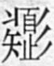은 고문이다.”라고 하였다.[역1]

**○赤欲如白裹朱，**

붉은빛은 흰 비단으로 주사(朱砂)를 싼 듯해야 하고,

〔識〕송본(宋本) 『맥경』에는 ‘白’이 ‘帛’으로 되어 있다. 심본(沈本) 『맥경』에는 ‘綿’으로 되어 있다. ［馬云］‘白’은 늘 ‘帛’으로 쓴다. 여러 판본에 ‘白’으로 된 것은 잘못이다.[역3]

〔箚〕『성혜방(聖惠方)』에는 ‘白’이 ‘帛’으로 되어 있다. 『설문』에 “‘帛’은 비단이다. ‘巾’을 따르고 ‘白’ 소리이다.”라고 하였다. 왕인지(王引之)는 말하였다. “‘帛’과 ‘白’은 옛 글자에서 모두 통한다. 「옥조(玉藻)」의 ‘大帛不緌’에 대해 정주(鄭注)는 ‘帛은 白이 되어야 한다.’라고 하였다. 민공(閔公) 2년 『좌전(左傳)』의 ‘大帛之冠’을 「잡기(雜記)」 주는 ‘大白’으로 인용하였다. 「소아(小雅)·유월(六月)」의 ‘白旆央央’을 손염(孫炎)의 『이아(爾雅)』 주는 ‘帛旆英英’으로 인용하였다. 자사(子思)의 아들 이름이 백(白)인데, 『한서(漢書)』 「공광전(孔光傳)」에는 ‘帛’으로 되어 있다. 이로써 ‘白’과 ‘帛’이 통함을 알 수 있다.”

〔張〕백과주(白裹朱)는 은은히 붉고 윤택하면서 드러나지 않는 것이다.

**○不欲如赭。**

자토(赭土)처럼 되어서는 안 된다.

〔張〕자(赭)는 대자(代赭)이니 색이 붉으면서 자줏빛을 띤다. 이것이 화색(火色)의 좋고 나쁨이다.

『설문』에 “‘赭’는 붉은 흙이다.”라고 하였다.

**○白欲如鵞羽，不欲如鹽。**

흰빛은 거위 깃털 같아야 하고, 소금 같아서는 안 된다.

〔張〕거위 깃털은 희면서 밝고, 소금빛은 희면서 어둡다. 이것이 금색(金色)의 좋고 나쁨이다.

**○青欲如蒼璧之澤，不欲如藍。**

푸른빛은 푸른 옥[蒼璧]의 윤택함 같아야 하고, 쪽[藍] 같아서는 안 된다.

〔張〕푸른 옥의 윤택함은 푸르면서 밝고 윤기 있으며, 쪽빛은 푸르면서 가라앉아 어둡다. 이것이 목색(木色)의 좋고 나쁨이다.

〔紹〕『주례(周禮)』 「대종백(大宗伯)」에 “창벽(蒼璧)으로 하늘에 예를 올린다.”라고 하였다.

안(案): 창벽은 창옥(蒼玉)이라는 말과 같다. 창옥은 녹색 옥을 말하니, 이른바 벽옥(碧玉)이다.

**○黃欲如羅裹雄黃，不欲如黃土。**

누런빛은 얇은 비단으로 웅황(雄黃)을 싼 듯해야 하고, 황토 같아서는 안 된다.

〔張〕비단으로 싼 웅황은 광택이 있으면서 은은하고, 황토의 색은 가라앉고 막혀 신(神)이 없다. 이것이 토색(土色)의 좋고 나쁨이다.

**○黑欲如重漆色，不欲如地蒼。**

검은빛은 거듭 칠한 옻칠의 색 같아야 하고, 검은 흙[地蒼] 같아서는 안 된다.

〔張〕거듭 칠한 옻의 빛은 광채가 나고 윤택하며, 땅의 검푸른 빛은 말라붙은 기름 같고 먼지 같다. 이것이 수색(水色)의 좋고 나쁨이다.[역4]

안(案): ‘地蒼’은 『맥경』·『갑을』에 모두 ‘炭’ 한 글자로 되어 있다. ‘地蒼’ 두 글자는 그다지 분명하지 않은데, 아마 흙빛이 검은 것을 말할 것이다. 그래서 생각해 보니 ‘蒼’은 ‘壤’의 가차(假借)인 듯하다. 지양(地壤)은 곧 토양(土壤)이니, 흙이 검고 빛이 없는 것을 말한다.

『맥경』 권5 제4에 말하였다. “푸른빛은 창벽의 윤택함 같아야 하고 쪽 같아서는 안 된다. 붉은빛은 비단으로 주사를 싼 듯해야 하고 자토 같아서는 안 된다. 흰빛은 거위 깃털 같아야 하고 소금 같아서는 안 된다. 검은빛은 거듭 칠한 옻 같아야 하고 숯 같아서는 안 된다. 누런빛은 얇은 비단으로 웅황을 싼 듯해야 하고 황토 같아서는 안 된다.”

『갑을』 권1 「오색(五色)」 제15에 말하였다. “정명과 오색은 기의 꽃이다. 붉은빛은 흰 비단으로 주사를 싼 듯해야 하고 자토의 색 같아서는 안 된다. 흰빛은 백벽(白璧)의 윤택함 같아야 하고｟어떤 곳에는 ‘鵞羽’라 한다｠ 백토[堊] 같아서는｟어떤 곳에는 ‘鹽’이라 한다｠ 안 된다. 푸른빛은 창벽의 윤택함 같아야 하고 쪽 같아서는 안 된다. 누런빛은 얇은 비단으로 웅황을 싼 듯해야 하고 황토 같아서는 안 된다. 검은빛은 거듭 칠한 옻의 색 같아야 하고 숯 같아서는｟『소문』에는 ‘地蒼’으로 되어 있다｠ 안 된다. 오색의 정미한 상이 나타나면 그 수명은 오래가지 못한다.”

**○五色精微象見矣，其壽不久也。**

오색의 정미(精微)한 상이 나타나면 그 수명은 오래가지 못한다.

〔張〕이는 모두 오색의 정미한 상이다. 흉한 조짐이 이미 나타났으니 수명이 멀지 않다.

안(案): ‘精’과 ‘微’는 모두 ‘작다’로 훈한다. 오색 가운데 저절로 좋고 나쁜 두 조짐이 있는데, 그 상이 더없이 정미하다는 것이다.

**○夫精明者，所以視萬物，別白黑，審短長。以長爲短，以白爲黑，如是則精衰矣。**

정명은 만물을 보고 희고 검음을 가리며 짧고 긺을 살피는 것이다. 긴 것을 짧다 하고 흰 것을 검다 하면, 이는 정(精)이 쇠한 것이다.

〔張〕오장육부의 정기는 모두 위로 눈에 흘러들어 눈의 정(精)이 된다. 그러므로 정이 모이면 신이 온전하다. 만일 뒤바뀌고 어지러우면 이는 정이 쇠하고 신이 흩어진 것이니, 어찌 오래 편안할 조짐이겠는가.

안(案): 정명과 오색의 이치는 위에서 설명한 바와 같다. 「오장생성(五藏生成)」 제10의 “오색의 미세한 진찰은 눈으로 살필 수 있다. 맥과 색을 합할 수 있으면 만전을 기할 수 있다.”가 이를 말한다. 제10편은 또 오색의 생사를 말하였는데, 이것과는 본래 다르다.

**○五藏者，中之守也。**

오장은 속을 지키는 것이다.

『갑을』 권6 「수요형진(壽夭形診)」 제11에는 ‘守’가 ‘府’로 되어 있다.

〔張〕오장에는 각각 갈무리하는 것이 있다. 갈무리하여 잃지 않으면 정신이 완전하고 견고하므로 속을 지키는 것이 된다.

**○中盛藏滿，氣勝傷恐者，聲如從室中言，是中氣之濕也。**

위 속이 성하고 폐장이 그득하며 기가 승하고[氣勝] 상하여 두려워하는[傷恐] 경우, 목소리가 방 안에서 말하는 듯한 것은 중기(中氣)와 습이 합한 것이다.

안(案): 중(中)은 위 속을 말하고, 장(藏)은 폐장을 말한다. 성(盛)과 만(滿)은 모두 수음(水飲)을 가리킨다. 기승(氣勝)은 단기(短氣)와 천식을 말한다. 상공(傷恐)은 자세하지 않다. 공(恐)은 놀라고 두려워하는 증, 경계(驚悸)의 증을 말한다. 대체로 수음이 압박하여 막으면 놀라고 두려워 불안하며, 꿈이 많고 가위눌리는 따위의 증이 흔히 생긴다. 상공은 아마 이런 증을 말할 것이다. 위 속의 물이 성하여 위로 거슬러 폐부(肺部)에 차면 천식과 놀람의 증이 생긴다. 그 목소리가 맑지 않아 밀실 안에서 말하는 듯한 것은 위 속에서 나오는 기의 소리가 수음의 습기와 합하여 음성을 맑지 않게 하기 때문이라는 말이다. ‘之’는 ‘與’와 같으니, 『경전석사(經傳釋詞)』에 보인다. 이상은 폐병을 말한 것이다.

『금궤』 첫 편에 “말소리가 음음(喑喑)하여 트이지 않는 것은 심격(心膈) 사이의 병이다.”라고 하였다.

〔識〕［吳云］‘傷’은 슬퍼하는 것이고 ‘恐’은 두려워하는 것이다. 상(傷)은 폐의 지(志)이고 공(恐)은 신의 지이다. 폐기가 순조롭지 않으면 슬퍼하고, 습토(濕土)가 신을 극하면 두려워한다. ［張云］상공은 신이 상한 것이다. ［志云］공은 신의 지이다. 신기가 갈무리되지 않고 도리어 속에서 승하면 그 신지(腎志)를 상하게 하여 움직인다. ［簡按］아랫글의 예로 미루어 보면 ‘者’ 자는 ‘言’ 아래에 있어야 한다.

（眉）안(案): ‘傷’은 장이 음(飲)에 상한 것이다.

**○言而微，終日乃復言者，此奪氣也。**｟肝｠

말소리가 미약하고 온종일 했던 말을 다시 되풀이하는 것, 이것은 탈기(奪氣)이다.｟간(肝)｠

〔志〕기가 이어지지 않는 것이다. 『상한론(傷寒論)』에 “실하면 섬어(譫語)하고 허하면 정성(鄭聲)한다. 정성은 말을 되풀이하는 것이다.”라고 하였다.

안(案): 이상은 간병을 말한 것이다. 간은 혼(魂)을 갈무리하므로 혼이 안정되지 않으면 내는 말이 반드시 미약하고, 또 생각을 잃는다. 그래서 하루 사이에 앞서 한 말을 다시 늘어놓으며 순순(淳淳)하게 어리석은 듯하니, 이것이 탈기의 징후이다. 기가 빠지면 혈도 없어지고, 혈이 없어지면 간기가 저절로 허해지니, 이것이 곧 간병이다.

안(案): ‘奪’은 ‘脫’과 같다.

**○衣被不斂，言語善惡，不避親疎者，此神明之亂也。**

옷과 이불을 여미지 못하고, 말이 좋고 나쁨을 가리지 않으며 친소를 피하지 않는 것, 이것은 신명(神明)의 어지러움이다.

안(案): ‘衣被不斂’ 운운 두 구절은 광증(狂證)의 모습을 그려 낸 것이 더없이 기이하니, 고문이 아니면 이렇게 할 수 없다. 신명의 어지러움은 병이 심장(心藏)에 매인 증이다. 이것이 심병이다.

**○倉廩不藏者，是門户不要也。**｟脾｠

창름(倉廩)이 갈무리하지 못하는 것은 문호(門户)가 단속되지[要] 않는 것이다.｟비(脾)｠

〔張〕‘要’는 약속(約束), 곧 묶어 단속한다는 뜻이다. 유문(幽門)｟위의 아래 어귀｠·난문(闌門)｟대장과 소장이 만나는 곳｠·백문(魄門)은 모두 창름의 문호이다. 문호가 단단하지 못하면 장위가 갈무리하지 못하므로 설사와 이질이 멎지 않으니, 비장이 지킴을 잃은 것이다.

안(案): 이상은 비병을 말한 것이니, 제8편의 “비위는 창름의 관(官)이니 오미(五味)가 여기서 나온다.”가 이것이다. ‘門户’는 ‘倉廩’과 맞세워 글을 이룬 것으로, 고문의 흔들 수 없는 짜임[約束]이 늘 이러하다. 병은 하리(下利)이다.

**○水泉不止者，是膀胱不藏也。**｟腎｠

수천(水泉)이 그치지 않는 것은 방광이 갈무리하지 못하는 것이다.｟신(腎)｠

안(案): 이는 신병을 말한 것이다. 수천이라 한 것도 글의 남은 기세로, ‘倉廩’·‘門户’와 같은 문법이다. 병은 소변불금(小便不禁)의 증이다.

**○得守者生，失守者死。**

지킴을 얻은 자는 살고, 지킴을 잃은 자는 죽는다.

장 안의 수(守)로, 안을 위주로 말한 것이다.

안(案): 앞글의 오장의 병은 반드시 죽는 것은 아니지만, 그 신기(神氣)의 지킴을 잃으면 반드시 죽는다.

**○夫五藏者，身之強也。**

오장은 몸을 강(強)하게 하는 것이다.

안(案): 아랫글에서 말한 머리·등·허리·무릎·뼈 다섯은 모두 부(府)인데, 여기서 오장이라 한 것은 통틀어 말하면 부도 장(藏)이라 일컫기 때문이다. 형체가 있어 볼 수 있는 것을 부라 하고, 기가 있어 운동하는 것을 장이라 한다. 「오장별론(五藏別論)」 제11의 “방사(方士) 가운데 어떤 이는 뇌수를 장으로 여긴다.”가 이를 말한다. 앞글의 오장과 여기의 오장은 이름은 같아도 가리키는 것이 다르다. 그러므로 저기서는 ‘身之中’이라 하고 여기서는 ‘身之強’이라 하였으니, 서로 견주어 고찰할 수 있다.

**[역1]** 원서의 이 글자는 『설문』 ‘色’의 고문 자형으로, 코드 없는 글자를 오려 넣은 그림으로 보인다.

**[역2]** 같은 편 경문에는 「而視精明」으로 되어 있어, 이를 인용한 원서 「而視請明」의 「請」은 「精」의 잘못으로 보인다.
**[역3]** 원서대로 옮겼다. 뒤의 「諸本作白，非」로 보면 「常」은 「當」의 잘못일 수 있다.
**[역4]** 원서대로 옮겼다. 『雪潭居醫約』에는 「枯暗如塵」으로 되어 있다.

**○頭者，精明之府，頭傾視深，精神將奪矣。**

머리는 정명(精明)의 부(府)이다. 머리가 기울고 눈이 깊어지면[視深] 정신(精神)이 빠지려는 것이다.

안(案): 머리 속에서 주가 되는 것은 오직 눈이므로 머리를 정명의 부라 하였으니, 머리는 눈을 거두는 부고(府庫)라는 말이다. 그러므로 정신이 빠지려 하면 눈이 밝게 보지 못하고 머리가 숙어져 바르지 못하다. 머리는 모든 양이 모이는 곳이고 오장의 정기가 모이는 곳이다.

『영추(靈樞)』 「구문편(口問篇)」에 “상기(上氣)가 부족하면 머리가 그 때문에 기울어 괴롭고, 눈이 그 때문에 어지럽다.”라고 하였다.

〔吳〕시심(視深)은 아래를 보는 것이다. 또 눈이 꺼지는 것이다.

〔張〕두경(頭傾)은 머리가 숙어져 들지 못하는 것이다. 시심은 눈이 꺼져 빛이 없는 것이다.

（眉）글의 예로 보면 이 ‘精明’은 아래 구의 ‘精神’과 같은 것이니, 꼭 눈만 가리키는 것은 아니다.

（眉）『옥함경(玉函經)』 「예편(例篇)」에 “머리는 몸의 으뜸이고 인신(人神)이 모이는 곳이다. 기혈과 정명, 365락이 모두 머리로 돌아간다. 머리는 모든 양이 모이는 곳이다.”라고 하였다.

**○背者，胸中之府。背曲肩隨，府將壞矣。**

등은 가슴속의 부이다. 등이 굽고 어깨가 처지면[肩隨] 부가 무너지려는 것이다.

〔馬〕가슴은 앞에 있고 등은 뒤에 있는데, 등에 오장이 매달려 있으니 실로 가슴속의 부이다.

〔張〕등은 장수(藏俞)가 매인 곳이므로 가슴속의 부가 된다.

안(案): 배곡(背曲)은 곱사등[龜背]을 말한다. 견수(肩隨)는 축 늘어진 것[嚲曳]을 말한다. ‘隨’는 ‘垂’와 같다. 누씨(樓氏)의 『강목(綱目)』에는 ‘隨’가 ‘垂’로 되어 있으니, 음이 같아 뜻이 통하는 것일 뿐이다. 등이 굽고 어깨가 처지는 것은 부가 무너지려는 증이다. 부는 곧 장(藏)이니, 오장의 기가 무너지려 하면 이런 모습이 된다. ‘壞’는 그 기가 정상의 길을 잃고 어그러진 것으로, 망탈(亡奪)과는 다르다.

（眉）부장괴(府將壞)는 가슴속의 장이 무너지려 한다는 말을 줄인 것이다. 이른바 가슴속의 장은 심·폐 두 장을 가리킨다.

**○腰者，腎之府。轉搖不能，腎將憊矣。**

허리는 신(腎)의 부이다. 돌리고 흔들지 못하면 신이 피폐해지려는 것이다.

〔吳〕‘憊’는 ‘敗’와 같으니, 무너진다는 뜻이다.

안(案): 신장은 허리 속에 있으므로 허리를 신의 부라 한다. 신기가 허해져 피폐해지려 하면 허리뼈를 돌리고 흔들지 못한다. 허리에 ‘轉’을 쓴 것은 글자를 놓은 솜씨가 절묘하다.

**○膝者，筋之府。屈伸不能，行則僂附，筋將憊矣。**

무릎은 근(筋)의 부이다. 굽히고 펴지 못하며 걸을 때 몸을 구부리면[僂附] 근이 피폐해지려는 것이다.

〔張〕근은 간이 주관하지만, 관절을 잡아매어 이 몸을 세우는 것으로는 무릎과 오금의 근이 으뜸이다. 그러므로 무릎이 근의 부가 된다.

안(案): 대체로 관절의 굴신은 근이 잡아매는데, 굴신하는 곳으로 무릎만 한 데가 없으므로 무릎을 근의 부라 한다. 근이 쇠하여 피폐해지려 하면 무릎부터 굴신하지 못하고 걸을 때 몸을 구부린다. 이는 앞글의 등이 굽는 것과 비슷하지만, 배곡은 늘 굽어 있는 것으로, 걸으려 할 때만 구부리는 이것과는 다르다.

〔識〕［簡按］마(馬)가 ‘附’를 ‘俯’로 읽은 것이 옳다. 『좌전(左傳)』 소공(昭公) 7년에 “정고보(正考父)가 첫 번째 임명에 등을 숙이고, 두 번째 임명에 허리를 굽히며, 세 번째 임명에 몸을 숙였다.”라고 하였고, 두주(杜注)에 “‘俯’는 ‘傴’보다 공손하고, ‘傴’는 ‘僂’보다 공손하다.”라고 하였다. 또 ‘府’와 같다. 『설문(説文)』에 “‘府’는 몸을 숙이는 병이다.”라고 하였고, 『광아(廣雅)』에 “‘府’는 짧다는 뜻이다.”라고 하였다.[역1]

안(案): ‘附’는 곧 ‘俯’의 가차(假借)이다. 오(吳)가 “‘僂’는 몸을 굽히는 것이다. ‘附’는 스스로 걷지 못하여 물건에 기대어 가는 것이다.”라고 한 것은 글자에 매달려 풀이한 것으로, 옳지 않다. ‘附’는 ‘伏’·‘俛’과 음도 같고 뜻도 같다.

**○骨者，髓之府，不能久立，行則振掉，骨將憊矣。**

뼈는 수(髓)의 부이다. 오래 서 있지 못하고 걸을 때 떨리면 뼈가 피폐해지려는 것이다.

（眉）『갑을(甲乙)』에는 ‘振掉’가 ‘掉慄’로 되어 있다.

안(案): 수는 뼈 속에 있으므로 수가 있는 곳을 뼈라 하였다. ‘骨將憊’는 앞뒤 글의 예에 따르면 ‘髓’로 써야 한다. 그러나 수가 피폐해지려 한다면 증상이 이보다 심해야 한다. 여기서는 수가 점점 부족해져 뼈도 쇠하고 피폐해지려 하므로 오래 서 있지 못하고 걸을 때 떨린다는 말이니, 수기(髓氣)가 차지 않은 근심이 뼈가 서지 못하는 데까지 미친 것이다. 대체로 사람은 기로 바르게 서는데, 지금 기가 부족하므로 오래 서지 못하고 부들부들 떨리는 것이다. 「생기통천론(生氣通天論)」에서 말한 ‘氣立’이 이를 말한다.｟제3｠ 만일 수가 피폐해지려 한다고 말했다면, 강함을 잃고 죽는 지경에 이른다는 이치가 된다. 여기서만 ‘骨’이라 하고 ‘髓’라 하지 않은 뜻은 아마 이와 같을 것이다.

**○得強則生，失強則死。**

강(強)함을 얻으면 살고, 강함을 잃으면 죽는다.

『갑을』 권6 제11의 인용은 여기까지이다.

장 밖 몸에 있는 일이므로 강함을 주로 삼았다. 강함은 양기가 가득 찬 징후이다.

안(案): 앞글의 장탈(將奪)·장괴(將壞)·장비(將憊)의 ‘將’ 자를 모두 눈여겨보아야 한다. 장탈은 아직 완전히 빠지지 않았다는 말이다. 이때 오장의 기가 아직 소모되어 흩어지지 않아 강하고 단단하게 지킴을 잃지 않는 기틀이 있으면 치료하여 살릴 수 있다. 오장의 기가 이미 소모되어 흩어져 강하고 단단한 기틀을 잃으면, 지금은 비록 빠지지 않았어도 점차 완전히 빠질 조짐이 보이므로 반드시 죽는다. 모두 이런 뜻이다.

**○岐伯曰：反四時者，有餘爲精，不足爲消。應太過不足爲精，應不足有餘爲消。陰陽不相應，病名曰關格。**

기백(岐伯)이 말했다. “사시(四時)에 반하는 경우, 유여하면 정(精)이 되고 부족하면 소(消)가 된다. 태과해야 하는데 부족하면 정이 되고, 부족해야 하는데 유여하면 소가 된다. 음양이 서로 응하지 않으면 병명을 관격(關格)이라 한다.”

〔識〕［簡按］이 한 대목 39자는 앞뒤 글과 이어지지 않으니, 다른 편의 착간(錯簡)인 듯하다. 또 ‘精’·‘消’ 두 글자는 뜻이 그다지 분명하지 않으니, 우선 장주(張注)를 따른다.[역2]

〔紹〕［琦曰］이것은 다른 경의 탈문(脫文)이니 억지로 풀이해서는 안 된다. ［堅案］이것은 원 『식(識)』의 뜻과 맞는다.

〔箚〕소도학고(小島學古)가 말하였다. “‘不足爲精’ 운운은 ‘精’·‘消’ 두 글자가 서로 뒤바뀐 것이다. 윗글에 이미 ‘有餘爲精，不足爲消’라 하였으니 증거가 된다.”｟이 설은 매우 잘못되었다｠

안(案): 이 조는 의문으로 남겨 두는 예에 넣어야 한다. 장주도 그다지 분명하지 않으므로 여기서는 인용하지 않는다.

（眉）안(案): 유여와 태과는 같은 것으로, 모두 맥이 실대한 것이다. 부족은 맥이 허소한 것이다. 정(精)은 병이 성하고 심한 것이다. 소(消)는 병이 가볍고 미약한 것이다.

‘陰陽’ 이하 10자는 따로 한 단락으로 끊는다.

**○帝曰：脈其四時動，奈何。知病之所在，奈何。知病之所變，奈何。知病乍在内，奈何。知病乍在外，奈何。請問此五者可得聞乎。**｟《甲乙》無『其』字｠

황제(黄帝)가 말했다. “맥이 사시에 따라 움직이는 것은 어떠한가? 병이 있는 곳을 아는 것은 어떠한가? 병이 변하는 바를 아는 것은 어떠한가? 병이 갑자기 안에 있음을 아는 것은 어떠한가? 병이 갑자기 밖에 있음을 아는 것은 어떠한가? 이 다섯 가지를 들을 수 있겠는가?”｟『갑을』에는 ‘其’ 자가 없다｠

（眉）『대소(大素)』 권14 「사시맥진(四時脈診)」.

〔楊〕‘六’은 여섯 물음을 말하는데 여기에는 다섯 물음만 있으니, 한 물음이 빠진 것이다.

**○岐伯曰：請言其與天運轉大也。**

기백이 말했다. “그것이 하늘과 함께 운행하고 도는 것이 크다는 점을 말하겠다.”

〔楊〕아래 답하는 글을 헤아려 보면 여섯이 있어야 하므로 육합(六合)이라 하였다. 사람의 몸이 하늘과 합하므로, 사람의 몸이 하늘과 기를 합하여 운행하고 도는 도리를 말하겠다는 것이다.

〔箚〕［寬案］『대소』가 옳은 듯하다. 왕주(王注)도 ‘大’ 자의 뜻에 미치지 않으니, 왕빙의 옛 판본에는 ‘大’ 자가 없었던 듯하다.

**○萬物之外，六合之内，天地之變，陰陽之應。**

만물의 밖, 육합의 안에 천지의 변화와 음양의 응함이 있다.

〔楊〕만물은 각각 한 형체를 받는다. 만물 한 형체의 바깥에서부터 육합이 감싼 안에 이르기까지 모두 천지를 부모로 삼아 변화하여 생겨나므로, 만물은 모두 천지의 기와 응하여 합한다.

（眉）만물은 몸[軀船]의 바깥이다. 동정(動靜)은 여러 사물의 내경(内景)의 바깥이다. 곧 빈 곳을 가리키며, 육합의 안은 지표를 가리킨다. 이상은 땅속 흙 안을 말한 것이 아니다.[역3]

**○彼春之暖，爲夏之暑，**

저 봄의 따뜻함이 여름의 더위가 되고,

『천금(千金)』 권29의 오장오정(五藏五情)에 따르면 봄에는 기쁨을 좋아하고 여름에는 근심한다.｟어떤 곳에는 ‘惠好也’로 되어 있다｠

「지진요대론(至真要大論)」｟七四｠이 『대요(大要)』를 인용한 글이 본문과 같다.

「지진요론(至真要論)」｟七十四｠에 말하였다. “한서온량(寒暑温涼)의 성쇠의 작용은 사유(四維)에 있다. 그러므로 양의 움직임은 온(温)에서 시작하여 서(暑)에서 성하고, 음의 움직임은 청(清)에서 시작하여 한(寒)에서 성한다. 봄·여름·가을·겨울은 각각 그 나뉨에 차이가 있다. 그러므로 『대요』에 ‘저 봄의 따뜻함이 여름의 더위가 되고, 저 가을의 분(忿)이 겨울의 노(怒)가 된다.’ 운운하였다.”

『노자(老子)』 제45장의 “조급하게 움직이면 추위를 이기고, 고요하면 더위를 이긴다.”도 호문(互文)이다.

〔楊〕봄·여름은 음기의 끝과 시작이다. 봄 3개월은 양기의 시작으로 기가 온화하고 날이 따뜻하다. 여름 3개월은 양이 성하여 덥고 뜨거우니, 봄의 따뜻함이 자라나 그렇게 된 것이다.[역4]

**○彼秋之忿｟急｠，爲冬之怒。**

저 가을의 분(忿)｟急｠이 겨울의 노(怒)가 된다.

「상한례(傷寒例)」에 따르면 가을은 서늘하고 겨울은 매섭다.

안(案): ‘暖’과 ‘忿’, ‘暑’와 ‘怒’는 압운하는데, 옛말에 본래 이러한 것이 있었던 듯하다.

〔楊〕가을·겨울은 음기의 끝과 시작이다. 가을 3개월은 음기의 시작이다. 바람이 높고 기가 절박하므로 ‘急’이라 이름하였다. 겨울 3개월은 음기가 엄하고 매서우니, 가을의 서늘함이 자라나 그렇게 된 것이다.

「상한례」가 『음양대론(陰陽大論)』을 인용한 윗글 네 구는 본문과 완전히 같다. 이에 따르면 ‘急’으로 쓴 것은 와자(訛字)인 듯하다. 봄·여름에는 천기(天氣)를 말하고 가을·겨울에는 인기(人氣)를 말하였으니, 이는 호문으로 뜻을 이룬 것이다.

『의심방(醫心方)』에서 ‘急’은 흔히 ‘忿’（초서체）으로 쓰이니, 마침내 ‘忿’으로 와전된 것이다.[역5]

（眉）약지안(約之案): 이 말은 호문으로 뜻을 드러낸다. 봄은 따뜻하고 기쁘며, 여름은 덥고 즐거우며, 가을은 서늘하고 분하며, 겨울은 춥고 노엽다. ‘忿’은 곧 슬프고 아프다는 뜻이다.

【楷】（眉）『오행대의(五行大義)』 권4 「논팔괘팔풍편(論八卦八風篇)」은 양천(陽泉)을 인용하여 “봄은 기쁜 바람이고, 여름은 즐거운 바람이며, 가을은 노여운 바람이고, 겨울은 슬픈 바람이다.”라고 하였다. 또 권4 「논정성편(論情性篇)」은 익봉(翼奉)을 인용하여 “기쁜 기운은 따뜻함이 되어 봄에 해당하고, 노여운 기운은 맑음이 되어 가을에 해당하며, 즐거운 기운은 양이 되어 여름에 해당하고, 슬픈 기운은 음이 되어 겨울에 해당한다. 이것은 『논형(論衡)』의 뜻과 합치한다.”라고 하였다.

**○四變之動，脈與之上下。**

사변(四變)의 움직임에 맥이 함께 오르내린다.

안(案): 마(馬)가 “상하(上下)는 부침(浮沈)이다.”라고 한 것은 따를 만하다. 양주(楊注)는 옳지 않다. 왕빙은 풀이가 없으니, 아마 마(馬)와 같았을 것이다.

〔楊〕난서(暖暑)가 급노(急怒)가 되는 것은 하늘이 네 기운을 운행하여 변동시키는 것이고, 사람의 경맥도 저 네 기운과 함께 오르내려 변동함이 다르지 않다. 봄·여름의 맥은 인영(人迎)이 촌구(寸口)보다 크므로 상(上)이 되고, 촌구는 인영보다 작으므로 하(下)가 된다. 가을·겨울의 맥은 촌구가 인영보다 크므로 상이 되고, 인영은 촌구보다 작으므로 하가 된다. 이는 성쇠로 상하를 삼은 것이다. 이것은 첫 물음에 답한 것이다.

（眉）사변이 각각 30일씩 어긋난다는 뜻은 「지진요론」에 자세히 보이니, 경과 주를 모두 참고할 만하다.

**○以春應中規，夏應中矩，**

봄은 규(規)에 들어맞게 응하고, 여름은 구(矩)에 들어맞게 응하며,

〔楊〕봄 3개월에는 소양의 기가 작용하여 만물이 비로소 생겨나 아직 바르지 않으므로 규에 응한다고 하였다. 여름 3개월에는 태양의 기가 작용하여 만물이 자라 바르게 되므로 구에 응한다고 하였다.

**○秋應中衡，冬應中權。**

가을은 형(衡)에 들어맞게 응하고, 겨울은 권(權)에 들어맞게 응한다.

〔楊〕가을 3개월에는 소음의 기가 작용하여 만물의 자람이 극에 이르므로 형에 응한다고 하였다. 겨울 3개월에는 대음(大陰)의 기가 작용하여 만물이 뿌리로 돌아가므로 권에 응한다고 하였다.

**○是故冬至四十五日，陽氣微上，陰氣微下，**

그러므로 동지(冬至) 뒤 45일이면 양기가 조금씩 오르고 음기가 조금씩 내리며,

〔楊〕동지 이후에는 양기가 점점 자라므로 미상(微上)이라 하고, 음기가 점점 내려가므로 미하(微下)라 한다.

안(案): 동지 뒤 45일은 입춘(立春) 정월의 절기이다.

**○夏至四十五日，陽氣微下，陰氣微上。**

하지(夏至) 뒤 45일이면 양기가 조금씩 내리고 음기가 조금씩 오른다.

〔楊〕하지 이후에는 음기가 점점 자라므로 미상이라 하고, 양기가 점점 내려가므로 미하라 한다.

안(案): 하지 뒤 45일은 입추(立秋) 7월의 절기이다.

**○陰陽有時，與脈爲期，期而相失，知脈所分。分之有期，故知死時。**

음양에는 때가 있어 맥과 기약을 이룬다. 기약에 서로 어긋나면 맥이 나뉘는 바를 안다. 나뉨에 기약이 있으므로 죽을 때를 안다.

〔楊〕음양에 사시가 있어 사시가 맥과 기약을 이룬다. 기약을 이루는 것은 사시에 있으니, 서로 맞고 어긋나는 곳에서 곧 사시의 맥이 사시의 사이에 나뉨을 안다. 맥이 사시로 나뉘는 데 기약이 있으면 생사의 기약을 알 수 있다. 이것은 둘째 물음의 병이 있는 곳에 답한 것이다.

**○微妙在脈，不可不察。察之有紀，從陰陽始。**

미묘함은 맥에 있으니 반드시 살펴야 한다. 살피는 데에 벼리가 있으니 음양에서 시작한다.

〔楊〕사람의 생사를 알고자 하는 데에는 살핌의 묘함보다 나은 것이 없다. 맥을 살피는 벼리는 반드시 음양을 근본으로 삼는다.

**○始之有經，從五行生。**

시작에는 경(經)이 있으니 오행에서 생겨난다.

〔楊〕음양의 본래 시작에 십이경맥이 있고, 십이월의 경맥은 오행에서 생겨난다.

**○生之有度，四時爲宜。**

생겨남에는 법도가 있으니 사시에 맞춘다.

〔楊〕오행이 십이경맥을 낳는 데에는 각각 법도가 있다. 맥은 오행에서 생겨나니, 목은 두 경을 낳는데 족궐음·족소양이다. 화는 네 경을 낳는데 수소음·수대양(手大陽)·수궐음·수소양이다. 토는 두 경을 낳는데 족대음(足大陰)·족양명이다. 금은 두 경을 낳는데 수대음(手大陰)·수양명이다. 수는 두 경을 낳는데 족소음·족대양(足大陽)이다. 이것이 오행이 낳는 십이경이다. 맥의 법도는 봄에 두 경, 여름에 네 경, 늦여름에 두 경, 가을에 두 경, 겨울에 두 경이 있으니, 그러므로 십이경맥은 사시로 수를 삼는다.

**○補寫勿失，與天地如一。得一之情，以知死生。**

보사(補寫)를 잃지 않으면 천지와 하나가 된다. 하나의 실정을 얻어 생사를 안다.

〔楊〕촌·관·척 세 부위 가운데서 십이경맥을 따라 현(弦)·구(鉤)·부(浮)를 얻고, 사시의 기를 경영하여 잃거나 어긋나지 않으면, 천지의 기와 자연히 하나가 된다. 이와 같으면 생사의 기약을 환히 알 수 있다.

안(案): ‘萬物之外’부터 여기까지는 첫째 물음 ‘脈其四時動’에 답한 것이다.

**○是故聲合五音，色合五行，脈合陰陽。**

그러므로 소리는 오음(五音)에 합하고, 색은 오행에 합하며, 맥은 음양에 합한다.

안(案): 이 세 구는 둘째 물음 ‘知病之所在’에 답한 것이다. 소리·색·맥 셋이 서로 합하여 고른 것을 평인(平人)이라 한다. 이 이치를 끝까지 궁구할 수 있으면 병이 있는 곳을 아는 것이 손바닥을 가리키는 것과 같다.

〔楊〕사람의 음성은 오음에 합하고, 사람의 형색은 오행에 합하며, 사람의 맥기는 음양에 합한다. 이것은 셋째의 병이 변하는 바에 답한 것이다.

**○是知陰盛，則夢涉大水恐懼。陽盛，則夢大火燔灼。陰陽俱盛，則夢相殺毀傷。上盛則夢飛，下盛則夢墮。甚飽則夢予，甚飢則夢取。肝氣盛，則夢怒。肺氣盛，則夢哭。**

이로써 음이 성하면 큰 물을 건너며 두려워하는 꿈을 꾸고, 양이 성하면 큰 불에 타는 꿈을 꾸며, 음양이 함께 성하면 서로 죽이고 해치는 꿈을 꾼다는 것을 안다. 위가 성하면 나는 꿈을 꾸고, 아래가 성하면 떨어지는 꿈을 꾼다. 몹시 배부르면 주는 꿈을 꾸고, 몹시 배고프면 빼앗는 꿈을 꾼다. 간기(肝氣)가 성하면 성내는 꿈을 꾸고, 폐기(肺氣)가 성하면 우는 꿈을 꾼다.

안(案): 이상은 『영추』 권13 「음사발몽(淫邪發夢)」 제43에서 말한 기백의 말인데, 이 아래에 심기·비기·신기가 성하다는 운운의 글이 있다. 여기서 간·폐 두 기만 든 것은 음양 두 기의 성쇠만을 위주로 논하였기 때문에 오장을 다 싣지 않은 것이지, 빠진 글이 있는 것이 아니다.

（眉）공구(恐懼)는 물가를 건널 때의 두려움이다.

**○短蟲多則夢聚衆，長蟲多則夢相擊毀傷。**

단충(短蟲)이 많으면 무리가 모이는 꿈을 꾸고, 장충(長蟲)이 많으면 서로 치고 해치는 꿈을 꾼다.

〔楊〕꿈에는 대체로 세 종류가 있다. 사람에게 길흉이 있으면 먼저 꿈에 나타나니, 이것이 징몽(徵夢)이다. 생각의 정이 깊어 그로 인해 꿈이 나타나니, 이것이 상몽(想夢)이다. 앓는 병으로 인해 꿈에 나타나니, 이것이 병몽(病夢)이다. 이 11가지 꿈은 모두 병몽이다. 모두 음양의 기의 성쇠, 안의 기포(飢飽), 간폐｟（‘氣’ 자가 빠진 듯하다）｠의 성함, 장충·단충이 많은 데 따라 꿈이 된다. 이는 상함으로 인해 꿈을 꾸게 되므로 곧 꿈으로 진찰하는 것이다. 이것이 몽진(夢診)이니, 넷째 답으로서 그 물음이 빠진 것이라 할 수 있다.

〔新〕이 두 구를 살펴보니 역시 여기에 나올 것이 아니며, 다른 경의 탈간(脱簡)된 글인 듯하다.

안(案): 이 두 구는 『영추』에 실려 있지 않은데, 여기에 있는 것은 여기서 오로지 음양을 위주로 말하였기 때문이다. 단충은 곧 요충[蟯蟲]이니, ‘蟯’에도 짧고 작다는 뜻이 있다. 『병원(病源)』에 “형체가 매우 작아 지금의 와충(蝸蟲)과 같다.”, 또 “지극히 가늘어 형체가 채소벌레 같다.”라고 한 것이 이것이다. 장충은 『병원』에 “장충은 회충[蚘蟲]이다. 길이가 1척이고, 움직이면 맑은 물을 토하고, 나오면 심통이 나며, 심장을 꿰뚫으면 죽는다.”라고 한 것이 이것이다. 앞글에 따르면 두 벌레는 모두 음양이 함께 성한 징후일 것이다.

안(案): 오장 허실의 꿈은 이 책 권24 「방성쇠론(方盛衰論)」 제80에 보이니 아울러 고찰할 만하다. 이상은 셋째 물음 ‘知病之所變’에 답한 것이다.

**○是故持脈有道，虚靜爲保。**

그러므로 맥을 잡는 데에는 도(道)가 있으니 허정(虚靜)을 보배[保]로 삼는다.

‘道’와 ‘保’가 운이다.

〔楊〕맥을 잡는 도리는 마음을 비워 다른 일을 생각하지 않고 신을 모아 고요히 하여 스스로를 지키는 것이다. 그래야 맥의 부침과 기의 내외를 알 수 있다.

『광운(廣韻)』 상성 32호(晧)에 ‘寶’와 ‘保’는 모두 같은 음 박포절(博抱切)이다. ‘寶’를 ‘保’로 쓴 것은 경전에 그 증거가 매우 많다. 『예기(禮記)』 「단궁 하(檀弓下)」의 “어버이를 사랑함을 보배로 삼는다.”의 주에 “‘寶’는 선도(善道)로 지킬 만한 것을 말한다.”라고 하였다. 『논어(論語)』 「양화(陽貨)」 황소(皇疏)에 “‘寶’는 ‘道’와 같다.”라고 하였다. 『광아』 「석고 3(釋詁三)」에 “‘寶’는 ‘道’이다.”라고 하였다.

**○春日浮，如魚之遊｟游｠在波｟皮｠。**

봄에는 맥이 떠서, 물고기가 노닐듯｟游｠ 피부에 있다｟皮｠.

안(案): ‘浮’·‘游’·‘皮’가 운이다.

안(案): 『대소』를 따라 ‘在皮’로 쓰는 것이 옳다. 봄의 맥이 떠서 활시위처럼 위로 나오고, 물고기가 노니는 듯하다고 한 것은, 물고기 입이 조금 물 위로 나와 가는 것을 말한다. ‘在皮’ 두 글자는 뒷글의 예에 따르면 ‘春日’ 아래에 있어야 한다. 그러나 여기서는 ‘浮’·‘游’·‘皮’로 운을 삼았으니 고칠 수 없다. 이것이 곧 도초법(倒草法)이다.

**○夏日在膚，泛泛｟沉沉｠乎萬物有餘。**

여름에는 맥이 살갗에 있어, 넘실넘실｟沉沉｠ 만물이 유여하다.

‘膚’·‘乎’·‘餘’는 운어이다.

〔楊〕봄에는 양기가 비로소 열려 맥이 골수에서 경맥 속으로 흘러들고 위로 피부에 이르니, 물고기가 물에서 노닐듯 아직 두루 흩어지지 못한다. 여름에는 양기가 왕성하여 맥이 경맥에서 손락(孫絡)과 살갗 속으로 넘쳐드니, 물이 흘러넘치듯 왕성하게 자라며 만물도 그러하여 무성하고 유여하다. 이것은 다섯째의 병이 밖에 있음에 답한 것이다.[역6]

안(案): ‘泛’은 『대소』에 ‘沉’으로 되어 있는데, ‘沉’은 곧 ‘汎’ 자이다. ‘凡’은 속자로 ‘兀’로 쓰기도 하는데, 이 꼴이 다시 잘못되어 ‘冗’이 된 것이다.

**○秋日下膚，蟄蟲將去。冬日在骨，蟄蟲周密，君子居室。**

가을에는 맥이 살갗 아래로 내려가니 칩충(蟄蟲)이 떠나려 한다. 겨울에는 맥이 뼈에 있으니 칩충이 꼭꼭 숨고 군자는 방에 거처한다.

‘膚’·‘去’는 운어이다. ‘骨’·‘密’·‘室’은 운어이다.

〔楊〕가을에는 양기가 살갗에서 점차 안으로 잠복하므로 ‘下虚膚’｟‘虚’ 자는 연문(衍文)인 듯하다｠라 하고, 칩충이 따뜻한 곳을 찾아 구멍으로 들어가므로 ‘將去’라 한다. 이때 음기가 안에서 나와 피부에 있으니 주리(腠理)가 열리려 한다. 겨울에는 양기가 안으로 잠복하니 칩충이 문을 닫아 꼭꼭 숨고 군자는 대청을 떠나 방에 거처한다. 사람의 맥기가 뼈를 따라 흐르므로 맥을 잡는 사람은 깊이 눌러야 얻는다. 이것은 여섯째의 병이 갑자기 안에 있음에 답한 것이다.

안(案): 「상한례」에 “겨울철 혹한에는 만물이 깊이 숨는다. 군자가 단단히 갈무리하면 추위에 상하지 않는다.”｟『외대(外臺)』에는 ‘固’가 ‘周’로 되어 있다｠라고 하였다. 여기의 ‘周密’ 두 글자는 칩충에 매여 있어 문세가 같지 않다. ‘周密’ 두 글자는 허자(虚字)로서 활용이 더없이 넓어, 사람에게도 사물에도 쓸 수 있다.

**○故曰：知内者按而｟如｠紀之，知外者終而｟如｠始之。**

그러므로 말한다. 안을 아는 것은 눌러서｟如｠ 벼리를 잡는 것이고, 밖을 아는 것은 마치고서｟如｠ 다시 시작하는 것이다.

〔楊〕가을·겨울의 맥기는 음이 되어 안에 있으므로 눌러서 벼리를 얻는다. 봄·여름의 맥기는 양이 되어 밖에 있으므로 끝으로 달려가 시작을 얻는다. 봄·여름의 맥은 가을·겨울 맥의 끝이니, 곧 양의 시작이 된다.

**○此六者，持脈之大法。**

이 여섯 가지가 맥을 잡는 대법(大法)이다.

‘帝曰脈其四時動’부터 여기까지는 『대소』 권14 「사시맥진」에 실려 있다. 이상은 넷째·다섯째 두 물음 ‘病乍在内，病乍在外’에 답한 것이다.

〔楊〕맥을 진찰하는 대법으로 삼는다.

〔馬〕이 봄·여름·가을·겨울과 안팎 여섯 가지가 맥을 잡는 대법이다. 장(張)도 같다.

안(案): 마(馬)·장(張) 두 주의 설을 따를 만하다. 고세식(高世栻)이 ‘内外按紀終始’라 한 것은 옳지 않은 듯하다.

〔箚〕사재지(史載之)의 『맥요정미해(脈要精微解)』에 말하였다. “경의 뜻으로 고찰하면, 사시의 맥으로 표리의 깊고 얕음을 나누고 안팎의 구별로 판단한다. 봄에 맥이 떠서 물고기가 노닐듯 물결에 있다는 것은 양기가 싹터 맥이 나타나도 아직 살갗으로 나오지 못한 것이다. 여름에 살갗에 있어 넘실넘실 만물이 유여하다는 것은 맥이 이미 살갗에 있는 것이다. 가을에 살갗 아래로 내려가 칩충이 떠나려 한다는 것은 가을의 음기가 이르러 맥이 살갗 아래로 내려갔으나 아직 침(沈)에 이르지 않은 것이다. 겨울에 뼈에 있어 칩충이 꼭꼭 숨는다는 것은 맥이 이미 침한 것이다. 이로써 안을 아는 것은 눌러서 벼리를 잡아 맥이 이(裏)에 있음을 밝히는 것으로, 가을의 살갗 아래와 겨울의 뼈에 있음이 그것이다. 밖을 아는 것은 마치고서 다시 시작하여 맥이 표(表)에 있음을 밝히는 것으로, 봄의 뜸과 여름의 넘실거림이 그것이다. 그런데 안을 아는 것을 굳이 눌러서 벼리를 잡는다고 한 것은, 맥이 안에 있으면 깊이 누르지 않고는 그 실정을 얻을 길이 없기 때문이다. 밖을 아는 것을 굳이 마치고서 다시 시작한다고 한 것은, 처음 누르면 병이 이미 드러나므로 그 병으로 인해 근본을 미루어 찾는다는 것이다. 계현자(啓玄子)는 안을 아는 것을 맥을 아는 것으로, 밖을 아는 것을 색을 아는 것으로 보았으니, 황제가 말한 맥을 잡는 대법이 전혀 아니다.”

**[역1]** 원서의 이 세 글자는 疒 안에 付를 쓴 꼴(疒+付)인데 입력할 글자가 없어 「府」로 적었다.
**[역2]** 원문 「此一頃三十九字」의 「頃」은 「項」의 잘못일 수 있어, 「한 대목」으로 뜻을 옮겼다.
**[역3]** 원서대로 옮겼다. 「軀船」은 「軀殼」의 잘못일 수 있다.
**[역4]** 원서대로 옮겼다. 뒤에 「陽氣之始」라 하였으므로 「陰氣終始」의 「陰」은 「陽」의 잘못일 수 있다.
**[역5]** 원서대로 옮겼다. 앞 문장은 「急」으로 쓴 쪽을 잘못으로 보았는데 여기서는 「急」이 「忿」으로 와전되었다고 하여 방향이 어긋나므로, 「急」과 「忿」이 뒤바뀌었을 수 있다.
**[역6]** 『太素』 卷十四의 같은 주에는 「孫絡」으로 되어 있어, 원서 「孫胳」의 「胳」은 「絡」의 잘못으로 보인다.

**○心脈搏堅而長，當病舌卷不能言。**

심맥(心脈)이 박견(搏堅)하면서 길면 혀가 말려 말을 하지 못하는 병을 앓는다.

（眉）『대소(大素)』 권15 「오장맥진(五藏脈診)」.

『갑을(甲乙)』 권4에는 ‘搏’이 ‘揣’로 되어 있고 아래도 같으며, ‘當’ 자가 없다.

〔楊〕‘揣’는 움직인다는 뜻이다. 장(長)은 촌구맥이 1촌 길이임을 말한다. 이는 심맥이 성하게 움직이고 단단한 것이다. 심맥은 위로 혀 아래에 이르므로, 성하게 움직이고 단단하면 혀가 말려 말을 하지 못한다.

〔紹〕［堅按］『광아(廣雅)』의 “‘揣’는 움직인다는 뜻이다.”는 「석고(釋詁)」 1에 나오는데, 조헌(曹憲)의 음은 ‘喘’이다. 『광아』 「석훈(釋訓)」에 “‘揣抗’은 흔들린다는 뜻이다.”라고 하였으니, 이는 천동(喘動)의 뜻이다. 『광운(廣韻)』에 “‘揣’는 또 음이 정과절(丁果切)이고, 흔든다는 뜻이다.”라고 하였다. 왕염손(王念孫)은 말하였다. “혹 ‘朵’로 통용한다. 이괘(頤卦) 초구 ‘觀我朵頤’의 정주(鄭注)에 ‘朵는 움직임이다.’라고 하였는데, 경방(京房)은 ‘揣’로 썼다.”

〔張〕이 편의 오편(五篇) 맥병은 하나는 박견하면서 길다 하고 하나는 연(耎)하면서 산(散)하다 하는데, 그 병은 대부분 모두 부족이니 어째서인가? 박견하면서 긴 것은 사기가 정기를 이긴 것이니, 이른바 사기가 모이는 곳은 그 기가 반드시 허하다는 것이다. 연하면서 산한 것은 본원이 부족한 것이니, 이른바 정기가 빠지면 허하다는 것이다. 하나는 사기가 있어 허해진 것이고, 하나는 사기 없이 본래 허한 것이다. 허함은 하나인 듯해도 병의 근본이 같지 않으니, 가려내야 한다.[역2]

안(案): 설권(舌卷)은 혀가 굽어 펴지지 않는 것을 말한다. 『회남(淮南)』 「본경훈(本經訓)」 ‘嬴縮卷舒’의 주에 “‘卷’은 굽힌다는 뜻이다.”라고 하였고, 또 「원도훈(原道訓)」 ‘與剛柔卷舒兮’의 주에 “‘卷舒’는 굴신과 같다.”라고 하였으니, 모두 말려 굽어 펴지지 않는다는 뜻이다. 중풍에 왕왕 이 증이 있다. ‘搏’과 ‘揣’는 뜻이 비슷하니, 전해진 바가 본래 다른 것일 뿐이다. 장(張)이 사실정허(邪實正虚)의 맥으로 본 것은 따를 만하다.

（眉）「대기론(大奇論)」 음석에 “‘揣’는 초위절(初委切)이다.”라고 하였다.

（眉）『영추(靈樞)』 「열병편(熱病篇)」의 “맥구(脈口)가 천(喘)하듯 움직이면서 짧은 경우”에 대해 사숭(史崧) 주에 “어떤 판본에는 ‘短’이 ‘弦’으로 되어 있다.”라고 하였다. 『대소』 권25 「열병설편(熱病説篇)」에 이 글이 실려 있고, 양주(楊注)에

“맥이 천동(喘動)한다.”라고 하였다.

（眉）혜림(慧琳)의 『경음(經音)』 권15｟七ヲ｠에 “‘團’은 단만반(段巒反)이다. 『모시전(毛詩傳)』에 ‘團은 모임이다.’라고 하였다. 경문에는 ‘揣’로 되어 있으나 옳지 않다. 음은 초류반(初纍反)이니 경의 뜻에 매우 어긋난다.”라고 하였다. 또 권72에 “‘摶’은 도관반(徒官反)이다. 논문에는 ‘揣’로 되어 있는데 음은 초위반(初委反)이다. 앞사람을 헤아리는 것을 ‘揣’라 하니 강남에서는 이 음을 쓰고, 또 도과반(都果反)이니 관중에서 이 음을 쓰는데, 모두 이 뜻이 아니다.”라고 하였다. 또 권16｟十七ウ｠에 “‘鹿𨄔’의 아래 글자는 선연반(舡耎反)이다. 『설문(説文)』에 ‘𨄔𨄔은 장딴지이다.’라고 하였고, 혹 ‘腨’으로 쓴다.”라고 하였다. 이에 따르면 ‘專’을 따르는 글자는 속자로 ‘耑’을 따르기도 한다. 그렇다면 경문의 ‘搏堅’은 아마 본래 ‘摶堅’이었을 것이다. 의문으로 남겨 둔다.[역3]

（眉）또 권20｟六ウ｠에 말하였다. “『설문』에 ‘‘腨’은 장딴지이다. ‘肉’을 따르고 ‘耑’ 소리이다.’라고 하였다. 경의 판본에 ‘專’을 따라 ‘膞’으로 쓴 것은 옳지 않다. 혹 ‘〓𨄔’으로 쓰는데, 통한다.”[역1]

**○其耎而散者，當消環自已。**

맥이 연(耎)하면서 산(散)한 경우는 소갈(消渴)을 앓다가 저절로 낫는다.

『갑을』·『맥경(脈經)』에는 모두 ‘環’이 ‘渴’로 되어 있고, 『갑을』에는 ‘當’이 ‘病’으로 되어 있다.

〔楊〕움직이면서 단단하면 설권을 앓고, 연하면서 산하면 소갈을 앓는다. 위기(胃氣)가 있으므로 저절로 낫는다. 아래로부터 소음이 신을 꿰고 폐에 이어져[胳] 설본(舌本)에 매이기 때문이다.[역4]

〔琦〕심의 진액이 소모되어 상하므로 소갈이 나타난다. 심기가 이어져 회복되어 진액이 생기기를 기다리면 저절로 낫는다.｟지총(志聰)도 같은 설이다｠

서씨(徐氏)의 『요지(要旨)』에 “박견은 모두 태과이고, 연하면서 산한 것은 모두 불급이니, 오장은 각각 태과와 불급으로 인해 병든다.”라고 하였다.

안(案): 『대소』에는 ‘消渴’로 되어 있고 『갑을』·『맥경』도 같으니, 따라서 고쳐야 한다. 그래야 나머지 오장에서 모두 ‘病’이라 한 것과 맞는다. ‘耎’은 곧 ‘濡’·‘軟’ 등의 고자(古字)이다. 진본(真本) 『옥편(玉篇)』 ‘輭’ 자 아래에 말하였다. 유구반(柔究反). 『설문』에 “‘輭’은 ‘轢’이다.”라고 하였다. 야왕(野王)의 안에 “지금은 ‘柔𡰥’의 ‘𡰥’로도 쓴다. 『한서(漢書)』의 ‘軟弱不勝任’이 이 글자이다. ‘𡰥’은 尸부에 있고, 혹 ‘耎’ 자로 大부에 있고, 혹 ‘耎’ 자로 耎부에 있고, 혹 ‘偄’ 자로 人부에 있다.”라고 하였다.[역5]

**○肺脈搏堅而長，當病唾血。**

폐맥(肺脈)이 박견하면서 길면 타혈(唾血)을 앓는다.

『갑을』에는 ‘當’ 자가 없다.

〔楊〕폐맥은 부(浮)하고 짧은데 지금 움직이고 단단하며 기니, 혈락(血胳)이 성하여 상한 것을 알 수 있으므로 타혈한다.

〔張〕폐맥이 박견하면서 긴 것은 사기가 폐를 탄 것이다. 폐계(肺系)는 목구멍에 이어지므로 타혈이 된다.

**○其耎而散者，當病灌汗，至今不復散發也。**

맥이 연하면서 산한 경우는 관한(灌汗)을 앓아 지금까지 회복되지 못한다[至今不復散發].

『갑을』에는 ‘當’ 자와 ‘也’ 자가 없고, ‘今’이 ‘令’으로 되어 있다.

〔楊〕폐기가 허하므로 맥이 연하고 산하다. 허하므로 주리(腠理)가 서로 통하여 땀이 물 붓듯 나며, 지금까지 회복되지 못한다.

〔張〕연하면서 산하면 폐가 허하여 거두지 못해 땀이 물처럼 나므로 관한이라 한다. 관한은 흔히 망양(亡陽)하므로 다시 발산해서는 안 된다.

『맥경』 권6 제7에 말하였다. “폐맥이 박견하면서 길면 토혈(吐血)을 앓는다. 맥이 유(濡)하면서 산한 경우는 누한(漏汗)｟‘漏’는 어떤 곳에는 ‘灌’으로 되어 있다｠을 앓는다. 지금까지 회복되지 못한다[至今不復｟（‘散’ 자가 빠진 듯하다）｠發]｟6자는 연문(衍文)인 듯하다｠.”

안(案): ‘灌汗’은 『맥경』에 ‘漏汗’으로 되어 있으니 따라야 한다. 양주(楊注)의 “땀이 물 붓듯 난다.”가 옳다. 왕주(王注)가 물 붓고 씻는다는 뜻으로 본 것은 옳지 않은 듯하다.

우안(又案): ‘至今不復’은 뒷글 ‘腎脈’ 아래에도 이 4자가 있다. 큰 땀이 물 붓듯 나서 지금까지도 평복하지 못했다는 말이다. 그래서 생각해 보니 ‘散發’ 두 글자는 풀 수 없다. 아마 ‘散’｟윗글｠ 자의 방주(傍注)가 정문에 잘못 섞인 것으로, 곧 ‘散은 發이다’라는 뜻일 것이다. 『맥경』에 ‘發’ 자가 있고 ‘散’ 자가 없는 것은 빠졌기 때문인 듯하다. 양주가 ‘散發’의 뜻을 설명하지 않은 것에 따르면, 양상선(楊上善)이 근거한 본문에는 아마 ‘散發’ 두 글자가 없었을 것이다.

**○肝脈搏堅而長，色不青，當病墜若搏，因血在脅下，令人喘逆。**

간맥(肝脈)이 박견하면서 길고 안색이 푸르지 않으면 떨어지거나 부딪쳐 다친 병을 앓는다. 그로 인해 혈이 협하(脅下)에 있어 천역(喘逆)하게 한다.

『갑을』에는 ‘當’ 자가 없다.

〔楊〕간맥은 연하면서 현(弦)한데, 지금 움직이고 단단하며 길고 그 색도 맞지 않는 것은 그 사람이 떨어진 일이 있는 것이다. 떨어져 다쳐 혈이 협하에 있으면 또 천식을 잘 하게 한다.

안(案): 추(墜)는 높은 곳에서 떨어지는 것이다. 박(搏)은 물건에 부딪혀 몸을 다치는 것이다. 모두 경맥을 손상하므로 간맥을 단단하고 길게 한다. 혈기가 동요하므로 안색이 푸르지 않고 핏빛을 띠게 한다. 패혈(敗血)이 협하에 있으면 천식을 잘 하게 하니, 이는 수음(水飲)이 가슴 아래에 있는 것과 같은 이치이다.

안(案): 이 아래 이 절에서 말한 색은 모두 면색이지, 그 병처의 색이 아니다.

（眉）안(案): 어떤 이는 ‘不青’은 푸르다는 뜻이라 한다. ‘不’은 어조사로, 『이아(爾雅)』 ‘不漘’의 ‘不’과 같다.

**○其耎而散，色澤者，當病溢飲。溢飲者，渴暴多飲，而易入肌皮腸胃之外也。**

맥이 연하면서 산하고 안색이 윤택한 경우는 일음(溢飲)을 앓는다. 일음은 갈증이 나서 갑자기 많이 마셔, 또한[易] 기육·피부와 장위의 바깥으로 들어간 것이다.

『갑을』에는 ‘當’ 자가 없고, ‘暴’가 ‘渴’로 되어 있다.

〔楊〕‘易’은 음이 ‘亦’이다. 맥이 연하고 산하며 안색도 광택이 나는 경우는 큰 갈증으로 갑자기 마셔 물이 장위 밖으로 넘치고 또한 기육·피부 속으로 들어가니, 이름을 일음의 병이라 한다.

〔識〕［滑云］‘易’은 ‘溢’로 써야 한다. ［簡按］이치로 미루어 보면 ‘肌皮之中，腸胃之外’라 해야 하는데, 기육·피부가 곧 장위의 바깥이므로 이렇게 말한 것이다. 『맥경』에도 ‘易’이 ‘溢’로 되어 있다.

〔紹〕［堅案］『광운』에 ‘易’은 변역(變易)이고, 또 “시작함·고침·빼앗음·옮김이다. 이석절(伊昔切)이다.”라고 하였다. 양씨(楊氏)는 아마 옮긴다는 뜻으로 읽은 것이다. 선형(先兄)의 설도 맞으니 이렇게 말하였다. “‘易’은 옮겨 바꾼다는 말이다. 많이 마셔 오줌보로 스며들지 않고 肌胃｟（‘皮’로 써야 한다）｠ 장위의 바깥으로 옮겨 들어간 것을 말한다. 『갑을경(甲乙經)』에 ‘易’이 ‘溢’로 되어 있는 것이 증거가 된다.” 또 양씨가 ‘肌皮之中’이라 한 것은 원 『식(識)』의 뜻과 맞는다.

안(案): ‘易’은 곧 ‘亦’의 가차(假借)이니, 설명은 앞의 제15편에 보인다. 양주에 ‘音亦’이라 한 것은 ‘亦’의 뜻으로 본 듯하다. 여기서 ‘溢飲’이라 하고 앞에서 ‘血在脅下’라 한 것으로 보아, 음(飲)과 혈은 모두 같은 물임을 알 수 있다. 간은 혈맥을 주관하므로, 간기가 부족하면 혈맥이 순조롭지 않아 음이 되고 물이 된다. 『영추』 「사기장부병형편(邪氣藏府病形篇)」의 “간맥이 크게 대(大)하면 내옹(内癰)이 되어 구역과 코피를 잘 일으키고, 크게 색(濇)하면 일음이 된다.”를 아울러 고찰할 만하다.

〔識〕［張云］간목(肝木)이 부족하여 비습(脾濕)이 이를 이긴다. 습이 기부(肌膚)에 있으므로 안색이 광택이 난다. ［志云］『금궤요략(金匱要略)』에 “수병을 앓는 사람은 얼굴과 눈이 선명하고 윤택하다.”라고 하였다. 물이 피부로 넘치므로 그 색이 윤택하다.

**○胃脈搏堅而長，其色赤，當病折髀。**

위맥(胃脈)이 박견하면서 길고 그 색이 붉으면 절비(折髀)를 앓는다.

『갑을』에는 ‘當’ 자가 없다.

〔楊〕위맥은 연약한데 지금 움직이고 단단하며 길고, 또 다른 색이 와서 극하므로 절비를 앓는다. 족양명맥이 넓적다리를 지나기 때문이다.

〔箚〕［琦曰］절비·절요(折腰)는 모두 꺾이는 듯하다는 말이다.

〔張〕위맥이 박견한 것은 목이 토를 탄 것이다. 게다가 색이 붉으면 양명의 화가 성하고 목화가 함께 치성하니 위경이 반드시 상한다.

**○其耎而散者，當病食痺。**

맥이 연하면서 산한 경우는 식비(食痺)를 앓는다.

『갑을』에는 ‘當’ 자가 없고, ‘痺’ 아래에 ‘痛髀’ 2자가 있다.

〔楊〕위가 허하여 수곡을 소화하지 못하므로 먹으면 곧 위 속에 비(痺)가 생겨 아프다. 또 맥이 무릎으로 지나므로 무릎의 슬개골이 아프다. ‘髕’은 무릎 끝의 뼈이다.

『맥경』 권6 제6에 말하였다. “위맥이 박견하면서 길고 그 색이 붉으면 절비를 앓는다. 맥이 연하면서 산한 경우는 식비와 넓적다리 통증을 앓는다.”

〔識〕「지진요대론(至真要大論)」의 “심하면 비(脾)로 들어가 식비가 생겨 토한다.”에 대해 왕주는 “식비는 먹고 나서 명치 아래가 아픈데, 은은하여 뭐라 이름할 수 없고 견딜 수 없으며, 토해 내야 그친다는 말이다. 이는 위기가 거슬러 아래로 흐르지 않는 것이다.”라고 하였다. 이중재(李仲梓)의 『의종필독(醫宗必讀)』에 치방이 있으니 아울러 고찰할 만하다. ［按］이것은 후세의 이른바 조잡(嘈雜) 따위이다.[역6]

안(案): 왕주의 ‘陰陰’은 ‘温温’이라는 말과 같으니, 명치 아래가 답답하게 막혀 후련하지 않은 모양을 말한다.

안(案): ‘食痺’는 ‘食閉’라는 말과 같으니, 먹고 나서 위기가 막혀 명치 아래를 아프게 함을 말한다. 왕빙(王氷)이 “‘痺’는 통증이다.”라고 한 것은 옳지 않다. ‘食痺’ 아래에 『대소』에는 ‘髕痛’ 2자가 있고, 『맥경』에는 ‘髀痛’ 2자가 있다. 『영추』 「사기장부병형편」에 “비맥이 크게 완(緩)하면 위궐(痿厥)이 되고, 약간 완하면 풍위(風痿)가 된다.”라고 하였다. 이에 따르면 ‘髕痛’으로 쓴 것이 옳은 듯하다.

**○脾脈搏堅而長，其色黄，當病少氣。**

비맥(脾脈)이 박견하면서 길고 그 색이 누러면 소기(少氣)를 앓는다.

『갑을』에는 ‘當’ 자가 없다.

〔楊〕비맥은 연약한데 지금 움직이고 단단하며 길다. 비록 본래의 색을 얻었으나 양이 허하므로 소기를 앓는다.

〔張〕사맥(邪脈)이 비를 타면 비기가 반드시 쇠한다. 비가 허하여 혈을 낳지 못하므로 본장의 색이 밖에 나타난다. 비가 약하여 폐를 낳지 못하므로 소기가 된다.

안(案): 비는 기육을 주관하는데, 지금 비기가 약하므로 혈이 활동하지 못하고 기육 속에 울체하여 발황(發黄)한다. 발황의 이치는 그 근원이 비허에 매여 있어도, 그 증은 혈이 울결되어 순조롭지 못한 데서 비롯한다. 난헌(蘭軒) 선생에게 이미 이 설이 있다. 지금 경문을 고찰하니 이 이치가 아닌 것이 없다. 또 살펴보건대[又案] 비맥은 연약해야 하는데 단단하고 기니, 이는 비기가 허약하고 나머지 네 장이 더욱 성한 것이므로 발황한다. 발황은 다른 장이 성하기 때문이고, 소기가 되는 것은 비가 약하기 때문이다.

**○其耎而散，色不澤者，當病足䯒腫，若水狀也。**

맥이 연하면서 산하고 안색이 윤택하지 않은 경우는 발과 정강이[足䯒]가 붓는 병을 앓으니, 수병의 모습과 같다.

（眉）『갑을』에는 ‘當’ 자와 ‘也’ 자가 없다.

〔楊〕족태음맥이 정강이[胻]를 따라 가므로, 비가 허하고 안색이 윤택하지 않은 경우는 정강이가 부어 수병의 모습과 같다.

『설문』에 “‘胻’은 정강이 끝이다.”라고 하였다.

안(案): ‘䯒’은 곧 ‘胻’으로 속자이며, 정강이 앞뼈를 뜻하는 글자이다. 『광운』 12경(庚)에 “‘䯒’은 소의 등마루 뒤쪽 뼈이다.”라고 한 것은 본래 다른 뜻이다.

〔志〕오장의 원진(元真)의 기는 비가 주관한다. 습열이 태과하면 색이 누렇고 맥이 성하며 소기한다. 그 불급이면 발과 정강이가 붓는 병을 앓으니, 비기가 허하므로 발이 붓는다. 수병의 모습과 같으나 수병이 아니므로 그 색이 윤택하지 않다.

『맥경』 권6 제5에 말하였다. “비맥이 박견하면서 길고 그 색이 누러면 소기를 앓는다. 맥이 연하면서 산하고 안색이 윤택하지 않은 경우는 발과 정강이[足骭]가 붓는 병을 앓으니 수병의 모습과 같다.”

**○腎脈搏堅而長，其色黄而赤者，病折腰。**

신맥(腎脈)이 박견하면서 길고 그 색이 누러면서 붉은 경우는 절요(折腰)를 앓는다.

〔楊〕신맥은 침석(沈石)한데 지금 움직이고 단단하며 길다. 누런색은 적사(賊邪)이고 붉은색은 미사(微邪)인데, 이것들이 와서 극하므로 요통을 앓는다. 족소음맥이 허리를 경영하기 때문이다.

〔張〕사맥이 신을 침범하면 신기가 반드시 쇠한다. 그 색이 황적(黄赤)한 것은 화토(火土)가 유여하고 신수(腎水)가 부족한 것이므로, 허리가 꺾이는 듯한 병을 앓는다.

**○其耎而散者，當病少血，至今不復也。**

맥이 연하면서 산한 경우는 소혈(少血)을 앓아 지금까지 회복되지 못한다.

『갑을』에는 ‘當’ 자와 ‘也’ 자가 없고, ‘今’이 ‘令’으로 되어 있다.

〔楊〕음이 성하고 태양의 기가 허하므로 혈이 적은 것이다. 이를 얻은 지 오래되어 지금까지 회복되지 못한다.

〔張〕맥이 연하고 산하면 신기가 본래 허한 것이다. 신은 수(水)를 주관하여 진액을 낳고 변화시키는데, 지금 신기가 변화시키지 못하므로 소혈을 앓는다. 본원의 기가 쇠하였으므로 빨리 회복하지 못하게 한다.

『맥경』 권6 제9에 말하였다. “신맥이 박견하면서 길고 그 색이 누러면서 붉으면 절요를 앓는다. 맥이 연하면서 산한 경우는 소혈을 앓는다.”

**○帝曰：診得心脈而急，此爲何病，病形何如。岐伯曰：病名心疝，少腹當有形也。**

황제(黄帝)가 말했다. “진찰하여 심맥이 급한 것을 얻으면 이것은 무슨 병이며 병의 형체는 어떠한가?” 기백(岐伯)이 답했다. “병명은 심산(心疝)이니, 소복(少腹)에 형체가 있을 것이다.”

（眉）92장은 『대소』에 없다.[역7]

〔識〕『성제총록(聖濟總録)』에 말하였다. “장의 병은 반드시 부로 전해진다. 지금 심이 사기를 받지 않고 병이 부로 전해지므로 소장이 이를 받아 산(疝)이 되어 아프며, 소복에 형체가 있다. 세상의 의사들은 산을 한습의 병으로 여기고, 심기의 궐(厥)도 산이 될 수 있음을 모른다. 심산은 심기를 아울러 치료해야 한다.” 처방은 권94에 갖추어져 있다. 「대기론」에 “심맥이 박(搏)하고 활(滑)하며 급하면 심산이 된다.”라고 하였다. 「사시자역종론(四時刺逆從論)」에 “활하면 심풍산(心風疝)을 앓는다.”라고 하였다. 「사기장부병형편」에 “심산은 배꼽과 소복을 당기며 소리가 난다.”라고 하였다.

『영추』 「순기일일분위사시편(順氣一日分爲四時篇)」 제44에 “심은 모장(牡藏)이니, 그 색은 붉고, 그 때는 여름이며, 그 날은 병정(丙丁)이고, 그 음은 치(徵)이며, 그 맛은 쓰다.”라고 하였다.

（眉）안(案): 심을 찌르듯 치받아 아프므로 심산이라 한다.

**○帝曰：何以言之。岐伯曰：心爲牡藏，小腸爲之使，故曰少腹當有形也。**

황제가 말했다. “어째서 그렇게 말하는가?” 기백이 답했다. “심은 모장(牡藏)이고 소장이 그 사자(使者)가 되므로 소복에 형체가 있을 것이라 한다.”

『맥경』 권6 제3에 “심맥이 급한 것을 심산이라 한다. 소복에 형체가 있을 것이니, 심은 모장이고 소장이 그 사자가 되므로 소복에 형체가 있을 것이다.”라고 하였다.

〔張〕‘牡’는 양이다. 심은 화에 속하고 격(鬲) 위에 있으므로 모장이라 한다. 심은 소장과 표리가 되므로 맥락이 서로 통하여 그 사자가 된다. 소장은 소복에 있으므로 소복에 형체가 있을 것이다.

안(案): 유형(有形)은 윗글에서 말한 병형(病形)이다. 그 증은 근맥이 연급(攣急)하여 통증이 나므로 형체가 있다고 하였다.

**○帝曰：診得胃脈，病形何如。岐伯曰：胃脈實則脹，虚則泄。**

황제가 말했다. “위맥을 진찰하여 얻으면 병의 형체는 어떠한가?” 기백이 답했다. “위맥이 실하면 창만하고 허하면 설사한다.”

〔張〕실은 사기가 유여한 것이므로 창만하다. 허는 정기가 부족한 것이므로 설리(泄利)한다.

안(案): 위맥이 실하면 창만하다는 것은 숙식(宿食)의 복창(腹脹)을 말한다. 『금궤(金匱)』 제10의 “배가 그득하고 발열한 지 10일이며 맥이 부삭(浮數)하고 음식은 전과 같으면 후박칠물탕(厚朴七物湯)으로 주치한다.”와, 또 “촌구맥이 부대(浮大)한데 누르면 도리어 색하고, 척중(尺中)도 미(微)하고 색하므로 숙식이 있음을 안다. 대승기탕(大承氣湯)으로 주치한다. 맥이 삭하고 활한 것은 실이니, 여기에 숙식이 있으므로 사하(瀉下)시키면[下之] 낫는다.”가 이것이다.

안(案): 위맥은 오로지 부양(趺陽)을 말한다. 『금궤』 「하리편(下利篇)」 제17의 “하리로 수족이 궐랭하고 맥이 없는 경우 뜸을 떠도 따뜻해지지 않고, 맥이 돌아오지 않으며 도리어 약간 숨이 차면 죽는다. 소음이 부양보다 약하면 순(順)이다.”｟『상한론(傷寒論)』 「궐음편(厥陰篇)」도 같다｠도 하리하면서 부양맥이 허한 것을 말하니, 서로 참고할 만하다.

**○帝曰：病成而變，何謂。岐伯曰：風成爲寒熱。**

황제가 말했다. “병이 이루어져 변한다는 것은 무슨 말인가?” 기백이 답했다. “풍(風)이 이루어지면 한열(寒熱)이 된다.”

（眉）풍은 풍사(風邪)이다. 아랫글도 같다.

〔張〕‘成’은 병의 본(本)을 말하고, ‘變’은 병의 표(標)를 말한다. 표본이 같지 않은 것을 변이라 한다.

〔識〕［簡按］한열은 허로(虚勞)의 한열을 말하니, 곧 후세에서 일컫는 풍로(風勞)이다. 아랫글의 “침세(沈細)하고 삭산(數散)한 것은 한열이다.”, 다음 편의 “촌구가 침하면서 천(喘)하면 한열이라 한다.” 및 『영추』 「논질진척편(論疾診尺篇)」·「한열병편(寒熱病篇)」·「풍론(風論)」 등에서 논한 것이 모두 그러하다. 또 유창(喻昌)의 『의문법률(醫門法律)』이 이하 다섯 조를 위풍(胃風)의 변증으로 보아 각각 한 처방을 둔 것은 크게 잘못되었다.

안(案): 마주(馬注)도 ‘帝曰診得胃脈’ 이하를 이것과 이어 한 조로 삼았는데, 옳지 않은 듯하다.

**○癉成爲消中，**

단(癉)이 이루어지면 소중(消中)이 되고,

〔識〕［馬云］‘癉’은 열이다. ［吴云］‘癉’은 열사(熱邪)이다. 열이 오래 쌓여 잘 먹으면서 배고파하는 것을 소중이라 한다. ［簡按］왕주(王注) 「기병론(奇病論)」에 “‘癉’은 열을 말한다.”라고 하였다. 이 장에서 ‘濕’ 자를 얹은 것은 옳지 않다. 『한서』 「엄조전(嚴助傳)」에 “남방은 덥고 습하여 여름이 가까워지면 단열(癉熱)이 생긴다.”｟사고(師古)의 주에 “‘癉’은 황병(黄病)이다.”라고 한 것은 잘못이다｠라고 하였다. 왕충(王充)의 『논형(論衡)』에 “사람의 형체는 길이가 7척이고, 형체 안에 오상(五常)이 있으며, 단열의 병이 있다. 깊이 자책해도 낫지 못한다.”라고 하였고, 또 “천지에 장마가 있는 것이 어찌 사람에게 수병이 있는 것과 같지 않은 줄 알겠는가. 가뭄이 있는 것이 어찌 단질(癉疾)이 있는 것과 같지 않은 줄 알겠는가.”라고 하였다. 『좌전(左傳)』의 ‘荀偃癉疽’｟애공 3년｠, 『사기(史記)』의 ‘風癉’·‘肺消癉’ 및 본경의 ‘消癉’·‘癉瘧’ 따위는 모두 단지 열의 뜻이다. 웅음(熊音)에 “‘癉’은 다만반(多滿反)이다. 속자로 ‘疸’로 쓴다.”라고 한 것은 더욱 잘못이다.[역8]

（眉）‘癉’은 사열(邪熱)이다.

（眉）진본(真本) 『명당(明堂)』 권1 천부(天府) 아래에 “기침하며 상기하여 숨을 쉬지 못하고 갑자기 단(癉)한다.”라고 하였고, 양주에 “비풍(脾風)이 단을 일으켜 뱃속이 뜨거우므로, 단은 곧 열황병(熱黄病)이다. 음은 정간반(丁幹反)이다.”라고 하였다.

안(案): ‘癉熱’의 글자는 옛날에 아마 ‘單’ 또는 ‘殫’으로 썼고, 뒤에 ‘疒’을 더하여 ‘癉’이 되어 ‘黄癉’의 글자와 섞였을 것이다. “‘殫’은 다한다는 뜻이다.”는 『광아』 「석고 1」과 『한서』 집주, 『후한서(後漢書)』 주, 『여람(吕覽)』 주, 『회남』 주, 『초사(楚詞)』 주, 『문선(文選)』 주 등에 나온다. “‘單’은 다한다는 뜻이다.”는 『시(詩)』 「천보(天保)」 전(箋), 『좌전』 주, 『이아』 주, 『국어(國語)』 中｟（‘注’로 써야 한다）｠, 『한서』 주, 『후한서』 주, 『순자(荀子)』·『장자(莊子)』·『열자(列子)』·『여람』 주 등에 나온다. 그리고 「편창전(扁倉傳)」의 ‘風癉客病｟（‘脬’로 써야 한다）｠’에 대해 『정의(正義)』는 “‘癉’은 가물다[旱]는 뜻이다.”라고 하였고, 『후한서』 「남흉노전(南匈奴傳)」 주에 “‘單’은 ‘殫’과 같다.”라고 하였으며, 『사기』 「춘신군전(春申君傳)」의 ‘王之威亦單矣’에 대해 『집해(集解)』는 서광(徐廣)을 인용하여 “‘單’은 ‘殫’으로도 쓴다.”라고 하였으니, ‘單’과 ‘殫’이 옛날에 흔히 통용되었음을 증명할 수 있다. 내 생각에 단열(癉熱)은 발열·조열(潮熱) 따위의 열과 달리, 진액을 졸이고 핍박하여 다 없애는 열을 말하니, 허열(虚熱)·노열(勞熱) 따위이다. 왕주 「학론(瘧論)」에 “‘癉’은 열이다. 극심한 열이 그렇게 만든다.”라고 하였는데, ‘極熱’ 두 글자가 ‘癉’ 자를 풀이하여 더없이 분명하다. 『설문』에 “‘殫’은 끝까지 다한다는 뜻이다.”라고 하였고, 단옥재(段玉裁)는 “끝까지 궁구하여 다 없앤다는 것이다.”라고 하였다. 본경 「기병론」의 ‘脾癉’·‘膽癉’, 「통평허실론(通評虚實論)」의 ‘消癉’, 「학론」의 ‘癉瘧’, 이 편의 ‘癉成爲消中’은 모두 같은 뜻이다.

〔紹〕『회남』 「설산훈(説山訓)」에 “소병(消病)을 앓는 사람에게 딸을 시집보내면, 남편이 죽은 뒤에 다시 시집가기 어렵다.”라고 하였다. 『후한(後漢)』 「이적전(李迪傳)」의 “평소 소질(消疾)이 있었다.”의 주에 “‘消’는 소중의 병이다.”라고 하였다.[역9]

안(案): 이에 따르면 ‘消’와 ‘消中’은 모두 후세의 이른바 노채(勞瘵)를 가리켜 말한 것이다. 소중의 ‘中’은 상중(傷中)의 ‘中’과 같으니, 오내(五内)를 통틀어 ‘中’이라 한 것이다. 오내에 열이 있어 점차 진액이 녹아 없어지고 살이 빠지므로 ‘消’라 하고 또 ‘消中’이라 한다. 단이 이루어지면 소중이 된다는 것은 진액이 열에 졸이고 핍박받아 다 없어지는 데 이르러 마침내 소중의 병이 된다는 말이다.

「복중론(腹中論)」에 말하였다. “황제가 말했다. 선생께서 자주 열중(熱中)·소중을 말하며 고량(高梁)과 방초(芳草)·석약(石藥)을 복용해서는 안 된다고 하였다. 석약은 전(瘨)을 일으키고 방초는 광(狂)을 일으킨다. 열중·소중을 앓는 사람은 모두 부귀한 사람이다. 지금 고량을 금하면 그 마음에 맞지 않고, 방초·석약을 금하면 병이 낫지 않는다. 그 설명을 듣고 싶다. 기백이 말했다. 방초의 기는 아름답고 석약의 기는 사나우니, 이 둘은 그 기가 급하고 빠르며 단단하고 굳세다. 그러므로 마음이 느긋하고 온화한 사람이 아니면 이 둘을 복용할 수 없다. 어째서 그러한가? 기백이 말했다. 열기는 날래고 사나운데 약기도 그러하니, 이 둘이 서로 만나면 안으로 비를 상할까 두렵다. 비는 토이므로 목을 싫어한다. 이 약을 복용하는 자는 갑을일(甲乙日)에 이르러 다시 논한다. 황제가 말했다. 좋다.”

**[역1]** 원서 인쇄는 ⿰鳥耑 꼴로 보이며 코드 없는 글자라 〓로 둔다. 혜림 음의 인용의 或作 나열 첫째 글자이다.

**[역2]** 원서대로 옮겼다. 「五篇」은 「五藏」의 잘못일 수 있다.
**[역3]** 『一切經音義』 권18의 복주장·사계장·보녕장본에 「測度前人曰揣」로 되어 있어, 원서 「測廣」은 「測度」의 잘못으로 보인다.
**[역4]** 원서 「故之」는 『黃帝內經太素注』 영계정사 초본에도 같은데, 문맥상 「故也」의 잘못일 수 있어 그 뜻으로 옮겼다.
**[역5]** 원서대로 옮겼다. 「柔究反」의 「究」는 「兖」의 잘못일 수 있다.
**[역6]** 원서대로 옮겼다. 『醫宗必讀』의 저자는 인명표에 「李中梓」로 되어 있어 「李仲梓」는 그 다른 표기이거나 잘못일 수 있다.
**[역7]** 원서대로 옮겼다. 「九十二章」이 무엇을 가리키는지는 분명하지 않다.
**[역8]** 『太平御覽』 권742에 이 일이 「左傳襄十九年傳」으로 인용되어 있어, 원서의 「哀三年」은 「襄十九年」의 잘못으로 보인다.
**[역9]** 원서대로 옮겼다. 「李迪傳」은 『後漢書』 「李通傳」의 잘못일 수 있다.

**○厥成爲巓疾。**

궐(厥)이 이루어지면 전질(巓疾)이 된다.

『천금(千金)』 「풍전문(風癲門)」에는 ‘巓’이 ‘癲’으로 되어 있다.

〔識〕［吴云］‘巓’과 ‘癲’은 같은 글자로, 옛날에 통용하였다. 기가 거슬러 올라 그치지 않으면 위는 실하고 아래는 허해지므로 갑자기 쓰러지게[癲仆] 하니, 오늘날 이른바 오간(五癇)이다. ［張云］통증이 되기도 하고 현부(眩仆)가 되기도 하여 정수리[頂巓]의 병이 된다. 일설에는 기가 거슬러 오르면 신(神)이 어지러워져 전광(癲狂)을 앓는다고 하는데, 이것도 통한다. ［簡按］양현조(楊玄操)는 『난경(難經)』에 주를 달아 “‘癲’은 ‘顛’이다. 발작하면 뻣뻣이 엎어져 땅에 쓰러지므로 ‘癲蹶’이라는 말이 있다.”라고 하였다. 누씨(樓氏)의 『강목(綱目)』에는 “병이 머리 꼭대기[頭巓]에 있으므로 전질(癲疾)이라 한다. 이로써 전간(癲癇)의 ‘癲’, ‘厥成癲疾’, ‘眩冒癲疾’의 ‘巓’이 한 가지 병임을 알 수 있다. 왕태복(王太僕)은 ‘癲’을 잘못 나누어 두 병으로 보았고, 손진인(孫真人)만이 비로소 하나로 보았다.”라고 하였다. 누씨가 ‘癲’과 ‘巓’을 한 병으로 본 것은 진실로 옳으나, ‘巓’을 머리 꼭대기의 뜻으로 본 것은 따를 수 없다. 「오장생성편(五藏生成篇)」의 “두통과 전질(癲疾)은 아래가 허하고 위가 실한 것이다.”, 「기병론(奇病論)」의 “사람이 태어나면서 전병(巓病)을 앓는 경우”, 「방성쇠론(方盛衰論)」의 “기가 올라가 내려오지 않으면 두통과 전질이 된다.”는 모두 전질이니, 오주(吴注)를 따라야 한다.

『난헌유고(蘭軒遺藁)』에서 말하였다. “살펴보건대[按] 전질(巓疾)이란 엎어져 쓰러지는 병[顛仆之疾]을 말하니, 곧 ‘癲’이다. 이 병은 본래 위가 실하고 아래가 허하여 생긴다. 왕빙이 위 꼭대기의 병[上巓之疾]으로 본 것은 잘못이다. ‘巓’과 ‘顛’은 같다.” 『예기(禮記)』 「옥조(玉藻)」의 ‘色容顛顛’에 대해 『석문(釋文)』은 ‘顛’을 또 ‘巓’으로 쓴다고 하였다. 『초사(楚辭)』 「석송(惜誦)」의 ‘行不群以巓越兮’의 주에 “‘巓’은 떨어진다[殞]는 뜻이다.”라고 하였다. 이는 『상서(尚書)』의 ‘顛越’이라는 말과 같다. ‘顛’을 ‘巓’으로 쓴 것은 모두 예서[隷文]일 뿐이다. 『한북해상경군명(漢北海相景君銘)』｟한안(漢安) 2년｠의 ‘巓倒剝摧’, 『양군석문송(楊君石門頌)』｟건화(健和) 2년｠의 ‘屈曲㳅巓’, 『서협송(西狹頌)』｟건녕(建寧) 4년｠의 ‘巓覆實隧’가 증거가 될 수 있다.

안(案): 희평(熹平) 3년의 『주경공훈명(周憬功勳銘)』에는 ‘發射其顛’으로 되어 있다. 아마 예변(隷變)으로 ‘顛’이 ‘巓’이 되고 다시 ‘巔’으로 변한 것이다. 이는 ‘顛’을 또 ‘㒹’으로 쓰는 것｟『광운(廣韻)』에 보인다｠과 같은 이치로, 산꼭대기를 뜻하는 ‘巓’ 자와는 본래 상관이 없다.

（眉）‘厥’을 사지가 거슬러 차가운 것[四逆冷]으로 보는 것은 잘못이다. 전질(巓疾)은 울모(鬱冒)이다. 어두워지며 쓰러지는 것[冥仆]이 반드시 전간(瘨癇)의 ‘瘨’인 것은 아니다. 궐(厥)은 대체로 기역(氣逆)의 총칭이다.

（眉）『난헌유고』 운운은 이미 제10｟十一ウ｠에 보이니, 여기서는 거듭 나온 것이다.

**○久風爲飧泄，**

풍이 오래되면[久風] 손설(飧泄)이 되고,

〔張〕풍은 목(木)을 따라 변화하니[風從木化], 오래된 풍이 그치지 않으면 비토(脾土)가 손상되어 손설이 되어 소화되지 않은 곡물을 설사한다[下利清穀].

〔志〕풍은 목사(木邪)로, 오래되면 안으로 비토를 침범하여 손설이 된다. 그래서 봄에 풍에 상하면 사기가 머물러 떠나지 않아 통설(洞泄)이 된다고 한 것이다.

안(案): 손설의 풀이는 이미 제2편에 보인다.

（眉）‘久風’은 풍이 오래되었다는 뜻이다.

**○脈風成爲癘，**

맥풍(脈風)이 이루어지면 여(癘)가 되고,

「풍론(風論)」의 왕주(王注) 인용에는 ‘脈風盛爲厲’로 되어 있다.

〔張〕풍한이 혈맥에 머물러 오래도록 떠나지 않으면 살갗과 살이 썩어 무너지니, 그 병이 여(癘)이다.

「풍론」에서 말하였다. “여(癘)는 영기(榮氣)가 열로 썩어[熱胕] 그 기가 맑지 못하므로 콧대가 무너지고 안색이 망가지며 피부에 궤양이 생긴 것이다. 풍한이 맥에 머물러 떠나지 않은 것을 여풍(癘風)이라 하고, 한열(寒熱)이라고도 한다.”

안(案): ‘癘’는 『설문(説文)』에 “악질(惡疾)이다. 疒을 따르고 蠆의 생략형이 소리를 나타낸다.”라 하였고, 『옥편(玉篇)』에 “‘癘’는 역서절(力誓切)이다. 역병이다. 또 음이 ‘頼’이다. 악병(惡病)이다.”라 하였으며, 『광운(廣韻)』에 “나병[癩疾]이다.”라 하였고, 『설문』에 “‘癘’는 악창(惡瘡)이다.”라 하였는데, 지금은 ‘疫癘’의 글자로 쓴다. 지금 살펴보면 옛날에는 ‘癩’ 자가 없었는데, 후세에 ‘疫厲’의 글자를 ‘癘’로도 쓰게 되었으므로 따로 ‘癩’를 만들어 악질의 글자로 삼은 것이다.[역1]

여기의 ‘癘’는 몸 피부의 작은 창과 두드러기[小瘡痦癗]를 가리키는 것으로, 반드시 악질의 ‘癘’인 것은 아니다. 중경(仲景)의 「평맥편(平脈篇)」에 “풍기(風氣)｟（‘相’이 빠졌다）｠가 부딪치면 반드시 은진(隱疹)이 되고, 오래되면 가라(痂癩)가 된다.”라고 하였다.

**○病之變化，不可勝數。**

병의 변화는 이루 다 셀 수 없다.

〔張〕이는 풍과 열의 사기를 들어 병을 일으키는 대강을 보인 것이다. 그 밖에 온갖 변화가 나타나 헤아릴 수 없는 것들도 이와 마찬가지이다.

「풍론 42(風論四十二)」에서 말하였다. “그러므로 풍은 백병의 으뜸이다. 그 변화에 이르러서는 다른 병이 된다.” 여기서 말한 ‘변화’와 같은 뜻이다.

안(案): 앞글의 풍(風)·단(癉)·궐(厥)·맥(脈)·풍(風)에 모두 ‘成’이라 하였는데, ‘成’이란 곧 변화의 뜻으로 점점 어떤 병으로 이루어진다는 말이다. 손설에만 ‘久風’이라 한 것은 사기가 위(胃)에 들어가 떠나지 않고 오래되어 손설이 됨을 말한 것이니, ‘風成’과는 크게 다르다.

**○帝曰：諸癰腫，筋攣骨痛，此皆安生。**

황제가 물었다. “여러 옹종(癰腫)에 근련(筋攣)·골통(骨痛)을 겸한 것은 모두 어디에서 생기는가?”

（眉）『대소(大素)』 권26 「옹저(癰疽)」.

〔楊〕옹종으로 인해 이 두 병이 있으므로 그 생기는 바를 물은 것이다.

안(案): 『설문』에 “‘癰’은 종기이다[腫也].”, “‘腫’은 옹이다[癰也].”라고 하였다. 이에 따르면 옹(癰)·종(腫)은 모두 기혈이 막혀[癰塞] 부어오른 것을 말한다. 여기서 ‘諸癰腫’이라 한 것은 부어오르는 모든 창(瘡)을 두루 일컬은 것이고, 근련·골통은 모두 종기가 되었으나 아직 고름이 잡히지 않은 여러 증상으로, 모두 기혈 응체(凝滯)로 생긴 것이다. ‘癰腫’ 자는 이미 제3편에 보인다. 『영추(靈樞)』 「옹저편(癰疽篇)」을 함께 살펴보아야 한다.

〔張〕이는 여러 병 가운데 옹종에 근련·골통을 겸한 것을 말한다. 여러 주석가가 옹종·근련·골통을 세 증으로 풀이한 것은 경문의 뜻을 크게 잃은 것이다. 아래 글에 “이는 한기로 인한 종기이다.”라 한 것을 보면 물은 바가 종기의 뜻에 있음을 알 수 있다.

**○岐伯曰：此寒氣之腫，八風之變也。**

기백(岐伯)이 답했다. “이는 한기(寒氣)로 인한 종기이고, 팔풍(八風)의 변화이다.”

〔張〕풍한이 변하여 경락에 있으므로 근골의 통증을 겸한다. 오늘날 대항풍(大項風)·하마온(蝦蟇瘟) 따위 병을 앓아 머리·목·인후에 옹이 생기거나 사지 관절·기육에 종기가 생기는 것이 바로 이런 부류이다.

안(案): ‘寒氣之腫，八風之變’이란 풍한이 변하여 종기와 옹이 됨을 말한다. 장주(張注)가 옳다.

**○帝曰：治之奈何。岐伯曰：此四時之病，以其勝治之愈也。**

황제가 물었다. “어떻게 치료하는가?” 기백이 답했다. “이는 사시(四時)의 병이니, 그것을 이기는 것으로 치료하면 낫는다.”

‘帝曰諸癰腫’부터 여기까지는 『대소』 권26 「옹저」에 나온다.

〔楊〕근골은 음(陰)인데 한기가 더해지므로 한종(寒腫)이 된다. 이는 사시팔정(四時八正)의 허풍(虛風)이 변하여 생긴 것이다. 그것을 이기는 것을 끌어와 억누르면[剋] 낫는다.

〔張〕사시의 병은 곧 시기(時氣)이다. 이기는 것으로 치료한다는 것은, 「지진요대론(至真要大論)」에서 “승복(勝復)을 치료할 때 한증은 열하게 하고, 열증은 한하게 하고, 온증은 청하게 하고, 청증은 온하게 하고, 흩어진 것은 거두고, 억눌린 것은 흩고, 마른 것은 적시고, 급한 것은 완화하고, 굳은 것은 부드럽게 하고, 무른 것은 굳게 하고, 쇠한 것은 보하고, 강한 것은 사하여 각각 그 기를 편안하게 하고, 반드시 맑고 고요하게 하면 병기가 쇠하여 물러난다.”라고 한 것이 이를 말한다.

**○帝曰：有故病五藏發動，因傷脈色，各何以知其久暴至之病乎。**

황제가 물었다. “오래된 병[故病]이 있어 오장(五藏)에서 발동하여 맥과 색이 손상된 경우, 각각 그것이 오래된 병인지 갑자기 생긴 병인지 어떻게 아는가?”

（眉）『대소』 권15 「오장맥진(五藏脈診)」.

여기부터 권말까지는 『대소』 권15 「오장맥진」에 실려 있다.

〔楊〕병이 오장에서 발하여 손상이 있으면 오색에 나타나는데, 오래된 병과 새로 갑자기 생긴 병의 구별을 어떻게 아는가.

〔馬〕이는 맥과 색을 징험하여 고병(故病)과 폭병(暴病)의 다름을 알 수 있음을 말한 것이다. 고병은 곧 아래 글의 이른바 구병(久病)이고, 폭병은 곧 아래 글의 이른바 신병(新病)이다.

**○岐伯曰：悉乎哉問也。徵其脈小，色不奪者，新病也。**

기백이 답했다. “자세한 질문이다. 맥을 살펴 맥이 작으나 색이 빠지지[奪] 않으면 신병(新病)이다.”

〔楊〕사기가 막 오맥(五脈)에 들어갔으므로 맥이 작고, 혈기 손상이 ‘赤甚’하므로 부위 안의 오색이 빠지지 않으니, 이로써 신병임을 안다.[역2]

〔馬〕‘小’는 허한 것이다. 맥이 일시적으로 허한 것이므로 신병이라 한다.

**○徵其脈不奪，其色奪者，此久病也。**

맥을 살펴 맥이 빠지지 않았는데 색이 빠졌으면 이는 구병(久病)이다.

〔楊〕맥은 근본[本]이고 색은 말단[標]이다. 근본이 사기를 받은 뒤에야 말단에 전해 주므로, 맥은 근본대로인데 색이 심하게 빠진 것은 구병임을 안다.

**○徵其脈與五色俱奪者，此久病也。**

맥과 오색을 살펴 모두 빠졌으면 이는 구병이다.

〔楊〕안의 오맥과 밖의 오색이 둘 다 빠지면 병이 이미 이루어진 지 오래임을 안다.

**○徵其脈與五色俱不奪者，新病也。**

맥과 오색을 살펴 모두 빠지지 않았으면 신병이다.

〔楊〕사람에게 병이 있는데 오맥·오색이 둘 다 빠지지 않은 것은 병이 아직 혈기에 미치지 않은 것이므로 신병이다.

**○肝與腎脈並至，其色蒼赤，當病毀傷不見血，已見血，濕若中水也。**

간맥과 신맥이 함께 이르고 그 색이 푸르고 붉으면 훼상(毀傷)을 앓아 피가 보이지 않은 것이다. 이미 피가 보였다면 습(濕)을 받았거나 물에 맞은 것이다.

〔楊〕현맥과 석맥이 함께 이르고 색이 푸르고 붉게 나타나면, 그 사람은 맞아서 내상을 입었을 것이고 그 상처가 색으로 드러나므로 푸르고 붉은 것이다. 만일 맞아서 피가 나왔으면 피가 젖어 마치 물속에 있는 듯하니, 이것이 그 징후이다.

안(案): 간신(肝腎)의 맥이 나타나면서 간심(肝心)의 색이 나타나는 것은 타박상으로 피가 보이지 않는 징후이다. 왜 그런가? 타박상만 입고 피가 보이지 않으면 피가 울체되어 뼈를 공격하므로 간·신 두 맥이 나타나고, 피가 안에 울체되어 밖으로 나오지 않으므로 간·심 두 색이 나타나는 것이다. 이미 피가 보였는데도 맥이 여전히 간·신이 함께 이르는 맥이고 색이 푸르고 붉은 것은, 창구(瘡口)가 습기를 받았거나 바로 수기(水氣)에 맞은 것이다. 그러므로 간·신이 모두 수습(水濕)을 얻어 이 맥이 나타나는 것이니, 곧 파상풍(破傷風)이다. 여러 주석가가 모두 밝히지 못했다. 왕주(王注)를 따를 만하다.

**○尺内兩傍，則季脅也。**

척내(尺内)의 양옆은 계협(季脅)이다.

『영(靈)』 「사기장부병형(邪氣藏府病形)」에서 말하였다. “맥이 급하면 척의 피부도 급하다. 운운. 이러한 변화는 운운.”

〔楊〕관(關)에서 척택(尺澤)까지가 척(尺)이다. 계협의 부위는 척의 중앙 양옆에 해당하고, 척 바깥 양옆이 아니다. 계협에 병이 있으면 이곳에 나타난다.

『영』 「사객편(邪客篇)」: “그 척을 잡고 살의 견취(堅脆)·대소(大小)·활색(滑濇)·한온(寒温)·조습(燥濕)을 살핀다.”

**○尺外以候腎，尺裏以候腹中。**

척의 바깥으로 신(腎)을 살피고, 척의 안쪽으로 복중(腹中)을 살핀다.

〔楊〕척내의 두 가운데 사이에서 복중을 모두 살핀다.

**○附｟跗｠上，左外以候肝，内以候鬲；右外以候胃，内以候脾。上附上，右外以候肺，内以候胸中；左外以候心，内以候膻中。**

부(附)｟跗｠의 위는 왼쪽 바깥으로 간(肝)을 살피고 안쪽으로 격(鬲)을 살피며, 오른쪽 바깥으로 위(胃)를 살피고 안쪽으로 비(脾)를 살핀다. 그 위의 부(附) 위는 오른쪽 바깥으로 폐(肺)를 살피고 안쪽으로 흉중(胸中)을 살피며, 왼쪽 바깥으로 심(心)을 살피고 안쪽으로 전중(膻中)을 살핀다.

〔楊〕‘跗’는 ‘膚’로 보아야 하니 옛날에 통용하던 글자이다. 그러므로 ‘跗’로 쓴 것일 뿐으로, 척 안쪽 위의 피부에 해당하며 이로써 흉중의 병을 살핀다.

**○前以候前，後以候後。**

앞으로 앞을 살피고, 뒤로 뒤를 살핀다.

〔楊〕이 척의 안쪽에 해당하여, 부(跗)의 앞으로 흉복의 앞을 살피고, 부의 뒤로 등 뒤를 살핀다.

**○上竟上者，胸喉中事也。**

위로 끝까지 오른 곳은 가슴과 목구멍 속의 일이다.

〔楊〕척 안쪽의 부(跗) 위 피부에 해당하며, 이로써 격(膈) 위를 살핀다. 일설의 ‘竟上’은 잘못인 듯하다.

**○下竟下者，少腹腰股膝脛足中事也。**

아래로 끝까지 내려간 곳은 소복(少腹)·허리·넓적다리·무릎·정강이·발 속의 일이다.

〔楊〕척 안쪽의 피부 위에서 아래까지에 해당하니 격 아래 부분으로 삼으며, 곧 복중의 일이다.

**○麤大者，陰不足，陽有餘，爲熱中也。**

거칠고 큰 것은 음이 부족하고 양이 남는 것으로, 열중(熱中)이 된다.

〔楊〕척의 피부 결이 거칠고 ‘爰’한[麄爰] 것은 음이 쇠하고 양이 성한 것이다. 열기가 피부를 훈증하여 피부가 거칠게 일어나므로 열중이 된다.

〔識〕［簡按］왕주에 “‘尺内’는 척택의 안쪽을 말한다.”라고 하였으니, 이는 곧 척부(尺膚)를 진찰하는 부위이다. 「평인기상론(平人氣象論)」에 “척이 색하고 맥이 활하다[尺濇脈滑].”, “척이 차고 맥이 세하다[尺寒脈細].”라 하였고, 왕주도 “척부를 말한다.”라 하였다. 「사기장부병형편」에 “척을 잘 살피는 사람은 촌을 기다리지 않는다.”라 하고, 또 “색·맥과 척이 서로 응하는 것은 북채와 북, 그림자와 메아리가 서로 응하는 것과 같다.”라 하였다. 「논질진척편(論疾診尺篇)」에 “척부가 윤택하다.”, 또 “척의 살이 약하다.”라 하였고, 『십삼난(十三難)』에 “맥이 삭(數)하면 척의 피부도 삭하고, 맥이 급하면 척의 피부도 급하다.”라 하였다. 『사기(史記)』 「창공전(倉公傳)」에도 “그 맥을 짚고 그 척을 어루만진다.”라 하였고, 중경은 “촌을 누르고 척에 미치지 않는다.”라 하였으니, 모두 이 뜻이다. 척이라 부르는 까닭은, 『설문』에 “‘尺’은 열 치이다. 사람 손에서 물러나 10푼 되는 곳의 동맥이 촌구(寸口)이고, 열 치가 척이다. 척은 표시하여 재는 것[指尺]으로 규구(規榘)의 일을 하는 것이다. 尸를 따르고 乙을 따른다. ‘乙’은 표시한 곳이다. 주(周)나라 제도의 촌(寸)·척(尺)·지(咫)·심(尋)·상(常)·인(仞) 등 여러 도량은 모두 사람의 몸을 기준으로 삼았다.”라 하였다. 서개(徐鍇)는 “『가어(家語)』에 ‘손가락을 펴면 척을 알고 팔을 펴면 심(尋)을 안다.’고 하였다.”라고 말하였다.｟『대대례(大戴禮)』에는 ‘손가락을 펴면 촌을 알고 손을 펴면 척을 알고 팔을 펴면 심을 안다.’고 하였다.｠ 분명 척은 곧 팔 안쪽 한 자의 부분을 말하는 것이지, 결코 촌관척(寸關尺)의 척이 아니다. 촌구를 촌·관·척 삼부로 나눈 것은 『난경』에서 시작되었다. 마(馬)·장(張) 등 여러 주석가는 촌관척의 척으로 풀이하여 경문의 뜻과 어긋났다. 이제 왕빙의 뜻에 따라 경문을 살펴 왼쪽에 그림으로 보인다.

안(案): 오늘날의 『소문(素問)』은 왕빙(王冰)의 손을 거쳤으므로 그가 교정하고 고친 것이 적지 않으니, 곧 자서(自序)에서 “편목이 떨어져 나가 일을 가리키는 바가 밝지 않은 곳은 그 뜻을 헤아려 글자를 더해 뜻을 밝혔다. 더한 글자는 모두 붉은 글씨로 써서 고금을 반드시 나누어 글자가 섞이지 않게 하였다.”라고 한 것이 이것이다. 이 편의 ‘尺内兩傍’ 이하는 『대소』와 글이 크게 다른데, 왕빙이 더한 글자일까? 아니면 옛 『소문』과 『대소』가 원래 이렇게 달랐던 것일까? 기록하여 뒷날의 고찰을 기다린다.

『소문식(素問識)』에 실린 왕주의 배당도는 왼쪽과 같다.

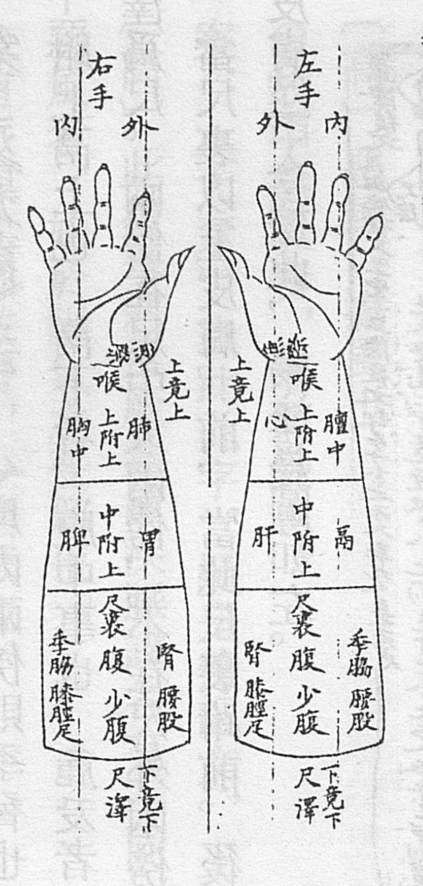

안(案): 『대소』에서 말하였다. “척내 양옆은 계협이다. 척의 바깥으로 신을 살피고, 척의 안쪽으로 복중을 살피며, 부(跗) 위로 흉중을 살핀다. 앞은 앞을 살피고 뒤는 뒤를 살핀다. 부(附) 위는 격 위이다. 격 아래는 복중의 일이다. 거칠고 ‘爰’한[麄爰] 것은 음이 부족하고 양이 남아 열중이 되는 것으로, 부의 아래이다.” 양주(楊注)에서 말하였다. “‘尺内’는 관에서 척택까지가 척이다. 양옆은 척 중앙의 양옆에 있고, 척 바깥 양옆에 있지 않다. ‘尺外’는 척 가운데 양옆의 바깥이다. ‘尺裏’는 척내의 두 가운데 사이부터이다. ‘跗上’의 ‘跗’는 ‘膚’로 보아야 하니, 척 안쪽 위의 피부에 해당한다. ‘前’은 이 척 안쪽의 부(跗) 앞에 해당한다. ‘後’는 부의 뒤이다. ‘鬲下’는 척 안쪽의 피부 위에서 아래에 해당하니, 격 아래 부분으로 삼는다. ‘跗之下’는 척의 피부이다.” 이제 이에 따라 양주대로 왼쪽과 같이 그림을 그린다.

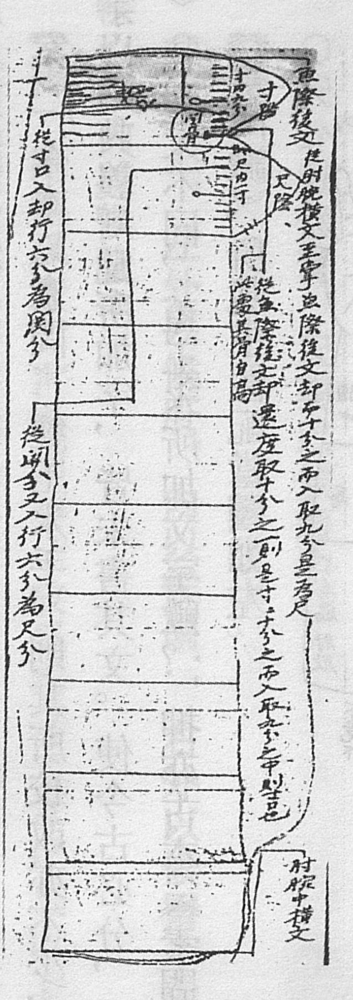

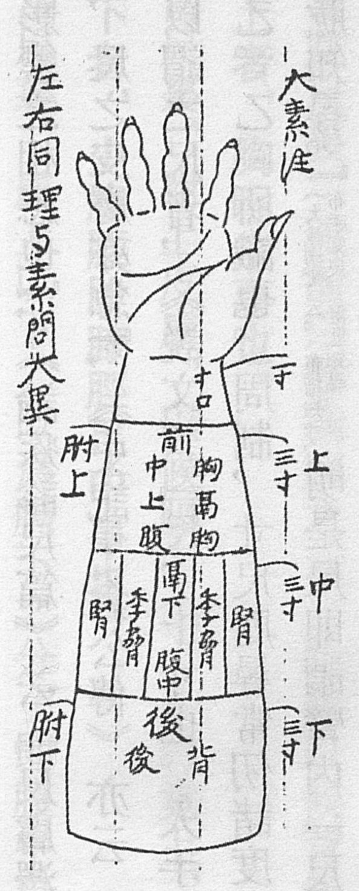

안(案): 『대소』에 ‘麄爰’으로 되어 있는 것은 척부의 결이 거칠고 색이 요(夭)함을 말한다. ‘夭’의 풀이는 이미 제15 가운데 보인다.

**○來疾去徐，上實下虛，爲厥巔疾。**

오는 것이 빠르고 가는 것이 더디면 위가 실하고 아래가 허한 것으로, 궐(厥)과 전질(巔疾)이 된다.

『갑을(甲乙)』 권4에는 ‘巔’이 ‘癲’으로 되어 있다.

〔楊〕오는 것이 빠른 것은 양이 성한 것이므로 위가 실하다. 가는 것이 더딘 것은 음이 허한 것이므로 아래가 허하다. 위가 실하고 아래가 허하므로 전질이 발생한다.

안(案): 앞글에서 ‘厥成爲巔疾’이라 하고 여기서 ‘厥巔疾’이라 한 것은 뜻이 같으니, 궐역(厥逆)과 쓰러지는 병[顛仆之疾]을 말한다. 고세식(高世栻)이 “기가 오직 거슬러 올라 위로 올라가 내려오지 않으므로 전질이 된다. ‘厥成爲巔疾’이라는 말과 같다.”라고 한 것은 옳지 않다.

〔滑〕‘來’는 골육의 부분에서 나와 피부 경계로 가는 것으로, 기가 오르는 것이다. ‘去’는 피부 경계에서 골육의 부분으로 돌아가는 것으로, 기가 내리는 것이다.｟『진가추요(診家樞要)』｠

〔馬〕그 병은 궐질(厥疾)과 전질이 될 것이다.

〔吳〕궐역과 전부(癲仆)의 병이 된다.

**○來徐去疾，上虛下實，爲惡風也。**

오는 것이 더디고 가는 것이 빠르면 위가 허하고 아래가 실한 것으로, 악풍(惡風)이 된다.

〔楊〕위가 허하여 풍을 받으므로 바람을 싫어한다[惡風].

〔志〕풍은 양사(陽邪)로 사람의 양기를 상하게 하며 피부 사이에 있다. 풍 가운데 사납고 독한 것은 양을 따라 곧장 속의 음으로 들어가므로, 가는 것이 빠르고 아래가 실하며 양이 허하고 음이 성하여 악풍이 된다.

〔高〕악풍은 여풍(癘風)이다.

**○故中惡風者，陽氣受也。**

그러므로 악풍에 맞는 것은 양기가 받는 것이다.

안(案): 『대소』에는 이 아홉 글자가 없으니, 곁에 적어 둔 글을 왕씨(王氏)가 정문(正文)으로 삼은 것인 듯하다. 일설에는 ‘也’는 혹 ‘邪’의 잘못이라 한다.

〔高〕이는 악풍·궐열(厥熱)·전질의 맥증이 각각 다름을 다시 들어 앞글에 다하지 못한 뜻을 채운 것이다. 사납고 독한 바람이 경맥을 상하게 할 때는 반드시 표(表)로부터 들어가므로, 악풍에 맞는 것은 양기가 사기를 받는 데서 시작함을 거듭 밝혔다.

**○有脈俱沈細數者，少陰厥也。**

맥이 모두 침세삭(沈細數)한 경우는 소음궐(少陰厥)이다.

〔楊〕침·세는 모두 음이므로, 침세삭하면 소음의 궐역이다.

〔高〕궐에는 음양이 있다. 맥이 모두 침세하면서 삭한 것은 양기가 거슬러 오르는 궐이 아니라 소음궐임을 거듭 밝혔다.

안(案): 수족소음경(手足少陰經)의 동맥이 모두 침세삭한 것이 궐이다. 이는 도초법(倒草法)으로, 앞글의 『대소』 ‘麄爰者，陰不足陽有餘，爲熱中跗之下也’와 문례가 같다.

**○沈細數散者，寒熱也。**

침세삭하면서 산(散)한 것은 한열(寒熱)이다.

〔楊〕침·세는 음이다. 산은 양이므로 한열을 앓는다.｟［案］‘散’ 위에 ‘數’ 자가 빠진 듯하다.｠

안(案): 수족소음맥이 모두 침세삭하면서 산한 것은 순음맥(純陰脈)이 아니라 음양이 반반인 맥이므로 그 병이 한열을 일으킨다. 고씨(高氏)가 앞의 ‘熱中’과 상대되는 한열로 본 것은 옳지 않은 듯하다.

**○浮而散者，爲眴仆。**

부(浮)하면서 산한 것은 현부(眴仆)가 된다.

〔楊〕‘胸’은 현편반(玄遍反)이다. 눈이 ‘捶’하다. ［案］‘胸’은 ‘眴’의 잘못이고, ‘捶’는 ‘搖’의 잘못이다.

〔高〕전질에도 음양이 있으니, 실하면 유여하고 허하면 부족하다. 맥이 부하면서 산한 것은 위가 실하여 유여한 전질이 아니라 속이 허하여 부족한 현부임을 거듭 밝혔다.

**○諸浮不｟而｠躁者，皆在陽則爲熱，其有｟右｠躁者在｟左｠手。**

여러 부맥(浮脈)으로 조(躁)하지 않은｟而｠ 것은 모두 양에 있으니 열이 되고, 그중 조한 것이 있는｟右｠ 경우는 손에 있다｟左｠.

안(案): 『대소』의 ‘而’·‘右’는 모두 오자이고, ‘左’도 ‘在’ 자가 잘못 불어난 것이다. 양주는 잘못된 본에 근거하여 설을 세웠으니 근거로 삼을 수 없다.

『갑을』에는 ‘浮’ 아래에 ‘而’ 자가 있다.

〔楊〕부·조는 모두 양이므로 양에 있으면 열이 된다. 여러 양의 낙맥(胳脈)은 왼쪽 것은 오른쪽에 이어지고 오른쪽 것은 왼쪽에 이어지므로, 오른쪽이 조하면 병의 근본은 왼손에 있다.

안(案): ‘諸浮’는 부대(浮大)·부활(浮滑)·부완(浮緩) 따위를 통틀어 말한 것이다. ‘不躁’라 한 것은 오직 부할 뿐 긴삭(緊數)하지 않음을 말한다. ‘在陽’은 표에 있고 부(府)에 있음을 말한다. 여러 부맥으로 조하지 않은 것은 병이 표와 부에 있는 징후로, 그 증은 반드시 열이 됨을 말한 것이다. 부맥이면서 조동(躁動)을 띤 것은 반드시 먼저 손의 맥인 촌구에 응한다. 손은 양이고 조도 양이므로 조의 출현이 먼저 손에 있는 것이다.

**○諸細而沈者，皆在陰，則爲骨痛，其有靜者在足。**

여러 세(細)하면서 침(沈)한 것은 모두 음에 있으니 골통(骨痛)이 되고, 그중 고요한[靜] 것이 있는 경우는 발에 있다.

〔楊〕세와 침은 모두 음맥으로, 골통을 주관한다. 그 맥이 침세하면서 고요하면 발의 골통이다.

안(案): ‘沈’은 ‘浮’에 상대되는 이름이므로 ‘沈而細’라 해야 하는데 여기서 ‘細而沈’이라 한 것은 호문(互文)으로 뜻을 보인 것이다. ‘在陰’은 이(裏)에 있고 장(藏)에 있음이다. 그 병은 반드시 골통이 되고, 골통은 혈한(血寒)의 징후이다. ‘靜’은 ‘躁’에 상대되는 글자로, 정은 음이고 발도 음이므로 정의 출현이 먼저 발에 있다. 발의 맥은 아마 부양(趺陽)을 말하는 것으로, 앞글의 손의 촌구에 상대하여 쓴 글이다.

**○數動一代者，病在陽之脈也。洩及便膿血。**

삭(數)하게 뛰다가 한 번 대(代)하는 것은 병이 양에 있는 맥이다. 설사와 농혈변[便膿血]이 있다.

（眉）『갑을』에는 ‘洩及’ 이하 열 글자가 없다.

〔楊〕세 번 이상 뛰는 것을 삭이라 한다. 삭하게 뛰다가 한 번 쉬는[代息] 것은 양맥이 허한 것이다. 그러므로 삭하게 뛰다가 한 번 쉬는 것은 곧 음이 실하고 양이 허한 것이므로 당설(溏洩)과 농혈변이 있다.

〔吳〕삭은 양맥이다. 음이 밖에서 굳게 막고 양이 안에서 떨면 맥이 덜컥덜컥 흔들리니[厥厥動搖] 동(動)이라 한다. 다섯 번 오고 한 번 멎거나 일곱 번 오고 한 번 멎으며 더 늘거나 줄지 않는 것을 대(代)라 하니, 이것이 양결(陽結)이다. 그러므로 병은 활설(滑洩)과 하리(下利)가 되고 또 농혈변이 된다.

〔志〕양열(陽熱)이 경맥에 있으므로 맥이 삭동(數動)하고, 열이 혈분(血分)을 상하게 하므로 농혈변을 보며, 경혈(經血)이 아래로 새므로 한 번 대한다.

안(案): ‘病在陽’은 병이 부(府)에 있음을 말한다. 잦게 고동하는 가운데 때때로 한 번 대하는 것이 바로 병이 부에 있는 징후이다. 그 증은 설사와 농혈변이 되는데, 농혈을 많이 쏟으므로 이 대맥이 나타난다.

안(案): ‘膿’은 흰 것을 내보내는 것이고, ‘血’은 붉은 것을 내보내는 것이다. 자세한 것은 『상한술의(傷寒述義)』에 보인다.

**○諸過者，切之。濇者，陽氣有餘也。**

여러 과(過)가 있는 맥은 짚어 본다. 색(濇)한 것은 양기가 남는 것이다.

『갑을』에는 ‘濇’ 위에 ‘其’ 자가 있다.

〔楊〕양기가 남는 것을 ‘過’라 한다. 양이 지나친 맥은 부하면서 활하기 마련이다. 그런데 도리어 색한 것은 양기가 너무 성하여 극에 달해 도리어 색이 된 것이다.

안(案): ‘過’는 맥에 태과·불급이 있음을 말한다. 제10에서 ‘過在足少陰’이라 한 것, 앞글에서 ‘乃可診有過之脈’이라 한 것이 모두 같은 뜻이다. ‘切’ 자는 앞글에서 이미 풀이하였다.

〔吳〕‘過’는 맥이 그 일정함을 잃은 것이다.

**○滑者，陰氣有餘也。**

활(滑)한 것은 음기가 남는 것이다.

〔楊〕음맥은 침색(沈濇)한데 지금 도리어 활한 것은 음이 지나쳐 극에 달해 도리어 활이 된 것이다.

안(案): 양기가 남고 음기가 남는다고 한 것을 양주는 “양이 극성하면 도리어 색이 되고, 음이 극에 달하면 도리어 활이 된다.”로 보았는데, 이 설이 옳은 듯하다. 아들 약지(約之)가 말하였다. “‘陰’·‘陽’ 두 글자는 서로 잘못 바뀐 듯하다.”

안(案): 양기가 남으면 음혈이 부족하니, 건혈로(乾血勞) 따위를 말한다. 이 증은 부활맥이 나타나야 하는데 도리어 색맥이 나타나는 것은 음혈이 부족하여 깔깔하게 막힌 맥이다. 음기가 남으면 양기가 부족하니, 붕루(崩漏)·대하(帶下) 따위를 말한다. 이 증의 맥은 침색해야 하는데 지금 도리어 활한 것은 음혈이 남고 양기가 부족하여 음양 두 기가 서로 다투지 않는 맥이다.

**○陽氣有餘，爲身熱無｟毋｠汗。**

양기가 남으면 신열(身熱)이 나고 땀이 나지 않는다｟毋｠.

『갑을』에는 ‘餘’ 아래에 ‘則’ 자가 있다.

〔楊〕양이 성하여 남으면 극에 달해 도리어 음이 되어, 밖으로 주리(腠理)를 닫으므로 땀이 나지 않고 몸에 열이 난다.

안(案): 양기가 남으므로 몸에 열이 나고, 음기가 부족하므로 땀이 없다. 표의 양기가 성하니 열이 되고, 리의 음혈이 쇠하니 땀이 없다.

**[역1]** 원서대로 옮겼다. 앞서 「惡疾也」로 인용한 『説文』을 다시 들어 「惡瘡也」라 하였는데, 뒤의 『説文』은 다른 책을 가리킬 수도 있으나 확인하지 못했다.
**[역2]** 원서대로 옮겼다. 문맥으로 보면 「赤甚」은 「未甚」의 잘못일 수 있다.

**○陰氣有餘，爲多汗身寒。**

음기가 남으면 땀이 많고 몸이 차다.

『갑을(甲乙)』에는 ‘餘’ 아래에 ‘則’ 자가 있다.

〔楊〕음기가 남으면 극에 달해 도리어 양이 되어, 밖으로 주리(腠理)를 열므로 땀이 많이 나고 몸이 차다.

안(案): 음기가 남으므로 몸이 차고, 양기가 부족하므로 땀이 많다. 이(裏)의 음혈이 성하니 차가워지고, 표(表)의 양기가 쇠하니 땀이 많다.

**○陰陽有餘，則無汗而寒。**

음양이 모두 남으면 땀이 없고 몸이 서늘하다.

『갑을』에는 ‘則’ 아래에 ‘爲’ 자가 있다.

〔紹〕『대소(大素)』에는 이 글이 없다. ［堅案］『대소』가 옳은 듯하다.

〔琦〕양이 음에 더해진 것을 땀이라 한다. 기는 운행하나 혈이 차지 않으므로 몸에 열이 나고 땀이 없다. 표실(表實)로 땀이 없는 것도 이 뜻이다. 양이 밖에서 허하므로 땀이 많고, 음이 안에서 성하므로 몸이 차다. 다만 활맥은 양이므로 땀이 많고 몸이 찬 증과 맞지 않는다. ‘陰陽有餘’ 두 구절은 뜻이 자세하지 않으니, 말이 잘못된 듯하다.

【楷】아버님께서 말씀하셨다. “‘陰陽有餘，則無汗而寒’은 삭제하지 않아도 된다. 음양이 모두 남으면 두 기가 고르고 치우침이 없으니, 이는 병 없는 평인의 몸을 가리킨다. 땀이 없는 것은 평인의 보통 상태이다. ‘寒’은 몸에 열이 없고 평소처럼 서늘하다는 말이지, 보통과 다르게 차다는 뜻이 아니다.” 일단 적어 두어 뒷날의 고찰을 기다린다. 앞글을 이어 평인의 몸이 서늘한 것을 가리킨 것이다.

**○推而外之，内而不外，有心腹積也。推而内之，外而不内，身有熱也。**

밀어서 바깥으로 보내도 안에 머물러 바깥으로 나오지 않으면 심복(心腹)에 적(積)이 있다. 밀어서 안으로 보내도 바깥에 머물러 안으로 들어오지 않으면 몸에 열이 있다.

『갑을』에는 ‘不外’ 아래에 ‘者’ 자가 있고, ‘身’이 ‘者中’ 두 글자로 되어 있다.

〔楊〕오장(五藏)은 안이니 음이고, 육부(六府)는 밖이니 양이다. 침을 쓰는 사람이 음을 사하고 양을 보하려 하는 것이 곧 ‘推而外’이다. 그런데 안이 실하여 사하기 어려우면 곧 ‘内而不外’이니, 그러므로 심복에 병적(病積)이 있음을 안다. 양을 사하고 음을 보하려 하는 것이 곧 ‘推而内之’이다. 그런데 밖이 실하여 사하기 어려우면 곧 ‘外而不内’이니, 그러므로 밖에 열이 있음을 안다.

안(案): 앞글의 ‘來疾去徐’에서 ‘爲眴仆’까지는 맥의 형태로 병을 아는 것이고, ‘諸浮不躁’에서 ‘身寒’까지는 음양 두 맥을 가린 것이며, ‘推而外之’ 이후는 멀리 ‘尺内兩傍 운운’ 구절에 호응하여, 팔의 근맥(筋脈)을 밀어 보아 병증을 살피는 법이다. 왕주(王注)를 따를 만하다. 양주(楊注)는 침법으로 보면서 끝 구절 ‘按之至骨 운운’만 맥후(脈候)로 보았으니, 그 설이 밝지 못하여 따르기 어렵다. 이제 왕주에 따라 왼쪽과 같이 그림을 그린다.

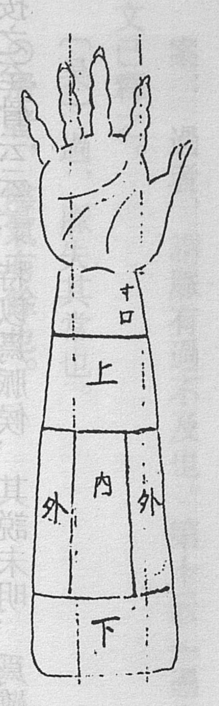

**○推而上之，上而不下，腰足清｟清｠也。推而下之，下而不上，頭項痛也。**

밀어서 위로 보내도 위에 머물러 아래로 내려가지 않으면 허리와 발이 차다｟清｠. 밀어서 아래로 보내도 아래에 머물러 위로 올라가지 않으면 머리와 목이 아프다.

『갑을』에는 ‘上而不下’가 ‘下而不上’으로, ‘下而不上’이 ‘上而不下’로 되어 있다.

〔楊〕위는 머리와 목이고 아래는 허리와 발이다. 아래를 밀어 위로 향하는데 기가 아래로 내려가지 못하므로 허리와 발이 찬 것을 안다. 위를 밀어 아래로 향하는데 기가 위로 올라가지 못하므로 머리와 목이 아픈 것을 안다.

**○按之至骨，脈氣少者，腰脊痛而身｟寒｠有痺也。**

눌러 뼈에 이르러도 맥기(脈氣)가 적은 것은 허리와 척추가 아프고, 몸에｟寒｠ 한비(寒痺)가 있다.

〔楊〕맥이 침세(沈細)하여 눌러 뼈에 이르러도 그 기를 적게 얻으면 한(寒)이 있음을 안다. 허리와 척추가 아프고 몸이 한비(寒痺)이다.

안(案): ‘按之至骨’은 역시 팔의 근(筋) 위를 누르는 것을 말한다. ‘脈氣少’는 앞글에서 말한 ‘細沈爲骨痛，有靜者在足’의 이치이다.

『대소』에는 ‘身’ 아래에 ‘寒’ 자가 있으니 따라야 한다.

안(案): 이상은 안·밖·위·아래·깊이의 다섯 진법을 말한다. 이 다섯 진법을 장주(張注)는 촌구의 맥동으로 보아, 내외를 부침(浮沈)으로, 상하를 상부·하부의 맥으로, ‘按之至骨’을 침하여 음이 이긴 것으로 보았고, ‘推’·‘按’ 두 글자를 같은 뜻으로 보았다. 『소문식(素問識)』은 이에 근거하였다. 그러나 ‘推’·‘按’ 두 글자는 바른 풀이를 얻지 못하였고 내외상하도 확실하지 않다. 이제 우선 왕빙의 뜻을 따르는 것이 옳다.

안(案): 본편은 모두 15장이다. 편 머리에서 ‘決死生之分’까지가 제1, ‘夫脈者’에서 ‘絶死’까지가 제2, ‘夫精明’에서 ‘精衰矣’까지가 제3, ‘五藏者’에서 ‘失守者死’까지가 제4, ‘夫五藏’에서 ‘失強則死’까지가 제5, ‘岐伯曰’에서 ‘名曰關格’까지가 제6, ‘帝曰脈其四時動’에서 ‘持脈之大法也’까지가 제7, ‘心脈搏堅’에서 ‘至今不復也’까지가 제8, ‘帝曰診得心脈’에서 ‘虛則泄’까지가 제9, ‘帝曰病成而變’에서 ‘不可勝數’까지가 제10, ‘帝曰諸癰腫’에서 ‘治之愈也’까지가 제11, ‘帝曰有故病’에서 ‘濕若中水也’까지가 제12, ‘尺内兩傍’에서 ‘爲熱中也’까지가 제13, ‘來疾去徐’에서 ‘無汗而寒’까지가 제14, ‘推而外之’에서 편 끝까지가 제15장이다.

만연(萬延) 경신년 소춘(小春) 초하룻날 밤, 빗속 등불 아래에서 쓰다.　오금도인(五禽道人) 양죽자(養竹子)

제17 보(第十七補)

맥은 혈의 부(府)이다[夫脈者血之府也]｟三ヲ五ヲ｠

『맥경(脈經)』에서 말하였다. “맥은 혈의 부(府)이다. 길면 기가 다스려지고, 짧으면 기가 병들고, 삭(數)하면 번심(煩心)하고, 크면 병이 진행되고, 위가 성하면 기가 높고, 아래가 성하면 기창(氣脹)이며, 대(代)하면 기가 쇠하고, 세(細)하면 기가 적고,｟『대소』에는 ‘細’가 ‘滑’로 되어 있다｠ 색(濇)하면 심통(心痛)이다. 혼혼혁혁(渾渾革革)하게 샘물이 솟듯 이르면 병이 진행되어 위태롭다. 폐폐작작(弊弊綽綽)하게 떠나는 것이 활시위가 끊어지는 것 같으면 죽는다.”｟권1 제13｠

『갑을경(甲乙經)』에서 말하였다. “맥은 혈기의 부이다. 길면 기가 고르고, 짧으면 병들고, 삭하면 번심하고, 크면 병이 진행되고, 위가 성하면 기가 높고, 아래가 성하면 기창이며, 대하면 기가 쇠하고, 세하면 기가 적고, 색하면 심통이다. 혼혼혁혁하게 샘물이 솟듯 이르면 병이 진행되고 색이 망가지며, 작작(綽綽)｟어떤 본에는 ‘綿綿’으로 되어 있다｠하게 떠나는 것이 활시위가 끊어지는 것 같으면 죽는다.”｟권4 「경맥(經脈)」 제1 중｠

봄에는 그림쇠에 맞는다[春應中規]｟十二ヲ｠

〔識〕『회남(淮南)』 「시칙훈(時則訓)」에서 말하였다. “음양을 제도(制度)하는 데 대제(大制)에 여섯 법도가 있다. 하늘은 먹줄, 땅은 수평기, 봄은 그림쇠, 여름은 저울대, 가을은 곱자, 겨울은 저울추이다.” 이 장과 다른 점이 있으나, 규구권형(規矩權衡)을 사시에 배당하는 설이 당시 이미 있었으니, 의경(醫經)에만 있는 것이 아니다.

허정(虛靜)을 보배로 삼는다[虛靜爲保]｟十五ヲ｠

〔紹〕［堅案］『소(素)』·『영(靈)』에서 ‘道’와 ‘寶’가 압운한 예는 하나둘이 아니다. ‘病治之道，氣内爲寶’｟「소오과론(疏五過論)」｠, ‘治數之道，從容之葆’｟「징사실론(徵四失論)」｠, ‘持鍼之道，堅者爲寶’｟「구침십이원편(九鍼十二原篇)」｠, ‘營氣之道，内穀爲寶’｟「영기편(營氣篇)」｠, ‘灸刺之道，何者爲寶’｟「사시기편(四時氣篇)」의 ‘寶’는 원래 ‘定’으로 되어 있으나 이제 『갑을』을 따른다｠, ‘審知其道，是謂身寶’｟「오란편(五亂篇)」｠가 그것이다.｟『광운(廣韻)』에서 ‘道’·‘寶’는 모두 상성(上聲) 호운(皓韻)에 있다.｠ 기(琦)가 ‘保’는 ‘寶’로 써야 한다고 한 것은 정확하지 않다.

심맥이 박견하다[心脈搏堅]｟十七ウ｠

『맥경』 권6 제2에서 말하였다. “심맥이 박견(搏堅)하면서 길면 혀가 말려 말하지 못하는 병을 앓을 것이고, 연(耎)하면서 산(散)한 것은 소갈(消渴)을 앓다가 저절로 나을 것이다.”

고왈(故曰)｟十五ウ｠

〔劄〕위료옹(魏了翁)의 『경외잡초(經外雜抄)』: “‘故曰’이라 한 것은 반드시 옛날에 이 말이 있었던 것이다.”

지금까지 회복되지 못한다[至今不復散發也]｟十八ウ｠

〔劄〕［琦曰］‘至今’ 일곱 글자는 연문(衍文)이다. ［寬案］‘散發’ 두 글자는 연문인 듯하다.

간맥이 박견하다[肝脈搏堅]｟十九ウ｠

『맥경』 권6 제1에서 말하였다. “간맥이 박견하면서 길고 색이 푸르지 않으면 떨어지거나 맞은 병을 앓을 것이다. 피가 협하(脇下)에 있어 천역(喘逆)하게 한다. 연하면서 산하고 색이 윤택하면 일음(溢飲)을 앓을 것이다. 일음이란 갈증이 나서 갑자기 많이 마셔, 넘쳐｟어떤 본에는 ‘易’로 되어 있다｠ 기육·피부와 장위(腸胃)의 바깥으로 들어간 것이다.”

수병의 모습과 같다[若水狀]｟廿一ヲ｠

〔紹〕［堅按］‘若水狀’의 양주는 오로지 정강이 부종만 말한 것으로 보았다. 옳다.

현부(眴仆)｟三二ウ｠

〔紹〕［案］양주는 『설문(説文)』에 근거하였으나, 왕빙이 두현(頭眩)으로 본 것이 뜻에 맞다. 선형(先兄)이 말하였다. “『방언(方言)』에 조선(朝鮮)·열수(洌水) 사이에서는 ‘顛眴’을 ‘眽眩’이라 한다 하였고, 『사(史)』 「굴원전(屈原傳)」의 ‘眴兮窈窕’에 서광(徐廣)이 ‘眴은 眩이다.’라고 하였다.”｟‘眴’과 ‘眩’은 옛날에 통용하였으니, 이미 원래 『식(識)』 「오장생성편(五藏生成篇)」의 ‘狗蒙’ 아래에 보인다.｠

기쇠(氣衰)　기소(氣少)｟四ヲ｠

추대자(麄大者)｟廿九ウ｠

『영추(靈樞)』 「오색(五色)」｟四十九｠에서 말하였다. “뇌공(雷公)이 물었다. ‘색으로 병의 덜함과 심함을 말하려면 어떠한가?’ 황제가 답했다. ‘그 색이 거칠면서 밝은데, 침요(沈夭)한 것은 심한 것이다.’”｟이 글에 따르면 ‘麄夭’로 써서 척부의 결이 거칠고 색이 요(夭)하다는 뜻으로 삼아야 하니, 『대소』에 근거해 바로잡아야 함이 더욱 분명하다.｠

여러 부맥(浮脈)이 조(躁)하지 않다[諸浮不躁]｟三二ウ｠

『총병론(總病論)』 권1 「삼음삼양전병증(三陰三陽傳病證)」에서 말하였다. “‘躁’는 맥이 삭한 것을 말하고 ‘靜’은 삭하지 않은 것을 말한다. 약을 쓰는 것은 같으나, 침을 쓴다면 손과 발의 경맥을 취해야 한다.”

안(案): 이 글은 본경의 뜻을 밝히므로 이제 여기에 적는다.

밀어서 위로 보낸다[推而上之]｟三五ウ｠

『영추』 「자절진사(刺節真邪)」｟七十五｠에서 말하였다. “침을 쓰는 사람은 반드시 먼저 경락의 허실을 살펴, 짚어 따라가고 눌러 튕겨 보아 반응하여 뛰는 것을 본 뒤에 취하여 내린다. 육경(六經)이 고른 것을 병이 없다고 하며, 병이 있더라도 저절로 낫는다고 한다. 한 경맥이 위는 실하고 아래는 허하여 통하지 않는 경우는 반드시 횡락(橫絡)이 있어 성하게 대경(大經)에 더해져 통하지 못하게 한 것이다. 보아서 사하니, 이것이 이른바 해결(解結)이다. 위가 차고 아래가 뜨거우면 먼저 목의 태양(太陽)을 자침하고 오래 유침한다. 자침한 뒤에는 목과 어깨뼈를 찜질[熨]하여 뜨겁게 하고, 아래로 합하면 그친다. 이것이 이른바 ‘推而上之’이다. 위가 뜨겁고 아래가 차면 허맥이 경락으로 꺼져 있는 것을 보아 취하고, 기가 내려가면 그친다. 이것이 이른바 ‘引而下之’이다. 큰 열이 온몸에 퍼지고 미쳐서 헛것을 보고 헛것을 듣고 헛소리하면, 족양명(足陽明)과 대락(大絡)을 보아 취하되, 허한 것은 보하고 혈이 실한 것은 사한다. 반듯이 눕게 하고 머리 앞에 자리하여 두 손 네 손가락으로 목의 동맥을 끼어 누르고 오래 유지하며, 말아 쥐어 짚어 결분(缺盆) 속까지 내려갔다가 다시 멈춘다. 앞과 같이 하여 열이 물러가면 그친다. 이것이 이른바 ‘推而散之’이다.”

백과주(白裹朱)｟五ヲ｠

청(清) 홍이훤(洪頤煊)의 『독서총록(讀書叢録)』에서 말하였다. “『역(易)』에서 손(巽)은 ‘白’이 된다고 하였고, 『정의(正義)』에 ‘白’이라 한 것은 바람이 먼지를 불어 없애므로 깨끗하고 흰 것을 취한 것이라 하였다. 이훤이 살펴보건대[頤煊案] ‘白’은 곧 ‘帛’ 자이다. 「비(賁)」 괘의 ‘六五，束帛戔戔’에 우번(虞翻)이 ‘손(巽)은 帛이 되고, 繩이 된다.’고 하였다. 이는 우씨(虞氏)의 『역』이 ‘帛’으로 되어 있는 것이다.”

단(癉)｟廿三ヲ｠

『이아(爾雅)』 「석고(釋詁)」에 “‘癉’은 병이다.”라 하였다. 학의행(郝懿行)의 『의소(義疏)』에서 말하였다. “『석문(釋文)』은 손염(孫炎)을 인용하여 ‘癉’은 역병이라 하였고, ‘癉’은 또 도단반(徒丹反)이다. 이는 ‘癉’에 ‘殫’의 음이 있고 ‘殫’으로도 통하여 쓴다는 것이다. 『회남(淮南)』 「남명편(覽冥篇)」에서 ‘斬艾百姓，殫盡大半’이라 하였고, 고주(高注)에 ‘殫은 병이다.’라 하였다.”

『본초회(本草匯)』 권5 「소단(消癉)」에서 말하였다. “상소(上消)는 몹시 갈증이 나서 많이 마시고, 중소(中消)는 잘 배고프면서 여위고, 하소(下消)는 조갈(燥渴)이 나고 소변이 잦으며 기름 같다.” 또 말하였다. “중소는 달고 맛있는 것을 자주 먹어 생기니, 식역(食㑊)이 곧 소중(消中)이다. 병으로 위(胃)에 열이 있으면 곡식을 빨리 소화하여 잘 배고프다. 대장에 열이 있으면 물을 소모하여 잘 배고프다.” 또 말하였다. “소중은 모두 열에 속하고, 하소는 모두 신허(腎虛)에 속한다.”

칩거하던 벌레가 숨으려 한다[蟄蟲將去]｟十五ウ｠

『좌씨(左氏)』 소공(昭公) 19년 전(傳)의 ‘而去之’에 두주(杜注)는 “감춘다[而藏之].”라 하였다.

『석문』: “‘去’는 기려반(起呂反)이다. 감추는 것이다.” 배송지(裴松之)가 주를 단 『위지(魏志)』에 “옛사람은 감추는 것을 ‘去’라 하였다. 살펴보건대[案] 지금 관중(關中)에 아직 이 말이 있다.”｟『좌전음의(左傳音義)』｠라 하였다. 공영달(孔穎達)은 말하였다. “‘去’는 곧 감추는 것이다. 『자서(字書)』에 ‘去’는 ‘弆’로 되어 있고, 강거반(羌莒反)이다. 물건을 맡아 둔다는 뜻이다. 지금 관서(關西)에서는 아직 ‘弆’라 하고, 동쪽 사람은 가볍게 말하여 ‘去’라 하니 음이 ‘莒’이다.”｟『좌전정의(左傳正義)』｠

안(案): ‘去’가 감춘다는 뜻인 것은 『한서(漢書)』 「오행지(五行志)」｟제7 하의 상｠·「소무전(蘇武傳)」｟廿四｠·「유협전(游俠傳)」｟六十二｠의 사고주(師古注)에 보인다. 단옥재(段玉裁)는 말하였다. “물건을 감추려면 반드시 여기서 떼어 저기에 감추므로, 그 뜻이 물리친다[攘卻]는 것도 된다.”｟『설문주(説文注)』 ‘祛’ 자 아래｠ 또 말하였다. “‘廢’가 ‘置’가 되는 것은 ‘徂’가 ‘存’이 되고, ‘苦’가 ‘快’가 되고, ‘亂’이 ‘治’가 되고, ‘去’가 ‘藏’이 되는 것과 같다.”｟‘廢’ 자 주｠

17(十七)　절맥(切脈)｟一ウ｠　정명(精明)｟二ヲ｠　참오(參伍)｟二ウ｠　맥(脈)｟三ヲ｠　혼혼혁혁(渾渾革革)｟四ウ｠　백(白)｟五ヲ｠　지창(地蒼)｟六ウ｠　수천(水泉)｟八ウ｠　오장(五藏)｟八ウ｠　보(保)｟十四ウ｠　주밀(周密)｟十五ウ｠　고왈(故曰)｟十五ウ｠

췌(揣)｟十六ウ｠　설권(舌卷)｟十七ヲ｠　연(耎)｟十七ウ｠　易(易)｟十八ウ｠　식비(食痺)｟十九ウ｠　䯒(䯒)｟廿ウ｠　심산(心疝)｟廿一ウ｠　단(癉)｟廿三ヲ｠　소중(消中)｟廿三ヲ｠　전(巔)｟廿四ウ｠　여(癘)｟廿五ウ｠　옹종(癰腫)｟廿六ヲ｠　부부(跗膚)｟廿八ウ｠　척촌(尺寸)｟廿九ウ｠

현(眴)｟三二ウ｠　난분(暖忿)｟十一ウ｠　관한(灌汗)｟十八オ｠

#### 평인기상론(平人氣象論)편 제18

『대소』에 전부 남아 있다. 권 머리에서 ‘浮大而短’까지는 권15 「척촌진(尺寸診)」이고, ‘夫平心脈’에서 권말까지는 권15 「오장맥진(五藏脈診)」이다.

（眉）오(吳)가 말하였다. “‘氣’는 맥기이고, ‘象’은 맥의 형태이다.”

（眉）『갑을』 권4 「경맥」 제1｟상｠에 모두 들어 있다.

**○黃帝問曰：平人何如。岐伯對曰：人一呼脈再動，一吸脈亦再動，呼吸定息，脈五動，閏以太息，命曰平人。平人者，不病也。常以不病｟《甲乙》有『之人以』三字｠調病人，醫不病，故爲病人平息，以調之爲法。**

황제가 물었다. “평인(平人)은 어떠한가?” 기백(岐伯)이 답했다. “사람이 한 번 내쉴 때 맥이 두 번 뛰고, 한 번 들이쉴 때 맥이 또 두 번 뛰며, 호흡이 정식(定息)할 때 맥이 다섯 번 뛰는 것은 태식(太息)으로 윤(閏)을 두기 때문이니, 이를 평인이라 한다. 평인은 병들지 않은 사람이다. 늘 병들지 않은 사람｟『갑을』에는 ‘之人以’ 세 글자가 있다｠으로 병자를 헤아린다. 의사는 병들지 않았으므로 병자를 위해 호흡을 고르게 하여 헤아리는 것을 법으로 삼는다.”

『갑을』에는 ‘爲法’ 두 글자가 없다.

〔楊〕평인의 병을 살피는 법은, 먼저 의사가 스스로 호흡을 고르게 하여 한 번 내쉴 때 맥이 두 번 뛰고 한 번 들이쉴 때 맥이 두 번 뛰면 의사가 병이 없어 맥이 고른 것이다. 그런 뒤에 상대의 호흡을 세어 한 번 내쉴 때 맥이 두 번 뛰고 한 번 들이쉴 때 맥이 두 번 뛰면 그 사람은 병들지 않은 것이다. 만약 그 사람이 한 번 내쉴 때 맥이 한 번 뛰고 한 번 들이쉴 때 맥이 한 번 뛰는 따위이면 불급(不及)이라 하며, 모두 병이 있는 것이다. 그러므로 의사는 병들지 않아 병자를 위해 호흡을 고른다고 한 것이다.

〔識〕「조경론(調經論)」에서 말하였다. “음양이 고르게 평평하여 그 형체를 채우고, 구후(九候)가 한결같으면 평인이라 한다.” 『영(靈)』 「종시편(終始篇)」에서 말하였다. “이른바 평인은 병들지 않은 사람이다. 병들지 않은 사람은 맥구(脈口)와 인영(人迎)이 사시에 응하고, 위아래가 서로 응하여 함께 오가며, 육경(六經)의 맥이 맺히거나 뛰지 않고, 본말의 한온이 서로 지키고, 형육(形肉)과 혈기가 반드시 서로 걸맞다. 이를 평인이라 한다.”

〔李〕1식에 네 번 이르는데 ‘呼吸定息脈五動’이란 태식(大息)으로 윤을 두는 때를 말한 것이다.｟마(馬)·지(志)·고(高)도 모두 같다｠

『영』 「동수편(動輸篇)」: “사람이 한 번 내쉴 때 맥이 두 번 뛰고 한 번 들이쉴 때 맥이 또 두 번 뛰며, 호흡이 그치지 않으므로 뛰는 것이 멈추지 않는다.”

안(案): 1식 4동을 정식으로 삼는데 그 호흡 사이에 늘 한 번 뛰는 숨이 있으므로 정식에 5동이라 한 것이니, 『난경(難經)』과 합치한다. 이는 도초문법(倒草文法)으로, 태식으로 윤을 두므로 맥이 5동이 된다는 말이다. ‘閏’은 남는다는 뜻으로 윤월의 ‘閏’과 같은 뜻이다. 정식 외에 따로 숨이 있으므로 ‘閏’이라 이름한 것이다. 때때로 이 윤식(閏息)이 있는데 이를 더해 평균하면 1식 5동맥이 된다. 호흡만 놓고 말하면 1식 4동이고, 이 윤식을 합쳐 평균하면 5동을 얻으니, 결국 『난경』의 설과 합치한다.

안(案): 본문은 『대소』와 차이가 있으나 그 이치는 다르지 않으니, 아마 왕씨(王氏)가 붉은 글자로 보충한 것에 몇 글자가 더 있을 뿐이다.

（眉）‘呼吸定息，脈五動’ 아래에 ‘者何也’ 세 글자를 넣어 보아야 한다.

（眉）지상의 봄여름과 가을겨울이 한 해가 되는 것은 사람의 호흡 1식과 같으니, 백 년이 곧 백 식임을 알 수 있다. 여기서 사람의 호흡을 논하면서 ‘閏’을 쓴 말이 매우 절묘하다.

（眉）동서원(董西園)의 『의급(醫級)』에서 말하였다. “1식 가운데 네 번 반 이르면 화평한 맥이다.” 아버님께서 말씀하셨다. “이 말이 매우 옳다. 윤의 1식은 두 호흡에 걸치는 것이므로, 성인이 ‘閏’ 자를 써서 한 번 뛰는 것을 따로 계산하였고 바로 5동이라 하지 않았으니, 5년에 두 번 윤달을 두는 예와 같다. 이는 2식에 한 번 윤을 두어 2식에 9동인 것이다. 이것이 살아 있는 것[活物]이 일정하지 않은 까닭이다.”

**○人一呼脈一動，一吸脈一動，曰少氣。**

사람이 한 번 내쉴 때 맥이 한 번 뛰고 한 번 들이쉴 때 맥이 한 번 뛰면 소기(少氣)라 한다.

『갑을』에도 ‘者’ 자가 있다.

〔楊〕내쉬고 들이쉴 때 모두 한 번 뛰는 것을 불급이라 하므로 소기임을 안다.

〔識〕［馬云］『난경』｟14난｠은 이경맥(離經脈)으로 보았으니, 정기가 쇠하여 적으므로 맥이 이와 같다. ［吳云］이는 허한(虛寒)이다.

안(案): 소기는 여러 주석가의 밝은 풀이가 없고 다만 양기가 쇠하여 적은 것으로 보았다. 내 생각은 그렇지 않다. 뒷글에서 병온(病温)·병풍(病風)·비(痺)라 한 것이 모두 질병을 말하니, 이 소기도 병증으로 보아야 한다. 『영』 「논질진척(論疾診尺)」 74에 “척부가 차고 맥이 작으면 설사하고 소기한다.”라 하였으니 증거가 될 수 있다. 또 제20｟『소문(素問)』｠에 “형체는 성한데 맥이 세하고 소기로 숨이 모자라면 위태롭다.”라 하였으니 함께 살펴볼 만하다.｟六ヲ｠

『병원(病源)』 권13 「소기후(少氣候)」에서 말하였다. “이는 장기(藏氣)가 부족한 탓이다. 폐는 기를 주관하고 호흡을 통하게 하는데, 장기가 부족하면 호흡이 미약해져 소기와 흉통이 생긴다. 소기는 수(水)가 장부에 있는 것이다. 수는 음기이고, 음기가 안에 있으므로 소기가 된다. 오른손 촌구맥을 진찰하여 음이 실하면 폐가 실한 것이다. 소기에 가슴 속이 그득하고 팽팽하며 어깨뼈까지 당기고, 맥이 유(濡)하게 오면 허하여 소기한 것이다. 왼손 관상(關上)의 맥이 음양 모두 허하면 족궐음·소양이 모두 허한 것으로, 소기로 말하지 못하는 것을 괴로워한다. 오른손 관상의 맥이 음양 모두 허하면 족태음·양명이 모두 허한 것으로, 위 속이 빈 듯하고 소기하여 숨이 모자라며 사지가 거슬러 찬 것을 괴로워한다. 맥이 약하면 소기하고 피부가 차다. 맥이 작은 것은 소기이다.”｟六ウ｠

（眉）『영』 「전광편(瘨狂篇)」에 “소기는 몸이 오슬오슬 떨리고[身漯漯], 말할 때 숨이 끊겨 들이마시듯 한다[言吸吸]. 운운. 단기(短氣)는 숨이 짧아 이어지지 않는다.”라 하였다.

**○人一呼脈三動，一吸脈三動而躁，｟及｠尺熱曰病温，尺不熱，脈滑曰病風，脈濇曰痺。**

사람이 한 번 내쉴 때 맥이 세 번 뛰고 한 번 들이쉴 때 맥이 세 번 뛰면서 조(躁)하며,｟及｠ 척이 뜨거우면 병온(病温)이라 하고, 척이 뜨겁지 않고 맥이 활(滑)하면 병풍(病風)이라 하며, 맥이 색(濇)하면 비(痺)라 한다.

（‘一吸脈三動’） 다섯 글자는 『갑을』에 없다. （‘脈濇曰痺’） 네 글자는 『갑을』에 없다.

〔楊〕맥이 세 번 뛰는 것은 기가 남는 것이고, 거기에 조질(躁疾)이 더해지고 척의 피부까지 뜨거우면 양기가 성한 것이므로 병온이 된다. 병온은 하지 전에 발생하고, 하지 뒤에 발생하면 병서(病暑)이다. 한 번 내쉴 때 세 번 뛰면서 조하고 척의 피부가 뜨겁지 않은데, 맥이 활하면 풍이라 하고 맥이 색하면 비라 한다.

〔馬〕1식 6동을 『맥결(脈訣)』은 삭맥(數脈)으로 보았고 『난경』도 이경맥으로 보았으니, 여섯 번 이르면서 조한 것이다. 조는 뛰는 것이 심한 것이다. 왕주는 ‘躁’를 번조(煩躁)로 보았으나, 『영추』 「종시(終始)」·「금복(禁服)」 등의 편에 ‘一倍而躁’·‘二倍而躁’ 등의 말이 있으니, ‘躁’는 본래 맥을 말한 것이지 병을 말한 것이 아니다.

〔張〕‘躁’는 급하고 빠르다는 말이다. ‘尺熱’은 척의 가운데 팔에 가까운 곳에 열이 있는 것으로, 반드시 온몸이 모두 뜨겁다는 말이다.

안(案): 병온은 곧 온병(温病)으로, 열병·상한을 말한다. 제3에 ‘冬傷於寒，春必温病’이라 하였는데 『대소』에는 ‘乃病熱’로 되어 있고, 제5에도 이 글이 실려 있는데 『대소』에는 ‘病温’으로 되어 있다. 「열론(熱論)」에 “열병은 모두 상한의 부류이다.”라 하고, 또 “상한을 앓아 온병이 된 것은 하지 전이면 병온이고 하지 뒤이면 병서이다.”라 하였으니, 모두 풍한이 기표(肌表)로 들어가 열로 변한 것을 말한다. 발열하는 증은 대개 외사로 생기니, 열병·온병은 증상으로 이름 붙인 것이고 중풍·상한은 원인으로 이름 붙인 것이다. 『상한론(傷寒論)』 「태양중편(太陽中篇)」 22에 “맥이 부하면서 삭한 것은 발한시킬 수 있으니 마황탕(麻黃湯)이 알맞다.”라 하고, 또 42에 “발한한 뒤 맥이 부삭하고 번갈(煩渴)하면 오령산(五苓散)으로 주치한다.”라 하였으니, 여기서 말한 것과 합치한다.

풍은 편풍(偏風) 부류이고 비는 습비(濕痺) 부류이니, 「풍론(風論)」·「비론(痺論)」에서 말한 것과 같다.

『영추』 「논질진척」 제74에서 말하였다. “척부의 열이 심하고 맥이 성하면서 조하면 병온이다. 맥이 성하면서 활하면 병이 나가려는 것이다.｟『갑을』에는 ‘汗且出也’로 되어 있다. 『맥경(脈經)』도 같다｠ 척부가 매끄럽고 윤기가 있으면 풍이다. 척부가 깔깔하면 풍비(風痺)이다.”

〔識〕［簡按］「수요강유편(壽夭剛柔篇)」에 “병이 양에 있으면 풍병이라 하고, 음에 있으면 비라 한다.”라 하였다. 이 장은 비와 상대하여 말하였으니, 역시 편풍 따위를 말한다.

〔張〕『맥법(脈法)』에서 말하였다. “활은 색하지 않은 것으로, 오가는 것이 유창하다. 색은 활하지 않은 것으로, 비가 모래를 적시는 듯하다. 활은 혈이 실하고 기가 막힌 것이고, 색은 기가 막히고 혈이 적은 것이다.”

**○人一呼脈四動以上，曰死。**

사람이 한 번 내쉴 때 맥이 네 번 이상 뛰면 죽는다고 한다.

〔楊〕네 번 이르면 양기만 홀로 성하고 음기가 쇠하여 끊어지므로 죽는다.

『십사난(十四難)』에서 말하였다. “한 번 내쉴 때 네 번 이르고 한 번 들이쉴 때 네 번 이르면 병이 심해지려는 것이다. 한 번 내쉴 때 다섯 번 이르고 한 번 들이쉴 때 다섯 번 이르면 그 사람은 위중할 것이다. 맥에 크고 작음이 있으면 치료하기 어렵다. 한 번 내쉴 때 여섯 번 이르고 한 번 들이쉴 때 여섯 번 이르면 사맥(死脈)이다.” 또 말하였다. “한 번 내쉴 때 두 번 이르면 평(平)이라 하고, 세 번 이르면 이경(離經)이라 하고, 네 번 이르면 탈정(奪精)이라 하고, 다섯 번 이르면 사(死)라 하고, 여섯 번 이르면 명절(命絶)이라 한다.”

『맥경(脈經)』 권4 제5에서 말하였다. “편작(扁鵲)이 말하였다. 맥이 두 번 뛰는 것이 한 번 이르는 것이니, 두 번 이르면서 긴(緊)하면 탈기(奪氣)이다. 맥이 세 번 이르면 이경이고, 세 번 이르면서 긴하면 탈혈(脫血)이다. 맥이 네 번 이르면 탈정이고, 네 번 이르면서 긴하면 탈형(奪形)이다. 맥이 다섯 번 이르면 죽는다. 한 번 내쉴 때 맥이 다섯 번 뛰어 사람의 1식에 맥이 열한 번 뛰면, 이는 기가 뜨고 깔깔해져 경맥의 운행에서 혈기가 다하여 속을 지키지 못하는 것이다. 오장이 위축되어 마르고 정신이 흩어져 사라지니, 맥이 다섯 번 이르면서 긴하면 죽는다.”｟十七ヲ｠

**○脈絶不至曰死，**

맥이 끊어져 이르지 않으면 죽는다고 하고,

〔楊〕손으로 맥을 누르면 한 번 오고 곧 끊어진다. 다시 오지 않으므로 죽는다.

〔馬〕『맥결(脈訣)』은 아홉 번 이르는 것을 사맥, 열 번 이르는 것을 귀묘맥(歸墓脈), 열한 번·열두 번 이르는 것을 이혼맥(離魂脈)으로 보았으므로 모두 사맥이라 한다. 이는 다섯 번 이상의 태과를 두고 말한 것일 뿐이다. 맥이 끊어져 이르지 않으면 한 번 내쉬고 한 번 들이쉴 때 맥이 끊어져 오지 않아 정기가 쇠하여 다한 것이므로 역시 사맥이라 한다. 이는 다섯 번 이하의 불급을 두고 말한 것일 뿐이다.

**○乍踈乍數曰死。**

잠깐 성글었다 잠깐 잦았다 하면 죽는다고 한다.

뒤의 「삼부구후론(三部九候論)」에서 말하였다. “중부(中部)가 잠깐 성글었다 잠깐 잦았다 하면 죽는다.” 또 말하였다. “맥이 잠깐 성글었다 잠깐 잦았다, 잠깐 더뎠다 잠깐 빨랐다 하면 일진이 사계(四季)에 해당하는 날에 죽는다.”

〔楊〕잠깐 성근 것은 음이라 하고 잠깐 잦은 것은 양이라 하는데, 음양이 어지럽게 움직여 차례가 없으므로 죽는다고 한다.

〔高〕한 번 내쉴 때 맥이 네 번 이상 뛰는 것은 태과의 극이고, 맥이 끊어져 이르지 않는 것은 불급의 극이며, 잠깐 성글었다 잠깐 잦았다 하는 것은 착란의 극이므로, 모두 죽는다고 한다.

**○平人之常氣稟於胃，胃者，平人之常氣也。人無胃氣曰逆，逆者死。**

평인(平人)의 상기(常氣)는 위(胃)에서 받으니, 위기(胃氣)는 평인의 상기이다. 사람에게 위기가 없는 것을 역(逆)이라 하고, 역하면 죽는다.

『갑을(甲乙)』 권4 「경맥(經脈)」 제1｟상｠의 인용은 여기까지이다.

〔楊〕화평한 사람은 오장(五藏) 기의 일정함이 각각 위기를 받아 하나하나의 장에 있다. 위기가 없으면 그 맥이 홀로 나타나 역이 되므로 죽게 된다.

**○春胃微弦曰平，**

봄에 위기가 있으면서 미현(微弦)하면 평(平)이라 하고,

『갑을』｟四ノ四ウ｠에 인용되어 있다.

〔楊〕위(胃)는 인영(人迎)의 위맥이다. 오장의 맥인 현(弦)·구(鉤)·대(代)·부(浮)·석(石)은 모두 인영의 위맥 가운데 나타난다. 위맥은 곧 족양명맥(足陽明脈)으로, 수곡(水穀)을 주관하고 오장육부 십이경맥의 으뜸이 된다. 그러므로 오장의 맥이 나타나려 할 때는 모두 위기를 데리고 이르니, 인영의 위기 모습은 부드럽고 약하다. 그러므로 인영에 오맥이 나타날 때 현·구·대·석만 각각 나타나고 부드럽고 약한 것이 없으면, 곧 오장이 각각 위기를 잃은 것이므로 맥이 홀로 나타나고, 홀로 나타나면 죽게 된다. 봄의 맥이 위가 많고 현이 적은 것을 ‘微’라 하고, ‘微’는 평인이라 한다.

〔張〕위기가 맥에 나타나는 것은 「옥기진장론(玉機真藏論)」에서 “맥이 약하면서 활(滑)하면 위기가 있는 것이다.”라 하고, 「종시편(終始篇)」에서 “사기가 올 때는 긴하고 빠르며, 곡기가 올 때는 느리고 온화하다.”라 한 것과 같으니, 모두 위기를 말한다. 대체로 맥은 때에 따라 바뀌니 태과도 불급도 없어야 하고, 저절로 조용하고 온화한 모습이 있는 것이 곧 위기의 맥이다.

（眉）안(案): ‘胃微弦’은 위가 많고 현이 적음을 말한다. 아래 구절이 반증이 된다.

**○弦多胃少曰肝病，**

현이 많고 위기가 적으면 간병(肝病)이라 하고,

〔楊〕현이 많고 위가 적으면 곧 간에 곡기가 적은 것이므로 간병이라 한다.

〔張〕현이 많은 것은 현이 지나친 것이다. 위가 적은 것은 화완(和緩)이 적은 것이다. 이는 간사(肝邪)가 이기고 위기가 쇠한 것이므로 간병이 된다.

**○但弦無胃曰死。**

현만 있고 위기가 없으면 죽는다고 한다.

〔楊〕간에 곡기가 없어 간맥이 홀로 나타나게 되므로 죽는다.

〔張〕현급(弦急)만 있고 충화(充和)의 기가 없는 것은 봄철에 위기가 이미 끊어져 간의 진장(真藏)이 나타난 것이므로 죽는다고 한다.

**○胃而有毛曰秋病，**

위기가 있으면서 모(毛)가 있으면 가을에 병든다고 하고,

〔楊〕봄에 위기가 나타날 때 부드럽고 약한 기만 얻고 현이 전혀 없다. 그런데 위 가운데 모가 있으면 곧 간의 때에 폐기가 와서 올라탄 것이다. 위기와 현이 있으므로 가을이 되어 병이 있다.

〔張〕모는 가을의 맥으로 금(金)에 속한다. 봄철에 이를 얻으면 적사(賊邪)이다. 위기가 아직 남아 있으므로 가을이 된 뒤에 병든다.

（眉）안(案): ‘秋病’은 간이 가을의 폐에 의해 병든다는 뜻이다. 아래 글도 이와 같다. 고세식(高世栻)이 말한 ‘受剋’이 이것이다.

**○毛甚曰今｟金｠病。**

모가 심하면 지금｟金｠ 병든다고 한다.

〔楊〕봄에 모맥을 얻되 위기보다 심하면, 금이 화(火)를 이기므로 금병(金病)이라 한다.[역1]

〔張〕봄의 맥에 모가 심하면 목(木)이 금에 상한 것이므로, 가을까지 기다리지 않고 지금 곧 병든다.

안(案): 『대소(大素)』에 ‘今’이 ‘金’으로 되어 있는 것은 음이 같아 잘못된 것이다. 양주(楊注)가 잘못된 글자로 설을 만든 것은 옳지 않다. 또 살펴보건대[又案] 본문과 주 모두 『대소』에 ‘金病’으로 되어 있으나 그 뜻은 ‘今病’이니, 음이 통함을 절로 알 수 있다.

『맥경』 권3에서 말하였다. “봄에 위기가 있으면서 미현(微絃)하면 평이라 하고, 현이 많고 위가 적으면 간병이라 하고, 현만 있고 위가 없으면 죽는다고 하고, 위가 있으면서 모가 있으면 가을에 병든다고 하고, 모가 심하면 지금 병든다고 한다.”

**○藏真散於肝，肝藏筋膜之氣也。**

장진(藏真)이 간에 흩어지니, 간은 근막(筋膜)의 기를 갈무리한다.

「위론(痿論)」의 ‘肝主身之筋膜’에 『신교정(新校正)』이 말하였다. “살펴보건대[按] 전원기본(全元起本)에 ‘막(膜)은 사람의 피부 아래 살 위의 근막이다.’라 하였다.”

〔楊〕장진은 진현맥(真弦脈)이다. 현에 위기가 없는 것을 ‘散’이라 한다. 현맥은 스스로 흩어질 수 없으나, 간장이 흩어져 위기가 없으므로 ‘藏真散於肝’이라 한다. 그러므로 간은 신을 갈무리하니 혼(魂)을 갈무리한다. 간이 기를 갈무리한다는 것은 근(筋)의 기를 갈무리한다는 것이다.

**○夏胃微鉤｟勾｠平，**

여름에 위기가 있으면서 미구(微鉤)｟勾｠하면 평이고,

〔楊〕여름의 맥이 인영에서 위가 많고 구가 적은 것을 ‘微鉤’라 하고, ‘微鉤’를 평이라 한다.

**○鉤｟勾｠多胃少曰心病，**

구｟勾｠가 많고 위기가 적으면 심병(心病)이라 하고,

〔楊〕심병으로 먹는 것이 적어 곡기가 적으면 맥이 인영에 이르러 구가 많고 위가 적게 하므로 심병임을 안다.

**○但鉤｟勾｠無胃曰死。**

구｟勾｠만 있고 위기가 없으면 죽는다고 한다.

〔楊〕심병으로 먹는 것을 해쳐 심에 곡기가 없으면 구에 위기가 없게 되므로 죽는다.

**○胃而有石曰冬病，**

위기가 있으면서 석(石)이 있으면 겨울에 병든다고 하고,

〔楊〕심은 화이다. 여름에 심이 왕성한 때 신맥을 얻으면, 위기가 있더라도 석만 얻은 것이니, 겨울이 되면 수(水)가 화를 이겨 병들 것이다.

（眉）고세식이 말한 ‘受剋’이 이것이다.

**○石甚曰今病。**

석이 심하면 지금 병든다고 한다.

〔楊〕여름에 위기가 있으면 석맥을 얻더라도 가을이 되어 병든다. 지금 여름에 얻은 석맥이 심하고 위기가 적으면 적사가 와서 이기는 것이므로 지금 병든다고 한다.

**○藏真通｟痛｠於心，心藏血脈之氣也。**

장진이 심에 통하니｟痛｠, 심은 혈맥의 기를 갈무리한다.

〔楊〕심에 위기가 없으면 곧 심에 통증의 병이 있어 장진의 맥이 인영에 나타나게 되므로 ‘藏真痛於心’이라 한다. 그러므로 심은 신을 갈무리하니 신기(神氣)를 갈무리한다. 심이 기를 갈무리한다는 것은 혈맥의 기를 갈무리한다는 것이다.

**○長夏胃微耎弱曰平，胃少弱多曰脾病，**

장하(長夏)에 위기가 있으면서 약간 연약(耎弱)하면 평이라 하고, 위기가 적고 약이 많으면 비병(脾病)이라 하고,

『갑을』에는 ‘胃少耎弱多曰脾病’으로 되어 있다.

〔楊〕‘耎’은 이면반(而免反)이다. 부드럽다는 뜻이다. 장하는 6월이다. 비는 위기를 운행하여 사장(四藏)에 대어 주므로, 사장의 맥이 인영에 이를 때 모두 위기가 있으면 곧 사장이 화평한 것이다. 비가 병들어 위를 위해 기를 운행하여 인영에 이르게 하지 못하면 사장의 맥에 각각 위기가 없으므로 사장에 병이 있다. 묻는다. “장하는 비가 주관하는데 여기서 위기를 말하고 비를 말하지 않은 것은 어째서인가?” 답한다. “비는 임금이 되므로 스스로 드러날 수 없다. 그러므로 장하 때에 위기를 얻는 것이 곧 비기를 얻는 것이다. 그러므로 장하에 위기가 나타날 때 약간 부족한 것을 평호(平好)라 한다. 더 나아가 소복(少腹)이 허약한 데 이르면 곧 비병으로, 위기가 적어지고 허약해진 것이다.”[역2]

**○但代無胃曰死。**

대(代)만 있고 위기가 없으면 죽는다고 한다.

〔楊〕사람이 한 번 내쉬면 심과 폐로 나가 맥이 두 번 뛰고, 한 번 들이쉬면 간과 신으로 들어가 맥이 두 번 뛴다. 사람의 호흡이 멈추어 정식(定息)할 때 비가 위에서 기를 받아 사장에 주어 호흡을 이루게 하므로 정식해야 한다. 비가 기를 받을 때 그 맥이 뛰지 않는 것을 대라 한다. ‘代’는 쉰다는 뜻이다. 대할 때 위기가 나타나야 하는데, 맥이 대할 때 위기가 없으면 비에 곡기가 없으므로 죽게 된다.

〔張〕‘代’는 번갈아 바뀌는 것이다. 비는 사계절을 주관하니 맥도 때에 따라 바뀌어야 하지만, 반드시 모두 화연(和耎)을 겸해야 비맥의 평이 된다. 사계절이 바뀌면서 현·구·모·석만 있으면 이것이 ‘但代無胃’로 진장이 나타난 것이므로 죽는다고 한다.

〔高〕‘代’는 연약함이 극에 달한 것이다.

안(案): ‘代’의 설은 장주(張注)가 옳다.

**○耎弱有石曰冬病，**

연약하면서 석이 있으면 겨울에 병든다고 하고,

〔楊〕장하에 비위가 나타날 때 그 가운데 신맥이 있으면 미사(微邪)가 와서 올라탄 것이다. 그치지 않으면 가을에 병들 것이다.

‘石’은 『맥경』과 『신교정』이 인용한 『갑을』에 따른 것이다.

（眉）고세식이 말한 ‘乘侮’가 이것이다.

**○弱甚曰今病。**

석이 심하면 지금 병든다고 한다.

〔新〕［按］『갑을경(甲乙經)』에는 ‘弱’이 ‘石’으로 되어 있고, 오늘의 『갑을』에는 ‘耎’으로 되어 있으며 주에 “『소(素)』에는 ‘弱’으로 되어 있다.”라 하였다.

〔馬〕‘弱’은 ‘石’으로 써야 한다. 장(張)도 같다. ［案］『맥경』에 ‘石’으로 되어 있으니 이 설을 따를 만하다.

〔張〕장하에 석이 심하면 화와 토가 크게 쇠한 것이므로, 겨울까지 기다리지 않고 지금 곧 병든다.

안(案): ‘弱’은 곧 ‘石’ 자이니, 옛 음이 서로 통하여 이런 잘못이 생겼다. ‘幼弱’의 글자를 더러 ‘若’으로 쓰는 예와 같다. ‘若學之輩’는 『신찬자경(新撰字鏡)』 서문에 보인다. 『맥경』에 ‘石’으로 되어 있으니 고치는 것이 좋다. ‘石榴’를 더러 ‘若留’로 쓰는 것도 증거가 될 수 있다. ‘石’과 ‘若’은 서로 통용한다.

『맥경』 권3에서 말하였다. “장하에 위기가 있으면서 약간 유약(濡弱)하면 평이라 하고, 약이 많고 위가 적으면 비병이라 하고, 약만 있고 위가 없으면 죽는다고 하고, 유약하면서 석이 있으면 겨울에 병든다고 하고, 석이 심하면 지금 병든다고 한다.”

〔楊〕비위의 맥이 허약하고 곡기가 적으므로 곧 지금 병든다.

**○藏真濡｟傳｠於脾，脾藏肌肉之氣也。**

장진이 비를 적시니｟傳｠, 비는 기육(肌肉)의 기를 갈무리한다.

〔楊〕비장의 진맥(真脈)은 ‘唯代’로 위기가 없는 것을 말한다. ‘唯代’의 맥은 비에서 전해 와 인영에 이른다. 그러므로 비장은 신을 갈무리하니 의(意)를 갈무리한다. 비장이 기를 갈무리한다는 것은 기육의 기를 갈무리한다는 것이다.

〔吳〕‘濡’는 적신다는 뜻이다. 비기는 적셔 주는 것을 좋아한다. 장하 때는 비토가 주관하므로 오장의 진기가 모두 비에서 적셔진다.

**○秋胃微毛曰平，**

가을에 위기가 있으면서 미모(微毛)하면 평이라 하고,

〔楊〕가을철에 인영에서 위가 많고 모가 적은 것을 평인이라 한다.

**○毛多胃少曰肺病，**

모가 많고 위기가 적으면 폐병(肺病)이라 하고,

〔楊〕곡기가 적은 것이다.

**○但毛無胃曰死。**

모만 있고 위기가 없으면 죽는다고 한다.

〔楊〕진장이 맥에 나타난 것이다.

**○毛而有弦曰春病，**

모이면서 현이 있으면 봄에 병든다고 하고,

〔楊〕간이 와서 폐를 올라탄 것으로, 사기가 와서 올라타 그치지 않으면 봄의 목이 왕성한 때에 병들 것이다.

（眉）고세식이 말한 ‘乘侮’가 이것이다.

**○弦甚曰今病。**

현이 심하면 지금 병든다고 한다.

〔楊〕위가 있으나 모가 없고 현만 있는 것은 목이 도리어 금을 이긴 것이므로 지금 병든다고 한다.

『맥경』 권3에서 말하였다. “가을에 위기가 있으면서 미모하면 평이라 하고, 모가 많고 위가 적으면 폐병이라 하고, 모만 있고 위가 없으면 죽는다고 한다. 모이면서 현(絃)이 있으면 봄에 병든다고 하고, 현이 심하면 지금 병든다고 한다.”

**○藏真高於肺，以行榮｟營｠衛陰陽也。**｟洩曰死｠

장진이 폐에서 높으니, 폐는 영(榮)｟營｠위(衛)와 음양을 운행한다.｟洩曰死｠

『갑을』에는 ‘以’가 ‘肺’로 되어 있으니 따를 만하다.

〔楊〕장진의 맥이 나타날 때 폐장의 화평한 기보다 높다. ‘高’는 지나친다는 뜻이다. 폐는 음이니, 위기가 없는 기가 폐의 화기를 지나치면 곧 폐가 상한 것이다. 폐는 영위의 운행을 주관하므로, 폐가 상하고 나면 곧 음기가 새어 나가므로 죽게 된다.

**○冬胃微石曰平，**

겨울에 위기가 있으면서 미석(微石)하면 평이라 하고,

〔楊〕겨울의 인영맥에 위의 연약한 기가 많고 석맥이 미약한 것을 평인이라 한다.

**○石多胃曰腎病，**

석이 많고 위기가 적으면 신병(腎病)이라 하고,[역3]

『갑을』에는 ‘胃少石多’로 되어 있다.

〔楊〕신에 곡기가 적으므로 지금 연약한 기가 적고 견석(堅石)의 맥이 많으니, 신병임을 안다.

**○但石無胃曰死。**

석만 있고 위기가 없으면 죽는다고 한다.

〔楊〕장진의 맥이 나타나므로 죽게 된다.

**○石而有鉤｟句｠曰夏病，**

석이면서 구｟句｠가 있으면 여름에 병든다고 하고,

〔楊〕석맥은 수이고 구맥은 화이다. 석맥이 나타날 때 구가 나타나는 것은 미사가 와서 올라타 그치지 않는 것이니, 여름이 되면 병들 것이다.

（眉）고세식이 말한 ‘乘侮’가 이것이다.

**○鉤｟勾｠甚曰今病。**

구｟勾｠가 심하면 지금 병든다고 한다.

〔楊〕위기가 있더라도 구가 심하므로 지금 병든다.

**○藏真下於腎，腎藏骨髓之氣也。**

장진이 신으로 내려가니, 신은 골수(骨髓)의 기를 갈무리한다.

〔楊〕신은 오장 화기의 아래이다. 지금 신에 위기가 없으면 이에 지나쳐 신으로 내려간다. 그러므로 신장은 신을 갈무리하니 지(志)를 갈무리한다. 신장이 기를 갈무리하는 것은 골수의 기이다.

여기부터 위는 곧 인영 위맥으로 오장의 기를 살핀 것이다.

『맥경』 권3에서 말하였다. “겨울에 위기가 있으면서 미석하면 평이라 하고, 석이 많고 위가 적으면 신병이라 하고, 석만 있고 위가 없으면 죽는다고 한다. 석이면서 구가 있으면 여름에 병들고, 구가 심하면 지금 병든다고 한다.”｟대체로 사람은 수곡을 근본으로 삼으므로, 사람이 수곡을 끊으면 죽고 맥에 위기가 없어도 죽는다. 이른바 위기가 없다는 것은 진장맥만 얻고 위기를 얻지 못한 것이다. 이른바 맥이 위기를 얻지 못했다는 것은 간은 현만, 심은 구만, 위는 약만, 폐는 모만, 신은 석만 있는 것이다.｠

현맥은 작고 곧다

〔張〕현은 곧고 길어 활시위처럼 힘이 있는 모습이다. 그러나 연약하고 가볍고 허하면서 활하면 현 가운데 저절로 온화한 뜻이 있으니, 간장이 주관한다. 편작이 말하였다. “봄의 맥이 현한 것은, 간은 동방의 목이다. 만물이 처음 생겨 아직 가지와 잎이 없으므로 그 맥이 올 때 유약하면서 길다. 그러므로 현이라 한다.”

안(案): 현은 오가는 것이 모두 곧고 길면서 연활(耎滑)함을 말한다.

구맥은 크고 넓다

〔張〕구는 손가락을 들 때 오는 것이 성하고 가는 기세가 쇠한 듯한 것이니, 맥이 밖에서 성하고 갈 때 힘이 없는 것으로, 양의 성함이며 심장이 주관한다. 편작이 말하였다. “여름의 맥이 구한 것은, 심은 남방의 화이다. 만물이 무성한 때로, 가지를 드리우고 잎을 펴서 모두 아래로 굽어 갈고리 같으므로, 그 맥이 올 때 빠르고 갈 때 더디다. 그러므로 구라 한다.”

안(案): 구는 오는 것이 크고 가는 것이 가늘며, 오가는 것이 모두 부드럽고 온화함을 띠는 것을 말한다.

모맥은 뜨고 가볍다

〔張〕모는 맥이 올 때 부하고 깔깔하여 깃털처럼 가볍고 허한 것이다. 편작이 말하였다. “가을의 맥이 모한 것은, 폐는 서방의 금이다. 만물이 마치는 때로, 풀과 나무의 꽃과 잎이 모두 가을에 떨어지고 가지만 남아 터럭 같으므로, 그 맥이 올 때 가볍고 허하면서 뜬다. 그러므로 모라 한다.”

안(案): 모는 오가는 것이 모두 가볍게 뜨고 무겁게 가라앉지 않음을 말한다.

석맥은 가라앉고 무겁다

〔張〕석은 맥이 올 때 침실(沈實)하여 돌이 물에 가라앉는 듯함을 말한다. 편작이 말하였다. “겨울의 맥이 석한 것은, 신은 북방의 수이고, 만물이 갈무리되는 때이다. 한겨울에는 물이 돌처럼 얼므로, 그 맥이 올 때 침유(沈濡)하면서 활하다. 그러므로 석이라 한다.”

안(案): 석은 오가는 것이 모두 가라앉고 무거우며 가볍게 뜨지 않음을 말한다.

안(案): ‘藏真’에서 ‘散於肝’·‘通於心’·‘濡於脾’·‘高於肺’·‘下於腎’이라 한 것은, ‘散’은 간기가 근막에 흩어짐을 말하고, ‘通’은 심기가 혈맥에 통함을 말하고, ‘濡’는 비기가 기육을 적심을 말하고, ‘高’는 폐기가 높이 올라 영위로 달림을 말하고, ‘下’는 신기가 낮게 내려가 골수를 지킴을 말한다. 글자를 놓은 것이 각각 호응하니, 우연이 아니다.

（眉）사시맥(四時脈)의 뜻은 또 「옥기진장론」 머리에 보인다.

（眉）안(案): 봄은 양이 나아가므로 맥이 강하고 현하니, 현은 강한 것이다. 여름은 양이 성하므로 맥이 부하니, 부는 곧 구이다. 가을은 양이 물러나므로 맥이 약하니, 약은 모이다. 겨울은 양이 쇠하므로 맥이 침하니, 침은 석이다. 구부(鉤浮)와 침석(沈石)이 상대되고 현강(弦強)과 모약(毛弱)이 상대되니, 곧 봄과 가을이 상대되고 겨울과 여름이 상반되는 이치이다. 이렇게 풀지 않으면 사시맥이 천지의 기에 응한다는 뜻을 전혀 찾을 수 없어 어찌할 도리가 없다. 그러므로 사시맥은 다만 강약부침(強弱浮沈)의 구별일 뿐임을 안다.

（眉）『후한서(後漢書)』 「진총전(陳寵傳)」 주: “‘鉤’는 움직인다[動]는 뜻과 같다.” 『장자(莊子)』 「서무귀(徐無鬼)」 주: “‘鉤’는 되돌린다[反]는 뜻이다.”

（眉）안(案): ‘鉤’와 ‘溝’는 음이 같다. 넓고 크다는 뜻이 있음을 알 수 있다. ‘鉤’와 ‘洪’은 성(聲)이 같다.

**○胃之大絡，名曰虛里，貫鬲絡｟胳｠肺，出於左乳下，其動應衣。**

위(胃)의 대락(大絡)을 허리(虛里)라 한다. 격(鬲)을 꿰뚫고 폐에 낙(絡)하며｟胳｠, 왼쪽 젖 아래로 나오고, 그 박동이 옷에 응한다.

『갑을』에는 ‘衣’가 ‘手’로 되어 있다.

〔楊〕아래는 위의 낙맥(胳脈)을 진찰하는 것이다. ‘虛’는 음이 ‘墟’이다. 허리는 성읍의 거처이다. 이 위의 대락은 오장육부가 받아 거처하는 곳이므로 허리라 한다. 그 맥은 왼쪽 젖 아래로 나오며 늘 박동이 있어 옷에 응한다.

〔箚〕［稻曰］「경맥편(經脈篇)」의 ‘脾之大絡，名曰大包’와 상대된다.

〔識〕『갑을』 권4｟五ウ｠에는 ‘衣’가 ‘手’로 되어 있고 ‘脈’ 아래에 ‘之’ 자가 있다. 심씨(沈氏)의 『경락전서(經絡全書)』에서 말하였다. “허리는 유근혈(乳根穴) 자리로, 속칭 기근(氣根)이라 한다. 고영백(顧英白)이 말하였다. 유근 두 혈은 좌우 모두 동기(動氣)가 있는데 경에서 어찌하여 왼쪽 젖 아래만 말하였는가? 박동이 심한 것을 들었을 뿐이지, 왼쪽은 뛰고 오른쪽은 뛰지 않는다는 것이 아니다. 그 박동이 손에 응하는 것은 맥의 종기(宗氣)이다. 『소문』에는 본래 다른 뜻이 없는데, 마현대(馬玄臺)가 방각본의 오류로 인해 ‘應衣’는 병자의 기육이 여위어 맥동이 심해 옷에 응한다는 말이라 하였고, 이것도 통한다. 처음 『소문』을 읽을 때 마음속으로 의심하였는데 『갑을경』을 읽고서 의심이 풀렸다.” ［簡按］「오미편(五味篇)」에 “대기(大氣)가 가슴 속에 쌓인 것을 기해(氣海)라 한다.”라 하고, 「사객편(邪客篇)」에 “종기가 가슴 속에 쌓인다.”라 하였으니, 모두 이 뜻이다. 『통아(通雅)』에 “‘宗’과 ‘尊’은 한 글자이다.”라 하였다. 『효경(孝經)』 ‘宗祀’의 주에 ‘尊祀’라 하였고, ［王云］‘宗’은 ‘尊’이다. 이는 옛 풀이이다. ‘應衣’는 『갑을』에 따라 ‘應手’로 써야 한다. 옷에 응한다면 아래 글과 무엇이 다르겠는가. ［張云］앞에서 ‘應衣’라 한 것은 미약한 박동이 옷에 응하는 듯하여 허리의 위기를 징험할 수 있음을 말한 것이고, 여기서 ‘應衣’라 한 것은 크게 뛰어 참으로 옷과 함께 떨리는 듯함을 말한 것이다. 이는 억측으로, 『갑을』을 살피지 않은 잘못이다.

안(案): 이 설이 옳은 듯하다. 그러나 『대소』에도 두 곳 모두 ‘應衣’로 되어 있고 양주도 장주와 조금 같으며, 또 『갑을』에는 뒤의 ‘應衣’ 글이 없으니, 섣불리 『갑을』에 근거해 경문을 고쳐서는 안 된다. 『대소』 뒷글에는 ‘應衣’가 ‘應於衣’로 되어 있으니 이것도 살펴 두어야 한다.

안(案): 온몸의 맥동은 아무리 미약해도 손에 응하지 않는 것이 없다. 허리는 크게 뛰는 것 가운데 으뜸이므로 ‘應衣’라 한다. 계산(桂山)의 설은 잘못이다.

**○脈宗氣也。盛喘數絶者，則病在中。**

맥의 종기(宗氣)이다. 박동이 성하고 짧게 급하며[盛喘] 몹시 잦으면[數絶] 병이 속에 있다.

『갑을』에는 ‘脈’ 아래에 ‘之’ 자가 있다.

〔楊〕‘宗’은 ‘尊’이다. 이 대락은 온몸에서 혈기가 높이는 곳이므로 종기라 한다. 그 맥동이 사람이 헐떡이듯 잦다가 끊어지면 병이 장(藏) 속에 있다.

안(案): ‘盛喘數絶’은 허리의 맥동이 평소보다 심함을 말한다. ‘喘’은 ‘緛’의 가차(假借)로, 줄어든다는 뜻이다. ‘盛喘’은 박동이 성하고 긴삭(緊數)함을 말한다.｟‘喘’ 자는 이미 제10에 보인다｠ ‘數絶’은 곧 ‘絶數’이다. ‘絶’은 심하다는 뜻이니, 몹시 잦음을 말한다. ‘盛’ 자는 오로지 실대(實大)를 가리켜 말한 것이고, ‘絶’ 자는 오로지 긴삭을 가리켜 말한 것이다. ‘病在中’은 병이 위(胃) 속에 있음을 말한다. 제10에서 “적맥(赤脈)이 이를 때 ‘喘’하면서 굳으면 진단하여 적기(積氣)가 속에 있어 때로 먹는 것을 해친다고 하니, 심비(心痺)라 한다.”라 한 것이 바로 이것과 같은 뜻이니, 함께 살펴보아야 한다. 허리는 박동이 평온한 것이 보통의 징후이고, 짧고 잦은 것은 위실(胃實)의 징후이니, 맥의 태과이다.

〔馬〕『영추(靈樞)』 「사객편」·「자절진사편(刺節真邪篇)」에서는 모두 종기라 하고, 「오미편」에서는 대기라 하였다.

（眉）종기는 중경(仲景)의 「평맥편(平脈篇)」 고주(古注)에 보인다.

**○結而横，有積矣。**

맺히고 가로지르면[結而横] 적(積)이 있다.

〔楊〕이 맥이 결(結)한 것은 복중에 적이 자리한 것이다. 적은 음병(陰病)이다.

〔識〕［吳云］맥이 더디게 오다가 때로 한 번 멎는 것을 결이라 한다. ‘横’은 손가락 아래에 가로로 걸리는 것이다. 허리의 맥이 결하고 횡하면 위 속에 적이 있음을 말한다. ［簡按］‘横’은 아마 그 박동이 오른쪽까지 가로로 미침을 말하는 듯하다. 장주(張註)가 ‘結’·‘横’을 맥상이 아닌 것으로 본 것은 잘못인 듯하다.

안(案): ‘結’은 울결의 뜻으로, 앞 맥 ‘喘數’의 반대이며, 맥의 불급이다. ‘横’은 계산(桂山) 선생의 설을 따를 만하다. 뒷글에 “촌구맥이 침하면서 횡하면 협하에 적이 있고 복중에 횡적(横積)이 있어 아프다.”라 하였으니, 맥이 횡한 것은 속에 횡적이 있는 이치이며, 나무에 가로 가지가 있으면 반드시 가로 뿌리가 있는 예와 같다.

（眉）안(案): 결맥(結脈)은 중경의 자감초탕(炙甘草湯) 장과 그 다음 장에 보이는데, 다음 장에 “맥이 때로 한 번 멎었다가 다시 오는 것을 결이라 한다 운운”이라 하였다. 또 「변맥편(辨脈篇)」과 다른 여러 책에 보인다.

（眉）안(案): 결·대·산란부정(散亂不定) 등을 모두 ‘横’이라 한다. ‘横’은 제멋대로 어지럽다는 뜻이다.

**[역1]** 원서대로 옮겼다. 『黃帝內經太素』에도 「以金剋火」로 되어 있는데, 그 平按은 「火」가 「木」의 전사 오류인 듯하다고 하였다.
**[역2]** 원서대로 옮겼다. 『黃帝內經太素』에도 「若更至少腹虛弱」로 되어 있으나, 맥을 논하는 문맥이라 「少腹」에는 글자 잘못이 있을 수 있다.
**[역3]** 『素問』 3판본과 『太素』 平按, 같은 쪽에 인용된 『脈經』에는 「石多胃少」로 되어 있어, 원서 경문 「石多胃曰腎病」은 「少」가 빠진 것으로 보인다.

**○絶不至曰死。**

맥이 끊어져 이르지 않으면 죽는다고 한다.

『갑을(甲乙)』에는 이 아래 ‘診得胃脈，則能食，虛則泄也’ 11자가 있다.

〔馬〕이것은 맥의 불급(不及)이다.

〔楊〕이 허리(虛里)의 맥이 오고 난 뒤 다시 오지 않는 것은 위기(胃氣)가 끊어진 것이므로 죽음에 이른다.

안(案): 허리는 실은 심장 꼬리 아래 뾰족한 곳의 고동으로 왼쪽 유방 아래에 있는 것이며, 폐기(肺氣)의 호흡을 따라 심가(心家)에서 빚어 이룬 혈이 솟구치는 힘으로 뛰어 이곳에 응하는 것이다. 이 혈을 빚어 이루는 근원은 전적으로 위 속에서 받아들인 음식의 정기(精氣)가 위로 올라 간과 심에 이르러 혈즙(血汁)으로 변하는 데 달려 있다. 그러므로 여기서는 큰 근원을 들어 위의 대락(大絡)이라 하여, 사람의 혈액이 모두 음식이 빚어 만든 것이라는 뜻을 알게 하려 한 것이다.

（眉）안(案): 絶이란 결대(結代)보다 한 등급 더 길게 멎었다가 뒤에 다시 오는 것이지 맥이 완전히 끊어진 것이 아니다. 앞앞 구절의 왕주(王注)를 여기에 옮겨 써도 된다.

**○乳之下其動應衣，宗氣泄也。**

유방 아래의 박동이 옷에 응하는 것은 종기(宗氣)가 새는 것이다.

안(案): 앞글의 ‘絶不至’는 맥이 불급한 나쁜 증후를 말하고, 여기서 말한 ‘應衣’는 대과(大過)한 나쁜 증후를 말한다. ‘宗氣泄’이라 한 것은 위기가 없다는 말이니, 박동만 높고 활택(滑澤)한 뜻이 없음을 볼 수 있을 뿐이다.

〔馬〕앞에서 말한 옷을 움직임은 박동이 심한 데까지 이르지 않아 종기의 움직임을 징험할 수 있는 것이다. 여기서 말한 옷을 움직임은 박동이 심하여 종기가 새는 것이므로 죽는다고 하였다. 유방 아래의 박동이 옷에 응하는 사람을 내가 본 적이 있는데, 그 병이 끝내 낫지 않았다.

**○欲知寸口｟脈｠太過與不及，寸口之脈中手短者，曰頭痛。**

촌구(寸口)｟脈｠의 태과(太過)와 불급(不及)을 알려 할 때, 촌구의 맥이 손에 닿는 것이 짧으면 두통(頭痛)이라 한다.

『갑을』 권4에는 ‘不及’ 이상 9자가 없다.

안(案): 短이란 오고 가는 것이 짧고 작으며 급삭(急數)한 맥을 말하는 듯하다.

〔楊〕앞에서는 인영(人迎)을 진찰하는 법을 말하였고 이하는 촌구를 진찰하는 법이다. 그래서 촌구의 맥에 병이 있음을 진찰해 알려면 오직 대과(大過)와 불급이 있을 뿐이라고 한 것이다. 구(口)는 기가 지나는 곳이다. 관(關)에서 어제[魚]까지 1촌 되는 곳에 9푼의 자리가 있는데, 수태음(手太陰)의 기가 지나는 곳이므로 촌구라 한다. 그 맥의 박동이 9푼을 채우지 못하므로 단(短)이라 한다. 단은 양기가 부족한 것이므로 두통이 있다.

〔高〕단이면 기가 허하여 위에 미치지 못하므로 두통이 있으니, 두통은 정기가 위에서 허한 것이다.

（眉）안(案): 이 장(長)·단(短) 두 맥은 잡병(雜病)을 가리킨다.

**○乳之下，其動應於衣，宗氣洩。**

유방 아래의 박동이 옷에 응하면 종기(宗氣)가 새는 것이다.

〔楊〕유방 아래 허리의 맥이 양기가 성하여 넘치면 그 맥의 박동이 옷에 응하니, 이는 종기가 새어 넘치는 것이다.

안(案): 이 11자가 『대소(大素)』에서 여기에 있는 것도 착간(錯簡)인 듯하니, 앞뒤 글과 이어지지 않는다. 『소문(素問)』에서 앞에 있는 것이 옳은 듯하다. 왕빙(王冰)이 찬록할 때 가져다 앞에 넣은 것이 아닐까. 『신교정(新校正)』에 “살펴보건대[按] 전원기(全元起)본에는 이 11자가 없고 『갑을경(甲乙經)』에도 없다.”고 하였으니, 그렇다면 『대소』에만 이 11자가 있음을 알 수 있다.

**○寸口脈中手長者，曰足脛痛。**

촌구맥이 손에 닿는 것이 길면 족경통(足脛痛)이라 한다.

안(案): 長이란 오고 가는 것이 길고 크며 지완(遲緩)한 맥을 말하는 듯하다.

〔楊〕촌구의 맥이 9푼을 넘는 것을 장(長)이라 한다. 장은 양기가 남고 음기가 부족한 것이므로 정강이가 아프다.

〔高〕장이면 기가 성하여 아래에서 태과하므로 족경통이 있다. 족경통은 사기가 아래에서 실한 것이다.

**○喘數絶不至曰死。**

천삭(喘數)하다가 끊어져 이르지 않으면 죽는다고 한다.

〔楊〕길면서 천삭하므로 죽음에 이른다.

안(案): 앞글 11자와 이 7자는 모두 착간으로, 앞글 ‘喘數’와 ‘宗氣’ 곁에 적어 둔 표기 따위가 정문(正文)에 잘못 섞인 것인 듯하다. 『소문』에 없는 것은 왕씨(王氏)가 삭제하였기 때문일 것이다.

재안(再案): 이 7자는 앞글 ‘絶不至曰死’의 주해인 듯하다. ‘絶不至’라 한 것은 천삭한 맥이 갑자기 끊어져 이르지 않는다는 뜻으로, 이른바 결대 가운데 더욱 심한 것이므로 죽는다고 하였다는 말이다.

**○寸口脈中手促上擊者，曰肩背痛。**

촌구맥이 손에 닿는 것이 촉(促)하고 위로 치면 견배통(肩背痛)이라 한다.

『갑을』에는 ‘擊’이 ‘數’으로 되어 있다.

〔楊〕맥이 아래에서 위로 사람의 손을 치는 것이 마치 아래에서 어떤 물건이 위로 사람의 손을 치는 듯하니, 이는 양기가 성한 것이다. 양맥은 어깨와 등으로 지나므로 견배통임을 안다.

〔高〕촉이면 안이 허하여 안에서 불급하다. 위로 치면 밖이 실하여 밖에서 태과하므로 견배통이 있다. 견배통은 내허외실(内虛外實)이다.

안(案): 이상 세 맥은 장·단으로 상하의 통증을 알고, 촉상격(促上擊)으로 어깨와 등 양부(陽部)의 통증을 안다. 『금궤(金匱)』 권상에 “청사(清邪)는 위에 머물고 탁사(濁邪)는 아래에 머문다.”고 하였고, 또 “습은 아래를 상하고 안개는 위를 상한다.”고 하였으며, 『의심방(醫心方)』 권8의 서사공(徐思恭)론에 “청습(清濕)이 허한 틈을 타면 병이 아래에서 일어나고, 풍우(風雨)가 허한 틈을 타면 병이 위에서 일어난다. 또 몸의 절반 위는 풍이 적중하고 몸의 절반 아래는 습이 적중한다. 이것이 풍습의 병이다.”라 하였다. 모두 이 조문과 함께 살펴볼 수 있다.

**○寸口脈，沈而堅者，曰病在中。**

촌구맥이 침(沈)하면서 견(堅)하면 병이 속에 있다고 한다.

『갑을』에는 ‘曰’ 자가 없다.

〔楊〕침긴(沉緊)은 음맥이다. 병이 장(藏)에 있으므로 침긴하다.

〔高〕촌구맥이 침하면서 견한 것은 안에서 태과한 것이므로 병이 속에 있다.

안(案): 在中은 위 속에 있음을 말한다. 『상한론(傷寒論)』의 양명병 맥침긴(脈沈緊), 『금궤』 숙식병(宿食病)의 “맥이 긴(緊)하여 밧줄을 돌리는 듯하고 일정하지 않은 경우는 숙식이 있다.”가 모두 증거가 된다. 中이란 내인으로는 숙식이고 외인으로는 위가실(胃家實)이다.

**○寸口脈浮而盛者，曰病在外。**

촌구맥이 부(浮)하면서 성(盛)하면 병이 밖에 있다고 한다.

『갑을』에는 ‘曰’ 자가 없다.

〔楊〕부성(浮盛)은 양이다. 병이 부(府)에 있으므로 부성하다.

〔高〕촌구맥이 부하면서 성한 것은 밖에서 태과한 것이므로 병이 밖에 있다.

안(案): 태양병의 맥이 부완(浮緩)·부긴(浮緊)·홍대(洪大)한 따위는 모두 병이 밖에서 태과한 양증이다. 『금궤』 풍수(風水)에 “맥이 부하면서 홍(洪)하다.”는 글이 있다. 外란 내인으로는 수(水)와 음(飲)이고 외인으로는 표사(表邪)이다. 中은 위 속을 말하고 外는 위 밖을 말한다.

**○寸口脈沈而弱， 曰寒熱及疝瘕，少腹痛。**

촌구맥이 침하면서 약(弱)하면 한열(寒熱) 및 산가(疝瘕)와 소복통(少腹痛)이라 한다.

〔楊〕침은 음기가 심한 것이고 약은 양기가 허한 것이다. 음이 성하고 양이 허하므로 한열과 산가의 병이 있고 소복이 아프다.

〔高〕촌구맥이 침하면서 약한 것은 안에서 불급한 것이므로 한열 및 산가가 되고 소복이 아프다.

안(案): 寒熱은 오한과 발열이 번갈아 나타나는 증을 통틀어 말하며, 학질(瘧疾)·혈가(血瘕) 따위가 이것이다. 『금궤』에 “온학(温瘧)은 그 맥이 평맥과 같다.”고 한 것은 부삭(浮數)한 맥이 없음을 말한다. 또 「부인잡병」 제22에 “부인이 중풍(中風)에 걸려 발열오한하고 월경이 마침 왔다가 7, 8일이 지나 열이 없어지고 맥이 지(遲)하다.”고 하였고, 또 “부인의 병은 허(虛)와 적랭(積冷) 때문이다 운운”, “소복이 오한(惡寒)하거나 허리와 척추로 당긴다 운운”, “오래되면 여위고 맥이 허하며 한(寒)이 많다.”고 하였고, 또 “촌구맥이 현(弦)하면서 대(大)하니, 현은 감(減)이 되고 대는 규(芤)가 된다. 감은 한이 되고 규는 허가 된다. 한과 허가 서로 부딪치니 이를 혁(革)이라 한다. 부인은 반산(半産)·누하(漏下)한다.”고 하였다. 이 맥상들을 함께 살펴보면, 여기서 말한 ‘沈’·‘弱’과 똑같이 양기가 부족하다는 뜻이 있다. 이 조문은 한열 및 산가·소복통이 양기 부족의 증임을 말하므로 그 맥이 침긴(沈緊)하지 않고 침약(沈弱)한 것이며, 아랫글의 “촌구맥이 침하면서 천(喘)하면 한열이라 한다. 맥이 급(急)하면 산가·소복통이라 한다.”와는 자연히 허실과 과불급의 구별이 있다. 왕주는 옳지 않다.

침이약(沈而弱)｟十五ウ｠

이는 수음(水飲)의 한열·증통(症痛)이다

침이천(沈而喘)｟十六オ｠맥급자(脈急者)｟十八ヲ｠

이는 혈열(血熱)의 산가이다

**○寸口脈沈而横，曰脇下有積，腹中有横積痛。**

촌구맥이 침하면서 횡(横)하면 협하(脇下)에 적(積)이 있고 복중(腹中)에 횡적통(横積痛)이 있다고 한다.

『갑을』에는 ‘寸口脈緊而横堅者，曰脇下腹中有横積痛’으로 되어 있다.

〔楊〕그 맥이 침횡(沉横)하면서 견한 것은 음이 성한 것이므로 거(胠) 아래에 적이 있음을 안다. 적은 음병(陰病)이다. 횡은 손가락 아래에서 맥이 가로놓인 것이다. 거는 ‘側箱助下穴處’이다. 또 그 음병은 소복 속에 횡적이 있는 것이다.

（眉）‘側箱肋下空處’로 써야 한다.

〔高〕촌구맥이 침하면서 횡한 것은 안에서 태과한 것이므로 협하에 적이 있고 복중에도 횡적통이 있다.

〔識〕『갑을』에는 ‘横’ 아래 ‘堅’ 자가 있고 ‘有積’ 두 글자가 없다. ［張云］횡은 급삭(急數)이다. ［志云］횡은 횡역(横逆)이다. 맥의 형상을 말한 것이지 병을 말한 것이 아니다. ［簡按］횡은 촌구맥의 자리가 근골 사이에 비스듬히 놓인 것을 말한다. 장(張)과 지(志)의 설은 잘못인 듯하다.

안(案): 이 증은 협복 사이에 음혈(飲血)이 있어 통증이 생기는 것으로, 그 통증이 일정하지 않아 오른쪽에 있기도 하고 왼쪽에 있기도 하므로, 그 맥도 일정하지 않아 그 자리가 비스듬해지기도 한다. 전적으로 혈 가운데 근락(筋絡) 사이에 달린 일이므로 그 맥이 이와 같다.

**○寸口脈沈而喘，曰寒熱。**

촌구맥이 침하면서 천(喘)하면 한열이라 한다.

『대소』에는 이 9자가 뒤에 나오므로 양주(楊注)도 뒤에 실려 있다.

〔識〕『갑을』에는 ‘沈’이 ‘浮’로 되어 있고 ‘喘’ 아래 ‘者’ 자가 있다.

〔高〕촌구맥이 침하면서 천한 것은 태과하기도 하고 불급하기도 하므로 다만 한열이 된다. 한열의 증에는 유여(有餘)도 있고 부족도 있다.

〔張〕천은 급촉(急促)이다. 맥이 침하면서 천한 것은 열이 안에 있는 것이다. 열이 안에 있으면서 한열이 되는 것은 곧 “여러 금고율(禁鼓慄)은 모두 화(火)에 속한다.”는 것을 말한다.

안(案): 앞글에서 말한 ‘寸口之脈，沈而弱，曰寒熱’은 안에서 불급한 한열이고, 여기서 말한 ‘脈沈而喘，曰寒熱’은 안에서 태과한 한열이니, 한열의 증에 허실 두 증이 있어 그 맥이 같지 않음을 보인 것이다. 여기의 고주(高注)는 옳지 않다. ‘喘’은 곧 오그라들어 짧다[緛短]는 뜻으로, 이미 제3·제10에 보인다.

**○脈盛滑堅者，曰病｟甚｠在外。**

맥이 성하고 활(滑)하며 견한 경우는 병｟甚｠이 밖에 있다고 한다.

『갑을』에는 ‘脈’ 위에 ‘寸口’ 두 글자가 있다.

〔楊〕촌구는 양이고 활도 양이며 견은 음이다. 양이 성하고 음이 적으므로 병이 심하다고 하며, 육부(六府)에 있다.

〔高〕맥이 성하고 활하며 견하면 양기가 태과한 것이므로 병이 밖에 있다고 한다.

안(案): 堅은 뇌견(牢堅)하여 힘이 있다는 뜻인데, ‘堅’과 ‘緊’이 서로 잘못 쓰인 경우가 있으니 나누어 풀어야 한다. 『상한론』 「태양 상(太陽上)」의 풍습(風濕) 맥이 음양 모두 부(浮)한 것, 계이마일(桂二麻一)의 맥이 홍대한 것, 「태양 중(太陽中)」의 대청룡(大青龍) 맥이 부긴한 것, 제19조의 “맥이 부삭한 경우는 이치상 땀이 나면서 낫는다.”, 「태양 하(太陽下)」의 대함흉(大陷胸) 맥이 부하면서 동삭(動數)한 것, 소함흉(小陷胸) 맥이 부활(浮滑)한 것 따위가 그러하다. 盛은 홍대의 뜻이고 滑은 색(濇)하지 않음을 말한다.

**○脈小實而堅者，病｟曰甚｠在内。**

맥이 소(小)하고 실(實)하면서 견한 경우는 병｟曰甚｠이 안에 있다.

『갑을』에는 ‘病’ 위에 ‘曰’ 자가 있고, ‘脈’ 위에 ‘寸口’ 두 글자가 있다.

〔楊〕소실(小實)은 음이고 견도 음이므로 병이 심하다고 하며, 오장(五藏)에 있다.

〔高〕맥이 소실하면서 견하면 음기가 태과한 것이므로 병이 안에 있다고 한다.

안(案): 小는 盛의 반대이고 實은 滑의 반대이다. 堅도 견뢰(堅牢)하여 힘이 있다는 뜻인데 양허사실(陽虛邪實)의 견으로, 소음병의 긴삭(緊數) 따위가 이것이다. 소음의 병은 맥이 미세(微細)하고, 소음병의 맥이 세침삭(細沈數)하며, 소음병의 맥이 긴하고, 소음병의 맥이 미세침(微細沈)하며, 통맥사역(通脈四逆)의 맥이 미(微)하여 끊어지려 하고, 소음 하리(下利)의 맥이 미색(微濇)한 것이 모두 증거가 된다. 앞은 표양(表陽)을 말하고 여기는 이음(裏陰)을 말한다.

**○有胃氣而和者，病曰無他。**

위기가 있어 조화로운 경우는 병이 별일 없다고 한다.

〔楊〕촌구의 맥이 소실하고 견하더라도 위기가 있어 조화를 이루면 병이 있어도 위중한 데 이르지 않는다.

**○脈小弱以濇，謂之久病。**

맥이 소약(小弱)하면서 색(濇)한 것을 구병(久病)이라 한다.

『갑을』에는 ‘濇’ 아래 ‘者’ 자가 있다.

〔楊〕소약하면서 색한 것은 음양이 허약한 것이므로 구병이다.

〔高〕맥이 소약하면서 색하면 기혈이 불급한 것이므로 구병이라 한다.

『금궤』 제6에 “남자의 맥이 부약(浮弱)하면서 색하면 자식이 없으니 정기(精氣)가 맑고 차다.”고 하였고, 또 제5에 “비만한 사람의 맥이 색소(濇小)하고 숨이 짧으며 자한(自汗)이 나고 역절(歷節)이 아파 굽히고 펼 수 없는 것은 모두 술을 마시고 땀을 흘린 채 바람을 쐬어 생긴 것이다.”라 하였으며, 또 제12에 “오랜 기침이 몇 해 되어도 그 맥이 약한 경우는 치료할 수 있다.”고 하였으니, 모두 구병을 말한 것이다.

**○脈滑｟濇｠浮而｟大｠疾者，謂之新病。**

맥이 활(滑)｟濇｠하고 부하면서 ｟大｠ 빠른 것을 신병(新病)이라 한다.

『갑을』에는 ‘脈浮滑而實大者，謂之新病’으로 되어 있고, 이 아래 ‘病甚有胃氣而和者，曰病無他’ 12자가 있다.

〔楊〕색은 음이고 부대(浮大)는 양이다. 그 맥이 색하더라도 부하면서 유리(流利)하면 신병임을 안다.

〔高〕맥이 활부(滑浮)하면서 빠르면 기혈이 태과한 것이므로 신병이라 한다.

『금궤』 제7에 “기침하면서 맥이 부한 경우는 후박마황탕(厚朴麻黃湯)이 주치한다. 폐창(肺脹)에 맥이 부대한 경우는 월비가반하탕(越婢加半夏湯)이 주치한다. 맥이 부한 경우는 심하(心下)에 수(水)가 있으니 소청룡가석고탕(小青龍加石膏湯)이 주치한다.”고 하였고, 제10에 “촌구맥이 부하면서 대한데 누르면 도리어 색하고, 척중(尺中)도 미(微)하면서 색하므로 숙식이 있음을 알 수 있으니 대승기탕(大承氣湯)이 주치한다.”고 하였으며, 제12에 “맥이 부하면서 세활(細滑)한 것은 음(飲)에 상한 것이다.”라 하였고, 제13에 “맥이 부하고 소변이 불리하며 미열이 있고 소갈(消渴)하는 경우는 소변을 잘 나가게 하고 땀을 내야 하니 오령산(五苓散)이 주치한다.”고 하였으며, 제14에 “맥이 부하면서 홍하니 풍과 기가 서로 부딪쳐 몸이 크게 붓는데, 땀이 나면 낫는다.”고 하였고, 제17에 “하리에 맥이 지하면서 활한 경우는 실증이다 운운, 대승기탕을 써야 한다. 하리에 맥이 도리어 활한 경우는 제거할 것이 있는 것이니 사하하면 낫는다. 대승기탕을 써야 한다.”고 하였다. 이는 모두 신병을 말한 것이다.

**○脈急者，曰疝瘕，少腹痛。**

맥이 급한 경우는 산가와 소복통이라 한다.

『대소』에는 이 9자가 뒤에 있다. 양주도 같다. 『갑을』에는 ‘瘕’가 ‘癩’로 되어 있다.

〔高〕산가와 소복통에는 허증도 있고 실증도 있다. 윗글의 촌구맥이 침약하여 산가와 소복통을 앓는 것은 정기가 부족한 것이다. 여기서 맥이 급하여 산가와 소복통이라 한 것은 사기가 유여한 것이다.

안(案): 여기서 말한 맥급도 침하면서 급한 것을 말하니, 앞글의 ‘沈而弱’과 짝을 이루는 글로서 저쪽에서 자세히 하고 이쪽에서 간략히 한 것이다. 『금궤』 제10에 “복통에 맥이 현하면서 긴하니, 현이면 위기(衛氣)가 행하지 못한다 운운, 이것이 한산(寒疝)이다.”라 하였고, 또 “한산에 그 맥이 침긴한 경우는 대오두전(大烏頭煎)이 주치한다.”고 하였으며, 또 “맥이 삭현(數弦)한 경우는 그 한을 사하해야 한다.”고 하였으니, 모두 이 조문과 뜻이 같아 사기가 유여한 증이다.

**○脈滑曰風，**

맥이 활하면 풍(風)이라 하고,

〔楊〕기가 허한데 행함이 매끄러운 것은 곧 풍부(風府)의 증후이다.

〔高〕맥이 활하면 풍이 되는 것은, 풍은 양사(陽邪)로서 잘 돌아다니고 자주 변하므로 맥이 활하다.

『금궤』 「중풍」 제5에 말하였다. “부양맥(趺陽脈)이 부하면서 활하니, 활이면 곡기(穀氣)가 실하고 부이면 땀이 저절로 난다.”

안(案): 이 글은 滑과 濇, 風과 痺를 마주 세워 말한 것으로, 풍한사기(風寒邪氣)의 풍과는 자연히 다르다. 양경(陽經)이 사기를 받으면 그 맥이 활리(滑利)하고 음경(陰經)이 사기를 받으면 그 맥이 색체(濇滯)하니, 그래서 풍완(風緩)이 되고 완비(頑痺)가 되는 것이다.

**○脈濇曰痺，**

맥이 색(濇)하면 비(痺)라 하고,

〔楊〕색은 음이다. 눌러 보면 손가락 아래가 껄끄러워 매끄럽지 않으니, 이는 한습(寒濕)의 기가 모여 비가 된 것이다.

〔高〕맥이 색하면 비가 되는 것은, 비는 닫혀 막힘을 위주로 하여 혈기가 엉겨 막히므로 맥이 색하다.

『금궤』 「혈비(血痺)」 제6에 말하였다. “‘혈비병은 어디에서 얻는가?’ 하고 물으니, 스승이 답하였다. ‘귀하게 사는 사람은 뼈가 약하고 살집이 두텁고 무거운데, 피로하여 땀이 나고 누워서 때때로 뒤척이다가 약한 바람을 맞으면 이를 얻는다. 다만 맥이 저절로 미색(微濇)하고 촌구와 관상(關上)에서 소긴(小緊)하면 침으로 양기를 끌어들여 맥을 고르게 해야 하니, 긴이 사라지면 낫는다.’” 또 말하였다. “혈비는 음양이 모두 미하고 촌구·관상이 미하며 척중이 소긴하다. 외증은 몸이 불인(不仁)하여 풍비(風痺) 증상과 같다. 황기계지오물탕(黃耆桂枝五物湯)이 주치한다.”

**○緩而滑曰熱中。**

맥이 완(緩)하면서 활하면 열중(熱中)이라 한다.

〔楊〕완활(緩滑)은 양이다. 손가락 아래가 느슨한 줄을 누르는 듯하고 오가는 것이 유창한 것이 열중의 증후이다.

〔馬〕맥이 완하면서 활하게 오는 것은, 완은 비맥(脾脈)이 유여한 것이고 활은 위화(胃火)가 매우 성한 것이므로 열중이 된다.

〔高〕토기(土氣)가 안으로 허하고 양열(陽熱)이 지나치게 성하므로 열중이라 한다.

안(案): ‘熱中’은 이미 제17에 보이고, 또 제42에 보인다.[역1]

**○盛而緊曰脹，**

맥이 성하면서 긴하면 창(脹)이라 하고,

〔楊〕촌구맥이 성하고 긴실(緊實)한 것은 음기가 안에 쌓인 것이므로 창이 된다.

〔馬〕성은 사기가 유여한 것이고 긴은 중기(中氣)가 펴지지 못한 것이므로 창이라 한다.

〔高〕토기가 유여하고 사기가 안에서 실하므로 창이라 한다.

『영추(靈樞)』 「창론(脹論)」 제35에 말하였다. “황제가 물었다. ‘맥이 촌구에 응할 때 어떠하면 창인가?’ 기백이 답하였다. ‘그 맥이 대견(大堅)하면서 색한 것이 창이다.’” 또 말하였다. “창은 모두 장부의 바깥에 있어, 장부를 밀어내고 흉협을 둘러싸며 피부를 부풀게 하므로 창이라 이름한다.”

**○脈從陰陽，病易已。**

맥이 음양을 따르면 병이 쉽게 낫는다.

〔楊〕인영과 맥구(脈口)의 대소가 사시(四時)를 따르면 병이 있어도 쉽게 낫는다.

〔高〕맥이 음양을 따른다는 것은 맥이 사시를 따르는 것이다. 순(順)이란 봄에 현(弦), 여름에 구(鉤), 가을에 모(毛), 겨울에 석(石)인 것이다.

（眉）안(案): 아래 구절에 사시라는 글이 있으니, 이 두 구절은 왕주가 옳고 양주·고주는 그르다.

**○脈逆陰陽｟者脫｠，難已。**

맥이 음양을 거스르면｟‘者’ 자가 빠져 있다｠ 낫기 어렵다.

『갑을』에는 이상 13자가 없다.

〔楊〕인영과 촌구의 대소가 사시를 따르지 않아 음양을 거스르게 되므로 병이 낫기 어렵다.

〔高〕맥이 음양을 거스른다는 것은 맥이 사시에 어긋나는 것이다. 어긋남이란 위맥이면서 모가 있고, 위맥이면서 석이 있으며, 모이면서 현이 있고, 석이면서 구가 있는 것이다.

〔馬〕이는 맥이 병과 서로 따라야 함을 말한 것이다. 사람에게 양병이 있으면 외감이든 내상이든 모두 양맥이 나타나야 한다. 사람에게 음병이 있으면, 외감이면 음병에 양맥이 나타나야 하고 내상이면 음병에 음맥이 나타나야 한다. 그러므로 맥이 음양을 따르면 병이 쉽게 낫는다. 맥이 음양을 거스르는 부류의 병은, 외감에서는 양병에 음맥이 나타나고 음병에 음맥이 나타나며, 내상에서는 양병에 음맥이 나타나고 음병에 양맥이 나타나는 것으로, 모두 낫기 어려운 병이다.[역2]

안(案): 마주(馬注)가 옳은 듯하다.

**○脈得四時之順，曰病無他。**

맥이 사시를 따르면 병이 별일 없다고 한다.

『갑을』에는 ‘脈’이 ‘按寸口’ 세 글자로 되어 있다.

〔馬〕이는 맥이 때와 서로 따라야 함을 말한 것이다. 봄의 병에 현맥을 얻고, 여름의 병에 구맥을 얻고, 가을의 병에 모맥을 얻고, 장하(長夏)에 완맥을 얻고, 겨울의 병에 석맥을 얻으면, 맥이 사시를 따르는 것이니 병이 별일 없다고 한다.

**○脈反四時，及不間藏，曰難已。**

맥이 사시에 어긋나거나 간장(間藏)하지 않으면 낫기 어렵다고 한다.

『갑을』에는 ‘脈’ 자가 없고, ‘難已’가 ‘死’ 한 글자로 되어 있다.

〔楊〕봄·여름에 인영이 촌구보다 작고 가을·겨울에 촌구가 인영보다 작으면 곧 맥이 사시에 어긋남을 아니, 그러므로 병이 낫기 어렵다.

〔馬〕간장(間藏)이란, 예컨대 간병이 토를 타서 비로 전해야 하는데 비로 전하지 않고 심으로 전하면, 자기가 이기는 장을 건너뛰어 자기가 낳는 곳으로 전한 것이니, 『난경(難經)』 「오십삼난(五十三難)」의 이른바 “간장은 산다.”가 이것이다. 간장이 없는 맥까지도 모두 낫기 어렵다고 한다.[역3]

**○脈急者曰疝瘕，少腹痛。**

맥이 급한 경우는 산가와 소복통이라 한다.

〔楊〕그 맥을 누르면 활시위를 누르는 듯한 것은 음기가 쌓인 것이므로 산가와 소복통임을 안다.

**○寸口脈沈而喘，曰寒熱。**

촌구맥이 침하면서 천하면 한열이라 한다.

〔楊〕침은 음기이다. 맥의 박동이 사람이 헐떡이는 듯한 것은 양이니, 곧 한열임을 안다.

**○臂多青脈，曰脫血。**

팔에 푸른 맥이 많으면 탈혈(脫血)이라 한다.

〔楊〕팔은 척지(尺地)이다. 척지의 낙맥(胳脈)이 청흑(青黑)한 것은 한이므로 곧 탈혈임을 안다. 그 양이 허하여 음이 성해 양을 타므로 맥이 푸르다.

〔馬〕대체로 근맥(筋脈) 속은 모두 혈이다. 혈이 많으면 붉고 혈이 적으면 푸르므로, 맥이 푸른 것이 탈혈의 증임을 안다.

〔張〕혈이 빠지면 기가 떠나고, 기가 떠나면 한이 엉기며, 엉겨 막히면 청흑해지므로 팔에 푸른색이 보인다. 팔을 말하였으니 다른 곳은 알 수 있다. 곧 진척(診尺)의 뜻이다.

안(案): 이 아래로 ‘熱中’까지 6조는 모두 척부(尺膚)에서 보고 만지는 두 법[望切二法]을 말한 것이다. 위에서 촌구를 논한 것과 정확히 마주하는 글이다.

**○尺脈緩濇，謂之解㑊。**

척부가 완하고 맥이 색한 것을 해역(解㑊)이라 한다.

〔楊〕완은 양이고 색은 음이다. 관에서 척까지 1촌을 취하여 척부(尺部)로 삼는다. 척부도 음인데, 음기가 많으므로 나른하여 편안히 눕는다.

안(案): 양주는 尺을 관척(關尺)의 척으로 보았는데 옳지 않은 듯하다. 여기서 말한 척맥은 척부 부위 안의 맥을 말하며, 제17의 “척내(尺内) 양쪽은 곧 계협(季脇)이다 운운”과 합치하니 함께 살펴볼 수 있다. 양주가 ‘安臥’ 두 글자를 윗구에 붙였고 고주도 같은데, 옳은 듯하다. 다시 살펴보건대[再案] 뒷글의 ‘尺濇脈滑’·‘尺寒脈細’ 등으로 살펴보면 척부와 맥구를 말한 것이다.

**[역1]** 원서 「已第十七中」은 바로 뒤의 「又見四十二中」에 비추어 「已見第十七中」에서 「見」이 빠진 것으로 보인다.
**[역2]** 馬蒔의 『素問注證發微』에는 「内傷則陰病當見陰脈也」로 되어 있어, 원서 「當陰脈」은 「見」이 빠진 것으로 보인다.
**[역3]** 원서 「傳之於所生之矣」는 「之」 아래 「藏」이 빠진 것으로 보인다(馬蒔 『黃帝內經素問注證發微』에 「所生之藏矣」로 되어 있다).

**○安臥脈盛，謂之脫血。**

편안히 누워 있는데 맥이 성(盛)한 것을 탈혈(脫血)이라 한다.

〔楊〕척맥이 성한 것은 음기가 성하고 양기가 허한 것을 말하므로 탈혈이다.

안(案): 앞글의 ‘脫血’은 망법(望法)을 말하고 이 조문의 ‘脫血’은 맥법(脈法)을 말한다. 마씨(馬氏)가 앞의 것을 삭탈(數脫)로, 이것을 폭탈(暴脫)로 본 것이 옳은 듯하다.

【楷】（眉）「지진요론(至真要論)」 주: 땀을 내어 성한 양을 덜어 주지 않으면 열이 안으로 사지에 넘쳐 해역(解㑊)이 되는데, 이름 붙일 수 없다. 열이라 하기에도 심하지 않고 한이라 하기에도 심하지 않으며, 강하다 하기에도 심하지 않고 약하다 하기에도 심하지 않아 말로 이름할 수 없으므로 해역이라 하며, 못난 의사는 귀기악병(鬼氣惡病)이라 부른다.

**○尺濇脈滑，謂之多汗。**

척부가 색(濇)하고 맥이 활(滑)한 것을 다한(多汗)이라 한다.

〔楊〕척의 피부가 거칠고 껄끄러우며 척의 맥이 활한 것은 양이 성하고 음이 허한 것이므로 땀이 샌다.

〔張〕피부가 색한 것은 영혈(營血)이 적은 것이다. 척맥이 활한 것은 음화(陰火)가 성한 것이다. 양이 성하고 음이 허하므로 다한이 된다. 「음양별론(陰陽別論)」에 “양이 음에 더해지는 것을 땀이라 한다.”고 하였다.

**○尺寒脈細，謂之後泄。**

척부가 차고 맥이 세(細)한 것을 후설(後泄)이라 한다.

〔楊〕척의 피부가 차고 척맥이 침세(沉細)한 것은 내한(内寒)이므로 후설한다.

〔張〕척부가 찬 것은 비(脾)의 양이 쇠한 것이니, 비는 기육과 사지를 주관하기 때문이다. 척맥이 세한 것은 신(腎)의 양이 쇠한 것이니, 신은 이음(二陰)과 하부를 주관하기 때문이다. 비신이 허한(虛寒)하므로 후설이 된다.

**○脈尺麤常熱者，謂之熱中。**

맥의 척부가 거칠고 늘 뜨거운 것을 열중(熱中)이라 한다.

〔楊〕맥의 척지(尺地) 피부가 거칠고 또 늘 뜨거운 것이 열중이다.

〔張〕척이 거친 것은 진음(真陰)이 부족한 것이고, 늘 뜨거운 것은 음화가 유여한 것이므로 열중이라 한다.

안(案): 앞글에서 ‘緩而滑曰熱中’이라 한 것은 맥법을 말하고, 여기서는 진법(診法)을 말한다.

관정(寛政) 4년 임자에 오성공관(鼇城公觀) — 뒤에 성명을 고쳐 금와칠랑(金窪七朗)이라 하였다 — 이 지은 『소문고(素問考)』 5책이 있다. 그 설에 “‘脈尺麤常熱’은 ‘脈麤尺常熱’로 써야 한다.”고 하였다.

（眉）금와칠랑의 설이 옳은 듯하지만 맥상을 ‘麁’라 한 예는 없다. 「맥요정미론(脈要精微論)」의 ‘麤大’를 왕주(王注)는 맥상으로 보았는데 『대소(大素)』에는 ‘麁夭’로 되어 있으니, 이 ‘麁’ 자와 함께 피부가 거칠고 까칠함을 가리킨다. 그렇다면 이 맥상은 어떠한가? ‘常熱’이라는 글로 미루어 알 수 있으니, 아마 홍대(洪大)일 것이다.

**○肝見庚辛，死，**

간(肝)[의 진장맥]이 경신(庚辛)일에 보이면 죽고,

〔馬〕이는 진장맥(真藏脈)이 나타난 경우에 각각 상극하는 사망 시기가 있음을 말한 것이다. 경신은 금(金)의 날이다. 간의 진장맥이 나타나 위기(胃氣)가 전혀 없으면 경신일에 이르러 죽으니, 금이 목을 이기기 때문이다.

**○心見壬癸死，脾見甲乙死，肺見丙丁死，腎見戊己死，是謂真藏見皆死。**

심(心)이 임계(壬癸)일에 보이면 죽고, 비(脾)가 갑을(甲乙)일에 보이면 죽고, 폐(肺)가 병정(丙丁)일에 보이면 죽고, 신(腎)이 무기(戊己)일에 보이면 죽으니, 이를 진장(真藏)이 보이면 모두 죽는다고 한다.

〔楊〕진장이 각각 극을 받는 때에 나타나므로 모두 죽는다.

〔張〕이는 곧 「삼부구후론(三部九候論)」의 이른바 “진장맥이 나타나면 이기는 날에 죽는다.”는 뜻이다.

**○頸脈動喘疾欬曰水。**

경맥(頸脈)의 박동이 빠르고 천해(喘欬)가 있으면 수(水)라 한다.

〔楊〕경맥은 위(胃)의 여러 맥 가운데 인영(人迎)이다. 인영은 늘 뛰는데 지금 수병(水病)이 있으므로 박동이 빠르고 천해를 볼 수 있다. 어떤 판본에는 ‘腎脈動’으로 되어 있다.

안(案): 『대소』에서 ‘疾喘’으로 쓴 것이 옳으니, 맥과 증을 함께 말한 것이다. 動疾은 맥을 말하고 喘欬는 증을 말한다. 이러한 맥과 증이 있으면 안에 수음(水飲)이 있는 증후라는 말이다.

〔張〕수기(水氣)가 위로 거슬러 도리어 양명(陽明)을 침범하면 경맥이 뛴다. 수가 폐에 넘치면 숨이 차면서 기침이 빠르다.

（眉）왕주는 疾을 기침이 빠른 것으로 보았다.

**○目裹微腫，如臥蠶起之狀曰水。**

눈두덩[目裹]이 약간 부어 누웠다가 일어난 모양 같으면 수라 한다.

안(案): 『대소』에 ‘蠶’ 자가 없으니 따를 만하다. 『금궤(金匱)』 제14의 ‘目下有臥蠶’과는 자연히 다르다.

〔楊〕‘目果’는 눈의 위아래 꺼풀이다. 꺼풀이 약간 붓는 것은 수의 증후이다.

（眉）『영(靈)』 「수창편(水脹篇)」: “수가 처음 일어날 때 눈두덩 위가 약간 부어 막 누웠다가 일어난 모양 같다.”

「평열론(評熱論)」에 말하였다. “수는 음이다. 눈 아래도 음이다. 배는 지음(至陰)이 머무는 곳이므로 수가 배 속에 있으면 반드시 눈 아래를 붓게 한다.”

**○足脛腫曰水。**

정강이가 부으면 수라 한다.

〔楊〕한습(寒濕)의 기가 성하므로 정강이가 부으니 수의 증후이다.

**○目黃者，曰黃疸也。**

눈이 누런 경우는 황달(黃疸)이라 한다.

〔楊〕삼양맥(三陽脈)이 눈에 있으므로 황달 열병에는 눈이 누렇게 된다. 다단반(多但反)이다.

**○溺黃赤安臥者，黃疸。**

소변이 황적(黃赤)하고 편안히 누워 있는 경우는 황달이다.

〔楊〕신과 방광 속에 열이 있어 편안히 누워 힘들어하지 않는 것은 황달병의 증후이다. ［案］‘不’은 ‘而’의 잘못인 듯하다.

『영추(靈樞)』 「논질진척(論疾診尺)」 74에 말하였다. “몸이 아프면서 얼굴빛이 약간 누렇고 치구(齒垢)가 누러며 손톱 위가 누런 것은 황달이다. 편안히 누워 있고 소변이 황적하다. 맥이 소(小)하면서 찬 경우는 먹기를 즐기지 않는다.”

**○已食如飢者，胃疸也。**

먹고 나서도 배고픈 듯한 경우는 위단(胃疸)이다.

〔楊〕위 속의 열이 음식을 삭이므로 먹고 나서도 배고프니 위단병이다.

〔識〕［簡按］‘疸’과 ‘癉’은 같으니, 곧 앞 편의 이른바 소중(消中)이고 후세에 일컫는 중소갈(中消渴)이다. 마(馬)가 곡달(穀疸)이라 하고 지(志)가 황달이라 한 것은 모두 그르다.

안(案): 왕주가 위열(胃熱)로 보았으니 胃疸이 곧 胃癉임을 알 수 있다. ‘癉’이 ‘疸’으로 통용되는 것은 ‘鱓’을 더러 ‘䱇’로 쓰는 예와 같다. 「자학론(刺瘧論)」 36의 ‘旦病’을 『대소』에서는 ‘疸病’으로 썼고, 주에 “음은 旦이다. 내열병(内熱病)이다.”라 하였다. 단열(癉熱)의 풀이는 이미 제17에 보인다.

**○面腫曰風，**

얼굴이 부으면 풍(風)이라 하고,

〔識〕［馬云］수증(水證)에 풍을 겸한 경우는 얼굴이 붓는다. 얼굴은 제양(諸陽)이 모이는 곳이고 풍은 양에 속하여 위가 먼저 받으므로, 풍에 감촉된 경우는 얼굴이 반드시 먼저 붓는다. 수일 뿐이라고 잘못 여기면 안 된다. 「평열론」·「수열혈론(水熱穴論)」·「논질진척편」에서는 모두 풍수(風水)라 하였으니, 왕주가 위풍(胃風)으로 본 것은 그르다. 「풍론(風論)」의 위풍 증상을 살펴보아도 얼굴이 붓는다는 말은 없다. ［簡按］『금궤요략(金匱要略)』에 “얼굴과 눈이 크게 붓고 열이 있는 것을 풍수라 한다.”고 하였고, 또 “허리 위가 부으면 땀을 내야 한다.”고 하였다.

**○足脛腫曰水，**

정강이가 부으면 수라 하며,

〔識〕［吳云］비위는 습을 주관하고 신과 방광은 수를 주관하며, 그 맥이 모두 정강이로 지나므로 정강이가 부으면 수가 된다. ［簡按］『금궤요략』에 “허리 아래가 부으면 소변을 잘 나가게 해야 한다.”고 하였다.

안(案): ‘面腫曰風’·‘足腫曰水’는 『금궤』 제1의 “청사(清邪)는 위에 머물고 탁사(濁邪)는 아래에 머문다.”를 말한 것이다.

**○目黃者曰黃疸。**

눈이 누런 경우는 황달이라 한다.

〔張〕눈은 종맥(宗脈)이 모이는 곳이다. 여러 경에 열이 있으면 위로 눈을 훈증하므로 황달은 그 눈이 반드시 누렇다.

안(案): 앞글의 황달은 노달(勞疸) 허증을 말하고, 여기의 황달은 곡달 실증을 말한다. 황달증은 먼저 눈에 나타나고 뒤에 온몸에 미친다.

**○婦人手少陰脈動甚者，姙子也。**

부인의 수소음맥(手少陰脈) 박동이 심하면 임신이다.

〔識〕［張云］심맥의 박동이 심한 것은 혈이 왕성하여 그런 것이다. 왕계현(王啓玄) 운운은 심경의 맥, 곧 신문혈(神門穴)을 가리키니 그 설이 매우 훌륭하다. ［簡按］「논질진척」에도 “여자의 수소음맥 박동이 심하면 임신이다.”라 하였으니, 전원기본에서 ‘足少陰’이라 한 것은 옳지 않음을 알 수 있다. 왕(王)이 ‘動’을 궐궐(厥厥) 동요하는 동맥으로 본 것과 마(馬)가 임자(姙子)를 남자로 본 것은 모두 잘못이다.

〔楊〕수소음맥은 심경의 맥이다. 심맥은 혈을 주관하는데, 여인이 아이를 배면 ‘曰血’이 밖으로 막혀 통하지 않으므로 수소음맥이 안에서 성하고, 그래서 뛰는 것이다.[역1]

**○脈有逆從四時，未有藏形。**

맥에는 사시(四時)를 거스르는 것이 있으니, 아직 장(藏)의 형상이 없는 것이다.

〔楊〕촌구와 인영이 한편 거스르고 한편 따르면, 곧 사시에 아직 진장맥의 형상이 없는 것이다.

〔識〕［馬云］그 장의 맥이 나타나지 않고 다른 장의 맥이 도리어 나타난다. 봄·여름에는 맥이 부대(浮大)해야 하는데 도리어 침세(沈細)하고 여위며, 가을·겨울에는 맥이 침세해야 하는데 도리어 부대하고 살찌니, 이것이 이른바 사시를 거스르는 것이다. 「옥기진장론(玉機真藏論)」에 “아직 장의 형상이 없는데 봄·여름에 맥이 침색(沈濇)하고 가을·겨울에 맥이 부대한 것을 사시를 거스른다고 한다.”고 하였으니, 이 뜻과 같다. ［志云］아직 봄의 현(弦)·여름의 구(鉤)·가을의 모(毛)·겨울의 석(石)이라는 장의 형상이 없는 것이다. ［簡按］오(吳)와 장(張)이 진장의 맥 형상으로 본 것은 그르다.

**○春夏而脈瘦，秋冬而脈浮大，命曰逆四時也。**

봄·여름에 맥이 여위고 가을·겨울에 맥이 부대한 것을 사시를 거스른다고 한다.

〔楊〕봄·여름에는 인영이 약간 큰 것이 순(順)인데 지금 도리어 여위고 작으니 역(逆)이다. 가을·겨울에는 인영이 약간 작은 것이 순인데 지금 도리어 부대하니 역이다.

**○風熱而脈靜，泄而脫血脈實。**

풍열(風熱)인데 맥이 고요하고, 설사하면서 탈혈하고, 맥이 실(實)하며,

〔楊〕맥이 성한 것은 풍열의 병이다. 풍열의 병은 허하므로 탈설(脫洩)과 혈탈(血脫)이 많다.

〔馬〕병이 풍열에서 비롯했으면 맥이 부대해야 하는데 도리어 침정(沈靜)하니, 양병에 음맥이 나타난 것이다. 설사와 탈혈 두 증은 맥이 침세해야 하는데 실대(實大)하니, 음병에 양맥이 나타난 것이다.[역2]

안(案): 양주(楊注)가 ‘脈實’을 아랫구에 붙인 것이 옳은 듯하다.

**○病在中脈虛，**

병이 속에 있는데 맥이 허(虛)하고,

〔楊〕이는 양이 허하고 음이 실한 것이므로 병이 오장(五藏)에 있다.

**○病在外脈濇堅者，皆難治。**

병이 밖에 있는데 맥이 색하고 견(堅)한 경우는 모두 치료하기 어렵다.

〔楊〕음이 허하고 양이 실하므로 병이 육부(六府)에 있다.

〔馬〕병이 속에 있는 경우는 맥이 힘이 있으면 중기(中氣)가 한창 성한 것인데 지금 맥이 도리어 허하고, 병이 밖에 있는 경우는 맥이 부허(浮虛)해야 표병(表病)이 쉽게 낫는데 지금 맥이 도리어 색견(濇堅)하니, 이는 모두 치료하기 어려운 증이다. 살펴보건대[按] 「옥기진장론편」에 “병이 열인데 맥이 고요하고, 설사하는데 맥이 크며, 탈혈했는데 맥이 실하다.”고 한 것은 본편과 대의가 같고, 병이 속에 있는데 맥이 실견(實堅)하고 병이 밖에 있는데 맥이 실견하지 않은 경우는 모두 치료하기 어렵다고 한 것은 조금 다를 뿐이다.

**○命曰反四時也。**

반사시(反四時)라 이름한다.

〔楊〕맥이 색하거나 견한 두 경우는 음만 있고 양이 없으므로 모두 치료하기 어려우니, 사시에 어긋나는 맥이라 이름한다.

〔識〕오(吳)는 ‘四時’ 두 글자를 삭제하였다. ［馬云］이는 모두 치료하기 어려운 증으로, 맥이 사시에 어긋나는 것과 같다. 왕주는 연문(衍文)으로 보았으나, 옛사람이 저것으로 이것을 형용한 것이 비유의 뜻이 아니라고 단정할 수 없음을 전혀 몰랐다.｟‘王注’는 『신교정(新校正)』일 것이다.｠ ［簡按］마주(馬注)는 견강부회인 듯하다.

안(案): ‘命曰’ 운운 6자는 아랫글 ‘腎不石也’ 아래로 옮겨 보아야 하니, 이는 도초법(倒草法)으로, “반사시라 이름하는 것은 사람은 수곡을 근본으로 한다 운운, 신이 석(石)하지 않은 것이다.”라는 말이다. 이렇게 읽으면 그 뜻이 저절로 타당하다.

**○人以水穀爲本，故人絶水穀則死。**

사람은 수곡(水穀)을 근본으로 삼으므로 수곡이 끊어지면 죽는다.

〔楊〕사시에 어긋나는 맥에 수곡이 없는 역증이면 죽음에 이른다.

**○脈無胃氣亦死。所謂無胃氣者，但得真藏脈，不得胃氣也。所謂脈不得胃氣者，肝不弦，腎不石也。**

맥에 위기가 없어도 죽는다. 이른바 위기가 없다는 것은 진장맥만 얻고 위기를 얻지 못한 것이다. 이른바 맥이 위기를 얻지 못했다는 것은 간이 현(弦)하고 신이 석(石)한 것이다.

〔楊〕수곡의 기가 있더라도 장에 병이 있어 위기가 없으면, 간에 현이 있어도 위기가 없으므로 평현(平弦)이라 이름하지 않고, 신에 석이 있어도 위기가 없으므로 평석(平石)이라 이름하지 않으니, 그러므로 죽음을 면하지 못한다.

〔識〕［張云］사람이 살아가며 의지하는 것은 수곡이므로 위기는 수곡을 근본으로 하고, 오장은 또 위기를 근본으로 한다. 맥에 위기가 없고 진장맥만 나타나면 죽으니, 곧 앞 편의 이른바 현만 있고 위기가 없으며 석만 있고 위기가 없는 따위가 이것이다. 그런데 단현(但弦)·단석(但石)은 진장이지만, 간에 기가 없으면 현하지 않고 신에 기가 없으면 석하지 않으니, 이 역시 오장이 위기를 얻지 못해 그런 것으로, 진장에 위기가 없는 것과 같다. ［志云］현·구·모·석은 위기가 낳는 참된 상이다. 참된 상이 나타난 것은 위기가 이미 끊어진 것이므로 죽는다. 그런데 오장의 참된 상은 위부(胃府)의 정기(精氣)가 낳는 것이니, 정기가 끊어지면 간이 현하지 않고 신이 석하지 않으며 또 대구(帶鉤)·탄석(彈石)의 사맥이 나타난다. ［高云］봄이 되어도 간이 약간 현하지 않고, 겨울이 되어도 신이 약간 석하지 않은 것이다. ［簡按］고(高)는 왕의 뜻을 따랐는데 옳은 데 가깝다. 사진옹(謝縉翁)과 원표(袁表) 교본 『맥경(脈經)』에는 ‘肝但弦，心但鉤，脾但弱，肺但毛，腎但石也’로 되어 있는데, 어떤 판본에 근거했는지 모르겠다. ［案］『대소』 아랫글에 이 글이 있으니 함께 살펴볼 수 있다.

（眉）왕인지(王引之)의 『경전석사(經傳釋詞)』에서는 ‘不’을 발성(發聲)으로 보았는데, 경전에 그런 예가 매우 많다. 지금 여기의 ‘不弦’은 弦이고 ‘不石’은 石이니, 역시 발성으로 읽어야 한다. 『이아(爾雅)』 「석구편(釋丘篇)」의 ‘不漘’에 곽주(郭注)가 “不는 발성이다.”라 한 것이 이것이다.

（眉）「옥기진장」의 『신교정』에서 양상선(楊上善)을 인용하여 말하였다. “촌구에서 진찰할 때 미현(微弦)이 평화(平和)이다. 미현은 2분의 위기와 1분의 현기가 함께 뛰는 것을 말하며, 3분이 모두 현이고 위기가 없으면 진장이 나타난 것이다. 나머지 네 장도 이에 준한다.”

**○太陽脈至，洪大以長。**｟「甲乙」四ノ六ウ｠

태양맥(太陽脈)이 이르면 홍대(洪大)하면서 길다.｟「甲乙」四ノ六ウ｠

〔楊〕손으로 사람의 맥을 누를 때 홍대(鴻大)하면서 긴 것이 태양맥이다. 곧 수족태양 소장·방광맥의 상태이다.

**○少陽脈至，乍數乍踈，乍短乍長。**

소양맥(少陽脈)이 이르면 잠깐 삭(數)하고 잠깐 소(踈)하며, 잠깐 짧고 잠깐 길다.

『갑을(甲乙)』에는 ‘長’ 위에 ‘乍’ 자가 있다.

〔楊〕눌렀을 때[按之人] 잠깐 소하고 잠깐 삭하며 잠깐 짧고 잠깐 긴 것이 소양맥이다. 곧 수족소양 삼초(三膲)와 담(膽)맥의 상태이다.｟［案］‘人’ 자는 연문인 듯하다.｠

**○陽明脈至，浮大而短。**

양명맥(陽明脈)이 이르면 부대하면서 짧다.

〔楊〕눌렀을 때 부대하면서 짧은 것이 양명맥이다. 곧 수족양명 위와 대장의 증후이다. 이것이 삼양맥의 형상이다.

『칠난(七難)』에 말하였다. “『경(經)』에 말하기를 소양이 이르면 잠깐 작고 잠깐 크며 잠깐 짧고 잠깐 길고, 양명이 이르면 부대하면서 짧고, 태양이 이르면 홍대하면서 길고, 태음이 이르면 긴대(緊大)하면서 길고, 소음이 이르면 긴세(緊細)하면서 미(微)하고, 궐음이 이르면 침단(沈短)하면서 돈후하다고 하였다. 이 여섯은 평맥인가, 장차 병이 될 맥인가? 답한다. 모두 왕맥(王脈)이다. 그 기는 어느 달에 각각 며칠 왕성한가? 답한다. 동지 뒤 갑자(甲子)에 소양이 왕성하고, 다시 갑자를 만나면 양명이 왕성하고, 다시 갑자를 만나면 태양이 왕성하고, 다시 갑자를 만나면 태음이 왕성하고, 다시 갑자를 만나면 소음이 왕성하고, 다시 갑자를 만나면 궐음이 왕성하다. 왕성한 기간이 각각 60일이니, 여섯 번의 60일, 곧 360일로 한 해를 이룬다. 이것이 삼양삼음이 왕성한 시일의 대요이다.”

〔新〕자세히 보니 삼음맥이 없는데, 옛글이 빠진 것일 것이다.

**○肝脈弦，心脈句，脾脈代，肺脈毛，腎脈石，是謂五藏脈。**

간맥(肝脈)은 현(弦), 심맥(心脈)은 구(句), 비맥(脾脈)은 대(代), 폐맥(肺脈)은 모(毛), 신맥(腎脈)은 석(石)이니, 이를 오장맥(五藏脈)이라 한다.

（眉）『갑(甲)』｟四ノ二ウ｠에는 ‘句’가 ‘鉤’로 되어 있고, ‘是謂五藏脈’ 5자가 없다.

〔楊〕간·심·비 세 맥은 『소문(素問)』과 『구권(九卷)』 상하 어디에도 달리 부르는 이름이 없다. 폐맥은 모라 일컫고 또 부(浮)라 이름하며, 신맥은 석이라 일컫고 또 영(營)이라 이름하니, 이것이 오맥의 같고 다름이다. 일에 따라 비슷한 것끼리 견주면 이름이 매우 많아진다.

**○夫平心脈來，累累如連珠，如循琅玕，曰心平。**

평심맥(平心脈)이 오는 것은 누루(累累)하여 구슬을 꿴 듯하고 낭간(琅玕)을 어루만지는 듯하니, 이를 심평(心平)이라 한다.

〔楊〕심맥은 여름의 맥이다. 여름날에는 만물이 무성하므로 그 맥이 오는 것이 누루하여 구슬을 꿴 듯하고, 손으로 누르면 낭간의 구슬을 어루만지는 듯하니, 이를 평화로운 맥으로 삼는다. 구(鉤)라 일컫는 것은 굽었다는 뜻이다. 꿴 구슬은 높낮이가 있어 활시위처럼 곧지 않으므로 구라 한다.

〔識〕［張云］낭간은 『부서도(符瑞圖)』에 “옥이면서 빛이 있는 것이다.”라 하였고, 『설문(説文)』에 “낭간은 구슬과 비슷하다.”고 하였다. ［簡按］「우공(禹貢)」의 “그 공물은 구림(球琳)과 낭간이다.”에 공전(孔傳)은 “낭간은 돌이면서 구슬과 비슷하다.”고 하였다. 『이아』 「석지(釋地)」의 “서북의 아름다운 것으로는 곤륜허(崑崙虛)의 구림(璆琳)과 낭간이 있다.”에 곽주는 “낭간은 모양이 구슬 같다. 『산해경(山海經)』에 ‘곤륜산에 낭간수가 있다.’고 하였다.”라 하였다. 이시진(李時珍)은 “산에 있으면 낭간이고 물에 있으면 산호(珊瑚)이다.”라 하였다.

안(案): 이씨(李氏)의 이 설은 『도경(圖經)』에 인용된 『이어도(異魚圖)』의 “낭간은 산호와 비슷하다.”는 글에 근거해 세운 것으로 옳지 않다. 『이어(異魚)』에서 말한 낭간은 본래 산호와 같은 부류이면서 푸른빛을 띤 일종으로, 지금 호사가들이 완상품으로 삼아 청산호(青珊瑚)라 부르는 것이지 진짜 낭간이 아니다.

안(案): 『본초경(本草經)』 백자(白字)에 “청낭간(青琅玕)은 일명 석주(石珠)이다.”라 하였고, 흑자(黑字)에 “일명 청주(青珠)이다.”라 하였다. 살펴보면 ‘琅玕’을 빨리 발음[急呼]하면 ‘藍’이 되고, ‘藍’과 ‘綠’도 한 음의 평성·입성 완급 차이일 뿐으로, 청록색을 말한다. 그렇다면 낭간은 본래 푸른 옥의 이름이며, 『본초』에서 ‘青琅玕’이라 한 것은 세간의 속칭을 따른 것이니, 고양각(羖羊角)·모구음경(牡狗陰莖) 따위와 같다. 백거이(白居易)의 「세죽시(洗竹詩)」에 “낭간 십여 묶음, 푸르고 푸르며 또 가늘고 길구나.”라 하였고, 왕정백(王貞白)의 「세죽시」에 “때로 삼천(三天)의 일을 기억해 내어, 낭간 마디 아래에 스스로 적는다.”고 하였다. 이것이 대나무 껍질의 푸르고 매끄러움이 낭간과 같다는 증거이다.

〔箚〕［稻曰］‘如連珠’는 둥글게 굽은 모양을 말하고, ‘如琅玕’은 윤택하고 매끄러운 뜻을 말한다.

**○夏以胃氣爲本，**

여름에는 위기를 근본으로 삼는다.

〔楊〕위는 오장의 양식이므로 오시(五時)의 맥은 모두 위기를 근본으로 삼는다.

**○病心脈來，喘喘連屬，其中微曲，曰心病。**

병든 심맥이 오는 것은 ‘喘喘’하게 이어지고 그 가운데가 약간 굽으니, 이를 심병(心病)이라 한다.

『갑을』에는 ‘病心脈來’ 4자가 없고, ‘喘喘’이 ‘累累’로 되어 있다.

〔張〕천천은 이어지면서 급촉하게 잇따르는 것이다. 그 가운데가 약간 굽은 것은 곧 구가 많고 위기가 적다는 뜻이다.

〔吳〕낭간을 어루만지는 듯한 활리(滑利)함에 미치지 못한다.

안(案): ‘喘喘’의 ‘喘’도 ‘緛’과 같아 줄어 짧다는 뜻으로, 이미 제3·제10에 보인다. 여기서 말한 천천은 앞의 심평맥의 누루에 견주어 조금 단촉하지만 위기를 아직 잃지 않았으므로 여전히 천천하게 이어진다. 「거통론(舉痛論)」 39의 “맥이 통하지 않으면 기가 이로 인해 [막히므로] 천동(喘動)이 손에 응한다.”와 뜻이 같다.｟十一ノ二ウ｠ 또 살펴보건대[又案] 「삼부구후(三部九候)」 20에 ‘蠕蠕然’｟八ヲ｠이 있는데, 이 ‘喘喘’과 같은 뜻으로, 연활(耎滑)하게 이어짐을 말한다.

〔楊〕병든 심맥의 박동이 사람이 숨을 헐떡이듯 이어지면서 손가락 아래에 약간 굽어 가는 것이 느껴지니, 이것이 심의 병맥이다.

**○死心脈來，前曲後居，如操帶鉤，曰心死。**

죽은 심맥이 오는 것은 앞이 굽고 뒤가 곧아 띠쇠[帶鉤]를 잡은 듯하니, 이를 심사(心死)라 한다.

〔楊〕심맥이 올 때 누르면 손가락 아래에 처음은 굽고 뒤는 곧은 것이 느껴져 띠쇠를 잡은 듯하니, 앞이 굽고 뒤가 곧은 것을 심의 사맥이라 한다. ‘居’는 곧다는 뜻이다.｟여광(呂廣)의 「십오난(十五難)」 주에 “後居는 뒤가 곧은 것을 말한다.”고 하였다.｠

〔識〕오본(吳本)에는 ‘居’가 ‘倨’로 되어 있다. ［簡按］정덕용(丁德用)은 「십오난」 주에서 “後居는 뻣뻣이 버티고 움직이지 않으며 ‘勁有’하므로 죽는다고 한 것이다.”라 하였다. 왕주는 居를 움직이지 않는 것이라 하였다. 아마 倨로 읽었기에 오(吳)가 곧바로 고친 것이다. ‘倨’와 ‘踞’는 같다. 『한서(漢書)』의 ‘高祖箕踞’가 「장이전(張耳傳)」에는 ‘箕倨’로 되어 있다. 踞는 웅크리고 앉는 것이므로 움직이지 않는다는 뜻이 된다.[역3]

안(案): 대구(帶鉤)는 앞이 가늘고 뒤가 크니 심장의 평구맥(平鉤脈)과 반대이며, 맥상이 가볍게 누르면 미세(微細)하고 깊이 누르면 실대(實大)함을 말한다. 양상선과 여광이 모두 ‘後直’으로 본 것은 ‘前曲’의 글자와 짝지어 말한 것이지 곧게 섰다는 뜻이 아니다.

평구맥의 형상은 그림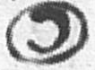과 같고, 대구맥의 형상도 그림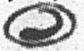과 같아 서로 반대이다.

‘鉤’ 자를 『대소』에서 ‘句’로 쓴 것은 고자(古字)일 뿐이다.

**○平肺脈來，厭厭聶聶，如落榆莢，曰肺平。**

평폐맥(平肺脈)이 오는 것은 염염섭섭(厭厭聶聶)하여 떨어지는 유협(榆莢) 같으니, 이를 폐평(肺平)이라 한다.

〔吳〕염염섭섭은 나풀거리는 모양으로, 가볍게 떠서 매끄럽게 흐르는 것이다.

〔馬〕염염섭섭은 편안하고 고요한 뜻이다.

〔紹〕『성혜방(聖惠方)』에 실린 「십사난(十四難)」 글에는 ‘𣚕𣚕欇欇’으로 되어 있다. 『광운(廣韻)』을 살펴보면 ‘𣚕은 잎이 움직이는 모양이다. 어엽절(於葉切)’이다. 『설문』에 ‘欇은 나뭇잎이 흔들려 희게 보이는 것이다. 木을 따르고 聶이 소리이다’라 하였다. 『이아』에 ‘楓은 欇欇이다’라 하였다. 『설문』에 ‘楓은 단풍나무로, 잎이 두껍고 가지가 약해 잘 흔들리며 일명 聶이다’라 하였다.

〔識〕‘如落榆莢’은 「십오난」에 ‘落’이 ‘循’으로, ‘莢’이 ‘葉’으로 되어 있고, 『갑을』도 같다. ［馬云］가볍고 비어 떠 있다는 뜻이다. ［張云］가볍게 뜨고 화완(和緩)한 모양으로, 곧 미모(微毛)의 뜻이다. 이시진은 말하였다. “느릅나무는 수십 종이 있는데, 협유(莢榆)는 나무가 매우 높고 크며, 잎이 나기 전에 가지 사이에 먼저 유협이 나는데 모양이 엽전 비슷하나 작고 빛이 희며 줄줄이 달려, 세속에서 유전(榆錢)이라 부른다. 그 뒤에 잎이 난다.”

안(案): 본서에서 ‘如落榆莢’이라 한 것이 옳고, 「십오난」과 『갑을』의 글은 모두 그르다. 이는 곧 모맥(毛脈)의 오고 감이 모두 가볍게 뜨면서 위기가 있는 맥상을 말한 것이다.

**○秋以胃氣爲本。**

가을에는 위기를 근본으로 삼는다.

〔楊〕염(厭)은 이엽반(伊葉反)이고, 섭(聶)은 니렵반(尼獵反)이다. 염염섭섭은 사람이 손으로 이미 떨어진 유협을 받아 손가락 아래에서 느끼는 것과 같으니, 이를 폐의 평맥이라 한다.

**○病肺脈來，不上不下，如循雞羽，曰肺病。**

병든 폐맥이 오는 것은 올라가지도 내려가지도 않고 닭의 깃털을 어루만지는 듯하니, 이를 폐병(肺病)이라 한다.

〔楊〕모맥을 누르면 사람이 닭 날개의 깃털을 어루만지는 듯 마음에 느껴지니, 이를 폐의 병맥으로 삼는다.

〔張〕올라가지도 내려가지도 않는 것은 오고 감이 색체(濇滯)한 것이다. 닭의 깃털을 어루만지는 듯한 것은 가볍게 뜨면서 허한 것이다. 이 또한 모가 많고 위기가 적다는 뜻이므로 폐병이라 한다.

**[역1]** 원서 인쇄는 ‘曰血’, 문맥상 ‘月血’일 것이다.
**[역2]** 馬蒔의 『素問注證發微』에는 「脈宜沉細而反實大」로 되어 있어, 원서 「而實大」는 「反」이 빠진 것으로 보인다.
**[역3]** 원서대로 옮겼다. 『難經集註』 여러 판본에도 「後居倨而不動勁有，故曰死也」로 되어 있다.

**○死肺脈來，如物之浮，如風吹毛，曰肺死。**

죽은 폐맥(肺脈)이 오는 것은 깃발이 나부끼는 듯하고 바람이 털을 부는 듯하니, 이를 폐사(肺死)라 한다.

〔楊〕맥의 박동이 겨자잎이 물에 뜬 듯하고 가벼운 털이 바람을 따라 움직이는 듯하니, 이렇게 느껴지는 것을 사맥이라 한다. 오색(五色)은 형체가 있어 눈으로 보기 쉽고, 오성(五聲)은 형체가 없어 귀로 알기가 그다음으로 어렵지만, 오맥(五脈)의 박동은 귀와 눈으로 분별할 수 없어 가장 미묘하다. 오직 손가락 아래의 박동을 취하여 비유로 ‘亦之’할 수 있을 뿐이며, 터득은 신(神)에 달린 것이어서 일로 미루어 알 수 없다.[역3]

안(案): 『설문(説文)』에 “勿은 주리(州里)에서 세우는 깃발이다.”라 하였고, 더러 ‘𣃦’로 쓰며, 지금 『주례(周禮)』에는 ‘物’로 되어 있다. ‘浮’는 ‘披靡’의 급호(急呼)로, 나부낌을 말한다. 이른바 깃발이 나부끼는 듯하다는 것은 가볍게 손에 응하되 뿌리가 없음을 말한다. ‘如物之浮’는 올 때 손에 응하는 것이고, ‘如風之吹毛’는 갈 때 뿌리가 없는 것이다. 곧 모(毛)만 있고 위기(胃氣)가 없다는 뜻이다. 제19에서 말한 “진폐맥(真肺脈)이 이르면 크면서 비어 깃털로 사람 살갗을 스치는 듯하다.”를 참고할 수 있다.

**○平肝脈來，耎弱招招，如揭長竿末梢，曰肝平。春以胃氣爲本。**

평간맥(平肝脈)이 오는 것은 연약(耎弱)하고 초초(招招)하여 긴 장대 끝을 들어 올린 듯하니, 이를 간평(肝平)이라 한다. 봄에는 위기를 근본으로 삼는다.

〔楊〕게(揭)는 기철반(奇哲反)이며 높이 든다는 뜻이다. 간의 현맥(弦脈)은 금슬(琴瑟)을 고른 줄처럼 ‘緣’하지도 급하지도 않고, 또 사람이 대나무 장대 끝을 높이 든 것처럼 초초하여 굳세면서도 연하니, 이것이 평맥이다. ‘緣’은 ‘緩’의 잘못인 듯하다. ‘劲’은 곧 ‘勁’ 자이다. 주문(注文)에 따르면 정문(正文)의 ‘末梢’ 두 글자는 잘못 빠진 것인 듯하다. 어떤 이는 왕씨(王氏)가 양주(楊注)에 근거해 ‘末梢’ 두 글자를 보충한 것이 아닐까 하는데, 그렇지 않다.

〔識〕［馬云］‘招’는 ‘迢’와 같다. 초초(迢迢)한 긴 장대 끝은 가장 연약하여, 들어 올리면 현과 비슷하면서 매우 부드러우므로 평맥이라 한다. ［張云］

게는 높이 든다는 뜻이다. 긴 장대를 높이 들면 끝이 반드시 부드러우니, 곧 화완(和緩)하고 현장(弦長)하다는 뜻이다. ‘招招’는 ‘迢迢’와 같다. 오(吳)의 뜻도 같다. ［志云］손으로 서로 부르는 것을 招라 한다. 초초는 잠깐 엎드리는 상이다. ［高云］유화(柔和)하면서 일어나는 모양이다. ［簡按］『집운(集韻)』에 ‘迢迢는 높은 모양이다’라 하였으나 뜻이 맞지 않는다. 지주(志注)는 『시(詩)』 「패풍(邶風)」 ‘招招舟子’의 소(疏)에 근거하였으니 가장 잘 풀이했다.

안(案): ‘如揭長竿末梢’는 부드러운 가운데 절로 하늘거리는 힘[裊娜之力]이 있음을 말하니, 손 아래와 마음속으로 진찰해 터득해야 한다.

안(案): 초초는 가볍게 들리는[輕佻招翹] 뜻으로, 대나무 장대 끝의 모양을 말한다. 『설문』의 ‘柖는 나무가 흔들리는 모양이다’, 『광운(廣韻)』의 ‘𣬸㲖는 털의 모양이다’, ‘𢁾는 가는 실이다’를 모두 참고할 수 있다. 결국 초초와 초요(招搖)는 뜻이 다르지 않다.

**○病肝脈來，盈實而滑，如循長竿，曰肝病。**

병든 간맥이 오는 것은 가득 차고 실하면서 활(滑)하여 긴 장대를 어루만지는 듯하니, 이를 간병(肝病)이라 한다.

〔楊〕영(盈)은 가득 차고 실한 것이다. 간기(肝氣)가 실활(實滑)하여 긴 장대를 어루만지는 듯하고 위기가 적으므로 간에 병이 있는 것이다.

**○死肝脈來，急益勁，如新張弓弦，曰肝死。**

죽은 간맥이 오는 것은 급하고 더욱 굳세어 새로 맨 활시위 같으니, 이를 간사(肝死)라 한다.

〔楊〕간의 진장맥(真藏脈)이 굳세고 급하게 오는 것이 새로 맨 금슬의 줄과 같아 부드럽게 고른 맛이 없으니, 이는 위기가 없는 것이므로 사후(死候)가 된다.

『갑을(甲乙)』·『맥경(脈經)』에는 ‘急’ 아래 ‘而’ 자가 있다.

**○平脾脈來，和柔相離，如雞踐地，曰脾平。**

평비맥(平脾脈)이 오는 것은 화유(和柔)하고 서로 붙어 있어 닭이 땅을 딛는 듯하니, 이를 비평(脾平)이라 한다.

〔楊〕비의 대맥(大脈)을 눌러 화유한 것은 위기이다. 서로 떨어져 중간이 빈 것은 대(代)이다. 닭이 걸어 땅을 디디면 발자국 중간이 비는 것과 같다. 중간이 대한 것은 좋은 모습이 보이지 않는 것이다.

〔張〕화유는 넉넉하고 급박하지 않은 것이다. 상리(相離)는 고르고 깨끗하여 분명한 것이다. 닭이 땅을 딛는 듯한 것은 조용하고 가벼우며 느린 것이다. 이것이 곧 충화(充和)의 기이며 약간 연약하다는 뜻이니, 비의 평맥이다.

안(案): ‘離’는 이별의 ‘離’가 아니라 붙는다[附離]는 뜻으로 보아야 한다.

**○長夏以胃氣爲本。**

장하(長夏)에는 위기를 근본으로 삼는다.

〔張〕연(耎)하면서 조화로운 것이다.

**○病脾脈來，實而盈數，如鷄舉足，曰脾病。**

병든 비맥이 오는 것은 실하면서 가득 차고 삭(數)하여 닭이 발을 드는 듯하니, 이를 비병(脾病)이라 한다.

〔楊〕실하면서 가득 차고 삭한 것이 닭이 발을 드는 듯하니, 발톱이 모여 중간이 비지 않고 모여서 나쁜 모습이 보인다. 대가 없는 것에 견주므로 이것이 비의 병이다.

〔識〕［張云］실하면서 가득 차고 삭한 것은 강하고 급하여 조화롭지 못한 것이다. 닭이 발을 드는 듯한 것은 가볍고 빨라 느리지 않은 것이다. 앞 편에서는 약(弱)이 많고 위기가 적다 하였고 여기서는 실하면서 가득 차고 삭하다 하였으니, 모두 중화의 기를 잃었으므로 비병이라 한다. 왕기(汪機)는 말하였다. “닭이 땅을 딛는다는 것은 그 가볍고 느림을 형용한 것이다. 닭이 발을 든다는 것은 닭이 달릴 때 발을 드는 것을 말하며, 맥이 실하면서 삭하게 옴을 형용한 것이다. 땅을 딛는 것과 발을 드는 것은 같지 않으니, 땅을 딛는 것은 닭이 놀라지 않고 천천히 가는 것이고, 발을 드는 것은 놀라서 빨리 가는 것이다. 더구나 실삭(實數)은 경완(輕緩)과 반대이니, 양쪽을 마주 보면 더욱 분명하다. 『난경(難經)』에서는 이를 심병으로 보았다.” ［志云］닭의 발에는 네 발톱이 있어 땅을 딛는 것이 매우 화완하니, 비토(脾土)가 네 장을 적셔 줌을 형용한다. 닭이 발을 들면 오그려 거두어들이니 네 장을 적셔 주지 못하는 것이다. ［簡按］왕기와 지(志)의 설은 모두 천착이다.

**○死脾脈來，銳堅如烏之喙，如鳥之距，如屋之漏，如水之流，曰脾死。**

죽은 비맥이 오는 것은 날카롭고 단단하여 까마귀의 부리 같고 새의 며느리발톱 같으며, 지붕이 새는 듯하고 물이 흐르는 듯하니, 이를 비사(脾死)라 한다.

『갑을』에는 ‘銳’가 ‘兌’로 되어 있다.

〔楊〕비맥을 누르면 오는 것이 단단하고 뾰족하게 모여 서로 떨어지지 않으며, 위로 사람의 손가락을 찌르는 것이 새[鳥]의 부리 같고, 흐르는 물의 움직임 같으며, 또 지붕에서 샌 물이 사람의 손가락에 떨어지는 듯하니, 이는 비맥의 사후이다.[역1]

안(案): ‘銳堅’은 위기가 없는 모양이다. 비는 사시(四時)에 응하여 장하에 그치지 않고 사계토용(四季土用)에도 그치지 않으니, 사시 가운데 비위(脾胃)의 기가 있어 고르게 조절하는 것이다. 지금 위기가 없는 맥이 봄에 있으면 날카롭고 단단하여 까마귀 부리 같으니 현만 있고 위기가 없는 것이다. 여름에 있으면 날카롭고 단단하여 새의 며느리발톱 같으니 구(鉤)만 있고 위기가 없는 것이다. 가을에 있으면 날카롭고 단단하여 물이 흐르는 듯하니 모만 있고 위기가 없는 것이다. 겨울에 있으면 날카롭고 단단하여 지붕이 새는 듯하니 석(石)만 있고 위기가 없는 것이다. 까마귀 부리와 새의 며느리발톱은 맥상의 예견(銳堅)을 형용한 것이다. 물이 흐르는 것과 지붕이 새는 것은 맥이 오고 가는 것이 날카롭고 단단함을 형용한 것이다.

**○平腎脈來，喘喘累累如鉤，按之而堅，曰腎平。**

평신맥(平腎脈)이 오는 것은 연약하게 겹겹이 이어져[喘喘累累] 균(鈞)과 같고, 누르면 단단하니, 이를 신평(腎平)이라 한다.

〔楊〕‘旬’은 평평하다는 뜻이다. 손 아래가 견실하면서 평평하니, 이것이 석맥(石脈)의 형상이므로 평맥이 된다. 어떤 판본에는 ‘揣揣果果’로 되어 있다.

〔紹〕옛날에 ‘旬’과 ‘勻’은 많이 통용되었으므로 양(楊)이 旬을 균평(均平)의 뜻으로 보았으나, 喘喘累累에는 전혀 들어맞지 않는다. 이에 살펴보니 『대소(大素)』의 ‘旬’ 자는 곧 ‘銞’ 자이고, ‘如鉤’는 ‘如鈞’의 와자(訛字)인 듯하다. 『설문』에 ‘銞은 고문이다. 鈞은 더러 旬을 따른다’고 하였다. 『회남자(淮南子)』 「원도훈(原道訓)」의 ‘鈞旋轂轉’ 주에 “鈞은 도공이 질그릇을 만드는 기구로 아래에서 돌리는 것이다.”라 하였다. 『한서(漢書)』 「추양전(鄒陽傳)」의 ‘獨化於陶鈞之上’에 장안(張晏)은 “도공이 틀 아래 둥글게 도는 것을 鈞이라 한다.”고 하였다. 如鈞이라 한 것은 곧 이 뜻으로 침유(沈濡)하면서 활한 상이니, 그래야 비로소 여름의 평맥과 구별된다. 선형(先兄)은 말하였다. “［汪云］喘喘累累如鉤는 활하면서 유(濡)함을 말한다. 按之而堅은 유활(濡滑)하면서 힘이 있는 것이다.”

안(案): ‘喘喘’은 ‘冉冉’·‘耎耎’과 같아 연약함을 말한다. ‘累累’는 ‘離離’·‘連連’과 같아 겹겹임을 말한다. 연약하게 겹겹인 가운데 누르면 단단하고 힘이 있어 균(鈞)과 같다는 말이다. ‘如鈞按之而堅’이라 한 것은 도초법(倒草法)이다.

**○冬以胃氣爲本，**

겨울에는 위기를 근본으로 삼는다.

〔張〕석이면서 조화로운 것이다.

**○病腎脈來，如引葛，按之益堅，曰腎病。**

병든 신맥이 오는 것은 칡덩굴을 당기는 듯하고, 누르면 더욱 단단하니, 이를 신병(腎病)이라 한다.

〔楊〕신의 병맥은 누르면 칡덩굴을 당기는 듯 손가락을 따라 내려간다. 더욱 단단하다는 것은, 처음부터 끝까지 단단한 것은 신의 평맥이고, 처음에 연하고 뒤에 단단하므로 신의 병이라는 것이다.

안(案): 『설문』에 “葛은 덩굴이다.”라 하였다. ‘如引葛’이라 한 것은 지극히 단단한 가운데 절로 생의(生意)와 윤택함이 깃들어 있다는 것으로, ‘如奪索’·‘彈石’과는 자연히 다르다.

**○死腎脈來，發如奪索，辟辟如彈石，曰腎死。**

죽은 신맥이 오는 것은 나타남이 밧줄을 누르는 듯하고 벽벽(辟辟)하여 돌을 튕기는 듯하니, 이를 신사(腎死)라 한다.

〔楊〕신의 석맥이 손가락 아래로 오는 것이 밧줄 같은데, 한쪽 끝을 매어 놓고 저쪽 끝을 당기면 밧줄이 빼앗기듯 가 버리는 듯하고, 돌을 튕기는 듯하다. 손가락을 튕기듯 벽벽한 모양이 신의 사맥 증후이다.

안(案): ‘奪’은 ‘捺’과 같다. 『광운』에 ‘捺은 노갈절(奴葛切)이며 손으로 누르는 것이다’라 하였다. 이에 따르면 奪索은 밧줄을 누르는 것을 말한다. 신병의 引葛에 견주어 윤택함을 조금 잃었으므로 사맥이 된다. 또 살펴보건대[又案] 辟辟의 ‘辟’은 ‘拍’을 말한다. 손가락 아래에서 몹시 세차게 뛰어 돌을 튕기는 듯하고 위기가 전혀 없으므로 신의 사맥으로 삼는다.

안(案): 본편은 모두 9장이다. 편 첫머리부터 ‘逆者死’까지가 제1장, ‘春胃微弦’부터 ‘宗氣泄也’까지가 제2장, ‘欲知寸口’부터 ‘曰難已’까지가 제3장, ‘臂多青脈’부터 ‘謂之熱中’까지가 제4장, ‘肝見庚辛’부터 ‘皆死’까지가 제5장, ‘頸脈動喘’부터 ‘姙子也’까지가 제6장, ‘脈有逆從’부터 ‘命曰反四時也’까지가 제7장, ‘人以水穀爲本’부터 ‘浮大而短’까지가 제8장, ‘夫平心脈’부터 편 끝까지가 제9장이다.

만연(萬延) 경신년 11월 초이레, 당직[直] 등불 아래에서 쓰기를 마쳤다.

속독옹(速讀翁) 원립지(源立之)

제18 보(補)

추병(秋病)｟五ウ｠

안(案): 秋病을 여러 주가는 가을이 되어 병드는 것으로 보았다. 나는 그렇게 생각하지 않는다. 겨울에 한(寒)에 상하여 봄에 병들고 여름에 서(暑)에 상하여 가을에 학(瘧)이 되는 따위는 그 뜻이 통한다. 그런데 한 계절을 건너 봄·여름 모두 병들지 않다가 가을이 되어 병들 조짐을 이미 봄철의 맥으로 점친다는 것은 이치상 있을 수 없다. 秋病이란 폐병(肺病)의 뜻이다. 봄에 목(木)이 응하면 간병(肝病)이고, 금(金)이 응하고 목이 쇠하면 도리어 폐병이 나타나므로 이를 秋病이라 한 것이다. 아래도 같다.

〔高〕봄에 위맥이면서 모가 있다고 한 것은 금이 목을 이기는 것이다. 여름에 위맥이면서 석이 있다고 한 것은 수가 화를 이기는 것이다. 장하·가을·겨울은, 하나는 연약하면서 석이 있다 하고, 하나는 모이면서 현이 있다 하고, 하나는 석이면서 구가 있다 하였으니, 모두 내가 이기는 것이 도리어 타는 것이다. 나를 이기는 것이 나를 치는 것은 본기(本氣)가 허하기 때문이고, 내가 이기는 것이 나를 타는 것도 본기가 허하기 때문이다. 봄·여름의 금병(今病)은 모두 극을 받는다고 말하고, 장하의 금병은 본기가 허하다고 말하며, 가을·겨울의 금병은 승모(乘侮)를 말하였다. 이는 극을 받는 것과 승모가 모두 본기의 허에서 비롯함을 밝힌 것으로, 그 뜻을 뒤섞어 놓아 사람들이 이쪽저쪽을 서로 미루어 그 까닭을 알게 하려 한 것이다.

안(案): 고씨(高氏)의 설이 옳으니, 이제 고씨의 설을 따라 다음과 같이 도표를 만든다.

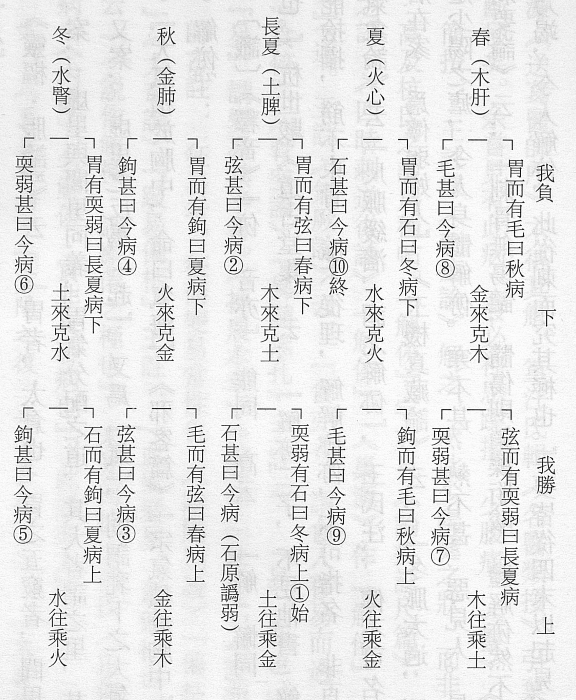

- 我負　下
- 我勝　上
- 春（木肝）→ 胃而有毛曰秋病
- 春（木肝）→ 毛甚曰今病⑧
- 金來克木
- 春（木肝）→ 弦而有耎弱曰長夏病
- 春（木肝）→ 耎弱甚曰今病⑦
- 木往乘土
- 夏（火心）→ 胃而有石曰冬病下
- 夏（火心）→ 石甚曰今病⑩終
- 水來克火
- 夏（火心）→ 鉤而有毛曰秋病上
- 夏（火心）→ 毛甚曰今病⑨
- 火往乘金
- 長夏（土脾）→ 胃而有弦曰春病下
- 長夏（土脾）→ 弦甚曰今病②
- 木來克土
- 長夏（土脾）→ 耎弱有石曰冬病上①始
- 長夏（土脾）→ 石甚曰今病（石原譌弱）
- 土往乘金
- 秋（金肺）→ 胃而有鉤曰夏病下
- 秋（金肺）→ 鉤甚曰今病④
- 火來克金
- 秋（金肺）→ 毛而有弦曰春病上
- 秋（金肺）→ 弦甚曰今病③
- 金往乘木
- 冬（水腎）→ 胃有耎弱曰長夏病下
- 冬（水腎）→ 耎弱甚曰今病⑥
- 土來克水
- 冬（水腎）→ 石而有鉤曰夏病上
- 冬（水腎）→ 鉤甚曰今病⑤
- 水往乘火

검은 글자는 원문이고 붉은 글자는 보충한 글이다. 옛글은 간략하여 이쪽저쪽을 서로 들어 보였는데, 지금 이 보충한 글을 얻으니 그 뜻을 완전히 풀 수 있다. 고씨가 밝혀낸 것이 이와 같다.

금병(今病)｟六ヲ｠

안(案): 今病은 폐금(肺金)이 성하게 응하여 간목(肝木)을 이겨 폐와 간이 함께 병든 것이다. 今病이라 한 것은 봄철에 병든 것을 말한다. 폐병은 가을철에 병들어야 하니, 이는 객문(客文)이 된다는 말이다. 그러나 폐금이 성하게 응하면 간목도 병들므로 ‘毛甚曰今病’이라 한 것이다. 뒤의 사시도 모두 이와 같다.

하위미구왈평(夏胃微鉤曰平)｟七ヲ｠

『맥경』 권3에 말하였다. “여름에 위맥이면서 약간 구한 것을 평이라 하고, 구가 많고 위기가 적은 것을 심병이라 하며, 구만 있고 위기가 없으면 죽는다. 위기가 있으면서 석이면 동병(冬病)이라 하고, 석이 심하면 금병이라 한다.”

허리(虛里)｟十一ウ｠

『장자(莊子)』 「서무귀(徐無鬼)」의 ‘至鄧之虛’를 『석문(釋文)』에서 “虛는 음이 墟이다. 판본에 따라 墟로도 쓴다.”라 하였다. 송(宋) 주거비(周去非)의 『영외대답(嶺外代答)』 권6 「파삼파군(婆衫婆裙)」편에 “새 신부의 옷으로 한 달 동안 입는데, 마을과 저자[虛市]에 드나들 때도 벗지 않는다.”라 하였다. 『문선(文選)』 동방삭(東方朔) 「화찬(畫贊)」의 ‘墟墓徒存’은 왕일소(王逸少)의 글씨본에 ‘虛’로 되어 있다.

『영추(靈樞)』 「창론(脹論)｟卅五｠」에 말하였다. “위는 태창(太倉)이다. 위의 다섯 구멍은 여리(閭里)의 문호이다.”

안(案): 허리는 여리와 뜻이 같다. 위기를 나누어 보내는 길로, 그 큰 것을 里라 하고 작은 것을 門이라 한다. 허리와 기문(氣門)으로 증명할 수 있다.

우안(又案): ‘虛里’의 반절은 ‘起’이고 또 ‘氣’이니, 유방 아래에서 대기(大氣)가 뛰어오르는 것을 말한다. 허리는 ‘氣’의 고언(古言)일 것이다. 「오미편(五味篇)」의 “대기가 흉중에 쌓이니 기해(氣海)라 한다.”와 「사객편(邪客篇)」의 “종기(宗氣)가 흉중에 쌓인다.”로 모두 증명할 수 있다.

해역(解㑊)｟廿一ウ｠

〔識〕『석음(釋音)』에 ‘㑊은 음이 亦이다’라 하였다. 웅(熊)도 같다. ［高云］‘解’와 ‘懈’는 같다. ‘㑊’은 음이 亦이다. 다른 편의 해역도 같으니, 해태(懈怠)와 같다. ［志云］懈는 게으름이다. 항세준(杭世駿)은 『도고당집(道古堂集)』에서 말하였다. “‘解㑊’ 두 글자는 다른 책에 보이지 않는다. 解는 곧 懈이고 㑊은 음이 亦이다. 피곤하여 사지 마디를 떨쳐 일으키지 못하고, 지쳐서 정기(精氣)를 단속하지 못하며, 근이 뼈를 묶지 못하고 맥이 결을 따르지 못하여, 풀어지고 나른해 어느 것이라 지목해 이름할 수 없으니, 백병 가운데 이런 한 증이 따로 있는 것은 아니다. 『내경(内經)』에서 이를 말한 곳은 모두 다섯이다. 「평인기상론(平人氣象論)」에 ‘척맥이 완하고 색한 것을 해역이라 한다’고 하였고, 왕씨 주에 ‘儜하여 이름할 수 없다’고 하였다. 儜은 곤약(困弱)이다. ［按］『송서(宋書)』 「명공왕황후전(明恭王皇后傳)」에 ‘황후는 집에 있을 때 儜弱한 부인이었다’고 하였다. 「옥기진장론」에 ‘겨울맥이 태과하면 사람을 해역하게 한다’고 하였으니, 이는 맥에서 착안한 것이다. 「자학론(刺瘧論)」에 ‘족소양의 학은 사람의 몸을 해역하게 한다. 한이 심하지 않고 열이 심하지 않으며 사람 보기를 싫어하고, 사람을 보면 가슴이 두근거리며, 열이 많고 땀이 몹시 난다’고 하였으니, 이는 학에서 착안한 것이다. 「자요론(刺要論)」에 ‘뼈를 찌를 때 수(髓)를 상하지 말아야 한다. 수가 상하면 삭아 정강이가 시큰하고 몸이 해역하여 떠나지 않는다’고 하였다. 「사시자역종론(四時刺逆從論)」에 ‘여름에 경맥을 찌르면 혈기가 곧 고갈되어 사람을 해역하게 한다’고 하였으니, 이는 자법에서 그 끝을 궁구한 것이다. 요컨대 모두 사지에서 착안한 것이니, 경(經)에서 말한 타태(墮怠)와 같은데 말을 조금 바꾸었고 뜻이 좀 더 미묘할 뿐이다. 송경렴(宋景濂)은 「송갈의사서(送葛醫師序)」에서 그 풀이를 얻지 못하였고, 황강씨(篁江氏)가 엮은 『명의류안(名醫類按)』은 엽씨(葉氏)의 『녹험방(録驗方)』을 인용하여 세속에서 발사(發痧)라 부르는 증으로 보고 따로 한 문(門)을 세웠으니, 몹시 독단적이다. 내가 이 병을 본 적이 있는데, 발작하면 반드시 정신이 조급하고 어지러우며 소복이 아프다. 『영(靈)』·『소(素)』에서는 언급한 적이 없으며 해역의 뜻과 털끝만큼도 관계가 없으니, 크게 잘못된 것이다.” ［簡按］왕주(王註)는 「자학론」에 근거해 풀었으나, 이는 소양학의 증상이지 해역의 뜻이 아니다. 마(馬)·오(吳)·장(張)은 모두 왕주를 따랐으니 모두 따를 수 없고, 다만 지(志)·고(高)와 항씨(杭氏)의 설이 온당하다. ‘解㑊’이라는 글자는 「논질진척편(論疾診尺篇)」에도 보이는데, “척육(尺肉)이 약한 것은 해역이다.”라 하였다. 해역은 곧 ‘懈憻’·‘懈倦’을 말한다. 「사시자역종론」의 ‘解㑊’이 『소원(巢源)』에는 ‘解倦’으로 되어 있으니, 이것이 증거가 된다. ‘㑊’은 곧 ‘亦’ 자이며, 亻을 따른 것은 ‘易’과 통한다. 왕주 「기궐론(氣厥論)」에 “食亦은 먹은 것이 옮겨 바뀌어 지나가서 기부(肌膚)가 생기지 않는 것을 말한다. 亦은 易이다.”라 하였다. 『갑을』은 「기궐론」을 인용하여 ‘食㑊’으로 썼다. 「골공론(骨空論)」의 ‘易髓無孔’에 왕주는 “易은 亦이다.”라 하였다. 이것이 ‘㑊’과 ‘亦’이 같고 ‘易’과 통함을 증명한다. 그리고 ‘易’은 평상의 모습이 변함을 말한다. 『신농본초(神農本草)』 강랑(蜣螂)조의 ‘狂易’을 『증류(證類)』에서 음을 羊이라 한 것은 잘못이다. 『한서』 「외척전(外戚傳)」에 “평소 광역병(狂易病)이 있었다.”고 하였고, 사고(師古) 주에 “광역은 미쳐서 평소의 성품이 변한 것이다.”라 하였다. 「음양별론(陰陽別論)」의 ‘偏枯痿易’에 왕주는 “易은 평소의 쓰임이 변하여 위약(痿弱)하고 힘이 없는 것을 말한다.”라 하였다. 「대기론(大奇論)」의 ‘跛易偏枯’에 왕주는 “혈기가 변하여 편고(偏枯)가 된다.”라 하였다. 이로써 ‘解易’은 곧 ‘解惰’이며 평상의 모습이 변한다는 뜻임을 알 수 있다. 활(滑)이 ‘한 설에는 解極으로 쓰며 해권(懈倦)이 극에 이른 것을 말한다’고 하였는데 무엇에 근거했는지 모르겠다. 우씨(虞氏)의 『정전(正傳)』에 “解는 기육이 풀어 흩어진 것이고 㑊은 근이 묶이지 않는 것이다. 세속에서 사병(砂病)이라 부른다. 『내경』에서 해역이라 이름한 것은 실로 진짜 사병이 아니다.”라 하였으니, 이 설도 크게 잘못되었다.[역2]

안(案): 「지진요론(至真要論)」 ‘少陽之復，辛苦發之’의 주에 말하였다. “땀을 내어 성한 양을 덜어 주지 않으면 열이 안으로 사지에 넘쳐 해역이 되는데 이름 붙일 수 없다. 열이라 하기에도 심하지 않고 한이라 하기에도 심하지 않으며, 강하다 하기에도 심하지 않고 약하다 하기에도 심하지 않아 말로 이름할 수 없으므로 해역이라 한다. 못난 의사는 귀기악병(鬼氣惡病)이라 부른다. 오래도록 그치지 않으면 뼈가 뜨겁고 수(髓)가 마르며 이가 말라 골열병(骨熱病)이 된다. 땀을 내어 양을 덜어 주므로 남은 열이 없다.”

여와잠기지상(如臥蠶起之狀)｟廿三ウ｠

〔紹〕『대소』에는 ‘蠶’ 자가 없다. ［堅案］없는 것이 옳다. 「수창편(水脹篇)」의 “수(水)가 처음 일어날 때 눈두덩 위가 약간 옹(癰)처럼 붓고 막 누웠다가 일어난 모양 같다. 목의 맥이 뛰고 때로 기침하며, 손발 위를 누르면 움푹 들어가 일어나지 않는 것이 풍수부창(風水膚脹)이다.”가 모두 증거가 된다. 왕(王)은 「평열병론(評熱病論)」을 인용해 증거로 삼았다. 그러나 저기서는 눈 아래가 약간 붓고 번들거리는 것을 말하고, 여기서는 눈 위가 두툼하게 허부(虛浮)한 것을 말하니, 환자를 직접 살펴보면 그 증후가 자연히 다르다. 왕주(王注)는 잘못이다.｟『금궤(金匱)』 풍수(風水)에 ‘如蠶新臥起狀’이라는 글이 있는데 ‘蠶’ 자는 연문(衍文)이다. 또 ‘目下如臥蠶’이라는 말이 있는데, 곧 「평열병론」과 같은 뜻이다.｠[역4]

장진(藏真)｟六ヲ｠

〔紹〕선형(先兄)은 말하였다. “살펴보건대[按] 장진은 진장(真藏)의 진이 아니라, 오장 진원(真元)의 기가 각각 오시(五時)에 응하여 맥상으로 나타남을 말한다.”

척색맥활(尺濇脈滑)｟廿二ヲ｠

『영추』 「논질진척」 74에 말하였다. “척부가 활하고 윤택한 것은 풍(風)이다. 척부가 활하고 기름지게 윤택한 것은 풍이다. 척부가 색한 것은 풍비(風痺)이다.”

안(案): 이는 이미 다한(多汗)이므로 피부가 활택하지 않고 거칠고 껄끄러운 것이다. 『영추』에서 말한 ‘風痺’도 이와 같은 이치이다. ‘皮膚澤者風也’라 한 것은 다한을 겪기 전에는 그 피부가 이와 같다는 것이다. 다한을 겪으면 거칠고 껄끄럽게 된다. 그 이치는 같다.

유지하 운운(乳之下云云)｟十三ウ｠

재안(再案): 이 11자는 『대소』에서는 뒷글 속에 있고, 『갑을』에는 없으며, 전원기(全元起)본도 같다. 이에 따르면 이 11자는 앞글 ‘其動應衣’ 아래의 곁기록이 본문에 잘못 섞인 것인 듯하다. 또는 앞글 ‘其動應衣’의 뜻을 다시 풀이한 것인 듯하다. 이런 예가 적지 않다. 유방 아래 허리의 박동은 종기가 유여하여 이곳에 넘쳐 새는 것이라는 말이다. 양주도 이렇게 푼 듯하니, 그 평상의 모습을 말한 것이다. 여러 주가가 모두 종기가 심하게 새는 뜻으로 보아 사후로 여겼는데 옳지 않다.｟이 설이 매우 옳다.｠

십팔(十八)

평인(平人)｟一ヲ｠

소기(少氣)｟二ヲ｠

조(躁)｟二ウ｠

병온(病温)도 같다

대(代)｟七ウ｠

장진(藏真)｟六ヲ、十一ウ｠

현구모석도설(弦鉤毛石圖説)｟十ウ｠

허리(虛里)｟十一ウ、十三ヲ、補ナ｠

해역(解㑊)｟廿一ウ｠

와잠(臥蠶)｟廿三ヲ｠

위(胃)

달(疸)｟廿四ヲ｠

낭간(琅玕)｟廿九ヲ｠

천천(喘喘)｟同ウ｠

대구(帶鉤)｟三十ヲ｠

유엽(榆葉)｟卅ウ｠

물(物)｟卅一ウ｠

초초(招招)｟卅二ヲ｠

순(旬)｟卅四ヲ｠

갈(葛)｟卅四ウ｠

탈삭(奪索)｟卅五ヲ｠

## 소문고주(素問攷注) 권제6

### 중광보주황제내경소문(重廣補注黃帝内經素問) 권제6

#### 옥기진장론(玉機真藏論)편 제19

편 첫머리부터 ‘名曰生機’｟十オ｠까지는 『대소』 권14 「사시맥형(四時脈形)」｟廿ウ｠이다. ‘大骨枯槁’부터 ‘皆死不治也’｟同上｠까지는 「진장맥형(真藏脈形)」｟廿八ウ｠이고, ‘見真藏曰死’부터 ‘帝曰善’까지는 같은 책 권6 「장부기액(藏府氣液)」｟廿九ウ｠이며, ‘凡治病’부터 ‘皆難治’까지는 같은 책 권14 「사시맥진(四時脈診)」이다.

〔箚〕［寛案］편 안의 ‘名曰玉機’는 「옥판론요편(玉版論要篇)」에도 보이는데, 『태소(太素)』에는 모두 ‘生機’로 되어 있고 주의 뜻도 그러하다. 이로써 ‘玉’ 자는 ‘生’으로 써야 함을 알 수 있다. 이 편은 진장과 생기(生機)의 다름을 논한 것으로 그 뜻이 매우 분명하다. ‘玉機’로 쓰면 도리어 뜻이 없어진다. 『상서대전(尚書大傳)』에 “機는 기미[幾]이고 미세함이다. 그 변화는 기미하지만 움직이는 것은 크므로 선기(璇璣)라 한다.”고 하였다.

**[역1]** 원서 인쇄는 ‘鳥’, 경문은 ‘如烏之喙’이니 문맥상 ‘烏’일 것이다.
**[역2]** 원서 인쇄는 ‘懈憻’, 문맥상 ‘懈惰’의 뜻일 것이다.
**[역3]** 원서대로 옮겼다. 「以譬喻亦之」의 「亦」은 뜻이 잘 통하지 않아 「示」의 잘못일 수 있다.
**[역4]** 원서대로 옮겼다. 『景岳全書』·『蘭臺軌範』 등이 인용한 「水脹篇」에는 「目窠上微腫」으로 되어 있다.

**○黃帝問曰：春脈如弦，何如而弦。岐伯對曰：春脈者肝也，東方木也，萬物之所以始生也。故其氣來耎弱輕虛而滑，端直以長，故曰弦。反此者病。**

황제가 물었다. “봄의 맥은 현(弦)과 같다 하니, 어떠해야 현인가?” 기백이 답했다. “봄의 맥은 간(肝)이고 동방의 목(木)이니, 만물이 비로소 생겨나는 바이다. 그러므로 그 기가 오는 것이 연약하고 가볍고 허하면서 매끄러우며, 곧고 길다. 그래서 현이라 한다. 이와 반대되면 병이다.”

〔楊〕사람의 몸은 천지·음양·사시의 기와 모두 같다. 그러므로 안의 몸과 바깥 사물이 다르더라도 봄기운은 함께 일어나고, 간기(肝氣)는 봄에 왕성하다. 그래서 봄의 맥이 오는 것을 초목이 처음 돋아나는 것에 견주니, 거문고 줄을 고르게 맞춘 것처럼 너무 느슨하지도 너무 팽팽하지도 않고, 너무 허하지도 너무 실하지도 않으며, 깔끄럽지도 굽지도 않은데, 간기도 그러하다. 촉촉하고 부드러우며 약하고 연하고 작으며, 떠서 허하고 가볍고 매끄럽고 곧으며, 척부(尺部) 위로 길이가 한 치에 이르므로 현에 견주었다. 軟은 여천반(如遄反)이다.

안(案): 양주(楊注)는 ‘弦’을 거문고 줄의 뜻으로 보았는데, 아마 전해 오는 바가 있어 한 말일 것이다. 그렇다면 본래 ‘絃’으로 써야 한다. 『대소(大素)』에 ‘輕’이 ‘軟’으로 되어 있는 것은 옳지 않으니 잘못인 듯하다. ‘軟’과 ‘濡’는 같은 글자, 같은 뜻이다.

（眉）『대소』 권14 「사시맥형(四時脈形)」에 ‘黃帝問’부터 ‘名曰生機’까지 실려 있다.

（眉）안(案): 현(弦)·구(鉤)·모(毛)·석(石)의 사시맥(四時脈)에서 맥은 삼부구후(三部九候)의 맥이라는 뜻이 아니다. 대체로 온몸 혈기의 형태가 모두 현·구·모·석이 되는 것이다. ‘脈者血之府’가 「맥요정미(脈要精微)」에 나오는 것이 이것이다. 이로 미루어 살피면 간병에는 반드시 현맥이, 심병에는 반드시 구부맥(鉤浮脈)이, 폐병에는 반드시 모약맥(毛弱脈)이, 신병에는 반드시 침석맥(沈石脈)이 나타난다. 그래서 지금 병자의 육맥(六脈) 삼부가 모두 그러한 것이다.

（眉）현·구·모·석 네 맥의 형태는 「평인기상(平人氣象)」에 자세히 보인다.

**○帝曰：何如而反。岐伯曰：其氣來實而強，此謂太過。病在外，其氣來不實而微。此謂不及，病在中。**

황제가 말했다. “어떠한 것이 반대되는 것인가?” 기백이 말했다. “그 기가 오는 것이 실하고 강한 것을 태과(太過)라 하니, 병이 밖에 있다. 그 기가 오는 것이 실하지 않고 미약한 것을 불급(不及)이라 하니, 병이 안에 있다.”

〔楊〕봄의 맥이 굳고 실하며 억세고 곧은 것을 ‘오는 것이 실하고 강하다[來實而強]’고 한다. 이는 봄의 맥에서 소양(少陽)이 남음이 있는 것으로, 사기[耶]가 담부(膽府) 소양에 있으므로 ‘밖에 있다’고 하였다. ‘一曰而弦’이라 한 것은 잘못인 듯하다. 봄의 궐음맥(厥陰脈)이 올 때 실하지 않고 더욱 미약하면 이는 부족이다. 사기가 간장(肝藏) 궐음에 있으므로 ‘안에 있다’고 하였다.

**○帝曰：春脈太過與不及，其病皆何如。岐伯曰：太過則令人善忘忽忽，眩冒而巔疾。**

황제가 말했다. “봄의 맥이 태과하거나 불급할 때 그 병은 각각 어떠한가?” 기백이 말했다. “태과하면 잘 잊고[善忘] 정신이 아득하며[忽忽], 현모(眩冒)하고 전질(巔疾)이 생긴다.”

『천금(千金)』 「간장맥론(肝藏脈論)」에 이 글이 실려 있는데, ‘巔’이 ‘癲’으로 되어 있다.

〔楊〕봄의 맥이 태과[大過]한 것은 사기가 담 소양에 있기 때문이다. 소양의 맥은 가슴속을 돌아 담에 속하여 흩어지고, 위로 간을 거쳐 심을 꿰며, 또 ‘桓角’하여 머리로 올라간다. 그러므로 잘 잊고 정신이 아득하며, 현모하고 전(癲)이 된다.

‘桓角’은 ‘抵扃’의 잘못인 듯하다. 양주는 ‘喜忘’을 간담의 증으로 보았으나, 간담이 부족하면 잘 잊는 병이 되고, 태과하면 잘 성내는 병이 될 것이다. ‘善忘’은 「기교변대론(氣交變大論)」을 따라 ‘善怒’로 써야 한다. 왕주(王注)와 『신교정(新校正)』의 설을 모두 따를 만하다. 대개 忽忽은 현모의 모양을 형용한 말이다. 忽忽은 恍忽이라고도 한다. 한 글자로 말하면 忽이고, 모두 몽매(蒙昧)하다는 뜻이다. 『문선(文選)』 「고당부(高唐賦)」 ‘悠悠忽忽’의 이주(李注)에 “忽忽은 정신이 혼미한 모양이다.”라고 한 것이 증거가 된다. 「기교변대론」에 “심하면 정신이 아득하여 잘 성내고, 현모하며 전질이 생긴다.”라고 하였다. 이는 ‘甚則善怒忽忽，眩冒巔疾’이라 한 것과 같으니, 곧 도초법(倒草法)이다. 어떤 이는 ‘善忘으로 쓴 것이 옳은 듯하다’고 한다. 어째서인가? 간목(肝木)의 맥이 태과하면 반드시 심가(心家)를 핍박하여 심화(心火)가 저절로 쇠하므로 잘 잊는다. 간목의 맥이 불급하면 심화가 저절로 성하므로 잘 성내게 된다. 이 설에도 일리가 있으므로 이제 일단 두 설을 모두 적어 두어 뒷날의 고증을 기다린다. 태과라 한 것은 곧 앞글에서 말한 ‘병이 밖에 있다’이고, 뒷글의 ‘불급’은 곧 ‘병이 안에 있다’를 말한다.

**○其不及，則令人胸痛引背，下則兩脇胠滿。帝曰：善。**

불급하면 가슴이 아프면서 등까지 당기고, 아래로는 양쪽 옆구리[脇胠]가 그득하다. 황제가 말했다. “좋다.”

〔楊〕간이 허하면 가슴이 아프면서 등까지 당기고 양쪽 옆구리가 그득하니, 모두 간장의 병이다. 胠는 거거반(去居反)이다. 겨드랑이 아래 세 치 이하가 협(脅)이다. 협 아래로 팔간(八間)의 바깥까지가 거(胠)이다.

「오장생성편(五藏生成篇)」(제10)에 ‘腹滿䐜脹，支鬲胠脇’이라 하였는데, 왕주에 “胠는 옆구리 위를 말한다.”라고 하였다.｟［案］‘上’은 ‘下’ 자의 잘못인 듯하다.｠ 또 「기부론(氣府論)」에 “족소양(足少陽)의 맥기가 나오는 곳은 겨드랑이 아래 세 치, 옆구리 아래로 거까지 팔간에 각각 하나씩이다.”라고 하였는데, 왕주에 “팔간이라 한 까닭은 겨드랑이 아래 세 치에서 계륵(季肋)까지 모두 여덟 개의 늑골이기 때문이다.”라고 하였다. 또 「자학론(刺瘧論)」｟36｠에 “학(瘧)의 맥이 그득하고 크고 급하면 배수(背俞)를 찌르되, 중침(中鍼)으로 곁의 오거수(五胠俞)를 각각 하나씩 찌르고, 살찌고 여윈 정도에 맞추어 피를 낸다.”라고 하였는데, 왕주에 “오거수는 의희(譩譆)를 말한다.”라고 하였다.

〔高〕거(胠)는 옆구리 곁의 등에 이어지는 곳이다. 오장의 수(俞)는 등의 두 줄에 있고, 그 두 줄 바깥에 다시 두 줄이 있으니, 이것이 이른바 거이다.

『설문(説文)』에 “胳은 겨드랑이 아래이다.”, “胠는 겨드랑이 아래이다.”라고 하였다. 현응(玄應)의 『음(音)』 권5에 『비창(埤倉)』을 인용하여 “胳은 팔꿈치 뒤이다.”라고 하였다. 『광아(廣雅)』 「석친(釋親)」에 ‘胳을 腋이라 한다’고 하였고, 또 ‘膀·胠·胉은 脅이다’라고 하였다.

심동(沈彤)의 『석골(釋骨)』에 “겨드랑이 아래에 있으면서 젖 뒤로 세 치 되는 곳을 거라 한다. 거의 뼈는 다섯이니, 왼쪽을 좌거(左胠), 오른쪽을 우거(右胠)라 한다.”라고 하였다.

『상한직격(傷寒直格)』에 “겨드랑이 아래를 협(脅)이라 하고, 협 아래의 뼈를 늑(肋)이라 하며, 협륵의 아래를 거라 한다.”라고 하였다.

『설문』 단주(段注)에 “두 팔뚝[厷]이 몸에 닿는 곳을 亦이라 하고, 亦 아래를 胳이라 하며 또 胠라고도 하니, 몸이 두 팔뚝에 닿는 곳이다.”라고 하였고, 또 “胳은 팔뚝[厷]에 닿는 곳을 말하고, 胠는 팔[臂]에 닿는 곳을 말한다.”라고 하였다.

**○夏脈如鉤，何如而鉤。岐伯曰：夏脈者心也，南方火也，萬物之所以盛長也。故其氣來盛去衰，故曰鉤。反此者病。**

“여름의 맥은 구(鉤)와 같다 하니, 어떠해야 구인가?” 기백이 말했다. “여름의 맥은 심(心)이고 남방의 화(火)이니, 만물이 성대하게 자라는 바이다. 그러므로 그 기가 오는 것은 성하고 가는 것은 쇠하다. 그래서 구라 한다. 이와 반대되면 병이다.”

〔楊〕여름에는 양기가 성하여 만물이 성대한 자람을 감당하지 못하고 마침내 다시 아래로 드리워지므로 구라 한다. 여름의 맥은 안에서 일어나 위로 손에 이르는데, 그 성함을 감당하지 못하고 돌아서 쇠하고 더뎌지므로 구에 견주었다.

**○帝曰：何如而反。岐伯曰：其氣來盛去亦盛，此謂太過。病在外，其氣來不盛去反盛，此謂不及，病在中。**

황제가 말했다. “어떠한 것이 반대되는 것인가?” 기백이 말했다. “그 기가 오는 것이 성하고 가는 것도 성한 것을 태과라 하니, 병이 밖에 있다. 그 기가 오는 것이 성하지 않고 가는 것이 도리어 성한 것을 불급이라 하니, 병이 안에 있다.”

〔楊〕오고 감이 모두 성한 것은 대양(大陽)의 기가 성한 것이다. 사기(邪氣)가 소양·대양에 있으므로 ‘밖에 있다’고 하였다. 오는 것이 성하지 않은 것은 양기에 쇠함이 있어 맥의 흐름이 쇠하고 더딘 것이고, 가는 것이 도리어 성한 것은 음기가 성하고 실한 것이니, 병이 심장(心藏)에 있다. 그러므로 ‘안에 있다’고 하였다.[역2]

**○帝曰：夏脈太過與不及，其病皆何如。岐伯曰：太過則令人身熱而膚痛，爲浸淫。**

황제가 말했다. “여름의 맥이 태과하거나 불급할 때 그 병은 각각 어떠한가?” 기백이 말했다. “태과하면 몸에 열이 나고 살갗이 아프며 침음(浸淫)이 된다.”

〔楊〕신(腎)은 뼈를 주관하고 수(水)이다. 이제 대양이 크게 성하여 몸의 열이 신을 타니[乘], 미사(微耶)가 되므로 뼈가 아프다. 침음은 번져 자라는 것이다.

〔志〕침음은 살갗에 생기는 창(瘡)이니 화열이 성한 것이다.

안(案): 이는 앞글에서 말한 ‘병이 밖에 있다’는 뜻이니, 곧 침음창(浸淫瘡)을 말한다. ‘膚痛’이 『대소』에 ‘骨痛’으로 되어 있는 것은 옳지 않은 듯하다. 기표의 열창(熱瘡)이므로 살갗이 아픈 것이다. 어떤 이는 ‘이 창은 살갗 위가 아프고 가려운 것이니 말하지 않아도 분명하다. 그렇다면 침음의 창은 본래 내인(内因)의 증이므로 반드시 뼈의 통증이 있을 것이다’라고 하는데, 이 또한 통한다. 『침음고(浸淫考)』가 따로 책으로 있으므로 이제 여기에 덧붙이지 않는다.

（眉）「기교변대론」에 ‘身熱骨痛，而爲浸淫’이라 하였다.

**○其不及，則令人煩心。上見欬唾，下爲氣泄。帝曰：善。**

불급하면 가슴이 답답하다[煩心]. 위로는 해타(欬唾)가 나타나고, 아래로는 기설(氣泄)이 된다. 황제가 말했다. “좋다.”

「해론(欬論)」에 “소장해(小腸欬)의 증상은 기침하면서 방귀가 나오는데, 방귀와 기침이 함께 나온다.”라고 하였다. 『영추(靈樞)』 「전광편(癲狂篇)」의 골전질(骨癲疾)·근전질(筋癲疾)에 모두 “기가 아래로 새면 치료하지 못한다.”라고 하였고, 맥전질(脈癲疾)도 같다. 「오륭진액별(五癃津液別)」에 “날이 차고 옷이 얇으면 오줌과 기가 된다.”라고 하였고, 또 “물이 아래로 방광에 머물면 오줌과 기가 된다.”라고 하였다.

〔楊〕양이 허하고 음이 성하므로 가슴이 답답하다. 심맥(心脈)은 심 속으로 들어가 설본(舌本)에 이어진다. 그러므로 위로 서(噬)가 나타난다. 噬는 시체반(市滯反)이다. 씹어서 침을 뱉는 것을 말한다. 기는 광장(廣腸)에서 새는 기를 말한다.

안(案): 불급은 곧 ‘병이 안에 있다’고 한 것이 이것이다. 「맥해편(脈解篇)」에 ‘所謂得後與氣，則快然如衰云云’이라 하였다. 「지진요론(至真要論)」의 같은 글에는 ‘所謂’ 두 자가 없다. 『영추』 「경맥편(經脈篇)」의 ‘脾動’ 아래도 같다.

（眉）『설부(説郛)』에 『잡찬속(雜纂續)』 1권이 있는데, ‘송(宋) 왕군옥(王君玉)이 엮음’이라 적혀 있다. 그 호소부(好笑部)에 ‘손님을 마주하고 방귀를 뀐다[對客泄氣]’라는 말이 있다.

**○秋脈如浮，何如而浮。岐伯曰：秋脈者肺也，西方金也，萬物之所以收成也。故其氣來輕虛以浮，來急去散，故曰浮。反此者病。**

“가을의 맥은 부(浮)와 같다 하니, 어떠해야 부인가?” 기백이 말했다. “가을의 맥은 폐(肺)이고 서방의 금(金)이니, 만물이 거두어 이루어지는 바이다. 그러므로 그 기가 오는 것이 가볍고 허하면서 뜨고, 오는 것은 급하고 가는 것은 흩어진다. 그래서 부라 한다. 이와 반대되면 병이다.”

〔楊〕가을에는 양기가 이미 쇠하고 음기가 아직 크지 않아 그 기가 가볍고 허하며, 오는 것은 급하고 가는 것은 떠서 흩어지므로 ‘부와 같다’고 하였다.

〔琦〕금기(金氣)는 거두어 내리는데 맥이 뜨는 것은 육양(六陽)이 성대하게 자란 뒤를 이어 양기가 조금 내려와 피부에서부터 점차 내려가기 때문이니, 이른바 가을날에 피부 아래로 내려가고 칩충(蟄蟲)이 떠나려 하는 것으로, 봄·여름의 뜬 맥과는 다르다. 오는 것이 급하고 가는 것이 흩어진다는 것은 곧 ‘厭厭聶聶如落榆莢’의 뜻이지, 억세고 급하며 어지럽게 흩어진다는 말이 아니다.

（眉）‘如浮’의 ‘浮’는 곧 ‘孚’의 가차자이니, 설명은 보(補) 가운데｟一ウ｠에 있다.

**○帝曰：何如而反。岐伯曰：其氣來毛而中央堅，兩傍虛，此謂太過。病在外，其氣來毛而微，此謂不及，病在中。**

황제가 말했다. “어떠한 것이 반대되는 것인가?” 기백이 말했다. “그 기가 오는 것이 터럭 같으면서 가운데는 단단하고 양옆은 허한 것을 태과라 하니, 병이 밖에 있다. 그 기가 오는 것이 터럭 같으면서 미약한 것을 불급이라 하니, 병이 안에 있다.”

〔楊〕그 맥이 오는 것이 손으로 터럭을 누르는 듯한데 터럭의 가운데가 단단하면 이는 양이 성한 것이다. 병이 대장 수양명(手陽明)에 있으므로 ‘밖에 있다’고 하였다. 손으로 터럭을 누르는 듯한데 터럭의 가운데가 미약하면 폐기가 쇠미한 것이므로 ‘안에 있다’고 하였다.

〔識〕［吳云］가운데가 단단하다는 것은 뜨면서 가운데가 단단한 것이다. 장(張)도 같다. ［簡按］하씨(何氏)의 『의편(醫碥)』에 “虛는 散과 같다. 오직 양옆만 흩어지고 가운데는 흩어지지 않으니, 위에서 말한 ‘가는 것이 흩어진다’는 것과 다르다.”라고 하였다.

〔紹〕［琦曰］가운데가 단단하고 양옆이 허하다는 것은 곧 닭의 깃을 쓰다듬는 것과 같다. ［堅按］이는 앞 편의 왕주에 근거한 것이다.

**○帝曰：秋脈太過與不及，其病皆何如。岐伯曰：太過，則令人逆氣而背痛，慍慍然。**

황제가 말했다. “가을의 맥이 태과하거나 불급할 때 그 병은 각각 어떠한가?” 기백이 말했다. “태과하면 기가 거슬러 오르고 등이 아프며, 온온(慍慍)하게 열이 난다.”

〔楊〕부(府)의 양기가 성하면 기가 거슬러 오르면서 등까지 이어 아프고, 온온(温温)하게 열이 나지만 심하지 않다.

안(案): ‘慍慍’은 『맥경(脈經)』에도 ‘温温’으로 되어 있으니 따를 만하다. 폐맥이 태과하면 폐가 기를 주관하므로 기가 거슬러 오른다는 말이다. 등은 양의 부위이므로 등이 아프면서 열이 나는데, 그 열의 모양이 온온한 것이다. 이것이 병이 밖에 있다는 것이니, 온온은 곧 열이다. 양상선은 온화하다는 ‘温’으로 보았으므로 ‘온온하게 열이 나지만 심하지 않다’고 하였는데, 옳지 않은 듯하다.

**○其不及則令人喘，呼吸少氣，而欬上氣見血，下聞病音。帝曰：善。**

불급하면 숨이 차고 호흡에 소기(少氣)하며, 기침하고 상기(上氣)하며 피가 보이고, 아래에서 병든 소리가 들린다. 황제가 말했다. “좋다.”

〔楊〕폐기가 부족하면 숨이 차고 기침하며 상기하고, 침에 피가 섞이며, 아래로 가슴속에서 숨찬 소리가 들린다.

〔識〕［張云］아래에서 병든 소리가 들린다는 것은 숨이 찰 때 목구멍 아래에서 소리가 난다는 말이다. ［志云］허기가 아래로 거스르면 신음하는 병든 소리가 들린다. 오(吳)는 ‘下’를 ‘及’ 자로 고쳤다. ［簡按］‘下’ 자는 온당하지 않으니, 일단 장의 뜻을 따른다.

왕주에 “아래에서 병든 소리가 들린다는 것은 숨이 찰 때 폐 속에서 소리가 난다는 말이다.”라고 하였으니, 양(楊)·장(張)과 설이 같다.

〔箚〕「골공론(骨空論)」에 ‘其上氣有音者，治其喉中央在缺盆中者’라 하였다.

안(案): ‘下聞病音’은 ‘欬上氣’와 대를 이루는 글이다. 따라서 목구멍 속의 수계성(水雞聲)을 가리켜 ‘아래에서 병든 소리가 들린다’고 한 것이니, 모두 안에 있는 병이다. 입으로 나오는 기침 소리에 견주면 숨찬 소리는 아래에 있는 것이다.

**○冬脈如營，何如而營。岐伯曰：冬脈者，腎也，北方水也，萬物之所以合藏也。故其氣來沈以搏，故曰營。反此者病。**

“겨울의 맥은 질그릇[營]과 같다 하니, 어떠해야 질그릇 같은가?” 기백이 말했다. “겨울의 맥은 신(腎)이고 북방의 수(水)이니, 만물이 거두어 갈무리되는 바이다. 그러므로 그 기가 오는 것이 가라앉으면서 손에 부딪는다. 그래서 질그릇[營] 같다고 한다. 이와 반대되면 병이다.”

〔楊〕營은 모인다는 뜻이다. 만물이 거두어 갈무리되어 뿌리로 돌아가니, 기도 깊이 뼈에 닿고 가라앉아 모여 안에서 영위하므로 ‘영과 같다’고 하였다.

안(案): ‘營’은 ‘罌’의 가차인 듯하다. 영실(營實)의 ‘營’이 역시 ‘罌’의 차자(借字)인 것과 같다. 『설문』에 ‘罌은 장군[缶]이다’, ‘罃은 불을 막는 데 쓰는 목이 긴 병이다’라고 하였다. 대개 罌과 罃은 본래 같은 글자인데 후세에 마침내 두 가지 뜻이 되었으므로 허씨(許氏)가 두 글자로 나누었다.｟『설문』에는 이런 예가 한둘이 아니다.｠ 여기서 ‘如營’이라 한 것은 ‘如石’과 같은 뜻이니, 질그릇과 돌은 똑같이 단단하므로 서로 바꾸어 일컬을 수 있다. 곧 현·구·모와 함께 사물의 재질이며, 또 인가의 곁에서 늘 쓰는 그릇이므로 비유로 삼았을 뿐이다. 지금까지 여러 주가가 영동(營動)의 뜻｟양(楊)·왕(王)｠으로 보거나 영루(營壘)의 ‘營’｟오(吳)·마(馬)·장(張)｠으로 본 것은 모두 옳지 않다.

**○帝曰：何如而反。岐伯曰：其氣來如彈石者，此謂太過。病在外。**

황제가 말했다. “어떠한 것이 반대되는 것인가?” 기백이 말했다. “그 기가 오는 것이 돌을 튕기는 듯한 것을 태과라 하니, 병이 밖에 있다.

〔楊〕그 맥이 돌과 같은 것을 평맥으로 삼는다. 탄석(彈石)은 석맥(石脈)이 위로 올라와 손을 튕겨 돌이 손을 치는 듯한 것을 말한다. 돌로 튕기는 듯한 것은 신(腎)의 대양의 기가 남음이 있는 것을 말하니, 병이 방광 대양에 있으므로 ‘밖에 있다’고 하였다.

「오장생성(五藏生成)」 왕주에 “안색이 누런 자는 그 맥이 대(代)하고, 안색이 검은 자는 그 맥이 단단하다.”라고 하였다.

**○其去如數者，此謂不及。病在中。**

그 가는 것이 찢어진 비단[數]과 같은 것을 불급이라 하니, 병이 안에 있다.”

〔楊〕신기가 부족하므로 그 기가 갈 때 누르면 터럭을 누르는 듯하니, 병이 신에 있으므로 ‘안에 있다’고 하였다. 어떤 본에는 ‘如數’로 되어 있다.

「대기론(大奇論)」에 “맥이 오는 것이 삭(數)과 같으면 사람이 갑자기 놀란다.”라고 하였고, 또 “맥이 오는 것이 부합(浮合)하여, 부합이 수와 같아 한 호흡에 열 번 이상 뛰면 이는 경기(經氣)가 부족한 것이다.”라고 하였으며, 또 “맥이 오는 것이 섶에 불이 붙어 타오르는 듯하다.”라고 하였고, 또 “맥이 오는 것이 흩어지는 잎 같고, 성객(省客) 같고, 환니(丸泥) 같고, 횡격(橫格) 같고, 현루(弦縷) 같고, 교칠(交漆) 같고, 용천(涌泉) 같고, 무너지는 흙의 모양 같고, 현옹(懸雍) 같고, 언도(偃刀) 같고, 환(丸) 같고, 화(華) 같다.”라고 하였다. 이로 보면 또 ‘如數’라 한 것의 ‘數’는 어떤 기물을 가리키는 것이지, 빈삭(頻數)의 뜻이 아닌 듯하다.

안(案): ‘數’는 ‘愉’의 가차자인 듯하다. 『설문』에 ‘愉，正耑裂也’라 하였고, 『광운(廣韻)』에 ‘愉，裂繒’이라 하였다(평성 10 우(虞), 산추절(山芻切)). 그 맥기가 오는 것이 돌을 튕기는 듯하다는 것은 단단함을 말하고, 가는 것이 찢어진 비단 같다는 것은 연함을 말한다. 곧 모(毛)와 같은 뜻이다. 제가들은 긴삭(緊數)의 ‘數’로 보았으므로 모두 그 풀이를 잃었다. 또 『광운』 거성 10 우(遇)에서 ‘數’와 ‘愉’가 음이 같고 ‘愉，裁殘帛也’라 하였으니 이것도 증거가 된다. 또 『옥편(玉篇)』에 ‘毹，山于切。〓、毹、氀同上’이라 하였고, 『광운』에서 ‘毹’와 ‘愉’가 음이 같으니, 이 역시 증거로 삼을 만하다.[역1][역3]

**○帝曰：冬脈太過與不及，其病皆何如。岐伯曰：太過，則令人解㑊，脊脈痛，而少氣不欲言。**

황제가 말했다. “겨울의 맥이 태과하거나 불급할 때 그 병은 각각 어떠한가?” 기백이 말했다. “태과하면 해역(解㑊)하고 척맥(脊脈)이 아프며, 소기하여 말하기 싫어한다.”

〔楊〕태과는 신（足으로 써야 함）태양이 성한 것이다. 대양의 맥은 머리·등·다리로 가므로 기가 성하면 몸이 해역한다. 解는 음이 해(懈)이고, 㑊은 전하는 바로는 음이 역(亦)이니, 게을러 움직이기 어려움을 말한다. 대양이 성하고 나면 신의 음기가 줄어 소기하고, 소기하므로 말하기 싫어한다.

안(案): 해역과 척통은 모두 병이 밖에 있는 것이다. 소기하여 말하기 싫어하는 것은 척통이 극심하여 마침내 이 증에 이른 것이다. 대개 중풍불수(中風不隨)의 부류에서 그 맥이 홍대(洪大)하고 힘이 있는 것은 해역에 탄석맥이 나타나는 것과 같은 이치이다.

해역은 이미 제18편에 보인다.

『대소』에 ‘脊脈痛’이 ‘腹痛’으로 되어 있는 것은 ‘脊’ 자가 잘못 빠지고 ‘脈’ 자가 또 ‘腹’으로 잘못된 것이 아닐까 한다. 양주에 ‘背’라 하고 ‘腹’이라 하지 않았으므로 그러함을 알 수 있다.

안(案): 사시의 맥형은 「평인기상론(平人氣象論)」(제18)과 「십오난(十五難)」에도 보이며, 그 이치가 모두 같으니 함께 살펴야 한다.

**○其不及，則令人心懸如飢，䏚中清，脊中痛，少腹滿，小便變。帝曰：善。**

불급하면 심현(心懸)하여 굶주린 듯하고, 䏚 부위가 서늘하며[䏚中清], 등골 속이 아프고, 소복(少腹)이 그득하며, 소변의 색이 변한다. 황제가 말했다. “좋다.”

〔楊〕신맥(腎脈)은 위로 심에 들어가므로 신이 허하면 심이 매달린 듯하여 굶주림을 앓는 것과 같다. 등골 속에 신기가 부족하므로 아프다. 또 소복(小腹)이 허하면서 그득하고 소변의 색이 변한다.

서견(徐堅)의 『초학기(初學記)』 권20에 진(晉) 속석(束晳)의 「빈가부(貧家賦)」를 인용하여 “마음은 괴롭고 굶주림은 매달린 듯하다[心苦苦而飢懸].”라고 하였다.

안(案): ‘心懸’이 『대소』에 ‘心如懸’으로 되어 있으나 그 뜻은 같다. ‘懸’은 ‘絃’·‘弦’ 등의 글자와 음이 같아 통용한다. 심현(心懸)은 심하현벽(心下絃癖)을 말한다. 심여현(心如懸)은 심하의 벽기(癖氣)가 활시위처럼 뻗쳐 일어나는 것을 말한다. ‘痃癖’이라는 글자를 『병원(病源)』에서는 ‘懸癖’으로 썼고, 『의심(醫心)』에 인용된 『통현(通玄)』에서는 ‘絃癖’으로 썼으니, 증거로 삼을 수 있다. 『병원』 권20에 “현벽(懸癖)은 벽기가 옆구리와 늑골 사이에 있어 활시위처럼 뻗쳐 일어나고, 기침하거나 침을 뱉으면 옆구리 아래가 당겨서 매달리듯 아픈 것을 말하니, 그래서 현벽이라 한다.”라고 하였다. 『의심』 권9 제8에 “『통현』에 ‘현벽(絃癖)의 병도 한 가지만은 아니다. 현병(絃病)은 간에서 생기는 것이고, 벽병(癖病)은 비에서 이루어지는 것이다. 현은 왼쪽에서 생기고 벽은 오른쪽에서 이루어진다. 현은 활의 시위와 같으니 간에서 생긴다. 간과 담은 청정한 부(府)로 바깥의 사기를 받지 않으므로 스스로 병이 생김을 알 수 있다. 벽은 비위가 수곡의 바다인데 음식이 소화되지 않아 한쪽으로 치우치므로 벽이라 이름한다. 현과 벽을 하나로 합쳐 같은 병으로 치게 하는 것은 실로 어렵다’고 하였다.”라고 하였다. 『신농본초경(神農本草經)』 상권에 ‘백호(白蒿)는 심현으로 적게 먹고 늘 배고픈 것을 치료한다’고 하였으니, 본 조문의 ‘心懸如飢’와 꼭 같으며, 심하가 매달려 당기면서 급하게 아픈 것을 말한다. 대개 신이 허하여 수(水)를 제어하지 못하므로 수가 심하에 머물러 유음(留飲)의 여러 증이 된다. 『금궤(金匱)』에서 말한 ‘현음(懸飲)’과 그 증이 조금 같으나, 다만 허실의 구별이 있다. 허증은 심현이 되고 실증은 현음이 될 뿐이다. 『금궤』 중권 제12에 “음식을 먹은 뒤 수가 옆구리 아래로 흘러 기침하거나 침을 뱉으면 당겨서 아픈 것을 현음이라 한다. 현음은 십조탕(十棗湯)으로 주치한다.”라고 하였다. 흑자(黑字)에 “대조(大棗)는 번민(煩悶)과 심하현(心下懸)을 없앤다.”라고 하였으니, 이것이 현음 실증을 말한다. 『금궤』 「심통편(心痛篇)」의 ‘심중비(心中痞)에 여러 역(逆)으로 심이 매달리듯 아프면 계지생강지실탕(桂枝生薑枳實湯)으로 주치한다’는 조문이, 『외대(外臺)』 권7 심하현급오통문(心下懸急懊痛門)에 인용된 중경(仲景)의 『상한론(傷寒論)』에는 ‘심하가 매달리듯 아프고 여러 역으로 크게 허한 자는 계심생강지실탕(桂心生薑枳實湯)으로 주치한다’로 되어 있다. 방문 뒤에 범왕(范汪)도 같다고 하였다. 『주후(肘後)』에는 이 처방을 실어 ‘심하가 당기고 급하며 오통하는 것을 치료하는 방’으로 썼고, 『병원』 권16 심현급오통후(心懸急懊痛候)에 “그 통증이 매달리듯 급하고 괴로운 것은 사기가 양을 핍박하여 기가 펴지지 못하고 막혀 정체되어 열이 생기므로, 심이 매달린 듯 급하고 번오(煩懊)하며 아픈 것이다.”라고 하였으니, ‘매달린 듯 급하다’고 한 것 역시 활시위처럼 급하다는 말이다. 또 『천금』에 심중｟『외대』에는 ‘心下’로 되어 있다｠비(痞)에 여러 역으로 매달리듯 아픈 것을 계심삼물탕(桂心三物湯)으로 주치하는 방이 있고, 또 「양태편(養胎篇)」에 ‘임신 9개월에 갑자기 하리(下痢)를 얻어 배가 그득하고 매달리듯 급하다’고 하였으며, 또 2개월 애엽탕(艾葉湯) 조문에 ‘심이 그득하고 배꼽 아래가 매달리듯 급하다’고 하였고, 『천금익(千金翼)』 양성복이(養性服餌)의 진심원(鎮心圓) 조문에 ‘심하가 매달리듯 급하다’고 하였으니, 모두 현급(弦急)의 뜻으로 심현 허증을 말한다. 자세한 것은 ‘懸’의 풀이에 갖추어 두었다.

안(案): 䏚는 「자요통론(刺腰痛論)」 왕주에 “䏚는 계협(季脇) 아래의 비고 연한 곳을 말한다.”라고 하였다. 『석음(釋音)』에 ‘䏚，亡表切’｟ヒハラ、ヨワゴシ｠이라 하였다. 양상선(楊上善)은 “䏚는 비소반(比沼反)이다. 거(胠)의 빈 곳이다.”라고 하였다. 장개빈(張介賓)은 “䏚는 옆구리뼈의 끝으로, 두 신에 해당하는 곳이다.”라고 하였다. 고세식(高世栻)은 “䏚는 옆구리뼈 끝의 늑골 끝자리이다. 䏚와 秒는 음이 渺로 같다.”라고 하였다. 유반 선생(柳沜先生)은 “『예(禮)』 「삼년문(三年問)」｟（‘深衣’로 써야 함）｠에 ‘띠는 아래로 넓적다리뼈를 누르지 않고 위로 옆구리를 누르지 않으며, 뼈가 없는 곳에 닿게 한다’고 하였으니, 이것이 곧 䏚이다.”라고 하였다.

『천금』 권4 「대하누하편(帶下漏下篇)」에 “심중이 매달린 듯 허하다.”라고 하였다.

우안(又案): 제7편에 ‘一陽發病，爲心掣’이라 하였다. 심체(心掣)는 곧 심현이다. 설명은 그곳에 있다.｟六ヲ｠

『천금방(千金方)』 권4 「월수불통(月水不通)」 제2편 건강원(乾薑圓) 아래에 “심하가 늘 매달리듯 아파 괴롭다.”라고 하였다. 『천금』 권2 「양태편」 제3 반하탕(半夏湯) 아래에 “배가 그득하고 매달리듯 급하다.”라고 하였다. 『천금』 권19 제8편에 “건중탕(建中湯)은 뱃속이 매달리듯 급하고 절상(絕傷)이 있는 것을 치료한다.”라고 하였다.

『영추』 권5 「경맥편」 제10에 “신은 족소음(足少陰)이니, 시동병(是動病)이면 심이 매달린 듯 굶주린 듯하다.”라고 하였다.

또 권11 「사전편(師傳篇)」 제29에 “위 속에 열이 있으면 곡식이 잘 소화되어 심이 매달리는 듯하고 잘 굶주리게 된다.”라고 하였다.

『금궤』 「금수어충금기편(禽獸魚蟲禁忌篇)」에 “개고기를 먹고 소화되지 않으면 심하가 단단하거나 배가 불러 오르고, 심이 급하며 열이 난다.”라고 하였다.

『소문(素問)』 권22 「지진요대론(至真要大論)」에 “태음(太陰)이 사천(司天)하면 음비(陰痺)는 눌러도 만져지지 않고, 허리·등골·머리·목이 아프며, 때로 어지럽고, 대변이 어렵고, 음기가 쓰이지 못하며, 굶주려도 먹으려 하지 않는다. 기침하고 침을 뱉으면 피가 있고, 심이 매달린 듯하니, 병의 근본이 신에 있다.”라고 하였다.

『외대』 권7에 「심하현급오통방(心下懸急懊痛方)」 편이 있다. 또 권17 「신기부족편(腎氣不足篇)」에 “심사(深師)가 신기 부족으로 심현하고 소기한 것을 치료하는 방”이라 하였다. 또 권13

「전시방편(傳屍方篇)」에 “『소유론(蘇遊論)』에 ‘혹 두근거림이 많고 심이 매달린 듯하며 기가 모자란다’고 하였다.”라고 하였다.

『본초(本草)』 대조의 흑자 ‘心下縣’이 『의심방(醫心方)』 「식치(食治)」 권에 인용된 곳에는 ‘懸’으로 되어 있다.

〔識〕‘小便變’ 아래에 『갑을(甲乙)』에는 ‘黃赤’ 두 자가 있다. ［張云］변한다는 것은 누렇거나 붉거나, 유뇨·임증이 되거나 융폐(癃閉)가 되는 부류를 말하니, 신수(腎水)가 부족하여 그러한 것이다.

（眉）「병능론(病能論)」 ‘故人不能懸其病也’의 왕주에 “그러므로 사람이 그 병처를 공중에 매달아 둘 수 없다.”라고 하였다. 이 ‘懸’ 자는 ‘心懸’과 뜻이 전혀 다르다.

（眉）『병원』 권20 「현음후(懸飲候)」에 “옆구리 아래로 흘러 머물러 옆구리 사이가 매달리듯 아프고, 기침하거나 침을 뱉으면 옆구리가 당겨서 아프므로 현음이라 한다.”라고 하였다.

（眉）『금궤』 「오장풍한편(五藏風寒篇)」에 “심중풍(心中風)은 흡흡(翕翕)하게 열이 나고 일어나지 못한다. 심중이 굶주린 듯하고 먹으면 곧 구토한다.”라고 하였다.

（眉）『천금』 권30 「심병편(心病篇)」에 “신수(腎輸)·복류(復留)·대릉(大陵)·운문(雲門)은 심통이 매달리는 듯한 것을 주치한다. 간사(間使)는 심이 매달려 굶주린 듯한 것을 주치한다. 연곡(然谷)은 심이 매달린 듯하고 소기하여 숨이 모자란 것을 주치한다.”라고 하였다.

（眉）『병원』 권20 「벽결후(癖結候)」에 “이는 마신 물이 모여 머물러 흩어지지 않아, 때로 활시위처럼 옆구리 아래에 뻗쳐 일어나는 것이다.”라고 하였다.

（眉）『갑을』 권9 「사재심(邪在心)」 제5편에 “심통으로 잘 슬퍼하고 궐역(厥逆)하며, 심이 매달려 굶주린 듯한 모양이고, 심이 두려워 놀라면 대릉과 간사로 주치한다.”라고 하였고, 또 “심이 매달린 듯하고 슬프면서 어지러우며 잘 두려워하고 운운, 침이 많이 나오고 숨이 차며 소기하고 흡흡(吸吸)하여 숨이 모자라면 연곡으로 주치한다.”라고 하였다.[역4]

（眉）『수경(水經)』 「하수주(河水注)」에 황의중(黃義仲)의 『십삼주기(十三州記)』를 인용하여 “현(縣)은 현(弦)이다. 활시위는 곧기 때문이니, 아랫사람의 자리에 있으면서 백성과 이웃하는 지위에서 그 맹세를 가벼이 하지 않고, 먹줄을 치듯 법을 쓰되 활시위처럼 굽히지 않음을 말한다. 弦의 소리가 縣과 가까우므로 이로써 이름을 삼았다.”라고 하였다.

안(案): 심현의 ‘心’은 심하의 격부(鬲部)를 가리키니, 중경의 사심탕(寫心湯)의 ‘心’과 같다. 심하도 심부(心部)이다.

（眉）심금오(沈金鰲)의 『존생서(尊生書)』에 “현(痃)은 매달린다[懸]는 뜻이다. 뱃속에 매달려 있으며, 배꼽 가까이 좌우에 각각 한 가닥의 근맥(筋脈)이 불거져 일어난다. 큰 것은 팔뚝 같거나 대통 같고, 작은 것은 손가락 같거나 붓대 같거나 활시위 같다 운운.”이라 하였다.

（眉）『영추』 「경맥」에 “비태음(脾太陰)은 심하가 급하게 아프다.”라고 하였다.

（眉）『천금』 권17 제2편 사폐산(瀉肺散)에 ‘心下弦急’이라 하였다. （眉）『상한론』 「불가한편(不可汗篇)」에 ‘심이 오뇌(懊憹)하여 굶주린 듯하다’고 하였다. 『천금』 건중탕에 ‘뱃속이 매달리듯 급한 것을 치료한다’고 하였다.｟十九ノ廿二オ｠

（眉）『태평어람(太平御覽)』 권347에 『관공명별전(管公明別傳)』을 인용하여 “심중이 매달리듯 아파 먹고 마시지 못한다.”라고 하였다. 『장자(莊子)』 「열어구(列禦寇)」의 『석문(釋文)』에 『삼창(三蒼)』을 인용하여 “懁은 배가 급한 것이다.”라고 하였다. 『맥경』 권2 제3편에 “심하가 구급(拘急)하다.”라고 하였다. 『옥편』에 “䏹은 배의 䏹이다.”라고 하였다. 『광운』 27 선(銑)에 “臔은 살이 급한 것이다.”라고 하였다. 『소문』 「음양별(陰陽別)」에 “그것이 전하면 심체가 된다.”라고 하였다.

**[역1]** 『옥편』 인용의 ‘〓’는 코드 없는 글자로, 〓 를 그대로 둔다. 毹의 이체 나열 첫째이며, 毛가 吏(또는 叓)를 왼쪽 아래로 감싼 꼴이다. 통행 글자로 적으면 뒤의 ‘毹’와 겹치므로 적지 않았다. 나열 둘째가 표제와 같은 ‘毹’로 인쇄되어 있는데, 본래는 표제와 다른 이체자였을 것으로 추정된다.

**[역2]** 원서대로 두었다. 『太素』 사본들에도 「故曰在中之」로 되어 있으나 다른 판본에는 「故曰病在中」으로 되어 있고, 앞의 「故曰在外也」에 비추면 「之」는 「也」의 뜻일 수 있다.
**[역3]** 원서대로 옮겼다. 풀이가 「正耑裂」, 「裂繒」, 「裁殘帛」로 모두 비단을 찢거나 자르는 일에 관한 것이어서 「愉」는 巾변 글자의 잘못일 수 있다.
**[역4]** 원서와 『甲乙經』 여러 판본에 모두 「譫譫」으로 되어 있으나, 바로 다음 조문의 「心澹澹而善驚恐」에 비추어 두려워하는 뜻의 「憺憺」·「澹澹」 계열 글자일 수 있어 그 뜻으로 옮겼다.

**○帝曰：四時之序，逆從之變異也。然脾脈獨何主。**

황제가 말했다. “사시의 차례에 따라 역(逆)·종(從)의 변화가 다르다. 그런데 비맥(脾脈)만은 무엇을 주관하는가?”

〔楊〕사시와 네 장의 기후, 맥의 역순, 현(弦)·구(鉤)·부(浮)·영(營), 태과·불급 등의 변화가 여러 갈래임은 이미 들었다. 그런데 네 장의 맥은 사시에 왕성한데, 비맥만은 어느 때를 주관하는지 아직 모른다는 것이다.

**○岐伯曰：脾脈者，土也。孤藏以灌四傍者也。**

기백이 말했다. “비맥은 토(土)이다. 고장(孤藏)으로서 사방을 적셔 주는 것이다.”

〔楊〕孤는 존귀하게 홀로 있다는 뜻이다. 오행 가운데 토만이 존귀하여 사계(四季)에 왕성하니, 비가 토이다. 그 맛은 달고 담담하여 시고 쓰고 맵고 짠맛의 바탕이 되며, 그 진액이 사방의 장을 적셔 준다. 그 맥은 관(關)의 중궁(中宮)에 있고 사시에 홀로 나타나지 않으므로 때를 주관하지 않는다.

**○帝曰：然則脾善惡，可得見之乎。岐伯曰：善者不可得見，惡者可見。**

황제가 말했다. “그렇다면 비의 좋고 나쁨을 볼 수 있는가?” 기백이 말했다. “좋은 것은 볼 수 없고, 나쁜 것은 볼 수 있다.”

〔楊〕좋다는 것은 평화로워 병들지 않은 맥을 말한다. 현·구·부·영의 네 맥이 나타날 때 모두 비위의 기가 적셔 주어 함께 나타나므로 네 장의 맥이 늘 평화로울 수 있다. 그렇다면 비맥은 다른 맥으로 좋음을 삼고 스스로는 따로 좋음이 없으므로 ‘좋은 것은 볼 수 없다’고 하였다. 나쁜 것은 병맥이니, 비가 사기를 받으면 맥이 관 가운데 나타나 진찰하여 알 수 있으므로 ‘볼 수 있다’고 하였다.

**○帝曰：惡者何如可見。岐伯曰：其來如水之流者，此謂太過，病在外。如鳥之喙者，此謂不及，病在中。**

황제가 말했다. “나쁜 것은 어떻게 볼 수 있는가?” 기백이 말했다. “그 오는 것이 물이 흐르는 듯한 것을 태과(太過)라 하니 병이 밖에 있고, 새가 쪼는 듯한 것[如鳥之喙]을 불급(不及)이라 하니 병이 안에 있다.”

〔楊〕관에 닿은 손가락 아래에 맥이 있어 물이 흐르듯 움직이면 곧 비기(脾氣)의 태과[大過]이다. 이는 양기의 병이 위(胃) 족양명(足陽明)에 있는 것이므로 ‘밖에 있다’고 하였다. 그 맥이 올 때 새의 부리가 손가락을 쪼는 듯하면 이는 비가 허하여 병을 받은 것이므로 ‘안에 있다’고 하였다. ‘百’ 조거(鳥距)는 새의 며느리발톱이 사람의 손가락을 찌르는 듯하다는 말이다.｟［案］‘百’은 ‘一曰’의 잘못인 듯하다.｠

〔識〕『신교정(新校正)』에 “喙는 다른 본에 啄으로 되어 있다.”라고 하였다. ［簡按］『난경(難經)』 15에 “비는 중주(中州)이다. 그 평화로운 맥은 볼 수 없고, 쇠해야 비로소 보인다. 오는 것이 참새가 쪼는 듯하고 물이 아래로 새는 듯하니, 이것이 비의 쇠함이 드러난 것이다.”라고 하였다. 「평인기상론(平人氣象論)」의 ‘銳堅如烏之喙’에 근거하면 ‘喙’로 쓰는 것이 옳다.

안(案): 이것은 「평인기상론」과 본래 다르다. 그곳은 오장에 대해 평맥(平脈)·병맥(病脈)·사맥(死脈)의 세 맥을 함께 들었고, 여기서는 병맥의 태과·불급만 들었다. 그러므로 여기서 물이 흐르는 듯하다는 것은 비기가 매우 성하여 오가는 흐름이 매우 활질(滑疾)함을 말하니 태과이다. 새가 쪼는 듯하다는 것은 비기가 크게 쇠하여 오가는 흐름이 매우 지삽(遲澀)함을 말하니 불급이다. ‘喙’로 쓴 것은 옳지 않은 듯하다.

**○帝曰：夫子言脾爲孤藏，中央土，以灌四傍，其太過與不及，其病皆何如。岐伯曰：太過則令人四支不舉。**

황제가 말했다. “그대는 비가 고장이고 중앙의 토로서 사방을 적셔 준다고 하였다. 그 태과와 불급에 병은 각각 어떠한가?” 기백이 말했다. “태과하면 사지를 들지 못한다.

〔楊〕위기(胃氣)가 성하더라도 비가 병들어 사지로 기를 돌리지 못하므로 ‘사지를 들지 못한다’고 하였다.

〔紹〕우이(尤怡)가 말하였다. “「옥기진장론(玉機真藏論)」에 ‘비맥이 태과하면 사지를 들지 못하고, 불급하면 구규(九竅)가 통하지 않는다’고 하였다. 『영추(靈樞)』 「본신편(本神篇)」에 ‘비기가 허하면 사지를 쓰지 못하고, 실하면 경수(經溲)가 불리하다’고 하였다. 대개 비가 허하면 영위(營衛)가 마르고 다하여 그 기를 사지로 돌리지 못하므로 들지 못하게 된다. 비가 실하면 영위가 막혀 끊겨 역시 그 기를 사지로 돌리지 못하므로 들지 못하게 되니, 구규도 그러하다. 두 경전에서 이를 말한 것은 그 변화를 다하려는 것이다.”

안(案): 비맥의 태과가 물이 흐르는 듯하여 오가는 것이 활질한 것은 병이 밖에 있어 사지를 들지 못하게 하니, 이는 풍한습의 사기가 표에 적중한 비(痱)·비(痺)의 부류를 말한다. 비기가 허약하므로 사기가 들어와 침범한 것이다. 「본신편」에서 ‘비기가 허하면 사지를 쓰지 못한다’고 한 것과 같은 이치이다. 우씨(尤氏)의 설은 옳지 않다.

**○其不及，則令人九竅不通，名曰重強。**

불급하면 구규가 통하지 않으니, 이름을 중강(重強)이라 한다.”

〔楊〕비가 허하여 병을 받으면 구규로 기를 돌리지 못하여 통하지 않는다. 몸으로 기를 돌리지 못하므로 몸이 무겁고 뻣뻣하다. 거량반(巨兩反)이다.

안(案): 비맥의 불급이 새가 쪼는 듯하여 오가는 것이 지삽한 것은 병이 안에 있어 구규가 통하지 않게 하며, 이름을 중강이라 하니, 이는 대복수종(大腹水腫)의 부류를 말한다. 비기가 실하여 그득하고 수도가 통하지 않는 것으로, 「본신편」에서 ‘비기가 실하면 배가 불러 오르고 경수가 불리하다’고 한 것이 이것이다. 중강은 대개 몸이 무겁고 뻣뻣함을 말한다. ‘重強’ 두 자는 곧 수종을 형용한 뜻이다. 또 살펴보건대[又案] 重強은 ‘張’을 늘여 말한 것[緩言]으로 수창(水脹)을 말하니, 「본신편」에서 말한 복창(腹脹)이 이것이다. 제가의 설은 모두 옳지 않다.

**○帝瞿然而起，再拜而稽首曰：善。吾得脈之大要，天下至數。**

황제가 놀라 일어나 두 번 절하고 머리를 조아리며 말했다. “좋다. 내가 맥의 큰 요체와 천하의 지극한 이치[至數]를 얻었다.

〔楊〕현(絃)·구·부·영 등의 맥과 태과·불급의 이치를 맥의 큰 요체[太要]라 한다. 지수(至數)는 지극한 이치이다.

**○五色脈變，揆度奇恒，道在於一，神轉不迴，迴則不轉，乃失其機。至數之要，迫近以微。**

맥의 변화, 규탁(揆度)과 기항(奇恒)은 그 도가 하나에 있으니, 신(神)은 운행하여 돌이키지 않는다. 돌이키면 운행하지 못하여 그 기틀을 잃는다. 지극한 이치의 요체는 가까우면서도 미묘하다.

〔楊〕오직 혈기의 한 맥이 사시를 따라 변하므로 ‘맥의 변화’라 하고, 맥을 짚어 구하려는 것을 ‘규(揆)’라 한다. 사시로 헤아려 그 병의 변화를 얻는 것을 ‘탁(度)’이라 한다. 병이 있어도 사시로 죽지 않는 것을 ‘기(奇)’라 하고, 사시로 죽는 것을 ‘항(恒)’이라 한다. 이 두 가지 다름이 있으나 도는 하나의 수에 있다. 하나의 수라 한 것은 신전(神轉)을 말하니, 신전은 신이 움직여 영위하는 것인데[神動而營神], 영위하는 것은 움직일 수 없으니, 굽어서 움직이지 않으면 신을 잃고 기틀을 감춘다. 機는 미묘함[微]이다. 그러므로 맥진의 지극한 이치는 기미(機微)에 가깝다.[역1]

안(案): 『대소(大素)』에 ‘五色’ 두 자가 없어 「옥판론요편(玉板論要篇)」과 다른데, 옳은 듯하다. 여기서는 오색을 말하지 않으므로 그러함을 알 수 있다.

**○著之玉版，藏之藏府，每旦讀之，名曰玉機。**

옥판(玉版)에 새겨 부(府)에 간직하고, 아침마다 읽으며, 이름을 생기(生機)[玉機]라 한다.”

〔楊〕글로 써서 간직하고 날마다 읽어 섭생(攝生)의 요체[機要]로 삼으므로 ‘생기(生機)’라 하였다.

안(案): ‘生機’의 설명은 제15편에 자세히 보인다. ‘藏府’는 『대소』에 ‘於府’로 되어 있으니 따를 만하다.

『설문(説文)』에 ‘府는 문서를 간직하는 곳이다’라고 하였다.

**○五藏受氣於其所生，傳之於其所勝，氣舍於其所生，死於其所不勝。病之且死，必先傳行至其所不勝，病乃死。此言氣之逆行也，故死。**

오장(五藏)은 자기가 낳은 것에서 기를 받아 자기가 이기는 것에 전하고, 기는 자기를 낳은 것에 머물며, 자기가 이기지 못하는 것에서 죽는다. 병이 죽음에 이르려 할 때는 반드시 먼저 전해 가서 자기가 이기지 못하는 것에 이르러야 병으로 죽는다. 이는 기의 역행(逆行)을 말한 것이니, 그러므로 죽는다.

〔張〕舍는 머문다는 뜻이다.

（眉）『갑을(甲乙)』 권6 「오장전병대론(五藏傳病大論)」 제10.

**○肝受氣於心，傳之於脾，氣舍於腎，至肺而死。**

간은 심에서 기를 받아 비에 전하고, 기는 신에 머물며, 폐에 이르러 죽는다.

〔張〕이는 한 장의 기가 모두 여러 장에 두루 미칠 수 있음을 자세히 말한 것이다. 간이 심에서 기를 받는다는 것은 심이 간의 자식이니, 자기가 낳은 것에서 기를 받는 것이다. 비는 간이 이기는 것이니, 그 이기는 것에 전하는 것이다. 신은 간의 어미이니, 기가 자기를 낳은 것에 머무는 것이다. 폐는 간이 두려워하는 것이니, 이기지 못하는 것에서 죽는 것이다.[역2]

**○心受氣於脾，傳之於肺，氣舍於肝，至腎而死。**

심은 비에서 기를 받아 폐에 전하고, 기는 간에 머물며, 신에 이르러 죽는다.

**○脾受氣於肺，傳之於腎，氣舍於心，至肝而死。**

비는 폐에서 기를 받아 신에 전하고, 기는 심에 머물며, 간에 이르러 죽는다.

**○肺受氣於腎，傳之於肝，氣舍於脾，至心而死。**

폐는 신에서 기를 받아 간에 전하고, 기는 비에 머물며, 심에 이르러 죽는다.

**○腎受氣於肝，傳之於心，氣舍於肺，至脾而死。此皆逆死也。**

신은 간에서 기를 받아 심에 전하고, 기는 폐에 머물며, 비에 이르러 죽는다. 이것은 모두 역사(逆死)이다.

〔張〕역사의 뜻은 윗글과 같다. 아래에서는 순전(順傳)의 차례를 말한다.

**○一日一夜五分之，此所以占死生之早暮也。**

하루 낮 하룻밤을 다섯으로 나누니, 이것으로 사생(死生)의 이르고 늦음을 점친다.

〔吳〕간은 신유(申酉)에 죽고, 심은 해자(亥子)에 죽고, 비는 인묘(寅卯)에 죽고, 폐는 사오(巳午)에 죽고, 신은 진술축미(辰戌丑未)에 죽으니, 이것이 하루 낮 하룻밤을 다섯으로 나누어 사생의 이르고 늦음을 점치는 것이다.

〔張〕다섯으로 나눈다는 것은 아침은 갑을(甲乙)을, 낮은 병정(丙丁)을, 사계(四季)의 토는 무기(戊己)를, 해 질 녘은 경신(庚辛)을, 밤은 임계(壬癸)를 주관하는 것이다. 이것이 하루의 오행의 차례이니, 장에 이기지 못함이 있으면 곧 그 사생의 시기가 된다.｟［案］마씨(馬氏)에게 이미 이 설이 있다.｠

안(案): 오(吳)·마(馬) 두 설에 근거하여 다음과 같이 그림을 그린다.

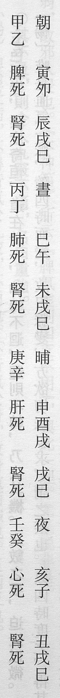

- 朝　寅卯　甲乙　脾死
- 辰　戊己　腎死
- 晝　巳午　丙丁　肺死
- 未　戊己　腎死
- 晡　申酉　庚辛　肝死
- 戌　戊己　腎死
- 夜　亥子　壬癸　心死
- 丑　戊己　腎死

（眉）『관자(管子)』 「사시편(四時篇)」 ‘五漫漫，六惛惛，孰知之哉’의 주에 “五는 각 계절의 정사를 말한다.”라고 하였다.

**○黃帝曰：五藏相通，移皆有次。五藏有病，則各傳其所勝。**

황제가 말했다. “오장은 서로 통하니, 옮겨 가는 데 모두 차례가 있다. 오장에 병이 있으면 각각 자기가 이기는 것에 전한다.

안(案): 이 조문은 곧 뒤 조문의 머리말이니, ‘五藏相通’은 오행상극(五行相尅)이라는 말과 같다.

〔張〕자기가 이기는 것에 전한다는 것은 이 편의 아랫글에서 “풍이 폐에 들어가 폐비(肺痺)가 되고, 치료하지 않으면 폐가 간에 전하여 간비(肝痺)가 되며, 치료하지 않으면 간이 비에 전하여 비풍(脾風)이 되고, 치료하지 않으면 비가 신에 전하여 산가(疝瘕)가 되며, 치료하지 않으면 신이 심에 전하여 계(瘛)가 되고, 치료하지 않으면 심이 다시 되돌아 폐로 전해 가니, 이치상 죽게 된다.”라고 한 것이 이것이다.

（眉）『갑을』 권8 「오장전병발한열(五藏傳病發寒熱)」 제1 상.

**○不治，法三月，若六月，若三日，若六日，傳五藏而當死。**

치료하지 않으면 이치상 3개월이나 6개월, 또는 3일이나 6일이면 오장에 전하여 죽게 된다.

〔張〕병을 일찍 치료하지 않으면 반드시 서로 전하기에 이르니, 멀면 3개월·6개월, 가까우면 3일·6일에 오장을 두루 전하여 이치상 죽게 된다. 이른바 3과 6이란 대개 천지의 기가 6으로 마디를 삼는 것이니, 삼음삼양(三陰三陽)이 육기(六氣)가 되고 육음육양이 12개월이 되는 것과 같다. 그러므로 오장이 서로 전하는 수도 3과 6으로 다한다. 3개월에 두루 전하는 것은 1기에 1장씩이고,｟［案］15일이 1기이니, 5기에 오장을 두루 전하고 본장으로 돌아오면 바로 3개월이 된다.｠ 6개월에 두루 전하는 것은 1개월에 1장씩이다.｟1개월에 1장씩이면 5개월에 두루 전하고, 6개월에 또 본장으로 돌아온다.｠ 3일은 낮과 밤에 각각 1장씩이다.｟2일 2야에 네 장을 전하고, 3일이 다하면 다섯 장을 전하여 마치며, 3일 3야에 이르면 다시 본장으로 돌아온다.｠ 6일은 하루에 1장씩이다.｟5일에 오장을 모두 전하고 그 뒤에 본장으로 돌아온다.｠ 장은 오직 다섯인데 두루 전하는 것을 6으로 삼는 것은, 가령 병이 폐에서 시작하면 첫째이고, 폐가 간에 전하면 둘째이며, 간이 비에 전하면 셋째이고, 비가 신에 전하면 넷째이며, 신이 심에 전하면 다섯째이고, 심이 다시 폐에 전하면 여섯째이니, 이것을 육전(六傳)이라 한다. 육전을 이미 다하면 다시 전할 수 없으므로 「오십삼난(五十三難)」에 “한 장은 거듭 상하지 않으니, 칠전(七傳)이면 죽는다.”라고 하였다. 또 삼음삼양으로 3과 6의 수를 말하면, 3은 음양의 합수(合數)이고 6은 음양의 탁수(拆數)이다. 합은 기수와 우수가 그 기를 사귀는 것이고, 탁은 암수가 그 형상을 달리하는 것이다. 「열론(熱論)」에 “상한 1일에 거양(巨陽)이 받고, 2일에 양명, 3일에 소양, 4일에 태음, 5일에 소음, 6일에 궐음이 받는다.”라고 한 것을 보면 역시 6의 수이다. 하루에 두 경을 전하여 병명을 양감(兩感)이라 하는 것은 3의 수이다. 계현자(啓玄子)는 “3개월은 한 장의 옮겨 감을 말한다. 6개월은 그 이기는 자리에 이르는 것을 말한다. 3일은 삼양의 수로 날에 합한 것이다. 6일은 삼음까지 아울러 센 것을 말한다.”라고 하였으니, 이 역시 3과 6의 뜻이다. 그러므로 7일에 병이 물러나 살아나는 경우가 있는 것은 진원(真元)이 아직 크게 상하지 않아 육전이 끝나면 경이 다하고 기가 회복되어 살아나는 것이다. 『역(易)』에 “7일이면 돌아와 회복하니, 하늘의 운행이다.”라고 한 것과 뜻이 다르지 않다.

**○是順傳所勝之次。**

이것이 자기가 이기는 것에 순전(順傳)하는 차례이다.

『갑을』에는 이 일곱 자가 없다.

〔張〕윗글에서 역(逆)이라 한 것은 장의 기를 말하니, 대개 오장이 극(克)을 받으면 그 기가 반드시 거스르므로 역행이라 하였다. 여기서 순(順)이라 한 것은 병이 전하는 것을 말하니, 이기는 것에 전할 때는 모두 반드시 차례를 따르므로 순전이라 하였다. 순전이 곧 기의 역(逆)이다. 그러므로 오장에 두루 전하면 죽게 된다.

**○故曰：別於陽者，知病從來。別於陰者，知死生之期。**

그러므로 양(陽)을 가려 알면 병이 어디서 왔는지 알고, 음(陰)을 가려 알면 사생의 시기를 안다고 한다.

〔張〕양은 표(表)를 말하니 외후(外候)를 이른다. 음은 이(裏)를 말하니 장기(藏氣)를 이른다. 대개 사기가 몸에 적중하면 반드시 증이 밖에 나타난다. 그 외증을 살피면 곧 병이 어느 경에 있는지 알 수 있으므로 ‘양을 가려 알면 병이 어디서 왔는지 안다’고 하였다. 병이 장기를 상하면 반드시 진음(真陰)을 무너뜨리니, 그 근본을 살피면 곧 위험이 어느 날에 있는지 알 수 있으므로 ‘음을 가려 알면 사생의 시기를 안다’고 하였다. 이는 표리로 음양을 말한 것이다. 「음양별론(陰陽別論)」에 “이른바 음은 진장(真藏)이다. 나타나면 패(敗)가 되고, 패하면 반드시 죽는다. 이른바 양은 위완(胃脘)의 양이다. 양을 가려 알면 병처를 알고, 음을 가려 알면 사생의 시기를 안다.”라고 한 것은 맥으로 음양을 말한 것이다.

「음양별론」(제7)에 “이른바 음양이란 가는 것이 음이고 이르는 것이 양이며, 고요한 것이 음이고 움직이는 것이 양이며, 더딘 것이 음이고 잦은[數] 것이 양이다.”라고 하였다.

안(案): 여기의 ‘陰陽’ 두 자도 이와 같은 뜻이니, 곧 이르고 움직이고 잦은 맥으로 사기가 어디서 왔는지를 알고, 가고 고요하고 더딘 맥으로 이 가운데 죽음과 삶이 있음을 안다는 말이다. ‘別於陽云云’은 ‘五藏相通’ 이하를 가리키고, ‘別於陰云云’은 앞글의 ‘五藏受氣於其所生’ 이하를 가리킨다.

**○言知至其所困而死。**

그 곤궁한 곳에 이르러 죽음을 안다는 말이다.

〔張〕그 곤궁한 곳에 이르러 죽는다는 것은 자기가 이기지 못하는 것에서 죽는 것이다. 연·월·일·시의 징후가 모두 그러하다.

안(案): 이 한 구는 앞글의 ‘氣之逆行也故死’를 받아 여기서 맺은 것이다.

**○是故風者百病之長也。**

그러므로 풍(風)은 백병(百病)의 으뜸이다.

〔識〕「풍론(風論)」·「골공론(骨空論)」, 『영추』 「오색편(五色篇)」·「통천편(通天篇)」｟『소문(素問)』 「생기통천편(生氣通天篇)」｠에도 이 말이 있다.

안(案): 「생기통천론(生氣通天論)｟제3｠」에 “풍은 백병의 시작이다.”라고 하였고, 「골공론」·「오색편」도 같다. 이 편과 「풍론」에는 ‘百病之長也’로 되어 있다.

**○今風寒客於人，使人毫毛畢直，皮膚閉而爲熱。**

이제 풍한(風寒)이 사람에게 침입하면 솜털이 모두 곤두서고, 피부가 닫혀 열이 난다.

（眉）膚는 사람과 짐승에 통하는 이름이고, 革은 오직 짐승 가죽의 이름이니, 膚와 革은 두 사물의 두 이름이다. 『영추』 「역순비수편(逆順肥瘦篇)」의 ‘膚革堅固’는 짐승 가죽의 이름을 빌려 사람의 피부에 쓴 것일 뿐이다. 그러므로 「조경론(調經論)」 왕주(王注)에 “革은 피부이다.”라고 하였다.

금안(今案): 솜털이 모두 곤두선다는 것은 곧 현부(玄府)에 소름이 돋는 것을 말하니, 이것이 오한의 징후이다. 피부가 닫힌다는 것은 사기가 기육 속으로 들어와 정기와 다투는 것을 말한다. 이때 피부 주리(腠理)의 기가 가로막혀 통하지 않으므로 열이 난다. 『설문』에 ‘膚는 皮이다’라고 하였다. 『석명(釋名)』에 “膚는 펼친다[布]는 뜻이니 겉에 펼쳐 있다. 皮는 덮는다[被]는 뜻이니 몸을 덮는다.”라고 하였다. 대개 피·부·기·육은 겉에서부터 점차 깊이 들어가는 이름일 뿐이다. 이제 위의 피, 아래의 부, 흰 기, 붉은 육이라고 하면 한마디로 충분하다.

（眉）『상한론집의(傷寒論輯義)』에 『석골분경(析骨分經)』을 인용하여 “흰 것이 기이고, 붉은 것이 육이다.｟一ノ廿六ヲ｠”라고 하였다.

**○當是之時，可汗而發也。**

이때는 땀을 내어 발산시킬 수 있다.

곧 『상한론(傷寒論)』에서 태양병에 마황탕(麻黃湯)·계지탕(桂枝湯) 등 여러 탕을 쓴다고 한 것이 이것이다. 「음양응상대론(陰陽應象大論)」에 “잘 치료하는 자는 피모를 치료한다.”라고 하였다.

**○或痺不仁腫痛，當是之時，可湯熨及火灸刺而去之。**

혹 비(痺)가 되거나 불인(不仁)하거나 붓고 아프면, 이때는 탕위(湯熨)와 불로 쬐는 법[火灸]과 침자[刺]로 없앨 수 있다.

「음양응상대론」에 “한(寒)은 형을 상하고, 형이 상하면 붓는다. 열(熱)은 기를 상하고, 기가 상하면 아프다.”라고 하였다.

〔張〕사기가 피모에 있을 때 서둘러 없애지 않으면 경락으로 들어가므로, 혹 여러 비가 되고, 혹 불인이 되며, 혹 붓고 아프게 된다. 그러므로 탕위·구(灸)·자(刺)의 법을 써서 경락의 병을 없애야 한다.

〔馬〕불인은 아픔과 가려움을 알지 못하는 것이다.

‘不仁’과 ‘痺’는 크게 다르니, 자세한 것은 제16편에 보이며 참고할 만하다.

안(案): 불인은 곧 비가 심한 것을 말하니, 『본초경(本草經)』에서 말한 ‘사기(死肌)’가 이것이다. 곧 피부 위를 만져도 지각이 없어 살이 자기 살이 아닌 듯한 것을 말한다. 이는 풍습의 사기가 안으로 들어와 혈기가 피부를 영양하지 못한 탓이다. 대개 불인이라 하고 사기라 하는 것은 모두 옛말로, 비증(痺證)의 속칭이다. 『금궤(金匱)』에 “주달(酒疸)은 피부를 긁어도 불인하다.”라고 하였으니, 불인의 뜻을 찾을 수 있다.

（眉）「풍론」 ‘其肉有不仁’의 왕주에 “불인은 𭼓하여 한열과 통양(痛癢)을 알지 못함을 말한다.”라고 하였다.

안(案): ‘火灸’는 ‘火炙’의 잘못인 듯하다. 『병원(病源)』 권7에 “상한 2일에 양명이 받으면 살에 열이 나고 코가 마르며 잠들지 못하니, 병을 받은 곳이 피부 사이에 있으므로 고약을 문지르고 불로 쬐어 땀을 내면 낫는다.”라고 하였다. 또 권9에 “시병(時病)｟『외대(外臺)』에는 ‘時行病’으로 되어 있다｠ 1일에 피모에 있으면 고약을 문지르고 불로 쬐면 낫는다. 풀리지 않으면 2일에 부(膚)에 있으니, 법대로 침을 놓고 해기산(解肌散)을 먹어 땀이 나면 낫는다.”라고 하였으니, 모두 증거가 된다. 『금궤』 습문(濕門)도 함께 살펴야 한다. 탕위(湯熨)는 대개 뜨거운 탕으로 베를 적셔 아픈 곳을 찜질하는 것을 말하니, 씻고 목욕하여 땀을 내는 부류이다.

재안(再案): 비(痺)는 피부와 기육의 기가 사기에 막혀 닫힌 것을 말하니, 뒷글의 폐비·간비와 같은 뜻이다.

（眉）진본(真本) 『명당(明堂)』 ‘少商，主手臂不仁’의 양주(楊注)에 “仁은 친하다는 뜻이다. 병들어 감각이 없는 곳은 몸과 친하지 않으므로 불인이라 한다. 사람이 자주 놀라고 두려워하면 근맥이 통하지 않아 불인이 생긴다. 또 사람의 병이 오래되어 깊이 들어가면 영위의 운행이 색하고, 경락이 때로 성글어 아프지 않으며, 피부가 영양을 받지 못하므로 불인이 된다.”라고 하였다.

**○弗治，病入舍於肺，名曰肺痺，發欬上氣。**

치료하지 않으면 병이 폐로 들어가 머무니, 이름을 폐비(肺痺)라 하며, 기침과 상기(上氣)가 나타난다.

안(案): 기육에 막힌 사기를 치료하지 않으면 폐부로 들어가 머무니, 이름을 폐비라 한다. 어떻게 폐비임을 아는가? 해수와 상기의 증이 나타나므로 아는 것이다. 대개 폐는 늘 호흡을 따라 늘어나고 줄어드는데, 사기가 폐에 들어가면 호흡의 기를 방해하므로 그 기가 위로 거슬러 기침이 난다. 상기는 그 기가 위로 거슬러 그칠 수 없는 것을 말한다. 기침만 하고 상기하지 않는 경우가 있고, 기침이 심한 경우에는 상기를 겸한다.

**○弗治，肺即傳而行之肝，病名曰肝痺，一名曰厥。脇痛出食，當是之時，可按若刺耳。**

치료하지 않으면 폐가 곧 간으로 전해 가니, 병명을 간비(肝痺)라 하고 궐(厥)이라고도 한다. 옆구리가 아프고 먹은 것을 토하니, 이때는 안마[按]나 침자[刺]를 쓸 수 있다.

안(案): 간비는 곧 소양병(少陽病)이다. 사기가 반표반리(半表半裏)의 격막 사이에 있어 간장에 가까이 닥치므로 간비라 한다. 궐은 궐역(厥逆)의 뜻이다. 사기가 심하에 있어 상하의 기를 가로막아 그 기가 거슬러 가므로 궐이라 한다. 옆구리가 아프고 먹은 것을 토한다는 것은 곧 소시호탕(小柴胡湯) 아래에서 말한 ‘흉협고만(胸脇苦滿)하고 심번(心煩)하며 잘 구역한다’는 것이 이것이다. 出食은 곧 토식(吐食)이다. 按은 안마를 말한다. 刺는 침자를 말한다. 모두 심하의 사기를 흩어 풀어 주는 방법이다.

**○弗治，肝傳之脾，病名曰脾風。**

치료하지 않으면 간이 비에 전하니, 병명을 비풍(脾風)이라 한다.

안(案): 풍은 표열(表熱)의 이름이니, 이는 사기가 비에 들어간 증이다. 그런데 발열·발황 등의 표열증이 있으므로 비풍이라 한다. 이로 미루어 살피면 앞글의 폐비·간비는 모두 표열이 없는 증이므로 비폐(痺閉)로 이름하였으니, 비풍과 상대시켜 보면 그 뜻을 알 수 있다.

**○發癉，腹中熱，煩心，出黃，當此之時，可按可藥可浴。**

단(癉)이 생기고 뱃속에 열이 나며 가슴이 답답하고 누런 땀이 나오니, 이때는 안마·약물·목욕을 쓸 수 있다.

『갑을』에는 ‘烙’ 아래의 주에 ‘어떤 본에는 浴으로 되어 있다’고 하였다.

안(案): 발단(發癉)은 곧 발황이다. ‘疸’과 ‘癉’은 예로부터 통용하였다. 제18편의 위달(胃疸)이 곧 위단(胃癉)이니 서로 증거가 된다. 안마와 목욕 두 법은 대개 사기를 표로 발산시키려는 것인 듯한데, 그 법은 지금 살필 수 없다. 단(癉)의 풀이는 이미 제17편에 보인다.

뱃속에 열이 난다는 것은 『금궤』 「황달편(黃疸篇)」에서 말한 ‘온몸에 모두 열이 나면서 누렇고, 배에 열이 있으니, 열이 이(裏)에 있으므로 사하해야 한다’는 것이 이것이다. 가슴이 답답하다는 것은 같은 책에서 말한 ‘심중이 오뇌(懊憹)하면서 열이 나고 먹지 못하며 때로 토하려 하는 것을 주달(酒疸)이라 한다’, 또 ‘주황달은 심중에 열이 나고 발바닥에 열이 난다’, ‘주달은 심중에 열이 난다’, ‘주달은 심중이 마늘 양념을 먹은 듯하다’는 것이다. 누런 것이 나온다는 것은 소변으로 누런 물이 나오는 것이다. 인진호탕(茵蔯蒿湯) 방문 뒤에 ‘소변이 잘 나오는데 오줌이 조각즙(皂角汁) 같고 색이 아주 붉다. 하룻밤이 지나면 배가 줄어드니, 황이 소변으로 빠져나가는 것이다’라고 하였고, 소석반석산(消石礬石散) 방문 뒤에 ‘병이 소변을 따라 빠져나가니, 소변이 아주 누렇고 대변이 아주 검은 것이 그 징후이다’라고 하였다.

재안(再案): 『갑을』에는 ‘出’ 아래에 ‘汗’ 자가 있다. 이에 따르면 땀이 누렇게 나는 것은 황한(黃汗)을 말한다. 앞의 설은 옳지 않다.

안(案): 비풍은 곡달(穀疸)의 부류이니, 역시 인진호탕의 부류이다. 안마와 목욕은 다만 표사(表邪)를 흩을 뿐이다.

**[역1]** 원서대로 옮겼다. 다른 『太素』 판본에는 글자는 같으나 「神動而營。神而營者不可動」으로 끊어 놓아 뜻이 달라질 수 있다.
**[역2]** 원서 「傳其所傳其所勝也」는 「傳其所」가 겹친 잘못으로 보인다(『類經』에는 「傳其所勝也」로 되어 있다).

**○弗治，脾傳之腎，病名曰疝瘕。少腹寃熱而痛，出白。一名曰蠱，當此之時，可按可藥。**

치료하지 않으면 비가 신에 전하니, 병명을 산가(疝瘕)라 한다. 소복(少腹)이 답답하게 열이 나면서 아프고 흰 것이 나온다[出白]. 고(蠱)라고도 하니, 이때는 안마[按]와 약물을 쓸 수 있다.

안(案): 이 증을 예로부터 주가들은 일반적인 산가병으로 보았으나 옳지 않다. 이제 살펴보면 이 조문은 모두 외사(外邪)가 전변하여 생긴 것이다. 여기서 말한 산가는 『상한론(傷寒論)』 「양명편(陽明篇)」에서 말한 ‘固瘕가 되려 한다’는 것과, 소음(少陰) 사역산(四逆散)의 ‘혹 배가 아프다’, 또 사역탕(四逆湯)의 ‘가슴속이 실하고 격막 위에 한음(寒飲)이 있다’, 통맥사역탕(通脈四逆湯)의 ‘혹 배가 아프다’는 부류가 이것이다. 이는 사기가 신가(腎家)의 허를 타고 안으로 들어와 사기와 음(飲)이 서로 부딪치므로 이와 같은 벽실(癖實)의 증이 된 것이다. 쓰는 약은 진무탕(真武湯)·사역탕의 부류를 벗어나지 않는다.

『옥편(玉篇)』에 “瘕는 고아절(古鵶切)이다. 장의 병이다.”라고 하였다.

〔紹〕「장자절론(長刺節論)」에 “병이 소복에 있어 배가 아프고 대소변을 보지 못하는 것을 병명으로 산(疝)이라 하니, 한(寒)에서 얻는다.”라고 하였다. 중경(仲景)에게 한산(寒疝)이라는 일컬음이 있으니, 모두 산이 한으로 인함을 알 수 있다. 이제 여기서 ‘寃熱’이라 한 것은 대개 한이 울체되어 열이 된 것이지, 산이 열로 인한 것이 아니다. 『소원(巢源)』 「가후(瘕候)」에 “瘕는 假이다. 허가(虛假)로 움직일 수 있음을 말한다.”라고 하였다. 대개 산의 결괴(結塊)는 갑자기 모였다 갑자기 흩어지므로 산가라 한다.

〔識〕［吳云］고(蠱)는 벌레가 음혈을 파먹는 것의 이름이다. 벌레가 음혈을 파먹으면 사람이 많이 미혹되어 뜻이 안정되지 않으니, 고혹(蠱惑)이라 한다. 그러므로 여자가 남자를 미혹시키는 것도 고라 하니, 그 해가 음으로 깊이 들어간다는 말이다. 여기서 고라 한 것도 병사(病邪)가 깊이 들어가 사람이 뜻을 잃는다는 일컬음이 아닐까? ［簡按］『좌전(左傳)』 소공(昭公) 원년에 “의화(醫和)가 말하였다. ‘병을 고칠 수 없습니다. 이는 여색을 가까이한 것이라 하니, 병이 고(蠱)와 같은데, 귀신 탓도 음식 탓도 아니고 미혹되어 뜻을 잃은 것입니다.’ 또 말하였다. ‘여자는 양물(陽物)이면서 어두운 때의 일이니, 지나치면 내열(内熱)과 혹고(惑蠱)의 병이 생깁니다.’ 조맹(趙孟)이 말하였다. ‘무엇을 고라 하는가?’ 대답하였다. ‘고는 음란함에 빠지고 미혹되어 어지러운 데서 생기는 것입니다. 글자로는 그릇[皿]의 벌레[蟲]가 고이고, 곡식이 날아다니는 것도 고이며, 『주역(周易)』에서는 여자가 남자를 미혹시키고 바람이 산에 떨어지는 것을 고라 합니다. 모두 같은 것입니다.’”라고 하였다.

【楷】안(案): 『좌전』에서 ‘如’라 한 것은 의화가 겸손하게 피한 말이고, 실은 곧 고이다. 고는 신허(腎虛)로 내열이 있는 것이다. 진(晉)나라 임금의 병이 세상 사람의 고와 같다는 뜻이다.

【楷】안(案): 蠱는 음이 古이면 여러 오랜 병의 이름임을 알 수 있다. 음이 鼓이면 창만(脹滿)의 이름임을 알 수 있다. 음이 兇이면 옹폐(雍蔽)의 이름임을 알 수 있다. 위의 세 음은 같은 음일 뿐이다.[역1]

안(案): 여기서 고를 산의 다른 이름으로 삼은 것은, 蠱가 곧 ‘固’의 가차이기 때문이다. 「양명편」에서 말한 ‘固瘕’의 ‘固’이니, 고착(固著)·견고(堅固)·벽고(辟固)의 뜻이다. 『설문(説文)』에 “蠱는 뱃속의 벌레이다. 효수(梟首)와 책형(磔刑)으로 죽은 귀신도 고가 된다.”라고 하였다. 『사기(史記)』 「봉선서(封禪書)」 ‘蠱菑’의 『색은(索隱)』에 악언(樂彥)을 인용하여 “효수와 책형을 당한 귀신도 고가 된다.”라고 하였다. 『주례(周禮)』 전씨(翦氏)의 주에 “蠱는 좀[蠹]의 부류이다.”라고 하였다. 『이아(爾雅)』 「석기(釋器)」에 ‘康을 蠱라 한다’고 하였다. 『시(詩)』 「보우(鴇羽)」 전(傳)의 소(疏)에 “그릇을 해치고 곡식을 썩히는 것을 모두 고라 한다.”라고 하였다. 『사기』 「진본기(秦本紀)」 ‘개로 고를 막는다[以狗禦蠱]’의 『정의(正義)』에 “고는 열독(熱毒)과 악기(惡氣)가 사람을 상하게 하는 것이다.”라고 하였다. 『예기(禮記)』 「왕제(王制)」의 소에 “고는 손상되고 무너진 것의 이름이다.”라고 하였다. 대개 蠱는 원래 뱃속 벌레의 이름으로 습열이 낳은 것인데, 전주(轉注)하여 안으로 울체되고 안으로 열이 나 썩어 무너진 것을 모두 고라 하게 되었으니, 고독(蠱毒)의 고와는 절로 다르다. 『금궤(金匱)』에서 말한 ‘陰狐疝氣’의 ‘狐’도 ‘蠱’의 차자가 아닐까 한다. 『영추(靈樞)』 「열병편(熱病篇)」의 ‘男子如蠱，女子如怚’에서 怚는 『갑을(甲乙)』에 阻로 되어 있으니, 이 또한 고독의 고가 아닌 듯하다. 혜림(慧琳)의 『음(音)』 18｟四ウ｠에 『자림(字林)』을 인용하여 “뱃속의 벌레이니, 충징병(蟲癥病)으로 사람을 해친다.”라고 하였다.

〔吳〕出白의 白은 음탁(淫濁)이다. 〔張〕소변으로 흰 액이 나오는 것이다. 모두 왕주(王注)와 같다.

〔識〕［簡按］「위론(痿論)」에 “성생활이 지나치면 종근(宗筋)이 늘어져 근위(筋痿)가 되고 백음(白淫)이 된다.”라고 하였으니, 이것이 ‘出白’이다.

안(案): ‘出白’ 두 자는 온당하지 않다. 앞글의 ‘出黃’ 두 자와 대를 이루게 보면 소변백탁을 말하는 듯하다. 그러나 소복이 답답하게 열이 나는 증이 있으면서 소변이 백탁인 것은 매우 의심스럽다. 『갑을』에 ‘少腹煩寃而痛汗出’로 되어 있는 것이 옳은 듯하다. 이로 미루어 살피면 본래 ‘汗出’로 쓰였고, 이 땀은 누렇지 않은 이른바 백한(魄汗)일 것이다. 그래서 왕씨(王氏)가 ‘出白’으로 고쳐 앞글과 나란히 대를 맞춘 것이 아닐까, 혹은 다른 본에 이와 같은 것이 있었던가 한다. 出黃과 出白을 상대시킨 것은 ‘황한(黃汗)’과 ‘백한(白汗)’을 말한 것이 아닐까 한다.

『천금(千金)』 권17 「적기(積氣)」 제5편에 “여러 해 기병(氣病)을 앓아 때때로 발작하고, 심복(心腹)이 쥐어짜듯 아프며, 갑자기 기가 끊기고, 뱃속이 단단하고 실하여 의사가 치료하지 못해 다시 고라고 일컫는 것을 치료하는 방”이라 하였다.

（眉）고병(蠱病)에는 여러 가지가 있다. 첫째 고독, 둘째 고창(鼓脹), 셋째 매핵기(梅核氣)｟『성혜(聖惠)』｠, 넷째 산가｟『소문(素問)』｠, 다섯째 회병(蚘病)｟『설문』·「창공전(倉公傳)」｠, 여섯째 신허｟『좌전』｠, 일곱째 귀요(鬼妖)｟『사기』 「봉선」·『산해경(山海經)』·『설문』｠, 여덟째 중악(中惡)｟『사기』 「진본기」｠, 아홉째 혼광(昏狂)｟『좌전』 소｠이다.

（眉）『성혜』 대황산(大黃散) 방문 아래에 “목구멍 속에 무엇이 있는 듯 막혀 답답하고, 왼쪽에 있기도 하고 오른쪽에 있기도 한 것을 고라 하는데, 이를 치료한다.”라고 하였다. 대개 『영추』 「열병편」에서 말한 고가 곧 이것이 아닐까 한다.

『산해경』 「남산경(南山經)」 ‘靑丘之山，不蠱’의 주에 “不蠱는 사람이 요사한 기운을 만나지 않게 한다는 뜻이다. 어떤 이는 蠱는 고독이라고 한다.”라고 하였다.

（眉）『좌전』 소공 원년의 소에 “고는 심지(心志)가 미혹되어 어지러운 병이니, 지금 혼미하고 미쳐 본성을 잃는 것과 같으며, 그 병을 고라 한다.”라고 하였다. 또 “고는 뜻을 잃는 병의 이름이다.”라고 하였다. 또 “뜻과 성품이 황홀하여 스스로 알지 못하는 것을 그 병명으로 고라 한다.”라고 하였다.

**○弗治，腎傳之心，病筋脈相引而急，病名曰瘛。當此之時，可灸可藥。**

치료하지 않으면 신이 심에 전하여 근맥이 서로 당기면서 급해지니, 병명을 계(瘛)라 한다. 이때는 뜸과 약물을 쓸 수 있다.

〔張〕신의 사기가 화(火)를 극하면 심에 전한다. 심은 혈맥을 주관하니, 심이 병들면 혈이 마르고, 혈이 마르면 근맥이 서로 당기면서 급해져 손발이 오그라들고 당기므로 병명을 계라 한다.｟［案］이 설은 오주(吳注)에 따른 것이다.｠

안(案): 여기서 말한 계는 곧 풍인(風引)의 증으로, 『금궤』에서 말한 중풍이자, 「비론(痺論)」에서 말한 ‘비가 뼈에 있으면 무겁고, 맥에 있으면 혈이 엉겨 흐르지 않으며, 근에 있으면 굽혀 펴지 못하고, 살에 있으면 불인하며, 피부에 있으면 차다. 그러므로 이 다섯 가지를 갖추면 아프지 않다. 대개 비의 부류는 한을 만나면 蟲하고｟『갑을』에는 ‘急’으로 되어 있다｠, 열을 만나면 늘어진다’는 것이 이것이다. 또 비(痱)라고도 하니, 곧 반신불수(半身不遂)이고 왼쪽이 마비되고 오른쪽이 늘어지는[左癱右縱] 부류이다. 한쪽 몸의 근이 급하면 다른 쪽 몸의 근은 늘어진다. 대개 왼쪽은 경맥이고 오른쪽은 낙맥이며, 모두 심신(心腎) 두 장이 영양하는 바이다. 사기가 허를 타고 안으로 심신 두 장에 침입하면 반신불수나 온몸이 당기는 증이 되니, 곧 졸중풍(卒中風)이 이것이다. 대부분 신허로 화가 동하여 심장에 미치는 병이므로 정신이 또렷하지 않은데, 이런 경우에는 뜸과 약물을 쓸 수 있다. 양실(陽實)로 당기는 증이면 뜸을 뜰 수 없다. 이른바 ‘화기(火氣)가 미약해도 안으로 공격하는 힘이 있다’는 것이니, 분별해야 한다.

**○弗治，滿十日，法當死。**

치료하지 않고 10일이 차면 이치상 죽게 된다.

안(案): 이것은 졸중의 증이므로 죽음이 10일을 넘기지 않는다고 하였다.

（眉）졸중(卒中).

**○腎因傳之心，心即復反傳而行之肺，發寒熱，法當三歲死，此病之次也。**

신이 이로 인해 심에 전하면 심은 곧 다시 되돌아 폐로 전해 가서 한열(寒熱)이 나니, 이치상 3년 만에 죽게 된다. 이것이 병의 차례이다.

（眉）비병(痱病).

〔張〕신이 심에 전하였으나 바로 죽지 않고 사기가 아직 다하지 않은 경우는 다시 폐로 전한다. 금과 화가 서로 다투어 금이 이기면 한이 되고 화가 이기면 열이 되므로 한열이 난다. 3년 만에 죽는다는 것은, 대개 풍사가 오장을 두루 전하면 본래 곧 죽어야 한다. 죽지 않는 것은 원기가 아직 무너지지 않아 형세가 아직 느슨하기 때문이니, 그래서 폐가 다시 사기를 받는다. 다시 1년이면 폐의 병이 간에 미치고, 2년이면 간의 병이 비에 미치며, 3년이면 비의 병이 신에 미쳐 삼음이 모두 무너지므로 죽게 된다. 이것이 곧 이기는 것에 순전하는 차례이다.

안(案): 이는 중풍이 느리게 진행되는 증을 말하니, 그 죽는 시기가 3년에 있다. 이제 중풍 병자를 직접 살펴보면, 바로 죽지 않는 자는 3년에 죽거나 5년·7년이 그 시기이고, 이를 넘기는 자는 매우 적어서 여기서 말한 것과 꼭 맞는다. 여기서 ‘傳而行之肺發寒熱’이라 한 것은 병이 안으로 빠지지 않고 밖으로 드러나므로 그 죽음이 가깝지 않고 수명이 늘어남을 말한다. 곧 병이 장에 들어가면 곧 죽고, 부에 들어가면 바로 죽지 않는다.

**○然其卒發者，不必治於傳，或其傳化有不以次。**

그러나 갑자기 발병한 경우는 치료할 필요가 없다. 그 전화(傳化)가 차례를 따르지 않는 경우도 있다.

『갑을』에 ‘於傳或’ 세 자가 없으니 따를 만하다. 졸중풍은 10일을 넘기지 않고 죽으므로 치료할 필요가 없다고 한 것이다. 전화가 차례를 따르지 않는 경우가 있다는 것은 폐·간·비·신·심의 차례를 따르지 않음을 말하니, 그래서 아랫글에서 말하였다.

**○不以次入者，**

차례대로 들어가지 않는 것은

『갑을』에는 ‘不以次入’ 네 자가 없다.

**○憂恐悲喜怒，令不得以其次，故令人有大病矣。**

근심·두려움·슬픔·기쁨·성냄이 그 차례를 따르지 못하게 하므로 사람에게 큰 병이 생기게 한다.

『갑을』에는 ‘有’ 자가 없다.

〔張〕오지(五志)의 발동은 일정하지 않아 닿는 대로 움직이므로, 생기는 병도 그 차례를 따르지 않는다.

**○因而喜大虛，則腎氣乘矣。**

이로 인해 기쁨으로 크게 허해지면 신기가 올라탄다[乘].

「음양응상론(陰陽應象論)」｟五｠에 “심은 지(志)에서 희(喜)가 되니, 희는 심을 상하고 공(恐)은 희를 이긴다.”라고 하였다.

안(案): 사람이 어떤 일로 인해 크게 기뻐하면 심기가 크게 허해진다. 심기가 크게 허하면 신기가 반드시 와서 올라타니, 곧 수극화(水克火)의 이치이다. 사기가 이 크게 허한 곳을 타면 전화의 일정함을 잃으므로 큰 병이 된다.

**○怒則肝氣乘矣，悲則肺氣乘矣，**

성내면 간기가 올라타고, 슬퍼하면 폐기가 올라타며,

〔志〕‘肝’은 ‘肺’로 써야 하고, ‘肺’는 ‘肝’으로 써야 하며, ‘悲’는 ‘思’로 써야 한다.

안(案): 이 설을 따를 만하니, 그렇지 않으면 풀이할 수 없다.

우안(又案): 노(怒)는 본래 간의 지이나, 크게 성내면 비기를 함께 약하게 하므로｟목극토(木克土)｠ 간목이 도리어 비토를 올라탄다. 비(悲)는 본래 폐의 지이나, 크게 슬퍼하면 도리어 간기를 쇠하게 하므로｟금극목(金克木).｠, 폐금이 도리어 간목을 올라탄다. 이 두 장이 다른 세 장과 달리 상극하는 것은 오지 가운데 슬픔과 성냄이 가장 심하기 때문이다. 어째서 심한가? 비기가 약하므로 크게 성내는 데 이르니, 이것이 간기가 올라탄 것이다. 간기가 약하므로 크게 슬퍼하는 데 이르니, 이것이 폐기가 올라탄 것이다.

안(案): 사(思)는 비의 지이니, 비토가 성하면 잘 생각할 수 있고, 잘 생각할 수 있으면 크게 성내는 데 이르지 않게 한다. 이제 비토가 쇠하므로 간목이 성하여 비토를 올라타서 크게 성낸다. 노는 간의 지이니, 간목이 성하면 잘 성낼 수 있고, 잘 성낼 수 있으면 크게 슬퍼하는 데 이르지 않게 한다. 이제 간목이 쇠하므로 금폐(金肺)가 성하여 간목을 올라타서 크게 슬퍼한다.[역2]

제5편에 “간은 지에서 노가 되니, 노는 간을 상하고 비는 노를 이긴다. 폐는 지에서 우(憂)가 되니, 우는 폐를 상하고 희는 우를 이긴다. 비는 지에서 사가 되니, 사는 비를 상하고 노는 사를 이긴다.”라고 하였다.

**○恐則脾氣乘矣，**

두려워하면 비기가 올라타고,

제5편에 “신은 지에서 공이 되니, 공은 신을 상하고 사는 공을 이긴다.”라고 하였다.

**○憂則心氣乘矣，**

근심하면 심기가 올라타니,

제5편에 “폐는 지에서 우가 되니, 우는 폐를 상하고 희는 우를 이긴다.”라고 하였다.

**○此其常道也。**

이것이 그 도이다.

안(案): 오지로 인해 서로 올라타고 극하는 것은 그 전화에 반하더라도 상도(常道)라 한다. 대개 변화를 일정함으로 삼는 것이니, 이 또한 천지의 상도이다. 그러나 『갑을』에 ‘常’ 자가 없는 것을 따를 만하다.

**○故病有五，**

그러므로 병에는 다섯이 있고,

〔志〕오장에 다섯 변화가 있다. 우는 폐, 공은 신, 비(悲)는 비(脾), 희는 심, 노는 간을 말한다.

**○五五二十五變，**

다섯에 다섯을 곱하면 스물다섯 변화이니,

〔志〕희가 크면 신기가 심을 올라타고, 심은 곧 폐에 전하며, 폐는 간에 전하고, 간은 비에 전하며, 비는 신에 전하는 것과 같으니, 이것이 오장의 전화로서 역시 각각 그 이기는 것을 올라탄다.

**○及其傳化，**

그 전화에 어긋나는[及] 것은

〔識〕조부본(趙府本)·웅본(熊本)에 ‘及’이 ‘反’으로 되어 있고, 오(吳)도 같다.

〔箚〕원판(元板)과 고초본(古抄本)에 ‘及’이 ‘反’으로 되어 있으니, 왕(王)의 뜻도 그러할 것이다.

안(案): 전화는 앞글에서 말한 폐·간·비·신·심의 차례를 말한다. 여기서는 전화가 차례를 따르지 않는 것을 말하므로 ‘그 전화에 어긋난다’고 하였다.

**○傳乘之名也。**

전승(傳乘)이라 이름한다.

안(案): ‘傳乘之名’은 전승이라 이름한다는 말이니, 이 역시 도치의 예이다. 대개 자기가 이기지 못하는 것이 올라타서 상극의 차례를 따르지 않는 경우가 있으므로 전승이라 이름한 것이다. 노와 비 두 지는 희·공·우와 같지 않으니, 그래서 전승이라 이름한 것이 아닐까 한다.

『갑을경(甲乙經)』 권8 「오장전병발한열(五藏傳病發寒熱)」 제1 상에 “황제가 물었다. ‘오장은 서로 통하니 옮겨 가는 데 모두 차례가 있고, 오장에 병이 있으면 각각 자기가 이기는 것에 전한다. 치료하지 않으면 이치상 3개월이나 6개월, 또는 3일이나 6일이면 오장에 전하여 죽게 된다｟『소문』에는 아래에 ‘順傳所勝之次’가 있다｠. 그러므로 양을 가려 알면 병이 어디서 왔는지 알고, 음을 가려 알면 사생의 시기를 안다고 하니, 그 곤궁한 곳에 이르러 죽는다는 말이다. 그러므로 풍은 백병의 으뜸이다. 이제 풍한이 사람에게 침입하면 솜털이 모두 곤두서고 피부가 닫혀 열이 나니, 이때는 땀을 내어 발산시킬 수 있다. 혹 비가 되거나 불인하거나 붓고 아프면, 이때는 탕위 및｟어떤 본에는 ‘足’ 자로 되어 있다｠ 화구(火灸)와 침자로 없앨 수 있다. 치료하지 않으면 병이 폐로 들어가 머무니, 이름을 폐비라 하며, 기침과 상기가 나타난다. 치료하지 않으면 폐가 곧 간으로 전해 가니, 병명을 간비라 하고 궐이라고도 하며, 옆구리가 아프고 먹은 것을 토하니, 이때는 안마와 침자를 쓸 수 있다. 치료하지 않으면 간이 비에 전하니, 병명을 비풍이라 하며, 단(癉)이 생기고 뱃속에 열이 나며, 가슴이 답답하고 땀이 나며 황단(黃癉)이 되니｟『소문』에는 ‘汗’·‘癉’ 두 자가 없다｠, 이때는 땀내는 법과 약물과 지지는 법[烙]｟어떤 본에는 ‘浴’으로 되어 있다｠을 쓸 수 있다. 치료하지 않으면 비가 신에 전하니, 병명을 산가라 하며, 소복이 번원(煩寃)하면서 아프고 땀이 나니｟『소문』에는 ‘出白’으로 되어 있다｠, 고라고도 하며, 이때는 안마와 약물을 쓸 수 있다. 치료하지 않으면 신이 심에 전하여 근맥이 서로 당기면서 급해지니, 이름을 계라 하며, 이때는 뜸과 약물을 쓸 수 있다. 치료하지 않으면 10일에 이치상 죽게 된다. 신이 심에 전하면 심은 곧 다시 되돌아 폐로 전해 가서 한열이 나니, 이치상 3년 만에 죽게 된다. 이것이 병의 차례이다. 그러나 갑자기 발병한 경우는 치료할 필요가 없고, 그 전화에 차례를 따르지 않는 것이 있으니, 근심·두려움·슬픔·기쁨·성냄이 그 차례를 따르지 못하게 하므로 사람에게 큰 병이 생기게 한다. 이로 인해 기쁨으로 크게 허해지면 신기가 올라타고, 성내면 간기가 올라타며, 슬퍼하면 폐기가 올라타고, 두려워하면 비기가 올라타며, 근심하면 심기가 올라타니, 이것이 그 도이다. 그러므로 병에는 다섯이 있고, 다섯에 다섯을 곱하면 스물다섯 변화이니, 그 전화에 미치는 것은 전승의 이름이다.’”라고 하였다.

**○大骨枯槁，大肉陷下。**

대골(大骨)이 마르고 대육(大肉)이 꺼진다.

여기서부터 ‘皆死不治也’까지는 『대소(大素)』 권14 「진장맥형(真藏脈形)」에 실려 있다.

〔張〕대골과 대육은 모두 온몸을 두고 말한 것이다. 어깨·등골·허리·무릎 같은 것이 모두 대골이고, 척부(尺膚)와 볼기 살이 모두 대육이다. 어깨가 처지고 목이 기울며 허리가 무겁고 무릎이 무너지는 것은 대골이 마른 것이다. 척부가 깎이고 나면 볼기 살도 반드시 마르니, 대육이 꺼진 것이다.

（眉）폐(肺).

**○胸中氣滿，喘息不便，其氣動形。**

가슴속에 기가 그득하고 숨이 차서 불편하며, 그 기가 몸을 움직인다.

안(案): 숨이 차서 불편하다는 것은 천해(喘咳)가 호흡을 해쳐 말하기가 불편함을 말한다. 그 기가 몸을 움직인다는 것은 곧 견식(肩息)을 말한다.

〔紹〕그 기가 몸을 움직인다는 것은 중경이 말한 ‘호흡할 때 흔들려 떠는 자는 치료하지 못한다’는 것이 바로 이것이다.

**○期六月死，真藏脈見，乃予之期日。**

6개월 만에 죽는다고 기약한다. 진장맥(真藏脈)이 나타나면 곧 죽을 날짜를 정해 준다.

〔楊〕뼈는 몸의 줄기인데, 사람이 죽으려 할 때 살이 뼈에 붙어 있지 않아 마침내 대골까지 윤택함이 없어지므로 ‘마른다’고 하였으니, 곧 뼈가 먼저 죽는 것이다. 몸의 작은 살이 모두 빠지고 대육까지 꺼지니, 곧 살이 먼저 죽는 것이다. 폐기가 허하고 적으며 사기가 가슴에 가득하므로 숨이 차서 편안하지 않다. 숨이 차고 기가 급하여 어깨와 가슴이 모두 움직이므로 ‘몸을 움직인다’고 하였다. 폐병이 차례로 전하여 폐에 이르러 거듭 상하므로 6개월에 죽는다. 이는 칠전(七傳)에 이르지 않는 것이다. 앞의 병증이 있으나 진장(真藏)이 아직 나타나지 않으면 6개월 만에 죽는다고 기약한다. 진장맥이 나타나면 곧 죽을 시기를 정해 주니 6개월에 이르지 않는다. 고본에 ‘正藏’으로 된 것이 있는데, 진시황의 이름이 정(正)이어서 ‘真’으로 고친 것일 터이다. 真과 正은 뜻이 같다.

（眉）『사기』에 “진시황제는 진 소왕(昭王) 48년 정월에 한단(邯鄲)에서 태어났고, 태어나자 이름을 정(政)이라 하였다.”라고 하였는데, 그 주에 “서광(徐廣)은 ‘正으로도 쓴다’고 하였다. 송충(宋忠)은 ‘정월 초하루에 태어났으므로 이름을 正이라 하였다’고 하였다.”라고 하였다. 『색은』에 “『계본(系本)』에는 政으로 되어 있다.”라고 하였다. 『정의』에 “正은 음이 政이다. 주(周)나라 정월이 자월(子月)을 세수로 세운다는 正이다. 뒤에 시황을 피휘하였으므로 음을 征으로 하였다.”라고 하였다.

（眉）입지안(立之案): 이 또한 진나라 때 의경(醫經)을 불태우지 않았다는 증거이다.

제18편에 “간은 경신(庚辛)을 만나면 죽고, 심은 임계(壬癸)를 만나면 죽고, 비는 갑을(甲乙)을 만나면 죽고, 폐는 병정(丙丁)을 만나면 죽고, 신은 무기(戊己)를 만나면 죽으니, 이것을 진장이 나타나면 모두 죽는다고 한다.”라고 하였다.

제20편에 “진장맥이 나타나는 자는 이기는 때에 죽는다.”라고 하였다.

**○大骨枯槁，大肉陷下，胸中氣滿，喘息不便，内痛引肩項，期一月死。真藏見，乃予之期日。**

대골이 마르고 대육이 꺼지며, 가슴속에 기가 그득하고 숨이 차서 불편하며, 심장 속이 아프면서 어깨와 목까지 당기면 1개월 만에 죽는다고 기약한다. 진장이 나타나면 곧 죽을 날짜를 정해 준다.

（眉）심(心).

〔楊〕내통(内痛)은 심내통을 말한다. 심의 부(府)인 수대양(手大陽)의 맥은 어깨에서 심에 ‘胳’하므로,｟［案］‘胳’은 곧 ‘絡’의 속된 잘못이다.｠ 속이 아프면서 어깨와 목까지 당긴다. 심은 ‘痛’을 받지 않고｟［案］‘痛’은 ‘病’인 듯하다.｠ 병을 받으면 1개월을 넘기지 않으므로 1개월에 죽는다. 진장맥이 나타나면 1개월에 이르지 않으니, 곧 죽을 시기를 정해 줄 수 있다.

안(案): 「음양응상론」 ‘中滿者，寫之於内’의 왕주에 “内는 뱃속을 말한다.”라고 하였다.

안(案): 양주(楊注)가 ‘内痛’을 심내통으로 본 것은 따를 만하다. 대개 ‘内痛’ 두 자는 곳에 따라 뜻이 다르다. 『금궤』에 “맥이 침하면서 현한 자는 현음(懸飲)으로 내통한다.”라고 하였으니, 여기서 말한 내통은 가슴과 옆구리 속의 통증을 말한다. 『외대(外臺)』 심사(深師) 주작탕(朱雀湯)에 ‘번번이 옆구리 아래까지 당겨 아프다’는 글이 있으니 증거가 된다.

**[역1]** 원서대로 옮겼다. 「兇」은 앞의 「古」, 「鼓」와 음이 달라 「右三音同音」과 맞지 않으므로 모양이 비슷한 다른 글자의 잘못일 수 있다.
**[역2]** 원서대로 옮겼다. 같은 단락의 다른 자리에는 「肺金」으로 되어 있다.

**○大骨枯槁，大肉陷下，胸中氣滿，喘息不便，内痛引肩項，身熱，脫肉破䐃，真藏見，十月之内死。**

대골(大骨)이 마르고 대육(大肉)이 꺼지며, 가슴 속에 기가 그득하고 숨쉬기가 불편하며, 속이 아파 어깨와 목까지 당기고, 몸에 열이 나며, 살이 빠지고 군(䐃)이 깨지며, 진장(真藏)이 나타나면 열 달 안에 죽는다.

（眉）비(脾).

〔楊〕이 속의 통증[内痛]은 곧 비위(脾胃)의 통증이다. 수소양맥(手少陽脈)은 치우쳐 삼초[三瞧]에 응하는데 비위가 곧 중초[中瞧]이며, 위로 결분(缺盆)으로 나와 목으로 올라가므로, 비위 속의 통증이 어깨와 목까지 당기는 것이다. 비는 몸의 살을 주관하므로, 비위가 병들면 몸에 열이 나고 살이 빠지며 군이 깨지는 것이다. ‘䐃’은 기운반(其隕反)이다. 앞의 병상은 진장이 아직 나타나지 않아 열 달 이상 지나서 죽지만, 진장맥(真藏脈)이 나타나면 열 달 안에 죽는다. 참으로 비위가 곡기(穀氣)를 받기 때문에 열 달이 되어서 죽는 것이다.

안(案): 「지진요대론(至真要大論)」의 “궐음이 되갚을 때는 소복이 단단하고 그득하며, 속이 당기고 갑자기 아프다”에 대해 왕주(王注)에 “‘裏’는 배와 옆구리의 안쪽이다.”라고 하였다.

〔識〕『석음(釋音)』에 “‘䐃’은 음이 郡이다.”라고 하였고, 『집운(集韻)』에 “거운절(渠隕切), 음이 窘이다.”라고 하였다. ［馬云］군은 살의 분리(分理)이다. ［吳云］군은 팔꿈치·무릎·비염(髀厭)의 높이 솟은 곳이다. 환자가 음화(陰火)에 타서 밤낮으로 편치 못해 몸을 뒤척이는 일이 많으면 군육(䐃肉)이 쓸려 찢어진다. ［簡按］『영추(靈樞)』 「수요강유편(壽夭剛柔篇)」에 “살의 군이 단단하고 나뉨이 있으면 살이 단단하다.”라고 하였으니, 왕주가 옳은 듯하다. 사숭(史崧)의 『음석(音釋)』에 “배 속의 군지(䐃脂)이다.”｟본래 『옥편(玉篇)』에서 나왔다.｠라고 하였다. ［高云］살결을 육(肉)이라 하고 지고(脂膏)를 군(䐃)이라 한다. 『천금(千金)』 권29 첫 편에 “비노(臂臑)는 팔꿈치 위 7촌 군육 끝에 있다.”라고 하였다. 『갑을(甲乙)』 권3 제27편에는 ‘寸’이 ‘分’으로, ‘䐃’이 ‘膕’으로 잘못되어 있다. 『외대(外臺)』 권39 「명당편(明堂篇)」은 『천금』과 같고, 『의심방(醫心方)』 권2 첫 편도 『천금』과 같다. 곁에 적기를 “군육은 분육(分肉)의 덩어리를 말한다. 『옥편』에 거운반(渠殞反)이고, 창자 속의 군지이다. ［宋云］창자 속의 기름이다.”라고 하였다. 또 ‘䐃’ 자의 곁 훈은 ‘天乃與保呂’이다.

안(案): ‘䐃’은 『옥편』에 “거운절(渠隕切). 배 속의 군지이다.”라고 하였고, 『광운(廣韻)』 상성 16 진(軫)에 “‘䐃’은 거운절(渠殞切). 창자 속의 기름이다.”라고 하였다. 옛글에서 ‘腸’과 ‘腹’은 서로 잘못 쓰인 경우가 많으니, 『광운』을 따라 ‘腸中’으로 쓰는 것이 옳다. 고찰하건대 군은 창자 밖으로 스며 나온 진액 속의 지고로서, 나뉘어 삼초(三焦)의 신액(神液)이 되는 것이다. 그러므로 살이 살이 되는 까닭은 모두 군지가 많이 흘러들어 자양하여 이루어진 것이니, 밖에서 보면 육이라 하고 안에 있으면 군이라 한다. 여기서 살에는 ‘脫’이라 하고 군에는 ‘破’라 하였으니, 옛 성인의 호칭은 확고하여 흔들림이 없다. 살이 빠지는 것은 군이 깨졌기 때문이다. ‘破’는 깨져 흩어짐을 말한다. 군지는 늘 가득 차고 단단해야 하는데, 깨져 흩어져 단단하지 않으면 그 살이 사그라져 빠진다. 『어람(御覽)』 864에서 『통속문(通俗文)』을 인용하여 “짐승 기름이 모인 것을 군이라 한다.”라고 한 것도 증거가 된다.

안(案): 진장이 나타난 뒤에야 사기(死期)가 열 달 안에 있다면, 진장이 나타나기 전에는 죽음을 아직 기약할 수 없음을 알 수 있다. 양주(楊注)는 따를 만하고, 여러 주는 모두 명확하지 못하다. 「기혈론(氣穴論)」에 “안으로 골수를 녹이고 밖으로 큰 군을 깨뜨린다.”라고 하였고, 「피부론(皮部論)」에 “살이 녹고 군이 깨진다.”라고 하였는데, 왕주에 “군은 살의 표(標)이다.”라고 하였다.

（眉）『금궤(金匱)』 「담음(痰飲)」 12에 “맥이 침(沈)하고 현(弦)하면 현음(懸飲)으로 속이 아프다.”라고 하였다. 채정(茝庭) 선생이 말하였다. “‘内痛’은 여러 주가의 풀이가 없다. 아마 옆구리와 갈비 안에 통증이 있다는 말이 아니겠는가.”｟『술의(述義)』｠

（眉）「기혈론」에 “안으로 골수를 녹이고 밖으로 큰 군을 깨뜨린다.”라고 하였다.

（眉）안(案): 후세에는 파군(破䐃)을 오래 누워 생긴 욕창[眠瘡]으로 여기고 이 편의 파군도 욕창으로 보는데, 옳은지 그른지 모르겠다.｟トコスレ｠

（眉）『영추』 「종시편(終始篇)」의 “가을 기운은 분육(分肉)에 있고 겨울 기운은 근골(筋骨)에 있다”가 『대소(大素)』의 권수 미상인 권 「삼자편(三刺篇)」에 실려 있는데, 양주에 “분육은 군육의 나뉜 사이를 말한다.”라고 하였다. 이에 근거하면 군은 살 한 덩어리의 이름이다. 상선(上善)의 풀이가 매우 정확하다[太核]. 지금 『대소』에는 ‘䐃’이 ‘膕’으로 잘못되어 있으니 바로잡을 수 있다.

『자경집(字鏡集)』에 ‘䐃’의 훈이 ‘波良和多乃阿良’인데, 아마 『옥편』 진본에 근거한 것이며, ‘阿良’은 ‘阿夫良’의 탈문(脱文)일 것이다. 『자경집』에는 ‘ハラワタノアブラ’라 하였고, 『옥편』 곁 훈에는 ‘ハラノナカノアブラ’라 하였다.

안(案): 군은 삼초가 일어나는 곳으로, 창자 사이에 서려 뻗은 누런 지막(脂膜)이다. 몸속 모든 지고의 큰 근원이며, 피하와 살 속의 지고는 모두 창자 사이의 기름이 옮겨 흘러들어 이루어진 것이다. 그러므로 살 기름과 창자 기름은 본래 한 물건이다. 『옥편』·『광운』의 풀이는 그 기름의 근본을 가리키고, 『소문(素問)』·『영추』의 말은 그 기름의 표를 가리킨다. 그러므로 「피부론」 왕주의 “군은 살의 표이다”가 옳다.

（眉）신(腎).

**○大骨枯槁，大肉陷下，肩髓内消，動作益衰，真藏來見，期一歲死。見其真藏，乃予之期日。**

대골이 마르고 대육이 꺼지며, 어깨가 처지고[肩隨] 속이 사그라지며[内消], 동작이 더욱 쇠약해지되, 진장이 아직 나타나지 않았으면 1년을 기한으로 죽는다. 진장이 나타나면 그제야 죽을 날을 정해 준다.

안(案): 양주로 고찰하면 정문(正文)은 ‘真藏未見’으로 되어 있었음이 틀림없다. 『신교정(新校正)』에 “살펴보건대[按] 전원기(全元起)본과 『갑을경(甲乙經)』에는 진장의 ‘未見’이 ‘來見’으로 되어 있는데, ‘來’는 ‘未’로 써야 하니 글자의 잘못이다.”라고 하였다. ‘來’와 ‘未’ 두 글자가 서로 잘못 쓰인 듯하니 고찰해 볼 만하다.

〔楊〕신의 부(府)인 족대양맥[足大陽脈]은 견박(肩髆) 안을 따라가므로, 신이 병들면 어깨가 처지고 내장이 여윈다. 또 두 어깨가 아래로 처지는 것을 ‘隨’라 한다. 신간동기(腎間動氣)는 오장육부(五藏六府)와 십이경맥(十二經脈)의 근원이므로, 신이 병들면 움직임이 모두 쇠약해진다. 신간동기가 강대하므로 진장맥이 나타나지 않는 것이니, 신기가 아직 나타나지 않는 것은｟［案］이 다섯 글자는 연문인 듯하다.｠ 신기가 아직 심하게 쇠하지 않은 것이므로 기한이 1년에 이른다. 신기가 심하게 쇠하면 진장이 곧 나타나므로 죽을 날의 기한을 정해 주는 것이다.

진본 『명당(明堂)』 열결(列缺) 아래에 “팔꿈치·팔·어깨·등”이라 하였고, 양주에 “‘肩’은 ‘髆’의 위쪽이다.”라고 하였다.

안(案): 양주는 따를 만하다. 『대소』의 ‘肩隨’가 잘못이 아니며, 『소문』의 ‘肩髓’는 잘못된 글자이다. ‘肩隨’라는 글자는 이미 제17편에 보이는데, 어깨 모서리가 솟아 있지 못하고 아래로 처짐을 말하니, 곧 축 늘어져 끌리는[嚲曳] 증상이다. ‘内消’는 앞글의 ‘内痛’과 같은 예로, 신 부위 안의 기액(氣液)이 사그라져 마른 것을 말한다. 신 안의 액이 사그라지므로 어깨뼈가 아래로 처지는 외증(外證)이 되는 것이니, 이 또한 앞글의 ‘脫肉破䐃’과 같은 예이다.

안(案): ‘肩髓’는 익은 말[熟字]이 아니니, 여러 주의 억측 풀이는 모두 따를 수 없다.

**○大骨枯槁，大肉陷下，胸中氣滿，腹内痛心中，不便肩項，身熱，破䐃脫肉，目匡陷，真藏見，目不見人，立死。其見人者，至其所不勝之時則死。**

대골이 마르고 대육이 꺼지며, 가슴 속에 기가 그득하고, 배 속과 심중(心中)이 함께 아프며, 어깨와 목이 불편하고, 몸에 열이 나며, 군이 깨지고 살이 빠지며, 눈자위가 꺼지고, 진장이 나타나 눈이 사람을 보지 못하면 바로 죽는다. 사람을 볼 수 있는 경우에는 이기지 못하는 때에 이르러 죽는다.

（眉）간(肝).

진장맥이 나타나고 소양맥(少陽脈)이 끊어지며 두 눈의 정기가 무너져 눈이 사람을 보지 못하면 원기(原氣)가 다 소진된 것이므로 곧 바로 죽는다. 진맥(真脈)이 나타나더라도 눈이 아직 사람을 볼 수 있으면 토(土)의 때에 이르러 죽는다.

안(案): 이 39자는 『대소』에서 주문(注文)으로 잘못 넣은 것이고, 위의 ‘真’ 자는 중복되어 연문이 되었다.

안(案): 이 조문의 구두(句讀)는 예부터 잘못되어 왔으므로 이제 바로잡는다. ‘腹内痛心中’이 한 구로, 배 속과 심중이 함께 아픔을 말하니 이른바 도초(倒草) 문법이며, 『상한론(傷寒論)』의 ‘傷寒六七日中風’ 등과 같은 예이다. ‘不便肩項’이 또 한 구로, 어깨와 목의 여러 뼈마디가 자유롭지 못함을 말하니 간경(肝經)의 근맥(筋脈)이 자양을 잃은 것이다. ‘身熱’ 두 글자가 한 구이니, 이렇게 읽으면 매우 쉽게 풀린다. 간은 온몸의 혈액을 영양함을 주관하므로 눈을 간의 첫째 징후로 삼는다. 진장맥이 나타나더라도 간에만 있으면 급히 죽지 않는다. 진간맥(真肝脈)이 나타나고 두 눈이 사람을 보지 못하면 바로 죽는 징후가 된다. 이는 『대소』를 따라야 글 뜻이 분명하다.

안(案): ‘所不勝之時’는 왕주가 ‘時’를 사시(四時)의 때로 본 것이 따를 만하다. 『대소』에는 ‘土時’로 되어 있는데, ‘王時’의 잘못이고 ‘王’ 위에 ‘金’ 자가 빠진 듯하니, 그러면 제18편의 ‘肝見庚辛死’와 맞는다. 다시 살펴보건대[再案] ‘至土’ 두 글자는 ‘金王’의 잘못이다.

안(案): 간혈(肝血)이 졸아들고 몰리면 몸에 열이 나니, 곧 진액이 고갈된 허열(虛熱)이다.

안(案): 심장(心藏)은 1개월을 기한으로 죽는다 하고, 폐장(肺藏)은 6개월을 기한으로 죽는다 하고, 신장(腎藏)은 1년을 기한으로 죽는다 하였다. 아마 심·폐·신 세 장은 조금이라도 허손(虛損)된 곳이 있으면 반드시 죽음을 면치 못하므로 1개월·6개월·1년을 기한으로 삼은 것이다. 간·비 두 장은 조금 허해도 죽는 시기를 기약할 수 없으니, 비는 생육(生育)의 근원이고 간은 동작의 근본이기 때문이다. 이 두 장에 죽는 시기를 말하지 않은 까닭이 바로 여기에 있는 듯하다. 남겨 두고 고찰한다.

（眉）시궐(尸厥).

**○急虛身中卒至，五藏絶閉，脈道不通，氣不往來，譬於墮溺，不可爲期。**

사람을 급격히 허하게 하는 사기가 갑자기 몸 안에 이르러 오장(五藏)의 기가 막혀 멈추고, 맥도(脈道)가 통하지 않으며 기가 오가지 않으면, 떨어지거나 물에 빠진 것과 같아 기한을 정할 수 없다.

〔楊〕사시의 허사(虛邪)를 경허(經虛)라 한다. 팔풍(八風)이 그 허한 쪽에서 불어오면 사람이 갑자기 병들어 졸사(卒死)하니, 이를 급허신(急虛身)이라 하며, 뜻대로 소변보는 일이 없어진다. ‘辟’은 비쾌반(卑夬反)이며 ‘除’이다. 뜻대로 소변을 보지 못함을 말한다. 이처럼 급허한 병에도 사는 경우가 있으므로 죽는 기한을 정해 줄 수 없다.

안(案): 이제 양씨(楊氏)·왕씨(王氏) 두 사람의 설에 근거해 고찰하면, ‘急虛身中卒至’는 사람을 급격히 허하게 하는 사기가 갑자기 몸 안에 이른다는 말이다.

‘絶閉’의 ‘絶’은 운절(運絶)·민절(悶絶)의 ‘絶’과 같으니, 오장의 기가 모두 멈추고 막혀 통하지 않음을 말하며, 단절(斷絶)·과절(過絶)의 뜻이 아니다. 『여람(呂覽)』 「권훈(權勳)」의 ‘嗜酒甘而不能絶於口’ 주에 “‘絶’은 ‘止’이다.”라고 하였고, 『문선(文選)』 포명원(鮑明遠)의 「환도도중시(還都道中詩)」에 ‘絶目盡平原’이라 하였으며, 『후한(後漢)』 「오량전(吳良傳)」의 ‘臣蒼榮寵絶矣’ 주에 “‘絶’은 ‘極’과 같다.”라고 하였다. 모두 증거가 된다.

‘脈道不通，氣不往來’는 곧 오장이 막혀 멈춘 탓이다. ‘氣不往來’는 호흡의 기가 오가지 않음을 말하니, 「편작전(扁鵲傳)」에서 말한 시궐 병이 이것이다.

‘譬於墮溺，不可爲期’는 그 급작스럽게 막혀 멈춘 것이 떨어지거나 물에 빠진 것과 다르지 않으므로, 맥과 호흡이 함께 끊겼더라도 그 울체가 한번 열리면 반드시 살 길이 있으니 죽을 시기를 정해 줄 수 없다는 말일 뿐이다. 양주는 이해할 수 없다.

**○其脈絶不來，若人一息五六至，其形肉不脫，真藏雖不見，猶死也。**

맥이 끊겨 오지 않거나, 사람의 한 호흡에 5~6지(至)이면, 형육(形肉)이 빠지지 않고 진장이 나타나지 않았더라도 역시 죽는다.

〔楊〕급허에 적중되면 맥이 끊겨 오지 않거나, 오더라도 한 호흡에 맥이 5~6번 이르니, 살이 빠지고 진장이 나타나기를 기다리지 않아도 반드시 죽는다.

〔新〕살펴보건대[按] 사람의 한 호흡에 맥이 5~6번 이르는데 어찌 죽는다 하겠는가. 틀림없이 ‘息’ 자가 잘못된 것이니, ‘息’은 ‘呼’로 써야 옳다.

안(案): 제18편에 “사람이 한 번 내쉴 때 맥이 4번 이상 뛰면 죽는다.”라고 하였다. 「십사난(十四難)」에 “이르는 맥은 한 번 내쉴 때 두 번 이르면 평(平)이라 하고, 세 번 이르면 이경(離經), 네 번 이르면 탈정(奪精), 다섯 번 이르면 사(死), 여섯 번 이르면 명절(命絶)이라 한다.”라고 하였다. 『맥경(脈經)』 권4 제5에 편작(扁鵲)을 인용하여 “맥이 두 번 뛰는 것을 1지로 삼는다. 한 번 내쉴 때 맥이 5번 뛰고 사람의 한 호흡에 맥이 11번 뛰면, 이는 기가 떠서 껄끄럽게 경맥을 행하는 것으로, 혈기가 다 소진되어 속을 지키지 못한다. 오장이 위축되어 마르고 정신이 흩어져 사라지니, 맥이 5지이면서 긴(緊)하면 죽는다.”라고 하였다. 이에 근거하면 맥이 두 번 뛰는 것을 1지로 삼는 것은 대개 황제가(黄帝家)의 상용어이고 편작이 이를 따라 쓴 것이니, 이른바 ‘一息五六至’는 한 호흡에 맥이 11번 이상 뛰는 것을 말한다. 『신교정』이 ‘息’을 ‘呼’의 잘못으로 보고 여러 주가가 모두 따랐는데, 옛 경을 따져 보지 않음이 어찌 이토록 심한가. 「십사난」의 설은 1동(動)을 1지로 삼은 것이어서 경문과 다르다. 그러나 ‘一呼六至曰命絶’에 이르면 ‘一息五六至’와 서로 맞으니, 아마 2동을 1지로 삼는 것과 1동을 1지로 삼는 것의 두 설이 예부터 있었던 것이다. 『신교정』처럼 ‘一呼五六至’를 1동 1지설로 본다면 그 설은 다르지 않다.

**○真肝脈至，中外急，如循刀刃責責然｟清清然｠，如按琴瑟弦，色青白不澤，毛折乃死。**

진간맥이 이를 때는 안팎이 모두 급하여, 칼날을 쓰다듬는 듯 잇달아 솟고｟清清然｠, 거문고 줄을 누르는 듯하며, 안색이 푸르고 희면서 윤기가 없고 털이 꺾이면 곧 죽는다.

〔楊〕‘清’은 ‘寒’이다. 옷 띠에 노끈을 담은 것에 비유하면, 띠를 당기고 노끈을 당기지 않으면 곧 바깥이 급한 것이고, 노끈을 당기고 띠를 당기지 않으면 곧 안이 급한 것이며, 노끈과 띠를 함께 당기면 곧 안팎이 모두 급한 것이다. 지금 진간맥이 나타나 안팎이 모두 급한 것은, 사람이 손으로 칼날을 쓰다듬는 것과 같아 안팎이 단단하고 급하여 사람을 오싹하게 춥게 한다. 또 손으로 슬(瑟)을 누르는 것과 같아 급한 줄이 고르고 부드럽지 않으니, 이는 위기(胃氣)가 없는 것으로 곧 진간맥이다. 청색은 간의 색이고 백색은 폐의 색이니, 폐가 간을 타는 것이므로 청색이 윤기가 없다. 폐는 기를 주관하고 기는 몸의 근본이니, 몸의 기가 쇠하면 피모가 영양되지 못하므로 털이 꺾이면 죽게 된다.

〔新〕살펴보건대[按] 양상선(楊上善)이 말하였다. “다른 것이 섞이지 않았으므로 ‘真’이라 한다. 오장의 기는 모두 위기가 조화시키므로 홀로 쓰일 수 없다. 지극히 강한 것은 홀로 쓰일 수 없는 것과 같아, 홀로 쓰면 부러지고 부드러움과 조화시켜 쓰면 견고하다. 오장의 기가 위기와 조화되면 오래 살 수 있고, 진장만 홀로 나타나면 반드시 죽는다. 오장의 진(真)이 나타나면 죽고 위기와 조화되면 산다는 것을 알려면 촌구(寸口)를 진찰하면 알 수 있으니, 나타나는 것이 현과 같으면 간맥이다. 미현(微弦)이 평화(平和)이다. 미현은 현이 적은 것을 말하니, 3분에 1분 있는 것을 미(微)라 한다. 2분의 위기와 1분의 현기가 함께 움직이면 미현이고, 3분이 모두 현이고 위기가 없으면 진장이 나타난 것이다. 나머지 네 장도 이에 준한다.”

「평인기상론(平人氣象論) 제18」에 “죽은 간맥이 오는 것은 급하면서 더욱 굳세어 새로 당긴 활시위와 같으니, 이를 간사(肝死)라 한다.”라고 하였다.

안(案): ‘中外急’은 부침(浮沈)이 모두 급하고 굳셈을 말한다. ‘責’은 ‘脊’·‘鰿’과 음이 비슷한데, ‘劒脊’의 ‘脊’과 ‘鰿魚’의 ‘鰿’은 모두 잇달아 솟아오른다는 뜻이니, ‘責責然’은 칼날이 솟아오른 모양을 형용하는 글자이다. ‘如循刀刃責責然’은 부(浮)하면서 급한 맥상을 형용한 것이고, ‘如按瑟弦’은 침(沈)하면서 급한 맥상을 형용한 것이다. 이는 부침이 모두 급한 것이니, 제18편의 ‘死肝脈來急益勁，如新張弓弦’과 서로 맞는다.

【楷】아들 약지(約之)가 말하였다. ‘責’은 ‘策’과 통하니 아주 작고 가늘다는 뜻이다. 『설문(説文)』에 “‘策’은 말채찍이다.”라고 하였다. 『방언(方言)』 권2와 『광아(廣雅)』 「석고(釋詁)」 2에 모두 “‘策’은 작다.”라고 하였다. 『장자(莊子)』 「인간세(人間世)」의 ‘鼓筴播精’에 대해 『석문(釋文)』이 사마(司馬)의 주를 인용하여 “작은 키를 ‘筴’이라 한다.”라고 하였다. 『방언』 권2에 “나무의 가는 가지를 ‘策’이라 한다.”라고 하였고, 또 권3에 “초목이 사람을 찌르는 것을 북연(北燕)과 조선(朝鮮) 사이에서는 ‘策’이라 한다.”라고 하였다. 『이아(爾雅)』 「석어(釋魚)」에 ‘蟦，小而橢’라 하였고, 『광운』에 “‘蟦’은 작은 조개이다.”라고 하였다. 모두 ‘責’과 음이 같다. 또 『광운』에 “‘嫧’은 굳세고 급한 모양이다. ‘㥽’은 강직함이다.”라고 하였으니 모두 ‘策’과 음이 같으며, 함께 증거가 된다. 기록하여 남겨 두고 고찰한다.

‘色青白’은 간목(肝木)의 본색이 나타난 것이다. 뒤의 네 장도 같은 뜻이다.

‘毛折’은 아마 모발이 구부러져 펴지지 않는 것을 말하니, 혈기가 고갈된 탓이다. 『광아』 「석고」 1에 “‘折’은 ‘曲’이다.”라고 하였고, 『전국책(戰國策)』 「서주책(西周策)」의 ‘則周必折而入於韓’ 주에 “‘折’은 ‘屈’이다.”라고 한 것이 이것이다. 또 살펴보건대[又案] 『한서(漢書)』 「서전(叙傳)」 하의 ‘懷折亡嗣’ 주에 “‘折’은 요절을 말한다.”라고 하였고, 『예기(禮記)』 「제법(祭法)」의 ‘萬物死曰折’ 주에 “‘折’은 버려지고 무너짐을 이르는 말이다.”라고 하였다. 함께 고찰할 만하니, 곧 ‘毛悴’와 같은 뜻이다.

**○真心脈至，堅而搏，如循薏苡子累累然，色赤黑不澤，毛折乃死。**

진심맥(真心脈)이 이를 때는 단단하고 치며, 율무 씨를 쓰다듬는 듯 알알이 이어지고, 안색이 붉고 검으면서 윤기가 없고 털이 꺾이면 곧 죽는다.

〔楊〕‘薏’는 어극반(於極反)이다. ‘芑’는 뜻이 ‘苡’에 해당하니 곧 십주(十珠)이다. ‘堅而揣’는 사람이 손으로 율무 알을 쓰다듬으면 알알이 이어지는 것에 비유한 것으로, 단단하고 구(鉤)하며 위기의 부드러움이 없으니 곧 진심맥이다. 적색은 심의 색이고 흑색은 신의 색이니, 신이 심을 타는 것이므로 적색이 윤기가 없다.

안(案): ‘十珠’는 ‘干珠’의 잘못이고, ‘干珠’는 곧 ‘𦼮珠’의 고자(古字)이다.

〔紹〕『대소』에는 ‘搏’이 ‘揣’로 되어 있고, 아래 ‘搏而絶’도 같다. 「맥요정미론(脈要精微論)」을 참고해야 한다.

〔識〕［張云］짧고 실하며 단단하고 강하니, 미구(微鉤)의 본체가 아니다. 『본초도경(本草圖經)』에 “율무는 열매가 청백색이고 모양이 구슬 같으면서 조금 길므로 사람들이 의이주자(薏苡珠子)라 부른다. 어린아이들이 흔히 실로 꿰어 구슬 꿰미처럼 하여 논다.”라고 하였다. 도씨(陶氏)는 “교지(交趾)의 것이 가장 크며, 그 지방 사람들은 ‘𦼮珠’라 부른다.”라고 하였다.

안(案): 옛날에 ‘薏苡’라 한 것은 메와 찰 두 품종을 나누지 않았으니, 천곡(川穀)도 ‘薏苡’라는 이름을 얻을 수 있다. 『설문』에 ‘蔐：蔐苢。從艸啻聲’이라 하였고, 또 ‘䕾，艸也，從艸贛聲。一曰薏苢’라 하였으며, 또 ‘㠯’ 아래에 ‘賈侍中説，意㠯實也，象形’이라 하였다. 『광아』에 ‘䕾，起實，啻㠯也’라 하였다. 이에 근거하면 ‘啻㠯’로 쓴 것이 고자이다. 『설문』의 ‘㠯’ 아래에 ‘意’로 쓴 것도 ‘啻’의 오자이며, 초부(艸部)의 ‘薏苢’는 지금 글자로 속전(俗篆)이다. 『광아』에서 말한 ‘起實’은 곧 ‘㠯實’이니, ‘起’는 ‘㠯’의 속된 와자(訛字)이다. ‘薏苡’를 빨리 읽으면 ‘㠯’가 되니, ‘㠯’는 곧 ‘薏苡’의 정자(正字)이자 그 씨의 상형이다. 뇌공(雷公)이 “쓸 때는 ‘𥽇米’를 쓰지 말라. 알이 크고 맛이 없다. ‘𥽇米’는 당시 사람들이 ‘粳𥽇’이라 부르는 것이다.”라고 하였고, 도은거(陶隱居)가 “교지(交阯)의 것은 씨가 가장 크며, 그 지방 사람들은 ‘𦼮珠’라 부른다.”｟『본초화명(本草和名)』이 인용한 데에는 ‘贛珠’로 되어 있다｠라고 하였으며, 『후한서(後漢書)』 「마원전(馬援傳)」에 “남방의 율무는 열매가 크다.”라고 한 것이 이것이다. 이로 보아 ‘䕾’·‘𥽇’·‘𦼮’은 같은 글자이고, ‘起’도 ‘幹’과 음이 서로 통한다. 그렇다면 겹쳐 말하면 ‘薏苡’, 혹 홑으로 ‘薏’, 혹 홑으로 ‘苢’라 하고, 음이 바뀌어 ‘起’, 또 바뀌어 ‘幹’이라 하는 것이다.

우안(又案): 흑자(黑字)에 “겹쳐 달린 것이 좋다.”라고 하였고, 여기서 ‘累累’라 한 것도 그 씨가 이어 달린 모양을 가리키는 듯하다.

（眉）송호(頌壺)의 ‘㠯’ 자는 이와 같이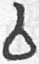 쓴다.

**○真肺脈至，大而虛，如以毛羽中人膚，色白赤不澤，毛折乃死。**

진폐맥(真肺脈)이 이를 때는 크고 허하여, 깃털로 사람의 살갗을 건드리는 듯하고, 안색이 희고 붉으면서 윤기가 없고 털이 꺾이면 곧 죽는다.

〔楊〕진폐맥은 깃털을 던져 사람의 피부에 맞히는 것과 같다. 크고 들떠 허한 것은 모맥(毛脈)에 위기가 없는 것이니 곧 진폐맥이다. 적색은 심의 색이고 백색은 폐의 색이니, 심이 폐를 타는 것이므로 백색이 윤기가 없다.

제18편에 “죽은 폐맥이 오는 것은 물건이 떠 있는 듯, 바람이 털을 부는 듯하니, 이를 폐사(肺死)라 한다.”라고 하였다.

**○真腎脈至，搏而絶，如指彈石辟辟然，色黑黄不澤，毛折乃死。**

진신맥(真腎脈)이 이를 때는 치다가 끊기며, 손가락으로 돌을 튕기는 듯 벽벽(辟辟)하고, 안색이 검고 누르면서 윤기가 없고 털이 꺾이면 곧 죽는다.

〔楊〕‘惴’는 초위반(初委反)이며 움직임이다. 진신맥이 이르면 돌이 손가락을 튕기듯 손가락을 치니, 영(營)맥에 위기가 없는 것으로 곧 진신맥이다. 황색은 비의 색이고 흑색은 신의 색이니, 비가 신을 타는 것이므로 흑색이 윤기가 없다.[역1]

안(案): 양주의 ‘辟’ 자는 ‘辟辟’의 잘못인 듯하다.

제18편에 “죽은 신맥이 오는 것은 빼앗기는 노끈처럼 튕기고, 돌을 튕기듯 벽벽하니, 이를 신사(腎死)라 한다.”라고 하였다.

안(案): ‘辟辟’의 풀이는 이미 제18편에 보인다.

〔高〕‘辟辟然’은 딱딱하고 둔하게 실한 것으로 위기가 없는 것이다.

**○真脾脈至，弱而乍數乍踈，色黄青不澤，毛折乃死。**

진비맥(真脾脈)이 이를 때는 약하면서 잠깐 빠르고 잠깐 성글며, 안색이 누렇고 푸르면서 윤기가 없고 털이 꺾이면 곧 죽는다.

〔楊〕진비맥이 이르면 잠깐 성글고 잠깐 빠르다. ‘踈’는 뜀이 드문 것을 말하고, ‘數’은 잇달아 뜀을 말한다. 이는 위기가 없는 것이니 곧 진비맥이다. 청색은 간의 색이고 황색은 비의 색이니, 간이 비를 타는 것이므로 황색이 윤기가 없다.

**○諸真藏脈見者，皆死不治也。**

모든 진장맥이 나타나는 경우는 다 죽으니 치료할 수 없다.

〔楊〕장맥(藏脈)이 홀로 나타나면 위기가 없어 죽으므로 치료하지 못한다.

**○黄帝曰：見真藏曰死，何也。**

황제(黄帝)가 물었다. “진장이 나타나면 죽는다 하는데, 어째서인가?”

여기서부터 ‘帝曰善’까지는 『대소』 권6 「장부기액편(藏府氣液篇)」에 실려 있다.

〔楊〕다른 것이 섞이지 않았으므로 ‘真’이라 한다. 오장의 기는 모두 위기가 조화시키므로 홀로 쓰일 수 없다. 지극히 강한 것은 홀로 쓰일 수 없는 것과 같아, 홀로 쓰면 부러지고 부드러움과 조화시켜 쓰면 견고하다. 오장의 기가 위기와 조화되면 오래 살 수 있다. 진장만 홀로 나타나 위기와 조화됨이 없으면 반드시 죽을 때가 된다. 오장의 진이 나타나면 죽고 위기와 조화되면 산다는 것을 알려면, 촌구에서 수대음[手大陰]을 진찰하면 알 수 있다. 나타나는 것이 현(絃)과 같으면 간맥이고, 미현(微絃)이면 평하고 좋은 것이다. 미현은 현이 적은 것을 말하니, 3분에 1분 있는 것을 미라 하며, 2분의 위기와 1분의 현기가 함께 움직이면 미현이다. 3분이 모두 현기이고 위기가 전혀 없으면 진장이 나타난 것이다. 진장이 나타나면 죽는 이치가 지극히 오묘하여 그 이치를 말해 주기를 청하였으므로 ‘何也’라 한 것이다.

**○岐伯曰：五藏者，皆稟氣於胃，胃者五藏之本也。藏氣者，不能自致於手太陰，必因於胃氣，乃至於手太陰也。**

기백(岐伯)이 답했다. “오장은 모두 위(胃)에서 기를 받으니, 위는 오장의 근본이다. 장기(藏氣)는 스스로 수태음(手太陰)에 이를 수 없고, 반드시 위기를 통해서야 수태음에 이른다.”

〔楊〕위가 수곡(水穀)을 받아 정기(精氣)로 변화시켜 오장을 돕기 때문에, 오장이 수대음에 이를 수 있어 촌구에 미현으로 나타난다.

**○故五藏各以其時自爲，而至於手太陰也。**

그러므로 오장은 각각 제때에 스스로 작용하여 수태음에 이른다.

〔楊〕오장은 오시(五時)를 주관하니 제때에 이르는 것이다. 그 장에 병이 심한 경우에는 위기가 함께하지 않으므로, 위기를 통하지 않고 호흡의 힘으로 홀로 스스로 대음[大陰]에 이르러 촌구에 진현(真絃)으로 나타난다.

【楷】오늘날 삼부(三部)로 병을 진찰하고 다른 팔후(八候)를 쓰지 않는 조법(祖法)이 여기에 있다. 경문은 「경맥별(經脈別)」에 자세히 보인다.

**[역1]** 원서대로 옮겼다. 앞 절 楊注에 「堅而揣」이 있어 「惴」는 「揣」일 수 있다.

**○故邪氣勝者，精氣衰也。**

그러므로 사기(邪氣)가 이기면 정기(精氣)가 쇠한다.

〔楊〕진장맥(真藏脈)이 현(絃)하되 미(微)하지 않아 위기(胃氣)가 없으면 간병이 이긴 줄 안다. 폐병으로 사기[耶]가 이기면 위(胃)의 곡정(穀精)의 기가 쇠한다.

**○故病甚者，胃氣不能與之俱至於手太陰，故真藏之氣獨見。獨見者，病勝藏也，故曰死。帝曰：善。**

그러므로 병이 심하면 위기가 장기(藏氣)와 함께 수태음(手太陰)에 이를 수 없으므로 진장의 기가 홀로 나타난다. 홀로 나타나는 것은 병이 장을 이긴 것이므로 죽는다고 한다. 황제가 말하였다. “좋다.”

〔楊〕진장이 나타나면 병이 심하므로 죽음에 이른다.

**○黄帝曰：凡治病，察其形氣色澤，脈之盛衰，病之新故，乃治之，無後其時。**

황제(黄帝)가 말하였다. “무릇 병을 치료할 때는 그 형기(形氣)와 색택(色澤), 맥의 성쇠, 병의 신구(新故)를 살핀 뒤에 치료하며, 그 때에 뒤처지지 않는다.”

여기부터 ‘皆難治’｟三一ウ｠까지는 『대소(大素)』 14 「사시맥진(四時脈診)」에 있다.

〔楊〕형체의 살찌고 여윔, 기의 크고 작음, 색의 윤택하고 어두움, 맥의 성쇠, 병의 신구 — 병을 치료할 때는 이 다섯 진법으로 병을 진찰하여, 그 때에 맞추고 때에 뒤처지지 않아야 한다.

안(案): ‘無後其時’는 병이 있으면 일찍 치료해야 함을 말한다. 양주(楊注)는 ‘時’를 사시(四時)의 뜻으로 보았는데 따를 만하다. 사시의 왕맥(旺脈)에 위기가 있는 것을 따라 치료하여 그 시기(時氣)에 뒤처지지 않는다는 말이다.

**○形氣相得，謂之可治。**

형과 기가 서로 맞으면 치료할 수 있다고 한다.

〔楊〕형체가 여윈데 기가 크고, 형체가 살쪘는데 기가 작으면 서로 맞지 않는 것이다. 형체가 살찌고 기가 크며, 형체가 여위고 기가 작으면 서로 맞는 것이다.

**○色澤以浮，謂之易已。**

안색이 윤택하고 떠 있으면 쉽게 낫는다고 한다.

〔楊〕환자의 오색(五色)이 떠 있고 가벼우며 윤택하면 그 병은 쉽게 낫는다.

안(案): 『대소』에 ‘脈’ 자가 있는 것이 가장 따를 만하다. 그 색이 윤택하고 맥이 부(浮)하면 병이 쉽게 낫는다는 말이다. 이 또한 ‘頭項強痛’의 문례일 뿐이다. 혹은 ‘脈’ 자가 연문인 듯하다고 한다. 양주가 ‘脈’ 자를 언급하지 않았으니 옳은 듯하다.

재안(再案): 『대소』의 ‘脈’ 자는 연문인 듯하니 뒷글에서 온 것이다.

**○脈從四時，謂之可治。**

맥이 사시를 따르면 치료할 수 있다고 한다.

〔楊〕사시의 왕맥(王脈)에 모두 위기가 있고 다른 것이 와서 극(剋)하지 않으므로 ‘順時’라 한다.

**○脈弱以滑，是有胃氣，命曰易治，取之以時。**

맥이 약하면서 활(滑)하면 위기가 있는 것이니 쉽게 치료된다고 하며, 때에 맞추어 취한다.

〔楊〕사시의 맥이 모두 유약하고 활한 것을 위기라 한다. 이에 따라 병을 치료하는 것을 ‘合時’라 한다.

**○形氣相失，謂之難治。色夭不澤，謂之難已。脈實以堅，謂之益甚。脈逆四時，爲不可治。必察四難，而明告之。**

형과 기가 서로 어긋나면 치료하기 어렵다고 한다. 안색이 어둡고 윤기가 없으면 낫기 어렵다고 한다. 맥이 실(實)하면서 견(堅)하면 더 심해진다고 한다. 맥이 사시를 거스르면 치료할 수 없다. 반드시 이 네 가지 어려움을 살펴 분명히 알려 주어야 한다.

〔楊〕이 네 진후는 치료에 나아가기 어려우니, 환자에게 분명히 알려 줄 수 있다. 상법을 바꾸어 치료법을 세워야 하며, 상법대로 때에 맞추어 나아갈 수 없다.

**○所謂逆四時者，春得肺脈，夏得腎脈，秋得心脈，冬得脾脈，其至皆懸絶沈濇者，命曰逆四時，未有藏形。**

이른바 사시를 거스른다는 것은 봄에 폐맥을 얻고, 여름에 신맥을 얻고, 가을에 심맥을 얻고, 겨울에 비맥을 얻되 그 이르는 맥이 모두 현절(懸絶)하고 침색(沈濇)한 것이니, 이를 사시를 거스른다고 하며, 아직 장의 형체는 드러나지 않는다.

〔楊〕사시에 모두 자기를 이겨 와서 극하는 맥을 얻고, 맥이 현절·침색하면 사시의 맥을 잃은 것이다. 비록 병든 장의 형체는 아직 없더라도 치료할 수 없다.

〔高〕현절하여 뿌리가 없거나 침색하여 일어나지 않으면 위기가 없는 것이다.

（眉）안(案): 이 절에는 ‘四季得肝脈’ 다섯 글자가 빠진 듯하고, 왕빙(王氷)의 주 ‘春來’ 위에는 ‘四季來見也四季得肝脈’ 열 글자가 빠진 듯하다.

**○於春夏而脈沈濇，秋冬而脈浮大，名曰逆四時也。**

봄·여름에 맥이 침색하고, 가을·겨울에 맥이 부대(浮大)한 것을 사시를 거스른다고 한다.

〔楊〕이 맥은 사시에 반한다.

**○病熱脈靜｟清｠，**

병이 열증인데 맥이 고요하고｟清｠,

〔楊〕열병은 맥이 뜨겁고 조(躁)해야 하는데 지금 반대로 차고 고요하다. ‘清’은 ‘寒’이다.

**○泄｟洩｠而脈大，**

설사하는데｟洩｠ 맥이 크고,

〔楊〕사람이 설사하면 맥이 작고 가늘어야 하는데 지금 반대로 홍대(洪大)하다.

**○脫血而脈實，｟病在中｠**

탈혈(脫血)하였는데 맥이 실하고,｟病在中｠

〔楊〕사람이 탈혈하면 맥이 허약해야 하는데 지금 반대로 강실(強實)하니 병이 속에 있다.

**○病在中脈實堅，｟病在外｠**

병이 속에 있는데 맥이 실견(實堅)하고,｟病在外｠

〔楊〕탈혈에 맥이 실견하면 병이 바깥에 있다.

**○病在外脈不實堅者，皆難治。｟名曰逆四時｠**

병이 바깥에 있는데 맥이 실견하지 않은 것은 모두 치료하기 어렵다.｟名曰逆四時｠

〔楊〕탈혈하였는데 맥이 실하지도 견하지도 않으면 치료하기 어렵다. 이상의 일곱 진후는 모두 사시를 거스르는 것이다.

제18편에 “맥에는 사시에 거스르고 따름이 있으니, 아직 장의 형체가 없는데 봄·여름에 맥이 여위고 가을·겨울에 맥이 부대하면 사시를 거스른다고 한다. 풍열(風熱)인데 맥이 고요하고, 설사하고 탈혈하는데 맥이 실하며, 병이 속에 있는데 맥이 허하고, 병이 바깥에 있는데 맥이 색견(濇堅)한 것은 모두 치료하기 어려우니, 사시에 반한다고 한다.”라고 하였다.

〔張〕앞글 「평인기상론(平人氣象論)」과 상반되는 듯하다. 그러나 앞글의 ‘病在中脈虛’는 안에 쌓여 실한 경우 맥이 허하면 안 된다는 말이고, 여기의 ‘病在中脈實堅’은 내상(内傷)으로 허한 경우 맥이 단단하고 실하면[堅實堅] 안 된다는 말이다. 앞의 ‘病在外濇堅’은 외사가 성한 경우 색견하면 안 된다는 말이니 색견을 침음(沈陰)으로 보기 때문이다. 여기의 ‘病在外脈不實堅’은 외사가 바야흐로 치성한 경우 힘이 없으면 안 된다는 말이니 실견하지 않은 것을 무양(無陽)으로 보기 때문이다. 이 네 가지 구분은 모두 정기가 사기를 이기지 못하는 맥이므로 치료하기 어렵다고 하였다. 말은 상반되는 듯하나 이치는 실제로 그러하다. 『신교정(新校正)』이 경문의 잘못이라 한 것은 그 묘리에 통달하지 못한 것이다.[역1]

안(案): 장(張)의 설은 따를 만한 듯하므로 우선 여기에 근거한다. 양주가 ‘病在中’·‘病在外’를 아래 구에 붙인 것은 잘못이다.[역2]

**○黄帝曰：余聞虛實以決死生，願聞其情。**

황제가 물었다. “내가 듣건대 허실(虛實)로 사생을 판결한다 하니, 그 병정(病情)을 듣고 싶다.”

안(案): ‘情’은 병정(病情)을 말하니, 뒷글의 ‘脈盛，皮熱，腹脹，前後不通，悶瞀’ 같은 것이 이것이다. 대개 사기가 실하고 정기가 허한 것을 병인이라 하고 또 병원(病源)이라 하니 곧 병의 성(性)이다. 병증을 병정이라 하니 곧 성에서 나오는 것이다.

**○岐伯曰：五實死，五虛死。帝曰：願聞五實五虛。岐伯曰：脈盛，皮熱，腹脹，前後不通，悶瞀，此謂五實。**

기백(岐伯)이 답했다. “오실(五實)이면 죽고 오허(五虛)이면 죽는다.” 황제가 말하였다. “오실과 오허를 듣고 싶다.” 기백이 답했다. “맥이 성하고, 피부가 뜨겁고, 배가 불러 오르고, 대소변이 통하지 않고, 민무(悶瞀)하면 이를 오실이라 한다.”

안(案): ‘悶瞀’는 마음속이 답답하고 어지러움을 말한다. 『초사(楚詞)』 「석송(惜誦)」의 ‘中悶瞀之忳忳’ 주와 또 「추사(抽思)」의 ‘煩寃瞀容’ 주에 모두 “‘瞀’는 ‘亂’이다.”라고 하였다｟『후한(後漢)』 「위표전(韋彪傳)」 주, 「환자전(宦者傳)」 주, 「곽헌전(郭憲傳)」 주도 모두 같다｠. 「오상정대론(五常政大論)」의 ‘其動鏗禁瞀厥’ 주에 “‘瞀’는 ‘悶’이다.”라고 하였고, 『음석(音釋)』에 “‘瞀’는 음이 冒이다.”라고 하였다. 「기교변대론(氣交變大論)」의 ‘民病肩背瞀重，鼽嚏血便注下’ 주에 “‘瞀’는 ‘悶’을 말한다.”라고 하였다. 「지진요대론(至真要大論)」에 ‘諸熱瞀瘛皆屬於火’라 하였다. 『상서대전(尚書大傳)』의 ‘厥咎瞀’ 정씨(鄭氏) 주에 “‘瞀’는 사심(思心)의 허물과 같다. 그러므로 『자준전(子駿傳)』에 ‘瞀眊’는 ‘眊亂’이라 하였다.”라고 하였다. 『서(書)』 「익직(益稷)」 전(傳)의 ‘昏瞀墊溺’ 소(疏)에 “‘瞀’는 어지럽고 미혹된다는 뜻이다.”라고 하였다. 모두 증거가 된다. 『상한론(傷寒論)』 대시호(大柴胡) 조문의 ‘鬱鬱微煩’과 또 「가토편(可吐篇)」의 “병이 가슴 위의 여러 실증으로, 가슴 속이 울울(鬱鬱)하고 아프다”에서 말한 ‘鬱鬱’은 ‘悶瞀’와 같다. 『영추(靈樞)』 「경맥편(經脈篇)」에 ‘肺動則交兩手而瞀’라 하였고, 『음석』에 “‘瞀’는 음이 務이다.”라고 하였다. 『좌전(左傳)』 양공(襄公) 14년의 ‘亦無瞢焉’ 주에 “‘瞢’은 ‘悶’이다.”라고 하였다.

（眉）『상한직격(傷寒直格)』에 “‘瞀’는 음이 莫이다. 눈앞이 캄캄한 것이고 어두운 것이니, 기가 어지러워 어두움을 말한다.”라고 하였다.

（眉）『천금(千金)』 28｟十九オ｠

（眉）명(明) 부인우(傅仁宇) 윤과(允科) 찬집 『안과심시요함(眼科審視瑤函)』 권2에 말하였다. 팔요(八要)는 표리·허실·한열·사정이다. 표는 병이 리에 있지 않은 것이다. 리는 병이 표에 있지 않은 것이다. 허는 오허이다. 실은 오실이다. 한은 장부에 쌓인 찬 기운이다. 열은 장부에 쌓인 열이다. 사는 외사가 침범한 것이다. 정은 장부 스스로 병든 것이다.｟三オ｠

**○脈細，皮寒，氣少，泄利前後，飲食不入，此謂五虛。**

맥이 가늘고, 피부가 차고, 기가 적고, 대소변이 새어 나가고, 음식이 들어가지 않으면 이를 오허라 한다.

안(案): 오실은 양명위실증(陽明胃實證)을 말하는 듯하고, 오허는 소음직중증(少陰直中證)을 말하는 듯하다. 오실은 사기가 성실하지만 정기도 더불어 맞서 싸우는 바가 있으므로 열실증(熱實證)이 된다. 오허는 진기가 부족하지만 실은 사기가 더욱 성하고 더불어 맞설 정기가 더는 없으므로 오직 한화(寒化)를 따를 뿐 열후가 되지 않아 음한증(陰寒證)이 된다.

**○帝曰：其時有生者，何也。**

황제가 물었다. “그런데 때로 사는 경우가 있는 것은 어째서인가?”

안(案): 앞글에 ‘五實死，五虛死’라 하였으나 이 증을 갖추고도 혹 때로 죽지 않는 경우가 있으니, 무엇 때문에 죽지 않는가 하여 물은 것이다. 그래서 아랫글에 말하였다.

**○岐伯曰：漿粥入胃，泄注止，則虛者活。**

기백이 답했다. “장죽(漿粥)이 위에 들어가 설주(泄注)가 멎으면 허한 자가 살아난다.”

안(案): ‘漿粥’은 수곡(水穀)이라는 말과 같다. 대개 수곡이 들어갈 수 있으면 위기가 아직 쇠하지 않은 것이다. 그러므로 설사도 멎으니, 이는 허증이 실로 변한 길조이다. 그 약은 사역(四逆) 부류가 주치한다.

**○身汗，得後利，則實者活，此其候也。**

몸에 땀이 나고 대변이 통하면 실한 자가 살아나니, 이것이 그 징후이다.

안(案): ‘身汗’은 표실(表實)이 땀으로 풀리는 증을 말한다. ‘得後利’는 이실(裏實)로 사하(瀉下)시켜야 하는 증을 말한다. 삼승기(三承氣) 부류를 가려 써야 한다.

【楷】입지안(立之案): 여기서 오실이면 죽는다고 하였는데, 표실의 대청룡(大青龍) 증은 본래 죽을 증이 아니다. 그러니 이는 태양병 등 죽지 않는 가벼운 증을 말한 것일 수 없다. 대개 오실은 모두 양명증이고 오허는 소음증이다. 그렇다면 ‘身汗’은 무슨 말인가 하면, 이는 몸에 땀이 나는 것은 하제(下劑)를 쓴 뒤의 나을 징후로서 반드시 자한(自汗)이 나서 풀리는 것이다. 오우가(吳又可) 『온역론(瘟疫論)』 권상 「내옹불한편(内壅不汗篇)」에 “반드시 승기(承氣)로 먼저 그 리를 통하게 해야 한다. 이기(裏氣)가 한번 통하면 발산을 기다리지 않아도 많은 경우 저절로 땀으로 풀린다.”라고 하였고, 「하후맥부편(下後脈浮篇)」에 “사하시킨 뒤 맥이 부삭(浮數)하면 본래 땀으로 풀려야 한다.”라고 하였으며, 「하후맥복침편(下後脈復沈篇)」에 “사하시킨 뒤 맥이 부하면 땀으로 풀려야 한다.”라고 하였으니, 모두 증거가 된다. 또 양명대실열증(陽明大實熱證)은 지체하고 미루면 반드시 죽어 손쓸 수 없으니, 이 때문에 여기서 오실이면 죽는다고 한 것이다. 근년 무오·기미·임술·계해년에 유행한 폭사역(暴瀉疫)은 이 오허와 완전히 들어맞는다. 그러므로 폭사역도 장죽이 위에 편안히 들어가 설주가 멎으면 살아난다.

문구(文久) 원년 신유년 2월 28일 밤에 쓰다.　오늘 개원(改元)을 영중(營中)에서 구세대화수(久世大和守) 전(殿)이 제감간(帝鑑間)에서 통지하였으니, 사시(巳時) 중각쯤이었다.　입지(立之)

제19 보(第十九補)

여수지류(如水之流)｟八ウ｠

「십오난(十五難)」 우서(虞庶)의 주에 말하였다. 물이 새는 듯한 것은 비맥의 태과이고, 참새가 쪼는 듯한 것은 비맥의 불급을 말한다. 태과이면 사지를 들지 못하게 하고, 불급이면 구규(九竅)가 통하지 않게 한다. 그러므로 맥이 평화(平和)할 때는 볼 수 없고, 쇠해야 나타난다.

안(案): 우주(虞注)가 옳은 듯하다. 「십오난」의 ‘如水之下漏’는 여기의 ‘如水之流’와 같은 뜻으로, 비맥의 태과를 말한다. 비맥이 태과하면 비기가 허하고 사기가 혈락(血絡)의 맥으로 들어가므로 그 증이 사지를 들지 못한다. 비맥이 불급하면 비장이 허하고 사기가 위부(胃府)로 들어가므로 그 증이 구규가 통하지 않는다.

현절(懸絶)｟卅一ヲ｠

제7편에 말하였다. “진맥(真脈)의 장맥을 잡을 때, 간맥이 이르는 것이 현절하면서 급하면 18일에 죽고, 심맥이 이르는 것이 현절하면 9일에 죽고, 폐맥이 이르는 것이 현절하면 12일에 죽고, 신맥이 이르는 것이 현절하면 7일에 죽고, 비맥이 이르는 것이 현절하면 4일에 죽는다.”

〔楊〕맥이 이르렀다가 곧 끊겨 오래 오지 않으므로 현절이라 한다.

형기(形氣)｟卅ウ｠

〔紹〕『계봉보제방(雞峰普濟方)』에 맥형기역순설(脈形氣逆順説)이 있어 이 절의 뜻을 부연하였는데, 글이 번다하여 싣지 않으니 참고해야 한다. 대개 여기서 말하는 기는 곧 원양(元陽)의 기이다. 원기의 성쇠는 반드시 맥에서 징험하고 또 기식(氣息)의 고요하고 조급함에서 징험하니, 형모의 살찌고 여위고 강하고 무름과 서로 표리가 되어 진찰의 요점이 된다. 또 옛 책에서는 호흡과 관련된 병을 흔히 기(氣)라 이름 붙였다. 앞글의 ‘胸中氣滿’과 ‘其氣動形’은 모두 기식을 말한 것이고, 다음 편의 “형체가 성한데 맥이 가늘고 기가 적어 숨쉬기에 부족한 자는 위태롭다”가 곧 이른바 형기가 서로 어긋나는 것이다.｟그 편 왕주(王注)에 이 절을 인용하여 증거로 삼았다｠ 『금궤요략(金匱要略)』의 ‘息搖肩者’ 한 조문도 서로 증거가 된다.

여부(如浮)｟四ヲ｠

『설문(説文)』 단옥재(段玉裁) 주의 “‘笨’은 대나무 속이다.” 아래에 “또 종이처럼 흰 것이 있다. 「오도부(吳都賦)」 주에 이를 ‘竹孚俞’라 하였다.”라고 하였다. 『문선(文選)』 「오도부」의 “천실(泉室)에서 몰래 짜서 초(綃)를 말고, 연객(淵客)이 강개하여 구슬을 흘린다”를 고찰하면, 유연림(劉淵林)의 주에 “‘綃’는 ‘竹孚俞’이다.”라고 하였다.

안(案): ‘浮’는 곧 ‘莩’의 가차(假借)이며, 혹 ‘孚’·‘符’로 쓰는데 뜻이 같다. 『후한서(後漢書)』 「장제기(章帝紀)」 주에 “‘莩’는 잎 속의 흰 껍질이다.”라고 하였다. 『법언(法言)』 「수신편(修身篇)」의 ‘轉莩曠沈’ 유종원(柳宗元) 주에 “‘莩’는 ‘葭莩’의 ‘莩’와 같으니 눈동자의 겉이다.”라고 하였다. 『한서(漢書)』 「중산정왕승전(中山靖王勝傳)」의 ‘非有葭莩之親’ 주에 “‘莩’는 갈대 속의 흰 껍질이다.”라고 하였다. 『시(詩)』 「대전(大田)」 전(箋)의 ‘謂孚甲始生’ 소에 “‘孚’는 쌀 밖의 겉껍질이다.”라고 하였다. 『사기(史記)』 「율력서(律曆書)」의 ‘言萬物部符甲而出也’에 대해 『색은(索隱)』에 “‘符甲’은 ‘孚甲’과 같다.”라고 하였다. 『회남(淮南)』 「숙진훈(俶真訓)」의 ‘蘆苻之厚’ 주에 “갈대 속의 흰 부분이다. ‘苻’는 ‘麫麩’의 ‘麩’처럼 읽는다.”라고 하였다.

사방(四傍)｟七ウ｠

안(案): ‘四傍’은 아마 사지를 말한다. 비기가 다른 네 장에 흘러들 수 있으므로 네 장이 각각 조화를 얻는다. 양(楊)이 “액이 네 곁의 장에 흘러든다.”라고 한 것이 따를 만하다.

박근(迫近)｟十ヲ｠

「천원기대론(天元紀大論)」｟六十六｠에 말하였다. “귀유구(鬼臾區)가 말하였다. ‘지수(至數)의 기틀은 다가옴이 급박하고 은미하다.’”

군(䐃)｟廿二ウ｠

『영추』 「본장편(本藏篇)」에 “비는 살에 응하니, 육군(肉䐃)이 단단하고 크면 위가 두껍고, 육군이 가늘면 위가 얇고, 육군이 작고 가늘면 위가 단단하지 않고, 육군이 몸에 걸맞지 않으면 위가 처진다. 위가 처지면 하관(下管)이 조여 불리하다. 육군이 단단하지 않으면 위가 느슨하고, 육군에 작은 이루(裏累)가 없으면 위가 급하고, 육군에 작은 이루가 많으면 위가 맺힌다. 위가 맺히면 상관(上管)이 조여 불리하다.”라고 하였다. 또 「사전편(師傳篇)」에 “황제가 말하였다. ‘「본장」에서는 신형·지절·군육으로 오장육부의 크기를 살핀다.’”라고 하였다. 또 「오변편(五變篇)」의 “괵육(膕肉)이 단단하지 않고 분리(分理)가 없으면 거친 결이다”가 『갑을(甲乙)』 권10 제1편에는 ‘䐃肉’으로 실려 있다. 또 「오변편」에 “피부가 얇고 살에 군이 없으며, 그 팔이 연약하고, 턱의 색이 탁하여 이마와 같은 색이 아니고 더럽게 유독 다르면 이것이 그 징후이다. 그리고 팔이 얇은 자는 골수가 차지 않으므로 한열병을 잘 앓는다.”라고 하였다. 또 「수요강유(壽夭剛柔)」에 “형체가 충실하고 대육의 군이 단단하고 나뉨이 있으면 살이 단단하고, 살이 단단하면 오래 산다.”라고 하였고, 『음석』에 “‘䐃堅’의 윗글자는 거영절(渠永切)이며, 배 속의 군지(䐃脂)이다.”라고 하였다. 또 「본신편(本神篇)」에 ‘破䐃脫肉’이라 하였다. 또 「사객편(邪客篇)」에 “땅에 취읍(聚邑)이 있듯 사람에게 군육이 있다.”라고 하였다. 「위기실상편(衛氣失常篇)」에 “괵육이 단단하고｟원주에 말하였다. 어떤 본에는 ‘䐃肉’으로 되어 있다.｠ 피부가 그득하면 비(肥)이고, 군육이 단단하지 않고 피부가 느슨하면 고(膏)이며, 피부와 살이 서로 떨어지지 않으면 육(肉)이다.”라고 하였다. 「오금편(五禁篇)」에 “착비(著痺)가 옮겨 가지 않고 군육이 깨지며 몸에 열이 나고 맥이 한쪽만 끊기면, 이것이 세 번째 역(逆)이다.”라고 하였다. 「경수편(經水篇)」의 “살의 단단하고 무름과 괵의 크기”가 『갑을』에는 ‘䐃’으로 되어 있다.

이제 풍한이 사람에게 침입하면[今風寒客於人]｟十四ヲ｠

「조경론(調經論)」｟六十二｠에 “풍우가 사람을 상하게 할 때는 먼저 피부에 객하였다가 손맥(孫脈)으로 전입하고, 손맥이 차면 낙맥(絡脈)으로 전입하며, 낙맥이 차면 대경맥(大經脈)으로 흘러든다. 혈기가 사기와 함께 분주(分腠) 사이에 객하면 그 맥이 견대(堅大)하므로 실(實)이라 한다.”｟十七ノ五ウ｠라고 하였다.

내소(内消)｟廿三ヲ｠

『병원(病源)』 권5에 “내소병(内消病)은 갈증이 없으면서 소변이 많은 것이다. 젊어서 오석(五石)을 복용하여 석열(石熱)이 신 안에 맺힌 데서 비롯된다. 열이 일으키는 바이니, 복석한 사람의 소변이 잘 나오는 까닭은 돌의 성질이 신으로 돌아가는데, 신이 돌을 얻으면 실해지고 실하면 수장(水漿)을 소모하므로 소변이 잘 나오며, 많이 나오면 오장을 적셔 기르지 못하여 장이 쇠해 여러 병이 생긴다. 신이 성할 때 그 기를 아끼지 않고 마음대로 쾌락을 좇아 허손되고 소모되어, 석열만 홀로 성하면 소리(消利)가 생기므로 갈증이 없으면서 소변이 （‘多’를 보충해야 한다.） 나오는 것이다.”｟六ヲ｠라고 하였다.

책책연(責責然)｟廿五ウ｠

【楷】『명의류안(名醫類案)』에 말하였다. “단계(丹溪)가 어떤 사람을 치료하였다. 6월에 못에 들어가 고기를 잡았는데, 늦가을 비가 서늘할 무렵 한밤중에 소복이 심하게 아프고 땀이 많이 났으며, 맥이 침현세실(沈弦細實)하고 깊이 누르면 칼을 쓰다듬는 듯 책책하였다. 대승기탕(大承氣湯)에 계(桂)를 더해 2첩 주니 약간 설사하고 통증이 멎었다. 그러나 연일 신시·유시에 다시 아프고 단단하여 손을 댈 수 없었다. 앞의 약을 줄 때마다 약간 설사하고 통증이 잠시 멎었다. 앞의 약에 도인니(桃仁泥)를 더하니 자흑색 피를 한 되 남짓 쏟고 통증도 멎었다. 맥은 조금 줄었으나 책책한 것은 여전히 있었다. 다시 앞의 약에 천부자(川附子)를 더하니 대변을 다섯 번 보았고, 찢어진 솜 같은 자흑색 피가 두 되 나오고 나았다.” 『의학정전(醫學正傳)』에도 이 글이 같게 실려 있다.

19(十九)

- 거(胠)｟二ヲ｠
- 침음(浸淫)｟三ウ｠
- 기설(氣泄)｟四ヲ｠
- 여부(如浮)｟四ヲ｠
- 수삼부일건(手三部一件)｟廿九ヲ｠
- 온온연(慍慍然)｟五ウ｠
- 하문병음(下聞病音)｟同｠
- 여영(如營)｟六ヲ｠
- 여삭(如數)｟同ウ｠
- 심현(心懸)｟又六ウ｠
- 현현(懸弦)
- 견(牽)｟又六ウ｠
- 사방(四傍)｟七ウ｠
- 중강(重強)｟九ウ｠
- 피부(皮膚)｟十四ウ｠
- 불인(不仁)｟同｠
- 풍은 백병의 으뜸이다[風者百病之長]｟十四ヲ｠
- 폐비(肺痺)｟十五ヲ｠
- 간비(肝痺)｟十五ヲ｠
- 비풍(脾風)｟同｠
- 발단(發癉)｟十五ウ｠
- 고(蠱)｟十六ヲ｠
- 출백(出白)｟十七ヲ｠
- 계(瘛)｟同｠
- 진장(真藏)｟廿一ウ｠
- 괵(膕)｟廿二ウ｠
- 내소(内消)｟廿三ヲ｠
- 견수(肩隨)｟廿三ウ｠
- 급허(急虛)｟廿四ヲ｠
- 오륙지(五六至)｟廿五ヲ｠
- 책책연(責責然)｟廿六ヲ｠
- 모절(毛折)｟同ウ｠
- 의이(薏苡)｟廿七ヲ｠
- 내통(内痛)｟廿二ヲ｠
- 기설(氣泄)｟四ヲ｠
- 무(瞀)｟三十二ウ｠
- 형기(形氣)｟三十ヲ｠
- 산가(疝瘕)｟十五ウ｠
- 홀홀(忽忽)｟二ヲ｠
- 진(胗)｟六ウノ七オ｠
- 탕위화구(湯熨火灸)｟灸十四ウ｠
- 촌구수태음(寸口手太陰)｟廿九オ｠

#### 삼부구후론(三部九候論)편 제20

〔新〕살펴보건대[按] 전원기(全元起)본에는 제1권에 있고 편명은 「결사생(決死生)」이다.

**○黃帝問曰：余聞九鍼於夫子，衆多博大，不可勝數。余願聞要道，以屬子孫。**

황제(黃帝)가 물었다. “내가 구침(九鍼)을 선생에게 들었는데 많고 넓고 커서 이루 헤아릴 수 없다. 나는 그 요도(要道)를 들어 자손에게 맡겨 전하고 싶다.”

〔志〕「이합진사론(離合真邪論)」에 “내가 듣건대 구침 9편을 선생께서 이어서 아홉 배로 하여 81편이 되었는데, 나는 그 뜻을 다 통달하였다.”라고 하였다. 대개 먼저 『침경(鍼經)』 81편을 세워 구침의 도를 논하였으나 많고 넓고 커서 이루 헤아릴 수 없으므로 요도를 듣기 원한 것이다.

〔張〕‘屬’은 부탁함이다.

안(案): ‘屬’은 곧 ‘囑’의 뜻이다. 『옥편(玉篇)』에 “‘囑’은 지촉절(止屬切), 부탁함이다.”라고 하였고, 『광운(廣韻)』에 “‘囑’은 지욕절(之欲切), 맡김이다.”라고 하였다.

안(案): 구침은 『영추』 권1 「구침십이원(九鍼十二原)」 제1에 자세히 보인다.

**○傳之後世，著之骨髓，藏之肝肺，歃血而受，不敢妄泄。**

후세에 전하고, 골수에 새기고, 간폐(肝肺)에 간직하며, 피를 마시고 받아 함부로 누설하지 않는다.

〔楊〕‘著’는 기록함이다. 삽혈(歃血)은 피를 마시고 맹세하는 것이다.

〔識〕［簡按］『좌전정의(左傳正義)』에 “맹약의 예에서는 희생을 죽여 피를 마시고 신명에게 고하여 맹세한다. 어기면 신이 재앙을 내려 이 희생처럼 되게 하고자 하는 것이다.”라고 하였다. 『예기(禮記)』 「곡례(曲禮)」 소에 “희생의 왼쪽 귀를 베어 주반(珠盤)에 담는다. 또 피를 취해 옥돈(玉敦)에 담아 피로 맹서(盟書)를 쓰고, 맹서가 이루어지면 피를 마시고 글을 읽는다.”라고 하였다. 웅씨(熊氏)의 『음(音)』에 “‘歃’은 음이 霎이다.”라고 하였다.

**○令合天道，**

천지(天地)에 합치하게 하여,

〔新〕살펴보건대[按] 전원기본에는 ‘令合天地’로 되어 있다.

안(案): ‘天地’로 쓰는 것이 옳은 듯하니, ‘地’·‘始’·‘紀’가 운어이고 ‘行’·‘陽’·‘方’이 운어이다.

**○必有終始，**

반드시 종시(終始)가 있으며,

「사기조신론(四氣調神論)편 제2」에 “그러므로 음양과 사시는 만물의 끝과 시작이다.”라고 하였다.

제5편에 “음양은 만물의 근원[能始]이다.”라고 하였다.

「천원기대론」에 “금과 목은 생성의 끝과 시작이다.”라고 하였다.

**○上應天光星辰歷紀，下副四時五行，貴賤更互。冬陰夏陽，以人應之奈何。願聞其方。**

위로는 천광(天光)과 성신(星辰)·역기(歷紀)에 응하고, 아래로는 사시와 오행에 짝하며, 귀천이 번갈아 바뀐다. 겨울은 음이고 여름은 양인데, 사람은 어떻게 이에 응하는가? 그 방도를 듣고 싶다.

『광아(廣雅)』에 “‘副’는 돕는 것이고 걸맞은 것이다.”라고 하였다.

제9편에 “대신령(大神靈)의 물음이니 그 방도를 말씀드리겠다.”라고 하였다.

안(案): ‘方’은 도(道)이다. 이 편에 자세히 보인다. 제11편의 “그 도를 알지 못하니 그 설을 듣고 싶다”는 문례가 비슷하니 참고해야 한다.

**○岐伯對曰：妙乎哉問也。此天地之至數。帝曰：願聞天地之至數，合於人形血氣，通決死生，爲之奈何。**

기백이 답했다. “묘하구나, 그 물음이여. 이것은 천지의 지수(至數)이다.” 황제가 물었다. “천지의 지수가 사람의 형체·혈기에 합하여 사생을 판결하는 데 통한다는 것을 듣고 싶으니, 어떻게 하는가?”

안(案): ‘天地之至數，合於人形血氣’는 제1편에서 말한 “도를 아는 자는 음양을 본받고 술수에 조화한다”, 그리고 「사기조신」·「생기통천(生氣通天)」에서 말한 것 같은 종류로, 하나로 그치지 않는다. 아랫글의 구후(九候)도 그 한 단서일 뿐이다.

**[역1]** 원서대로 옮겼다. 같은 문단의 대구가 「實堅」이어서 「堅實堅」의 앞 「堅」은 덧들어간 글자일 수 있다.
**[역2]** 같은 쪽 楊注와 『太素』에는 「病在中」이 「脫血而脈實」 뒤에 붙어 있어, 원서 「屬下句」의 「下」는 「上」의 잘못으로 보인다.

**○岐伯曰：天地之至數，始於一終於九焉。一者天，二者地，三者人，因而三之，三三者九，以應九野。**

기백(岐伯)이 답했다. “천지의 지수(至數)는 1에서 시작하여 9에서 끝난다. 1은 하늘, 2는 땅, 3은 사람이며, 이를 셋으로 곱하니 아홉이 되어 구야(九野)에 응한다.”

〔識〕［吳云］구주(九州)의 분야(分野)이다. ［張云］곧 『낙서(洛書)』의 구궁(九宮)과 「우공(禹貢)」의 구주의 뜻이다. ［簡按］『회남(淮南)』 「원도훈(原道訓)」의 “위로 구천에 통하고 아래로 구야를 꿰뚫는다”에 고유(高誘)의 주가 “구천은 팔방과 중앙이다. 구야도 이와 같다.”라고 하였다. 또 「천문훈(天文訓)」의 “하늘에 구야가 있고 9,999모퉁이가 있으며 땅에서 5억만 리 떨어져 있다”에 주가 “구야는 구천의 들이다.”라고 하였다. 왕주(王注)는 『이아(爾雅)』에 근거했는데 타당하지 않다.

안(案): 구야설은 이미 제9편에 보인다.

**○故人有三部，部有三候，以決死生，以處百病，以調虛實而除邪疾。**

그러므로 사람에게는 삼부(三部)가 있고 부마다 삼후(三候)가 있어, 사생을 판결하고 온갖 병을 판단하며, 허실을 조절하고 사질(邪疾)을 제거한다.

‘生’·‘病’이 운이다. ‘實’·‘疾’이 운이다.

안(案): ‘處’는 정함이고 판단함이다. 『국어(國語)』 「진어(晉語)」의 ‘蚤處之’ 주에 “‘處’는 ‘定’이다.”라고 하였다. 『후한서(後漢書)』 「양구전(陽球傳)」 주에 “‘處’는 ‘斷’이다.”라고 하였다. 『좌씨(左氏)』 문공(文公) 18년 전의 ‘德以處事’ 주에 “‘處’는 ‘制’와 같다.”라고 하였다. 『한서(漢書)』 「곡영전(谷永傳)」의 ‘臣愚不能處也’ 주에 “‘處’는 판결함을 말한다.”라고 하였다.

『사(史)』 「편작창공전(扁鵲倉公傳)」의 ‘醫之所病’에 대해 『집해(集解)』가 서광(徐廣)을 인용하여 “‘所病’은 병을 치료한다는 말과 같다.”라고 하였다.

안(案): ‘邪疾’은 풍한 사기만을 말하는 것이 아니라 정기를 해치는 것은 모두 ‘邪’라 한다. 도씨(陶氏) 『본초서례(本草序例)』, 왕씨(王氏) 『소문(素問)』 주 등에 보인다.

**○帝曰：何謂三部。岐伯曰：有下部，有中部，有上部。部各有三候。三候者，有天，有地，有人也。必指而導之，乃以爲真。**

황제가 물었다. “무엇을 삼부라 하는가?” 기백이 답했다. “하부(下部)가 있고 중부(中部)가 있고 상부(上部)가 있다. 부마다 삼후가 있다. 삼후는 천(天)·지(地)·인(人)이다. 반드시 손가락으로 짚어 눌러 이끌어야 참된 것이 된다.”

（眉）『천금(千金)』 권1 「진후(診候)」 4의 인용은 글은 달라도 뜻은 같다.

〔識〕［張云］반드시 스승의 지도를 받아야 그 참됨을 얻을 수 있다. ［高云］반드시 손가락으로 따라 짚어 눌러 이끌어야 부후(部候)의 참됨이 된다. ［簡按］장주(張注)가 옳은 듯하다.

안(案): 뒷글에 근거하면 고(高)의 설이 옳은 듯하다.

**○上部天，兩額之動脈。**

상부의 천은 양쪽 이마의 동맥이다.

안(案): ‘上部天’부터 ‘足太陰也’까지는 『대소(大素)』 권14에 실려 있는데, 편 끝 ‘五指留鍼’ 아래에 있다. 왕빙(王冰)의 원본도 아마 그러했을 것이다. 지금 이 편의 차례는 송나라 신하들이 고친 것으로 근거가 되지 못한다. 그 설은 뒤의 글[左文] ‘太陰也’ 아래에 말한 바와 같다.

〔楊〕상부의 천은 양쪽 이마의 족소양(足少陽)·양명(陽明) 두 맥의 박동으로, 두각(頭角)의 기를 살핀다.

（眉）안(案): 이하 삼부구후의 맥 자리는 왕주가 옳고, 양주(楊注)는 크게 달라 잘못되었다.

（眉）안(案): 왕주가 이마 곁의 혈 이름을 말하지 않은 것은 번다하기 때문이다. 곧 현로(懸顱)·현리(懸氂)·곡빈(曲鬢)의 자리이다.

**○上部地，兩頰之動脈。**

상부의 지는 양쪽 뺨의 동맥이다.

〔楊〕상부의 지는 양쪽 뺨의 족양명(足陽明)이 대영(大迎)에서 박동하는 것으로, 입과 이의 기를 살핀다.

**○上部人，耳前之動脈。**

상부의 인은 귀 앞의 동맥이다.

〔楊〕상부의 인은 눈 뒤 귀 앞으로, 수대양[手大陽]·수소양(手少陽)·족소양 세 맥이 和𢨺에서 박동하는 것이며, 귀와 눈의 기를 살핀다.[역2]

（眉）안(案): 왕주가 귀 앞 박동의 혈 이름을 말하지 않은 것은 번다하기 때문이다. 곧 객주인(客主人)·청회(聽會)·화료(和髎)의 자리이다.

**○中部天，手太陰也。**

중부의 천은 수태음(手太陰)이다.

〔楊〕중부의 천은 수대음맥[手大陰脈]이다. 박동은 중부(中府)·천부(天府)·협백(俠白)·척택(尺澤) 네 곳에 있으며, 폐기를 살핀다.

（眉）폐(肺).

**○中部地，手陽明也。**

중부의 지는 수양명(手陽明)이다.

〔楊〕중부의 지는 수양명맥으로, 경을 살펴보면 박동처가 없다. 여광(呂廣)이 『팔십일난(八十一難)』에 주석하여 “박동이 입가에 있다.”라고 하였다. 이로써 살피는 것은 대장의 기를 살피는 것이다.

（眉）대장(大腸).

**○中部人，手少陰也。**

중부의 인은 수소음(手少陰)이다.

〔楊〕중부의 인은 수소음이다. 박동은 극천(極泉)·소해(少海) 두 곳에 있으며 심기를 살핀다.

（眉）심(心).

**○下部天，足厥陰也。**

하부의 천은 족궐음(足厥陰)이다.

〔楊〕하부의 천은 족궐음맥으로, 박동은 곡골(曲骨)·행간(行間)·충문(衝門) 세 곳에 있으며 간기를 살핀다.

（眉）간(肝).

（眉）왕주: 하부의 천은 남자는 오리(五里), 여자는 대충(大衝)이니, 모두 족궐음간경의 혈이다. 여자는 오리를 피해 대충으로 대신하니, 아아, 성인의 법은 어질구나. 또 「지진요론(至真要論)」에 충양(衝陽)·척택·태계(太谿)·천부·태충(太衝)·신문(神門)으로 죽음을 점치는 글이 있으니, 그렇다면 남자도 태충으로 해도 된다.

（眉）신(腎).

**○下部地，足少陰也。**

하부의 지는 족소음(足少陰)이다.

안(案): 이 일곱 글자는 지금 본 『대소』에서 완전히 탈문(脱文)이다. 양주에 있으므로 그러함을 안다.

〔楊〕하부의 지는 족소음맥으로, 박동은 대계[大谿] 한 곳에 있으며 신기를 살핀다.

**○下部人，足太陰也。**

하부의 인은 족태음(足太陰)이다.

〔楊〕하부의 인은 족대음맥[足大陰脈]으로, 박동은 중부(中府)·기문(箕門)·오리(五里)·음광(陰廣)·충문(衝門)·운문(雲門) 여섯 곳에 있으며 비기를 살핀다. 십이경맥(十二經脈)에서 수심주(手心主)는 심장(心藏)과 따로 구별되지 않아 구후에 들지 않는다. 수대양·수소양·족대양·족소양·족양명, 이 다섯은 모두 오장의 표경(表經)으로, 장을 살피면 표를 알 수 있으므로 구후에 들어가지[入越]｟於越｠ 않는다.

（眉）비(脾).

〔新〕살펴보건대 ‘上部天’부터 여기까지 한 단락은 예전에 이 편 끝에 있어 뜻이 이어지지 않았다. 이는 바로 삼부구후를 논한 것이므로 여기에 두어야 한다. 이제 황보밀(皇甫謐) 『갑을경(甲乙經)』의 편차 예에 따라 편 끝에서 여기로 옮긴다.

**○故下部之天以候肝，**

그러므로 하부의 천으로 간을 살피고,

족궐음간경(足厥陰肝經).

안(案): 『대소』와 왕빙 원본에 따르면 이 글은 앞의 ‘有下部有中部有上部’ 아래에 있었다. 그러므로 여기서 앞글을 따라 ‘下部’ 운운을 처음에 두고 다음에 중부·상부를 둔 것이다.

**○地以候腎，**

지로 신을 살피고,

족소음신경(足少陰腎經).

**○人以候脾胃之氣。**

인으로 비위(脾胃)의 기를 살핀다.

족태음비경(足太陰脾經).

안(案): 비맥은 기문의 자리에 있고 위맥은 발등 위에 있으므로, 여기서 비위의 기를 합쳐 말한 것이다.

**○帝曰：中部之候奈何。**

황제가 물었다. “중부의 후(候)는 어떠한가?”

안(案): ‘故下部之天’ 이하도 앞글의 ‘乃以爲真’을 이어 말한 것이다. 그러므로 여기에 이르러 실마리를 바꾸어 ‘帝曰’의 글을 일으켰다.

**○岐伯曰：亦有天，亦有地，亦有人。天以候肺，**

기백이 답했다. 역시 천이 있고 지가 있고 인이 있다. 천으로 폐를 살피고,

수태음폐경(手太陰肺經).

**○地以候胸中之氣，**

지로 가슴 속의 기를 살피고,

수양명대장경(手陽明大腸經).

**○人以候心。**

인으로 심을 살핀다.

수소음심경(手少陰心經).

**○帝曰：上部以何候之。岐伯曰：亦有天，亦有地，亦有人。天以候頭角之氣，**

황제가 물었다. “상부는 무엇으로 살피는가?” 기백이 답했다. 역시 천이 있고 지가 있고 인이 있다. 천으로 두각의 기를 살피고,

족소양담경(足少陽膽經), 양명대장경(陽明大腸經)｟양주｠이다. 이제 고찰하건대 족소양과 족대양방광경[足大陽旁光經]은, 방광경이 모두 등 부위에 있어 상부의 기를 살피는 것이다.

**○地以候口齒之氣，**

지로 입과 이의 기를 살피고,

족양명위경(足陽明胃經)｟同上｠이다.

**○人以候耳目之氣。**

인으로 귀와 눈의 기를 살핀다.

수태양소장경(手太陽小腸經), 수소양삼초경(手少陽三焦經), 족소양담경｟同上｠이다. 이제 고찰하건대 수궐음심포경(手厥陰心包經)은 소장경과 서로 합하여 상부를 살핀다.

**○三部者，各有天，各有地，各有人。三而成天，三而成地，三而成人。三而三之，合則爲九。九分爲九野，九野爲九藏，故神藏五，形藏四，合爲九藏。**

삼부에는 각각 천이 있고 지가 있고 인이 있다. 셋으로 천을 이루고, 셋으로 지를 이루고, 셋으로 인을 이룬다. 셋을 세 번 하여 합하면 아홉이 된다. 아홉이 나뉘어 구야가 되고, 구야는 구장(九藏)이 되니, 신장(神藏)이 다섯, 형장(形藏)이 넷으로 합하여 구장이 된다.

이미 제9편에 보이니 중출(重出)이다.

〔識〕［志云］위(胃)와 대장·소장·방광은 형체 있는 것을 간직하는 것이다. 고(高)도 같다. ［簡按］‘形藏四’는 여러 주가가 모두 왕빙의 뜻을 따랐으나, 두각·이목·구치는 이치상 ‘藏’이라 할 수 없다. 『주례(周禮)』 「천관(天官)·질의직(疾醫職)」의 “구장의 움직임을 참고한다”를 고찰하면, 정주(鄭注)에 “정장(正藏)이 다섯이고, 또 위｟一｠·방광｟二｠·대장｟三｠·소장｟四｠이 있다.”라고 하였다. 지주(志注)가 근거가 있으니 이제 이를 따른다.

**○五藏已敗，其色必夭，夭必死矣。**

오장(五藏)이 이미 무너지면 그 안색이 반드시 어두워지고, 어두워지면 반드시 죽는다.

안(案): 동맥의 이치를 논한 뒤에 또 얼굴빛을 말한 것은 대개 색과 맥이 한 이치이기 때문이니, 옛사람은 종종 합쳐 논하였다. 『금궤(金匱)』 제1편 제7조에서 말한 것 같은 것이 그 한 단서일 뿐이며, 일일이 들 겨를이 없다.

‘色夭’의 풀이는 제15편에 보인다.

**○帝曰：以候奈何。岐伯曰：必先度其形之肥瘦，以調其氣之虛實。實則寫之，虛則補之。必先去其血脈，而後調之。無問其病，以平爲期。**

황제가 물었다. “어떻게 살피는가?” 기백이 답했다. “반드시 먼저 형체의 살찌고 여윔을 헤아려 기의 허실을 조절한다. 실하면 사하고 허하면 보한다. 반드시 먼저 혈맥의 맺힌 피를 제거한 뒤에 조절한다. 병이 무엇이든 따지지 않고 평(平)을 기준으로 삼는다.”

〔吳〕맥에 있는 어혈을 제거함을 말한다. 대개 어혈이 맥도를 막으니, 반드시 먼저 제거해야 기의 허실을 조절할 수 있다.

〔馬〕이 병은 모두 반드시 사기가 있다. 반드시 먼저 맥 속의 맺힌 피를 제거하여 사기를 없앤 뒤 허실을 조절하여 보사(補寫)를 행한다. 또 그 병이 어떠한지 따지지 않고 오직 보하고 사하여 평을 기준으로 삼으면 된다.

안(案): 이는 평인의 살찌고 여윔에 따라 침법에 보사 두 법이 있음을 말한다. ‘實則寫之’는 사혈법(寫血法)을 말하고, ‘虛則補之’는 보기법(補氣法)을 말한다. 사혈에는 대침(大鍼)을 쓰고 보기에는 소침(小鍼)을 쓴다. 보사 두 법에 모두 소침을 쓰는 것으로 오해될 수 있으므로 ‘必先去其血脈而後調之’ 한 구를 더하여 그 사법에 반드시 대침을 쓰는 법을 보인 것이다. 결국 기혈이 울체된 작은 병에 지나지 않으므로 이 법만 행할 뿐이다. 지금 서양 의술 무리는 깊은 병과 고질에도 함부로 사혈법을 행하니 그 망령됨이 더욱 심하다. 오직 한때의 상쾌함만 취하고 회복의 이치는 버린 것이다. 그 졸렬함은 본래 입에 올릴 것도 못 되나, 배우지 않고 이치에 어두움이 심하여 몇 천만 명을 죽였는지 모르니 가장 한탄스럽다.

**○帝曰：決死生奈何。岐伯曰：形盛脈細，少氣不足以息者，危。**

황제가 물었다. “사생을 판결하는 것은 어떠한가?” 기백이 답했다. “형체가 성한데 맥이 가늘고, 기가 적어 숨쉬기에 부족하면 위태롭다.”

‘少氣’의 풀이는 이미 제18편에 보인다.

〔新〕살펴보건대[按] 전원기(全元起)본과 『갑을』·『맥경(脈經)』에는 ‘危’가 ‘死’로 되어 있고, 『천금』 진본에는 ‘厄’으로 되어 있다.

**○形瘦脈大，胸中多氣者，死。**

형체가 여위었는데 맥이 크고, 가슴 속에 기가 많으면 죽는다.

안(案): ‘多氣’는 천급(喘急)을 말한다. 『천금』에는 ‘大’가 ‘太’로, ‘多氣’가 ‘氣多’로 되어 있다.

**○形氣相得者，生。**

형과 기가 서로 맞으면 산다.

이하 편 끝까지는 『대소』 14에 실려 있고, 여기 앞부분은 권이 빠져 있다.

〔楊〕형체가 성하고 기가 성하거나, 형체가 여위고 기가 가늘면 산다. 셋째이다.

안(案): 이 글에 근거하면 앞의 두 증은 사증(死證) 두 조인 듯하다.

**○參伍不調者，病。**

참오(參伍)가 고르지 않으면 병이다.

‘參伍’의 풀이는 이미 제17편에 보인다.

〔楊〕그 사람의 형기가 때로 서로 맞고 때로 맞지 않음을 말한다. 뒤섞이고 짝지음이 고르지 못하면 그 사람은 병이 있다. 넷째이다.

안(案): 『순자(荀子)』 「성상편(成相篇)」의 ‘參伍明謹施賞刑’ 주에 “‘參伍’는 섞임과 같다.”라고 하였다. 『곡량(穀梁)』 환공(桓公) 5년 전 주의 ‘蓋參譏之’ 소에 “‘參’은 서로 교차한다는 뜻이다.”라고 하였다.

**○三部九候，皆相失者，死。**

삼부구후가 모두 서로 어긋나면 죽는다.

『천금』이 이를 인용하였다.

〔楊〕삼부구후가 가지런히 하나가 되지 못하고 저마다 달라 서로 어긋나므로 죽는다. 다섯째이다.

**○上下左右之脈，相應如參舂者，病甚。**

위아래 좌우의 맥이 서로 응함이 절구질처럼 들쭉날쭉하면 병이 심하다.

〔楊〕삼부구후의 맥은 움직임이 줄을 당기는 듯하여 앞뒤가 있으면 안 된다. 지금 삼부가 머리에 있는 것이 상, 삼부가 발에 있는 것이 하, 왼손 삼부가 좌, 오른손 삼부가 우이다. 맥의 상응이 상하좌우로 뒤섞여 움직여 번갈아 일어나고 번갈아 쉬며, 기의 오감이 디딜방아 찧듯하여 가지런하지 못하다. 또 ‘舂’은 그 맥이 상하로 뒤섞여 움직이는 것이다. 속공반(束恭反)이다. 그래서 병이 심하다. 여섯째이다.

**○上下左右相失，不可數者，死。**

위아래 좌우가 서로 어긋나 셀 수 없으면 죽는다.

〔楊〕상하좌우의 맥동이 각각 차례가 없어 맥동의 수를 알 수 없으면 맥이 어지러우므로 죽는다. 일곱째이다.

**○中部之候，雖獨調，與衆藏相失者，死。**

중부의 후가 홀로 고르더라도 뭇 장과 서로 어긋나면 죽는다.

〔楊〕폐·심·흉중을 중부로 삼는다. 수태음·수양명·수소음을 진찰하여 호흡과 세 맥이 조화로워도 상·하부 여러 장의 맥과 맞지 않으면 죽는다. 여덟째이다.

**○中部之候，相減者，死。**

중부의 후가 서로 들쭉날쭉 차이 나면 죽는다.

〔楊〕중부의 수태음·수양명·수소음 세 맥의 박동 수가 하나는 많고 하나는 적어 서로 같지 않으면 죽는다. 아홉째이다.

**○目内陷者，死。**

눈이 안으로 꺼지면 죽는다.

〔楊〕오장의 정(精)은 모두 눈에 있으므로, 오장이 무너지면 눈이 먼저 꺼져 죽는다. 이상 열 후는 사생을 판결하는 것이다.[역1]

안(案): 이상 열 후는 1생·3병·6사이다.

**○帝曰：何以知病之所在。**

황제가 물었다. “병이 있는 곳을 어떻게 아는가?”

〔楊〕병이 있는 곳은 사생에 달려 있으니 사생을 판결하는 것과 마찬가지로 쉽지 않다. 다만 판결에 여러 단서가 있으므로 다시 물은 것이다.

**○岐伯曰：察九候，獨小者病，獨大者病，獨疾者病，獨遲者病，獨熱者病，獨寒者病，獨陷下者病。**

기백이 답했다. “구후를 살펴서, 홀로 작으면 병이고, 홀로 크면 병이고, 홀로 빠르면 병이고, 홀로 더디면 병이고, 홀로 뜨거우면 병이고, 홀로 차가우면 병이고, 홀로 꺼지면 병이다.”

〔楊〕이어서 다시 18후가 있으니, ‘獨小’·‘獨大’ 등이 곧 일곱이다. 구후의 맥은 상하좌우가 고르게 하나와 같으므로, 치우쳐 홀로 그런 것이 병이다.

（眉）18후(十八候).

**○以左手足上，上去踝五寸按之。庶右手足當踝而彈之，其應過五寸以上，蠕蠕然者，不病。**

왼손으로 오른발 위 복사뼈에서 5촌 올라간 곳을 누르고, 그러고 나서 오른손으로 발의 복사뼈에 대고 튕겨서, 그 응함이 5촌 이상을 지나 꿈틀꿈틀하면 병이 아니다.

〔楊〕맥이 조화로운 것이다. 사람의 내과(内踝) 위에 족태음맥이 나타나, 위로 올라 내과 위 8촌에 이르러 궐음의 뒤로 교차하여 나온다. 그 맥은 위기(胃氣)를 오장으로 운행하므로, 복사뼈 위 5촌을 왼손으로 누르고 오른손으로 복사뼈에 대고 튕겨 왼손 아래에 부드럽고 고르게 움직이면[需調動] 그 사람은 병이 없으니, 여덟째 후이다. ‘需需’는 움직임이 성하지 않은 것이다. ‘需’는 이면반(而勉反)이다.

안(案): 양주에 근거하면 『대소』 본문의 ‘需’ 아래에 ‘需’ 한 글자가 빠졌음을 알 수 있으니, ‘需需然’으로 써야 주와 맞는다.

안(案): 왼손으로 오른발 위, 내과에서 5촌 떨어진 자리를 누르고, 또 오른손으로 내과 위에 대고 튕기면 그 맥이 저절로 응한다는 말이다. 5촌 이상을 지나 느리지도 급하지도 않게 꿈틀꿈틀 조화로우면 병 없는 평인의 정상 징후이다.

안(案): ‘蠕’은 곧 연동(蠕動)의 뜻이다. 웅씨(熊氏)의 『음(音)』에 “이곤절(而袞切), 벌레가 기어가는 모양”이라 한 것이 이것이다. 장(張)은 “부드럽고 매끄러우며 고르게 조화로움을 말한다.”라고 하였다. 『대소』에는 ‘需’로 되어 있는데, ‘需’는 곧 ‘耎’의 예변(隸變)이고 ‘蠕’의 고자(古字)이다. 「위론(痿論)」의 ‘蠕動’이 『대소』에 ‘濡動’으로 되어 있으니｟四四十二ウ｠ 함께 고찰할 만하다. 또 「평인(平人)」 18의 ‘病心脈來喘喘’ 아래에도 보인다｟廿九ウ｠.

**○其應疾中手渾渾然者，病。**

그 응함이 빠르게 손에 닿아 혼혼(渾渾)하면 병이다.

「맥요정미편(脈要精微篇)」의 ‘渾渾革至如涌泉’ 주에 “‘渾渾’은 맥기가 탁하고 어지러움을 말한다.”라고 하였다. 「학론(瘧論)」의 ‘無刺渾渾之脈’ 주에 “‘渾渾’은 실마리가 없음을 말한다.”라고 하였다.

〔楊〕튕기면 왼손 아래가 혼혼하게 움직여 고르지 않으면 병이다. 그 아홉째 후이다.

‘渾渾’의 풀이는 이미 제17편에 보인다.

**○中手徐徐然者，病。其應上不能至五寸｟者｠，彈之不應者，死。**

손에 닿는 것이 느릿느릿하면 병이다. 그 응함이 위로 5촌에 이르지 못하고｟者｠, 튕겨도 응하지 않으면 죽는다.

〔楊〕족태음의 혈기가 미약하여 튕겨도 느릿느릿하면 병이 있고, 5촌에 이르지 못하여 손에 응하지 않으면 죽는다. 열째이다.

안(案): 양주에 근거하면 『대소』 본문 ‘五寸’ 아래 ‘者’ 자는 연문인 듯하다.

**○是以脫肉身不去者，死。**

그러므로 살이 빠지고 몸이 움직여 가지 못하면 죽는다.

〔楊〕‘去’는 가는 것이다. 살이 빠져 수척하고 몸이 약해 갈 수 없으면 죽는다. 열한째이다.

양주에 근거하면 『대소』 본문은 ‘不’ 자가 잘못 빠졌다.

〔識〕［簡按］마주(馬注)는 「자요론(刺要論)」의 ‘體解㑊然不去矣’에 움직여 갈 수 없다고 하였다. ［張云］“움직여 오갈 수 없다.” 이는 모두 왕주를 따른 것이다. ［志云］“사기가 몸에 머물러 떠나지 않으면 죽는다.” 이는 잘못이다.

안(案): 『여람(呂覽)』 「공명편(功名篇)」의 ‘見利之聚無之去’ 주에 “‘去’는 ‘移’이다.”라고 하였다. 『광아(廣雅)』 「석고(釋詁)」 1에 “‘去’는 ‘行’이다.”라고 하였다. 이는 환자가 몹시 수척하여 몸을 옮기지 못하는 것이다. 또 『좌씨』 양공(襄公) 20년 전의 ‘武子去所’ 주에 “‘去所’는 자리를 피하는 것이다.”라고 하였다. 아마 여기서는 자리를 떠나지 못하는 것이다.

**○中部乍疎乍數者死。**

중부가 잠깐 성글고 잠깐 빠르면 죽는다.

〔楊〕중부는 수태음·수양명·수소음을 말한다. 잠깐 성글고 잠깐 빠르면 죽는다. 열두째이다.

안(案): 중부의 후는 모두 손에 있으니 촌구가 매인 곳으로, 진법에서 가장 중요하다. 그러므로 앞에서 ‘中部之候，雖獨調，與衆藏相失者死。中部之候，相減者死’라 하였다. 이와 아울러 세 번 중부를 말한 것은 융통성 있게 보아야 한다.

**○其脈代而鉤者，病在絡脈。**

그 맥이 대(代)하면서 구(鉤)하면 병이 낙맥(絡脈)에 있다.

〔楊〕중부의 맥에서 수태음은 가을 맥이고 수소음은 여름 맥이다. 가을 맥이 왕성할 때 비맥을 얻으면 토가 와서 금을 타니 허사[虛耶]라 하므로 병이 된다. 여름 맥이 왕성할 때 비맥을 얻으면 토가 와서 화를 타니 실사[實耶]라 하므로 병이 된다. 여름 맥은 그 병이 모두 낙맥[胳脈]에 있으니 찔러 피를 제거하여 병을 치료할 수 있다. 열셋째이다.

〔高〕‘代’는 잠깐 성근 상이다. ‘代而鉤’는 잠깐 빠른 상이다. 앞글의 ‘乍疎乍數’를 이어서 말한 것이다. 맥이 대하면서 구한 것은 경락의 안팎이 통하지 않는 것이므로 병이 낙맥에 있고 죽지 않는다.

안(案): 고(高)의 설은 따를 만하다.

**○九候之相應也。上下若一，不得相失。一候後則病，二候後則病甚，三候後則病危，所謂後者，應不俱也。察其府藏，以知死生之期。**

구후가 서로 응하는 것은 상하가 하나와 같아 서로 어긋나면 안 된다. 1후가 뒤처지면 병이고, 2후가 뒤처지면 병이 심하고, 3후가 뒤처지면 병이 위태롭다. 이른바 뒤처진다는 것은 응함이 함께하지 않는 것이다. 그 부장(府藏)을 살펴 사생의 기한을 안다.

｟廿七ノ十一ヲ併見ルベシ｠‘一’·‘失’이 운이다.

〔楊〕구후의 상하 동맥은 서로 응함이 □ 하나와 같아 서로 어긋나면 안 된다. 갑자기 8후는 서로 응해 함께 움직이는데 1후가 뒤처지면 곧 1실(一失)이므로 병이다. 2후가 뒤처져 7후와 함께 움직이지 않으면 곧 2실이므로 병이 심하다. 3후가 뒤처져 6후와 함께 움직이지 않으면 곧 3실이므로 병이 위태롭다. 3후가 뒤처져 병이 되면 어느 장의 후인지 각각 살펴야 한다. 살피면 곧 살핀 장의 병에 간심(間甚)과 사생의 기한이 있음을 안다. 3후가 뒤처지면 병에 3실이 있는 것이다. 열여섯째이다.

（眉）「이합진사(離合真邪) 27」에 말하였다. “진기와 사기가 합하여 물결이 일지 않을 때 어떻게 살피는가.” 기백이 말하였다. “삼부구후의 성허를 살피고 더듬어 조절한다 운운.”

**○必先知經脈，然後知病脈。**

반드시 먼저 경맥(經脈)을 안 뒤에 병맥(病脈)을 안다.

〔吳〕경맥은 경상(經常)으로 병들지 않은 맥이고, 병맥은 부장이 병을 받은 맥이다.

**○真藏脈見者勝死。**

진장맥(真藏脈)이 나타나 이기면 죽는다.

〔楊〕구후에 따라 병을 살피려면 반드시 먼저 십이경맥과 여러 낙맥[胳脈]의 행로와 소재를 안 뒤에 구후에서 취해야 한다. 여러 병을 살펴 맥에 진장맥이 있어 위기의 부드러움이 없고 홀로 이기면 반드시 죽는다. 열일곱째이다.

**○足太陽氣絶者，其足不可屈伸，死必戴眼。**

족태양(足太陽)의 기가 끊어지면 다리를 굽히고 펴지 못하고, 죽을 때 반드시 눈을 치뜬다[戴眼].

〔楊〕족태양맥은 눈에서 머리를 얽어 발에 이르므로, 그 맥이 끊어지면 다리를 굽히고 펴지 못하고 눈을 치뜨고 죽는다. 열여덟째이다.

안(案): 앞글에 ‘目内陷者死’라 하고, 여기에 ‘死必戴眼’이라 하고, 뒷글에 ‘戴眼者，太陽已絶’이라 하였으니, 이는 망법(望法)의 가장 큰 것을 든 것이다. 사생을 판결하는 맥법 아래에 더하여, 양이 끊겨 눈을 치뜨면 맥후를 따질 것 없이 반드시 죽을 징조임을 알게 한 것이다.

**○帝曰：冬陰夏陽奈何。**

황제가 물었다. “겨울은 음이고 여름은 양이라 함은 어떠한가?”

〔楊〕구후의 맥이 모두 침세하고 끊어질 듯 미약한 것이 음이며, 겨울철에 극에 이르므로 ‘冬陰’이라 한다. 구후의 맥이 성하고 조급하며 천삭(喘數)한 것이 양이며, 여름철에 극에 이르므로 ‘夏陽’이라 한다. 그 이치를 말해 주기를 청한 것이다.

**○岐伯曰：九候之脈，皆沈細懸絶者爲陰，主冬，故以夜半死。**

기백이 답했다. “구후의 맥이 모두 침세(沈細)하고 현절(懸絶)하면 음으로 겨울을 주관하므로 한밤중에 죽는다.”

〔楊〕깊이 눌러야 얻는 것을 침(沈)이라 하고, 움직임이 실을 당기는 듯한 것을 세(細)라 하며, 오는 것이 끊어진 노끈 같으므로 현절이라 한다. 구후의 맥이 모두 이와 같으면 음기가 이겨 양기가 밖으로 끊기고 음기가 홀로 행하여 리만 있고 표가 없으니, 음이 극한 겨울철에 죽는다. 한밤중에 죽는 것은 음이 극하기 때문이다. 이것이 첫째 진후이다.

（眉）안(案): 현절은 「음양별(陰陽別) 제7편」과 「통평허실(通評虛實) 제28」에 자세히 보인다.

（眉）첫째 진후[一診].

**○盛躁喘數者，爲陽主夏，故以日中死。**

성하고 조급하며 천삭한 것은 양으로 여름을 주관하므로 한낮에 죽는다.

（眉）둘째 진후[二診].

〔楊〕그 기가 홍대한 것을 성(盛)이라 하고, 오감이 움직임이 빠른 것을 조(躁)라 하며, 숨 가쁨으로 빨라지므로 천삭이라 한다. 구후가 모두 이와 같으면 모두 양기가 이겨 음기가 안으로 끊기고 양기가 홀로, 표만 있고 리가 없으니, 양이 극한 여름철에 죽는다. 한낮에 죽는 것은 양이 극한 때이기 때문이다. 이것이 둘째 진후이다.

안(案): 앞글의 예에 따르면 ‘獨’ 아래 ‘行’ 자가 있어야 한다.

**○是故寒熱病者，以平旦死。**

그러므로 한열병(寒熱病)은 새벽에 죽는다.

〔楊〕비병의 한열은 새벽에 죽는다. 새벽은 목(木)이다. 목이 토를 극하므로 비병은 새벽에 죽는다. 이것이 셋째 진후이다.

（眉）셋째 진후[三診].

**[역1]** 원서대로 옮겼다. 『太素』 사본에도 문장 끝에 같은 「之」가 있어 사본의 말투일 수 있으며, 뜻으로는 옮기지 않았다.

**[역2]** 원서의 「和𢨺」은 같은 쪽 위 메모의 「和髎」를 가리키는 것으로 보인다.

**○熱中及熱病者，以日中死。**

열중(熱中)과 열병(熱病)은 한낮에 죽는다.

〔楊〕폐 속의 열과 상한(傷寒)·열병은 모두 양병(陽病)이므로 양이 극에 이르는 한낮에 죽는다. 이것이 제4진[四診]이다.

（眉）제4진[四診].

**○病風者，以日夕死。**

풍(風)을 앓는 사람은 해 질 녘에 죽는다.

〔楊〕풍은 간의 병이고 유시(酉時)는 금(金)의 때이다. 금이 목(木)을 이기므로 해 질 녘에 죽는다. 이것이 제5진[五診]이다.

（眉）제5진[五診].

**○病水者，以夜半死。**

수병(水病)을 앓는 사람은 한밤에 죽는다.

〔楊〕수병은 음병(陰病)이다. 음이 극에 이르는 한밤 자시(子時)에 죽는다. 이것이 제6진[六診]이다.

（眉）제6진[六診].

**○其脈乍疎乍數，乍遲乍疾者，日乘四季死。**

그 맥이 문득 드물다 문득 잦으며[乍疎乍數], 문득 더디다 문득 빠르면[乍遲乍疾] 하루 중 사계(四季)의 때를 만나 죽는다.

〔楊〕비(脾)는 토(土)이니 사계의 평화(平和)한 때에 왕성하다. 맥은 중궁(中宮)에 있어 고요하여 드러나지 않는데, 병이 있어 드러날 때는 문득 드물다 문득 잦으므로 하루 중 사계의 때를 만나 죽는다.

（眉）제7진[七診].

안(案): ‘其脈’이란 앞의 ‘是故寒熱’ 이하 여러 증을 아울러 말한 것이다. 이상의 여러 증에 이 맥이 있으면 비기(脾氣)가 쇠패한 것임을 알 수 있으므로, 그 죽음이 반드시 진술축미(辰戌丑未) 토왕(土旺)의 시각에 있다는 말이다.

안(案): ‘疎數’와 ‘遲疾’은 뜻이 같으니 몹시 의심스럽다. 여덟 글자 가운데 어느 네 글자가 연문(衍文)인 듯하다. 양주(楊注)에는 ‘乍疎乍數’만 말하고 ‘乍遲乍疾’은 말하지 않았다. 이에 따르면 본문에 원래 ‘乍遲乍疾’ 네 글자가 없었는데, 후인이 곁에 적은 것이 잘못 정문(正文)에 섞였을 것이다. 어떤 이는 이렇게 말한다. “소삭(疎數)은 맥동의 많고 적음을 말하니, 한 호흡에 두세 번 뛰는 것을 소(疎)라 하고 여섯일곱 번 뛰는 것을 삭(數)이라 한다. 지질(遲疾)은 맥기의 오고 감을 말하니, 한 호흡에 두세 번 뛰는 것을 지(遲)라고도 하고 여섯일곱 번 뛰는 것을 질(疾)이라고도 한다. 대개 소삭은 맥의 체(體)이고 지질은 맥의 세(勢)이다. 그러므로 거듭 말해야 하는 것이지 연문이 아니다.” 이 역시 일리가 있는 듯하므로 두 설을 남겨 두어 뒤의 고증을 기다린다.

**○形肉已脫，九候雖調，猶死。**

형육(形肉)이 이미 빠졌으면 구후(九候)가 고르더라도 죽는다.

〔楊〕토는 살이 되고 살은 몸의 주인이 되므로, 맥이 고르더라도 살이 빠지면 죽는다. 이것이 제7진[七診]이다.

안(案): 이는 앞글의 “살이 빠지고 몸이 움직여 가지 못하면 죽는다.”와 같은 뜻이다.

**○七診雖見，九候皆從者，不死。**

칠진(七診)이 드러나더라도 구후(九候)가 모두 순하면[從] 죽지 않는다.

（眉）이상이 칠진(七診)이다.

〔楊〕칠진의 사징(死徵)이 있어도 구후의 맥이 사시(四時)를 따르면 죽지 않는다고 한다.

〔識〕［簡按］칠진은 여러 주가가 왕(王)의 뜻을 그대로 따라 앞글의 ‘獨小’·‘獨大’ 등의 뜻으로 보았고 더는 이론이 없다. 그런데 지(志)는 “칠진은 침세현절(沈細懸絶)·성조천삭(盛躁喘數)·한열(寒熱)·열중(熱中)·병풍(病風)·병수(病水)와 토가 사계에 끊어지는 것을 말한다.”라고 했는데, 아래 글의 “풍기의 병은 칠진의 병과 비슷하다.”에 이르러서는 막히고 만다. 웅종립(熊宗立)의 『맥결(脈訣)』에서 말하였다. “칠진이란 평단(平旦)에 진맥해야 함이 첫째, 음기가 아직 움직이지 않음이 둘째, 양기가 아직 흩어지지 않음이 셋째, 음식을 아직 들지 않음이 넷째, 경맥이 아직 성하지 않음이 다섯째, 낙맥이 고름이 여섯째, 기혈이 아직 어지럽지 않음이 일곱째이다.” 장(張)은 이렇게 말하였다. “이 일곱 가지를 어찌 모두 진(診)이라 할 수 있는가. 모두 평단의 진법일 뿐이다. 후세에 잘못 전해져 결국 그 본원을 잃게 되었다.”

〔紹〕양(楊)은 침세현절을 제1진, 성조천삭을 제2진, 한열병을 제3진, 열중과 열병을 제4진, 풍병을 제5진, 병수를 제6진, 형육이 빠진 것을 제7진으로 보았는데, 역시 타당하지 않은 듯하다.

〔箚〕［琦曰］구의 뜻이 자세하지 않다. 칠진은 구후에서 드러나는 것이니, 구후가 모두 순하다면 칠진이 드러날 길이 없다. ［稻曰］칠진은 자세하지 않다. 옛 주는 윗절의 독소(獨小)·독대(獨大) 등이 마침 일곱이라 하여 칠진이라 이름 지었는데, 딱 맞지 않은 듯하다. 다만 아래 글에도 ‘七診之病’이라 했으니, 옛 법에 따로 칠진의 맥증(脈證)이 있었음이 분명하다.

안(案): 칠진은 여러 주가가 서로 논쟁했으나 모두 바른 풀이를 얻지 못했다. 이제 양주(楊注)에 근거해 오히려 한 설을 얻었으니, “구후의 맥이 모두 침세 운운하므로 한낮에 죽는다.”라는 것이다. 이는 먼저 음양 두 증의 사기(死期)를 들어 그 대요를 보인 것이다. 대개 구후에 모두 음맥이 드러나는 것은 음의 극으로 겨울철에 응하므로 한밤에 죽고, 구후에 모두 양맥이 드러나는 것은 양의 극으로 여름철에 응하므로 한낮에 죽는다. 이 두 절은 먼저 ‘冬陰夏陽’의 물음에 답한 것이다. 내 생각에 음이 된 것은 소음병(少陰病) 따위이고 양이 된 것은 태양병(太陽病) 따위이다. 『상한론(傷寒論)』에 “병이 풀리려는 때는 소음은 자축인(子丑寅) 사이, 태양은 사오미(巳午未) 사이이다.”라고 하였다. 이에 따르면 사기도 이때에 있을 것이니 필연의 이치이다. 이상 두 증이 제1진·제2진이다. ‘寒熱病’은 『대소(大素)』에 ‘病’ 자가 없는데 그것이 옳은 듯하니, 왕래한열(往來寒熱)의 증을 말한다. 소양·궐음의 두 증이 곧 이것이다. 그 낫는 시기가 소양은 인묘진(寅卯辰), 궐음은 축인묘(丑寅卯)이니, 그 사기 역시 평단의 때임을 알 수 있다. 이것이 제3진이다. 열중과 열병은 내인·외인 두 원인의 위열증(胃熱證)을 아울러 든 것이다. 열중은 내인 위열증이고 열병은 외인 위열증이니, 곧 「열론(熱論)」의 “열병은 모두 상한의 부류이다.”가 이것이다. 열중은 「풍론(風論)」에도 보이니 아울러 살펴볼 만하다. 이것이 제4진이다. 병풍(病風)은 대개 「풍론」에서 말한 여러 증이 이것이다. 이것이 제5진이다. 병수(病水)는 「수열혈론(水熱穴論)」에서 말한 것과 같다. 이것이 제6진이다. 이상 ‘寒熱’ 이하 네 병은 모두 그 맥이 소삭(疎數)하여 일정하지 않은 것으로, 모두 위기(胃氣)가 없는 증이다. 그러므로 모두 사병(死病)이다. 이 네 병이 칠진의 수에 들지 않음을 알 수 있다. ‘形肉已脱’은 곧 앞 편에서 말한 “대골이 마르고 대육이 꺼진다.” 따위로, 비기가 안에서 끊어진 증이다. 구후가 고르더라도 오래지 않아 변할 것을 알 수 있으므로 미리 죽음을 판단한 것이다. 이것이 제7진이다. 이렇게 풀면 조금 온당한 듯하므로 적어 두어 뒤의 고증을 기다린다.

**○所言不死者，風氣之病，及經月之病，似七診之病而非也。故言不死。**

죽지 않는다고 한 것은 풍기(風氣)의 병과 경월(經月)의 병이 칠진(七診)의 병과 비슷하나 그것이 아니기 때문이다. 그러므로 죽지 않는다고 한다.

〔楊〕칠진의 사징이 있어도 구후의 맥이 사시를 따르면 죽지 않는다고 한다.

안(案): 풍기는 곧 풍을 말한다. 천지 사이에 있으면 풍이라 하고, 사람과 만물 사이로 들어가면 기라 한다. 『태평어람(太平御覽)』에 인용된 『악동성의(樂動聲儀)』에서 “풍기는 예악의 심부름꾼이요 만물의 머리이다. 만물은 바람으로 성숙하지 않는 것이 없으니, 바람이 순하면 그해가 좋고 바람이 사나우면 그해가 나쁘다.”라고 하였다. 『금궤(金匱)』의 “사람은 오상(五常)을 타고나 풍기로 인해 생장한다.”, 「풍론」의 “풍기는 피부 사이에 갈무리된다.”, 또 “풍기가 양명과 함께 위(胃)로 들어간다.”, 또 “풍기가 태양과 함께 들어가 여러 맥의 수(俞)로 간다.”, 또 “풍은 백병의 으뜸이다. 변화하여 다른 병이 되는 데 이르면 일정한 방향이 없으나, 풍기가 있어서 그렇게 된다.”, 「비론(痺論)」의 “풍·한·습 세 기가 섞여 이르러 합하여 비(痺)가 된다. 그 풍기가 우세한 것은 행비(行痺)가 된다.”가 모두 증거가 된다. 풍기의 병이란 외감의 여러 증이 전변하여 괴증·고질이 된 병을 총괄해 말한 것이다. 경월의 병은 월경폐지와 대하(帶下)를 말한다. 『금궤』에서 말하였다. “부인의 병은 허로 인해 냉이 쌓이고 기가 맺혀 여러 병이 된다 운운. 이는 모두 대하이지 귀신이 있는 것이 아니다. 오래되면 여위고 맥이 허하며 한이 많다. 서른여섯 병은 천변만화하니, 맥의 음양과 허실·긴현(緊弦)을 살펴 침과 약을 쓰면 위태로운 것을 다스려 편안하게 한다.” 대개 풍과 혈의 두 증은 왕래한열하거나 여위고 살이 빠지거나 몸이 수종이 되어 앞에 든 칠진의 병과 비슷하나 실은 그것이 아니고, 경부(經府)의 병이지 장병(藏病)이 아니므로 죽지 않을 수 있다.

**○若有七診之病，其脈候亦敗者，死矣。必發噦噫。**

칠진(七診)의 병이 있고 그 맥후(脈候)도 패했으면 죽으니, 반드시 얼(噦)과 애(噫)가 나타난다.

〔楊〕칠진이 드러나도 맥이 순하면 산다는 것은, 풍과 기가 경맥 사이에 아우러져 가벼운 병이 미세하게 드러나 칠진과 비슷하나 참된 칠진이 아니므로, 맥이 순하여 살 수 있음을 말한다. 칠진이 있는데 그 맥까지 패하면 살 수 없다. 오장이 먼저 무너지니 그 사람은 반드시 얼(噦)을 하다가 죽는다.

안(案): 여기서 말한 칠진의 병은 곧 앞글의 음이 제1, 양이 제2, 한열이 제3, 열병이 제4, 병풍이 제5, 병수가 제6, 육탈이 제7인 것이다. 이 증후가 있어도 맥이 그에 응해 패하지 않으면 역시 죽지 않고, 맥이 그에 응해 패하면 반드시 죽는다. 맥후가 패했다는 것은 ‘乍疎乍數’ 따위이다. 장(張)이 풍기·경월을 칠진의 병과 비슷하다고 본 것은 옳지 않다.

〔紹〕장개빈(張介賓)의 『경악전서(景岳全書)』에서 말하였다. “애역(呃逆)의 대요 역시 세 가지일 뿐이니, 첫째는 한애(寒呃), 둘째는 열애(熱呃), 셋째는 허탈의 애[虛脱之呃]이다.” 장석구(張錫駒)의 『상한직해(傷寒直解)』에서 말하였다. “애에는 허애(虛呃)·실애(實呃)·패애(敗呃)가 있다.” 여기서 말한 얼애(噦噫)는 곧 이른바 허애·패애이다.

**○必審問其所始病，與今之所方病。**

반드시 처음 병든 바와 지금 앓고 있는 바를 자세히 묻는다.

〔楊〕병을 살피는 요체는 모두 네 가지이다. 첫째 색을 보고 아는 것을 신(神)이라 하고, 둘째 소리를 듣고 아는 것을 명(明)이라 하며, 셋째 물어서 아는 것을 공(工)이라 하고, 넷째 맥을 짚어 아는 것을 교(巧)라 한다. 여기의 물음에는 셋이 있다. 첫째 병을 얻은 시초를 묻는 것이니, 사시 중 어느 때에 얻었는지, 음식·남녀 중 무엇으로 말미암은 병인지 등을 묻는 것이다. 둘째 앓는 바를 묻는 것이니, 한열·통열(痛熱)·통양(痛癢)의 여러 괴로움 등을 묻는 것이다. 셋째 지금 앓는 병[方病]을 묻는 것이니, 지금 병이 발작하는 갖가지 다른 모습을 묻는 것이다.

（眉）사진(四診)과 삼문(三問)

**○而後各切循其脈，**

그런 뒤에 각각 그 맥을 짚어 따라가 살피고[切循],

〔楊〕먼저 병의 유래를 묻고, 그런 뒤에 그 맥을 절순(切循)하여 살핌을 다한다. 절(切)은 베어 가른다는 뜻이니, 손으로 맥을 눌러 길흉을 가르는 것이다. 순(循)은 손으로 맥을 짚고 마음으로 맥동의 유래를 따라가 살피는 것이므로 ‘切循其脈’이라 한다.

**○視其經絡浮沈，**

그 경락(經絡)의 부침(浮沈)을 보며,

〔楊〕경(經)은 십이경과 기경팔맥[八奇經]을 말하고, 낙(絡)은 십오대락(十五大胳)과 여러 손락(孫胳)을 말한다. 절순의 방법은 경맥의 부침과 낙맥의 부침을 보는 것이다. 침은 음이고 부는 양이니, 이로써 병의 한온(寒温)을 안다.

**○以上下逆從循之，**

상하(上下)의 역종(逆從)으로 따라 살핀다.

〔楊〕상은 상부를, 하는 하부를 말한다. 또 상은 인후의 좌우를, 하는 손의 좌우를 말한다. 촌구맥(寸口脈)이 장(藏)에서 일어나 아래로 사지로 향하는 것을 순(順)이라 하고, 맥이 사지에서 위로 장으로 향하는 것을 역(逆)이라 한다.

안(案): 상하 부위의 부침으로 그 역종을 안다는 말이다. ‘循之’는 곧 윗글에서 말한 ‘切循其脈’의 뜻이다.

**○其脈疾者不病，其脈遲者病。**

그 맥이 빠른 것은 병이 아니고, 그 맥이 더딘 것은 병이다.

〔楊〕상하 역순의 맥을 절순하여, 빠르게 가서 수(數)에 응하면 병이 아니라 하고, 상하가 어긋나 더디어 수에 응하지 못하면 병이라 한다.

**○脈不往來者，死。**

맥이 오고 가지 않으면 죽는다.

〔楊〕수삼음은 가는 것[往]이고 삼양은 오는 것[來]이다. 족삼양은 가는 것이고 삼음은 오는 것이다. 모두 오고 가지 않으면 죽는다고 한다.

안(案): 지맥(遲脈)은 오고 감이 순조롭지 않은 것이 심한 것이다. 그중 더욱 심한 것은 맥이 한 번 가고는 오지 않고, 한 번 오고는 가지 않는다. 겨우 끊어지지 않은 맥을 ‘不往來’라 이름한다.

**○皮膚著者，死。**

가죽과 살이 달라붙으면[皮膚著] 죽는다.

〔楊〕사람의 기가 조화로우면 피부와 살이 서로 떨어져 있으니, 끊어져 뻣뻣하게 서로 달라붙으면 죽는다.

안(案): 부(膚)는 살이다. 대개 평인의 피부는 살찌고 여윔을 막론하고 저절로 풍만하고 충실한 기가 있는데, 이제 그 기가 이르지 않으므로 여위어 뼈만 남고, 가죽과 살의 경계가 서로 달라붙어 시든다. 『국어(國語)』 「진어(晉語)」 ‘底著滯淫’의 주에서 “‘著’는 붙는다는 뜻이다.”라고 하였다. 『일체경음의(一切經音義)』 3에 인용된 『자서(字書)』에서 “‘著’는 서로 달라붙는다는 뜻이다.”라고 하였다. 지금 일본 풍속에 여위고 작은 사람을 통틀어 “가죽과 뼈만 남은 자”라 부르는 것이 이것이다.

**○帝曰：其可治者奈何。**

황제가 물었다. “치료할 수 있는 것은 어떠한가.”

〔楊〕앞서 황제가 말한 것에는 사후(死候)가 많으므로, 치료할 수 있는 병 세 가지를 물은 것이다.

안(案): ‘三’은 ‘之’의 잘못인 듯하다.

**○岐伯曰：經病者，治其經。孫絡病者，治其孫絡血。**

기백이 답했다. “경병(經病)은 그 경을 치료하고, 손락병(孫絡病)은 그 손락의 혈을 치료한다.”

〔楊〕이하는 치료할 수 있는 병을 말한다. 사(耶)가 경에 있으면 그 경을 취하고, 손락(孫胳)에 있으면 손락을 취한다.

〔識〕『영(靈)』 「맥도편(脈度篇)」에서 “경맥은 이(裏)이고, 갈라져 옆으로 가는 것이 낙(絡)이며, 낙에서 갈라진 것이 손(孫)이니, 성하여 혈이 있는 것은 빨리 제거한다.”라고 하였다. ［簡按］『신교정(新校正)』에 인용된 『갑을(甲乙)』에는 ‘絡者治其絡血’로 되어 있어 두 ‘孫’ 자가 없는데, 지금의 『갑을』에는 ‘血’ 자가 없다.

**○血病身有痛者，治其經絡。**

혈병(血病)으로 몸에 통증이 있으면 그 경락(經絡)을 치료한다.

〔楊〕대경과 대락(大胳)이 함께 혈병이 되어 몸이 아프면 경과 대락을 모두 치료한다.

안(案): 손락을 치료할 때는 대침(大鍼)을 쓰고 경락을 치료할 때는 소침(小鍼)을 쓴다는 것은 말하지 않아도 알 수 있다.

**○其病者在奇邪，奇邪之脈則繆刺之。**

그 병이 기사(奇邪)에서 생겼으면, 기사가 머무는 낙맥은 무자(繆刺)한다.

〔楊〕진(真)은 바르다는 뜻이다. 장(藏)이 스스로 사(耶)를 받아 병이 전해 온 것이 아니므로 정병(正病)이라 한다. 기사(奇耶)는 대경 위의 기대락(奇大胳)을 말한다. 무자를 행하여 좌우를 고르게 취해야 한다[左右平取].

안(案): ‘平’은 ‘㸦’의 잘못인 듯하다. ‘㸦’는 곧 ‘互’의 속체(俗體)이다. 『광운(廣韻)』에 ‘互俗作㸦’라 하였다.

〔識〕［馬云］기사가 있다는 것은 바르지 않은 사기가 우연히 적중한 것이다. ［吳云］기사는 기경(奇經)의 사기이다. ［張云］기사는 경으로 들어가지 않고 낙에서 병든 것이다. 사가 대락에 객으로 머물면 왼쪽은 오른쪽으로, 오른쪽은 왼쪽으로 흘러 들어가 그 기가 일정한 곳이 없으므로 늘 무자한다. ［簡按］마(馬)는 ‘在’를 ‘有’로 읽었다.

안(案): ‘奇邪’는 곧 ‘欹斜’이니 옛 글의 가차(假借)일 뿐이다. 그 병이 정경(正經)에 있지 않고 옆으로 갈라진 낙맥에 있다는 말이다. 『대소(大素)』에 （‘其病’）이 ‘真病’으로 되어 있는 것은 오자인 듯하다. 『주례(周禮)』 「궁정(宮正)」 ‘去其淫怠與其奇衺之民’의 주에서 “‘奇衺’는 속이고 어그러져 정상이 아닌 것이다.”라 하였고, 또 「내재(内宰)」 ‘禁其奇衺’의 주에서 “‘奇衺’는 지금의 미도(媚道)와 같다.”라고 하였다. 『한서(漢書)』 「사마상여전(司馬相如傳) 상」의 집주에서 “‘邪’는 ‘斜’로 읽는다.”라고 하였다. 모두 증거가 된다. 『광운』 9·마(麻)에서 “‘衺’는 바르지 않다는 뜻이다. 사차절(似嗟切). ‘斜’는 위와 같다.”라고 하였다. 이 설은 옳지 않다.

（眉）『예(禮)』 「제의(祭義)」의 “이 다섯 가지를 합하여 천하의 예를 다스린다. 기사가 있으면서 다스려지지 않는 자가 있더라도 적을 것이다.”의 주에서 “‘微’는 ‘少’와 같다.”라고 하였다.

（眉）안(案): 이 『예』의 글은 ‘奇邪’를 이미 기이하고 사악함의 이름으로 삼은 것이다.

（眉）재안(再案): ‘在奇邪’는 기사의 기에서 생긴다는 말이다. ‘奇邪之脈’은 기사의 기가 머무는 낙맥을 말한다.

（眉）「기혈론(氣血論)」｟（‘血’은 ‘穴’로 써야 한다）｠에서 “기백이 말하였다. 손락의 삼백육십오 혈회(穴會)는 역시 한 해에 응하여 기사를 넘치게 하고 영위(榮衛)를 통하게 한다.”라고 하였다.

（眉）「무자론(繆刺論)」에서 “이제 사가 피모(皮毛)에 객으로 머물다가 손락에 들어가 머무르고, 머물러 떠나지 않으면 막혀 통하지 않는다. 경으로 들어가지 못하고 대락으로 흘러넘쳐 기병(奇病)을 낳는다.”라고 하였고, 왕주(王注)에서 “병이 혈락(血絡)에 있으니 이것을 기사라 한다.”라고 하였다.

（眉）『영추(靈樞)』 권5 「경맥편(經脈篇)」의 『음석(音釋)』에서 “‘邪’는 ‘斜’와 같다.”라고 하였다.

**○留瘦不移，節而刺之。**

오래 머물러 숨어 있으면서[留瘦] 옮겨 가지 않는 것은 헤아려[節] 찌른다.

〔楊〕유(留)는 오래라는 뜻이다. 오래 여윈 병자는 단번에 찔러서는 안 되고, 헤아려 찔러야 한다.

「통평허실론(通評虛實論) 제28」에서 “외부에서 풍에 적중한 병이므로 여위어 머물러 달라붙는다.”라고 하였다.

안(案): 여기의 ‘留瘦’는 「통평허실」의 ‘瘦留’와 같은 뜻이고, ‘不移’는 ‘著’와 같은 뜻이다. 그곳 왕주에서 말하였다. “외풍이 사람에 적중하여 잠복해 떠나지 않으면 양기가 안에서 받는다. 열이 되어 밖으로 타오르면 기육이 녹아 없어지므로 살 부분에 머물러 달라붙고, 여위어 피부가 근골에 달라붙는다.” 아울러 살펴야 한다. ‘瘦’는 곧 ‘廋’ 자이다. 『옥편(玉篇)』에서 “‘廋’는 소류절(所留切)이다. 숨긴다, 구한다, 찾는다, 모퉁이라는 뜻이다. ‘搜’로도 쓴다.”라고 하였다. ‘廋’의 전서(篆書)가 ‘搜’임을 알 수 있다. 『방언(方言)』 권3에서 “‘廋’는 숨긴다는 뜻이다.”라고 했고, 곽주(郭注)에서 “음은 ‘搜’이다.”라고 하였다.

〔識〕오(吳)는 ‘瘦’를 ‘廋’로 고치고 주에서 말하였다. “‘廋’는 『논어(論語)』 ‘人焉廋哉’의 ‘廋’로, 숨긴다는 뜻이다. 병사(病邪)가 머물러 숨어 옮겨 가지 않는다는 말이다.” ［簡按］「통평허실론」의 ‘瘦留著’를 활(滑)이 ‘瘦’를 ‘廋’로 고쳤고 오(吳)도 이를 따랐는데, 모두 온당치 않은 듯하다.

〔紹〕기(琦)도 ‘廋’ 자의 잘못으로 보고 말하였다. “‘留瘦’는 징가(癥瘕) 따위가 숨어서 움직이지 않는 것을 말하니, 헤아려 줄여 없애야 한다.” ［堅按］『집운(集韻)』에 ‘瘦’와 ‘廋’는 모두 소구절(踈鳩切)이니, 서로 통용할 수 있음을 알 수 있어 고칠 필요가 없다.

안(案): ‘瘦’는 곧 ‘廋’의 속체로, 획을 더한[增畫] 예이다. 『의심방(醫心方)』 권10｟十七背｠의 ‘䴵店’이 ‘𧻓痁’으로, 권19｟廿二面｠의 ‘龐氏’가 ‘𤼃氏’로 되어 있으니 모두 증거가 된다. 『광운』 상평 5·지(支)에 “‘痺’는 낮다는 뜻이다. 또 음이 ‘婢’이다.”라고 하였다. 이 ‘痺’ 자는 곧 ‘庳’의 획을 더한 속체이다.

（眉）『장자(莊子)』 「칙양(則陽)」의 『석문(釋文)』에서 “‘溲’는 어떤 본에 ‘作作｟（연문인 듯하다）｠廋’로 되어 있다. 소구반(所求反)이다.”라고 하였다.

**○上實下虛，切而從之，索其結絡脈，刺出其血，以見通之。**

위는 실하고 아래는 허하면[上實下虛] 맥을 짚어 따라가 그 맺힌 낙맥[結絡脈]을 찾아, 찔러 피를 내서 피가 보이게 하여 통하게 한다.

〔楊〕상실하허는 그 경락(經胳)의 맥을 따라 살펴, 피가 성한 것은 모두 찔러 피를 제거하여 통하게 하고 평정시킨다.

안(案): ‘見’ 자가 없는 것이 옳은 듯하다. 어떤 이는 ‘見’이 곧 피를 보는 것을 말한다고 한다. 제16편에서 “여름에는 낙수(絡俞)를 찔러 피를 보고 그친다.”라 하고, 제5편에서 “그 쇠함을 따라 드러낸다.”라 하였으니, ‘見’과 ‘彰’ 모두 피를 보는 것을 말한다. 맺힌 낙맥 자리를 더듬어 찔러 피를 내면, 피가 보이면서 기가 통해 저절로 평복된다는 말이다.

**○瞳子高者，太陽不足。戴眼者，太陽已絶。此決死生之要，不可不察也。**

눈동자가 위로 치켜 올라가면[瞳子高] 태양(太陽)이 부족한 것이고, 대안(戴眼)이면 태양이 이미 끊어진 것이다. 이는 사생을 판단하는 요점이니 반드시 살펴야 한다.

〔楊〕대양(大陽)의 맥은 눈의 위쪽 줄[目上繩]이 되므로, 대양의 맥이 족하면 눈이 본래대로 본다. 기가 부족하면 눈동자[精]를 급히 당기므로 눈동자가 치켜 올라간다. 맥이 끊어지면 눈꺼풀과 눈동자가 처져 내리므로[瞼精痿下] 대목(戴目)이 된다. 이런 것들은 모두 생사를 판단하는 대요이니 반드시 살펴야 한다.

〔識〕［張云］‘瞳子高’는 눈이 위를 보는 것이다. ‘戴眼’은 위로 보는 것이 심하여 곧게 고정되어 움직이지 않는 것이다. ［馬云］이 장｟25자｠은 제8절의 탈간(脱簡)이다. 오(吳)는 곧바로 앞글 ‘足太陽氣絶者云云’의 뒤로 옮겼다.

**○手指及手外踝上五指留鍼。**

손가락과 손 외과(外踝) 위 다섯 지(指)에 유침(留鍼)한다.

〔楊〕앞의 대양 부족과 족대양 절(絶)은 족대양맥이다. 여기의 치료가 수대양맥인 것은, 수대양이 위아래로 눈의 내자(内眥)에 닿기 때문에 수대양을 취하여 눈이 치켜 올라가는 것을 치료하는 것이다. 손 새끼손가락 끝과 손 외과 위 5촌의 새끼손가락 사이를 취한다.

〔識〕［馬云］왕주가 착간(錯簡)으로 본 것이 옳다. 내가 의심하기로는 제7절 가운데 ‘手徐徐然’ 아래의 탈간인 듯하다. ［簡按］이 한 구절을 오(吳)는 혈이 위에서 실한 것의 치법으로 보았고, 지(志)·고(高)는 모두 수태양을 찔러 족태양을 보하는 치법으로 보았는데, 모두 따를 수 없다.

안(案): 양주는 ‘瞳子高者’를 대양 부족의 치법으로 보았는데, 대개 전해 받은 바가 있어 말한 것으로 ‘其可治者奈何’의 물음에 합한다. ‘手指’ 이하 몇 글자는 ‘太陽不足’ 아래에 두고 보아야 하니, 이 역시 거꾸로 쓰는[倒草] 한 가지 법이다.

### 중광보주황제내경소문(重廣補注黃帝内經素問) 권제6

소문고주(素問攷注) 권제6

신유년 오월 초하루에 구두(句讀)를 한 차례 마쳤다.　입지(立之)

문구(文久) 원년 삼월 초닷새 저녁에 붓을 거두었다.　지원산인(枳園山人) 원립지(源立之)

제20 보(補)

상실하허(上實下虛)｟十七ウ｠

〔紹〕선형(先兄)이 말하였다. 「자절진사론(刺節真邪論)」에 “어느 한 경이 위는 실하고 아래는 허하여 통하지 않는 것은 반드시 횡락(横絡)이 있어 대경에 성하게 더해져 통하지 못하게 하는 것이니, 살펴보아 사(寫)한다. 이것이 이른바 해결(解結)이다.”라고 하였다.

기사(奇邪)｟二十ヲ｠

『영추(靈樞)』 「혈락론(血絡論) 제39」: “황제가 말하였다. ‘기사(奇邪)로서 경에 있지 않은 것을 듣고 싶다.’ 기백이 말하였다. ‘혈락이 이것이다.’”

『영(靈)』 「근결편(根結篇)」: “기사가 경을 벗어나는 것은 이루 헤아릴 수 없다.”

또 「관능편(官能篇)」: “침을 쓰는 일에는 반드시 법칙이 있다. 위로 천광(天光)을 보고 아래로 팔정(八正)을 살펴, 기사를 피하고 백성을 살피며, 허실을 살펴 그 사를 범하지 않는다.”

또 「오변편(五變篇)」에서 말하였다. “기사가 넘쳐 흘러 이루 헤아릴 수 없다.”

또 「구문편(口問篇)」: “하품·얼(噦)·희(唏)·진한(振寒)·애(噫)·재채기·타(嚲)·눈물과 콧물·태식(太息)·침 흘림·이명·혀 깨물기, 이 열두 사(邪)는 모두 기사가 공규(空竅)로 달아난 것이다.”

『맥경(脈經)』 권1 제7편에 인용된 『맥법찬(脈法讚)』에서 말하였다. “기사가 머무는 곳은 어떠한가. 잡아 취하여 살펴 아는 것이다. 침을 넣으면 병이 낫는다.” （보(補)｟一オ｠）

（眉）입지안(立之案): 기사라는 말에는 병기(病氣)의 뜻이 있지 맥락의 뜻은 없다.

복사뼈에 대고 튕긴다[當踝而彈之]｟八ヲ｠

『영추』 「자절진사(刺節真邪) 제75」에서 말하였다. “침을 쓰는 자는 반드시 먼저 그 경락의 실허를 살펴, 맥을 짚어 따라가고 눌러 튕겨서 응하여 움직이는 것을 본 뒤에 취하여 내린다.”

사소사삭(乍踈乍數)｟九ヲ｠

『영추』 「근결(根結) 제5」에서 말하였다. “오장의 기한을 알고, 짧은 기한을 정해 주는 것은 맥이 문득 잦았다 문득 드물어지는 경우이다.”

현절천삭(懸絶喘數)｟十一ヲ｠

안(案): ‘懸絶’은 결대(結代)하여 이르지 않는 것이고, ‘喘數’은 움직임이 잦아 이어지는 것이다. ‘懸絶’과 ‘喘數’은 모두 맥동의 지속(遲速)의 상이다. ‘喘’은 곧 ‘蝡’의 가차(假借)이니, 설명은 「거통론(舉痛論) 39」｟九ヲ｠ 안에 보인다.

연연연(蠕蠕然)｟八ヲ｠

안(案): 『집운(集韻)』에 ‘蝡’은 ‘蠕’으로도 쓴다고 하였다. 『설문(説文)』에 “‘蝡’은 움직인다는 뜻이다. ‘從蟲耎聲’이다.”라고 하였다. 『일체경음의(一切經音義)』 11에 인용된 『자림(字林)』에서 “‘蝡’은 벌레가 움직이는 것이다.”라고 하였다. 『사기(史記)』 「흉노전(匈奴傳)」의 『색은(索隱)』에 인용된 『삼창(三蒼)』에서 “‘蠕蠕’은 움직이는 모양이다.”라고 하였다. 『순자(荀子)』 「권학(勸學)」 ‘蝡而動’의 주에서 “‘蝡’은 미세하게 움직인다는 뜻이다.”라고 하였다.

20　온갖 병을 판단한다[處百病]｟二ウ｠　그 혈맥을 제거한다[去其血脈]｟五ウ｠　참오(參伍)｟六ウ｠　절구질하듯[如參舂]｟七ヲ｠　연수연(蠕需耎)｟八ヲ｠　몸이 움직여 가지 못한다[身不去]｟九ヲ｠　풍기(風氣)｟十三ヲ｠　기사(奇邪)｟十六ウ｠　유수(留瘦)｟十七ヲ｠　찔러 피를 낸다[刺出其血]｟十七ウ｠

현절(懸絶)｟十一ヲ｠

## 소문고주(素問攷注) 권제7

### 중광보주황제내경소문(重廣補注黃帝内經素問) 권제7

#### 경맥별론(經脈別論)편 제21

이 편은 지금의 『대소(大素)』에 빠져 있다.

〔新〕살펴보건대[按] 전원기본(全元起本)은 제4권 안에 있다.

**○黃帝問曰：人之居處動靜勇怯，脈亦爲之變乎。岐伯對曰：凡人之驚恐恚勞動靜，皆爲變也。**

황제가 물었다. “사람의 거처(居處)와 동정(動靜), 용겁(勇怯)에 따라 맥도 변하는가.” 기백이 답했다. “사람이 놀라고 두려워하고 성내고 수고롭고 움직이고 고요한 것은 모두 변화를 일으킨다.”

〔張〕맥은 경맥과 혈기를 통틀어 말한 것이다.

〔志〕맥은 혈기의 부(府)이다. 기가 거스르면 헐떡이고[喘] 혈액은 땀이 되므로, 황제가 맥을 묻자 기백이 천(喘)과 한(汗)으로 답한 것이다.

**○是以夜行則喘出於腎，淫氣病肺。**

그러므로 밤에 다니면 천(喘)이 신(腎)에서 나오고, 음기(淫氣)가 폐(肺)를 병들게 한다.

〔吳〕이 아래 네 조는 천을 말하고 뒤의 다섯 조는 한을 말하니, 기와 혈의 구분이다. 신은 해자(亥子)에 기를 받으므로, 밤에 다니면 뼈를 수고롭게 하고 음을 손상시켜 천이 신에서 나온다. 음기(淫氣)는 기가 유여하여 치우치게 승하여 병이 되는 것이다. 폐를 병들게 한다는 것은, 신 소음의 맥이 위로 폐 속으로 들어가니 천기가 위로 거슬러 폐가 괴로워하는 것이다.

〔張〕이 아래 네 조에서 천을 말한 것은, 천은 기에 속하고 병이 양에 있기 때문이다. 신은 지음(至陰)이다. 음은 밤에 기를 받으니, 밤에 다니면 뼈를 수고롭게 하고 음을 상하게 하므로 천이 신에서 나온다. 음기는 음이 상하면 양이 승하여 기가 거슬러 병이 되는 것이다. 폐와 신은 모자의 장이고 소음의 맥이 위로 폐 속에 들어가므로, 천이 신에서 나오면 폐가 그 병으로 괴로워한다.

안(案): ‘淫’은 『설문(説文)』에 “‘淫’은 결을 따라 스며드는 것이다. 일설에는 오래 내리는 비를 ‘淫’이라 한다.”라고 하였다. 『문선(文選)』 「연련주(演連珠)」 ‘貞於期者，時累不能淫’

의 주에서 “‘淫’은 ‘侵’과 같다.”라고 하였다. 『예기(禮記)』 「곡례(曲禮) 상」 ‘毋淫視’의 소에서 “‘淫’은 흘러 옮겨 다니는 것을 말한다.”라고 하였다. 「지진요대론(至真要大論)」 ‘上淫於下，所勝平之’의 왕주(王注)에서 “‘淫’은 자기를 이기지 못하는 쪽으로 가는 것[行所不勝已者]을 말한다.”라고 하였다. 제3편에서 “풍이 객으로 머물러 음기(淫氣)가 되면 정이 곧 없어지니, 사가 간을 상한다.”라고 한 것은 여기서 말한 음기와 같은 뜻이다.[역1]

**○有所墮恐，喘出於肝，淫氣害脾。**

떨어져 두려운 일이 있으면[有所墮恐] 천(喘)이 간(肝)에서 나오고, 음기(淫氣)가 비(脾)를 해친다.

〔識〕［簡按］공(恐)은 신의 지(志)인데 왕(王)이 간에서 생긴다고 한 것은 무엇에 근거했는지 알 수 없고, 여러 주가도 상세하지 않다.

〔紹〕‘墮恐’ 두 글자는 뜻이 이어지지 않는 듯하고, 또 아래에 ‘驚恐’이 있으니 이 ‘恐’ 자는 잘못인 듯하다.

안(案): 경해(驚駭)가 간의 병임은 제4편에 보인다. 대개 떨어져 놀란 사람은 속마음이 반드시 두려워하니, 간기를 크게 상하게 되어 그래서 천이 발생한다.

〔張〕떨어져 두려워하면 근을 상하고 혈을 손상하므로 천이 간에서 나온다. 간기가 넘치면 비를 해치니, 목이 토를 타는 것이다.

**○有所驚恐，喘出於肺，淫氣傷心。**

놀라고 두려운 일이 있으면 천(喘)이 폐(肺)에서 나오고, 음기(淫氣)가 심(心)을 상하게 한다.

안(案): 경공(驚恐)이 간에 속하지만 그 기는 폐로 나온다. 폐와 심은 모두 격막 위에 있고 그 경락 두 맥이 서로 통하여 서로 드나든다. 그러므로 폐기가 손상되면 그 넘치는 기가 또 심을 상하게 하니, 뒷글｟四オ｠의 “식기(食氣)가 위(胃)로 들어가면 탁기(濁氣)는 심으로 돌아가고 정을 맥에 넘치게 하며, 맥기는 경으로 흐르고 경기는 폐로 돌아간다.”와 같은 이치이다.

**○度水跌仆，喘出於腎與骨。**

물을 건너다 넘어지면[度水跌仆] 천(喘)이 신(腎)과 골(骨)에서 나온다.

안(案): 물을 건너며 넘어지는 것이다. 대개 물을 건너면 수기가 스며들어 신을 상하고, 넘어지면 뼈를 상하니, 앞글｟一オ｠의 ‘夜行則喘出於腎’과 같은 이치이다.

〔張〕수기는 신에 통하고 넘어짐은 뼈를 상하므로 천이 나온다.

**○當是之時，勇者氣行則已，怯者則著而爲病也。**

이때에 용감한 사람은 기가 돌면 그치고, 겁약한 사람은 달라붙어[著] 병이 된다.

안(案): 정기가 강장한 사람이 용(勇)이고 신기가 나약한 사람이 겁(怯)이다. 기가 돈다는 것은 양기가 유통함을 말하고, 달라붙는다는 것은 양기가 유통하지 않음을 말한다. ‘著’는 곧 달라붙어 펴지지 않음을 이른다.

**○故曰：診病之道，觀人勇怯，骨肉皮膚，能知其情，以爲診法也。**

그러므로 말한다. “병을 진찰하는 방도는 사람의 용겁(勇怯)과 골육(骨肉)·피부(皮膚)를 보아 그 정상(情狀)을 아는 것이니, 이를 진법으로 삼는다.”

안(案): 골육과 피부로 그 용겁의 정상을 안다. 뼈가 단단하고 살이 찐 사람은 용이고, 뼈가 무르고 살이 여윈 사람은 겁이다. 그러나 끝까지 변해 가는 것에는 갖가지 같지 않은 것이 있으니, 여기서는 그 일반적인 것만 말하였다.

**○故飲食飽甚，汗出於胃。**

그러므로 음식을 지나치게 배불리 먹으면 땀이 위(胃)에서 나온다.

안(案): 대체로 땀이 나는 이치는 위에서 나오지 않는 것이 없고, 폐를 거치지 않는 것이 없다. 계지탕(桂枝湯) 방후의 묽은 죽, 오령산(五苓散) 방후의 따뜻한 물 따위는 모두 위기를 따뜻하게 길러 땀을 내게 하는 것이다. 보통 사람이 평소 음식을 먹을 때마다 반드시 머리와 코끝에 땀이 나는 경우가 간혹 있는데, 이 역시 비위의 기가 두텁기 때문이다. 여기서 위를 말하고 폐를 말하지 않은 것은, 폐가 피부를 주관하고 피부의 땀은 반드시 위에서 나오니, 위에서 나오는 것이 곧 폐의 땀이라는 말이다.

**○驚而奪精，汗出於心。**

놀라 정(精)을 빼앗기면 땀이 심(心)에서 나온다.

안(案): 땀은 반드시 비와 폐에 매이지만, 놀라서 나는 땀은 심장에서 나온다. 장주(張注)에서 “놀라면 신(神)이 흩어지고, 신이 흩어지면 그 정기를 빼앗기므로 땀이 심에서 나온다.”라고 하였으니 따를 만하다.

**○持重遠行，汗出於腎。**

무거운 것을 지고 멀리 가면 땀이 신(腎)에서 나온다.

〔張〕무거운 것을 지고 멀리 가면 뼈를 상하는데, 신이 뼈를 주관하므로 땀이 신에서 나온다.

**○疾走恐懼，汗出於肝。**

빨리 달리고 두려워하면 땀이 간(肝)에서 나온다.

〔張〕간은 근을 주관하고 혼을 갈무리한다. 빨리 달리면 근을 상하고 두려워하면 혼을 상하므로 땀이 간에서 나온다.

**○搖體勞苦，汗出於脾。**

몸을 흔들며 수고롭게 일하면 땀이 비(脾)에서 나온다.

〔張〕몸을 흔들며 수고롭게 일하면 기육과 사지가 모두 움직이니 비가 주관하는 바이므로 땀이 비에서 나온다. 「본병론(本病論)」에서 “술 취하고 배불리 먹고 방사를 행하면 땀이 비에서 나온다.”라고 하였다.

〔識〕［吳云］몸을 흔들고 수고롭다는 것은 힘써 부지런히 일하는 것이다. 비는 사지를 주관하므로 땀이 비에서 나온다. ［高云］비가 주관하는 기육을 상하므로 땀이 비에서 나온다. 폐를 말하지 않은 것은 땀이 모두 폐가 주관하는 피부에서 나오기 때문이다.

**○故春秋冬夏四時，陰陽生病，起於過用，此爲常也。**

그러므로 춘추동하 사시(四時)에 음양이 병을 낳는 것은 과용(過用)에서 일어나니, 이것이 상례이다.

〔張〕오장이 기를 받는 데에는 강약에 각각 일정한 도수가 있다. 억지로 과용하면 반드시 그 진기를 손상하니, 병이 여기에서 일어난다.

〔張〕천은 기에 속하니 병이 양에 있다. 땀은 정에 속하니 병이 음에 있다.

안(案): ‘陰陽生病’은 앞글에서 말한 천이 양병이고 땀이 음병인 것이다. 천은 기에 속하고 땀은 혈에 속한다. 앞글｟一オ｠에서 “사람이 놀라고 두려워하고 성내고 수고롭고 움직이고 고요한 것은 모두 변화를 일으킨다.”라 하고, 여기서 “과용에서 일어나니, 이것이 상례이다.”라 하였으니, 대개 ‘變’이라 한 것과 ‘常’이라 한 것은 그 뜻이 같다. 사람의 놀람·성냄·동정이 모두 변화를 일으킬 수 있는 것은 과용에서 일어나니, 천과 땀이 이것이라는 말이다. 곧 변화 가운데의 상례이니, 이른바 상변(常變)이다.

（眉）『논어(論語)』｟（『맹자(孟子)』로 써야 한다）｠의 “중니(仲尼)는 지나친 일을 하지 않았다.”

**○食氣入胃，散精於肝，淫氣於筋。**

식기(食氣)가 위(胃)로 들어가면 정(精)을 간(肝)으로 흩고, 기를 근(筋)에 스며들게 한다.

안(案): 식기라 했으면 맛도 그 안에 있다. 음식물의 기미가 함께 합하여 위로 들어가고, 위가 장으로 전하며, 장 사이에서 스며 나온 정기가 위로 폐 속에 들어갔다가 또 아래로 간 속에 흩어지고, 그 기가 스며들어 온몸의 백근(白筋)을 기른다는 말이다. 「위론(痿論)」에서 “간은 몸의 근막을 주관한다.”라 하고, 「평인기상론(平人氣象論)」에서 “간은 근막의 기를 갈무리한다.”라 한 것이 이것이다. 백근과 적맥(赤脈)은 다른 것이니, 적맥은 곧 아래 글에서 말한 ‘淫精於脈’이 그것이다.

〔張〕정은 식기의 정화이다. 간이 근을 주관하므로 위가 곡기를 간으로 흩으면 근에 스며들어 자양한다.

안(案): 정은 식기가 위로 오른 정화(精華)의 미묘한 기이다. 이것이 간 속에 들어가 혈로 변하고 또 담즙으로 변하며, 또 흩어져 백근을 영양하니, 백근은 실로 간이 주관하는 바이다. 적혈은 아래 글에서 자세히 말한다.

（眉）‘精’은 ‘清’을 말하니 청기이며, 아래 글의 ‘濁氣’와 상대된다.

（眉）여기서 근 속의 백액(白液)을 말하고 다음에 맥 속의 적혈을 말하니, 음양(侌易)이 분명하다.

**○食氣入胃，濁氣歸心，淫精於脈。**

식기(食氣)가 위(胃)로 들어가면 탁기(濁氣)는 심(心)으로 돌아가고, 정(精)을 맥에 넘치게 한다.

〔張〕탁은 식기 가운데 두터운 것을 말하니, 「음양청탁편(陰陽清濁篇)」에서 “곡기를 받는 것은 탁하고 기를 받는 것은 맑다.”라고 한 것이 이것이다. 심이 혈맥을 주관하므로 식기가 심으로 돌아가면 정기가 맥에 스며든다.

안(案): 탁기는 역시 위 속에서 빚어져 위로 오른 기이지만, 무겁고 탁하여 심실로 들어가 적혈이 될 수 있는 것이다. 그러므로 탁기라 이름 지어 앞글의 정과 상대하여 말하였다. ‘精’이라는 말은 ‘清’이다. 여기의 ‘精’은 앞글에서 말한 ‘精’과 같다. 탁기가 심으로 돌아가 적혈을 빚어내지만, 따로 미묘한 정기가 있어 고동을 도우므로, 그 혈의 길이 물의 흐름과 같아 급류가 되기도 하고 소용돌이치는 못이 되기도 하니, 이를 ‘淫精於脈’이라 한다는 말이다. 이처럼 심과 간이 서로 합하여 백근이 되기도 하고 적혈이 되기도 하며, 폐기가 부채질하여 활동하게 한다. 그러나 그 근원은 모두 위에 있으니 식기가 이것이다. 그러므로 사람은 먹지 않으면 죽고 먹을 수 있으면 사니, 그 이치가 여기에 있다.

**○脈氣流經，經氣歸於肺，肺朝百脈。**

맥기(脈氣)는 경으로 흐르고 경기(經氣)는 폐(肺)로 돌아가며, 폐는 백맥(百脈)을 모은다[朝].

안(案): 대체로 맥이 뛸 때마다 혈이 그에 따라 흘러 돌므로 맥기라 이름한다. 맥기가 십이경 속을 흘러 밤낮으로 쉬지 않으므로 ‘流經’이라 한다. 경으로 흐르므로 이를 경기라 하니, 맥동이 운행시키는 기이다. 폐의 바람이 부채질하고 까불러 흘러 움직이고 옮겨 가게 하므로 ‘經氣歸於肺，肺朝百脈’이라 한다.

**○輸精於皮毛，**

정(精)을 피모(皮毛)로 수송한다.

안(案): 폐기의 호흡을 따라 미묘한 정기가 드나들며 흐르므로, 그 미묘한 정기가 주리(腠理)와 피모 사이로 새어 나갈 수 있다.

안(案): 맥기와 경기는 모두 영기(營氣)의 부분을 가리키고, 피모는 위기(衛氣)의 부분을 가리킨다.

**○毛脈合精，行氣於府。**

모(毛)와 맥(脈)이 정(精)을 합하여 기를 부(府)로 운행한다.

〔識〕오(吳)는 ‘府’ 위에 ‘玄’ 자를 더하고 주에서 말하였다. “모는 폐기에 속하고 맥은 심혈에 속한다. 모와 맥이 그 정을 합하면 기를 현부(玄府)로 운행하니 이것이 위기이다. 현부는 주리이다.” ［志云］혈이 유독 성하면 피부로 스며들어 호모(毫毛)를 낳는다. 대체로 피부는 기를 주관하고 경맥은 혈을 주관한다. ‘毛脈合精’은 혈과 기가 서로 합하는 것이다. 육부(六府)는 양이므로 먼저 기를 받는다. ［高云］피모와 백맥이 폐가 수송한 정을 합하여 기를 육부로 운행한다. ［簡按］마(馬)·장(張)은 왕주를 따라 부를 전중(膻中)으로 보았는데, 그 뜻이 상세하고 갖추어졌으나, 전중을 부로 삼는 것은 경에 명문이 없고, 하물며 아래 글에서 ‘留於四藏’이라 하였다. 지(志)·고(高)의 뜻이 옳은 듯하여 우선 따른다. 오(吳)가 ‘玄’ 자를 더하여 ‘玄府，腠理也’라고 한 것은 크게 잘못이다. 현부는 한공(汗空)이니 주리와는 본래 다르다.

안(案): 부(府)는 지(志)·고(高)가 육부로 보았는데 따를 만하다. 어떤 이는 부가 곧 현부라 하나 옳지 않은 듯하다. 대개 피모·한공과 경락 두 맥이 모두 폐장의 미묘한 정기에 합하여, 그 맥기를 육부로 흐르게 한다. 육부는 모두 비위가 자양하는 바이다. 여기서 말한 부는 오로지 위부(胃府)를 가리켜 말한 것이니, 곧 온몸의 기육과 부주(膚腠)의 부분을 말한다. 또 살펴보건대[又案] ‘府’와 ‘膚’는 고음(古音)이 서로 통한다. 여기서 말한 ‘行氣於府’의 ‘府’는 ‘膚’의 가차인 듯하다.

안(案): 모(毛)는 위분(衛分)을 가리키고 맥은 영분(營分)을 가리킨다.

（眉）이 두 구절을 거꾸로 두면 뜻이 분명해진다. 대개 위초(胃焦)의 부에서 기를 표로 운행하는 것이다. 표의 피모인 위(衛)와 맥인 영(營)이 서로 합한 것을 그 정기라 이른다.

（眉）부는 위초를 가리키니 초는 곧 비장이다. ‘毛脈合精’은 기를 부로 운행하기 때문이다.

（眉）우안(又案): 이 부는 현부를 가리키니, 다음 구절의 부가 격막을 가리키는 것과 다르다.

**○府精神明，留於四臟，氣歸於權衡。**

부(府)와 정(精)이 신명(神明)하여 네 장[四臟]으로 흘러 통하고, 기는 권형(權衡)으로 돌아간다.

고초본(古抄本)에는 ‘臟’이 ‘藏’으로 되어 있다.

〔識〕［高云］육부의 정이 심장의 신명과 합하여 폐·간·비·신 네 장에 머무른다. ［馬云］처음에 수태음폐경으로 행하여 심·간·비·신의 네 장으로 통하니, 네 장의 정은 모두 이 기가 머무는 바이다. ［李云］‘留’는 ‘流’로 써야 한다. ［吳云］네 장은 형체의 네 장이니, 첫째 두각(頭角), 둘째 이목(耳目), 셋째 구치(口齒), 넷째 흉중(胸中)이다. ［簡按］오주(吳注)는 잘못이다. ［吳云］‘歸於權衡’은 평등하여 높낮이가 없음을 말한다. ［高云］권형은 물건을 저울질하여 그 평형을 얻는 것이다. ｟（‘志云：’을 보충해야 한다）｠맥의 부침과 출입에 음양이 화평함을 말한다.

（眉）이 ‘府’는 윗글의 ‘府’ 자와 뜻이 다르다. 또 살펴보건대[又案] 이 ‘府’는 윗글의 ‘府’ 자와 다르지 않으니 왕주가 옳다.

（眉）비위는 부와 장의 정과 신명의 근본이니, 이를 다른 네 장인 간·심·폐·신으로 보내 머물게 한다.

（眉）『의심방(醫心方)』 권2 「구금법(灸禁法)」 제4편에 진연지(陳延之)가 말하였다. “조씨(曹氏)의 설에 신부(神府)는 사람 신의 명당이다. 이것이 곧 구미(鳩尾)이니, 일명 용두(龍頭)이다.”

（眉）이 부도 격막을 가리키니 이 편과 합한다. 「보명전형(寶命全形)」 ‘壞府’의 왕주에서 “부는 가슴을 말한다.”라고 하였다.

안(案): 부는 위부(胃府)이니 앞글의 ‘府’ 자를 받은 것이다. 정은 폐정(肺精)이니 역시 앞글의 ‘精’ 자를 받아 여기서 맺은 것이다. 위부가 주관하는 온몸의 기육의 부분과 폐정이 까불러 돌리는 온몸의 혈맥의 기가 쉼 없이 흐르는 기교는 실로 신명하고 미묘하여 말로 다할 수 없다는 말이다. 이 기는 늘 간·심·비·신의 네 장으로 흘러 통하여 쉬지 않으니, 끝나면 다시 시작하여 ‘無’｟（‘如’로 써야 한다）｠ 고리처럼 끝이 없다. 이 기의 강약과 허실은 사생과 손익이 달린 바이고, 그 진찰은 오직 권형에 있다. 대개 권형은 양손의 기구맥(氣口脈)을 말한다. 부침으로 내외를 살피는 것을 권(權)이라 하고, 촌척으로 상하를 살피는 것을 형(衡)이라 한다. 그러므로 아래 글에서 말하였다.

**○權衡以平，氣口成寸，以決死生。**

권형(權衡)이 고르면 기구(氣口)가 각각 1촌(寸)을 이루어, 이로써 사생을 판단한다.

‘明’·‘藏’·‘衡’·‘平’·‘生’이 압운한다.

안(案): 맥기가 드나드는 곳이므로 기구라 하니, 구(口)는 구멍과 같다. 『석명(釋名)』 「석형체(釋形體)」 제8의 “‘口’는 ‘空’이다.”가 증거가 된다. 촌·관·척 삼부의 맥이 고른 것을 병 없는 평인이라 하므로 ‘權衡以平，氣口成寸’이라 한다. 『일난(一難)』에서 말하였다. “촌구만을 취하여 오장육부의 사생 길흉을 판단하는 법은 무슨 말인가. 답한다. 촌구는 맥의 대회(大會)이고 수태음의 맥동이다.” 또 말하였다. “촌구는 오장육부의 끝과 시작이므로 법을 촌구에서 취한다.” 이것이 오늘날 손의 삼부를 쓰고 다른 팔후(八候)를 쓰지 않는 조법(祖法)이니, 역시 상고에 있었을 것이다.

（眉）부·침·중을 권이라 하고, 촌·관·척을 형이라 한다.

（眉）기구는 지금의 촌·관·척 삼부이다. 세 손가락 아래가 각각 1촌을 이루므로 여기서 이와 같이 말하였다. 대개 ‘成’ 위에 ‘各’ 한 글자를 보충해 보아야 한다. 주(周)나라 성인이 척죽(尺竹)을 만들 때 이 세 손가락 아래 3촌으로 만들었으므로, 지금 새로 만든 주척(周尺) 3촌과 합한다. 자세한 것은 「음양응상(陰陽應象)」 ‘按尺寸云云’의 고주(考注)에 보이니 참조해야 한다.

**○飲入於胃，遊溢精氣，上輸於脾，脾氣散精，上歸於肺。**

마신 것이 위(胃)로 들어가면 정기(精氣)를 떠다니게 하고 넘치게 하여[遊溢] 위로 비(脾)에 수송하고, 비기(脾氣)가 정을 흩어 위로 폐(肺)로 돌아간다.

〔馬〕살펴보건대[按] ‘飲入於胃’ 이하는 마시는 것을 말하고 먹는 것을 말하지 않았다. 이동원(李東垣)의 『비위론(脾胃論)』과 주단계(朱丹谿)의 『찬요(纂要)』는 윗글이 먹는 것임을 살피지 않고 ‘飲食入胃’로 고쳤으니, 아래로 방광에 수송하고 수정이 사방으로 퍼진다는 뜻에 크게 어긋난다. 윗글의 먹는 것은 마시는 뜻을 포함하지만 아래 글의 마시는 것은 먹는 것을 겸하기 어렵다는 것을 전혀 모른 것이다. 어찌하여 여러 의서가 모두 이(李)·주(朱)를 종주로 삼고 경의 뜻을 살피지 않는가. 모두 잘못이다.

안(案): 마신 것과 먹은 것이 함께 위로 들어가고, 그 정미로운 기가 위로 비에 수송되며, 비기가 정을 흩어 위로 폐로 돌아간다. 위로 들어간 마실 것이 소장으로 전해지고, 그 정기가 스며 나와 하초·중초·상초로 들어감을 말한다. ‘脾氣散精’은 상초의 기가 폐 부위에 이르는 뜻을 말한다. 대개 음식이 함께 위로 들어가면 그 정기가 위로 흩어지는 길은 구별할 수 없으나, 아래로 수송되는 모습은 같지 않다. 먹은 것은 대장으로 들어가 똥이 되고, 마신 것은 방광[旁光]으로 들어가 오줌이 되니, 여기에 이르러 비로소 구별이 있다. 다만 윗글은 먹는 것을 주로 말했고 여기는 마시는 것을 주로 하여 글을 이루었다. 윗글의 ‘食’ 아래 ‘飲’ 자를 더하고, 여기의 ‘飲’ 아래 ‘食’을 더해서 보면 그 뜻이 저절로 분명해진다.

（眉）『난경(難經)』 「삼십일난(三十一難)」 기주(紀注): “그러므로 『소문(素問)』에서 ‘마신 것이 위로 들어가면 정기를 떠다니게 하고 넘치게 하여 위로 비에 수송한다.’라 하였으니 이는 중초를 가리킨다. ‘비위가 정을 흩어 위로 폐로 돌아간다.’는 상초를 가리킨다. ‘수도를 통조하여 아래로 방광에 수송한다.’는 하초를 가리킨다.”

**○通調水道，下輸膀胱。**

수도(水道)를 통조(通調)하여 아래로 방광(膀胱)에 수송한다.

안(案): ‘通調水道’는 위로 폐로 돌아가는 길의 이치를 말하니, 곧 삼초를 가리켜 말한 것이다. ‘下輸膀胱’은 더러운 액이 아래로 흘러 방광[旁光]으로 스며들어 오줌이 되는 것이다.

**○水精四布，五經並行。**

수정(水精)이 사방으로 퍼져 오경(五經)이 아울러 행한다.

〔張〕수는 기로 인해 생기니, 기는 수의 어머니이다. 폐기가 미치는 곳에 수정이 퍼진다. 그러나 수의 이름은 하나이지만 청탁의 구분이 있다. 맑은 것은 정이니 정은 우로(雨露)와 같다. 탁한 것은 수이니 수는 강하(江河)와 같다. 그러므로 정은 오장으로 돌아가고 수는 방광으로 돌아가니, 오경이 아울러 행한다. 오경은 오장의 경락 ‘包’이다.｟‘包’는 ‘也’의 잘못인 듯하다｠

안(案): 수는 혈즙을 말하고 정은 진액을 말한다. 모두 폐기의 부채질을 받아 사지로 흩어져 퍼지고, 오장 십이경맥으로 갈라져 몸속을 아울러 행한다.

**○合於四時五臟｟古抄本作藏｠，陰陽揆度以爲常也。**

사시(四時)와 오장(五臟)｟고초본(古抄本)에는 ‘藏’으로 되어 있다｠에 합하고, 음양(陰陽)과 규탁(揆度)으로 상례를 삼는다.

‘胱’·‘行’·‘藏’·‘常’이 운(韻)이다.

안(案): 십이경락이 모두 사시·오장에 합하여 그 맥기가 촌구에 드러난다. 음양은 촌척·부침을 말한다. 규탁은 맥을 짚는 것을 말한다. 이로써 상도로 삼는다는 것이다. 앞글 ‘食氣’ 아래 ‘氣口成寸，以決死生’과 서로 호응하여 글뜻을 이룬다. 여러 주가의 설은 모두 따를 수 없다. 앞글의 ‘權衡以平’과 여기의 ‘陰陽揆度’은 그 뜻이 같다.

**[역1]** 원서 인쇄는 ‘已’, 문맥상 ‘己’일 것이다.

**○太陽藏獨至，厥喘虛氣逆，是陰不足陽有餘也。**

태양장(太陽藏)이 홀로 이르러 궐(厥)하고 헐떡이며 숨을 내뿜어[喘虛] 기가 거스르면, 이는 음이 부족하고 양이 유여한 것이다.

（眉）삼양(三陽).

〔高〕삼양은 육부(六府)를 주관한다. 부도 물건을 갈무리할 수 있으므로 장(藏)이라 하기도 한다.

〔琦〕태양 방광의 경을 ‘藏’이라 한 것은 부도 장이라 부를 수 있기 때문이다.

〔吳〕태양의 맥상만 드러나는 것이니, 아래 글의 ‘象三陽而浮’가 이것이다.

안(案): 대체로 태양경병은 정(正)·사(邪) 두 증을 가리지 않고 모두 맥이 뜬다.

〔馬〕태양은 족태양방광경이다. 그 맥이 홀로 이르고｟장중경(張仲景)은 척촌맥이 뜬다고 보았다｠, 궐은 기가 거스르는 것이고, 천(喘)은 숨쉬기 어려운 것이며, 허(虛)는 실하지 않은 것이다. 여러 증이 위로 올라가니, 신경(腎經)은 부족하고 방광경은 유여한 것이다. 대개 방광과 신은 표리인데, 이(裏)가 부족하면 표에 있는 유여한 사가 이를 타므로 표리를 모두 사(寫)해야 하니, 하수(下俞)를 취한다. 하(下)는 발이고, 수(俞)는 방광경의 수혈 속골(束骨)｟새끼발가락 바깥쪽 본절 뒤 적백육제(赤白肉際) 오목한 곳. 뜸 3장, 침 3푼, 3호(呼) 유침｠과 신경의 수혈 태계(太谿)｟안쪽 복사뼈 뒤 발꿈치뼈 위 동맥의 오목한 곳. 침 3푼, 7호 유침, 뜸 3장｠이다.

안(案): ‘虛’ 자는 온당치 않다. 내 생각에 ‘喘虛’ 두 글자는 숙어이고 ‘虛’는 곧 ‘噓’의 고자(古字)이다. ‘喘噓’는 헐떡이며 숨을 내쉬고 들이쉬는 것을 말한다. 『옥편(玉篇)』에서 “‘噓’는 향거절(香居切)이다. 취허(吹噓)이다.”라 하였고, 『성류(聲類)』에서 “숨을 급하게 내쉬는 것을 ‘吹’라 하고 느리게 내쉬는 것을 ‘噓’라 한다.”라 하였으며, 『광운(廣韻)』에서 “‘噓’는 후거절(朽居切)이다. 취허이다.”라 하였으니 모두 이 뜻이다. 이 여러 증은 방광[旁光]에 속하지만 실은 폐부(肺部)에 있으니, 방광·삼초의 기화(氣化)가 훈증해 올라가 폐부에 이르기 때문이다. 이른바 음이 부족하고 양이 유여하다는 것은 음허양실을 말하는 것이 아니다. 방광경의 양열이 더욱 성하므로 부맥이 드러나고, 마침내 신경의 기가 굽혀져 펴지지 못하니, 이를 음부족양유여라 한 것이다. 그렇지 않다면 ‘表裏當俱寫’라 하지 않았을 것이다. 표리를 모두 사하면 신·방광 두 경이 모두 펴져 병이 나으니, 대체로 양열의 병에는 보법이 없다는 이치이다.

**○表裏當俱寫，取之下俞。**

표리(表裏)를 모두 사(寫)해야 하니, 하수(下俞)를 취한다.

안(案): 정문(正文)에는 ‘下俞’라고만 했는데 왕주(王注)가 족수(足俞)로 보았으니, 대개 한 혈에 그치지 않는다. 마(馬)·장(張) 이후 왕주에 근거해 마침내 속골·태계로 보았는데, 그 이치도 그럴 만하다.

**○陽明藏獨至，是陽氣重并也。當寫陽補陰，取之下俞。**

양명장(陽明藏)이 홀로 이르면 양기가 거듭 아우른 것[重并]이다. 양을 사(寫)하고 음을 보(補)해야 하니, 하수(下俞)를 취한다.

（眉）이양(二陽).

〔張〕양명은 족양명위경이다. 양명은 십이경맥의 바다이고 삼양으로 기를 운행한다. 그것이 홀로 이르면 양기가 사(邪)로 인해 본장(本藏)에 거듭 아우르므로, 위의 양을 사하고 비의 음을 보해야 하니 하수를 취한다. 양명의 수혈은 함곡(陷谷)이고 태음의 수혈은 태백(太白)이다.

〔馬〕함곡은 엄지발가락 다음 발가락의 바깥 사이 오목한 곳이다. 뜸 3장, 침 3푼, 7호 유침. 태백은 엄지발가락 안쪽, 안쪽 복사뼈 앞 횡골(横骨) 아래 오목한 곳이다. 침 3푼, 뜸 3장.

안(案): 양명경은 정·사 두 증을 가리지 않고 양열이 성하면 그 맥이 반드시 대부장홍(大浮長洪)하다. ‘陽氣重并’은 표리가 함께 열한 것을 말하니, 곧 위열증(胃熱證)이다. 이는 사해야 한다. 그러나 위열이 심하면 진액을 크게 잃으므로 양을 사하고 음을 보해야 한다. 대개 ‘陽氣重并’ 네 글자 안에 변비 등의 여러 증이 담겨 있다.

**○少陽藏獨至，是厥氣也。蹻前卒大，取之下俞。**

소양장(少陽藏)이 홀로 이르면 이는 궐기(厥氣)이다. 발등 위[蹻前]가 갑자기 커지면 하수(下俞)를 취한다.

（眉）일양(一陽)

〔馬〕소양의 맥기가 홀로 이르는 것은 족소양의 기가 거스른 것이다. 족소양의 맥은 아래로 가서 절골(絶骨)의 끝에 닿아 외과(外踝) 앞에 이르고 발등을 따른다. 담경의 수혈 임읍(臨泣)을 사해야 하니, 발 차지(次指) 본절 뒤 사이의 오목한 곳으로, 협계(夾谿)에서 1촌 5푼 떨어져 있다. 침 2푼, 5호 유침, 뜸 3장.

안(案): 소양담경은 늘 통하기를 좋아하고 막히기를 싫어하므로, 그 맥이 뜨지도 가라앉지도 않고 활리(滑利)하다. 궐기는 역기(逆氣)이다. 소양경의 기가 성하면 역기가 통하지 않으므로 발등 위의 수종이 된다. ‘蹻’는 대개 ‘腳’의 차자(借字)이니, 양교(陽蹻)·음교(陰蹻)의 ‘蹻’도 같은 뜻이다. 『광운』 약운(藥韻)에 ‘腳’·‘蹻’가 같이 거작절(居勺切)이니 증거가 된다. 여기의 ‘蹻前’은 곧 발등 위를 말한다. 발등 위가 갑자기 커지는 것은 담기｟목(木)｠가 유여하여 위기｟토(土)｠를 침범하는 징후이다. 여러 주는 모두 옳지 않다.

**○少陽獨至者，一陽之過也。**

소양(少陽)이 홀로 이른다는 것은 일양(一陽)의 태과(太過)이다.

（眉）일양은 담(膽)이다.

〔張〕이는 독지(獨至)의 뜻을 풀이한 것으로, 한 장의 태과를 말한다. 소양을 들어 말했으니, 태양·양명의 독지가 삼양·이양의 태과임을 알 수 있다.

일양은 소양이다.

안(案): 일양·이양·삼양은 「음양류론(陰陽類論) 79」에 보인다. 대개 이 글에 따르면 이상의 삼양은 모두 태과의 맥증이고 본기(本氣)가 병든 것이지, 사기가 더해진 것이 아니다. 다만 사기가 더해져 정기와 다투는 경우도 같을 수 있다. 마(馬)·장(張) 등이 이 글을 사기가 더해진 것으로 보고 중경(仲景)의 ‘尺寸俱浮’·‘尺寸俱長’ 등의 글을 인용해 증거로 삼은 것은 옳지 않은 듯하다.

**○太陰藏搏者，用心省真，五脈氣少，胃氣不平，三陰也。**

태음장(太陰藏)이 박(搏)하면 마음을 써서 그 진(真)을 살펴야 한다. 오맥(五脈)의 기가 적고 위기(胃氣)가 고르지 않다. 삼음(三陰)이다.

（眉）삼음은 비(脾)이다.

〔張〕태음은 족태음비경이다. 박은 견강함을 말하니 곧 아래 글의 ‘伏鼓’이다. 태음 비맥은 본래 화완(和緩)함을 귀하게 여기는데, 이제 고박(鼓搏)이 드러나 진장(真藏)과 비슷하니, 진장이 과연 드러났다면 치료할 수 없다. 그러므로 마음을 써서 그 진을 살펴야 한다. 지금의 태음장박은 곧 태음의 독지이고, 태음이 독지하면 오장의 맥이 모두 적어지고 위기도 고르지 않으니, 이것이 삼음의 태과이다.

〔識〕「징사실론(徵四失論)」에서 “진찰이 오맥에 맞지 않는다.”라고 하였다. ［吳云］오장은 모두 비에서 기를 받은 뒤에 다스려진다. 위기가 비에서 고르지 않으면 여러 맥이 모두 그 어미를 잃어 기를 받을 길이 없으므로 기가 적다.

안(案): ‘太陰藏搏’은 뒷글에서 말한 ‘伏鼓’의 맥이 이것으로, 비경의 성실(盛實)을 말한다. 대개 비는 후천 음식의 근원이므로 비맥은 마음을 써서 그 진을 살펴야 한다. 성진(省真)은 본래의 참된 맥을 세 번 살펴 잘못이 없게 하는 것을 말한다. 의사가 이 비맥을 궁구하지 않으면 죽을 것을 살 것으로, 흉을 길로 여기는 잘못이 여기서 나타난다. 비기가 성하면 네 장이 모두 제압되어 맥기가 약하고 적어지므로 ‘五脈氣少’라 한다. 대개 비가 네 장을 기르므로 오맥이라 부른다. ‘胃氣不平’은 위실(胃實)하여 고르지 않음을 말하니, 이 네 글자 안에 위실의 여러 증이 많이 담겨 있다. ‘三陰也’ 세 글자는 ‘太陰’ 두 글자의 풀이이다.

**○宜治其下俞，補陽寫陰。**

그 하수(下俞)를 치료하여 양을 보(補)하고 음을 사(寫)해야 한다.

〔馬〕족양명위경의 수혈 함곡을 보하고 족태음비경의 수혈 태백을 사해야 한다.｟［案］오(吳)·장(張)이 모두 같다.｠

**○一陽獨嘯，少陽厥也。**

일양(一陽)이 홀로 요동하면[獨嘯] 소양궐(少陽厥)이다.

（眉）일양은 담이다.

〔識〕마(馬)·장(張)은 『신교정(新校正)』에 따라 ‘一陽’을 ‘二陰’으로, ‘少陽’을 ‘少陰’으로 하였다.

〔張〕‘一陽’은 ‘二陰’으로, ‘少陽’은 ‘少陰’으로 써야 한다. 살펴보면 여기는 위로 삼양을 밝히고 아래로 삼음을 밝히는데, 이제 다시 소양을 말하고 소음에 미치지 않았다. 『신교정』이 그 잘못을 의심한 것이 옳다. 대개 이 앞에서는 태음을 말하고 뒤에서는 궐음을 말했으며, 이 절에서는 기가 신으로 돌아간다고 말했고 끝 절에 다시 ‘二陰搏至’의 글이 있다. ［又按］전원기본(全元起本)에도 ‘爲少陰厥’이라 했으니, 네 가지를 합해 보면 이것이 ‘二陰’·‘少陰’의 잘못임이 틀림없다.

안(案): ‘嘯’는 거성이고 ‘蕭’는 평성이니 그 음이 서로 통한다. 대개 ‘獨嘯’는 곧 ‘獨蕭’이니, 그 맥이 홀로 이르는 것을 말한다. 곧 그 맥이 홀로 치받아 소란하게 성하다는 뜻이다. 『의심방(醫心方)』 권26 「거삼시방(去三尸方)」 제8편에 인용된 『대청경(大清經)』에서 “삼충은 사람의 마음을 ‘煩蕭’하게 한다.”라고 하였으니, ‘煩蕭’는 곧 ‘煩騷’의 뜻이다. 『한서(漢書)』 「식화지(食貨志)」 ‘蕭然煩費矣’의 주에서 “‘蕭然’은 ‘騷然’과 같으니 수고롭게 움직이는 모양이다.”라고 하였다. 「장탕전(張湯傳)」 ‘北邊蕭然苦兵’의 주에서 “‘蕭然’은 ‘騷然’과 같으니 소란스럽게 움직이는 모양이다.”라고 하였다. 모두 증거가 된다. 마(馬)·오(吳)는 왕주를 따랐고, 장(張)은 “‘獨嘯’는 홀로 치성함을 말한다.”라고 하였는데, 모두 풀이를 잘못하였다. 『설문(説文)』에 ‘慅動，動也’라 하였고, 『이아(爾雅)』 「석훈(釋訓)」에 ‘慅慅，勞也’라 하였으며, 『석문(釋文)』에서 곽(郭)은 ‘騷’·‘草’·‘蕭’ 세 음이라 하였다.[역1]

**○陽并於上，四脈爭張，氣歸於腎，宜治其經絡，寫陽補陰。**

양이 위로 아우르고 네 맥이 다투어 벌어지며 기가 신(腎)으로 돌아가면, 그 경락(經絡)을 치료하되 양을 사(寫)하고 음을 보(補)해야 한다.

（眉）방광(旁光). 신(腎).

〔張〕소음열궐(少陰熱厥)로 양이 위로 아우르므로 심·간·비·폐의 네 맥이 다투어 벌어지고 그 기는 신으로 돌아간다. 표리의 경락을 치료하여 족태양을 사하고 족소음을 보해야 한다. 태양의 경혈은 곤륜(崑崙), 낙혈은 비양(飛陽)이고, 소음의 경혈은 복류(復溜), 낙혈은 대종(大鐘)이다.｟장(張)이 말한 혈명은 모두 마(馬)의 설에 근거한 것이다｠

안(案): ‘陽并於上’은 방광경이 실한 것이고, ‘氣歸於腎’은 신기가 허한 것이니, 곧 상실하허(上實下虛)이다. ‘四脈爭張’은 방광경 속에 심·비·간·폐의 네 맥이 있으므로 모두 다투어 벌어지는 것이다.

**○一陰至，厥陰之治也。**

일음(一陰)이 이르면 궐음(厥陰)을 치료한다.

（眉）일음은 간이다.

〔張〕일음은 족궐음간경이다. ‘至’는 곧 독지의 뜻이다. ‘治’는 주관한다는 뜻이다.

안(案): ‘厥陰之治也’는 오직 간을 치료해야 함을 말한다. 앞글의 ‘少陽獨至者，一陽之過也’와 상대되는 글이다. 그쪽은 ‘過’를 말하고 여기서는 ‘治’를 말하여 그 뜻이 서로 보충되니, 고문의 간략함에 이런 경우가 종종 있다.

**○真虛痟心，厥氣留薄，發爲白汗，調食和藥，治在下俞。**

진기(真氣)가 허하여 가슴이 아프고[真虛痟心], 궐기(厥氣)가 머물러 달라붙어 백한(白汗)이 나면, 음식을 조절하고 약을 조화시키며 하수(下俞)에서 치료한다.

（眉）간.

〔張〕간사(肝邪)가 홀로 이르면 진기가 반드시 허하고, 목과 화가 서로 범하므로 심에 소통(痟痛)이 생긴다. 궐기는 역기이다. 역기가 흩어지지 않으면 경에 머물러 달라붙는다. 기가 허하여 굳건하지 못하면 표에 백한이 난다. 약과 음식을 조화시켜 알맞게 하려는 것이다. 침을 써서 치료하면 하수에서 하니, 궐음의 수혈은 태충(太衝)이다. ［愚按］이 편이 모두 족경을 말한 것임을 어떻게 아는가. ‘下俞’ 두 글자로 알 수 있다. 또한 「열론편(熱論篇)」에서 상한은 족(足)을 말하고 수(手)를 말하지 않은 뜻과 같다. 또 여러 경에서 모두 보사를 말하는데 소양과 일음만 말하지 않은 것은, 소양은 삼양을 이어 말하고 일음은 삼음을 이어 말했기 때문이다. 앞을 근거로 뒤를 꿰면 뜻은 실로 같고, 허하면 보하고 실하면 사하는 것을 모두 이해할 수 있다.

안(案): ‘真虛’는 진원(真元)의 기가 허하고 적음을 말한다. 대개 간목이 실하면 심화를 서로 범하므로 진허가 된다. ‘痟心’은 심흉의 통증을 말한다. ‘痟’의 풀이는 이미 제7편 ‘腨痟’ 아래｟五ヲ｠에 보인다. ‘白汗’은 곧 ‘魄汗’이니 이미 제3편 ‘魄汗未盡’ 아래｟十一ウ｠에서 풀이하였다.

『논형(論衡)』 「언독편(言毒篇)」: “공자가 양호(陽虎)를 보고 뒷걸음쳤는데 백한이 줄줄 흘렀다.”

안(案): 간은 오른쪽 옆구리 아래, 위의 아래 입구와 소장의 위 입구에 있어, 늘 위장의 음식 정기를 받아 적혈과 백근을 낳는 장이다. 그러므로 간실(肝實)에는 사만 있고 보는 없으니, 그래서 음식과 약을 조화시켜야 한다. 대개 담과 간은 서로 부와 장이 되며 모두 유여해야 하는 것이므로 사만 있고 보가 없으니, 소양·궐음에서 보사 두 법을 말하지 않은 까닭이 여기에 있다.

안(案): 음식과 약을 함께 든 것은 음식은 몸을 세우는 데 알맞고 약은 병을 치료하는 데 알맞다는 말이다. 『금궤(金匱)』에서 “복식(服食)은 그 냉열을 조절한다.”라고 하였는데, 복식은 곧 약을 먹고 음식을 먹는 것을 말한다. 『천금방(千金方)』에 인용된 편작(扁鵲)의 말은 “몸을 편안히 하는 근본은 반드시 음식에 의지하고, 병을 구하는 요체는 반드시 약에 의지한다. 음식의 마땅함을 모르는 자는 생명을 보존하기에 부족하고, 약의 금기를 밝게 알지 못하는 자는 병을 없앨 수 없다. 이 두 가지는 영(靈)을 가진 자가 구하는 바이다. 소홀히 하여 배우지 않으면 참으로 슬프다.”이고, 또 “의사가 된 자는 병의 근원을 꿰뚫어 보아 범한 바를 알고 음식으로 치료해야 한다. 식료로 낫지 않은 뒤에 약을 명한다. 약성은 강렬하여 병사를 부리는 것과 같다.”이며, 또 권1 「복이(服餌)」 제8에서 말하였다. “탕약을 먹을 때에는 그 죽·밥·고기·나물을 모두 푹 익혀야 한다. 익으면 쉽게 소화되어 약과 서로 맞는다. 날것은 소화되기 어렵고 또 약력을 손상한다. 또한 나물과 딱딱한 것을 적게 먹어야 약에 좋다. 소금과 식초도 조금 드는 것이 좋다. 그러므로 병을 치료하고 약을 쓸 때 힘은 오직 식치(食治)와 장식(將息)에 있으니, 힘을 얻는 것이 태반이며 약에도 유익하다. 그러므로 병자는 장식과 절신(節慎)에 힘써야 하고, 절신을 다하면 장생할 수 있다. 어찌 병을 낫게 하는 데 그치겠는가.” 모두 아울러 살펴볼 만하다.

（眉）『회남(淮南)』 「정신훈(精神訓)」 ‘鹽汗交流，喘息薄喉’의 주에서 “백한은 소금처럼 짜므로 염한(鹽汗)이라 한다.”라고 하였다.

**○帝曰：太陽藏何象。岐伯曰：象三陽而浮也。**

황제가 물었다. “태양장(太陽藏)은 어떤 상(象)인가.” 기백이 답했다. “삼양(三陽)을 본받아 뜬다.”

（眉）삼양.

〔張〕이 아래는 다시 육경 독지의 맥상을 밝힌다. 태양이 삼양을 본받는다는 것은 양이 표로 행하니 양의 극이므로 맥이 밖으로 뜬다.

「음양류론 79」에서 말하였다. “삼양은 태양이 경(經)이 되니, 삼양의 맥이 수태음에 이르면 현부(弦浮)하여 가라앉지 않는다. 법도로 판단하고 마음으로 살펴 음양의 논에 합한다.”

안(案): 삼양은 곧 태양을 말한다. 태양은 표양(表陽)을 주관하므로 그 맥이 뜬다. 상한의 태양증이 이것이다.

**○帝曰：少陽藏何象。岐伯曰：象一陽也。一陽藏者，滑而不實也。**

황제가 물었다. “소양장(少陽藏)은 어떤 상인가.” 기백이 답했다. “일양(一陽)을 본받는다. 일양장은 활(滑)하되 실하지 않다.”

（眉）일양.

안(案): 소양은 표리의 중간이므로 맥이 뜨지도 가라앉지도 않고 활하다. 상한의 소양증이 이것이다.

〔馬〕소양은 양의 이(裏)이자 양의 표로, 이른바 반표반리(半表半裏)가 이것이다. 그 장은 양이 처음 생긴 것이므로 맥체가 활하되 실하지 않으니, 일양을 초양으로 본받은 것이다.

〔張〕양이 미약하므로 활하지만 실하지 않다.

**○帝曰：陽明藏何象。岐伯曰：象大浮也。**

황제가 물었다. “양명장(陽明藏)은 어떤 상인가.” 기백이 답했다. “크고 뜬 것[大浮]을 본받는다.”

〔馬〕양명은 태양의 이이지만 실은 소양의 표이다. 활하되 실하지 않은 것에 비하면 크고 뜨니, 태양의 부(浮)와 비슷하다.

안(案): ‘大浮’는 크고 뜬 것을 말한다. 이 안에 저절로 장홍(長洪)의 뜻이 깃들어 있으니, 위실의 증이다.

**○太陰藏搏，言伏鼓也。**

태음장(太陰藏)이 박(搏)하다는 것은 복고(伏鼓)를 말한다.

〔馬〕태음은 음분으로 들어가니, 맥이 처음에는 숨어 있지만 실은 손에 두드리듯 닿아 완전히 가라앉지 않는다.

〔張〕이는 곧 윗글 ‘太陰藏搏’의 뜻을 풀이한 것이다. ‘伏鼓’는 가라앉고 숨어서 두드리는 것이니, 곧 견박(堅搏)을 말한다. 중경이 말하였다. “척촌이 모두 침세(沈細)하면 태음이 병을 받은 것이다.”

안(案): 태음 비경의 실은 그 맥이 침복(沈伏)하고 두드리니, 곧 침세맥을 말한다.

**○二陰搏至，腎沈不浮也。**

이음(二陰)이 박(搏)하여 이르면 긴침(緊沈)하고[腎沈] 뜨지 않는다.

（眉）이음.

〔馬〕이음은 서로 박하여 이르지만 신맥은 가라앉고 뜨지 않는다. 이로써 보면 궐음은 침이 더욱 심하니 또한 이음과 견줄 바가 아니다.

〔張〕살펴보면 여기서 이음의 맥을 분명히 말했으나 앞에는 이음이 이른다는 글이 없고, 앞에는 일음이 이른다는 글이 있으나 여기에는 일음의 맥이 없다. 참으로 옛 경의 탈간(脱簡)이니, 윗글의 ‘一陽少陽’의 잘못이 곧 이 절이다. 중경이 말하였다. “척촌이 모두 침하면 소음이 병을 받은 것이다. 척촌이 모두 미완(微緩)하면 궐음이 병을 받은 것이다.”

안(案): 이 아래에 ‘一陰搏至者沈而遲也’ 아홉 글자가 있어야 할 것이다. 대개 침미·침긴·침지는 모두 궐음의 맥이다.

안(案): ‘腎沈’은 말이 되지 않으니 ‘緊沈’의 잘못인 듯하다. 대개 양명의 ‘大浮’의 반대로 ‘緊沈’이라 한 것이니, 그 글뜻을 분명히 찾을 수 있다.

문구(文久) 신유년 죽취일(竹醉日)에 필사를 마쳤다.　지원(枳園)

다음 날 15일 새벽 등불 아래에서 구두를 마쳤다.

제21 보(補)

천이 신에서 나오고 음기가 폐를 병들게 한다[喘出於腎淫氣病肺]｟一ヲ｠

안(案): 밤에 다니면 한습이 근골을 침범한다. 대개 경락(經絡)과 낙맥(絡脈)은 근원이 신에서 나오고, 그 두 맥은 심으로 들어가 폐로 나온다. 그러므로 한습이 근골을 침범하면 신에서 나오는 경맥·낙맥이 모두 손상을 받아 천이 발생한다. 그 신부(腎部)가 받은 손상된 기가 넘쳐 옮겨 가 폐부에 파급된다. 뒷글의 “물을 건너다 넘어지면 천이 신과 골에서 나온다.”, 또 “무거운 것을 지고 멀리 가면 땀이 신에서 나온다.”와 같은 이치이다.[역2]

천이 간에서 나오고 음기가 비를 해친다[喘出於肝淫氣害脾]｟二ヲ｠

안(案): 떨어지는 일이 있으면 마음이 반드시 두려워한다. 심·간 두 장의 혈기가 손상되므로 천이 된다. 대개 비액이 간담으로 흘러 들어가므로 간기가 손상되면 비도 그 해를 받는다. 뒷글의 “빨리 달리고 두려워하면 땀이 간에서 나온다.”와 같은 이치이다.

음기(淫氣)｟一ヲ｠

〔箚〕「생기통천론(生氣通天論)」의 “풍이 객으로 머물러 음기가 되면 정이 곧 없어지니, 사가 간을 상한다.”에 대해 『신교정』에 인용된 전원기(全元起)는 “음기는 음양의 어지러운 기이다.”라고 하였다. 또 「비론(痺論)」의 “음기로 헐떡이면 비(痺)가 폐에 모인다.” ［王云］음기는 기가 함부로 행하는 것을 말한다.

그러므로 봄·여름·가을·겨울 운운[故春夏秋冬云云]｟三ウ｠

〔箚〕［琦曰］그러므로 군자는 봄여름에 양을 기르고 가을겨울에 음을 기르며, 정신을 보전하고 정성을 조화시키며, 기거를 삼가고 음식을 절제하니, 과용을 두려워하기 때문이다.

사람의 용감함과 겁냄을 살핀다[觀人勇怯]｟二ヲ｠

〔紹〕용겁의 구분은 「논용편(論勇篇)」에 자세히 보인다. 대개 이 절의 네 구절은 실로 진찰과 처치의 요체이다. 병사가 위중한데 우연히 쾌유하는 자와, 병사가 가벼운데 갑자기 곤비해지는 자는 모두 강약과 장나(壯懦)의 차이에서 말미암는다.

그 정(情)을 알 수 있다[能知其情]｟同上｠

〔吳〕정(情)은 병이 유래한 바이다.

#### 장기법시론(藏氣法時論)편 제22

‘肝色青’ 이하 끝까지는 『대소(大素)』 권2 「조식편(調食篇)」에 인용되어 있다.

**○黃帝問曰：合人形，以法四時五行而治，何如而從，何如而逆。得失之意，願聞其事。**

황제가 물었다. “사람의 형체에 합하고 사시오행(四時五行)을 본받아 다스리는데, 어떻게 하면 따르는 것이고 어떻게 하면 거스르는 것인가. 득실의 뜻과 그 일을 듣고 싶다.”

안(案): 치(治)는 뒷글에서 말한 ‘主治’이다. 사람의 형기는 늘 사시오행을 본받아 서로 왕성해지고 서로 주관·담당하여 다스림을 이룬다는 말이다. 천기를 따르면 생을 얻고 천기를 거스르면 생을 잃는다. 지총(志聰)이 구치(救治)의 법으로 본 것과 고세식(高世栻)이 진치(診治)로 본 것은 모두 옳지 않다. 희다촌고창(喜多村栲窻) 군에게 이미 이 설이 있으니, 보(補) 안에 보인다.

（眉）화·수·목·금·토는 칠요(七曜)의 순서에서 앞의 일·월을 뺀 것이다. 앞은 기(氣)이고 뒤는 질(質)이며, 앞은 양이고 뒤는 음이다. 토는 만물의 바닥이므로 끝에 둔다.

**[역1]** 원서대로 옮겼으나, 「慅動，動也」는 「動」 한 자가 더 들어간 꼴일 수 있다(원전 미확인).
**[역2]** 원서 「經絡絡脈」은 같은 단락 뒤의 「經脈絡脈」과 바로 이어지는 「其二脈」으로 보아 「經脈絡脈」의 잘못으로 보인다.

**○岐伯對曰：五行者，金木水火土也。**

기백(岐伯)이 답했다. “오행(五行)은 금(金)·목(木)·수(水)·화(火)·토(土)이다.”

〔識〕『백호통(白虎通)』에서 말하였다. “오행에서 ‘행(行)’이라 한 것은 하늘을 위하여 기를 운행하려 한다는 뜻이다.” 『한서(漢書)』 「예문지(藝文志)」에서 말하였다. “오행은 오상(五常)의 형기(形氣)이다.” 『석명(釋名)』에서 말하였다. “오행은 오기(五氣)이다. 그 방위마다 각각 베풀어 운행한다.” 『상서정의(尚書正義)』에서 말하였다. “다섯이라 한 것은 성질이 다르고 맛이 구별되어 각각 사람에게 쓰임이 되기 때문이다. 『서(書)』의 전(傳)에서 ‘수와 화는 백성이 마시고 먹는 것이고, 금과 목은 백성이 일으켜 만드는 것이며, 토는 만물이 의지해 생겨나는 것이다. 이것이 사람의 쓰임이 된다.’라고 하였다. 오행은 곧 오재(五材)이다. 『좌전(左傳)』 양공(襄公) 27년에서 ‘하늘이 오재를 낳으니 백성이 아울러 쓴다.’라고 하였다. 다섯이 각각 재간(材幹)을 지녔다는 말이다. 이를 행이라 한 것은, 하늘에 있으면 오기가 유행(流行)하고 땅에 있으면 세상에서 행용(行用)하는 것과 같기 때문이다.” 이상은 『정의(正義)』이다.

『영(靈)』 「음양이십오인편(陰陽二十五人篇)」에 ‘금목수화토’가 있다. 「육원정기론(六元正紀論)」에서 말하였다. “금목수화토는 운행의 수이다.”

『오행대의(五行大義)』에서 말하였다. “오행은 만물의 앞이 되어, 형체와 작용을 조화(造化)에 힘입는다.”｟一ノ七ヲ｠

또 말하였다. 행을 다섯이라 한 것은 만물이 많아도 그 수가 다섯을 넘지 않음을 밝힌 것이다. 그래서 하늘에서는 오성(五星)이 되고 그 신은 오제(五帝)가 된다. 공자가 말하였다. “예전에 내가 노담(老聃)에게 들으니, 하늘에 오행 목·금·수·화·토가 있고 그 신을 오제라 하며, 땅에서는 오방(五方)이 되고 그 진산(鎭山)을 오악(五岳)이라 한다.” 『물리론(物理論)』에서 말하였다. “오악으로 진압하고, 사람에게서는 오장(五藏)이 되며 그 징후는 오관(五官)이다.” 『황제소문(黃帝素問)』에서 말하였다. “오장의 징후는 오관, 곧 눈·귀·입·코·혀에 있다. 오행은 번갈아 서로 떠받치고 휴왕(休王)하며 상생하여 만물을 낳고 이루며, 운용이 쉬지 않으므로 행이라 한다.” 『춘추번로(春秋繁露)』에서 말하였다. “천지의 기가 벌여져 오행이 된다. 오행이란 행이다.” 운운. 합하면 땅의 6은 하늘의 1과 짝이 되고, 하늘의 7은 땅의 2와 짝이 되며, 땅의 8은 하늘의 3과 짝이 되고, 하늘의 9는 땅의 4와 짝이 되며, 땅의 10은 하늘의 5와 짝이 된다. 음양이 각각 합함이 있은 뒤에야 기와 성질이 서로 맞아 베풀고 화하는 작용이 행해진다. 그러므로 사시(四時)의 운행은 오행에서 이루어지며, 토는 나머지 네 행을 거느리고 사시의 끝[季]에 자리하여 이룬다.｟一ノ十九｠

〔箚〕여서공(驪恕公)이 말하였다. “경문(經文)에서 오행의 항목을 든 것은 여기에서 처음 나온다.”

『육도(六韜)』 권3 「용도(龍韜)」 오음(五音) 28에 “오행의 신은 도의 떳떳함이다. 금목수화토는 각각 그 이기는 것으로 공격한다. 오행의 도는 천지의 자연이다. 육갑(六甲)의 나뉨은 미묘한 신묘함이다.”라 하였고, 그 주에서 “병가(兵家)는 오음을 살펴 승리를 돕는 이치로 삼는다.”라고 하였다. 「이정변기(移精變氣)」에서 말하였다. “추대계(僦貸季)가 색맥(色脈)을 다스려 금목수화토와 사시에 합하였다.”

（眉）목화금수토는 사시토용(四時土用)의 순서로, 『가어(家語)』 「오제(五帝)」 24에 나온다. 대개 상생의 순서이면서 토용을 끝에 둔 것이다. 목화토금수는 생서(生序)이다. 수화금목토는 극서(克序)이다. 금목수화토는 용서(用序), 곧 사람이 쓰는 순서이니, 대개 상극의 순서이면서 토용을 끝에 둔 것이다. 수화목금토는 체서(體序)로 사람이 쓰는 순서이니, 곧 1·2·3·4·5의 순서이다.

（眉）장개빈(張介賓)의 『도익(圖翼)』 권1 「오행통론(五行統論)」에서 말하였다. “오행은 곧 음양의 질(質)이니, 기는 질이 아니면 서지 못하고 질은 기가 아니면 운행하지 못한다. 행이란 음양의 기를 운행하는 것이다.” 『서(書)』 「홍범(洪範)」 ‘初一曰五行’의 정주(鄭注)에서 “행이란 하늘을 따라 기를 운행한다는 말이다.”라고 하였다. 살펴보건대[案] 행은 운행하고 흘러 옮겨 간다는 뜻이니, 천지 만물과 육합(六合)에 오행이 운행하며 거치지 않는 곳이 없다는 말이다.

（眉）『예(禮)』 「악기(樂記)」 ‘合生氣之和，道五常之行’의 주에서 “오상은 오행이다.”라고 하였다. 『석문(釋文)』에 ‘之行’의 ‘行’은 하맹반(下孟反)이라 하였다. 『사(史)』 「악서(樂書)」가 이 글을 인용했는데, 그 『정의』에 ‘行’은 고맹반(故孟反)이라 하였다. 살펴보건대[案] 이는 행사(行事)·언행(言行)의 ‘行’이다.

**○更貴更賤，以知死生，以決成敗。**

번갈아 귀해지고 번갈아 천해지는 것으로 사생(死生)을 알고 성패(成敗)를 결정한다.

〔高〕귀한 것은 목이 봄에 왕성하고 화가 여름에 왕성한 것이다. 천한 것은 목이 가을에 패하고 화가 겨울에 꺼지는 것이다. 번갈아 귀해지고 번갈아 천해진다는 것은 생화(生化)가 번갈아 타고 한서(寒暑)가 오고 간다는 뜻이다.

**○而定五藏之氣，間甚之時，死生之期也。**

그리고 오장(五藏)의 기, 병이 덜하고 심해지는[間甚] 때, 죽고 사는 시기를 정한다.

〔張〕오행의 도는 왕성한 때를 만나면 귀함이 되고 쇠한 때를 만나면 천함이 된다. 간심(間甚)은 곧 가볍고 무거움을 말한다.

안(案): 기는 곧 맥기(脈氣)이다. 아래 글에는 ‘定五藏之脈’으로 되어 있는데, 설명은 아래에 보인다.

**○帝曰：願卒聞之。**

황제가 말했다. “끝까지 다 듣고 싶다.”

〔馬〕졸(卒)은 다함이다. ［按］『소문(素問)』·『영추(靈樞)』에서 ‘愿卒聞之’라 한 곳이 매우 많은데, 그 뜻은 이를 따른다.

**○岐伯曰：肝主春，足厥陰少陽主治。**

기백이 말했다. “간(肝)은 봄을 주관하고, 족궐음(足厥陰)과 족소양(足少陽)이 주치(主治)한다.”

안(案): 주치란 족궐음경 곧 간장(肝藏)이 주관하고, 족소양경 곧 담부(膽府)가 다스린다는 말이다. 아래 글도 이를 따른다.

**○其日甲乙，肝苦急，急食甘以緩之。**

그 날은 갑을(甲乙)이다. 간은 급(急)한 것을 괴로워하니, 급히 단맛을 먹어 완화한다.

〔馬〕봄의 날에 갑을이 있으니, 곧 간기가 가장 왕성한 때이다. 족궐음 간은 을목(乙木)이고 족소양 담은 갑목(甲木)이니, 바로 그때를 주치한다. 그런데 간맥은 현(弦)을 주관하고, 가장 괴로워하는 것은 급한 것이니, 급하면 간이 병든다. 오직 단맛의 성질이 완만하므로, 급히 단것을 먹어 완화해야 한다. 음식과 약물이 모두 그렇다.

안(案): 자연에서는 간의 일이 갑을에 있으므로, 사람도 갑을을 써서 간을 다스리는 것이 옳다. 이하도 이를 따른다. 『예(禮)』 「월령(月令)」에 ‘春其日甲乙’ 등의 글이 있는데, 역시 이와 이치가 같다. 그런데 『예』의 주석가들은 대부분 명확히 풀지 못했다.

「옥기진장론(玉機真藏論)」에 “하루 낮 하루 밤을 다섯으로 나누니, 이것이 사생의 이르고 늦음을 점치는 까닭이다.”라고 하였다.

안(案): 간은 모든 근(筋)을 주관하니, 간이 성하면 근이 당긴다. 그러므로 음식에 단맛을 많이 써서 완화하는 것이다. 이는 대개 오로지 음식[食餌]을 말한 것이지 약으로 다스림을 말한 것이 아니다. ‘食’ 자를 음미할 만하다. 여기서 말하는 단맛은 납밀(臘蜜)·교이(膠飴) 따위이다.

**○心主夏，手少陰太陽主治，其日丙丁。心苦緩，急食酸以收之。**

심(心)은 여름을 주관하고, 수소음(手少陰)과 수태양(手太陽)이 주치한다. 그 날은 병정(丙丁)이다. 심은 늘어지는[緩] 것을 괴로워하니, 급히 신맛을 먹어 거두어들인다.

〔馬〕수소음 심은 정화(丁火)이고, 수태양 소장은 병화(丙火)이다.

안(案): 심은 모든 혈을 주관하니, 심이 성하면 화가 망령되이 움직이고, 그래서 혈도 따라서 늘어지고 흩어져 법도를 잃는다. 식치(食治)에는 신맛이 알맞다. 여기서 말하는 신맛은 매실(梅實)·고주(苦酒) 따위이다.

**○脾主長夏，足太陰陽明主治，其日戊己。脾苦濕，急食苦以燥之。**

비(脾)는 장하(長夏)를 주관하고, 족태음(足太陰)과 족양명(足陽明)이 주치한다. 그 날은 무기(戊己)이다. 비는 습(濕)을 괴로워하니, 급히 짠맛[苦]을 먹어 말린다.

〔馬〕족태음 비는 기토(己土)이다. 족양명 위는 무토(戊土)이다.

안(案): 비토(脾土)는 기육(肌肉)을 주관하며, 늘 마르기를 바라고 습하기를 바라지 않는다. 지금 비가 병들어 습을 괴로워하니, 식치에는 쓴맛이 알맞다. ‘苦’는 ‘鹹’과 같다. 옛날에는 ‘鹹’과 ‘苦’를 서로 통하여 일컬었다. 『이아(爾雅)』 「석언(釋言)」에 ‘滷、矜、鹹，苦也’라 하였고, 곽주(郭注)에서 ‘滷는 쓴 땅이다. 苦는 곧 매우 짠 것이다.’라 하였으며, 형소(邢疏)에서 “짠맛이 극에 이르면 반드시 쓰므로 ‘鹹’을 ‘苦’라 한다.”라고 하였다. 『회남(淮南)』 「지형훈(墬形訓)」 ‘鍊苦生鹹’의 고주(高注)에서 “연(鍊)은 치(治)와 같다.”라고 하였다. 「보명전형론(寶命全形論)」 ‘夫鹽之味鹹者’의 왕주(王注)에서 ‘鹹은 소금의 맛이 쓴 것을 말하니, 대개 鹹은 苦가 되어 생긴다.’라 하였다. 『본초경(本草經)』 하품에 “노함(鹵鹹)은 맛이 쓰고 차다.”라고 하였다. 모두 증거로 삼을 수 있다. 여기서 말하는 함고(鹹苦)는 생선과 소금 따위를 말한다. 「이법방의(異法方宜)」에서 “동방의 지역은 그 백성이 생선을 먹고 짠 것을 즐긴다. 생선은 사람을 열중(熱中)하게 하고 소금은 혈을 이긴다.”라고 한 것은 곧 짠맛으로 말린다는 말이다. 대개 짠맛은 응결을 풀 수 있으므로 이수조습(利水燥濕)의 효능이 있다.

**○肺主秋，手太陰陽明主治。其日庚辛，肺苦氣上逆，急食苦以泄之。**

폐(肺)는 가을을 주관하고, 수태음(手太陰)과 수양명(手陽明)이 주치한다. 그 날은 경신(庚辛)이다. 폐는 기가 위로 치받는 것을 괴로워하니, 급히 쓴맛을 먹어 내보낸다[泄].

〔馬〕수태음 폐는 신금(辛金)이다. 수양명 대장은 경금(庚金)이다.

안(案): 폐는 호흡[息]을 주관한다. 지금 폐가 병들었으므로 그 기식이 위로 치받으니, 곧 담음(淡飲)의 증이다. 여기서 말하는 쓴맛은 운천(芸荈) 따위를 말한다.

**○腎主冬，足少陰太陽主治。其日壬癸，腎苦燥，急食辛以潤之。**

신(腎)은 겨울을 주관하고, 족소음(足少陰)과 족태양(足太陽)이 주치한다. 그 날은 임계(壬癸)이다. 신은 마른 것을 괴로워하니, 급히 매운맛을 먹어 적신다.

〔馬〕족소음 신은 계수(癸水)이다. 족태양 방광은 임수(壬水)이다.

안(案): 신수(腎水)는 골수를 주관한다. 지금 신이 병들어 골절이 건조하니, 곧 화동(火動)의 증이다. 여기서 말하는 매운맛은 총해(葱薤) 따위를 말한다. 대개 맵고 따뜻한 것은 기를 통하게 할 수 있으므로, 온몸의 진액을 통달시켜 골수를 자윤한다. 이상 오장 병의 식치법에서 ‘食’ 자가 있는 것은, 『본초경』에서 먹을 수 있는 물건에 ‘久服’이라 하지 않고 ‘久食’이라 한 예와 같다. 옛사람의 설은 모두 약치(藥治)로 여기고 거기에 상생상극을 더했으므로, 그 설이 궁색해질 수밖에 없었다. 이제 ‘食’ 한 글자에 나아가 설을 세우니, 성인이 다시 나오더라도 내 말을 바꾸지 않을 듯하다.

**○開腠理，致津液，通氣也。**

주리(腠理)를 열고 진액(津液)을 이르게 하며 기를 통하게 하는 것이다.

안(案): 이상 오장의 병은 오미(五味)의 식치법을 쓰면 낫는다. 대개 음식의 맛이 위에 들어가 장(腸) 속으로 전해지면, 그 정수한 기가 상·중·하 삼초(三焦)에 퍼져 이르지 않는 곳이 없다. 그러므로 여기에서 완(緩)·수(收)·조(燥)·설(泄)·윤(潤)의 다섯 법을 총괄하여 이 아홉 글자로 맺은 것이다. 다섯 법이 모두 주리를 열고 진액을 이르게 하며 기를 통하게 할 수 있다는 말이다. 여러 주석가는 이 아홉 글자를 오로지 신에 매어 두었다. 활수(滑壽)는 ‘아홉 글자는 본디 주문(注文)인 듯하다’고 하였는데, 모두 옳지 않다. 고창군(栲窻君)에게 이미 이 설이 있으니, 『보(補)』 안에 있다.

**○病在肝，愈於夏。夏不愈，甚於秋。秋不死，持於冬。起於春，禁當風。**

병이 간에 있으면 여름에 낫는다. 여름에 낫지 않으면 가을에 심해진다. 가을에 죽지 않으면 겨울에 지탱하고[持], 봄에 회복된다[起]. 바람을 쐬는 것을 금한다.

안(案): ‘起’는 『설문(説文)』에 ‘설 수 있는 것이다’라 하였고, 『석명』에 ‘起는 啓이다. 啓하여 온몸을 한 번 드는 것이다’라 하였다. 여기서 말하는 ‘起’는 기사(起死)의 ‘起’와 같으니, 회복한다는 말이다. 곧 ‘氣’·‘機’·‘舉’·‘去’ 등의 글자와 함께 계모(溪母)에 속한다.

〔馬〕이 아래 다섯 절은 윗글을 이어, 오장의 병은 해·날·시각으로 판단할 수 있고, 또 그 바라는 성질을 따라 보사(補寫)의 법을 시행해야 함을 말한 것이다. 간경으로 말해 보면, 간에 있는 병은 간의 성질이 목에 속하여 그 병이 봄에서 시작한다. 여름은 화에 속하니, 화가 금을 이길 수 있어 금이 목을 이기지 못한다. 그러므로 간병은 여름에 낫는다. 이른바 자식이 그 귀(鬼)를 제압한다는 것이다｟나머지 ‘愈’도 같다｠. 여름에 낫지 않으면 가을에 심해진다. 심해지면 죽음에 빠지게 된다. 곧 금이 와서 목을 이기는 것이니, 이른바 자식이 쉬면 귀가 되돌아온다는 것이다｟나머지 ‘甚’도 같다｠. 가을에 죽지 않으면 겨울에 지탱한다. 겨울은 수에 속하고 수는 간의 어미이니, 어미의 기가 한번 왕성해지면 간기가 힘입는 바가 있어 병기와 맞서 버티며 심해지지 않을 뿐이다. 이른바 귀가 쉬고 어미가 길러 주므로 부모의 고장에서 서로 버틸 수 있다는 것이다｟나머지 ‘持’도 같다｠. 겨울에 서로 버티지만 그 병은 봄에 다시 회복된다. 간기의 병은 다시 봄에 이르러 회복되어야 하기 때문이다. 이른바 스스로 제자리를 얻어 회복된다는 것이다｟나머지 ‘起’도 같다｠. 그런데 우리 간은 바로 궐음목에 속하고 풍기는 반드시 간과 통하므로, 간병이 있는 사람은 바람을 쐬어 범하는 것을 반드시 금해야 한다. 한 해 동안에 낫고 심해지고 지탱하고 회복되는 때를 이와 같이 헤아릴 수 있다.

〔汪〕내가 생각하기에 붙들고 버티어[執持] 굳게 정해지는 것이니, 더하지도 덜하지도 않고 평정해진다는 말과 같다.

〔紹〕『소원(巢源)』에 ‘持’가 ‘待’로 되어 있고, 이하도 모두 같다.

（眉）한 해.

**○肝病者，愈在丙丁。丙丁不愈，加於庚辛。庚辛不死，持於壬癸，起於甲乙。**

간병은 병정(丙丁)에 낫는다. 병정에 낫지 않으면 경신(庚辛)에 더해진다[加]. 경신에 죽지 않으면 임계(壬癸)에 지탱하고, 갑을(甲乙)에 회복된다.

〔馬〕날로 헤아리면 어떠한가. 간병은 병정의 날에 낫는다. 병정은 화가 왕성하여 제압하는 것이 금이니, 금이 목을 이기지 못하여 목병이 저절로 낫는다. 병정에 낫지 않으면 경신의 날에 더해진다. ‘加’는 곧 심해진다는 말이다. 경신은 금이 왕성하여 반드시 와서 목을 이기니, 목병이 반드시 심해진다. 경신에 죽지 않으면 임계의 날에 지탱한다. 임계는 수가 왕성하여 반드시 어미가 와서 자식을 도우니, 목병이 버틸 수 있다. 수가 왕성한 날에 버틸 수 있더라도 또 반드시 갑을의 날에 회복된다. 목병은 자기 날에 회복되어야 하기 때문이다.

（眉）한 달. 날.

**○肝病者，平旦慧，下晡甚，夜半靜。**

간병은 평단(平旦)에 맑아지고[慧], 하포(下晡)에 심해지며, 야반(夜半)에 안정된다.

〔馬〕또 시각으로 헤아리면 어떠한가. 간병이 평단에 맑아지는 것은 평단이 갑을목에 응하므로 병이 맑아지는 것이다. ‘慧’는 상쾌함이다. 때가 왕성하니 목도 왕성하다. 하포에 심해지는 것은 하포가 신유시(申酉時)로 경신에 응하므로 병이 심해지는 것이니, 금이 와서 목을 이기기 때문이다. 야반에 안정되는 것은 야반이 해자시(亥子時)로 임계에 응하므로 병이 안정되는 것이니, 수가 와서 목을 승(乘)｟‘生’으로 써야 할 듯하다｠하기 때문이다.

（眉）하루. 밤.

**○肝欲散，急食辛以散之。**

간은 흩어지기를 바라니, 급히 매운맛을 먹어 흩어지게 한다.

〔馬〕간에 이미 병이 있으면 치료하는 사람은 그 성질에 따라 다스려야 한다. 그러므로 간이 괴로워하는 것이 급한 것에 있으니, 바라는 것은 흩어지는 것에 있다. 오직 매운맛이 흩어짐을 주관하니, 급히 매운 것을 먹어 흩어지게 해야 한다.

안(案): 간병에는 그 간기를 흩어지게 하려 하므로, 급히 매운맛의 음식을 먹어 따뜻하게 흩는다. 여기서 말하는 매운맛은 생강·총백(葱白)·개자(芥子) 따위를 말한다.

**○用辛補之，酸寫之。**

매운맛을 써서 보(補)하고, 신맛으로 사(寫)한다.

안(案): 위는 식치를 말하고, 이 두 구절은 약치를 말한다. 대개 음식과 약은 그 이치가 다르지 않으므로, 약치에서도 맵게 흩는 것으로 보하니, 계(桂)·창포(昌蒲)·목향(木香)·사향(麝香) 따위가 이것이다. 신맛으로 거두어 사하는 것은 영실(營實)·산수유(山朱臾)·산장(酸漿)·욱핵(郁核) 따위가 이것이다. ‘食’이라 하고 ‘辛散’이라 한 것은 식치에 매이고, ‘用’이라 하고 ‘補寫’라 한 것은 약치에 매인다. 뒤의 네 장도 모두 이를 따른다.

**○病在心，愈在長夏。長夏不愈，甚於冬。冬不死，持於春，起於夏，禁温食熱衣。**

병이 심에 있으면 장하에 낫는다. 장하에 낫지 않으면 겨울에 심해진다. 겨울에 죽지 않으면 봄에 지탱하고, 여름에 회복된다. 따뜻한 음식과 더운 옷을 금한다.

**○心病者，愈在戊己。戊己不愈，加於壬癸。壬癸不死，持於甲乙，起於丙丁。**

심병은 무기(戊己)에 낫는다. 무기에 낫지 않으면 임계에 더해진다. 임계에 죽지 않으면 갑을에 지탱하고, 병정에 회복된다.

**○心病者，日中慧。夜半甚，平旦靜。**

심병은 일중(日中)에 맑아지고, 야반에 심해지며, 평단에 안정된다.

**○心欲耎，急食鹹以耎之，用鹹補之，甘寫之。**

심은 부드러워지기를 바라니, 급히 짠맛을 먹어 부드럽게 한다. 짠맛을 써서 보하고, 단맛으로 사한다.

안(案): 심병에 부드러워지기를 바라는 것은, 대개 심의 맛이 쓰고 쓰므로 저절로 단단해지니, 그래서 부드러워지기를 바라는 것이다. 짠맛의 음식을 먹으면 단단한 것을 부드럽게 하는 효능이 심화(心火)를 항진하지 않게 한다. 이는 심과 신이 서로 돕는 이치이며, 곧 수가 화를 이기는 뜻이다. 여기서 말하는 짠맛은 생선과 소금 따위이다. 짠맛을 써서 보한다는 것은 양기석(陽起石)·모려(牡蠣)·결명(決明)·鰂骨 따위이다. 단맛으로 사한다는 것은 복령(茯苓)·지황(地黃)·택사(澤瀉)·저령(猪苓) 따위이다.

**○病在脾，愈在秋。秋不愈，甚於春。春不死，持於夏，起於長夏。禁温食飽食，濕地濡衣。**

병이 비에 있으면 가을에 낫는다. 가을에 낫지 않으면 봄에 심해진다. 봄에 죽지 않으면 여름에 지탱하고, 장하에 회복된다. 따뜻한 음식과 포식, 습한 땅과 젖은 옷을 금한다.

〔識〕오(吳)는 ‘温’이 ‘濕’으로 되어 있고, 주에서 “습식(濕食)은 물기 많은 과일 따위이다.”라고 하였다. 고(高)도 같으며, “습식은 물기 많고 습한 음식이다.”라고 하였다. ［張云］‘温’은 뜨겁지 않은 것을 말하니, 정체를 막으려는 것이다. ［簡按］두 설 중 어느 쪽이 옳은지 자세하지 않다.

〔紹〕［琦曰］포식하면 중기가 더디고 막힌다. 습한 땅과 젖은 옷은 습을 돕는다. 온식(温食)은 냉식(冷食)으로 써야 할 듯하니, 생랭(生冷)이 비를 가장 상하게 하기 때문이다.

〔箚〕［寛案］‘温食’ 두 글자는 연문(衍文)인 듯하다.

안(案): 온식은 곧 뜨거운 음식이다. 대개 뜨거운 음식이 반드시 금해야 할 것은 아니고 포식을 더욱 금해야 하므로 ‘온식·포식’이라 한 것이다.

**○脾病者，愈在庚辛。庚辛不愈，加於甲乙。甲乙不死，持於丙丁，起於戊己。**

비병은 경신에 낫는다. 경신에 낫지 않으면 갑을에 더해진다. 갑을에 죽지 않으면 병정에 지탱하고, 무기에 회복된다.

**○脾病者，日昳慧，日出甚，下晡靜。**

비병은 일질(日昳)에 맑아지고, 일출(日出)에 심해지며, 하포에 안정된다.

**○脾欲緩，急食甘以緩之，用苦寫之，甘補之。**

비는 완만해지기를 바라니, 급히 단맛을 먹어 완만하게 한다. 쓴맛을 써서 사하고, 단맛으로 보한다.

안(案): 먹는 단맛은 꿀과 엿 따위이다. 쓴맛을 써서 사하는 것은 시호(柴胡)·대황(大黃)·금련(芩連) 따위이다. 단맛으로 보하는 것은 감초(甘草)·대조(大棗) 따위가 이것이다. 대개 비는 나머지 네 장과 달리 토가 사시에 왕성하다는 뜻이 있으므로, 달고 완만한 맛이 알맞다. 지나치게 습하면 말리고, 습하지도 마르지도 않은 때, 평화로운 때에는 늘 온화하고 완만하기를 바랄 뿐이다.

**○病在肺，愈在冬。冬不愈，甚於夏。夏不死，持於長夏，起於秋。禁寒飲食寒衣。**

병이 폐에 있으면 겨울에 낫는다. 겨울에 낫지 않으면 여름에 심해진다. 여름에 죽지 않으면 장하에 지탱하고, 가을에 회복된다. 찬 음식과 찬 옷을 금한다.

**○肺病者，愈在壬癸。壬癸不愈，加於丙丁。丙丁不死，持於戊己，起於庚辛。**

폐병은 임계에 낫는다. 임계에 낫지 않으면 병정에 더해진다. 병정에 죽지 않으면 무기에 지탱하고, 경신에 회복된다.

**○肺病者，下晡慧，日中甚，夜半靜。**

폐병은 하포에 맑아지고, 일중에 심해지며, 야반에 안정된다.

**○肺欲收，急食酸以收之，用酸補之，辛寫之。**

폐는 거두어들이기를 바라니, 급히 신맛을 먹어 거두어들인다. 신맛을 써서 보하고, 매운맛으로 사한다.

안(案): 먹는 신맛은 매실·고주 따위이다. 신맛을 써서 보하는 것은 산조(酸棗)·산수유·봉루(蓬累)·오미자[五味] 따위이다. 매운맛으로 사하는 것은 석고(石膏)·정력(亭歷)·원화(芫華)·조협(皂莢) 따위가 이것이다.

**○病在腎，愈在春。春不愈，甚於長夏。長夏不死，持於秋，起於冬。禁犯焠㶼熱食温炙衣。**

병이 신에 있으면 봄에 낫는다. 봄에 낫지 않으면 장하에 심해진다. 장하에 죽지 않으면 가을에 지탱하고, 겨울에 회복된다. 焠㶼를 범하는 것과 뜨거운 음식, 불에 쬐어 데운 옷을 금한다.

〔識〕［張云］‘焠’은 음이 翠이다. ‘㶼’는 음이 哀이다. 焠㶼는 불에 태워 터뜨린 것이다. 『운회(韻會)』에 “焠은 태우는 것이다.”라고 하였다. 『순자(荀子)』 「해폐(解蔽)」 주에 “焠은 지지는 것이다.”라고 하였다. 『광운(廣韻)』에 “열이 심한 것이다.”라고 하였다.

〔箚〕『박아(博雅)』에 “㶼는 터뜨리는 것이고, 태우는 것이다.”라고 하였다. 일설에는 열이 심한 것이라 한다.

안(案): 焠㶼는 대개 焠刺를 말한다. 『영추(靈樞)』 「관침편(官鍼篇)」 제7에서 “아홉째가 焠刺이다. 焠刺란 침을 불에 달구어 비기(痺氣)를 취하는 것이다.”｟『갑을(甲乙)』에 근거함｠라고 하였고, 또 「수요강유편(壽夭剛柔篇)」 제6에서 “포의(布衣)를 자침할 때는 불로 焠하고, 대인(大人)을 자침할 때는 약으로 위(熨)한다.”라고 하였으며, 또 「경근편(經筋篇)」에서 “焠刺는 한급(寒急)을 자침하는 것이다.”라고 하였다. 『소문』 권17 「조경론(調經論)」 제62에서 “침을 달구어 그 아래와 당기는 곳을 겁자(劫刺)하고, 병이 뼈에 있으면 焠鍼하고 약으로 위한다.”라고 하였고, 왕주에서 “침을 달구어 겁자하는 것이다. 焠鍼은 화침(火鍼)이다.”라고 하였다. 『설문』에서 “‘焠’은 칼날을 단단히 하는 것이다. 火를 따르고 卒 소리이다.”라고 하였다. 『광운』 거성 18 대(隊)에 ‘焠’은 사내절(士内切)이고 ‘作刀鋻也’라 하였다. 「천관서(天官書)」에서 “화와 수가 합하면 焠이 된다.”라고 하였다. 『의심방(醫心方)』 권2에서 동섬(董暹)이 말하였다. “침을 달구는 법은 숯불로 바로 달구어서는 안 되니, 침이 껄끄러워져 사람을 상하게 한다. 밀랍으로 달구는 것이 가장 좋으니, 검은 흉터가 생기지 않는다. 오마(烏麻)와 마자(麻子) 기름이 그다음이고, 만청(蔓菁)과 임자(荏子)가 아래이다. 그 밖에 육축(六畜)의 기름은 모두 쓸 수 없으니, 모두 사람을 상하게 한다.” 이에 근거하면 침을 달구어 밀랍이나 기름 따위를 묻히는 것을 焠라 한다. 『사기(史記)』 「자객열전(刺客列傳)」 ‘以藥焠之’의 『색은(索隱)』에 ‘焠은 물들이는 것이다’라 한 것으로 증명할 수 있다. 『옥편(玉篇)』에 ‘㶼’는 오래절(烏來切)이고 빛나는 것, 뜨거운 것이라 하였다. 『광운』 상평 16 해(哈)에 ‘㶼’는 오개절(烏開切)이고 열이 심한 것이라 하였다. 『광아(廣雅)』 「석고(釋詁)」 2에 ‘㶼는 태우는 것이다’라 하였고, 같은 책 3에 ‘㶼는 불이 성한 것이다’라 하였다. 『광아』 「석언(釋言)」에 ‘㶼는 烗이다’라 하였다. 대개 ‘焠㶼’ 두 글자는 첩운(疊韻)이니, ‘焠’을 늘여 말한 것이 焠㶼인 듯하다. ‘昌陽’·‘椒聊’의 예와 같다. 이 편의 『석음(釋音)』에 ‘焠’은 칠내절(七内切), ‘㶼’는 오개절(烏開切)이라 하였다. 또 살펴보건대[又案] ‘犯焠㶼’ 세 글자가 한 구이니, 자침법을 범하는 것을 말한다. 여러 주석가는 ‘犯’ 자를 풀지 못하고 ‘焠㶼熱食’을 하나로 여겼는데, 옳지 않다.[역1]

**○腎病者，愈在甲乙。甲乙不愈，甚於戊己。戊己不死，持於庚辛，起於壬癸。**

신병은 갑을에 낫는다. 갑을에 낫지 않으면 무기에 심해진다. 무기에 죽지 않으면 경신에 지탱하고, 임계에 회복된다.

〔紹〕［志云］나머지 네 장에서 ‘加’라 한 것은, 내가 이기지 못하는 기가 나에게 더해져 병을 더하게 한다는 말이니, 객(客)이 이기는 것이다. 신장에서 ‘甚於戊己’라 한 것은, 이기지 못하는 때에 이르러 심해지는 것이니, 주(主)가 약한 것이다.

〔馬〕‘加’는 곧 심해진다는 말이다.

안(案): 이 설을 따를 만하고, 지(志)의 설은 옳지 않다.

**[역1]** 원서대로 옮겼다. 같은 단락의 본편 『釋音』에는 「七内切」로 되어 있어 『廣韻』 인용의 「士内切」은 「七内切」의 잘못일 수 있다.

**○腎病者，夜半慧，四季甚，下晡靜。**

신병(腎病)은 야반(夜半)에 맑아지고[慧], 사계(四季)에 심해지며, 하포(下晡)에 안정된다.

안(案): 오장(五藏)의 병은 각각 자기가 낳는 때[已所生]에 이르면 낫고, 상대가 이기는 때[彼所尅]에 이르면 심해지며, 상대가 낳아 주는 때[彼所生]에 이르면 지탱하니, 이제 그림을 왼쪽과 같이 그린다.[역1]

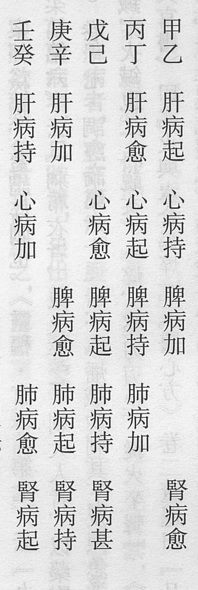

- 甲乙　肝病起　心病持　脾病加　腎病愈
- 丙丁　肝病愈　心病起　脾病持　肺病加
- 戊己　心病愈　脾病起　肺病持　腎病甚
- 庚辛　肝病加　脾病愈　肺病起　腎病持
- 壬癸　肝病持　心病加　肺病愈　腎病起

안(案): 평단(平旦)·일중(日中)·하포·야반 및 사계의 그림은 왼쪽과 같다.

평단은 일명 일출(日出)이고, 일질(日昳)은 일명 사계이다.

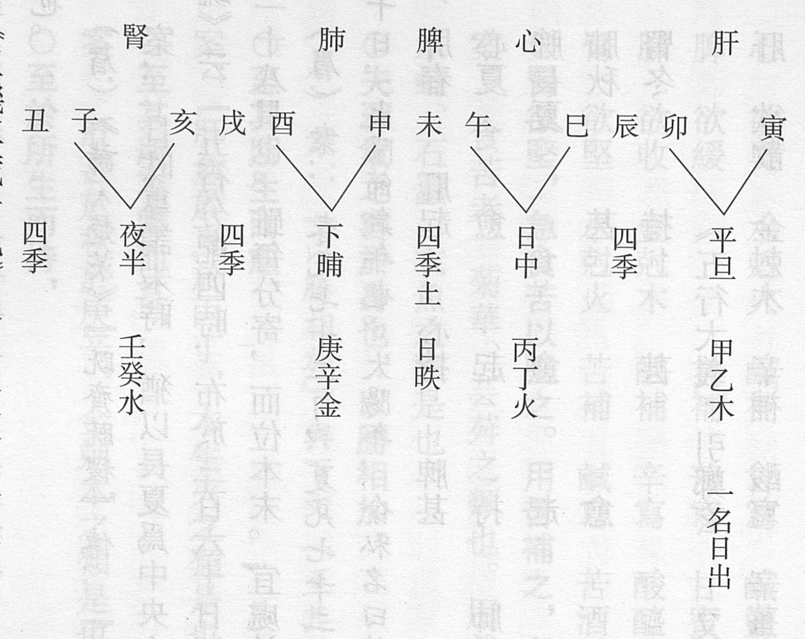

- 肝　寅　卯 → 平旦　甲乙木　一名日出
- 辰　四季
- 心　巳　午 → 日中　丙丁火
- 脾　未　四季土　日昳
- 肺　申　酉 → 下晡　庚辛金
- 戌　四季
- 腎　亥　子 → 夜半　壬癸水
- 丑　四季

「옥기진장(玉機真藏)」 제19의 ‘一日一夜五分之’는 이것과 뜻이 같으니 아울러 고찰해야 한다. 그 편의 마(馬)의 설을 보아야 한다.

고(高)는 “‘昳’은 기우는 것이다. 일질은 곧 오후 미분(未分)으로, 토가 왕성한 때이다.”라고 하였다. 『좌전(左傳)』 소공(昭公) 5년의 주에 ‘日昳爲臺’라 하였고, 소(疏)에서 “일질은 넘어지듯 내려가는 것[蹉跌而下]을 말한다.”라고 하였다.

『영(靈)』 「순기일일분위사시편(順氣一日分爲四時篇)」에서 말하였다. “하루를 나누어 사시(四時)로 삼으니, 아침은 봄이 되고 일중은 여름이 되며 일입(日入)은 가을이 되고 야반은 겨울이 된다.”

『사(史)』 「천관서(天官書)」에 ‘食至日昳爲稷，昳至餔爲黍’라 하였다. 『한(漢)』 「천문지(天文志)」에는 ‘昳’이 ‘跌’로, ‘稷’이 ‘疾’로, ‘餔’가 ‘晡’로 되어 있다.

사계는 토이다. 토는 땅이다. 『역(易)』에서 곤(坤)은 땅이 되고 서남이 되니, 이는 미방(未方)이다. 미(未)는 일질에 왕성하므로, 이 편에서 토를 오로지 일질 미시(未時)로 삼은 것이다.

우안(又案): 토는 중앙이 되니, 한 해의 한가운데는 여름과 가을이 만나는 때이다. 그러므로 토는 오로지 여름 끝에 자리하고, 여름 끝은 곧 6월 미월(未月)이다. 그래서 또 하루의 미시를 토의 때로 삼은 것이다.

（眉）『시(詩)』 「초자(楚茨)」 ‘既齊既稷’의 전(傳)에 ‘稷은 疾이다’라 하였고, 전(箋)에 ‘稷이라는 말은 即이다’라 하였다.

안(案): 일질을 오로지 미시로 말한 것은 장하(長夏)를 중앙토로 삼는 것과 같다. 『예(禮)』 「월령(月令)」 ‘中央土’의 정주(鄭注)에서 “화가 쉬고 성한 덕이 토에 있다.”라고 하였다. 그 소에서 “오행을 사시에 나누어 배당하여 360일 사이에 펴니, 목은 봄에, 화는 여름에, 금은 가을에, 수는 겨울에 배당하고, 토는 철마다 18일씩 붙인다. 철마다 나누어 붙이지만 자리는 본래 ‘末’이니, 늦여름의 끝, 금과 화의 사이에 두어야 하므로 여기에서 진술한다.”라고 한 것이 이것이다.[역2]

（眉）안(案): 봄은 모두 72일, 여름은 모두 72일, 가을은 모두 72일, 겨울은 모두 72일, 토용(土用)은 합하여 72일이니, 총계 360일이 태양의 절기년(節氣年)이다. 태양년을 지금 나는 절중년(節中年)이라 이름한다. 태음년을 지금 나는 삭망년(朔望年)이라 이름한다.

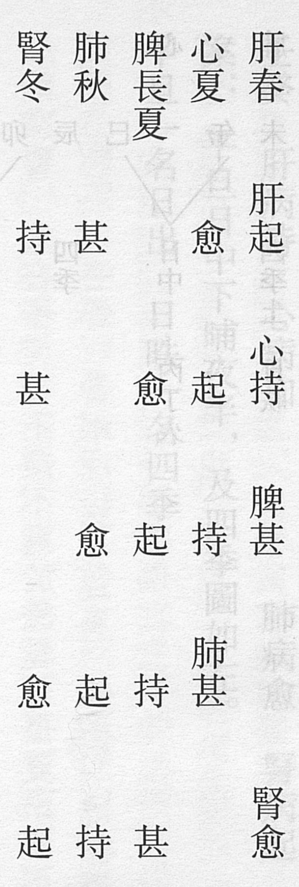

- 肝春　肝起　心持　脾甚　腎愈
- 心夏　愈　起　持　肺甚
- 脾長夏　愈　起　持　甚
- 肺秋　甚　愈　起　持
- 腎冬　持　甚　愈　起

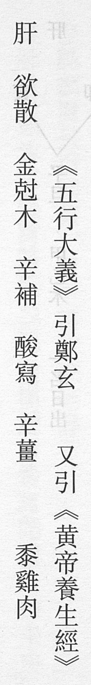

- 《五行大義》引鄭玄　又引《黃帝養生經》
- 肝　欲散　金尅木　辛補　酸寫　辛薑　黍雞肉

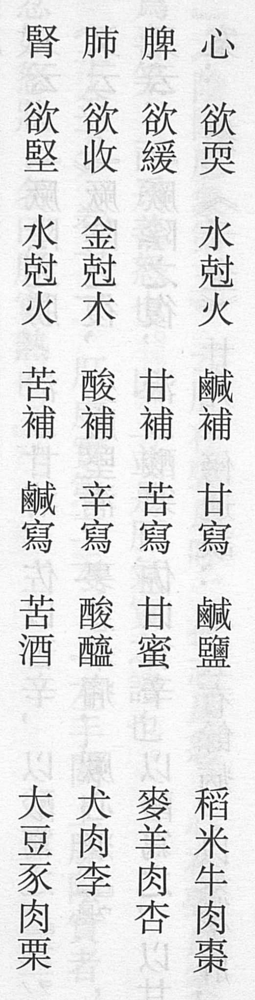

- 心　欲耎　水尅火　鹹補　甘寫　鹹鹽　稻米牛肉棗
- 脾　欲緩　甘補　苦寫　甘蜜　麥羊肉杏
- 肺　欲收　金尅木　酸補　辛寫　酸醯　犬肉李
- 腎　欲堅　水尅火　苦補　鹹寫　苦酒　大豆豕肉栗

**○腎欲堅，急食苦以堅之。用苦補之，鹹寫之。**

신은 단단해지기를 바라니, 급히 쓴맛을 먹어 단단하게 한다. 쓴맛을 써서 보(補)하고, 짠맛으로 사(寫)한다.

안(案): 먹는 쓴맛은 국화(菊華)·운천(芸荈) 따위이다. 쓴맛을 써서 보하는 것은 구기(枸杞)·괴실(槐實)·출(朮)·원지(遠志)·천문동(天門冬) 따위가 이것이다. 짠맛으로 사하는 것은 박소(朴消)·수질(水蛭)·석잠(石蠶)·의어(衣魚) 따위가 이것이다.

**○夫邪氣之客於身也，以勝相加。**

사기(邪氣)가 몸에 객(客)으로 머물 때는 이기는 것으로 서로 더해진다.

（眉）안(案): ‘以勝相加’는 아래 글의 ‘至其所不勝而甚’ 구절과 뜻이 같다.

**○至其所生而愈，**

자기가 낳는 때에 이르면 낫고,

안(案): 간이 여름과 병정(丙丁)에 낫는 것, 곧 목이 화를 낳는 따위가 이것이다.

**○至其所不勝而甚，**

자기가 이기지 못하는 때에 이르면 심해지며,

안(案): 간이 가을과 경신(庚辛)에 심해지는 것, 곧 금이 목을 이기는 따위가 이것이다.

**○至於所生而持，**

자기를 낳아 주는 때에 이르면 지탱하고,

안(案): 간이 겨울과 임계(壬癸)에 지탱하는 것, 곧 수가 목을 낳는 따위가 이것이다.

**○自得其位而起，**

스스로 제자리를 얻으면 회복된다.

안(案): 간이 봄과 갑을(甲乙)에 회복되는 것, 곧 평단에 맑아지는 것이 이것이다.

**○必先定五藏之脈，乃可言間甚之時，死生之期也。**

반드시 먼저 오장의 맥을 정해야 병이 덜하고 심해지는[間甚] 때와 죽고 사는 시기를 말할 수 있다.

안(案): 앞글에서는 ‘定五藏之氣’라 하고 여기서는 ‘定五藏之脈’이라 하였으니, 호문(互文)으로 말한 것이다. 맥이 곧 기이고 기가 곧 맥이니, 두 뜻이 있는 것이 아니다. 「상고천진론(上古天真論)」에서 ‘氣脈常通’이라 한 것을 아울러 고찰할 수 있다. 「팔정신명론(八正神明論)」에서 “먼저 삼부구후(三部九候)의 기를 본다.”라고 하였고, 또 “삼부구후의 병맥을 진찰하여 그에 맞추어 다스린다.”라고 하였다.

〔志〕사기는 풍·한·서·습의 외음(外淫)의 사기이다. 이기는 것으로 서로 더해진다는 것은, 간병이 경신에 더해지고 심병이 임계에 더해지는 것과 같이, 이기는 기가 임하여 병이 더욱 무거워지는 것이다.

『영』 「구문편(口問篇)」에 “온갖 병이 처음 생기는 것은 모두 풍우·한서·음양·희로·음식·거처·큰 놀람과 갑작스런 두려움에서 생긴다.”라고 하였다.

〔馬〕이것은 윗글에서 병이 되고 낫고 심해지고 지탱하고 회복되는 것이, 반드시 먼저 오장의 본맥(本脈)을 정해야 비로소 알 수 있음을 총결한 것이다. 예컨대 봄의 맥은 현(弦), 여름의 맥은 구(鉤), 장하의 맥은 대(代), 가을의 맥은 모(毛), 겨울의 맥은 석(石)이다. 위기(胃氣)가 있는지 없는지에 따라 저것이 나를 낳는지 나를 이기는지 내가 알 수 있다. 그러므로 낫는 것은 내가 낳는 것이고, 지탱하는 것은 나를 낳는 것이니, 그 병은 덜해지고 살아날 시기가 된다. 심해지는 것은 나를 이기는 것이고, 회복되는 것은 본래의 자리를 얻는 것이니, 그 병은 심해지고 죽을 시기가 되니, 이를 말할 수 있다. 오장의 맥을 정하지 않으면 저것과 내가 상생하고 상극하는 것을 어디에서 알겠는가.

**○肝病者，兩脇下痛引少腹，令人善怒。**

간병은 양 옆구리 아래가 아프면서 소복(少腹)까지 당기고, 사람이 자주 성내게 한다.

（眉）『갑을(甲乙)』｟六ノ十九ヲ｠

「지진요대론편(至真要大論篇)」 제72｟‘七十四’로 써야 한다｠에서 말하였다. “궐음이 이기면[厥陰之勝] 옆구리에 기가 함께 몰려 변화하여 열이 되고, 소변이 황적색이며, 심장 부위의 위완(胃脘)이 아프면서 위로 양 옆구리까지 버티듯 치받고, 장명(腸鳴)과 손설(飧泄)이 있고, 소복이 아프다.”｟廿二ノ十一ヲ｠

또 말하였다. “궐음이 이기면 달고 서늘한 것으로 다스리고, 쓰고 매운 것으로 보좌하며, 신맛으로 사한다.”｟廿二ノ十二ヲ｠

또 말하였다. “궐음의 복기[厥陰之復]에는 소복이 굳고 그득하며, 속이 당기고 갑자기 아프며, 궐심통(厥心痛)이 있다.”｟同ウ｠

또 말하였다. “궐음의 복기에는 시고 찬 것으로 다스리고, 달고 매운 것으로 보좌하며, 신맛으로 사하고, 단맛으로 완화한다.”｟同十四ウ｠

안(案): ‘怒’는 『천금(千金)』 권29 「방통결(傍通訣)」에서 “오유여병(五有餘病)에서는 노(怒)를 간에 매고, 오부족병(五不足病)에서는 공(恐)을 간에 매며, 오구(五咎)에서는 광(狂)을 간에 맨다.”라고 하였다. 「음양응상(陰陽應象)」 제5에서 “간은 소리로는 호(呼), 뜻으로는 노(怒)이고, 심은 소리로는 소(笑), 뜻으로는 희(喜)이다.”라고 하였다. 대개 간기가 남으면 심기가 부족하므로 기뻐하고 웃지 못하고 자주 성내는 것이다. 이상은 모두 간기가 실한 증이다.

『천금방(千金方)』 권11 「간허실(肝虛實)」 제2에서 말하였다. “왼손 관상(關上)의 맥이 음으로 실한 것은 족궐음경이다. 병은 심하가 굳고 그득하며, 늘 양 옆구리가 아프고, 숨이 씩씩거려 성난 모양과 같으니, 간실열(肝實熱)이라 한다.”｟九ヲ｠

**○虛則目䀮䀮無所見，耳無所聞，善恐，如人將捕之。**

허하면 눈이 침침하여[目䀮䀮] 보이는 것이 없고, 귀에 들리는 것이 없으며, 자주 두려워하여 누가 잡으러 오는 것 같다.

『천금』 권11에서 말하였다. “왼손 관상의 맥이 음으로 허한 것은 족궐음경이다. 병은 옆구리 아래가 굳고, 한열(寒熱)이 있으며, 배가 그득하여 먹고 마시려 하지 않고, 배가 불러 울적하여 즐겁지 않으며, 부인은 월경이 순조롭지 않고 허리와 배가 아프니, 간허한(肝虛寒)이라 한다.”

안(案): ‘䀮’은 『옥편(玉篇)』에 호광절(呼光切)이고 눈이 밝지 못한 것이라 하였다. 『광운(廣韻)』 11 당(唐)도 같다. 또 11 당에서 ‘䀮’은 막랑절(莫郎切)이고 눈이 밝지 못한 것이라 하였다. 『집운(集韻)』에 ‘𥉂’으로도 쓴다고 하였다. 『설문(説文)』을 고찰하면 “‘㡃’은 채색을 베푸는 장인으로 실을 다루는 사람이다. 巾을 따르고 巟 소리이다. 일설에 ‘㡃隔’이라 하며, ‘荒’처럼 읽는다.”라고 하였고, 『광운』에 ‘㡃’은 덮어 가리는 것이라 하였으니, 본래 ‘荒蒙’의 글자이다. ‘詤’(잠꼬대)과 글자의 뜻이 같다. ‘䀮䀮’은 눈으로 보는 것이 어둡고 밝지 못한 모양이다. 『천금』 권11 보간산(補肝散) 아래에 ‘目䀮䀮昏’이라 한 것으로 증명할 수 있다. 『의심방(醫心方)』 권2에 “瞳子𢨺 두 혈은 청맹(青盲)으로 보이는 것이 없고 멀리 보면 ‘𥆈𥆈’한 것을 주치한다.”라고 하였는데, 후세 사람이 획을 더하여 ‘𥉂’으로 쓰거나 ‘䀮’으로 썼다. 그 음은 호광절이고 글자는 ‘䀮’으로 쓰는 것이 바르다. ‘芒’을 따른 혹체 때문에 막랑절로 잘못 읽은 것이니 그 독음은 옳지 않다. 『이아(爾雅)』 「석천(釋天)」의 ‘大荒落’이 『사기(史記)』 「역서(曆書)」에 ‘大芒落’으로 되어 있는 것으로 고찰하면, ‘芒’을 따른 것도 오래되었으니 ‘荒’의 음을 따라야 한다. 이 편의 『석음(釋音)』에 ‘䀮은 음이 荒이다’라 하였다. 『문선(文選)』 「사현부(思玄賦)」 주에 “황홀(荒忽)은 그윽하고 어두운 모양이다.”라고 하였다.[역3]

안(案): 눈이 침침한 것은 간허의 징후이고, 귀에 들리는 것이 없는 것은 신허의 징후이다. 신은 목의 어미이니, 어미가 쇠하면 자식도 약해진다. 그래서 귀와 눈이 함께 막히는 것이다. 다시 살펴보건대[再案] 눈에 보이는 것이 없는 것은 심허이고, 귀에 들리는 것이 없는 것은 신허이다. 대개 심과 신은 함께 소음경이 되는데, 두 기가 서로 사귀지 못하면 수음(水飲)이 안에 맺혀 이 증이 될 뿐이다.

『천금』 권11에서 말하였다. “왼손 관상의 맥이 음양 모두 허한 것은 족궐음과 족소양경이 함께 허한 것이다. 병은 정신이 멍한 듯하고, 시궐(尸厥)로 사람을 알아보지 못하며, 헛것을 보고, 소기(少氣)로 말을 하지 못하며, 때때로 저절로 놀라니, 간담구허(肝膽俱虛)라 한다.”｟十一ウ｠

（眉）『외대(外臺)』 권12 적취방편(積聚方篇)에서 『병원(病源)』을 인용한 ‘目茫茫’이 정본(程本)에는 ‘䀮䀮’으로 되어 있다. 『의심방』 권2 후항(後項) 아래에는 ‘目𥆈𥆈’으로 되어 있고 옆에 ‘䀮은 호광반(呼光反)이고 눈이 밝지 못한 것이다’라 적혀 있으며, 천주(天柱) 아래에도 ‘𥆈’으로 되어 있고 역시 옆에 ‘䀮은 호광반이고 눈이 밝지 못한 것이다’라 적혀 있다.[역4]

（眉）『노자(老子)』 14장·21장의 ‘怳忽’이 부혁본(傅奕本)에는 ‘芒芴’로 되어 있으니, 이는 ‘芒’도 음이 ‘荒’이라는 증거이다. 『장자(莊子)』 「지락편(至樂篇)」 ‘芒乎芴乎’의 『석문(釋文)』에 ‘芒은 본래 음이 荒이다. 또 호황반(呼晃反)이다. 芴은 음이 忽이다’라 하였다. 『순자(荀子)』 「부국(富國)」 ‘芒軔僈楛’의 주에 ‘芒은 荒으로 읽기도 한다’라 하였다. 『사기』 「삼대세표(三代世表)」 ‘帝芒’의 『색은(索隱)』에 ‘芒은 荒으로 된 곳도 있다’라 하였다.

（眉）삼선위강(三善爲康)의 『장중력(掌中歷)』 권상 「세시력편(歲時歷篇)」의 ‘五月節，芒種’이 ‘荒種’으로 된 곳이 한 번 보인다.

（眉）『난경(難經)』 「이십난(二十難)」의 ‘脱陰者目盲’에 대해 ［丁曰］‘盲은 荒과 같다.’

（眉）『죽서기년(竹書紀年)』에 ‘帝芒’이라 하고 ‘芒은 帝荒이라고도 한다’라 하였다.

**○取其經厥陰與少陽。**

그 경(經)인 궐음과 소양을 취한다.

〔張〕이것은 위의 허실 두 절을 이어 말한 것이니, 허한 것은 보해야 하고 실한 것은 사해야 한다. 아래도 이를 따른다.

안(案): 이것은 미침(微鍼)을 말한다. 대개 경맥에는 반드시 소침(小鍼)을 쓰는 것이 일반적인 법이다.

**○氣逆則頭痛，耳聾不聰，頰腫，取血者。**

기가 치받으면 두통이 나고, 귀가 먹어 들리지 않으며, 뺨이 붓는다. 피가 있는 곳을 취한다.

〔張〕기가 위로 치받으면 위가 실해지므로 두통·이롱(耳聾)·협종(頰腫)이 생긴다. 대개 간맥은 독맥과 정수리에서 만나고 뺨 속으로 내려가며, 담맥은 귀 속으로 들어가고 아래로 협거(頰車)에 더해진다.

안(案): 윗글에서는 이미 간의 허실 두 증과 침치(鍼治)를 말했고, 여기서는 간기상역증(肝氣上逆證)과 침법을 말한 것이다. ‘取血者’라 한 것은 그 목 부위의 맺힌 낙맥(絡脈)을 더듬어 찾아 찔러 피를 낸다는 말이다. 이른바 자락수(刺絡俞)이니, 「진요경종(診要經終)」 제16에서 “여름에는 낙수(絡俞)를 찌르되 피가 보이면 그친다.”라고 한 것이 이것이다.

〔紹〕『맥경(脈經)』 주에서 “혈자(血者)는 피가 있는 혈(穴)을 말한다.”라고 하였다.

（眉）안(案): 이롱이 간과 폐에 있고 도리어 신에 있지 않으니, 묘하다.

**○心病者，胸中痛，脇支滿，脇下痛，膺背肩甲間痛，兩臂内痛。**

심병은 흉중이 아프고, 옆구리가 버티듯 그득하며, 옆구리 아래가 아프고, 가슴·등·어깨뼈 사이가 아프며, 두 팔 안쪽이 아프다.

「기교변론(氣交變論)」에 “흉중이 아프고, 옆구리가 버티듯 그득하며, 옆구리가 아프고, 가슴·등·어깨뼈 사이가 아프며, 두 팔 안쪽이 아프다.”라고 하였다.

『천금』 권13에서 말하였다. “왼손 촌구(寸口)·인영(人迎) 앞의 맥이 음으로 실한 것은 수소음심경이다. 병은 막히는 것을 괴로워하여 대변이 순조롭지 않고, 배가 그득하며, 사지가 무겁고, 몸에 열이 나니, 심실열(心實熱)이라 한다.”

『병원』에서 말하였다. “심기가 성하면 신(神)이 남아도는 것이니, 가슴 속이 아프고, 옆구리가 버티듯 그득하며, 가슴·등·어깨·넓적다리 사이가 아프고, 두 팔 안쪽이 아프며, 쉬지 않고 잘 웃는다. 이것이 심기의 실이다. 사해야 한다.”｟『의심방』 권6 치심병방(治心病方) 11에서 인용｠

안(案): 『화명초(和名抄)』에서 『당운(唐韻)』을 인용하여 ‘胸은 허용반(許容反), 膺은 어릉반(於陵反), 臆은 어력반(於力反)’이라 하고 모두 ‘无祢’로 훈하였다. 대개 ‘无幾保祢’의 뜻이니, 곧 마주 보는 뼈를 말한다. 또 ‘脅’은 『사성자원(四聲字苑)』에서 ‘脅은 몸 옆의 옆구리와 갈비 사이이다’라 하였다. 훈은 ‘加太波良保祢’이니, 옆 배의 뼈라는 뜻이다. 또 ‘背’ 아래 ‘脊’은 훈이 ‘世奈加’이다. 대개 ‘世’는 ‘世末幾’의 뜻이다. 척추뼈 한 줄의 좌우가 좁으므로 ‘世奈加’라 하니, 곧 척중(脊中)의 뜻이다. 이것이 전주(轉注)되어 ‘背’도 ‘世奈加’라 한다. 『원씨물어(源氏物語)』 「말적화권(末摘花卷)」에 보인다. 또 ‘肩’은 훈이 ‘加太’이니, 곧 단단한 뼈의 뜻으로, 『석명(釋名)』의 ‘肩은 堅이다’와 뜻이 같다. 또 『사성자원』에서 ‘胛은 어깨의 아래이다’라 하였고, 훈은 ‘加以加祢’이다. ‘加以加祢’는 ‘加以乃祢’라 하는 것과 같으니, 곧 ‘加以乃保祢’의 뜻이다. ‘加以’는 곧 ‘加太幾’의 뜻이다. 또 ‘臂’는 『광아(廣雅)』에서 ‘臂를 肱이라 한다’ 하였고, 『사성자원』에서 ‘肘는 팔의 마디이다’라 하였으며, ‘肘’ 아래 훈이 ‘比知’이니, 대개 臂·肱·肘를 통틀어 ‘比知’라 하는 것이다. 『의심방』에서도 ‘臂’의 훈이 ‘比知’이다. 『신대기(神代紀)』·『웅략기(雄略紀)』·『천무기(天武紀)』의 ‘臂’와 『제명기(齊明紀)』의 ‘手臂’는 모두 훈이 ‘多多牟幾’이고, 세속에서는 ‘宇天’이라 부른다. 『설문』에서 ‘臂는 손의 위이다’라 하였고, 『석명』에서 ‘臂는 裨이다. 옆에 있는 것을 裨라 한다’라 한 것이 이것이다. 고찰하건대 ‘多多牟幾’는 곧 ‘天天牟介’의 뜻이니, 손이 마주 보는 것을 말한다. ‘宇天’이라 한 것은 ‘宇知天’의 뜻이다. 대개 물건을 치고 던질 때 팔이 먼저 쓰이므로 이렇게 이름한 것이다.

（眉）「지진요대론(至真要大論)」 ‘心脅痛不能反側’의 왕주(王注)에서 “심협통(心脅痛)은 심장 옆의 옆구리 속이 아픈 것을 말한다.”라고 하였다.

（眉）「지진요대론」 ‘兩脇裏急’의 왕주에서 말하였다. “협(脅)은 두 젖 아래와 겨드랑이 바깥을 말한다.”

（眉）『광아』 「석기(釋器)」 ‘銃謂之銎’에 대해 왕씨(王氏)의 『소증(疏證)』에서 말하였다. “‘銎’이라는 말은 ‘空’이다. 그 속이 비어 있는 것이다. ‘釭’과 ‘銎’은 소리가 서로 가깝다. 『육도(六韜)』 「군용편(軍用篇)」의 ‘方胸鋌矛千二百具’에서 ‘胸’은 곧 ‘銎’ 자이다.”

**○虛則胸腹大，脇下與腰相引而痛。**

허하면 가슴과 배가 커지고, 옆구리 아래와 허리가 서로 당기며 아프다.

안(案): 『화명초』에서 ‘腰’의 훈은 ‘古之’이다. 대개 ‘古之’는 ‘阿之’와 뜻이 같고, ‘之’는 허자(虛字)이다. ‘古之’는 넘고 뛰어넘는다는 뜻이니, 허리뼈는 실로 온몸의 기관이어서 오르고 들고 날고 뛰어넘는 모든 쓰임을 허리가 주관하므로 ‘古之’라 이름한 것이다. 『석명』에서 말하였다. “요(要)는 묶는 것이다. 몸의 가운데에 있어 묶여 작다.” ‘要’는 몸의 중요한 곳이어서 전하여 ‘肝要’의 글자가 되었으니, ‘古之’라는 이름과 그 뜻이 매우 같다.

**○取其經少陰太陽，舌下血者。**

그 경인 소음과 태양을 취하고, 혀 아래에 피가 있는 곳을 취한다.

〔張〕심은 혀를 주관하므로 혀 아래의 피를 내어 그 실을 사한다.｟［案］장(張)의 설이 옳다.｠

〔馬〕수소음의 경혈 영도(靈道)｟손바닥 뒤 1촌 5푼. 침 3푼, 뜸 3장｠와 수태양의 경혈 양곡(陽谷)｟손 바깥쪽 손목 가운데 예골(鋭骨) 아래 오목한 곳. 침 3푼, 3호(呼) 유침, 뜸 3장｠을 취해야 한다. 심과 소장은 서로 표리가 되기 때문이다. 실하면 그 남는 것을 사하고 허하면 그 부족한 것을 보할 뿐이다. 그 혀뿌리 아래에서 아울러 피를 내는 것은, 바로 수소음의 맥이 심계(心系)에서 위로 인후를 끼고 올라가기 때문에 혀 아래의 피를 내는 것이다. 피를 낸다고 한 것은 곧 남음이 있는 증을 다스리는 것일 뿐이다.

안(案): 마씨(馬氏)가 혀 아래를 염천혈(廉泉穴)로 여긴 것은 옳지 않은 듯하다. 대개 혀 아래에서 피가 있는 곳을 따라 찔러 피를 내는 것을 법으로 삼을 뿐이다.

『의심(醫心)』 권2에서 『황제명당(黃帝明堂)』을 인용하여 말하였다. “영도는 슬퍼하고 두려워하며, 심통이 서로 당기고, 팔꿈치의 근이 당기며, 목이 쉬어 말하지 못하는 것을 주치한다.” “양곡은 광증(狂證)의 열병으로 땀이 나고, 가슴과 옆구리가 아프며, 이명·치통·어깨 통증이 있는 것을 주치한다.”

**○其變病，刺郄中血者。**

그 변병(變病)에는 극중(郄中)의 피가 있는 곳을 찌른다.

〔馬〕또 수소음의 극혈인 음극혈(陰郄穴)을 취하여 그 피를 내야 한다. 손바닥 뒤 맥 가운데, 손목에서 반 촌 떨어져 새끼손가락 뒤쪽에 해당하는 곳에 있다. 침 3푼, 뜸 7장.

『갑을경(甲乙經)』｟三ノ卅ウ｠에서 말하였다. “수소음극(手少陰郄)은 손바닥 뒤 맥 가운데, 손목에서 5푼 떨어진 곳에 있다. 3푼 자입하고 뜸은 3장이다.” 「음양론(陰陽論)」 주에서 ‘새끼손가락의 뒤쪽에 해당한다’고 하였다.

안(案): 왕주에서 변병을 구역의 변병[嘔變病]으로 여긴 것이 옳은 듯하다. 대개 근거한 바가 있어 말한 것이다. 『의심방』 권2｟十五ウ｠와 『갑을』｟十五ヲ｠에서 “음극 두 혈은 으슬으슬 춥고, 기침하여 피를 토하며, 기가 치받고, 놀라며 심통이 있는 것을 주치한다.”라고 한 것으로 증명할 수 있다. 내 생각에 심과 간 두 장은 온몸의 혈맥을 거느리므로, 성하고 실하면 기가 치받아 구토하는 증이 되기도 하니, 이것이 나머지 세 장과 다른 까닭이다.

『영』 「구문편」에서 말하였다. “중기가 부족하면 위(胃)가 그로 인해 변하고 장(腸)이 그로 인해 괴롭게 울린다.”[역5]

『천금』 권13 제1에서 말하였다. “심병의 증상은 가슴 속이 아프고, 옆구리가 버티듯 그득하며, 양 옆구리 아래가 아프고, 가슴·등·어깨뼈 사이가 아프며, 두 팔 안쪽이 아프다. 허하면 가슴과 배가 커지고, 옆구리 아래와 허리·등이 서로 당기며 아프니, 그 경인 수소음과 태양 및 혀 아래의 피가 있는 곳을 취한다. 그 변병에는 극중의 피가 있는 곳을 찌른다.”｟三ウ｠

『병원』에서 말하였다. “심기가 부족하면 가슴과 배가 서로 당기며 아프고, 놀라 가슴이 두근거리며 정신이 멍하고 얼굴에 핏기가 적으며, 혀뿌리가 뻣뻣하고, 자주 근심하고 슬퍼한다. 이것이 심기의 허이다. 보해야 한다.” 『의심방』 권6 제11에서 인용.｟十六ウ｠

（眉）『의심방』｟二ノ十四オ｠에서 말하였다. “극문(郄門) 두 혈은 椀에서 5촌 떨어져 있고, 3푼 자입하며, 뜸은 3장이다. 심통과 코피, 딸꾹질, 피를 토하는 것, 놀라고 두려워 사람을 무서워하는 것, 신기(神氣)가 부족한 것을 주치한다.” 수궐음심주(手厥陰心主)이다.[역6]

（眉）『외대』｟三九ノ五四オ｠에서 말하였다. “극문은 수심주(手心主)의 극혈로, 손목에서 5촌 떨어져 있고, 뜸은 5장이다. 심통과 코피, 딸꾹질, 피를 토하는 것, 놀라고 두려워 사람을 무서워하는 것, 신기가 부족한 것을 주치한다.”

**○脾病者，身重，善肌肉痿，足不收，行善瘈，腳下痛。**

비병은 몸이 무겁고, 기육(肌肉)이 자주 위축되며, 발을 거두지 못하고, 걸을 때 자주 계(瘈)가 일어나며, 다리 아래가 아프다.

「기교변론」에서 말하였다. “기육이 위축되고, 발이 위축되어 거두지 못하며, 걸을 때 자주 계가 일어나고, 다리 아래가 아프다. 음(飲)이 발하여 속이 그득하고, 먹는 것이 줄며, 사지를 들지 못한다.”

〔識〕마(馬)와 오(吳)는 『신교정(新校正)』에 근거하여 ‘肌’를 ‘飢’로 썼는데, 옳다. ‘善瘈’는 『갑을』에 ‘善瘈瘲’으로 되어 있다. ［張云］‘瘈’는 손발이 떨리고 당기는 것이다. ［簡按］「옥기진장론(玉機真藏論)」에서 “근맥(筋脈)이 서로 당겨 급해지니, 병명을 瘛라 한다.”라고 하였다. ‘瘛’와 ‘瘈’는 같다. 『갑을』에서 ‘瘲’ 자를 더한 것은 옳지 않은 듯하다.

안(案): ‘瘈’라 하든 ‘瘈瘲’이라 하든 그 뜻은 서로 같다. ‘瘈瘲’도 ‘瘈’의 뜻이니, ‘多少’·‘緩急’ 등의 글자와 같은 예이다.

안(案): 각하(腳下)는 발등, 안팎 복사뼈 언저리 및 발바닥의 총칭이니, 족하(足下)와 같다. 『갑을』 권10 「음수병발비 하(陰受病發痺下)」｟五ウ｠에서 “발 아래가 뜨겁고 아프며, 오래 앉지 못하고, 습비(濕痺)로 걷지 못하면 삼음교(三陰交)가 주치한다.”라고 하였고, 『의심』 권2 제35엽 앞면에는 ‘足下熱，脛疼不能久立，濕痺不能｟‘行’이 빠졌다｠’의 14자로 되어 있다.

（眉）진본 『명당(明堂)』 권1의 ‘瘛瘲’에 대해 양주(楊注)에서 “‘瘛’는 급히 당기는 것이다. 충예반(充曳反)이다. ‘瘲’은 늘어져 거두지 못하는 것이다. 자용반(子用反)이다.”라고 하였다.

（眉）안(案): 각하는 다리 이하 발까지 아프다는 말이니, 족하가 발바닥[蹠]을 가리키는 것과 저절로 구별된다.

（眉）우안(又案): 『설문』에 ‘𨅰은 호가절(乎加切)이고 발로 밟는 곳이다’라 하였다. 『광운』 9 마(麻)에 ‘𨅰은 다리 아래이다’라 하였다. 그렇다면 각하도 발바닥을 가리키는 것일까. 또 『광운』의 ‘𩋥은 신발 뒤꿈치 뒤에 붙이는 것’과 ‘蕸는 연잎’은 모두 ‘𨅰’과 음이 같으니, 이것도 증거가 될 수 있다. 발바닥은 넓고 평평하다는 뜻이다.

**○虛則腹滿腸鳴，飧泄食不化。**

허하면 배가 그득하고 장명(腸鳴)이 있으며, 손설(飧泄)로 음식이 소화되지 않는다.

손설의 풀이는 이미 제2편 안에 보인다.

**[역1]** 원서 인쇄는 ‘已’, 문맥상 ‘己’일 것이다.
**[역2]** 원서대로 옮겼다. 『十三經注疏』 嘉靖刊本에는 「本末」, 『禮記述注』에는 「本未」로 되어 있다.
**[역3]** 원서대로 옮겼다. 「𢨺」은 혈 이름 「瞳子髎」의 「髎」 자리에 쓰인 이체 꼴일 수 있다.
**[역4]** 원서대로 옮겼으나, 「後項」은 뒤의 「天柱」와 나란한 혈 이름 자리여서 「後頂」일 수 있다(원전 미확인).
**[역5]** 원서대로 옮겼다. 『醫説續編』이 인용한 『內經』 문장에는 「溲使爲之變」으로 되어 있다.
**[역6]** 원서대로 옮겼다. 바로 아래 『外臺』 인용과 『甲乙經』·『千金方』에는 「去腕五寸」으로 되어 있어 「椀」은 손목을 뜻하는 「腕」으로 읽어야 할 것으로 보인다.

**○取其經太陰陽明少陰血者。**

그 경(經)인 태음(太陰)·양명(陽明)·소음(少陰)의 피가 있는 곳을 취한다.

〔馬〕족태음의 경혈 상구(商丘)｟발 안쪽 복사뼈 아래 약간 앞쪽 오목한 곳. 침 3푼, 뜸 3장｠, 족양명의 경혈 해계(解谿)｟충양(衝陽) 뒤 1촌 반. 침 5푼, 3호(呼) 유침, 뜸 3장｠, 족소음의 경혈 복류(復溜)｟발 안쪽 복사뼈 위 2촌 오목한 곳. 침 3푼, 7호(呼) 유침, 뜸 5장｠를 취하여 그 피를 낼 뿐이다. 피를 낸다고 했으니 앞의 남음이 있는 증을 다스릴 뿐이며, 허하면 보해야 하니 또 피를 내어 다스릴 수 없다.

안(案): 족소음은 신경(腎經)이다. 대개 비토(脾土)의 기가 남으면 그 해가 반드시 신수(腎水)에 미치므로, 신경에서 찔러 피를 내면 비병이 저절로 낫는다. 이는 치통과 같으니, 치아는 신에 속하지만 비위가 포식하여 열이 있으면 통증이 생기고, 역시 위경과 방광[旁光]경의 경혈에서 찔러 피를 내면 저절로 나을 뿐이다. 곧 비와 신이 서로 돕는 뜻이다.

（眉）『천금(千金)』｟十五上四ウ｠

『갑을(甲乙)』 권9 제7에서 말하였다. “사기가 비위에 있으면 기육(肌肉)이 아픈 병이 된다. 양기가 있고｟‘餘’가 빠졌다｠ 음기가 부족하면 열중(熱中)으로 자주 허기진다. 양기가 부족하고 음기가 남으면 한중(寒中)으로 장명(腸鳴)과 복통이 있다. 음양이 모두 남거나 모두 부족하면 한도 있고 열도 있으니, 모두 삼리(三里)를 조절한다.”｟九ヲ｠

『외대(外臺)』 권39｟卅七ウ｠ 삼음교(三陰交) 아래에서 말하였다. “병자가 몸이 무겁고 허기를 괴로워하며, 발이 위축되어 걷지 않으려 하고, 자주 당기며 다리 아래가 아프다. 허하면 배가 불러 오르고 배에서 소리가 나며 묽은 설사를 하고, 음식이 소화되지 않으며, 비위와 기육이 아프다. 이것은 『소문(素問)』에서 나왔다.”

『천금』 권15 상｟四ヲ｠에서 말하였다. “비병의 증상은 반드시 몸이 무겁고 자주 허기지며, 발이 위축되어 거두지 못하고｟『소문』에는 ‘善肌肉痿，足不收’로 되어 있다. 『갑을』에는 ‘苦飢，肌肉痿，足不收’로 되어 있다｠, 걸을 때 자주 계(瘈)가 일어나고 다리 아래가 아프다. 허하면 배가 그득하고 장명이 있으며, 손설(飧泄)로 음식이 소화되지 않으니, 그 경인 족태음·양명·소음의 피가 있는 곳을 취한다.”

『병원론(病源論)』에서 말하였다. “비기가 성하면 형(形)이 남아도는 것이니, 배가 불러 오르고 소변이 순조롭지 않으며, 몸이 무겁고, 입이 쓰고 허기지며, 발이 위축되어 거두지 못하고, 걸을 때 자주 당기며, 다리 아래가 아프다. 이것이 비기의 실이니 사해야 한다. 비기가 부족하면 사지를 쓰지 못하고, 설사하며 음식이 소화되지 않고, 구역하고 장명이 있다. 이것이 비기의 허이다. 보해야 한다.”｟『의심방(醫心方)』 권6 제17엽 뒷면에서 인용｠

**○肺病者，喘欬逆氣，肩背痛，汗出，尻陰股膝髀腨胻足皆痛。**

폐병은 숨이 차고 기침하며 기가 치받고, 어깨와 등이 아프며, 땀이 나고, 고(尻)·음(陰)·고(股)·슬(膝)·비(髀)·천(腨)·행(胻)·족(足)이 모두 아프다.

안(案): 『영(靈)』 「경맥(經脈)」에서 ‘방광이 동하면 넓적다리를 굽힐 수 없다’고 하였고, 또 ‘목·등·허리·꽁무니·오금·장딴지·다리가 모두 아프다’고 하였다. 「육원정기대론(六元正紀大論)」에서 “양명이 이르면 구(鼽)가 되고, 고·음·고·슬·비·천·행·족이 병든다.”라고 하였다. 「기교변대론(氣交變大論)」에서 “숨이 차고 기침하며 기가 치받고, 어깨와 등이 아프며, 고·음·고·슬·비·천·행·족이 모두 아프다.”라고 하였다.

안(案): ‘尻’는 『석명(釋名)』에 ‘尻는 廖이다. 尻가 있는 곳은 깊숙하다[廖牢深]’라 하였다. 『여씨춘추(呂氏春秋)』 「관표편(觀表篇)」 ‘許鄙相朊’의 고유(高誘) 주에 “‘朊’은 후규(後竅)이다.”라고 하였다. ‘朊’은 곧 ‘尻’의 속자이다. 『화명초(和名抄)』에서 ‘尻’의 훈은 ‘之利’인데, 이는 ‘臀’과 같이 ‘之利’라 일컫는 것으로, 대개 ‘之岐遠利’의 준말이며 총칭이다. 그 ‘尻’를 지금 세속에서 ‘之利乃阿奈’라 부르는 것이 이것이다. 곧 ‘尻’와 ‘肛’은 고금자(古今字)로, 후세에 ‘肛’이 쓰이고 ‘尻’는 폐기되었다. 『의심방』에서 ‘尻’와 ‘肛’을 똑같이 ‘之利’로 훈한 것도 증거가 될 수 있다. ‘陰’은 『석명』에 ‘陰은 蔭이다. 있는 곳이 가려져 그늘진다는 말이다’라 하였다. 『화명초』에서 말하였다. “음은, 지금 살펴보건대[今案] 옥경(玉莖)·옥문(玉門) 등의 통칭이다.” 『신대기(神代紀)』에서 ‘陰’의 훈은 ‘保止’이다. 대개 ‘保’는 ‘保乃加保乃久良岐’의 ‘保’이니, ‘保止’는 그늘져 밝지 않은 곳을 말한다. 세속에서 ‘加久之止古呂’라 부르는 것이 이것이다. ‘股’는 『석명』에서 ‘股는 固이다. 강하고 단단하다는 것이다’, ‘髀는 卑이다. 아래에 있음을 일컫는다’라 하였다. 『화명초』에서 『당운(唐韻)』을 인용하여 ‘髀는 股이다’라 하였고, 지금 판본 『광운(廣韻)』도 같은데, 『설문(説文)』에 의거한 것으로 이는 통틀어 말한 것이다. 실제로 ‘髀’는 넓적다리 바깥 과골(髁骨) 이하를 말하고, ‘股’는 ‘髀’ 안쪽 뿌리의 살이 있는 곳을 말한다. 순(順)은 둘 다 ‘毛毛’로 훈하였는데, ‘毛’는 ‘美’와 음이 같으니 ‘美美’라 하는 것과 같다. ‘美’는 살을 말한다. 두 살이 서로 합하므로 ‘毛毛’라 한다. 지금 세속에서 ‘毛毛多夫’｟‘美美多夫’와 훈과 뜻이 같다｠라 부르는데, 역시 살이 많아 풍만함을 말한다. 『신찬자경(新撰字鏡)』에서 ‘髀’·‘脞’의 훈은 ‘毛毛’이고 ‘股’의 훈은 ‘宇豆毛毛’인데, ‘宇豆毛毛’는 곧 ‘宇知毛毛’이다. ‘膝’은 『석명』에 ‘膝은 伸이다. 굽히고 펼 수 있다는 것이다’라 하였다. 『설문』에 ‘厀은 정강이 머리의 마디이다’라 하였다. 순은 ‘比佐’로 훈하였다. 대개 ‘比佐’는 ‘比岐佐留’의 뜻이다. 앞으로 가는 것은 발이 하는 일이고 뒤로 물러나는 것은 무릎이 하는 일이므로 이렇게 이름한 것이다.

‘腨’은 『설문』에 ‘腨은 비장(腓腸)이다’라 하였다. 『역(易)』 ‘咸，六二，咸其腓’에 대해 ［鄭曰］‘腓는 膊腸이다.’ ‘腨’과 ‘膊’은 같은 글자이니, ‘專’과 ‘顓’이 통용되는 예와 같으며, ‘膊，切肉’의 글자와는 같지 않다. 단옥재(段玉裁)가 말하였다. “여러 책에서 박장(膊腸) 또는 비장이라 한 것은 정강이뼈 뒤의 살을 말한다. ‘腓’라는 말은 ‘肥’이니, 속에 창자가 있는 듯하므로 비장이라 한다.” 입지가 생각하건대[立之謂] 이 설은 틀린 듯하다. 대체로 ‘專’·‘耑’ 두 음의 글자는 모두 아름답고 살지고 가득하다는 뜻이 있으니, 예컨대 ‘專은 擅이고 誠이고 自是이다. 嫥은 사랑스러운 모양이다. 膞은 새의 위이다. 篿은 『설문』에 대를 쪼개 둥글게 하여 곡식을 담는 것이다’｟『광운』 2 선(仙)｠, ‘踹는 발꿈치이다. 鱄은 물고기 이름으로 맛이 좋다’｟같은 책 상성 28 선(獮)｠와 같은 따위가 이것이다. ‘腸’은 ‘暢’·‘張’ 등의 글자와 뜻이 같으니, 장위(腸胃)의 뜻이 아니다. 예컨대 ‘張은 베푸는 것이다. 餦餭은 엿이다. 漲은 물이 많은 모양이다’｟『광운』 10 양(陽)｠ 같은 따위가 뜻이 같다. 이른바 비장·천장(腨腸)은 모두 옛날의 속칭으로, 곧 살지고 불어 가득 부푼 것을 말한다. 혹은 홑으로 ‘腨’·‘腓’라고도 일컫는다. 『화명초』에서 ‘腓’의 훈은 ‘古无良’인데, 뜻은 자세하지 않다. 혹은 ‘古毛留’의 뜻이라 하니, 근육이 여기에 모인다는 말이다. 일설에, 옛날에 해삼을 ‘古牟良’이라 한 것은 ‘末呂’가 바뀐 것으로, 대개 근육이 둥글게 모인 것이 해삼 같다는 뜻이다. 지금 세속에서 ‘不久良波伎’라 부른다. 상주(相州) 세속에서는 이를 염포(鹽苞)라 하니, 대개 모양을 본떠 이름한 것이다. 『고사기(古事記)』 웅략조(雄略條)에 “蝄이 어완(御腕)을 물었다. 어가(御歌)에 ‘多古牟良爾阿牟加岐都岐’라 하였다.”라고 하였다. ‘多古牟良’는 팔의 살, 손의 장딴지라는 뜻이다. 지금 세속에서 비근(腓筋)이 뒤틀리는 것을 ‘古牟良加倍利’라 하는 것도 옛말이 우연히 남은 것이다. ‘胻’은 『설문』에 ‘胻은 정강이 끝이다’라 하였고, 『광운』에 ‘胻은 정강이이다’라 하였으며, 『석명』에 ‘脛은 莖이다. 곧고 길어 물건의 줄기와 비슷하다’라 하였고, 순은 ‘波岐’로 훈하였다. 『신찬자경』의 ‘踹’·‘踁’·‘脛’·‘蹺’ 네 글자, 『영이기(靈異記)』의 ‘膞’, 『의심방』의 ‘胫’·‘骭’이 모두 훈이 같다. 대개 ‘波支’는 ‘波世由岐’의 준말이고, 지금 세속에서 ‘須祢’라 부른다. ‘須祢’는 골수의 옛 이름으로, 대개 ‘須保祢’의 준말이다. 뼛속의 빈틈이 새 둥지 같으므로 이렇게 이름한 것이다. 정강이뼈 속은 골수가 가장 많은 곳이므로 정강이도 ‘須祢’라 부르는 것일까. 『서(書)』에서 말한 ‘長涉之脛’을 아울러 고찰할 수 있다. 대개 줄기처럼 서 있는 면에서 ‘脛’이라 하고 걸어 다니는 면에서 ‘胻’이라 하니, 글자가 같지 않으며, ‘脛耑’이라는 풀이를 따를 만하다. ‘足’은 『석명』에 ‘續이다. 정강이를 잇는다는 말이다’라 하였고, 『설문』에 ‘사람의 발이다. 몸의 아래에 있다’라 하였으며, 순은 ‘阿之’로 훈하였다. 살펴보건대[案] ‘阿之’는 ‘阿由末須’의 뜻으로, 걷게 한다는 말이니, ‘古之’의 ‘之’와 뜻이 같다. ‘尻陰’ 이하 여덟 글자는 각각 한 글자씩 구로 읽어야 한다.[역1][역2]

（眉）「지진요론(至真要論)」 ‘腨如別’의 주에서 “천(腨)은 䯒 뒤의 부드러운 살이 있는 곳이다.”라고 하였다.

**○虛則少氣不能報息，耳聾，嗌乾。**

허하면 소기(少氣)하여 숨을 들이쉬지 못하고[不能報息], 귀가 먹으며, 목구멍이 마른다.

소기는 이미 제18편 안에 보인다.｟二ヲ｠

〔張〕보(報)는 되돌리는 것이다. 숨을 되돌리지 못한다는 것은 호흡의 기가 짧아 잇기 어렵다는 말이다.

『상한직격(傷寒直格)』에서 말하였다. “숨을 되돌리지 못한다는 것은 세속에서 말하는, 기가 적어 잇지 못하는 것이다.” 또 말하였다. “‘嗌’은 음이 亦이다. 기계(氣系)이다.”

안(案): 숨을 들이쉬지 못한다[不能報息]는 것은 대개 내쉬기만 있고 들이쉬기가 없다는 말이다. 보식(報息)은 들이쉬는 숨을 말하니, 지금 세속에서 편식(片息)이라 부르는 것이 이것이다. 장주(張注)는 옳지 않고, 왕주(王注)를 따를 만하다. 대체로 ‘不能息’이라 한 것은 모두 숨을 들이쉬지 못한다는 말이다.

‘聾’은 『설문』에 ‘들리는 것이 없는 것이다’라 하였고, 『석명』에 ‘聾은 籠이다. 몽롱(蒙籠)의 안에 있는 것 같아 들어도 살피지 못한다’라 하였다. 순(順)의 『초(抄)』에서는 ‘美美之比’로 훈하였다. 『의심방』의 ‘耳聾’과 『신찬자경』의 ‘聾’도 훈이 같다. 『신찬자경』 고본(古本)의 ‘聲’·‘𦗟’은 모두 훈이 ‘祢祢志户’이다. 살펴보건대[案] ‘之比’는 ‘佐倍’의 뜻으로, ‘佐倍岐留’의 준말이다. ‘盲’의 훈이 ‘米之比’인 것도 뜻이 같다. ‘嗌’은 『설문』에 ‘咽은 嗌이다’, ‘嗌은 咽이다’라 하였고, 『석명』에 ‘咽은 물건을 삼키는 것이다. 또 嗌이라고도 하니, 기가 흘러 통하는 좁고 요긴한 곳이다’라 하였다. 순의 『초』에서는 ‘能无度’로 훈하였으니, 곧 삼키는 곳이라는 뜻이다. 지금 세속에서 ‘能度’라 부르는 것은 급하게 말한 것을 따른 것이다.

「지진요대론(至真要大論)」 제74의 왕주에서 말하였다. “‘嗌’은 목구멍의 아래로, 가슴 속에 이어지며 폐 두 잎 사이에 있는 것을 말한다.”｟廿二ノ十二ヲ｠

（眉）『옥편(玉篇)』에 ‘膉은 어역절(於亦切)이고 목의 살이다’라 하였다.

（眉）안(案): ‘嗌’은 기도의 이름이지 식도의 이름이 아니다.

**○取其經太陰，足太陽之外，厥陰内血者。**

그 경인 태음과, 족태양의 바깥 족궐음의 안쪽[厥陰内]의 피가 있는 곳을 취한다.

〔馬〕수태음의 경혈 경거(經渠)｟촌구(寸口)의 오목한 곳. 침 2푼, 3호(呼) 유침, 뜸 금지｠를 취하고, 족태양의 바깥 족궐음의 안쪽은 곧 족소음의 맥이니, 그 경혈 복류도 취하여 피를 내면 된다.｟복류는 앞의 비병 아래에 보인다｠

〔識〕『갑을』에는 ‘内’ 아래에 ‘少陰’ 두 글자가 있다. ［張云］바깥은 앞을 말하고, 안은 뒤를 말한다. ［簡按］『갑을』에서 ‘少陰’ 두 글자를 더한 것이 뜻이 더욱 분명하다.

『병원론』에서 말하였다. “폐기가 성하면 기가 남아도는 것이니, 숨이 차고 기침하며 상기(上氣)하고, 어깨와 등이 아프며, 땀이 나고, 꽁무니·음부·넓적다리·무릎·장딴지·정강이·발이 모두 아프다. 이것이 폐기의 실이다. 사해야 한다. 폐기가 부족하면 소기하여 숨을 되돌리지 못하고, 귀가 먹으며, 목구멍이 마른다. 이것이 폐기의 허이다. 보해야 한다.”｟『의심방』 권6 제18엽 뒷면에서 인용｠

『천금』 권17｟四ヲ｠에서 말하였다. “폐병의 증상은 반드시 숨이 차고 기침하며 기가 치받고, 어깨를 들썩이며 숨쉬고 등이 아프며, 땀이 나고, 꽁무니·음부·넓적다리·무릎이 당기고 넓적다리·장딴지·정강이·발이 모두 아프다. 허하면 소기하여 숨을 되돌리지 못하고, 귀가 먹으며, 목구멍이 마르니, 그 경인 수태음과, 족태양의 바깥 궐음의 안쪽인 소음의 피가 있는 곳을 취한다.”

**○腎病者，腹大脛腫，喘欬，身重，寢汗出，憎風。**

신병은 배가 커지고 정강이가 부으며, 숨이 차고 기침하며, 몸이 무겁고, 잠잘 때 땀이 나며[寢汗], 바람을 몹시 싫어한다[憎風].

〔張〕이것은 신경의 실사(實邪)이다. 신은 오액(五液)을 주관하고, 심에서는 땀이 되는데, 신의 사기가 심을 업신여겨 심기가 안으로 미약해지므로 침한(寢汗)이 된다. 「맥요정미론(脈要精微論)」에서 “음기가 남으면 땀이 많고 몸이 차다.”라고 한 것이 바로 이것을 말한다.

〔志〕태양의 기는 표(表)를 맡으면서 아래로 방광에서 나온다. 경기가 치받으면 표기가 허하므로 침한이 나고 오풍(惡風)한다.

「기교변론(氣交變論)」에 ‘배가 커지고 정강이가 부으며, 숨이 차고 기침하며, 침한이 나고, 바람을 몹시 싫어한다’고 하였다.

「육원정기대론」에 ‘태양이 이르면 침한과 경(痙)이 된다’고 하였고, 왕주에서 “침한은 잠잘 때 나는 땀으로, 가슴·목구멍·목·겨드랑이 사이에서 난다. 세속에서 잘못하여 도한(盜汗)이라 부른다.”라고 하였다.

안(案): 침한이 바른 말이고, ‘盜汗’이라는 말은 『상한론(傷寒論)』에 처음 보이는데, 대개 세속의 호칭에서 나온 것이다. 상세한 것은 『도한고(盜汗考)』에 보인다. 배가 커지고 정강이가 붓는 것은 『본초경(本草經)』에서 말한 ‘대복수종(大腹水腫)’이다. ‘憎風’은 ‘惡風’과 같지만, 싫어함이 오풍보다 심하므로 증풍이라 한다. ‘憎’이라는 말은 ‘增’이니, 꺼리고 싫어함이 더욱 심한 것이다. 왕(王)이 ‘憎은 깊이 싫어하는 것을 말한다’고 한 것을 따를 만하다.

（眉）『옥편』에 ‘寢은 누워 푹 자는 것을 말한다’라 하였다.｟慧《音》廿三ノ又十二ヲ｠

**○虛則胸中痛，大腹小腹痛，清厥意不樂。**

허하면 흉중이 아프고, 대복(大腹)과 소복(小腹)이 아프며, 청궐(清厥)이 있고 마음이 즐겁지 않다.

「기교변대론」에 “백성이 복통을 앓고, 청궐하며 마음이 즐겁지 않고, 몸이 무겁고 번원(煩寃)하다.”라고 하였고, 왕주에서 말하였다. “복통은 대복과 소복이 아픈 것을 말한다. 청궐은 발이 거슬러 차가운 것을 말한다. 마음이 즐겁지 않다는 것은 숨은 근심이 있는 것 같다는 말이다.”

〔張〕족소음의 맥은 폐에서 나와 심에 낙(絡)하고 흉중으로 흘러든다. 신이 허하면 심과 신이 사귀지 못하므로 흉중이 아프다. 대복과 소복이 아픈 것은, 바로 신맥이 아래에서 위로 올라가 수부(俞府)에 이르러 그치기 때문이다. 신은 정(精)을 저장하고 정은 기로 화하니, 정이 허하면 기가 허하므로 청랭(清冷)하고 궐역(厥逆)한다. 신의 신(神)은 지(志)이니, 오직 지가 부족하므로 마음이 즐겁지 않다.

「오장생성편(五藏生成篇)」 제10에서 말하였다. “간비(肝痺)는 허리가 아프고 발이 차며 머리가 아프다.”

（眉）『열자(列子)』 「주목왕편(周穆王篇)」에서 말하였다. “그 앞을 보니 술은 아직 식지 않았고[未清] 안주는 아직 마르지 않았다[未昲].”

（眉）『예기(禮記)』 「빙의(聘義)」에서 말하였다. “술이 식도록[酒清] 사람들이 목말라도 감히 마시지 않고, 고기가 마르도록 배고파도 감히 먹지 않는다.”

（眉）「육절장상(六節藏象)」｟「오장생성(五藏生成)」으로 써야 한다｠ ‘足清’의 주에서 “청(清)도 차가운 것이다.”라고 하였다. 「맥요정미」 끝의 ‘腰足清’, 「지진요론」 주에서 “청은 약한 추위이다.”라고 하였다. 또 “청궐은 손발이 차가운 것이다.”라고 하였다. 『영』 「구침십이원(九鍼十二原)」에서 말하였다. “한청(寒清)을 찌른다.”

안(案): 대복은 횡격막 아래에서 배꼽 사방에 이르는 부위를 말한다. 그 자리가 넓고 크므로 대복이라 한다. 소복은 배꼽 아래 1촌 반, 기해(氣海)·석문(石門) 이하에서 곡골(曲骨)에 이르는 자리를 말한다. 대복에 비하면 매우 좁으므로 소복이라 한다. 「맥요정미」 제17에서 ‘심산(心疝)은 소복에 형체가 있어야 한다’고 하였는데, 왕주에서 “소복은 소장이다.”라고 하였다. 「기교변대」에서 ‘세금(歲金)이 지나치면 백성이 옆구리 아래와 소복이 아픈 병을 앓는다’고 하였는데, 왕주에서 “소복은 배꼽 아래 양옆 요골(髎骨)의 안쪽을 말한다.”라고 하였으니 따를 만하다. 「골공론(骨空論)」 왕주에서 “소복은 배꼽 아래이다.”라고 한 것도 대략을 말한 것이다. 『석명』에서 “배꼽 이하를 수복(水腹)이라 하니, 물이 모이는 곳이다. 또 소복이라 한다. ‘少’는 ‘小’이다. 배꼽 위와 비교하여 작다는 것이다.”라고 한 것도 배꼽 아래 소장의 부위를 말한다. 또 『설문』에서 “유(腴)는 배 아래의 살찐 것이다.”라고 하였다. 『예』 「소의(少儀)」에서 ‘差｟‘羞’로 써야 한다｠濡魚者，冬右腴’라 하였고, 주에서 “유는 배 아래이다.”라고 하였다. 『영추(靈樞)』 「위기실상편(衛氣失常篇)」에서 “고(膏)는 기가 많고 피부가 늘어지므로 배를 늘어뜨리고 유를 드리울 수 있다.”라고 하였다. 지총(志聰)이 말하였다. “유는 배꼽 아래의 소복이다.” 그렇다면 유는 곧 소복으로, 배꼽 아래 소장의 부분이 이것이다.

**○取其經少陰，太陽血者。**

그 경인 소음과 태양의 피가 있는 곳을 취한다.

〔馬〕족소음 신의 경혈 복류｟앞에 보인다｠와 족태양 방광[旁光]의 경혈 곤륜(崑崙)｟발 바깥 복사뼈 뒤 발꿈치뼈 위 오목한 곳. 침 3푼, 7호(呼) 유침, 뜸 3장｠을 취해야 한다.

『병원론』에서 말하였다. “신기가 성하면 지(志)가 남아도는 것이니, 배가 불러 오르고 손설[飡泄]하며, 몸이 붓고, 숨이 차고 기침하며, 땀이 나고, 얼굴과 눈이 검으며, 소변이 누렇다. 이것이 신기의 실이니 사해야 한다. 신기가 부족하면 궐양(厥陽)하고 등이 차며, 가슴 속이 아프고, 이명이 있으며 귀먹음을 괴로워한다. 이것이 신기의 허이니 보해야 한다.”｟『의심(醫心)』 권6 제19엽 뒷면에서 인용｠[역3]

『천금』 권19｟四ヲ｠에서 말하였다. “신병의 증상은 반드시 배가 커지고 정강이가 부어 아프며, 숨이 차고 기침하며, 몸이 무겁고, 침한이 나며, 바람을 몹시 싫어한다. 허하면 흉중이 아프고, 대복과 소복이 아프며, 청궐이 있고 마음이 즐겁지 않으니, 그 경인 족소음과 태양의 피가 있는 곳을 취한다.”

「기교변대론」 제69에서 말하였다. “세목(歲木)이 지나치면, 심하면 정신이 어지러워 자주 성내고, 현모(眩冒)하며 전질(巓疾)이 생긴다｟廿ノ二ヲ｠. 세화(歲火)가 지나치면, 심하면 흉중이 아프고, 옆구리가 버티듯 그득하며, 옆구리가 아프고, 가슴·등·어깨뼈 사이가 아프며, 두 팔 안쪽이 아프다｟二ウ｠. 세토(歲土)가 지나치면, 심하면 기육이 위축되고, 발이 위축되어 거두지 못하며, 걸을 때 자주 계가 일어나고, 다리 아래가 아프며, 음(飲)이 발하여 속이 그득하고, 먹는 것이 줄며, 사지를 들지 못한다｟三ヲ｠. 세금이 지나치면, 심하면 숨이 차고 기침하며 기가 치받고, 어깨와 등이 아프며, 꽁무니·음부·넓적다리·무릎·비(髀)·장딴지·정강이[䯒]·발이 모두 병든다｟四ヲ｠. 세수(歲水)가 지나치면, 심하면 배가 커지고 정강이가 부으며, 숨이 차고 기침하며, 침한이 나고, 바람을 몹시 싫어한다.”｟四ウ｠

**○肝色青，宜食甘，粳米，牛肉，棗，葵，皆甘。**

간(肝)은 색이 푸르니 단것을 먹어야 한다. 갱미(粳米)·소고기·대추·아욱(葵)은 모두 달다.

‘肝色青’에서 편 끝까지는 『대소(大素)』 권2 「조식편(調食篇)」에 수록되어 있다.

「장기법시론(藏氣法時論)」에서 말하였다. “간은 급한 것을 괴로워하니, 급히 단맛을 먹어 완화한다.”｟二ウ｠

〔楊〕간은 목이다. 단맛은 토이다. 단것을 먹어야 하는 것은 목이 토를 이기니, 자기가 이기는 것(토)으로 간을 돕기 때문이다.

**○心色赤，宜食酸。小豆，犬肉，李，韭，皆酸。**

심(心)은 색이 붉으니 신것을 먹어야 한다. 소두(小豆)·개고기·오얏·부추는 모두 시다.

「장기법시론」에서 말하였다. “심은 늘어지는 것을 괴로워하니, 급히 신맛을 먹어 거두어들인다.”｟二ウ｠

〔楊〕심은 화이다. 신맛은 목이다. 목이 심을 낳으니, 어미로 자식을 돕는 것이다.

**○肺色白，宜食苦。麥，羊肉，杏，薤，皆苦。**

폐(肺)는 색이 희니 쓴것을 먹어야 한다. 보리·양고기·살구·염교(薤)는 모두 쓰다.

『대소』에는 ‘肺色白’ 세 구절이 ‘脾色黃’ 세 구절의 아래에 있다.

（眉）『대소』에는 뒤에 있다.

「장기법시론」에서 말하였다. “폐는 기가 위로 치받는 것을 괴로워하니, 급히 쓴맛을 먹어 내보낸다.”｟三ウ｠

〔楊〕폐는 금이다. 쓴맛은 화이다. 화가 금을 이긴다. 이길 수 있는 것으로 도움을 삼는 것이다.

**○脾色黃，宜食鹹。大豆，豕肉，栗，藿，皆鹹。**

비(脾)는 색이 누러니 짠것을 먹어야 한다. 대두(大豆)·돼지고기·밤·콩잎(藿)은 모두 짜다.

（眉）『대소』에는 앞에 있다.

「장기법시론」에서 말하였다. “비는 습을 괴로워하니, 급히 쓴맛을 먹어 말린다.”｟三ヲ｠

〔楊〕비는 토이다. 짠맛은 수이다. 토가 수를 이기니, 수의 맛은 짜다. 그러므로 짠것을 먹어 비를 돕는다.

**[역1]** 원서대로 옮겼다. 『箋注倭名類聚抄』의 같은 인용에는 「𬠐」, 『訂正古訓古事記』의 뒷구절에는 「𧉫」로 되어 있다.
**[역2]** 원서대로 옮겼다. 『書』의 「朝涉之脛」을 가리킨 것일 수 있으나 원전 대조로 확인하지는 못했다.
**[역3]** 원서대로 옮겼다. 『瘍醫大全』 권2의 같은 구절에는 「厥腰背冷」으로 되어 있다.

**○腎色黑，宜食辛。黃黍，雞肉，桃，葱，皆辛。**

신(腎)은 색이 검으니 매운맛을 먹어야 한다. 황서(黃黍)·닭고기·복숭아·파는 모두 맵다.

「장기법시론(藏氣法時論)」에서 말하였다. “신은 건조함을 괴로워하니, 급히 매운 것을 먹어 윤택하게 한다.”｟三ウ｠

〔楊〕신은 수(水)이고 매운맛은 금(金)이다. 금이 수를 낳으니, 어미로써 자식을 돕는 것이다.

『오행대의(五行大義)』 권3: “『춘추잠담파(春秋潜潭巴)』에서 말하였다. ‘오미가 오장을 낳는 경우, 짠맛은 간을 낳고, 신맛은 심을 낳고, 쓴맛은 비를 낳고, 단맛은 폐를 낳고, 매운맛은 신을 낳는다.’ 『양생경(養生經)』에서 말하였다. ‘간은 색이 푸르니 짠맛을 먹어야 한다. 도미(稻米)·쇠고기·대추이다. 심은 색이 붉으니 신맛을 먹어야 한다. 개고기·자두이다. 폐는 색이 희니 단맛을 먹어야 한다. 보리(麥)·양고기·살구이다. 비는 색이 누르니 쓴맛을 먹어야 한다. 대두(大豆)·돼지고기·밤이다. 신은 색이 검으니 매운맛을 먹어야 한다. 서(黍)·닭고기이다.’ 이 다섯 음식은 모두 낳는 관계로써 그 자식을 기를 수 있는 것이다.”｟十二ヲ｠ ‘酢犬’ 사이에 ‘麻’ 자가 빠진 듯하다.

『영추(靈樞)』 「오미편(五味篇)」 56: “오미는 각각 좋아하는 곳으로 달려간다.”

곡미(穀味)　신맛은 먼저 간으로 간다　쓴맛은 먼저 심으로 간다　단맛은 먼저 비로 간다　매운맛은 먼저 폐로 간다　짠맛은 먼저 신으로 간다

오곡(五穀)　삼(麻)은 신맛　보리(麥)는 쓴맛　단맛은 갱미(秔米)　매운맛은 황서(黃黍)　짠맛은 대두(大豆)

오과(五菓)　자두(李)는 신맛　살구(杏)는 쓴맛　대추(棗)는 단맛　복숭아(桃)는 매운맛　밤(栗)은 짠맛

오축(五畜)　개(犬)는 신맛　양(羊)은 쓴맛　소(牛)는 단맛　닭(雞)은 매운맛　돼지(猪)는 짠맛

오채(五菜)　부추(韭)는 신맛　염교(薤)는 쓴맛　아욱(葵)은 단맛　파(葱)는 매운맛　콩잎(藿)은 짠맛

오색(五色)　푸른색은 신맛　붉은색은 쓴맛　누런색은 단맛　흰색은 매운맛　검은색은 짠맛

간병(肝病)에 먹기 알맞은 것　심병(心病)에 먹기 알맞은 것　비병(脾病)에 먹기 알맞은 것　폐병(肺病)에 먹기 알맞은 것　신병(腎病)에 먹기 알맞은 것

마·개고기·자두·부추　맥·양고기·살구·염교　갱미밥[秔米飯]·쇠고기·대추·아욱　황서·藿肉·복숭아·파　대두황권(大豆黃卷)·돼지고기·밤·콩잎[역3]

간병은 매운맛을 금한다　심병은 짠맛을 금한다　비병은 신맛을 금한다　폐병은 쓴맛을 금한다　신병은 단맛을 금한다

간은 색이 푸르니 단맛을 먹어야 한다　심은 색이 푸르니 신맛을 먹어야 한다　비는 색이 누르니 짠맛을 먹어야 한다　폐는 색이 희니 쓴맛을 먹어야 한다　신은 색이 검으니 매운맛을 먹어야 한다[역4]

갱미밥·쇠고기　개고기·마·자두　대두·돼지고기　맥·양고기　황서·藿肉

대추·아욱은 모두 달다　부추까지 모두 시다　밤·콩잎은 모두 짜다　살구·염교는 모두 쓰다　복숭아·파는 모두 맵다

단맛　신맛　짠맛　쓴맛　매운맛

갱미(粳米)　소두(小豆)　대두　맥　황서

갱미　흑자(黑字): 맛은 달고, 쓰며 평하고 무독하다.

소두　흑자에서 말하였다. 적소두(赤小豆)는 맛이 달고 시며 평하고 따뜻하며 무독하다. 『약성론(藥性論)』에서 말하였다. 사약(使藥)이며 맛은 달다. 진사량(陳士良)은 약간 차다고 하였다.

대두　황권(黃卷)은 백자(白字)에서 맛이 달고 평하다고 하였다. 흑자에서는 생대두(生大豆)가 맛이 달고 평하다고 하였다.

맥　흑자에서 말하였다. 짜고 따뜻하며, 약간 차고 무독하다. 소맥(小麥)은 달고 약간 차며 무독하다. 종맥(種麥)도 같다.

황서　흑자에서 말하였다. 서(黍)는 맛이 달고 따뜻하며 무독하다.

쇠고기　개고기　돼지고기　양고기　닭고기

쇠고기　맛은 달고 평하며 무독하다.｟흑자｠

개고기　맛은 달고 시며 따뜻하다.｟흑(黑)｠ ［日云］따뜻하고 무독하다.

돼지고기　흑자: 가시육(猳豕肉)은 맛이 시고 차다. 돼지고기는 모두 맛이 쓰다.

양고기　흑자에서 말하였다. 맛은 달고 매우 열하며 무독하다. 맹선(孟詵)은 따뜻하다고 하였다.

닭고기　흑자: 백웅계육(白雄雞肉)은 맛이 시고 약간 따뜻하다. 오웅계육(烏雄雞肉)은 약간 따뜻하다.

대추　자두　밤 살구　복숭아

대추　백자: 대조(大棗)는 맛이 달고 평하다. 흑자에는 없다.

자두　흑자: 이실(李實)은 맛이 쓰다. ［日云］자두는 따뜻하고 무독하다.

밤　흑자: 맛은 짜고 따뜻하며 무독하다.

살구　백자: 행핵(杏核)은 맛이 달고 따뜻하며 매우 열하다. 흑자: 쓰고 차며 잘 통하게 하고[冷利] 독이 있다. 열매는 맛이 시다. ［孟云］살구는 열하다. ［日云］살구는 열하고 독이 있다.

복숭아　백자: 도핵(桃核)은 맛이 쓰고 평하다. 흑자: 달고 무독하다. 맹선은 따뜻하다고 하였다. ［日云］복숭아는 열하고 약간 독이 있다.

아욱　부추　콩잎　염교　파

아욱　백자: 동규자(冬葵子)는 맛이 달고 차다. 흑자: 무독하고, 그 속심[心]은 사람을 상하게 한다. ［陶云］매우 활리(滑利)하다. 『약성론』: 신약(臣藥)이며 활하고 평하다. 맹선은 차다고 하였다. 『도경(圖經)』에서 말하였다. 싹과 잎으로 나물을 만들어 먹으면 더욱 달고 맛있으며, 대체로 성질이 활리하다.

부추　흑자: 맛은 맵고 약간 시며 따뜻하고 무독하다. 심으로 귀경한다[歸心]. ［日云］열하다.

콩잎　당본주(唐本注)에서 말하였다. 적소두이다. 『별록(別録)』에서 말하였다. 잎의 이름은 곽(藿)이며, 소변이 잦은 것을 멎게 하고 번열(煩熱)을 없앤다. ［日云］잎을 먹으면 눈이 밝아진다.

염교　백자: 염교(薤)는 맛이 맵다. 흑자: 쓰고 따뜻하며 무독하다. 골(骨)로 귀경한다. 『도경』에서 말하였다. 해는 맵지만 오장을 냄새로 더럽히지[葷] 않는다.

파　백자: 총실(葱實)은 맛이 맵고 따뜻하다. 흑자: 무독하다. 총백(葱白)은 평하고, 총즙(葱汁)은 평하고 따뜻하며, 눈으로 귀경한다.

**○辛散，酸收，甘緩，苦堅，鹹耎。**

매운맛은 흩고, 신맛은 거두고, 단맛은 완화하고, 쓴맛은 단단하게 하고, 짠맛은 부드럽게 한다.

〔楊〕간은 신맛으로 성질이 거두는데, 흩어지게 하려면 매운 것을 길러[養辛] 흩는다. 폐는 매운맛으로 성질이 흩는데, 거두려면 신 것을 먹어 거둔다. 비는 단맛으로 성질이 완만한데, 완만하게 하려면 단 것을 먹어 완만하게 한다. 심은 쓴맛으로 성질이 단단한데, 부드럽게 하려면 짠 것을 먹어 부드럽게 한다. 신은 짠맛으로 성질이 부드러운데, 단단하게 하려면 쓴 것을 먹어 단단하게 한다.[역5]

**○毒藥攻邪，**

독약(毒藥)으로 사기를 공격하고,

〔楊〕앞에서는 오미에 섭양의 공이 있음을 총괄하여 말하였고, 이제 독약으로 사기[耶]를 공격하는 요점을 말한다. 사기는 풍·한·서·습의 외사를 이른다. 독약은 오미를 갖추고 있으므로 이어서 말한 것이다.

『주례(周禮)』 정현주(鄭玄注)에서 말하였다. “오약(五藥)은 풀·나무·벌레·돌·곡식이다.”

『영추』 「구침십이원(九鍼十二原)」에서 말하였다. “독약을 쓰지 않게 하고, 폄석(砭石)도 쓰지 않는다.”

〔識〕정현은 『주례』에 주를 달아 말하였다. “독약은 약 가운데 맵고 쓴 것이니, 약물에는 늘 독이 많다. 『맹자(孟子)』가 인용한 『서(書)』에서 말하였다. ‘약이 명현(瞑眩)을 일으키지 않으면 그 병은 낫지 않는다.’” 가공언(賈公彥)이 말하였다. “약에 독이 없는 것도 모아 둔다. 다만 약물에 독이 많으므로 독약이라 한 것이다. 곧바로 독약을 모은다고 말한 것은 독을 위주로 하기 때문이다.” 왕응전(王應電)이 말하였다. “독약은 천지의 치우친 기운을 얻어 한열의 성질이 지나친 것이다. 인체에 조화롭지 못한 기가 있으면 반드시 치우쳐 강한 것으로 공격해야 비로소 평정을 얻는다.”

안(案): 앞글은 음식물의 오미를 말하였고, 여기서는 약물의 치우친 성질로 사기를 공격함을 이르니, 역시 오미로 보사(補寫)를 하는 것이다.

독약은 「보명전형(寶命全形)」 제25에도 보인다.

（眉）「오상정론(五常政論)」 끝의 경문과 왕주(王注)의 설에서 상품·중품·하품의 여러 약이 모두 독이라 한 것이 매우 자세하다. 거기의 『신교정(新校正)』은 이 편의 이 글을 인용하였다.

（眉）『주례』 「의사(醫師)」: “의료의 정령을 관장하여 독약을 모아 의료의 일에 공급한다.”

**○五穀爲養，**

오곡(五穀)은 기름[養]이 되고,

〔楊〕오곡의 오미는 양생의 주가 된다.

북산우송자(北山友松子)의 『의안(醫案)』 권상에서 말하였다. “「장기법시론」에 이런 말이 있다. 오곡이 기름이 된다는 것은 생기를 기르는 것이다. 오과가 도움이 된다는 것은 그 기름을 돕는 것이다. 오축이 보탬이 된다는 것은 정혈을 보태는 것이다. 오채가 채움이 된다는 것은 장부를 채우는 것이다.”

**○五果爲助，**

오과(五果)는 도움[助]이 되고,

〔楊〕오과의 오미는 곡식을 돕는 밑천이다.

**○五畜爲益，**

오축(五畜)은 보탬[益]이 되고,

〔楊〕오축의 오미는 곡식을 보태는 밑천이다.

**○五菜爲充，**

오채(五菜)는 짝[充]이 되며,

〔楊〕오채의 오미는 곡식을 더해 주는 밑천이다.

〔吳〕장부를 채우는 것이다.

양웅(揚雄)의 『방언(方言)』 권13에서 말하였다. “충(充)은 기른다는 뜻이다.” 『광아(廣雅)』도 같다.

안(案): 오곡이 기름이 된다는 것은 오장의 정을 기른다는 말이다. 오축이 보탬이 된다는 것은 오부의 기를 보탠다는 말이다. 뒷글에서 ‘養精益氣’라 한 것을 함께 살필 수 있다. 오과가 도움이 된다는 것은 오곡의 도움이 된다는 말이다. 오채가 짝[充]이 된다는 것은 오축의 짝이 된다는 말이다. ‘充’은 ‘當’이다. 소와 아욱, 돼지와 콩잎 같은 것들이 서로 맞아 배합이 되는 것이다. 곡식·고기·과일·채소의 음식이 약을 먹는 데 도움이 될 수 있음을 말한다. 아랫글의 ‘合而服之’는 ‘毒藥攻邪’ 구절을 받아, 음식의 기와 음식의 맛이 서로 합하여 좋은 약을 복용하면 정을 기르고 기를 보태는 공을 얻는다는 말이다. 이것이 약과 음식의 공이 같다는 이치이다. 위기(胃氣)를 근본으로 삼으니, 먹지 못하면 끝내 낫지 못한다는 뜻도 여기에 있다.

（眉）『본초강목(本草綱目)』 채부(菜部) 소서(小序)에서 말하였다. “이시진(李時珍)이 말하였다. 초목 가운데 먹을 수 있는 것을 채(菜)라 한다. 부추·염교·아욱·파·콩잎이 오채이다.”

**○氣味合而服之，以補精益氣。**

기(氣)와 미(味)를 합하여 복용함으로써 정(精)을 보하고 기를 보탠다.

〔楊〕곡식의 기미가 몸에 들어가 사람의 오정(五精)을 기르고 사람의 오기(五氣)를 보태는 것이다.

**○此五者，有辛酸甘苦鹹，各有所利，或散或收，或緩或急，或堅或耎。**

이 다섯 가지에는 매운맛·신맛·단맛·쓴맛·짠맛이 있어 각각 이로운 바가 있으니, 흩기도 하고 거두기도 하며, 완화하기도 하며, 단단하게 하기도 하고 부드럽게 하기도 한다.

〔楊〕오미에 각각 이로운 바가 있다는 것은 오장을 이롭게 한다는 것이다. 흩고 거두고 완화하고 단단하게 하고 부드럽게 하는 것 등은 오장을 조절하는 것이다.

〔識〕［簡按］‘或急’ 두 글자는 왕빙이 그 뜻을 풀이하지 않았고 여러 주석가도 그러하다. 앞글을 살펴보면 사물의 성질이 급한 것은 없으니 연문(衍文)인 듯하다. 고(高)만이 주를 달아 말하였다. “‘或急’은 간이 급함을 괴로워하는 것이다. 겸하여 ‘或急’이라 말하였으니, 심이 혹 완만함을 괴로워하고, 비가 혹 습을 괴로워하고, 신이 혹 건조함을 괴로워하고, 폐가 혹 기가 위로 거슬러 오르는 것을 괴로워하는 것이 모두 그 안에 있다.” 이 설은 억지로 끌어다 붙인 것이니 따를 수 없다.

〔紹〕『태소(太素)』에는 ‘或急’ 두 글자가 없으니, 원저 『소문식(素問識)』의 설을 확증하기에 충분하다.

（眉）왕주의 ‘或急’의 ‘急’은 ‘泄’로 읽는데, 泄은 대개 급하다는 뜻이다. 요컨대 왕씨(王氏)가 「지진요론(至真要論)」에 근거하여 이 두 글자를 더한 것이니, 『대소(大素)』에 없는 것이 매우 옳다.

**○四時五藏病，隨五味所宜也。**

사시(四時)와 오장(五藏)의 병은 오미(五味) 가운데 알맞은 것을 따른다.

〔楊〕사시 가운데 오장에 알맞은 것이 있고, 오미에도 알맞은 것이 있다.

신유년 7월 9일 포시(晡時)에 쓰기를 마치다.　죽선(竹仙) 원립지(源立之)

제22 보충

오행(五行)｟一ヲ｠

『사기(史記)』 「역서(曆書)」: “이때 오직 추연(鄒衍)만이 오덕(五德)의 전승에 밝았다.” 『정의(正義)』에서 말하였다. “오덕은 오행이다.” 같은 「역서」에서 말하였다. “듣건대 옛날에 황제가 청탁을 정하고 오부(五部)를 일으켰다.” 『집해(集解)』에서 말하였다. “응소(應劭)가 말하였다. 오부는 금·목·수·화·토이다. 맹강(孟康)이 말하였다. 오부는 오행이다.” 『예기(禮記)』 「월령(月令)」: “맹춘의 달은 그 수가 8이다.” 『정의』에서 말하였다. “오행은 금·목·수·화·토를 이른다.”

금목수화토(金木水火土)｟一ヲ｠ 살펴보건대[案] 금을 먼저 하고 다음에 목, 다음에 수, 다음에 화, 다음에 토로 한 이 차례는 자세하지 않다. 아마도 사람들 사이에서 귀중히 여기는 것을 먼저 하였으므로 금을 먼저 하고 다음에 목을 한 것이다. 금이 있은 뒤에야 나무를 베어 ‘林’으로 삼고, 수가 있은 뒤에야 화를 기다려 쓰임이 된다. 이상의 네 가지는 모두 흙 속에서 나는 것이니, 이것이 금·목·수·화·토의 차례가 된 까닭이다.[역6]

신욕견(腎欲堅)｟九ヲ｠

〔張〕신은 폐장(閉藏)을 주관하여 기가 치밀한 것을 귀하게 여기므로, 신은 단단해지려 하니 쓴 것을 먹어 단단하게 해야 한다.

〔高〕신이 병들면 수가 넘치므로, 신은 단단해지려 한다. 쓴맛은 화의 맛이므로 단단하게 할 수 있다.

간욕산(肝欲散)｟五ウ｠

「음양응상(陰陽應象)」 제5에서 말하였다. “풍은 근을 상하게 하고 조(燥)는 풍을 이기며, 신맛은 근을 상하게 하고 매운맛은 신맛을 이긴다.”

심욕연(心欲耎)｟六ヲ｠

제5에서 말하였다. “열은 기를 상하게 하고 한은 열을 이기며, 쓴맛은 기를 상하게 하고 짠맛은 쓴맛을 이긴다.”

비욕완(脾欲緩)｟七ヲ｠

제5에서 말하였다. “습은 육을 상하게 하고 풍은 습을 이기며, 단맛은 육을 상하게 하고 신맛은 단맛을 이긴다.”

폐욕수(肺欲收) 同

제5에서 말하였다. “열은 피모를 상하게 하고 한은 열을 이긴다. 매운맛은 피모를 상하게 하고 쓴맛은 매운맛을 이긴다.”

신욕견(腎欲堅)｟九ヲ｠

제5에서 말하였다. “한은 혈을 상하게 하고 조는 한을 이기며, 짠맛은 혈을 상하게 하고 단맛은 짠맛을 이긴다.”

안(案): 이상은 본래 본론과 다르니 함께 살펴야 한다.

소복(少腹)｟十ヲ｠

〔箚〕『석명(釋名)』에서 말하였다. “배꼽 아래를 소복이라 한다. 少는 작다는 뜻이다. 배꼽 위에 비해 작다는 것이다.”

안(案): 『석명』에서 또 말하였다. “배꼽 아래를 수복(水腹)이라 하니, 물이 모이는 곳이다.” 『화명초(和名抄)』는 『古能加美』로 훈독하였다. 살펴보면 古와 介는 음이 통하니 『古能加美』는 곧 『介乃加美』로, 음모 위를 이른다. 지금 세속에서 『保加美』라 부르는 것은 곧 『保止加美』의 뜻이다. 남녀의 음부를 옛날에 『保止』라 하였으니, 곧 음부의 위를 이르는 것이다. 또 『之多波良』라고도 부른다.

「맥요정미(脈要精微)」 17: “소복에 형체가 있을 것이다.”｟五ノ五ウ｠ 왕주에서 말하였다. “소복은 소장이다.” 또 「기교변대（론）」 69｟廿ノ三ウ｠의 왕주에서 말하였다. “소복은 배꼽 아래 양옆 요골(髎骨) 안쪽을 이른다.”

응(膺)｟十ウ｠

「복중론(腹中論)」 40에서 말하였다. “가슴 옆[膺]이 붓고 목이 아프며 가슴이 그득하고 배가 불러 오르는 병이 있다.” 왕주에서 말하였다. “응은 가슴 옆이다. 경(頸)은 목의 앞이다. 흉(胸)은 양쪽 응 사이이다.”

안(案): 이 왕주에 근거하여 살펴보면, ‘膺’은 곧 불룩하게 솟았다[壅起]는 뜻이다. 가슴 앞 양옆 젖 사이의 높이 솟은 곳을 응이라 한다. 『석명』에서 말하였다. “‘膺’은 ‘壅’이다. 기가 막혀 쌓이는 곳이다.”｟『일체경음의(一切經音義)』의 인용: “‘膺’은 막힘[壅塞]이다. 기가 이르러 막히는 것을 이른다.”｠

갱미(粳米)｟十八ウ｠

흑자 하품(下品): “갱미는 맛이 달고 쓰며, 맵고 무독하다. 기를 보태고 번(煩)을 멎게 하고 설사를 멎게 한다.” ［陶云］이것이 곧 지금 늘 먹는 쌀이다. 다만 희고 붉고 작고 큰 다른 족이 네댓 종이 있으나, 같은 한 부류이다.

『의심방(醫心方)』: “『습유(拾遺)』에서 말하였다. 쌀은 모두 뜨겁게 먹으면 열하고 차게 먹으면 차다. 불기운을 빌려야 몸이 저절로 온평(温平)해진다. 『칠권식경(七卷食經)』에서 말하였다. 맛은 달고 약간 차다. 한열을 멎게 하고 대장을 이롭게 한다. 腤玄子張이 말하였다. 성질은 차다. 여러 경락의 기를 막아 사람의 사지를 거두지 못하게 하고 정신이 몽롱하여 잠이 많게 하며, 풍을 일으키고 기를 동하게 하니 많이 먹어서는 안 된다.”｟三十ノ八ヲ｠[역7]

『본초화명(本草和名)』: “갱미는 양현조(楊玄操)에 따르면 음이 고행반(古行反)이다. ‘秔’의 속자이다. 화명(和名)은 宇留之祢이다.”

아욱(葵)｟十八ウ｠

『의심방』 규채(葵菜): “『본초(本草)』에서 말하였다. 맛은 달고 차며 무독하다. 잎은 온갖 채소의 으뜸이다. 도주(陶注)에서 말하였다. 가을에 심어 겨울을 지나 봄에 씨를 맺으니, 동규(冬葵)라 한다. 매우 활리하다. 최우(崔禹)가 말하였다. 먹으면 간담의 기를 보하고 눈을 밝게 한다.｟三十ノ卅九ウ｠ 화명은 阿夫比이다.”

안(案): 지금 세속에서 夫由阿布比라 부르고, 또 加牟阿夫比라 부르는 것이 이것이다.

대추(棗)｟十八ウ｠

『의심방』 건조(乾棗): “『본초』에서 말하였다. 맛은 달고 평하며 무독하다. 비를 기르고 위기를 고르게 한다. 맹선이 말하였다. 비기를 기른다.｟三十ノ十二ウ｠ 奈都女이다.”

부추(韭)｟十八ウ｠

『본화(本和)』에서 말하였다. “화명은 古美良이다.”｟지금 세속에서는 『仁良』이라 부른다｠ 맥(麥)｟十八ウ｠

흑자에서 말하였다. “소맥은 간기를 기른다.” 화명은 『己牟支』이다.

살구(杏) 同

『의심방』: “최우가 말하였다. 맛은 시고 매우 열하며 독이 있다. 화명은 加良毛毛이다.”

대두(大豆) 同

『의심방』: “최우가 말하였다. 황권은 맛이 쓰고 달며 따뜻하다. 화명은 末女이다.”

밤(栗) 同

『의심방』: “『본초』에서 말하였다. 장위를 두텁게 하고 신기를 보한다. 도주에서 말하였다. 어떤 사람이 다리가 약한 병을 앓았는데, 밤나무 아래로 가서 밤 몇 되를 먹고는 곧 일어나 걸을 수 있었다. 이것이 신을 보하는 뜻이다. 화명은 久利이다.”

곽(藿)｟十八ウ｠

〔識〕『설문(説文)』에서 말하였다. “‘藿’은 콩의 어린 것이다.” 『의례(儀禮)』 「공식대부례(公食大夫禮)」 주에서 말하였다. “곽은 콩잎이다.”

안(案): 곽은 소두 잎의 이름이다. 소두의 싹과 잎은 먹을 수 있으나, 대두의 잎은 먹을 수 없다. 소두 종류 가운데 각두(角豆)의 싹과 잎은 데쳐 먹을 수 있고 맛이 달고 좋다. 시골에서는 밥에 섞어 먹으며 기파반(岐婆飯)이라 부르는데, 사람을 이롭게 하므로 이 이름을 얻었다. 지금 세속에서 밥 뒤에 시즙(豉汁)을 끓인 물에 타서 마시는 것을 도삼탕(道三湯)이라 부른다. 기파반(妓婆飯)과 고금이 서로 이루어 꼭 맞는 짝이 되므로 여기에 끄집어 내어 적는다.

황서(黃黍)｟十九ヲ｠

〔識〕［張云］곧 찰기장[糯小米]이다. 북방에서는 황미(黃米)라 한다. ［簡按］『본초』에는 단서(丹黍)가 있고 황서는 없다. 『제민요술(齊民要術)』에서 곽의공(郭義恭)의 『광지(廣志)』를 인용하여 “습둔황서(濕屯黃黍)가 있다”고 하였으니, 이는 기장 가운데 누런 것을 이르는 것이다. 「금궤진언론(金匱真言論)」에서 기장을 심의 곡식으로 삼은 것은 곧 단서이다. 『농정전서(農政全書)』에서 “옛날에 서(黍)라 한 것을 지금도 서라 하거나 황미라 한다”고 하였으니, 곧 장(張)이 가리킨 것과 같다.

안(案): 『예기』 「내칙(内則)」: “밥은 서·직·도·양·백서·황량이다.” 정씨(鄭氏)의 주에서 말하였다. “서는 황서이다.” 『본초화명』: “서미(黍米)는 화명이 岐美이다.” 살펴보건대[案] 『岐美』는 누런 열매를 이르니, 황서가 곧 서미이고 백서와 단서는 따로 한 종류임을 증명할 수 있다.

복숭아(桃) 同

『의심방』: “최우가 말하였다. 얼굴빛을 좋게 하고 간기를 기른다. 화명은 毛毛이다.”｟三十ノ十四ヲ｠

파(葱) 同

『의심방』: “『칠권경(七卷經)』에서 말하였다. 맛은 맵고 따뜻하며, 먹어서는 안 되니 사람의 심기를 상하게 한다. 화명은 紀이다.”｟三十ノ四九ヲ｠

안(案): ‘食’ 위에 ‘多’ 자가 빠진 듯하다.

흑자: “그 줄기 총백은 평하고, 눈으로 귀경하며, 간의 사기를 없앤다.”

법사시오행이치(法四時五行而治)｟一ヲ｠

〔箚〕［寬案］아랫글에 근거하면 치(治)는 곧 주치(主治)이다.

개주리치진액통기야(開腠理致津液通氣也)｟四ヲ｠

〔箚〕［寬案］이 세 구는 대개 윗글을 총괄하여 맺는 말이다. 오미가 오장을 다스리는 것은 모두 주리를 열고 진액을 이르게 하여 그 기를 통하게 하는 수단이다. 앞의 주에서 신의 한 병에 대하여 말한 것으로 본 것은 아마도 타당하지 못하다.

기미합이복지이보정익기(氣味合而服之以補精益氣)｟廿一ウ｠

안(案): 기로 양기를 보태고 미로 음정을 보한다. 「음양응상」 제5에서 말한 ‘氣歸精，味歸形’과는 본래 구별된다.

궐음여소양(厥陰與少陽)｟十一ヲ｠

〔馬〕족궐음간경의 경혈 중봉(中封)｟발 안쪽 복사뼈 앞 1촌, 힘줄 속 오목한 곳, 침은 4푼 놓고 일곱 호흡 머무르게 하며 뜸은 7장｠과 족소양담경의 경혈 양보(陽輔)｟발 바깥 복사뼈 위 4촌, 보골(輔骨) 앞 절골(絶骨) 끝 3푼, 秔坵墟에서 7촌 떨어진 곳, 침은 3푼 놓고 일곱 호흡 머무르게 하며 뜸은 3장｠를 취해야 한다.[역1]

갱귀갱천(更貴更賤)｟二ヲ｠

『영추』 「구침론(九鍼論)」｟（‘歲露論’으로 써야 한다）｠: “황제가 말하였다. 허사의 바람이 귀천을 상하게 하는 것은 어떠하며, 어떻게 살피는가? 소사(少師)가 답하였다. 정월 초하루에 태일(太一)이 천류궁(天留宮)에 머물 때, 그날 서북풍이 불고 비가 오지 않으면 사람이 많이 죽는다. 운운.”

비(臂)｟十一ウ｠

『설문』: “‘厷’은 팔의 윗부분[臂上]이다.” “‘肱’은 ‘厷’의 혹체로 肉을 따른다.” “‘臂’는 손의 위[手上]이다.” 단옥재(段玉裁)가 말하였다. “이는 모두 나누어 말한 것이다. ‘亦’ 아래에 ‘사람의 臂亦’이라 한 것은 뭉뚱그려 말한 것이다. 뭉뚱그려 말하면 ‘厷’과 ‘臂’를 서로 일컫는다. 厷과 臂의 마디를 주(肘)라 한다. 「심의(深衣)」 주에서 ‘주는 팔 가운데 마디가 되니, 팔뼈의 위아래가 각각 1척 2촌이다’라고 하였다. 살펴보건대[按] 위를 厷이라 하고 아래를 臂라 한다.”

거(胠)｟十一ウ｠【楷】

『설문』: “‘胠’는 겨드랑이[亦] 아래이다.” “‘胳’은 겨드랑이 아래이다.” 단옥재가 말하였다. “양쪽 厷이 몸에 닿는 곳을 亦이라 하고, 亦 아래를 胳이라 한다. 또 胠라고도 하니, 몸이 양쪽 厷에 닿는 곳이다.” 또 말하였다. “胳은 厷에 닿는 곳을 이르고, 胠는 臂에 닿는 곳을 이른다.” 살펴보건대[案] 臂에 닿는 곳이란 겨드랑이 아래 䏚腰에 가까운 곳을 이르니, 胠가 곧 계협(季脅)의 다른 이름임을 알 수 있다. 胳 아래가 胠이다.

21(廿一)　음기(淫氣)｟一ヲ｠　기근(氣筋)｟三ウ｠　정맥(精脈)｟四ヲ｠　부(府)｟四ウ｠　기구(氣口)｟五ウ｠　천허(喘虛)｟七ヲ｠　교전(蹻前)｟八ヲ｠　독소(獨嘯)｟九ウ｠　백한(白汗)｟十ウ｠　조식화약(調食和藥)｟十ウ｠

22(廿二)　오행(五行)｟一ヲ｠　졸문(卒聞)｟二ヲ｠　고함(苦鹹)｟三ヲ｠　焠㶼(焠㶼)｟七ウ｠　소복(少腹)｟十ヲ｠　䀮䀮(䀮䀮)｟十ウ｠　취혈자(取血者)｟十一ヲ｠　응협배견갑비(膺脇背肩甲臂)｟十二ヲ｠　요흉(腰胸)｟同上｠　변병(變病)｟十二ウ｠　계(瘈)｟十三ウ｠　각(腳)｟아래도 같다｠　고음고슬비천행족(尻陰股膝髀腨胻足)｟十五ヲ｠　농익(聾嗌)｟同ウ｠　침한(寢汗)｟十六ウ｠　증풍(憎風)｟同｠　대복소복(大腹小腹)｟十七ヲ｠　갱미(粳米)｟十六ウ｠　조규(棗葵)｟同｠　곽(藿)｟同｠　황서(黃黍)｟十九ヲ｠　파(葱)｟同｠[역2]

독약(毒藥)｟廿ウ｠　청(清)｟十七ヲ｠

#### 선명오기(宣明五氣)편 제23

『대소(大素)』에는 오병(五病)·오사(五邪)·오맥(五脈)의 응상(應象)만 겨우 남아 있고, 나머지는 모두 빠진 글이다.

〔箚〕여서공(驪恕公)이 말하였다. 이 편은 「구침(九鍼)」론의 글과 대체로 같다.

**○五味所入，酸入肝，辛入肺，苦入心，鹹入腎，甘入脾，是謂五入。**

오미(五味)가 들어가는 곳은, 신맛은 간(肝)으로 들어가고, 매운맛은 폐(肺)로 들어가고, 쓴맛은 심(心)으로 들어가고, 짠맛은 신(腎)으로 들어가고, 단맛은 비(脾)로 들어간다. 이것을 오입(五入)이라 한다.

〔識〕［馬云］이는 『영추(靈樞)』 「구침론(九鍼論)」과 같으나, 다만 거기에는 ‘淡入胃’ 한 구가 더 있다. ［簡按］『주례(周禮)』 「질의직(疾醫職)」｟（‘食醫職’으로 써야 한다）｠에서 “맛을 고를 때는 봄에 신맛을 많이, 여름에 쓴맛을 많이, 가을에 매운맛을 많이, 겨울에 짠맛을 많이 하고, 활(滑)과 단맛으로 조절한다”고 한 것이 이와 뜻이 같다.

안(案): ‘淡入胃’ 한 구는 특히 핵심 글자[字眼]이다. 음식이 위로 들어가면 오미는 모두 각각 오장으로 들어간다. 그 밖의 담박한 한 맛이 위 속에 남아 두 장으로 전해지면 똥이 된다.

「지진요대론(至真要大論)」에서 말하였다. “오미가 위로 들어가면 각각 좋아하는 곳으로 돌아간다. 신맛은 먼저 간으로, 쓴맛은 먼저 심으로, 단맛은 먼저 비로, 매운맛은 먼저 폐로, 짠맛은 먼저 신으로 들어가, 오래되면 기가 더해지니, 이것이 사물이 변화하는 상도이다. 기가 더해진 지 오래되면 요절의 원인이 된다.”｟廿二ノ三十ウ｠

안(案): 인용한 「지진요론」의 글 끝 두 구는 평소 약을 먹어 해가 되는 폐단을 경계한 것이다.

『오행대의』 권3 「논배기미편(論配氣味篇)」에서 『황제양생경(黃帝養生經)』을 인용하여 말하였다. “신맛은 간으로, 매운맛은 폐로, 쓴맛은 심으로, 단맛은 비로, 짠맛은 신으로 들어간다.”

**○五氣所病，**

오기(五氣)가 병드는 바는,

〔志〕오장의 기가 거슬러 병이 된 것이다.

안(案): 편 이름의 ‘五氣’는 바로 여기에서 취한 것이다.

**[역1]** 원서 인쇄는 ‘去秔坵墟七寸’이다. 문맥상 ‘秔’은 연자(衍字)인 듯하고, ‘坵墟’는 丘墟와 같은 듯하다.

**[역2]** 표제 ‘䀮䀮’은 원서 인쇄가 이 꼴이며, 색인에는 ‘睆睆’으로 적혀 있다.
**[역3]** 원서의 「藿肉」은 「雞肉」의 잘못으로 보인다(같은 편 경문과 『黃帝內經太素』에는 「黃黍，雞肉」으로 되어 있다).
**[역4]** 원서의 「心色青」은 「心色赤」의 잘못으로 보인다(같은 표의 오색 배열이 「赤」이고, 앞쪽에 인용한 『養生經』에는 「心色赤」으로 되어 있다).
**[역5]** 원서대로 옮겼다. 상무인서관본 『黃帝內經太素』에는 「食辛以散之」·「食苦以堅之」로, 영초본에는 뒤 구절이 「食苦以竪之」로 되어 있다.
**[역6]** 원서대로 옮겼으나, 문맥으로 보면 「林」은 「材」의 잘못일 수 있다.
**[역7]** 원서대로 옮겼다. 사본 『醫心方』의 다른 자리에는 「胎玄子張」으로 판독된 예가 있어 첫 글자는 확정하기 어렵다.

**○心爲噫，**

심(心)은 애(噫)가 되고,

〔馬〕［按］『영추(靈樞)』 「구문편(口問篇)」에서 기백(岐伯)이 “한기가 위에 머물면 궐역(厥逆)이 아래에서 위로 흩어지고, 다시 위에서 나오므로 애가 된다”고 하였으니, 애는 위에서 나오는 것이다. 「삼부구후론(三部九候論)」과 『영추』 「구침론(九鍼論)」에서는 모두 심이 애가 된다고 하여 이 편과 같다. 그렇다면 위에서 나온다고 보아야 하는가, 심에서 나온다고 보아야 하는가? 또 일찍이 「맥해편(脈解篇)」을 살펴보니 “이른바 위로 심으로 달려가 애가 된다는 것은, 음이 성하여 위로 양명(陽明)으로 달려가기 때문이다. 양명의 낙맥은 심에 속하므로 위로 심으로 달려가 애가 된다고 하는 것이다”라고 하였다. 이로 보면 애는 심에 속하고, 족양명위경의 낙맥이 또 심에 속하므로, 위에 한기가 있어도 애를 할 수 있음을 알 수 있다. 경전의 뜻이 어찌 둘이면서 하나인 것이 아니겠는가.

「지진요론(至真要論)」: “태양이 사천(司天)하여 한음(寒淫)이 이기면 애를 잘 한다.” 왕주(王注)에서 말하였다. “심기가 애가 되므로 애를 잘 한다.”

『갑을경(甲乙經)』 권1 「정신오장편(精神五藏篇)」 제1에서 말하였다. “간은 기로는 말[語]이 되고, 심은 탄(呑)이 되고, 비는 애가 되고, 폐는 해(欬)가 되고, 신은 하품[欠]이 된다.”

〔張〕［按］「구침론」에서 “심은 애가 된다”고 하였고, 「자금론(刺禁論)」에서 “심을 찔러 맞히면 하루 만에 죽는데, 그 움직임은 애가 된다”고 하였으며, 「비론(痺論)」에서 “심비(心痺)는 목구멍이 마르고 애를 잘 한다”고 하였으니, 이는 모두 애가 심에서 나온다는 말이다. 그러나 「진요경종론(診要經終論)」에서 “태음이 끊어지려는 자는 애를 잘 하고 구역을 잘 한다”고 하였고, 「맥해편」에서 “태음에서 이른바 위로 심으로 달려가 애가 된다는 것은, 음이 성하여 위로 양명으로 달려가기 때문이다. 양명의 낙맥은 심에 속하므로 위로 심으로 달려가 애가 된다고 하는 것이다”라고 하였으며, 「구문편」에서 “한기가 위에 머물면 궐역이 아래에서 위로 흩어지고, 다시 위에서 나오므로 애가 된다”고 하였다. 이로 보면 심·비·위 세 장부 모두에 이 증이 있으니, 대개 화와 토가 울체하여 기가 펴지지 못하므로 이 증이 되는 것이다.

〔識〕［張云］애는 트림[噯氣]이다. 이 경전을 두루 살펴보아도 애기(噯氣)라는 증은 전혀 없고 오직 애만 말하였으니, 이것이 바로 그것이다. ［簡按］『설문(説文)』에서 “배불리 먹고 내쉬는 숨”이라 하였고, 『예기(禮記)』 「내칙(内則)」에서 “감히 얼(噦)이나 애를 하지 않는다”고 한 것이 이것이다. ‘噫’는 오계절(烏界切)이고 음은 ‘隘’이다. ‘於希切，音衣’로 읽으면 몹시 탄식하는 소리이니, 이와 뜻이 다르다. ‘噯’는 『자휘(字彙)』에서 “어개절(於蓋切)이고 음은 ‘愛’이다. 애기이다”라고 하였다. ‘噯’는 곧 ‘噫’의 속자이다. 고(高)가 “애는 가벼운 트림[微噯]이다”라고 한 것은 그르다.

안(案): 애초방(噫酢方) 제15는 『의심방(醫心方)』 권제（九）에 있는데, 곁에 적기를 “‘噫’는 어희반(於熙反)이다. 배불러 기가 나오는 것이다. ‘酢’은 창고반(倉故反)이다. 장초(醬醋)이니, 『설문』에는 ‘酢’으로 되어 있다”라고 하였다. ‘噫酢’ 두 글자의 훈은 『古古呂也介』이니, 지금 세속에서 『牟祢也介』라 부르는 것이 이것이다. 애기와는 같지 않다. 애기는 지금 세속에서 『乎久比』라 부르는 것이다. 『의심방』 권2｟十五ウ｠ ‘大淵’ 아래 ‘噫’의 곁 훈은 『於久比』이다. 『乎久比』는 애기의 소리가 『乎久比』처럼 나는 것을 이른다. 대개 심화가 조화롭지 못하면 비토가 저절로 습해지므로 기가 거슬러 애가 된다.

（眉）안(案): 애는 격막의 병이다. 격막과 심주(心主)는 곧 심에 속한 부위이므로 심이 애가 된다고 한 것이다. 중경(仲景)의 책에서 음사가 함께 맺힌 증에 사심탕(寫心湯)을 쓰는 것도 같은 뜻이다.

**○肺爲欬，**

폐(肺)는 해(欬)가 되고,

（眉）금(金)

안(案): 『의심방』 권9에서 『병원론(病源論)』을 인용하여 “해수(欬嗽)는 폐가 한기에 감촉된 것이니, 가벼우면 해수가 된다”고 하였고, 곁 훈은 『之波不岐』이다.[역1]

『화명초(和名抄)』의 ‘欬𠻳’, 『신찬자경(新撰字鏡)』의 ‘欬’ 자와 ‘嗽’ 자는 모두 훈이 같다. 또 『之波不岐也美』는 『원씨물어(源氏物語)』 「석안권(夕顏卷)」에 보이고, 지금 세속에서는 『世岐』라 부른다. 『석명(釋名)』에서 말하였다. “‘欬’는 ‘刻’이다. 기가 달려 나오고 드나드는 것이 고르지 못하여 물건을 새기는 것과 같다.” 『설문』에서 말하였다. “‘欬’는 거스르는 기이다.” 살펴보건대[案] 『之波夫岐』에서 『之』는 수기를 이른다. 『之久禮』｟雨□｠·『之都久』｟雫｠·『之女留』·『之止留』·『之夫岐』 같은 것들이 이것이다. 『波』는 어조사이고, 『夫岐』는 분다는 뜻이다. 곧 수기를 불어 낸다는 뜻이다. 『만엽집(萬葉集)』 권9에 ‘水長鳥’가 있고 그 훈은 『之奈加止利』인데, 설명하는 이는 식장조(息長鳥)를 이른다고 한다. 권2에는 ‘四長鳥’로 되어 있으니 가차자이다. 대개 폐금이 고르지 못하면 신수가 저절로 가득 차므로 수가 거슬러 해가 된다.

**○肝爲語，**

간(肝)은 말이 많아짐[語]이 되고,

〔識〕［志云］간기가 뻗어 나가려 하면 말이 된다. 「진요경종론」에서 “봄에 겨울 부위를 찌르면 사기가 장에 붙어 병이 낫지 않고, 또 말을 하려 한다”고 하였으니, 이는 봄철의 간기가 펴지지 못함을 말한 것이다. ［高云］병기가 간에 있으면 말이 된다. 어(語)는 말이 많은 것이다. ［簡按］표제에 ‘五氣所病’이라 하였으니, 왕(王)·마(馬)·오(吳)·장(張)의 풀이는 모두 잘못되었다.

「육원정기대론(六元正紀大論)」: “소음이 이르면 말하고 웃는다.”

안(案): 말을 하려 한다는 것은 이른바 섬어하며 말이 많은 것[譫多言]이다. 지금 간기가 울굴되어 펴지지 못하는 증은 반드시 말이 많고 함부로 말한다. 곧 간목이 울체하면 심화가 편안하지 못하여 마침내 혼백이 안정되지 못하므로 망언을 하는 것이다.

（眉）목(木)

（眉）안(案): 간화가 항진하여 광역(狂逆)하는 사람은 지금 모두 말이 많다. 부인이 가장 말이 많은데, 세속에서 간기라 하며 억간(抑肝)을 주치로 삼는다.

**○脾爲呑，**

비(脾)는 먹은 것을 되토함[呑]이 되고,

（眉）토(土)

안(案): 비기가 고르지 못하면 위 속의 음식이 소화되지 않으므로 먹고 나서 토하는 것이다.

『천금(千金)』 권30 「불능식병편(不能食病篇)」: “장문(章門)은 되토함[呑]을 괴로워하고 음식 냄새를 맡는 증을 주치한다.” 음식 냄새를 맡는다는 것은 탄초(呑酢)할 때 음식 냄새가 나는 것이다.

안(案): ‘呑’은 곧 ‘涒’의 가차자이다. 『설문』에서 “‘涒’은 먹고 나서 다시 토하는 것이다. 水를 따르고 君이 소리이다｟타곤절(他昆切)｠”라고 하였으니, 이것이 토식(吐食)을 나타내는 글자이다. 머금고 삼킨다는 뜻의 글자와는 뜻이 달라, 음이 같아 빌려 쓴 것일 뿐이다. 역대 학자들이 다른 글자임을 모르고 함부로 곡설을 지었으니 모두 따를 수 없다. 공정현(龔廷賢)은 “탄산(呑酸)은 토산(吐酸)과 다르니, 탄산은 신물이 가슴을 찌르는 것이고, 토산은 신물을 토해 내는 것이다”라고 하였는데, 그 망령된 단정은 비웃을 만하다. 그러나 사실은 문자학을 닦지 않은 폐단이 마침내 여기에 이른 것일 뿐이다.

（眉）『사기(史記)』 「천관서(天官書)」의 ‘涒灘歲’에 대하여 『색은(索隱)』에서 말하였다. “이순(李巡)이 말하였다. ‘涒灘’은 만물이 꽃을 토하고 기울어 드리운 모양이다.” 또 「역서정의(歷書正義)」에서 손염(孫炎)의 『이아(爾雅)』 주를 인용하여 말하였다. “‘涒灘’은 만물이 꽃을 토하고 기울어 드리운 모양이다.”

（眉）공정현이 탄산과 토산을 구별한 것은 이미 명(明) 방우(方隅)의 『의림승묵(醫林繩墨)』에 보인다. 『회춘(回春)』은 여기에 근본을 둔 것이다.

**○腎爲欠，爲嚏，**

신(腎)은 하품[欠]이 되고 재채기[嚏]가 되며,

（眉）수(水)

안(案): 신수의 기가 울체하면 비토가 펴지지 못하므로 하품이 된다. 평소 건강한 사람이 배불리 먹고 나른할 때 하품을 하거나 부인의 혈증에 하품을 하는 것은 또한 모두 수와 혈이 머물러 담(淡)이 된 탓이니, 재채기도 같은 이치이다.

〔識〕［志云］『영추』에서 말하였다. “양은 위를 주관하고 음은 아래를 주관한다. 양은 끌어 올리고 음은 끌어 내린다. 음양이 서로 끌어당기므로 자주 하품을 한다. 족소음을 사하고 족태양을 보해야 한다.”｟「구문편」｠ 대개 소음의 기는 아래에 있는데, 병들면 도리어 위로 거슬러 오르면서 아래로 끌어 내리려 한다. 아래로 끌어 내리려 하면 하품이 되고, 위로 거슬러 오르면 재채기가 된다. 신의 낙맥이 위로 폐에 통하기 때문이다. ［簡按］「구침론」에 ‘爲嚏’ 두 글자가 없으니 이는 연문(衍文)인 듯하다.

안(案): 재채기와 하품은 이치가 서로 비슷하나, 다만 음양의 구별이 있다. 대개 장지총(張志聰)의 설과 같아야 하며, 『영추』에 ‘爲嚏’ 두 글자가 없다고 해서 연문으로 단정할 수 없다.

『영추』 「구문」에서 말하였다. “신은 하품을 주관한다.”

『설문』에서 말하였다. “‘欠’은 입을 벌려 기가 풀리는 것이다. 기가 사람 위로 나오는 모양을 본떴다.”

안(案): 『의심방』 권2에서 ‘欠’의 훈은 『阿久比』이니, 지금도 그러하다. 『阿久比』는 하품 소리의 모양이니, 그 소리가 『阿久比』처럼 난다는 말이다. 애의 소리가 『於久比』처럼 나는 것과 같은 예이다.

안(案): 신기가 폐에 통하므로 재채기가 된다. 『의심방』 권2 찬죽(攢竹) 아래 ‘善嚏’의 훈은 『古乃牟天波奈比留』이다. 『波奈』는 콧물이고, 『比留』는 쏘아 나가는 것이니, 『久曾比留』의 『比留』와 뜻이 같다. 『比留』는 곧 『夫留』이니, 『만엽집』에서 零·落을 모두 『夫留』로 훈독한 것이 그것으로, 눈이 내리고 비가 떨어지는 것이 이것이다. 지금 세속에서 『久佐女』 또는 『久都佐女』라 부르는 것은 모두 재채기 소리를 이른다.

**○胃爲氣逆，爲噦，爲恐。**

위(胃)는 기역(氣逆)·얼(噦)이 되고 두려움[恐]이 된다.

안(案): 이 여러 증은 ‘脾爲呑’의 유증(類證)으로, 모두 비위가 고르지 못한 탓이다.

（眉）토(土) 1

〔馬〕대개 위는 수곡의 바다이므로, 위기가 조화롭지 못하면 기가 거스른다. 살펴보건대[按] 『영추』 「구문편」에서 “기백이 말하였다. 곡식이 위로 들어가면 위기가 위로 폐에 흘러든다. 지금 묵은 한기가 곡기와 함께 위로 되돌아 들어가면, 새것과 묵은 것이 서로 어지럽히고 진기와 사기가 서로 공격하여 기가 아우러져 서로 거스르고 다시 위에서 나오므로 얼이 된다”고 하였다.

〔張〕두려움은 신의 지(志)이다. 위는 토에 속하고 신은 수에 속하는데, 토사가 신을 상하게 하면 두려움이 되므로 모두 위와 관련된다.

『영추』 「구문」에서 말하였다. “폐는 얼을 주관한다.” 살펴보건대[案] ‘肺’는 ‘脾’의 잘못인 듯하다.

〔識〕［簡按］‘爲恐’은 여러 주석이 분명히 밝히지 못하였다. 「구침론」에 이 두 글자가 없으니 연문인 듯하다.

안(案): 기역과 얼은 두 병이 아니라, 기가 거슬러 얼이 된다는 말이다. 『영추』 「구침론」에 ‘胃爲氣逆噦’로 되어 있으니 증거로 삼을 수 있다. 어떤 이는 기역은 구토 따위를 이르니 얼과는 본래 두 병이라 하는데, 이 역시 통한다.

**○大腸小腸爲泄，**

대장(大腸)과 소장(小腸)은 설(泄)이 되고,

（眉）화(火) 3.

안(案): 이는 ‘心爲噫’의 유증이다. 대개 심화의 기가 울체하면 소장의 기화(氣化)가 쇠하므로 수곡이 나뉘지 못해 설사가 된다.

〔張〕대장은 전도(傳導)의 부이고 소장은 수성(受盛)의 부이다. 소장의 청탁이 나뉘지 못하면 대장의 전도가 단단하지 못하므로 설사가 된다.

『집험방(集驗方)』의 논에서 말하였다. “설에는 모두 다섯 종이 있어 각각 같지 않다. 위설(胃泄)은 마신 물이 소화되지 않고 색이 누러니, 먹고 마신 것이 모두 그대로 나와 소화되지 않는다는 말이다. 비설(脾泄)은 배가 불러 그득하고 쏟아지듯 설사하며 먹으면 곧 구역하니, 설사가 물을 쏟는 것 같아 멈출 수 없다는 말이다. 대장설(大腸泄)은 먹고 나면 급박하게 변을 보는데 색이 희고 장명(腸鳴)이 있으며 끊어지듯 아프고, 먹고 나면 곧 설사하려 하니, 아픔이 칼로 장을 베는 것 같다는 말이다. 소장설(小腸泄)은 변에 농혈이 있고 소복이 아프다. 소장은 배 안에 있으므로 소복이 아프게 된다. 대가설(大瘕泄)은 이급후중(裏急後重)이 있어 자주 변소에 가도 누지 못하고 음경 속이 아프다. 가(瘕)는 맺힘이니, 소복에 맺힘이 있으면서 다시 설사하는 것이 이것이다.”

『의심방』 권11 「치설리방(治泄利方)」 제30에서 인용하였다. ‘泄利’의 곁 훈은 『多禮久曾』이다. 『석명』에서 말하였다. “설리(泄利)는 그 나오는 것이 새어 나가 잘 통한다는 말이다.”

**○下焦溢爲水，**

하초(下焦)가 넘치면 수(水)가 되고,

（眉）금(金) 4

안(案): 이는 ‘肺爲欬’의 유증이다. 대개 폐금의 기가 울체하면 신수가 통행하지 못하여, 위로는 해역(欬逆)이 되고 아래로는 수기(水氣)가 된다. 수기가 되는 것은 하초가 기화를 잃은 탓이다.

〔馬〕하초는 곧 『영추』 「영위생회편(營衛生會篇)」의 상·중·하 가운데 하초이다. 살펴보건대[按] 「영위생회편」에서 말하였다. “기백이 말하였다. 하초는 회장(迴腸)에서 갈라져 방광으로 흘러들어 스며든다. 그러므로 수곡은 늘 함께 위 속에 머물러 조박(糟粕)이 되고, 함께 대장으로 내려가 하초를 이루어, 스며 함께 내려가며 걸러 즙을 나누어 하초를 따라 방광으로 스며든다.” 그러므로 『난경(難經)』 「삼십일난(三十一難)」에서 말하였다. “하초는 배꼽 아래 방광의 상구에 해당하며, 분별과 삼설(滲泄)을 주관하고, 내보내기를 주관하여 들이지 않으며 전도하는 일을 한다.” 또 「삼십오난(三十五難)」에서 말하였다. “방광은 흑장(黑腸)이 되며 하초가 다스리는 곳이다.” 지금 하초의 기가 막혀 쏟아내지 못하므로 넘쳐 수병이 된다.[역2]

〔識〕［高云］하초가 병들어 물길을 터 주지 못하면 넘쳐 수가 된다. ［簡按］「영란비전론(靈蘭祕典論)」에서 “삼초는 결독(決瀆)의 관(官)이니 수도(水道)가 여기에서 나온다”고 하였다. 여기서 하초를 위·대장·소장·방광·담과 나란히 일컬었으니, 하초는 곧 「영란비전론」의 삼초로서 육부의 하나이다. 이쪽저쪽을 함께 살펴보면 육부의 삼초가 오로지 하초를 가리켜 말한 것임을 알 수 있다.

안(案): 하초는 삼초의 근원이다. 대개 하초의 기가 훈증하여 위의 두 초에 이르러 미묘한 정액으로 화한다. 지금 하초가 기화를 잃었으므로 위로 두 초를 훈증하지 못하니, 이것이 넘쳐 수가 되는 까닭이다.

**○膀胱不利爲癃，不約爲遺溺。**

방광(膀胱)이 불리(不利)하면 융(癃)이 되고, 단속하지 못하면[不約] 유뇨(遺溺)가 된다.

（眉）수(水) 2

안(案): 이는 ‘腎爲欠’의 유증이다. 대개 신기가 조화롭지 못하므로 방광도 병드니, 열이 있으면 융이 되고 한이 있으면 유뇨가 된다.

〔馬〕「영란비전론」에서 말하였다. “방광은 주도(州都)의 관으로 진액이 저장되며, 기화하면 나갈 수 있다.” 여기서 불리하면 융이 된다고 하였으니, 융은 수도가 통하지 않는 병이다. 단속하지 못하면 유뇨가 된다고 하였으니, 유뇨는 소변이 그치지 않는 것이다.

〔張〕「본수편(本輸篇)」에서 말하였다. “삼초는 태양의 별맥이다. 태양의 정경과 나란히 들어가 방광에 낙하고 하초를 단속한다. 실하면 폐륭(閉癃)이 되고 허하면 유뇨가 된다.” 대개 삼초는 중독(中瀆)의 부로서 수도가 말미암아 나오는 곳이므로, 삼초도 방광에 속한다.

〔識〕『삼인방(三因方)』에서 말하였다. “임(淋)을 옛날에는 융이라 하였으니, 이름만 다른 것이다. 융은 지침[罷]이고 임은 방울져 떨어짐이다. 지금의 이름이 속되기는 하나 뜻으로는 옳다.” ［簡按］임이 소변병으로 나오는 것은 「육원정기대론」에서 비롯되었고, 융은 곧 소변이 막히는 것의 통칭이다. 마주(馬注)가 옳다.

안(案): 『설문』에서 “‘癃’은 지쳐 병든 것[罷病]이다”라고 하였으니, 이는 ‘罷癃’의 글자이다. 대개 ‘罷癃’의 癃은 勞·羸·劣·嬾과 음이 같고 뜻이 같으며, ‘五癃’의 글자와는 어원이 본래 다르다. 또 『설문』에서 “‘痳’은 산병(疝病)이다. 疒을 따르고 林이 소리이다”라고 하고 그 다음에 ‘痔’ 자를 두었으니, 이는 ‘痳瀝’의 글자이다. 『석명』에서 “‘痳’은 ‘懍’이다. 소변이 어려워 懍懍한 것이다”라고 하였고, 현응(玄應)의 『장음(藏音)』에서는 『설문』을 인용하여 “‘痳’은 소변병이다”라고 하였으며, 또 『성류(聲類)』를 인용하여 “소변이 잦은 것이다”라고 하였다. 이로 인해 살펴보니, 이른바 산병은 ‘심통을 산(疝)이라 한다’는 산이 아니라, ‘小便’ 두 글자를 급히 말한 것이다. 『운경(韻鏡)』에서 ‘小便’ 두 글자의 반절은 ‘仙’ 자가 된다. 산병은 소변병이라는 말과 같다. 살펴보면 『설문』과 『석명』에서 ‘痳’으로 쓴 것은 후세의 속된 전서이고, 淋 자에서 水를 없애고 疒을 따른 것은 대개 후한 상제(殤帝) 이후의 글자이다. 이 책과 『농경(農經)』에서 ‘癃’으로 쓴 것은 곧 임난(淋難)의 고자(古字)이다. 隆과 淋은 한 음이므로, 상제의 휘 隆을 피하여 융려현(隆慮縣)을 임려현(林慮縣)으로 고쳤다. 五癃의 癃은 瀧·連·瀝·落과 음이 같고 뜻이 같으니, 끊이지 않고 이어지며 깔끄럽고 어려워 시원하게 통하지 않음을 이른다. 대개 옛날에 융이라 하기도 하고 임이라 하기도 한 것은 방언이 저절로 달랐을 뿐, 새것과 옛것의 차이가 아니다. 어떤 이는 ‘淋’은 상제 이후의 글이고 ‘癃’은 상제 이전의 글자라 하는데, 아마 그렇지 않을 것이다. 『본초(本草)』 백자(白字)의 석룡자(石龍子)｟중(中)｠와 석잠(石蠶)｟하(下)｠ 조에서 모두 “오륭(五癃)을 다스리고 석림(石淋)을 깨뜨린다”고 하였다. ‘氣癃’은 차전(車前) 조에 나오고, ‘石癃’은 반묘(班苗) 아래에 보이며, ‘石淋’ 자는 또 석담(石膽)과 마도(馬刀) 아래에 보인다. 이에 근거하면 癃과 淋을 번갈아 쓴 것은 같은 때에 나온 것이 아니다. 대개 백자 안에 본래 새것과 옛것이 뒤섞여 있고, 지방의 속된 말이 동서로 서로 떨어져 있으므로 이런 차이가 있는 것이다. 옛 책에는 왕왕 이런 예가 있으니, 융통성 있게 보아야 한다. 『소문(素問)』에는 ‘淋’ 자가 없고, 「육원정기대론」에 비로소 ‘淋’ 자가 있는 것도 이 예일 뿐이다. 『광운(廣韻)』의 瀧 아래에서 “瀧涷은 적시는 것이다”라고 하였고, 『설문』에서 “‘瀧’은 비가 瀧瀧히 내리는 모양이다”라고 하였으며, 『광운』에서 또 “躘蹱은 어린아이가 걷는 모양이다”라고 하였고, 또 “巃嵸은 산의 모양이다”라고 하였으며, 또 “曨曈은 밝아 오려는 모양이다”라고 하였고, 또 “籠藂은 물고기 잡는 그릇이다”라고 하였으니, 모두 치밀하고 깔끄럽게 막혀 시원하게 통하지 않는 뜻을 찾을 수 있다.

우안(又案): ‘𤸇’은 속자이니, 거의 글자의 꼴을 이루지 못한다. 『설문』에는 ‘癃’으로 되어 있고, 고초본(古抄本)·원판(元板)·주본(周本)도 모두 ‘癃’으로 되어 있다.

『병원(病源)』 권14 「제림후(諸淋候)」에서 말하였다. “여러 임증은 신이 허하고 방광에 열이 있기 때문이다. 방광은 신과 표리가 되어 함께 수를 주관한다. 수는 소장으로 들어가 포(胞)로 내려가고 음부로 가서 소변이 된다. 신기는 음부로 통하니, 음부는 진액이 흘러 내려가는 길이다. 음식이 절도가 없고, 희로가 때에 맞지 않고, 허실이 고르지 못하면 부장이 조화롭지 못하여 신이 허하고 방광에 열이 있게 된다. 방광은 진액의 부인데, 열이 있으면 진액이 안으로 넘쳐 고환으로 흐른다. 수도가 통하지 않아 물이 오르지도 내리지도 못하고 포에 머물러 쌓인다. 신이 허하면 소변이 잦고, 방광에 열이 있으면 물이 깔끄럽게 내려간다. 잦으면서 깔끄러우면 방울져 떨어지며 시원하게 나오지 않으므로 임이라 한다. 그 증상은 소변이 적게 나오면서 자주 일어나고, 소복이 활시위처럼 당기며, 통증이 배꼽까지 뻗친다.”

『병원』 권14 「유뇨후(遺尿候)」에서 말하였다. “유뇨는 방광이 허랭하여 수를 단속하지 못하기 때문이다. 방광은 족태양이고 신은 족소음이니, 두 경맥은 표리가 된다. 신은 수를 주관하고 신기는 아래로 음부로 통하는데, 소변은 수액의 나머지이다. 방광은 진액의 부인데, 부가 허랭하고 양기가 쇠약하면 수를 단속하지 못하므로 유뇨가 된다.”

안(案): 『설문』에서 “‘約’은 얽어 묶는 것이다. 糸를 따르고 勺이 소리이다”라고 하였다. 대개 구규(九竅)의 통하고 막힘은 양기가 안에 있으면서 단속하는 것이다. 그러므로 입에서 함부로 침[㵪]이 나오지 않고, 눈에서 함부로 눈물이 흐르지 않으며, 이변(二便)이 함부로 통하지 않는 것도 그러하다. 마치 대나무 통을 물에 넣고 손가락으로 위 구멍을 막으면 물이 쏟아지지 않고, 손가락을 놓으면 물이 모두 흘러나오는 이치와 같다. 그러므로 치료는 온경(温經)을 위주로 한다. 임과 유뇨에는 본래 한열의 차이가 있으니, 『병원』에서 설명한 것과 같다.

**○膽爲怒，**

담(膽)은 노(怒)가 된다.

（眉）목(木) 5

안(案): 이는 ‘肝爲語’의 유증이다. 대개 간목의 기가 울체하면 심화가 펴지지 못하고 담기가 더욱 드세어지니, 이것이 분노가 되는 까닭이다.

〔張〕노는 간의 지(志)인데 담도 그러한 것은, 간담이 서로 표리가 되고 그 기가 모두 굳세며, 간이 담에서 결단을 취하기 때문이다.

**○是謂五病。**

이것을 오병(五病)이라 한다.

〔馬〕대장·소장·위·담·방광을 말한 것은, 부의 병이 장과 같아 장이 병들면 부도 병들기 때문이다.

〔識〕［志云］오장 오행의 기가 병드는 것을 이르니, 육부도 오행에 짝지어진다. ［簡按］「구침론」에서 말하였다. “오장의 기는 심화가 애를 주관하고, 폐금이 해를 주관하고, 간목이 말을 주관하고, 비토가 탄을 주관하고, 신수가 하품을 주관한다. 육부의 기는 담목이 노가 되고, 위토가 기역과 얼이 되고, 대장·소장의 화가 설이 되고, 방광의 수가 단속하지 못하면 유뇨가 되고, 하초의 금이 넘치면 수가 된다.” 여기서 육부의 병을 들면서 오병이라 한 것은 대개 대장과 소장을 함께 설로 삼았기 때문일 것이다.

안(案): 이른바 오병을 「구침론」에서는 오장의 기·육부의 기라 하였다. 이로 인해 살펴보면 모두 본기가 고르지 못하여 일어나는 여러 증이다. 그 장부의 배당은 대개 이와 같으니, 이제 그림을 만들어 왼쪽에 싣는다.

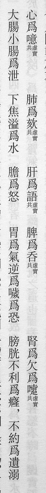

- 心爲噫｟虛實共｠
- 肺爲欬｟虛實共｠
- 肝爲語｟虛實共｠
- 脾爲呑｟虛實共｠
- 腎爲欠爲嚏｟虛實共｠
- 大腸小腸爲泄
- 下焦溢爲水
- 膽爲怒
- 胃爲氣逆爲噦爲恐
- 膀胱不利爲癃，不約爲遺溺

안(案): 하초에 ‘溢’이라 하고 방광에 ‘不利’·‘不約’이라 한 것은 모두 본기가 고르지 못함을 이른다. 이에 따르면 두 장·담·위도 모두 고르지 못한 탓임을 알 수 있다.

（眉）대장·소장과 방광[旁光]은 자리를 맞바꾸어야 상극의 순서에 꼭 맞는다.

**○五精所并，**

오정(五精)이 아우르는 바는,

〔識〕［吳云］오정은 오장의 정기이다. 병(并)은 합하여 들어가는 것이다. 오장의 정기가 각각 제 장에 저장되면 병들지 않는데, 합하여 한 장에 아우러지면 사기가 그곳을 실하게 하여 각각 그 지(志)가 드러난다. ［張云］병은 모임이다. ［高云］장이 허하여 정기가 아우르는 것이다. 정은 음정이고 기는 양기이다. ［簡按］정기는 곧 수곡의 정기이니, 굳이 음양으로 나눌 필요가 없다.

안(案): 오정은 곧 오장의 정기이니, 아랫글에서 말한 정기가 이것이다. 한 장의 정기가 허한 틈을 타 다른 한 장에 합하여 아우른다는 말이다. 여러 주석가의 설은 모두 타당하지 않다.

**○精氣并於心則喜，**

정기(精氣)가 심으로 아우러지면 기뻐하고,

수(水)가 화(火)를 이긴다.

안(案): 이는 모두 상극으로 차례를 삼았으니, 여기서 말한 정기는 신의 정기를 이른다. 신의 정기가 심장에 합하여 아우러지면 기뻐한다는 말이니, 「십육난(十六難)」에서 “심맥의 외증은 기뻐하며 웃는다”고 한 것이 이것이다.

**○并於肺則悲，**

폐로 아우러지면 슬퍼하고,

화(火)가 금(金)을 이긴다.

안(案): 심의 정기가 폐의 정기와 합하여 아우러지면 슬퍼하니, 「십육난」에서 “폐맥을 얻으면 외증은 슬프고 근심스러워 즐겁지 않고 울고 싶어 한다”고 한 것이 이것이다.

**○并於肝則憂，**

간으로 아우러지면 근심하고,

금(金)이 목(木)을 이긴다.

안(案): 폐의 정기가 와서 간의 정기와 아우러지면 근심한다. 「십육난」에서 “간맥을 얻으면 외증은 깨끗함을 좋아하고 잘 성낸다”고 하였으니, 대개 노여움이 겉에 있으면 안에는 반드시 근심이 있다. 이는 내증을 이른 것이다.

**○并於脾則畏，**

비로 아우러지면 두려워하고,

목(木)이 토(土)를 이긴다.

안(案): 간과 비 두 장의 정기가 서로 아우러지면 두려워한다. 「십육난」에서 “비맥을 얻으면 외증은 애를 잘 하고 생각을 많이 한다”고 하였으니, 대개 사려가 안에 있으면 겉으로 반드시 두려워하는 모습이 있다. 늘 두려워하는 생각을 품는 것이 비병이다.

**[역1]** 이 줄의 ‘欬嗽’ 두 곳의 ‘嗽’는 통행 글자로 적었다. 원서는 口+束 꼴(欠 없음, 유니코드 없음)로, ‘嗽’의 이체인 듯하다.

**[역2]** 원서 「室」은 「窒」의 잘못으로 보인다(『黃帝內經素問注證發微』와 『古今圖書集成·藝術典』에는 「窒」로 되어 있다).

**○并於腎則恐，**

신(腎)으로 아우러지면 공포가 된다.

토(土)가 수(水)를 이긴다.

안(案): 비와 신 두 장의 정기가 서로 아우러지면 공포가 된다. 「십육난(十六難)」에서 “신맥을 얻으면 외증은 잘 두려워하고 하품을 한다”고 하였으니, 대개 신의 지(志)는 공포이므로 갑자기 놀라고 무서워하는 것이 신병이다.

**○是謂五并，虛而相并者也。**

이것을 오병(五并)이라 하니, 허하여 서로 아우르는 것이다.

『영추(靈樞)』 「구침론(九鍼論)」에서 말하였다. “오병은, 정기가 간으로 아우러지면 근심하고, 심으로 아우러지면 기뻐하고, 폐로 아우러지면 슬퍼하고, 신으로 아우러지면 공포가 되고, 비로 아우러지면 두려워하니, 이를 오정의 기가 장에 아우러지는 것이라 한다.”

안(案): 이는 간·심·비·폐·신의 순서로 이어져야 하는데, 지금은 간·심·폐·신·비의 순서이니 그 차례가 맞지 않는다.

**○五藏所惡，心惡熱，肺惡寒，肝惡風，脾惡濕，腎惡燥，是謂五惡。**

오장(五藏)이 싫어하는 것은, 심은 열(熱)을 싫어하고, 폐는 한(寒)을 싫어하고, 간은 풍(風)을 싫어하고, 비는 습(濕)을 싫어하고, 신은 조(燥)를 싫어한다. 이것을 오오(五惡)라 한다.

『영추』 「구침론」: “오오는, 간은 풍을 싫어하고, 심은 열을 싫어하고, 폐는 한을 싫어하고, 신은 조를 싫어하고, 비는 습을 싫어하니, 이것이 오장의 기가 싫어하는 것이다.”

〔紹〕이는 상극의 차례에 구애되지 않고, 또 하늘의 오기에 맞출 필요도 없으니, 대개 오로지 오장의 본성에 나아가 말한 것이다. 장병의 이치는 실로 여기에서 벗어나지 않는다. 열·한·습 세 가지는 모두 내인과 외인을 겸하여 말하였고, 풍은 외인으로 말하였으며, 조는 내인으로 말하였다. 또 열·풍·습은 모두 본장이 주관하는 기인데, 그것이 지나치면 도리어 병이 될 수 있다. 왕빙(王冰)이 심·폐·비를 풀이한 것은 아직 다하지 못한 듯하다.

안(案): 『소식(紹識)』의 설이 옳으니 따를 만하다. 그러나 내가 보기에 내인과 외인을 겸하여 말하였다는 것은 아마 그렇지 않을 것이다. 내 생각에 오오는 오장의 병에 각각 금하는 바를 이른 것이다. 「장기법시(藏氣法時)」에서 말한 오장의 금기와 꼭 들어맞으니, 거기에서 말하였다. “병이 간에 있으면 바람을 쐬는 것을 금한다. 병이 심에 있으면 따뜻한 옷과 뜨거운 음식을 금한다. 병이 비에 있으면 따뜻한 음식과 포식, 습한 땅과 젖은 옷을 금한다. 병이 폐에 있으면 찬 음식과 찬 옷을 금한다. 병이 신에 있으면 焠㶼와 뜨거운 음식, 불에 쬔 옷을 범하는 것을 금한다.” 금(禁)과 오(惡)는 뜻이 둘이 아니다. 이것이 경으로 경을 푸는 것이니, 많은 변론이 필요 없다. 어떤 이는 심병에는 열약을 쓰는 것을 싫어하고, 폐병에는 한약을 쓰는 것을 싫어하고, 간병에는 풍약을 쓰는 것을 싫어하고, 비병에는 습약을 쓰는 것을 싫어하고, 신병에는 조약을 쓰는 것을 싫어한다고 하는데, 이 설은 아마 옳지 않을 것이다.

**○五藏化液，**

오장(五藏)이 화생하는 액은,

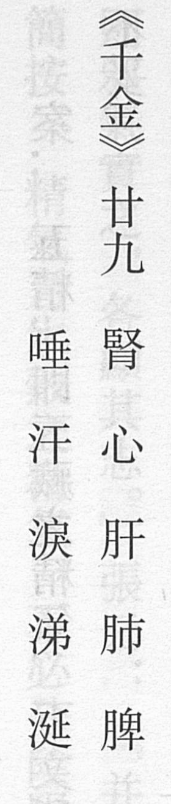

- 《千金》廿九
- 腎
- 心
- 肝
- 肺
- 脾
- 唾
- 汗
- 淚
- 涕
- 涎

〔馬〕이는 오장에 각각 그 액이 있음을 말한 것이다. 음식이 위로 들어가면 그 정미한 기가 화하여 액이 되는 것이다.

**○心爲汗，**

심은 땀[汗]이 되고,

〔識〕［吳云］심은 혈을 주관하고 땀은 혈의 나머지이므로, 땀은 심의 액이 된다. ［簡按］「영위생회편(營衛生會篇)」에서 “혈을 빼앗긴 자는 땀이 없고, 땀을 빼앗긴 자는 혈이 없다”고 하였고, 『삼인방(三因方)』에서 상한의 코피를 홍한(紅汗)이라 한 것도 그 뜻이 같다.

안(案): 땀이 많으면 망양(亡陽)이 되는 것도 땀이 심의 액임을 밝히는 분명한 증거이다.

**○肺爲涕，**

폐는 콧물[涕]이 되고,

〔識〕［簡按］여러 자서는 ‘涕’를 눈물로 보는데, 의가만은 콧물로 본다. 『설문(説文)』을 살펴보면 “‘洟’는 ‘䶏’로도 쓰며 콧물이다”라고 하였으니, 대개 ‘䶏’와 ‘涕’는 통용된다. 『옥편(玉篇)』에는 ‘䶏，他計切。鼻䶏’라 하였다. 『예기(禮記)』 「내칙(内則)」의 ‘不敢唾涕’에 대하여 『석문(釋文)』은 “판본에 따라 ‘洟’로도 쓴다”고 하였다.[역1]

『난헌유고(蘭軒遺稿)』의 ‘鮧魚’ 아래에서 말하였다. 살펴보건대[按] 『오경문자(五經文字)』에 “눈에서 나온 것을 涕라 하고 코에서 나온 것을 洟라 한다. 지금 사람들이 涕를 콧물로 보는 경우가 많은데 잘못이다”라고 하였다. 그렇다면 夷와 弟를 통용한 것은 원래 당나라 사람들의 잘못이다. 다만 『역(易)』 『석문』의 ‘明夷，夷於左股’에서 자하본(子夏本)은 ‘夷’가 ‘睇’로 되어 있고 경씨본[京]은 ‘眱’로 되어 있으며, 환괘(渙卦)의 ‘匪夷所思’에서 순본(荀本)은 ‘夷’가 ‘弟’로 되어 있으니, 당 이전에도 이미 잘못이 있었던 것이다. 대개 夷와 弟는 전서의 꼴이 이미 비슷하여 예서로 변하면서 잘못 전해진 것이다.

**○肝爲淚，**

간은 눈물[淚]이 되고,

안(案): ‘淚’ 자는 『설문』에 없으니, 대개 ‘涕’의 속자이다. 『설문』에서 “‘涕’는 울음이다”라고 하였고, 서현의 음[鉉音]은 ‘他禮切’이다. “‘泣’은 소리 없이 눈물을 흘리는 것을 읍이라 한다.” “‘洟’는 콧물이다.” 서현의 음은 ‘他計切’이다. 『옥편』에서 “‘洟’는 弋之·他計 두 반절이다. 콧물이다. 옛날에는 ‘鼽’라 하였다”라고 하였고, 또 “‘涕’는 恥禮切이다. 눈에서 즙이 나오는 것을 涕라 한다”라고 하였으며, 또 “‘淚’는 力季切이다. 涕는 눈물이다. ‘𭰝’도 같으니 위의 것이 속자이다”라고 하였다. 『광운(廣韻)』 지운(至韻)에서는 “‘淚’는 力遂切이다. 눈물이다. 속자로 ‘𭰝’라 쓴다”라고 하였고, 제운(薺韻)에서는 “‘涕’는 他禮切이다. 눈의 즙이다”라고 하였으며, 제운(霽韻)에서는 “‘涕’는 他計切이다. 눈물이다”라고 하였고, 또 “‘洟’는 콧물이다. ‘戾’는 치거(輜車)이다”라고 하였는데, 모두 ‘他計切’이다. 『집운(集韻)』에서는 “‘戾’는 他計切이다. 치거 옆의 미닫이이다”라고 하였다. 대개 ‘弟’와 ‘戾’ 두 글자는 옛 음이 서로 같으니, ‘涕’ 자는 눈의 즙을 본래의 훈으로 삼고 ‘涕淚’는 속칭이다. 두 글자를 잇달아 쓴 것은 稱秤·蘇甦 같은 글자와 같은 예이다. 내 생각에 ‘涕淚’는 ‘涕’를 늘여 말한 것인데, 뒤에 涕와 洟 두 글자가 뒤섞이고 잘못되기 쉬우므로 오로지 ‘淚’를 눈의 즙을 나타내는 글자로 삼고 음을 力遂切로 하여, ‘淚는 郎計切이다. 빠르게 흐르는 모양이다’라는 글자, 곧 『회남자(淮南子)』의 ‘水淚破舟’｟『집운』｠의 글자와 구분한 것이다. 대개 ‘淚’라는 말은 ‘累’이고 ‘連’이니, 눈물이 흘러내리는 뜻에서 취한 것이다. 『의방유취(醫方類聚)』｟五｠에서 『오장육부도(五藏六府圖)』를 인용하여 “‘淚’는 ‘類’이다. 비슷한 것을 따라 나오므로 淚라 한다”고 하였으니, 이는 ‘力遂切’에 나아가 말한 것이다. 다만 『역』 췌괘(萃卦)의 ‘齎咨涕洟’와 『예기』 「단궁 상(檀弓上)」의 ‘垂涕洟’는 모두 코와 눈 두 즙의 글자를 잇달아 쓴 것으로 잘못이 없고, 바로 『설문』과 합치한다. 이것이 옛글로서 오늘날까지 겨우 남아 있는 것이다.[역3]

안(案): 『화명초(和名抄)』에서 “‘涕淚’는 體·類 두 음이다. 奈美太이다”라고 하였다. 『신찬자경(新撰字鏡)』은 ‘汕’을 『奈牟太』로 훈독하였고, 「인덕기(仁德紀)」의 국의원(國依媛) 노래에는 『那瀰多』로 되어 있으며, 『만엽집(萬葉集)』에는 『那美多』로 되어 있다. 곡천씨(谷川氏)가 말하였다. “『奈美多』는 아마 눈물이 드리워진다[泣水垂]는 뜻일 것이다.” 그렇다면 『奈牟多』는 美와 牟가 같은 음으로 바뀐 것임을 알 수 있으니, 『宇末』·『牟末』｟馬｠, 『宇女』·『牟女』｟梅｠의 예와 같다.[역4]

『예기』 「단궁 상」 『석문』: “‘涕洟’는 위의 글자는 他計反이고 아래 글자는 음이 夷이다. 눈에서 나온 것을 涕라 하고 코에서 나온 것을 洟라 한다.”

**○脾爲涎，**

비는 연(涎)이 되고,

〔識〕오(吳)와 장(張)이 모두 말하였다. “연은 입에서 나오니, 입은 비의 구멍이다.” ［簡按］『증치준승(證治準繩)』 손상문(損傷門)에서 “양쪽 뺨의 연낭(涎囊)”이라 하였으니, 연이 입에서 나옴을 알 수 있다.

안(案): 『의심방(醫心方)』 권2 염천(廉泉) 아래｟八ウ｠ ‘涎’의 곁 훈은 『與多利』이다. 『신찬자경』에서 ‘唌’의 훈은 『豆波志留』이다. 지금 세속에서 『與多禮』라 부르니, 한 음이 바뀐 것이다. 대개 『與』는 『與曾』의 줄임이니, 입 밖으로 드리워 내려감을 이른다. 『豆波志留』는 진액이 달린다는 뜻이다. 진액[津液]의 훈은 『都』이니, 혈과 젖의 훈이 함께 『知』인 예와 같다. 『都』와 『知』는 그 음이 서로 통하니, 곧 『都都久』·『都止夫』의 뜻이다.

『영추』 「구문(口問)」에서 말하였다. “음식은 모두 위로 들어간다. 위 속에 열이 있으면 벌레가 움직이고, 벌레가 움직이면 위가 늘어지며, 위가 늘어지면 염천이 열리므로 연이 흘러내린다.” 『갑을(甲乙)』 권12의 인용에는 ‘涎’이 ‘㵪’으로 되어 있다.

『설문』: “‘㳄’은 부러워서 입에 고이는 침이다. ‘從欠從水’이며, ‘或從侃作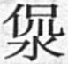’이고, ‘籒文作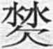’이다.” 『옥편』: “‘㳄’은 徐仙切이다. ‘亦作涎𣵿’.”[역2][역5]

『광운』: ‘㳄’은 입의 침이다. 夕連切이다. ‘涎’도 위와 같다.

『갑을』 권7 「육경수병(六經受病)」 제1 하: “배가 불러 오르고 안이 붓고 ‘㵪’이 나오면 태계(太谿)가 주치한다.” 주문에서 말하였다. “음은 ‘涎’이다.” 권9 제2편도 같다.

（眉）영본(零本) 『명당(明堂)』 폐경 어제(魚際) 아래에서 말하였다. “자주 침을 뱉고 ‘羨’이 흘러내린다.” 양주(楊注)에서 말하였다. “연이 흘러내리는 것이다.”

（眉）『豆波』는 타(唾)이다. 『志留』는 즙이다.

**○腎爲唾，**

신은 타(唾)가 된다.

〔識〕［吳云］타는 염천의 두 구멍에서 나오는데, 두 구멍은 혀뿌리를 끼고 있다. 소음신맥은 후롱(喉嚨)을 따라 혀뿌리를 끼므로, 타는 신의 액이다. ［高云］『영추』 「근결편(根結篇)」에서 말하였다. “소음은 용천(涌泉)에 뿌리를 두고 염천에 맺힌다. 염천은 혀 아래의 구멍이다.” 이는 신이 수장(水藏)이어서 아래에서 위로 올라가는 것이다. 액은 다섯이지만 실은 신이 주관하니, 그러므로 오액은 모두 짜다. 짠맛은 수의 맛이다.

『설문』: “‘唾’는 입의 침이다. 口를 따르고 垂가 소리이다. 탕와절(湯臥切)이다. ‘涶’는 ‘唾’의 혹체로 水를 따른다.”

안(案): 『화명초』에서 『고성절운(考聲切韻)』을 인용하여 “‘唾’는 탕와반(湯臥反)이다. 입 안의 진액이다”라고 하였고, 훈은 『都波歧』이다. 『신찬자경』에서 ‘液’의 훈은 『豆波支』이다. 대개 『豆波支』는 진액을 뱉는다는 뜻이다. 『豆』의 풀이는 이미 앞의 ‘涎’ 조에 보인다.

**○是謂五液。**

이것을 오액(五液)이라 한다.

『영추』 「구침론」: “오액은, 심은 땀을 주관하고, 간은 눈물을 주관하고, 폐는 콧물을 주관하고, 신은 타를 주관하고, 비는 연을 주관하니, 이것이 오액이 나오는 곳이다.”

**○五味所禁，辛走氣，氣病無多食辛。**

오미(五味)의 금기는, 매운맛은 기(氣)로 달려가니 기병(氣病)에는 매운 것을 많이 먹지 말아야 한다.

개(犬)·벼(稻)·복숭아(桃)·파(葱).

안(案): 적게 먹는 것은 괜찮고, 많이 먹는 것을 금해야 할 뿐이다. 아랫글도 같다. 기병은 폐병이다.

**○鹹走血，血病無多食鹹。**

짠맛은 혈(血)로 달려가니 혈병(血病)에는 짠 것을 많이 먹지 말아야 한다.

돼지(豕)·대두(大豆)·밤(栗)·콩잎(藿).

혈병은 심병이다.

**○苦走骨，骨病無多食苦。**

쓴맛은 골(骨)로 달려가니 골병(骨病)에는 쓴 것을 많이 먹지 말아야 한다.

보리(麥)·양(羊)·살구(杏)·염교(薤).

안(案): 골병은 신병이다.

**○甘走肉，肉病無多食甘。**

단맛은 육(肉)으로 달려가니 육병(肉病)에는 단 것을 많이 먹지 말아야 한다.

소(牛)·직(稷)·대추(棗)·아욱(葵).

안(案): 육병은 비병이다.

**○酸走筋，筋病無多食酸。**

신맛은 근(筋)으로 달려가니 근병(筋病)에는 신 것을 많이 먹지 말아야 한다.

닭(鷄)·삼(麻)·자두(李)·부추(韭).

안(案): 근병은 간병이다.

**○是謂五禁，無令多食。**

이것을 오금(五禁)이라 하니, 많이 먹지 않게 해야 한다.

『황제양생경(黄帝養生經)』에서 말하였다. “병이 근에 있으면 신 것을 먹지 말고, 병이 기에 있으면 매운 것을 먹지 말고, 병이 골에 있으면 짠 것을 먹지 말고, 병이 혈에 있으면 쓴 것을 먹지 말고, 병이 육에 있으면 단 것을 먹지 말라. 입이 즐겨 마시고 먹더라도 많이 해서는 안 되니, 반드시 스스로를 해치게 된다. 그러므로 오적(五賊)이라 한다.”

『영추』 「구침론」에서 말하였다. “오재(五裁)는, 병이 근에 있으면 신 것을 먹지 말고, 병이 기에 있으면 매운 것을 먹지 말고, 병이 골에 있으면 짠 것을 먹지 말고, 병이 혈에 있으면 쓴 것을 먹지 말고, 병이 육에 있으면 단 것을 먹지 말라. 입이 즐겨 먹고 싶어 하더라도 많이 해서는 안 되니, 반드시 스스로 절제해야 한다. 이를 오재라 한다.”

『영추』 「오미론(五味論)」에서 말하였다. “황제가 소유(少俞)에게 물었다. 오미가 입으로 들어가면 각각 달려가는 곳이 있고 각각 병이 되는 바가 있다. 신맛은 근으로 달려가니 많이 먹으면 융(癃)이 되게 한다. 짠맛은 혈로 달려가니 많이 먹으면 갈증이 나게 한다. 매운맛은 기로 달려가니 많이 먹으면 동심(洞心)하게 한다. 쓴맛은 골로 달려가니 많이 먹으면 변구(變嘔)하게 한다. 단맛은 육으로 달려가니 많이 먹으면 가슴이 답답하게[悗心] 한다. 나는 그러함은 알지만 그 까닭은 모르니, 그 까닭을 듣고 싶다. 소유가 답하였다. 신맛이 위로 들어가면 그 기가 깔끄러워 위의 두 초를 거두어들이므로 드나들지 못한다. 나가지 못하면 위 속에 머물고, 위 속이 조화롭고 따뜻하면 아래로 방광으로 흘러든다. 방광의 포는 얇고 부드러워, 신맛을 얻으면 오그라들어 묶여 통하지 않고 수도가 행하지 않으므로 융이 된다. 음부는 쌓인 근이 끝나는 곳이므로 신맛이 들어가면 근으로 달려간다. 짠맛이 위로 들어가면 그 기가 위로 중초로 달려가 맥으로 흘러들어 혈기가 그리로 달려간다. 혈이 짠맛과 만나면 엉기고, 엉기면 위 속의 즙이 그리로 흘러들며, 흘러들면 위 속이 마르고, 마르면 인후의 길이 타므로 혀뿌리가 마르고 갈증이 잘 난다. 혈맥은 중초의 길이므로 짠맛이 들어가면 혈로 달려간다. 매운맛이 위로 들어가면 그 기가 상초로 달려간다. 상초는 기를 받아 여러 양을 영양하는 곳이다. 생강과 부추의 기가 훈증하면 영위의 기가 때마다 받아들이지 못하고 오래 심하에 머무르므로 통심한다. 매운맛은 기와 함께 가므로 매운맛이 들어가면 땀과 함께 나온다. 쓴맛이 위로 들어가면 오곡의 기가 모두 쓴맛을 이기지 못한다. 쓴맛이 하완(下脘)으로 들어가면 삼초의 길이 모두 닫혀 통하지 않으므로 변구한다. 이(齒)는 뼈가 끝나는 곳이므로, 쓴맛이 들어가면 골로 달려가니, 들어갔다가 다시 나오는 것으로 그것이 골로 달려감을 안다. 단맛이 위로 들어가면 그 기가 약하고 작아 위로 상초에 이르지 못하고, 곡식과 함께 위 속에 머무는데, 사람을 부드럽고 윤택하게 하는 것이다. 위가 부드러워지면 늘어지고, 늘어지면 벌레가 움직이며, 벌레가 움직이면 가슴이 답답해지는데, 그 기는 밖으로 육에 통하므로 단맛은 육으로 달려간다.”

『오행대의(五行大義)』 권3에서 『양생경(養生經)』을 인용하여 말하였다. “오미가 입으로 들어가면 각각 달려가는 곳이 있고 각각 병이 되는 바가 있다. 신맛은 근으로 달려가니 많이 먹으면 융이 되게 한다. 짠맛은 혈로 달려가니 많이 먹으면 갈증이 나게 한다. 매운맛은 기로 달려가니 많이 먹으면 통심하게 한다. 쓴맛은 골로 달려가니 많이 먹으면 변(變)하게 한다. 단맛은 피부로 달려가니 많이 먹으면 속이 메스껍게 한다. 매운맛은 흩고, 신맛은 거두고, 단맛은 완화하고, 쓴맛은 단단하게 하고, 짠맛은 부드럽게 한다. 오곡은 기름이 되고, 오과는 도움이 되고, 오축은 보탬이 된다. 기미를 합하여 복용하되, 사시와 오장에 알맞은 것을 따른다.”[역6]

또 『하도(河圖)』를 인용하여 말하였다. “사람이 먹을 때 지나치게 짜게 먹지 말아야 하니, 신기가 성하고 심기가 허해져 사람이 발광하고 코피와 토혈을 잘 하며 심신이 안정되지 못하게 한다. 지나치게 맵게 먹지 말아야 하니, 폐기가 성하고 간기가 쇠해져 사람이 나약하고 비애에 잠기며 눈이 멀고 머리가 희어지게 한다. 지나치게 달게 먹지 말아야 하니, 비기가 성하고 신기가 쇠해져 사람이 어리석고 음란하며 정이 새어 나가고 허리와 등이 아프며 농혈을 설사하게 한다. 지나치게 쓰게 먹지 말아야 하니, 심기가 성하고 폐기가 쇠해져 사람이 과감하여 죽음을 가벼이 여기고 해역과 가슴 그득함이 생기게 한다. 지나치게 시게 먹지 말아야 하니, 간기가 성하고 비기가 쇠해져 곡식이 소화되지 않고 말을 못 하고 귀가 먹으며 징고(癥固)가 생기게 한다. 이것이 오장이 서로 제어하고 이기는 뜻이다.” 그 이치는 본래 다르다.

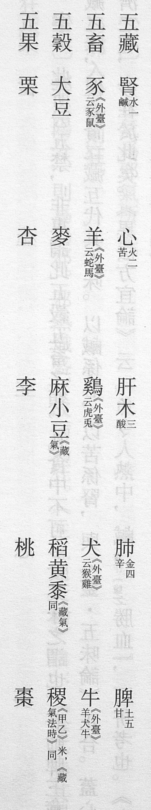

- 五藏
- 腎｟水一鹹｠
- 心｟火二苦｠
- 肝｟木三酸｠
- 肺｟金四辛｠
- 脾｟土五甘｠
- 五畜
- 豕｟《外臺》云豕鼠｠
- 羊｟《外臺》云蛇馬｠
- 鷄｟《外臺》云虎兎｠
- 犬｟《外臺》云猴雞｠
- 牛｟《外臺》羊犬牛｠
- 五穀
- 大豆
- 麥
- 麻小豆｟《藏氣》｠
- 稻黄黍｟《藏氣》同｠
- 稷｟《甲乙》米，《藏氣法時》同｠
- 五果
- 栗
- 杏
- 李
- 桃
- 棗

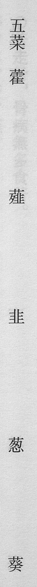

- 五菜
- 藿
- 薤
- 韭
- 葱
- 葵

안(案): 여기서 말한 오금은 오로지 이 오곡·오축 따위만을 이르는 것이 아니라, 음식 가운데 어떤 맛을 많이 먹어서는 안 된다는 말이다. 간·폐·비 세 장은 모두 그 본장의 맛을 많이 먹어서는 안 된다고 하였으나, 심과 신 두 장만은 그 본래의 맛을 서로 바꾸었다. 짠맛을 심에 매고 쓴맛을 신에 맨 것이 『영추』 「오미론」과 꼭 합치한다. 대개 심과 신이 서로 바꾼 것은 곧 수화상제(水火相濟)의 이치이니, 묘함이 여기에 있다. 「이법방의론(異法方宜論)」에서 “물고기는 사람을 열중(熱中)하게 하고, 짠맛｟（‘鹽’으로 써야 한다）｠은 혈을 이긴다”고 한 것을 함께 살필 만하다. 「구침론」에서 말한 오재는 모두 본장의 맛을 이른 것이니, 이와 그 이치가 본래 다르다.

**○五病所發，**

오병(五病)이 발하는 곳은,

이 아래로 ‘是謂五亂’까지는 『대소(大素)』 권27 「사전편(耶傳篇)」에 실려 있다.

〔馬〕이는 오장의 병이 각각 발하는 곳이 있음을 말한 것이다.

**○陰病發於骨，**

음병(陰病)은 골(骨)에서 발하고,

〔志〕신은 음장이고 몸에서는 골이 되므로, 신음의 병은 골에서 발한다.

안(案): 음병이 골에서 발한다는 것은 대개 요통과 위벽(痿躄) 따위가 이것이다. 신은 음장이므로 음병이라 하였다. 「표본병전론(標本病傳論)」에서 “신병은 소복과 허리·등골이 아프고 정강이[䯒]가 시큰하다”고 하였고, 『영추』 「경맥편(經脈篇)」에서 “족소음의 기가 끊어지면 뼈가 마른다”고 하였으니, 모두 증거로 삼을 만하다. 『소문(素問)』 「맥해편(脈解篇)」에서 말하였다. “소음에서 이른바 요통이라는 것은, 소음이 곧 신이기 때문이다.” 「위론(痿論)」: “신기에 열이 있으면 허리와 등골이 들리지 않고 뼈가 마르고 수가 줄어 골위(骨痿)가 된다.”

**○陽病發於血，**

양병(陽病)은 혈(血)에서 발하고,

〔吳〕혈은 심에서 생기고 여름철을 주관하므로, 양병은 혈에서 발한다.

안(案): 양병이 혈에서 발한다는 것은 대개 발광과 옹정(癰疔) 따위가 이것이다. 심은 양장이므로 양병이라 하였다. 「경맥편」에서 말하였다. “수소음의 기가 끊어지면 맥이 통하지 않고, 맥이 통하지 않으면 혈이 흐르지 않는다.” 「위론」: “심기에 열이 있으면 아래 맥이 궐하여 위로 오르고, 위로 오르면 아래 맥이 허해지며, 허하면 맥위(脈痿)가 생긴다. 관절이 꺾이듯 들리지 않고, 정강이가 늘어져 땅을 딛지 못한다.”

**○陰病發於肉，**

음병은 육(肉)에서 발하고,

〔張〕육은 비에 속하고, 비는 음 가운데 지음(至陰)이다.

안(案): 음병이 육에서 발한다는 것은 대개 마비와 수종 따위이다. 「위론」: “비기에 열이 있으면 위가 마르고 갈증이 나며, 기육이 불인(不仁)하여 육위(肉痿)가 된다.”

**○陽病發於冬，**

양병은 겨울에 발하고,

안(案): 양병이 겨울에 발한다는 것은 폐병의 해수가 이것이다. 대개 폐는 피모를 주관하는데, 겨울의 한기가 피모에 적중하면 한열과 해역을 일으킨다. 「음양응상대론(陰陽應象大論)」에서 말하였다. “가을에 습에 상하면 겨울에 해수가 생긴다.” 「위론」: “폐에 열이 있어 폐엽이 마르면 피모가 허약해지고 땅기며 얇아지는데, 이것이 머물러 붙으면 위벽이 생긴다.”

**○陰病發於夏，**

음병은 여름에 발한다.

안(案): 음병이 여름에 발한다는 것은 간병의 곽란(霍亂)·전근(轉筋) 따위가 이것이다. 「응상대론(應象大論)」에서 말하였다. “봄에 풍에 상하면 여름에 손설(飧泄)이 생긴다.” 대개 봄에 풍에 상하면 간목이 손상을 받고, 여름에 이르러 심화가 왕성하지 못하므로 손설로 소화되지 않는 증이 된다. 「위론」: “간기에 열이 있으면 담이 새어 입이 쓰고 근막이 마른다. 근막이 마르면 근이 급하여 당기니 근위(筋痿)가 된다.”

**○是謂五發。**

이것을 오발(五發)이라 한다.

〔楊〕음이 병이 되면 골에서 동통 등이 발한다. 양이 병이 되면 혈비 등으로 발한다. 오미가 병이 되면 기가 고르지 못한 것 등으로 발한다. 겨울에는 양이 안에 있으므로 병이 겨울에 발하고, 여름에는 양이 밖에 있으므로 병이 여름에 발한다.

**○五邪所亂，**

오사(五邪)가 어지럽히는 바는,

〔志〕정기가 사기에게 어지럽혀짐을 말한다.

**○邪入於陽則狂，**

사기가 양(陽)에 들어가면 광(狂)이 되고,

〔張〕사기가 양분(陽分)에 들어가면 양사(陽邪)가 된다. 사열이 치성하므로 병이 광이 된다. 「생기통천론(生氣通天論)」에서 말하였다. “음이 양을 이기지 못하면 맥의 흐름이 빠르고 박동이 세어지며, 아우러지면 광이 된다.”

안(案): 사기가 심장으로 핍박하여 들어가면 광증이 되니, 심이 신성(神性)을 주관하기 때문이다.

**○邪入於陰則痺，**

사기가 음(陰)에 들어가면 비(痺)가 되고,

안(案): 사기가 간장으로 핍박하여 들어가면 비증이 되니, 간이 근혈(筋血)을 주관하기 때문이다.

〔張〕사기가 음분(陰分)에 들어가면 음사(陰邪)가 된다. 음이 성하면 혈맥이 엉기고 깔끄러워 통하지 않으므로 병이 비가 된다. 「수요강유편(壽夭剛柔篇)」에서 말하였다. “병이 음에 있으면 비라 한다.”

「구침론」에서 말하였다. “사기가 음에 들어가면 혈비(血痺)가 된다.”

**[역1]** 원서 인쇄는 ‘鼻䶏’이고, 『옥편』 원문은 ‘鼻液’이다. 문맥상 ‘鼻液’이어야 할 자리인 듯하며, 원서 글자는 그대로 두었다.

**[역2]** 이 줄의 或體·籒文은 원서에서 코드 없는 글자로 보인다(『설문』 ‘㳄’의 籒文은 오린 그림 자리이며, 표지는 위치 그대로 두었다). 꼴은 ‘或從侃作’의 글자 = 侃 아래 水, ‘籒文作’의 글자 = 위 沝·아래 欠, ‘亦作涎’의 글자 = 氵+侃이다.

**[역3]** 원서의 「疾流兒」에서 「兒」는 문맥상 「皃」(모양)의 뜻일 수 있어 그 뜻으로 옮겼다.
**[역4]** 원서대로 옮겼다. 눈물의 훈이 달린 글자로 「汕」은 어울리지 않아 「泪」 계열 글자의 잘못일 수 있으나, 『新撰字鏡』 원문은 확인하지 못했다.
**[역5]** 원서의 「或從侃作」 뒤 글자는 侃 아래 水를 쓴 꼴(侃+水)인데 입력할 글자가 없어 원서의 글자를 오려 그림으로 넣었다.
**[역6]** 원서대로 옮겼다. 『靈樞』 「五味論」의 같은 문장은 「變嘔」로 전한다고 하나, 이 자리가 인용한 『五行大義』의 원문은 확인하지 못했다.

**○搏陽則爲巔疾，**

사기가 양(陽)을 치면[搏陽] 전질(巔疾)이 되고,

〔張〕‘搏’은 친다는 뜻이다. ‘巔’은 ‘癲’이다. 사기가 양을 치면 양기가 손상되므로 전질(癲疾)이 된다. 앞 글에서 사기가 양으로 들어가면 광(狂)이 된다고 한 것은 사기가 그 양을 도운 것이니 양의 실(實)이다. 여기서 양명을 쳐서 전질이 된다고 한 것은 사기가 그 양을 친 것이니 양의 허(虛)이다. 그래서 광이 되고 전이 되는 차이가 있다. 「구침론(九鍼論)」에서 “사기가 양으로 들어가 옮겨 가면 전질이 된다.”라고 한 것은 음분(陰分)으로 옮겨 들어가므로 전(癲)이 된다는 말이다.[역1]

진본(真本) 『명당(明堂)』 권1 열결(列缺) 아래에 ‘癇驚’이라 하였고, 양주(楊注)에 “어린아이의 전병(癲病)이다. 한간반(限間反).”이라 하였다.

안(案): 전질(巔疾)은 곧 전부질(蹎仆疾)로, 풀이는 이미 「오장생성(五藏生成)」 제10에 보인다. 전간(癲癇)과 광주(狂走) 두 병은 서로 비슷하나 음양의 구분이 있다. 그래서 「이십난(廿難)」에서 “양이 겹치면 광이 되고 음이 겹치면 전이 된다.”라고 하였고, 「오십구난(五十九難)」에서 “광과 전은 무엇으로 구별하는가? 답한다. 광이 처음 발작할 때는 잠이 적고 배고파하지 않으며, 스스로 현명하다고 높이고 스스로 지혜롭다고 여기며, 스스로 귀한 체 거만하게 굴고, 함부로 웃고 노래하며 즐기고, 쉬지 않고 함부로 돌아다닌다. 전질이 처음 발작할 때는 마음이 즐겁지 않고, 곧게 쳐다보며 뻣뻣하게 넘어지고, 그 맥은 삼부(三部)의 음양이 모두 성하다.”라고 하였다｟이는 『영(靈)』 「전광(癲狂)」 제22에 근거하였으나 글이 조금 다르다｠. 다만 전질이면서 광주하는 경우가 간혹 있다. 「궐론(厥論)」에서 “양명의 궐은 전질로 달리고 소리치려 하며, 배가 그득하여 눕지 못하고, 얼굴이 붉고 열이 나며, 헛것을 보고 헛소리를 한다.”라고 한 것, 『갑을경(甲乙經)』 11 「양궐대경발광간(陽厥大驚發狂癇)」 제2에서 “전질로 성내어 사람을 죽이려 하면 신주(身柱)가 주치한다. 전질이 광주처럼 발작하는데 얼굴 피부가 두터우면 치료하지 못하며, 장강(長強)이 주치한다.”라고 한 것, 그 밖에 「맥해편(脈解篇)」에서 말한 광전질(狂巔疾) 따위가 그렇다. 광과 전을 이어 일컫는 경우는 모두 광과 전으로 나눌 필요가 없으니, 전질에 광증이 더해진 것을 말한다. 『갑을경』에서 또 “갑작스러운 병으로 궐하고 전질과 광이 되는 것은 오래 거스른 데서 생긴다. 오장이 고르지 못하고 육부가 막혀서 생긴다.”라고 하였는데, 이는 전과 광 두 증의 원인이 같고 다만 음양의 구별이 있다는 말이다.

『맥경(脈經)』 「변맥음양대법(辨脈陰陽大法)」에서 말하였다. “음이 양에 붙으면 광이 되고, 양이 음에 붙으면 전이 된다.”

『범왕비방(范汪祕方)』: “사기가 양으로 들어가 옮겨 가면 전이 된다.” 『어람(御覽)』

『병원(病源)』에서 말하였다. “풍전(風癲)은 혈기가 허하여 사기가 음경(陰經)으로 들어가기 때문에 생긴다. 사람이 혈기가 적으면 심이 허하여 정신이 흩어지고 혼백이 함부로 다니는데, 이때 풍사에 상하면 사기가 음으로 들어가 전질이 된다.”

『장자(莊子)』: “맥이 흘러 함께 일어나 놀라고 두려워하며, 양기만 홀로 올라가면 전병이 된다.”｟『어람』｠ 살펴보건대[案] 이 글은 지금 본 『장자』에서 찾을 수 없다.

안(案): 또 광을 전이라 한 경우도 있다. 「복중론(腹中論)」의 ‘石藥發癲，芳草發狂’에 왕주(王注)는 “기뻐함이 많은 것을 전이라 하고, 성냄이 많은 것을 광이라 한다.”라고 하였다. 『급취장(急就章)』 안사고(顔師古) 주에서는 “전질(顛疾)은 성정과 이치가 뒤집혀 정상을 잃은 것으로, 광휼(狂獝)이라고도 하는데, 함부로 움직이는 것이다.”라고 하였다. 『신이경(神異經)』에서는 “서방에 어떤 사람이 있어, 먹고 마시고는 머리를 풀어헤치고 동쪽으로 달린다. 그 아내가 뒤쫓아도 멈추지 않으니 아내도 성이 나서 머리를 풀어헤친다. 이름을 광이라 하고, 일명 전(顛), 일명 견(狷), 일명 풍(風)이라 한다. 이 사람 부부는 하늘과 함께 태어나 밤낮 없이 동서로 미쳐 달린다.”라고 하였다｟『어람』 인용｠. “조대지(祖臺之)가 전경(錢耿)이 아내를 죽인 일을 논의하여 말하였다. 건강(建康)의 옥사를 살펴보니, 결국 갇힌 전경은 전질이 발작하여 아내를 때려 죽였을 뿐 다른 변고는 전혀 없었다. 그러므로 황병(荒病)을 앓는 사람이 애긍의 은혜를 입지 못하고, 무지한 자에게 예를 적용하여 사형을 더하는 것은, ｟（‘懼’를 보충해야 한다）｠ 옛날 마음의 근원을 헤아려 죄를 정하던 뜻이 아니다.”｟『어람』 인용｠ 이는 전질에도 광증을 일으키는 경우가 간혹 있다는 것이다. 전과 광은 서로 통하여 일컫는다. 『당서(唐書)』 「장욱전(張旭傳)」의 ‘張顛’, 『다록(茶録)』에서 육우(陸羽)가 차를 즐겨 사람들이 ‘茶顛’이라 한 것 따위는 모두 광을 말한다.[역2]

안(案): 사기가 신부(腎部)로 들어가면 전부(蹎仆)하니, 신이 정(精)을 주관하고 지(志)를 주관하기 때문이다. 「오장생성편」의 “두통과 전질은 아래가 허하고 위가 실한 것으로, 허물이 족소음과 거양(巨陽)에 있고, 심하면 신으로 들어간다.”, 「맥요정미(脈要精微)」 17의 “궐이 이루어지면 전질이 된다.”와 또 “올 때 빠르고 갈 때 느리면 위가 실하고 아래가 허한 것으로, 궐전질(厥巔疾)이 된다.”, 「맥해편」 49의 “심하면 광전질이 된다는 것은, 양이 모두 위에 있고 음기가 아래로 따라가 아래가 허하고 위가 실하므로 광전질이 된다는 말이다.”, 「방성쇠론(方盛衰論)」 80의 “기가 올라가고 내려오지 않으면 두통과 전질이 된다.”는 모두 상실하허(上實下虛)의 뜻이다. 대개 사기가 음분인 신 안으로 들어가 궐이 되는 것이 하허이다. 그 사기의 기세가 심·간 부분을 쳐서 전부가 되는 것이 상실이다. 이 병은 심·간 두 장의 병에 속하는 듯하지만 실제로는 사기가 신부에 있으니, 곧 상실하허를 말한다.

**○搏陰則爲瘖，**

사기가 음(陰)을 치면[搏陰] 음(瘖)이 되고,

〔識〕당(唐)나라 혜림(慧琳)의 『장경음의(藏經音義)』에서 말하였다. “‘瘖’은 잠잠하여 소리가 없는 것이다. ‘瘂’는 소리는 있으나 말이 안 되는 것으로, 혀가 돌아가지 않는 것이다.”

『본초회(本草匯)』 권5에서 말하였다. “설음(舌瘖)은 사기가 음으로 들어가 음(瘖)이 된 것이니, 혀가 움직이지 않고 담연(痰涎)이 허를 틈타 설본(舌本)의 맥도(脈道)를 막아 음이 된다. 풍열에 적중하면 혀가 늘어져 말을 못하고, 풍한에 적중하면 혀가 뻣뻣해 말을 못한다.” 또 말하였다. “후음(喉瘖)은 목구멍 안의 소리가 쉬는 것이니, 폐의 옹체를 소설(疎泄)하고 맺힌 담을 연다.”

『설문(説文)』: “‘瘖’은 말을 하지 못하는 것이다. ‘疒’을 따르고 ‘音’이 소리를 나타낸다.”

〔吳〕음(瘖)은 벙어리[瘂]이다. 태음비맥은 인(咽)을 끼고 설본에 이어져 혀 아래로 흩어지고, 소음신맥은 후롱(喉嚨)을 따라 설본을 끼며, 궐음간맥은 후롱의 뒤를 따른다. 사기와 정기가 이 세 음맥에서 서로 부딪치면 후롱이 막히고 설본이 부자유하여 소리를 잃고 벙어리가 된다. 또 폐는 태음으로 기를 주관하므로 폐병은 사람의 목소리를 나오지 않게 한다. 『전(傳)』에서 “말은 심의 소리이다.”라고 하였다. 그러므로 경기(驚氣)가 심으로 들어가면 사람이 소리를 잃으니, 모두 음을 쳐서 음(瘖)이 된다는 뜻이다.

안(案): 사기가 폐부(肺部)의 양분으로 들어가 쳐서 간·비로 들어가면 음(瘖)이 된다. 『오행대의(五行大義)』에서 『관자(管子)』를 인용하여 “폐는 발하여 입이 된다.”, 또 『태평경(太平經)』의 또 다른 일설을 인용하여 “폐는 입이 된다.”, 또 「천문지(天文志)」를 인용하여 “폐는 말이 된다.”라고 하였는데, 모두 폐가 말과 소리를 주관한다는 설이다.

**○陽入之陰則靜，陰出之陽則怒。**

양이 들어가 음으로 변하면 고요해지고, 음이 나와 양으로 가면 잘 성내는 병이 된다.

〔識〕［簡按］손혁(孫奕)의 『시아편(示兒編)』에서 말하였다. “‘之’ 자는 변한다는 뜻이다. 『좌전(左傳)』의 ‘遇觀之否’는 관(觀)이 변하여 비(否)가 된다는 말이다.” 대개 양병이 밖에 있으면 조급하고, 들어가 음으로 변하면 고요하다. 아래 글의 ‘出之陽’도 뜻이 같다. 왕빙(王冰)이 ‘之’를 ‘往’으로 풀이한 것은 타당하지 않은 듯하다.

안(案): 여기 두 ‘陰’ 자는 모두 비(脾)를 가리킨다. 양이 음으로 들어가면 고요해진다는 것은, 간목(肝木)의 양사(陽邪)가 와서 비토(脾土)를 극하면 양증이 음증으로 변하고 양열이 음한으로 변하므로 고요하다고 한 것이다. 음이 들어가｟‘出’로 써야 한다｠ 양으로 가면 성을 낸다는 것은, 비토의 음사(陰邪)가 안에서 성하여 나와 간목의 양분을 침범하면 잘 성내는｟『대소(大素)』를 따라 ‘則怒’를 ‘病喜怒’로 한다｠ 증상이 나타난다는 말이다. 비가 의(意)를 주관하고 간이 노(怒)를 주관하기 때문이다. 곧 목이 토를 극하고, 토가 수를 극하며, 토가 금을 낳고, 금이 수를 낳는 이치이다. 비는 다른 네 장과 달리 사기가 이르면 오고 감이 일정하지 않고 위기(胃氣)의 소장(消長)을 따르므로, 이렇게 고요함과 조급함 두 증이 된다. 예로부터 주석가들이 이 대목을 풀이하면서 정설을 얻지 못하였기에, 이제 삼가 내 생각대로 설명하여 훗날 잊어버릴 때에 대비할 따름이다.

**○是謂五亂。**

이를 오란(五亂)이라 한다.

『영추(靈樞)』 「구침론」에서 말하였다. “오사(五邪)는, 사기가 양으로 들어가면 광이 되고, 사기가 음으로 들어가면 혈비(血痺)가 된다. 사기가 양으로 들어가 옮겨 가면 전질이 된다. 사기가 음으로 들어가 옮겨 가면 음(瘖)이 된다. 양이 음으로 들어가면 병이 고요하다. 음이 양으로 나오면 병이 잘 성낸다.”

〔楊〕열기가 양맥으로 들어가면 양이 겹치므로 광병이 된다. 한사(寒耶)가 음맥으로 들어가면 음이 겹치므로 혈비가 된다. 양사(陽耶)가 양맥으로 들어가면 모여서 전질이 된다. 양사가 음맥으로 들어가면 모여서 음(瘖)이 되어 말을 하지 못한다. 양사가 음으로 들어가면 병이 고요함을 좋아하게 된다. 음사(陰耶)가 양으로 나오면 양은 움직이는 것이므로 잘 성내는 일이 많이 생긴다.

**○五邪所見，**

오사(五邪)가 나타나는 바는,

‘五邪’에서 ‘死不治’까지는 『대소』 14 「사시맥진(四時脈診)」에 실려 있다.

〔馬〕이는 오장의 사기에 나타나는 맥이 있음을 말한 것이다.

〔張〕오미(五味)가 번갈아 이기고, 병이 장을 이기므로 오사라고 하였다.[역3]

**○春得秋脈，**

봄에 가을 맥을 얻고,

〔馬〕금이 목을 극한다.

**○夏得冬脈，**

여름에 겨울 맥을 얻고,

〔馬〕수가 화를 극한다.

**○長夏得春脈，**

장하(長夏)에 봄 맥을 얻고,

〔馬〕목이 토를 극한다.

**○秋得夏脈，**

가을에 여름 맥을 얻고,

〔馬〕화가 금을 극한다.

**○冬得長夏脈，**

겨울에 장하의 맥을 얻으면,

〔馬〕토가 수를 극한다.

**○名曰陰出之陽，病善怒不治，**

이를 음이 양으로 나왔다[陰出之陽]고 하며, 병은 잘 성내고 치료하지 못한다.

안(案): 음이 양으로 나왔다는 것은, 비유하면 봄에는 현맥(弦脈)을 얻어야 하는데 모맥(毛脈)을 얻고, 도리어 가라앉아 숨어 있어야 할 침복맥(沈伏脈)이 나타나기 때문에 음이 양으로 나왔다고 한 것이다. 사계절이 모두 같은 예이다.

〔張〕음이 성하고 양이 쇠하여 토가 무너지고 목이 해치므로 병이 으레 잘 성내게 되고 치료할 수 없다.

안(案): 토는 네 장에 매여 있어 네 장이 쇠하면 비토가 반드시 손상된다. 오장이 병들면 비가 손상되지 않을 수 없다. 토가 손상되면 간목이 극도로 항진하므로 잘 성내고 치료하지 못하게 된다.

**○是謂五邪，皆同命死不治。**

이를 오사라 하며, 모두 명(命)이 같아 죽으니 치료하지 못한다.

〔吳〕이는 다시 그것이 같음을 단언한 것으로, 사증(死證)이다.

〔志〕이는 앞 글에서 치료하지 못한다고 한 것이, 오맥이 모두 사기에 이김을 당한 것을 말함을 밝힌 것이다. 오장의 기가 사기에 이김을 당해 사계절에 서로 극하는 맥이 나타나면 모두 죽으니 치료하지 못한다.

〔箚〕「옥기진장론(玉機真藏論)」: “사계절을 거스른다는 것은, 봄에 폐맥을 얻고, 여름에 신맥을 얻고, 가을에 심맥을 얻고, 겨울에 비맥을 얻는 것으로, 이를 사계절을 거스른다고 한다.”

〔楊〕봄에 가을 맥을 얻고 여름에 겨울 맥을 얻는 것은 모두 적사(賊耶)가 와서 타는 것이다. 가을에 봄 맥을 얻고 겨울에 여름 맥을 얻는 것은 미사(微邪)가 와서 타는 것이지만, 가을·겨울에 음이 양으로 나오는 것을 얻어 서로 다투므로 치료하지 못한다.

**○五藏所藏，**

오장(五藏)이 간직하는 것은,

안(案): 오장이 이 다섯 신(神)을 간직하므로 오장이라 이름하였고, 그래서 오장이 간직하는 것이라고 하였다. 『천금(千金)』 권29 「오장방통(五藏旁通)」 제4에서는 이를 오신(五神)이라 하였다.

**○心藏神，**

심(心)은 신(神)을 간직하고,

「육절장상(六節藏象)」 제9에서 말하였다. “심은 생명의 근본이고 신이 변화하는 곳이다. 그 정화는 얼굴에 나타나고, 그 충실함은 혈맥에 있으며, 양중의 태양이 되어 여름 기운과 통한다.”

「조경론(調經論)」에서 말하였다. “심은 신을 간직하고, 폐는 기를 간직하고, 간은 혈을 간직하고, 비는 육(肉)을 간직하고, 신은 지(志)를 간직하여 이로써 형체를 이룬다.”

안(案): 여기서 말하는 신은 온몸을 자라게 하는 기이다.

『소(素)』 「해정미론(解精微論)」: “화(火)의 정(精)이 신이 된다.”

『영(靈)』 「평인절곡편(平人絶穀篇)」: “신은 수곡의 정기이다.”

또 「본신편(本神篇)」: “심은 맥을 간직하고, 맥에 신이 머문다.”

고초본(古抄本) 『노자경(老子經)』 하상공(河上公) 주 제3장 표기(標記)에서 “오신은 혼·백·신·정·지이다.”라고 하였는데, 이 설은 타당하지 않다.

『소』 「음양응상론(陰陽應象論)」 ‘玄生神’의 왕주: “현명(玄冥)의 안에 신이 그 가운데 머물므로 ‘玄生神’이라 한다.”

또 「천원기대론(天元紀大論)」 ‘玄生神’의 왕주: “현원(玄遠)하고 유심(幽深)하므로 신을 낳는다. 신의 작용은 접하는 것마다 그윽이 통하여, 사물에 들어맞아 변화를 이루므로 응하지 않는 것이 없다.”

『설문』: “‘神’은 천신(天神)이니, 만물을 끌어내는 존재이다.”

『광운(廣韻)』: “‘神’은 영(靈)이다.”

『대대례(大戴禮)』 「증자(曾子)·천원(天圓)」: “양의 정기를 신이라 한다.”

『역(易)』 「설괘전(説卦傳)」: “신이란 만물을 묘하게 하는 것을 두고 하는 말이다.”｟『대현(大玄)』 「현고(玄告)」 주도 같다. 또 같은 뜻이 한 번 보인다.｠

『역』 「계사전(繫辭傳) 상」: “음양을 헤아릴 수 없는 것을 신이라 한다.”

『논형(論衡)』 「논사편(論死篇)」: “양기가 이끌어 생겨나므로 신이라 한다.”

『후한서(後漢書)』 「이고전(李固傳)」: “기의 맑은 것이 신이 된다.”

〔張〕정기(精氣)의 영명(靈明)이다. 「본신편」에서 “두 정이 서로 부딪치는 것을 신이라 한다.”라고 하였다.

〔吳〕정(情)을 주관하는 것을 신이라 한다.

안(案): 정(精)과 신(神)은 하나이면서 둘이다. 남녀가 정을 맺어 두 정이 서로 부딪치면 그 가운데 하나의 기가 생기는데 이를 신이라 한다. 신은 형체 없는 영기(靈氣)이다. 기 안에 이미 물(物)이 생긴 것을 정이라 하며, 기·혈·근·골·피·육이 이를 따라 이루어지니, 그 근원은 다만 한 덩어리의 기일 뿐이다. 이상은 선천의 정신을 말한다. 후천의 정신도 이치가 같다. 음식이 위로 들어가 그 정미한 기가 심으로 들어가 간직된 것을 신이라 하고, 신 안에 저절로 정이 있으며, 정은 오장에 각각 있어 쓸 때에는 모두 신규(腎竅)로 빠져나간다. 이상은 후천의 정신을 말한다.

（眉）「사십이난(四十二難)」 우주(虞注): “신은 정기가 변화하여 이루어진 것이다.”

**○肺藏魄，**

폐(肺)는 백(魄)을 간직하고,

〔吳〕정(精)과 나란히 드나드는 것을 백이라 한다.｟「본신편」의 글에서 나왔다｠

「육절장상론」에서 말하였다. “폐는 기의 근본이고 백이 머무는 곳이다. 그 정화는 털에 나타나고, 그 충실함은 피부에 있으며, 양중의 태음이 되어 가을 기운과 통한다.”

『영』 「본신편」: “폐는 기를 간직하고, 기에 백이 머문다.”

또 「천년편(天年篇)」: “사람이 80세가 되면 폐기가 쇠하고, 백이 떠나므로 말을 자주 잘못한다.”

『옥편(玉篇)』: “‘魄’은 사람의 정상(精爽)이다.” 『월절서(越絶書)』 「외전침중(外傳枕中)」에서 말하였다. “백은 생기의 근원이다.” 『백호통(白虎通)』 「정성(情性)」에서 말하였다. “‘魄’은 ‘白’이다.” 『고미서(古微書)』에서 인용한 『효경원신계(孝經援神契)』에서 말하였다. “‘魄’은 ‘白’이다. ‘白’은 명백하다는 뜻이다.”

안(案): 『설문』에서 “‘魄’은 음신(陰神)이다.”라 하고, 또 “‘情’은 사람의 음기로 욕구가 있는 것이다.”라고 하였다. 『광운』에는 “‘情’은 고요함이다.”라고 하였다. 대개 정(情)은 사람이 즐기고 바라는 것이니, 음식과 남녀가 정의 가장 큰 것이다. 이 정은 안에 있어 고요하지만 기를 따라 자유로이 오가므로 백과 정이 함께 폐기에 매여 있으며, 정은 성(性)에서 나온 것이다. 성은 간혈(肝血)이 낳은 것으로, 비유하면 귀와 눈이 듣고 볼 수 있는 것을 성이라 하니 곧 혼(魂)이 주관하는 것이다. 귀가 나쁜 소리 듣기를 싫어하고 눈이 나쁜 것 보기를 싫어하는 것을 정이라 하니 곧 백이 주관하는 것이다.

（眉）안(案): 여기서 말하는 백은 정(情)이다. 유가에서 말하는 기(氣)가 여기의 백이다.

（眉）「사십이난」 우주: “혼은 신기(神氣)를 돕는 것이다. 백은 정기를 돕는 것이다. 뜻을 오로지하여 옮기지 않는 것이 지(志)이다.” 또 기주(紀注): “혼은 신명을 돕는 것이다. 백은 정기를 돕는 것이다.”

**○肝藏魂，**

간(肝)은 혼(魂)을 간직하고,

〔吳〕신(神)을 따라 오가는 것을 혼이라 한다.｟「본신편」의 글｠

「육절장상론」에서 말하였다. “간은 피극(罷極)의 근본이고 혼이 사는 곳이다. 그 정화는 손발톱에 나타나고, 그 충실함은 근에 있으며, 혈기를 낳고, 그 맛은 시고 그 색은 푸르며, 이는 양중의 소양이 되어 봄 기운과 통한다.”

안(案): 혼백의 풀이는 「육절장상」 제9와 『본초경고주(本草經攷注)』 단사(丹沙) 아래에 보인다.

양신(楊愼)의 『단연속록(丹鉛續録)』 권2에서 말하였다. “정(情)과 성(性)은 백과 혼이다.” 또 말하였다. “혼백은 성정이다. 혼은 올 일을 알 수 있고, 백은 지난 일을 간직할 수 있다.”

『영』 「본신편」: “간은 혈을 간직하고, 혈에 혼이 머문다.”

『설문』: “‘魂’은 양기이다.”

『관윤자(關尹子)』에서 말하였다. “혼은 낮에 눈에 머물고 백은 밤에 간에 머무니, 눈에 머물면 볼 수 있고 간에 머물면 꿈을 꿀 수 있다.”

『옥편』: “‘魂’은 양의 떠다니는 기이다. 사람이 처음 생겨 변화하는 것을 혼이라 한다.”

안(案): 혼은 사람의 양기로 형체가 없는 것이며, 또 성(性)이라고도 한다. 『설문』에서 “‘性’은 사람의 양기로 성품이 선한 것이다.”라 하였고, 『옥편』에서 “‘性’은 명(命)이다. 질(質)이다.”라 하였으며, 『광운』에서 “‘性’은 성행(性行)이다.”라고 하였다. 대개 혈이라는 음 가운데서 떠나온 양기를 혼이라 하니 곧 성이다. 성은 하늘에서 얻은 것이다. 성급한 이가 있고 느긋한 이가 있으며, 지혜로운 이가 있고 어리석은 이가 있어 바꿀 수 없는 것이 그것이다. 성에서 나온 것을 정(情)이라 하니, 변하고 바뀌어 자유로이 움직이는 것이다. 양기 가운데서 생긴 음기로, 안으로 들어가 움직이지 않다가 일을 만나면 자유로이 움직이는 것이 그것이다.

〔張〕신기(神氣)를 돕는 것이다. 「본신편」에서 “신을 따라 오가는 것을 혼이라 한다.”라고 하였다.

（眉）안(案): 여기서 말하는 혼은 성(性)과 기(氣) 둘이다.

**○脾藏意，**

비(脾)는 의(意)를 간직하고,

『대학(大學)』 수서(首書)에서 『교진총록(教秦總録)』을 인용하여 말하였다. “몸을 주재하는 것이 심이고, 심이 발동하는 것이 의이고, 심의 영묘한 깨달음이 지(知)이다.” 『해려편(海蠡編)』에서 말하였다. “심은 물과 같고 의는 얼음과 같다. 물의 본체는 늘 흐르지만 한번 맺혀 얼음이 되면 늘 흐르는 성질을 잃는다.”

〔吳〕심이 기억하고 생각하는 것을 의라 한다.

〔張〕심(心)｟‘神’으로 써야 한다｠이 쏠리는 바가 있는 것이다. 「본신편」에서 “심에 기억하는 바가 있는 것을 의라 한다.”라고 하였다.

안(案): 의가 비에 매여 있는 것은, 비가 네 장이 함께 양분을 받는 곳이기 때문이다. 심의 희(喜), 간의 노(怒), 폐의 우(憂), 신의 공(恐)은 모두 비가 생각하는 것｟脾｠이고 의｟脾｠이다.

『영』 「본신편」: “심에 기억하는 바가 있는 것을 의라 한다.”

또 말하였다. “비는 영(營)을 간직하고, 영에 의가 머문다.”

또 「본장편(本藏篇)」: “지의(志意)는 정신을 다스리고, 혼백을 거두며, 한온에 적응하고, 희로를 조화시키는 것이다. 지의가 조화로우면 정신이 한결같고 혼백이 흩어지지 않으며, 후회와 분노가 일어나지 않아 오장이 사기를 받지 않는다.”

『설문』: “‘意’는 지(志)이다. ‘心’을 따르며, 말을 살펴 뜻을 안다. ‘心’을 따르고 ‘音’을 따른다.｟개본(鍇本)에는 ‘音聲’으로 되어 있다｠”

『옥편』: “‘意’는 지이고, 생각이다.”

『광운』: “‘意’는 지이다.”

『금궤옥함경(金匱玉函經)』 「총례편(總例篇)」: “경에서 말하였다. 동방은 근막과 혼, 남방은 혈맥과 신, 서방은 피모와 백, 북방은 골수와 지(志), 중앙은 기육과 지(智)이다.”

（眉）안(案): 여기서 말하는 의는 의와 심 둘이다.

（眉）안(案): 지금 사람이 잠결에 헛소리를 하고 꿈을 꾸는 것은 혼이다. 벼룩과 이에게 물려 긁고, 더우면 이불을 걷는 것은 의이다.

**○腎藏志，**

신(腎)은 지(志)를 간직한다.

〔吳〕뜻을 오로지하여 옮기지 않는 것을 지라 한다.

〔張〕의(意)가 한결같은 것이다. 「본신편」에서 “의가 보존된 것을 지라 한다.”라고 하였다.

「육절장상론」에서 말하였다. “신은 칩장(蟄藏)을 주관하고 봉장(封藏)의 근본이며 정이 머무는 곳이다. 그 정화는 머리털에 나타나고, 그 충실함은 뼈에 있으며, 음중의 소음이 되어 겨울 기운과 통한다.”

「해정미론」: “수(水)의 정이 지가 되니, 지는 뼈의 주인이다.”

『영』 「본신편」: “의가 보존된 것을 지라 한다.”

또 말하였다. “신은 정을 간직하고, 정에 지가 머문다.” 『갑을』 권1 제1편에는 ‘精舍氣’로 되어 있다. 살펴보건대[案] ‘志’와 ‘精’은 한 소리가 옮겨 간 것이다.

또 「본장편」: “지의는 정신을 다스리고, 혼백을 거두며, 한온에 적응하고, 희로를 조화시키는 것이다. 지의가 조화로우면 정신이 한결같고 혼백이 흩어지지 않으며, 후회와 분노가 일어나지 않아 오장이 사기를 받지 않는다.”

『설문』: “‘志’는 의(意)이다.”

『옥편』: “‘志’는 의이다.”

『광운』: “‘志’는 뜻으로 그리워하는 것이다.”

안(案): 의는 접촉하면 움직여 일정하지 않으므로 비에 매여 있다. 지는 의에서 나와 일정해진 것이므로 신에 속한다. 신은 수(水)이다. 물은 이르지 못하는 곳이 없으니, 그 지가 한결같은 것은 신장에서 나온다.

재안(再案): 「해정미」와 「본신」의 말에 따르면 지는 뇌 속에 앞일과 지난 일을 간직하는 것의 이름이다. ‘志’는 두고 멈추어 쌓아 간직한다는 뜻이다. ‘志’와 ‘精’은 소리가 같으며, ‘記’·‘誌’·‘鏤’·‘銘’처럼 새긴다는 말이다. 『역』 「계사」의 “지혜로 지난 일을 간직한다.”가 이것이다. 뇌·수·신은 한 부(府)이다.

（眉）안(案): 여기서 말하는 지는 ‘心之之’｟연문인 듯하다｠ ‘志’와 뇌에 간직된 지이다.

**○是謂五藏所藏，**

이것을 오장이 간직하는 것이라 한다.

『영』 「구침론」: “오장은, 심은 신을 간직하고, 폐는 백을 간직하고, 간은 혼을 간직하고, 비는 의를 간직하고, 신은 정과 지를 간직한다.”

〔新〕［按］양상선(楊上善)은 “신은 두 개인데, 왼쪽은 신으로 지를 간직하고, 오른쪽은 명문(命門)으로 정을 간직한다.”라고 하였다.

**○五藏所主，**

오장이 주관하는 것은,

「거통론(舉痛論)」 편 첫머리의 왕주: “칠신(七神)과 오장을 빌려 운용한다.” 이른바 칠신은 정지(精志)가 첫째, 신심(神心)이 둘째, 혼성(魂性)이 셋째, 백정(魄情)이 넷째, 의기(意氣)가 다섯째임을 가리킨다. 그 가운데서 따로 나누어 일곱으로 만들면 정지가 첫째, 신심기(神心氣)가 둘째, 혼이 셋째, 백이 넷째, 의가 다섯째, 성(性)이 여섯째, 정(精)이 일곱째이다. 『의심방(醫心方)』 권25 「소아초여유방(小兒初與乳方)」편의 『산경(産經)』에서 “오정(五情)의 선악과 칠신이 품부되는 것은 모두 젖에서 생겨나 변화한다.”라고 하였는데, 여기서 말한 칠신도 같다. 이른바 오정은 희·락·애·욕이 첫째, 노·오가 둘째, 비·애가 셋째, 공·경·구가 넷째, 우·사가 다섯째이다.[역4]

〔吳〕주관한다고 한 것은 존망이 이에 달려 있고 치란이 이에 달려 있어, 각각 주관하는 바를 의지처로 삼는다는 것이다.

〔志〕오장은 안에 있으면서 각각 주관하는 바깥의 합(合)이 있다.

**○心主脈，**

심은 맥(脈)을 주관하고,

〔張〕심은 혈맥을 주관하니, 화(火)의 움직임에 응하여 온몸을 운행한다.

**○肺主皮，**

폐는 피(皮)를 주관하고,

〔張〕폐는 피모를 주관하니, 금(金)의 단단함에 응하여 온몸을 보호하고 여러 사기를 막는다.

**○肝主筋，**

간은 근(筋)을 주관하고,

〔張〕간은 근막을 주관하니, 목(木)의 부드러움에 응하여 관절을 잇는다.

**○脾主肉，**

비는 육(肉)을 주관하고,

〔張〕비는 기육을 주관하니, 토(土)의 두터움에 응하여 만물을 기른다.

**○腎主骨，**

신은 골(骨)을 주관한다.

〔張〕신은 골수를 주관하니, 물과 돌의 가라앉아 단단함에 응하여 몸을 세우는 줄기가 되고 만 가지 변화의 근원이 된다.

**○是謂五主。**

이것을 오주(五主)라 한다.

『영추』 「구침론」: “오주는, 심은 맥을 주관하고, 폐는 피부를 주관하고, 간은 근을 주관하고, 비는 기(肌)를 주관하고, 신은 골을 주관한다.”

「위론(痿論)」 제44에서 말하였다. “폐는 몸의 피모를 주관하고, 심은 몸의 혈맥을 주관하고, 간은 몸의 근막을 주관하고, 비는 몸의 기육을 주관하고, 신은 몸의 골수를 주관한다.”

**[역1]** 원서대로 옮겼다. 경문이 「搏陽則爲巔疾」이므로 「明」은 「則」의 잘못이거나 군더더기일 수 있으나, 『類經』 원문은 확인하지 못했다.
**[역2]** 원서는 「亦謂之狂，獝妄動作也」로 끊었으나, 『急就篇』 안사고 주에는 「亦謂之狂獝」에 이어 「妄動作也」가 오고 四庫全書本 등에는 「獝」 아래 반절이 달려 있어, 「狂獝」에서 끊어야 할 것으로 보인다.
**[역3]** 원서대로 옮겼다. 뒤이은 주석이 오행 상극을 말하므로 「五味」는 「五行」의 잘못일 수 있으나, 『類經』 원문은 확인하지 못했다.
**[역4]** 원서 「精七」의 「精」은, 앞 문장 「魂性三，魄情四」에서 「性」과 「情」을 떼어 낸 구성이고 「精」은 첫째 「精志」와 겹치므로, 「情」의 잘못으로 보인다.

**○五勞所傷，**

오로(五勞)로 손상되는 것은,

〔識〕［志云］노(勞)는 지나침을 말한다. 상고의 백성은｟‘形’을 보충해야 한다｠ 일해도 지치지 않았다.｟「상고천진론(上古天真論)」의 글｠ ［簡按］‘勞’는 『설문(説文)』에 “심함이다. ‘力’과 ‘熒’의 생략형을 따른다. ‘熒’은 불이 덮개[冖]를 태우는 것이니, 힘을 쓰는 자는 수고롭다. 노도절(魯刀切).”이라 하였다. 『이아(爾雅)』 「석고(釋詁)」에 “‘勞’는 ‘勤’이다.”라고 하였다.

**○久視傷血，**

오래 보면 혈(血)이 상하고,

〔張〕오래 보면 신(神)을 수고롭게 하므로 혈이 상한다. 「영위생회편(營衛生會篇)」에서 “혈은 신기(神氣)이다.”라고 하였다.

〔識〕［簡按］「오장생성편(五藏生成篇)」에서 “모든 맥은 눈에 속한다.”라고 하였다. 오래 보면 혈이 상한다는 것은 혈맥이 상한다는 것이다.

**○久臥傷氣，**

오래 누워 있으면 기(氣)가 상하고,

〔張〕오래 누워 있으면 양기가 펴지지 못하므로 기가 상한다.

**○久坐傷肉，**

오래 앉아 있으면 육(肉)이 상하고,

〔張〕오래 앉아 있으면 혈맥이 사지에 정체되므로 육이 상한다.

**○久立傷骨，**

오래 서 있으면 골(骨)이 상하고,

〔志〕오래 서 있으면 허리·신·무릎·정강이가 상하므로 골이 상한다.

**○久行傷筋，**

오래 걸으면 근(筋)이 상한다.

〔志〕걷고 달려 몹시 지치면 근이 상한다.

**○是謂五勞所傷。**

이것을 오로로 손상되는 것이라 한다.

『영추(靈樞)』 「구침론(九鍼論)」: “오로는, 오래 보면 혈이 상하고, 오래 누워 있으면 기가 상하고, 오래 앉아 있으면 육이 상하고, 오래 서 있으면 골이 상하고, 오래 걸으면 근이 상하니, 이는 다섯 가지를 오래 하여 수고로워서 생기는 병이다.”

**○五脈應象，**

오맥(五脈)이 상(象)에 응하는 것은,

이 아래 ‘五藏之脈’까지는 『대소(大素)』 15 「오장맥진(五藏脈診)」에 실려 있다.

〔志〕오장의 맥은 사계절과 오행의 상에 응한다.

**○肝脈絃，**

간맥(肝脈)은 현(絃)하고,

주본(周本)에는 ‘弦’으로 되어 있어 『대소』와 합치한다.

〔志〕나무의 몸체가 쭉 뻗은 것을 본뜬 것이다.

**○心脈鉤，**

심맥(心脈)은 구(鉤)하고,

〔志〕불꽃이 성하여 끝이 둥글게 돌아 갈고리 같은 것을 본뜬 것이다.

**○脾脈代，**

비맥(脾脈)은 대(代)하고,

〔志〕사계절이 번갈아 바뀌는 것을 본뜬 것이다.

〔張〕‘代’는 번갈아 바뀌는 것이다. 비맥은 부드러워 네 계절에 나뉘어 왕성하다. 봄에는 부드러우면서 현을 겸해야 하고, 여름에는 부드러우면서 구를 겸해야 하고, 가을에는 부드러우면서 모(毛)를 겸해야 하고, 겨울에는 부드러우면서 석(石)을 겸해야 하니 때를 따라 서로 바뀌므로 ‘代’라고 하였다. 이는 중간에 멈춘다는 말이 아니다.

**○肺脈毛，腎脈石，**

폐맥(肺脈)은 모(毛)하고, 신맥(腎脈)은 석(石)하니,

（탈문(脱文)이다. 이제 고본(顧本)에 따라 보충한다.）

**○是謂五藏之脈。**

이것을 오장(五藏)의 맥이라 한다.

안(案): 사계절의 맥상은 「평인기상(平人氣象)」 제18에 자세하다. 오장의 맥은 「옥기진장(玉機真藏)」 제19에 보인다.

신유년 8월 13일 이른 아침에 쓰다.　지원생(枳園生) 입지(立之)

23 보유[廿三補]

폐는 백을 간직한다[肺藏魄]｟廿一ヲ｠

〔張〕정기(精氣)의 바탕이다. 「본신편(本神篇)」에서 “정과 나란히 드나드는 것을 백이라 한다.”라고 하였다.

탄(呑)｟三ウ｠

명(明)나라 방우(方隅)의 『의림승묵(醫林繩墨)』에서 말하였다. “탄산(呑酸)은 위구(胃口)의 신물이 위로 치받아 인익(咽嗌) 사이에 이르렀으나 미처 토해 내지 못하고 삼켜, 신물이 심을 찔러 신물을 삼키는 듯한 것이다. 토산(吐酸)은 신물을 토해 내는 것으로, 모두 위기가 행하지 못하고 비기가 운행하지 못하여 음식·담연(痰涎)·진액이 모두 물로 변하고, 울체되어 조금 오래되면 시어지기 때문이다.” 공씨(龔氏)의 『만병회춘(萬病回春)』이 여기에 근거하여 그 설이 같다.

신(神)｟廿オ｠

『유양잡조(酉陽雜俎)』 권2에서 말하였다. “오장·구궁(九宮)·십이실(十二室), 사지·오체(五體)·삼초(三焦)·구규(九竅), 180기관(機關), 360골절, 3만 6천 신이 각기 제 자리를 따라 머문다. 혼은 정을 뿌리로 삼고, 백은 눈을 문으로 삼으니, 삼혼(三魂)은 붙들 수 있고 칠백(七魄)은 제어할 수 있다.”

안(案): 구궁은 구장(九藏)이다. 십이실도 십이장(十二藏)이다. 오체도 사지와 머리·몸통이다. 삼초는 머리·가슴·손과 등·배와 허리·다리이다. 신은 곧 서양에서 말하는 신경(神經)으로, 뇌수·심혈이 흘러들어 지각하는 것이며, 그 갈래가 무수히 퍼져 있어 우선 3만 6천이라 일컬은 것일 뿐이다.

혼(魂)｟廿一ウ｠

“천기(天氣)가 혼이 된다.” 『한서(漢書)』 「양왕손전(楊王孫傳)」 『집주(集注)』, 또 『회남(淮南)』 「주술(主術)」

“사기(死氣)가 혼이 된다.” 『태현(太玄)』 「중(中)」 ‘巔靈，氣形反’의 주

“사람의 정기가 혼이다.” 『어람(御覽)』 549에서 인용한 『예기외전(禮記外傳)』

“‘魂’은 ‘芸’이다.” 『백호통(白虎通)』 「정성(情性)」

“‘魂’은 ‘芸’이다. ‘芸’은 어지러이 움직이는 것이다.” 『고미서(古微書)』에서 인용한 『효경원신계(孝經援神契)』

“‘魂’은 전전(傳傳)과 같다. 쉬지 않고 다니는 것이다.” 『백호통』 「정성」

“‘魂’은 ‘橐’이다.” 『월절서(越絶書)』 「침중(枕中)」

“혼은 사람의 양정(陽精)이다. 양정은 혼이 되고 음정(陰精)은 백이 된다.” 『여람(呂覽)』 「금색(禁塞)」 ‘費神傷魂’의 주

“혼은 정기이다.” 『논형(論衡)』 「기요(紀妖)」

“혼은 양의 정이다.” 『초사(楚辭)』 「대초(大招)」 ‘魂魄歸來’의 주

“혼은 몸의 정이다.” 『초사』 「초혼(招魂)」 ‘魂魄離散’의 주

“혼은 신(神)이다.” 『시(詩)』 ‘出其東門’의 『석문(釋文)』에서 인용한 『한시(韓詩)』

“혼은 사람의 양신(陽神)이다.” 『회남』 「설산(説山)」 ‘魄問於魂’의 주

“혼은 양신이다.” 『회남』 「정신(精神)」 ‘其魂不騰’의 주

“정성(情性)의 신을 혼백이라 한다.” 『홍범(洪範)』 「오행전(五行傳)」 ‘時則有下人伐上之痾’의 주

“심의 정상(精爽)을 혼백이라 한다.” 『후한(後漢)』 「좌웅전(左雄傳)」 주. 또 『가자(賈子)』 「예용어(禮容語) 하」

“사람이 처음 생겨 변화하는 것을 백이라 하고, 백이 생긴 뒤 그 양을 혼이라 한다.” 『좌씨(左氏)』 소공(昭公) 7년 전(傳)

“혼은 양물(陽物)로, 건(乾)의 신을 말한다.” 『역(易)』 「계사(繫辭) 상」 ‘遊魂爲變’의 우주(虞注)

“신(神)이 혼이 된다.” 『대대례(大戴禮)』 「증자천원(曾子天圓)」 ‘陽之精氣曰神’의 주

혼(魂)｟廿一ウ｠

『설문』: “‘魂’은 양기이다.”

“정기가 혼이 된다.” 『태현』 「현수(玄數)」 ‘俯魂’의 주

“정기가 혼이 된다.” 『주례(周禮)』 「하채(夏采)」 주 ‘復謂始死招魂復魄’의 소(疏)

“드나드는 기를 혼이라 한다.” 『의례(儀禮)』 「사상례(士喪禮)」 ‘復魂’의 소

“사람이 내쉬고 들이쉬어 드나드는 기가 혼이 된다.” 『주례』 「대종백(大宗伯)」 주 ‘魂氣歸於天’의 소

“혼은 사기(死氣)가 머무는 곳을 주관한다.” 『월절서』 「외전침중(外傳枕中)」

“기에 붙은 신이 혼이다.” 『좌씨』 소공 7년 전 ‘魄陽曰魂’의 소

“혼백은 신령의 이름이다.” 『좌씨』 소공 7년 전 ‘魄陽曰魂’의 소

“물(物)의 근본이 혼이 된다.” 『광아(廣雅)』 「석천(釋天)」 조헌(曹憲)의 음에서 인용한 『시위(詩緯)』

백(魄)｟廿一ヲ｠

“지기(地氣)가 백이 된다.” 『회남』 「주술」

“‘魄’은 ‘白’이다.” 『백호통』 「정성」

“백은 형(形)이다.” 『좌씨』 소공 7년 전 ‘人生始化曰魄’의 주, 『대현(大玄)』 ‘視陰成魄’의 주

“백은 형이다.” 『국어(國語)』 「진어(晉語)」 ‘其魄兆於民矣’의 주

“백은 음의 형이다.” 『초사』 「대초은(大招隱)」 ‘無遠遥只’의 주[역1]

“형체를 백이라 한다.” 『어람』 549에서 인용한 성백여(成伯璵)의 『예기외전』

“사기가 혼이 되고, 그 형이 백이 된다.” 『대현』 「중」 ‘巔靈，氣形反’의 주

“형기(形氣)가 백이 된다.” 『문선(文選)』 육사형(陸士衡) 「증종형시(贈從兄詩)」 주에서 인용한 『노자(老子)』 종회(鍾會) 주, 「조위무제문(弔魏武帝文)」 주

“백은 생기의 근원이다.” 『월절서』 「외전침중」

“백은 성(性)의 결단이다.” 『초사』 「초혼」 ‘魂魄離散，汝筮予之’의 주

“백은 의(意)의 정이다.” 『국어』 「진어」

“백은 만물의 정체(精體)로서 아직 변하지 않은 것이다.” 『대현』 「현고(玄告)」 ‘隱魄榮也’의 주

“심의 정상을 혼백이라 한다.” 『가자』 「예용어 하」

“귀와 눈의 총명함이 백이 된다.” 『예기(禮記)』 「제의(祭義)」 ‘魄也者，鬼之盛也’의 주

“영(靈)이 백이 된다.” 『대대례』 「증자천원」 ‘陰之精氣曰靈’의 주

“백은 음신(陰神)이다.” 『회남』 「정신」 ‘其魄不抑’의 주

“백이란 귀(鬼)의 성한 것이다.” 『예기』 「제의」

“사람이 처음 생겨 변화하는 것을 백이라 한다.” 『좌씨』 소공 7년 전

“‘魄’은 ‘白’이다. ‘白’은 명백하다는 뜻이다.” 『고미서』에서 인용한 『효경원신계』

“백은 절박하게 사람에게 붙어 있는 것과 같다.” 『백호통』 「정성」

“‘魄’은 음신이다.” 『설문』

“형체에 붙은 영이 백이다.” 『좌씨』 소공 7년 전 ‘魄陽曰魂’의 소

“백은 사람의 음신이다.” 『회남』 「설산」 ‘魄問於魂曰’의 주

“음정이 백이 된다.” 『여람』 「금색」 ‘費神傷魄’의 주

“백은 몸이다.” 『예기』 「제의」 소

“귀와 눈의 총명함이 백이 된다.” 『주례』 「대종백」 주 ‘形魄歸於地’의 소, 「하채」 주 ‘謂始死招魂復魄’의 소

“귀와 눈의 총명함을 백이라 한다.” 『의례』 「사상례」 주 ‘復魄’의 소

#### 혈기형지(血氣形志)편 제24

『대소』에 전부 남아 있다.

**○夫人之常數，太陽常多血少氣，少陽常少血多氣，陽明常多氣多血，少陰常少血多氣，厥陰常多血少氣，太陰常多氣少血。此天之常數。**

사람의 일정한 수[常數]는, 태양(太陽)은 늘 혈이 많고 기가 적으며, 소양(少陽)은 늘 혈이 적고 기가 많으며, 양명(陽明)은 늘 기가 많고 혈이 많으며, 소음(少陰)은 늘 혈이 적고 기가 많으며, 궐음(厥陰)은 늘 혈이 많고 기가 적으며, 태음(太陰)은 늘 기가 많고 혈이 적다. 이것이 하늘의 일정한 수이다.

（眉）『영(靈)』 「오음오미(五音五味)」 제65

〔楊〕이는 삼음삼양을 자침하여 혈을 빼고 기를 빼는 데 차이가 나는 까닭을 말한 것이다.

〔吳〕여러 경의 혈기의 많고 적음은 하늘의 일정한 수가 그러한 것이다. 그러므로 침을 쓰는 법은 늘 많은 쪽을 사(寫)한다. 대체로 외부의 병은 그 경의 기혈의 많고 적음을 나누어 보(補)와 사를 해야 한다.

〔馬〕살펴보건대 『영추』 「오음오미편」에는 “소음은 늘 혈이 많고 기가 적으며, 궐음은 늘 기가 많고 혈이 적다.”라고 하였고, 「구침편」에는 “태음은 늘 혈이 많고 기가 적다.”라고 하여 이와 같지 않다. 『영추』에 잘못이 많으니 이 절을 바른 것으로 삼아야 함을 알아야 한다. 끝 절에서 혈기를 빼는 많고 적음을 보면 이 절과 꼭 호응하니, 어찌 잘못이라 할 수 있겠는가.

〔馬〕이는 사람의 일정한 수이지만 실은 하늘에 음양의 태소(太少)가 있어 생겨난 것이므로, 이 또한 하늘의 일정한 수라고 하였다.

〔志〕기는 양이고 혈은 음이다. 부는 양이고 장은 음이다. 장부의 음양은 암수로 서로 합하니, 기혈의 많고 적음에 곧 일정한 수가 있다. 태양이 혈이 많고 기가 적으면 소음은 혈이 적고 기가 많으며, 소양이 혈이 적고 기가 많으면 궐음은 혈이 많고 기가 적다. 양이 남으면 음이 부족하고 음이 남으면 양이 부족하니, 이것이 천지의 차고 비는 일정한 수이다. 오직 양명만은 기혈이 모두 많으니, 혈기가 모두 양명에서 생기기 때문이다.

안(案): 장지총(張志聰)의 설이 옳다. 그러나 이 절은 『소문(素問)』에 잘못이 있어, 양명의 혈기가 많은 것만 논하고 태음은 언급하지 않았다. 『대소』에는 ‘太陰多血氣’로 되어 있어 양명과 서로 합하니, 비·위·폐·대장이 함께 기혈을 낳는 근원임은 따지지 않아도 절로 분명하다.

이제 『대소』에 따라 아래와 같이 그림을 그린다.

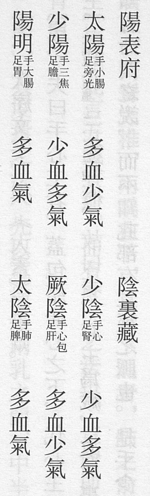

- 陽表府
- 太陽｟手小腸足旁光｠　多血少氣
- 少陽｟手三焦足膽｠　少血多氣
- 陽明｟手大腸足胃｠　多血氣
- 陰裏藏
- 少陰｟手心足腎｠　少血多氣
- 厥陰｟手心包足肝｠　多血少氣
- 太陰｟手肺足脾｠　多血氣

**○足太陽與少陰爲表裏，少陽與厥陰爲表裏，足陽明與太陰爲表裏，是爲足陰陽也。手太陽與少陰爲表裏，少陽與心主爲表裏，陽明與太陰爲表裏，是爲手之陰陽也。**

족태양과 소음이 표리(表裏)가 되고, 소양과 궐음이 표리가 되며, 족양명과 태음이 표리가 되니, 이것이 족의 음양이다. 수태양과 소음이 표리가 되고, 소양과 심주(心主)가 표리가 되며, 양명과 태음이 표리가 되니, 이것이 수의 음양이다.

〔楊〕이제 수족 음양의 소재를 안다.

안(案): 이 여덟 자는 아마 양상선(楊上善)이 풀이한 주문(注文)인데, 왕빙(王冰)이 가져다 본문으로 삼은 것으로, 자서(自序)에서 말한 주서(朱書)의 글일 것이다. 기록하여 뒷날의 고찰을 기다린다.

『영추』 「구침론」에서 말하였다. “양명은 혈이 많고 기가 많으며, 태양은 혈이 많고 기가 적으며, 소양은 기가 많고 혈이 적으며, 태음은 혈이 많고 기가 적으며, 궐음은 혈이 많고 기가 적으며, 소음은 기가 많고 혈이 적다. 그러므로 양명을 자침하면 혈과 기를 빼고, 태양을 자침하면 혈을 빼고 기를 빼는 것은 꺼리며, 소양을 자침하면 기를 빼고 혈을 빼는 것은 꺼리며, 태음을 자침하면 혈을 빼고 기를 빼는 것은 꺼리며, 궐음을 자침하면 혈을 빼고 기를 빼는 것은 꺼리며, 소음을 자침하면 기를 빼고 혈을 빼는 것은 꺼린다. 족양명과 태음이 표리가 되고, 소양과 궐음이 표리가 되며, 태양과 소음이 표리가 되니, 이것이 족의 음양이다. 수양명과 태음이 표리가 되고, 소양과 심주가 표리가 되며, 태양과 소음이 표리가 되니, 이것이 수의 음양이다.”

안(案): 차례와 글자가 『대소』와 꼭 합치한다.

〔馬〕수심주(手心主)라고 한 것은 포락(包絡)이 심 아래에 있어 심주를 대신해 일을 행하기 때문이다. 심은 사기를 받지 않으므로 병을 치료하는 자도 수심주를 치료하니, 그래서 심주라고 일컫는다.｟대의는 『영추』 「사객편(邪客篇)」에 보인다｠ 삼초는 부이므로 표라 하고, 심주는 장이므로 리라 하며, 그 맥은 함께 오른손 척부(尺部)에 나타난다. 안타깝다. 후세 사람들은 이를 알지 못하고 명문(命門)의 설만 알 뿐, 이 부위에 두 경의 맥이 있음을 모른다. 수소양과 심주가 표리가 된다는 것은 이와 같다.

〔馬〕살펴보건대 『영추』 「경맥편(經脈篇)」은 십이경 경맥의 운행을 말하면서, 폐경은 폐에 속하고 대장에 낙한다 하고, 대장경은 대장에 속하고 폐에 낙한다 하는 식이다. 본경은 속한다고 하고, 더불어 표리가 되는 경은 낙한다고 하니, 서로 의지함이 이와 같으므로 표리가 되는 것이 당연하다.

（眉）안(案): 삼음삼양의 표리라고 한 것은 모두 사지 십이경맥의 관도(管道)가 표리로 서로 반대된다는 것이다. 온몸에 모두 표리와 음양이 있어, 양경의 맥락은 양의 자리에 있고 음경의 맥락은 음의 자리에 있어 서로 반대되므로 음양표리라고 하지 않을 수 없다.

（眉）지금 외과의 회살술(劊殺術)과 금창(金創) 치료법 등에서는 동맥(動脈)을 만나면 혈이 뿜어 나와 세차게 치솟으므로 솜실로 맥의 입구를 묶는다. 낙맥(絡脈)을 만나면 혈이 그저 흘러나오므로 묶지 않고, 지혈 치료를 하지 않아도 크게 심해졌다가 멈춘다. 살펴보건대[案] 이른바 동맥은 곧 음경의 혈이 가는 길이고, 이른바 낙맥은 곧 양경의 혈이 돌아오는 길이다. 지금 세속에서 낙맥이라 일컫는 것은 잘못이다. 그래서 지금 외과의 기술자들은 양경맥을 베는 것을 크게 두려워하지 않고 베는 것을 예사로 여기며, 겨우 손가락으로 누르고 지혈 가루약을 붙이면 곧 멎으니, 이는 양경이 혈이 돌아오는 길이기 때문이다. 그러므로 대체로 양경의 혈이 흐르는 방향은 음경과 서로 반대이다.

**○今知手足陰陽所苦，**

이제 수족 음양이 있는 곳을 안다.

안(案): 『대소』에서 이 여덟 자는 주문(注文)으로 나누어 썼고, ‘苦’가 ‘在’로 되어 있다. 설명은 앞에 보인다.

**○凡治病，必先去其血，乃去其所苦，伺之所欲。然後寫有餘，補不足。**

병을 치료할 때는 모두 반드시 먼저 그 혈을 제거하고, 이어 그 괴로워하는 바를 제거하며, 그가 바라는 바를 살핀다. 그런 뒤에 남는 것을 사(寫)하고 부족한 것을 보(補)한다.

〔楊〕병을 치료하는 법은, 통증과 괴로움이 혈로 말미암은 경우 혈이 모인 곳을 먼저 자침하여 제거한다. 자침하여 혈을 제거한 뒤에는 그 사람의 마음이 바라는 바를 살펴 그 허실을 파악하고, 그런 뒤에 보사의 법을 행한다.

안(案): 마씨(馬氏)가 “간은 흩어지기를 바라고 심은 부드러워지기를 바란다.”라고 한 것 따위와, 오(吳)가 “풍·한·서·습·조·화 가운데 병자가 싫어하는 것도 있고 바라는 것도 있으니, 그 바라는 바를 살피면 병이 어느 경에 있는지 알 수 있다.”라고 한 것처럼, 여러 주석이 모두 이러하여 약을 복용하는 뜻으로 보았는데, 옳지 않다. 양주(楊注)를 따라 자법(刺法)으로 보아야 한다.

안(案): 병을 치료할 때는 어떤 병이든 실한 경우 반드시 먼저 혈이 있는 것을 제거하고, 혈을 취할 만한 증이 없는 경우에는 혈을 제거해서는 안 되며, 다만 소침(小鍼)으로 자침하여 그 괴로워하는 바의 기를 사하여 제거하니, 이것이 남는 것을 사하는 법이다. 또 그 사람이 바라는 바와 시원하게 통하는 곳을 살펴 자침하여 그 기를 보하니, 이것이 부족한 것을 보하는 법이다.

안(案): ‘其’와 ‘之’는 옛날에 통용하였으니, 『경전석사(經傳釋詞)』 권9에 자세하다. 『시(詩)』 「채록(采綠)」의 ‘之子於狩，言韔其弓，之子於釣，言綸之繩’은 ‘之’와 ‘其’가 서로 통용된 것으로, 문세가 이곳과 한 줄기이다.

**○欲知背俞，先度其兩乳間，中折之，更以他草度，去半已，即以兩隅相拄也。乃舉以度其背，令其一隅居上，齊脊大椎，兩隅在下，當其下隅者，肺之俞也。**

배수(背俞)를 알려면 먼저 양 젖 사이를 재어 가운데에서 접고, 다시 다른 풀로 재어 절반을 버린 뒤, 두 모서리를 서로 버티게 한다. 이를 들어 등을 재되, 한 모서리는 위에 두어 척추의 대추(大椎)에 맞추고 두 모서리는 아래에 두면, 그 아래 모서리에 닿는 곳이 폐수(肺俞)이다.

〔馬〕이는 오장에 수혈이 있고 그것을 재는 법이 있음을 말한 것이다. 배수는 곧 아래 글의 오장수(五藏俞)로, 족태양방광경에 속하며, 등에 있으므로 통틀어 배수라고 이름하였다.

〔張〕그 재는 법은, 먼저 풀로 양 젖 사이를 가로로 재어 가운데를 반으로 접고, 또 따로 풀 하나를 앞의 풀에 견주어 그 절반을 버려 접은 길이에 맞춘다. 이어 긴 풀을 세우고 짧은 풀을 그 아래에 가로로 놓아 양 끝을 서로 버티게 하면 △ 세 모서리 모양이 된다. 이 풀을 들어 등을 재되, 한 모서리를 위에 두어 척추 가운데의 대추에 맞추면, 아래의 두 모서리가 세 번째 추골 사이에 닿으니 곧 폐수혈이다.

안(案): 왕주(王注)의 ‘四分去一’ 설은 본문과 같지 않은데, 등의 제2행으로 만들려 하였기 때문에 이런 설이 있게 된 것이다. 실제로는 제3행이다.

안(案): 척추의 대추에 맞춘다는 것은 대추골 머리에 맞춘다는 말이지, 뼈 아래를 말한 것이 아니다. ‘拄’는 『대소』에 ‘柱’로 되어 있는데, 정자(正字)이니 따를 만하다. 이 편의 『음석(音釋)』에도 ‘柱’로 되어 있어 ‘木’을 따르며, 지유절(知庾切)이라 하였다. 『광운(廣韻)』 상성(上聲) 8 어(語)｟（‘九麌’로 써야 한다）｠에 “‘拄’는 옆에서 가리키는 것이다. 지유절.”이라 하였다. 이는 ‘支拄’의 글자인데, 실은 ‘柱楹’의 글자가 전하여 지탱한다는 뜻이 된 것이므로 따로 ‘拄’로 써서는 안 되니, ‘拄’는 ‘柱’의 속자(俗字)이다.

‘俞’·‘輸’ 자의 설명은 「생기통천(生氣通天)」 제3에 보인다.

‘隅’는 『대소』에 ‘禺’로 되어 있으니, 역시 고자(古字)이다. ‘禺’ 자에는 염우(廉禺)의 뜻이 있으니, ‘日在巳曰禺中’이 그것이다. 『설문』에 “‘隅’는 ‘陬’이다.”라 하였고, 일설에 ‘廉’이라 하였다. ‘隅’는 곧 염우(廉禺)의 ‘禺’의 속자이다.

**○復下一度，心之俞也。復下一度，左角肝之俞也，右角脾之俞也。復下一度，腎之俞也。是謂五藏之俞，灸刺之度也。**

다시 한 번 내려 재면 심수(心俞)이다. 다시 한 번 내려 재면 오른쪽 모서리가 간수(肝俞)이고 왼쪽 모서리가 비수(脾俞)이다. 다시 한 번 내려 재면 신수(腎俞)이다. 이것을 오장의 수혈이라 하며, 뜸과 자침의 법도이다.

〔楊〕이상은 등의 수혈을 재는 법을 말한 것이다. 경이 같지 않은 것은, 사람의 7척 5촌의 몸이 비록 작지만 천지를 본받아 경을 빠짐없이 다 갖추고 있기 때문이다. 그러므로 천지의 조화는 수가 끝이 없으니, 사람의 수혈의 구분이 어찌 같을 수 있겠는가. 옛날 신농씨(神農氏)가 천지 사이의 금석초목 365종을 기록하여 365일을 본받아 당시의 쓰임을 구제하였는데, 기록되지 않은 것 가운데 혹 아는 이가 있어 쓰기도 하고 아는 이가 없기도 한 것이 대개 또한 많았다. 다음으로 황제(黃帝)가 사람 몸의 365혈을 취한 것도 365일을 본받은 것이다. 몸 위에서 분촌이 옮겨지고 좌우가 달라도 병을 낫게 하는 수혈이 실로 적지 않다. 편작(扁鵲)의 『구경(灸經)』 같은 것은 혈을 취하는 곳과 이름이 크게 다르다. 근대 진승조(秦承祖)의 『명당(明堂)』, 조자씨(曹子氏)의 『구경』 등은 이어받은 별본이 달라 자리와 이름이 모두 다르지만, 병을 없애는 것이 또한 적지 않으니, 지혜로 헤아려 병에 맞게 써야 하며 모두 그르다고 할 수 없다. 함께 그르다고 하는 것은 큰 방도의 논의를 모르는 것이다. 그러니 이 재는 법에서 성인의 가르침이 다른 것은 이상하게 여길 것이 없다.

안(案): 이 오장 수혈의 법은 아마 예로부터 내려온 한 갈래 별전(別傳)의 법이어서 『영추』 「배수편(背俞篇)」에서 말한 ‘五藏俞’와 합치하지 않는 것이며, 예로부터 주석가들은 왕씨(王氏) 이래 등의 제2행으로 보았으나 옳지 않다. 여기서 말한 오장수는 곧 등의 제3행이다. 폐수는 백호(魄戶), 심수는 신당(神堂), 간·비 두 수는 격관(膈關), 신수는 혼문(魂門)이다. 이제 양 젖 사이를 재어 본문대로 취해 보면 두 모서리가 바로 제3행에 닿는다. 그 그림은 아래와 같다.

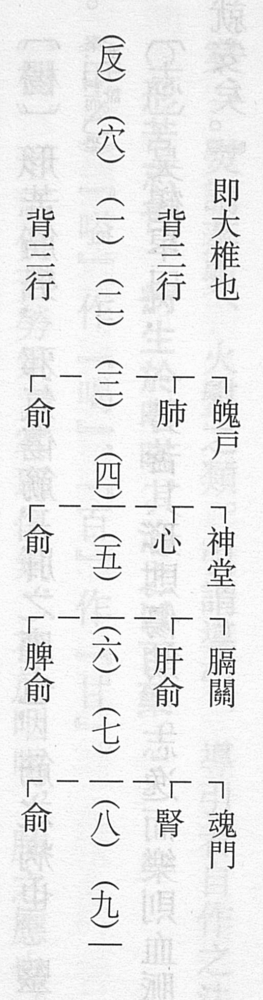

- 即大椎也
- 魄戶
- 神堂
- 膈關
- 魂門
- 背三行
- 肺
- 心
- 肝俞
- 腎
- （反）（穴）（一）（二）（三）（四）（五）（六）（七）（八）（九）
- 背三行
- 俞
- 俞
- 脾俞
- 俞

안(案): 오른쪽이 간이고 왼쪽이 비라는 것은 『대소』를 따라야 하니, 곧 의사가 재는 좌우가 곧 병자의 좌우이다. 지금 본 『소문』은 서로 잘못되었다.｟（『대소』에는 ‘左’가 ‘右’로, ‘右’가 ‘左’로 되어 있다）｠

**[역1]** 원서대로 옮겼다. 『經籍籑詁』 권100에도 「楚辭大招隱無遠遙只注」로 되어 있으며, 이 책 앞 대목에서는 편명이 「大招」로 나온다.

**○形樂志苦，病生於脈，治之以灸刺。**

몸은 편하나 마음이 괴로우면[形樂志苦] 병이 맥(脈)에서 생기니, 구자(灸刺)로 치료한다.

（眉）이 아래는 『태소(太素)』 권19 「지형지소의(知形志所宜)」편이다.

〔楊〕‘形’은 몸의 모습이다. ‘志’는 마음의 뜻이다. 심은 맥을 주관하는데, 심이 수고로우면 사기(邪氣)가 맥을 상하니 심의 응함이다. 그러므로 구자로 맥의 병을 보사(補寫)한다.

〔張〕형락(形樂)은 몸에 수고로움이 없는 것이다. 지고(志苦)는 마음에 걱정이 많은 것이다. 심은 맥을 주관하니, 깊이 생각하고 지나치게 걱정하면 맥이 병든다. 맥이 병들면 경락을 치료해야 하므로 그 알맞음에 따라 뜸과 침을 써야 한다.

〔志〕군자는 마음을 수고롭게 하고 소인은 힘을 수고롭게 한다. 형락지고와 형락지락은 귀한 사람이다. 형고지락과 형고지고는 보통 사람이다. 『금궤요략(金匱要略)』에서 말하였다. “혈비(血痺)는 어디에서 얻는가? 스승이 말하였다. 존귀하고 영화로운 사람은 뼈가 약하고 살이 많은데, 몹시 곤하여｟『금궤』에는 ‘困’이 ‘因’으로 되어 있다. 지총이 함부로 고친 듯하다｠ 피로하고, 땀이 나고, 누워 있으면서 때때로 뒤척이다가 미풍을 받으면 곧 얻게 된다. 침으로 양기를 끌어내어 맥의 긴(緊)이 없어지게 하면 낫는다.” 형락하면 살이 많고, 살이 많으면 양기가 음에 오래 머문다. 양이 표에 없으면 사기가 곧바로 음을 상하고, 지고하면 신(神)이 상하며, 신이 상하면 혈맥이 허하여 사기가 들어가기 쉬우므로 병이 맥에서 생긴다. 뜸으로 머물러 꺼진 양을 열고, 침으로 혈맥의 비(痺)를 제거해야 한다.

안(案): 병이 맥에서 생긴다는 것은 혈비 따위이다. 양(楊)과 장(張)이 함께 심병으로 본 것은 따를 수 없다.

**○形樂志樂，病生於肉，治之以鍼石。**

몸이 편하고 마음도 즐거우면 병이 육(肉)에서 생기니, 침석(鍼石)으로 치료한다.

〔楊〕몸과 마음이 모두 편안하면 사기(耶氣)가 살에 머무니 비의 응함이다. 옹종(癰腫)이 많이 생기므로 碒침(碒鍼)과 석위(石熨)로 조절한다. 『산해경(山海經)』에서 말하였다. “고씨산(高氏山)은 그 위에 옥이 많고, 폄침(砭鍼)을 만들 수 있는 돌이 있어 옹종을 터뜨릴 수 있다.”[역1]

〔吳〕형락하면 근골의 수고로움이 없고, 지락하면 혈맥의 정체가 없으나, 다만 기름진 음식이 지나칠 뿐이다. 기름진 음식의 변화는 옹종을 낳을 수 있으므로 병이 육에서 생기고, 침석으로 치료하여 큰 고름을 터뜨려야 한다.

〔張〕형락한 이는 편안하고 지락한 이는 한가하여, 종일 배불리 먹고 몸을 쓰는 바가 없어 비를 많이 상한다. 비는 기육을 주관하므로 병이 여기에서 생긴다. 육의 병은 위기(衛氣)가 머물기도 하고 고름과 피가 모이기도 하므로 침석으로 취해야 한다. ‘石’은 폄석(砭石)이다.

안(案): 침과 석은 각각 다른 물건이니, 피침(鈹鍼)과 폄석을 말한다. 『병원(病源)』에서 늘 『양생방(養生方)』을 인용하여 “그 탕위(湯熨)와 침석은 따로 바른 처방이 있고, 보양하고 선도(宣導)하는 법을 이제 뒤에 붙인다.”라고 한 것은 여기서 말한 침석과 같다. 마주(馬注)에서 “돌로 침을 만들어 찔러야 한다.”라고 한 것은 옳지 않다. 침석은 제10에 보인다. 폄석은 제12에 보인다. 병이 육에서 생긴다는 것은 옹종 따위를 말한다.

（眉）원문(袁文)의 『옹유한평(甕牖閒評)』에서 말하였다. “내가 일찍이 사람들에게 약석(藥石)의 뜻을 물으니 답이 대부분 같지 않았다. 약은 본래 의심할 것이 없고, 석은 곧 폄석이다. 옛날 왕승유(王僧孺)가 고사를 많이 알았는데, 시랑 김윤초(金允超)가 틈이 나서 폄석을 물으니, 옛날에는 돌로 침을 만들었고 처음에는 쇠를 쓰지 않았다고 답하였다. 이로써 폄석으로 병을 찌를 수 있음을 알 수 있다. 사람이 병이 나면 약을 쓰기도 하고 폄석을 쓰기도 하니, 이것이 약석이라 하는 까닭이다.”

（眉）『설원(説苑)』 「건본편(建本篇)」: “금석을 날카롭게 하고 초약을 섞어 병을 공격한다.”

**○形苦志樂，病生於筋，治之以熨引。**

몸은 괴로우나 마음이 즐거우면 병이 근(筋)에서 생기니, 위인(熨引)으로 치료한다.

〔楊〕몸이 괴로우면 근이 수고롭고 사기가 근을 상하니 간의 응함이며, 근의 병이다. 毉하고 당기므로[毉而急] 위인으로 그 근의 병을 조절한다. 약포로 찜질하여 조화되게 한다.｟［案］‘而’는 ‘耎’의 잘못인 듯하다.｠[역2]

〔志〕오학고(吳鶴皐)가 말하였다. “그 몸을 수고롭게 하면 근이 상하고, 마음이 편안하고 즐거우면 혈맥은 병을 받은 적이 없다. 그러므로 위락(熨烙)과 도인(導引)으로 치료하여 혈맥이 근을 영양하게 하면 곧 편안해진다.”

안(案): 위(熨)는 증위(蒸熨)·화위(火熨) 따위를 말한다. 인(引)은 도인을 말하니, 도인은 스스로 행하는 법이다.

**○形苦志苦，病生於咽嗌，治之以百藥。**

몸이 괴롭고 마음도 괴로우면 목이 메고 막히는 병[咽嗌]이 생기니, 온갖 약[百藥]으로 치료한다.

『갑을(甲乙)』에는 ‘嗌’이 ‘喝’로, ‘百’이 ‘甘’으로 되어 있다.

〔楊〕몸과 마음이 모두 괴로워 기를 수고롭게 하면, 객사(客耶)가 기를 상하여 ‘咽喝’에 있으니 폐의 응함이다. ‘喝’은 폐의 헐떡이는 소리이며, ‘渴’로 된 본도 있다. 그러므로 탕액(湯液)과 환산(丸散)의 약으로 치료한다.

〔張〕형고지고하면 반드시 근심과 생각이 많다. 근심하면 폐가 상하고 생각하면 비가 상하며, 비폐의 기가 상하면 허하여 행하지 못하니 기가 반드시 정체된다. 비폐의 맥은 위로 인익(咽嗌)을 따르므로 병이 인익에서 생긴다. 사람이 지나치게 슬퍼하고 근심하면 목이 메어 음식을 넘기기 어렵고, 지나치게 생각하면 상초가 막혀 목 안이 씨가 걸린 듯 막히는 것이 그 징험이다. 「통평허실론(通評虛實論)」에서 “막히면 닫혀 끊어져 위아래가 통하지 않으니, 갑작스러운 근심의 병이다.”라고 한 것도 이것을 말한다.

안(案): ‘咽’은 인후의 뜻이 아니라 ‘噎’의 혹자(或字)이다. 『광운(廣韻)』 16 설(屑)에 “‘噎’은 음식이 막히는 것이다. ‘咽’으로도 쓴다. 오결절(烏結切).”이라 하였고, “‘咽’은 경열(哽咽)이다.”로 음이 같으니 증거로 삼을 수 있다. ‘嗌’은 ‘喝’과 같은 글자로, 목이 막혀 소리가 깨진다는 뜻이며, 인익｟목구멍 안｠의 글자와 상관이 없다. 『방언(方言)』 권6에 “‘廝’·‘嗌’은 ‘噎’이다. 초(楚)에서는 ‘廝’라 하고, 진(秦)·진(晉)에서는 ‘嗌’이라 하기도 하고 또 ‘噎’이라 하기도 한다.”라고 하였고, 곽주(郭注)에 “‘嗌’은 오개반(惡介反)이다. 모두 목구멍의 통증을 말한다. ‘噎’은 음이 ‘翳’이다.”라고 하였다. 『옥편(玉篇)』에 “‘喝’은 을개절(乙芥切)이다. 쉰 소리이다. ‘磕’도 위와 같다. ‘磕’은 ‘噎’이다.”라고 하였다. 『광운』에서 ‘喝’의 음은 어犗절(於犗切)로, 17 쾌(夬)에 수록되어 있다. 이에 따르면 『대소(大素)』와 지금 본 『갑을』의 ‘咽喝’이 옳다. ‘喝’은 곧 ‘嗌’의 정자(正字)이다. 『설문(説文)』의 “‘喝’은 ‘㵐’이다.”는 인후와 가슴 사이가 건조하고 막혀 소리가 쉰다는 뜻이다. 「경맥편(經脈篇)」의 ‘喘渴’ 자가 『갑을』에는 ‘喘喝’로 되어 있는데, ‘渴’은 고자(古字)이니, 『설문』 ‘㵐也’의 ‘㵐’ 자가 곧 이것이다. 『신교정(新校正)』이 인용한 『갑을』에는 ‘困竭’로 되어 있고 지금 본 『갑을』의 주도 같은데, 모두 오자이다. 대개 몸과 마음이 모두 괴로운 사람은 진액이 반드시 모자라고 혈기가 반드시 껄끄럽게 막히므로 인격(咽膈)이 원활하지 못한 여러 증이 일어나니, 이는 구자와 위인으로 치료할 수 있는 것이 아니며, 그래서 온갖 약을 쓴다. 백약은 복용할 수 있는 약물 곧 옥석·초목·충수를 모두 통틀어 일컫는 말이다. 『대소』에는 ‘百’ 자가 없고 ‘藥’으로만 되어 있으며, 양주(楊注)에서 탕액·환산의 약으로 본 것은 따를 만하다. 다만 『영추(靈樞)』 「구침론(九鍼論)」에는 ‘甘’·‘藥’으로 되어 있는데, ‘甘’도 ‘百’의 와자(訛字)이다. 옛날 ‘甘’·‘白’ 두 글자는 흔히 통용되었으니, ‘甘瓜’를 ‘白瓜’로 쓰고, ‘甘草’와 ‘白藥’을 잘못 쓴 것 따위가 그것이다. 현응(玄應)의 『음의(音義)』 권2 『대반열반경(大般涅槃經)』 1권 아래에서 “‘哽噎’은 경문에 흔히 ‘咽’으로 썼는데, ‘咽’은 바른 자체(字體)가 아니다.”라고 하였다. 『본초(本草)』 백자(白字)에 ‘螻蛄，下哽噎’이라 하였는데, 『어람(御覽)』 948에 인용한 데는 ‘下哽咽’로 되어 있다. 「지진요론(至真要論)」의 “궐음이 승하면 격인(鬲咽)이 통하지 않는다.”에 왕주(王注)는 “격인은 음식이 들어갔다가 다시 나오는 것을 말한다.”라고 하였다. 『외대(外臺)』 권6 「애초방칠수(噫醋方七首)」편에서 인용한 『연년(延年)』에 ‘醋咽’ 자가 두 번 보인다.[역3]

『영추』 「사기장부병형편(邪氣藏府病形篇)」에서 “여러 소맥(小脈)은 음양과 형기가 모두 부족한 것이니, 침을 쓰지 말고 감약(甘藥)으로 조절한다.”라고 하였고, 또 「종시편(終始篇)」에서 “소기(少氣)는 맥구와 인영이 모두 약하고 척촌에 걸맞지 않은 것이다. 이런 경우는 음양이 모두 부족하여, 양을 보하면 음이 고갈되고 음을 사하면 양이 탈한다. 이런 경우는 감약으로 다스릴 수 있고, 지제(至劑)를 마시게 해서는 안 된다. 이런 경우는 뜸을 뜨지 않는다. 낫지 않는다고 사하면 오장의 기가 무너진다.”라고 하였는데, 모두 기혈이 부족한 병자이다. 기혈이 부족한 이는 침뜸이 맞지 않다. 오직 달고 평하며 독이 없는 약으로 비폐 두 기를 보하면 기혈의 부족이 절로 회복되어 넉넉해진다. 이 상품·중품 두 약은 명(命)과 성(性)을 기르고 기를 더하며 허를 보하는 약제로, 곧 이른바 감약이다. 「오상정대론(五常政大論)」에서 말한 “독이 없는 것으로 병을 치료하면 열에 아홉을 없앤다.”가 이것이며, 여기의 본문과는 본래 다르다.

（眉）진본(真本) 『명당(明堂)』 소상(少商) 주치에 ‘喉中硍硍’이라 하였고, 주에 “‘硍’은 하간반(下墾反)이다. 목구멍 안의 기가 막히는 것을 말한다.”라고 하였다. 곁에 기록하기를, “『절운(切韻)』: 강흔반(康很反). 『옥편』: 고흔반(枯很反).”이라 하였다.

（眉）안(案): ‘硍’과 ‘喝’은 소리가 매우 가깝다.

（眉）『의심방(醫心方)』 권29 「합식금(合食禁)」 제11에서 인용한 『양생요집(養生要集)』의 ‘嘶咽’에, 또 주를 인용하여 “‘嘶’는 소리가 깨진 것이다. ‘咽’은 기가 막혀 목이 메는 것이다.”라고 하였다. 『설문』에 “‘嗢’은 ‘咽’이다.”라 하였다. 『영』 「사기장부병형」에 “위병은 격인이 통하지 않는다.”라고 하였다.

**○形數驚恐，經絡不通，病生於不仁，治之以按摩醪藥。**

몸을 자주 수고롭게 하고[形數] 놀라고 두려워하면 경락이 통하지 않아 병이 불인(不仁)에서 생기니, 안마(按摩)와 요약(醪藥)으로 치료한다.

『갑을』에는 ‘藥’이 ‘醴’로 되어 있다.

〔楊〕경공(驚恐)은 신이 주관하니, 몸에 놀람과 두려움이 많으면 사기가 근맥에 머물러 근맥이 통하지 않으니 신의 응함이다. 병이 근맥과 피부 사이에서 생겨 비(痺)와 불인이 되므로 안마와 요례(醪醴)를 쓴다.

안(案): 형삭(形數)은 형고(形苦)와 본래 다르니, 노동이 잦은 것을 말한다. 「사기장부병형편」에서 말한 “힘을 써서 무거운 것을 들거나 방사가 지나치고, 땀이 난 채 물에 씻으면 신이 상한다.”｟『영』 「백병시생(百病始生)」도 같다｠가 이것이다. 어떤 이는, 형삭은 오로지 방사의 지나침을 말하며, ‘數’는 곧 ‘作’의 가차(假借)라고 한다. 「영란비전(靈蘭祕典)」에서 말한 “신은 작강(作強)의 관(官)이다.”, 「상고천진(上古天真)」에서 말한 “동작이 쇠하지 않고, 함부로 수고롭게 하지 않는다.”의 이런 ‘作’ 자는 모두 같은 뜻으로 방사를 가리킨다는 것이다. 이 설도 통한다. 경공 역시 지고(志苦)와 본래 다르니, 심지가 놀라고 두려운 것을 말한다. ‘腎藏志’｟「선명오기(宣明五氣)」｠이므로 따로 ‘志’를 말하지 않았다.

안(案): 불인은 중풍의 완비(頑痺) 따위를 말한다. 지금 신허한 사람에게 이 병이 많이 생기는 것은 근맥이 통하지 않아 그렇게 된 것이다. 안마는 의사가 누르고 문질러 혈맥을 순환하게 하는 법을 말한다. 스스로 행하는 도인과는 본래 다르다. 요약은 약술을 말한다. 「옥판론요(玉版論要)」에서 말한 “그 색이 옅게 보이면 탕액으로 주치하여 10일이면 낫는다. 깊게 보이면 요주(醪酒)로 주치하여 100일이면 낫는다.”가 이것이다.

〔識〕［簡按］불인은 곧 『신농본경(神農本經)』의 ‘死肌’이다.

〔張〕요약은 약술이다.

〔箚〕『후한서(後漢書)』 「반초전(班超傳)」의 “머리털에 검은 것이 없고 두 손이 불인하다.”에 대한 주: “불인은 뜻대로 안 된다는 것과 같다.”

안(案): 불인의 풀이는 이미 「진요경종(診要經終)」 16에 보인다.

**○是謂五形志也。**

이것을 오형지(五形志)라 한다.

〔楊〕오형은 그 알맞은 것을 늘어놓아 말한 것이다.

〔馬〕［按］「소오과론(疏五過論)」에서 “병을 진단하려면 반드시 음식과 거처, 갑자기 즐겁거나 갑자기 괴로움, 처음에 즐겁다가 뒤에 괴로움 등의 뜻을 물어야 한다.”라고 하였는데, 이와 뜻이 같다.

『영추』 「구침론」: “형락지고는 병이 맥에서 생기니 구자로 치료한다. 형고지락은 병이 근에서 생기니 위인으로 치료한다. 형락지락은 병이 육에서 생기니 침석으로 치료한다. 형고지고는 병이 인익에서 생기니 감약으로 치료한다. 형삭경공(形數驚恐)은 근맥이 통하지 않아 병이 불인에서 생기니 안마와 요약으로 치료한다. 이것을 형(形)이라 한다.”

（眉）『갑을』 6 「역순병본말방의형지대론(逆順病本末方宜形志大論)」 제2.

〔志〕대인(大人)과 포의(布衣)에게 이 다섯 가지 형지가 있음을 말한다.

**○刺陽明，出血氣。**

양명(陽明)을 자침하면 혈과 기를 뺀다.

〔楊〕수양명대장맥과 족양명위맥이다. 두 맥은 위아래로 이어 흐르고 그 기가 가장 강하므로, 이 두 맥이 성하면 자침하여 혈기를 모두 사(寫)한다.

앞 글에서 “양명은 늘 기가 많고 혈이 많다.”라고 하였다.

**○刺太陽，出血惡氣。**

태양(太陽)을 자침하면 혈을 빼고, 기를 빼는 것은 꺼린다.

『대소』에는 ‘太’가 ‘大’로 되어 있다.

〔楊〕수대양소장맥과 족태양방광맥이다. 두 맥은 위아래로 이어 흐르고 진액이 가장 많으므로, 두 맥이 성하면 자침하여 혈을 사하고, 사기가 머물면 나쁜 기를 사하여 없앤다.

앞 글에서 “태양은 늘 혈이 많고 기가 적다.”라고 하였다.

**○刺少陽，出氣惡血。**

소양(少陽)을 자침하면 기를 빼고, 혈을 빼는 것은 꺼린다.

〔楊〕수소양삼초맥(手少陽三膲脈)과 족소양담맥이다. 두 맥은 위아래로 이어 흐르고 그것이 가장 많으므로｟［案］‘其’ 아래에 ‘氣’ 자가 빠진 듯하다.｠, 이 두 맥이 성하면 자침하여 기를 사한다. 사기가 머물면 나쁜 혈을 사하여 없앤다.

앞 글에서 “소양은 늘 혈이 적고 기가 많다.”라고 하였다.

**○刺太陰，出氣惡血。**

태음(太陰)을 자침하면 기를 빼고, 혈을 빼는 것은 꺼린다.

〔楊〕수태음폐맥과 족태음비맥이다. 이 두 태음은 두 양명과 표리가 되며, 그 혈기가 모두 성하므로 혈기를 함께 사한다.

앞 글에서 “태음은 늘 기가 많고 혈이 적다.”라고 하였다.｟（『대소』의 ‘氣少血’）｠ ‘血氣’로 되어 있다.

안(案): 이는 『대소』를 따라 바른 것으로 삼아야 하니, 설명은 앞 글에 보인다.

**○刺少陰，出氣惡血。**

소음(少陰)을 자침하면 기를 빼고, 혈을 빼는 것은 꺼린다.

〔楊〕수소음심맥과 족소음신맥이다. 두 대양과 표리가 되는데, 두 대양이 혈이 많고 기가 적으니 음양이 서로 반대되어 두 음은 기가 많고 혈이 적다. 그래서 두 소음이 성하면 기를 사한다. 사기가 머물면 나쁜 혈을 사하여 없앤다.

앞 글에서 “소음은 늘 혈이 적고 기가 많다.”라고 하였다.

**○刺厥陰，出血惡氣也。**

궐음(厥陰)을 자침하면 혈을 빼고, 기를 빼는 것은 꺼린다.

〔楊〕수궐음심포락맥(手厥陰心包胳脈)과 족궐음간맥이다. 두 소양과 표리가 되는데, 두 양은 기가 많고 혈이 적으니 음양이 서로 반대되어 두 음은 혈이 많고 기가 적다. 그래서 두 궐음이 성하면 혈을 사한다. 사기가 머물면 나쁜 기를 사하여 없앤다.

앞 글에서 “궐음은 늘 혈이 많고 기가 적다.”라고 하였다.

〔吳〕뺀다는 것은 그 천수(天數)가 많기 때문이다. 꺼린다는 것은 그 천수가 적기 때문이다.

〔張〕이는 삼음삼양의 혈기에 각각 많고 적음이 있어, 자침하는 이가 혈을 빼고 기를 뺄 때 그 요령을 알아야 함을 밝힌 것이다. 수족 양명은 혈이 많고 기가 많으므로 자침할 때 그 혈기를 뺀다. 수족 태양은 혈이 많고 기가 적으므로 자침할 때 혈만 뺄 수 있고 기를 빼는 것은 꺼린다. 종합하면 태양과 궐음은 모두 혈을 빼고 기를 빼는 것을 꺼리며, 소양·소음·태음은 모두 기를 빼고 혈을 빼는 것을 꺼리고, 오직 양명만 기와 혈을 모두 뺄 수 있으니, 첫 절의 뜻과 꼭 합치한다.

〔志〕이는 기혈의 일정한 수이자 침자의 일정한 법이다. 『침경(鍼經)』에서 말하였다. “영(榮)을 자침하면 혈을 빼고, 위(衛)를 자침하면 기를 뺀다.” ［按］『영추』 「경수편(經水篇)」에서 말하였다. “십이경의 혈이 많고 기가 적은 것, 혈이 적고 기가 많은 것, 혈기가 모두 많은 것, 혈기가 모두 적은 것에는 모두 큰 수가 있다. 침과 뜸으로 치료하여 각각 경기를 조절하는 것에는 진실로 일정하게 합치하는 바가 있다.” 족양명은 오장육부의 바다이다. 그 맥은 크고 혈이 많으며 기가 성하고 열이 왕성하니, 이를 자침할 때 깊지 않으면 흩어지지 않고 유침하지 않으면 사해지지 않는다. 족양명은 깊이 6푼에 10호(呼) 유침하고, 족태양은 깊이 5푼에 7호, 족소양은 깊이 4푼에 5호, 족태음은 깊이 3푼에 4호, 족소음은 깊이 2푼에 3호, 족궐음은 깊이 1푼에 2호 유침한다. 수의 음양은 기를 받는 길이 가깝고 기가 오는 것이 빠르니, 자침 깊이는 모두 2푼을 넘지 않고, 유침은 모두 1호를 넘지 않으며, 나이의 많고 적음과 체격의 크고 작음, 살찌고 마름은 마음으로 헤아린다. 이를 하늘의 일정함을 본받는다고 하며, 뜸도 그러하다. 뜸이 이를 넘으면 악화(惡火)를 얻어 뼈가 마르고 맥이 껄끄러워지며, 자침이 이를 넘으면 기가 탈한다.

안(案): 이에 따르면 “양명은 깊이 6푼, 태음은 깊이 3푼”이라는 말이 있으니, 마(馬)의 설을 따라 이 편에서 말한 ‘太陰多氣少血，太陰出氣惡血’을 바른 것으로 삼아야 한다. 그렇다면 태음비경은 오로지 기를 주관하므로 양명과 같지 않다. 『대소』와 『소문(素問)』의 두 설이 서로 다르지만 모두 이치가 있다. 그러므로 이제 두 설을 남겨 의문으로 둔다.

### 중광보주황제내경소문(重廣補注黃帝内經素問) 권제7

## 소문고주(素問攷注) 권제7

문구(文久) 신유년 8월 25일 화타항(華他巷) 속독실(速讀室) 동쪽 곁채에서 쓰다.　입지(立之)

제24 보유[第二十四補]

인애(咽喝)｟七ヲ｠

『산해경』 「중차칠경(中次七經)」에 “도산(堵山) 위에 나무가 있으니, 이름을 천편(天楄)이라 한다. 줄기가 네모지고 아욱 모양이며, 먹으면 목이 메지 않는다.”라고 하였고, 곽주에 “음식에 목이 메지 않는다.”라고 하였다.

『천금(千金)』 권16 「열색(噎塞)」 제6편에 ‘治哽咽方’ 운운하였다.

23[廿三]　애(噫)｟二ウ｠　해(欬)｟三ヲ｠　어(語)｟同｠　탄(呑)｟同ウ｠　흠(欠)｟同｠　체(嚏)｟同｠　얼(噦)｟四ヲ｠　융(癃)｟六ヲ｠　체(涕)｟十ヲ｠　누(淚)｟十ウ｠　타(唾)｟十一ウ｠　전질(巓疾)｟十六ウ｠　음(瘖)｟十七ウ｠　정신(精神)｟廿一ヲ｠　백(魄)｟廿一ウ｠

혼(魂)｟廿二ヲ｠　의(意)｟同ウ｠　지(志)｟廿三ヲ｠

24[廿四]　기지(其之)｟三ウ｠　주주(拄柱)｟四ウ｠　오장수(五藏俞)｟五ヲ｠　침석(鍼石)｟六ウ｠　인익(咽嗌)｟七ヲ｠　백약(百藥)｟同｠　불인(不仁)｟八ヲ｠　요약(醪藥)｟同｠

## 소문고주(素問攷注) 권제8

### 중광보주황제내경소문(重廣補注黃帝内經素問) 권제8

#### 보명전형론(寶命全形論) 제25

『태소』에 전부 남아 있다.

**○黃帝問曰：天覆地載，萬物悉備，莫貴於人。人以天地之氣生，四時之法成。**

황제(黃帝)가 물었다. “하늘이 덮고 땅이 실어 만물이 다 갖추어져 있으나, 사람보다 귀한 것이 없다. 사람은 천지의 기로 생기고 사시(四時)의 법으로 이루어진다.”

‘黃帝’부터 편 끝까지는 『대소』 19 「지침석(知鍼石)」에 실려 있다. ‘四’ 자 위에 ‘以’ 한 글자가 생략되었으니, 이 또한 고문의 한 체(體)이다.

안(案): 여기의 ‘生’·‘成’ 두 글자는 곧 오행 생성의 뜻이다. 사람은 천지의 기로 생기므로 오장이 있다. 오장이 사시의 법으로 이루어진다는 것은 사시의 기에 응하여 한 몸을 수양한다는 것이다. 「생기통천(生氣通天)」·「장기법시(藏氣法時)」·「사기조신(四氣調神)」에서 말하는 이치이다. 오행 생성은 『오행대의(五行大義)』 권1 제2론에 자세하다. 천지의 기는 음양 두 기를 말한다. 사시는 곧 오행을 말한다. 법은 사시의 기를 본받는 것을 말한다.

『오행대의』 권1 제2 「논오행급생성수(論五行及生成數)」에서 말하였다. “공자(孔子)가 말하였다. ‘옛날 내가 노담(老聃)에게 들으니, 하늘에 오행 목·금·수·화·토가 있고, 그 신을 오제(五帝)라 하며, 땅에서는 오방(五方)이 되고, 그 진산은 오악(五岳)이다. 『물리론(物理論)』에서 오악으로 진압한다고 하였다. 사람에게는 오장이 되고, 그 징후는 오관(五官)이다. 『황제소문(黃帝素問)』에서 오장의 징후는 오관에 있으니 눈·귀·입·코·혀라고 하였다. 오행은 번갈아 서로 떠받치고, 쉬고 왕성하며 상생하여 만물을 생성하고 운용을 쉬지 않으므로 행(行)이라 한다.’”

안(案): 이 글은 지금 본 『소문』에서 찾을 수 없으니, 아마 『소문』 옛 주의 글일 것이다. 『영추』 「오열오사편(五閱五使篇)」에서 “오관은 오장의 상태를 살피는 자리이다.”라 하고, 또 “오관으로 무엇을 살피는가? 기백(岐伯)이 말하였다. 오장을 살핀다.”라고 하였으니 함께 살펴볼 만하다. 주석가들이 ‘生’·‘成’ 두 글자를 범범한 말로 본 것은 옳지 않은 듯하다.

**○君王衆庶，盡欲全形。形之疾病，莫知其情。留淫日深，著於骨髓。心私慮之，余欲鍼除其疾病，爲之奈何。**

“군왕과 백성이 모두 몸을 온전히 하려 한다. 몸의 질병은 그 실정을 아는 이가 없다. 머물러 번지며 날로 깊어져 골수에 붙는다. 마음속으로 걱정하니, 내가 침으로 그 질병을 없애려 하는데 어떻게 해야 하는가?”

안(案): ‘情’은 병의 실정을 말한다. 「이법방의(異法方宜)」 제12에 자세하다.

〔楊〕천지 사이에 사람이 가장 귀하여 임금과 백성이 모두 몸을 소중히 여긴다. 그러나 병이 미약할 때를 알지 못해 골수에 머무르므로 치료 방법을 청한 것이다.

**○岐伯對曰：夫鹽之味鹹者，其氣令器津泄。**

기백이 답했다. “소금의 맛이 짠 것은 그 기운이 그릇에서 진액이 새어 나오게 한다.”

（眉）신수(腎水)

〔張〕소금 맛이 짠 것은 수(水)의 변화이다. 그 성질이 스며들어 물건을 뚫으므로, 그릇에 오래 두면 진액이 밖으로 새어 나와 그릇이 단단할 수 없다. 사람의 신기가 손상되면 이음(二陰)이 지켜지지 못함을 비유한 말이다.

**○絃絶者，其音嘶敗。**

“현이 끊어지려 하면 그 소리가 쉬어 깨진다.”

（眉）폐기(肺氣)

〔張〕거문고와 비파의 현이 끊어지려 하면 소리가 반드시 쉬어 깨진다. 사람의 폐기가 손상되면 목소리가 맑지 못함을 비유한 말이다. ‘嘶’는 음이 ‘西’이다. 깨진 소리를 ‘嘶’라 한다.

**○木敷者，其葉發。**

“나무가 속으로 썩으면[敷] 그 잎이 떨어진다[發].”

（眉）간혈(肝血)

〔張〕‘敷’는 안으로 썩는 것이다. ‘發’은 날려 떨어지는 것이다. 나무가 밖으로 드러나 썩는 것은 시들 조짐이다. 사람의 간·비가 이미 손상되면 안색이 시들고 살이 마름을 비유한 말이다. ［按］『대소』의 ‘木陳者，其葉落’이 뜻에 더욱 절실하다.

안(案): 『사기(史記)』 「편작전(扁鵲傳)」의 ‘破陰絶陽之色已廢’에 대해 서광(徐廣)은 “‘發’로 된 본도 있다.”라고 하였다.

**[역1]** 원서 인쇄는 碒(石+金)이다. 바로 뒤 『산해경』 인용에 ‘砭鍼’이 나오므로 문맥상 砭일 것이다.
**[역2]** 원서 인쇄는 毉이다. 문맥상 𤸷(근이 오그라드는 병)일 것이다.
**[역3]** 원서의 구두는 「非是」 뒤에서 끊겨 있으나, 뜻으로 보아 「非是灸刺熨引之所能治」로 이어 읽어 옮겼다.

**○病深者，其聲噦。**

병이 깊으면 그 소리가 딸꾹질[噦]이 된다.

（眉）비(脾)

안(案): 이상 세 구절은 비유로 신(腎)·폐(肺)·간(肝)의 증(證)을 보인 것이고, 이 한 구절에 이르러서야 비로소 ‘病深者’라 하였다. 대개 실제로 말한[實] 한 구절로 비유한[虛] 세 구절을 매듭짓는 문법이니, 앞 세 구절에도 모두 ‘病深’ 두 글자를 보태어 읽어야 한다.

〔張〕‘噦’은 애역(呃逆)이다. ［按］「구문편(口問篇)」에 “噦은 위(胃)에서 나온다”고 하였고, 또 “폐(肺)가 주관하여 噦을 일으킨다”고 하였다. 위는 오장(五藏)의 근본이고, 폐는 기를 주관하는 장이다. 이제 위 글의 세 증에 다시 소리의 噦까지 더해졌다면 폐가 이지러지고 위가 고갈된 것이니 병이 반드시 위태롭다. ‘噦’은 어결절(於決切)이다.

〔楊〕미세한 병을 알려면 반드시 그 징후를 알아야 한다는 말이다. 소금이 그릇 속에 있으면 진액이 밖으로 새어 나오니, 그 진액을 보고 소금이 짠맛을 간직하고 있음을 안다. 소리가 쉬면 금슬(琴瑟)의 줄이 끊어지려 함을 알고, 잎이 떨어지면 묵은 나무가 이미 좀먹었음을 안다. 이 세 사물이 쇠하여 무너지는 징후를 들어, 소리가 噦이 되면 병이 깊음을 아는 징후에 견준 것이다.

안(案): 이상 ‘其氣’·‘其音’·‘其葉’·‘其聲’의 네 증은 곧 네 장의 병이다. ‘其氣’ 운운은 신허(腎虛)로 소변과 대변을 지리는 징후이다. ‘其音嘶’는 폐허(肺虛)로 목소리가 깨지는 징후이니, 『금궤(金匱)』에서 “말소리가 웅얼거려 트이지 않는 것은 심격(心膈) 사이의 병이다”라고 한 것이 이것이다.（『대소(大素)』）‘其葉落’은 간허(肝虛)로 영양을 잃어 혈색이 없는 징후이다. ‘其聲噦’은 비허(脾虛)로 기가 거슬러 오르는 징후이다. 비는 오장의 근본이어서 오장에 허핍(虛乏)이 있으면 반드시 噦이 일어나니, 그래서 ‘病深者’라 한 것이다. 다만 심허(心虛)의 징후를 말하지 않은 것은, 대개 심이 허하여 이지러지면 곧 죽으므로 증후를 말할 겨를이 없기 때문이다. 장씨(張氏)의 설은 따를 만하다. 다만 ‘木敷’ 운운을 간(肝)·비(脾)의 병이라 하고 ‘病深者’를 위병(胃病)이라 한 것은 옳지 않다.

**○人有此三者，是謂壞府。**

사람에게 이 네[三] 가지가 있으면 이를 괴부(壞府)라 한다.

안(案): ‘三’ 자는 아마 ‘四’의 잘못일 것이다. 주문(籀文)에서는 ‘四’를 ‘亖’로 쓰므로, 예서로 변하면서 ‘三’과 ‘亖’ 두 글자가 잘못 뒤바뀐 경우가 많아 일일이 들 겨를이 없다. 『의례(儀禮)』 「근례(覲禮)」의 ‘四享’ 주에 “‘四’는 ‘三’이어야 한다. 옛 글에서 ‘三’·‘四’를 쓸 때 더러 모두 획을 쌓았는데, 이 편에도 ‘四’ 자가 많고 글자가 서로 비슷하여 이 때문에 잘못되었다”고 하였다. 또 「빙례(聘禮)」 주의 ‘朝貢禮純四只’에 대해 『정지(鄭志)』에서 조상(趙商)의 물음에 답하기를 “‘四’는 ‘三’이어야 한다”고 하였다. 또 『주례(周禮)』 「내재직(内宰職)」 주의 ‘天子巡守，禮制幣丈八尺純四咫’에 대해서도 『정지(鄭志)』에서 조상의 물음에 답하기를 “‘四’는 ‘三’이어야 한다”고 하였다. 또 『좌전(左傳)』의 ‘是四國者，專足畏也’에 대해 유현(劉炫)은 “‘四’는 ‘三’이어야 한다”고 하였다. 모두 옛 글자가 획을 쌓은 꼴이기 때문이다. 『대대례(大戴禮)』 「공관편(公冠篇)」의 ‘公冠四加玄冕’ 주에 “‘四’는 ‘三’이어야 하니 글자의 잘못이다”라고 하였다. 『곡량(穀梁)』 정공(定公) 15년 전(傳)의 ‘滕子來會葬’ 소(疏)에 “‘四’는 ‘三’이어야 한다. 옛날에는 ‘四’와 ‘三’을 모두 획을 쌓아 썼으므로 글자가 잘못되었을 뿐이다”라고 하였다. 황국(皇國)에 전래된 홍안(弘安) 2년 사본 『고문효경(古文孝經)』에는 ‘四海’·‘四國’의 글자가 모두 ‘亖’로 되어 있으니 증거로 삼을 수 있다. 이 ‘三’ 한 글자는 예로부터 읽기 어려운 곳이어서, 양상선(楊上善)·왕빙(王冰) 이후 여러 주석가가 모두 이를 두고 억지 설을 폈다. 이제 ‘三’을 ‘亖’ 자의 잘못으로 보면 글 뜻이 환해져 읽어 낼 수 있다. 「오장생성편(五藏生成篇)」의 ‘此三者血行’이 『대소(大素)』 권17 끝에는 ‘此五者血行’으로 되어 있는데, 양주(楊注)에 “‘三’은 있어도 ‘五’는 없으니, ‘五’는 글자가 잘못된 것이다”라고 하였다. 이것이 곧 ‘三’ 자가 잘못 전해진 증거이다. 양상선은 또 ‘四月爲胎’라 하였는데, 곧 ‘三月’의 잘못이다. 「기병론(奇病論)」 47 안에 보인다.｟十八ウ｠

안(案): ‘府’는 장부(藏府)를 두루 일컫는 말이다. 부(府)를 이미 장(藏)이라 일컬었으니 장도 부라 일컬을 수 있다. 이제 간·비·폐·신이 상한 것을 모두 괴부라 할 수 있다. 『만엽집(萬葉集)』에도 ‘亖シ’ 자를 많이 써서 ‘志’의 가자(假字)로 삼았다. 또 ‘二’를 겹치거나 ‘二’를 나란히 써서 모두 ‘志’로 새기니, 이 또한 옛날에 ‘四’ 자를 모두 ‘亖’로 썼다는 증거이다.

（眉）「오장생성편(五藏生成篇)」에 ‘小谿三百五十四名’이라 하였는데, 왕주(王注)에 “‘三百五十三名’이어야 한다. 행서로 전사하면서 ‘三’을 ‘四’로 잘못 쓴 것이다”라고 하였다.

**○毒藥無治，短鍼無取，此皆絶皮傷肉，血氣爭黑。**

독약(毒藥)으로도 다스릴 수 없고 단침(短鍼)으로도 취할 수 없으니, 이는 모두 피부를 끊고 살을 상하며 혈기(血氣)가 서로 다투어 어긋나기[血氣爭黑] 때문이다.

〔楊〕사람에게 세 비유와 같은 소리의 噦이 있으면 이를 부(府)가 무너진 징후라 한다. 부는 중부(中府)이니 오장을 말한다. 무너지면 소리가 歲｟［案］‘歲’는 곧 ‘噦’의 잘못이다.｠하다. 중부가 무너진 것은 병이 깊은 것이다. 그 병이 이미 깊으므로 침과 약으로 취할 수 없다. 피부·살·혈·기가 저마다 서로 맞지 않기 때문이다.

〔張〕중부가 이미 무너지면 독약으로 그 안을 다스릴 수 없고 단침으로 그 밖을 취할 수 없으니 병을 어찌할 수 없다. 그런데도 억지로 침과 약을 베풀면 피부를 끊고 살을 상하여 그 형체를 망치고, 혈기가 다투어 검어져 그 색을 변하게 할 뿐이다. 이는 모두 오래도록 미루어 일찍 치료하지 않았기 때문이니 구제할 길이 없다. 「관능편(官能篇)」에 “상공(上工)은 기를 취할 때 그 싹을 구하고, 하공(下工)은 이미 이루어진 것을 지키다가 그 형체를 망친다”고 한 것이 바로 이를 말한다.

안(案): ‘血氣爭黑’은 『대소(大素)』를 따라 ‘血氣爭異’로 써야 하니, 양주(楊注)에서 “혈과 기가 저마다 서로 맞지 않는다”고 한 것이 이것이다. 활씨(滑氏)가 “‘爭黑’은 ‘爭異’로 써야 한다”고 하였는데, 그 설이 『대소』와 우연히 들어맞으니 신기하지 않은가. 장주(張注)는 모두 옳으나, 다만 ‘爭黑’ 두 글자의 풀이만은 따르기 어렵다.

단침은 곧 소침(小鍼)이니 호침(毫鍼)을 말한다. 나머지 여덟 침에 견주어 짧고 작으므로 그렇게 이름한 것이다.

**○帝曰：余念其痛，心爲之亂惑反甚，其病不可更代，百姓聞之，以爲殘賊，爲之奈何。**

황제가 물었다. “나는 그 고통을 생각하면 마음이 어지럽고 미혹됨이 오히려 더 심해지는데, 그 병을 대신해 줄 수는 없다. 백성이 이를 들으면 참혹하게 해치는 일[殘賊]로 여길 것이니, 이들을 치료하려면 어찌해야 하는가?”

〔楊〕나는 미세한 병이 스며들어 머물러 깊은 데까지 이르는데, 뭇 백성이 알지 못하여 마침내[逐] 골수에 붙게 되는 것을 염려한다.｟［案］‘逐’은 곧 ‘遂’의 잘못이다.｠내가 그 마음을 아파함이 병보다 오히려 심하되 병을 없앨 수 없으므로 ‘대신해 줄 수 없다’고 한 것이다.

백성이 미세한 것이 쌓여 크게 되어 부를 무너뜨린다는 말을 들으면 모두 잔적이 깊다고 여길 것이니, 이들을 어떻게 다스려야 하는지 알고자 한 것이다.

안(案): ‘其痛’은 백성의 질병과 고통이 매우 많음을 말한다. 『대소(大素)』에 ‘痛’이 ‘病’으로 되어 있는데 뜻은 다르지 않다. ‘心爲之亂惑反甚’은 황제의 마음이 이 때문에 답답하고 어지럽고 미혹되어 날이 가고 달이 갈수록 오히려 심해진다는 말이다. ‘其病不可更代’는 황제의 마음으로는 백성의 병을 대신 앓으려 하지만 그 병을 끝내 대신할 수 없다는 말이다. 이는 황제가 백성의 병을 염려하는 마음이 이토록 간절함을 보인다. 그런데 백성이 이를 듣고 잔적으로 여기니, 아래 백성의 병을 치료하려면 어찌해야 하는가 한 것이다. ‘聞之’는 병이 깊어 치료할 수 없다는 말을 들음을 말한다. ‘爲’는 다스림[治]이니 의술로 치료함을 말한다. ‘更代’ 두 글자는 여러 주석이 풀이를 그르쳤으므로 이제 따르지 않는다.[역1]

**○岐伯曰：夫人生於地，懸命於天，天地合氣，命之曰人。**

기백이 답했다. “사람은 땅에서 태어나고 목숨은 하늘에 달려 있어, 천지(天地)의 기가 합한 것을 사람이라 이름한다.

〔張〕형체는 땅으로 이루어지므로 땅에서 태어나고, 목숨은 오직 하늘이 주므로 하늘에 달려 있다. 하늘은 양이고 땅은 음이다. 음의 정(精)과 양의 기가 합하여 사람을 이루므로, 사람은 그 가운데 자리하여 삼재(三才)의 하나가 된다.

안(案): 사람을 ‘人’이라 하는 것은, ‘人’이라는 말이 ‘神’이고 ‘真’이고 ‘任’이고 ‘兒’이기 때문이다. 대체로 천지 가운데 살아 있는 것으로 신기(神氣)가 있는 것을 ‘人’이라 하니, 그 뜻은 음에 있지 글자에 있지 않다. 나무 열매 속에 생기를 머금은 것도 ‘人’이라 하는데 같은 뜻이다.

『영(靈)』 「옥판편(玉版篇)」에 “사람은 천지의 진(鎭)이다”라고 하였다.

**○人能應四時者，天地爲之父母。**

사람이 사시(四時)에 응할 수 있으면 천지가 그의 부모가 된다.

〔楊〕하늘은 기를 주고 땅은 형체를 주니, 두 기가 합하여 사람이 된다. 그러므로 형체는 땅을 따라 주재되고 목숨은 하늘을 따라 주어진다. 이 때문에 사람이 사시에 응하면 천지를 부모로 삼는 것이다.

「음양별론(陰陽別論)」 제7에 “사경(四經)은 사시에 응하고, 십이종(十二從)은 열두 달에 응한다”고 하였다.

「음양응상대론(陰陽應象大論)」 제5에 “음양은 천지의 도이고, 만물의 강기(綱紀)이고, 변화의 부모이고, 생살(生殺)의 본시(本始)이고, 신명(神明)의 부(府)이다”라고 하였다.

「생기통천론(生氣通天論)」 제3에 “예로부터 하늘과 통하는 것이 생명의 근본이며, 이 근본은 음양에 있다. 천지 사이, 육합(六合) 안에서 그 기는 구주(九州)·구규(九竅)·오장·십이절(十二節)이 모두 천기와 통한다”고 하였다.

「사기조신편(四氣調神篇)」 제2에 “그러므로 음양과 사시는 만물의 처음과 끝이요 죽고 사는 근본이다. 이를 거스르면 재해가 생기고, 따르면 가혹한 병이 일어나지 않으니 이를 득도(得道)라 한다”고 하였다.

「상고천진론(上古天真論)」 제1에 “진인(真人)은 천지를 끌어안고 음양을 장악한다. 지인(至人)은 음양에 조화되고 사시에 맞춘다. 성인(聖人)은 천지의 조화로움에 머물고 팔풍(八風)의 이치를 따른다. 현인(賢人)은 음양을 거스르고 따르며 사시를 분별한다”고 하였다.

**○知萬物者，謂之天子。**

만물을 주관하는[知] 이를 천자(天子)라 한다.

〔楊〕천지가 귀하게 여기는 것은 사람이고, 사람이 귀의하는 것은 성인이다. 오직 성인만이 만물을 짊어지므로 천자라 부른다.

〔吳〕앎이 만물에 두루 미치면 천지에 참여하고 화육을 도울 수 있으니, 이것이 하늘의 아들이다.

〔馬〕천자는 바로 하늘이 아들로 삼은 이이다.

안(案): 천지를 부모로 삼으니 천자라 부를 수 있다.

（眉）안(案): ‘知’는 주관함[主]이다. ‘知事’·‘報知’의 ‘知’와 같다. 『대소(大素)』에는 ‘荷主’로 되어 있는데 그 뜻은 다르지 않다.

**○天有陰陽，人有十二節。**

하늘에는 음양(陰陽)이 있고, 사람에게는 십이절(十二節)이 있다.

『영(靈)』 「사객편(邪客篇)」에 “지지[辰]에 열둘이 있으니 사람에게는 열 손가락과 경수(莖垂)가 있어 이에 응한다. 하늘에 음양이 있으니 사람에게는 남편과 아내가 있다. 해에 열두 달이 있으니 사람에게는 십이절이 있다”고 하였다.

또 「통천편(通天篇)」에 “사람에게 음양이 있다 하니 무엇을 음인(陰人)이라 하고 무엇을 양인(陽人)이라 하는가?”라고 하였다. 또 「음양이십오인편(陰陽二十五人篇)」에 “내가 음양의 사람에 관해 들었다”고 하였다.

『영(靈)』 「경별편(經別篇)」에 “열두 달, 십이진(十二辰), 십이절, 십이경수(十二經水), 십이시(十二時), 십이경맥(十二經脈)에 합한다”고 하였다.

〔楊〕이는 천자가 아는 것에 모두 두 가지 합[二合]과 네 가지 능[四能]이 있음을 말한다. 하늘에는 십이시가 있어 음양으로 나뉜다. 자오(子午)의 왼쪽이 양이고 자오의 오른쪽이 음이다. 사람의 왼손 여섯 대절(大節)이 양이고 오른손 여섯 대절이 음이니, 이것이 첫째 합이다.

**○天有寒暑，人有虛實。**

하늘에는 한서(寒暑)가 있고, 사람에게는 허실(虛實)이 있다.

『영(靈)』 「사객편」에 “하늘에 겨울과 여름이 있으니 사람에게는 한열(寒熱)이 있다. 하늘에 낮과 밤이 있으니 사람에게는 눕고 일어남이 있다”고 하였다.

〔楊〕十二爻｟［案］‘爻’는 ‘月’의 잘못인 듯하다｠의 한서의 기는, 11월에 양기가 점차 빠르게 자라고 음기가 점차 줄어든다. 4월에 이르면 양기가 가득 차고 음기가 바로 허하다. 5월에 이르면 음기가 점차 자라고 양기가 점차 줄어든다. 10월에 이르면 음기가 가득 차고 양기가 바로 허하다. 음양이 곧 한서이고, 차고 빔이 곧 허실이다. 사람도 이와 같아서, 줄고 자라고 차고 비어 허도 있고 실도 있으니, 이것이 둘째 합이다.

**○能經天地陰陽之化者，不失四時。**

천지 음양의 변화를 다스릴[經] 수 있는 이는 사시를 잃지 않는다.

〔楊〕천지의 기가 합한 것을 사람이라 이름한다. 그러므로 천지 음양의 변화를 알 수 있으면 이치가 사시와 들어맞으니, 이것이 첫째 능이다.

안(案): 『대소(大素)』 방기(傍記)에 “‘經’은 다스림[治]이다”라고 하였는데 따를 만하다. 대개 천지 음양의 변화를 다스릴 수 있는 이는 이른바 “천지를 끌어안고 음양을 장악한다”는 이이다. 이런 사람이 어찌 사시의 응함을 잃겠는가.

（眉）일능(一能)

**○知十二節之理者，聖智不能欺也。**

십이절의 이치를 아는 이는 성스럽고 지혜로운 이라도 그 위에 더할[欺] 수 없다.

〔楊〕사람의 음양 십이절의 기가 십이시와 같음을 알고 이를 따라 움직여 어긋남이 없으면, 성스럽고 지혜로운 이라도 더할 수 없다. ‘欺’는 더함[加]이다. 이것이 둘째 능이다.

안(案): ‘欺’와 ‘加’는 글자의 음이 『운경(韻鏡)』에서 자리가 똑같으니, 대개 옛 음에서 통용하여 ‘欺’를 빌려 ‘加’로 쓴 것이다.

（眉）이능(二能)

**○能存八動之變，五勝更立。**

팔동(八動)의 변화를 살필[存] 수 있으면 오승(五勝)이 번갈아 일어나는 것도 안다.

（眉）삼능(三能)

〔楊〕팔동은 팔절(八節)의 기이다. 팔절의 기가 금·목·수·화·토 오행의 기와 합하여 번갈아 스러지고 번갈아 일어나니, 혈기도 그러하다. 이것이 셋째 능이다.

（眉）팔절은 사립(四立)·이분(二分)·이지(二至)이다.

〔識〕『한(漢)』 「율력지(律曆志)」에서 맹강(孟康)은 ‘五勝’을 주석하여 “오행이 서로 이기는 것이다”라고 하였다.

안(案): 『광운(廣韻)』에 “‘存’은 살핌[察]이다”라고 하였는데, 원래 『이아(爾雅)』 「석고(釋詁)」에서 나왔다. 「예운(禮運)」의 ‘處其所存’과 「대전(大傳)」의 ‘五曰存愛’에 대해 정주(鄭注)에서 모두 “‘存’은 살핌이다”라고 하였다.

**○能達虛實之數者，獨出獨入，呿吟，至微，秋毫在目。**

허실의 수(數)에 통달한 이는 남다르게 내쉬고 들이쉬어[獨出獨入·呿吟], 지극히 미세한[至微] 가을 터럭[秋毫]까지도 눈에 들어온다.

안(案): 앞 글의 두 구절과 이 세 구절은 길고 짧음이 고르지 않은데, 이 또한 고문의 한 체이며 ‘立’·‘目’ 두 글자가 압운한다.

〔楊〕한서의 기와 허실이 서로 옮겨 감에 통달한 이는 수명이 천지를 다하니, 홀로 사지(死地)에서 벗어나고 홀로 장생(長生)으로 들어간다. 그 말로는 지극히 참되고 미묘한 도를 입을 벌렸다 다물며 읊조리고, 그 지혜로는 가을 터럭 같은 깊고 세밀한 이치를 눈으로 살핀다. 이것이 넷째 능이다. ‘呿’는 음이 去이니, 곧 이를 드러내고 숨을 내쉬는 것이다.

안(案): ‘數’는 술수(術數)의 뜻이니 설명이 이미 제1 안에 보인다. ‘獨’은 남과 다름을 말한다. ‘出入’은 호흡을 말한다. ‘呿’는 내쉼이고 ‘吟’은 들이쉼이다. 한서·허실의 지극한 수를 통달해 알 수 있으면 호흡의 출입에 이지러진 틈이 없어 뭇사람과 같지 않다는 말이다. 이와 같으면 신기가 안에 가득 차고 사기가 들어오지 못하므로, 가을 터럭처럼 지극히 가늘고 미세한 것도 눈으로 살펴 알 수 있다. ‘吟’·‘目’은 구말이 운이 되고, ‘獨’·‘目’은 처음과 끝이 운이 된다. 뒷글의 ‘虛實呿吟’과 함께 보아야 한다.

〔識〕웅음(熊音)에 “‘呿’는 구가반(丘加反)이고 입을 벌리는 것이다”라고 하였다. ［簡按］『통아(通雅)』에 “‘吟’은 곧 ‘噤’이니 입을 다무는 것이다. 옛날에는 ‘吟’·‘唫’·‘噤’을 통용하였다”고 하였다. 『여람(呂覽)』 「중언편(重言篇)」의 ‘君呿而不唫’에 대해 고유(高誘)의 주에 “‘呿’는 벌림이고 ‘唫’은 다묾이다”라고 하였다. 『사(史)』 「회음후전(淮陰侯傳)」의 ‘雖有舜禹之智，吟而不言’에 대해 주에 “‘吟’은 거음반(巨蔭反)이고 음이 噤이다”라고 하였다.

제1에 “정기(精氣)를 호흡하고 홀로 서서 신(神)을 지킨다”고 하였다.

（眉）사능(四能)

**○帝曰：人生有形，不離陰陽。**

황제가 물었다. “사람이 태어나 형체를 가지면 음양을 떠나지 못한다.

〔楊〕만물은 음을 지고 양을 안으며 충기(冲氣)로 조화를 이루니, 만물이 다 그러하다. 세 기로 생겨나므로 사람의 형체는 음양을 떠나지 않는다.

**○天地合氣，別爲九野，分爲四時，月有小大，日有短長，萬物並至，不可勝量，虛實呿吟，敢問其方。**

천지의 기가 합하여 나뉘어 구야(九野)가 되고 갈라져 사시가 되며, 달에는 크고 작음이 있고 해에는 짧고 긺이 있으며, 만물이 함께 이르러 이루 헤아릴 수 없다. 허실과 호흡[呿吟]에 관해 그 방도를 감히 묻는다.”

〔楊〕도에서 하나가 생기니 이를 ‘朴’이라 한다. 하나가 나뉘어 둘이 되니 천지를 말한다. 둘에서 셋이 생기니 음양의 화기를 말한다. 셋에서 만물이 생겨 구야·사시·일월로 나뉘고 만물에 이르기까지, 하나하나의 사물은 모두 음양의 기가 이른 바이다. 그러므로 이르는 곳을 이루 헤아릴 수 없고, 헤아릴 수 없는 사물에 모두 허허실실의 말이 있으니, 그 도를 말해 주기를 청한 것이다. ‘方’은 도이다.

〔識〕［志云］호흡의 지극히 미묘함으로 그 허실을 안다. ［簡按］대개 만물이 함께 이르러 이루 헤아릴 수 없더라도, 요컨대 허실과 개폐의 이치에 지나지 않으므로 그 방도를 물은 것이다.

안(案): 앞 글의 네 능 가운데 마지막의 ‘能達虛實之數者’는 출입과 호흡을 지극히 중요한 이치로 삼는다. 그러므로 여기서 ‘虛實呿吟’ 네 글자를 뽑아 물음의 말을 열었고, 아래 글의 답하는 말이 곧 허실과 호흡의 지극한 이치이다. 구야는 제9 안에 자세히 보인다. 옛날에 ‘分’과 ‘別’ 두 글자는 같은 음이었고 다만 평성과 입성의 차이만 있었다. 그러므로 이 두 말을 만들면서 이 두 글자를 둔 것이다. 후세에 ‘分’과 ‘別’이 갈라져 저절로 두 뜻이 되었으니, 여기서 구야에 ‘別’이라 하고 사시에 ‘分’이라 한 것이 이것이다. 실제로는 ‘分’과 ‘別’은 음도 같고 뜻도 같다. 『설문(説文)』에 “‘分’은 ‘別’이다”라고 한 것으로 증명할 수 있다.

**○岐伯曰：木得金而伐，火得水而滅，土得木而達，金得火而缺，水得土而絶，萬物盡然，不可勝竭。**

기백이 답했다. “목(木)은 금(金)을 만나면 베이고, 화(火)는 수(水)를 만나면 꺼지고, 토(土)는 목을 만나면 뚫리고[達], 금은 화를 만나면 이지러지고, 수는 토를 만나면 끊어진다. 만물이 다 그러하여 이루 다 말할 수 없다.

〔楊〕음양이 서로 나뉘고 오행이 서로 극하면서 다시 서로 돕는다는 말이다. 금이 목을 극하고 수가 화를 극하고 토가 수를 극하는 것과 같으니, 처음에 토가 수를 극하면 수가 통하기 쉬워지고 나머지 사시(四時)도 모두 그러하다. 모두 극하는 바를 도움으로 삼으니 만물이 다 그러하다.

〔識〕［簡按］‘達’을 왕빙(王氷)은 통함으로 새겼으나, ‘伐’·‘滅’·‘缺’·‘絶’과 뜻이 어긋나는데도 여러 주가가 풀지 않았으니 의심스럽다.

『좌전(左傳)』 성공(成公) 10년에 “뜸으로 다스릴[攻] 수도 없고 침을 놓아도[達] 미치지 못하며 약도 이르지 못하니 어찌할 수 없다”고 하였는데, 두주(杜注)에 “‘達’은 침이다”라고 하였다.

안(案): 여기서 말한 것은 모두 오행상극의 이치로, 당연히 그러한 것이다. ‘伐’·‘滅’·‘缺’·‘絶’이라 하였으나 정말로 끊어 없앤다는 말은 아니다. 목이 금에게 베이면 목이 도리어 무성해지고, 화가 수에게 꺼지면 화가 도리어 자라며, 토가 목을 만나면 토가 도리어 갈라지지 않고, 금이 화를 만나면 금이 도리어 형체를 이루며, 수가 토를 만나면 수가 도리어 흐를 수 있다는 말이니, 모두 왕성한 것이 극을 받으면 도리어 항진하지 않아 알맞음을 얻는다는 뜻이다. 『대소(大素)』에는 ‘金’·‘水’ 두 구절이 없고 ‘滅’이 ‘減’으로, ‘木’이 ‘水’로 되어 있으나, 그 뜻을 찾아보면 『소문(素問)』과 다르지 않다. 양주(楊注)에서 “모두 극하는 바를 도움으로 삼는다”고 한 설은 따를 만하다. 우안(又案): ‘達’은 ‘伐’·‘滅’·‘缺’·‘絶’과 같은 뜻이다. 『주례(周禮)』 「소재(小宰)」의 ‘小事則專達’에 대해 『석문(釋文)』은 간주(干注)를 인용하여 “‘達’은 터뜨림[決]이다”라고 하였다. 『회남(淮南)』 「수무(脩務)」의 ‘蹠達膝’ 주에 “‘達’은 뚫음[穿]이다”라고 하였다. 이것이 그 뜻이다.

（眉）「자열편(刺熱篇)」 왕주(王注)에 “금은 목을 극하고, 수는 화를 없애고, 목은 토를 치고, 화는 금을 녹이고, 토는 수를 벌한다”고 하였으니, 이와 완전히 들어맞는다.

（眉）「육원정기론(六元正紀論)」 끝에 “목울(木鬱)은 통달시키고, 화울(火鬱)은 발산시키고, 토울(土鬱)은 빼앗고, 금울(金鬱)은 배설시키고, 수울(水鬱)은 꺾어서, 그 기를 고른다”고 하였다. 왕주가 매우 자세하여 참고할 만하니, 실로 오늘날 사기를 몰아내고 병을 없애는 다섯 가지 이치가 다 갖추어져 있다.

（眉）『천금익(千金翼)』 권30 「금구서(禁狗鼠)」 제19편에 “주문에 이르기를 ‘동방의 목은 꺾이고, 남방의 화는 꺼지고, 서방의 금은 이지러지고, 북방의 수는 마르고, 중앙의 토는 끊어진다’”고 하였다. 또 같은 권 「주동자령설귀성자(咒童子令説鬼姓字)」 제22편에 “부(符)는 동방의 목은 꺾이고, 남방의 화는 꺼지고, 서방의 금은 이지러지고, 북방의 수는 마르고, 중앙의 토는 갈라지는 것을 주관한다”고 하였다.

**○故鍼有懸布天下者五，**

그러므로 침에는 천하에 내걸어 펼 만한 것이 다섯 가지 있는데,

〔楊〕그러므로 침 등이 사람을 이롭게 하는 도에는 모두 다섯 가지 이로움이 있다.

〔張〕‘懸布天下’는 사람들에게 널리 보임을 말한다. 다섯 가지 뜻은 아래 글과 같다.

안(案): 침을 쓰는 지극한 도에 다섯 가지가 있으니, 내걸어 반포할 만한 것이다.

**○黔首共餘食，莫知之也。**

백성[黔首]은 모두 이를 먹고 마시듯 쓰면서도[共餘食] 알지 못한다.

안(案): 『신교정(新校正)』에 “『태소(太素)』에는 ‘飲食’으로 되어 있다”고 하였고, 지금 양주(楊注)도 ‘飲食’으로 되어 있으니, 정문(正文)의 ‘餘食’도 아마 ‘飲食’의 잘못일 것이다.

〔楊〕‘黔’은 검음이다. 거렴반(渠廉反)이다. 사람의 머리가 검으므로 검수(黔首)라 한다. ‘飲食’은 복용함이다. 백성이 이 도를 복용하면서도 그 뜻을 얻지 못한다.

『신교정(新校正)』에 인용된 글에는 ‘首’와 ‘服’ 사이에 ‘共’ 자가 있다.

〔吳〕검수는 머리털이 검은 백성이다. ‘餘食’은 비축한 음식이라는 말과 같다.

〔張〕검수는 백성이다. ‘共’은 모두이다. ‘餘食’은 먹다 버린 찌꺼기와 같으니, 모두 돌아보지 않는다는 뜻이다.

〔志〕‘共’은 ‘供’과 같다. 검수는 백성이다. ‘懸布天下’는 먼저 침경(鍼經)을 세워 사람들에게 보인다는 것인데, 백성은 그저 힘써 농사지어 조세를 바치고 남는 곡식으로 봉양할 수 있을 뿐, 침을 다루는 도에 대해서는 알지 못한다.

〔識〕양신(楊愼)의 『단연총록(丹鉛總録)』에 “이사(李斯)가 돌에 새겨 진(秦)을 칭송하면서 ‘검수가 편안하고 안정되었다’고 하였다. 태사공(太史公)이 이 말에 따라 마침내 「진기(秦紀)」에 진이 백성을 고쳐 검수라 하였다고 적었다. 주자(朱子)가 『맹자(孟子)』를 주석하면서 ‘주(周)에서 여민(黎民)이라 함은 진에서 검수라 함과 같다’고 한 것도 대개 태사공의 말에 따른 것이다. 그러나 「제의(祭義)」와 『내경(内經)』은 실로 진 이전에 나왔으니, 검수라는 호칭은 아마 진에서 시작된 것이 아닐 것이다”라고 하였다.

（眉）지표 위에 사는 백성으로 털과 머리칼이 검은 땅은 매우 적어, 대개 중국[夏] 주변의 여러 땅뿐이다. 그래서 중국 백성을 가리켜 검수라 일컬은 것이다. 천자는 위에 있으면서 하(夏)와 이(夷)를 평등하게 본다.

안(案): 의경(醫經)과 본초(本草)는 진나라의 분서를 겪지 않았으므로, 진나라 때의 속칭이 이따금 남아 있다. 우열(羽涅)·편복(蝙蝠)·책선(蚱蟬)·모려(牡厲) 같은 것이 모두 진나라 말을 전한 것이니, 이 검수도 진나라 말을 쓴 것으로 바로 같은 예이다. 이 경은 일찍이 진나라 사람의 손을 거쳤으므로 이런 호칭이 있는 것이니, 이 호칭이 진나라 이전에 이미 있었다고 할 수는 없다. 「제의석문(祭義釋文)」에 “‘黔’은 기렴반(其廉反)이고, 서(徐)는 또 기엄반(其嚴反)이라 한다. 검음이다. 검은 머리는 백성을 말한다. 진나라에서는 백성을 검수라 하였다”고 하였다.

**[역1]** 원서대로 옮겼다. 「日月日月」은 「日日月月」의 뜻일 수 있다.

**○一曰治神，**

첫째는 신(神)을 다스리는 것[治神]이고,

（眉）이 아래는 구절마다 글자 수가 차츰 많아지니 빼어난 글이다.

〔楊〕생명을 보존하는 도는 이 다섯 가지를 알아 섭양(攝養)으로 삼으면 장생할 수 있다는 것이다. 혼(魂)·신(神)·의(意)·백(魄)·지(志)는 신을 주로 삼으므로 모두 신이라 이름한다. 침을 놓으려는 이는 먼저 신을 다스려야 한다. 그러므로 사람에게 슬픔이 속을 움직이는 일이 없으면 혼이 상하지 않아 간에 병이 없고 가을에 탈이 없다. 두려움과 생각이 없으면 신이 상하지 않아 심에 병이 없고 겨울에 탈이 없다. 근심이 풀리지 않는 일이 없으면 의가 상하지 않아 비에 병이 없고 봄에 탈이 없다. 기쁨과 즐거움이 지나치지 않으면 백이 상하지 않아 폐에 병이 없고 여름에 탈이 없다. 성내는 일이 심하지 않으면 지가 상하지 않아 신(腎)에 병이 없고 늦여름에 탈이 없다. 이 때문에 다섯 가지 허물이 마음에서 일어나지 않으면 신이 맑고 성품이 밝으며, 오신(五神)이 저마다 제 장에 편안하면 수명이 길게 늘어난다. 이것이 침으로 펴는 치신의 뜻이니, 바로 공동(崆峒) 광성자(廣成子)의 도이다.

〔馬〕대개 사람에게 이 형체가 있으면 반드시 이 신이 있다. 내가 평소에 이 신을 미리 온전히 하여｟「상고천진론(上古天真論)」에 “정을 쌓아 신을 온전히 한다”고 하였다｠신기(神氣)가 이미 충만하게 한 뒤에야 침을 써서 사람을 치료할 수 있다.

〔張〕의사는 반드시 신으로써 해야 형체 없는 것을 보고, 병은 반드시 신으로써 해야 혈기가 돈다. 그러므로 침은 치신을 첫째 임무로 삼는다. 「탕액요례론(湯液醪醴論)」에 “형체가 해지고 혈이 다했는데도 공이 서지 않는 것은 신이 부려지지 않기 때문이다”라고 한 것이 바로 이를 말한다.

〔志〕신은 가을 터럭에 있고 뜻은 환자에게 모으며, 신을 모아 떠나지 않게 하면 병의 존망을 안다.｟［案］「구침십이원(九鍼十二原)」의 글이다｠

**○二曰知養身，**

둘째는 몸을 기를 줄 아는 것[知養身]이고,

〔楊〕음식과 남녀의 일은 한도로 절제하고, 풍한서습(風寒暑濕)은 때에 맞게 조섭한다. 선표(單豹)의 嚴穴의 해와 다르니 곧 안으로 몸을 기르는 일이다. 怒慈로 실하게 하여 남을 사랑하고 세속의 수고에 어울리되 자취를 남기지 않는다. 장의(張毅)의 고문(高門)의 상함과 다르니 곧 밖으로 몸을 기르는 일이다. 안팎의 기름이 두루 갖추어지면 삶을 구하지 않아도 오래 살고, 장수를 기약하지 않아도 수명이 길어진다. 이것이 침으로 펴는 양신의 극치이다.[역1]

『신교정(新校正)』에 인용된 글에는 ‘嚴穴’이 ‘外凋’로, ‘怒慈’가 ‘慈恕’로 되어 있고, 세 ‘養身’의 ‘身’ 자가 모두 ‘形’으로 되어 있다. 살펴보건대[案] ‘單豹外凋之害’와 ‘張毅高門之傷’은 모두 『장자(莊子)』 「달생편(達生篇)」에 보인다.

〔馬〕대개 사람에게 이 몸이 있으면 잘 기르지 않을 수 없다. 내가 평소에 자기 몸을 미리 길러 내 몸에서 병을 물리친 뒤에야 나로 미루어 남을 치료할 수 있다. 「음양응상대론(陰陽應象大論)」에 “나로써 남을 알면 써도 위태롭지 않다”고 하였다.

〔張〕몸을 기를 줄 모르면 침을 쓸모없는 자리에 두게 되니, 침을 쓰는 이는 알아야 한다. 「종시편(終始篇)」에서 “막 자침했으면 방사하지 말고, 자침한 뒤에는 취하지 말고, 자침한 뒤에는 성내지 말고, 자침한 뒤에는 피로하게 하지 말라. 자침한 뒤에는 배부르지 말고, 자침한 뒤에는 굶주리지 말고, 자침한 뒤에는 목마르지 말라”고 한 것들이 모두 이것이다. ［案］이 주가 말하는 것은 ‘以我知彼’이다.

〔志〕몸의 허로 하늘의 허를 만나면 두 허가 서로 감응하여 그 기가 뼈에 이른다. 들어가면 오장을 상한다. 그러므로 해의 차고 따뜻함, 달의 비고 참, 사시 기운의 뜨고 가라앉음을 알아서 몸을 조절해야 하니, 의공이 살펴 구하면 상하게 할 수 없다.｟이는 「팔정신명(八正神明)」 26의 말을 채용하여 주해로 삼은 것이다.｠

안(案): 치신은 정신이 안을 지킴을 말한다. 양신은 ‘병이 어디서 오겠는가’를 말한다. 대개 안으로 정기와 신기를 다스리면 늙지 않고 오래 살며, 밖으로 온몸과 사지를 기르면 사기가 침범하지 못한다는 말이다.

**○三曰知毒藥爲真，**

셋째는 독약(毒藥)으로 병을 치료하는 일의 참되고 묘함을 아는 것[知毒藥爲真]이고,

〔楊〕약에는 세 종류가 있으니, 상약(上藥)은 신을 기르고 중약(中藥)은 성(性)을 기르며 하약(下藥)은 병을 치료한다. 이것이 이 경의 종지이다. 신을 기르고 성을 기르는 일은 오직 두려워하는 생각과 기호와 욕심의 수고를 없앨 뿐이어서, 그 삶이 저절로 장수하니 침과 약에 기댈 필요가 없다. 병이 속에서 생기면 독약보다 나은 것이 없어 이를 참된 惡｟［案］‘惡’은 ‘要’의 잘못인 듯하다｠으로 삼으니, 그러므로 반드시 알아야 한다.

「시종용론(示從容論)」에 “독약이 알맞은 경우와 탕액의 자미(滋味)”라고 하였다. 또 “독약과 자구(刺灸)·폄석(砭石)·탕액을 투여해야 한다”고 하였다.

〔馬〕대개 독약은 병을 공격하는데 기미(氣味)가 저마다 알맞은 곳이 다르다. 내가 평소에 모두 참으로 알고 있어야 써도 그르치지 않는다.

〔張〕병을 치료하는 도는 침과 약에 저마다 알맞은 데가 있다. 약이 아니면 안 된다는 것을 참으로 알고도 함부로 침을 쓰면 반드시 도리어 해친다. 「사기장부병형편(邪氣藏府病形篇)」에 “작은 맥들은 음양과 형기가 모두 부족하니, 침으로 취하지 말고 감약(甘藥)으로 조리하라”고 하였고, 「근결편(根結篇)」에 “형기가 부족하고 병기가 부족하면 음양의 기가 모두 부족한 것이니 자침해서는 안 된다”고 하였다. 이것이 곧 「병전론(病傳論)」에서 말한 “하나를 지켜 잃지 않으면 만사가 다 이루어진다”는 뜻이다.

〔志〕독약은 사기를 공격하는 것이다. 아는 것이 참되지 않고 쓰는 것이 합당하지 않으면 도리어 정기를 상하게 한다. 그러므로 황제가 “나는 독약을 입지 않게 하고, 미침(微鍼)으로 경맥을 통하게 하고 혈기를 고르게 하려 한다”고 하였다. ［案］‘帝曰’ 운운은 「구침십이원」 안에 나온다.

안(案): 독약으로 병을 치료하는 일의 참되고 묘함을 알 수 있으면, 침을 놓는 손기술이 저절로 현묘한 경지에 이른다. 이는 침이 알맞거나 약이 알맞은 질병을 진찰하고 살펴 그 이치를 잃지 않는다는 말이다. 독약의 풀이는 이미 제12 안에 보인다.

〔紹〕『대소(大素)』에 ‘藥’ 자가 겹쳐 있는데 옳지 않다.

**○四曰制砭石小大，**

넷째는 폄석(砭石)의 크고 작음을 정하는 것[制砭石小大]이고,

〔楊〕동방은 바닷물에 가까워 그 곁 사람들이 소금과 물고기를 먹어 옹종(癰腫)을 많이 앓는다. 그러므로 폄석의 크고 작음을 정하여 옹을 터뜨리는 데 쓴다.

〔吳〕폄석의 크고 작음은 저마다 알맞은 데가 있으므로 헤아려 정한다.

안(案): 이 설은 ‘制’를 제정의 뜻으로 보고 제작의 뜻으로 보지 않았으니 따를 만하다.

〔馬〕대개 폄석으로 침을 삼아 병을 치료할 수 있다. 내가 평소에 이 침을 미리 만들어 크기를 알맞게 해 두면, 때에 이르러 쓸 것이 모자라는 일은 거의 없을 것이다.

〔張〕옛날에는 폄석으로 침을 삼아 외치(外治)의 법으로 썼다. 황제(黃帝)가 처음 구침(九鍼)을 만들어 돌을 대신하게 하였으므로, 구침이라 하지 않고 폄석이라 한 것이다. 그러나 크고 작게 만든 것은 반드시 병에 알맞도록 저마다 쓰임에 맞게 한 것이다.

〔志〕상고 시대에는 야금과 주조가 없어 폄석으로 침을 삼았고, 크고 작게 만들어 병에 맞추어 알맞은 것을 썼다. 황제가 처음 구침을 만들어 참석(鑱石)을 대신하게 하였다. 경에 “작게 하면 안이 없고 크게 하면 밖이 없다”고 하였다. 대개 밖을 치료할 때는 그 침을 작게 만들고, 안을 치료할 때는 크게 만든다.

안(案): 이 설은 따를 만하다. 다만 밖을 치료할 때는 큰 침을 쓰고 안을 치료할 때는 작은 침을 쓰는 것이 일반적인 논의이다. 여기서 말한 크고 작음은 폄석에 관한 것으로, 폄석에 저절로 크고 작게 만드는 법이 있다는 뜻이다.

안(案): 폄석의 크고 작음이란, 구침 가운데 호침(毫鍼)·원침(員鍼)·시침(鍉鍼)을 제외하고 참침(鑱鍼)·봉침(鋒鍼)·피침(鈹鍼)·원리침(員利鍼)·장침(長鍼)·대침(大鍼) 여섯 침에 저마다 크고 작음이 있는 것으로, 외치에 쓰는 것이다. 내치(内治)의 미침 같은 것은 침공(鍼工)의 전업이니, 앞 글에서 말한 치신과 양신은 모두 미침을 쓰는 요결이다. 폄석의 풀이는 이미 제12 안에 보인다.

『영(靈)』 「구침론(九鍼論)」 78에 “이것이 구침의 크기와 길이의 법이다”라고 하였다.

**○五曰知府藏血氣之診。**

다섯째는 부장(府藏)과 혈기(血氣)의 진찰을 아는 것[知府藏血氣之診]이다.

〔楊〕수(輸)는 365개의 而｟［案］‘而’ 자는 ‘穴’의 잘못인 듯하다.｠이다. 장(藏)은 오장의 혈기를 말하고, 진(診)은 경락과 여러 맥을 진찰하여 살피는 것을 말한다.

〔吳〕부장의 혈기 많고 적음은 타고난 수가 같지 않으니 알아야 한다. 그리고 병사(病邪)가 부에 있는지 장에 있는지, 혈에 있는지 기에 있는지는 더욱이 그 진찰법을 알아야 한다.

〔馬〕대개 사람의 부장에는 허실이 있고 그 혈기에는 많고 적음이 있으니 앞 편에서 말한 바와 같다. 내가 평소에 진찰법을 미리 알아, 허한 것을 보하고 실한 것을 사하며 피를 빼고 기를 빼며 악혈과 악기를 다루는 뜻을 모두 알고 있으면, 어둠 속을 걷는 일은 거의 없을 것이다.

〔張〕부장을 모르면 음양과 표리가 밝지 않고, 혈기를 모르면 경락의 허실을 가리지 못하니, 모두 침을 말할 자격이 없다.

〔紹〕『대소(大素)』에 ‘府’가 ‘輸’로 되어 있는데 옳지 않다.｟［案］여기서는 왕주(王注)를 따라야 한다.｠

**○五法俱立，各有所先。**

다섯 법이 모두 서면 저마다 먼저 할 바가 있다.

〔楊〕이 다섯 법에 저마다 뛰어난 바가 있으므로 쓸 때 저마다 먼저 할 바가 있다.

〔馬〕이 다섯 법이 이미 서면 저마다 먼저 할 바가 있으니, 곧 본문에서 ‘治神’을 ‘養身’보다 앞세운 것을 말한다. 그렇다면 침을 쓰는 방법은 바로 오행의 묘함에 들어맞는다.

〔張〕침치를 아직 베풀기 전에 법을 미리 세워야 하니, 다섯 가지의 쓰임에서 먼저 할 바를 알아야 한다.

안(案): 다섯 법 가운데 저마다 먼저 할 바가 있다는 것은, 치신 가운데에도 오장이 사시에 응함을 따라 저마다 먼저 할 바가 있다는 말이다. 양신 가운데에도 같은 이치이고, 독약으로 병을 치료하는 일과 침석의 크고 작음에도 저마다 알맞은 데가 있다. 부장 혈기의 진찰도 때에 따라 많고 적음과 허실을 알아야 하니, 결국 입과 글로 전할 수 없다. 이른바 ‘靜意視義’｟廿五ノ十九オ｠가 이것이다.

**○今末世之刺也，虛者實之，滿者泄之，此皆衆工所共知也。**

지금 말세의 자침은 허한 것을 실하게 하고 가득 찬 것을 배설시키는데, 이는 모든 의공이 함께 아는 것이다.

〔楊〕조공(粗工)은 형체를 지켜 실한 것을 사하고 허한 것을 보한다. 이는 뭇사람이 아는 바이니 귀하게 여기지 않는다.

〔張〕얕고 가까워 알기 쉽다는 말이다.

**○若夫法天則地，隨應而動，和之者若響，隨之者若影。**

하늘을 본받고 땅을 법도로 삼아 응함을 따라 움직이면, 화답하는 것이 메아리 같고 따르는 것이 그림자 같다.

안(案): 『대소(大素)』에는 ‘和’가 ‘知’로 되어 있는데 와자(訛字)이다.

〔楊〕허실을 자침하는 도는 천지를 본받아 만물에 응하는 것이니, 메아리가 소리에 응하고 그림자가 형체를 따르는 것과 같다. 그 묘함을 얻고 그 기틀을 얻어, 허실에 응하여 보사(補寫)를 행한다.

안(案): ‘若夫’ 이하는 상고의 정교한 의공의 자침법을 말한다.

「천원기론(天元紀論)」에 “북이 북채에 응하고 메아리가 소리에 응하는 것과 같다”고 하였다.

**○道無鬼神，獨來獨往。**

도에는 귀신(鬼神)이 없으니, 왕래를 의공이 홀로 터득한다[獨來獨往].

〔楊〕천지의 움직임에 응하는 것을 도라 한다. 도가 있는 이에게는 그 귀신이 신령하지 못하므로, 도와 함께 오가며 귀신에 기대지 않는다.

〔吳〕하늘을 본받고 땅을 법도로 삼으면 말세의 뭇 의공의 자침이 아니다. ‘隨應而動’은 그 효과를 말한다. ‘若響’·‘若影’은 효과가 빠름이다. ‘道無鬼神’은 그 도가 조화의 공을 보완하기에 충분하여 귀신이 할 일이 다시 없음을 말한다. 오는 것은 신이고 가는 것은 귀이니, 도에 이미 귀신이 없다면 오가는 것은 오직 나뿐이다.

〔馬〕귀신이 없으면서도 귀신이 있는 듯하고, 귀신이 있는 듯이 홀로 가고 홀로 온다. 이는 침을 쓰는 법이 지극히 신묘하여 실로 뭇사람이 알 수 있는 바가 아니라 할 만하다. 아래 절에서 자세히 말한다.

〔識〕［簡按］『장자(莊子)』에 “홀로 가고 홀로 오는 것을 독유(獨有)라 한다”고 하였다. 대개 ‘獨有’가 자침의 참된 것이다.

안(案): 왕래는 허실을 말한다. ‘獨’은 의공만이 홀로 지닌다는 뜻이다. 『영추(靈樞)』 「구침십이원(九鍼十二原)」 제1에 “그 왕래를 알아 그때를 맞추려 하니, 조잡한 이는 어둡구나. 묘하도다, 의공만이 홀로 지녔다”고 한 것과 같은 뜻인데, 여러 주석이 모두 풀이를 그르쳤다. 아래 글 ‘可玩往來’ 아래에 자세히 보인다.

**○帝曰：願聞其道。岐伯曰：凡刺之真，必先治神。五藏已定，九候已備，後乃存鍼。**

황제가 물었다. “그 도를 듣고 싶다.” 기백이 답했다. “자침의 요체[真]는 반드시 먼저 신을 다스리는 것이다. 오장(五藏)의 맥이 이미 정해지고 구후(九候)가 이미 갖추어진 뒤에야 침에 뜻을 둔다.

〔楊〕침의 참뜻을 얻은 이는 반드시 먼저 스스로 오신을 다스린다. 오신이 이미 다스려지면 오장의 혈기가 안정되고, 구후가 이미 마음에 갖추어지면 침의 도에 마음을 두어 허실을 보사할 수 있다.

〔吳〕‘真’은 요체이다. 치신은 정신을 오롯이 하는 것이다. 먼저 오장의 맥을 정하고 구후의 진찰을 두루 살펴 태과와 불급의 어긋남을 얻은 뒤에 침을 쓰는 법에 뜻을 둔다.

〔馬〕위에서 말한 치신은 평소의 공부이고, 여기서 말한 치신은 침에 임하는 법이다. 대개 오직 신기가 이미 엄숙해진 뒤에야 마음을 오롯이 하여 침을 쓸 수 있다. 환자의 오장을 내가 정하니 허한지 실한지 밝지 않은 것이 없다. 환자의 맥을 내가 진찰하니 구후가 있는 곳에 두루 미치지 않은 곳이 없다. 그런 뒤에 침에 마음을 두어 쓰되, 그래도 감히 침을 가볍게 쓰지 않는다.

〔張〕이는 환자의 신을 두고 한 말이다. 신은 정기(正氣)이니, 신을 얻으면 번창하고 신을 잃으면 죽는다. 그러므로 자침의 참된 요체는 반드시 먼저 정기를 주로 삼고, 다시 오장의 소속을 정하고 구후의 진찰을 다하여 허실이 있는 곳을 얻은 뒤에 침에 뜻을 두어 쓰는 것이다.

안(案): 마(馬)가 치신을 의사의 일로 본 것은 옛 주석과 합치한다. 오직 장(張)이 환자의 신으로 본 것은 모두 옳지 않다. 대개 의사가 먼저 자기 정신을 다스려 흩어지거나 어지럽지 않게 한 뒤에야 환자의 정기를 살펴 알 수 있다. 그렇다면 여기서 말한 치신은 자기 정기를 다스리고 아울러 환자의 정기를 다스리는 것이다. 환자의 정기를 다스린 뒤에 오장의 맥이 이미 정해지고, 오장의 맥이 이미 정해진 뒤에 구후의 진찰이 이미 갖추어진다. 이에 비로소 그 부위에 침을 내릴 수 있다. 앞 글의 ‘一曰治神’과 ‘五曰知府藏血氣之診’ 두 구절을 총괄하여 여기에 낸 것이다. 「장기법시론(藏氣法時論)」 22에 “반드시 먼저 오장의 맥을 정해야 병의 가볍고 심한 때와 죽고 사는 시기를 말할 수 있다”고 하였고, 「삼부구후론(三部九候論)」 20에 “그러므로 사람에게 삼부가 있고 부마다 삼후가 있어, 이로써 생사를 결정하고 온갖 병에 대처하며 허실을 조절하고 사기로 인한 병을 없앤다”고 하였으며, 『영(靈)』 「관능편(官能篇)」에 “침을 쓰는 요체는 그 신을 잊지 않는 것이다”라고 하였으니, 모두 증거로 삼을 수 있다.

**○衆脈不見，衆凶弗聞，外内相得，無以形先。**

뭇 흉한 맥과 색이 보이지 않고 뭇 흉한 소리와 숨이 들리지 않으며, 밖의 형과 안의 기가 서로 맞아야 하니 겉모습[形]을 앞세우지 않는다.

〔楊〕환자의 뭇 병의 맥후가 안에 보이지 않고 여러 병의 소리의 징후가 밖에 들리지 않으며, 안팎이 서로 맞는 것을 참으로 삼으니, 형체의 좋고 나쁨만을 징후로 삼지 않는다.

〔吳〕‘衆脈不見’은 진장(真藏)의 사맥(死脈)이 없다는 것이다. ‘衆凶不聞’은 오장이 끊어지고 무너짐이 없다는 것이다. 겉의 증과 안의 맥이 서로 맞아야지 한갓 형체를 살피는 데 그치는 것이 아니므로 ‘無以形先’이라 하였다.

〔識〕왕기(汪機)가 말하였다. “한갓 겉 형체만 보고 안의 기가 서로 맞는지 아닌지를 빠뜨려서는 안 된다.”

〔馬〕처음 뭇 맥이 보이지 않고 뭇 흉한 것이 들리지 않을 때, 반드시 형과 기가 서로 맞는지를 살펴야 한다. 형이 성하고 기가 쇠한 경우, 기가 성하고 형이 쇠한 경우, 형과 기가 모두 쇠하거나 모두 성한 경우를 모두 알아야 한다. 「옥기진장(玉機真藏)」에 “형과 기가 서로 맞으면 치료하기 쉽다 하고, 형과 기가 서로 어긋나면 치료하기 어렵다 한다”고 하였다. 내 형체의 성쇠와 한온으로 환자의 형기를 헤아려 억지로 나와 같게 해서는 절대 안 된다. 그래도 감히 침을 가볍게 쓰지 않는다.

〔志〕대개 상공은 신을 지키고 추공은 형을 지킨다는 말이다.｟『영추(靈樞)』 「구침십이원」 제1에 나온다｠

안(案): ‘衆脈不見’은 맥을 말하면 색도 그 안에 있어, ‘見’ 한 글자 위에 ‘色’ 자를 머금고 있다. 『금궤(金匱)』 제1편 제7조 ‘師曰：寸口脈動’ 조는 색과 맥을 서로 드러내니, 이와 같은 문례이다. ‘衆凶不聞’은 호흡과 소리를 통틀어 말한 것이다. 『금궤』 제1편 제4·5·6 세 조의 설을 함께 보아야 한다. 보인다[見]고 하였으니 색맥이 아니면 무엇이며, 들린다[聞]고 하였으니 소리와 숨이 아니면 무엇이겠는가. 안팎은 형체가 밖이고 기가 안임을 말한다. 『영추』 「근결(根結)」 제5에 “침을 쓰는 요체는 형과 기를 합하여 신이 안에 간직되게 하는 것이다. 그러므로 상공은 기를 고르게 하고, 중공은 맥을 어지럽히고, 하공은 기를 끊어 생명을 위태롭게 한다”고 한 것이 같은 이치이다. ‘無以形先’은 『노자(老子)』의 “성인은 배를 위하고 눈을 위하지 않는다”고 한 것이 이를 말한다.

**○可玩｟杬｠往來，乃施於人。**

기의 왕래(往來)를 깊이 살필[可玩]｟杬｠수 있어야 비로소 사람에게 시술한다.

〔楊〕‘杬’은 오골반(五骨反)이다. 움직여 앎이다. 안팎이 서로 맞는 이치를 밝혀[光] 움직여 오가게 해야 사람에게 시술할 수 있다.[역2]

〔紹〕『대소(大素)』의 경문과 주는 옳지 않다. ‘杬’은 ‘机’여야 한다. ‘知’ 자는 의심스럽다.

『영추(靈樞)』 「구침십이원」 제1에 “그 옴을 맞이해서는 안 되고 그 감을 쫓아서는 안 된다. 기(機)의 도를 아는 이는 터럭 하나도 걸리게 하지 않는다. 기의 도를 모르면 두드려도 일어나지 않는다. 그 왕래를 알아 그때를 맞추려 하니, 조잡한 이는 어둡구나. 묘하도다, 의공만이 홀로 지녔다. 가는 것은 역(逆)이고 오는 것은 순(順)이니, 역순을 밝게 알면 바르게 행하여 물을 것이 없다. 거슬러 빼앗으면 어찌 허하지 않겠는가. 따라가 보태면 어찌 실하지 않겠는가. 맞이하고 따르며 뜻으로 화합하면 침의 도는 다한다”고 하였다.

또 「소침해(小鍼解)」에 “‘其來不可逢’은 기가 성할 때는 보해서는 안 된다는 것이다. ‘其往不可追’는 기가 허할 때는 사해서는 안 된다는 것이다. ‘不可掛以髮’은 기를 잃기 쉽다는 말이다. ‘扣之不發’은 보사의 뜻을 모른다는 말이다. 혈기가 이미 다하였는데도 기가 내려가지 않는 것이다. ‘知其往來’는 기의 역순과 성허를 안다는 것이다. ‘要與之期’는 기를 취할 수 있는 때를 안다는 것이다. ‘麤之闇’은 어두워서 기의 미묘하고 치밀함을 모른다는 것이다. ‘妙哉工獨有之’는 침의 뜻을 다 안다는 것이다. ‘往者爲逆’은 기가 허하고 작음을 말하니, 작은 것이 역이다. ‘來者爲順’은 형과 기가 고름을 말하니, 고른 것이 순이다. ‘明知逆順正行無問’은 취할 곳을 안다는 말이다. ‘迎而奪之’는 사이다. ‘追而濟之’는 보이다”라고 하였다.

안(案): 『영추』의 글에 따르면 ‘可玩往來’는 기의 역순과 성허를 안다는 말이다. 곧 위 글의 ‘獨往獨來’와 같은 뜻인데, 여러 주석이 모두 풀이를 그르쳤으니 따를 수 없다.

**○人有虛實，五虛勿近，五實勿遠。**

사람에게는 허실이 있으니, 오허(五虛)에는 빠르게 하지 말고[勿近] 오실(五實)에는 더디게 하지 않는다[勿遠].

〔楊〕‘五’는 피부·살·맥·근·뼈를 말한다. 이 다섯이 모두 허하면 가까이하여 사하지 말고, 이 다섯이 모두 실하면 멀리하여 사하지 않는 일이 없게 한다.

〔馬〕사람에게 오허가 있으면 오장이 모두 이미 실해진 뒤에야 침을 뺄 수 있다. 사람에게 오실이 있으면 오장이 모두 이미 허해진 뒤에야 침을 뺄 수 있다. 다만 오허에는 빠르게 해서는 안 되니 실사가 아직 머물까 염려해서이다. 오실에는 더디게 해서는 안 되니 정기가 허해져 회복하기 어려울까 염려해서이다.[역3]

안(案): 마(馬)의 설은 양주(楊注)와 같은데 따를 만하다. 오허·오실은 오장의 허실을 말하니, 양주의 해석은 옳지 않다. ‘遠’·‘近’은 더디고 빠름을 말한다. 「구침(九鍼)」 제1에 “자침의 미묘함은 빠르고 더딤에 있다”고 하였고, 「소침해」에 “빠르고 더디게 한다는 뜻이다. 기의 허실을 알아 침을 빠르게 또는 더디게 쓰는 것이다”라고 하였다. 오장의 기가 허한 경우에는 침을 빠르게 하는 자법을 쓰지 말고, 오장의 기가 실한 경우에는 침을 더디게 하는 자법을 쓰지 말라는 말이다. 오장에는 반드시 허실이 있고 자법에는 반드시 보사가 있다. 오(吳)는 “오장의 천진(天真)이 이미 허하면 사람들에게 가까이 말라 경계하고, 오사(五邪)가 서로 침범하여 실하면 사람들에게 멀리 말라 경계한다”고 하였고, 장(張)·지(志)·고(高)도 모두 이 설과 같아 오허에는 자법을 쓰지 않는다는 뜻으로 보았는데, 경문과 크게 어긋나니 따를 수 없다.

**○至其當發，間不容瞚。**

발동해야 할 때에 이르면 그 사이에 눈 깜빡일 틈도 없다[間不容瞚].

〔楊〕기가 이르러 기틀이 발동할 때는 눈 깜빡일 틈도 없다. 눈 깜빡일 틈을 두면 기틀을 잃어 허실의 적중함을 얻지 못한다. ‘眴’은 음이 舜이다.

〔馬〕이미 허해지고 이미 실해져 침을 뺄 수 있을 때에 이르면 그 틈은 그저 눈 깜빡이고 숨 쉴 동안일 뿐이다. ［按］「옥기진장론(玉機真藏論)」에도 오허·오실이 있으나 여기서는 침법을 두고 말한 것이다. 이 법을 반드시 마음에 깊이 익힌 뒤에야 침을 놓을 수 있다.

〔識〕［張云］‘發’은 침을 빼는 것이다. ‘瞚’은 ‘瞬’과 같다. 침에는 기한이 있어 더디기도 하고 빠르기도 한데, 기틀의 순간에 있으니 눈 깜빡일 사이도 그르쳐서는 안 된다는 말이다. ［簡按］『설문(説文)』에 “‘瞚’은 눈을 여닫으며 자주 움직이는 것이다”라고 하였는데, 서현(徐鉉)은 “지금 세속에서 따로 ‘瞬’으로 쓰는 것은 옳지 않다. 서문절(舒問切)이다”라고 하였다. 『사(史)』 「편작전(扁鵲傳)」의 ‘目眩然而不瞚’에 대해, 『집운(集韻)』·『운회(韻會)』는 모두 음을 舜이라 하였고, 『석음(釋音)』에는 “‘瞚’은 음이 寅이다”라고 하였으니 의심스럽다.｟［案］원판(元板)에는 ‘音寅’이 ‘音舜’으로 되어 있고, 고초본(古抄本)에는 ‘瞚音寅’ 세 글자가 없다.｠『갑을(甲乙)』에는 ‘睻’으로 되어 있는데 『설문』에 “큰 눈이다”라고 하였다. 『대소(大素)』에는 ‘眴’으로 되어 있는데 『설문』에 “눈이 움직이는 것이다”라고 하였다. 둘 다 통하기 어렵다.

안(案): ‘瞬’·‘眴’·‘睻’은 모두 ‘瞚’의 속자로 음을 따라 빌려 쓴 것이지, ‘큰 눈’·‘눈의 움직임’의 전주(轉注)가 아니다. 대개 ‘瞬’이라는 말은 ‘迅’이니, 눈꺼풀을 여닫는 것이 매우 빠르므로 ‘瞬’이라 이름한 것이다.

**[역1]** 원서에는 「有單豹嚴穴之害」로 「有」 아래 글자가 없으나, 『黃帝內經太素』와 『素問』 新校正 인용에는 「有異單豹」로 되어 있어 「異」가 빠진 것으로 보이므로 이를 따라 옮겼다.
**[역2]** 원서대로 옮겼다. 『黃帝內經明堂注』 권41 영초본에는 「先内外相得人之理」로 되어 있다.
**[역3]** 원서 「五藏皆當於既虛」에는 「當」 뒤의 「至」가 빠진 것으로 보인다(『黃帝內經素問註證發微』에 「五藏皆當至于旣虛」, 앞 짝 구절도 「五藏皆當至於既實」).

**○手動若務，鍼耀而勻。**

손을 움직이되 오로지 힘쓰고[手動若務], 침을 요(耀)하되 고르게 한다[鍼耀而勻].

〔楊〕손으로 침을 돌릴 때는 마음을 오롯이 한 가지 일에 쏟는다.

〔吳〕‘動’은 침을 쓰는 것이다. ‘務’는 오롯이 함이다. ‘耀’는 침의 형체가 빛나고 깨끗한 것이다. ‘勻’은 『갑을(甲乙)』에도 모두 같다.

〔馬〕침을 놓으려 할 때는 손을 움직여 침을 쓰되 일에 오롯이 하듯 하여 감히 두 마음을 품지 않는다. 눈으로 그 침을 빛나게 살피면 저절로 상·중·하의 등급이 있어 지극히 고르다. 이때 침을 넣는 깊이는 저마다 경락을 따른다.｟『영추(靈樞)』 「경수편(經水篇)」｠

〔張〕‘動’은 침을 쓰는 것이다. ‘務’는 그 일에 오롯이 하여 마음에 둘이 없는 것이다. ‘耀’는 맑고 깨끗함이다. ‘勻’은 거동이 차분함이다.

〔高〕‘勻’은 원활함이다. ‘手動若務’는 손으로 혈자리를 눌러 오롯이 하여 옮기지 않는 듯한 것이다. ‘鍼耀而勻’은 침을 놓을 때 다시 빛나고 원활한 것이다.

『열자(列子)』 「탕문(湯問)」 제5에 “마음 씀이 오롯하고 손 움직임이 고르다”고 하였다.

『사기(史記)』 「가의전(賈誼傳)」의 ‘搖增翮’에 대해 서광(徐廣)은 “어떤 본에는 ‘莢增’으로 되어 있다”고 하였다.

진본(真本) 『명당(明堂)』의 ‘列缺，主搖時寒熱’에 대해 양주(楊注) 방기(旁記)에 “음이 曜이다”라고 하였다. 살펴보건대[案] ‘遥’는 때를 사이에 두고 한열이 일어나는 것이다.

안(案): ‘手動若務’는 왼손 손끝으로 그 혈자리를 더듬되, 손끝을 움직이면서 마음을 오롯이 힘써 그 혈을 틀리지 않게 한다는 말이다. ‘若’은 ‘而’로 읽으니 아래 글의 ‘而勻’과 꼭 맞으며, 이런 예는 고문에 이따금 있다.

‘鍼耀而勻’은 침을 넣을 때 느긋하고 차분하게 호흡을 따라 찔러 넣되, 그 넣음에 저절로 일정한 법이 있어 깊이가 모두 그 법대로 고르다는 말이다. 「경수론(經水論)」에서 “족양명은 깊이 6푼 찌르고 열 번 호흡하는 동안 유침하며, 족태양은 깊이 5푼 찌르고 일곱 번 호흡하는 동안 유침한다”고 한 것들이 이것이다. ‘耀’는 ‘搖’·‘容’·‘裕’·‘延’·‘引’·‘治’ 등과 같은 음으로, 침을 내리는 형세가 점점 다다르되 느긋하게 끌어 빠르게 해서는 안 됨을 말하니, 오른손으로 침을 내리는 것을 말한다. 『영추(靈樞)』 「관능편(官能篇)」 73에 “그 혈을 ‘遥’하게 크게 하면 기가 곧 빨리 나간다”고 하였고, 『대소(大素)』 19 「지관능(知官能)」에 이 글을 실으면서 ‘遥’를 ‘搖’로 썼다. 이에 따르면 ‘耀’가 곧 ‘搖’의 차자(借字)·고자(古字)임을 알 수 있다. 손이 움직이면 침이 흔들리고, 손이 힘쓰면 침이 고르다는 말이다. 흔드는 것은 사(寫)이고, 침에 힘쓰는 것은 보(補)이다. 「진요경종론(診要經終論)」의 ‘刺鍼必肅’에 대해 왕주(王注)에 “‘肅’은 고요하고 엄숙함을 말하니 기의 존망을 살피는 것이다”라고 하였다. 그 논에 또 ‘刺腫搖鍼，經刺勿搖’라 하였는데, 왕주에 “고름과 피를 많이 빼기 때문이고, 경기(經氣)가 새어 나가지 않게 하려는 까닭이다”라고 하였다. 이 ‘耀’가 곧 ‘搖’의 가자(假字)이고, ‘勻’이 곧 ‘肅’의 뜻임을 알 수 있다. 대개 ‘耀’와 ‘勻’ 두 법으로 자침의 도가 다한다. ‘搖’는 평성의 음인데, 거성으로 읽으면 곧 ‘耀’ 자의 음이니 완전히 같은 음이다.

（眉）「조경론(調經論)」에 “실을 사할 때는 바깥 문을 닫지 않아 그 병을 내보낸다. 그 길을 흔들어 크게 하여 통로를 이롭게 하니 이를 대사(大寫)라 한다”고 하였으니, 이 또한 증거가 될 만하다.

안(案): 『대소(大素)』에 따르면 그 뜻이 같지 않다. ‘鍼耀而眴’은 침을 뽑을 때 침이 막 빛나고 이때 눈이 비로소 깜빡일 수 있다는 말로, 앞 글의 ‘至其當發間不容瞚’에 대응하여 글을 이룬 것이니, 여기에 이르러 비로소 깜빡이는 것이다. 곧 ‘手動若務’는 왼손으로 침 구멍을 눌러 더듬는 일을 말한다.

（眉）『영(靈)』 「관침편(官鍼篇)」에 “여덟째는 단자(短刺)이니, 조금씩 흔들어 깊이 넣어 침이 뼈에 이르게 하여 위아래로 뼈를 문지르는 것이다”라고 하였다.

**○靜意視義，觀適之變。**

뜻을 고요히 하여 미묘한 뜻[義]을 살피고, 조적(調適)과 변동을 관찰한다.

〔楊〕뜻을 고요히 하여 뭇 사물에 수고롭지 않을 수 있다. 그 의리(義利)를 살피고 그 통하고 합당함을 관찰하여, 기가 움직이고 변동함을 안다.

〔吳〕자기 뜻을 고요히 하고 침의 뜻을 살핀다. ‘適’은 침기가 이르는 것이다. ‘變’은 형기가 바뀌는 것이다.

〔張〕‘適’은 이르는 것이다. ‘變’은 허실의 변화이다. 고요함으로 관찰하는 것이 변화를 살피는 도이다.

〔志〕‘適’은 이르는 것이다. 자기 뜻을 고요히 하고 침의 뜻을 살펴 기가 이르는 변화를 관찰한다.

〔箚〕［寬案］양주(楊注)에 따르면 그 적의(適意)와 변동을 관찰하는 것이다. 여서공(驪恕公)은 “『중용(中庸)』에 ‘義는 宜이다’라고 하였다. ‘適’은 ‘敵’으로 읽는다. 왕(王)·오(吳)는 모두 옳지 않다”고 하였는데, 이것도 한 설이다.

〔識〕［簡按］「이합진사(離合真邪)」 27에 “침을 쓰는 데 의(義)가 없으면 도리어 기의 적이 된다”고 하였다.

안(案): 자기 마음을 고요하고 안정되게 하여 허실 보사의 미묘한 뜻을 살피면, 혈기의 조적과 변동 두 가지를 관찰하여 살필 수 있다는 말이다. 양주가 옳은 듯하다.

**○是謂冥冥，莫知其形。**

이를 명명(冥冥)이라 하니, 그 형체를 알 수 없다.[역2]

「징사실론(徵四失論)」에 “아아. 아득하고 어두우니 누가 그 도를 알겠는가”라고 하였다.

〔楊〕이 기미는 곧 그윽하고 어두운 뭇 묘함의 도이니, 얕은 식견으로는 알지 못한다.

「팔정신명론(八正神明論)」 제26에 “‘觀其冥冥’은 형기와 영위(榮衛)가 밖으로 드러나지 않는데 의공만이 홀로 안다는 말이니, 해의 차고 따뜻함, 달의 비고 참, 사시 기운의 뜨고 가라앉음을 서로 참작하여 조절한다. 의공은 늘 먼저 보지만 밖으로 드러나지 않으므로 ‘冥冥을 본다’고 한다”고 하였다. 또 “그러나 밖으로 드러나 보이지 않으므로 모두 볼 수 없다. 보아도 형체가 없고 맛보아도 맛이 없으므로 명명이라 하니, 신묘하여 어렴풋한 듯하다”고 하였다.

**○見其烏烏，見其稷稷。**

그 오오(烏烏)함을 보고, 그 직직(稷稷)함을 본다.

〔楊〕‘烏烏’·‘稷稷’은 봉황 암수의 소리이다. 봉황이 무리 지어 섞여 날되, 암수가 서로 화답하여 뒤섞이지 않는다. 봉황을 보는 이는 그 소리의 다름을 가리고 그 형체의 다름을 분별하므로 떨어지지 않는다고 한 것이다. 침을 잘 쓰는 이가 침 아래 기의 허실을 묘하게 보아 환하여 어지럽지 않음에 견준 것이다.

〔吳〕‘烏烏’는 기가 침을 덮치는 것이 까마귀 떼가 모이듯 함을 말한다. ‘稷稷’은 침이 우뚝 선 것이 벼를 심어 놓은 듯함을 말한다. 이로부터 경기가 날아오르는 것을 보아도 그렇게 되는 까닭을 알 수 없으니, 대개 그 도가 넓으면서 은미함이 이와 같음을 말한다.｟마(馬)·장(張)·지(志)가 모두 이 설을 따랐다｠

〔箚〕서공(恕公)이 말하였다. “［按］ ‘烏烏’는 곧 ‘烏’이다. 『모시(毛詩)』의 ‘燕燕於飛’가 곧 ‘燕’인 것과 같다.”

안(案): ‘烏烏’와 ‘稷稷’은 왕주(王注)를 따를 만하고, 여러 주석은 모두 풀이를 그르쳤다. 대개 ‘烏烏’는 곧 뒷글에서 말한 ‘伏如横弩’이다. 침 아래에 기가 이르러 ‘烏烏’하게 미동하되 아직 일어나지 않았다는 말이다. ‘烏烏’는 ‘盱盱’·‘煴煴’·‘蝹蝹’과 같다. 양웅(揚雄)의 「극진미신(劇秦美新)」에 ‘權輿天地未祛，睢睢盱盱’라 하였으니, 원기가 아직 갈라지지 않은 것을 ‘睢盱’라 하고, 태박(太朴)이 아직 다듬어지지 않은 것도 ‘睢盱’라 한다. 왕연수(王延壽)의 「노영광전부(魯靈光殿賦)」에 ‘鴻荒朴略，厥狀睢盱’라 하였는데, 장재(張載)의 주에 “‘睢盱’는 질박한 모양이다”라고 하였다. 『광아(廣雅)』에 “‘睢睢盱盱’는 원기이다”라고 하였다. 반고(班固)의 「전인(典引)」에 ‘太極之元，兩儀始分，烟烟煴煴’이라 하였는데, 채옹(蔡邕)의 주에 “‘烟烟煴煴’은 음양이 화합하여 하나가 되어 서로 붙드는 모양이다”라고 하였다. 『광아』에 또 “‘烟烟’·‘煴煴’은 원기이다”라고 하였다. 또 “‘蜿蜿’·‘蝹蝹’은 움직임이다”라고 하였다. 장형(張衡)의 「서경부(西京賦)」에 “바다 물고기가 변하여 용이 되니 그 모양이 ‘蜿蜿以煴煴’하다”고 하였다. 대개 한 글자로는 ‘盱’·‘煴’·‘蝹’이라 하고, 겹쳐서는 ‘盱盱’·‘煴煴’·‘蝹蝹’이라 하며, 또 ‘睢盱’·‘烟煴’·‘蜿蝹’이라 하니, 모두 한 음의 느리고 빠름일 뿐이다. ‘稷稷’은 뒷글에서 말한 ‘起如發機’이다. 침 아래에 기가 응하는 모양이 ‘稷稷’하여 날카롭고 힘이 있다는 말이다. ‘稷稷’은 ‘畟畟’과 같다. 『이아(爾雅)』의 ‘畟畟，耜也’에 대해 곽주(郭注)에 “날카로움을 말한다”고 하였다. 『설문(説文)』에 “‘畟’은 농사를 지으며 ‘畟畟’하게 나아가는 것이다”라고 하였다. 『시(詩)』 「양사(良耜)」 전(傳)에 “‘畟畟’은 ‘測測’과 같다”고 하였다. 『전(箋)』에 “‘測測’하여 날이 좋은 보습이다”라고 하였다. 『정의(正義)』는 사인(舍人)을 인용하여 “‘畟畟’은 보습이 땅에 들어가는 모양이다”라고 하였다. 『이아(爾雅)』 「석문(釋文)」에 “‘畟’ 자는 더러 ‘稷’으로 쓴다”고 하였으니 증거로 삼을 수 있다. 『사(史)』 「천관서(天官書)」의 ‘食至日昳爲稷’이 『한(漢)』 「천문지(天文志)」에는 ‘昳’가 ‘跌’로, ‘稷’이 ‘疾’로 되어 있으니, ‘疾’은 대개 ‘稷’ 곡식의 방언일 것이다.

（眉）『장자(莊子)』 「칙양(則陽)」의 ‘稯稯’에 대해 『석문』에 “글자를 ‘總’으로도 쓴다. ［李云］ 모인 모양이다. 어떤 본에는 또 ‘稷’으로 쓰고, 어떤 본에는 ‘稷’으로 되어 있다. 초력반(初力反)이다”라고 하였다.[역3]

**○從見其飛，不知其誰。**

그 기가 흩날리는 것을 보아도, 그것이 무엇인지 알지 못한다.

〔張〕‘從見其飛’는 기가 가기도 하고 오기도 하는 것이 새가 나는 듯함을 말한다. 그러나 이는 모두 없는 가운데 있는 것이어서 무엇이 주재하는지 헤아릴 수 없으므로 ‘不知其誰’라 하였다.

안(案): ‘飛’는 흩날린다[散飛]는 뜻이자 미미하다[菲微]는 뜻이다. 그 기가 올 때 처음에는 ‘烏烏’하게 부드럽고 순하며 하나로 어우러지고, 왕성해지면 ‘稷稷’하게 날카롭고, 쇠하면 점점 흩날려 미약해지니, 그 오가고 성하고 쇠하는 기의 모습을 이름 지어 말할 수 없으므로 ‘不知其誰’라 하였다는 말이다. 『옥편(玉篇)』에 “‘誰’는 시추절(是推切)이다. 무엇이라는 뜻으로, 그 이름을 모르는 것이다”라고 하였다.

**○伏如横弩，起如發機。**

엎드려 있을 때는 시위를 당겨 놓은 쇠뇌[横弩] 같고, 일어날 때는 쇠뇌의 틀을 당긴 것[發機] 같다.

안(案): 마(馬)·장(張) 등은 모두 침을 놓고 빼는 기복과 출입의 뜻으로 보았는데, 오주(吳注)에 바탕한 것으로 옳지 않다. 왕주(王注)는 혈기의 엎드림과 일어남으로 보았으니 따를 만하다. 곧 앞 글에서 말한 ‘烏烏’는 ‘伏如横弩’를 말하고, ‘稷稷’은 ‘起如發機’를 말한다.

〔楊〕‘如横弩’는 그 지혜가 통달하고 기술이 묘함에 견준 것이다. ‘起如機’는 행함이 적중함에 견준 것이다.

〔識〕유희(劉熙)의 『석명(釋名)』에 “‘弩’는 성냄[怒]이다. 그 자루를 ‘臂’라 하니 사람의 팔과 비슷하다. 시위를 거는 것을 ‘牙’라 하니 이빨과 비슷하다. 아(牙)의 바깥을 ‘郭’이라 하니 아를 두르는 테이다. 아래를 ‘懸刀’라 하니 그 모양이 그러하다. 합하여 ‘機’라 이름하니 기계의 정교함을 말하고, 또 문의 지도리처럼 여닫음에 절도가 있다는 뜻이기도 하다”라고 하였다. 『고사고(古史考)』에 “황제가 쇠뇌를 만들었다”고 하였다. ［簡按］두사경(杜思敬)의 『괘췌방(卦萃方)』은 경문을 인용하면서 ‘彉弩’로 썼다. 『손자(孫子)』 「병세편(兵勢篇)」에 ‘勢如彉弩’라 하였다. 『설문』에 “‘彉’은 쇠뇌가 가득 당겨진 것이다”라고 하였다. ‘横’과 ‘彉’이 통용되었음을 알 수 있다. 오(吳)가 “‘横’은 바르지 않음이다”라고 한 것은 잘못이다.

안(案): 쇠뇌가 가득 당겨졌다는 글자를 『설문』은 ‘彉’으로 썼으나, 실은 ‘横’으로 쓰는 것이 옛 글자이다. 경문은 겨우 옛 꼴을 보존한 것이다. 『설문』의 ‘彉’ 자는 후대의 속된 전문(篆文)에 가까우니, 이 또한 ‘真牙’·‘齻牙’의 예이다.

〔箚〕『당태종이위공문대(唐太宗李衛公問對)』에 “기세는 가득 당긴 쇠뇌 같고, 절도는 쇠뇌의 틀을 당긴 듯하다”고 하였다.

**○帝曰：何如而虚。何如而實。岐伯曰：刺虚者須其實，刺實者須其虚。**

황제가 물었다. “어떻게 해야 허해지고, 어떻게 해야 실해지는가?” 기백이 답했다. “허한 것을 자침할 때는 실해지기를 기다리고, 실한 것을 자침할 때는 허해지기를 기다린다.”

〔楊〕허가 병이 된 경우에는 보하여 실해지기를 기다리고, 실이 병이 된 경우에는 사하여 허해지기를 기다린다.

〔馬〕병자의 허한 곳을 찌를 때는 반드시 실해지기를 기다리니, 곧 「침해론(鍼解論)」에서 말한 “양기가 왕성하게 이르러 침 아래가 뜨거워지면 침을 뺀다”는 것이다. 병자의 실한 곳을 찌를 때는 반드시 허해지기를 기다리니, 곧 「침해론」에서 말한 “유침하여 음기가 왕성하게 이르면 침을 뺀다”는 것이다.

〔箚〕［寛案］‘帝曰何如而虚’ 이하는 앞 단락의 허실의 뜻을 매듭지은 것이다.

**○經氣已至，愼守勿失。**

경기(經氣)가 이미 이르면 삼가 지켜 잃지 않는다.

〔楊〕득기(得氣)하여 보사를 마칠 때 삼가 과불급이 없게 한다.

〔馬〕바로 각 경의 기가 이미 이르러 허해지거나 실해지기를 기다린 뒤에 침을 빼니, 이것이 그 법을 삼가 지켜 잃지 않는 것이며, 곧 「침해론」에서 말한 “바꾸지 않는다”는 것이다.

**○深淺在志，**

깊고 얕음은 기억하는[志] 데 있고,

〔楊〕‘志’는 기억함이다. 침 아래의 깊이를 헤아려 기억해 두어 깊이를 잃지 않아야 한다. 잃으면 병이 더욱 심해지므로 반드시 기억해야 한다.[역4]

〔馬〕병이 얕은지 깊은지는 내 뜻에 달려 운용하니, 곧 「침해론」에서 말한 “병의 안과 밖을 안다”는 것이다.

**○遠近若一，**

멀든 가깝든 한결같으며,

〔楊〕적중하게 하여 과불급이 없게 하므로 ‘若一’이라 한다.

〔馬〕기가 오는 것이 멀거나 가까운 것이 병의 깊이와 바로 합하여 하나가 되니, 곧 「침해론」에서 말한 “깊고 얕음에 그 후(候)가 같다”는 것이다.

**○如臨深淵，手如握虎，神無營於衆物。**

깊은 못에 임한 듯하고, 손은 호(虎)를 쥔 듯하며[手如握虎], 신(神)이 뭇 사물에 쏠리지 않는다.

〔楊〕침을 놓는 일에 오롯이 힘쓰는 것을 두 비유로 견주었다. 하나는 깊은 못에 임한 듯한 것이니, 다른 일에 쏠리면 반드시 떨어지는 화를 입는다. 또 하나는 범을 쥔 듯한 것이니, 굳게 하지 않으면 스스로 다치는 해를 부른다. 그러므로 침을 놓아 기를 고를 때는 반드시 마음을 써야 한다.

〔馬〕침을 쓸 때는 처음부터 끝까지 삼가 지킨다. 깊은 못에 임한 듯하여 마음이 감히 떨어지지 않고, 범을 쥔 듯하여 손이 감히 방자하지 않다. 처음의 치신부터 지금에 이르기까지 그 신이 오롯이 엉겨 고요하여 감히 뭇 사물에 쏠리지 않으니, 곧 「침해론」에서 말한 “뜻을 고요히 하여 환자를 보고 좌우를 보지 않는다”는 것이다. 이렇게 하면 침을 쓰는 법이 온전해져서, 비로소 이미 허해지고 이미 실해진 때를 타서 침을 뺄 수 있다. 아, 기백의 말을 살펴보면 그 간곡한 뜻이 절실하다. 아깝구나, 만세 뒤에 이 도를 아는 이가 누구일까.

「침해편(鍼解篇)」 제54에 “‘刺實須其虚’는 유침하여 음기가 왕성하게 이르면 침을 뺀다는 것이다. ‘刺虚須其實’은 양기가 왕성하게 이르러 침 아래가 뜨거워지면 침을 뺀다는 것이다. ‘經氣已至，愼守勿失’은 바꾸지 않는다는 것이다. ‘深淺在志’는 병의 안과 밖을 안다는 것이다. ‘近遠如一’은 깊고 얕음에 그 후가 같다는 것이다. ‘如臨深淵’은 감히 떨어지지 않는다는 것이다. ‘手如握虎’는 굳세게 하려는 것이다. ‘神無營於衆物’은 뜻을 고요히 하여 환자를 보고 좌우를 보지 않는다는 것이다”라고 하였다.

（眉）「사기조신편(四氣調神篇)」 끝의 주에 “허사(虛邪)를 막는 일은 범을 쥐는 것에 들어맞으니, 물린 뒤에 약을 쓰면 후회한들 무엇 하겠는가”라고 하였다.

안(案): 온 편 한 장이 오로지 침을 쓰는 마음가짐과 묘한 이치를 말한 것이니, 그래서 『대소(大素)』에서 「지침석편(知鍼石篇)」 안에 넣었다.

문구(文久) 신유년 중양절, 빗속 등불 아래 칠절정려(七絶精廬) 남쪽 곁채에서 쓰다.　오금옹(五禽翁) 입지(立之)

제25 보(補)

하늘이 덮고 땅이 싣는다[天覆地載]｟一ヲ｠

「음양이합론(陰陽離合論)」 제6에 “하늘이 덮고 땅이 실어 만물이 비로소 생겨난다”고 하였다.

오승(五勝)｟六ウ｠

〔箚〕『한(漢)』 「예문지(藝文志)」에 “음양가는 때에 순응하여 일으키고, 북두의 자루를 따라 치며, 오승에 따른다”고 하였는데, 사고(師古)는 “‘五勝’은 오행이 서로 이기는 것이다”라고 하였다.

첫째는 신을 다스리는 것이다[一曰治神]｟九ウ｠

『영추(靈樞)』 「구침십이원(九鍼十二原)」 제1에 “황제가 말하였다. ‘나는 그들이 넉넉하지 못한데도 질병이 이어지는 것을 안타깝게 여긴다. 나는 그들이 독약을 입지 않고 폄석을 쓰지 않게 하고, 미침으로 경맥을 통하게 하고 혈기를 고르게 하며 역순과 출입의 만남을 다스려 후세에 전할 수 있게 하려 하니, 반드시 이를 위해 법을 밝혀야 한다’”고 하였다.

안(案): 위 글에서 말한 독약·폄석·미침·혈기는 이 편의 설과 합치한다. 여기서 말한 치신·양신·부장과 혈기의 진찰을 아는 것, 이 세 가지는 모두 미침에 달려 있다. 독약과 폄석 두 가지는 미침으로 치료할 수 없는 것이다. 이 다섯 가지를 들면 온갖 병을 치료하는 방법이 여기에 다 있다.

발동해야 할 때에 이르러[至其當發]｟十七ウ｠

『영(靈)』 「소침해(小鍼解)」에 “‘不可掛以髮’은 기를 잃기 쉽다는 말이다. ‘叩之不發’은 보사의 뜻을 모른다는 말이다. 혈기가 이미 다하였는데도 기가 내려가지 않는 것이다”라고 하였다.

안(案): 이 ‘發’ 자는 뜻이 꼭 같으니, 그 혈의 안에서 신기(神機)가 발동할 때 힘써 보사를 행하되 그 사이에 눈 깜빡일 틈도 없다는 말이다. 장주(張注)가 ‘發’을 침을 빼는 것으로 본 것은 아마 옳지 않으니, 양주(楊注)를 따라 바른 것으로 삼아야 한다.

「이합진사(離合真邪)」 제27에 “‘不可挂以髮’은 사기가 이를 때를 기다려 침을 놓아 사한다는 것이다. 앞서거나 뒤처지면 혈기가 이미 다하여 그 병을 내릴 수 없다. 그러므로 ‘취할 수 있음을 알면 쇠뇌의 틀을 당기는 듯하고, 취함을 모르면 몽치로 두드리는 듯하다’고 하였다. 그러므로 ‘기(機)의 도를 아는 이는 터럭 하나도 걸리게 하지 않고, 기를 모르는 이는 두드려도 일어나지 않는다’고 하였으니, 이를 말한다”고 하였다.

독약이 참됨을 안다[知毒藥爲真]｟十二ヲ｠

『금궤옥함경(金匱玉函經)』 「총례편(總例篇)」에 “의술을 깊이 궁구하고 명당(明堂)과 유주(流注)를 평소 알지 않으면 몸속 영수(榮俞)의 자리조차 알 수 없으니, 어찌 침과 약을 써서 병을 치료할 수 있겠는가. 이제 차례를 벌여 뒷날의 현자에게 보여 만세에 전하게 한다”고 하였다. 또 “겉에는 침을 놓고 안으로는 약을 복용하게 하면 천금의 약으로 값을 매길 수 없는 병을 안에서 삭인다고 할 만하다”고 하였다. 또 “겉에는 침을 놓고 안으로는 약을 쓰되 알맞음을 따라 쓰고 살펴 조리하면, 하늘과 마음을 같이하여 백 년을 길이 편안하고 끝내 비명에 죽지 않는다. 이는 요략(要略)으로 말한 것이니 현자가 아니면 전하지 말라”고 하였다.

손은 범을 쥔 듯하다[手如握虎]｟廿二ウ｠

섭소옹(葉紹翁)의 『사조문견록(四朝聞見録)』 병집(丙集) 첫머리에 「호부설(虎符説)」 한 편이 있다. 이 책은 『지부족재총서(知不足齋叢書)』 제4집 안에 있다.

『사기(史記)』 「신릉군전(信陵君傳)」에 “호부(虎符)를 얻어 진비(晉鄙)의 군대를 빼앗는다”고 하였다.

이백(李白)의 「새하곡(塞下曲)」 시에 “장군은 호죽(虎竹)을 나누고, 전사는 용사(龍沙)에 눕는다”고 하였다. 『당시선(唐詩選)』 권3에 나온다.

안(案): ‘握虎’ 두 글자는 뜻이 통하지 않는다. 범은 본래 쥐어 잡을 수 있는 것이 아니니, 이에 살펴보면 ‘虎’는 곧 ‘琥’의 고자(古字)이다. ‘握虎’는 군대를 일으키는 서옥(瑞玉)의 부(符)를 쥐는 것을 말하니, 근엄함의 극치이다. 『설문(説文)』에 “‘琥’는 군대를 일으키는 서옥으로 범 무늬를 새긴다. ‘王’을 따르고 ‘虎’를 따르며 ‘虎’는 소리도 겸한다. 『춘추전(春秋傳)』에 ‘자가(子家)에게 쌍호(雙琥)를 주었다’고 하였다”라고 하였는데, 이는 『좌전(左傳)』 소공(昭公) 32년의 글이다. 『광운(廣韻)』에 “‘琥’는 군대를 일으키는 부로 범 무늬가 있다”고 하였다. 『주례(周禮)』 「대종백(大宗伯)」의 ‘以白琥禮西方’ 주에 “‘琥’는 사나움으로 가을의 엄함을 상징한다”고 하였다. 또 「소행인(小行人)」의 ‘琥以繡，璜以黼’ 주에 “자작과 남작이 제후에게는 ‘琥’로 예물을 바친다”고 하였다. 「예기(禮器)」의 ‘琥璜爵’에 대해 『석문(釋文)』에 “‘琥’는 본래 ‘虎’로 쓴다”고 하였으니, 이것이 ‘琥’를 옛날에 ‘虎’로 썼다는 증거이다. 다만 ‘琥’를 군대를 일으키는 부로 삼는 것은 『설문』에 서술되어 있을 뿐 경전에는 근거가 없다. 「대종백」은 백호(白琥)를 서방에 배합하였고, 「소행인」·「예기」는 모두 군대를 일으키는 뜻이 아니다. 그러나 한(漢)은 군국의 태수와 상(相)에게 동호부(銅虎符)를 주었다. 동호부는 제1부터 제5까지 있었고, 나라에서 군대를 일으킬 때 사자를 군국에 보내 부를 맞추어, 부가 맞으면 명을 듣고 받들었다. 대개 군대를 일으키는 옥부(玉符)는 경전에 보이지 않더라도, 『설문』에 ‘琥’ 자가 있고 『한서(漢書)』에 동호부가 있는 것으로 살펴보면, 옛날에 옥부를 쓰다가 한대에 동부(銅符)로 대신하면서도 범 무늬는 여전히 남겼음을 알 수 있다. 범 무늬는 호분(虎賁)과 같은 이치로, 용맹의 뜻을 취한 것이다. 이른바 ‘握琥’한 사람은 소무(蘇武)가 절(節)을 쥔 마음과 같으니, 실로 근엄하여 게을리하지 않음의 극치이다. 다만 『소문(素問)』의 ‘握虎’ 두 글자로 옛날에 군대를 일으키는 옥부를 썼다는 설을 증명할 수 있다. 의사가 병을 치료하는 일은 병법과 비슷하고 침법은 더욱 그러하므로, 이따금 병법의 이치로 비유한다. 이 편 앞 글에서 말한 ‘横弩’·‘發機’와 여기서 말한 ‘握虎’는 저절로 서로 호응하니 우연이 아니다. 청나라 사람 전헌지(錢獻之)가 한대 동호부 두 개를 소장했는데 모두 범의 형상이다. 완원(阮元)의 『관지(款識)』 권10에 보인다.

（眉）『설문』에 “‘卩’은 서신(瑞信)이다. 산방(山邦)에 사신 가는 이는 호절(虎卩)을 쓴다”고 하였다. 설씨(薛氏) 『관지(款識)』 권17 끝에 ‘주호(周琥)’가 있는데 명문에 ‘午十三’이라 하였고, 설씨는 이렇게 풀이하였다. “대개 규(珪)·장(璋)·벽(璧)·종(琮)·호(琥)·황(璜)의 여섯 기물로 천지와 사방을 상징한다. 한나라에서 호부를 써서 군대를 일으킨 것은 구리로 만들었지만, 그 근원은 아마 여기서 나왔을 것이다. 글에 ‘午十三’이라 한 것도 병부의 차례이다. ‘午’ 자는 대개 일진(日辰)으로 호(琥)의 순서를 삼은 것이거나, ‘午’가 ‘五’와 같기 때문일 것이다. 군대를 일으키고 장수를 보낼 때 위엄을 쌓아 이 기물을 쥐었으니, 범의 형상은 그래서이다. 노(魯) 소공(昭公)이 병들었을 때 자가자(子家子)에게 쌍호를 주었는데, 박옥(璞玉) 한 덩이로 두 물건을 만든 것이니, 이 또한 부로 삼을 수 있다.”

현절(絃絶)｟二ヲ｠

안(案): ‘絶’은 곧 끊어진다는 뜻이다. 대개 금슬의 줄은 여러 가닥이어서, 한 가닥이 끊어지면 나머지 줄도 모두 그 때문에 소리가 깨진다. 그러므로 “현이 끊어진 것은 그 소리가 쉬어 깨진다”고 한 것이다.

시패(嘶敗)｟二ヲ｠

혜(慧) 『음(音)』 19｟十ウ｠에 “‘嘶破’는 ‘廝’로도 쓴다. 선해반(先奚反)으로 같다. 『창힐편(蒼頡篇)』에 ‘廝’는 병듦이고 미미한 말이다. 동제(東齊)에서는 소리가 흩어지는 것을 ‘廝’라 한다. 『고금정자(古今正字)』에는 ‘口’를 따르고 ‘斯’가 소리이며 ‘𧭉’로도 쓴다”고 하였다. 또 권10｟二ウ｠에 “‘嘶喝’은 ‘𧭉蓋’로도 쓴다. 선해반으로 같다. 아래 글자는 ‘嗌’·‘嗑’으로도 쓴다. 을개반(乙介反)으로 같다. 『방언(方言)』에 ‘廝’·‘嗌’은 목이 메는 것이니, 초(楚)에서는 ‘廝’라 하고 진(秦)·진(晉)에서는 더러 ‘嗌’이라 한다. 『비창(埤蒼)』에 ‘嘶’는 소리가 흩어지는 것이다. 『설문』에 ‘嘶’는 슬픈 소리이다. 『광아(廣雅)』에 소리가 그윽한 것이다”라고 하였다.

『방언(方言)』 권6에 “진(秦)·진(晉)에서는 소리가 변하는 것을 ‘廝’라 하고, 그릇이 깨져 그 소리가 달라지는 것도 ‘廝’라 한다”고 하였다.

『영추(靈樞)』 「옥판편(玉版篇)」 제60에 “소리가 쉬고 얼굴빛이 빠지면 이것이 다섯째 역(逆)이다”라고 하였다.

『상한론(傷寒論)』 권7 「불가발한편(不可發汗篇)」에 “궐(厥)하고 맥이 긴(緊)하면 발한시켜서는 안 된다. 발한시키면 소리가 어지럽고 목이 쉬며 혀가 위축되어 소리가 앞으로 나오지 못한다”고 하였다.

손을 움직이되 오로지 힘쓰고 침을 흔들되 고르게 한다[手動若務鍼耀而勻]｟十八ヲ｠

‘耀’는 ‘摇’·‘愮’와 통하니 치료함을 말한다. 손을 움직여 힘쓰면서 침으로 몸을 치료하여 고르게 한다는 말이다. 『방언』 권10에 “‘愮’·‘療’는 다스림이다. 강상(江湘) 교외에서는 병을 치료하는 것을 ‘愮’라 한다”고 하였고, 곽주(郭注)에 “속어로 ‘厭愮病’이라 한다. 음이 曜이다”라고 하였다. 『광아』 「석고(釋詁)」 3에 “‘摇’·‘療’는 다스림이다”라고 하였고, 왕염손(王念孫)의 『소증(疏證)』에 “‘愮’는 ‘摇’와 통한다. ‘摇’와 ‘療’가 다 같이 다스림으로 새겨지는 것은, ‘遥’와 ‘遼’가 다 같이 멂으로 새겨지고 ‘燿’와 ‘燎’가 다 같이 비춤으로 새겨지는 것과 같으니, 소리가 서로 가까우므로 뜻도 서로 같은 것이다”라고 하였다. 왕염손의 『독서잡지(讀書雜志)』에 “『한서(漢書)』 「오행지(五行志)」의 ‘鸜鵒之巢，遠哉摇摇’에 대해 사고(師古)는 ‘摇摇는 편안하지 않은 모양이다’라고 하였다. 염손이 살펴보건대, ‘摇摇’를 편안하지 않은 모양으로 보면 ‘遠’ 자와 뜻이 이어지지 않으니 사고의 설은 옳지 않다. ‘摇摇’는 곧 먼 모양이다. ‘遠哉摇摇’는 ‘殆哉岌岌’이라는 말과 같다. 『한서고이(漢書考異)』에 ‘『춘추전(春秋傳)』에는 ‘遥遥’로 되어 있다. 『설문』에는 ‘遥’ 자가 없으니 『한지(漢志)』를 따라야 한다’고 하였다”라고 하였다.

（眉）학릉(鶴陵) 편창원주(片倉元周)가 삼릉침(三稜鍼)으로 부골저(附骨疽)와 학슬풍(鶴膝風)을 찌르며 말하였다. “자법에서 곧게 뽑으면 고름이 엉겨 나오지 않고, 침을 좌우 전후 네 방향으로 흔들면서 점점 뽑으면 고름이 솟아 나온다.” 『시환독아서(時還讀我書)』 하에 자세하다.

손은 범을 쥔 듯하다[手如握虎]｟廿二ウ｠

『몽계필담(夢溪筆談)』 권25에 말하였다. 옛날의 절(節)은 지금의 호부와 같은데, 그 쓰임에는 규(圭)·장(璋)·용(龍)·호(虎)의 구별이 있고, 모두 궤에 넣어 지니니, 영탕(英蕩)이 그것이다. 한나라 사람이 지닌 절은 곧 옛날의 깃대[旄]이다. 내가 한동(漢東)에 있을 때 옥호(玉琥) 하나를 얻었는데, 아름다운 옥으로 살짝 붉어 취한 살결처럼 발그레하며 온윤하고 밝고 깨끗하였다. 어떤 이는 곧 매괴(玫瑰)라고 한다. 옛사람은 이를 폐백으로 삼기도 하였으니 『춘관(春官)』의 ‘白琥禮西方’이 이것이고, 재화로 삼기도 하였으니 『좌전(左傳)』의 ‘加以玉琥二’가 이것이며, 서절(瑞節)로 삼기도 하였으니 ‘山國用虎節’이 이것이다. 어떤 이는 ‘握虎’가 곧 ‘握固’의 차자라고 한다. ‘握固’는 『노자(老子)』 제55장에 나오는데, 악고법(握固法)은 『의심방(醫心方)』 권27 「용기(用氣)」 제4편에 인용된 『대청경(大清經)』과 「도인(導引)」 제5편에 인용된 『양생요집(養生要集)』에 자세히 보이니 참고해야 한다. 또 「용기」 제4편에서도 『양생요집』을 인용하여 『복기경(服氣經)』의 ‘瞑目握固’를 싣고 주에 “‘握固’는 어린아이가 손을 말아 쥔 것과 같다”고 하였으니 함께 보아야 한다. 『천금(千金)』 권27 「방중보익(房中補益)」 제8에 “대체로 정을 쏟으려 할 때는 입을 닫고 눈을 뜨고 숨을 멈추며, 두 손을 꽉 쥐고 좌우 상하로 코를 오므려 기를 들이마셔야 한다”고 하였다.

‘三’과 ‘四’가 서로 잘못 쓰임[三四相訛]｟三ヲ｠

『가어(家語)』의 ‘顔淵少孔子三十歲’에 대해 모서하(毛西河)의 『계구편(稽求篇)』과 전사산(全謝山)의 『경사문답(經史問答)』에 모두 ‘三’을 ‘四’로 고치는 설이 있는데 매우 옳다. 태전금성(太田錦城)의 『구경담(九經談)』에도 있고, 미장(尾張) 산본격안(山本格安)의 『헌훤록(獻暄録)』에도 있어 “‘古文作四作三’인데 전사할 때 잘못하여 한 획을 잃었으니, ‘三’은 ‘四’로 써야 맞다”고 하였다.[역1]

**[역1]** 원서 인쇄는 ‘四’이나, 문맥(損一畫)상 ‘亖’일 것이다.
**[역2]** 원서 「熟」을 「孰」과 통하는 글자로 보아 「누가」로 옮겼다.
**[역3]** 원서대로 옮겼다. 『經典釋文』 판본들에도 「本又作稷，一本作稷」로 같은 글자가 거듭 나오며, 『抱經堂叢書』의 교감은 「兩稷字疑有一譌」라 하였다.
**[역4]** 원서에는 「有」가 겹쳐 「不得有有失深淺」으로 되어 있으나, 바로 뒤 「有失更增其病」으로 보아 「有」 한 자는 군더더기일 수 있다.

#### 팔정신명론(八正神明論)편 제26

**○黄帝問曰：用鍼之服，必有法則焉。今何法何則。岐伯對曰：法天則地，合以天光。**

황제(黄帝)가 물었다. “침을 쓰는 일[用鍼之服]에는 반드시 법칙이 있을 것이다. 이제 무엇을 본받고 무엇을 법으로 삼는가?” 기백(岐伯)이 답했다. “하늘을 본받고 땅을 법으로 삼으며, 천광(天光)에 맞춘다.”

〔楊〕복(服)은 일이다. 광(光)은 삼광(三光)을 말한다.

〔識〕［簡按］『시(詩)』 「대아(大雅)」의 ‘昭哉嗣服’에 대해 『모전(毛傳)』에 “복(服)은 일이다.”라고 하였으니, 왕주(王注)는 여기에 근거한 것이다. 「관능편(官能篇)」에서 말하였다. “침을 쓰는 일에는 반드시 법칙이 있다. 위로는 천광을 보고 아래로는 팔정(八正)을 살펴, ‘避虚’｟（‘辟奇’로 써야 한다）｠의 사기를 피하고 백성을 살핀다. 허실을 살펴 그 사기를 범하지 않는다.”

안(案): 『이아(爾雅)』 「석고(釋詁)」의 ‘服，事也’에 대해 학의행(郝懿行)이 말하였다. “『시』에 ‘曾是在服’이라 하였고 모전에 ‘복(服)은 정사를 맡아 하는 것이다’라고 하였다. 『시』 안의 ‘服’ 자를 모씨(毛氏)가 ‘事’로 풀이한 것은 이 한 곳뿐이다. 그 밖에 ‘寤寐思服’·‘共武之服’·‘昭哉嗣服’·‘我言惟服’·‘亦服爾耕’ 같은 곳은 정전(鄭箋)이 모두 ‘복(服)은 일이다’라고 하였다. 또 「곡례(曲禮)」의 ‘孝子不服闇’과 「제통(祭統)」의 ‘纂乃祖服’에도 정주(鄭注)가 모두 ‘복(服)은 일이다’라고 하였다.”

안(案): 『식(識)』에서 ‘《毛傳》：服，事也’를 인용하였는데, ‘毛傳’ 두 글자는 ‘鄭箋’으로 고쳐야 한다. 우연한 실수일 뿐이다.

**○帝曰：願卒聞之。岐伯曰：凡刺之法，必候日月星辰，四時八正之氣，氣定乃刺之。**

황제가 말했다. “끝까지 듣고 싶다.” 기백이 말했다. “자법(刺法)은 어느 경우나 반드시 일월성신(日月星辰)과 사시(四時)·팔정(八正)의 기를 살펴, 기가 안정된 뒤에 자침한다.”

〔楊〕정(定)이란 천지의 정기(正氣)를 살펴 얻어 날이 안정되면[日定], 안정된 뒤에 자침한다는 것이다. ［案］‘日’은 ‘〃’의 잘못인 듯하니, ‘候得天地正氣定，氣定乃刺之’로 써야 한다.

〔識〕［馬云］팔정은 팔절(八節)의 정기이다. 사립(四立)·이분(二分)·이지(二至)를 팔정이라 한다. 『사기(史記)』 「율서(律書)」에 “율력(律歷)은 하늘이 오행(五行)과 팔정의 기를 통하게 하는 것이다.”라고 하였고, 그 주에 “팔정은 팔절의 기를 말하니, 팔방의 바람에 응한다.”라고 하였다.

**○是故天温日明，則人血淖液，而衛氣浮，故血易寫，氣易行。天寒日陰，則人血凝泣，而衛氣沈。**

그러므로 날씨가 따뜻하고 해가 밝으면 사람의 혈이 윤택하고[淖液] 위기(衛氣)가 뜬다. 그래서 혈은 사(寫)하기 쉽고 기는 잘 돈다. 날씨가 차고 해가 어두우면 사람의 혈이 깔깔해지고[凝泣] 위기가 가라앉는다.

〔楊〕요(淖)는 대탁반(大卓反)이다. 매우 젖은 것이다. 혈이 매우 젖어 잘 통하고 흐름을 말한다. 위기는 맥 밖을 돌므로, 한온(寒温)을 따라 사기가 뜨거나 가라앉고 매끄럽거나 깔깔해진다. 읍(泣)은 음이 삽(澀)이다.

〔紹〕［堅案］『이아(爾雅)』 「석언(釋言)」의 『석문(釋文)』이 『자림(字林)』을 인용하여 “요(淖)는 매우 젖은 것이다.”라고 하였으니, 이것이 양(楊)이 근거한 바이다. 또 『광아(廣雅)』에 “요(淖)는 젖은 것이다.”라고 하였다. 「이합진사론(離合真邪論)」에 “더우면 기가 윤택해진다[淖澤].”라고 하였다. 「경락론(經絡論)」 57에 “열이 많으면 윤택해진다[淖澤].”라고 하였고, 왕주(王注)에 “요(淖)는 젖음이고 택(澤)은 윤택함이다. 약간 젖어 윤택함을 말한다.”라고 하였다. 「행침편(行鍼篇)」에 “음양이 조화되면 혈기가 윤택하고 매끄럽다.”라고 하였다. 대개 요액(淖液)과 요택(淖澤)은 뜻이 서로 같으니, 「음양별론(陰陽別論)」을 참고해야 한다.

안(案): 「음양별론」의 ‘淖’ 자는 이곳과 본래 다르다. 『영(靈)』 「자절진사(刺節真邪)」 75｟廿一ノ九ヲ｠에 “땀이 크게 나고 피부가 윤택하다.”라고 하였고, 또 「결기(決氣)」 30｟十一ノ三ウ｠에 “곡식이 들어가 기가 차면 윤택한 것이 뼈로 흘러든다.”라고 하였으니, 함께 볼 만하다.

안(案): 요액은 곧 요택이니, 같은 음으로 서로 통용한다. 대개 ‘淖液’을 빨리 읽으면[急呼] ‘澤’이 되니, 자윤(滋潤)을 말한다. 양(楊)이 액(液)을 진액(津液)의 뜻으로 본 것은 옳지 않다. 「음양별론」 7의 “요(淖)하면 강유(剛柔)가 조화되지 않는다.”와는 뜻이 본래 다르다.

안(案): ‘凝泣’은 『대소(大素)』에 ‘涘泣’으로 되어 있으니 따를 만하다. 『설문(説文)』에 “‘涘’는 물가이다.”라고 하였고 『옥편(玉篇)』도 같다. 『광운(廣韻)』의 “물의 언덕과 가장자리이다.”는 여기의 뜻이 아니다. 대개 ‘涘泣’은 깔깔함[澀]을 말한다. ‘涘泣’을 빨리 읽으면 ‘澀’이 되는 것은 ‘淖液’을 빨리 읽으면 ‘澤’이 되는 것과 같으니, 이것이 옛 풀이에서 늘여 읽고 빨리 읽는 예이다. 『소식(紹識)』에서 ‘涘’와 ‘凝’을 같은 글자의 다른 꼴[異構]로 본 것은 옳지 않은 듯하다.

안(案): 오(吳)는 이 아래에 ‘凝則難寫沈則難行’ 여덟 자를 보충하였고 구달(九達)도 같은데, 옳지 않다. 없어도 있는 뜻이 되니, 앞을 자세히 하고 뒤를 생략하는 문례일 뿐이다.

**○月始生，則血氣始精，衛氣始行。**

달이 처음 생기면 혈기(血氣)가 비로소 예리해지고[精] 위기가 비로소 돈다.

〔楊〕혈기란 경맥과 낙맥[胳] 속의 혈기이다. 위기란 맥 밖에서 경(經)을 따라 도는 기를 말한다. 정(精)이란 월초에 혈기가 달을 따라 새로 생기는 것을 말하므로 ‘정’이라 한다. 다만 위기는 늘 도는데 ‘비로소 돈다’고 한 것은 역시 달을 따라 생기기 때문에 ‘비로소 돈다’고 일컬은 것이다.

안(案): 정(精)은 곧 예리하다는 뜻으로, 제3편에 보인다.

**○月郭滿，則血氣實，肌肉堅。**

월곽(月郭)이 차면 혈기가 실(實)해지고 기육(肌肉)이 단단해진다.

〔楊〕맥 속의 혈기와 살이 모두 따라서 성해지고 단단해진다.

〔馬〕달의 사방 둘레가 곽(郭)이니, 성곽의 곽과 같다.

『영추(靈樞)』 「세로편(歲露篇)」에서 말하였다. “소사(少師)가 말하였다. ‘사람은 천지와 서로 참여하고 일월과 서로 응한다. 그러므로 달이 차면 바닷물이 서쪽으로 성하고, 사람의 혈기가 쌓이며, 기육이 충실해지고, 피부가 치밀해지며, 모발이 단단해지고, 주리(腠理)가 닫히며[郄], 그을음 같은 때[煙垢]가 붙는다. 이때는 적풍(賊風)을 만나도 얕게 들어가고 깊이 들어가지 않는다.’”

**○月郭空，則肌肉減，經絡虚，衛氣去，形獨居。是以因天時，而調血氣也。**

월곽이 비면 기육이 줄고 경락(經絡)이 허해지며 위기가 떠나고 형체만 홀로 남는다. 이 때문에 천시(天時)에 따라 혈기를 조절한다.

〔楊〕경맥 안의 음기는 달을 따라 모두 허해지고, 경락 밖 위기의 양기도 달을 따라 허해지므로 ‘떠난다’고 일컬었으나, 위기가 없다는 것은 아니다. 형체만 홀로 남는다는 것은 혈기와 위기가 비록 떠나도 형해(形骸)는 늘 있으므로 ‘홀로 남는다’고 한 것이니, 혈기가 때에 달려 있음을 말한다.

『영추』 「세로편」에서 말하였다. “월곽이 비면 바닷물이 동쪽으로 성하고, 사람의 기혈이 허해지며, 위기가 떠나고 형체만 홀로 남으며, 기육이 줄고, 피부가 늘어지며, 주리가 열리고, 모발이 상하며, 膲理가 얇아지고, 그을음 같은 때가 떨어진다. 이때 적풍을 만나면 깊이 들어가고, 사람을 병들게 함이 갑작스럽고 사납다.”

「지진요대론(至真要大論)」의 “달이 빌 때를 만나면 사기가 또한 심하다.”에 대해 왕주(王注)에 “상현 전과 하현 뒤에 월륜(月輪) 가운데가 빈 것을 말한다.”라고 하였다.

**○是以天寒無刺，天温無疑。**

그러므로 날씨가 추우면 자침하지 말고, 날씨가 따뜻하면 망설이지 않는다.

〔楊〕날씨가 따뜻하면 혈기가 윤택하므로 자침할 수 있고 망설일 필요가 없다.

**○月生無寫，月滿無補。**

달이 생길 때는 사(寫)하지 말고, 달이 찼을 때는 보(補)하지 않는다.

〔楊〕달이 생길 때는 혈기가 비로소 예리해지지만 아직 미약하여 자침하면 허해지고, 허해지므로 사할 수 없다. 달이 차면 인기(人氣)가 모두 성하여 자침하면 실해지고, 실해지므로 보할 수 없다.

**○月郭空無治，是謂得時而調之。**

월곽이 비면 치료하지 않으니, 이것을 때를 얻어 조절한다고 한다.

〔楊〕치료하지 않는다는 것은 치료하면 경(經)을 어지럽히므로 치료하지 않는 것이다. 이것이 때를 얻는 법이다.

안(案): 치료하지 않는다는 것은 보사(補寫)를 모두 할 수 없다는 말이다.

**○因天之序，盛虚之時，移光定位，正立而待之。**

하늘의 차례와 성허(盛虚)의 때를 따르고, 빛이 옮겨 감에 맞춰 자리를 정하며[移光定位], 바르게 서서 기다린다.

〔楊〕바르게 서서 기다리는 것은 그 기를 살피는 것이다.

안(案): 하늘의 차례란 사시 생장수장(生長收藏)의 차례를 말하니, 제3편에서 “이것이 때의 차례를 따른 것이다.”라고 한 것이 이것이다. 성허의 때란 사시 온열량한(温熱涼寒)의 차이를 말하니, 「사기조신(四氣調神)」이 이것이다. 빛이 옮겨 감에 맞춰 자리를 정한다는 것은 일월의 빛이 옮겨 가면 사람도 그에 따라 앉는 자리를 정한다는 말이니, 「팔풍구궁(八風九宮)」｟（‘九宮八風’으로 써야 한다）｠이 이것이다. 아래 글의 ‘星辰八正云云’은 여기서 먼저 실마리를 연 것이다.

안(案): 요즘 사람들이 회충[蚘蟲]을 치료할 때 월초에 약을 쓰는데, 월초에는 벌레 머리가 위를 향하므로 죽일 수 있고 월말에는 벌레 머리가 아래를 향하므로 약이 효과가 없다고 한다. 이 또한 사람이 월백(月魄)에 응하는 이치일 것이다.

〔張〕일월의 빛이 옮겨 가면 세시(歲時)의 자리가 정해진다.

（眉）「육미지대론(六微旨大論)」에서 “그러므로 ‘하늘의 차례와 성쇠의 때를 따르고, 빛이 옮겨 감에 맞춰 자리를 정하며, 바르게 서서 기다린다’고 한 것은 이를 말한다.”라고 하였고, 왕주(王注)에서 “이광(移光)은 해가 빛을 옮기는 것을 말하고, 정위(定位)는 남쪽을 향해 기를 관찰하는 것을 말한다. 바르게 서서 해[歲]를 관찰하고 기가 이름을 헤아리면 기를 기다릴 수 있다.”라고 하였다.

**○故日月生而寫，是謂藏虚。**

그러므로 말하기를, 달이 생길 때 사하면 이를 장허(藏虚)라 한다.

〔楊〕달이 생길 때는 장(藏)의 혈기가 정미(精微)하므로, 자침하면 거듭 허해진다.｟（『대소(大素)』에는 ‘日’이 ‘曰’로 되어 있다）｠

〔識〕［張云］‘日’은 ‘曰’로 써야 한다. 오(吳)·지(志)·고(高)는 모두 ‘曰’로 되어 있다. ［簡按］「이정변기(移精變氣)」의 왕주(王注)가 이 글을 인용하면서 ‘故曰’로 썼으니, ‘日’로 쓴 것은 베끼는 과정의 잘못임을 알 수 있다.

안(案): 허한 것을 허하게 하는 폐단은 곧바로 장(藏)을 허하게 하므로 ‘장허’라 한 것이다. 전원기(全元起) 본에 ‘藏’이 ‘減’으로 되어 있는 것은 ‘藏’의 잘못인 듯하다. 송신(宋臣)이 ‘減’으로 써야 한다고 한 것은 깊이 살피지 않은 것이다.

**○月滿而補，血氣揚溢，絡有留血，命曰重實。**

달이 찼을 때 보하면 혈기가 넘쳐[揚溢] 낙(絡)에 유혈(留血)이 생기니, 이를 중실(重實)이라 한다.

〔楊〕양일(揚溢)은 성한 것이다. 달이 찼을 때 자침하면 경(經)이 넘쳐 피가 흐르므로 ‘중실’이라 한다.

〔張〕장허는 허한 것을 허하게 하는 것이고, 중실은 실한 것을 실하게 하는 것이다.

〔志〕중(重)은 평성(平聲)이다. 달이 차면 혈기가 몸 밖으로 충만하게 넘치는데, 거듭 보하면 낙에 유혈이 생기니, 이것을 중실이라 한다.

**○月郭空而治，是謂亂經。**

월곽이 비었는데 치료하면 이를 난경(亂經)이라 한다.

〔吳〕난경은 경기(經氣)를 문란하게 하는 것이다.

안(案): 난경의 뜻은 아래 글 다섯 구가 바로 그것이다.

**○陰陽相錯，真邪不別，沈以留止，外虚内亂，淫邪乃起。**

음양이 서로 뒤섞이고 진기(真氣)와 사기(邪氣)가 구별되지 않으며, 가라앉아 머물러 밖은 허하고 안은 어지러워져 음사(淫邪)가 일어난다.

〔楊〕월곽이 비었다는 것은 천광이 다한 것이다. 기육과 경락 및 위기의 음양이 모두 허하여 진기와 사기[真耶氣]가 뒤섞여 서로 비슷해 구별할 수 없으니, 자침해서는 안 된다[無刺之]. 자침하면 사기가 가라앉아 머물고 낙맥[胳脈]은 밖에서 허해지며 경맥은 안에서 어지러워져, 이에 음사가 일어나게 된다.

안(案): 음은 영(營)·혼(魂)·장(藏)을 말하고, 양은 위(衛)·백(魄)·부(府)를 말한다. 진기와 사기가 구별되지 않는다는 것은 곧 음양·영위 두 기가 서로 뒤섞임을 말한다. 두 기가 뒤섞이면 진기를 해치는데, 진기를 해치는 것을 곧 사(邪)라 하니 외사(外邪)를 말하는 것이 아니다. 진기를 해치는 사기가 혈 속에 가라앉아 혈을 머물게 하면, 바깥 낙맥은 비고 안의 경맥은 어지러워져 음사가 일어난다. 그 사기는 부(府)에 넘치기도 하고 장(藏)에 넘치기도 하니, 이것을 난경이라 한다. ‘淫邪’라는 말은 『영추(靈樞)』에 보인다.

『영추』 「음사발몽(淫邪發夢)」 제43에서 말하였다. “황제가 말하였다. ‘음사가 퍼져 나가는 것[泮衍]에 대해 듣고 싶다.’ 기백이 말하였다. ‘정사(正邪)가 밖에서 안으로 엄습하여 아직 정해진 곳이 없으면 도리어 장에 넘쳐 머물 곳을 얻지 못한다. 영위와 함께 돌며 혼백과 함께 날아올라, 사람이 누워도 편안하지 못하고 꿈을 잘 꾸게 한다. 기가 부에 넘치면 밖은 유여하고 안은 부족하다. 기가 장에 넘치면 안은 유여하고 밖은 부족하다.’”

안(案): 『영추』에서 말한 ‘淫邪’는 이곳과 같은 뜻이다. ‘正邪’에 대해 장(張)이 말하였다. “대체로 음양과 노일(勞逸)이 밖에서 감촉하고 성색(聲色)과 기욕(嗜欲)이 안에서 움직여 심신을 범하는 것을 모두 정사(正邪)라 하니, 이 또한 모두 밖에서 안으로 엄습하는 것이다.” 이는 여기서 침으로 경을 어지럽혀 생긴 사기와 바로 서로 같다. 『영추』에서 말한 영위·혼백·장부는 모두 음양을 말하니, 함께 고찰해야 한다.

〔吳〕음양이 서로 뒤섞이고 진기와 사기가 구별되지 않는 것은 난경의 실상이다. 가라앉아 머문다는 것은 사기가 가라앉아 붙어 머물러 떠나지 않는 것이다. 밖으로 그 경을 허하게 하고 안으로 장지(藏志)를 어지럽히니, 음사가 반드시 일어난다.

**○帝曰：星辰八正何候。岐伯曰：星辰者，所以制日月之行也。**

황제가 말했다. “성신(星辰)과 팔정은 무엇을 살피는가?” 기백이 말했다. “성신은 일월의 운행을 재는 기준이다.”

〔楊〕일월이 운행하는 곳은 28수(廿八宿)를 제도로 삼는다.

〔吳〕성(星)은 28수를 말한다. 진(辰)은 전도(躔度)의 차례이다. 제(制)는 재어 헤아리는 것이니, 일월의 운행이 어느 수(宿) 어느 도(度)에 머무는지를 재어 헤아리는 것이다. 대개 28수는 하늘을 가로지르며 밤낮으로 형상이 다르고 사시로 보이는 것이 다르다. 인체의 영위는 낮에는 양을 돌고 밤에는 음을 돈다. 일월의 운행은 낮을 주관하기도 하고 밤을 주관하기도 하니 그 형상이 같다. 일월에는 전도가 있고 영위에는 기사(氣舍)가 있으므로, 침을 쓰는 사람이 일월의 운행 도수를 알면 영위의 기사를 살펴 취할 수 있다.

『영추』 「위기행(衛氣行)」 제76에서 말하였다. “기백이 말하였다. ‘해에는 12달이 있고 날에는 12진(辰)이 있다. 자오(子午)가 경(經)이 되고 묘유(卯酉)가 위(緯)가 된다. 하늘은 28수를 두르는데 한 면이 7성이니, 네 면에 일곱씩 28성이다. 방(房)·묘(昴)가 위가 되고 허(虚)·장(張)이 경이 된다. 그러므로 방에서 필(畢)까지가 양이고 묘에서 심(心)까지가 음이다. 양은 낮을 주관하고 음은 밤을 주관한다. 그러므로 위기는 하루 밤낮에 몸을 50번 돈다. 낮에는 양을 25번 돌고 밤에는 음을 25번 돌아 오장(五藏)을 두루 돈다.’”

**○八正者，所以候八風之虚邪，以時至者也。**

팔정은 팔풍(八風)의 허사(虚邪)가 때에 맞춰 이르는 것을 살피는 기준이다.

『영추』 「자절진사(刺節真邪)」 76｟（‘七十五’로 써야 한다）｠에서 말하였다. “진기(真氣)는 하늘에서 받아 곡기와 합해 몸을 채우는 것이다. 정기(正氣)는 정풍(正風)이다. 한 방향에서 오며, 실풍(實風)도 아니고 허풍(虚風)도 아니다. 사기는 허풍이 도적처럼 사람을 상하는 것으로, 사람에 적중하면 깊어 저절로 떠나지 못한다. 정풍은 사람에 적중해도 얕아 합해져 저절로 떠난다. 그 기가 오는 것이 유약하여 진기를 이기지 못하므로 저절로 떠난다. 허사가 사람에 적중하면 오싹오싹[洒淅] 몸이 떨리고 솜털이 일어나며 주리가 열려 깊이 들어간다.”

또 「구궁팔풍(九宮八風)」 77에서 말하였다. “바람이 그 머무는 방위에서 오면 실풍이 되니, 생장을 주관하여 만물을 기른다. 그 맞은편 뒤쪽에서 오면 허풍이 되니, 사람을 상하고 죽임과 해침을 주관한다. 허풍을 삼가 살펴 피해야 한다. 그러므로 성인이 날마다 허사의 도를 피하기를 화살과 돌을 피하듯 하니, 사기가 해치지 못한다는 것은 이를 말한다.”

안(案): 천지 사이에 있을 때는 풍(風)이라 하고, 인체 속에 들어오면 사(邪)라 한다. 그러므로 경문에서 실풍이라 한 것과 정풍·정기라 한 것은 모두 같고, 허풍이라 한 것과 허사·사기라 한 것도 모두 같다. 대개 기(氣)는 형체 없는 것을 일컫는 말이다. 천지 사이의 바람은 형체가 없으므로 기라고도 하고, 인체 속의 진양(真陽)도 형체가 없으므로 기라고도 한다. 그 자리에 따라 뜻이 달라지니, 융통성 있게 보아야 한다.

**○四時者，所以分春秋冬夏之氣所在，以時調之也。**

사시는 춘추동하의 기가 있는 곳을 나누어 때에 맞춰 조절하는 기준이다.

〔楊〕팔방의 정위(正位)로 여덟 가지 허사의 바람을 살핀다. 사시는 음양의 기를 나누어 사시로 삼아 혈기를 조절하는 것이다.

〔吳〕있는 곳이란 예컨대 정월·2월에는 인기가 간에 있고, 3월·4월에는 인기가 비에 있으며, 5월·6월에는 인기가 머리에 있고, 7월·8월에는 인기가 폐에 있으며, 9월·10월에는 인기가 심에 있고, 11월·12월에는 인기가 신에 있는 것이다. 「진요경종(診要經終)」 제16에 나온다. 경문에서 말하는 기가 있는 곳은 다 같지는 않은데, 이것이 그 하나이다.

〔識〕장(張)은 왕(王)·오(吳) 두 설을 취하였다.

안(案): 「사기조신론(四氣調神論)」에서 말한 것이 이 뜻이다.

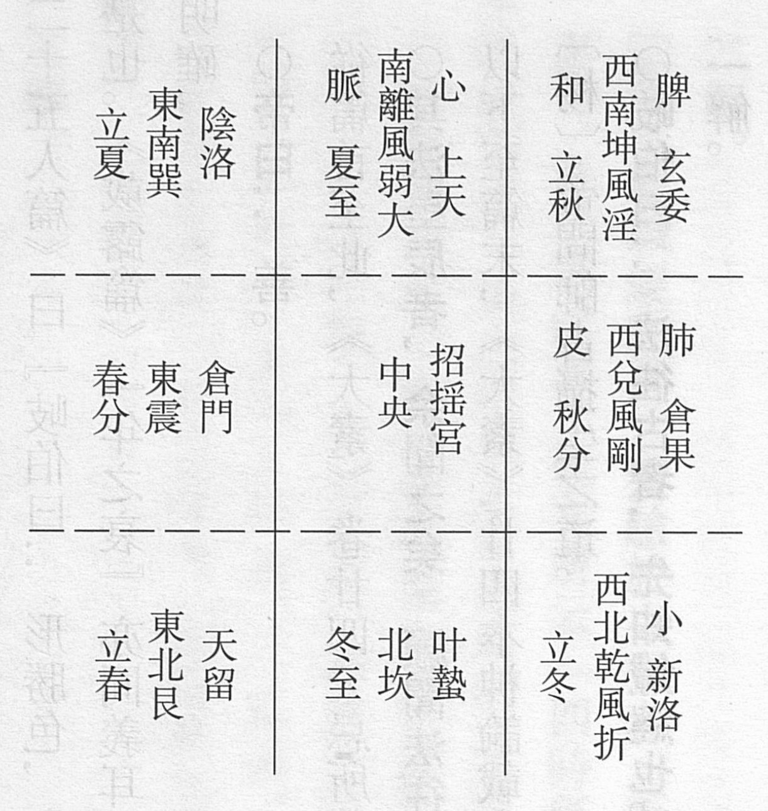

- 脾　玄委　西南坤風淫　和　立秋
- 肺　倉果　西兌風剛　皮　秋分
- 小　新洛　西北乾風折　立冬
- 心　上天　南離風弱大　脈　夏至
- 招摇宮　中央
- 叶蟄　北坎　冬至
- 陰洛　東南巽　立夏
- 倉門　東震　春分
- 天留　東北艮　立春

**○八正之虚邪，而避之勿犯也。**

팔정의 허사는 피하여 범하지 않는다.

〔張〕사시의 기가 있는 곳 운운한 것은 모두 기가 인체에 있는 것이다. 천기가 있는 곳은 팔정의 바람이 때에 따라 이르는 것이 그것이다. 인체의 기는 안에서 조절해야 하고, 천기｟（‘地’로 써야 할 듯하다）｠의 기는 밖에서 조절해야 한다. 그러므로 성인이 날마다 허사의 도를 피하기를 화살과 돌을 피하듯 한다. 대개 밖으로 말미암아 그 안을 상할까 염려하기 때문이다.

**○以身之虚，而逢天之虚，兩虚相感，其氣至骨，入則傷五藏。工候救之，弗能傷也。故曰天忌，不可不知也。**

몸의 허함으로 하늘의 허함을 만나면 두 허가 서로 감응하여 그 기가 뼈에 이르고, 들어가면 오장(五藏)을 상한다. 의사[工]가 살펴 구하면 상하지 못한다. 그러므로 천기(天忌)라 하니, 반드시 알아야 한다.

〔楊〕형체·혈기·연가(年加)가 모두 허하므로 신허(身虚)라 한다. 신허와 허사가 서로 감응하여 병이 되면 깊이 들어가므로, 뼈에 이르고 오장을 상한다. 하늘을 본받아 살펴 금하므로 천기(天忌)라 한다.

〔紹〕［堅案］「관침편(官鍼篇)」에서 “그러므로 침을 쓰는 사람이 해에 더해지는 것[年之所加], 기의 성쇠, 허실이 일어나는 바를 모르면 의사라 할 수 없다.”라고 하였다. 「음양이십오인편(陰陽二十五人篇)」에서 “기백이 말하였다. ‘형(形)이 색(色)을 이기거나 색이 형을 이기는 경우, 그 이기는 때인 연가에 이르러 감수하면 병이 진행되고, 치료 시기를 놓치면 근심하게 된다 운운.’”이라고 하였다. 양(楊)이 말한 것이 곧 이것이다. 「세로편」의 ‘年之衰’도 같은 뜻이다. 『영추』 주석가들이 ‘年加’를 오운(五運)의 가림(加臨)으로 풀었는데, 선형(先兄)이 일찍이 그 잘못을 논변한 것이 매우 명확하다.

**○帝曰：善。**

황제가 말했다. “좋다.”

편 첫머리부터 여기까지는 『대소(大素)』 권24 「천기(天忌)」에 실려 있다.

**○其法星辰者，余聞之矣。願聞法往古者。**

성신을 본받는 것은 내가 들었다. 옛것을 본받는 것에 대해 듣고 싶다.

이하 편 끝까지는 『대소(大素)』 권24 「본신론(本神論)」에 실려 있다.

〔楊〕황제가 옛것을 본받아 섭생하는 도를 물었다.

**○岐伯曰：法往古者，先知鍼經也。**

기백이 말했다. “옛것을 본받는다는 것은 먼저 『침경(鍼經)』을 아는 것이다.”

첫째 풀이[一解].

〔楊〕옛 복희씨(伏羲氏)가 처음 팔괘(八卦)를 그리고 서계(書契)를 만들었으니, 곧 『침경』을 지어 섭생하고 병을 구하는 도를 세울 수 있었다.

〔馬〕이 역시 『침경』의 말을 차례로 푼 것이다. 『침경』은 곧 『영추(靈樞)』이다. 제1편 「구침십이원(九鍼十二原)」에 ‘先立鍼經’이라는 말이 있는데, 후세에 황보사안(皇甫士安)이 『영추』를 『침경』이라는 이름으로 바꾸었다. 그러므로 왕빙(王冰)이 『소문(素問)』을 풀고 송(宋)의 성무기(成無己)가 『상한론(傷寒論)』을 풀 때 이를 따랐고, 여러 의서도 모두 그러하였다.

〔識〕［簡按］이하는 「관능편(官能篇)」 제3절의 말을 차례로 푼 것으로 모두 아홉 가지 풀이인데, 『한비(韓非)』 「해로편(解老篇)」과 매우 비슷하다. 대개 옛 주석의 글이 이러하였다.

안(案): 경문 안에서 스스로 경문을 푸는 것은 옛날에 이런 예가 많았다. 『춘추(春秋)』의 경과 전, 『본초(本草)』의 백자(白字)·흑자(黑字), 『영추』 「소침해(小鍼解)」, 『소문』 「맥해(脈解)」·「침해(鍼解)」 같은 것이 그것이다. 이 아홉 풀이도 그 예일 뿐이다.

**○驗於來今者，先知日之寒温，月之虚盛，以候氣之浮沈而調之於身，觀其立有驗也。**

지금에 징험한다는 것은 먼저 해의 한온(寒温)과 달의 허성(虚盛)을 알아 기의 부침(浮沈)을 살펴 몸에서 조절하면, 곧바로 징험이 있음을 보는 것이다.

둘째 풀이[二解].

〔楊〕『침경』을 지은 뜻이 지금에 징험을 얻는다는 것은, 먼저 한온과 성허를 알아 맥기의 부침을 살피고, 다음으로 침을 써서 조절하여 그 징험을 취하는 것이다.

안(案): 기의 부침이란 뒤 글에서 말한 ‘사시 기의 부침’이 이것이다. 대개 봄여름의 해는 따뜻하고 봄여름의 기는 뜨며, 가을겨울의 해는 차고 가을겨울의 기는 가라앉는다. 여기에 달의 차고 기움을 더하여 몸에서 조절한다. 그 맥과 색을 살피면 병의 허실과 성패를 보아 징험할 수 있다.

**○觀其冥冥者，言形氣榮衛之不形於外，而工獨知之。**

명명(冥冥)을 본다는 것은 형기(形氣)와 영위(榮衛)가 겉으로 드러나지 않는데 의사만 홀로 안다는 말이다.

〔楊〕형체의 비수(肥瘦), 혈기의 성쇠, 영위의 운행은 겉으로 보이지 않으므로 ‘명명’이라 한다.

「시종용론(示從容論)」의 ‘窈冥’에 대해 왕주(王注)에 “요명(窈冥)은 볼 수 없는 것을 말하니, 곧 형기와 영위이다.”라고 하였다.

**○以日之寒温，月之虚盛，四時氣之浮沈，參伍相合而調之。工常先見之，然而不形於外，故曰觀於冥冥焉。**

해의 한온, 달의 허성, 사시 기의 부침을 참오(參伍)하여 서로 맞추어 조절한다. 의사는 늘 먼저 보지만 겉으로 드러나지 않으므로 ‘명명을 본다’고 한다.

셋째 풀이[三解].

〔楊〕이하는 관(觀)을 푼 것이다. 의사[工人]는 신(神)으로 저 형기·영위의 묘함을 얻으니, 남이 알 수 없는 일이다. 참오하여 서로 맞추어 조절하여 들어맞아도 밖에서는 모르므로 ‘명명을 본다’고 한다.

안(案): 명명은 이미 제25편에 보인다. 참오는 이미 제17편에 보인다.

**○通於無窮者，可以傳於後世也。**

무궁(無窮)에 통한다는 것은 후세에 전할 수 있다는 것이다.

〔楊〕무궁이란 기혈의 묘함을 말한다. 통한 사람은 만대에 전할 수 있고, 통하지 못한 사람은 산 사람을 죽이므로 전할 수 없다.

**○是故工之所以異也。然而不形見於外，故俱不能見也。**

이 때문에 의사가 남다른 것이다. 그러나 겉으로 드러나 보이지 않으므로 다들 보지 못한다.

〔楊〕훌륭한 의사가 명명을 보아 아는 여러 묘함은 다들 알 수 없다.

**○視之無形，嘗之無味，故謂冥冥，若神髣髴。**

보아도 형체가 없고 맛보아도 맛이 없으므로 명명이라 하니, 신(神)과 같이 어렴풋하다[髣髴].

넷째 풀이[四解].

〔楊〕명명의 도는 눈으로 볼 수 없을 뿐 아니라 혀로 맛볼 수 있는 것도 아니다. 신으로 어렴풋이 알 수 있다면 얻을 수 있다. 이 도는 황제(黃帝)의 현주(玄珠)와 같아 내상(内象)으로 어렴풋이 통한다.｟［案］‘直’은 ‘真’의 잘못인 듯하다.｠

〔張〕무궁에 통한다는 것은 정해진 방향도 체(體)도 없다는 것이므로 만세에 전할 수 있다. 남과 다른 까닭은 남들이 모두 보지 못하는 것을 나만 홀로 보아, 있는 듯 없는 듯한 사이에서 추호까지 밝게 살피기 때문이다. 그러므로 ‘명명이라 하니 신과 같이 어렴풋하다’고 하였다.

**○虛邪者，八正之虛邪氣也。**

허사(虛邪)는 팔정의 허사의 기이다.

다섯째 풀이[五解].

안(案): 앞 글에서 말한 ‘팔풍의 허사’가 이것이다.

**○正邪者，身形若用力，汗出，腠理開，逢虛風，其中人也微。故莫知其情，莫見其形。**

정사(正邪)는 몸이 힘을 쓰거나 땀이 나서 주리(腠理)가 열렸을 때 허풍(虛風)을 만나는 것으로, 사람에 적중하는 것이 미미하다[微]. 그러므로 그 정황을 알 수 없고 그 형체를 볼 수 없다.

여섯째 풀이[六解].

〔楊〕위 속에 곡기가 없는 것을 기(飢)라 하는데, 굶주렸는데도 도리어 땀이 나면 허로 인해 주리가 열려 허풍이 들어올 수 있다. 허풍이 들어올 때는 알기 어려우므로 ‘명명(冥冥)’이라 한다. ［案］‘難知’는 ‘微’를 풀이한 것이고, ‘冥冥’은 ‘莫知其情，莫見其形’을 풀이한 것이다.

안(案): ‘그것이 사람에 적중함이 미미하다’의 ‘微’ 자는 미사(微邪)의 뜻이다. 「조경론(調經論)」에서 “혈기가 아직 합쳐지지 않고 오장(五藏)이 안정되어 있을 때 사기가 형체에 머물면 오싹오싹[洒淅] 솜털에서 일어나고 아직 경락에 들어가지 않았으므로 신(神)의 미(微)라 한다.”라고 하였고, 또 ‘刺微’라 하였으며, 또 ‘皮膚微病’이라 하였고, 또 “혈기가 아직 합쳐지지 않고 오장이 안정되어 있을 때 기육이 꿈틀거리면 미풍(微風)이라 한다.”라고 하였다. 이들 ‘微’ 자는 모두 미사를 가리켜 말한 것으로 이곳과 같은 뜻이니, 함께 고찰해야 한다. 『금궤(金匱)』에서 말한 ‘六微’도 이곳과 같은 뜻이다.

「오운행대론(五運行大論)」 67에서 말하였다. “오기가 번갈아 서는데 각각 앞서는 바가 있으니, 제자리가 아니면 사(邪)이고 제자리에 해당하면 정(正)이다. 황제가 말하였다. ‘병이 생겨｟‘之’가 빠진 듯하다｠ 변화하는 것은 어떠한가?’ 기백(岐伯)이 말하였다. ‘기가 서로 맞으면 미미하고, 서로 맞지 않으면 심하다.’”

안(案): ‘邪’·‘正’ 두 글자와 ‘微’ 자는 이곳과 같은 뜻이다.

**○上工救其萌牙，必先見三部九候之氣，盡調不敗而救之，**

상공(上工)은 그 싹틀 때[萌牙] 구하니, 반드시 먼저 삼부구후(三部九候)의 기를 보아 모두 조절하여 무너지지 않게 구한다,

일곱째 풀이[七解].

〔楊〕맹아(萌芽)는 아직 병이 되지 않은 병으로 병의 미미한 것이다. 먼저 삼부구후를 알아 조절하여 그 미미함을 치료하므로 무너지지 않는다.

안(案): ‘萌’과 ‘微’는 같은 음이고 뜻도 서로 통한다. 병이 처음 싹터 아직 깊이 들어가지 않은 것을 미병(微病)이라 한다는 말이다.

**○故曰上工。下工救其已成，救其已敗。救其已成者，言不知三部九候之相失，因病而敗之也。**

그러므로 상공이라 한다. 하공(下工)은 이미 이루어진 것을 구하고 이미 무너진 것을 구한다. 이미 이루어진 것을 구한다는 것은 삼부구후가 서로 어긋남을 모르고 병으로 인해 무너뜨린다는 말이다.

여덟째 풀이[八解].

〔楊〕질(疾)은 빠름을 말한다.

「이합진사론(離合真邪論)」 27에서 말하였다. “삼부를 모르면 음양을 구별하지 못하고 천지를 나누지 못한다. 지(地)로 지를 살피고 천(天)으로 천을 살피고 인(人)으로 인을 살펴 중부(中府)에서 조절하여 삼부를 정한다. 그러므로 자침하면서 삼부구후의 병맥이 있는 곳을 모르면, 대기가 이미 지나고 사기가 다시 이르더라도[大過且至] 의사가 막을 수 없다. 허물 없는 것을 벌하니 이를 대혹(大惑)이라 하며, 대경(大經)을 뒤집어 어지럽혀 진기(真氣)를 회복할 수 없다. 실을 허로 여기고 사를 진으로 여겨 침을 쓰는 데 올바름이 없으니 도리어 기를 해치는 도적이 된다. 사람의 정기(正氣)를 빼앗고 순을 역으로 여겨 영위(榮衛)가 흩어져 어지러워지고 진기를 이미 잃어 사기만 홀로 안에 붙으니, 사람의 긴 수명을 끊고 사람에게 요절의 재앙을 준다. 삼부구후를 모르므로 오래갈 수 없다. 사시·오행에 맞출 줄 모르고 상승(相勝)을 더하여, 사기를 놓아두고 정기를 공격하니 사람의 긴 수명을 끊는다.”

（眉）고초본(古抄本)에는 ‘救其已敗’ 네 자가 없다.

**○知其所在者，知診三部九候之病脈處而治之，故曰守其門户焉，莫知其情而見邪形也。**

그 있는 곳을 안다는 것은 삼부구후의 병맥이 있는 곳을 진찰하여 알아 치료하는 것이다. 그러므로 ‘그 문호(門户)를 지킨다’고 하니, 어찌 그 정황을 모르며 사기의 형체를 보지 못하겠는가.

아홉째 풀이[九解].

〔楊〕삼부구후를 살펴 병맥을 얻고 사기의 형체를 보면 곧 치료하니, 그 문을 지키는 것이어서 그 정황을 더 물을 필요가 없다.

안(案): 앞 글의 ‘故莫知其情，莫見其形’에 대응하여 글을 이룬 것이다. 이는 병정(病情)의 곡절을 어찌 모르며 병사(病邪)의 형상을 어찌 보지 못하겠는가, 볼 수 있다는 말이다.

「이합진사(離合真邪)」 27에서 말하였다. “‘그런데 진기와 사기가 이미 합하여 물결이 일지 않으면 어떻게 살피는가?’ 기백이 말하였다. ‘삼부구후의 성허(盛虛)를 살펴 더듬어 조절하고, 좌우 상하가 서로 어긋나거나 서로 줄어든 것을 살피며, 병든 장(藏)을 살펴 시기를 기약한다.’”

〔張〕그 있는 곳을 안다는 것은 병맥이 있는 곳을 아는 것이다. 삼부구후는 곧 병맥이 드나드는 곳이므로 문호라 한다. 정황은 알 수 없는 것이 있지만｟‘形’을 보충해야 한다｠ 볼 수 있는 것이 여기에 있으니, 그 형체를 얻으면 정황을 살필 수 있다.

**○帝曰：余聞補寫，未得其意。岐伯曰：寫必用方。方者，以氣方盛也，以月方滿也，以日方温也，以身方定也，以息方吸而内鍼。**

황제가 말했다. “내가 보사(補寫)를 들었으나 그 뜻을 아직 얻지 못하였다.” 기백이 말했다. “사(寫)에는 반드시 방(方)을 쓴다. 방이란 기가 막 성할 때, 달이 막 찰 때, 해가 막 따뜻할 때, 몸이 막 안정될 때이며, 숨을 막 들이쉴 때 침을 넣는 것이다.”

〔楊〕방(方)은 바로[正]이다. 기가 바로 성한 때, 달이 바로 찬 날, 때가 바로 따뜻한 때,｟［案］‘日時’는 순서가 뒤바뀐 듯하다.｠ 몸이 바로 안정된 때, 숨을 바로 들이쉬는 때, 이 다섯 정(正)이 침을 넣는 때이다.

〔馬〕이 역시 『침경(鍼經)』의 뜻을 푼 것이다. 기백이 말하기를, 『침경』에 ‘사에는 반드시 방을 쓰고 보에는 반드시 원(圓)을 쓴다’는 말이 있는데, 뜻으로 논하면 바로 사해야 할 때 기가 막 성하고 달이 막 차고 해가 막 따뜻하고 몸이 막 안정되었으므로, 숨을 막 들이쉴 때 침을 넣는다. 다시 막 들이쉬기를 기다려 침을 돌리고, 다시 막 내쉬기를 기다려 천천히 침을 낸다. 그 말 가운데 이 ‘方’ 자가 있으므로 ‘사에는 반드시 방을 쓴다’고 한 것이다.

안(案): 이 다섯 방(方)의 때를 만나 숨을 들이쉴 때 침을 넣고 숨을 내쉴 때 침을 빼는 것이 보사의 법이다. 대개 보사는 모두 다섯 방의 때에 해야 한다. 마주(馬注)에 따르면 옛 『침경』에 ‘사에는 반드시 방을 쓰고 보에는 반드시 원(員)을 쓴다’고 하였는데, 기백이 이 ‘方’ 자를 다섯 방의 뜻으로 푼 것이니 이 또한 일리가 있다. 이 설은 은연중에 양주(楊注)와 들어맞으니, 우선 이를 따르는 것이 온당하다.

**○乃復候其方，吸而轉鍼。**

다시 막 들이쉴 때를 기다려 침을 돌린다.

〔楊〕이 1정(正)은 침을 돌리는 때이다.

**○乃復候其方，呼而徐引鍼，故曰寫必用方，其氣而行焉。**

다시 막 내쉴 때를 기다려 천천히 침을 뺀다. 그러므로 ‘사에는 반드시 방을 쓴다’고 하니, 그 기가 이에 돈다.

〔楊〕이 1정은 침을 내는 때이다. 사에 일곱 법을 쓰면 사기가 돌아 나간다.

**○補必用員，員者行也，行者移也，刺必中其榮，復以吸**

보(補)에는 반드시 원(員)을 쓴다. 원은 돌게 하는 것이고 돌게 하는 것은 옮기는 것이다. 자침은 반드시 그 영(榮)에 적중해야 하고, 다시 들이쉴 때

〔楊〕원과 방은 침을 행하여 고르게 실하게 하는 것이다. 보를 행하는 법은 자침하여 영기(營氣)에 적중시키고 침을 머물러 보하는 것이다. 들이쉴 때 침을 내어 기를 옮겨 실하게 한다.

**○排鍼也。故員與方，非鍼也。**

침을 밀어 넣는다[排鍼]. 그러므로 원과 방은 침이 아니다.

〔楊〕원과 방은 침을 행하는 법으로, 모두 침을 밀어 보사하는 것이다.

〔馬〕‘보에는 반드시 원(圓)을 쓴다’고 한 것은, 원이란 바로 둥근 물건이 갈 수 있고 옮길 수 있음과 같고, 자침은 반드시 그 영(營)에 적중해야 하며 다시 들이쉴 때 침을 밀어 넣으므로 ‘보에는 반드시 원을 쓴다’고 이름한 것이다.

〔張〕원(員)은 원활함이다. 행(行)은 그 기를 돌게 하는 것이다. 이(移)는 그 체(滯)를 이끄는 것이다. 대체로 정기가 부족하면 영위가 돌지 못하고 혈기가 머물러 막히므로, 반드시 원을 써서 돌게 하고 보한다. 영(榮)은 혈맥이다.

〔吳〕배(排)는 경기(經氣)가 이르면 침을 넣기를, 막힌 것을 밀치고 들어가듯 하는 것을 말한다.

〔志〕배(排)는 미는 것이다. 들이쉬기를 기다려 침을 밀어 움직인다.

**○故養神者，必知形之肥瘦，榮衛血氣之盛衰。血氣者，人之神，不可不謹養。**

그러므로 양신(養神)하는 사람은 반드시 형체의 비수(肥瘦)와 영위·혈기의 성쇠를 알아야 한다. 혈기는 사람의 신(神)이니 삼가 길러야 한다.

〔楊〕양신의 도는 첫째 형체의 비수를 알아야 하고, 둘째 영위 두 기가 돌며 얻고 잃는 것을 알아야 하며, 셋째 경락[經胳]의 혈에 성쇠가 있음을 알아야 한다. 이 셋을 알아 조절하면 신은 저절로 길러진다.

〔張〕형(形)은 신의 체(體)이고 신은 형의 용(用)이다. 신이 없으면 형이 살 수 없고, 형이 없으면 신이 생길 수 없다. 그러므로 형체의 비수와 영위·혈기의 성쇠는 모두 사람의 신이 의지하는 바이다. 그러므로 양신하려는 사람은 그 형체를 삼가 길러야 한다.

『영추(靈樞)』 「결기(決氣)」 제30에서 말하였다. “황제(黃帝)가 말하였다. ‘내가 들으니 사람에게는 정(精)·기(氣)·진(津)·액(液)·혈(血)·맥(脈)이 있다고 하는데, 나는 이것이 하나의 기일 뿐이라고 생각한다. 이제 여섯 이름으로 가르니 나는 그 까닭을 모르겠다.’ 기백이 말하였다. ‘두 신(神)이 서로 만나 합하여 형체를 이루는데, 늘 몸보다 먼저 생기는 것을 정이라 한다. 상초가 열려 오곡의 맛을 펴서 피부를 훈증하고 몸을 채우며 털을 윤택하게 하기를 안개와 이슬이 적시듯 하는 것을 기라 한다. 주리가 열려 땀이 줄줄[溱溱] 나는 것을 진이라 한다. 곡식이 들어가 기가 차면 윤택한 것이 뼈로 흘러들어, 뼈마디가 굽히고 펴며 윤택함을 내보내고, 뇌수를 보익하며, 피부를 윤택하게 하는 것을 액이라 한다. 중초가 기를 받아 즙을 취하고 변화하여 붉어진 것을 혈이라 한다. 영기를 가두어 피할 곳이 없게 하는 것을 맥이라 한다.’”

안(案): 여기서 말한 ‘혈기는 사람의 신이다’는 「결기편(決氣篇)」 육기(六氣)의 구별을 얻어야 비로소 분명해진다.

『영추』 「관능편(官能篇)」 제73에서 말하였다. “침을 쓰는 일에는 반드시 법칙이 있다. 위로는 천광(天光)을 보고 아래로는 팔정(八正)을 살펴 기사(奇邪)를 피하고 백성을 살핀다. 허실을 살펴 그 사기를 범하지 않는다. 이는 하늘의 이슬을 맞고 해의 허를 만나, 구해도 이기지 못하면｟弗勝｠ 도리어 재앙을 받는 것이므로 ‘반드시 천기(天忌)를 알아야 한다’고 한다. 이에｟迺, 아래도 같다｠ 침의 뜻을 말하자면, 옛것을 본받고 지금에 징험하며 요명(窈冥)을 보고 무궁에 통한다. 거친 의사가 보지 못하는 것을 훌륭한 의사가 귀하게 여기니, 그 형체를 알 수 없어 신과 같이 어렴풋하다. 사기가 사람에 적중하면 오싹오싹[洒淅]｟洫泝｠ 몸이 떨린다. ‘止’｟正｠사(邪)가 사람에 적중하는 것은 미미하여 먼저 색에 나타나고 제 몸은 느끼지 못한다. 있는 듯 없는 듯, 사라진 듯 남은 듯, 형체가 있는 듯 없는 듯하여 그 정황을 알 수 없다. 그러므로 상공이 기를 취할 때는 그 싹을 구한다. 하공은 이미 이루어진 것을 지키다가 그 형체를 무너뜨린다. 그러므로 의사가 침을 쓸 때는 기가 있는 곳을 알아 그 문호를 지키고, 기를 조절하는 법과 보사가 있는 곳, ‘徐’｟除｠와 ‘疾’의 뜻, 취할 곳에 밝다. 사에는 반드시 원(員)을 쓰니 눌러 돌리면 그 기가 돌고, 빠르게｟入｠ 천천히 빼면 사기가 나간다. 펴서 맞이하고 그 구멍을 ‘遙’｟搖｠하여 크게 하면 기가 빠르게 나간다. 보에는 반드시 방(方)을 쓰니 밖으로 그 피부를 당겨 그 문에 맞추고, 왼쪽으로 그 추(樞)를 당기고 오른쪽으로 그 피부를 밀며, 가볍게 돌려 천천히 밀어 넣는다. 반드시 단정하고 바르게 하고 안정되고 고요하게 하며, 마음을 굳게 하여 게을리하지 않는다. 미미하게 머물러 기가 내려오면 재빨리 뺀다. 그 피부를 밀어 바깥문을 덮으면 진기가 보존된다. 침을 쓰는 요체는 그 신｟養神｠을 잊지 않는 것이다.”[역1]

『대소(大素)』 권19 「지관능(知官能)」에 이 글이 실려 있는데, 다른 글자를 교감하면 이와 같다.

（眉）「사기장부병형(邪氣藏府病形)」 제4에는 ‘邪氣’가 ‘虛邪’로 되어 있고, ‘止’가 ‘正’으로 되어 있으며, ‘其’ 자가 없고, ‘在’가 ‘有’로 되어 있다.

안(案): 이 편의 아홉 풀이는 전부 「관능편」의 주해이다. 다만 ‘寫必用方，補必用員’은 「관능편」을 따라 ‘寫必用員，補必用方’으로 써야 한다. 『소문(素問)』과 『대소』의 ‘以氣方盛也，以月方滿也云云’에 다섯 ‘方’ 자가 있어 그 때문에 마침내 서로 뒤바뀐 것인가, 아니면 달리 전해진 것에 이런 것이 있었던 것인가. 지금은 고구할 수 없다.

안(案): ‘方者’ 아래에 빠진 글자가 있는 듯하다. 아래 글의 ‘員者行也，行者移也’의 예에 따르면 ‘方者正也，正者直也’로 써야 할 듯하다.

우선 적어 두어 의문으로 남긴다.

안(案): ‘寫必用方’은 ‘補必用方’으로 써야 하며 아래 글도 같다. ‘補必用員’은 ‘寫必用員’으로 써야 한다. 기가 막 성하고, 달이 막 차고, 해가 막 따뜻하고, 몸이 막 안정되고, 숨을 막 들이쉴 때 비로소 보침법을 행해야 한다. 아래 글에서 “막 들이쉴 때를 기다려 침을 돌리고, 막 내쉴 때를 기다려 천천히 침을 뺀다.”라고 하였으니, 이것이 보법이 아니면 무엇인가.

【楷】『영(靈)』 「관능편」의 글은 『대소』 권19 「지관능편(知官能篇)」에 실려 있는데, 그 양주(楊注)에서 말하였다. “원(員)은 규(規)를 말하니 하늘을 본받아 움직이며 기를 사하는 것이다. 방(方)은 구(矩)를 말하니 땅을 본받아 고요하며 기를 보하는 것이다. 추(樞)는 침이 움직이는 것을 말한다. ‘사에는 반드시 방을 쓰고 보에는 반드시 원을 쓴다’고 한 것은, 저것은 『소문』에서 나왔고 이것은 『구권(九卷)』이다. 방원의 법은 신명(神明) 가운데 기를 조절하는 변화가 같지 않으므로 세상 사람에게 보인 것이다.” ‘示世人’ 세 자는 본래 ‘尓世六’으로 되어 있었는데, 지금 바로잡았다.

【楷】우안(又案): 양상선(楊上善)의 이 말에 따르면, 대개 『소문』이 9권이고 『구권』이 9권으로 장중경(張仲景) 이래 이와 같이 구별해 왔는데, 양씨(楊氏)가 유독 자기 뜻으로 두 책을 합쳐 뒤섞어 30권의 책을 만들고 다시 스스로 주를 달아 새로 『대소』라 이름 붙인 것인가. 『한(漢)』 「예문지(藝文志)」 음양가(陰陽家)에 “『황제태소(黃帝泰素)』 20편, 육국(六國) 때 한(韓)나라 여러 공자가 지었다.”라고 하였으니, 상선(上善)이 여기에 의거해 『대소』라는 이름을 쓴 것인가. 요컨대 20편 가운데의 말도 지금의 『대소』 안에 있을 듯하다.

**○帝曰：妙乎哉論也。**

황제가 말했다. “묘하구나, 이 논의여!”

〔楊〕묘(妙)는 그 신의 정미하고 은밀한 것을 얻었음을 말한다.

**○合人形於陰陽四時，虛實之應，冥冥之期，其非夫子，孰能通之。**

사람의 형체를 음양·사시, 허실의 응함, 명명(冥冥)의 기약에 맞추는 것은, 선생이 아니면 누가 통할 수 있겠는가.

〔楊〕미묘한 말을 말한다. 사람의 형체를 음양에 맞춘 것이 첫째이다. 사시에 맞춘 것이 둘째이다. 허실에 맞춘 것이 셋째이다. 명명에 맞춘 것이 넷째이다. 선생의 궁미극묘(窮微極妙)한 통달이 아니면 누가[熟] 이 논의를 할 수 있겠는가.

‘孰’ 자는 세속에서 잘못하여 ‘熟’으로 쓰는 일이 많으니, 이 또한 획을 더한[增畫] 예이다. 양씨가 ‘熟’ 자에 나아가 풀이한 것은 옳지 않다. 그러나 이 주문으로 예로부터 ‘孰’을 ‘熟’으로 썼음을 알 수 있다.

〔張〕형은 볼 수 있고 신은 볼 수 없다. 『역(易)』에서 말하였다. “형체를 이루면 기(器)라 하고, 이롭게 써서 드나들게 하여 백성이 모두 쓰는 것을 신이라 한다.”

안(案): 인체의 기는 음양·사시의 기에 합하는 것이다. 사람과 하늘의 기에 서로 허실이 있어, 그 응하고 응하지 않음이 미묘하고 명명하여 살피기 어려우니, 오직 기백만이 이 묘한 이치에 통할 수 있다.

안(案): 『대소』에는（‘合’ 위에）‘辭’ 자가 있는데 옳은 듯하다. 사(辭)란 상고의 『침경』, 기백과 황제 이전의 문사(文辭)를 말하니, 앞 글에서 말한 ‘法往古驗來今’ 따위이다. 어떤 이는 ‘辭’ 자를 윗구에 붙여 ‘妙乎哉論也辭’로 읽어야 한다고 한다. 곧 ‘묘하구나, 논사(論辭)여’라는 말이다. 논사란, 논(論)은 기백의 변론이고 사(辭)는 옛 경전의 문사이니 변론과 문사를 말한다는 것이다. 이 또한 통한다.

‘虛實之應，冥冥期’. 『대소』에 이렇게 되어 있으니, 고문에는 종종 이런 예가 있다.

**○然夫子數言形與神，何謂形，何謂神。願卒聞之。**

그런데 선생은 여러 차례 형(形)과 신(神)을 말하였다. 무엇을 형이라 하고 무엇을 신이라 하는가? 끝까지 듣고 싶다.

〔楊〕형을 아는 것은 거칠고[麁] 신을 아는 것은 세밀한데, 거침과 세밀함을 가릴 수 없으므로 물은 것이다.

**○岐伯曰：請言形，形乎形，目冥冥。**

기백이 말했다. “형을 말하겠다. 형이여, 형이여[形乎形], 눈은 어둡다[目冥冥].”

〔楊〕형호형(形乎形)이란 병의 형체와 형체만 알고 그 묘함을 보지 못한다는 말이므로 ‘명명’이라 한다.

안(案): ‘形乎形’은 ‘形乎形乎’라는 말과 같으니, 하공이 그 병의 형체만 알고 그 참된 신을 모른다는 말이다. 가결(家訣)에서 “병기(病氣) 속의 도기(道氣)를 찾고, 도기 속의 병기를 찾는다.”라고 한 것이 이 이치이다.

（眉）가결은 삼가(森家)의 비결이며 송강의재(松岡意齋) 침술의 묘언이니, 『의중현오(意仲玄奧)』에 자세히 보인다.

〔張〕형호형은 겉으로 드러나는 것이다. 눈이 어둡다는 것은 거친 것을 보는 사람은 정밀한 것을 보지 못한다는 것이다.

**○問其所病，索之於經，慧然在前。**

앓는 바를 묻고 경(經)에서 찾으면 환하게 앞에 있는 듯하다.

〔楊〕거친 의사[粗]가 병을 물어 경맥을 진찰하고 찾을 줄 모르니, 어찌 병이 앞에 있음을 알겠는가.

〔張〕앓는 데에는 원인이 있어 물어서 알 수 있고, 있는 곳에는 경이 있어 찾아서 살필 수 있으니, 환하게 앞에 있는 듯하다.

**○按之不得，不知其情，故曰形。**

눌러도 얻지 못하고 그 정황을 모르므로 형이라 한다.

〔楊〕인영(人迎)·촌구(寸口)를 눌러도 병정을 모르므로 형만 안다는 것이다.

〔張〕그런데도 눌러서 얻지 못하는 것은 그 형체를 보고 그 정황을 모르는 데 있다. 형은 자취이다.

**○帝曰：何謂神。岐伯曰：請言神，神乎神，耳不聞，目明心開而志先。**

황제가 말했다. “무엇을 신이라 하는가?” 기백이 말했다. “신을 말하겠다. 신이여, 신이여[神乎神], 귀로 듣지 않아도 눈이 밝고 마음이 열려 뜻이 앞선다.”

〔楊〕심신(心神)의 묘함을 알 수 있으므로 ‘신어신(神於神)’이라 한다. 신으로 아는 것은 귀와 눈으로 얻는 것이 아니고, 오직 마음의 눈이 지의(志意)보다 앞서 열리는 것이다.

〔張〕신호신은 둘이면서 하나이다. 귀로 듣지 않는다는 것은 소리 없는 데서 듣는 것이다. 눈은 밝음이 드러나는 곳이고 심은 신을 간직하니, 심의 구멍이 열리면 지혜가 나오고 신명(神明)이 드러난다.

**○慧然獨悟，口弗能言，俱視獨見。**

환히 홀로 깨달아 입으로 말할 수 없으며, 함께 보아도 홀로 본다.

〔楊〕신이 안에서 밝음을 얻으니 말과 이름이 미치지 못한다. 여러 거친 의사가 함께 보아도 훌륭한 의사만 홀로 본다.

〔張〕입으로 말할 수 없다는 것은 그 묘함을 말로 전할 수 없다는 것이다. 그러므로 여럿과 함께 보아도 오직 나만 홀로 본다.

**○適若昏，昭然獨明，若風吹雲，故曰神。**

어두운 듯하다가 환히 홀로 밝아져 바람이 구름을 걷어 내는 듯하므로 신이라 한다.

〔楊〕어둠 속에 있는 듯하다가 환히 홀로 밝아진다. 또 의혹이 풀려 없어지는 것이 바람이 구름을 걷어 내는 듯하니, 이렇게 얻는 것을 신이라 한다.

안(案): 『대소』 정문(正文)에 ‘昬’으로 쓴 것은 묘휘(庿諱)를 피한 것으로, ‘泄之’를 ‘洩之’로 쓴 예와 같다.

〔張〕명명을 보는 것이 어두운 듯한 것이다. 보이는 것이 없는데 보는 것이 환히 밝은 것이다. 바람이 구름을 걷어 내는 듯하다는 것은 우주가 맑아져 빛이 드러나는 것이다. 활짝 깨달음은 사람으로 말하면 마음에 있으니, 지극하여 헤아릴 수 없으므로 신이라 한다.

『영(靈)』 「구침십이원(九鍼十二原)」에서 말하였다. “자침의 요체는 기가 이르면 효과가 있는 것이다. 효과의 확실함은 바람이 구름을 걷어 내는 듯하여 밝기가 푸른 하늘을 보는 듯하니, 자침의 도는 이것으로 다한다.”

『갑을(甲乙)』의 인용에는 ‘明乎若見蒼天’ 여섯 자가 ‘昭然於天’ 네 자로 되어 있다.

**○三部九候爲之原，九鍼之論不必存也。**

삼부구후가 그 근원이 되니, 구침(九鍼)의 논의는 굳이 둘 필요가 없다.

〔楊〕삼부구후는 신으로 얻는 근원이다. 구침의 논의는 거칠어 행하기 쉬우므로 굳이 둘 필요가 없다.

〔張〕삼부구후를 근원으로 삼으면 신오(神悟)를 얻을 수 있다. 구침의 논의는 다만 그 형적을 갖춘 것일 뿐이다. 이미 그 신을 얻었는데 어찌 자취에 기대겠는가. 두지 않아도 안 될 것이 없다.

문구(文久) 원년 9월 26일 등불 아래에서 쓰기를 마치다. 때는 갱생실(更生室) 남상(南廂)에 있었다.　활옹(活翁) 입지(立之)

제26 보(補)

사에는 반드시 방을 쓴다[寫必用方]｟十三ウ｠

「이합진사론」 제27에서 말하였다. “들이쉴 때 침을 넣어 기가 거스르지 않게 하고, 고요히 오래 머물러 사기가 퍼지지 않게 한다. 들이쉴 때 침을 돌려 득기(得氣)를 기준으로 삼는다. 내쉬기를 기다려 침을 빼되 숨을 다 내쉬면 침을 떼니, 대기(大氣)가 모두 나가므로 사(寫)라 한다.”

정사자(正邪者)｟十オ｠

『영추』 「사기장부병형」 제4와 『대소』 권27 「사중(耶中)」에서 말하였다. “여러 양이 모이는 곳은 모두 얼굴에 있다. 사람에 적중하는 것은 허를 틈타는 때, 막 힘을 쓴 때, 뜨거운 음식을 먹어 땀이 나고 주리가 열려 사기에 적중할 때이다.”

보에는 반드시 원을 쓴다[補必用員]｟十三ウ｠

「이합진사」에서 말하였다. “반드시 먼저 어루만져 더듬고, 눌러 흩고, 밀어 누르고, 튕겨 불끈 일어나게 하고, 긁어 내리고, 통하게 하여 취한다. 밖으로 그 문을 당겨 그 신을 닫는다. 숨을 다 내쉬면 침을 넣고 고요히 오래 머물러 기가 이르는 것을 일로 삼는다. 귀한 사람을 기다리듯 하여 날이 저무는 줄도 모른다. 그 기가 이미｟‘至’가 빠졌다｠ 알맞게 하여 스스로 보호한다. 들이쉬기를 기다려 침을 빼면 기가 나가지 못하고 각각 제자리에 있다. 그 문을 밀어 닫아 신기를 보존한다. 대기가 머물므로 보(補)라 한다.”

#### 이합진사론(離合真邪論)편 제27

『대소』 권24 「진사보사(真耶補寫)」에 전부 실려 있다.

**○黃帝問曰：余聞九鍼九篇，夫子乃因而九之，九九八十一篇，余盡通其意矣。**

황제(黃帝)가 물었다. “내가 들으니 『구침(九鍼)』 9편을 선생이 이어 아홉으로 곱해 81편이 되었는데, 나는 그 뜻을 다 통하였다.”

〔楊〕81편이란 이 경의 부류로서 알고 있는 책의 편수이다.

**○經言氣之盛衰，左右傾移，以上調下，以左調右，有餘不足，補寫於榮輸，余知之矣。**

경(經)에서 말하기를, 기의 성쇠는 좌우로 기울어 옮겨 가니 위로 아래를 조절하고 왼쪽으로 오른쪽을 조절하며, 유여(有餘)와 부족은 영수(榮輸)에서 보사한다고 하였는데, 이는 내가 안다.

〔楊〕앞서 안 책 속의 뜻을 말한 것이다.

**○此皆榮衛之傾移，虛實之所生，非邪氣從外入於經也。**

이것은 모두 영위가 기울어 옮겨 가 허실이 생긴 것이지, 사기가 밖에서 경으로 들어온 것이 아니다.

〔吳〕이것은 영위의 기가 치우쳐 기울어 옮겨 가 한쪽은 허하고 한쪽은 실하여 생긴 것이지, 팔풍(八風)의 사기가 밖에서 들어온 병이 아니라는 말이다.

**○余願聞邪氣之在經也。其病人何如，取之奈何。**

나는 사기가 경에 있는 것에 대해 듣고 싶다. 그것이 사람을 병들게 함은 어떠하며, 어떻게 취하는가?

〔楊〕앞의 81편에서 말한 뜻이 내가 청하는 것과 다르다는 말이다. 경에서 말한 것은 12경맥과 영위 두 기가 서로 기울어 옮겨 가 허실이 생기는 것만 말하고, 외사(外耶)가 경에 들어와 병이 되는 것은 말하지 않았으므로 지금 청하는 것이다.

**○岐伯對曰：夫聖人之起度數，必應於天地。**

기백이 답했다. “성인이 도수(度數)를 세울 때는 반드시 천지에 응하게 한다.”

〔楊〕인체의 법도를 세워 천지에 응하게 한 것이다.

**○故天有宿度，地有經水，人有經脈。**

그러므로 하늘에는 수도(宿度)가 있고, 땅에는 경수(經水)가 있으며, 사람에게는 경맥이 있다.

〔識〕［簡按］왕(王)이 경수｟『소문식(素問識)』에는 ‘水’가 ‘字’로 되어 있다｠를 푼 것은 옳지 않은 듯하니, 경(經)은 경위(經緯)의 경이다.

안(案): 수도는 12월이 경수 12·경맥 12와 서로 합함을 말하며, 경은 대개 경상(經常)의 뜻이다. 『관자(管子)』 「지도편(地圖篇)」의 ‘名山通谷經川’ 주에 “경천(經川)은 상천(常川)을 말한다.”라고 하였으니, 이곳과 같은 뜻이다.

（眉）『설문(説文)』에 “‘巠’은 수맥이다.”, “‘永’은 긴 것이다. 물의 ‘巠’ 결[理]이 긴 것을 본떴다.”라고 하였다. ‘巠’은 옛 글자이고 ‘經’은 지금 빌려 쓴 글자이다. 땅의 물과 사람의 물은 모두 그 여러 길과 맥을 ‘巠’·‘經’이라 이름한다. 큰 내가 물을 따라 맥리(脈理)가 자연히 흐르는 것을 ‘巠水’라 하니, 『이아(爾雅)』 「석수(釋水)」에서 말한 “사독(四瀆)은 발원하여 바다로 흘러드는 것이다.”가 곧 ‘巠水’의 뜻이고, 『영(靈)』 「경수편(經水篇)」의 강 12개가 모두 이것이다. 사람이 판 도랑은 아무리 크고 깊어도 자연의 수맥의 길이 아니므로 경수라 할 수 없다.

（眉）『영(靈)』 「해론(海論)」에서 말하였다. “사람에게도 사해(四海)와 12경수가 있다. 경수는 모두 바다로 흘러드는데, 바다에는 동서남북이 있으니 사해라 한다.”

**[역1]** 원서대로 옮겼다. 『太素』·『古今圖書集成』에는 「粗之所不見」, 『類經』에는 「麤之所不見」으로 어느 쪽이든 한 자이다.

**○天地温和，則經水安靜。天寒地凍，則經水凝泣。天暑地熱，則經水沸溢。卒風暴起，則經水波涌而隴起。**

천지가 온화하면 경수(經水)가 안정(安靜)된다. 하늘이 차고 땅이 얼면 경수가 엉기어 깔깔해진다[凝泣]. 하늘이 덥고 땅이 뜨거우면 경수가 끓어오른다[沸溢]. 갑자기 바람이 세차게 일면 경수가 물결쳐 솟구쳐 언덕처럼 일어난다[隴起].

〔楊〕천지 음양의 기의 도수를 말한 것이다.

안(案): ‘沸溢’은 곧 ‘沸’이다. ‘沸’를 늘여 말하면[緩言] ‘沸溢’이 된다. 더운 때에 강물이 차지 않고 뜨겁게 끓는다는 것이다. 『설문(説文)』에 “‘沸’는 필불(畢沸)로, 샘이 넘치는 것이다. 水를 따르고 弗이 소리이다.”라고 하였고, 현(鉉)의 음은 ‘분물절(分勿切), 또 방미절(方未切)’이다. 『옥편(玉篇)』에 “‘沸’는 방미절(方味切)로, 샘이 솟아나는 모양이다.”, “‘溢’은 익질절(弋質切)로, 가득 찬 것이고 그릇이 찬 것이며 남는 것이다.”라고 하였다. 『설문』에 또 “‘涫’은 ‘濤’이다. ‘涾’은 ‘涫溢’이다. 지금 하삭(河朔) 방언에서 ‘沸溢’을 ‘涾’이라 한다. 水를 따르고 沓이 소리이다.”라고 하였고, 현의 음은 ‘도합절(徒合切)’이다. 이에 따르면 ‘沸溢’은 익은 말로 끓어 나옴을 말한다. ‘畢沸’도 ‘沸’를 늘여 말한 것으로 ‘沸溢’과 같은 뜻이다.[역1]

갑자기 바람이 세차게 인다는 것은, 갑자기 불어오는 바람을 졸풍(卒風)이라 한다는 것이다. 폭기(暴起)는 그 기세가 맹렬함을 말한다. 『설문』에 “‘曓’은 빠르게 향해 가는 바가 있는 것이다.”라고 하였다. 『곡량(穀梁)』 선공(宣公) 2년 전(傳)의 ‘而暴彈之’에 대해 범녕(范甯)의 주에 “포(暴)는 잔포함이다.”라고 하였다.

〔識〕마(馬)·오(吳)·장(張)은 모두 ‘隴’과 ‘隆’이 같다고 하였다. ［簡按］‘隴’과 ‘壟’이 같으니, 「유향전(劉向傳)」의 ‘丘隴’, 「항우기(項羽紀)」의 ‘隴畝’가 모두 증거가 된다.

『통아(通雅)』에서 말하였다. “『내경(内經)』에서 ‘밤중에 음이 솟고[陰隴] 한낮에 양이 솟으며[陽隴] 맥이｟‘行’을 보충해야 한다｠ 이에 응한다’고 한 것은, 솟아오르는 것을 ‘隴’이라 하고 이를 지나면 점점 평평해짐을 말한 것과 같다.” 살펴보건대[案] 물결이 솟구쳐 흔들리는 것이 언덕과 밭이 높이 솟은 듯하다는 말이다. 어떤 이는 ‘而’를 ‘如’로 읽어야 한다고 하는데 옳은 듯하다. 그러나 ‘如’로 읽지 않아도 통한다. 대개 ‘隴起’는 곧 언덕처럼 솟는다는 뜻이다.

（眉）‘沸’는 물의 흐름이 매끄러운 것이다. ‘溢’도 같은 뜻이니, 반드시 넘쳐 불어난다는 뜻은 아니다.

**○夫邪之入於脈也，寒則血凝泣，暑則氣淖澤。**

사기가 맥에 들어가면, 추울 때는 혈이 엉기어 깔깔해지고[凝泣] 더울 때는 기가 윤택해진다[淖澤].

〔楊〕사람 자신이 한서(寒暑)의 도수에 응함을 말한 것이다.

안(案): 『대소(大素)』（‘凝’이 ‘涘’로 되어 있다）의 ‘涘泣’을 빨리 말하면[急言] ‘澀’이 되고, ‘泣’은 곧 ‘澀’의 속자이니, 풀이는 이미 제10편에 보인다. ‘淖澤’을 빨리 말하면 ‘澤’이 되니 제26편에 보인다. “날씨가 따뜻하고 해가 밝으면 사람의 혈이 윤택하고 위기(衛氣)가 뜬다. 그래서 혈은 사(寫)하기 쉽고 기는 잘 돈다. 날씨가 차고 해가 어두우면 사람의 혈이 엉기어 깔깔해지고 위기가 가라앉는다.”라고 한 것이 이곳과 같은 이치이다. 다만 저것은 더위와 추위에 따라 기혈의 매끄럽고 깔깔함이 달라짐을 말하니 그 평상의 경우이고, 이것은 사기가 맥 속에 들어갔을 때 추위와 더위에 따라 기혈의 매끄럽고 깔깔함이 달라짐을 말하니 평상의 경우를 말한 것이 아니다.

요택(淖澤)은 곧 요액(淖液)이니, 제26편｟一ウ｠에 보인다.

**○虛邪因而入客，亦如經水之得風也。**

허사(虛邪)가 이로 인해 들어와 머무는 것도 경수가 바람을 만난 것과 같다.

〔楊〕더위 때 주리(腠理)가 열리면 사기가 들어올 수 있다. 사기가 들어오면 맥이 변하는 것이 바람이 물을 움직이는 것과 같다.

**○經之動脈，其至也，亦時隴起。**

경의 동맥(動脈)은 그것이 이를 때 역시 때때로 솟는다.

〔楊〕12경의 동맥은 뛰는 곳에 이르면 뛴다. 사기가 이를 때도 모두 ‘彼瀧’이 있다. ‘彼瀧’이란 사풍(耶風)이 정기를 움직이는 것이다.｟［案］‘彼瀧’은 곧 ‘波隴’의 잘못이다.｠

**○其行於脈中循循然。**

그것이 맥 속을 갈 때는 차례차례 간다[循循然].

〔楊〕우분반(牛忿反)이다. ‘輑’은 수레 앞의 가로나무이니, 수레를 따라 가는 것이다. 사기가 맥을 따라 가는 것을 ‘輑’이라 한다. 어떤 본에 ‘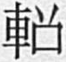’로 되어 있는 것은 옳지 않다.

안(案): ‘脩’는 곧 ‘循’ 자의 속자 꼴로, ‘脩身’의 ‘脩’와는 전혀 다르다. 이 두 글자는 예서에서 늘 섞어 썼다. ‘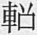’는 곧 ‘軺’ 자이다. ‘軺’로 쓴 것은 ‘輑’의 와체(訛體)이므로 상선(上善)이 그르다고 하였다. 예서에서 ‘君’과 ‘召’가 서로 비슷하므로 잘못된 것이다.[역2][역3]

〔識〕‘循循’은 오(吳)가 왕(王)이 인용한 어떤 본을 따라 ‘輴輴’으로 썼다. ［馬云］차례가 있다는 뜻인 듯하니, ‘輴輴’으로 쓸 필요가 없다. 음은 椿이다. 자서(字書)를 살펴보면 뜻이 맞기 어렵다. 『논어(論語)』의 ‘循循然善誘人’에 대해 하주(何注)에 “차례가 있는 모양이다.”라고 하였다. 「자요통편(刺腰痛篇)」에 “요통이 침으로 그 피부 속을 찌르는 듯 차례차례[循循然] 아프다.”라고 하였다.

안(案): 『대소』（‘然’ 아래）의 ‘輑’ 자는 이해할 수 없다. 왕(王)이 ‘一本作輴輴’이라 한 것에 따르면, ‘循’ 자의 이체자가 ‘輑’으로 잘못되어 정문(正文)에 섞여 들어간 것으로, 양씨(楊氏)가 잘못된 본에 나아가 함부로 주를 단 것인가.

**○其至寸口中手也，時大時小，大則邪至，小則平。**

그것이 촌구(寸口)에 이르러 손에 닿을 때 때로는 크고 때로는 작으니, 크면 사기가 이른 것이고 작으면 평(平)한 것이다.

〔楊〕사기가 영기(營氣)를 따라 촌구에 이르므로 태음맥이 크고, 사기가 없으면 태음맥이 평화(平和)하므로 ‘작다’고 한다.

**○其行無常處，在陰與陽，不可爲度。**

그 운행은 일정한 곳이 없어 음에 있기도 하고 양에 있기도 하니, 헤아릴 수 없다.

〔楊〕척맥(尺脈)은 음이고 촌구는 양이다. 이제 사기가 들어와 변란하여 알기 어려우므로 헤아릴 수 없다.

안(案): 음양은 영위(營衛)를 말하는 듯하다. 대체로 사기가 표(表)에 들어가면 영위의 운행이 그 때문에 막히므로 맥의 모양이 평상과 달라진다. 앞 글에서 말한 ‘經之動脈’도 영위를 말한다.

**○從而察之，三部九候。卒然逢之，早遏其路，吸則内鍼，無令氣忤。**

따라가며 살핀다. 삼부구후(三部九候)에서 갑자기 만나면 일찍 그 길을 막고, 들이쉴 때 침을 넣어 기가 거스르지 않게 한다.

〔楊〕삼부구후를 따라 살펴, 구후 가운데서 갑자기 만나 병이 있는 곳을 알면, 곧 자침할 만한 혈에 손가락을 눌러 막는다. 환자가 들이쉴 때 침을 넣어 사기가 거스르지 못하게 한다.｟［案］‘人’은 ‘令’의 잘못인 듯하다.｠

일찍 그 길을 막는다는 것은 「조경론(調經論)」에서 말한 “그 길을 흔들어 크게 하여 그 길을 이롭게 한다.”가 이것이다.

**○靜以久留，無令邪布，吸轉鍼，以得氣爲故。候呼引鍼，呼盡乃去，大氣皆出，故命曰寫。**

고요히 오래 머물러 사기가 퍼지지 않게 하고, 들이쉴 때 침을 돌려 득기(得氣)를 일로 삼는다[爲故]. 내쉬기를 기다려 침을 빼되 숨을 다 내쉬면 침을 떼니, 대기(大氣)가 모두 나가므로 사(寫)라 한다.

〔楊〕고요히 혈 속에 침을 머물러 잡아 사기가 다른 곳으로 흩어져 퍼지지 않게 한다. 환자가 들이쉴 때 침을 돌리고, 사기가 이르는 수가 다 끝나기를 기다려 천천히 침을 뺀다. 사기의 대기가 다 없어지므로 사라 이름한다.

『영(靈)』 「병전편(病傳篇)」에서 “정기가 어지럽게 기울고 음사(淫邪)가 퍼져 나가며 혈맥이 전해 흐르고 대기가 장(藏)에 들어가면 배가 아프고 아래로 넘치니, 죽음에 이르게 할 수는 있어도 살릴 수는 없다.”라고 한 것도 사기를 대기라 한 것이다.

『소(素)』 「열론(熱論)」에서 말하였다. “대기가 모두 떠나면 병이 날로 낫는다.”

〔張〕전(轉)은 비벼 돌리는 것이다. 이를 최기(催氣)라 한다. 이른바 전침(轉鍼)이란 침을 실 꼬듯이 비벼 돌리되 천천히 돌려 너무 조이지 않게 하는 것이다. 왼쪽을 사하면 왼쪽으로 돌리고 오른쪽을 사하면 오른쪽으로 돌린다. 그러므로 “침을 비벼 바깥으로 향하는 것은 사의 방법이고, 안으로 향하는 것은 보의 비결이다.”라고 한다.

〔識〕［吳云］고(故)는 상법(常法)이다. ［高云］득기로써 그 옛 상태를 회복하려는 것이다. 지금은 오(吳)의 뜻을 따른다.

〔紹〕선형(先兄)이 말하였다. “『여람(呂覽)』 「본생편(本生篇)」에 ‘천자의 움직임은 하늘을 온전히 하는 것을 일로 삼는다’라고 하였고, 주에 ‘고(故)는 일이다’라고 하였다.”

안(案): ‘爲故’라는 말은 「장자절론(長刺節論)」에 자주 보이고 또 「지진요대론(至真要大論)」에 여러 번 보이는데, 왕주(王注)에 “병을 없애는 일을 위한 것이다.”라고 하였다.

안(案): 『광아(廣雅)』 「석고(釋詁)」에 “‘蠱’·‘故’는 일이다.”라고 하였고, 왕염손(王念孫)이 말하였다. “「서괘전(序卦傳)」에 ‘고(蠱)는 일이다’라고 하였다. ‘蠱’라는 말은 ‘故’이다. 『주관(周官)』 「소행인(小行人)」에 ‘천하의 일[故]을 두루 안다’라고 하였다. ‘蠱’와 ‘故’는 소리가 같으므로 모두 일로 풀이한다.”

〔識〕［高云］대기는 침 아래에 모인 기이다. ［簡按］왕주는 ‘大邪之氣’라 하고, 아래 글의 주에서는 ‘大經之氣’라 하였으니, 어찌 말이 한결같지 않은가. 고주(高注)를 따라야 한다.

안(案): 대기를 왕주가 대사(大邪)의 기로 본 것은 양주(楊注)와 합하니 따를 만하다. 아래 글의 ‘大氣留止’ 네 자는 『대소』에 없으니, 왕씨(王氏)가 보충한 듯하다. 없는 것을 따르면 대사의 기임을 알 수 있다. 또 「열론」 31｟十八ウ｠에 보인다.

（眉）보법의 자침과 사법의 자침은 「조경론」에 자세히 서술되어 있으니 참고해야 한다.

**○帝曰：不足者，補之奈何。岐伯曰：必先捫而循之。**

황제가 말했다. “부족한 것은 어떻게 보(補)하는가?” 기백(岐伯)이 말했다. “반드시 먼저 어루만져 더듬는다.”

〔楊〕먼저 위아래로 어루만져 더듬어 병이 있는 곳을 안다. 첫째이다.

**○切而散之，**

눌러 흩는다,

〔楊〕손가락으로 더듬고 눌러 사기가 모이지 않게 한다. 둘째이다.

**○推而按之，**

밀어 누른다,

〔楊〕밀어 움직이게 하고 손으로 단단히 누른다. 셋째이다.

**○彈而怒之，**

튕겨 불끈 일어나게 한다[怒],

〔楊〕손가락으로 튕겨 부풀어 오르게 한다. 넷째이다.

**○抓而下之，**

긁어 내린다[抓而下之],

〔楊〕손으로 긁고 문질러 그 부풀어 오른 기를 내리게 한다. 일설에는 ‘搯’｟도로반(徒勞反)｠하여 튕기고, ‘搯’한 뒤 내리게 한다고 한다. 다섯째이다.

〔識〕［馬云］왼손 손톱으로 그 혈을 정확히 눌러 오른손으로 비로소 침을 놓는 것을 말한다. 『칠십팔난(七十八難)』에는 ‘抓’가 ‘爪’로 되어 있고, ［張云］‘抓’와 ‘爪’는 같다. ［簡按］『후한(後漢)』 「조일전(趙壹傳)」의 ‘鍼石運乎手爪’에 대해 태자 현(賢)의 주에서 “옛날에는 폄석(砭石)으로 침을 삼았다. 대체로 침의 법은 오른손은 하늘을 본뜨고 왼손은 땅을 본받으니, 튕겨 불끈 일어나게 하고 긁어 내리는 것, 이것이 손톱을 운용하는 것이다.”라고 하였다. 대개 이 편에서 취한 것인데, 다만 ‘抓’가 ‘搔’로 되어 있다.

안(案): 『후한서(後漢書)』 주에 ‘搔’로 된 것은 『대소』와 합하니, 그것이 고본임을 알 수 있다. 『난경(難經)』에 ‘爪’로 된 것은 고자이니 따를 만하다. ‘抓’와 ‘搔’는 모두 속자로 고서에서 많이 통용되며, ‘爪’로 쓴 것은 전혀 없다. 『광아』에 “‘抓’는 ‘搔’이다.”, 『설문』에 “‘搔’는 ‘括’이다.”, 『옥편』에 “‘抓’는 가려운 곳을 긁는 것이다.”라고 하였다. 『문선(文選)』 매승(枚乘)의 「간오왕서(諫吳王書)」의 “열 아름의 나무도 처음 날 때는 움과 같아 발로 긁어[搔] 끊을 수 있다.”에 대해 이선(李善)의 주가 『장자(莊子)』 「일편(逸篇)」의 “예장(豫章)이 처음 날 때는 긁어[抓] 끊을 수 있다.”를 인용하였다.

（眉）『장자』 「서무귀(徐無鬼)」의 ‘攫抓’에 대해 『석문(釋文)』에 “‘抓’는 어떤 본에 ‘搔’로 되어 있다. 소보반(素報反).”이라고 하였다.

**○通而取之，**

통하게 하여 취한다,

〔楊〕누르고 긁어 기가 통한 뒤에 취한다. 여섯째이다.

〔識〕『갑을(甲乙)』에는 ‘取’가 ‘散’으로 되어 있다. ［吳云］그 자리를 통하게 한 뒤 혈을 잡아 정한다. ［張云］침을 놓은 뒤 반드시 기를 기다려 그 병을 취한다.

안(案): 취(取)는 취혈(取穴)을 말한다. 양(楊)과 오(吳)가 모두 옳다.

**○外引其門，以閉其神。**

밖으로 그 문을 당겨 그 신(神)을 닫는다.

〔楊〕재빨리 침을 뺀 뒤 피부를 당겨 문을 닫아 신기(神氣)가 나가지 않게 한다. 신기는 정기이다. 일곱째이다. 침 놓는 앞뒤에 이 일곱 법이 있다.

**○呼盡内鍼，**

숨을 다 내쉬면 침을 넣는다,

〔楊〕한 번 내쉬고 한 번 넣으므로 ‘呼盡内鍼’이라 하니, 분촌(分寸)의 자리에 이르는 것이다.

**○靜以久留，以氣至爲故，如待所貴，不知日暮。**

고요히 오래 머물러 기가 이르는 것을 일로 삼으니, 귀한 사람을 기다리듯 하여 날이 저무는 줄도 모른다.

〔楊〕기를 살피기를 마음에 귀하게 여기는 사람을 기다리듯 하여, 얻는 것을 기약으로 삼는다.

**○其氣以至，適而自護。**

그 기가 이미 이르면 알맞게 하여 스스로 보호한다.

〔楊〕그 정기가 이미 이르러 알맞으면 사람이 스스로 아껴 보호하여 새지 않게 해야 한다.

**○候吸引鍼，氣不得出。各在其處，推闔其門，令神氣存，大氣留止，故命曰補。**

들이쉬기를 기다려 침을 빼면 기가 나가지 못한다. 각각 제자리에 있게 하고 그 문을 밀어 닫아 신기를 보존하며 대기가 머물게 하므로 보(補)라 한다.

〔楊〕환자가 들이쉬기를 기다려 재빨리 침을 빼어 정기가 새지 못하게 하고, 각각 허한 자리에 있게 하며, 신속히 그 문을 닫으므로 보라 이름한다. 사는 반드시 들이쉴 때 넣고 내쉴 때 내니, 그 사기를 새어 나가게 하려는 것이다. 보는 반드시 내쉴 때 넣고 들이쉴 때 내니, 그 정기를 가두어 나가지 못하게 하려는 것이다.

『칠십팔난』에서 말하였다. “침 놓을 줄 아는 사람은 왼손을 믿고, 모르는 사람은 오른손을 믿는다. 자침할 때는 반드시 먼저 왼손으로 침 놓을 형수(滎俞) 자리를 눌러 튕겨 불끈 일어나게 하고 손톱으로 눌러 내린다. 그 기가 오는 것이 동맥 같은 모양이면 침을 순히 찌른다. 득기하면 밀어 넣으니 이것이 보이고, 움직여 뻗어 올리니 이것이 사(瀉)이다. 득기하지 못하면 남자는 밖, 여자는 안에서 기다려도 득기하지 못하니, 이를 십사불치(十死不治)라 한다.”

『영추(靈樞)』 「관능편(官能篇)」 73에서 말하였다. “의사가 침을 쓸 때는 기가 있는 곳을 알아 그 문호(門户)를 지키고, 기를 조절하는 법과 보사가 있는 곳, 서질(徐疾)의 뜻, 취할 곳에 밝다. 사에는 반드시 원(員)을 쓰니 눌러 돌리면 그 기가 돌고, 빠르게 넣고 천천히 내면 사기가 나간다. 펴서 맞이하고 그 구멍을 흔들어 크게 하면 기가 빠르게 나간다. 보에는 반드시 방(方)을 쓰니 밖으로 그 피부를 당겨 그 문에 맞추고, 왼쪽으로 그 추(樞)를 당기고 오른쪽으로 그 피부를 밀며, 가볍게 돌려 천천히 밀어 넣는다. 반드시 단정하고 바르게 하고 안정되고 고요하게 하며, 마음을 굳게 하여 게을리하지 않는다. 미미하게 머물러 기가 내려오면 재빨리 뺀다. 그 피부를 밀어 바깥문을 덮으면 진기가 보존된다. 침을 쓰는 요체는 그 신을 잊지 않는 것이다.”

사(寫)〔馬〕［按］「열론」에 ‘대기가 모두 떠난다’고 한 것도 대사의 기이다. 「조경론」에서 말하였다. “실을 사할 때는 기가 성할 때 침을 넣어 침과 기가 함께 들어가게 하고, 그 문을 열어 그 지게문을 이롭게 한다. 침과 기가 함께 나가면 정기는 상하지 않고 사기는 내려간다. 바깥문을 닫지 않아 그 병을 내보내고, 그 길을 흔들어 크게 하여 그 길을 이롭게 하니, 이것을 대사(大寫)라 한다. 반드시 눌러 빼면 대기가 굴복한다.”

『영추』 「구침십이원(九鍼十二原)」 제1에서 말하였다. “사는 반드시 잡아 넣고 놓아서 내는 것이니, 양을 밀쳐 침을 얻으면 사기가 빠져나간다. 눌러서 침을 빼면 이를 내온(内温)이라 하니, 혈이 흩어지지 못하고 기가 나가지 못한다.”

보(補)〔馬〕「보명전형편(寶命全形篇)」에서 “경기(經氣)가 이미 이르면 삼가 지켜 잃지 말라.”라고 하였고, 「침해론(鍼解論)」도 그렇게 말한다. 「조경론」에서 말하였다. “‘허를 보하는 것은 어떻게 하는가?’ 기백이 말하였다. ‘침을 쥐고 놓지 말아 그 뜻을 정하고, 숨을 내쉴 때를 기다려 침을 넣는다. 기가 나갈 때 침이 들어가면 침 구멍 사방이 막혀 정기가 빠져나갈 데가 없다. 막 실할 때 재빨리 침을 빼니, 기가 들어올 때 침이 나가 열이 돌아오지 못한다. 그 문을 막아 닫으면 사기는 흩어지고 정기가 보존된다. 기를 움직이고 때를 기다려 가까운 기를 잃지 않으면 먼 기가 오니, 이를 추지(追之)라 한다.’” 「구침십이원」에서 말하였다. “보는 따르는 것이니, 따르는 뜻은 무심히 하는 듯하다. 가는 듯 누르는 듯, 모기나 등에가 앉는 듯, 머무는 듯 돌아오는 듯, 떠날 때는 활시위가 끊어지듯 하며, 왼손을 오른손에 잇게 하면 그 기가 이에 그친다. 바깥문이 이미 닫히면 속의 기가 실해진다. 반드시 유혈(留血)이 없게 하고, 서둘러 취해 없앤다.”

**○帝曰：候氣奈何。**

황제가 말했다. “기를 어떻게 살피는가?”

안(案): 기란 침 아래 이르는 기로, 살펴 알 수 있는 것이다. 아래 글에서 말한 진기(真氣)·경기·대기 따위를 여기서 들어 그저 기라고만 한 것이다.

**○岐伯曰：夫邪去絡入於經也，舍於血脈之中，其寒温未相得，如涌波之起也，時來時去，故不常在。故曰方其來也，必按而止之，止而取之，無逢其衝而寫之。**

기백이 말했다. “사기가 낙(絡)을 떠나 경으로 들어가면 혈맥 속에 머무는데, 그 한온(寒温)이 아직 서로 어울리지 못하여 솟구치는 물결이 일어나는 듯하고, 때로 왔다가 때로 가므로 늘 있지 않다. 그러므로 ‘그것이 막 올 때 반드시 눌러 멈추게 하고, 멈추면 취하되, 그 충(衝)을 맞받아 사하지 말라’고 한다.”

〔楊〕외사(外耶)가 몸에 들어오면 먼저 피모와 낙맥[胳]에 이르고, 머물러 새어 나가지 못하면 낙맥에서 나와 경으로 들어간다. 경에 들어가면 경 속의 혈기와 함께 합한다. 사기의 한온이 아직 정기와 어울리지 못하여 마침내 물결처럼 솟구쳐 일어나, 가고 옴이 일정하게 머물지 않는다. 그러므로 살펴 만나면 눌러 멈춰 움직이지 않게 한 뒤에 침으로 자침하고, 그 성한 충을 찌르지 않는다. 사법은 이를 성대한[逢逢] 진을 치지 않는 것에 비유한다.

『태소(太素)』에는 ‘波’가 ‘被’로 되어 있으니 와자(訛字)이다. 양주에 ‘波涌’으로 되어 있으니 증거가 된다.

안(案): 대개 사기가 낙을 떠나 경으로 들어갈 때 혈맥과 합하지만, 추운 날의 사기든 따뜻한 날의 사기든 아직 정기와 어울리지 못한다. 그래서 두 기가 서로 만나면 물결이 바람을 만난 듯 가고 옴이 일정하지 않다. 그러므로 막 올 때 반드시 손가락으로 그 오는 길 가운데를 눌러 고정하고, 그 기가 점점 안정되면 혈을 취해 사기를 빠져나가게 하는 것이며, 기가 와서 바로 충격하는 때에 자침해서는 안 된다. 양주가 옳다. 이 두 ‘來’ 자와 아래 구의 ‘來’ 자는 모두 경기가 오는 것을 말하니, 앞 글의 “경의 동맥은 그것이 이를 때 역시 때때로 솟고, 그것이 맥 속을 갈 때는 차례차례 간다.” 및 “삼부구후에서 갑자기 만나면 일찍 그 길을 막는다.”와 서로 밝혀 준다. 만약 잘못하여 그 충을 맞받아 사하면, 뒤 글에서 말한 “사기를 살피는 것이 정밀하지 못하면 대기가 이미 지나가니, 사하면 진기가 빠지고, 빠지면 회복되지 않으며, 사기가 다시 이르러 병이 더 쌓인다. 그러므로 ‘그것이 가면 쫓을 수 없다’고 한 것은 이를 말한다.”를 함께 고찰할 수 있다.

그 충을 맞받는다는 것은 곧 앞 글에서 말한 ‘그것이 맥 속을 갈 때는 차례차례 간다’가 이것이다.

**○真氣者，經氣也。經氣太虛，故曰其來不可逢，此之謂也。**

진기는 경기이다. 경기가 크게 허하므로 ‘그것이 올 때 맞받아서는 안 된다’고 한 것은 이를 말한다.

〔楊〕경기란 12경맥의 정기를 말한다. 정기가 크게 허하여 사기와 함께 이르므로, 눌러 사기를 취해 자침해야 하고 맞받아 자침해서는 안 된다.

**○故曰：候邪不審，大氣已過，寫之則真氣脱，脱則不復，邪氣復至，而病益蓄，故曰其往不可追，此之謂也。**

그러므로 ‘사기를 살피는 것이 정밀하지 못하면 대기가 이미 지나가니, 사하면 진기가 빠지고, 빠지면 회복되지 않으며, 사기가 다시 이르러 병이 더 쌓인다’고 한다. ‘그것이 가면 쫓을 수 없다’고 한 것은 이를 말한다.

〔楊〕사기의 대기를 살피는 것이 정밀하지 못하고 눌러도 맞히지 못한 채 자침하면 진기가 빠지고, 사기가 다시 이르러 병이 더 쌓인다. 그러므로 ‘사기가 가면 쫓을 수 없다’고 한다.

안(案): 이미 빠진 진기는 다시 생길 수 없으므로 ‘가면 쫓을 수 없다’고 한 것이다. 양(楊)이 사기가 가면 쫓을 수 없다고 본 것은 옳지 않은 듯하다. 대기가 이미 지나갔다는 것은 사기가 오는 시기가 이미 지났다는 말이다. 사기와 정기가 서로 부딪치면 그 기가 반드시 커지므로 대기라 한다.

**○不可挂以髮者，待邪之至時，而發鍼寫矣。若先若後者，血氣已盡，其病不可下。**

터럭 하나 걸 틈도 없다는 것은 사기가 이르는 때를 기다려 침을 놓아 사한다는 것이다. 앞서거나 뒤서면 혈기가 이미 다하여 그 병을 내릴 수 없다.

〔張〕침을 놓아 사한다는 것은 사법을 베푸는 것이다. 그 사기를 사하려면 기가 이르는 그 순간에 해야 한다. 터럭 하나 걸 틈도 없다는 것은 털끝만큼도 놓쳐서는 안 된다는 말이다. 앞서거나 뒤선다는 것은, 앞서면 사기가 아직 이르지 않았고 뒤서면 대기가 이미 지나가, 헛되이 그 혈기만 깎아 다하고 병은 내릴 수 없다는 것이다. 하(下)는 항복시킨다는 말이다.

**○故曰知其可取如發機，不知其取如扣椎。故曰知機道者，不可挂以髮，不知機者，扣之不發，此之謂也。**

그러므로 ‘취할 줄 알면 쇠뇌의 기(機)를 쏘는 것과 같고, 취할 줄 모르면 몽치[椎]를 두드리는 것과 같다’고 한다. ‘기의 도를 아는 사람은 터럭 하나 걸 틈도 없고, 기를 모르는 사람은 두드려도 쏘지 못한다’고 한 것은 이를 말한다.

〔楊〕털로 기에 걸어도 발사가 빠른 것처럼, 기가 이를 때 지혜로운 이가 침을 놓는 것도 그러하여 때를 놓치지 않음을 말한다.

〔馬〕［案］『영추』 「소침해편(小鍼解篇)」에서 “그것이 올 때 맞받아서는 안 된다는 것은 기가 성하여 보할 수 없다는 것이다. 그것이 가면 쫓을 수 없다는 것은 기가 허하여 사할 수 없다는 것이다. 터럭 하나 걸 틈도 없다는 것은 기를 놓치기 쉽다는 말이다. 두드려도 쏘지 못한다는 것은 보사의 뜻을 모른다는 말이다. 혈기가 이미 다하여 기가 내려가지 않는다.”라고 하였다. 다만 이 편의 말은 오로지 사를 주로 말하였고 『영추』는 보사를 겸하여 말하였으므로, 말은 같아도 뜻은 조금 다르다.

『영추』 「소침해」 제3에서 말하였다. “뒤와 앞을 살펴 없어진 듯 남은 듯하다는 것은 기의 허실과 보사의 선후를 말한다. 그 기가 이미 내려갔는지 늘 남아 있는지를 살피는 것이다.”

〔張〕기(機)는 쇠뇌의 기이다. 추(椎)는 나무 몽치이다. 알고 취하면 반드시 건드리는 대로 응하여 기를 쏘는 것처럼 쉽고, 모르고 공격하면 무뎌 들어가지 않아 몽치를 두드리는 것처럼 어렵다.

**○帝曰：補寫奈何。岐伯曰：此攻邪也。疾出以去盛血，而復其真氣。**

황제가 말했다. “보사는 어떻게 하는가?” 기백이 말했다. “이것은 사기를 공격하는 것이다. 재빨리 내어 성혈(盛血)을 제거하고 그 진기를 회복시킨다.”

안(案): ‘疾出以去盛血’은 제16편의 “봄에 자침할 때는 산수(散俞)와 분리(分理)에 하되 피가 나오면 그친다.”와 같은 이치이니, 함께 볼 만하다｟二ヲ｠.

〔楊〕허도 사기이므로 보도 공(攻)이라 일컫는다. 열을 사하는 법은 오래 머물러서는 안 되니, 재빨리 침을 내어 그 성혈을 제거하고 그 진기를 회복시키는 것이다.

〔馬〕황제가 또 사기는 사해야 하고 진기는 보해야 하니, 사는 보가 될 수 없고 보는 사가 될 수 없다고 여겼으므로 다시 ‘보사는 어떻게 하는가’라고 물었다. 기백은 이렇게 말한다. 이 법은 바로 사기를 공격하는 것이다. 재빨리 침을 내어 성혈을 제거하고 그 진기를 회복시키니, 사 속에 보가 있다.

**○此邪新客，溶溶未有定處也。推之則前，引之則止，逆而刺之，温血也。刺出其血，其病痛立已。帝曰：善。**

이는 사기가 새로 들어와 머물러 출렁출렁[溶溶] 아직 정해진 곳이 없는 것이다. 밀면 나아가고 당기면 멈추니, 거슬러 찌르면 피가 맺혀 막힌다[温血]. 자침하여 그 피를 내면 그 병통이 바로 낫는다. 황제가 말했다. “좋다.”

〔楊〕정해진 곳이란 쌓여 병이 된 것이다. 온(温)은 열이다. 사기가 새로 들어오면 아직 정해진 곳이 없다. 열혈이 있으면 자침하여 없애면 통증이 낫는다.

안(案): 자침하여 그 피를 낸다는 것은 곧 앞 글에서 말한 ‘재빨리 내어 그 성혈을 제거한다’는 뜻이다. ‘刺出其血’은 이미 제20편｟十七ウ｠에 보인다. ‘取血’은 제22편에 보이니, 함께 고찰할 만하다.

〔識〕『석음(釋音)』에 “‘溶’은 음이 容이다.”라고 하였고, ［張云］흐르며 움직이는 모양이다. ［簡按］『설문』에 “물이 성한 것이다.”라고 하였다.

〔吳〕역(逆)은 맞이하는 것이다. 온혈은 독혈(毒血)이다. 독혈이 제거되면 그 병이 곧 없어진다.

〔張〕사기가 사람에 새로 들어와 머문 것은 얕게 낙에 있어 아직 정해진 곳이 없다. 대체로 낙을 취할 때는 반드시 그 피를 취하니, 자침하여 온혈을 내면 사기가 반드시 따라 떠나므로 병이 바로 나을 수 있다. 온혈은 열혈이다.

**○然真邪以合，波隴不起，候之奈何。**

그런데 진기와 사기가 이미 합하여 물결이 일지 않으면 어떻게 살피는가?

〔楊〕앞에서는 진기와 사기가 아직 합하지 않아 물결이 이는 것을 말하였다. 진기와 사기가 이미 일어났을 때 그 기가 어떠한지는 아직 모른다는 것이다.

〔張〕진기와 사기가 이미 합하였다는 것은 사기와 정기가 처음 서로 범한 것이다. 물결이 일지 않는다는 것은 병의 형체가 아직 드러나지 않은 것이다. 이를 살핌이 참되지 않으면 헷갈리기 가장 쉽다.

**○岐伯曰：審捫循三部九候之盛虛而調之。**

기백이 말했다. “삼부구후의 성허(盛虛)를 살펴 더듬어 조절한다.”

〔張〕삼부구후의 맥을 살피기만 하면 성허를 알 수 있고 조절하여 다스릴 수 있다.

**[역1]** 원서는 ‘濤’ 자리가 반 크기 조합자 氵+壽 꼴(코드 없음)이어서 통행 글자 ‘濤’로 적음. 『설문(説文)』 원문은 ‘涫，䰞也’ 인 듯하다.

**[역2]** 원서의 「有本作」 뒤 글자와 「即」 앞 글자는 車 옆에 㕣를 쓴 꼴(車+㕣)인데 입력할 글자가 없어 원서의 글자를 오려 그림으로 넣었다.
**[역3]** 원서의 「相侶」는 문맥상 「相似」의 잘못일 수 있어 「서로 비슷하므로」로 옮겼다.

**○察其左右上下相失及相減者，審其病藏以期之。**

좌우·상하가 서로 어긋나거나[相失] 서로 줄어든[相減] 것을 살피고, 병든 장(藏)을 가려내어 사생(死生)의 시기를 기약한다.

안(案): 제20편에서 “형과 기가 서로 맞으면 살고, 삼오(三五)가 고르지 않으면 병들며, 삼부구후(三部九候)가 모두 서로 어긋나면 죽는다 운운”이라 한 말에 따르면, 여기서 말한 ‘期之’는 사생(死生)을 기약한다는 뜻이다. 양상선(楊上善)의 주를 따를 만하다. 제20편에서도 “부(府)와 장(藏)을 살펴 사생의 시기를 안다”고 하였으니 이와 같은 뜻이다. ‘府’는 『대소(大素)』에 ‘病’으로 되어 있어 이 글과 합치한다.

〔楊〕좌우를 살핀다는 것은 삼부구후의 좌우 양쪽[兩箱]과 머리 및 손발의 상하를 살핀다는 말이니, 그 맥에 서로 어긋나거나 줄어든 것이 있으면 이것으로 오장(五藏)의 병을 살펴 사생의 시기를 정해 주는 것이다.

**○不知三部者，陰陽不別，天地不分。**

삼부(三部)를 모르면 음양(陰陽)을 가리지 못하고 천지(天地)를 나누지 못한다.

〔楊〕하늘이 양이고 땅이 음이며 사람이 음양임을 모르므로 기를 가리지 못한다고 하였다. 나누지 못한다는 것은 형(形)을 나누지 못한다는 것이다.

〔張〕음양을 가리지 못하면 장부의 역순(逆順)을 모르고, 천지를 나누지 못하면 승강부침(升降浮沈)을 모른다.

안(案): ‘陰陽’ 두 글자는 넓고 커서 끝이 없어 자리마다 뜻이 달라지니, 한 갈래로 설명해서는 안 된다. 여기서 음양은 기(氣)를 말하고 천지는 형(形)을 말한다. 음양은 맥기(脈氣)를 말하고 천지는 증후(證候)를 말한다.

**○地以候地，天以候天，人以候人，調之中府，以定三部。**

지(地)로 지를 살피고, 천(天)으로 천을 살피고, 인(人)으로 인을 살피며, 중부(中府)에서 고르게 하여 삼부(三部)를 정한다.

〔楊〕족궐음(足厥陰)은 천, 족소음(足少陰)은 지, 족태음(足太陰)은 인으로, 간·신·비위의 세 가지 지(地)를 살핀다. 수태음(手太陰)은 천, 수양명(手陽明)은 지, 수소음(手少陰)은 인으로, 폐·흉·심의 세 가지 인(人)을 살핀다. 양쪽 이마의 동맥은 천, 양쪽 뺨의 동맥은 지, 귀 앞의 동맥은 인으로, 두각(頭角)·구치(口齒)·이목(耳目)의 세 가지 천(天)을 살핀다. 중부(中府)는 오장이다. 오장의 기를 고르게 하려면 천·지·인 삼부구후를 취해 정한다.

안(案): 「삼부구후론(三部九候論)」에 자세히 나온다. 이것은 곧 음양과 천지를 분별하는 것을 말한다.

〔識〕［吳云］중부(中府)는 위(胃)이다. 토(土)가 중궁(中宮)을 주관하므로 중부라 한다. ‘調之中府’는 삼부구후를 모두 충화(冲和)한 위기(胃氣)로 고르게 살핀다는 말이다. ［張云］중부는 장기(藏氣)이다. 삼부구후의 맥과 증은 모두 장기를 위주로 하니, 기가 순하면 길하고 기가 역하면 흉하다. 그러므로 중부에서 고르게 한다고 하였다. 지(志)·고(高)는 오(吳)의 주를 그대로 따랐다.

안(案): 장(張)의 설은 양(楊)과 같으니 따를 만하다. 「삼부구후론」에서 말한 “중부(中部)는 폐와 심을 살피고, 하부(下部)는 간·비·신을 살핀다”가 이것이다.

（眉）중부(中府)는 위(胃)이다. 맥을 진찰할 때는 모두 위기의 유무와 다소를 참작하여 병인지 평인인지와 사생을 결정한다는 말이다. 「평인기상(平人氣象)」·「옥기진장(玉機真藏)」에 자세히 나온다.

**○故曰：刺不知三部九候，病脈之處，雖有大過且至，工不能禁也。**

그러므로 말하기를, 침을 놓으면서 삼부구후(三部九候)의 병맥(病脈)이 있는 곳을 모르면, 대기(大氣)가 이미 지나고 사기가 다시 이르더라도[大過且至] 의사[工]가 막을 수 없다고 한다.

안(案): 앞에서는 ‘不知三部’라 하고 여기서는 ‘不知三部九候病脈之處’라 하였으니, 여기서 자세히 하고 저기서 줄인 것으로, 고문(古文)의 한 체(體)일 뿐이다.

〔吳〕대과(大過)는 큰 사기가 과(過)가 된 것이다.

안(案): 대과는 앞글에서 말한 ‘大氣已過’이고, 차지(且至)는 앞글에서 말한 ‘邪氣復至’이다. 지(志)가 “세운(歲運)의 기가 이른 것”으로 본 것은 옳지 않은 듯하다.

**○誅罰無過，命曰大惑。**

허물 없는 이를 벌하는 것을 대혹(大惑)이라 한다.

안(案): 공연히 정기만 손상하고 사기는 없어지지 않으므로 허물 없는 이를 벌한다고 하였다. 삼부를 모르면서 침을 놓는 것을 대혹이라 한다.

〔楊〕병맥이 있는 곳을 모른다는 것은 경락[經胳]에 사기[耶]가 머무는 맥을 살피지 못한다는 것이니, 병맥을 모르면 죽음에 이를 허물의 거친 기운이 이르더라도 의사가 끝내 막지 못한다. 살아 있는 사람을 벌하면서 허물이 없음을 모르니 대혹이라 일컫는다. 삼부구후를 모르는 큰 미혹[大或]의 죄에 여섯 가지가 있다.｟‘大或’은 ‘大惑’의 잘못인 듯하다.｠

**○反亂大經，真不可復。**

대경(大經)을 도리어 어지럽히면 진기(真氣)를 회복할 수 없다.

〔楊〕경맥을 어지럽히고 진기를 손상하는 것이 첫째 죄이다.

「거통론(舉痛論)」 제39에 말하였다. “한기가 소장의 막원(膜原) 사이와 낙혈(絡血) 속에 머물면, 혈이 응체되어[血泣] 대경으로 흘러들지 못하고, 혈기가 머물러 운행하지 못하므로 오래되면 적(積)이 된다.”

안(案): 대경은 곧 경맥이다. 경맥이 착란되면 안으로 오장을 해쳐 마침내 진원(真元)의 기가 회복되지 못함이 틀림없다는 말이니, 그래서 진기를 회복할 수 없다고 하였다.

**○用實爲虛，以邪爲真。**

실(實)을 허(虛)로 여기고, 사기를 진기로 여긴다.

〔楊〕허실을 함부로 판단하는 것이 둘째 죄이다.

안(案): 실을 허로 여긴다는 것은 사기의 실함이 더욱 심하여 양궐(陽厥)이 음증과 비슷한 것을 말한다. 사기를 진기로 여긴다는 것은 사기가 성한 것을 양기가 성실(盛實)한 것으로 잘못 아는 것을 말한다.

**○用鍼無義，反爲氣賊，奪人正氣。**

침을 쓰는 데 의(義)가 없으면 도리어 기를 해치는 도적[氣賊]이 되어 사람의 정기(正氣)를 빼앗는다.

〔楊〕의(義)는 이치이다. 침을 쓰면서 바른 이치를 모르면 도리어 기를 해치는 도적이 되어 사람의 정기를 손상하니, 셋째 죄이다.

안(案): 사람의 정기를 빼앗고 종(從)을 역(逆)으로 삼는 것이 곧 기적(氣賊)의 뜻이다.

**○以從爲逆，榮衛散亂。**

종(從)을 역(逆)으로 삼으면 영위(榮衛)가 흩어지고 어지러워진다.

〔楊〕침의 도리를 따르는 것이 순이고 어긋나게 행하는 것이 역이다. 영위(營衛)에 함부로 찔러 어지럽게 하니, 넷째 죄이다.

**○真氣已失，邪獨内著。**

진기(真氣)가 이미 사라지고 사기만 안에 붙어 있다.

안(案): 이 세 구절은 순을 역으로 삼는 것을 설명한다.

〔楊〕정기를 잃고 사기[耶]를 얻으니, 다섯째 죄이다.

**○絶人長命，予人夭殃。**

사람의 긴 수명을 끊고 요절의 재앙을 안겨 준다.

안(案): 앞글의 ‘誅罰無過’가 여기에 이르러 맺어진다.

〔楊〕침으로 산 사람을 죽이니, 여섯째 죄이다.

**○不知三部九候，故不能久長。**

삼부구후(三部九候)를 모르므로 오래갈 수 없다.

안(案): 이하 여섯 구는 ‘絶人長命’을 풀어 설명한 주각(注腳)이니, 양(楊)의 주를 따를 만하다.

〔楊〕사람의 긴 수명을 끊는 것에 또 세 가지가 있다. 삼부구후를 몰라 사람의 긴 수명을 끊는 것이 첫째이다.

**○因不知合之四時五行，**

사시(四時)·오행(五行)에 맞출 줄 모르는 데다,

〔楊〕몸과 수명을 사시·오행에 맞출 줄 몰라 사람의 긴 수명을 끊는 것이 둘째이다.

**○因加相勝，釋邪攻正，絶人長命。**

상승(相勝)을 더하여, 사기를 버려두고 정기를 공격해 사람의 긴 수명을 끊는다.

안(案): 석(釋)은 버려둔다[舍]는 뜻이다.

〔楊〕어리석은 의사가 연가(年加)의 금기를 모르고 도리어 정기를 공격하므로 사람의 긴 수명을 끊으니, 셋째이다. 장명(長命)은 수명을 다하는 것이다.

안(案): 상승(相勝)은 「육절장상론(六節藏象論)」 제9에서 “오기(五氣)가 번갈아 서며 저마다 이기는 것이 있다”고 하고, 또 “봄은 장하를 이기고, 장하는 겨울을 이기고, 겨울은 여름을 이기고, 여름은 가을을 이기고, 가을은 봄을 이긴다”고 한 것이 이것이니, 아울러 살펴야 한다. ‘不知三部九候’·‘不知合之四時五行’에 ‘相勝’까지 더해진, 이 세 가지면 사람의 긴 수명을 끊기에 충분하다는 말이다.

**○邪之新客來也，未有定處，推之則前，引之則止，逢而寫之，其病立已。**

사기가 갓 들어왔을 때는 아직 일정한 자리가 없어서, 밀면 앞으로 나아가고 당기면 멈추니, 만나는 즉시 사(寫)하면 그 병이 곧바로 낫는다.

〔楊〕삼부구후를 알고 취하면 반드시 효과가 있다는 말이다.

안(案): 여기의 ‘逢’은 앞글에서 말한 ‘卒然逢之’의 ‘逢’의 뜻으로, 사기를 만나 일찍 사(寫)하면 그 병이 곧바로 낫는다는 말이다. 『상한론(傷寒論)』 「태양상편(太陽上篇)」 제25장에서 “태양병에 처음 계지탕(桂枝湯)을 복용하였는데 도리어 번(煩)하고 풀리지 않으면 먼저 풍지(風池)·풍부(風府)를 찌르고, 그런 뒤에 계지탕을 주면 낫는다”고 하고, 또 제9장에서 “태양병에 두통이 7일 이상 되어 저절로 낫는 것은 그 경(經)을 다 돌았기 때문이다. 다시 경을 전하려 하면 족양명(足陽明)에 침을 놓아 경이 전해지지 않게 하면 낫는다”고 한 것이 모두 이와 같은 이치이다.

안(案): 기(琦)가 이 여섯 구 26자를 연문(衍文)으로 본 것은 옳지 않다. 『대소(大素)』에 따르면 ‘真邪以合’ 위에 ‘黄帝問於岐伯曰’ 7자가 있어 별도의 조문이 되니, 그렇다면 앞글의 ‘此邪新客云云’은 자연히 별도의 조문이다. 중복되어 나온 것 같아도 결국 여기와 서로 방해되지 않는다.

안(案): 이 편은 처음부터 끝까지 일관되어 한 장(章)이 된다.

신유년(辛酉年) 10월 5일 달마기일(達磨忌日)에 돈오하여 스스로 적는다. 쉰다섯 해 아직도 아이 같아, 어리석음 지키고 졸렬함 길렀으나 공을 보지 못했네. 하루아침에 생성(生成)의 이치 활짝 풀리니, ‘二九維文’이 모두 꿰뚫렸네.

재성옹(再醒翁) 입지(立之)가 쓰다.〔花押〕

문구(文久) 신유년 10월 초하루 병진(丙辰) 오시에 공니서옥(恐泥書屋) 남상(南箱)에서 쓰다. 槭계산인(槭溪山人) 뇌재(磊齋)　입지(立之)

제27 보(第二十七補)

어루만져 더듬는다[捫而循之]｟四ウ｠

〔識〕『통아(通雅)』에 말하였다. “‘捫摸’ 두 글자에서, 옛날에는 ‘摸’ 자가 없었으니 곧 ‘捫’이다.”

튕겨 불끈 일어나게 한다[彈而怒之]｟五ヲ｠

〔識〕［張云］손가락으로 그 혈을 튕겨 의념이 쏠리게 하면 기가 반드시 따라가므로, 맥락이 부풀어[䐜滿] 성난 듯 일어나는 것이다. ［簡按］『칠십팔난(七十八難)』에는 ‘怒’가 ‘努’로 되어 있다. ‘怒’와 ‘努’는 통용한다. 『장자(莊子)』 「소요유(逍遥游)」의 ‘怒而飛’, 「외물편(外物篇)」의 ‘草木怒生’, 『후한(後漢)』 「제오륜전(第五倫傳)」의 ‘鮮車怒馬’는 모두 ‘努’와 같다.

따라가며 살핀다[從而察之]｟三ウ｠

안(案): 이 구절은 위에 붙여 읽어야 한다. 삼부구후는 곧 온몸을 말한다. 온몸 가운데 갑자기 사풍(邪風)의 기를 만나면 그 부(部)에서 살핀다. 일찌감치 그 경로를 막아 끊어 일신의 장부에 미치지 못하게 하니, 그 침법이 곧 사법(寫法)이다. 『상한론』 「태양상편」 제8의 “족양명에 침을 놓아 경이 전해지지 않게 하면 낫는다”가 바로 이와 같은 이치이다.

온혈이다[温血也]｟十ウ｠

『영(靈)』 「구침십이원(九鍼十二原)」 제1에 말하였다. “사(寫)에 관해 운운, 누르고 침을 당기는 것을 내온(内温)이라 하니, 혈이 흩어지지 못하고 기가 나가지 못한다.” 전문은 앞에 나왔다.｟七ヲ｠

안(案): ‘内温’이라 한 것은 ‘温血’과 같은 뜻으로, 유혈(留血)을 말한다. 유혈은 「구침십이원」 보법(補法) 아래에 보인다. 대개 ‘温’은 ‘煴’·‘藴’과 같으니 울결(鬱結)을 말한다.

상실(相失)　상감(相減)｟十一ヲ｠

「삼부구후론(三部九候論)」 제20에 말하였다. “형과 기가 서로 맞으면 살고, 참오(參伍)가 고르지 않으면 병들며, 삼부구후가 모두 서로 어긋나면 죽는다.”

안(案): ‘參伍不調’라 한 것은 여기서 말한 ‘相減’을 이른다.

또 말하였다. “중부(中部)의 맥후가 홀로 고르더라도 여러 장(藏)과 서로 어긋나면 죽고, 중부의 맥후가 줄어들면 죽는다.”

보사(補寫)｟六ヲ｠

「조경론(調經論)」 제62에 말하였다. “황제가 말하였다. ‘혈과 기가 이미 어우러지고 병의 형태가 이미 이루어져 음양이 서로 기울어졌는데, 보사는 어떻게 하는가?’ 기백이 말하였다. ‘실(實)을 사(寫)할 때는 기가 성할 때 침을 찌르니, 침과 기가 함께 들어가 그 문을 열고 그 지게문을 통하게 하듯이 하며, 침과 기가 함께 나오면 정기는 손상되지 않고 사기는 내려간다. 바깥문을 닫지 않아 그 병을 내보내고, 그 길을 흔들어 크게 하여 길을 통하게 하듯이 하니, 이것을 대사(大寫)라 한다. 반드시 눌러 뽑으면 대기(大氣)가 꺾인다.’ 황제가 말하였다. ‘허를 보하는 것은 어떻게 하는가?’ 기백이 말하였다. ‘침을 잡고 바로 놓지 말아 그 의념을 안정시킨다. 숨을 내쉴 때를 기다려 침을 찌르니 기가 나갈 때 침이 들어간다. 침 구멍을 사방에서 막아 정기가 빠져나갈 데가 없게 하고, 막 실해질 때 재빨리 침을 뽑으니 기가 들어올 때 침이 나간다. 열이 돌아오지 못하고, 그 문을 닫아 막으면 사기는 흩어지고 정기는 보존된다. 기를 움직이며 때를 살피면 가까운 기는 잃지 않고 먼 기가 온다. 이것을 추지(追之)라 한다.’”｟十七ノ六ウ｠

밀면 나아가고 당기면 멈춘다[推之則前引之則止]｟十ウ｠

안(案): 추지(推之)는 앞글의 ‘推而按之’이고, 인지(引之)는 ‘外引其門，以閉其神’이다. 밀고 당기는 것은 모두 보법을 말한다. 사기가 갓 들어왔을 때는 보침(補鍼)을 놓아서는 안 되니, 거슬러 보하여 찌르면 그 혈을 온축시켜[薀蓄] 사기가 나갈 수 없다는 말이다. ‘温血’은 『영추(靈樞)』 「구침십이원」에서 말한 ‘内温’과 같은 뜻으로, 혈이 흩어지지 못하고 기가 나가지 못함을 말한다.

25(廿五)　생성(生成)｟一ヲ｠　시패(嘶敗)｟二ヲ｠　삼삼(三三)｟三ヲ｠　인(人)｟四ウ｠　존(存)｟六ウ｠　거음(呿吟)｟同｠　오승(五勝)｟六ウ｠　현포(懸布)｟八ウ｠　검수(黔首)｟八ウ｠　독약(毒藥)｟十一ヲ｠　폄석(砭石)｟十二ヲ｠　순(瞚)｟十七ウ｠　침요(鍼耀)｟十八ウ｠　오오(烏烏)｟廿ヲ｠　직직(稷稷)｟同｠　횡彉(横彉)｟廿一ヲ｠　비(飛)｟廿ウ｠　악호(握虎)｟廿二ウ｠[역1]

26(廿六)　복(服)｟一ヲ｠　사읍(涘泣)｟一ウ｠　요액(淖液)｟同｠　음양진사(陰陽真邪)｟四ウ｠　음사(淫邪)｟同｠　팔정(八正)｟六ヲ｠　허사(虛邪)｟六ヲ｠　천기(天忌)｟七ウ｠　왕고(往古)｟八ヲ｠　침경(鍼經)｟同｠　기지부침(氣之浮沈)｟八ウ｠　미(微)｟十ヲ｠　사방보원(寫方補員)｟十二ヲ、十三ウ｠　배침(排鍼)｟十四ヲ｠　신기(神氣)｟同ウ｠　형신(形神)｟十六ウ｠

27(廿七)　구침구편구구팔십일편(九鍼九篇九九八十一篇)｟一ヲ｠　경언(經言)｟同｠　비일(沸溢)｟二ヲ｠　순순연(循循然)｟三ヲ｠　초(軺)｟同｠　고(故)｟四ウ｠　대기(大氣)｟同、又九ヲ｠　문(捫)｟同｠　조소(抓搔)｟五ヲ｠　보사(補寫)｟六ウ｠　기(機)｟十ヲ｠　추(椎)｟同｠　용용(溶溶)｟十ウ｠　중부(中府)｟十二ウ｠　대경(大經)｟同｠　온혈(温血)｟補ノ一ウ｠　맥음양(脈陰陽)｟三ウ｠　요택(淖澤)｟二ウ｠

#### 통평허실론(通評虛實論)편 제28

**○黄帝問曰：何謂虛實。岐伯對曰：邪氣盛則實，精氣奪則虛。**

황제가 물었다. “무엇을 허실(虛實)이라 하는가?” 기백이 대답했다. “사기(邪氣)가 성하면 실(實)이고, 정기(精氣)가 빠지면[奪] 허(虛)이다.”

정기와 사기의 허실.

〔張〕사기에는 미(微)와 심(甚)이 있으므로 사기가 성하면 실이고, 정기에는 강약이 있으므로 정(精)이 빠지면 허이다. 탈(奪)은 잃는다는 뜻이다. ［愚按］사기가 성하면 실이고 정기가 빠지면 허이다. 이 두 구절은 병을 다스리는 큰 벼리로, 말은 쉬워 보이나 그 기미는 매우 미묘하니 가장 자세히 가려야 한다. 그런데 가리기가 가장 어려운 점이 있으니 어째서인가? 실(實)은 사기를 말하니 실하면 사해야 하고, 허(虛)는 정기를 말하니 허하면 보해야 한다. 대체로 사기와 정기가 서로 부딪쳐 병이 되면 사기가 실하고 정기가 허하다고 둘 다 말할 수 있다. 그러므로 사(寫)를 위주로 하는 이는 사기가 성하니 실하여 사해야 한다고 하고, 보(補)를 위주로 하는 이는 정이 빠졌으니 허하여 보해야 한다고 한다. 저마다 한 구절을 붙들고 확실한 견해 없이 막연한 채 구실 삼아 꾸미니 누가 그르다 할 수 있겠는가. 이 때문에 지극히 정밀한 가르침이 도리어 더없는 해를 빚어낸다. 이치가 있는 곳에는 결코 바꿀 수 없는 것이 있음을 모르니, 요즘 의사들이 살피지 못하는 것을 어찌하겠는가. 나는 이것을 넷으로 나누어 보겠다. 어느 것이 완만하고 어느 것이 급한가, 그것이 있는가 없는가이다. 완급이란 허실의 완급을 살피는 것이다. 허가 없으면 급한 것은 사기에 있으니, 빨리 없애지 않으면 머물러 변이 생긴다. 허가 많으면 급한 것은 정기에 있으니, 일찍 북돋우지 않으면 때가 닥쳐서는 구제할 수 없다. 약간 허하고 약간 실한 경우도 그 실을 다스리면 한 번에 쓸어 없앨 수 있다. 몹시 허하고 몹시 실한 경우는 두려운 것이 허에 있으니, 근본을 굳게 지켜 먼저 자신을 이길 수 없게 만들면 사기는 모두 물러난다. 이허일실(二虛一實)은 그 실을 겸하여 한쪽을 열어 주고, 이실일허(二實一虛)는 그 허를 겸하여 예측 못 할 일이 생기는 것을 막는다. 요컨대 실한데 보하면[實而物補] 사기를 더하기는 하나 아직 구제할 수 있으니 그 화가 작고, 허한데 잘못 공격하면 진기(真氣)가 갑자기 떠나 되돌릴 수 없으니 그 화가 크다. 이것이 허실의 완급이니 반드시 살펴야 한다. 유무란 사기의 유무를 살피는 것이다. 풍·한·서·습·화·조는 모두 사기가 될 수 있다. 사기가 표에 있든 이에 있든, 부에 있든 장에 있든 반드시 자리 잡은 곳이 있으니, 그 근본을 찾아 곧바로 취한다. 이것이 이른바 유(有)이니, 유는 사기의 실이다. 육기(六氣)의 사기가 없는데 병이 삼음(三陰)에서 나왔다면, 오직 정욕으로 안을 상하고 과로로 밖을 상한 것이니, 사기가 아니면서 사기 같고 실이 아니면서 실 같다. 이것이 이른바 무(無)이니, 무는 병이 원기(元氣)에 있는 것이다. 허실 유무의 뜻을 밝히지 못하면 반드시 역을 순으로 여기고 표를 본으로 삼아 사람의 긴 수명을 끊게 되니, 덕을 크게 손상한다. 어찌 두려워하고 삼가지 않겠는가.[역2][역3]

〔識〕［簡按］사기가 사람 몸에 머물 때는 처음에 반드시 정기의 허를 타고 들어온다. 들어온 뒤 정기가 왕성하여 사기와 함께 성하면 실이 되니 상한(傷寒) 위가실증(胃家實證)이 이것이다. 사기가 들어와 머물 때 정기가 맞서지 못하여 사기에게 빼앗기면 허가 되니 상한 직중증(直中證)이 이것이다. ［馬云］사기가 성한 것은 외감이고 정기가 허한 것은 내상이다. 이 설은 따를 수 없다.

안(案): 대체로 사기가 사람 몸에 들어왔을 때 정기가 왕성하면 사기와 정기가 맞서므로 사기가 성하니, 이것이 실증(實證)이다. 이른바 양증(陽證)·열증(熱證)으로 삼양병(三陽病)이 이것이다. 사기가 사람 몸에 들어왔을 때 정기가 모자라 빠져 있으면 사기와 정기가 맞서지 못하여 사기가 성하더라도 열이 나지 않으니, 이것이 허증(虛證)이다. 이른바 음증(陰症)·한증(寒症)으로 삼음병(三陰病)이 이것이다. 여기서 말한 허실은 오로지 허한(虛寒)·실열(實熱) 두 증을 말한다. 뒷글의 허실과는 뜻이 자연히 다르다.

〔李〕성하면 실이라는 것은 사기가 막 세력을 떨치는 것으로 실증이라 한다. 빠지면 허라는 것은, 정을 잃고 혈을 잃으며 힘을 쓰고 정신을 수고롭게 한 것을 내탈(内奪)이라 하고, 땀내고 사하(瀉下)하고 토하고 청열한 것을 외탈(外奪)이라 한다. 기가 겁약하고 신(神)이 피로한 것을 허증이라 한다.

（眉）『의碥(醫碥)』에 말하였다. “실은 사기가 실하고 정기가 허하지 않은 것이니 공법을 감당할 수 있다. 허는 정기가 스스로 허하고 사기가 스스로 실한 것이니 정기를 보하면서도 사기를 다스려야 한다. 사기도 실하지 않으면 정기만 보해도 사기가 저절로 물러난다.”

**○帝曰：虛實何如。**

황제가 물었다. “허실(虛實)은 어떠한가?”

안(案): 여기서 말한 허실은 오로지 일신의 허실을 말하고 외사를 더하지 않은 것이므로 기백이 장허(藏虛)로 답했다. 장실(藏實)을 따로 말하지 않은 것은, 대개 오장이 평화롭고 허하지 않은 것이 곧 실이기 때문이니, 허로만 답한 것이다.

**○岐伯曰：氣虛者，肺虛也。氣逆者，足寒也。**

기백이 말했다. “기허(氣虛)는 폐허(肺虛)이다. 기역(氣逆)은 족한(足寒)이다.”

〔張〕폐는 기를 주관하므로 기허는 곧 폐허이다. 기가 거슬러 운행하지 못하면 사지에 미치지 못하고, 양이 아래에서 허하므로 발이 차다.

〔琦〕‘者也’ 두 글자는 연문(衍文)이다. 또 말하였다. 이것은 오장의 허실을 밝힌 것으로, 폐에서 예를 일으켰다. 폐는 기를 주관하니 폐가 허하므로 기가 허하고, 기역과 족한은 폐허의 증이다. 폐는 청강(清降)해야 하는데, 허하면 치절(治節)이 행해지지 않으므로 위로는 천역(喘逆)하고 아래로는 발이 차다. 탁음(濁陰)이 내려가지 않으면 청양(清陽)이 올라가지 못한다.

**○非其時則生，當其時則死。**

제때가 아니면 살고, 제때를 만나면 죽는다.

〔張〕폐허가 가을·겨울을 만나면 서로 해치는 때가 아니므로 산다. 봄을 만나면 금과 목이 불화하여 병이 반드시 심해지고, 여름을 만나면 금이 허한데 극을 받아 병으로 반드시 죽는다. 일설에는 폐는 가을에 왕성한데, 가을을 당했는데도 기가 허하면 금이 매우 쇠한 것이므로 죽는다고 한다. 뜻이 역시 통한다.

**○餘藏皆如此。**

나머지 장(藏)도 모두 이와 같다.

오장의 허실.

〔馬〕나머지 장이 허한 경우도 그 생사가 이와 같을 따름이다. 황제가 허실을 물었는데 기백이 먼저 허로 대답하고 실에는 아직 미치지 않았다.

안(案): 여기서 장허로 답한 것은 평장(平藏)이 곧 실이어서 따로 병이 되지 않기 때문이다. 그 실이 병이 된 것은 중실(重實)이 되니 아래 글에 보인다. 마씨(馬氏)가 ‘未及於實也’라 한 것은 옳지 않다.

**○帝曰：何謂重實。**

황제가 물었다. “무엇을 중실(重實)이라 하는가?”

〔吳〕중(重)은 평성이다. 뒤도 같다. 증과 맥이 모두 실하니 이것이 중실이다.

〔紹〕［高曰］중실이란 인체에 대열(大熱)의 병이 있어 기가 성하여 열이 나고 맥이 성하여 찬 것을 말한다. 음양과 혈기가 모두 실하니 이를 중실이라 한다. ［堅案］고(高)의 주가 옳은 듯하다.

안(案): 대체로 오장의 본기가 실하면 병이 없는 평인이다. 위양(胃陽)이 극도로 항진되면 혈과 기가 함께 실하여 중실의 증이 되니, 그 증은 아래 글과 같다. 고(高)의 주를 따를 만하다. 오(吳)는 주가 없고, 마(馬)와 지(志)가 함께 사열(邪熱)로 본 것은 옳지 않다.

**○岐伯曰：所謂重實者，言大熱病。氣熱脈滿，是謂重實。**

기백이 말했다. “이른바 중실(重實)은 대열병(大熱病)을 말한다. 기가 열하고 맥이 가득 찬 것[氣熱脈滿], 이것을 중실이라 한다.”

표리의 실.

안(案): 대열병은 인체의 양열(陽熱) 병을 총칭한다. 기와 맥은 하나이면서 둘이니, 나누어 말하면 기는 양이고 맥은 음이다. 기는 정기를, 맥은 혈맥을 말한다. 대개 혈이 맥 속에 가득 차면 정기가 성하고 씩씩해져 대열이 된다. ‘氣熱脈滿’ 네 글자는 대열병의 맥과 증이다. 기는 용(用)이고 맥은 체(體)이다. 「상고천진(上古天真)」 제1에서 “기맥이 늘 통하고 신기(腎氣)에 남음이 있다”고 하고, 「경맥별론(經脈別論)」 제21에서 “맥기(脈氣)가 경으로 흐르고 경기(經氣)가 폐로 돌아가며, 폐는 백맥을 조회받아 정을 피모에 수포하고, 모와 맥이 정을 합하여 기를 부에 행한다”고 하고, 「맥요정미(脈要精微)」 제17에서 “맥은 혈의 부이다. 길면 기가 다스려지고 짧으면 기가 병들며, 삭(數)하면 번심(煩心)하고 크면 병이 진행된다. 위가 성하면 기가 높고 아래가 성하면 기가 창만하다. 대(代)하면 기가 쇠하고 세(細)하면 기가 적다”고 하였으니, 모두 기와 맥이 서로 체용이 됨을 증명할 수 있다. 제19편에서는 “맥이 성하고 피부가 뜨겁고 배가 창만하며 전후(前後)가 통하지 않고 민무(悶瞀)하면 이것을 오실(五實)이라 한다”고 하였다.

**[역1]** 색인에는 ‘瞚’으로 적혀 있으나, 본문의 ‘瞋’을 가리키는 듯하다(원본 미확인).
**[역2]** 원서 「實而物補」의 「物」은 「誤」의 잘못으로 보인다(『醫門法律』·『喻氏三書』에 「實而誤補」, 뒤 대구도 「虛而誤攻」).
**[역3]** 원서 「其氣甚微」의 「氣」는 「義」의 잘못으로 보인다(『類經』과 『醫門法律』에 「其義甚微」로 되어 있다).

**○帝曰：經絡俱實何如。何以治之。岐伯曰：經絡皆實，是寸脈急而尺緩也。皆當治之。**

황제가 물었다. “경락(經絡)이 모두 실하면 어떠하며, 어떻게 치료하는가?” 기백이 말했다. “경락이 모두 실한 것은 촌맥(寸脈)이 급하고 척부(尺膚)가 완(緩)한 것이다. 모두 치료해야 한다.”

〔馬〕경은 십이경이고, 낙은 십오락이다.

안(案): 경락이 모두 실하다는 것은 혈기가 남아돈다는 것이니, 그러므로 그 맥은 촌구(寸口)가 급하고 척부(尺膚)는 완하다. 대개 촌맥이 급한 것은 안으로 경의 맥을 진찰한 것이다. 경혈이 가득 차므로 급삭(急數)한 맥이 나타난다. 척부의 맥이 완한 것은 밖으로 낙의 맥을 진찰한 것이다. 경혈이 이미 가득 차면 낙맥이 막혀 시원하게 통하지 못하므로, 촌맥과 척부가 함께 급하지 못하고 피부에서만 완맥이 된다. 『영추(靈樞)』 「사기장부병형(邪氣藏府病形)」 제4에서 “맥이 급하면 맥｟（‘尺’으로 써야 함）｠의 피부도 급하다. 맥이 완하면 척의 피부도 완하다”고 하고, 또 「논질진척(論疾診尺)」 제74에서 “척의 완급·대소·활색(滑濇)과 살의 견취(堅脆)를 살피면 병형이 정해진다”고 하였는데, 이들은 모두 평상(平常)의 경우를 말한 것이고 여기서는 그 변을 말하였으니, 저것으로 이것을 재단해서는 안 된다.

〔識〕［簡按］［王云］맥이 급하다는 것은 맥구(脈口)를 말한다. 그러나 ‘尺緩’의 뜻은 풀지 않았고, 제가는 모두 척중(尺中)의 맥으로 보았는데 틀렸다. 「논질진척편(論疾診尺篇)」에 “척의 완급·대소·활색을 살핀다”고 하였고, 「사기장부병형편(邪氣藏府病形篇)」에 “맥이 완하면 척의 피부도 완하다”고 하였다. 척완(尺緩)은 곧 척부가 늘어져 느슨하다는 말이다. 이 절은 맥구로 경을 진찰하고 척부로 낙을 진찰한다. 대개 경은 음이고 이(裏)이며 곧 맥도(脈道)이므로 맥구로 진찰하고, 낙은 양이고 뜨고 얕으므로 척부로 진찰하니, 뜻이 명석하다. 마(馬)가 경과 촌을 양으로, 낙과 척을 음으로 본 것은 후세의 촌양척음(寸陽尺陰)의 설에 근본을 둔 것으로, 경의 뜻과 어긋난다. 장(張)은 “이 절의 뜻은 경락에 무게가 있지 척촌에 있지 않다”고 하였으니, 모두 척이 척부를 말함을 몰랐다. 아래 글의 ‘脈口寒而尺寒’·‘尺熱滿，脈口寒濇’도 뜻이 같다. 오(吳)가 ‘尺緩’을 ‘尺脈緊’으로 고친 것은 더욱 잘못이다.

**○故曰：滑則從，濇則逆也。**

그러므로 활(滑)하면 순[從]이고 색(濇)하면 역(逆)이라 한다.

〔吳〕중실(重實)의 병이 있을 때 맥이 활리(滑利)하면 순이고 색하면 역이라는 말이다.

〔志〕활은 기혈이 모두 성함을 주관하므로 순이 된다. 색은 혈기가 모두 적음을 주관하므로 역이 된다.

안(案): 뒷글의 “실하면서 활하면 살고, 실하면서 역하면 죽는다”는 글에 따르면, 여기서 말한 ‘逆從’은 ‘死生’이라 하는 것과 같을 것이다. 또 『영추』 「근결편(根結篇)」에서 “혈의 청탁, 기의 활색, 맥의 장단, 혈의 다소, 경락의 수 운운”이라 하였으니 아울러 살필 만하다.

**○夫虛實者，皆從其物類始，故五藏骨肉滑利，可以長久也。**

허실은 모두 그 물류(物類)에서 비롯한다. 그러므로 오장(五藏)과 골육(骨肉)이 활리(滑利)하면 오래갈 수 있다.

맥의 허실.

〔馬〕대체로 물류에 허실이 있으면, 반드시 윤택하면 살고 마르고 깔깔하면 죽으니, 맥만 그런 것이 아니다. 그러므로 오장과 골육이 활리하면 그 맥도 활하여 오래 살 수 있다. 오장이 색체(濇滯)하면 그 맥도 색하여 오래가지 못하고 죽는다. 물류와 무엇이 다르겠는가.

〔高〕물(物)은 형(形)과 같다. 유(類)는 합(合)과 같다. 물류란 오장이 안에 있고 피육맥근골이 형체를 갖추어 밖에 있어 오장에 합하는 것이다. 시(始)는 먼저 나타난다는 뜻이다. 허실은 모두 그 형체를 갖춘 외합(外合)에서 먼저 나타난다.

안(案): 이것은 맥이 실하다고 반드시 살고 맥이 허하다고 반드시 죽는 것이 아니라는 이치를 거듭 밝힌 것이다. 대개 맥의 허실·완급·음양·한열은 모양이 같지 않더라도, 오장과 골육이 활리하면 그 맥도 저절로 활리함을 띤다. 활리란 위기(胃氣)가 있음을 말한다.

〔識〕오(吳)는 ‘故曰’ 두 글자를 삭제하였다. ［簡按］이하 ‘可以長久也’까지 31자는 착간(錯簡)인 듯하니, 아래 글 ‘滑則生濇則死也’ 아래로 옮기면 문리가 순조롭게 이어진다.

**○帝曰：絡氣不足，經氣有餘何如。岐伯曰：絡氣不足，經氣有餘者，脈口熱而尺寒也。秋冬爲逆，春夏爲從，治主病者。**

황제가 물었다. “낙기(絡氣)가 부족하고 경기(經氣)가 남아돌면 어떠한가?” 기백이 말했다. “낙기가 부족하고 경기가 남아도는 것은 맥구(脈口)가 뜨겁고 척(尺)이 찬 것이다. 가을·겨울에는 역(逆)이고 봄·여름에는 순[從]이니, 병을 주관하는 것을 치료한다.”

이하 ‘刺陰灸陽’까지는 『대소(大素)』 권30 「경락허실(經胳虛實)」에 실려 있다.

〔楊〕낙이 허하고 경이 실한 것은 어떻게 알 수 있는가. 낙은 양이고 경은 음이다. 촌은 양이고 밖이며, 척은 음이고 안이다. 가을·겨울은 음이고 봄·여름은 양이다. 낙기가 부족하면 양기가 허한 것이다. 경기가 남아돌면 음기가 성한 것이다. 가을·겨울에 촌구를 진찰하여 완맥을 얻고 척의 피부가 차면 역이고, 봄·여름에 완맥이고 척의 피부가 차면 순이다. 완맥은 열이다. 가을·겨울에는 양기가 안에 있고 음기가 밖에 있으며, 봄·여름에는 음기가 안에 있고 양기가 밖에 있기 때문이다. 척과 촌이 안에 있을 때의 한열로 경락의 허실을 취한다.

〔紹〕［堅按］양(楊)이 맥구가 뜨거운 것을 완맥으로 본 것은 옳지 않다. 또 척부가 찬 것은 「논질진척편」에 보인다.

〔識〕［志云］한열이란 척촌의 피부의 한열이 경락에 응하는 것이다. 낙맥은 밖으로 피부에 이어져 양이 되고 밖을 주관하며, 경맥은 안으로 장부에 이어져 음이 되고 안을 주관한다. 경에 이르기를 ‘영은 중초에서 나오고 위는 하초에서 나온다. 위기가 먼저 피부로 행하여 먼저 낙맥을 채우고, 낙맥이 먼저 성하며, 위기가 이미 고르게 된 뒤에 영기가 가득 차고 경맥이 크게 성한다. 경맥의 허실은 기구(氣口)로 안다’고 하였다. 그러므로 척부로 낙을 살피고 촌으로 경을 살핀다. ［高云］경기가 남아돌면 맥구의 피부가 뜨겁고, 낙기가 부족하면 척부가 차다. 촌부로 경을 살피고 척부로 낙을 살핀다. ［簡按］‘脈口熱’은 아래 글 ‘寒濇’으로 미루어 보면 맥이 활함을 말한다. 지(志)·고(高)가 ‘尺’을 척부로 본 것은 매우 옳으나, ‘脈口’를 촌부로 본 것은 경문에 분명한 증거가 없다.

「조경론(調經論)」 제62에 말하였다. “모든 병의 발생에는 허실이 있다. 지금 부자(夫子)가 남음에 다섯이 있고 부족에도 다섯이 있다고 하였는데, 무엇에서 생기는가?” 기백이 말했다. “모두 오장에서 생긴다. 심은 신(神)을, 폐는 기를, 간은 혈을, 비는 육(肉)을, 신(腎)은 지(志)를 간직하여 이로써 형(形)을 이룬다. 지의(志意)가 통하여 안으로 골수에 이어져 신형(身形)과 오장을 이룬다. 오장의 길은 모두 경수(經隧)에서 나와 혈기를 운행하니, 혈기가 고르지 않으면 온갖 병이 변화하여 생긴다. 그러므로 경수를 지키는 것이다.”

경맥(經脈)은 『영추』 「경맥편(經脈篇)」 제10에서 “침을 놓는 이치는 경맥이 시작이니, 그 운행하는 길을 헤아리고 그 도량을 정하며, 안으로 오장을 차례 짓고 밖으로 육부를 구별한다”고 하였다. 또 “경맥은 사생을 결단하고 백병을 처치하며 허실을 조절할 수 있으니 통달해야 한다”고 하였다. 또 “경맥 12개는 분육(分肉) 사이로 숨어 행하여 깊어서 보이지 않는다. 늘 보이는 것은 족태음이 바깥 복사뼈 위를 지나는 곳으로, 숨을 데가 없기 때문이다”라고 하였다. 또 “그러므로 위기가 이미 고르게 되면 영기가 가득 차서 경맥이 크게 성한다. 맥이 갑자기 뛰는 것은 모두 사기가 머물러 본말에 남아 있는 것이다. 뛰지 않으면 열이 나고, 단단하지 않으면 꺼지고 비어서 다른 맥과 같지 않으니, 이로써 어느 맥이 뛰는지 안다”고 하였다. 또 “경맥은 늘 볼 수 없으니, 그 허실은 기구로 안다”고 하였다. 또 「맥도편(脈度篇)」 제17에서 “경맥은 이(裏)가 된다”고 하고, 또 “수를 세는 쪽이 경이다”라고 하였다.

낙맥(絡脈)은 『영추』 「경맥편」에서 “여러 맥 가운데 떠서 늘 보이는 것은 모두 낙맥이다. 육경의 낙 가운데 수양명·소양의 대락은 다섯 손가락 사이에서 일어나 위로 팔꿈치 속에서 합한다. 술을 마시면 위기가 먼저 피부로 행하여 먼저 낙맥을 채운다. 낙맥이 먼저 성하므로 위기가 이미 고르게 되면 영기가 가득 차서 경맥이 크게 성한다”고 하였다. 또 “맥이 보이는 것은 모두 낙맥이다. 여러 낙맥은 모두 큰 관절 사이를 지나지 못하고, 반드시 끊어진 길[絶道]로 행하여 나왔다가 들어가 다시 피부 속에서 합한다. 그 모이는 곳은 모두 밖으로 드러나므로, 낙맥을 찌를 때는 반드시 맺힌 곳 위를 찌르고, 혈이 심한 것은 맺힘이 없더라도 서둘러 취하여 그 사기를 사하고 그 피를 내야 하니, 남겨 두면 비(痺)가 된다”고 하였다. 또 「맥도편」에서 “가지로 갈라져 가로 가는 것이 낙이고, 낙의 갈래가 손(孫)이다. 성하고 혈이 있는 것은 빨리 제거한다. 성한 것은 사하고, 허한 것은 약을 먹여 보한다”고 하였다. 또 “수를 세지 않는 쪽이 낙이다”라고 하였다.

〔張〕병을 주관하는 것을 치료한다는 것은 곧 아래 글의 구(灸)와 자(刺)의 뜻이다.

안(案): 아래 글에서 “경이 가득 차고 낙이 허하면 음을 찌르고 양에 뜸 뜬다”고 한 것이 여기서 말한 ‘絡氣不足，經氣有餘’와 합치한다.

안(案): 경이 남아돌면 양기가 표로 달리므로 촌구가 뜨겁고 활하니, 가을·겨울에는 역이고 봄·여름에는 순이다. 가을·겨울에는 양기가 안에 있는데 지금 양기가 표에 떠 있으니 역이고, 봄·여름에는 양기가 밖에 있는데 지금 양기가 표에 떠 있으니 순이라는 말이다. 낙이 부족하면 음혈이 표에 차지 못하므로 척부가 차고 색하니, 이 또한 가을·겨울에는 역이고 봄·여름에는 순이다. 가을·겨울에는 음기가 밖에 있는데 지금 음기가 밖을 영위하지 못하니 역이고, 봄·여름에는 음기가 안에 있는데 지금 음기가 표를 영위하지 못하니 순이라는 말이다.

**○帝曰：經虛絡滿何如。岐伯曰：經虛絡滿者，尺熱滿，脈口寒濇也。此春夏死秋冬生也。**

황제가 물었다. “경(經)이 허하고 낙(絡)이 가득 차면 어떠한가?” 기백이 말했다. “경이 허하고 낙이 가득 찬 것은 척이 뜨겁고 가득 차며[尺熱滿], 맥구가 차고 색하다[脈口寒濇]. 이는 봄·여름에는 죽고 가을·겨울에는 산다.”

〔楊〕만(滿)은 성하다는 뜻이다. 경이 허하고 낙이 성하면, 봄·여름에 진찰하여 척의 피부가 뜨겁고 성하며 촌구에서 급맥을 얻으면 역이므로 죽는다. 가을·겨울에 척이 뜨겁고 맥이 급하면 산다. 맥이 급하면 한이 많고 맥이 완하면 열이 많다.

〔紹〕［堅按］양(楊)이 한색(寒濇)을 급의 뜻으로 본 것도 잘못이다. 또 ‘尺膚熱’은 「논질진척편」에 보인다. 또 「사기장부병형편」에 “맥이 크면 척의 피부도 부풀어 일어난다”고 하였으니, 척만(尺滿)이 대개 이것이다.

안(案): 이 조문은 곧 앞 조문의 반대이다. 경이 허하고 낙이 가득 찬 것은 곧 경이 부족하고 낙이 남아도는 것이다. 척이 뜨겁고 가득 찬 것은 척부가 뜨겁고 매끄러우며 풍만한 것이다. 맥구가 차고 색한 것은 촌구가 차고 맥이 삽체(澀滯)한 것이다. 봄·여름에 죽고 가을·겨울에 사는 까닭도 그 뜻이 앞 조문과 반대이니 아울러 보아야 한다.

**○帝曰：治此者奈何。岐伯曰：絡滿經虛，灸陰刺陽，經滿絡虛，刺陰灸陽。**

황제가 물었다. “이것을 치료하려면 어떻게 하는가?” 기백이 말했다. “낙이 가득 차고 경이 허하면 음에 뜸 뜨고 양을 찌르며[灸陰刺陽], 경이 가득 차고 낙이 허하면 음을 찌르고 양에 뜸 뜬다[刺陰灸陽].”

경락의 허실.

〔楊〕경이 허하면 음이 허하므로 음에 뜸 뜬다. 낙이 가득 차면 양이 가득 찬 것이므로 양을 찌른다. 경이 가득 차면 음이 가득 찬 것이므로 음을 찌르고, 낙이 허하면 양이 허하므로 양에 뜸 뜬다.

안(案): 낙기가 남아돌므로 표양(表陽)을 얕게 찔러 사법(寫法)을 행한다. 경기가 부족하므로 음혈을 따뜻하게 하기 위해 구焫(灸焫)로 보법을 쓴다. 경맥이 남아돌므로 깊이 찔러 기를 빼내어 사법을 행하고, 낙맥이 부족하므로 양기를 따뜻하게 하기 위해 역시 구焫로 보한다. 대개 경은 깊고 낙은 얕으며, 경은 동맥이고 낙은 혈맥으로, 서로 표리가 되어 떨어지지 않는다. 『영추』 「사기장부병형편」에서 “경락이 서로 꿰어 고리처럼 끝이 없다”고 한 것이 이것이다.

**○帝曰：何謂重虛。岐伯曰：脈氣上虛尺虛，是謂重虛。**

황제가 물었다. “무엇을 중허(重虛)라 하는가?” 기백이 말했다. “맥(脈)과 기(氣)가 위에서 허하고 척부(尺膚)가 허한 것, 이것을 중허라 한다.”

〔識〕［簡按］『신교정(新校正)』을 따라야 한다. 아래 글에서 맥허·기허·척허의 모양을 차례로 들었으니 탈오(脫誤)가 분명하다. 장(張)·지(志)·고(高)는 옛 글 그대로 풀이하였는데 뜻이 도리어 어두워졌다.

안(案): 맥기가 위에서 허하다는 것은, 맥은 촌구를 말하고 기는 언어·호흡의 기를 말하니, 맥과 기가 모두 상부에서 허하다는 말이다. 척이 허하다는 것은 척부가 차고 색한 것으로, 그 증은 걸음걸이가 겁먹은 듯 불안하니[行步恇然] 곧 하부의 허이다. 이렇게 풀면 매우 타당하니, 『갑을(甲乙)』을 따라 고칠 필요가 없다.

**○帝曰：何以治之。岐伯曰：所謂氣虛者，言無常也。尺虛者，行步恇然。脈虛者，不象陰也。如此者，滑則生，濇則死也。**

황제가 물었다. “어떻게 치료하는가?” 기백이 말했다. “이른바 기허(氣虛)는 말이 일정하지 않다[言無常]. 척허(尺虛)는 걸음걸이가 겁먹은 듯 불안하다[行步恇然]. 맥허(脈虛)는 음을 본받지 못한다[不象陰]. 이와 같은 경우 활(滑)하면 살고 색(濇)하면 죽는다.”

표리의 허.

〔馬〕기허는 진기(真氣)가 부족한 것이므로 맥동이 일정하지 않다. 척허는 신기(腎氣)가 부족한 것이므로 걸음걸이가 겁먹은 듯 불안하다. 맥허는 수태음 촌구에 나타나는 맥을 눌러도 손에 응하지 않는 것이다. 이와 같은 삼허를 중허라 한다. 활리함을 띠면 살고, 그렇지 않으면 색체하여 죽는다.

〔張〕기허는 곧 상허이다. 기가 위에서 허하므로 말이 어지럽고 일정하지 않으니, 「맥요정미론(脈要精微論)」에서 “말소리가 미약하고 하루 종일 지나서야 다시 말하는 것은 기를 빼앗긴 것이다”라고 한 것과 같다. 척허는 하허이므로 걸음걸이가 겁먹은 듯 허약하다. 기구(氣口)는 홀로 오장의 주가 되니 맥의 요회이다. 오장은 음이니 장이 허하면 맥이 허하다. 맥허는 음이 이지러진 상이므로 음을 본받지 못한다고 하였다.

〔識〕［志云］언무상(言無常)은 종기(宗氣)가 허하여 말이 이어지지 않는 것이다. ［簡按］양상선(楊上善)에 근본을 둔 것이다. 척허는 척부가 약한 것을 말한다. 「논질진척편」에서 “척육이 약한 것은 해역(解㑊)하여 눕기를 편안히 여긴다”고 하였으니, 곧 ‘行步恇然’과 같은 뜻이다. 제가가 ‘尺’을 촌관척의 척으로 본 것은 잘못이다. 『설문(説文)』에 ‘恇’은 겁낸다는 뜻이라 하였다.

〔紹〕「사기장부병형편」에 “맥이 작으면 척의 피부도 줄어들고 기가 적다”고 하였다.

**○帝曰：寒氣暴上，脈滿而實，何如。**

황제가 물었다. “한기(寒氣)가 갑자기 위로 치밀고 맥이 가득 차고 실하면 어떠한가?”

〔紹〕『맥경(脈經)』 「진백병사생결(診百病死生決)」에 “한기가 위로 치밀 때 맥이 실하고 순하다. 활하면 살고, 실하고 역하며 삽하면 죽는다”고 하였고, 그 주에서 『태소(太素)』를 인용한 것은 본문과 같다. 대개 한기가 갑자기 위로 치미는 것은 충산(衝疝)의 부류인 듯하다.

**○岐伯曰：實而滑則生，實而逆則死。**

기백이 말했다. “실하면서 활(滑)하면 살고, 실하면서 역(逆)하면 죽는다.”

이(裏)의 한실(寒實).

〔新〕왕씨(王氏)가 역(逆)을 색(濇)으로 본 것을 살펴보면 크게 잘못되었다. 고문은 간략하여 말에 호문(互文)이 많다. 위에서 활을 말하고 아래에서 역을 말했으니, 활을 들면 순을 알 수 있고 역을 말하면 색을 알 수 있는 것이지, 역이 곧 색이라는 말이 아니다.

안(案): 왕주(王注)에서 ‘逆謂濇也’라 한 것도 본문에서 역이라 한 것이 곧 색의 뜻이라는 말이다. 결국[必｟‘畢’로 써야 한다｠竟] 『신교정』의 설과 같다.

안(案): 앞 조문에서는 오장·경락의 허실을 이미 설명하였고, 여기서는 한산(寒疝)의 맥실에도 허실이 있음을 설명한다.

안(案): 한기(寒氣)는 곧 한산을 말한다. 『금궤(金匱)』 권상 「한산(寒疝)」 제10에서 “뱃속에 한기가 있어 우레 같은 소리가 나고 끊어지듯 아프면 운운, 부자갱미탕(附子粳米湯)이 주치한다. 한기로 궐역(厥逆)하면 적환(赤丸)이 주치한다”고 한 것이 이와 같은 뜻이다. 대개 기(氣)라 하든 산(疝)이라 하든 모두 위로 치밀어 충역(衝逆)한다는 뜻이다. 안사고(顏師古)가 『급취편(急就篇)』에 주를 달아 “산은 뱃속의 기병으로 위아래로 당기는 것이다”라고 하고, 왕빙(王冰)이 「대기론(大奇論)」에 주를 달아 “산이란 한기가 맺혀 모여 생긴 것이다”라고 하였으니, 모두 아울러 살필 만하다.

『금궤』 「한산」 제10에 말하였다. “그 맥이 삭(數)하고 긴(緊)하면서 현(弦)하니, 모양이 활시위 같고 눌러도 옮겨 가지 않는다. 맥이 삭하고 현하면 그 한(寒)을 사하(瀉下)해야 한다. 맥이 긴대(緊大)하고 지(遲)하면 반드시 심하(心下)가 단단하다. 맥이 대하고 긴하면 양 가운데 음이 있으니 사하할 수 있다.” 살펴보건대[案] 이는 모두 활실(滑實)의 맥으로, 곧 본문과 합치한다.

〔識〕［張云］사기가 성하면 맥이 실하기 마련이다. 실하면서 활을 겸하면 양맥을 얻은 것이므로 산다. 음맥이 나타나면 역이므로 죽는다. ［按］「옥기진장론(玉機真藏論)」에 “맥이 약하면서 활하면 위기가 있는 것이니 치료하기 쉽다고 한다. 맥이 사시를 거스르면 치료할 수 없다”고 하였다.

**○帝曰：脈實滿，手足寒，頭熱，何如。岐伯曰：春秋則生，冬夏則死。**

황제가 물었다. “맥이 실하고 가득 차며 손발이 차고 머리가 뜨거우면 어떠한가?” 기백이 말했다. “봄·가을이면 살고, 겨울·여름이면 죽는다.”

머리가 뜨겁고 발이 차니, 상실하허(上實下虛)이다.

〔吳〕봄·가을은 음양이 오르내리는 때라 두 기가 아직 정해진 자리가 없으니, 사람에게 이 증이 있으면 때에 응한 것이므로 산다. 여름은 순양이고 겨울은 순음이니, 증과 맥이 서로 어긋나 때를 거스른 것이므로 죽는다.

〔志〕신(腎)은 생기의 근원을 주관하고 방광은 태양의 부이다. 맥이 실하고 가득 찬 것은 소음의 한기가 밖으로 넘치는 것이다. 손발이 찬 것은 소음의 생기가 안에서 허한 것이다. 머리가 뜨거운 것은 태양의 기가 위로 발월(發越)한 것이다. 신과 방광은 음양이 함께 교류하여 모두 생기를 주관하니, 밖에서 성하면 도리어 안에서 허하다. 봄에는 양기가 약간 오르고 음기가 약간 내리며, 가을에는 음기가 약간 오르고 양기가 약간 내려 음양 두 기가 서로 자생하므로 삶을 주관한다. 겨울에는 음기가 모두 밖으로 나오고, 여름에는 양기가 모두 안에서 허하므로 죽음을 주관한다. 음양의 근기(根氣)는 허탈해서는 안 된다는 말이다. 왕방후(王芳候)가 말하였다. “소음의 기는 위로 양명과 서로 합하여 영위를 화생해 맥 가운데로 행한다. 진음의 기가 곧바로 맥으로 넘치면 도리어 그 뿌리를 허하게 한다.”

안(案): 이 증은 본기가 병든 것으로, 상실하허의 뜻이다. 마(馬)·장(張)이 사실정허(邪實正虛)로 본 것은 옳지 않다.

표의 허열.

**○脈浮而濇，濇而身有熱者死。**

맥이 부(浮)하면서 색(濇)하고, 색하면서 몸에 열이 있으면 죽는다.

〔新〕살펴보건대[按] 『갑을경(甲乙經)』에서 이곳으로 옮겨 이었다. 원래 뒤의 ‘帝曰形度骨度脈度筋度何以知其度也’ 아래에 있었는데 문답의 뜻이 서로 맞지 않는다. 왕씨는 착간임을 꽤 알았으나 황보사안(皇甫士安)이 일찍이 여기로 옮겨 붙였음은 몰랐다. 이제 뒤의 조문을 없애고 옮겨 여기에 붙인다[移從於此].｟［案］‘從’은 ‘徙’의 잘못인 듯하다.｠

〔識〕［馬云］이 앞뒤에 문답의 말이 없으니 착간인 듯하다. ［簡按］『신교정』 주에 따르면 착간임이 틀림없다.

〔紹〕이 11자는 『태소』 권30 「신도(身度)」에서 ‘帝曰形度云云’ 아래에 있어 왕씨의 구본과 같다.

안(案): 이 조문은 결국[必｟‘畢’로 써야 한다｠竟] 착간인 듯하다. 송나라 신하들이 『갑을(甲乙)』에 따라 여기로 옮겼는데 두찬(杜撰)이 매우 심하니 따를 수 없다.

〔志〕맥이 부하면서 색한 것은 음이 밖으로 넘치고 안에서 허한 것이다. 색하면서 몸에 열이 있는 것은 양이 안에서 빠지고 밖으로 풀어진 것이다. 이것은 음양의 근기가 빠지면 모두 사증(死證)이 되며, 겨울·여름에 죽고 봄·가을에 살 수 있는 데 그치지 않음을 다시 말한 것이다.

안(案): 착간에 속하는 것은 분명하나 그 뜻으로 보면 표실이허(表實裏虛)의 탈증(脫症)이니, 우선 지총(志聰)의 설을 따른다.

〔楊〕형·골·근 등에 병이 있으면 몸의 절도에 대해 맥을 진찰하여 알 수 있다. 그러므로 맥이 부하면서 색하면 몸에 반드시 열이 있고, 몸에 열이 있고 맥이 부색(浮濇)하면 죽는다.

**○帝曰：其形盡滿，何如。岐伯曰：其形盡滿者，脈急大堅，尺濇而不應也。如是者，故從則生，逆則死。帝曰：何謂從則生，逆則死。岐伯曰：所謂從者，手足温也。所謂逆者，手足寒也。**

황제가 물었다. “그 형(形)이 온통 부어 그득하면[其形盡滿] 어떠한가?” 기백이 말했다. “그 형이 온통 부어 그득한 것은 맥이 급대(急大)하고 견(堅)하며 척이 색(濇)하여 응하지 않는 것이다. 이와 같은 경우 순[從]하면 살고 역(逆)하면 죽는다.” 황제가 물었다. “순하면 살고 역하면 죽는다는 것은 무엇인가?” 기백이 말했다. “이른바 순은 손발이 따뜻한 것이다. 이른바 역은 손발이 찬 것이다.”

수종(水腫)의 허실.

〔馬〕이것은 양병에는 양맥·양증을 얻기 마련임을 말한다. 몸 전체가 가득 찬 것은 양병이다. 맥구의 맥이 급대하면서 견한 것은 양맥이다. 척부(尺部)는 색하여 서로 응하지 않는 것이 당연하다. 그러나 반드시 손발이 따뜻해야 양증이니, 이러한 맥과 이러한 증이 있으면 순이 되어 산다. 그렇지 않고 맥은 급대견한데 손발이 도리어 차면 역이 되어 죽는다.

〔張〕이것은 바로 양실음허의 증후를 말한 것이다. 양이 남아돌므로 그 형이 온통 가득 차고 맥은 급대하면서 견할 것이다. 음이 부족하므로 척이 색하여 응하지 않을 것이다. 사지는 모든 양의 근본이므로 양사가 성하면 손발이 따뜻해야 순이다. 손발이 차면 사기가 밖에서 성하고 기가 안에서 허하여 정기가 사기를 이기지 못하는 것이므로 역이 된다.

〔志〕형은 피부와 기주(肌腠)를 말한다. 대개 경맥 안에는 형이 있는 혈이 있어 무형의 기가 타고, 기주 사이는 무형의 기를 주관하므로 유형의 수(水)가 타서 종창(腫脹)이 된다.

〔識〕［簡按］왕(王)·오(吳)가 형을 두각·이목·구치·흉중의 형장(形藏)으로 본 것은 잘못이다. ［又按］척부가 색한 것은 맥의 급대견과 상응하지 않는다는 것이다.

「사기장부병형편」에 말하였다. “색·맥과 척이 상응하는 것은 북채와 북, 그림자와 메아리가 상응하는 것과 같다.”

〔紹〕『맥경』 주에서 『태소』를 인용한 것에는 ‘其形盡滿者’가 ‘舉形盡滿者’로 되어 있다. ［堅案］이것으로 왕주의 잘못을 증명할 수 있다. 『맥경』 주에서 『태소』를 인용한 것에는 ‘尺濇’이 ‘尺滿’으로 되어 있다.

안(案): 이상 아홉 장은, 첫째 정사(正邪)의 허실을 논하고, 둘째 오장의 허실, 셋째 표리의 실, 넷째 경락의 허실, 다섯째 표리의 허, 여섯째 이(裏)의 한실, 일곱째 두열족한(頭熱足寒), 여덟째 표의 허열, 아홉째 수종의 허실을 논하였으니, 그 조리가 이처럼 정연하다. 다만 옛 경문은 간략하면서 뜻이 깊고 또 종종 착간이 있으니, 옛 차례는 아닌 듯하다. 그 뜻을 헤아려 활용에 이바지해야 할 뿐이다. 이것이 나[自家]의 옛 경전 읽는 법이다.

안(案): 여기서 만(滿)이라 한 것은 붓는 기운[腫氣]을 말하니, 대개 옛말로서 이른바 장만(張滿)·종만(腫滿)의 뜻이다. 『설문(説文)』에 ‘腫’은 ‘癰’이라 하였으니 ‘腫’은 옹종(癰腫)의 글자가 본뜻이고, 전주(轉注)되어 온몸의 수기(水氣)도 종(腫)이라 일컫는다. 여기서 종이라 하지 않고 만이라 한 것은 곧 옛말의 옛 뜻이니 증명할 수 있다. 역(逆)이란 손발이 찬 것으로, 궐역(厥逆)의 뜻이다.

**○帝曰：乳子而病熱，脈懸小者，何如。岐伯曰：手足温則生，寒則死。**

황제가 물었다. “아이를 낳은 뒤[乳子] 열병을 앓고 맥이 현소(懸小)하면 어떠한가?” 기백이 말했다. “손발이 따뜻하면 살고, 차면 죽는다.”

〔紹〕［琦曰］‘懸’은 ‘弦’이어야 하니 소리로 인한 잘못이다. 산후에 기혈이 공허한데 열병을 앓으며 현세(弦細)한 맥을 얻은 것이다. 현은 한울(寒鬱)이고 세는 기가 적은 것이다. 이 또한 양병에 음맥이 나타난 것이다. 발이 따뜻하면 목기(木氣)가 아직 남아 있고, 발이 차면 비양(脾陽)이 이미 끊어진 것이다. ［堅按］『맥경(脈經)』에 “부인이 막 아이를 낳고 열병을 얻었는데 맥이 현소할 때, 사지가 따뜻하면 살고 차면 죽는다”고 하였다. 또 『설문(説文)』에 사람과 새가 새끼를 낳는 것을 ‘乳’라 하고 짐승은 ‘産’이라 한다고 하였으니, 젖[湩]을 ‘乳’라 하는 것은 본뜻이 아니다. 이에 따르면 기(琦)의 설이 옳다. 그 ‘懸’ 자와 아래 글의 ‘懸絶’에서, ‘懸絶’은 ‘懸濇’의 잘못인 듯하다. ‘懸小’를 ‘弦’으로 고친 것은 따를 수 없다.

안(案): 유(乳)는 곧 산(産)이다. 유자(乳子)는 아이를 낳았다는 말로, 곧 산후의 병자이다. 『금궤(金匱)』 권하 「부인산후(婦人産後)」 제21에서 “부인이 산후[乳中]에 허하면 운운, 죽피대환(竹皮大丸)이 주치한다”라 하였는데 『맥경』에는 ‘乳’가 ‘産’으로 되어 있으니 증명할 수 있다.

안(案): 현소(懸小)는 자세하지 않다. 기(琦)의 설을 따라 ‘弦小’로 보아야 한다. 대개 산후의 현세는 혈실(血實)의 맥이다. 『금궤』에 말하였다. “산후 7~8일에 태양증은 없고, 소복이 단단하고 아프면 이것은 오로(惡露)가 다하지 않은 것이다. 대변을 보지 못하고 번조(煩躁)·발열하며, 맥을 짚으면 미실(微實)한데, 곱절로[再倍] 발열하고 일포시(日晡時)에 번조하며 먹지 못하고, 먹으면 섬어(譫語)한다. 밤이 되면 나으니 대승기탕(大承氣湯)으로 주치해야 한다.”｟『맥경』·『천금익(千金翼)』에는 ‘趺陽脈微實，再倍’로 되어 있다｠ 여기서 말한 ‘微實’은 ‘弦細’와 서로 같다. ‘懸’과 ‘弦’은 통용하니, 이미 제19편에서 자세히 보았다.

**○帝曰：乳子中風，熱喘鳴肩息者，脈何如。岐伯曰：喘鳴肩息者，脈實大也。緩則生，急則死。**

황제가 물었다. “산후[乳子]에 중풍(中風)으로 열이 나고 천명(喘鳴)하며 어깨로 숨을 쉬면[肩息] 맥은 어떠한가?” 기백이 말했다. “천명하고 어깨로 숨 쉬는 경우 맥이 실대(實大)하다. 완(緩)하면 살고 급(急)하면 죽는다.”

〔紹〕［琦曰］산후 중풍으로 발열하면서 천명하고 어깨로 숨 쉬는 것은 사기가 중초와 상초에 머물러 기도가 통하지 않으므로 숨 쉴 때 소리가 나고 어깨를 흔들어 기를 펴는 것이다. 견식(肩息)의 증은 사기가 실한 경우 치료할 수 있으므로 실대한 맥을 얻는데, 반드시 서완(舒緩)한 상이 있어야 위기가 아직 남아 있고 또 중풍의 증에 맞는다. 현급(弦急)하면 음이 안에서 성하고 양이 밖에서 끊어진 것이므로 죽음을 주관한다. ［堅按］『맥경』에 말하였다. “부인이 아이를 낳은 뒤 중풍·상한·열병으로 천명하고 어깨로 숨 쉴 때, 맥이 실대부완(實大浮緩)하면 살고 소급(小急)하면 죽는다.”

안(案): 『금궤』에서 “산후 풍증이 이어져 수십 일 풀리지 않고, 머리가 약간 아프고 오한이 나며 때때로 열이 있고, 심하가 답답하며 건구(乾嘔)하고 땀이 나면, 오래되었더라도 양단증(陽旦證)이 이어지고 있는 것이니 양단탕(陽旦湯)을 줄 수 있다. 산후 중풍으로 발열하고 얼굴이 정적(正赤)하며 천식하고 머리가 아프면 죽엽탕(竹葉湯)이 주치한다”고 한 것이 모두 경문과 합치한다.

앞 조문은 외감이 아닌 혈열을 논하고, 이 조문은 오로지 외감의 열증을 논하였으니, 산후에 반드시 이 두 증이 있음을 보인 것으로 『금궤』의 설과 합치한다.

（眉）이당(李唐)의 유권인 『명당경(明堂經)』 권1 ‘中府’ 아래에 ‘肩息’이라 하였고, 양주(楊注)에 “견식은 숨 쉴 때 어깨가 움직이는 것을 말한다”고 하였다.

**○帝曰：腸澼便血，何如。岐伯曰：身熱則死，寒則生。**

황제가 물었다. “장벽(腸澼)으로 변혈(便血)하면 어떠한가?” 기백이 말했다. “몸에 열이 있으면 죽고, 차면 산다.”

〔識〕［吳云］장벽은 체하(滯下)이다. 설사하려 해도 시원하지 않음을 말한다. 변혈은 적리(赤利)이다. ［馬云］장벽은 대소장에 쌓인 것이 있어 여러 증이 생기는 것이므로 장벽은 총칭이다. 세속에서 장풍하혈(腸風下血)이라 부르는 부류가 있는데, 대변보다 먼저 나오는 것은 근혈(近血), 대변 뒤에 나오는 것은 원혈(遠血)이다. 여기의 장벽 변혈은 하혈이 다 해당한다. ［志云］장벽은 사기가 장 사이에 쌓여 변리(便利)가 되는 것이다. 경에 이르기를 ‘양락(陽絡)이 상하면 혈이 밖으로 넘치고, 혈이 밖으로 넘치면 육혈(衄血)한다. 음락(陰絡)이 상하면 혈이 안으로 넘치고, 혈이 안으로 넘치면 변혈한다. 장위의 낙이 상하면 혈이 장 밖으로 넘친다. 장 밖에 한(寒)의 즙말(汁沫)이 있어 혈과 서로 부딪치면 합쳐 응취하여 적(積)이 이루어진다’고 하였다. 그러므로 장벽 변혈은 음락의 혈이 넘친 것이고, 장벽으로 백말을 내리는 것은 장 밖의 한 즙말이며, 장벽으로 농혈을 내리는 것은 즙말과 혈이 서로 부딪쳐 합쳐 내리는 것이다. 변혈은 음이 안에서 빠져나가는 것이고, 발열은 장(腸)이 밖에서 빠지는 것이다[腸脱於外]. 본경에서 ‘음양이 허하면 장벽으로 죽는다’고 하였으니, 이것은 음양 혈기가 서로 떨어지는 것이다. ［張云］장벽이라는 한 증은 곧 지금의 이른바 이질(痢疾)이다. 중경 이후로 체하라고도 하였다. ［按］체하라는 명칭은 범왕(范汪)의 여러 처방에 이미 실려 있으며 『외대비요(外臺祕要)』에 보인다. 중경의 책에는 고증할 것이 없으니 장(張)의 말은 두찬인 듯하다.[역2]

〔吳〕몸에 열이 있으면 혈이 패하고 고양(孤陽)만 홀로 남으므로 죽는다. 차면 영기가 아직 끊어지지 않았으므로 산다.

〔張〕몸에 열이 있는 것은 양이 이기고 음이 패한 것이므로 죽는다. 차면 영기가 아직 상하지 않았으므로 산다.

〔識〕［簡按］『병원후론(病源候論)』 혈리문(血痢門)에 이 두 구절을 들었으니, 소씨(巢氏)가 장벽 변혈을 혈리로 보았음을 알 수 있다.

안(案): 몸의 열은 표열이다. 표열이 있으면서 변혈하면 허양이 위로 떠오른 이한(裏寒)임이 틀림없다. 몸이 찬 것은 허양이 아직 오르지 않고 위양(胃陽)이 아직 빠지지 않은 것이므로, 몸에 열이 있으면 죽고 차면 산다고 하였다.

**○帝曰：腸澼下白沫，何如。岐伯曰：脈沈則生，脈浮則死。**

황제가 물었다. “장벽(腸澼)으로 백말(白沫)을 내리면 어떠한가?” 기백이 말했다. “맥이 침(沈)하면 살고 맥이 부(浮)하면 죽는다.”

〔吳〕이것은 백리(白利)를 논한 것이다. 백은 기이고 금이므로 병이 대장에 속한다. 침하면 음기가 손상되지 않은 것이고, 부하면 음이 없어 허양이 밖으로 드러난 것일 뿐이다. 이것이 사생의 갈림이다.

〔識〕［高云］장벽으로 백말을 내리는 것은 한즙(寒汁)이 아래로 새는 것이다. 맥이 침하면 혈기가 안을 지키므로 살고, 맥이 부하면 혈기가 밖으로 달아나므로 죽는다. ［簡按］『병원후론』에 “이질의 색이 희고 음식이 소화되지 않는 것을 한중(寒中)이라 한다. 그 맥을 진찰하여 침하면 살고 부하면 죽는다”고 하였으니, 소씨가 백말을 내리는 것을 한리(寒痢)로 보았음을 알 수 있다.

안(案): 맥부는 앞 조문의 신열과 서로 밝혀 주니, 여기의 맥부는 양허로 위로 떠오른 허부(虛浮)의 맥이다. 앞 조문의 신열에는 이 부맥을 더하여 보아야 하고, 여기의 맥침에도 신한(身寒)을 더하여 보아야 한다.

**○帝曰：腸澼下膿血，何如。岐伯曰：脈懸絶則死，滑大則生。**

황제가 물었다. “장벽(腸澼)으로 농혈(膿血)을 내리면 어떠한가?” 기백이 말했다. “맥이 현절(懸絶)하면 죽고, 활대(滑大)하면 산다.”

〔吳〕농혈은 적백이 함께 내리는 것이다. 현절은 세게 치면서 위기가 없는 것이므로 죽는다. 활은 음혈이고 대는 양기이니, 기혈이 모두 남아 있으므로 산다.

〔識〕［高云］맥이 현절하면 안으로 빠져 생양(生陽)이 오르지 못하므로 죽는다. 맥이 활대하면 음양이 화합하고 혈기가 충성하므로 산다. ［簡按］『병원후론』 농혈리문(膿血痢門)에 이 두 구절을 인용하였으니, 소씨가 농혈을 내리는 것을 농혈리로 보았음을 알 수 있다.

〔紹〕농혈은 곧 장구(腸垢)와 혈이 함께 내리는 것을 말하며 진짜 고름이 아니다. 『소원(巢源)』 「적백리후(赤白痢候)」에 “심한 경우 모양이 고름·콧물 같고 혈이 섞인다”고 하였고, 「부인대리후(婦人帶利候)」에 “그 모양은 흰 고름이 콧물 같고 혈이 섞여 있다”고 하였으니 모두 증명할 수 있다.

（眉）「음양별론(陰陽別論)」에 ‘懸絶云云’이 다섯 번 보이는데, 이것과 같은 뜻이다.

안(案): 앞의 두 조문은 표리 두 증과 맥으로 사생을 결정하고, 여기서는 맥만으로 사생을 결정하였다. 현절은 결대(結代)가 더욱 심한 것으로 곧 사맥(死脈)이다. 이미 제7편에 보인다. 농혈이 함께 내리더라도 맥이 활대하면 기혈이 아직 허하지 않으므로 살고, 맥이 현절하고 나서 또 나타나면 기혈이 거의 다하여 반드시 죽는다는 말이다. 앞에서 변혈이라 한 것은 맑은 혈만 내리는 것을 말하고, 다음에 백말을 내린다 한 것은 장구만 내리는 것을 말하며, 여기서 농혈을 내린다 한 것은 적백이 함께 내리는 것을 말한다.

（眉）우안(又案): 본편에서 현절이라 하였다. ‘絶’은 심하다는 뜻이다. ‘懸’은 긴현강급(緊弦彊急)의 뜻으로, 현음(懸飲)과 같은 뜻이다. 위 글의 ‘懸小’, 다음 글의 ‘懸濇’, 「음양별(陰陽別)」의 ‘懸絶’, 「대기론(大奇論)」의 ‘懸鉤浮’는 모두 같은 뜻이다. 모두 ‘懸’ 자에 뜻이 실리고 ‘絶’ 자는 허자(虛字)이다.

（眉）현절은 또 「삼부구후(三部九候)」에 보인다.

『장자(莊子)』 「소요유(逍遥遊)」 곽주(郭注)에 말하였다. “나이와 지혜가 서로 미치지 못함이 이처럼 현격하다[懸].”

**○帝曰：腸澼之屬，身不熱，脈不懸絶，何如。岐伯曰：滑大者曰生，懸濇者曰死，以藏期之。**

황제가 물었다. “장벽(腸澼)의 부류로 몸에 열이 없고 맥이 현절(懸絶)하지 않으면 어떠한가?” 기백이 말했다. “활대(滑大)하면 살고, 현색(懸濇)하면 죽으니, 장(藏)으로 그 시기를 기약한다.”

〔識〕［高云］위 글에서 몸에 열이 있으면 죽는다 하고, 또 맥이 현절하면 죽는다 하였다. 황제가 위 글의 뜻을 이어 몸에 열이 없고 맥이 현절하지 않으면 어떠한가 물었다. ［簡按］『병원후론』은 ‘身不熱’ 이하 24자를 수곡리문(水穀痢門)에 실었다.

〔紹〕『맥경』 「진백병사생결(診百病死生訣)」에는 ‘身不熱’의 ‘不’ 자가 없다.

〔馬〕그 죽음은 장으로 기약하니, 이른바 간은 경신(庚辛)에 나타나면 죽고, 심은 임계(壬癸)에 나타나면 죽고, 폐는 병정(丙丁)에, 신은 무기(戊己)에, 비는 갑을(甲乙)에 나타나면 죽는다는 것이 이것이다. 이것은 왕주(王注)에 근거한 것이다.

이것은 진장맥(真藏脈)이 나타날 때의 사기(死期)로, 제18편에 보인다. 지총(志聰)이 「음양별론」 제7에서 말한 ‘肝至懸絶十八日死云云’의 뜻으로 본 것은 옳지 않다. 이것은 ‘不懸絶’의 물음에 답한 것이니 현절의 사기라 할 수 없고, 진장의 사기임이 틀림없다.

안(案): 현색(懸濇)은 자세하지 않다. 오(吳)는 “현색은 보통과 다르게 색한 것이다”라고 하였다. 마(馬)는 “지금 이 병을 여러 번 치료해 보니 활대하여 살고 침소(沈小)하여 죽는 경우도 있으니, 그것을 현색이라 하는 것인가”라고 하였다. 고(高)는 “현절의 초기이다”라고 하였다. 지(志)는 “양명의 위기가 끊어져 없고 진장이 외로이 매달린 것이다”라고 하였다. 고·지 두 설은 모두 옳지 않다. 내 생각에 ‘懸濇’은 ‘滑大’의 반대이니, 활대가 위기가 있는 맥이면 현색은 위기가 없는 증후이다. ‘懸’은 곧 오고 감이 이어지지 않는다는 뜻이다. ‘濇’은 곧 치듯 뛰며 활리하지 않음을 말한다. 사시의 맥에 따라 진장맥이 나타나면 사기를 정해 주므로 장으로 기약한다고 하였다. 다시 생각하면 ‘懸濇’은 곧 ‘弦濇’이니, 현하면서 색한 것은 위기가 없는 맥이다.

（眉）안(案): 『맥경』 권4 제1편에서 “관상(關上)의 맥이 삽하면서 단단하다”고 하고, 제2편에서 “삽하면서 긴하면 비병(痺病)이다”라고 하였으니, 모두 여기의 ‘懸濇’과 같은 뜻이다.

（眉）「옥기진장(玉機真藏)」에 말하였다. “그 이르는 것이 모두 현절하고 침색하다.”

**○帝曰：癲疾何如。岐伯曰：脈搏大滑，久自已，脈小堅急，死不治。**

황제가 물었다. “전질(癲疾)은 어떠한가?” 기백이 말했다. “맥이 박대(搏大)하고 활(滑)하면 오래되어 저절로 낫고, 맥이 소견급(小堅急)하면 죽으니 치료하지 못한다.”

〔吳〕박(搏)은 지나치게 힘이 있는 것이다. 이것은 간실(肝實)이다. 대는 기가 남아도는 것이고 활은 혈이 남아도는 것이므로 오래되어 저절로 낫는다. 맥이 작고 단단하며 급하면 간의 진장맥으로, 충화(冲和)를 완전히 잃어 위기가 없으므로 죽으니 치료하지 못한다.

〔紹〕『맥경』은 『신교정(新校正)』이 인용한 소원방(巢元方)과 같아, ‘小牢急’이 ‘小堅急’으로 되어 있다.

안(案): 전질은 음병이므로 양맥을 얻으면 죽지 않는다. 그래서 맥이 박대하고 활하면 저절로 낫는다고 하였다. 전질의 뜻은 이미 제10편과 제23편에 보인다.

**○帝曰：癲疾之脈，虛實何如。岐伯曰：虛則可治，實則死。**

황제가 물었다. “전질(癲疾)의 맥에서 허실(虛實)은 어떠한가?” 기백이 말했다. “맥이 허(虛)하여 뜨면 치료할 수 있고, 실(實)하여 가라앉으면 죽는다.”

안(案): 맥의 허실에 대하여 제가가 모두 잘못 풀었다. 살펴보면 이 ‘虛實’은 곧 부침(浮沈)을 말한다. 전질(瘨疾)은 이미 음혈의 병이므로 그 맥이 허활부완(虛滑浮緩)을 띠면 치료할 수 있을 것이니 이것은 혈맥이 조화된 증후이다. 그 맥이 급실침견(急實沈堅)하면 양기의 화합을 잃어 위기가 없는 증후이므로 죽는다. 앞 조문과 상반되는 것 같으나, 앞 조문은 맥의 소대로 사생을 결정하고 이 조문은 맥의 부침으로 허실을 삼았으니 뜻이 같지 않으나, 위기가 없으면 죽는다는 점은 같다. 활대허부는 모두 위기가 있음을 말하고, 견소침실은 모두 위기가 없는 맥이다. 제가가 앞 조문과 같게 논하였으므로 뜻이 통하지 않는다. 지(志)가 “전(癲)은 혈실의 병이므로 기가 성한 것이 알맞고 혈이 실한 것은 알맞지 않다”고 한 것이 그 뜻을 조금 얻었다.

**○帝曰：消癉虛實何如。岐伯曰：脈實大，病久可治。脈懸小堅，病久不可治。**

황제가 물었다. “소단(消癉)의 허실은 어떠한가?” 기백이 말했다. “맥이 실대(實大)하면 병이 오래되어도 치료할 수 있다. 맥이 현소견(懸小堅)하면 병이 오래되면 치료할 수 없다.”

〔吳〕소단은 소중(消中)으로 열이 나며 잘 마시고 잘 먹는 것이다.

〔張〕소단은 삼소(三消)의 총칭으로, 내열로 소중하여 기부가 여위는 것을 말한다.

「맥요정미론(脈要精微論)」 제17에 말하였다. “단(癉)이 이루어지면 소중이 된다.”

『영추(靈樞)』 「오변편(五變篇)」 제46에 말하였다. “황제가 물었다. ‘사람이 소단을 잘 앓는 경우 어떻게 살피는가?’ 소유(少俞)가 답했다. ‘오장이 모두 유약하면 소단을 잘 앓는다.’ 황제가 물었다. ‘오장이 유약함을 어떻게 아는가?’ 소유가 답했다. ‘유약한 사람은 반드시 강강(剛強)함이 있다. 강강하면 노여움이 많아 유약한 것이 쉽게 상한다.’ 황제가 물었다. ‘유약과 강강을 어떻게 살피는가?’ 소유가 답했다. ‘이런 사람은 피부가 얇고 눈이 굳고 깊으며, ‘長衝直揚’하니 그 마음이 강하다. 강하면 노여움이 많고, 노여우면 기가 위로 거슬러 가슴속에 쌓이고, 혈기가 거슬러 머물러 관피(臗皮)가 기육에 차오르고 혈맥이 행하지 못하여, 변하여 열이 되고, 열은 기부를 녹이므로 소단이 된다. 이것은 사람됨이 사납게 강하면서 기육이 약한 경우를 말한다.’”

〔志〕윗절은 오장의 외실을 논하고, 여기서는 오장의 내허를 논한다. 『영추』 「병형편(病形篇)」 제4에 “오장의 맥이 미소(微小)하면 소단이다”라고 하였다. 주영년(朱永年)이 말하였다. “전과 단의 병에 모두 오래되었다고 한 것은, 전은 오랜 실로, 단은 오랜 허로 생기기 때문이다.”

안(案): 이 설이 옳은 듯하다. 제17편에서 “단이 이루어지면 소중이 되고, 궐(厥)이 이루어지면 전질(巓疾)이 된다”고 한 것이 여기서 전과 단을 함께 든 것과 같은 예이다. 대개 사말(四末)이 한궐(寒厥)한 사람은 상실하허로 마침내 전질이 되고, 오장이 단열(癉熱)한 사람은 안이 번조하고 밖이 여위어 소단이 되니, 저마다 허실과 사생의 구분이 있다.

안(案): 소단은 곧 후세의 노채(勞瘵)로, 설명이 이미 제17편에 보인다. 여기서 “맥이 실대하면 병이 오래되어도 치료할 수 있다. 맥이 현소견하면 병이 오래되면 치료할 수 없다”고 하였는데, ‘懸小堅’이라 한 것은 세삭(細數)한 맥을 가리키는 듯하다. 또 「사기장부병형편(邪氣藏府病形篇)」 제4에서 오장이 저마다 맥이 미소하면 소단이라 하였으니, 곧 오장 안의 조열(燥熱) 병으로 치료할 수 있다. 자세한 것은 『소단고(消癉攷)』에 있으며, 글이 번다하여 싣지 않는다.

〔識〕［滑云］경에서 실대하면 병이 오래되어도 치료할 수 있다고 하였는데, 주의 뜻은 오랜 병은 혈기가 쇠하여 맥이 실할 수 없으니 치료할 수 없다는 것이다. 또 소씨(巢氏)는 맥이 삭대(數大)하면 살고 세소부(細小浮)하면 죽는다 하고, 또 침소하면 살고 실뢰대(實牢大)하면 죽는다 하였다. 앞뒤의 논의가 몹시 모순된다. 맥만으로 다 믿기 어렵고 반드시 증을 참고해야 그 사생을 결정할 수 있음을 알 수 있다. ［徐云］맥이 미약해야 산다고 보아야 하는데 여기서 실대하면 치료할 수 있다 하니 상반되는 듯하다. 내 생각에는 당시 판각한 이의 잘못일 뿐이다.

［吳云］맥이 실대하면 진기가 아직 엷어지지 않았으므로 오래되어도 치료할 수 있다. 맥이 현소견하면 위기가 이미 끊어졌으므로 병이 오래되면 죽는다. ［志云］소단은 오장의 정액이 안에서 허한 것이다. 전은 음이 밖에서 실한 것이므로 허하면 치료할 수 있다. 단은 정이 안에서 허한 것이므로 실하면 치료할 수 있다. ［簡按］서(徐)는 왕(王)의 뜻에 근본을 두었고, 오(吳)·지(志)는 타당한 듯하지만 결국 서가 병을 진찰하는 데 증거가 있는 것만 못하다.

안(案): ‘懸小’·‘懸濇’의 ‘懸’은 모두 ‘懸絶’의 ‘懸’과 뜻이 같으니, 대개 오고 감이 급촉하지 않은 것을 ‘懸’이라 한다. ‘懸’은 유원(幽遠)과 같으니 곧 결대를 가리킨다. 이 맥은 모양이 작고 단단한데 오는 것이 아득히 멀어 차례가 없으므로 현소견이라 하였다.

**○帝曰：形度、骨度、脈度、筋度，何以知其度也。**

황제가 물었다. “형도(形度)·골도(骨度)·맥도(脈度)·근도(筋度)는 어떻게 그 도수를 아는가?”

안(案): 『대소(大素)』 권30 「신도(身度)」에는 이 아래 ‘曰脈浮而濇，濇者而身有熱者死也’ 14자가 있는데, 이미 앞글에 보인다.

〔馬〕「방성쇠론(方盛衰論)」 제80에 “진찰에는 십도(十度)가 있으니, 맥도·장도·육도·근도·수도(俞度)이다”라고 하였다. ［又按］『영추』에는 ‘骨度’·‘脈度’ 편명이 있고 또 ‘經筋’ 편명이 있으나 형도는 없다. 지금 황제가 물었는데 아래 글에 답이 없으니 다른 편의 착간이다.

안(案): 형도는 경수혈(經俞穴) 자리의 도수와 살의 비수·견취의 도수를 말하는 듯하다. 이른바 육도·수도가 곧 형도이다. 또 살펴보건대[又案] 『영추』의 「음양이십오인(陰陽廿五人)」·「수요강유(壽夭剛柔)」·「역순비수(逆順肥瘦)」·「논용(論勇)」 네 편에서 말한 것이 모두 형도이다.

〔箚〕서공(恕公)이 말하였다. “마주(馬注)에 따라 살펴보면 ‘帝曰云云’ 16자는 「방성쇠론」의 착간인 듯하다.” 도엽통달(稻葉通達)이 말하였다. “‘脈浮而濇云云’ 11자는 원래 여기에 있었는데, 송나라 신하들이 『갑을(甲乙)』에 따라 앞글 ‘冬夏則死’ 아래로 옮겼다. 그러나 본래 착간이니 지금은 어느 쪽이 옳은지 알 수 없다.”

**○帝曰：春亟治經絡，夏亟治經俞，秋亟治六府，冬則閉塞。閉塞者，用藥而少鍼石也。所謂少鍼石者，非癰疽之謂也。癰疽不得頃時回。**

황제가 말했다. “봄에는 경락(經絡)을 극력 치료하고[亟], 여름에는 경수(經俞)를 극력 치료하며, 가을에는 육부(六府)를 극력 치료하고, 겨울에는 닫혀 막힌다[閉塞]. 닫혀 막힌 때에는 약을 쓰고 침석(鍼石)을 적게 쓴다. 침석을 적게 쓴다는 것은 옹저(癰疽)를 말하는 것이 아니다. 옹저는 잠시도 지체해서는 안 된다.”

안(案): ‘問曰’부터 ‘繆脈各二’까지는 『대소』 권30 「순시(順時)」에 실려 있다.

〔楊〕봄·여름·가을 세 철에는 뜻을 다해 침을 놓는다. 겨울에는 옹저에만 극력 침을 놓을 수 있고, 나머지 한병 등은 모두 그렇게 할 수 없으므로 ‘精其’를 쓰지 않는다.｟［案］‘精其’ 두 글자는 자세하지 않으며, 잘못되었거나 빠진 것인 듯하다.｠ 봄에는 양기가 피부에 있으므로 낙맥[胳脈]을 취한다. 여름 기운은 십이경의 오수(五輸)에 있으므로 수(輸)를 취한다. 가을 기운은 육부의 여러 수(輸)에 있으므로 그것을 취한다. 겨울 기운은 골수에 있고 주리(腠理)가 닫혀 막히며 혈맥이 응삽(凝澀)하므로 침과 폄석(砭石)을 쓸 수 없다. 다만 탕약을 마시고 약을 복용하게 할 뿐인데, 옹저는 열병이므로 침석을 쓸 수 있다. 옹저는 폭병(暴病)이므로 ‘不□項間’, 잠시도 때를 놓쳐 침석을 행하지 않아서는 안 된다.｟［案］빈칸은 ‘得’ 자인 듯하다.（곽주(郭注): 인화사(仁和寺) 원초 권자본 『황제내경태소(黄帝内經太素)』에는 ‘精其’가 ‘稱甚’으로 되어 있다）｠[역1][역3]

안(案): ‘亟’과 ‘極’은 대개 고금 통용자로, 이미 「사기조신(四氣調神)」 제2에 보인다. 또 「생기통천(生氣通天)」 제3에서 “극력 바로 치료하지 않으면 서투른 의사가 망친다”고 하였으니 아울러 살필 만하다.

〔識〕지(志)·고(高)는 모두 ‘帝曰’을 ‘岐伯曰’로 써야 한다고 하였다. ［簡按］위 글의 ‘帝曰形度’ 이하 16자는 왕(王)이 이미 착간이라 하였고, 지·고는 ‘春亟’ 이하를 위 글의 답으로 보았으므로 ‘岐伯曰’로 고쳤으나 따를 수 없다. ‘亟’은 왕이 ‘急’으로 풀이하고 음이 ‘棘’이라 하였으며 제가도 같으나 옳지 않은 듯하다. 대개 『맹자(孟子)』 ‘亟問亟餽鼎肉’의 ‘亟’으로, 음이 ‘唭’이며 빈삭(頻數)의 뜻이다.

〔馬〕봄에 병을 치료할 때는 각 경의 낙혈을 치료하고, 여름에는 각 경의 수혈(俞穴)을 치료한다.

〔志〕육부를 치료한다는 것은 합혈(合穴)에서 취한다는 것이다. 위는 삼리(三里)에 합하고, 대장은 거허상렴(巨虛上廉)으로 합해 들어가고, 소장은 거허하렴(巨虛下廉)으로 합해 들어가고, 삼초는 위양(委陽)으로 합해 들어가고, 방광은 위중앙(委中央)으로 합해 들어가고, 담은 양릉천(陽陵泉)으로 합해 들어간다. 오장은 육부에 합하고 육부는 밖으로 원수(原俞)에 합한다. 가을 기운은 내려 거두어 점차 안으로 들어가므로 그 합혈을 취해 육부를 치료해야 한다.

〔張〕겨울은 춥고 양기가 닫혀 막혀 맥이 잘 행하지 않으므로 약을 쓰고 침석은 적게 써야 하니, 이것이 침을 쓰는 대법이다.

〔識〕［吳云］잠시도 지체해서는 안 된다. ［簡按］‘回’는 ‘俳佪’·‘低佪’의 ‘回’처럼 읽으니 지체한다는 뜻이다. 오주(吳注)가 옳다. ‘俳佪’는 머뭇거리며 나아가지 못함을 말한다. ‘低佪’는 구불구불 이어지는 모양이다. 『사기(史記)』 「공자찬(孔子贊)」에 “배회하며 머물러 떠나지 못한다”고 하였다. 『갑을』에는 ‘時’ 자가 없다.

**[역1]** ‘精其’의 ‘精’은 원서 인쇄가 왼변 禾에 靑을 붙인 꼴이고, 통행 글자 ‘精’으로 적었다. 뜻은 ‘精’일 것이다.

**[역2]** 원서 「腸脱於外」의 「腸」은 앞의 「陰泄於内」와 짝을 이루는 「陽」의 잘못으로 보인다(『古今圖書集成·藝術典』과 『黃帝經世素問合編』에는 「陽脱」, 『傷寒淺注』에는 「腸脫」로 되어 있다).
**[역3]** 원서의 「項間」은 같은 단락 경문의 「頃時」로 보아 「頃間」의 잘못일 수 있어 뜻으로 옮겼다.

**○癰不知所，按之不應手，乍來乍已，刺手太陰傍三痏，與纓脈各二。**

옹(癰)이 있으나 자리를 알 수 없고, 눌러도 손에 응하지 않으며, 갑자기 나타났다 갑자기 사라지면, 수태음(手太陰) 곁을 세 번[三痏] 찌르고 영맥(纓脈)을 각각 두 번 찌른다.

〔楊〕옹이 생겼는데 아프지 않아 알지 못하고 그 자리를 정할 수 없으며, 눌러도 손에 응하지 않고, 갑자기 오면 있는 듯하다가 가면 없는 듯한 경우가 있다. 이는 폐기(肺氣)가 일으킨 것이니, 수태음맥(手太陰脈)에서 이 병을 주치하는 수혈[輸]을 취하여 그 곁을 세 번 찌르고, 아울러 영맥인 족양명(足陽明)의 수혈 가운데 이 병을 주치하는 곳을 두 번 취한다.

〔識〕마(馬)는 “‘痏’는 음이 賄이다.”라고 하였다. ［張云］침 찌른 흉터를 ‘痏’라 한다. ‘三痏’는 세 번 찌르는 것이다. ［志云］‘痏’는 피부가 부어오른 모습이다. 침 자국이 살짝 부어 작은 부스럼 같으므로 ‘痏’라 한다. ［簡按］『설문(説文)』에 “‘痏’는 疻痏이다.”라 하였다. 지(志)의 설은 근거한 바를 찾지 못하였다.

〔馬〕침 찌른 상처를 ‘痏’라 하니, ‘三痏’는 세 차례이다. 세 차례 찌르면 침 상처가 셋 생긴다.

〔箚〕「한열병편(寒熱病篇)」에서 “인영(人迎)은 족양명이다. 영근(嬰筋)의 앞에 있다.”라고 하였다.

〔紹〕선형(先兄)이 말하였다. “오(吳)가 말하기를, ‘傍’은 경맥의 곁자리이다. 그 경맥을 말하지 않은 것은 줄여서 말한 것이니 그 경맥에 구애될 필요가 없다고 하였다. 대개 갑자기 왔다 갑자기 사라지는 것은 모두 기가 병들고 혈은 아직 병들지 않은 것이다. 그러므로 기를 사(寫)하니, 기가 사해지면 옹종(癰腫)이 사라진다.” ［堅按］혈이 아직 병들지 않았다는 말은 의심스럽다.

〔馬〕‘纓脈各二’라 한 것도 위경(胃經)의 혈을 가리키니, 인영(人迎)·수혈(水穴)처럼 결후(結喉) 곁 1촌 5분에 있는 것이 이것이다. 갓끈을 매는 자리이므로 영맥이라 한다. ‘各二’는 좌우 각각 두 번이다.

안(案): ‘嬰’과 ‘纓’은 고금자(古今字)이다. 『대소(大素)』 정문(正文)에는 ‘嬰胳’으로 되어 있고 양(楊)의 주에는 ‘纓脈’으로 되어 있으니, 참고할 만하다.

**○掖癰大熱，刺足少陽五，刺而熱不止，刺手心主三，刺手太陰經絡者，大骨之會各三。**

겨드랑이의 옹[掖癰]에 열이 심하면 족소양(足少陽)을 다섯 번 찌르고, 찔러도 열이 그치지 않으면 수심주(手心主)를 세 번 찌르며, 수태음(手太陰)의 경락(經絡)과 대골지회(大骨之會)를 각각 세 번 찌른다.

『대소』 권30 「자액옹수(刺腋癰數)」.

〔楊〕족소양맥은 가슴으로 내려가 간(肝)에 이어지고 담(膽)에 속하며 옆구리 속을 따라 겨드랑이 아래에 있다. 그러므로 겨드랑이와 옆구리 사이에 옹이 생겨 열이 심하면 족소양맥을 찌를 수 있으니, 주치하는 혈을 다섯 번 취한다. 열이 그치지 않으면 수심주맥을 찌른다. 그 맥은 가슴을 따라 겨드랑이 아래 3촌으로 내려갔다가 위로 겨드랑이에 닿으므로 겨드랑이의 옹에 세 번 취한다. 또 수태음의 경락[經胳]을 각각 세 번 취한다. ‘大骨之會’는, 수태음맥이 팔 안쪽 상골(上骨)의 아래 가장자리를 따르니 곧 경락이 모이는 곳이다.[역1]

〔識〕『갑을(甲乙)』에는 ‘掖’이 ‘腋’으로 되어 있다. ［馬云］‘掖’과 ‘腋’은 같다. ［簡按］「옹저편(癰疽篇)」에 “겨드랑이 아래에 생겨 붉고 단단한 것을 미저(米疽)라 한다.”라 하였고, 『유연자귀유방(劉涓子鬼遺方)』에 “내구저(内疚疽)는 양 겨드랑이 아래와 팔, 그리고 양 손바닥 가운데에 생긴다.”라 하였다. 후세 외과서에서는 이를 액발(腋發)이라 한다.

〔紹〕‘腋’은 속자(俗字)로 『설문』에 없다.

〔馬〕겨드랑이 아래에 옹이 생겨 몸에 열이 심하면 족소양담경(足少陽膽經)의 혈을 다섯 번 찔러야 하니, 담경의 연액혈(淵液穴)일 것이다. 겨드랑이 아래 3촌 오목한 곳에 있고 팔을 들어 잡으며, 침은 3분이고 뜸은 금한다. 찔러도 열이 그치지 않으면 수궐음심포락경(手厥陰心包絡經), 곧 수심주의 혈을 세 번 찔러야 하니, 천지혈(天池穴)일 것이다｟겨드랑이 아래 3촌, 젖 뒤 1촌. 침은 2분, 뜸은 3장｠. 또 수태음폐경(手太陰肺經)의 경혈(經穴)인 경거(經渠)｟촌구의 오목한 가운데. 침은 3분, 뜸은 금한다｠와 낙혈(絡穴)인 열결(列缺)｟손목 곁에서 위로 1촌 반. 침은 2분, 뜸은 3장｠, 그리고 대골지회를 각각 세 번 찌르니, 수태양소장경(手太陽小腸經)의 견정혈(肩貞穴)일 것이다｟곡비(曲脾)（‘胛’으로 써야 한다） 아래, 두 뼈가 갈라지는 사이, 견우(肩髃) 뒤 오목한 곳에 있다. 침은 3분, 뜸은 3장｠

**○暴癰筋緛，隨分而痛，魄汗不盡，胞氣不足，治在經俞。**

갑자기 부어오르며[暴癰] 근(筋)이 오그라들고[筋緛], 분육(分肉)을 따라 아프며, 백한(魄汗)이 그치지 않고 포기(胞氣)가 부족하면, 치료는 경수(經俞)에 있다.

『대소』 권30 「경수소료(經輸所療)」.

〔楊〕‘筋濡’는 근이 습한 것을 말한다. ‘隨分痛’은 분육 사이를 따라 아픈 것이다. 백한은 폐의 땀이다. ‘胞氣不足’은 방광(膀胱) 포(胞)의 기가 부족한 것을 말한다. 이 다섯 병은 12경의 수혈 가운데 그 병을 주치하는 것을 취하여 치료할 수 있다.

〔識〕［簡按］［志云］폭옹은 독기가 더욱 깊어 독이 흉포해진 것을 말한다. 이는 잘못이니, 여기서는 왕주(王注)를 따른다. ‘緛’은 『설문』에 “옷이 쭈글쭈글한 것[衣戚]이다.”라 하였고, 『광아(廣雅)』에 “오그라드는 것[縮]이다.”라 하였으며, 웅음(熊音)에 “여쇠반(如衰反), 오그라드는 것이다.”라 하였다. 왕주에 “‘緛急’은 곧 오그라들며 당기는 것[縮急]이다.”라 하였다. 『갑을』에는 ‘濡’로 되어 있다. ［馬云］‘軟’과 같다. ［吳云］근이 유연한 것[筋柔緛]이다. 둘 다 잘못이다. ［吳云］음한(陰汗)이 그치지 않는 것은 음포(陰胞)의 기가 부족하여 태양(太陽)이 호위하지 못하므로 땀이 그치지 않는 것이다. ［簡按］‘胞’는 ‘脬’와 같으니, 이른바 음포는 대개 방광을 가리킨다. 고(高)가 혈해(血海)로 본 것은 옳지 않다.

〔張〕‘治在經俞’는 옹이 있는 자리에 따라 각 경의 수혈을 치료한다는 것이니, 수태음의 수혈 태연(太淵) 같은 것이 이것이다.

〔識〕［簡按］마(馬)가 열결을 폐경의 수혈로 본 것은 잘못이다. 『갑을』에는 ‘經’ 위에 ‘其’ 자가 있다.

안(案): 『대소』에는 ‘隨外分而痛’으로 되어 있는데 양(楊)의 주는 ‘外’ 자를 풀이하지 않았다. 대개 ‘分’ 자의 초서체 ‘兮’가 이와 같아서 마침내 ‘外’로 잘못되어 한 글자가 더 들어간 것이 아닐까. ‘緛短’의 글자 풀이는 이미 「생기통천(生氣通天)」 제3에 보인다.

**○腹暴滿，按之不下，取手太陽經絡者，胃之募也。少陰俞，去脊椎三寸傍五，用員利鍼。**

배가 갑자기 그득하여 눌러도 꺼지지 않으면, 수태양(手太陽)의 경락을 취하니 위(胃)의 모혈[募]이다. 소음수(少陰俞)는 척추에서 3촌 떨어진 곁을 다섯 번 찌르되 원리침(員利鍼)을 쓴다.

안(案): 『대소』 권30 「자복만수(刺腹滿數)」.

（眉）『태소(太素)』 권30.

〔楊〕족태양과 족소음은 표리(表裏)이다. 족소음은 위로 올라가 간과 횡격막을 꿰뚫고 배의 여러 혈로 나타나므로, 배가 갑자기 그득하면 태양의 경락을 취한다. 경맥과 낙맥은 사람의 왕성한 모(募)의 기이며, 배가 그득하면 족소음의 수혈도 취하니, 척추를 끼고 서로 3촌 떨어진 수혈 곁을 다섯 번 취하되 원리침을 쓴다. ‘募’는 어떤 본에는 ‘幕’으로 되어 있다.

〔馬〕이는 배가 갑자기 그득한 것을 치료하는 법을 말한 것이다. 복중이 갑자기 그득하여 눌러도 꺼지지 않는 경우는 모두 수태양경의 낙혈 지정(支正)｟손목 뒤 5촌에 있다. 침은 3분, 뜸은 3장｠과 위의 모혈이라 한 중완(中脘)｟배꼽 위 4촌.｠을 취한다. 또 족소음이라 한 신수혈(腎俞穴)을 취하니, 척추 14추 사이에서 좌우로 각각 1촌 5분 벌어져 합하여 3촌이며, 다섯 번 찌른다｟이 혈은 본래 족태양방광경(足太陽膀胱經)에 속하는데, 족소음이라 한 것은 신(腎)이 족소음이기 때문이다｠. 원리침으로 찔러야 하니, 곧 『영추(靈樞)』 「구침론(九鍼論)」의 여섯째 침이다.

〔識〕［高云］복중이 갑작스럽게 그득해지는 것은 태음 비토(脾土)의 병이다. 눌러도 꺼지지 않는 것은 그득한 데다 단단하여 손가락에 응해 내려가지 않는 것이다. 송본(宋本)에는 ‘手太陽’으로 되어 있다. ［簡按］왕주는 태양을 수태양으로 보았다. ‘手’ 자는 후인이 더한 것임을 알 수 있다. 지(志)·고(高)가 송본을 따른 것은 잘못이다. 왕(王)이 인용한 『중고도경(中誥圖經)』의 글은 『갑을』과 완전히 같다. ‘胃之募也’ 넉 자는 『갑을』에 없으니 아마 연문(衍文)일 것이다. 「육십칠난(六十七難)」에 “오장의 모혈은 모두 음에 있다.”라 하였고, 활수(滑壽)의 주에 “배에 있는 것은 음이므로 모(募)라 하고, 등에 있는 것은 양이므로 수(俞)라 한다. ‘募’는 募結의 ‘募’와 같으니, 경기(經氣)가 여기에 모임을 말한다.”라 하였다. ［簡按］‘募’의 뜻은 자세하지 않다. 「학론(瘧論)」의 ‘募原’이 전본(全本)과 『대소』에는 ‘膜原’으로 되어 있고, 「거통론(舉痛論)」에도 ‘膜原’이라는 글이 있으며, 「편작전(扁鵲傳)」에 ‘揲荒爪幕’이라 하였다. 어떤 이는 ‘募’가 곧 ‘幕’의 잘못이라 하니, 오장육부를 싸고 매는 막이 얽힌 곳이다. 오(吳)나라 여광(呂廣)이 지은 『막수경(幕腧經)』이 『갑을』 주에 보인다. 「태음양명론(太陰陽明論)」에 “비(脾)와 위(胃)는 막으로 서로 이어져 있을 뿐이다.”라 하였고, 임억(林億)의 주에 “『태소』에는 ‘以募相逆’으로 되어 있다.”라 하였으니, ‘募’가 ‘膜’의 잘못임이 분명하다. 이시진(李時珍)의 『기경팔맥고(奇經八脈考)』 석음(釋音)에 “‘募’는 ‘膜’과 같다.”라 하였다.

〔張〕소음수는 곧 신수이다. 신(腎)은 위(胃)의 관문이므로 역시 취해야 한다.

안(案): ‘募’는 곧 ‘幕’의 와자(訛字)이니, ‘飾’을 더러 ‘飭’으로 쓰는 예와 같다. 설명은 「학론」 35에 자세하다.

『영추』 「구침십이원(九鍼十二原)」 제1에서 말하였다. “여섯째는 원리침이니 길이가 1촌 6분｟지금의 곡척(曲尺)｠이고, 크기는 긴 털[氂]만 하며, 둥글면서 날카롭고 몸통 가운데가 약간 굵으며, 폭기(暴氣)를 취한다｟『갑을』에는 ‘暴痺’로 되어 있다.｠” 또 「구침론」 78에서 말하였다. “원리침은 이침(氂鍼)을 본떠 끝을 약간 크게 하고 몸통을 도리어 작게 하여 깊이 넣을 수 있게 한 것이다. 길이는 1촌 6분이며 옹비(癰痺)를 취하는 것을 주로 한다.”

또 「관침편(官鍼篇)」 제7에서 말하였다. “병이 비기(痺氣)가 갑자기 발한 것이면 원리침으로 취한다.”

**○霍亂，刺俞傍五，足陽明及上傍三。**

곽란(霍亂)에는 수혈[俞] 곁을 다섯 번 찌르고, 족양명(足陽明)과 그 위의 곁을 세 번 찌른다.

『대소』 권30 「자곽란수(刺霍亂數)」.

〔楊〕곽란에는 곽란을 치료하는 수혈의 곁을 찌르되 다섯 번 취할 수 있고, 족양명 아래 맥과 그 위에 있는 곽란 치료 수혈의 곁을 세 번 취할 수 있다.

〔馬〕이는 곽란을 치료하는 법을 말한 것이다. 곽란은 모두 윗구절의 신수 곁, 곧 지실혈(志室穴)을 찌르되 다섯 번 찌른다｟14추 양옆으로 척추 가운데에서 각각 3촌 떨어져 합하여 6촌이다. 침은 5분, 뜸은 7장｠. 또 족양명이라 한 위창혈(胃倉穴)｟12추 아래 양옆으로 척추 가운데에서 각각 3촌 떨어져 합하여 6촌이다. 침은 3분, 뜸은 7장｠과 그 위의 의사혈(意舍穴)을 취하여 각각 세 번 찌른다.｟11추 아래 양옆으로 척추 가운데에서 각각 3촌 떨어져 있다. 침은 3분, 뜸은 3장. 이 두 혈도 족태양방광경에 속한다. 그런데 족양명이라 한 것은 위(胃)의 혈이기 때문이다.｠

〔識〕［吳云］배수(背俞) 양옆으로 척추 중행에서 3촌 떨어진 혈을 각각 다섯 번 찌른다는 말이다. ［簡按］왕(王)과 여러 주가는 모두 소음수 곁의 지실로 보았는데, 이는 윗글의 ‘少陰俞’를 이어 말한 것이다. 그러나 『갑을』 「기란어장위발곽란토하편(氣亂於腸胃發霍亂吐下篇)」 첫 절을 살펴보면 ‘霍亂刺俞傍五云云’이 실려 있으니, 사안(士晏)이 ‘俞’를 어느 수혈로 보았는지 알 수 없어 의심스럽다. ［又案］족양명을 왕은 위수(胃俞)｟13추 아래 양옆 각 1촌 반｠로 보았고 장(張)은 이를 따랐으며, 마(馬)는 위창｟곧 위수 곁 1촌 5분｠으로 보았다. ‘上傍三’을 왕은 신수의 위로 보았기에 ‘胃俞｟‘倉’으로 써야 한다｠穴’이라 하였고, 마·장은 위창의 위로 보았기에 ‘胃｟‘意’로 써야 한다｠舍穴’이라 하였으니, 11추 아래 양옆으로 서로 각 3촌 떨어진 곳이다. 오(吳)와 지(志)·고(高)는 혈 이름을 지목하지 않았다. 어느 쪽이 옳은지 자세하지 않다.[역2]

『병원후론(病源候論)』에서 말하였다. “곽란은 사람이 따뜻함과 서늘함을 고르게 하지 못하여 음양의 청탁(清濁) 두 기가 서로 어지럽히는 때가 있는 데서 비롯한다. 그 어지러움이 장위(腸胃) 사이에 있으면 음식을 만나 변하니, 발작하면 심복(心腹)이 쥐어짜듯 아프다. 먼저 가슴이 아픈 경우는 먼저 토하고, 먼저 배가 아픈 경우는 먼저 설사하며, 심복이 함께 아픈 경우는 토와 설사가 함께 일어난다. 곽란이란 그 병이 눈 깜짝할 사이[揮霍]에 곧 어지러움[撩亂]에 이름을 말한다.”

〔識〕『문선(文選)』 「문부(文賦)」의 ‘紛紜揮霍’에 대해 이선(李善)의 주에 “‘揮霍’은 빠른 모양이다.”라 하였다.

안(案): 『곽란고(霍亂考)』는 난헌(蘭軒) 선생의 완성된 저서가 있어 『난헌유고(蘭軒遺攷)』에 보이는데, 글이 번다하여 싣지 않는다. ‘俞傍’은 오(吳)의 주를 따라 오장육부 수혈｟1촌 반｠의 곁｟3촌｠으로 보아야 하니, 4추에서 20추 사이에서 형편에 따라 취한다. 가령 위로 토하면 상부에서 찔러야 하니 고황(膏肓)에서 양강(陽綱)까지 여섯 혈이고, 아래로 설사하면 하부에서 찔러야 하니 의사에서 포황(胞肓)까지 다섯 혈이다. 대개 한 곳에 다섯 차례 찌른다. ‘足陽明’은 위수｟12추 아래 좌우 각 1촌 반｠를, ‘上傍’은 의사｟11추 아래 좌우 각 3촌｠를 말한다. 역시 한 곳에 세 번 찌른다.

**○刺癇驚脈五，鍼手太陰各五，刺經太陽五，刺手少陰經絡傍者一，足陽明一，上踝五寸，刺三鍼。**

간경(癇驚)에 찌르는 맥은 다섯이다. 수태음(手太陰)에 각각 다섯 번 침놓고, 경태양(經太陽)을 다섯 번 찌르며, 수소양(手少陽) 경락 곁 1촌, 족양명(足陽明) 곁 1촌, 복사뼈 위 5촌[上踝五寸]을 찌르되 이 세 혈에 세 번 침놓는다.

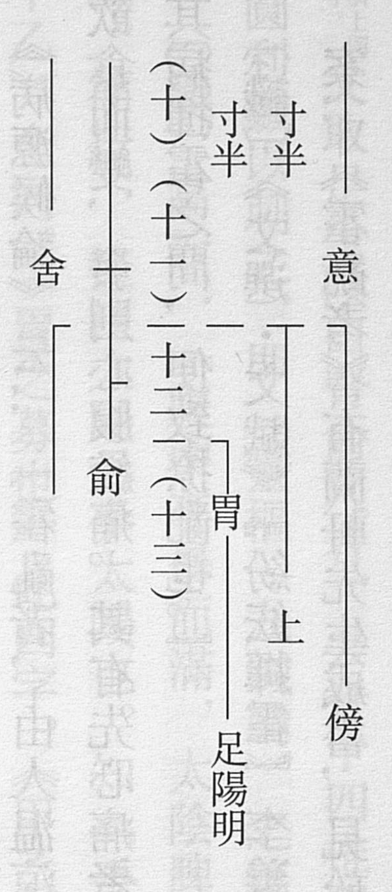

- 意 → 傍
- 寸半
- 寸半
- 上
- 胃 → 足陽明
- (十)(十一)十二(十三)
- 舍
- 俞

『대소』 권30 「자간경수(刺癇驚數)」.

〔楊〕간경을 찌르는 맥에는 모두 다섯 갈래가 있다. 수태음을 다섯 번 취하고, 또 족태양의 수혈을 다섯 번 취하며, 또 수소양(手少陽) 경락 곁 1촌을 취하고, 또 족양명 곁 1촌과 복사뼈 위 5촌에 세 번 침놓는다.

〔識〕［簡按］‘癇驚’은 ‘驚癇’을 말하는 듯하다. 그러나 「대기론(大奇論)」에 “이음(二陰)이 급하면 간궐(癇厥)이 되고, 이양(二陽)이 급하면 경(驚)이 된다.”라 한 것을 살펴보면 두 가지 병임을 알 수 있다. ［又按］『옥편(玉篇)』에 “‘癇’은 소아의 병이다.”라 하였다. 『갑을』에는 ‘驚癇’으로 되어 있고 소아잡병(小兒雜病)에 실려 있다. 왕부(王符)의 『잠부론(潛夫論)』에 “젖을 너무 많이 먹이면 반드시 경련이 일어 간병(癇病)이 생긴다.”라 하였고, 『소원(巢源)』에 “간(癇)은 소아의 병이다. 열 살 이상은 전(癲)이라 하고 열 살 이하는 간이라 한다.”라 하였으며, 서사백(徐嗣伯)은 “어른은 전이라 하고 소아는 간이라 한다.”라 하였다. 또 『소원』과 『천금(千金)』의 소아문에 세 가지 간이 있으니 식간(食癇)·경간(驚癇)·풍간(風癇)이라 하였으므로 증거로 삼을 수 있다. 『수서(隋書)』에 “허지장(許智藏)이 진효왕(秦孝王)의 병을 진찰하고 말하였다. 병이 이미 심(心)에 들어갔으니 곧 간이 발작할 것이다.”라 하였다. 이는 오로지 어른을 일컬은 것이지만, 옛 책에서는 대부분 소아의 병으로 보았다. 『병명고(病名考)』에 자세하다. 간은 후세에 이른바 경풍(驚風)이니, 『성혜방(聖惠方)』의 논에서 상세히 변별하였다.｟판본에는 잘못 빠졌으므로 이제 원초본(原抄本)에 의거한다.｠

〔識〕‘脈五’는, ［吳云］아래 글의 그 다섯이다. 각 주가가 모두 같다. 왕(王)이 양릉천(陽陵泉)으로 본 것은 옳지 않다. ‘鍼手太陰’이 『갑을』에는 ‘手足太陰’으로 되어 있다. 마(馬)와 장(張)은 모두 “경거혈(經渠穴)을 찌른다.”라 하였고, 오(吳)·지(志)·고(高)는 어느 혈이라 지목하지 않았으며, 아래 세 경도 같다. ［簡按］어느 혈이라 지목하지 않은 쪽이 옳은 듯하다. ‘刺經太陽’은 마·오·장이 ‘經’ 아래에서 구절을 끊었다. ［吳云］그 경맥만 말하고 혈에 미치지 않은 경우는 본경 어디든 취할 수 있으니 그 혈에 구애될 필요가 없다. ［馬云］수태양소장경의 혈을 각각 다섯 번 찌르니, 그 경혈 양곡(陽谷)일 것이다. 고(高)는 왕주에 근거하여 곧바로 ‘經’을 ‘足’으로 고쳤다. ［簡按］오(吳)가 옳은 듯하지만, 태양에 수족을 말하지 않았으니 왕의 뜻을 따라야 한다. 마(馬)는 ‘經’을 경혈의 ‘經’으로 보았기 때문에 양곡이라 하였다. ‘刺手少陰經絡傍者’는 『갑을』에 ‘手足少陰’으로 되어 있다. ［吳云］어느 경의 곁이라 밝힌 것은 경도 아니고 혈도 아니니 그 손락(孫絡)을 취한다. ［馬云］수소음심경(手少陰心經)의 낙혈 통리(通里)를 찌르는 것인데, 낙(絡)의 곁이라 하였으니 곧 수태양소장경의 지정혈이다. ［張云］수소음의 경혈 영대(靈臺)이다. 낙혈 통리의 곁에 있으므로 ‘絡傍’이라 한다. ‘上踝五寸’은, ［馬云］곧 족소음신경(足少陰腎經)의 축빈혈(築賓穴)이다. ［簡按］장(張)·지(志)·고(高)는 모두 왕주를 따랐다. 이는 목(木)의 실(實)을 사(寫)하는 것이다. 신경(腎經)을 찌른다면 이치에 어긋난다.[역3]

안(案): ‘手太陰各五’는 아마 척택(尺澤)을 말한 것이다. 현존 『황제명당경(黃帝明堂經)』에 “척택은 합수(合水)이다. 팔꿈치 가운데 주름 위의 동맥에 있고, 3분 찌르고 3호(呼) 머물며, 뜸은 3장이고, 전질(癲疾)을 주치한다.”라 하였다. 『외대(外臺)』 권39에 인용한 『갑을』에는 이 아래 ‘嘔沫’ 두 글자가 있다.

‘刺經太陽五’는 왕주를 따라 승산혈(承山穴)로 보아야 한다. 그러나 ‘經’ 자는 타당하지 않다. 『외대』 권30에 인용한 『갑을』에 “방광은 곤륜(崑崙)으로 행하니, 곤륜은 화(火)이다. 발 바깥 복사뼈 뒤 발꿈치뼈 위 오목한 가운데에 있고, 족태양맥이 행하는 곳으로 경(經)이 된다.”라 하였다. 이른바 ‘經太陽’은 아마 이것을 말할 것이다. 곤륜은 한열(寒熱)과 전질을 주치한다. 『의심방(醫心方)』 권2에 인용한 『황제명당(黃帝明堂)』과 『외대』 권30에 인용한 『갑을』의 글이 같다.

‘手少陰經絡傍者一’은 『대소』를 따라 ‘手少陽經胳者傍一寸’으로 보아야 한다. 이른바 ‘手少陽經傍一寸’은 곧 수양명대장경(手陽明大腸經)이니 아마 편력혈(偏歷穴)을 말한다. 『의심방』 권2에 인용한 『명당(明堂)』에 “편력 2혈은 손목 뒤 3촌에 있고, 3분 찌르고 7호 머물며, 뜸은 3장이고, 전질을 주치한다.”라 하였다.

‘足陽明一’도 『대소』를 따라 ‘足陽明一寸’으로 보아야 하니, 역시 족양명 경락 곁 1촌을 말한다. 이는 앞을 자세히 하고 뒤를 줄인 문법이며, 족소양경(足少陽經)을 말한다. 대개 족양명경과 나란히 위로 올라가 그 사이가 1촌쯤이기 때문이다. 『외대』 권39에 인용한 『갑을』에 “외구(外丘)는 족소양의 극혈[郄]이고 소양이 생겨나는 곳이며, 바깥 복사뼈 위 7촌에 있고, 전질을 주치한다.”라 하였고, 『의심방』 권2에 인용한 『명당』에 “3분 찌르고 뜸은 3장이다.”라 하였다.

‘上踝五寸’에서, 바깥 복사뼈 위 5촌은 광명혈(光明穴)로 족소양담경이고, 안쪽 복사뼈 위 5촌은 여구(蠡溝)로 족궐음간경(足厥陰肝經)인데, 둘 다 전경(癲驚)을 주치하지 않는다. 그러나 간담 두 경은 이치상 간(癇)을 치료해야 한다. 그러므로 바깥 복사뼈 위 7촌의 외구혈과, 바깥 복사뼈 위 7촌에서 비스듬히 삼양(三陽)의 분육 사이에 속한 양교혈(陽交穴)이 모두 전질을 주치한다. 또 귀 바로 위로 머리털 경계에 4분 들어간 곳이 본신혈(本神穴)이고, 눈 윗눈시울[目上眥] 바로 위로 머리털 경계에 5분 들어간 곳이 임읍혈(臨泣穴)인데, 모두 소아 경간을 주치하니, 이로써 증명할 수 있다.[역4]

‘刺三鍼’은 위의 세 혈을 모두 세 차례 찌른다는 말이다.

안(案): ‘刺癇驚脈五’는 간경을 찌르는 법에 동맥의 자리가 다섯 곳이라는 말이다. 『천금』 권29 「용침약례(用鍼略例)」 제5에서 “침을 놓을 때마다 늘 맥을 보아야 하니, 맥이 좋으면 침을 놓고 맥이 나쁘면 함부로 침을 놓지 않는다.”라 하였다. 이른바 ‘看脈’은 침놓을 자리의 맥의 색을 살펴본다는 말이다. 또 『천금』 권5상 「경간(驚癇)」 제3에 “양쪽 귀 뒤 완골(完骨) 위의 푸른 맥에 뜸을 뜨며, 침으로 찔러 피를 내도 된다.”라 하였고, 또 권29 「복인명당도(伏人明堂圖)」의 「복인이후육혈원근법(伏人耳後六穴遠近法)」 제4에 “계맥(瘈脈)은 귀뿌리의 닭발 같은 푸른 맥에 있으며 뜸을 뜨지 않는다.”라 하였으며, 또 권30 「두병(頭病)」 제1에 “계맥은 풍으로 머리와 귀 뒤가 아픈 것을 주치한다.”라 하였고, 『의심방』 권2에 인용한 『명당』에 “계맥(瘛脈)은 소아의 간과 계종(瘛瘲)을 주치한다.”라 하였다. 모두 증거로 삼을 수 있다.

‘各五’는 좌우 각각 다섯 번 찌른다는 말이다. 뒷글의 ‘刺經太陽五’·‘刺三鍼’도 모두 좌우 각각이다. 앞을 자세히 하고 뒤를 줄인 글일 뿐이다.

**○凡治消癉，**

무릇 치료하는 병 가운데 소단(消癉),

안(案): ‘消癉’의 설명은 앞 17엽 앞면에 보인다. ‘癉’ 자 풀이는 이미 제17｟廿三ウ｠에 보인다.

**○仆擊，**

부격(仆擊),

〔識〕［張云］갑자기 쓰러지는 것이 얻어맞은 듯한 것이다. 누씨(樓氏)의 『강목(綱目)』에 “갑자기 쓰러지는 것을 경에서는 격부(擊仆)라 하고 세간에서는 졸중풍(卒中風)이라고도 한다.”라 한 것이 이것이다. ［簡按］「구궁팔풍편(九宮八風篇)」에 “삼허(三虛)가 있으면서 사풍(邪風)에 치우쳐 맞으면 격부와 편고(偏枯)가 된다.”라 하였으니, 누씨의 설이 낫다. ［吳云］갑자기 쓰러져 물건에 다친 것이다. ［志云］전간(癲癇)의 바깥이 실한 것이다. 이들은 억측에 속한다.

**○偏枯，**

편고(偏枯),

안(案): ‘偏枯’는 이미 제3·제7에 보이니 함께 살펴보아야 한다.

**○痿厥，**

위궐(痿厥),

안(案): 부격은 졸중풍증(卒中風證)을 말하고, 편고는 정중풍증(正中風證)을 말하며, 위궐은 유중풍증(類中風證)을 말한다.

**○氣滿發逆，**

기만발역(氣滿發逆)은,

〔識〕［吳云］기만(氣滿)은 기가 급하고 거친 것이다. 발역(發逆)은 일어나 위로 치받는 것이다. ［志云］탁기(濁氣)가 가운데에 있는 것이다.

〔琦〕기만발역은 곧 천역(喘逆)이다.

안(案): 기만은 음결(飲結)을 말하고, 발역은 해역(欬逆)을 말한다. 고량(高梁)으로 담음(痰飲)이 빚어진 것이 곧 이것이다. 「음양별론(陰陽別論)」 7에서 “이음일양(二陰一陽)이 병을 일으키면 창(脹)이 잘 생기고 가슴이 그득하며 기가 잘 치민다.”라 하였다. 이음은 족소음신(足少陰腎)과 수소음심경이고, 일양은 족소양담과 수소양삼초경(手少陽三焦經)이다. 심신(心腎)이 교통하지 못하면 담즙과 삼초의 기화(氣化)가 베풀어지지 못하여, 이에 유음(留飲)의 병이 심흉(心胸) 사이에 맺히므로 그 증상은 창(脹)이 잘 생기고 가슴이 그득하며 기가 잘 치미니, 모두 음결이 일으킨 것이라는 말이다. 여기서 말한 ‘氣滿發逆’도 같은 증이니 함께 살펴보아야 한다.

**○肥貴人，則高梁之疾也。**

살찌고 귀한 사람에게는 고량(高梁)으로 생기는 병이다.

안(案): 살찌고 존귀한 사람이 흔히 앞서 든 여러 증상을 앓는 것은 늘 기름진 음식을 먹은 탓이라는 말이다. 『금궤(金匱)』 「혈비(血痺)」 제6에서 “혈비병 운운. 대체로 존귀하고 영화로운 사람은 뼈가 약하고 기부(肌膚)가 풍성하고 무겁다.”라 하였으니, 함께 살펴보아야 한다. 어떤 이는 ‘肥貴’를 빨리 말한 것이 ‘肥’이며 賁·胖·防·彭 등의 글자와 음과 뜻이 같다고 한다. 옳은지 알 수 없어 적어 두고 함께 살펴보기를 기다린다. ‘高梁’은 이미 제3에 보인다.

안(案): 살찌고 귀하며 기름진 음식을 먹는 사람에게 생기는 병은 기만에서 시작하여 점차 큰 병이 되어 소단에 이를 뿐이다.

〔楊〕이 여섯 가지는 살찌고 귀한 사람에게 고량으로 생기는 병이다.

**[역1]** 원서대로 옮겼다. 상무인서관본 『太素』에는 「即爲經絡之會處也」로 되어 있어, 원서 「會處也之」의 「之」는 자리가 어긋난 것일 수 있다.
**[역2]** 원서대로 「士晏」으로 옮겼다. 『甲乙經』을 엮은 皇甫謐의 자는 「士安」으로 알려져 있어 「晏」은 「安」의 잘못일 수 있다.
**[역3]** 원서대로 옮겼다. 인용처인 『類經』에도 「靈臺」로 되어 있으나, 수소음경의 경혈은 「靈道」이므로 장개빈 주의 착오일 수 있다.
**[역4]** 원서대로 옮겼다. 이 단락의 경문과 바로 뒤 문장에는 「癇驚」「癇」으로 되어 있어 「癲驚」은 「癇驚」의 뜻일 수 있다.

**○隔塞閉絶，上下不通，則暴憂之病也。**

격색(隔塞)·폐절(閉絶)로 위아래가 통하지 않는 것은 갑작스러운 근심[暴憂]으로 생긴 병이다.

〔楊〕이 네 가지는 갑작스러운 근심으로 생긴 병이다. ‘膈塞’은 흉격 가운데가 막힌 것이다. ‘閉’는 칠규(七竅)가 막힌 것을 말하니, 트림과 하사(下使)의 기를 말하니, 곧 위아래[上下]이다.｟［案］‘使’는 ‘便’의 잘못인 듯하다.｠

〔識〕조부본(趙府本)에는 ‘塞’이 ‘則’으로 되어 있고 웅(熊)본·장(張)본도 같은데 잘못이다. 「풍론(風論)」에서 “음식이 내려가지 않고 격색하여 통하지 않는다.”라 하였고, 「본신편(本神篇)」에서 말하였다.

“근심하는 사람은 기가 막혀 행하지 못한다.” ［吳云］막혀서 위아래가 닫히고 끊겨 수곡(水穀)이 통하지 못하는 것은 갑작스러운 근심이 일으킨 것이다.

안(案): 양(楊)의 주가 옳은 듯하다. ‘鬲塞’은 곧 흉격 가운데가 막힌 것이다. ‘閉絶’에서 ‘閉’는 곧 울폐(鬱閉)이고 ‘絶’은 곧 민절(悶絶)·운절(運絶)의 ‘絶’이니, 답답하여 기가 끊어지는 것을 말한다. ‘上下不通’도 폐색의 뜻을 자세히 말한 것이다. 위로는 인후로 통하는 기가 끊어지고 아래로는 이변(二便)으로 통하는 기가 끊어진다는 말이다. 지금 갑자기 근심한 사람이 문득 답답하게 막혀 기절하는 것을 세속에서 두루 적(積)이라 일컫는데, 바로 이 증이다. 어떤 이는 말한다. “‘憂’는 아마 본래 ‘夏’였을 것이다. ‘夏’는 곧 ‘下’의 차자(借字)이니, 갑자기 설사한[暴下] 뒤에는 반드시 격색 등의 증이 되어 하법 뒤의 비경(痞鞕)과 사정이 같다. 『병원(病源)』 권22 곽란후(霍亂候)에 인용한 『양생방(養生方)』에 ‘7월에 꿀을 먹으면 갑자기 설사하고 곽란이 일어난다.’라 하였는데, 『의심방(醫心方)』 권29에 인용한 『양생요집(養生要集)』에 이 글을 실으면서 ‘暴下’를 ‘暴夏’로 적었으니 증거로 삼을 수 있다.”

（眉）「창공전(倉公傳)」 제2안에 “제왕(齊王)의 중자(中子)와 여러 어린아이가 앓았으니, 기격병(氣鬲病)이다. 이 병은 사람을 번만(煩懣)하게 하고 음식이 내려가지 않으며 때때로 거품을 토하게 한다. 병은 조금 근심하고 자주 음식을 싫어한 데서 얻었다 운운.”이라 하였으니, 여기서 말한 ‘暴憂之病’과 같은 증이다.

**○暴厥而聾，偏塞閉不通，内氣暴薄也。不從内，外中風之病，故瘦留著也。**

갑자기 궐(厥)하여 귀가 먹고 한쪽이 막혀 통하지 않는 것은 내기(内氣)가 갑자기 부딪힌[暴薄] 것이다. 안에서 비롯하지 않고 밖에서 풍(風)에 맞은 병은 그 때문에 숨어[瘦] 머물러 붙어 있다.

〔楊〕폭궐(暴厥)로 귀가 먹고 한쪽이 막힌다. 내기가 갑자기 그득해져 부딪히며, 안에서 비롯하지 않은 것은 풍에 맞은 병이다. 비기(脾氣)가 머물러 옹체되어 안에서 순조롭지 못하므로 수척해지고 머물러 붙는다.

안(案): 양(楊)의 주와 『소문(素問)』 본문은 글의 뜻이 서로 같다. 이로 미루어 왕씨(王氏)가 차주(次注)할 때 양의 주를 따라 절충하여 본문을 지은 것이니, 서문에서 ‘더한 글자는 모두 붉은 글씨로 썼다’라 한 것이 아마 이것이다. ‘瘦’ 자 풀이는 이미 제20｟十七ヲ｠에 보인다. 양씨가 여기서 ‘瘦留著’로 풀이한 것은 아마 제20의 ‘留瘦不移’라는 글로 여기를 주석한 것이 아닐까. 왕주(王注)가 양주의 이 글을 그대로 썼음을 알 수 있다.

〔吳〕폭궐은 갑자기 기가 치밀어 오르는 것이다. ‘聾’은 귀가 먹는 것이다. 이는 내기가 갑자기 부딪혀 일어난 것임을 말한다. ‘薄’은 雷風相薄의 ‘薄’이니 부딪쳐 흔드는 것을 일컫는다.

〔滑〕‘瘦’는 ‘廋’로 써야 하니 ‘人焉廋哉’의 ‘廋’와 같다. ‘廋’는 숨는 것이다. 숨어 머물러 붙어 떠나지 않는 것이다.

안(案): 왕씨 이후의 여러 주는 모두 ‘不從内’ 이하를 별도의 조문으로 보았으나 옳지 않은 듯하다. 양의 주는 한 조문으로 보았으니 따를 만하다. 갑자기 기가 치밀어 귀가 먹는데, 그 귀먹음이 왼쪽이나 오른쪽 한쪽으로 막혀 통하지 않는 것은 대개 담음(痰飲)이 기도(氣道)에 맺혀 내기가 갑자기 부딪힌 탓이라는 말이다. 이 증은 더러 안에서 비롯하지 않고 밖에서 풍한(風寒) 사기에 맞아 생기는 것도 있으니, 곧 사기가 곧장 안으로 들어가 숨어 머물러 붙었기 때문이다. 곧 소양(少陽) 이롱(耳聾)의 증으로, 이 역시 사기가 음(飲) 속에 맺혀 생긴 것이다. 내인·외인으로 나뉘지만 결국 음결(飲結)이 근본 조짐임을 벗어나지 않는다. 어떤 이는 말한다. “‘故’는 일[事]이다. 밖에서 풍한에 맞은 병이 안에서 음과 서로 맺히는 일이 되어 숨어 머물러 붙는다는 말이다.”

**○蹠跛，寒風濕之病也。**

척파(蹠跛)는 한(寒)·풍(風)·습(濕)으로 생긴 병이다.

〔識〕［馬云］‘蹠’은 음이 隻이다. ‘跖’과 같다. 『맹자(孟子)』 「계명이기장(鷄鳴而起章)」의 盜跖은 ‘庶’를 따르고 「진중자염사장(陳仲子廉士章)」은 ‘石’을 따르는데 뜻은 같다. 초(楚)나라 사람은 뛰는 것을 ‘蹠’이라 한다. ‘跛’는 음이 波이다. 『역(易)』에 ‘절름발이도 걸을 수 있다.’라 하였다. 또 음이 避이다. 『국어(國語)』에 ‘丘無跛’라 하였다. ［吳云］발 앞을 디디며 걷는 것을 ‘蹠’이라 한다. 한쪽 발을 끄는 것을 ‘跛’라 한다. ［張云］발로 걸을 수 없는 것을 ‘蹠’이라 한다. ［志云］‘蹠’은 발이다. ‘跛’는 걸음이 바르지 못하고 한쪽으로 쏠려 힘이 드는 것이다. ［高云］‘蹠’은 밟는 것이다. ‘跛’는 바르지 않은 것이다. ［簡按］‘蹠’과 ‘跖’은 통한다. 『설문(説文)』에 “‘跖’은 발바닥이다.”라 하였다. 또 ‘𨂂’으로도 쓴다. ‘蹠跛’는 곧 『한서(漢書)』 ‘𨂂盭’의 뜻이다｟「가의전(賈誼傳)」에 “병은 다리가 부을 뿐만 아니라 또 𨂂盭으로 괴롭다.”라 하였고, 주에 “‘𨂂’은 발바닥이다. ‘盭’은 어그러지는 것이다.”라 하였다.｠ 그러므로 왕주에 “발을 절어 밟을 수 없다.”라 하였고 지(志)가 이를 따랐다. 방씨(方氏)의 『통아(通雅)』에서 ‘𨂂盭’을 ‘瘛瘲’으로 본 것은 매우 엉성하다.

〔紹〕［琦曰］‘仆擊’은 얻어맞은 듯 쓰러지는 것이다. 기만발역(氣滿發逆)은 곧 천역(喘逆)이다. 살찌고 귀한 사람에게 있으면 고량(膏粱)이 일으킨 것이다. 대개 달고 기름진 것이 지나치면 중기(中氣)가 느슨하고 막히며 폐위(肺胃)가 옹체되어 울체되고 담열(痰熱)이 생기므로 여러 증상이 나타난다. ［堅按］이 단락에서 하나는 살찌고 귀한 사람의 고량의 병으로 대개 안일과 쾌락에서 얻은 것이고, 하나는 갑작스러운 근심에서 얻은 것으로 대개 가난하고 고된 일을 하는 사람이니, 둘을 서로 맞세워 말한 것이다. 하나는 내인의 병이고 하나는 외인의 병이니 이 또한 맞세워 말한 것이다. 척파 같은 것도 외인에 속한다.

〔楊〕풍습(風濕)의 기가 척파·비병(痺病)을 일으킨다. ‘蹠’은 지석반(之石反)이다. ‘跛’는 어떤 본에는 ‘跂’로 되어 있다.

〔志〕서공하(徐公遐)가 말하였다. “척파를 풍·한·습의 병이라 한 것은 사기가 위에 맺히고 청기(清氣)가 아래에 있다는 뜻을 뒤집은 것이다. 척파에 풍사가 있음을 알면 편고(偏枯)에도 습사가 있음을 알 수 있다.”

〔箚〕『여람(呂覽)』에 “제왕이 닭을 먹을 때에는 반드시 그 며느리발톱｟（‘跖’으로 써야 한다）｠을 수천 개 먹은 뒤에야｟（‘後’가 빠졌다）｠ 만족하였다.”라 하였고, 주에 “‘跖’은 닭발의 뒤꿈치이다. ‘捃摭’의 ‘摭’처럼 읽는다.”라 하였다. ‘蹠’과 ‘跖’은 같다.

안(案): ‘蹠跛’는 걸음이 바르지 않은 것을 말한다. 이 증은 대개 풍비(風痺)·각약(腳弱) 부류에 속한다. 그러므로 ‘寒風濕之病也’라 하였다. 『설문』의 “‘蹠’은 초나라 사람이 뛰어오르는 것을 ‘蹠’이라 한다.”가 곧 이 뜻이다. 「비론(痺論)」에서 말한 풍·한·습 세 기가 이와 합치한다.

**○黃帝曰：黃疸，暴痛，癲疾，厥，狂，久逆之所生也。**

황제가 말하였다. “황달(黃疸)·폭통(暴痛)·전질(癲疾)·궐(厥)·광(狂)은 기가 오래 거스른 것[久逆]에서 생긴다.”

『대소(大素)』 권30 「구역생병(久逆生病)」.

〔楊〕이 다섯 병은 기가 오래 거슬러 생긴 것이다.

〔馬〕병이 생기는 까닭이 모두 안에서 비롯함을 말한 것이다. 족삼양은 머리에서 발로 달리고 족삼음은 발에서 배로 달린다. 그런데 각 경의 맥기(脈氣)가 위에서 오래 거슬러 아래로 행하지 않으면 상초·중초에 울체되어 쌓이므로, 황달·폭병(暴病)·전질·궐·광이 되니, 여러 증이 여기서 생긴다.

〔張〕이는 기가 거스른 지 오래되어 음양 영위(營衛)가 고르지 못한 바가 있은 뒤에 이 여러 증을 이루는 것이니, 모두 하루아침에 이루어진 것이 아니다.

‘黃疸’은 이미 「옥기진장(玉機真藏)」 19｟十五ウ｠에 보이니, 습열이 혈분(血分)에 안으로 울체된 증이다. ‘暴痛’도 기혈이 서로 화합하지 못하여 생긴다. 대개 이 두 증은 영위의 기가 오래 거슬러 일으킨 것으로 표증(表證)이다. 전·궐·광 세 증은 모두 오장의 기가 오래 거슬러 생긴 것으로 이증(裏證)이다. ‘癲疾’은 이미 「오장생성(五藏生成)」 제10｟十一ウ｠과 「맥요정미(脈要精微)」 제17｟廿四ウ｠에 보인다. ‘厥’은 「오장생성」 제10｟八ヲ｠과 제17｟廿四ウ｠에 보인다. ‘狂’은 이미 「생기통천(生氣通天)」 제3｟十五ヲ｠에 보이니, 함께 살펴보아야 한다.

〔紹〕［琦曰］음이 오르지 못하고 양이 내리지 못하면 역(逆)이 된다. 비위(脾胃)에 있으면 습이 넘쳐 황달이 된다. 경맥에 있으면 갑자기 아프다. 상초에 있으면 전질·궐·광이 된다. 모두 기역(氣逆)이 일으킨 것이다.

〔志〕황달은 습열이 안으로 울체되어 병색이 밖으로 나타나는 것이다. 폭통은 오장의 기가 고르지 못하여 갑자기 아픈 것이다. 전질·궐·광은 음양이 한쪽으로 치우쳐 이긴 병이다. 이는 모두 음양오행의 기가 오래 거슬러 조화되지 못하여 생긴 것이다.

**○五藏不平，六府閉塞之所生也。**

오장(五藏)이 고르지 못한 것은 육부(六府)가 막혀서 생긴다.

『대소』 권30 「육부생병(六府生病)」.

〔楊〕육부는 곡기를 받아 오장에 전한다. 그러므로 육부가 막히면 장이 고르지 못하다.

〔馬〕육부는 화물(化物)을 전하고 저장하지 않으므로 실하되 그득할 수 없다. 오장은 정기를 저장하고 사(寫)하지 않으므로 그득하되 실할 수 없다. 오장은 본래 육부와 표리가 된다. 지금 음식이 마땅함을 잃고 토하고 설사함이 절도를 넘어, 육부가 화물을 전하지 못해 막히면 오장도 고르지 못하여 각각의 병이 저절로 생긴다.

**○頭痛耳鳴，九竅不利，腸胃之所生也。**

두통(頭痛)과 이명(耳鳴), 구규(九竅)의 불리(不利)는 장위(腸胃)에서 생긴다.

『대소』 권30 「장위생병(腸胃生病)」.

〔楊〕장위의 맥은 머리에 있고 칠규에 있으므로, 장위가 순조롭지 못하면 머리와 구멍이 병든다.

〔馬〕대장은 전도(傳導)의 부(府)이고, 소장은 수성(受盛)의 부이며, 위는 창름(倉廩)의 부이다. 지금 장위가 막히면 승강출입의 맥도(脈道)가 막히므로 두통·이명·구규불리가 되니, 여러 증이 여기서 생긴다.

안(案): ‘黃疸’ 이하 세 조문은 모두 내인의 병이며, 모두 위기(胃氣)가 주가 된다. 대개 경맥의 기가 안에서 오래 거스르는 것은 육부가 막혔기 때문이다. 육부가 막히는 것도 장위가 조화롭지 못한 데서 일어난다. ‘腸胃’ 두 글자는 오로지 대소변을 가리켜 말한 것이니, 위의 여러 증은 모두 이변이 막힌 것을 근본으로 한다. 그러므로 이 여러 증은 크게 허한 지경에 이르지 않았으면 하제(下劑)로 공하(攻下)해야 하니, 이것이 예로부터의 긴요한 처방이자 묘술이다. 중경(仲景)은 곡달(穀疸)에 인진호탕(茵陳蒿湯), 주달(酒疸)에 치자대황탕(梔子大黃湯), 황달에 대황소석탕(大黃消石湯), 중악(中惡) 심통(心痛)에 주마탕(走馬湯), 아프면서 막힌 경우에 후박삼물탕(厚朴三物湯), 심하(心下)가 그득하고 아픈 데 대시호탕(大柴胡湯), 전간(瘨癇) 치료에 풍인탕(風引湯), 졸사(卒死)에 비급환(備急丸), 상한 발광(發狂) 및 여광(如狂)에 모두 저당탕(抵當湯)을 썼으니, 모두 기혈의 오랜 역을 치료하는 처방이다. 다만 두통과 이명 두 증은 외감(外感)이 아니라면 반드시 장위의 불화이다. 대체로 장위가 불화하면 구규가 불리하고, 구규가 불리하면 반드시 두통·이명의 증이 있다. 이 두 증은 그 상부에서 먼저 병드는 것이므로, 이 두 증을 들어 상부의 여러 증을 포괄한 것이다.

문구(文久) 2년 임술년 정월 16일 벽고재(辟古齋) 동쪽 곁채에서 쓰다.　현재거사(玄齋居士) 삼립지(森立之)

제28 보(第二十八補)

사기(邪氣)가 왕성하면 실(實)하고 정기(精氣)를 빼앗기면 허(虛)하다[邪氣盛則實精氣奪則虛]｟一ヲ｠ 「조경론(調經論)」 62에서 말하였다. “풍우(風雨)가 사람을 상할 때에는 먼저 피부에 머물고, 손맥(孫脈)으로 전해 들어가며, 손맥이 그득하면 낙맥(絡脈)으로 전해 들어가고, 낙맥이 그득하면 대경맥(大經脈)으로 들어간다. 혈기와 사기가 함께 분주(分腠) 사이에 머물면 그 맥이 단단하고 크므로 실이라 한다. 실한 경우는 겉이 단단하고 충만하여 누를 수 없으니, 누르면 아프다. 한습(寒濕)이 사람에게 맞으면 피부가 수렴되지 못하고 기육이 단단하게 조여지며 영혈(榮血)이 껄끄러워지고 위기(衛氣)가 떠나므로 허라 한다. 허한 경우는 섭벽(聶辟)하고 기가 부족하니, 누르면 기가 충분히 따뜻하게 하므로 시원하여 아프지 않다.”｟［案］ 여기서 말한 허실과 같은 이치이니, 함께 살펴보아야 한다.｠

병이 오래되어도 치료할 수 있다[病久可治]｟十七ヲ｠[역1]

〔箚〕고초본(古抄本)에는 ‘可知’ 위에 ‘不’ 자가 있고, ‘脈懸小云云’ 아홉 자가 없다. ［寛案］고초본이 매우 옳으니 따라야 한다. 대개 왕(王)이 ‘脈懸小云云’의 뜻을 풀이하지 않았으니 옛 본에 이 몇 글자가 없었음을 알 수 있으며, 이하에 착간(錯簡)이 있어 글이 온전하지 않다.｟이 설은 옳지 않으니 삭제해야 한다.｠

폭옹(暴癰)｟廿二ヲ｠

안(案): 폭옹은 갑자기 피부가 부어오르는 것을 말하며, 옹종이나 창류(瘡瘤)를 말하는 것이 아니다. 『설문』을 살펴보면 “‘癰’은 붓는 것이다.”, “‘腫’은 옹이다.”라 하였다. 이로 보면 ‘癰’과 ‘腫’은 모두 피부가 부어오른다는 뜻이고, 전주(轉注)되어 사지 부종의 뜻이 되었다. 여기서 말한 폭옹이 곧 본뜻이다. ‘魄汗不盡’은 통증과 괴로움으로 나는 땀을 말한다. 이 땀이 그치지 않는 것도 방광이 주관하는 바로서 표양(表陽)의 부족이다. 그 치료는 경수(經俞)에서 경맥의 부족을 보해야 한다.

허실(虛實)이란 무엇인가[何謂虛實]｟一ヲ｠

「사십팔난(四十八難)」에서 말하였다. “사람에게 삼허삼실(三虛三實)이 있다는 것은 무슨 말인가? 답하였다. 맥의 허실이 있고, 병의 허실이 있으며, 진찰의 허실이 있다. 맥의 허실은 유(濡)한 것이 허이고 긴뢰(緊牢)한 것이 실이다. 병의 허실은 나오는 것이 허이고 들어가는 것이 실이며, 말하는 것이 허이고 말하지 않는 것이 실이며, 완만한 것이 허이고 급한 것이 실이다. 진찰의 허실은 유한 것이 허이고 뇌(牢)한 것이 실이며, 가려운 것이 허이고 아픈 것이 실이다. 겉이 아프고 속이 편하면 외실내허(外實内虛)이고, 속이 아프고 겉이 편하면 내실외허(内實外虛)이다. 그러므로 허실이라 한다.”

모두 그 물류(物類)에서 시작한다[皆從其物類始]｟五ヲ｠

안(案): 여러 주가 분명하지 못하다. 대개 이는 사시(四時)와 오장의 법칙에 관한 이치이다. 오장이 사시를 본받지 않으면 인체 안에 비로소 허실의 조짐이 있게 되니, 외사(外邪)에서 얻은 것이 이것이다. 음식이 비위를 상하고 방실(房室)이 신기(腎氣)를 상해도 허실의 증이 일어나니, 내인에서 온 것이 이것이다. 그러므로 ‘皆從其物類始’라 한 것이다.

오장이 고르지 못하다[五藏不平]｟卅一ウ｠

「삼십칠난(三十七難)」에서 말하였다. “오장이 불화하면 구규가 통하지 않는다. 육부가 불화하면 머물러 맺혀 옹(癰)이 된다.”

소단(消癉)｟十七ヲ廿八ヲ｠

『대소』 권6 「오장명분(五藏命分)」에서 “심(心)이 무르면 소단열중(消癉熱中)을 잘 앓는다.”라 하였고, 양(楊)의 주에서 “오장이 유약하면 신(神)도 유약하다. 그러므로 장이 유약한 사람은 혈맥이 행하지 못하여 열로 바뀌어 기부를 소모시키므로 소단열중이라 한다. 음은 丹이다. 열중은 위(胃) 속이 뜨겁기 때문이다.”라 하였다.

격색(隔塞)｟廿九ヲ｠

『천금(千金)』 권17 「적기(積氣)」 제5 칠기탕(七氣湯) 아래에서 “더러 음식으로 격기(膈氣)가 된다.”라 하였다. 또 오격환(五膈丸) 아래에서 “우격(憂膈)·기격(氣膈)·식격(食膈)·음격(飲膈)·노격(勞膈) 다섯 병을 치료하니, 같은 약을 복용한다. 근심·성냄·사려와 음식으로 얻는다.”라 하였다.｟十七ヲウ｠

폭궐(暴厥)｟廿九ウ｠

#### 태음양명론(太陰陽明論)편 제29

○黃帝問曰：太陰陽明爲表裏，脾胃脈也。生病而異者，何也。

황제가 물었다. “태음(太陰)과 양명(陽明)은 표리(表裏)이며 비위(脾胃)의 맥이다. 병이 생김이 다른 것은 어째서인가?”

『대소』 권6 「장부기액(藏府氣液)」에 전부 실려 있다.

〔楊〕족태음과 족양명, 비위 두 맥은 여러 경맥의 바다이니, 병이 생기든 이로움을 받든 근본이 되므로 따로 들어 물은 것이다.

**○岐伯對曰：陰陽異位，更虛更實，更逆更從，或從内，或從外，所從不同，故病異名也。**

기백(岐伯)이 답하였다. “음양은 자리가 다르고, 번갈아 허하고 번갈아 실하며, 번갈아 거스르고 번갈아 따르며, 안에서 비롯하기도 하고 밖에서 비롯하기도 한다. 비롯하는 곳이 같지 않으므로 병의 이름이 다르다.”

〔楊〕대음[大陰]은 음이고 양명은 양이니 곧 자리가 다른 것이다. 봄여름에는 양명이 실하고 대음이 허하며, 가을겨울에는 대음이 실하고 양명이 허하니, 곧 번갈아 허실한 것이다. 봄여름에는 대음이 거스르고 양명이 따르며, 가을겨울에는 양명이 거스르고 대음이 따른다. 수삼음(手三陰)은 안에서 밖으로 향하고 수삼양(手三陽)은 밖에서 안으로 향한다. 족삼음은 안에서 밖으로 향하고 족삼양은 밖에서 안으로 향한다. 12경맥의 음양이 여섯 가지로 같지 않으니 병이 생김도 본디 많다.｟［案］‘明’과 ‘實’ 사이에 ‘爲’ 자가 빠진 듯하다.｠

안(案): 음양표리도(陰陽表裏圖)는 아래와 같다｟양(楊)의 주에 의거함｠

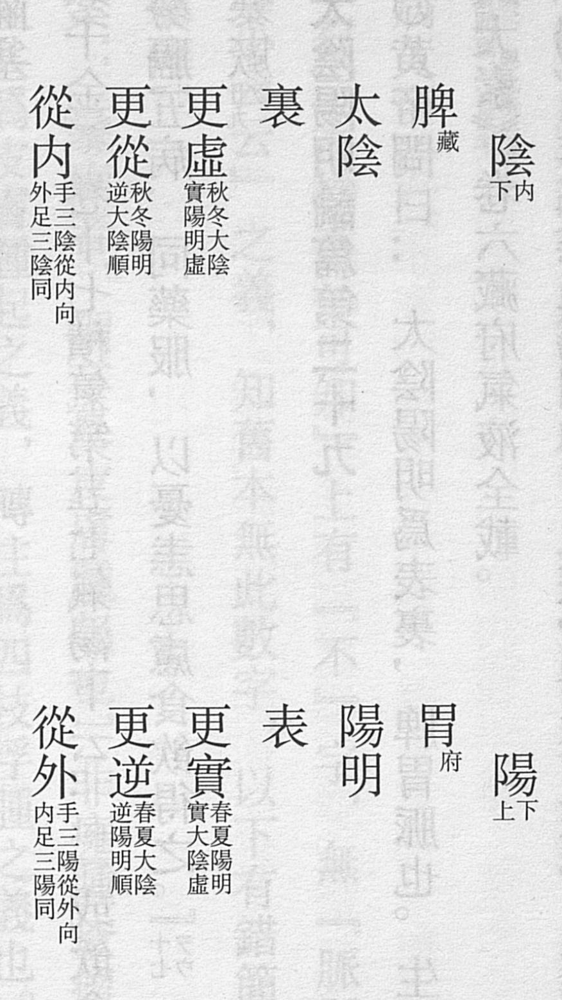

- 陰｟内下｠
- 陽｟下上｠
- 脾｟藏｠
- 胃｟府｠
- 太陰
- 陽明
- 裏
- 表
- 更虛｟秋冬大陰實陽明虛｠
- 更實｟春夏陽明實大陰虛｠
- 更從｟秋冬陽明逆大陰順｠
- 更逆｟春夏大陰逆陽明順｠
- 從内｟手三陰從内向外足三陰同｠
- 從外｟手三陽從外向内足三陽同｠

**○帝曰：願聞其異狀也。**

황제가 말하였다. “그 다른 모습을 듣고 싶다.”

〔楊〕그 병의 다름을 물은 것이다.

**○岐伯曰：陽者天氣也，主外。陰者地氣也，主内。故陽道實，陰道虛。**

기백이 말하였다. “양(陽)은 천기(天氣)로서 밖을 주관한다. 음(陰)은 지기(地氣)로서 안을 주관한다. 그러므로 양도(陽道)는 실하고 음도(陰道)는 허하다.”

〔楊〕양은 천기로서 밖을 주관하므로 양도가 실하다. 음은 지기로서 안을 주관하므로 음도가 허하다.

〔紹〕주단계(朱丹溪)의 「양유여음부족론(陽有餘陰不足論)」은 여기에 근거한 것이다.

〔志〕양은 강하고 음은 부드러우므로 양도는 늘 실하고 음도는 늘 허하다. 「계사(繫辭)」에서 “음양의 뜻은 해와 달에 짝한다.”라 하였다. 『백호통(白虎通)』에서 “해[日]라는 말은 실(實)이니 늘 차서 절도가 있다. 달[月]이라는 말은 이지러짐[闕]이니 찼다가 이지러졌다가 한다. 이지러지는 까닭은 무엇인가? 공을 해에 돌리기 때문이다.”라 하였다.

안(案): 형체 없는 양기가 형체 있는 음질(陰質)을 기르므로 늘 실하다. 형체 있는 음질은 형체 없는 양기를 받으므로 늘 허하다. 인체의 기혈은 양기가 밖에서 늘 실하고 음혈(陰血)이 안에서 늘 허하다. 허하므로 양기가 그 허를 타고 음혈을 자양하고, 실하므로 음혈이 그 실을 받아 양기를 머금어 간직한다. 그래서 기는 늘 실하고 형체는 늘 허하다. 본디 빈틈이 없는 것을 실이라 하고, 본디 막힘이 없는 것을 허라 한다.

（眉）이 절의 ‘陽者’부터 ‘陰道虛’까지의 글은 명고옥현의(名古屋玄醫)의 상세한 주가 『의학우득(醫學愚得)』 권하에 보이니 참고해야 한다.

**○故犯賊風虛邪者，陽受之。食飲不節，起居不時者，陰受之。**

그러므로 적풍(賊風)·허사(虛邪)에 범해지면 양이 받고, 음식이 절도 없고 기거가 때에 맞지 않으면 음이 받는다.

〔楊〕풍·한·서·습의 허사[虛耶]가 밖에서 주리(腠理)로 들어오면 육양(六陽)의 맥이 받고, 음식과 남녀의 일이 절도 없으면 육음(六陰)이 받는다.

〔張〕적풍·허사는 외상(外傷)이므로 양이 받아 부(府)로 들어간다. 음식·기거는 내상(内傷)이므로 음이 받아 장(藏)으로 들어간다.

〔識〕［徐云］이는 적풍·허사를 양이 받아 육부로 들어가고, 음식·기거를 음이 받아 오장으로 들어간다고 말한 것이다. 「음양응상론(陰陽應象論)」의 “천(天)의 사기는 사람의 오장을 해치고, 수곡의 한열은 사람의 육부를 해친다.”와 두 설이 상반되니 그 이치는 어디에 있는가? 이는 허사의 외상은 유여(有餘)하고 음식의 내상은 부족하여, 두 가지 상함이 서로 받는 바가 있음을 말한 것이니, 하나만 고집하여 상함을 말할 수 없다.

〔紹〕［琦曰］부는 양이고 장은 음이니 각각 그 부류를 따른다. ［按］「음양응상론」에 “천의 사기는 감수하면 사람의 오장을 해친다. 수곡의 한열은 감수하면 사람의 육부를 해친다.”라 하였다. 이와 정반대이지만 뜻은 실로 서로 이루어 준다. 형(形)과 기(氣)로 말하면 사기는 형체가 없으므로 장으로 들어가고 수곡은 형체가 있으므로 부로 들어간다. 표리로 말하면 부는 양으로 밖을 주관하므로 적풍·허사를 밖에서 받고, 장은 음으로 안을 주관하므로 음식의 무절제를 안에서 받는다. 실은 부와 장에 모두 있기 마련이다. 대개 내외의 사기는 병정(病情)이 만 가지로 변하여 한 가지로 다할 수 없으므로 그 뜻을 널리 펼친 것일 뿐이다.

안(案): 적풍·허사가 표양(表陽)을 범하는 것은 표양에 허함이 있기 때문이다. 음식이 절도 없고 기거가 때에 맞지 않은 것도 이음(裏陰)에 허함이 있기 때문이다. 대체로 사기는 허함이 있으면 들어오고 허함이 없으면 들어오지 못한다. 표가 허하면 들어와 양열증(陽熱證)이 되고, 이가 허하면 들어와 음한증(陰寒證)이 되는 것은 당연한 이치이다. 여기서 ‘陽受之’라 한 것은 육부 자체에 허함이 있는 경우까지 겸하여 보아야 하고, ‘陰受之’라 한 것은 풍사가 허를 타고 오장으로 들어가는 경우까지 띠어 보아야 한다. 이렇게 보면 서로 그 뜻이 드러난다. 이른바 호문견의(互文見義)이니 뜻이 말 밖에 있다.

**○陽受之，則入六府。陰受之，則入五藏。**

양이 받으면 육부(六府)로 들어가고, 음이 받으면 오장(五藏)으로 들어간다.

〔楊〕육양이 밖의 사기[外耶]를 받으면 육부로 전해 들어가고, 육음이 안의 사기[内耶]를 받으면 오장으로 전해 들어간다.

（眉）안(案): 그렇다면 윗글에서 ‘陽道實，陰道虛’라 한 것은 양병(陽病)은 실하고 음병(陰病)은 허하다는 뜻이다.

**○入六府，則身熱不時臥，上爲喘呼。**

육부에 들어가면 몸에 열이 나고 늘 누워 있으며[不時臥], 위로는 천호(喘呼)가 된다.

〔楊〕육부의 양기는 밖에 있으므로 몸에 열이 난다. 양이 왕성하면 낮에 자고 밤까지 잠들지 못하므로 때맞추어 눕지 못한다. 양기가 위에서 왕성하므로 위로 천호가 된다.

〔紹〕［張曰］‘不時臥’는 때맞추어 누울 수 없는 것이다. 양사(陽邪)가 표에 있고 위에 있으므로 몸에 열이 나고 눕지 못하며 천호가 된다. ［琦曰］‘不時臥’는 누움이 때에 맞지 않는 것을 말하니, 곧 눕지 못하는 것이다.

안(案): 이는 풍사가 양부(陽府)에 들어가 삼양증(三陽證)이 된 것을 말한다. ‘不時臥’는 늘 누워 있는 것을 말하니, 곧 반듯이 누워 일어나 앉지 못한다는 뜻이다. 여러 주가 모두 분명하지 못하다.

**[역1]** 원서대로 옮겼다. 바로 앞 표제에는 「可治」로 되어 있어, 여기 「可知」는 「可治」의 잘못일 수 있다.

**○入五藏，則䐜滿閉塞，下爲飧泄，久爲腸澼。**

오장(五藏)에 들어가면 진만(䐜滿)하고 막히며, 아래로는 손설(飧泄)이 되고, 오래되면 장벽(腸澼)이 된다.

〔楊〕음사[陰耶]가 가운데에 있어 실하면 배가 붓고 장이 그득하며[䐜脹腸滿] 막혀 통하지 않고, 허하면 설사와 장벽이 된다.｟［案］‘腸滿’은 ‘腹滿’의 잘못인 듯하다.｠

〔張〕음사(陰邪)가 이(裏)에 있고 아래에 있으므로 진만·손설·장벽이 된다.

안(案): 양(楊)과 장(張)이 모두 ‘陰邪’라 하였는데, 이는 음식의 사기를 말한 것인가, 아니면 내상·외감으로 음사에 직중(直中)한 것을 말한 것인가? 자세하지 않다. 대개 ‘䐜滿閉塞’은 양명(陽明) 위실(胃實)의 부류이니 공하(攻下)로 치료해야 한다. 중초가 허한 사람이라면 손설·장벽이 되니, 이는 곧 소음(少陰) 하리청곡(下利清穀)의 부류이므로 온보(温補)로 치료해야 한다. 대체로 비(脾)·위(胃)·신(腎)·방광[旁光]에 허함이 있으면 오장도 함께 허함을 띤다. 여기서 ‘入五藏’이라 한 것도 오로지 비와 신을 가리켜 말한 것일 뿐이다.

안(案): 손설은 이미 「사기조신(四氣調神)」 제2에서 풀이하였다. 장벽은 이미 「생기통천(生氣通天)」 제3에 보인다. ‘䐜滿’의 글자는 이미 「음양응상(陰陽應象)」 제5에 보인다.

（眉）안(案): ‘久’ 자가 이 구절의 핵심 글자[字眼]이다. 대체로 설사가 심하고 빠르면 죽고, 심하지 않은 증으로 오래도록 그치지 않으면 반드시 체하(滯下)의 이질로 변하니, 전날의 허리(虛痢)와 모습이 다름을 알 수 있다. 장벽은 적백리(赤白痢)의 옛 이름이다.

**○故喉主天氣，咽主地氣。**

그러므로 후(喉)는 천기(天氣)를 주관하고, 인(咽)은 지기(地氣)를 주관한다.

〔楊〕폐는 하늘이니, 후는 폐 속의 기를 내어 호흡하므로 하늘을 주관한다. 비는 땅이니, 인은 비위의 트림 기운을 내므로 땅을 주관한다.

진본(真本) 『명당(明堂)』 권1 천부(天府)｟（‘中府’로 써야 한다）｠ 아래에 ‘喉痺’라 하였고, 양(楊)의 주에서 “인은 음식이 통하는 곳이다. 후는 기가 통하는 길이다. 『창힐(蒼頡)』에 ‘喉는 咽이다’라 하였으니 이와 같지 않다 운운.”이라 하였다.

〔吳〕후롱(喉嚨)은 폐계(肺系)로서 코에서 기를 받으므로 형체 없는 천기를 들인다. 인은 위계(胃系)로서 입에서 기를 받으므로 형체 있는 지기를 들인다.

〔琦〕이 뜻은 또 「음양응상대론(陰陽應象大論)」과 같다.

안(案): 제5에서 말하였다. “그러므로 청양(清陽)은 하늘이 되고 탁음(濁陰)은 땅이 된다. 지기는 올라가 구름이 되고 천기는 내려와 비가 된다. 비는 지기에서 나오고 구름은 천기에서 나온다. 그러므로 청양은 상규(上竅)로 나오고 탁음은 하규(下竅)로 나온다. 청양은 주리(腠理)로 발산되고 탁음은 오장으로 달린다. 청양은 사지[四支]를 채우고 탁음은 육부로 돌아간다. 수는 음이 되고 화는 양이 된다.”

**○故陽受風氣，陰受濕氣。**

그러므로 양은 풍기(風氣)를 받고 음은 습기(濕氣)를 받는다.

〔楊〕풍은 위에서 내려오므로 양이 받는다. 습은 아래에서 올라오므로 음이 받는다.

〔吳〕풍은 양기이므로 양이 받는다. 습은 음기이므로 음이 받는다. 『역(易)』에서 ‘같은 기운은 서로 구한다.’라 한 것이 이것이다.

『금궤요략(金匱要略)』 「장부경락선후병(藏府經絡前後病)」 제1에서 말하였다. “청사(清邪)는 위에 머물고 탁사(濁邪)는 아래에 머문다. 대사(大邪)는 표(表)에 맞고 소사(小邪)는 이(裏)에 맞는다. 槃飥의 사기가 입으로 들어온 것은 숙식(宿食)이다. 오사(五邪)가 사람에게 맞는 데에는 각각 법도가 있다. 풍은 아침[前]에 맞고 한은 저녁에 맞는다. 습은 아래를 상하고 안개는 위를 상한다. 풍은 맥을 급하게 하고, 안개는 피부와 주리를 상하며, 습은 관절로 흐르고, 음식은 비위를 상한다. 극한(極寒)은 경맥을 상하고 극열(極熱)은 낙맥을 상한다.”[역1]

**○故陰氣從足上行至頭，而下行循臂至指端。陽氣從手上行至頭，而下行至足。**

그러므로 음기(陰氣)는 발에서 위로 올라가 머리에 이르고, 내려가 팔을 따라 손가락 끝에 이른다. 양기(陽氣)는 손에서 위로 올라가 머리에 이르고, 내려가 발에 이른다.

〔楊〕족삼양맥(足三陽脈)은 발에서 머리에 이른다. ‘足’｟［案］‘足’은 ‘從’의 잘못인 듯하다.｠ 머리에서 가슴으로 내려가 겨드랑이 아래로 가로 나와 팔을 따라 손가락 끝에 이르러 수삼음맥(手三陰脈)이 된다. 변하여 수삼양맥(手三陽脈)이 되어 손가락 끝에서 위로 머리에 이르고 아래로 발에 이르러 족삼양(足三陽)이 된다. 음양이 서로 흘러들어 고리처럼 끝이 없다.｟［案］‘爲足三陽’은 ‘爲足三陰’의 잘못인 듯하다.｠

〔張〕「역순비수편(逆順肥瘦篇)」에서 “수삼음은 장(藏)에서 손으로 달린다. 수삼양은 손에서 머리로 달린다. 족삼양은 머리에서 발로 달린다. 족삼음은 발에서 배로 달린다.”라 한 것이 곧 이것을 말한다. 대개 음기는 아래에 있으니 아래에 있는 것은 반드시 올라가고, 양기는 위에 있으니 위에 있는 것은 반드시 내려온다. 비음(脾陰)과 위양(胃陽)의 기도 모두 그러하다.

**○故曰：陽病者，上行極而下。陰病者，下行極而上。**

그러므로 말한다. 양병(陽病)은 위로 올라가 극에 이르면 내려오고, 음병(陰病)은 아래로 내려가 극에 이르면 올라간다.

〔張〕양병이 극에 이르면 아래로 미치고, 음병이 극에 이르면 위로 미치니, 극에 이르면 변한다. 상하뿐 아니라 표리도 그러하다.

〔志〕이는 사기가 기를 따라 움직임을 말한 것이다. 사람의 음양 출입은 때에 따라 오르내린다. 그래서 양병이 위에 있으면 오래되어 기를 따라 아래로 내려가고, 음병이 아래에 있으면 오래되어 기를 따라 위로 치민다. 이 절에서 ‘故’ 자를 여덟 번 쓴 것은 음양의 자리가 다르기 때문이다.

안(案): 삼양(三陽)의 표열증(表熱證)이 허를 타고 삼음(三陰)의 이한증(裏寒證)이 되어, 두통·발열이 설사로 변하는 부류는 모두 ‘陽病者上行極而下’이다. 삼음의 이한증이 허가 회복되고 양이 돌아와 삼양의 표열증이 되어 풀리는 부류는 모두 ‘陰病者下行極而上’이다.

**○故傷於風者，上先受之，傷於濕者，下先受之。**

그러므로 풍(風)에 상하면 위가 먼저 받고, 습(濕)에 상하면 아래가 먼저 받는다.

〔楊〕양병은 삼음의 맥이 위로 올라가 머리에 이르러 극에 달한 뒤, 양이 풍열을 받아 아래로 내려간다. 음병은 삼양의 맥이 아래로 내려가 발에 이르러 극에 달한 뒤, 음이 한습을 받아 위로 올라간다. 그러므로 풍에 상하면 위가 먼저 받고 습에 상하면 아래가 먼저 받는다.

〔張〕양은 풍기를 받으므로 위가 먼저 받는다. 음은 습기를 받으므로 아래가 먼저 받는다. 그러나 위에 습이 없는 것이 아니고 아래에 풍이 없는 것이 아니니, 다만 받는 데에 선후가 있을 뿐이다. 먼저 받는다고 하였으니 뒤에 받는 것도 있음을 알 수 있다.

〔識〕［簡按］「백병시생편(百病始生篇)」에 “청습(清濕)이 허를 습격하면 병이 아래에서 일어난다. 풍우가 허를 습격하면 병이 위에서 일어난다.”라 하였고, 「변맥편(辨脈篇)」에 “청사는 상초에 맞고 탁사는 하초에 맞는다.”라 하였으니, 바로 이 뜻이다.

**○帝曰：脾病而四支不用，何也。**

황제가 말하였다. “비(脾)가 병들면 사지[四支]를 쓰지 못하는 것은 어째서인가?”

〔楊〕오장이 모두 사지에 이어져 있는데, 어째서 비가 병들 때만 사지를 쓰지 못하는가?

**○岐伯曰：四支皆稟氣於胃，而不得｟侄｠至經。**

기백이 말하였다. “사지는 모두 위(胃)에서 기를 받지만, 곧바로｟侄｠ 이르지 못한다.”

안(案): ｟（『대소(大素)』에는 ‘至經’이 ‘侄至’로 되어 있다）｠ ‘侄’은 곧 ‘徑’의 속자(俗字)이니, 『신교정(新校正)』이 인용한 『대소』에 ‘徑至’로 되어 있는 것으로 증명할 수 있다. 『광운(廣韻)』 거성 46 경(徑)에서 “‘徑’은 곧은 것이다.”라 하였으니 곧 이 글자이다. 『설문(説文)』에 “‘稟’은 곡식을 내리는 것이다. 亩를 따르고 禾를 따른다. 필금절(筆錦切).”이라 하였고, 『광운』에 “‘稟’은 곡식을 공급하는 것이다. 또 주는 것이다.”라 하였다.

〔馬〕위기(胃氣)는 스스로 사지의 각 경에 이를 수 없고, 반드시 비기(脾氣)의 운화에 의지해야 위 속 수곡의 기가 정미(精微)의 기로 변화하여 비로소 사지에 이를 수 있다.

**○必因於脾，乃得稟也。**

반드시 비(脾)를 거쳐야 비로소 기를 받을 수 있다.

〔志〕위는 양토(陽土)이고 비는 음토(陰土)에 속하니, 사지로 펴 나가는 것이 곤(坤)의 덕이다.

**○今脾病，不能爲胃行其津液。四支不得稟水穀氣，氣日以衰，脈道不利，筋骨肌肉，皆無氣以生，故不用焉。**

지금 비가 병들면 위를 위하여 진액(津液)을 행하지 못한다. 사지가 수곡(水穀)의 기를 받지 못하여 기가 날로 쇠하고 맥도(脈道)가 순조롭지 못하며, 근골(筋骨)과 기육(肌肉)이 모두 기를 얻어 살아갈 수 없으므로 쓰지 못한다.

〔楊〕토(土)는 사계(四季)에 왕성하니 사계에 모두 토가 있다. 비는 사장(四藏)을 주관하니 사장에 모두 비가 있다. 어째서인가? 사지와 온몸은 위에서 기를 받으며, 위는 수곡의 진액으로 사지의 쓰임을 돕는다. 사지를 도울 때 위기는 사지에 곧바로[侄] 이르지 못한다. 반드시 비를 거쳐 수곡 진액과 영위의 기를 얻어 사지를 영양해야 사지가 받들어 비로소 쓸 수 있다. 비가 병들어 맥도가 통하지 않으면 근골과 기육이 기를 얻어 살아갈 수 없으므로 쓰지 못한다.

〔識〕［簡按］‘至經’은 『대소』를 따라 ‘徑至’로 보는 것이 낫다.

**○帝曰：脾不主時，何也。岐伯曰：脾者土也，治中央，常以四時長四藏，各十八日寄治，不得獨主於時也。**

황제가 말하였다. “비가 때[時]를 주관하지 않는 것은 어째서인가?” 기백이 말하였다. “비는 토(土)로서 중앙을 다스리며, 늘 사시(四時)에 사장(四藏)을 주관하되 각각 18일씩 기탁하여 다스리므로[寄治] 홀로 한 때를 주관할 수 없다.”

〔馬〕‘長’은 ‘掌’과 같으니 주관하는 것이다.

〔張〕오직 비만 토에 속하여 만물을 기르므로 자리가 중앙에 있고, 사시에 각각 18일씩 기탁하여 왕성하며, 사장의 우두머리가 되니 홀로 한 때를 주관할 수 없다.

**○脾藏者，常著胃，土之精也。**

비장(脾藏)은 늘 위에 붙어 있으며 토의 정(精)이다.

〔楊〕사장의 근본은 모두 토이다. 18일씩 작용하므로 ‘寄’라 한다. ‘著’은 징략반(澄略反)이니 있다는 뜻이다. 비장은 토의 정묘함에 있다.

**○土者，生萬物而法天地，故上下至頭足，不得主時也。**

토는 만물을 낳고 천지(天地)를 본받으므로, 위아래로 머리와 발에 이르며 한 때를 주관할 수 없다.

〔楊〕토는 만물의 바탕으로서 천지를 본받아 만물의 바탕이 되므로, 몸과 머리·손발의 체가 되어 따로 한 때를 주관하지 않는다.

〔張〕비위는 서로 표리가 되니, 비는 늘 위에 의지해 붙어 막으로 이어져 있으면서 위를 위해 정액(精液)을 행한다. 그런데 비위는 모두 토에 속하여 만물을 낳아 이루므로 천지를 본받는다고 하였다. 토는 만물의 근본이고 비위는 장부의 근본이므로, 위로 머리에 이르고 아래로 발에 이르러 미치지 않는 곳이 없으니, 또 어찌 홀로 한 때만 주관하겠는가? 「평인기상론(平人氣象論)」에서 “사람에게 위기가 없으면 역(逆)이라 하고, 역이면 죽으며, 맥에 위기가 없어도 죽는다.”라 하였다. 이것이 사시와 오장 모두 하루도 토기(土氣)가 없을 수 없는 까닭이다.

**○帝曰：脾與胃，以膜相連耳，而能爲之行其津液，何也。**

황제가 말하였다. “비와 위는 막(膜)으로 서로 이어져 있을 뿐인데, 위를 위하여 그 진액을 행할 수 있는 것은 어째서인가?”

〔楊〕비는 음이고 위는 양이며, 비는 안에 있고 위는 밖에 있어 그 자리가 각각 다르므로 서로 거스른다. 이렇게 다른데 어떻게 위를 위해 진액을 행할 수 있는가? 일설에는 ‘相連’이라 하니, 비위는 표리와 음양이며 막[募]으로 서로 의지하므로 서로 이어져 있다고 한다.

**○岐伯曰：足太陰者，三陰也。其脈貫胃屬脾絡嗌，故太陰爲之行氣於三陰。**

기백이 말하였다. “족태음(足太陰)은 삼음(三陰)이다. 그 맥은 위를 꿰뚫고 비에 속하며 익(嗌)에 이어지므로, 태음이 위를 위하여 삼음에 기를 행한다.”

〔楊〕‘嗌’은 어적반(於赤反)이니 인(咽)이다. 족태음맥은 위를 꿰뚫고 비에 속하며 위로 올라가 익에 이어진다. 그 기가 강성하여 삼음의 맥을 행할 수 있으므로 태음맥이 삼음의 이름을 얻었다.

〔吳〕‘爲之’는 위를 위한다는 것이다. 삼음은 태음·소음·궐음이다. 비가 위를 위해 삼음에 기를 행하니, 양명의 기를 운반하여 여러 음으로 들여보내는 것이다.

**○陽明者表也，五藏六府之海也，亦爲之行氣於三陽。藏府各因其經，而受氣於陽明，故爲胃行其津液。四支不得稟水穀氣，日以益衰，陰道不利，筋骨肌肉，無氣以生，故不用焉。**

양명(陽明)은 표(表)이고 오장육부의 바다이며, 또한 비를 위하여 삼양(三陽)에 기를 행한다. 장부는 각각 그 경을 통해 양명에서 기를 받으므로 위를 위하여 그 진액을 행한다. 사지가 수곡의 기를 받지 못하면 날로 더욱 쇠하고 음도(陰道)가 순조롭지 못하며, 근골과 기육이 기를 얻어 살아갈 수 없으므로 쓰지 못한다.

〔楊〕양명은 음양 장부의 바다이다. 오장육부는 각각 12경맥을 통해 양명에서 기를 받으므로, 경맥이 위를 위해 진액의 기를 행할 수 있어 사지가 받들어 기를 얻는다. 경맥이 양명과 통하지 않으면 음맥이 통하지 않아 근골과 맥육에 주관할 기가 없게 된다.

〔吳〕‘表’는 양명이 태음의 표라는 것이다. ‘爲之’는 비를 위한다는 것이다. ‘行氣於三陽’은 태음의 기를 운반하여 여러 양으로 들여보내는 것이다.

〔紹〕‘四支不得稟水穀氣’ 이하 28자는 윗글과 겹치니 바로 연문(衍文)이다.

안(案): 비의 태음이 삼음의 기를 행할 수 있으니 손의 촌구(寸口) 동맥이 이것이다. 위의 양명이 삼양의 기를 행할 수 있으니 발의 부양(跗陽) 동맥이 이것이다. 대개 위기는 성명(性命)의 근본이므로 여기서 거듭 ‘四支不得稟水穀氣，日以益衰，陰道不利，筋骨肌肉無氣以生，故不用焉’이라 말한 것이니, 연문이 아닌 듯하다.

안(案): 전원기(全元起) 본에는 앞 편 「통평허실(通評虛實)」과 이 편이 같은 권4에 있다. 이로 미루어 앞 편은 허실을 총론하였고 이 편은 음양을 총론한 것이다. 대개 인체 음양의 근본은 비｟음｠와 위｟양｠이고, 또 장은 음이고 부는 양이며, 장부의 근본도 비위에 있다. 이 편은 오로지 비위의 음양을 논하면서 오장육부와 머리·발의 이치까지 끌어들여 매우 분명하니, 옛 성인의 비밀스러운 뜻이 모두 여기에 있다.

문구(文久) 2년 임술년 2월 초여드레 무불유원(無不愈園)의 아침 햇살 밝고 맑은 곳에서 쓰다.　허심자(虛心子) 입지(立之)

제29 보(第二十九補)

육부에 들어간다[入六府]｟三ウ｠

「삼십칠난(三十七難)」에서 말하였다. “사기가 육부에 있으면 양맥(陽脈)이 불화한다. 양맥이 불화하면 기가 머문다. 기가 머물면 양맥이 왕성해진다.” 또 말하였다. “경에서 말하기를, 기가 오장으로만 행하고 육부를 영양하지 않는다 하니 어째서인가? 답하였다. 기가 행하는 것은 물이 흐르는 것과 같아 쉴 수 없다. 그러므로 음맥(陰脈)은 오장을 영양하고 양맥은 육부를 영양하며, 고리처럼 끝이 없어 그 시작을 알 수 없고, 끝나면 다시 시작하여 넘치지 않는다. 사람의 기는 안으로 장부를 따뜻하게 하고 밖으로 주리를 적신다.”

오장에 들어간다[入五藏]｟三ウ｠

「삼십칠난」에서 말하였다. “사기가 오장에 있으면 음맥이 불화한다. 음맥이 불화하면 혈이 머문다. 혈이 머물면 음맥이 왕성해진다.”

사지를 쓰지 못한다[四支不用]｟六ヲ｠

〔馬〕『영추(靈樞)』 「경맥편(經脈篇)」에 수지(手指)·족지(足指)를 쓰지 못한다는 등의 말이 있으니, 모두 손가락과 발가락을 들어 쓰지 못함을 말한 것이다.

#### 양명맥해(陽明脈解)편 제30

〔紹〕‘篇’ 자 위에 ‘論’ 자가 빠졌다.

안(案): 이 한 편은 오직 온역(瘟疫)·상한(傷寒)의 위실열(胃實熱)인 양명 이증(裏證) 한 병을 설명할 뿐 다른 일이 없다. 그러므로 실심풍(失心風)의 광(狂)을 말한 것이 아니라 양명병 승기(承氣)증 가운데의 광이다. 예로부터 주가들이 모두 잘못 보았다.

**○黃帝問曰：足陽明之脈病，惡人與火，聞木音則惕然而驚，鐘鼓不爲動。聞木音而驚，何也。願聞其故。**

황제가 물었다. “족양명(足陽明)의 맥이 병들면 사람과 불을 싫어하고, 나무 소리를 들으면 깜짝 놀라지만 종과 북 소리에는 움직이지 않는다. 나무 소리를 듣고 놀라는 것은 어째서인가? 그 까닭을 듣고 싶다.”

〔吳〕맥은 경(經)이니, 표리를 겸하여 말한 것이다.

안(案): 『상한(傷寒)』 「양명편(陽明篇)」에 “심한 경우 발작하면 사람을 알아보지 못하고 두려워하며 불안해한다.”라 하였다. 『본초회(本草匯)』 권4에 “정양양명병(正陽陽明病)은 그 증상이 눈이 眴眴하여 잠들지 못하고, 사람 소리와 나무 소리와 불을 두려워하며 미쳐 어지럽다.”라 하였다.

〔張〕이 편의 뜻은 대체로 모두 『영추』 「경맥편」에서 나왔다.

안(案): 이는 오로지 상극의 이치를 설명한 것이니 앞 편과 뜻이 본디 다르다. 왕주(王注)에서 그 다름을 물은 것으로 본 것은 옳지 않은 듯하다.

『설문』에 “‘惕’은 공경함이다.”라 하였다.

**○岐伯對曰：陽明者，胃脈也。胃者，土也。故聞木音而驚者，土惡木也。**

기백이 답하였다. “양명은 위의 맥이다. 위는 토이다. 그러므로 나무 소리를 듣고 놀라는 것은 토가 목(木)을 싫어하기 때문이다.”

〔楊〕12경맥 가운데 양명만 따로 풀이한 것은 위가 수곡을 받아 장부를 돕기 때문이다. 그 기가 강대하여 기가 조화로우면 이로움이 크고, 사기를 받으면 병이 심하므로 따로 풀이하였다.

**○帝曰：善。其惡火何也。岐伯曰：陽明主肉，其脈血氣盛。**

황제가 말하였다. “좋다. 불을 싫어하는 것은 어째서인가?” 기백이 말하였다. “양명은 살[肉]을 주관하며 그 맥은 혈기가 왕성하다.”

〔吳〕기도 많고 혈도 많기 때문이다.

**○邪客之則熱，熱甚則惡火。帝曰：其惡人何也。岐伯曰：陽明厥，則喘而悗，悗｟悗悗｠則惡人。**

“사기가 머물면 열이 나고, 열이 심하면 불을 싫어한다.” 황제가 말하였다. “사람을 싫어하는 것은 어째서인가?” 기백이 말하였다. “양명이 궐(厥)하면 숨이 차고 가슴이 답답하며[悗], 답답하면｟悗悗｠ 사람을 싫어한다.”

〔楊〕‘悗’은 무반반(武槃反)이니, 이 경에서는 ‘悶’ 자가 된다.｟［案］『대소』의 ‘如’ 자 곁에 ‘辭也’라 훈을 달았다.｠

〔吳〕‘悗’은 오관절(烏貫切)이다. ‘悗’은 열이 안에 울체되어 스스로 편안하지 못한 것이다.

〔識〕『석음(釋音)』에 “‘悗’은 오관절이다.”라 하였다. 『갑을(甲乙)』에는 ‘悗’이 ‘悶’으로 되어 있다. ［簡按］『집운(集韻)』에 “‘悗’·‘慍’·‘宛’·‘惌’은 음이 같아 ‘鬱’이니 마음이 울적한 것이다.”라 하였으니 곧 왕주와 부합한다. ‘烏貫切’이라면 놀라고 한탄한다는 뜻이 된다. ［志云］놀라 두려워하는 모양이다. ［高云］놀라 돌아보는 것이다. 지씨·고씨의 두 설은 모두 경의 뜻에 어긋난다.

안(案): 장씨(張氏)도 “‘悗’은 근심하고 놀라는 것이다.”라 하였으나 옳지 않다. 마(馬)가 “숨이 차고 답답하며 열이 나고, 답답한 열이 있으면 번문(煩悗)하므로 사람의 번거로움을 싫어한다.”라 한 것이 옳은 듯하다.

안(案): ‘冤’과 ‘宛’은 음이 같다. 『광운(廣韻)』 22 원(元)에는 둘 다 ‘於元切’이고, 또 26 환(桓)에 “‘悗’은 모관절(母官切)이니 미혹함이다.”라 하였다. 『설문』에 “‘懣’은 번민함이다. 心을 따르고 滿을 따른다. 막곤절(莫困切).”, “‘悶’은 懣이다. 心을 따르고 門이 소리이다. 막곤절.”이라 하였다. 대개 ‘悗’은 ‘門’·‘滿’ 등의 글자와 음이 같아 몽매하고 답답하다는 뜻이며, ‘宛’·‘温’과는 음이 다르다. 다만 ‘宛’을 더러 ‘冤’으로 쓰므로 『광운』에 둘 다 ‘於元切’이라 한 것이 아닐까. 원지(遠志)의 다른 이름인 극원(棘蒬)은 육씨(陸氏)의 『이아음의(爾雅音義)』에서 인용한 『본초(本草)』에 이렇게 되어 있어 『설문』·『이아(爾雅)』와 합치하는데, 『천금익(千金翼)』과 『증류본초(證類本草)』에는 ‘蒬’이 ‘菀’으로, 『본초화명(本草和名)』에는 ‘苑’으로, 『태평어람(太平御覽)』에는 ‘宛’으로 되어 있으니, 이것이 ‘宛’과 ‘冤’이 통용된 증거이다. 다만 번민의 글자는 ‘冤’·‘宛’으로 쓰면 안 되고 ‘悗’으로 써야 한다. 여기서 ‘喘而悗’이라 한 ‘悗’은 곧 가슴속이 숨차고 답답하여 불쾌한 것을 말한다. 『대소』에는 ‘悗’으로, 『갑을』에는 ‘悶’으로 되어 있으니 둘 다 따를 만하다. 『상한론(傷寒論)』 「양명편」｟34조｠에서 “직시(直視)와 섬어(讝語)에 천만(喘滿)이 있으면 죽는다.”라 하였다. 『금궤(金匱)』 「해편(欬篇)」에서 “격간지음(膈間支飲)으로 그 사람이 천만하면 운운. 목방기탕(木防己湯)이 주치한다.”라 하였다. 또 “가슴이 그득하면 계령오미감초탕거계가건강세신(桂苓五味甘草湯去桂加乾薑細辛)을 써서 그 해만(欬滿)을 치료한다.”라 하였다. 이상의 ‘滿’ 자는 모두 ‘悶’의 가차자(假借字)이니, 설명은 『금궤고주(金匱攷注)』에 자세하다. 장본(張本)에서 ‘喘而悗’ 아래를 끊은 것은 따를 만하다.

안(案): ‘陽明厥’은 위기가 불화하여 운화를 잃은 것을 말한다. 이 증은 반드시 숨차고 답답하며 사람을 싫어하는데, 그 가운데 자연히 사(死)｟허｠와 생(生)｟실｠의 두 증이 있다. 아래 글에서 설명한 것과 같이, 대개 위기가 불화하면 반드시 심흉에 음(飲)이 빚어지니, 이른바 ‘喘悗惡人，痰鬱默默’의 증이다.

（眉）「맥해편(脈解篇)」과 함께 살펴보아야 한다.

（眉）『영추』 사숭(史崧)의 『음(音)』 권4에 “‘悗亂’은 음이 悶이다.”, 권9에 “‘悗’은 음이 悶이다.”, 권12에 “‘悗’은 음이 悶이다.”라 하였다.

（眉）『여씨춘추(呂氏春秋)』 「중기편(重己篇)」의 ‘胃充則中大鞔’에 대한 주에 “‘鞔’은 ‘懣’으로 읽는다.”라 하였다.

（眉）「조경론(調經論)」에 ‘心煩悗善怒’라 하였다.

（眉）『설문』에 “‘宛’은 풀을 굽혀 스스로 덮는 것이다. 어완절(於阮切). ‘惌’｟（‘宛’）｠은 혹체로 心을 따른다.”라 하였다.

（眉）또 “‘冤’은 굽힘이다. 어원절(於袁切).”이라 하였다. 『옥편(玉篇)』에 “이치에 맞지 않음이다. 억울하게 굽음이다. 번원(煩冤)하여 생각에 잠김이다.”라 하였다. 속체 예서로 ‘寃’이라 쓰는데 점 하나를 더한 것은 잘못이다. 또 ‘〓’로 쓰고 ‘冤’으로 쓰는 것도 모두 잘못이다.[역2]

（眉）『설문』에 “‘夗’은 몸을 돌려 눕는 것이다. 어완절.”이라 하였으니, ‘宛’과 음이 같다.

**○帝曰：或喘而死者，或喘而生者，何也。岐伯曰：厥逆，連藏則死，連經則生。**

황제가 말하였다. “숨이 차서 죽는 경우도 있고 숨이 차도 사는 경우도 있으니 어째서인가?” 기백이 말하였다. “궐역(厥逆)이 장(藏)에 이어지면 죽고, 경(經)에 이어지면 산다.”

〔楊〕장에 이어지면 병이 깊으므로 죽고, 경에 이어지면 병이 얕으므로 산다.

〔吳〕역기(逆氣)가 경맥에 이어지면 아직 크게 상하지 않았으므로 산다. 오장에 이어지면 그 진기[真]를 상하므로 죽는다.

〔馬〕이는 윗글을 이어 양명이 궐하면 숨이 찬다고 말하고, 그에 따라 삶과 죽음의 다름이 있음을 밝힌 것이다.

〔志〕‘連’은 장부와 경락이 서로 이어짐을 말한다. 대개 수태음의 맥은 돌아서 위를 따르고 양명의 낙맥은 심(心)으로 통하니, 열사(熱邪)가 위로 궐역하여 심폐의 경을 침범해 천만(喘悗)이 되는 경우는 살고, 심폐의 장을 침범하면 죽는다.

〔紹〕『금궤』의 졸궐(卒厥) 조문과 뜻이 서로 밝혀 준다.

『금궤』 상권 제1에서 말하였다. “물었다. 촌맥이 침대(沈大)하면서 활(滑)하니, 침은 실이 되고 활은 기가 된다. 실과 기가 서로 부딪혀 혈기가 장으로 들어가면 곧 죽고 부로 들어가면 곧 낫는다. 이를 졸궐이라 하니 무슨 말인가? 스승이 말하였다. 입술과 입이 푸르고 몸이 차면 장으로 들어간 것이니 곧 죽는다. 몸이 조화롭고 땀이 저절로 나면 부로 들어간 것이니 곧 낫는다.” 또 말하였다. “물었다. 맥이 탈(脫)하여 장으로 들어가면 곧 죽고 부로 들어가면 곧 낫는다 하니 무슨 말인가? 스승이 말하였다. 한 가지 병만 그런 것이 아니라 온갖 병이 다 그러하다. 예컨대 침음창(浸淫瘡)은 입에서 일어나 사지로 흘러가면 치료할 수 있고, 사지에서 흘러와 입으로 들어가면 치료할 수 없다. 병이 밖에 있으면 치료할 수 있고, 안으로 들어가면 곧 죽는다.”

안(案): 천(喘)으로 물었는데 궐역으로 답한 것은, 대개 안으로는 천이 되고 밖으로는 궐역이 되기 때문이다. 천과 궐역이 함께 경으로 이어진 부병(府病)이면 죽지 않고, 천과 궐역이 함께 정기가 허한 장병(藏病)이면 반드시 죽는다.

**○帝曰：善。病甚則棄衣而走，登高而歌，或至不食數日，踰垣上屋，所上之處，皆非其素所能也。病反能者，何也。**

황제가 말하였다. “좋다. 병이 심해지면 옷을 벗어 던지고 달리며, 높은 곳에 올라 노래하고, 혹은 며칠씩 먹지 않기까지 하며, 담을 넘고 지붕에 오르는데, 오르는 곳이 모두 평소에는 할 수 없던 곳이다. 병들어 도리어 할 수 있는 것은 어째서인가?”

『상한론』 「양명편」: “심한 경우 발작하면 사람을 알아보지 못한다.”

『영추』 「경맥편」에서 말하였다. “위(胃)는 족양명이다. 이것이 움직이면[是動] 병들어 洒洒진한(洒洒振寒)하고, 자주 신음하며 자주 하품하고, 이마가 검어지며, 병이 이르면 사람과 불을 싫어하고, 나무 소리를 들으면 깜짝 놀라며, 가슴이 두근거리려 하고, 홀로 문을 닫고 창을 막고 있으려 하며, 심하면 높은 곳에 올라 노래하고 옷을 벗어 던지고 달리려 한다.”

안(案): ‘病至’는 ‘病甚’과 같으니 양명의 경사(經邪)가 실한 것을 말한다. ‘至’는 곧 지극하다는 뜻이니, ‘動’·‘至’·‘甚’ 세 글자는 병이 차례로 심해짐을 말한다. 다만 여기서 ‘或至’라 한 것은 이 뜻이 아니다.

**○岐伯曰：四支者，諸陽之本也。陽盛則四支實，實則能登高也。**

기백이 말하였다. “사지는 모든 양의 근본이다. 양이 왕성하면 사지가 실하고, 실하면 높은 곳에 오를 수 있다.”

〔識〕『갑을』에는 ‘陽盛’이 ‘邪盛’으로 되어 있다.

〔吳〕‘實’은 양사(陽邪)가 실한 것이다.

〔張〕대체로 전광(癲狂)과 상한 환자에게 이 증이 많다. 양은 사말(四末)에서 기를 받으므로 사지가 모든 양의 근본이 된다. 양사가 강성하므로 걸음걸이가 평소와 달라진다.

**[역1]** 원서 인쇄는 ‘槃飥’의 ‘飥’(飠+乇)이다. 『금궤요략』 원문은 ‘槃飪’(穀飪)이므로 문맥상 ‘飪’일 것이다. 원서 글자 그대로 두었다.
**[역2]** 원서의 이 글자는 宀(점)+口+儿 꼴로 코드가 없어 〓로 두었다. ‘冤’ 계열의 잘못된 자형으로 보인다.

**○帝曰：其棄衣而走者，何也。岐伯曰：熱盛於身，故棄衣欲走也。帝曰：其妄言罵詈，不避親疏而歌者，何也。岐伯曰：陽盛則使人妄言罵詈，不避親疏，而不欲食。不欲食，故妄走也。**

황제가 물었다. “옷을 벗어 던지고 달리는 것은 어째서인가?” 기백이 답했다. “열이 몸에 왕성하므로 옷을 벗어 던지고 달리려 한다.” 황제가 물었다. “망언(妄言)하고 욕하며[罵詈] 친소를 가리지 않고 노래하는 것은 어째서인가?” 기백이 답했다. “양이 왕성하면 사람이 망언하고 욕하며 친소를 가리지 않고 먹으려 하지 않게 된다. 먹으려 하지 않으므로 함부로 달린다[妄走].”

〔楊〕‘素’는 먼저이다. 그 사람에게 본래 이런 능력이 먼저 있던 것이 아니라 양명병 때문이다. 수족(手足) 양명의 맥이 성실(盛實)하면 높은 곳에 오르고 물을 건너기[登涉]를 좋아하며, 열로 답답하므로 옷을 벗어 던지는 것이다.

〔吳〕기의(棄衣)는 옷을 모두 벗어 알몸이 되는 것이다. 양성(陽盛)은 양사(陽邪)가 왕성한 것이다. 양사가 왕성해지면 심(心)으로 들어가 말[言]이 되고, 간(肝)으로 들어가 부르짖음[呼]과 욕설[罵詈]이 되며, 비(脾)로 들어가 노래[歌]가 된다.

〔張〕양명은 기와 혈이 많은 경인데 양사가 이를 실하게 하니 양의 극이다. 양기는 고요하면 신(神)이 갈무리되고 조급하면 소망(消亡)한다. 그러므로 신명(神明)이 어지러워져 이와 같은 병이 된다.

〔紹〕『태소(太素)』에는 ‘妄言罵詈不避親疏而不欲食’ 12자가 없는데, 이것이 옳다. ‘妄走’가 ‘妄言’으로 되어 있는데, ‘同’이라 하였다. 선형(先兄)이 말하였다. “장자화(張子和)는 광인(狂人)을 치료할 때 경문의 뜻에 근본을 두어 조위승기탕(調胃承氣湯)을 써서 치험을 얻었으니, 참고해야 한다.”

〔識〕『운회(韻會)』에서 말하였다. “바로 꾸짖는 것을 ‘罵’라 하고, 곁으로 미치는 것을 ‘詈’라 한다.” 『일체경음의(一切經音義)』에서 말하였다. “‘詈’도 욕한다는 뜻이다. 지금 풀이하면 악한 말이 상대에게 미치는 것을 ‘罵’라 하고, 비방하고 저주하는 것을 ‘詈’라 한다.”

안(案): 이 편의 한 장은 양명의 열실(熱實)로 사기가 왕성한 병을 말한 것인데, 사기가 실한 것은 곧 정기의 허이다. 정허(正虛)가 심하지 않으면서 사기가 왕성한 경우는 양실증(陽實證)이니 승기탕(承氣湯) 종류를 써야 한다. 정허가 심한 경우는 한때 사기가 왕성한 증이 있더라도 마침내 허탈(虛脫)에 이르러 죽으니, 필연의 이치이다. 이 편은 오로지 양실만 논한 듯하지만, 허가 극에 달해도 이런 증이 있다는 뜻이 그 안에 담겨 말 밖에 있다. ‘連藏則死’·‘連經則生’ 두 구절은 그 뜻이 앞뒤로 꿰어 통하며, 허실 두 증이 있음을 보여 줄 뿐이다.

안(案): ‘病甚’ 이하의 여러 증은 모두 광증(狂證)에 속하며, 상한(傷寒)과 내인(内因)의 여러 광증도 이와 이치가 같으니 유연하게 보아야 한다[活看].

안(案): 이 광증은 위(胃)에 매이고 심가(心家)에 매이지 않으니, 온역(瘟疫)에서 갈라져 나온 증[派證]의 광(狂)이지 실심(失心)의 광이 아님을 알 수 있다. 예로부터 이 편을 읽은 이들이 모두 잘못 알았다.

### 중광보주황제내경소문(重廣補注黃帝内經素問) 권제8

## 소문고주(素問攷注) 권제8

문원(文元) 제2력[第二暦] 2월 13일 등불 아래에서 낭간헌(琅玕軒)에서 쓰다.[역2]

봄비가 고요히 내리고 따뜻한 절기가 조금씩 돌아오니, 20일 동안 가문 하늘에 애타게 기다리던 빗방울 소리이다. 𬣐당(𬣐堂)

제30 보(第三十補)

옷을 벗어 던지고 달린다[棄衣而走]｟三ヲ｠

안(案): 이 여러 증은 모두 사열(邪熱)이 양기와 맞서 다투어 생긴 것이니, 술을 마시고 크게 취한 사람이 정신이 바뀌어 꼭 광인처럼 욕하고 달리며 더러는 며칠씩 먹지 않기까지 하는 것과 같다. 다른 까닭이 아니라 위기(胃氣)가 왕성하게 넘치면 오장에까지 미치고, 간과 심이 특히 먼저 흔들려 그 때문에 몽매해지므로 발광(發狂)의 여러 증이 되는 것이다.

28(廿八)　대열병(大熱病)｟三ウ｠　기맥(氣脈)｟同｠　활은 순이라 살고 색은 역이라 죽는다[滑從生濇逆死]｟五ヲ｠　경락(經絡)｟七ヲ｠　구자(灸刺)｟八ウ｠　광연(恇然)｟九ヲ｠　한기(寒氣)｟九ウ｠　만(滿)｟十一ウ｠　역(逆)｟同｠　유자(乳子)｟十二ウ｠　현소(懸小)｟十二ウ｠

병열(病熱)｟同｠　천명견식(喘鳴肩息)｟十三ヲ｠　현절(懸絶)｟十五ヲ｠　현색(懸濇)｟十六ヲ｠　소단(消癉)｟十八ヲ、又廿八ヲ｠　막힌 데에는 약을 쓴다[閉塞者用藥]｟十九ヲ｠　백한(魄汗)｟廿二ヲ｠　모막(募幕)｟廿三ウ｠　곽란(霍亂)｟廿四ウ｠　기가 그득하여 역이 일어난다[氣滿發逆]｟廿八ウ｠

비귀인고량(肥貴人高梁)｟廿八ウ｠　폭우지병(暴憂之病)｟廿九ヲ｠　수류착(瘦留著)｟廿九ウ｠　척파(蹠跛)｟卅ヲ｠　장벽(腸澼)｟十四ヲ｠

29(廿九)　천호(喘呼)｟三ウ｠　손설장벽(飧泄腸澼)｟同｠　진만(䐜滿)｟同｠　후는 천기를 주관하고 인은 지기를 주관한다[喉主天氣咽主地氣]｟四ヲ｠　품기(稟氣)｟六ヲ｠　비위(脾胃)｟七ウ｠

30(三十)　척연(惕然)｟一ヲ｠　오화(惡火)｟同ウ｠　오인(惡人)｟同｠　완悗(惋悗)｟同｠　천생사(喘生死)｟二ヲ｠　궐역생사(厥逆生死)｟二ウ｠　불식(不食)｟三ヲ｠　사지는 여러 양의 근본이다[四支諸陽之本]｟同｠　망언(妄言)｟同ウ｠

## 소문고주(素問攷注) 권제9

### 중광보주황제내경소문(重廣補注黃帝内經素問) 권제9

#### 열론(熱論)편 제31

안(案): 편목도 왕빙(王冰)이 지은 것인데, 여기서 ‘熱論’이라 한 것은 ‘熱病論’이라 하는 것과 같다. ‘熱’이라고만 하면 통하지 않는 듯하니, 『대소(大素)』의 제목이 ‘熱病決’인 것을 따를 만하다.

**○黃帝問曰：今夫熱病者，皆傷寒之類也。**

황제가 물었다. “무릇 열병(熱病)은 모두 상한(傷寒)의 부류이다.

〔楊〕상한이란 사람이 겨울에 따뜻한 방과 따뜻한 옷, 뜨거운 마실 것과 뜨거운 음식으로 주리(腠理)가 열려 있을 때 기분 좋게 찬 기운을 받으면, 주리가 그로 인해 닫히고 한기가 그 □에 머물러 □□□□□ 한기가 극에 달해 열이 된 것이다. 삼음삼양의 맥과 오장육부가 열을 받아 병이 되면 열병이라 한다. 이 열병은 본래 찬 기운을 받아 상한 것이 많은 데서 말미암았고, 또한 한기에 상한 것이다. 그러므로 “겨울에 한기에 상하면 봄에 온병(温病)이 된다”고 하였다. 그 병이 하지 전에 발하면 병온(病温)이라 하고, 하지 후에 발하면 병서(病暑)라 한다.

안(案): 『대소』 권제25 「열병결(熱病決)」, 『갑을(甲乙)』 권7 「육경수병(六經受病)」, 『병원후론(病源候論)』 권7 「상한(傷寒)」, 『상한론(傷寒論)』 권2 「상한례(傷寒例)」, 『외대비요(外臺祕要)』 권1 「상한(傷寒)」에서 모두 이 글을 인용했는데, 서로 같고 다른 데가 있다.

안(案): 대체로 사기가 기육(肌肉)으로 들어가면 반드시 혈기와 서로 부딪치므로 열이 나니, 아래 글에서 “사람이 한기에 상하면 병열(病熱)이 된다”고 한 것이 이것이다. 이는 풍한서습(風寒暑濕)을 총괄한 것이므로 “모두 상한의 부류”라고 하였다. ‘皆’ 자와 ‘類’ 자 모두 눈여겨볼 만하다. 발열하는 병은 그 원인이 하나가 아니므로 ‘皆’라 하였고, 사람에게 적중하는 사기가 풍한뿐이 아니므로 ‘傷寒之類’라 하였다. 곧 외감(外感)을 총칭하는 상한이다.

『상한론』 권제2 「상한례」에서 말하였다. “대체로 상한의 병은 풍한에서 얻는 경우가 많다. 처음에는 표(表)가 풍한에 적중되고, 속으로 들어가면 사라지지 않는다. 따뜻하게 덮기[温覆]를 제대로 했는데도 사라지지 않는 경우는 없다.”

또 말하였다. “대체로 한기에 상하면 병열이 되는데, 열이 심하더라도 죽지 않는다. 만약 한기에 양감(兩感)하여 병들면 반드시 죽는다.”

또 말하였다. “겨울철의 혹독한 추위에는 만물이 깊이 갈무리되니, 군자가 굳게 닫아 지키면 한기에 상하지 않는다. 이를 무릅쓴[觴冒] 경우를 상한이라 할 뿐이다. 사시(四時)의 기에 상하면 모두 병이 될 수 있다. 상한을 독하다고 하는 것은 그것이 가장 살려(殺厲)의 기를 이루기 때문이다. 적중하여 곧바로 병들면 상한이라 한다. 곧바로 병들지 않으면 한독(寒毒)이 기부(肌膚)에 갈무리되어, 봄이 되면 온병으로 변하고 여름이 되면 서병(暑病)으로 변한다. 서병은 열이 극심하여 온병보다 무겁다. 그러므로 고생스럽게 일하는 사람에게 봄여름에 온열병이 많은 것은 모두 겨울철의 觴｟（‘傷’으로 써야 한다）｠한(寒)으로 말미암은 것이며, □ 시행(時行)의 기가 아니다.”[역3]

〔識〕［張云］상한이란 음한(陰寒)의 살려(殺厲)한 기에 적중한 것이다. 한은 겨울에 왕성한데, 적중하여 곧바로 병들면 상한이다. 곧바로 병들지 않으면 봄이 되어 온병이라 하고 여름이 되어 서병이라 한다. 그런데 사시의 부정한 기로 감수하는 대로 곧 발하는 것도 상한이라 한다. 한사가 기표(肌表)를 묶으면 현부(玄府)가 닫히고 양기가 흩어지지 못해 울체되어 열이 된다. 그러므로 대체로 외감 발열에 속하는 것은 모두 상한의 부류이다. ［馬云］「수열혈론(水熱穴論)」에서 황제가 “사람이 한기에 상하여 전변해 열이 되는 것은 어째서인가?”라고 묻자, 기백이 “한이 왕성하면 열을 낳는다”고 답하였다. 또 이곳의 왕주(王注)는 『상한론』의 ‘至夏變爲熱病’의 열병으로 억지로 풀었는데 매우 그릇되었다. 한기에 상하고서 열이 되지 않는 경우는 없으니, 여름에 이른 열병만 그런 것이 아니다. ［簡按］왕빙은 「상한례」의 글을 인용하면서 ‘暑病’을 ‘熱病’으로 썼다. 「오십팔난(五十八難)」에서 말하였다. “상한에는 몇 가지가 있으며 그 맥에 변화가 있는가? 답한다. 상한에는 다섯이 있으니, 중풍(中風)·상한·습온(濕温)·열병·온병이며, 괴로운 바가 저마다 다르다.” 중풍·상한·습온·열병·온병을 옛날에 모두 상한이라 총칭했음을 알 수 있으니, 왕주를 버릴 수 없다.

안(案): 여름의 서열병(暑熱病)과 봄의 풍온병(風温病)을 모두 상한이라 부를 수 있다. 상한은 상사(傷邪)라고 하는 것과 같다.

**○或愈，**

어떤 경우는 낫고,

안(案): 양증(陽證)으로, 땀을 내거나 사하(瀉下)하는 종류가 이것이다.

**○或死，**

어떤 경우는 죽는데,

안(案): 음증(陰證)으로, 온경회양(温經回陽)의 치료가 미치지 못하면 죽음에 이른다.

**○其死皆以六七日之間。**

죽는 경우는 모두 6~7일 사이에 죽는다.

〔楊〕음양 두 경이 함께 감수하면 3일 만에 장부에 두루 미친다. 영위(營衛)가 통하지 못한 채 다시 3일을 지낸다. 그러므로 극에 달한 뒤 3일이 되는 6~7일 사이에 죽는다.

안(案): 이는 진음(真陰) 직중(直中)의 증으로, 원기가 허하고 사기가 실하므로 온경회양의 약제를 투여해도 미치지 못하는 경우이다. 아래 글의 “한기에 양감하여 병든 경우는 반드시 죽음을 면하지 못한다”와 또 “3일이 되면 소양과 궐음이 함께 병들어 귀가 먹고 음낭이 오그라들며 궐(厥)하고 물과 미음이 들어가지 못하며 사람을 알아보지 못하다가 6일에 죽는다”로 증명할 수 있다.

**○其愈皆以十日以上者，何也。不知其解，願聞其故。**

낫는 경우는 모두 10일 이상 걸리는 것은 어째서인가? 그 풀이를 알지 못하니 그 까닭을 듣고 싶다.”

〔楊〕장부에 이르지 않아 한기에 양감하지 않은 경우는 7일째에 태양병이 쇠하고, 9일에 이르러 삼양병이 쇠하며, 10일에 이르러 태음병이 쇠하고, 12일에 이르러 삼음삼양의 병이 모두 쇠한다. 그러므로 “낫는 경우는 모두 10일 이상”이라 하였는데, 그 이치가 통하지 않으므로 듣기를 청한 것이다.

안(案): 아래 글의 “한기에 양감하지 않은 경우는 … 12일에 궐음병이 쇠하여 음낭이 풀리고 소복(少腹)이 조금 내려가며 대기(大氣)가 모두 물러가 병이 날로 낫는다”가 이것이다.

**○岐伯對曰：巨陽者，諸陽之屬也。**

기백이 답했다. “거양(巨陽)은 여러 양이 속하는 곳이다.

〔楊〕‘巨’는 크다는 뜻이다. 일양(一陽)은 기(紀)이니 소양이다. 이양(二陽)은 위(衛)이니 양명이다. 삼양(三陽)은 부(父)이니 태양이다. 그러므로 족대양(足大陽)에는 이양이 속하니, “여러 양이 속하는 곳”이라 하였다.

〔吳〕거양은 태양이다. 여러 양을 거느려 여러 양이 으뜸으로 삼아 속하는 곳이라는 말이다.

〔志〕‘屬’은 모임이다. 태양이 여러 양의 모임임을 말한다.

「오장생성(五藏生成)」 제10에서 말하였다. “이른바 오결(五決)이란 … 허물이 족소음과 거양에 있다.” 또 말하였다. “허물이 수거양과 소음에 있다.”｟『갑을』에는 ‘巨陽’이 모두 ‘太陽’으로 되어 있다｠

**○其脈連於風府，故爲諸陽主氣也。**

그 맥이 풍부(風府)에 이어지므로 여러 양을 위해 기를 주관한다.

〔馬〕그 맥은 정명(睛明)에서 시작하여 위로 독맥경의 풍부혈에 이어진다. 머리와 목에서 등을 거쳐 발에 이르기까지 온몸의 수족 양경이 모두 여기에 속하므로 혈이 126개이며, 참으로 여러 양경을 위해 기를 주관한다. 대체로 오장육부의 혈은 모두 이 경에 속한다.

『의심방(醫心方)』 권2에서 『황제명당경(黃帝明堂經)』을 인용하여 말하였다. “풍부는 한 혈로, 일명 설본(舌本)이다. 목덜미 뒤 발제(髮際)로 1촌 들어간 큰 힘줄 안쪽 오목한 가운데 살이 솟은 곳에 있다. 4푼 자입하고 3호(呼) 머무르며, 뜸을 뜰 수 없다. 두통과 목덜미 당김, 숨을 쉬지 못함, 목현(目眩), 혀가 당겨 말하기 어려움, 인후와 목구멍의 통증, 발의 불인(不仁), 미쳐 달리며 스스로 죽으려 함, 눈이 뒤집혀 망령되이 보임을 주치한다.”

『상한론』 권3 「태양상편(太陽上篇)」에서 말하였다. “태양병에 처음 계지탕(桂枝湯)을 복용했는데 도리어 번(煩)하고 풀리지 않으면, 먼저 풍지(風池)와 풍부를 자침하고 나서 계지탕을 주면 낫는다.”

**○人之傷於寒也，則爲病熱，熱雖甚不死。**

사람이 한기에 상하면 병열(病熱)이 되는데, 열이 심하더라도 죽지 않는다.

안(案): 표열증(表熱證)을 말한다. 앞 글의 “열병은 모두 상한의 부류이다”와 서로 호응한다.

〔汪〕이 구는 위의 ‘其愈皆以十日以上’ 구에 대응한다.

**○其兩感於寒而病者，必不免於死。**

한기에 양감(兩感)하여 병든 경우는 반드시 죽음을 면하지 못한다.

〔汪〕이 구는 위의 ‘其死皆以六七日之間’ 구에 대응한다.

안(案): 표리증(表裏證)을 말하는 것이지, 양감이 반드시 죽는다는 말이 아니다. 양감의 증이 음한증(陰寒證)에 이르면 반드시 죽는다. 뒤 글의 “삼음삼양과 오장육부가 모두 병을 받아 영위가 돌지 못하고 오장이 통하지 못하면 죽는다”를 함께 살펴볼 만하다.

〔楊〕족태양맥은 곧은 가지가 정수리에서 들어가 뇌에 이어지고[胳腦] 돌아 나와 갈라져 목덜미로 내려가는데, 풍부는 목덜미에서 발제로 1촌 들어간 곳에 있으니 태양의 기가 풍부에 이어진다. 여러 양은 독맥과 양유맥(陽維脈)이다. 독맥은 양맥의 바다이고, 양유맥은 여러 양맥을 묶는다. 이들이 모두 풍부에 모여 태양에 속한다. 그러므로 족태양맥이 여러 양을 위해 기를 주관하니, 사람의 이 맥이 한기에 상하면 극에 달해 열병이 된다. 먼저 양에서 발하고 뒤에 음에서 발하면 열이 심하더라도 죽지 않는다. 음양 두 기가 동시에 감수하면 죽음을 면하지 못한다.

송(宋) 이지선(李知先)의 『상한활인서괄(傷寒活人書括)』은 양감증과 중경(仲景)의 치법에 선후가 있는 조문을 들어 말하였다. “반음양(半陰陽)이란 병의 절반은 양에 속하고 절반은 음에 속함을 말한다.”

（眉）「지진요론(至真要論)」의 ‘所謂感邪而生病也’에 대한 왕주(王注): “밖에 그 기가 있는데 안에서 그것을 싫어하여 안팎이 달갑지 않아 그로 인해 마침내 병드니, 이것을 ‘感’이라 한다.”

**○帝曰：願聞其狀。岐伯曰：傷寒一日，巨陽受之，故頭項痛腰脊強。**

황제가 말하였다. “그 증상을 듣고 싶다.” 기백이 답했다. “상한 1일에는 거양이 사기를 받으므로 머리와 목덜미가 아프고 허리와 척추가 뻣뻣하다.

〔楊〕한기에 상한 것이 많아 극에 달하여 □□｟（‘爲病’인 듯하다）｠인 경우, 처음 발병한 날에는 반드시 태양이 열을 받아 병이 된다. 그래서 “1일에 태양이 받는다”고 하였다. 1일에 양명과 소양이 열을 받지 않는 까닭은 태양이 열을 주관하는데 또 상한의 열이 더해지므로 태양이 먼저 병드는 것이다. 머리와 목덜미, 허리와 척추는 모두 족태양맥이 지나는 곳이므로 모두 아프다.｟（『대소』에는 ‘強’이 ‘皆痛’으로 되어 있다）｠

「피부론(皮部論)」 제56에서 말하였다. “그러므로 모든 병이 처음 생길 때는 반드시 피모(皮毛)에서 시작한다. 사기가 적중하면 주리가 열리고, 열리면 들어가 낙맥(絡脈)에 머문다. 머물러 떠나지 않으면 경으로 전해 들어가고, 머물러 떠나지 않으면 부(府)로 전해 들어가 장위(腸胃)에 쌓인다. 사기가 처음 피부에 들어올 때는 오싹하며[泝然] 솜털이 일어서고 주리가 열린다. 낙맥에 들어오면 낙맥이 왕성해지고 색이 변한다. 경에 들어와 머물면 허한 틈을 타 안으로 꺼져 들어간다. 근골 사이에 머물러 한이 많으면 근이 오그라들고 뼈가 아프며, 열이 많으면 근이 늘어지고 뼈가 삭으며, 살이 녹고 䐃이 터지며 털이 곧추서고 망가진다.”

『영추(靈樞)』 「경맥편(經脈篇)」 제10에서 말하였다. “방광 족태양의 맥은 곧은 가지가 정수리에서 들어가 뇌에 이어지고, 돌아 나와 갈라져 목덜미로 내려가 어깨뼈 안쪽을 따라 척추를 끼고 허리 가운데에 이르며, 들어가 척추 곁 근육을 따라 신(腎)에 이어지고 방광에 속한다. 이 경이 움직이면[是動] 머리를 찌르는 듯한 두통이 있고, 눈이 빠지는 듯하며, 목덜미가 뽑히는 듯하고, 척추가 아프며, 허리가 부러지는 듯하다.”

『상한론』에서 말하였다. “태양의 병은 맥이 부(浮)하고 머리와 목덜미가 뻣뻣하게 아프며 오한(惡寒)한다.”

또 말하였다. “태양병에 목덜미와 등이 뻣뻣하여 움츠러드는[几几] 경우는 갈근탕(葛根湯)이 주치한다.”

또 말하였다. “태양병에 두통과 발열, 몸의 통증과 요통, 뼈마디의 통증이 있으면 마황탕(麻黃湯)이 주치한다.”

〔識〕［簡按］오곤(吳崑)은 ‘巨陽受之’ 아래에 ‘以其脈經頭項循腰脊’ 9자를 보충했는데, 따를 수 없다.

안(案): 이 9자가 없어도 이 9자의 뜻은 여기에 있다. 태양은 대표(大表)이므로 대체로 사기가 모두 이곳을 거쳐 들어오니, 이 때문에 이 9자를 더하지 않은 것이다.

**○二日陽明受之，陽明主肉，其脈俠鼻絡於目，故身熱目疼而鼻乾，不得臥也。**

2일에는 양명이 사기를 받는다. 양명은 살을 주관하고 그 맥이 코를 끼고 눈에 이어지므로 몸에 열이 나고 눈이 아프며 코가 마르고 누울 수 없다.

〔楊〕양명은 이양이므로 다음으로 병을 받는다. 비의 태음은 기(肌)를 주관하고 위의 양명은 살을 주관하며, 그 맥은 코에서 눈 안쪽 눈구석에 이어지고 아래로 가서 배로 들어가 발에 이른다. 수양명은 아래로 태□｟（‘陽’인 듯하다）｠에 속하고 위로 콧구멍을 끼므로, 몸에 열이 나고 코가 마르며 누울 수 없는 병이 된다.

「경맥편」에서 말하였다. “위 족양명의 맥은 콧대가 만나는 곳[頞中]에서 시작하여 곁으로 태양의 맥을 들이고, 아래로 코 바깥을 따라 윗니 가운데로 들어간다. 이 경이 움직이면 오싹오싹 떨리고 추우며[洒洒振寒], 기가 왕성하면 몸 앞쪽이 모두 뜨겁다.”

또 말하였다. “대장 수양명의 맥은 위로 콧구멍을 끼며, 진액으로 생기는 병을 주관하는데 눈이 누렇고 입이 마르며 코가 막히고 코피가 난다.”

『상한론』 권2 「태양상편」에서 말하였다. “태양중풍(太陽中風)은 양이 부(浮)하고 음이 약(弱)하다. 양이 부하면 열이 저절로 나고, 음이 약하면 땀이 저절로 난다. 움츠러들 듯 오한하고[嗇嗇惡寒], 으슬으슬 오풍하며[淅淅惡風], 후끈후끈 발열하고[翕翕發熱], 코가 울리며 건구역질하는 경우는 계지탕이 주치한다.”

또 권3 「태양중편(太陽中篇)」에서 말하였다. “태양중풍에 맥이 부긴(浮緊)하고 발열·오한하며 몸이 아프고, 땀이 나지 않으면서 번조(煩躁)하는 경우는 대청룡탕(大青龍湯)이 주치한다.”

안(案): 태양 1일에 사기가 주리로 들어오면 반드시 증한(憎寒)이 있다. 2일에는 살 속으로 들어오므로 몸에 열이 나는 것이다. ‘目疼’은 미릉골통(眉稜骨痛)을 말하니, 곧 두통이 한 단계 깊어진 것이다. 코가 마름이 한 단계 심해지면 더러 비명(鼻鳴)이 된다. ‘不得臥’는 이른바 번조가 한 단계 심해진 것이다.[역4]

**○三日少陽受之，少陽主膽，其脈循脅絡於耳，故胸脅痛而耳聾。**

3일에는 소양이 사기를 받는다. 소양은 담(膽)을 주관하고 그 맥이 옆구리를 따라 귀에 이어지므로 가슴과 옆구리가 아프고 귀가 먹는다.

〔楊〕간 족궐음은 근을 주관하고, 삼초(三膲) 수소양은 방광과 합하는데, 방광은 신의 부이니 표리가 모두 뼈를 주관한다. 족소양은 눈초리[目兌眥]에서 시작하여 귀 속으로 들어가 이어지고, 아래로 가슴과 옆구리를 따라 발에 이른다. 수소양은 삼초에 두루 속하며 귀 뒤에서 귀 속으로 들어가므로, 귀가 먹고 가슴과 옆구리가 아픈 병이 된다.

「경맥편」에서 말하였다. “삼초 수소양의 맥은 그 지맥이 전중(膻中)에서 위로 결분(缺盆)으로 나와 목덜미로 올라가 귀 뒤에 이어지고, 곧바로 올라가 귀 위 모서리로 나와 구부러져 뺨으로 내려가 䪼에 이른다. 이 경이 움직이면 귀가 먹어 웅웅거리고 흐릿하다[渾渾焞焞]. 담 족소양의 맥은 눈초리[目銳眥]에서 시작하여 위로 두각(頭角)에 이르고 귀 뒤로 내려가며, 곧은 가지는 결분에서 겨드랑이로 내려가 가슴을 따라 계협(季脇) 아래를 지나 비염(髀厭) 가운데에서 합한다. 이 경이 움직이면 심(心)과 옆구리가 아파 몸을 돌리지 못하고, 뼈로 생기는 병을 주관하여 가슴·옆구리·갈비·넓적다리와 여러 마디가 모두 아프다.”

『상한론』 권제5 「소양편(少陽篇)」 제9에서 말하였다. “소양중풍(少陽中風)은 두 귀가 들리지 않고 눈이 붉으며 가슴 속이 그득하고 번(煩)한데, 토하게 하거나 사하하면 안 된다. 토하게 하거나 사하하면 가슴이 두근거리고 놀란다.” 또 권제3 「태양중편」 제6에서 말하였다. “태양병이 10일 지나고 맥이 부세(浮細)하며 눕기를 좋아하면 외증은 이미 풀린 것이다. 가슴이 그득하고 옆구리가 아프면 소시호탕(小柴胡湯)을 준다. 맥이 부하기만 하면 마황탕을 준다.”

〔識〕『신교정(新校正)』은 전원기(全元起)와 『태소』·『갑을』을 인용하며 모두 ‘少陽主骨’로 되어 있다고 하였다. ［簡按］『병원(病源)』에도 ‘主骨’로 되어 있고, 『외대(外臺)』｟권1 제8엽｠만 ‘膽’으로 되어 있다. 『외대』는 이 편의 글을 인용하면서 “제9권 중에 나온다”고 하였다. 『신교정』을 살펴보면 이 편은 전원기본에서 제5권에 있으니, 왕씨가 ‘骨’을 ‘膽’으로 고쳤고 송나라 사람들이 그에 따라 『외대』를 고쳤을 것이다. 또 『영(靈)』 「경맥편」에 ‘膽主骨’이라 하였다. 양명에 대해 ‘主胃’라 하지 않고 ‘主肉’이라 한 것처럼 하면, 이치상 소양에 대해서도 ‘主骨’이라 해야 한다. 태양은 피부를 주관하고 양명은 살을 주관하며 소양은 뼈를 주관하여 밖에서 안으로 들어가니, 거의 반표반리(半表半裏)의 부분이다. 그러므로 ‘膽’을 ‘骨’로 고치는 것이 뜻에 더 낫다. ［張云］사기가 소양에 있으면 삼양이 이미 다하여 태음으로 들어가려 하므로 반표반리의 경이 된다. 그 경맥은 귀의 앞뒤로 나와 아래로 가슴과 옆구리를 따르므로 옆구리 통증과 이롱(耳聾) 등의 증이 된다. 중경이 말하였다. “상한에 맥이 현세(弦細)하고 두통·발열하면 소양에 속한다. 소양의 병은 입이 쓰고 목이 마르며 눈이 어지럽다.” 또 말하였다. “태양병이 풀리지 않아 소양으로 전입하면 옆구리 아래가 단단하고 그득하며[鞕滿], 건구역질하고 먹지 못하며, 한열이 왕래한다.” 대개 사기가 음에 있으면 한(寒)하고 양에 있으면 열(熱)하며, 표에 있으면 구역과 그득함 등의 증이 없고, 이(裏)에 있으면 가슴이 그득하고 건구역질하며 토하고 먹지 못한다. 그러므로 성무이(成無已)가 말하였다. “소양의 사기는 반표반리의 사이에 있다.”[역1]

안(案): ‘膽’이라 하든 ‘骨’이라 하든 두 가지 뜻이 아니다. 골절과 근맥 사이는 삼초(三焦) 수액의 통로이니, 곧 소양의 반표반리 자리이다.

**[역1]** 원서 인쇄는 ‘已’(故成無已曰)이나, 문맥상 인명 성무기(成無己)의 ‘己’일 것이다.
**[역2]** 원서대로 옮겼다. 「文元」에 해당하는 연호는 확인하지 못했다.
**[역3]** 원서 「觴冒」는 「觸冒」의 잘못으로 보인다(『仲景傷寒補亡論』·『傷寒論後條辨』·『證治準繩』의 같은 구절에 「觸冒」로 되어 있다).
**[역4]** 원서대로 옮겼다. 앞뒤 구의 짜임(「目疼」은 두통이, 「不得臥」는 번조가 심해진 것)에 비추면 「鼻乾」과 「鼻鳴」의 자리가 서로 바뀌었을 수도 있다.

**○三陽經絡，皆受其病，而未入於藏者，故可汗而已。**

삼양의 경락이 모두 그 병을 받았으나 아직 장(藏) 곧 부(府)로 들어가지 않았으므로 땀을 내어 그치게 할 수 있다.

〔楊〕삼경(三經)은 삼양경이다. 열이 삼양경 안에 있고 3일이 차지 않아 부(府)에 이르지 않았으면 침과 약으로 땀을 내어 그치게 해야 한다. 삼경의 병이 3일을 넘겨 부에 이르면 탕약으로 설(洩)하여 없앨 수 있다.

『상한론(傷寒論)』 권2 「상한례(傷寒例)」에서 말하였다. “척촌(尺寸)의 맥이 모두 부(浮)하면 태양이 병을 받은 것이다. 1~2일에 발하기 마련이니, 그 맥이 위로 풍부(風府)에 이어지므로 머리와 목덜미가 아프고 허리와 척추가 뻣뻣하다. 척촌의 맥이 모두 장(長)하면 양명이 병을 받은 것이다. 2~3일에 발하기 마련이니, 그 맥이 코를 끼고 눈에 이어지므로 몸에 열이 나고 눈이 아프며 코가 마르고 누울 수 없다. 척촌의 맥이 모두 현(弦)하면 소양이 병을 받은 것이다. 3~4일에 발하기 마련이니, 그 맥이 옆구리를 따라 귀에 이어지므로 가슴과 옆구리가 아프고 귀가 먹는다. 이 삼경이 모두 병을 받았으나 아직 부에 들어가지 않았으면 땀을 내어 그치게 할 수 있다.”

안(案): ‘三經’으로 쓰고 ‘未入於府’로 쓴 것은 모두 『대소(大素)』·『갑을(甲乙)』과 합치하니, 중경(仲景)이 근거한 고본 『소문(素問)』이 이렇게 되어 있었을 것이다. 그러나 장(藏)과 부(府)를 서로 통칭한 예가 이 책 여러 편에 흩어져 있으니, ‘藏’ 자도 ‘府’로 보아야 한다.

『상한론』 권5 「소양편(少陽篇)」 제9에서 말하였다. “상한 3일에 삼양이 다하면 삼음이 사기를 받기 마련이다. 그런데 환자가 도리어 먹을 수 있고 구역하지 않으면, 이는 삼음이 사기를 받지 않은 것이다.”

또 말하였다. “상한 3일에 소양맥이 ‘大’｟（‘小’로 써야 한다）｠하면 나으려는 것이다.”

또 「양명편(陽明篇)」 제8에서 말하였다. “양명중풍(陽明中風)은 입이 쓰고 목이 마르며, 배가 그득하고 약간 숨이 차며, 발열·오한(惡寒)하고 맥이 부긴(浮緊)한데, 사하(瀉下)하면[下之] 배가 그득하고 소변이 잘 나오지 않는다.”

또 말하였다. “양명병에 먹을 수 있으면 중풍(中風)이라 하고, 먹지 못하면 중한(中寒)이라 한다.”

또 「소양편」 제9에서 말하였다. “소양중풍(少陽中風)은 두 귀가 들리지 않고 눈이 붉으며 가슴 속이 그득하고 번(煩)한데, 토하게 하거나 사하하면 안 된다. 토하게 하거나 사하하면 가슴이 두근거리고 놀란다.”

안(案): 중경이 말한 삼양의 중풍은 모두 이 편의 말과 합치하니, 함께 살펴야 한다.

『외대(外臺)』 권1｟三ヲ｠에서 화타(華他)가 말하였다. “상한을 처음 얻으면 1일에는 피부에 있으니, 고약을 문지르고[摩膏] 불로 뜸을 뜨면[火炙] 곧 낫는다. 풀리지 않으면 2일에 이르러 부(膚)에 있으니, 법침(法鍼)을 할 수 있다. 해기산(解肌散)을 복용하여 땀을 내면 땀이 나면서 곧 낫는다. 풀리지 않으면 3일에 이르러 기(肌)에 있으니, 다시 오로지 땀만 내면 낫는다. 풀리지 않으면 멈추고 다시 땀을 내지 않는다.”

안(案): ‘一發汗’은 오로지 땀내기만 하고 다시 법침을 쓰지 않는 것을 말한다.

『병원(病源)』 권7에서 말하였다. “상한 1일에는 태양이 병을 받는다. 태양은 방광의 경이다.｟『의심방(醫心方)』 十四ノ四十四ヲ, 『외대』에는 ‘膀胱’이 ‘小腸’으로 되어 있다｠ 삼양의 머리이므로｟이 다섯 자는 『의심(醫心)』에 없다｠ 먼저 병을 받는다. 그 맥이 허리와 척추에 이어지고 머리와 목덜미를 주관하므로｟『의심』에는 ‘主’가 ‘至’로 되어 있다｠ 병을 얻은 지 1일에 머리·목덜미·등·어깨·허리·척추가 병든다.｟『외대』에는 ‘病’이 ‘痛’으로 되어 있고 『의심』도 같다. 『의심』에는 ‘背膊’ 두 자가 없다｠ 상한 2일에는 양명이 병을 받는다. 양명｟者外｠은 위(胃)의 경이다. 기육(肌肉)을 주관하고 그 맥이 코에 이어져 눈으로 들어가므로, 병을 얻은 지 2일에 살에 열이 나고 코가 마르며 잠들지 못한다. 여러 양은 표(表)에 있어 표가 처음 병을 받으면 피부 사이에 있으니, 고약을 문지르고 불로 뜸을 떠서 땀을 내면 낫는다. 상한 3일에는 소양이 병을 받는다. 소양은 담(膽)의 경이며, 그 맥이 옆구리를 따라 목과 귀로 올라가므로, 병을 얻은 지 3일에 가슴과 옆구리에 열이 나고 귀가 먹는다. 삼양의 경락이 처음 서로 병을 전하여 아직 장(藏)으로 들어가지 않았으므로 모두 땀을 내어 풀 수 있다.”[역1]

〔新〕살펴보건대[按] 전원기(全元起)본에는 ‘藏’이 ‘府’로 되어 있고, 전원기의 주에서 말하였다. “상한의 병은 처음에 피부의 주리(腠理)로 들어가 점차 여러 양을 이기지만 아직 부에 들어가지 않았으므로, 그 한열을 발산시켜 흩어야 한다.” 『태소(太素)』에도 ‘府’로 되어 있다.

〔識〕［簡按］『신교정(新校正)』에 따르면 전원기본과 『태소』에 ‘藏’이 ‘府’로 되어 있고, 『갑을』과 「상한례」도 같다. 『외대』만 ‘藏’으로 되어 있으니, 이것도 송나라 사람이 교정하여 고친 듯하다. 아래 글의 “3일이 차지 않은 경우는 땀을 내어 그치게 할 수 있고, 3일이 찬 경우는 설(泄)하여 그치게 할 수 있다”를 살펴보면, 사기가 삼양의 표에 있으면 발한할 수 있고 삼음의 장(藏)에 있으면 사하할 수 있다는 말이다. 중경의 예로 미루면 ‘府’로 써야 한다. 그러나 본경의 치법은 표리에 오직 한(汗)·하(下) 두 법만 있으므로, 왕빙(王冰)이 ‘府’를 ‘藏’으로 고친 것은 뜻이 매우 분명하다. 동원(東垣) 이씨(李氏)가 “‘藏’은 오장의 ‘藏’을 말하는 것이 아니라 물건을 갈무리하는 ‘藏’이다”라고 한 것｟『차사난치(此事難治)』에 나온다（‘治’는 ‘知’로 써야 한다）｠과, 삼양을 왕씨가 부연하여 「열론(熱論)」의 ‘藏’ 자 설을 지은 것｟『상한강목(傷寒綱目)』에 나온다｠은 모두 억지 풀이다. ［志云］‘藏’은 이(裏)이고 음이다. 삼양의 경락이 모두 삼양 사열(邪熱)의 병을 받았으나 형체의 바깥에 있고 아직 이음(裏陰)에 들어가지 않았으므로, 발한하여 풀 수 있다는 말이다. 지씨의 이 풀이가 낫다.

안(案): 장부를 서로 바꾸어 부른 예로, 「영란비전론(靈蘭祕典論)」｟第八｠의 ‘十二藏’, 「육절장상론(六節藏象論)」｟第九｠의 ‘九藏’과 ‘形藏四’, 「삼부구후론(三部九候論)」｟二十｠의 ‘九藏’은 모두 부를 장이라 한 것이다. 『상한론』의 ‘藏無他病’｟太陽中廿四｠·‘藏府相連’｟同六十九｠·‘藏結’｟同下一二｠ 같은 것을 함께 살펴볼 만하다.

안(案): ‘未入於藏’은 부에 들어가지 않았다는 말이다. 부에 들어가지 않았다는 것은 위(胃)에 들어가지 않았다는 말이다. 계마갈근시호(桂麻葛根柴胡)의 여러 탕을 헤아려 쓰기에 알맞다. 청(清) 왕호(汪琥)의 『상한론변증광주(傷寒論辯證廣註)』 권1 「찬주내경열론(纂註内經熱論)」에서 말하였다. “‘已’는 그침이다. 병열의 기세가 쇠함을 말한다.”

**○四日太陰受之，太陰脈布胃中，絡於嗌，故腹滿而嗌乾。**

4일에는 태음이 사기를 받는다. 태음맥은 위(胃) 속에 퍼지고 목구멍[嗌]에 이어지므로 배가 그득하고 목구멍이 마른다.

〔楊〕일음(一陰)은 독결(獨決)이니 궐음이다. 이음(二陰)은 자(雌)이니 소음이다. 삼음(三陰)은 모(母)이니 태음이다. 太는 그러므로 먼저 열을 받는다. 태음맥은 발에서 배로 들어가 비(脾)에 속하고 위(胃)와 횡격막에 이어지며, 인후를 끼고 설본(舌本)에 이어진다. 수태음은 중초(中膲)에서 시작하여 아래로 태장(太腸)에 이어지므로, 배가 그득하고 목구멍이 마른다.[역2]

「경맥편(經脈篇)」에서 말하였다. “폐 수태음의 맥은 중초에서 시작하여 아래로 대장에 이어지고, 돌아서 위구(胃口)를 따라 횡격막을 올라가 폐에 속한다. 이 경이 움직이면[是動] 폐가 창만(脹滿)하여 빵빵해지고 숨이 차며 기침하고, 결분(缺盆) 속이 아프다. 비 족태음의 맥은 배로 들어가 비에 속하고 위에 이어지며, 횡격막을 올라가 인후를 끼고 설본에 이어져 혀 아래에 흩어진다. 이 경이 움직이면 설본이 뻣뻣하고 배가 창만하다.”

『상한론』 권5에서 말하였다. “양명중풍은 입이 쓰고 목이 마르며, 배가 그득하고 약간 숨이 차며, 발열·오한하고 맥이 부긴한데, 사하하면 배가 그득하고 소변이 잘 나오지 않는다.”

또 말하였다. “상한에 토한 뒤 배가 창만하면 조위승기탕(調胃承氣湯)을 준다.”

또 말하였다. “발한해도 풀리지 않고 배가 그득하며 아프면 급히 사하해야 하니, 대승기탕(大承氣湯)이 알맞다.”

또 말하였다. “배가 그득한 것이 줄지 않거나 줄어도 말할 것이 못 되면 사하해야 하니, 대승기탕이 알맞다.”

『옥함경(玉函經)』에서 말하였다. “상한으로 배가 그득한데, 누르면 아프지 않은 것은 허이고 아픈 것은 실이니, 사하해야 한다. 혀가 누렇고 아직 사하하지 않았으면 사하하면 누런 것이 저절로 없어지니, 대승기탕이 알맞다.”

『상한론』 권5 「소양편」 제9에서 말하였다. “상한 3일에 삼양이 다하면 삼음이 사기를 받기 마련이다. 그런데 환자가 도리어 먹을 수 있고 구역하지 않으면, 이는 삼음이 사기를 받지 않은 것이다.”

또 말하였다. “상한 3일에 소양맥이 소(小)하면 나으려는 것이다.”

안(案): 여기서 말한 ‘太陰’은 중경이 말한 ‘陽明病’으로 위가실증(胃家實證)이 이것이니, 중경이 말한 ‘太陰病’과는 본래 다르다. 그러므로 아래 글의 “3일이 차지 않은 경우는 땀을 내어 그치게 할 수 있고, 3일이 찬 경우는 설하여 그치게 할 수 있다”로 증명할 수 있다. 『상한론』 「양명편」에서 말하였다. “물었다. 양명병의 외증은 어떠한가? 답하였다. 몸에 열이 나고 땀이 저절로 나며, 오한하지 않고 도리어 오열(惡熱)한다. 물었다. 병을 얻은 지 1일에 발열하지 않고 오한하는 것은 어째서인가? 답하였다. 비록 얻은 지 1일이라도 오한｟『천금익(千金翼)』에는 ‘二日惡寒’으로 되어 있다｠은 저절로 그치려 하고, 곧 땀이 저절로 나면서 오열한다. 물었다. 오한이 어째서 저절로 그치는가? 답하였다. 양명은 중앙에 자리하여 토(土)를 주관한다. 만물이 돌아가는 곳이어서 다시 전해 갈 곳이 없으니, 처음에는 오한하더라도 2일이면 저절로 그친다. 이것이 양명병이다.” 여기서 말한 ‘無所復傳’의 글에 따르면 다음 조문의 5일·6일도 모두 양명병이다. 대체로 본경은 오로지 경락을 위주로 말하므로 육경이 중경과 같지 않지만, 그 일수와 병증에 이르러서는 부절을 맞춘 듯 서로 같다. 지금까지 학자들은 이 이치를 밝히지 못하고 함부로 두 경의 설이 저마다 구별된다고 여겨, 소문가(素問家)라 부르기도 하고 중경가(仲景家)라 부르기도 했으니, 궁구하지 않음이 어찌 이토록 심한가! 이제 두 경의 본문을 합쳐 살펴보니 비로소 두 경의 뜻을 통할 수 있었으니, 즐겁지 않은가!

**○五日少陰受之，少陰脈貫腎絡於肺，繫舌本，故口燥舌乾而渴。**

5일에는 소음이 사기를 받는다. 소음맥은 신(腎)을 꿰고 폐에 이어지며 설본(舌本)에 매이므로 입과 혀가 마르고 갈증이 난다.

〔楊〕족소음은 곧은 가지가 신에서 위로 간과 횡격막을 꿰어 폐 속으로 들어가고, 후롱(喉嚨)을 따라 설본을 끼므로, 입에 열이 나고 혀가 마르며 갈증이 난다.

『상한론』 권5에서 말하였다. “양명병에 입이 마르면서 물로 양치만 하려 하고 삼키려 하지 않으면 반드시 코피가 난다.”

또 말하였다. “양명병에 맥이 부긴하고 목이 마르며 입이 쓰고 … 갈증이 나서 물을 마시려 하고 입과 혀가 마르면 백호가인삼탕(白虎加人參湯)이 주치한다. 맥이 부하고 발열하며 갈증이 나서 물을 마시려 하고 소변이 잘 나오지 않으면 저령탕(猪苓湯)이 주치한다.”

또 말하였다. “양명병에 땀이 많이 나고 갈증이 나면 저령탕을 주면 안 된다. 땀이 많아 위 속이 마른 데다 저령탕이 다시 소변을 나가게 하기 때문이다.”

또 말하였다. “환자가 오한하지 않고 갈증이 나면 이는 양명으로 전속(轉屬)한 것이다.”

안(案): 양명병에 입과 혀가 마르고 갈증이 나며 설태가 희면 백호탕(白虎湯)의 증이다. 여기에 혀가 누렇고 섬어(譫語)가 더해지면 승기탕(承氣湯)이 주치하기에 마땅하다.

**○六日厥陰受之，厥陰脈，循陰器而絡於肝，故煩滿而囊縮。**

6일에는 궐음이 사기를 받는다. 궐음맥은 음기(陰器)를 따라 간에 이어지므로 번만(煩滿)하고 음낭이 오그라든다.

〔楊〕족궐음맥은 음기를 돌아 소복(少腹)에 이르고, 위(胃)를 끼고 간에 속하며 담에 이어지므로, 번만하고 음낭이 오그라든다.

「경맥편」에서 말하였다. “간 족궐음의 맥은 넓적다리 안쪽을 따라 음모 속으로 들어가 음기를 지나 소복에 이르고, 위를 끼고 간에 속하며 담에 이어지고, 위로 횡격막을 꿰어 옆구리와 갈비에 퍼진다. 이 경이 움직이면 남자는 퇴산(㿉疝)이 생기고, 간으로 생기는 병은 가슴이 그득하고 호산(狐疝)이 된다.”

『상한론』 권5의 “소양양명(少陽陽明)은 발한하고 소변을 나가게 한 뒤 위 속이 마르고 번실(煩實)하며 대변이 굳어 나오기 어려운 것이다”가 이것이다.

또 말하였다. “양명병에 토하지도 사하하지도 않았는데 심번(心煩)하면 조위승기탕을 줄 수 있다.”

또 말하였다. “환자가 5~6일 대변을 보지 못하고 배꼽 둘레가 아프며 번조(煩躁)가 때때로 일어나면, 이는 조시(燥屎)가 있어 대변을 보지 못하는 것이다.”

또 말하였다. “크게 사하한 뒤 6~7일 대변을 보지 못하고 번이 풀리지 않으며 배가 그득하고 아프면, 이는 조시가 있는 것이다.”

또 말하였다. “병을 얻은 지 2~3일에 맥이 약하고 태양·시호증이 없으며, 번조하고 심하(心下)가 단단한데, 4~5일에 이르러 먹을 수 있더라도 소승기탕(小承氣湯)으로 조금씩｟（‘與’가 빠졌다）｠ 약간 조화시켜 조금 편안하게 한다. …”

또 말하였다. “양명병에 발열하고 땀이 많으면 급히 사하해야 하니, 대승기탕이 알맞다.”

또 말하였다. “발한해도 풀리지 않고 배가 그득하며 아프면 급히 사하해야 하니, 대승기탕이 알맞다.”

안(案): 위에서 중경이 말한 여러 증은 모두 본문의 ‘煩滿’과 합치한다. 다만 ‘囊縮’ 한 증은 「양명편」에서 살펴볼 데가 없으니, 사기가 궐음 간경으로 들어가면 혈액이 훈작(熏灼)되고 온몸의 근락이 그 때문에 당겨지므로 더러 낭축(囊縮)의 증이 되는 것이 아닐까.

안(案): 「태양하편(太陽下篇)」｟一四｠에서 말하였다. “옆구리 아래에 본래 비(痞)가 있어 배꼽 곁까지 이어지고, 통증이 소복으로 당겨 음근(陰筋)으로 들어가면 이를 장결(藏結)이라 하니 죽는다.” 이 한 증은 낭축의 증과 조금 닮았다. 숙질로 산적(疝積)이 있는 사람이 더러 이 증이 되는데 죽을 증이 아닌 경우도 있으니, 본문의 ‘囊縮’은 이 부류일 수도 있다. 사기가 근맥에 붙어 극에 달하면 반드시 낭축이 되는 것은 당연한 이치이다. 명(明) 오면학(吳勉學)의 『휘취단방(彙聚單方)』에 증거로 삼을 만한 치험이 있어, 이제 그 글을 아래[左]에 든다.

오면학(吳勉學)의 『휘취단방』에서 말하였다. “내가 한 소년을 치료했는데, 배가 아프고 눈이 사람을 보지 못하며 음경이 오그라들어 들어가고 외치는 소리가 하늘에 사무쳤다. 의사가 막 배꼽에 뜸을 떴더니 통증이 더 심해졌고, 부자이중탕(附子理中湯)을 쓰려 하였다. 내가 우연히 그 집 앞을 지나는데 친척과 벗들이 맞아들였다. 내가 ‘음증(陰症)이 아니다’라고 하자, 주인이 ‘저녁에 다른 곳에서 실수[失]가 있었음을 이미 시중드는 아이에게 확인했다’고 하였다. 내가 ‘음증은 소리가 낮고 적으며 신음할 뿐이다. 지금은 소리가 높고 힘이 있으니 음증이 아니다’라고 하였다. 맥을 짚으니 복(伏)하고 삭(數)하며 현(弦)한데 간맥이 특히 심하였다. 외신(外腎)은 근이 모이는 곳이고 간은 근을 주관하니, 간화(肝火)가 왕성한 것이다. 간맥은 음경을 돌고 간은 눈으로 구멍이 열리므로 눈이 밝지 않았다. 승기탕을 쓰니 한 번 복용에 곧 멎었으니, 아래에 뭉친 똥[結糞]이 있었음을 알 수 있었기 때문이다. 대체로 통증은 한열허실을 잘 살펴야 하니, 여러 증이 모두 그러하다. 오래된 복통은 대부분 적(積)이 있으니 소도(消導)해야 한다.”

『상한론』 권2 「상한례」 제3에서 말하였다. “척촌의 맥이 모두 부하면 태양이 병을 받은 것이다. 1~2일에 발하기 마련이니, 그 맥이 위로 풍부에 이어지므로 머리와 목덜미가 아프고 허리와 척추가 뻣뻣하다.”

또 말하였다. “척촌의 맥이 모두 장하면 양명이 병을 받은 것이다. 2~3일에 발하기 마련이니, 그 맥이 코를 끼고 눈에 이어지므로 몸에 열이 나고 눈이 아프며 코가 마르고 누울 수 없다.”

또 말하였다. “척촌의 맥이 모두 현하면 소양이 병을 받은 것이다. 3~4일에 발하기 마련이니, 그 맥이 옆구리를 따라 귀에 이어지므로 가슴과 옆구리가 아프고 귀가 먹는다. 이 삼경이 모두 병을 받았으나 아직 부에 들어가지 않았으면 땀을 내어 그치게 할 수 있다.”

또 말하였다. “척촌의 맥이 모두 침세(沈細)하면 태음이 병을 받은 것이다. 4~5일에 발하기 마련이니, 그 맥이 위 속에 퍼지고 목구멍에 이어지므로 배가 그득하고 목구멍이 마른다.”

또 말하였다. “척촌의 맥이 모두 침(沈)하면 소음이 병을 받은 것이다. 5~6일에 발하기 마련이니, 그 맥이 신을 꿰고 폐에 이어지며 설본에 매이므로 입과 혀가 마르고 갈증이 난다.”

또 말하였다. “척촌의 맥이 모두 미완(微緩)하면 궐음이 병을 받은 것이다. 6~7일에 발하기 마련이니, 그 맥이 음기를 따라 간에 이어지므로 번만하고 음낭이 오그라든다. 이 삼경이 모두 병을 받아 이미 부에 들어갔으면 사하하여 그치게 할 수 있다.”

안(案): 「예(例)」는 전적으로 『소문』에 근거하면서 글이 조금 다르니, 중경이 본 『소문』의 글이 이러했고 지금 본과는 본래 달랐을 것이다. 다만 ‘尺寸俱浮’ 등의 말은 「예」의 글을 따라 보충해야 한다. 뒤 글에서 황제가 “그 맥의 응함과 병의 형상은 어떠한가?”라고 물었는데 이 편은 맥을 말하지 않았으니, 그것으로 이것을 보충해야 함을 알 수 있다.

안(案): 「태양상편(太陽上篇)」에서 말하였다. “상한 1일에 태양이 받는데, 맥이 고요하면 전변하지 않는 것이다. 자못 토하려 하고, 조번(燥煩)하며 맥이 삭급(數急)하면 전변하는 것이다. 상한 2~3일에 양명·소양의 증이 나타나지 않으면 전변하지 않는 것이다.” 또 「소양편」에서 말하였다. “상한 3일에 삼양이 다하면 삼음이 사기를 받기 마련이다. 그런데 환자가 도리어 먹을 수 있고 구역하지 않으면, 이는 삼음이 사기를 받지 않은 것이다.” 여기서 말한 ‘三陰受邪’는 본경에서 말한 “4일에 태음이 받고, 5일에 소음이 받고, 6일에 궐음이 받는다”를 이른다. 한열허실의 구분이 있더라도 모두 양명의 부위이니, 위가(胃家)의 이증(裏證)이 이것이다.

〔識〕［簡按］‘滿’과 ‘懣’은 같다. 『설문(説文)』에서 “‘懣’은 번(煩)이다”라고 하였다. 번만(煩懣)은 곧 번민(煩悶)이다.｟「생기통천론(生氣通天論)」 ‘喘滿’의 주에 자세히 보인다｠ 무씨(繆氏)의 『상한촬요(傷寒撮要)』에서 말하였다. “부인에게도 낭축을 분별할 수 있으니, 유두가 오그라드는 것이 그것이다.” 이씨(李氏)의 『입문(入門)』에서 말하였다. “여자의 경우는 음호(陰戶)가 당기며 아프고 소복으로 당긴다.” 오곤(吳崑)은 ‘囊縮’ 아래에 ‘三陰經絡者皆受病已入於府可下而已’ 16자를 보충했다. 삼양의 예로 미루면 경문에 이런 10여 자가 빠진 듯하다.

안(案): 「상한례」에만 이 10여 자가 있으니, 고본에는 있었고 지금 본 『소문』과 『대소』에서 모두 빠진 것이 아닐까. 기록하여 뒷날의 고찰을 기다린다.

안(案): 『간록자서(干祿字書)』에서 말하였다. “‘懣’과 ‘滿’은 앞은 속자이고 뒤는 정자이다. 憒滿의 글자도 ‘懣’으로 쓰며, 음은 망본반(亡本反)이다.”

『외대』 권1에서 화타(華佗)를 인용하여 말하였다. “상한을 처음 얻으면 1일에는 피(皮)에 있으니, 고약을 문지르고 불로 뜸을 뜨면 곧 낫는다. 풀리지 않으면 2일에 이르러 부(膚)에 있으니, 법침을 할 수 있고 해기산을 복용하여 땀을 내면 땀이 나면서 곧 낫는다. 풀리지 않으면 3일에 이르러 기(肌)에 있으니, 다시 오로지 땀만 내면 낫는다. 풀리지 않으면 멈추고 다시 땀을 내지 않는다. 4일에 이르러 가슴에 있으니, 여로환(藜蘆丸)을 복용하여 약간 토하면 낫는다. 병이 위중하여 여로환으로 토하지 못하면 소두과체산(小豆瓜蔕散)을 복용하여 토하면 낫는다. 병이 아직 맑게 풀리지 않았으면 다시 한 번 법침을 한다.｟여로환은 요즘 쓰면 사람을 상하게 하므로 싣지 않는다. 과체산은 권말의 잡료(雜療) 중에 있다. 『범왕방(范汪方)』의 두 가지 약재로 된 것이 이것이다｠ 5일에는 배에 있고, 6일에는 위로 들어가니, 위에 들어가면 사하할 수 있다. 열독이 위 밖에 있어 아직 위에 들어가지 않았는데 먼저 사하하면, 그 열이 허를 틈타 곧 위로 들어가 위를 문드러지게 한다. 그러나 열이 위에 들어가면 그 병은 반드시 다시 사하하여 없애야 하며, 위 속에 머물게 해서는 안 된다. 위에 실열이 있어 이런 병이 되면 셋이 죽고 하나가 살며, 이런 무리는 대부분 낫지 않으니, 위가 허한데 열이 들어와 위를 문드러지게 하기 때문이다. 그 열이 약하면 붉은 반점이 나오고 심하면 검은 반점이 나온다. 붉은 반점이 나오면 다섯이 죽고 하나가 살며, 검은 반점이 나오면 열이 죽고 하나가 산다. 다만 사람에게 강약이 있고 병에 난이가 있어, 공효(攻效)｟정본(程本)에는 ‘功效’, 『천금(千金)』에는 ‘得效’로 되어 있다｠가 서로 갑절이나 차이 난다.｟（‘病者’를 보충해야 한다）｠ 날짜를 넘기고 제때 사하하지 않으면 열이 빠져나가지 못해 역시 위가 문드러지고 반점이 나온다.”

또 권3에서 『병원』을 인용하여 말하였다. “시행병(時行病)을 얻으면 1일에는 피모(皮毛)에 있으니, 고약을 문지르고 불로 뜸을 뜨면 낫는다. 풀리지 않으면 2일에는 부(膚)에 있으니, 법침을 할 수 있고 해기산을 복용하면 땀이 나면서 낫는다. 풀리지 않으면 3일에 다시 발한하는데, 크게 땀이 나면 낫는다. 풀리지 않으면 멈추고 다시 발한하지 않는다. 4일에는 가슴에 있으니, 여로환을 복용하여 약간 토하게 하면 낫는다. 병이 굳으면 여로환을 복용하고, 토하지 않으면 적소두과체산(赤小豆瓜蔕散)을 복용하여 토하면 곧 낫는데, 환자가 아직 말끔하지 않아 보이면 다시 한 번 법침을 하면 풀릴 것이다. 낫지 않으면 6일에 열이 이미 위에 들어간 것이니, 이탕(利湯)을 주어 사하하면 나으며, 뜻대로 되지 않는 경우가 백에 하나도 없다. 다만 절도와 병을 자세히 살펴야 한다. 음식이 소화되지 않는 병도 시행병과 함께 발열하고 두통이 있는데, 식병(食病)은 빨리 사하해야 하고 시행병은 6~7일을 기다려 사하해야 한다. 시행병을 처음 얻으면 1일에는 피(皮)에, 2일에는 부(膚)에, 3일에는 기(肌)에, 4일에는 가슴에 있고, 5일에는 위로 들어가니, 위에 들어가야 사하할 수 있다. 열이 위 밖에 있는데 사하하면 열이 허를 틈타 곧 위로 들어가니, 그러면 그 병은 반드시 다시 사하하여 없애야 하며, 위 속에 머물게 해서는 안 된다. 위에 실열이 있어 이런 병이 되면 셋이 죽고 하나가 살며, 이런 무리는 대부분 낫지 않는다. 위가 허한데 열이 들어와 위를 문드러지게 하기 때문이다. 그 열이 약하면 붉은 반점이 나오고 심하면 검은 반점이 나온다. 붉은 반점이 나오면 다섯이 죽고 하나가 살며, 검은 반점이 나오면 열이 죽고 하나가 산다. 다만 사람에게 강약이 있고 병에 난이가 있어 공효가 서로 갑절이나 차이 난다. 환자가 날짜를 넘기고 제때 사하하지 않으면 열이 빠져나가지 못해 역시 위가 문드러지고 반점이 나온다.”

안(案): 지금 본 『병원』에는 잘못이 있으므로, 이제 『외대』가 인용한 것을 따른다.

안(案): ‘一日至三日’은 태양병으로 계마청룡(桂麻青龍) 종류가 주치하는 것이다. ‘四日在胸’은 소양병으로 사기가 반표반리의 자리에 있는 것이니, 시호(柴胡)의 여러 탕과 함흉(陷胸)·사심(瀉心)·치자탕(梔子湯) 종류가 주치한다. 음(飮)을 겸한 경우가 가장 많은데, 그 사기가 가슴 위에 있으면 토제를 쓰기도 하니, 여로환·과체산 종류를 골라 쓸 수 있다. ‘五日在腹，六日在胃’는 대시호(大柴胡)와 세 승기탕 종류가 주치한다. 너무 이르게 사하하면 그 사열(邪熱)이 허를 틈타 곧 위로 들어가 위를 문드러지게 한다. 그러나 그 사람이 크게 허한 데까지 이르지 않았다면 여전히 사하하여 사기를 없애야 한다. 위가 허하고 사기가 실하여 열이 되면 셋이 죽고 하나가 산다. 이 증에 붉은 반점이 나오면 다섯이 죽고 하나가 살며, 검은 반점이 나오면 열이 죽고 하나가 산다. 이상은 모두 음증이니, 삼음병 편의 사생 여러 증이 이것이다. 그 붉고 검은 두 반점은 『금궤(金匱)』에서 말한 음독(陰毒)·양독(陽毒)에 속한다.

안(案): 후세에 상한을 논한 책이 소에 땀이 나도록 많지만, 이 몇 마디만큼 절실하고 분명한 것이 없으니, 참으로 원화(元化)가 남긴 말이다.

내등희철(内藤希哲)이 말하였다. “이 편의 삼음병은 모두 중경이 서술한 양명병이다. 다만 내실(内實)의 경중과 사기가 있는 곳으로 삼음을 나누었을 뿐이다. 모두 사하해야 한다.”

안(案): 희철의 이 설은 매우 탁견이며, 『소문식(素問識)』 원고도 이를 따랐다. 아들 약지(約之)가 말하였다. “본문에서 말한 ‘太陰受之’는 태양양명(太陽陽明)이고, ‘少陰受之’는 소양양명(少陽陽明)이며, ‘厥陰受之’는 정양양명(正陽陽明)이다.”

**[역1]** 원서대로 옮겼다. 할주 「者外」는 『外臺』에 「者」 자가 있다는 교감 표시로 보이며, 『外臺』에는 「陽明者」, 『病源』에는 「陽明」으로 되어 있다.
**[역2]** 원서대로 옮겼다. 「太故」는 뜻이 잘 통하지 않아 「太」 아래 「陰」 자가 빠졌을 수 있다.

**○三陰三陽，五藏六府皆受病，榮衛不行，五藏不通，則死矣。**

삼음삼양과 오장육부(五藏六府)가 모두 병을 받아 영위(榮衛)가 돌지 못하고 오장이 통하지 못하면 죽는다.

〔張〕두 경 또는 세 경이 함께 병들어 전변하지 않는 것이 합병(合病)이고, 한 경이 먼저 병들어 다하지 않았는데 다시 다른 한 경으로 전해 지나가는 것이 병병(併病)이다. 그래서 태양양명합병, 태양소양합병, 소양양명합병, 삼양합병이 있다. 삼양이 삼음과 합병하면 곧 양감(兩感)이니, 그래서 삼음에는 합병·병병의 예가 없다.

〔紹〕［堅按］이 아래에 ‘其不兩感於寒者’ 운운으로 이어지니, ‘三陰三陽’ 여섯 구는 양감을 가리켜 말한 것이다. 왕빙(王冰)의 뜻이 그러하다.

안(案): 이는 곧 한기에 양감한 경우로, 6~7일 사이에 죽으니 표리의 사기가 실하여 치료하기 어려운 증이다. 왕호(汪琥)가 말하였다. “이른바 ‘죽는 경우는 모두 6~7일 사이’라는 것이 이것이다.”

『상한론(傷寒論)』 권6에서 말하였다. “소음병에 오한(惡寒)하고 몸을 웅크리며[身踡] 설사하고 손발이 역랭(逆冷)하면 치료할 수 없다.”｟十六｠

또 말하였다. “소음병에 토하고 설사하며 조번(躁煩)하고 사역(四逆)하면 죽는다.”｟十七｠

또 말하였다. “소음병에 설사가 그치고 머리가 어지러우며 때때로 저절로 정신이 아득해지면[自冒] 죽는다.”｟十八｠

또 말하였다. “소음병에 사역하고 오한하며 몸을 웅크리고, 맥이 이르지 않으며 번(煩)하지 않으면서 조(躁)하면 죽는다.”｟十九｠

또 말하였다. “소음병 6~7일에 숨이 높으면[息高] 죽는다.”｟二十｠

또 말하였다. “소음병에 맥이 미세침(微細沈)하고 눕기만 하려 하며, 땀이 나도 번하지 않고 저절로 토하려 하다가, 5~6일에 이르러 저절로 설사하고 다시 번조(煩躁)하여 눕거나 잠들지 못하면 죽는다.”｟이상 소음편｠

또 말하였다. “상한 6~7일에 맥이 미(微)하고 손발이 궐랭(厥冷)하며 번조한데, 궐음에 뜸을 떠도 궐이 돌아오지 않으면 죽는다.”｟十八｠

또 말하였다. “상한에 발열하고 설사하며, 궐역(厥逆)하고 조하여 눕지 못하면 죽는다.”｟十九｠

또 말하였다. “상한에 발열하고 설사가 극심하며 궐이 그치지 않으면 죽는다.”｟二十｠

또 말하였다. “상한 6~7일에 설사하지 않다가 문득 발열하며 설사하고, 땀이 그치지 않으면 죽으니, 음만 있고 양이 없기 때문이다.”｟廿一｠

또 말하였다. “상한 5~6일에 결흉(結胸)이 아니고 배가 무르며 맥이 허한데 다시 궐하면 사하(瀉下)해서는 안 된다. 이는 망혈(亡血)이니 사하하면 죽는다.”｟廿二｠

또 말하였다. “발열하고 궐하며 7일에 설사하면 치료하기 어렵다.”｟廿三 이상 궐음편｠

안(案): 위의 것들은 모두 본문과 이치가 같으며, 뒤 글의 “한기에 양감한 경우는 … 물과 미음이 들어가지 못하고 사람을 알아보지 못하다가 6일에 죽는다. 황제가 물었다. ‘오장이 이미 상하고 육부가 통하지 못하며 영위가 돌지 못하는데, 이렇게 된 뒤 3일에야 죽는 것은 어째서인가?’ 기백이 답했다. ‘양명은 12경맥의 어른이다. 그 혈기가 왕성하므로 사람을 알아보지 못한 지 3일이 되어서야 그 기가 다하므로 죽는다’”가 곧 이와 같다.

안(案): 장(藏)이 병을 받으면 영(營)이 돌지 못하니 삼음증이고, 부(府)가 병을 받으면 위(衛)가 돌지 못하니 삼양증이다.

**○其不兩感於寒者，七日巨陽病衰，頭痛少愈。八日陽明病衰，身熱少愈。九日少陽病衰，耳聾微聞。**

한기에 양감하지 않은 경우는 7일에 거양병(巨陽病)이 쇠하여 두통이 조금 낫는다. 8일에 양명병이 쇠하여 신열이 조금 낫는다. 9일에 소양병이 쇠하여 먹었던 귀가 조금 들린다.

〔楊〕이처럼 양감하면 삼음삼양과 장부가 모두 병들고 영위가 막히므로, 뒤로 3일이 되면 죽는다. 양감하지 않은 경우는 7일째에 태양병이 쇠하고, 9일째에 소양병이 쇠한다.

「상한례(傷寒例)」에는 ‘七日’ 위에 ‘更不傳經不加異氣者’ 9자가 있다.

**○十日太陰病衰，腹減如故，則思飲食。**

10일에 태음병이 쇠하여 배가 줄어 예전과 같아지고 음식 생각이 난다.

〔楊〕태음 비(脾)는 곡기(穀氣)를 주관하므로, 병이 나으면 배가 줄고 음식 생각이 난다.

**○十一日少陰病衰，渴止不滿，舌乾已而嚏。**

11일에 소음병이 쇠하여 갈증이 그치고 답답하지[滿] 않으며, 혀 마름이 그치고 재채기를 한다.

〔楊〕족소음맥은 폐로 들어가 설본(舌本)을 끼므로, 병이 나으면 갈증이 그치고 혀 마름이 그친다. 기침하는 것은 폐기(肺氣)가 통한 것이다.

안(案): ‘嚏’는 『대소(大素)』에 ‘欬’로 되어 있고, 양주(楊注)에서 “기침하는 것은 폐기가 통한 것이다”라고 하였다. 평소 사람이 재채기하는 것은 폐기가 막혔다가 문득 통하는 소리이다. 그러므로 이때 더러 허를 틈타 사기가 돌연 들어오는데, 사기가 들어온 뒤 11일에 재채기가 나는 것도 사기가 물러가고 폐기가 통하는 징후이다. 기침도 같은 이치이다. 사기가 폐부(肺部)를 침범하면 기침이 되니 표증(表證)이다. 지금 이사(裏邪)가 물러가고 표증이 나타난 것은 음이 양으로 변한 것이므로, 이때 이르러 기침하는 것은 폐기가 안으로 통하여 표에 이르는 징후이니 좋은 징후이다. 지금 역병 뒤에 사기가 물러가고 기침이 며칠 남는 경우가 흔히 있는데, 바로 이 부류이다.

왕호가 말하였다. “소음맥은 폐에 이어지니, 재채기는 폐열이 빠져나가 음양이 조화롭게 펴지는 것이다.”

**○十二日厥陰病衰，囊縱，少腹微下。**

12일에 궐음병이 쇠하여 음낭이 풀려 소복(少腹)에서 조금 내려온다.

〔楊〕궐음의 맥이 병들었다가 대기(大氣)가 이미 물러가므로 음낭이 점차 내려간다.

안(案): ‘病’ 아래에 ‘愈’ 자가 빠진 듯하다.｟（『대소』·『병원(病源)』에는 ‘衰’가 ‘愈’로 되어 있다）｠ ‘縱’이 ‘從’으로 된 것이 옳은 듯하다.

**○大氣皆去，病日已矣。**

대기가 모두 물러가 병이 날로 낫는다.

「상한례」에는 ‘病日已矣’가 ‘病人精神爽慧也’ 7자로 되어 있다.

〔楊〕12일에 이르러 큰 열기가 모두 물러가므로 괴로움이 날로 낫는다.

왕호가 말하였다. “대기는 큰 열의 사기를 말한다.”

안(案): 지금 역병의 사기를 앓는 환자를 경험해 보면 나으려는 조짐은 반드시 두통이 먼저 사라지고, 신열이 이어서 없어지며, 먹었던 귀가 조금 들리고, 복만(腹滿)이 점차 줄어 음식 생각이 나며, 그 뒤에 갈증이 그치고 재채기를 하고, 이때 이르러 사기가 모두 없어진다. 본문과 어긋나는 것이 전혀 없으니, 학자는 여기서 유연하게 보아야 한다[活看]. 왕호가 말하였다. “이른바 ‘낫는 경우는 모두 10일 이상’이라는 것이 이것이다. 이른바 ‘열이 심하더라도 죽지 않는다’는 것도 이것이다.”

안(案): ‘大氣’는 왕주(王注) 「이합진사(離合真邪)」 廿七에서 “대기는 큰 사기가 음양을 어지럽히는 것을 말한다”고 한 것이 이것이다.

안(案): ‘囊縱’은 『대소』에 ‘囊從’으로 되어 있고 『병원』도 같다. ‘從’과 ‘縱’은 고금자(古今字)이다. 전에 오그라들었던 음낭이 이때 이르러 풀리고 물러져 소복에서 점차 조금씩 내려간다는 말이다.

〔識〕「조경론(調經論)」｟十七ノ七ヲ｠에서 말하였다. “실을 사(寫)할 때는 그 문을 열어 나가게 하니, 대기가 곧 꺾인다.” 왕주에서 말하였다. “대기는 큰 사기를 말한다.” 「오색편(五色篇)」에서 말하였다. “대기가 장부로 들어가면 병이 없다가도 갑자기 죽는다.” ［簡按］모두 큰 사기를 말한다.

**○帝曰：治之奈何。岐伯曰：治之各通其藏脈，病衰已矣。**

황제가 물었다. “어떻게 치료하는가?” 기백이 답했다. “치료할 때는 저마다 그 장(藏)과 맥을 통하게 하면 병이 쇠하여 낫는다.

〔楊〕그 열병이 어느 장의 맥에 있는지 헤아려, 있는 곳을 알면 곧 그 맥에 보사(補寫)의 법을 행하니 병이 쇠한다.

안(案): ‘各通其藏脈’에서, 맥을 통하게 한다는 것은 계마(桂麻) 여러 탕의 발한제를 말하고, 장을 통하게 한다는 것은 대소승기(大小承氣)의 설하제를 말한다. ‘藏’은 부(府)와 같으니, ‘藏結’의 ‘藏’과 뜻이 같다.

**○其未滿三日者，可汗而已。**

3일이 차지 않은 경우는 땀을 내어 그치게 할 수 있다.

안(案): 계마청룡(桂麻青龍)의 여러 탕이 이것이다.

**○其滿三日者，可泄而已。**

3일이 찬 경우는 설(泄)하여 그치게 할 수 있다.”

〔楊〕3일이 차지 않으면 열이 삼양의 맥과 피육 사이에 있으므로 땀을 내어 그치게 할 수 있다. 3일이 넘으면 열이 장부 속으로 들어가므로 탕약을 복용하여 설(洩)하여 없앨 수 있다.

안(案): 대소승기의 여러 탕이 이것이다.

**○帝曰：熱病已愈，時有所遺者何也。岐伯曰：諸遺者，熱甚而強食之，故有所遺也。若此者，皆病已衰而熱有所藏，因其穀氣相薄，兩熱相合，故有所遺也。**

황제가 물었다. “열병이 이미 나았는데 때로 남는 것[遺]이 있는 것은 어째서인가?” 기백이 답했다. “여러 유(遺)는 열이 심한데 억지로 먹었으므로 남는 것이다. 이런 경우는 모두 병이 이미 쇠했으나 열이 갈무리되어 있다가, 곡기와 서로 부딪쳐 두 열이 합해지므로 남는 것이다.”

〔楊〕‘強’은 많음이다. ‘遺’는 남음이다. 대기는 물러갔으나 아직 남은 열이 장부의 안팎에 있다. 많이 먹은 탓에 곡기의 열과 예전의 열이 □ 서로 부딪쳐 거듭 열병이 나니, 여열병(餘熱病)이라 한다.

왕호가 말하였다. “열이 다 물러가지 않고 아직 장부 사이에 남아 있음을 말한다. ‘所藏’은 곧 남은 열이다.”

〔識〕［簡按］‘遺’는 『예(禮)』 「악기(樂記)」의 ‘遺音’·‘遺味’의 ‘遺’이다. 정현(鄭玄)의 주에서 “‘遺’는 ‘餘’와 같다”고 하였으니, 이것과 뜻이 같다. 동씨(童氏)의 『활인지장변의(活人指掌辨疑)』에서 말하였다. “‘遺’ 자는 주해가 대부분 다르다. 『활인서(活人書)』의 주는 소변을 참지 못하는 것이라 하였다. 어떤 이는 ‘遺’는 잃음이라 하여 그 사람이 반드시 설사를 참지 못한다고 하였다. 이는 모두 옳지 않다. 내 생각에 ‘遺’는 물건을 남에게 끼쳐 주는 ‘遺’이니, 사마공(司馬公)이 말한 덕을 쌓아 후손에게 끼친다[遺]는 ‘遺’가 이것이다. 조금 나았을 때 사기가 다 물러가지 않고 위기(胃氣)가 다 회복되지 않았는데, 고기를 먹으면 뒤에 병이 재발하고 많이 먹으면 뒤에 병이 남아 나으려다 낫지 못한다는 말이다.”

〔識〕중경(仲景)이 말하였다. “환자의 맥이 이미 풀렸는데 저녁 무렵 약간 번(煩)한 것은 병이 막 나았는데 억지로 곡식을 주어 비위의 기가 아직 약해 곡식을 소화하지 못하기 때문이니, 그래서 약간 번하게 된다. 곡식을 줄이면 낫는다.” 또 말하였다. “토하고 설사하고 발한한 뒤 맥이 평온한데 조금 번한 것은 병이 막 나아 곡기를 이기지 못하기 때문이다.”

**○帝曰：善。治遺奈何。岐伯曰：視其虛實，調其逆從，可使必已矣。**

황제가 말하였다. “좋다. 유(遺)는 어떻게 치료하는가?” 기백이 답했다. “그 허실을 살펴 역종(逆從)을 조절하면 반드시 낫게 할 수 있다.”

〔楊〕역(逆)은 낫기 어렵고, 순(順)은 낫기 쉽다. 음이 허하면 보하고 양이 실하면 사(寫)하여 반드시 낫게 해야 뛰어난 의사[工]라 할 수 있다.

왕호가 말하였다. “역은 정치(正治)이니 한으로 열을 치료하는 것을 말한다. 종은 반치(反治)이니 열로 열을 치료하는 것을 말한다.”

〔張〕음식이 가운데 막힌 것은 병의 실이고, 비가 약해 운화하지 못하는 것은 병의 허이다. 실하면 사하고 허하면 보하여 허실을 그르치지 않으면 역종을 조절할 수 있어 병이 반드시 낫는다.

**○帝曰：病熱當何禁之。岐伯曰：病熱少愈，食肉則復，多食則遺，此其禁也。**

황제가 물었다. “병열에는 무엇을 금해야 하는가?” 기백이 답했다. “병열이 조금 나았을 때 고기를 먹으면 재발하고[復], 많이 먹으면 남으니[遺], 이것이 그 금기이다.”

〔楊〕고기의 열은 곡식보다 심하므로 적게 먹어도 재발한다. 곡식의 열은 고기보다 적으므로 많이 먹으면 유(遺)가 된다.

『상한론』 권7에서 말하였다. “큰 병이 나은 뒤의 노복(勞復)은 지실치자탕(枳實梔子湯)이 주치한다. 숙식(宿食)이 있으면 바둑돌[博碁子]만 한 대황(大黃) 5~6개를 넣는다.” 살펴보건대[案] 노복 실증의 치법이 이것이다.

『옥함경(玉函經)』 권4에서 말하였다. “병후 노복으로 발열하면 맥문동탕(麥門冬湯)이 주치한다.” 살펴보건대[案] 노복 허증의 치법이 이것이다.

안(案): ‘食肉則復’은 곧 식복(食復)이다. ‘多食則遺’도 식복의 부류이다. 그러나 복(復)과 유(遺)는 뜻이 다르니, 앞의 증이 다시 일어나는 것을 복이라 하고, 발열이 질질 끌며 물러가지 않는 것을 유라 한다. 『상한론』 「차후노복편(差後勞復篇)」 제14에서 말하였다. “상한이 나은 뒤 다시 발열하면 소시호탕(小柴胡湯)이 주치한다. 맥이 부(浮)하면 땀으로 풀고, 맥이 침실(沈實)하면 사하로 푼다.” 이것이 유증(遺證)을 치료하는 예이다.

〔張〕복은 병이 다시 일어나는 것이고, 유는 오래 끄는 것이다.

〔汪〕복은 열병이 예전처럼 다시 발하는 것을 말한다. 유는 처음의 열병이 다 물러가지 못한 것을 말한다. 대체로 유병은 열이 가볍고 복병은 열이 무겁다.

『외대(外臺)』 권3에서 허인칙(許仁則)을 인용하여 말하였다. “대체로 천행병(天行病)이 나은 뒤에는 보통 점차 건강해져 걸을 수 있어야 하는데, 기한이 지나도록 일어나 움직이지 못하고, 몸의 기운이 허약하며, 늘 두통과 입술·입 마름을 느끼고, 잠깐 추웠다 잠깐 더웠다 하며 때때로 발작한다. 혹은 움직일 수는 있어도 발작할 때마다 앞과 같은 증상이 있으면, 천행후불료료(天行後不了了)라 한다.”

『의심방(醫心方)』 권14에서 『의문방(醫門方)』을 인용하여 말하였다. “온병이 나은 뒤에는 고요히 누워 있어야 하며, 일찍 일어나 스스로 머리를 빗거나 씻지 말아야 한다. 몸의 피로가 아니더라도 말을 많이 하거나 마음을 쓰면 안 되니, 모두 노복을 일으킨다.”

**○帝曰：其病兩感於寒者，其脈應與其病形何如。**

황제가 물었다. “한기에 양감하여 병든 경우, 그 맥의 응함과 병의 형상은 어떠한가?”

〔楊〕족태양과 족소음의 표리가 함께 한기에 상하므로 양감이라 한다. 겨울에 한기에 양감하여 병이 되면, 맥이 손에 응하는 것과 병이 형상을 이루는 것이 어떠한가 하는 말이다.

**○岐伯曰：兩感於寒者，病一日則巨陽與少陰俱病，則頭痛口乾而煩滿。**

기백이 답했다. “한기에 양감한 경우는 병 1일에 거양과 소음이 함께 병들어 두통이 있고 입이 마르며 번만(煩滿)한다.

〔楊〕겨울에 한기를 감수할 때 음양이 함께 감수했으니, 발할 때도 함께 발한다. 그러므로 봄에 발하면 1일에 태양과 소음이 함께 병든다. 족태양은 머리로 올라가므로 두통이 있다. 수소음은 위로 인후를 끼고, 족소음은 설본을 끼며, 수태양은 심에 이어져 인후를 따르므로 입이 마르게 된다. 수소음은 심 속으로 달려가고, 족소음은 심에 이어지며, 수태양은 심에 이어지므로 번만하게 된다.

『상한론』 권5에서 말하였다. “양명중풍은 입이 쓰고 목이 마르며, 배가 그득하고 약간 숨이 차며, 발열·오한하고 맥이 부긴(浮緊)하다. 사하하면 배가 그득하고 소변이 잘 나오지 않는다.”｟十二｠

또 권3에서 말하였다. “태양과 양명의 합병은 반드시 저절로 설사하니, 갈근탕(葛根湯)이 주치한다.”｟二｠

또 말하였다. “태양과 양명의 합병에 설사하지 않고 구역만 하면 갈근가반하탕(葛根加半夏湯)이 주치한다.”｟三｠

또 말하였다. “태양과 양명의 합병에 숨이 차고 가슴이 그득하면 사하하면 안 되니, 마황탕(麻黃湯)이 알맞다.”｟六｠

안(案): 거양과 소음이 함께 병든 것은 곧 태양양명합병이다. 「양명편(陽明篇)」에서 말하였다. “태양양명은 비약(脾約)이 이것이다.”｟一六五、六六、六七｠ 마자인환(麻子仁丸)의 증이 바로 이것이다. 이에 따르면 황제가 맥을 물은 말이 있으니, 「상한례」를 따라 ‘其脈俱浮’ 4자를 보충해야 하며, 뒤도 모두 같다.

**○二日則陽明與太陰俱病，則腹滿，身熱，不欲食，譫言。**

2일에는 양명과 태음이 함께 병들어 배가 그득하고 몸에 열이 나며 먹으려 하지 않고 섬언(譫言)한다.

〔楊〕‘譫’은 제염반(諸閻反)이다. 말이 많은 것이다. 수양명은 대장에 속하고, 족양명은 위에 속하며, 족태음은 비에 속하고 위에 이어지며, 수태음은 대장에 이어지고 위를 따르므로, 장만(腸滿)하고 몸에 열이 나며 먹지 못하고 말이 많아진다.

『상한론』 권5에서 말하였다. “삼양합병은 배가 그득하고 몸이 무거워 돌아눕기 어려우며, 입에 감각이 없고 얼굴에 때가 낀 듯하며, 섬어(讝語)하고 소변을 지린다. 발한하면 섬어하고, 사하하면 이마에 땀이 나고 손발이 역랭한다. 저절로 땀이 나면 백호탕(白虎湯)이 주치한다.”｟四三｠

또 말하였다. “이양병병(二陽併病)에 태양증이 끝나고 조열(潮熱)만 나며, 손발에 땀이 축축하게 나고 대변이 굳어 나오기 어려우며 섬어하면 사하하면 낫는다. 대승기탕(大承氣湯)이 알맞다.”｟四四｠

안(案): 양명과 태음이 함께 병든 것은 「양명편」에서 말한 “정양양명(正陽陽明)은 위가실(胃家實)이 이것이다”로, 세 승기탕의 증이다. 「궐음(厥陰)」｟廿九｠의 “환자의 손발이 궐랭하고 맥이 문득 긴(緊)하면 사기가 가슴 속에 맺힌 것이다. 심중이 그득하고 번하며 배고파도 먹지 못하면 병이 가슴 속에 있으니, 토하게 해야 하며 과체산(瓜蔕散)이 알맞다”는 이 양감의 1일 번만, 2일 불욕식(不欲食)과 합치한다.

**○三日則少陽與厥陰俱病，則耳聾，囊縮而厥，水漿不入，不知人。**

3일에는 소양과 궐음이 함께 병들어 귀가 먹고 음낭이 오그라들며, 궐(厥)하여 물과 미음이 들어가지 못하고 사람을 알아보지 못한다.

〔楊〕수족 소양은 모두 귀 속으로 들어가므로 귀가 먹는다. 족궐음은 음기(陰器)를 돌고, 족소양은 음모 가장자리를 두르며, 수소양은 삼초(三膲)를 거치므로, 음낭이 오그라들고 궐한다. 수소양은 전중(膻中)에 퍼지고, 족소양은 가슴 속으로 내려가며, 족궐음은 후롱(喉嚨) 뒤를 따르고, 수궐음은 가슴 속으로 달려가 심에 속하므로, 미음과 물이 내려가지 못하고 사람을 알아보지 못한다.

안(案): ‘厥’ 이하는 아래 구에 붙여 읽어야 하니, 양주의 구두는 옳지 않은 듯하다.

안(案): 소양과 궐음이 함께 병든 것은 「양명편」에서 말한 “소양양명은 발한하고 소변을 나가게 한 뒤 위 속이 마르고 번실(煩實)하며 대변이 굳어 나오기 어려운 것이다”로, 대시호탕(大柴胡湯)｟中七七｠과 시호가망소탕(柴胡加芒消湯)｟中七八｠의 증이 이것이다.

안(案): 「궐음편(厥陰篇)」의 “설사한 뒤 다시 번하고 눌러 보아 심하(心下)가 무르면 허번(虛煩)이니, 치자시탕(梔子豉湯)이 알맞다”｟四七｠와 “구역하고 발열하면 소시호탕이 주치한다”｟五一｠는 모두 소양의 부위와 똑같으니, 살펴볼 만하다.

안(案): 중경이 말한 소양병은 양열증(陽熱證)인데, 그 부위가 반표반리(半表半裏)의 자리에 있고 숙음(宿飲)이 사기의 소굴이 된다. 양증이면서 표후(表候)가 적어 그 증이 음증과 매우 비슷하지만, 열증만 있고 한증은 없을 뿐이다. 중경이 말한 궐음병은 음한증(陰寒證)인데, 그 부위 역시 반표리에 있고 역시 숙음이 사기의 소굴이 된다. 음증이면서 열후(熱候)가 많아 그 증이 양증과 매우 비슷하지만, 한열이 함께 나타날 뿐이다. 그래서 살펴보니 소양과 궐음은 부위가 같은데, 열후가 되면 소양이라 하고 한후(寒候)가 되면 궐음이라 한다. 위가 실하면 숙음이 차갑게 정체되지 않으므로 열이 되고 한이 되지 않으며, 위가 허하면 숙음이 차갑게 정체되므로 한이 되고 열이 되지 않는다.

안(案): 소양병은 사기가 옆구리 아래에 머무른 것으로, 이른바 표도 이도 아닌 격막(膈膜) 사이, 장부의 바깥이 이것이다. 이곳은 사기가 머무를 수 있는 곳이 아니지만, 음(飲)이 있으면 사기를 여기에 머물게 하니, 음이 사기의 소굴이 된다. 그러므로 소시호탕을 주된 방제로 삼으니, 시호(柴胡)·반하(半夏)·생강(生薑)은 오로지 음과 한을 흩고, 인삼(人參)·감초(甘草)·대추[大棗]는 아울러 위기를 도우며, 황금(黃芩) 한 가지만이 청열의 약이다. 이 방제는 음을 몰아내는 것을 위주로 하니, 반하사심탕(半夏瀉心湯)과 방의(方意)가 같다. 그 병증인 “입이 쓰고 목이 마르다”·“가슴속이 그득하고 번하다”·“옆구리 아래가 단단하고 그득하며 헛구역하고 먹지 못한다”·“가슴과 옆구리가 몹시 그득하고 말없이 음식을 먹으려 하지 않으며 심번하고 자주 구역한다. 혹은 가슴속이 번하나 구역하지 않고, 혹은 갈증이 나고, 혹은 배 속이 아프고, 혹은 옆구리 아래가 비경하고, 혹은 심하가 두근거리고 소변이 잘 나오지 않으며, 혹은 갈증이 없고, 혹은 기침한다”의 부류는 모두 음 속에 사기가 있는 증후이다. 궐음병도 사기가 옆구리 아래 숙음 속에 있지만, 위가 차므로 궐역증이 있다. 오매환(烏梅丸)의 세신(細辛)·건강(乾薑)·계(桂)·부(附)·촉초(蜀椒), 당귀사역(當歸四逆)의 세신·통초(通草), 마황승마탕(麻黃升麻湯)의 마석지맥강금(麻石知麥薑芩)에는 모두 음을 몰아내는 뜻이 있다. 그 병증인 “소갈(消渴)하고 기가 심(心)으로 치받으며, 심중이 아프고 번하며, 배고파도 먹으려 하지 않는다”, “궐하고 구역하며 가슴과 옆구리가 번만하다”, “환자의 속에 오랜 한이 있다”｟廿六｠, “사기가 가슴 속에 맺혀 심하가 그득하고 번하며, 배고파도 먹지 못하면 병이 가슴 속에 있으니, 과체산이 알맞다”｟廿九｠, “상한에 궐하고 심하가 두근거리면 먼저 수(水)를 치료해야 하니, 복령감초탕(茯苓甘草湯)을 복용한 뒤에 그 궐을 치료한다. 그러지 않으면 수가 위로 스며들어 반드시 설사하게 된다”｟三十｠는 모두 음 속에 사기가 있는 증이며, 소양과 그 부위가 바로 같다.

『활인서(活人書)』 권5에서 말하였다. “양감은 표리가 함께 병든 것이다. 태양과 소음이 표리가 되고, 양명과 태음이 표리가 되며, 소음과 궐음이 표리가 되어, 음양이 쌍으로 전해 장부가 함께 병드니, 이는 치료하기 어려워 6일에 죽는다. 그러므로 1일에 태양과 소음이 함께 병든다 운운. 중경은 치법을 말하지 않고 다만 ‘양감병이 함께 일어나면 치료에 선후가 있으니, 표를 발산하고 이(裏)를 공격하는 것은 본래 같지 않다’고 하였다. 이어 제3권을 찾아보니 ‘상한에 사하한 뒤 다시 설사가 그치지 않고 몸이 아프면 급히 이를 구해야 하니 사역탕(四逆湯)이 알맞다. 다시 몸이 아프면서 대변이 고르면 급히 표를 구해야 하니 계지탕(桂枝湯)이 알맞다’고 하였다. 그리하여 뜻으로 미루어 견주어 양감의 치료에 선후가 있음을 본받으니, 먼저 이를 구해야 한다. 양기가 안에서 바로잡히면 치료할 수 있다. 안이 바로잡히자마자 급히 표를 구해야 하니, 대개 안이 더욱 급하고, 안을 따뜻하게 하자마자 급히 표를 구하는 것도 늦출 수 없다.”[역1]

안(案): 주굉(朱肱)의 설이 매우 옳다. 그러나 내가 보기에 양감은 이 한 장에 그치지 않는다. 대체로 사기가 이(裏)로 들어갈 때 표를 거치지 않는 경우는 없으니, 그러므로 허하여 깊이 들어간 경우는 표리가 함께 병들 수밖에 없다. 표리가 함께 병든 가운데 한열허실의 차이가 있다. 하물며 양명과 태음은 부위가 하나이고 소양과 궐음도 그 자리가 같으니, 중기(中氣)가 사기와 맞서면 곧 양증이 발하고, 맞서지 못하면 문득 음증으로 변한다. 전변이 일정하지 않은 것도 그 사람의 강약에 달렸다. 그러므로 “발한한 뒤 오한하는 것은 허하기 때문이니 작약감초부자탕(芍藥甘草附子湯)이 주치한다”, “오한하지 않고 열만 나는 것은 실이니, 그 위기를 조화시켜야 하며 소승기탕(小承氣湯)이 알맞다”｟中卅八｠라 하였고, 소청룡탕(小青龍湯) 방후(方後)에 “목이 메면 마황을 빼고 포(炮)한 부자 1매를 더한다”｟中十｠라 하였으며, 태음의 “크게 실하여 아프면 계지가대황(桂枝加大黃)이 주치한다”｟七｠와 소음의 ‘四逆’에 사역산(四逆散)이 알맞은 경우｟卅九｠가 있다. 요컨대 음양 두 증은 사람에 따라 변하니, 기러기발을 아교로 붙이듯 고집해서는[膠柱] 안 된다. 작감부자탕(芍甘附子湯)｟中三八｠과 복령사역탕(茯苓四逆湯)｟中三九｠, 이 두 조문은 이미 소음에 속하므로 급히 이를 구하는 것을 위주로 한다. 부자사심탕(附子瀉心湯)｟下廿九｠의 증은 잘못 사하한 뒤 열이 심하에 울체된 것인데, 열이 심하에 울체되면 반드시 음이 그 매개가 되고 표양(表陽)이 허하므로 부자를 쓰니, 이것도 소음의 유증(類證)이다. 그 밖에 태음병의 계지가대황탕(桂枝加大黃湯)｟七｠, 소음병의 마황부자세신탕(麻黃附子細辛湯)｟廿二｠, 궐음병의 번구(煩嘔)｟十三｠, 그리고 “말없이 먹으려 하지 않는다”｟十四｠·“사기가 가슴속에 맺혔다”｟廿九｠의 부류는 모두 양감의 증이다. 양감의 증이 반드시 죽을 증은 아니며, 궐랭하고 물과 미음이 들어가지 못하며 사람을 알아보지 못하는 경우에 죽음에 이른다.

『상한론』 권5 「양명편」에서 말하였다. “실하면 섬어하고 허하면 정성(鄭聲)한다. 정성은 말을 되풀이하는 것이다. 곧게 쳐다보며 섬어하고 숨이 차며 그득하면 죽는다. 설사하는 경우에도｟（‘亦’을 보충해야 한다）｠ 죽는다.”

또 말하였다. “땀을 많이 내거나 거듭 발한하면 그 양을 잃으니, 섬어하고 맥이 단(短)하면 죽고, 맥이 저절로 조화로우면 죽지 않는다.”

또 권6 「소음편(少陰篇)」에서 말하였다. “소음병에 오한하고 몸을 웅크리며 설사하고 손발이 역랭하면 치료할 수 없다.”

또 말하였다. “소음병에 토하고 설사하며 조번하고 사역하면 죽는다.”

또 말하였다. “소음병에 설사가 그치고 머리가 어지러우며 때때로 저절로 정신이 아득해지면 죽는다.”

또 말하였다. “소음병에 사역하고 오한하며 몸을 웅크리고, 맥이 이르지 않으며 번하지 않으면서 조하면 죽는다.”

또 말하였다. “소음병 6~7일에 숨이 높으면 죽는다.”

또 말하였다. “소음병에 맥이 미세침하고 눕기만 하려 하며, 땀이 나도 번하지 않고 저절로 토하려 하다가, 5~6일에 이르러 저절로 설사하고 다시 번조하여 눕거나 잠들지 못하면 죽는다.”

또 「궐음편」에서 말하였다. “상한 6~7일에 맥이 미하고 손발이 궐랭하며 번조한데, 궐음에 뜸을 떠도 궐이 돌아오지 않으면 죽는다.”｟十八｠

또 말하였다. “상한에 발열하고 설사하며, 궐역하고 조하여 눕지 못하면 죽는다.”｟十九｠

또 말하였다. “상한 6~7일에 설사하지 않다가 문득 발열하며 설사하고, 땀이 그치지 않으면 죽으니, 음만 있고 양이 없기 때문이다.”｟廿一｠

또 말하였다. “상한 5~6일에 결흉이 아니고 배가 무르며 맥이 허한데 다시 궐하면 사하해서는 안 된다. 이는 망혈이니 사하하면 죽는다.”｟廿二｠

또 말하였다. “상한에 발열하고 설사가 극심하며 궐이 그치지 않으면 죽는다.”｟廿｠

또 말하였다. “상한에 설사를 하루 10여 번 하는데 맥이 도리어 실하면 죽는다.”｟四一｠

안(案): 위의 사증(死證) 여러 조문은 본문과 함께 살펴야 한다.

**[역1]** 원서 「少陰與厥陰爲表裏」는 「少陽與厥陰爲表裏」의 잘못으로 보인다(『黃帝內經素問補注釋文』 血氣形志篇에 「少陽與厥陰爲表裏」로 되어 있다).

**○六日死。**

6일 만에 죽는다.

〔楊〕삼음(三陰)·삼양(三陽)이 함께 병들면 기가 나뉘어 경을 번갈아 돌다가 사흘이면 모두 극에 이르므로, 6일 만에 죽는다.

안(案): 앞 글에서 “그 죽음은 모두 6~7일 사이이다”라고 하고, 또 “한(寒)에 양감(兩感)되어 병든 경우는 반드시 죽음을 면하지 못한다”라고 하고, 또 “삼음·삼양과 오장(五藏)·육부(六府)가 모두 병을 받아 영위(榮衛)가 돌지 않고 오장이 통하지 않으면 죽는다”라고 하였는데, 이 글과 뜻이 같다.

안(案): 「태양상편(太陽上篇)」에서 “병에 열이 나면서 오한이 있는 것은 양에서 발한 것이고, 열이 없으면서 오한이 있는 것은 음에서 발한 것이다. 양에서 발한 것은 7일이면 낫고, 음에서 발한 것은 6일이면 낫는다. 양의 수는 7이고 음의 수는 6이기 때문이다”라고 하였는데, 본문과 뜻이 같다. 다만 ‘六日愈’라는 글은 미심쩍은데 ‘六日死’의 잘못인 듯하다. 그렇다면 본문과 꼭 들어맞으니, 적어 두어 뒷날의 고찰을 기다린다.

**○帝曰：五藏已傷，六府不通，榮衛不行，如是之後，三日乃死，何也。**

황제가 물었다. “오장(五藏)이 이미 상하고 육부(六府)가 통하지 않으며 영위(榮衛)가 돌지 않는데, 이렇게 된 뒤 사흘이 지나서야 죽는 것은 어째서인가?”

〔楊〕기가 나뉘어 극에 이른 경우 장이 상하고 부가 막히며 영위(營衛)가 머물러 막히는데도 그 뒤 사흘이 지나서 죽으니, 그 까닭이 무엇인가를 물은 것이다.

안(案): ‘如是之後三日’이란 ‘3일째에 소양(少陽)이 궐음(厥陰)과 함께 병든다’고 한 뒤로 사흘을 말하니, 곧 6일이 되어 죽을 시기이다. 「상한례(傷寒例)」에는 “삼음·삼양과 오장·육부가 모두 병을 받으면 영위가 돌지 않고 장부가 통하지 않아 죽는다”라고 되어 있으니, 함께 살펴볼 만하다.

**○岐伯曰：陽明者，十二經脈之長也。其血氣盛，故不知人三日，其氣乃盡，故死矣。**

기백이 답했다. “양명(陽明)은 십이경맥(十二經脈)의 우두머리이다. 그 혈기가 왕성하므로 사람을 알아보지 못한 지 사흘이 되어야 그 기가 다하고, 그래서 죽는다.”

〔楊〕위맥(胃脈)인 족양명(足陽明)은 곡식을 주관하여 혈기가 강성하고 십이경맥의 주인이다. 다른 경이 비록 극에 이르렀어도 이 기는 아직 다하지 않았으니, 비록｟（‘不’을 보충해야 한다）｠ 사람을 알아보지 못해도 그 기가 아직 다하지 않았으므로 사흘을 더 지나서야 죽는 것이다.

안(案): 삼음증(三陰證)은 모두 위가(胃家)에 매여 있고, 위기(胃氣)는 온몸을 총괄하며 그치지 않는 것이다. 그러므로 사기가 위가를 침범해도 곧바로 죽음에 이르지 않으니, 위기가 다하지 않았기 때문이다. 사람을 알아보지 못한 지 사흘에 이르면 위기가 점차 다하므로 죽음에 이른다. 이렇게 활간(活看)하면 천고의 경문이 오늘날에도 꼭 들어맞는다. 앞 글에서 말한 “그 죽음은 모두 6~7일 사이이다”라는 것과 이 글이 서로 부합한다.

**○凡病傷寒而成温者，先夏至日者爲病温，後夏至日者爲病暑，暑當與汗皆出，勿止。**

상한(傷寒)을 앓아 온병(温病)이 되는 경우는 모두, 하지(夏至) 전이면 온병[病温]이 되고 하지 후이면 서병[病暑]이 된다. 이런 병자는 온·서 모두 땀을 내어 다 나오게 해야 하니, 멎게 하지 않는다.

『대소(大素)』 권30 「온서병(温暑病)」에 이 글이 실려 있다.｟（다만 『대소』에는 ‘爲病暑’ 이하가 ‘病者，當與汗皆出勿止所謂玄府者汗空’으로 되어 있다）｠ 『갑을(甲乙)』 권7 「열병(熱病)」 상은 『대소』와 같은데, 다만 ‘汗空’이 ‘汗孔’으로 되어 있다. 그러나 ‘暑’ 자가 겹쳐 있고 ‘病者’로 되어 있지 않아 『소문(素問)』과 합치한다.

〔楊〕겨울에 한(寒)에 상한 것이 가벼우면 하지 이전에 온병으로 발한다. 겨울에 한에 상한 것이 심하면 하지 이후에 서(暑)□□□ 열기가 땀과 함께 나오는 것은 열이 빠져나가는 것이니 勿□□□ 땀구멍을 현부(玄府)라 이름하는 것은 주리(腠理)를 말한다.

〔識〕「생기통천론(生氣通天論)」에서 “겨울에 한에 상하면 봄에 반드시 온병을 앓는다”라고 하였다. 「금궤진언론(金匱真言論)」에서 “정(精)은 몸의 근본이다. 그러므로 겨울에 정을 간직하면 봄에 온병을 앓지 않는다”라고 하였다. 중경(仲景)은 “태양병에 열이 나고 갈증이 나며 오한이 없는 것이 온병이다”라고 하였다.

「음양응상론(陰陽應象論)」｟五｠에서 “겨울에 한에 상하면 봄에 반드시 온병을 앓는다. 여름에 서에 상하면 가을에 반드시 해학(痎瘧)을 앓는다”라고 하였다.

안(案): 이 글은 경 안의 여러 편에 흩어져 있는데, 그 뜻을 주가들이 모두 풀지 못하였다. 내 고찰은 「음양응상」 제5 안에 자세히 나온다.

〔識〕［簡按］‘與’는 ‘予’이다. 『옥함경(玉函經)』 「총례(總例)」에서 “중경이 말하였다. 땀을 낼 필요가 없는데 억지로 땀을 내면 진액을 빼앗고, 땀을 내야 하는데 내지 않으면 모든 털구멍이 막히게 된다”라고 하였다.

〔紹〕［琦曰］‘當與汗’ 여덟 글자에 탈오가 있다. ［堅按］온(温)에는 땀을 말하지 않고 서(暑)에만 ‘時’｟‘特’으로 써야 한다｠ 땀을 내라 하였으니 그 이치를 밝히기 어렵다. 기(琦)의 설이 옳은 듯하다.

안(案): 『대소』에 ‘病者當與汗皆出勿止’로 되어 있는데 옳은 듯하다. 『경전석사(經傳釋詞)』에서 말하였다. “‘與’는 ‘以’와 같다. 『역(易)』 「계사전(繫辭傳)」의 ‘是故可與酬酢，可與祐神矣’는 ‘可以酬酢，可以祐神’이라는 말이다. 『중용(中庸)』의 ‘可與入德矣’는 ‘可以入德’이라는 말이다. 『논어(論語)』 「양화편(陽貨篇)」의 ‘鄙夫可與事君也與哉’는 ‘不可以事君’이라는 말이다. 『사기(史記)』 「원앙전(袁盎傳)」의 ‘妾主豈可與同坐哉’는 ‘不可以同坐’라는 말이다.” 모두 글의 흐름이 이곳과 같다. 곧 외사(外邪)로 병든 경우 땀을 내야 하는 증은 모두 땀을 내고 멎게 하지 말라는 말이다. 『소문』에 ‘暑’로 되어 있는 것은 글자의 잘못인 듯하다. 대체로 앞 글은 한사(寒邪)를 얻은 뒤 열이 난 병자를 봄에는 온병이라 하고 여름에는 서병이라 한다는 뜻이다. ‘病者’ 이하 아홉 글자는 아마 따로 한 조목이었을 것이고, ‘病者’ 위에 ‘凡’ 자가 빠진 듯하다. 아니면 앞 글의 ‘凡’ 자가 이 글까지 덮어 뜻이 갖추어지는 것일까? 의문으로 남겨 둔다.

재안(再案): ‘病者’ 역시 윗글의 온·서 두 병을 가리켜 말한 것이고, 둘 다 기표(肌表)로 들어온 사기이므로 땀으로 풀어야 한다. ‘皆’ 자는 온·서 두 병 모두에 걸린다. 『상한론(傷寒論)』에서 말한 ‘温病’·‘中暍’은 모두 풍한(風寒)에서 비롯한 증이므로 땀으로 풀어야 하니, 그 뜻이 바로 이곳과 합치한다.

〔新〕［按］‘凡病傷寒’ 이하는 전원기본(全元起本)에 「기병론(奇病論)」 안에 있었는데, 왕씨(王氏)가 이곳으로 옮겼다.

안(案): 이 편에서 황제는 “한에 양감된 경우 그 맥의 응함과 병의 모습”을 물었는데, 기백의 답은 병의 모습만 논하고 맥의 상태는 말하지 않았으니, 아마 빠진 글일 것이다. 지금 「상한례」에 이 글이 실린 것을 보면 매번 첫머리에 맥의 상태를 들고 있다. 중경이 본 『소문』에 아직 이 온전한 글이 있었던 것일까, 아니면 다른 옛 경전의 남은 글일까? 이에 근거해 본경의 빠진 곳을 보충해야 하므로, 이제 전문을 아래에 적어 고찰의 자료로 삼는다.

『상한론』 권2 「상한례」에서 말하였다. “한에 상하면 열병이 된다. 열이 비록 심해도 죽지 않는다. 만약 한에 양감되어 병들면 반드시 죽는다. 척촌(尺寸)이 모두 부(浮)한 것은 태양(太陽)이 병을 받은 것으로 1~2일에 발하기 마련이니, 그 맥이 위로 풍부(風府)에 이어지므로 머리와 목덜미가 아프고 허리와 등골이 뻣뻣하다. 척촌이 모두 장(長)한 것은 양명(陽明)이 병을 받은 것으로 2~3일에 발하기 마련이니, 그 맥이 코를 끼고 눈에 낙(絡)하므로 몸에 열이 나고 눈이 아프며 코가 마르고 누울 수 없다. 척촌이 모두 현(弦)한 것은 소양(少陽)이 병을 받은 것으로 3~4일에 발하기 마련이니, 그 맥이 옆구리를 돌아 귀에 낙하므로 가슴과 옆구리가 아프고 귀가 먹는다. 이 세 경이 모두 병을 받았으나 아직 부(府)에 들어가지 않은 경우는 땀을 내면 낫는다. 척촌이 모두 침세(沈細)한 것은 태음(太陰)이 병을 받은 것으로 4~5일에 발하기 마련이니, 그 맥이 위 속에 퍼지고 목구멍에 낙하므로 배가 그득하고 목구멍이 마른다. 척촌이 모두 침(沈)한 것은 소음(少陰)이 병을 받은 것으로 5~6일에 발하기 마련이니, 그 맥이 신(腎)을 꿰고 폐에 낙하며 혀뿌리에 이어지므로 입이 마르고 혀가 건조하며 갈증이 난다. 척촌이 모두 미완(微緩)한 것은 궐음(厥陰)이 병을 받은 것으로 6~7일에 발하기 마련이니, 그 맥이 음기(陰器)를 돌아 간에 낙하므로 번만(煩滿)하고 음낭이 오그라든다. 이 세 경이 모두 병을 받아 이미 부에 들어간 경우는 사하(瀉下)시키면 낫는다. 만약 한에 ‘感兩’｟‘兩感’으로 써야 한다｠된 경우는, 1일에 태양이 병을 받아 소음과 함께 병들어 머리가 아프고 입이 마르며 번만하고 갈증이 난다. 2일에 양명이 병을 받아 태음과 함께 병들어 배가 그득하고 몸에 열이 나며 먹으려 하지 않고 섬어(讝語)한다. 3일에 소양이 병을 받아 궐음과 함께 병들어 귀가 먹고 음낭이 오그라들며 궐(厥)하고 물과 미음이 들어가지 않으며 사람을 알아보지 못하면 6일에 죽는다. 삼음·삼양과 오장·육부가 모두 병을 받으면 영위가 돌지 않고 장부가 통하지 않아 죽는다. 한에 양감되지 않고 다시 경을 전하지 않으며 다른 기가 더해지지 않은 경우는, 7일에 이르러 태양병이 쇠하여 두통이 조금 낫는다. 8일에 양명병이 쇠하여 몸의 열이 조금 그친다. 9일에 소양병이 쇠하여 귀먹음이 나아져 조금 들린다. 10일에 태음병이 쇠하여 배가 줄어 예전과 같아지고 음식 생각이 난다. 11일에 소음병이 쇠하여 갈증이 멎고 혀의 마름이 그치며 재채기를 한다. 12일에 궐음병이 쇠하여 음낭이 풀리고 아랫배가 조금 내려가며 대기(大氣)가 모두 물러가 병자의 정신이 상쾌하고 맑아진다. 13일을 넘겨도 차도가 없고 촌척맥이 꺼진 경우는 크게 위태롭다.”

이 편은 모두 두 장이다. 앞의 한 장은 문답을 세워, 사기가 사람 몸에 들어오면 반드시 표리(表裏) 두 증과 한법·하법[汗下] 두 법이 있고 허하면 죽고 실하면 산다는 뜻, 아울러 식복(食復)의 이치까지 밝혀 남김이 없다. 중경 선생이 논한 육경의 여러 증은 모두 이 경문과 부합하니, 자서(自序)에서 “『소문』·『구권(九卷)』을 가려 썼다”고 한 말이 거짓이 아니다. 뒤의 한 장 ‘凡病’ 이하 다섯 구는, 온병·서병의 구분이 있더라도 기부(肌膚)로 들어온 사기는 모두 땀으로 풀어야 한다는 이치를 다시 밝힌 것이다. 그 뜻이 앞 조목과 다르지 않으므로 왕씨가 가져다 이 편에 넣은 것이다.

문구(文久) 2년 임술년 맹하(孟夏) 초사흘 오시(午時)에 문진관(問津館)에서 쓰다.　화타술인(華他術人) 양죽옹(養竹翁) 입지(立之)

제31편 보충[卅一補]

갈증이 그치고 답답하지 않다[渴止不滿]｟十六ヲ｠

〔識〕『갑을』·「상한례」에는 모두 ‘不滿’ 두 글자가 없다. ［簡按］윗글에서 배가 그득하다고 말하지 않았으니, 이는 분명 연문(衍文)이다.

안(案): 궐음의 번만증이 10일에도 남아 있다가 11일에 이르러 갈증이 멎고 번만하지 않게 되는 것은 형세상 그럴 만하다. ‘滿’은 곧 ‘悶’의 뜻이니, 이렇게 보면 풀리므로 연문으로 볼 필요가 없다.

재채기를 한다[而嚏]｟十八ヲ｠

〔識〕「구문편(口問篇)」에서 “양기가 조화되면 재채기를 한다”라고 하였다.

12일(十二日)｟十八ヲ｠

안(案): 『상한론』 권3에서 “태양병에 두통이 7일 이상 되어 저절로 낫는 것은 그 경을 다 돌았기 때문이다. 다시 한 경을 더 돌려 하면[欲作再經] 족양명(足陽明)을 자침하여 경이 전해지지 않게 하면 낫는다.”｟九｠ “풍가(風家)가 표는 풀렸으나 개운하지 않은 경우는 12일이면 낫는다.”｟十｠ “태양병이 경을 지나[過經] 10여 일이 되었다.”｟七七｠ “상한 13일에 풀리지 않았다.”｟八七｠ “상한 13일에 경을 지났다.”｟九七｠ “태양병이 경을 지나 10여 일이 되었다.”｟九九｠ “태양병에 불로 훈증했으나 땀이 나지 않으면 그 사람은 반드시 조(躁)하다. 경에 이르러도[到經] 풀리지 않으면 반드시 청혈(清血)하니, 화사(火邪)라 한다.”｟九八｠ 또 권7에서 말하였다. “상한에 맥이 미색(微濇)한 것은 본래 곽란(霍亂)이었는데 지금은 상한이니, 4~5일이 지나 음경(陰經)에 이른다. 음으로 전입하면 반드시 설사하니, 본래 구역하면서 설사하던 경우는 치료할 수 없다. 대변을 보려는 듯한데 도리어 방귀만 나오고 그래도 설사하지 않는 것은 양명에 속한다. 대변은 반드시 굳고 13일이면 낫는다. 그렇게 되는 까닭은 경을 다 돌았기 때문이다. 설사한 뒤에는 대변이 굳기 마련이고, 굳어서 먹을 수 있으면 낫는다. 지금 도리어 먹지 못하다가 뒤의 경에 이르러 제법 먹을 수 있게 된다. 다시 한 경을 지나서도 먹을 수 있으면 그로부터 하루가 지나 낫기 마련이다. 낫지 않는 것은 양명에 속하지 않는다.” 이들은 모두 본경과 합치한다. 대체로 1경은 6일이고, 7일에 이르면 ‘再經’이 되는데 이를 또 ‘到經’이라 하고 또 ‘到後經中’이라 하며, 13일에 이르면 ‘過經’이라 한다. 과경(過經)하고도 풀리지 않는 것은 괴병(壞病)에 속한다.

낭축(囊縮)｟十三ヲ｠

주양준(周揚俊)의 『온열서역전서(温熱暑疫全書)』 권2 「음독발반편(陰毒發斑篇)」에서 말하였다. “한여름이라도 부자이중탕(附子理中湯)이 알맞고, 심하면 음경과 음낭이 모두 오그라들며 맥이 침세(沈細)하고 지(遲)하거나 복(伏)하여 나오지 않는 데까지 이른다. 이때는 급히 총병(葱餅)을 배꼽 위에 올려 찜질하고, 이어서 부자산(附子散)을 쓰거나 인삼삼백탕(人參三白湯)에 사역탕(四逆湯)을 합하여 쓴다. 운운. 손발이 따뜻해지지 않는 경우는 치료하지 못한다.”

낭종(囊縱)｟十六ヲ｠

『외대(外臺)』 권39에 인용된 『갑을』 「족소음신인(足少陰腎人)」 아래에서 말하였다. “대혁(大赫)은 음부가 위로 오그라드는 것을 주치한다. 횡골(橫骨)은 음부가 아래로 늘어지는 것을 주치한다.”｟五九ヲ｠

안(案): 이 글에 따르면 여기서 말한 음종(陰縱)도 앞 글의 음축(陰縮)과 짝지어 말한 것이다. 음축과 음종은 모두 소음신경(少陰腎經)의 병증이고, 근(筋)의 한열에 따라 오그라들거나 늘어질 따름이다. 곧 음부가 늘어져 아랫배에서부터 조금 내려온다는 뜻일 것이다. ‘從’은 곧 ‘縱’의 고자(古字)이다.

물과 미음이 들어가지 못한다[水漿不入]｟廿二ウ｠

「자지론(刺志論)」｟五十三｠에서 “맥이 크고 피가 적은 것은 맥에 풍기(風氣)가 있어 물과 미음이 들어가지 않는 것이니, 이를 말한다”라고 하였다. 살펴보건대[案] 이 논과 함께 살펴보아야 한다.

열병(熱病)｟一ヲ｠

안(案): 이 논에서 오한을 말하지 않은 것은, 외감(外感)은 반드시 먼저 오한이 있은 뒤에 열이 나고, 열이 난 뒤에 그 외사의 태양증이 됨을 알 수 있기 때문이다. 『상한론』에서 “태양의 병은 맥이 부하고 머리와 목덜미가 뻣뻣하게 아프며 오한이 난다”라고 한 것은, 외감이 처음 일어날 때 반드시 이러한 맥과 증이 있음을 들어 말한 것이다. 대체로 중경의 책은 의가의 비결을 많이 논하고, 『소문』은 질병의 조리를 늘 논하므로, 그 뜻은 서로 밝혀 주는 것으로 보아야 한다. 각각 다른 설로 보는 것은 옳지 않다. 『상한론』에서 또 “태양병에 이미 열이 났든 아직 나지 않았든 반드시 오한이 있다”라고 하였다. ‘已’·‘未’·‘必’ 세 글자에 눈을 두어야 하니, 이 역시 맨 처음에 반드시 오한이 있다는 분명한 증거이다. 또 “태양병에 열이 나고 갈증이 나며 오한이 없는 것이 온병이다”라고 하였다. 이는 반드시 맨 처음에 약간의 오한이 있은 뒤에 열이 나고 그 뒤로 오한이 없다는 것이다. 처음부터 오한이 없이 곧바로 열이 난다는 뜻이 아니니, 그런 일은 있을 수 없는 이치이다. 경문을 활간하여 그 뜻을 얻어야 한다. 그 밖에 ‘癉瘧’·‘温瘧’도 같은 이치여서, 맨 처음에 약간의 오한이 없는 것이 아니다.

태음(太陰)·소음(少陰)·궐음(厥陰)

『본초회(本草匯)』 권4에서 말하였다. “삼음 치법의 요점. 삼음병에는 그 증이 둘 있다. 하나는 병이 삼양에서 발했는데 제때 해표(解表)하지 않아 사열(邪熱)이 이(裏)로 전입한 것이다. 비록 음분의 병이라 하나 열에 속한다. 대변이 뭉친 경우는 사하시켜야 한다. 배가 그득하여 누를 수 없는 경우는 사하시켜야 한다. 조분(燥糞)이 있으면서 협열하리(協熱下利)하는 경우는 사하시켜야 한다. 배가 아프고 설사하는 경우는 작약(芍藥)·황금(黃芩)·자감초(炙甘草)로 조화시켜야 한다. 피고름 변을 보면 활석(滑石)·황련(黃連)을 더하고 승마(升麻)·건갈(乾葛)로 돕는다. 사기가 이로 들어갔으나 대변이 아직 뭉치지 않았으면 그 열을 식혀야 한다. 갈증이 나는 경우는 백호탕(白虎湯)·죽엽석고탕(竹葉石膏湯)을 쓴다. 갈증이 없거나 심하비(心下痞)가 있는 경우는 황련·황금·작약·지각(枳殼)·맥문동(麥冬)·과루(栝樓) 등으로 식혀야 한다.”

열론(熱論)｟一ヲ｠

청(清) 왕호(汪琥)가 말하였다. “『내경(内經)』 「열론(熱論)」 한 편은 상한의 근본이다. 장중경(張仲景)이 『상한론』을 지을 때 그 육경 전변은 바로 이 편의 글에서 미루어 넓힌 것이다. 그러므로 상한을 치료하는 사람은 먼저 『내경』 「열론」을 밝게 궁구한 뒤에 중경의 『상한』을 읽어야 배움에 연원이 있고 마음에 중심이 설 것이다. 그래서 고루함을 헤아리지 않고 풀이를 지으니, 이 도에 뜻을 둔 이들이 책을 펴자마자 근본으로 삼을 곳을 알기 바란다.” 이상은 『상한변주(傷寒辯註)』 권1 「찬주내경열론(纂註内經熱論)」 안의 글이다.

낭축(囊縮)｟十三ヲ｠

명(明) 오수(吳綬)의 『상한온요(傷寒蘊要)』에서 말하였다. “편작(扁鵲)은 병에 혀가 말리고 음낭이 오그라드는 경우는 죽는다고 하였다. 손진인(孫真人)은 음양역(陰陽易) 병에 고환이 배로 오그라들어 들어가고 혀가 밖으로 나오는 경우는 죽는다고 하였다. 낭축에는 열이 극에 달해 오그라드는 경우도 있고 냉이 극에 달해 오그라드는 경우도 있으니, 자세히 가려 치료하는 것이 요점이다. 열이 극에 달한 경우는 사하시킬 수 있고, 냉이 극에 달한 경우는 급히 온법을 써야 한다. 대체로 사하시킬 때는 대승기탕(大承氣湯)이 알맞고, 온법에는 부자사역가오수유탕(附子四逆加吳茱萸湯)이 알맞다. 아울러 관원(關元)·기해(氣海)에 쑥뜸을 하고 파 찜질 등의 방법으로 구한다.”

청(清) 장로(張璐)의 『상한서론(傷寒緒論)』에서 말하였다. “상한이 궐음에 전해지면 사열이 안에 잠복하여 양기가 밖으로 통하지 못하므로 경맥이 오그라들고 당겨, 도리어 음한(陰寒)의 모습과 비슷해진다. 간이 모든 근을 주관하기 때문이다. 그러므로 혀가 말리고 음낭이 오그라드는 증이 삼양의 열증에서 궐음으로 전해져 나타나는 경우는, 간기가 타오르고 목(木)이 화(火)에 시달려 펴지지 못하는 것으로, 열이 극에 달한 위태로운 증후이다. 남자는 음낭이 오그라들고 부인은 젖꼭지가 오그라든다. 처음 병들 때 열이 없고 곧바로 궐랭(厥冷)하며 맥이 없으면서 이 증이 나타나면 궐음의 허한(虛寒)이다. 안으로는 경맥이 자양을 잃어 당겨서 펴지지 못하고, 밖으로는 팔다리가 구부러지고 하부가 따뜻하지 않으니, 간기가 끊어지려는 증후이다.”

청(清) 정국팽(程國彭)의 『의학심오(醫學心悟)』에서 말하였다. “묻기를, 혀가 오그라들고 음낭이 오그라드는 것이 어째서 경을 전해 궐음에 이른 증인가? 답하기를, 간은 온몸의 근을 주관하는데 열사가 안에서 태우면 진액이 말라 근을 영양하지 못하므로 혀와 음낭이 오그라드니, 급히 사하시켜야 한다. 또 묻기를, 직중증(直中症)에도 혀와 음낭이 오그라드는 것은 어째서인가? 답하기를, 한에 직중하면 양기가 쇠미하여 거두어 오그라드니, 이는 겨울철에 만물이 닫혀 간직되는 모습이다. 지금의 내열로 태워 없애는 것은 여름철에 진액이 말라붙는 모습이다. 그러나 직중증은 맥이 반드시 침지(沈遲)하고, 혹은 하리청곡(下利清穀)하며 입과 코의 기가 차가운 여러 한증이 나타난다. 사기가 궐음에 전해진 것은 반드시 번만과 소갈(消渴)이 극에 달하고, 혹은 입술이 타고 입이 마르며 몸이 마른 장작 같으니, 그 형상과 정황이 크게 다르다. 또 직중증은 혀가 비록 짧게 오그라들어도 윤택하다. 사기가 궐음에 전해진 경우는 혀가 여지(荔枝)처럼 오그라들고 반드시 타고 말라 진액이 조금도 없다.”

이상 『서론』·『심오』의 두 설은 모두 명(明) 진장경(陳長卿)의 『상한오법(傷寒五法)』에 근본을 두고 더 자세히 한 것이다. 거기에서 말하였다. “열은 펴짐을 주관하고 한은 거둠을 주관하니, 정해진 이치이다. 직중은 음이 성하고 양이 쇠한 것이고, 양이 쇠하면 아래를 따뜻하게 하지 못하므로 음낭이 오그라든다.”

『본초회』 권6 「상한병기략(傷寒病機略)」 「궐음병편(厥陰病篇)」에서 말하였다. “아랫배가 그득하고 음낭이 오그라들며 맥이 침단(沈短)한 경우는 궐음이니 사하시켜야 한다. 눌러서 아프고 팔다리가 궐랭한 경우는 방광에 냉이 뭉친 것이다. 아랫배가 그득하고 소변이 잘 나오는 경우는 축혈(畜血)이고, 잘 나오지 않는 경우는 축음(畜飲)이다. 명치에서 아랫배까지 그득한 것은 결흉(結胸)이다.” 또 말하였다. “궐음에 번만하고 음낭이 오그라드는데 맥이 부한 경우는 땀을 내야 하고, 맥이 단(短)한 경우는 사하시켜야 하며, 맥이 완(緩)한 경우는 화해시켜야 한다.” 또 말하였다. “번궐(煩厥)하고 음낭이 오그라들며 궐역(厥逆)하고 손톱이 푸르며, 대소변이 잘 나오고 열이 나서 물을 당기는 경우는 사하시켜야 한다. 대소변이 잘 나오고 열도 갈증도 없는 경우는 온법을 써야 한다.”

#### 자열(刺熱)편 제32

〔新〕［按］전원기본(全元起本)에는 제5권에 있다.

안(案): 『대소』 권25 「오장열병(五藏熱病)」에 전부 실려 있다.

**○肝熱病者，小便先黃，腹痛，多臥，身熱。**

간열병(肝熱病)은 소변이 먼저 누렇게 되고, 배가 아프며, 눕기를 많이 하고[多臥], 몸에 열이 난다.

〔張〕살펴보건대[按] 앞 편은 상한을 모두 말하였는데, 이 편의 이름이 자열(刺熱)인 것은 바로 상한을 치료하는 방법이기 때문이다. 다만 앞 편은 상한의 육경을 나누고 이 편은 상한의 오장을 자세히 하였으니, 바로 서로를 밝혀 주는 것이다.

〔識〕［志云］‘先’이란 먼저 이 내인(内因)의 열이 있어 이 증이 먼저 나타남을 말한다. 간은 소설(疎泄)을 주관하므로 소변이 붉고 누렇다. 예주룡(倪朱龍)은 “‘先’이란 먼저 이 내열의 증이 있고 아직 외열과 서로 다투지 않음을 말한다”라고 하였다. ［簡按］아래 글의 네 장의 예에 따르면 ‘先’ 자는 ‘小便’ 위에 있어야 한다. 「평열병론(評熱病論)」에서 “소변이 누런 것은 아랫배 속에 열이 있는 것이다”라고 하였다.

안(案): ‘小便先黃’은 ‘先小便黃’이라는 말과 같다. 그러나 글의 흐름상 ‘小便先黃’이라 해야지 ‘先小便黃’이라 할 수 없다. 소변이 나온 것을 본 뒤에야 그 누런 색을 알기 때문이다.

안(案): ‘肝熱病’ 운운은 곧 양명위실(陽明胃實)의 증이다. 『상한론』에는 ‘溺色黃’을 말하지 않고, 다만 「양명편(陽明篇)」에서 “양명중풍(陽明中風) 운운, 사하시키면 배가 그득하고 소변이 잘 나오지 않는다”｟二十｠, “양명병에 맥이 지(遲)하고 운운, 반드시 소변이 잘 나오지 않는다”｟九十｠라고 하였는데, 여기서 말한 ‘小便難’이 곧 소변이 누렇고 껄끄럽게 나오는 것이다. 여기서 배가 아프다는 것은 배가 그득하고 아픈 것을 말한다. 대체로 복만(腹滿)은 스스로 느끼는 증이고, 복통(腹痛)은 의사가 진찰하여 아는 것이다. 양명편｟二六｠에서 말한 “크게 사하시킨 뒤 6~7일 대변을 보지 못하고 번(煩)이 풀리지 않으며 배가 그득하고 아픈 경우는 조시(燥屎)가 있는 것이다. 그렇게 되는 까닭은 본래 숙식(宿食)이 있기 때문이다”와, 『금궤(金匱)』 상 「복만편(腹滿篇)」 제10의 “병자의 배가 그득한데 눌러서 아프지 않으면 허이고, 아프면 실이니 사하시킬 수 있다”, 또 “눌러서 심하가 그득하고 아픈 것은 실이다. 사하시켜야 하니 대시호탕(大柴胡湯)이 알맞다”를 모두 함께 살펴보아야 한다. 多臥는 「양명편」의 “양명병에 맥이 지하다. 비록 땀이 나고 오한이 없어도 그 몸은 반드시 무겁다”｟二三｠, “삼양합병(三陽合病)에 배가 그득하고 몸이 무거워 몸을 돌리기 어렵다”｟四三｠라고 한 것인데, 여기서 말한 ‘身重難轉側’이 곧 ‘多臥’와 같은 뜻이다.

身熱은 “오한이 없고 도리어 오열(惡熱)한다”｟四條｠, “처음에는 오한이 있어도 이틀이면 저절로 그친다”｟六｠와 같은 것이 그것이다. 태음의 ‘腹痛’｟一｠, 소음의 ‘欲寐’｟一條、二條、｠ 및 외열(外熱)｟七、十四、十三、廿二｠도 이와 같은 뜻이다.

**○熱爭則狂言及驚，脇滿痛，手足躁，不得安臥。**

열이 다투면[熱爭] 광언(狂言)하고 놀라며, 옆구리가 그득하고 아프며, 손발이 조(躁)하여 편히 눕지 못한다.

〔楊〕간맥인 족궐음(足厥陰)이 음기(陰器)를 두르므로 열이 나면 소변이 누렇다. 위로 올라가 위(胃)를 끼므로 몸에 열이 나고 눕기를 많이 하나 누워도 편치 않다. 간은 말을 움직이므로 열이 다투면 광언하고 놀란다. 그 맥이 간에 속하고 담에 낙(胳)하므로 옆구리가 아프다. 간맥은 발등에서 나와 수궐음(手厥陰)에 이어지는데, 지금 열이 있으므로 손발이 조하다.

『대소(大素)』 곁주에서 말하였다. “‘爭’은 측경반(側莖反)이다. 힘을 겨룬다는 뜻이다. 또 거성(去聲)이다.”

안(案): 『광운(廣韻)』에 “‘爭’은 겨룬다는 뜻이고, 끌어당긴다는 뜻이다”라고 하였다. 대체로 ‘爭’이라는 말은 ‘合’이니, 표열(表熱)과 이열(裏熱)이 만나 다투는 것을 말한다. 간경이 사기를 받으면 그 열이 드디어 간장에 미치므로 열쟁(熱爭)이라 한다. 狂言及驚·脇滿痛은 이증(裏證)이고, 手足躁·不得安臥는 표증(表證)이다. 『상한론(傷寒論)』에서 말한 ‘正邪分爭’｟中六九｠이 곧 이 뜻이다.

狂言은 곧 섬어(譫語)이다. 혈 속에 사열이 있으면 반드시 섬어한다. 위가(胃家)의 실열이 혈분에 미친 경우, 부인 중풍으로 열이 혈실(血室)에 들어간 경우, 저당탕(抵當湯)의 ‘身黃如狂者’｟中百一｠, 기와 찜질을 등에 한 뒤의 ‘發讝語者’｟中八五｠ 따위가 모두 그것이다. 또 소음 4조, 궐음 46조의 섬어(讝語), 양명 34조의 “실하면 섬어하고 허하면 정성(鄭聲)한다”를 모두 함께 살펴볼 만하다.

驚은 심·간 두 장의 허한 증후인데, 혈 속의 열이 두 장에 미치면 반드시 경해(驚駭)가 생긴다. 풍온(風温)의 “불을 쓰면 살짝 황색을 띠고, 심하면 경간(驚癇) 같고 때때로 계종(瘈瘲)한다”｟上六｠, “태양상한에 온침(温鍼)을 더하면 반드시 놀란다”｟中九五｠, “상한에 맥이 부(浮)한데 의사가 불로 핍박하여 몰아붙이면 망양(亡陽)하여 반드시 경광(驚狂)하고 눕고 일어나기가 불안하다”｟中八七｠는 모두 혈열이 안으로 들어가 생긴 놀람이다. “상한 8~9일에 사하시켰더니 가슴이 그득하고 번경(煩驚)한다”｟中八二｠, “소양중풍(少陽中風)에 토하고 사하시키면 계(悸)하고 놀란다”｟二｠는, 사하시킨 뒤 숙음(宿飲)이 심흉에 있고 가슴속에 사기가 머물러 사열이 심·간을 핍박해 놀라게 된 것이다. 대체로 혈과 음(飲)은 같은 물의 부류이므로, 사열이 음·혈과 합치면 내장으로 스며드는 형세가 더욱 빠르다. 그러므로 장기가 본래 약한 사람은 갑자기 경해가 생긴다. 「생기통천(生氣通天)」 제3｟十一ヲ｠에서 “수기(俞氣)가 화하여 엷어지면 전변하여 잘 두려워하게 되고, 또｟‘爲’를 보충해야 한다｠ 경해하게 된다”라고 한 것이 이것이다.

脇滿痛은 소시호탕(小柴胡湯)의 “가슴과 옆구리가 몹시 그득하고 옆구리 아래가 비경(痞鞕)하다”｟中六八｠, “양명중풍에 맥이 현(弦)·부·대(大)하고 운운, 옆구리 아래와 심이 아프다”｟陽明五三｠, “궐음의 기가 위로 심을 치받아 심 속이 아프고 열이 난다”, “사기가 뭉쳐 가슴속에 있어 심 속이 그득하고 번(煩)하다”｟厥廿九｠ 따위가 그것이다. 모두 음사(飲邪)가 뭉쳐 가슴속에 있는 증이다. 대체로 소양과 궐음은 부위가 다르지 않고, 다만 허실의 구분이 있을 뿐이다. 자세한 것은 「열론(熱論)」 31 안｟廿三ヲ｠에 갖추어져 있다.

手足躁·不得安臥는 곧 번조(煩躁)를 말한다. 「양명편(陽明篇)」의 “병자가 5~6일 대변을 보지 못하고 배꼽 둘레가 아프며 번조가 때때로 발작하는 것은 조시(燥屎)가 있기 때문이니, 그래서 대변을 보지 못한다”｟十六｠, “병을 얻은 지 2~3일에 맥이 약하고 태양·시호증이 없으며 번조하고 심하가 굳다”｟一七｠, 「소양편(少陽篇)」의 “상한 6~7일에 큰 열이 없고 그 사람이 조번(躁煩)한 것은 양이 떠나 음으로 들어갔기 때문이다”｟六｠는 모두 위실(胃實)의 번조로 본문과 합치한다. 또 “소음병에 토하고 설사하며 조번하고 사역(四逆)하면 죽는다”｟六十｠, “소음병이 5~6일에 이르러 저절로 설사하고 다시 번조하여 누워 잠들지 못하면 죽는다”｟二十｠, “심 속이 번하여 눕지 못한다”｟廿四｠, 오수유탕(吳茱萸湯)의 “번조하여 죽을 것 같다”도 모두 같다.

『상한론』 권3에서 말하였다. “상한에 배가 그득하고 섬어한다. 촌구맥이 부긴(浮緊)한 것은 간이 비를 타는 것이니, 종(縱)이라 한다. 기문(期門)을 자침한다. 상한에 열이 나고 오싹오싹 오한이 나며 크게 갈증이 나서 물을 마시려 한다. 그 배가 반드시 그득하고 저절로 땀이 나며 소변이 잘 나오면 그 병이 풀리려는 것이다. 이는 간이 폐를 타는 것이니, 횡(橫)이라 한다. 기문을 자침한다.”｟中八三四｠

안(案): 이는 간을 주로 하여 말한 것으로, 이 논의 간열병과 비슷하므로 지금 여기에 붙여 참고에 대비한다.

**○庚辛甚，甲乙大汗，氣逆則庚辛死。**

경신일(庚辛日)에 심해지고 갑을일(甲乙日)에 땀이 크게 나며, 기가 거스르면[氣逆] 경신일에 죽는다.

〔楊〕금이 목을 이기므로 경신일에 심해진다. 갑을일은 목이 왕성하므로 땀이 크게 난다. 나머지 넷도 이와 같다. 기역이 더해지면 경신일에 죽는다.

안(案): 기역은 간기가 순조롭지 않은 것이다. 대체로 간장이 쇠하면 간기가 순조롭지 않으므로, 경신일에 이르러 목기가 극을 받는 날에 죽는다. 옛 뜻의 상생·상극은 모두 이와 같은 이치이다. 『금궤(金匱)』 제1 치간보비장(治肝補脾章)을 함께 살펴볼 만하다.

**○刺｟手｠足厥陰少陽，其逆則頭痛員員，脈引衝頭也。**

｟手｠족궐음(足厥陰)·소양(少陽)을 자침한다. 그것이 거스르면 머리가 말뚝으로 찧듯 아프고[頭痛員員], 맥이 당겨 머리로 치솟는다.

〔楊〕족궐음과 족소양은 표리로 장부의 기를 운행하므로 자침한다. 궐음은 이마로 올라가 독맥(督脈)과 정수리에서 만나므로 머리 아픔이 員員하고 맥이 당겨 머리로 치솟는다. ‘員’은 도경반(都耕反)이니, 머리가 쑤시듯 아픈 것이다.[역1]

양주(楊注)는 足만 말하였으니, 본문의 ‘手’ 자는 잘못 더해진 듯하다.｟『대소』에는 ‘刺’ 아래 ‘手’ 자가 있다｠

〔識〕『갑을(甲乙)』에는 ‘員員’이 ‘貢貢’으로 되어 있다. ［馬云］일정하지 않다는 뜻이다. 장(張)도 같다. ［吳云］조금 아픈 모양이다. ［志云］빙빙 돈다는 뜻이다. 『통아(通雅)』에서 “‘頭痛員員’은 바로 어지럼을 말하니, 그래서 지금 사람들이 두현(頭懸)이라 한다”라고 하였다. ［簡按］글의 뜻을 살피면 지(志)의 주가 가깝다.

（眉）「지진요대론(至真要大論)」의 “백성이 음적(飲積)과 심통을 앓고, 충두통(衝頭痛)을 앓는다”에 대해 왕주(王注)에서 “충두통은 뇌 뒤와 눈썹 사이가 아픈 것을 말한다”라고 하였다.

안(案): 『대소』에 ‘𧶠𧶠’으로 되어 있는 것을 따를 만하다. 『소문(素問)』의 ‘員員’과 『갑을』의 ‘貢貢’은 모두 와자(訛字)이다. 다만 ‘貞’을 ‘𧶠’으로 쓴 이 꼴은 다른 자서에 보이지 않는다. 그러나 ‘怨’을 ‘𢘸’으로, ‘柏’을 ‘栢’으로 쓰는 따위처럼 속자에 획을 더하는[增畫] 예는 한둘이 아니니, ‘貞’을 ‘𧶠’으로 쓴 것도 이런 예로서 의심할 것이 없다. 머리 아픈 모양을 나타내는 글자는 성모(聲母)가 지모(知母)인 글자에 있어야 하니, 그 아픈 모양이 말뚝[椿] 같음을 말한다. ‘中’·‘椿’·‘錘’·‘拄’·‘鎭’·‘碪’은 모두 같은 자리의 글자[同位字]이다. 「태양중편(太陽中篇)」｟五八｠에서 말한 “대변을 보고 나면 머리가 卓然히 아프다”의 ‘卓’은 ‘貞’과 소리와 뜻이 같다. 『영추(靈樞)』 「궐병(厥病)」 24에서 ‘厥頭痛貞貞’이라 한 것이 『갑을』에는 ‘員員’으로, 『대소』｟廿六｠ 「궐두통(厥頭痛)」에는 ‘𧶠𧶠’으로 되어 있고, 양(楊)은 “‘𧶠’은 죽경반(竹耕反)이다. ‘𧶠𧶠’은 머리 아픔이 심한 모양이다”라고 하였으니, 이 역시 증거가 될 수 있다.

우안(又案): 왕주에서 “‘員員’은 급한 듯한 것을 말한다”라고 하였다. 이를 살펴보면 왕빙이 근거한 본에도 ‘貞貞’으로 되어 있었으므로 ‘似急’으로 풀이한 것이니, ‘員員’의 풀이가 아닌 듯하다. 아마 송판(宋板) 때 묘휘(廟諱)를 피해 ‘貞’을 ‘員’으로 고쳤을 것이다. 아니면 그때의 잘못된 본에 이미 ‘員’으로 되어 있었을까? 왕씨의 옛 모습대로라면 결코 ‘員員’으로 되어 있지 않았을 것이다. 또 『홍결외전초(弘決外典抄)』 권1 제2｟廿二ヲ｠에는 ‘貞’이 ‘頁’로 되어 있는데, 이 또한 ‘𧶠’에서 가로 점 한 획이 빠진 것인 듯하며 ‘頁’ 자가 아니다.

안(案): 뒤 글의 ‘腎熱病’ 아래에서 “그것이 거스르면 목덜미가 아프기를 ‘員員澹澹然’하다”라고 하였으니 함께 보아야 한다. 대체로 신과 간, 담과 방광(旁光)은 그 맥이 모두 머리와 목덜미에서 만난다. 그런데 간·담은 혈락(血絡)을 주관하여 머리에서 만나고, 신·방광은 액근(液筋)을 주관하여 목덜미에서 만난다. 그러므로 혈과 액이 안에서 다하면 반드시 머리와 목덜미가 참을 수 없이 아픈 증이 생기니, 태양병의 두통·항강과는 그 고통이 하늘과 땅 차이다. 그래서 ‘貞貞’·‘澹澹’으로 형용한 것이다. 붉은 맥이 혈을 감싸는 것은 간이 낳는 바이고, 흰 근이 액을 감싸는 것은 신이 낳는 바이다. 여기서만 ‘脈引衝頭’라고 한 것으로 간이 혈맥을 주관함을 알 수 있고, 또 신이 액근을 주관함을 알 수 있으니, 둘 다 허양(虛陽)이 위로 치솟는 모습이다. “소음병에 아래가 궐(厥)하고 위가 고갈된다”의 따위이다.｟五十｠ “소음병에 설사가 멎었는데 머리가 어지럽고 때때로 저절로 정신이 아득해지면 죽는다”｟七十｠도 이 증과 비슷하다.

（眉）『영추』 「궐병편(厥病篇)」 음석(音釋)에 “‘貞貞’은 도경절(都耕切)이다”라고 하였다.

**○心熱病者，先不樂，數日乃熱。**

심열병(心熱病)은 먼저 즐겁지 않다가 며칠 뒤에야 열이 난다.

〔馬〕심열병은 그 처음에 먼저 며칠 즐겁지 않다. 사기가 경락에 들어가면 신(神)이 불안하므로 즐겁지 않은 것이다. 그런 뒤에 몸에 열이 난다.

**○熱爭則卒心痛，煩悶，善嘔，頭痛，面赤，無汗。**

열이 다투면 갑자기 심통(心痛)이 나고, 번민(煩悶)하며, 자주 구역하고, 머리가 아프며, 얼굴이 붉고, 땀이 없다.

〔楊〕심은 기쁨과 즐거움을 주관하므로 열병이 발하려 하면 즐겁지 않다. 며칠 뒤에야 열이 나고, 수소음맥(手少陰脈)은 심 속에서 시작해 인후를 끼고 목계(目系)에 이어지며, 수대양(手大陽)은 눈의 안팎 눈초리에 이르므로, 열이 심하면 심통이 나고 번문(煩悗)하며 자주 구역하고[喜歐] 머리가 아프며 얼굴이 붉고 땀이 없다.

안(案): 「열론」에서 말한 ‘巨陽與少陰俱病’이 이것이다. ‘心熱病’ 운운은 소음병이다. 모두 중경의 설과 합치하니, 그 설은 아래와 같다.

‘先不樂’은 “소음의 병은 맥이 미세(微細)하고 다만 자려고만 한다”가 그것이다.

‘數日乃熱’은 “소음병 8~9일에 온몸과 손발이 모두 뜨거운 것은 열이 방광에 있는 것이니 반드시 변혈(便血)한다”｟十四｠, “소음병에 토하고 설사하는데 손발이 역랭(逆冷)하지 않고 도리어 열이 나는 경우는 죽지 않는다”｟十三｠, “소음병 초기에 도리어 열이 나고 맥이 침(沈)한 경우는 마황세신부자탕(麻黃細辛附子湯)으로 주치한다”｟廿二｠이다. 이는 음증이 처음 발할 때 흔히 스스로 알아차리지 못하고 울적하게 즐겁지 않다가 며칠 뒤에 사열의 증이 나타나는 것이니, 경문과 『상한론』이 바로 서로 들어맞는다.

‘卒心痛，煩悶，善嘔’는 이증이고, ‘頭痛，面赤，無汗’은 표증이다.

‘卒心痛’은 “소음병에 맑은 물 같은 설사를 하고 색이 온통 푸르며 심하가 반드시 아프고 입이 마르는 경우는 사하시킬 수 있으니 대승기탕(大承氣湯)이 알맞다｟四二｠.”이다.

‘煩悶善嘔’는 “소음병에 토하려 하나 토하지 못하고 심번(心煩)한다”｟二｠, “비록 번하고 설사해도 반드시 저절로 낫는다”｟七｠, “때때로 저절로 번하여 옷과 이불을 벗으려 하는 경우는 치료할 수 있다｟九｠.” “심 속이 번하여 눕지 못한다”｟廿三｠, “번조하여 죽을 것 같은 경우는 오수유탕으로 주치한다｟廿九｠”, 진무탕(真武湯)의 “혹 구역한다”｟卅六｠, 통맥사역(通脈四逆)의 “혹 헛구역한다”｟卅七｠, “설사한 지 6~7일에 기침하고 구역하며 갈증이 나고 심번하여 잠들지 못하는 경우는 저령탕(猪苓湯)으로 주치한다”｟三九｠, “음식이 입에 들어가면 토하고 심 속이 메슥거려 토하려 하나 다시 토하지 못한다. 운운. 격상(膈上)에 한음(寒飲)이 있어 헛구역하는 경우는 토하게 해서는 안 되고 온법을 써야 하니 사역탕(四逆湯)이 알맞다｟四四｠.”이다.

‘頭痛’은 태양과 소음이 함께 병든 두통으로, 곧 계지탕·마황탕증[桂麻證]의 두통과 같다.

‘面赤’은 계마각반탕(桂麻各半湯)의 “얼굴빛에 도리어 열색이 있는 경우는 아직 풀리려 하지 않는 것이다”｟上二十四｠, “이양병병(二陽併病) 운운, 얼굴빛이 연이어 온통 붉은 경우는 양기가 표에 답답하게 막힌 것이다”｟中十八｠, 통맥사역의 “그 사람의 얼굴빛이 붉다”｟少陰卅七｠, “양명병에 얼굴이 온통 붉으면 공하(攻下)해서는 안 된다｟陽明三十｠”이니, 모두 표열의 증후이다. ‘無汗’은 마황탕(麻黃湯)의 무한｟中五｠, 소음편의 “도리어 땀이 나는 것은 망양(亡陽)이니, 이는 소음에 속한다”｟三｠, “억지로 소음에 땀을 냈다”｟四｠, 마황부자감초탕(麻黃附子甘草湯)으로 약간 발한함｟廿二｠이다. 이는 소음병에서 무한이 좋은 징후임을 말하니, 표양(表陽)이 아직 빠져나가지 않았기 때문이다. 마황탕의 무한과 표실(表實)의 이치는 하나이다. 소음병에 땀이 나는 것은 나쁜 징후로, “소음병에 맥이 미세하고 침하며 다만 누우려 하고, 땀이 나도 번하지 않고 저절로 토하려 하다가, 5~6일에 이르러 저절로 설사하고 다시 번조하여 누워 잠들지 못하면 죽는다”｟十二｠, “소음병에 설사하고 맥이 미색(微濇)하며 구역하면서 땀이 나고 반드시 자주 변소에 가나 양이 도리어 적은 경우는 그 위를 따뜻하게 뜸떠야 한다”｟四五｠가 그것이다. 이는 양탈(陽脫)의 땀으로, 계지탕(桂枝湯)의 땀 남과 표허(表虛)의 이치는 하나이다. 또 “양명병에 도리어 땀이 없고 소변이 잘 나오며, 2~3일에 구역하고 기침하며 손발이 궐랭한 경우는 반드시 두통에 시달린다”｟廿一｠라는 조목은 이미 음증에 속하니, 살펴보아야 한다.

**○壬癸甚，丙丁大汗，氣逆則壬癸死，刺手少陰太陽。**

임계일(壬癸日)에 심해지고 병정일(丙丁日)에 땀이 크게 나며, 기가 거스르면 임계일에 죽는다. 수소음(手少陰)·태양(太陽)을 자침한다.

〔楊〕수소음과 태양은 심장과 그 부의 표리 맥이다.

**○脾熱病者，先頭重，頰痛，煩心，顏青，欲嘔，身熱。**

비열병(脾熱病)은 먼저 머리가 무겁고, 이마가 아프며, 번심(煩心)하고, 이마가 푸르며, 구역하려 하고, 몸에 열이 난다.

안(案): 비열병은 중경이 말한 ‘風濕相搏’의 증이다.

‘頭重’은 『금궤』 상 제1｟十三｠에서 말한 “청사(清邪)는 위에 자리하니, 안개는 위를 상하고 안개는 피주(皮腠)를 상한다”의 뜻으로, 풍사 가운데 본래 습기를 띤 것이다. 『의심방(醫心方)』 권8의 “서사공(徐思恭)의 논에서 말하였다. 청습(清濕)이 허를 틈타 습격하면 병이 아래에서 일어나고, 풍우(風雨)가 허를 틈타 습격하면 병이 위에서 일어난다. 또 몸의 절반 위는 풍이 적중하고 몸의 절반 아래는 습이 적중하니, 이것이 풍습의 병이다”가 이것이다. 『상한론』 권2 「습병편(濕病篇)」 제4에서 “습가(濕家)의 병에 머리가 아프고 코가 막히는 것은 병이 머릿속의 한습(寒濕)에 있기 때문에 코가 막히는 것이다”라고 하였다.

‘頰痛’은 『대소』에 ‘顏痛’으로 되어 있는데 옳은 듯하다. 대체로 습사의 두통은 양쪽 이마가 아니라 이마 중앙에 많으므로 顏痛이라 한 것이다. 또 뒤 글에서 ‘兩頷痛’이라 하였으니 頰痛의 부위는 그것과 매우 가깝다. 그러므로 『대소』의 ‘顏痛’을 따라야 함을 알 수 있다.

‘煩心’은 풍습이 위에 적중하면 심흉 사이에 수음(水飲)이 반드시 쌓이고, 음 속에 사기가 있으므로 심번한다. “습가에 코가 막히고 번한다”｟第四｠, “습가에 그 사람이 다만 머리에서만 땀이 난다. 운운. 단전(丹田)에 열이 있고 가슴속에 한이 있어 갈증이 나서 물을 얻고자 하나 마시지 못하니, 입이 마르고 번한다”｟同上｠, 또 소음 2조·24조·31조·40조에 ‘心煩’이 있다.

‘顏青’은 『대소』에 이 두 글자가 없는데 옳은 듯하다. 다만 「태양하(太陽下)」｟廿七｠에 “태양병에 땀을 내고 사하시킨 뒤 얼굴빛이 푸르고 누러며 살갗이 떨리는 경우는 치료하기 어렵다”라는 조목이 있으니 살펴볼 만하다.

‘欲嘔’는 가슴속에 음(飲)이 있는 증이다. 소시호의 “심번하고 자주 구역한다”｟中六八｠, 대시호(大柴胡)의 “구역이 멎지 않고 심하가 급하며 울적하고 약간 번한다”｟中七七｠ 따위가 그것이다. 또 “헛구역하고 연말(涎沫)을 토하며 머리가 아픈 경우는 오수유탕으로 주치한다”｟厥陰五十｠도 이런 부류의 증이다.

‘身熱’은 “습가의 병은 온몸이 다 아프고 열이 난다”｟第四｠, “습가의 병에 몸이 아프고 열이 난다”｟同上｠가 그것이다. 또 양명병의 ‘惡熱’｟五｠, 조위승기(調胃承氣)의 “토하지도 사하지도 않았는데 심번한다”｟卅一｠는 모두 본문과 비슷한데, 숙음(宿飲)과 수습이 매개가 된 증이다. 소음 7조·13조·14조·22조에 외열증이 있다.

〔識〕［吳云］비가 병들어 간이 타므로 푸른색이 나타난다. ［簡按］『영추』 「오색편(五色篇)」에서 “庭은 顏이다”라고 하였다. 왕주는 아래 글에서 “顏은 額이다”라고 하였다. 『방언(方言)』에서 “동제(東齊)에서는 顙이라 하고, 여수·영수·회수·사수[汝潁淮泗] 사이에서는 顏이라 한다”라고 하였다.

안(案): 『영추』 「경근편(經筋篇)」에서 “족태양의 근은 머리로 올라가 이마로 내려간다”라고 하였다. 『춘추원명포(春秋元命苞)』에서 말하였다. “하늘에서｟‘爲文昌在人’을 보충해야 한다｠ 안상(顏顙)이 되니, 태일(太一)을 이른다. ‘顏’이라는 말은 기의 경계[氣畔]이다. 양은 5에서 서므로 이마의 너비가 5촌이다.”｟『어람(御覽)』 인용｠

**○熱爭則腰痛，不可用俛仰，腹滿泄，兩頷痛。**

열이 다투면 허리가 아파 구부렸다 폈다 할 수 없고, 배가 그득하며 설사하고, 양쪽 턱[兩頷]이 아프다.

〔楊〕비의 부인 양명맥이 머리털 가장자리를 돌아 이마[額顱]에 이르므로 머리가 무겁고 이마가 아프다. 어떤 데는 ‘頰’으로 되어 있으니, 족양명도 뺨을 돌기 때문이다. 양쪽 턱도 아프다. 족태음맥은 심 속으로 들어가므로 심번한다. 족양명은 아래로 후롱(喉嚨)을 돌아 횡격막을 내려가 비에 속하고 위에 낙(胳)하며 살을 주관하므로, 구역하려 하고 몸에 열이 나며 배가 그득하고 설사한다. 족양명의 정(正)은 배 안으로 들어가 위에 속하므로 허리가 아파 쓰지 못한다.

（眉）「지진요론(至真要論)」의 ‘頷腫’에 대해 왕주에서 “頷은 협거(頰車) 앞 어금니 아래이다”라고 하였다.

안(案): ‘腰痛不用俛仰’은 “태양병에 관절이 아프고 번하니 이를 습비(濕痺)라 한다”｟第四｠, “습가의 병은 온몸이 다 아프다”｟同｠, 감초부자탕(甘草附子湯)의 “풍습이 서로 부딪쳐 뼈마디가 아프고 번하며 당기듯 아파 굽혔다 펴지 못하고 가까이 대면 통증이 심하다”｟下四九｠, 양명 32조의 ‘身重’, 소음 부자탕(附子湯)의 “몸이 아프고 뼈마디가 아프다”｟廿五｠, 진무탕의 “팔다리가 무겁다”｟卅六｠, 궐음 사역의 “몸이 아프다”｟四四｠가 모두 이와 같다.

腹滿은 양명 74조의 ‘腹滿痛’, 태음 1조의 ‘腹滿’이 그것이다.

泄은 태음 1조의 ‘自利’, 소음 2조·7조·9조·36조·37조·40조의 ‘自利’가 그것이다.

兩頷痛은 후세에 말하는 ‘發頤風’이다. 대체로 이 역시 위열(胃熱)이 일으킨 것일 뿐이다.

‘頷’은 『대소』에 ‘頜’으로 되어 있다. 『설문(説文)』에 “‘頜’은 ‘顄’이다. 호감절(胡感切)”, “‘顄’은 ‘頤’이다. 호남절(胡男切)”, “‘頷’은 얼굴이 누런 것이다”라고 하였는데, 이 ‘頷’은 여기의 뜻이 아니다. ‘頜’은 곧 ‘頷’의 정자(正字)이다.

**○甲乙甚，戊己大汗，氣逆則甲乙死，刺足太陰陽明。**

갑을일(甲乙日)에 심해지고 무기일(戊己日)에 땀이 크게 나며, 기가 거스르면 갑을일에 죽는다. 족태음(足太陰)·양명(陽明)을 자침한다.

『갑을경(甲乙經)』 권7 「육경수병상한열병(六經受病傷寒熱病)」 제1｟下｠에서 말하였다. “열병에 먼저 머리가 무겁고 이마가 아프며 번민하고 몸에 열이 난다. 열이 다투면 허리가 아파 구부렸다 펴지 못하고, 가슴이 그득하며 양쪽 턱이 아프고, 심하면 자주 설사하고, 배고파도 먹으려 하지 않으며, 자주 트림하고, 속에 열이 있고 발이 차며, 배가 불러 음식이 소화되지 않고, 자주 구역하며, 설사에 피고름이 섞인다. 구역해도 나오는 것이 없으면 먼저 삼리(三里)를 취하고 뒤에 태백(太白)·장문(章門)을 취하여 주치한다.”[역2]

『의심』 권2에 인용된 『명당경(明堂經)』에서 말하였다. “삼리｟족양명위부(足陽明胃府)｠는 배 속이 차고 불러 그득하며, 열이 나도 땀이 나지 않고 자주 구역하는 것을 주치한다.” “태백｟족태음비맥(足太陰脾脈)｠은 열병에 먼저 머리가 무겁고 뺨[頰]·번민이 있으며 허리가 아프고 배가 그득하며 양쪽 턱이 아프고 기가 거슬러 대변을 보기 어려운 것을 주치한다.” “장문은 비의 모혈(募穴)이다.｟족소양담부(足少陽膽府)｠ 배 속에서 장명(腸鳴)이 나고 음식이 소화되지 않으며, 옆구리가 아프고 입이 마르며, 가슴이 그득하고 숨이 차며, 심통·요통이 있고, 몸이 누렇고 팔다리가 나른한 것을 주치한다.”

안(案): 『갑을』에 전하는 삼리·태백·장문 세 곳은 분명 예부터 전해 온 비결이니, 이 논의 빠진 곳을 보충할 만하다.

**○肺熱病者，先淅然厥起毫毛，惡風寒，舌上黃，身熱。**

폐열병(肺熱病)은 먼저 오싹하고[淅然] 궐(厥)하여 솜털이 일어서고, 풍한을 싫어하며[惡風寒], 혀 위가 누렇고, 몸에 열이 난다.

안(案): 폐열병은 태양병이다.

‘先淅然厥起毫毛，惡風寒’은 “태양의 병은 오한이 난다”｟一｠, “태양병에 이미 열이 났든 아직 나지 않았든 반드시 오한이 있다”｟二｠, “병에 열이 나면서 오한이 있는 것은 양에서 발한 것이다. 열이 없으면서 오한이 있는 것은 음에서 발한 것이다”｟八｠, 계지탕의 “오싹오싹 오한이 나고 으슬으슬 오풍(惡風)이 난다”｟十三｠가 그것이다.

‘舌上黃’은 곧 태음폐경(太陰肺經)이 사기를 받은 것으로, 중경이 말한 양명병이다. 『금궤』 상 「복만(腹滿)」 제10에서 “혀가 누런데 아직 사하시키지 않은 경우는, 사하시키면 누런 것이 저절로 사라진다”라고 하였다.

‘身熱’은 곧 태양 표증의 발열이다. 그러나 혀가 누러면서 나는 몸의 열은 사기가 이미 위에 들어간 증후로 양명의 조열(潮熱)·오열(惡熱)이 된 것이니, 이는 표리 두 증을 아울러 말한 것이다.

**[역1]** p0830 「頭痛員員」·「員，都耕反」의 員: 통행 글자로 적음. 원서는 丅+貝 꼴(員 의 이체, 유니코드 없음) — 素問 刺熱 「頭痛員員」.

**[역2]** 원서대로 옮겼다. 같은 쪽에 인용된 『甲乙經』에는 「先頭重額痛，煩悶」으로 되어 있다.

**○熱爭則喘欬，痛走胸膺背，不得大息，頭痛不堪，汗出而寒。**

열이 다투면[熱爭] 천해(喘欬)하고, 비(痺)가 가슴·응(膺)·등으로 치달아 크게 숨 쉬지 못하며, 두통을 견디지 못하고, 땀이 나면서 춥다.

〔楊〕폐는 털을 주관하는데 주리(腠理) 안에 열이 있으므로 오싹하여 털이 일어서고 오풍(惡風)한다. 폐열이 위로 훈증하므로 혀 위가 누렇다. 폐는 온몸에 기를 돌리는 일을 주관하므로 몸에 열이 난다. 폐는 기침을 주관하고 가슴속에 있으므로, 열이 다투면 천해하고 비(痺)가 가슴과 응으로 치달으니, 이것이 열비(熱痺)이다. 통증이 가슴속을 돌아다녀 크게 숨 쉬지 못한다. 폐열이 머리로 치솟으나 폐맥이 머리에 이르지 않으므로 두통이 심하지 않다. 어떤 본에는 ‘堪’으로 되어 있으니, 기가 심하게 치솟으므로 두통이 심하다는 말이다. 식은땀이 나도 발열은 없다.

‘喘欬’는 모두 사기가 폐부(肺部)를 침범한 증후로, 계지가후박행자탕(桂枝加厚朴杏子湯)｟上廿中十三｠, 마황탕(麻黃湯)｟中五｠, 소청룡(小青龍)｟中十｠, 마행감석(麻杏甘石)｟中十三｠의 천(喘)이 그것이다. 양명중풍(陽明中風)의 ‘微喘’｟二十｠과 양명병 마황탕의 ‘喘’｟六五｠은 이증이 표증으로 바뀌는 즈음에 발하는 것으로, 태양의 ‘喘’과 그 기전이 꼭 같다.

欬는 소청룡탕｟中十｠, 소시호(小柴胡)｟中六八｠의 기침이 그것이다.

‘痛走胸膺背’는 마황탕의 “몸이 아프고 허리가 아프며 뼈마디가 아프다”｟中五｠, 대청룡(大青龍)의 “몸이 아프지 않고 다만 무거우며 잠깐 가벼울 때가 있다”｟中九｠의 부류일까? 그러나 이 두 조목을 궁구하면 중초와 가슴·등의 부위에 그치지 않으니, 이곳과는 저절로 다른 듯하다. 이에 살펴보면 『대소(大素)』에 ‘痺走胸膺背不得大息’으로 되어 있는 것을 따를 만하다. 대체로 심흉 사이의 담음(痰飲)이 사열과 맞서는 증을 말한다. 치자시탕(梔子豉湯)의 “엎치락뒤치락하고 심 속이 오뇌(懊憹)한다”｟中四七｠, “번열이 나고 가슴속이 막힌다”｟中四九｠, “몸의 열이 물러가지 않고 심 속이 뭉쳐 아프다”｟中五十｠, 소시호의 “가슴과 옆구리가 몹시 그득하고 가슴속이 번하며 옆구리 아래가 비경(痞鞕)하고 심 속이 계(悸)한다”｟中六八｠, “옆구리 아래가 그득하고 아프다”｟中七一｠, 조위승기(調胃承氣)의 “가슴속이 아프다”｟中九九｠, 대함흉(大陷胸)의 “격 안이 거부하듯 아프다”｟下七｠, 시호계강탕(柴胡桂薑湯)의 “가슴과 옆구리가 그득하고 약간 뭉친다”｟下廿一｠, 반하사심(半夏瀉心)의 “다만 그득하고 아프지 않은 것이 비(痞)이다”｟下廿三｠, 십조탕(十棗湯)의 “심하가 비경하고 그득하며 옆구리 아래까지 당겨 아프다”｟下廿六｠, 선복대자탕(旋復代赭湯)·계지인삼탕(桂枝人參湯)｟下卅七｠의 “심하가 비경하다”｟下卅五｠, 과체산(瓜蒂散)의 “가슴속이 비경하고 기가 위로 인후를 치받아 숨 쉬지 못하니, 이는 가슴에 한이 있는 것이다”｟下四十｠ 따위가 모두 그것이다.

‘頭痛不堪，汗出而寒’은 계지탕(桂枝湯)의 “머리가 아프고 열이 나며 땀이 나고 오풍한다”｟上十四｠가 그것이다. 대체로 ‘喘欬，痛走胸膺背，不得大息’은 이증(裏證)이고, ‘頭痛不堪，汗出而寒’은 표증(表證)이다.

〔識〕‘淅然’은 『갑을(甲乙)』에 ‘悽悽然’으로 되어 있다. 웅음(熊音)에 “‘淅’은 음이 昔이다. 추워서 놀라는 모양이다”라고 하였다. ［高云］‘淅然’은 물을 몸에 뿌린 듯하다는 뜻이다. ［簡按］‘淅’은 『광운(廣韻)』에 “쌀을 인다[淅米]는 뜻이다”라고 하였다. 물을 뿌린다는 뜻은 바로 여기서 취한 것이다.

안(案): ‘淅然’은 ‘淅淅然’이라는 말과 같으니, 살갗이 풍한을 싫어하는 모습을 형용한 데 지나지 않는다. 어떤 데는 ‘敕色’·‘瘮瘵’·‘振泝’·‘赤色’·‘嗇嗇’으로 쓰는데 모두 같은 뜻이다. ‘淅米’의 글자와는 자원이 본디 다르니, 『소문식(素問識)』의 설은 옳지 않은 듯하다.

〔紹〕『태소(太素)』에는 ‘厥’ 자가 없다. ［堅案］왕빙이 ‘厥’ 자에 주를 달지 않았으니, 원본에 없었던 듯하다.

〔識〕［簡按］왕주(王注)는 「복중론(腹中論)」에서 “응(膺)은 가슴 옆이다. 경(頸)은 목덜미 앞이다. 흉(胸)은 응의 사이이다”라고 하였다. 장(張)도 “응은 가슴 양옆의 높은 곳이다”라고 하였다. 그런데 『설문(説文)』에서는 “‘膺’은 ‘胸’이다”라고 하였다. 『사기(史記)』 「조세가(趙世家)」의 ‘大膺，大胸，修下而馮’을 살펴보면 胸과 膺에 구별이 있음을 알 수 있다. 『설문』이 소홀한 것이다.

안(案): 『석명(釋名)』에서 “‘胸’은 ‘啌’과 같다. 啌은 기가 치받는 곳이다”, “‘膺’은 ‘壅’이다. 기가 막혀 머무는 곳이다”라고 하였다. 대체로 명치 중앙의 빈 곳을 통틀어 胸이라 하고, 그 좌우의 늑골이 둘러 가린 곳을 膺이라 한다. 진본(真本) 『신찬자경(新撰字鏡)』 권1에서 “‘膺’은 어응반(於凝反)이다. 젖 위의 뼈이다. 當이다. 親이다”라고 하였고, 『영추(靈樞)』 「경근편(經筋篇)」에서 “족소양의 근은 그 곧은 가지가 겨드랑이 앞쪽으로 달려 응과 유방에 이어진다”라고 하였으니, 증거가 될 수 있다. 또 현응(玄應)의 『장음(藏音)』 권4에 인용된 『창힐(蒼頡)』에서 말하였다.

“응은 젖 위의 뼈이다.” 편작(扁鵲)의 『인경경(人鏡經)』에서 “가슴 양옆의 높이 솟은 곳이 응이다”라고 하였다. 장개빈(張介賓)이 이 뜻을 취한 것이다.

**○丙丁甚，庚辛大汗，氣逆則丙丁死。刺手太陰陽明，出血如大豆，立已。**

병정일(丙丁日)에 심해지고 경신일(庚辛日)에 땀이 크게 나며, 기가 거스르면[氣逆] 병정일에 죽는다. 수태음(手太陰)·양명(陽明)을 자침하여 콩알만큼 피를 내면 바로 낫는다.

〔楊〕폐열병에는 폐·대장의 표리 수혈(輸穴)을 취한다. 콩알만큼 피를 낸다는 것은 적음을 말한다. 기가 빠져 허해질까 염려하므로 많이 내지 않는다.

『의심방(醫心方)』 권2에 인용된 『명당경(明堂經)』에서 말하였다. “어제(魚際) 두 혈은 손 엄지 본절 뒤 안쪽 흩어진 맥에 있다. 2푼 찌르고 3호(呼) 동안 머물며 3장 뜸뜬다. 허열, 오풍, 혀 위가 누런 것, 몸의 열, 두통을 주치한다.”｟수태음폐(手太陰肺)｠

『외대(外臺)』 권39에 인용된 『갑을』에서 말하였다. “어제는 허극(虛極)으로 오싹오싹 털이 일어서고[洒洒毛起] 풍한을 싫어하며, 혀 위가 누렇고 몸에 열이 나며, 기침하고 숨이 차며, 비가 가슴과 등으로 치달아 숨 쉬지 못하고, 두통이 심하며 땀이 나지 않고 한궐(寒厥)한 것을 주치한다.”

안(案): 이 글에 따르면 『대소』의 ‘頭痛不甚汗出而寒’은 아마 ‘不甚’이 본래 ‘甚不’이었는데 우연히 뒤바뀌어 ‘不甚’이 된 것일까? 의문으로 남겨 둔다.

『의심방』 권2에 인용된 『명당경』에서 말하였다. 불용(不容) 두 혈은 유문(幽門) 옆 각 1촌 5푼에 있고, 5푼 찌르며 5장 뜸뜬다. 살펴보건대[案] 『외대』에는 “임맥(任脈)에서 2촌 떨어져 네 번째 늑골 끝에 곧바로 닿고, 서로 4촌 떨어져 있으며, 족양명맥(足陽明脈)의 기가 발하는 곳이다”라고 하였다. 어깨로 숨 쉬고 옆구리 아래가 아프며, 심통이 등과 서로 당겨 기침을 할 수 없고, 기침하면 신(腎)까지 당겨 아픈 것을 주치한다. 살펴보건대[案] 『외대』에 인용된 『갑을』에는 ‘欬則’ 두 글자가 없다.｟족양명위(足陽明胃)｠

『상한론(傷寒論)』 권2에서 말하였다. “태양병 두통이 7일 이상 되어 저절로 낫는 것은 그 경을 다 돌았기 때문이다. 다시 경을 전하려[欲作再經] 하면 족양명을 자침하여 경이 전해지지 않게 하면 낫는다.”｟九上｠

또 말하였다. “태양병에 처음 계지탕을 복용했는데 도리어 번(煩)하고 풀리지 않는 경우는 먼저 풍지(風池)·풍부(風府)를 자침한 뒤 계지탕을 주면 낫는다.”｟上廿三｠ 또 권4에서 말하였다. “태양·소양 병병(併病)으로 심하가 굳고 목덜미가 뻣뻣하며 어지러운 경우는 대추(大椎)·폐수(肺俞)·간수(肝俞)를 자침해야 한다.”｟下四五｠

안(案): ‘如大豆出血而立已’는 그 성한 곳을 자침하여 사기를 빠져나가게 한다는 뜻이다. 풍지·풍부를 자침하는 뜻도 이와 같을 따름이다. ‘如豆出’이라 한 것은 기만 빼는 여러 장의 소침(小鍼)과 구별하기 위함이다. 양주(楊注)가 옳은 듯하다.

**○腎熱病者，先腰痛䯒痠，苦渴數飲，身熱。**

신열병(腎熱病)은 먼저 허리가 아프고 정강이가 시큰하며[䯒痠], 갈증에 시달려 물을 자주 마시고, 몸에 열이 난다.

안(案): 양주가 ‘食’을 풀이하지 않았으니, 본문의 ‘食’ 자는 『대소』에 우연히 더해진 것일까?｟（『대소』에는 ‘飲’ 아래 ‘食’ 자가 있다）｠

‘腰痛䯒痠’은 마황탕의 “허리가 아프고 뼈마디가 아프다”｟中五｠, “뼈마디가 번동(煩疼)한다”｟可汗十三｠이니, 모두 “땀이 시원하게 나지 않은”｟中十八｠ 증으로 “땀으로 풀어야 한다.”｟中廿｠

‘䯒’의 풀이는 이미 제22편 안에 나왔다.

‘痠’은 『광운』 「26 환(桓)」에서 “‘痠’은 소관절(素官切)이다. 시큰하고 아프다는 뜻이다”라고 하였고, 『집운(集韻)』에서 “‘痠’은 아프다는 뜻이다”라고 하였다. 곧 ‘痠𤺊’의 뜻이다. 그리고 ‘痠’은 ‘酸’의 속자(俗字)이다. 『본초경(本草經)』 목맹(木蝱) 조에는 ‘酸慚’으로, 『금궤(金匱)』에는 ‘酸削’으로 되어 있는데, 이것이 고자(古字)이다. 『본초경고주(本草經攷注)』 중품 자석(慈石)·목맹 아래에 자세히 나온다.

『석명』에서 말하였다. “‘酸’은 ‘遜’이다. 물러나 뒤에 처진다는 말이다. 다리가 아프고 힘이 적어 걸음이 뒤처져 물러남을 말한다.” 「자요(刺要)」 50에 ‘䯒酸’으로 되어 있으니 함께 살펴볼 만하다.

‘苦渴數飲’은 대개 땀을 낸 뒤 위가 마른 증인데, 다만 숙음(宿飲)이 있어서 발한한 뒤 뼈마디의 번동은 멎어도 격 사이에 아직 음(飲)이 있으므로 ‘苦渴數飲’의 증이 된다. 오령산(五苓散)의 “태양병에 발한한 뒤 땀이 크게 나고 위 속이 말라 번조(煩躁)하여 잠들지 못한다. 물을 마시고자 하는 경우는 조금씩 주어｟（‘飲’을 보충해야 한다）｠ 위기(胃氣)를 조화시키면 낫는다”｟中四一｠, 백호가인삼(白虎加人參)의 “상한에 토하거나 사하시킨 뒤 7~8일이 지나도 풀리지 않고 열이 뭉쳐 이(裏)에 있다. 표리가 모두 열이 나고 때때로 오풍하며 크게 갈증이 나고 혀 위가 말라 번하며 물을 몇 되씩 마시려 한다”｟下四二｠가 모두 이와 같은 뜻이다. 표사가 점차 이로 들어가 표리가 함께 열이 나는 증이다.

**○熱爭，則項痛而強，䯒寒且疼，足下熱，不欲言。**

열이 다투면 목덜미가 아프고 뻣뻣하며, 정강이가 차고 아프며, 발바닥이 뜨겁고, 말하려 하지 않는다.

（고종덕본(顧從德本)에는 ‘疼’이 ‘痠’으로 되어 있다.）

안(案): ‘項痛而強，䯒寒而疼’은 태양병의 ‘頭痛項強’｟上一｠, ‘骨節疼痛’｟中五｠, ‘兩脛拘急’｟上三一｠의 부류로, 표열이 점점 깊이 들어와 뼈마디까지 침범한 증이니, 위는 뜨겁고 아래는 찬 것이다.[역1]

‘足下熱’로 음증이 아님을 알 수 있다. 감초건강탕(甘草乾薑湯)의 “궐이 낫고 발이 따뜻해진다”｟上卅｠, “태양병 2일에 기와를 달궈 등을 찜질했더니 운운, 발바닥에 오풍이 나고 대변이 굳다. 운운. 대변을 보고 나면 머리가 갑자기 몹시 아프고 그 사람의 발바닥이 반드시 뜨거우니, 곡기가 아래로 흐르기 때문이다”｟中八五｠, “상한 4~5일에 몸에 열이 나고 오풍하며 목덜미가 뻣뻣하고 옆구리 아래가 그득하며 손발이 따뜻하고 갈증이 나는 경우는 소시호탕(小柴胡湯)으로 주치한다”｟中七二｠, “상한에 맥이 부완(浮緩)하고 손발이 저절로 따뜻한 것은 태음에 매인 것이다”｟陽明十太陰六｠는 모두 표열이 이로 들어간 것이지 음한(陰寒)의 증후가 아니다.

‘不欲言’은 소양의 “말없이 음식을 먹으려 하지 않는다”｟中六八｠, 소음의 “다만 자려고만 한다”｟一｠, “5~6일에 저절로 설사하고 갈증이 나는 것은 소음에 속한다. 허하므로 물을 끌어 스스로 구한다”｟二｠의 부류가 그것이다. 대체로 소양의 ‘飲結嘿嘿’과 소음의 ‘心煩欲寐’는 그 기전이 서로 같아, 모두 음(飲)이 뭉쳐 일으킨 것이고 다만 허실의 구분이 있을 뿐이다. 이 조목에는 태양의 변증이 혹 소양·양명의 증이 되고 혹 소음의 증이 된다는 뜻이 들어 있으니, 활간(活看)할 만하다.

**○其逆則項痛員員澹澹然。**

그것이 거스르면 목덜미가 몹시 아프다[項痛員員澹澹然].

〔楊〕신의 족소음맥(足少陰脈)은 장딴지 안쪽으로 올라가 오금 안쪽 가장자리로 나와 등골을 꿰고 신에 속하며 방광에 낙(胳)한다. 위로 간과 횡격막을 꿰고 폐 속으로 들어가 후롱(喉嚨)을 돌아 혀뿌리를 끼므로, 열병에 먼저 허리가 아프고 정강이가 시큰하며 갈증에 시달려 물을 자주 마신다. 족태양맥은 목덜미에서 갈라져 본줄기와 지맥이 등을 지나 합쳐 네 갈래가 되고, 아래로 오금에서 합쳐 장딴지를 꿰어 새끼발가락 바깥쪽에 이르므로, 몸에 열이 나고 목덜미가 뻣뻣하게 아프며 정강이가 차고 시큰하다. 족소음은 발바닥에서 시작하므로 발바닥이 뜨겁다. 폐에서 나와 심에 낙하므로 열이 나면 말하려 하지 않는다. ‘澹’은 도람반(徒濫反)이다. 움직인다는 뜻이다. 불안하게 움직임을 말한다.

〔紹〕［案］‘安動’은 ‘安靜’인 듯하다.

〔識〕［簡按］『설문』에 “‘澹’은 물이 흔들리는 것이다”라고 하였다. 왕주의 ‘不定’도 뜻이 같다. 마(馬)가 ‘無意味’라 하고 장(張)이 ‘精神短少’라 한 것은 옳지 않다.

『갑을』에는 이 세 글자가 없다.

안(案): ‘貞貞澹澹’｟（『태소』에는 ‘員員’이 ‘貞貞’으로 되어 있다）｠은 『병원(病源)』에 ‘淖澹’으로 되어 있는데 모두 같은 뜻으로, 오한을 형용한 말이다. ‘濇濇淅淅’이라 하기도 하고, ‘赤色’이나 ‘敕色’이라 하기도 하는 예와 같다. 곧 목덜미 통증이 매우 심함을 형용한 글자이다.

**○戊己甚，壬癸大汗，氣逆則戊己死，刺足少陰太陽。諸汗者，至其所勝日，汗出也。**

무기일(戊己日)에 심해지고 임계일(壬癸日)에 땀이 크게 나며, 기가 거스르면 무기일에 죽는다. 족소음(足少陰)·태양(太陽)을 자침한다. 모든 땀은 그 이기는 날[所勝日]에 이르러 난다.

『갑을경(甲乙經)』 권7 「육경수병상한열병(六經受病傷寒熱病)」 제1｟上｠에서 말하였다. “간열병은 소변이 먼저 누렇고 배가 아프며 눕기를 많이 하고 몸에 열이 난다. 열이 다투면 광언(狂言)하고 놀라며, 가슴속｟『소문(素問)』에는 ‘胸中’ 두 글자가 없다｠과 옆구리가 그득하고 아프며, 손발이 燥하여 편히 눕지 못한다. 경신일에 심해지고 갑을일에 땀이 크게 나며, 기가 거스르면 경신일에 죽는다. 족궐음·소양을 자침한다. 그것이 거스르면 머리 아픔이 ‘貢貢’｟『소문』에는 ‘員’ 자로 되어 있다｠하고, 맥이 당겨 머리로 치솟아 아프다.”[역2]

“심열병은 먼저 즐겁지 않다가 며칠 뒤에야 열이 난다. 열이 다투면 심이 번민하고｟『소문』에는 또 ‘卒心痛’ 세 글자가 있다｠, 자주 구역하며 머리가 아프고 얼굴이 붉으며 땀이 없다. 임계일에 심해지고 병정일에 땀이 크게 나며, 기가 거스르면 임계일에 죽는다. 수소음·태양을 자침한다.”

“비열병은 먼저 머리가 무겁고 뺨이 아프며 번심(煩心)하고｟『소문』에는 아래에 ‘顏青’ 두 글자가 있다｠, 구역하려 하고 몸에 열이 난다. 열이 다투면 허리가 아파 구부렸다 폈다 할 수 없고, 배가 그득하며 설사하고, 양쪽 턱｟어떤 본에는 額으로 되어 있다｠이 아프다. 갑을일에 심해지고 무기일에 땀이 크게 나며, 기가 거스르면 갑을일에 죽는다. 족태음·양명을 자침한다.”

“폐열병은 먼저 오싹오싹[悽悽然]하고 궐(厥)하여 피모(皮毛)가 일어서고 풍한을 싫어하며, 혀 위가 누렇고 몸에 열이 난다. 열이 다투면 천해(喘咳)하고, 통증이 가슴·응·등으로 치달아 크게 숨 쉬지 못하며, 두통이 심하지 않고｟『소문』에는 堪으로 되어 있다｠, 땀이 나면서 춥다. 병정일에 심해지고 경신일에 땀이 크게 나며, 기가 거스르면 병정일에 죽는다. 수태음·양명을 자침하여 콩알만큼 피를 내면 바로 낫는다.”

“신열병은 먼저 허리가 아프고 정강이가 시큰하며, 갈증에 시달려 물을 자주 마시고 몸에 열이 난다. 열이 다투면 목덜미가 아프고 뻣뻣하며, 정강이가 차고 시큰하며, 발바닥이 뜨겁고, 말하려 하지 않는다. 그것이 거스르면 목덜미 아픔이 ‘員員’｟『소문』에는 아래에 ‘澹澹’ 두 글자가 있다｠然하다. 무기일에 심해지고 임계일에 땀이 크게 나며, 기가 거스르면 무기일에 죽는다. 족소음·태양을 자침한다. 땀을 내야 하는 모든 경우는 그 이기는 날에 이르러 땀이 심하게 난다.”

〔識〕『갑을』에는 ‘諸’ 아래 ‘當’ 자가 있고, ‘出’이 ‘甚’으로 되어 있다. ［高云］이것은 연문(衍文)이다. 아래 글에 ‘諸當汗者，至其所勝日，汗大出也’라고 하였으니, 여기에 잘못 겹친 것이다. ［簡按］이제 고(高)의 설을 따르고 아래 글을 남긴다.

안(案): 이 몇 글자는 『대소』에는 뒤에 있고 이곳에는 없으며, 『갑을』에는 이곳에 있고 뒤에는 없으며, 『소문』에는 앞뒤 모두 있는데 글이 조금 다르다. 대체로 이곳은 ‘肝熱病，甲乙大汗’, ‘心熱病，丙丁大汗’의 부류로 저절로 나는 땀을 말한다. 뒤 글은 발한하는 침이나 약을 쓸 때도 그 왕성한 날에 이르면 땀이 크게 난다는 말이다. 이렇게 보면 겹친 글이 아니다. 마주(馬注)가 이미 이를 말하여 내 설과 부합하므로 뒤 글에 내놓는다.

**○肝熱病者，左頰先赤。心熱病者，顏先赤。脾熱病者，鼻先赤。肺熱病者，右頰先赤。腎熱病者，頤先赤。病雖未發，見赤色者刺之，名曰治未病。**

간열병(肝熱病)은 왼쪽 뺨이 먼저 붉어진다. 심열병(心熱病)은 이마가 먼저 붉어진다. 비열병(脾熱病)은 코가 먼저 붉어진다. 폐열병(肺熱病)은 오른쪽 뺨이 먼저 붉어진다. 신열병(腎熱病)은 턱이 먼저 붉어진다. 병이 아직 발하지 않았어도 붉은색이 보이면 자침하니, 이를 치미병(治未病)이라 한다.

〔楊〕다음으로 열병의 색 증후를 말한다. 오장의 부위에 붉은색이 나타나는 것은 곧 오장 열병의 징후이다. 열병이 이미 있으나 아직 이루어지지 않고 발하지 않은 것을 미병(未病)의 병이라 하니, 급히 취해야 한다.

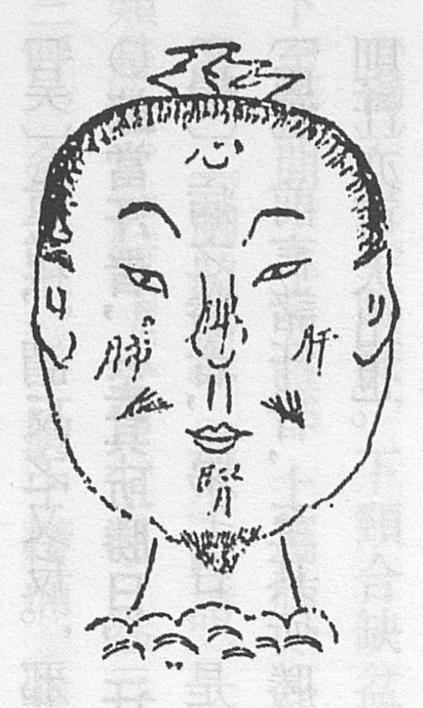

**○熱病從部所起者，至期而已。**

열병이 제 부위[部所]에서 일어난 경우는 그 시기에 이르면 낫는다.

〔楊〕부소(部所)는 색의 부위이다. 가령 붉은색이 간의 부위에서 일어났는데 자침이 순조로우면 서로 전해 돌아서 간의 부위 본자리에 이르러 병이 낫는다.

〔馬〕이는 또 열병에 대해 그 병이 낫는 시기를 정한 것이니, 곧 윗글에서 땀으로 낫는 날이라 한 뜻이다.

〔張〕이 아래는 여러 열병과 그 자침 치료법을 말한다. 從部所起者，至期而已는, 예컨대 간의 색이 왼쪽 뺨에 먼저 나타나면 갑을일에 이르러 땀으로 풀리는 것 따위를 말한다. 나머지 장의 뜻도 같다.

안(案): 장주(張注)가 옳은 듯하다. 대체로 오장의 열병에 모두 침법을 쓰는데, 태양 표증이 처음 발했을 때 쓰면 한 번 땀을 내어 풀린다. 앞 글에서 오장에 모두 ‘大汗’이라 한 것이 곧 낫는 시기이다. 맨 처음에 열병을 살펴 아는 법은 얼굴빛으로 증후를 삼으니, 이는 옛날 찰색(察色)의 남은 법이고, 망법(望法)이라고도 한다.

**○其刺之反者，三周而已。**

자침이 반대로 된 경우는 세 주기[三周]가 지나야 낫는다.

〔吳〕육경을 다 전하는 것이 1주이다.

〔馬〕이기는 날을 세 번 만나야 병이 비로소 낫는다.

〔張〕‘反’은 허한 것을 사(寫)하고 실한 것을 보함을 말한다. 병을 반대로 치료하면 그 병이 반드시 심해지고 낫는 것이 도리어 늦어진다. 三周는 이기는 날을 세 번 만난 뒤에 낫는다는 말이다.

〔高〕三周는 사흘이다.

〔志〕［按］“백고(伯高)가 말하였다. 풍한은 형(形)을 상하고, 근심·두려움·분노는 기를 상한다. 기가 장을 상하면 장이 병들고, 한이 형을 상하면 형에 응하니, 이것이 형기 내외의 상응이다. 황제가 물었다. 자침은 어떻게 하는가? 백고가 답하였다. 병든 지 9일이면 세 번 자침하여 낫는다.” 세 번 자침이 곧 三周이다. 9일이란 병이 오래되어 내외가 서로 다투는 것이다.

〔識〕［簡按］왕주를 살펴보면 모두 6각(刻)인데, 2각이 1주이므로 6각이 된다. 이는 너무 빠르니, 장주를 따라야 한다.

**○重逆則死。**

거듭 거스르면[重逆] 죽는다.

〔楊〕자침이 그 기를 따르지 않으면 세 주기를 전한 뒤에 낫는다. 자침이 다시 반대로 되면 죽는다.

〔吳〕중역은 반대로 하고 또 반대로 함을 말한다. 사기가 더욱 깊어지고 정기가 더욱 피폐해지니, 죽는 것이 당연하다.

**○諸當汗者，至其所勝日，汗大出也。**

땀을 내야 하는 모든 경우는 그 이기는 날[所勝日]에 이르러 땀이 크게 난다.

〔楊〕병의 이김이란 제7일이 병의 이기는 날이다. 또 간병이 갑을일에 이르는 것이 병의 이기는 날이다.

〔馬〕앞에서 ‘諸汗者，至其所勝日汗出’이라 한 것은 각 장의 땀이 저절로 나는 날을 가리켜 말한 것이고, 여기서는 침으로 발한할 때도 이기는 날에 이르러 자침하면 땀이 크게 날 수 있음을 말한 것이다.

**○諸治熱病，以飲之寒水，乃刺之，必寒衣之，居止寒處，身寒而止也。**

열병을 치료할 때는 모두 먼저 찬물을 마시게 한 뒤 자침하고, 반드시 옷을 서늘하게 입히고 서늘한 곳에 머물게 하여, 몸이 서늘해지면 자침을 멈춘다.

〔楊〕열병을 앓을 때 한(寒)으로 다스리는 데는 네 가지 구별이 있다. 첫째 찬물을 마시게 하여 안을 차게 하고, 둘째 혈을 자침하여 맥을 차게 하며, 셋째 찬 옷으로 밖을 차게 하고, 넷째 서늘한 거처로 몸을 차게 한다. 네 가지로 차게 하여 몸의 안팎을 모두 차게 하므로 열병이 그친다.

안(案): 이 조목은 여러 주가 모두 잘못 풀이하였다. 내 생각에 열병에는 뜨거운 약만 꺼릴 뿐 아니라 뜨거운 것을 일절 금하는 것이지, 함부로 옷·음식·거처를 차게 한다는 뜻이 아니다. ‘飲寒水’는 백호탕(白虎湯)을 쓰는 이치와 같아, 타오르는 열을 꺾어 땀을 내게 하는 것이다. ‘刺之’도 수혈(輸穴)로 열기를 새게 하여 땀을 내게 한다는 뜻이다. ‘必寒衣之’는 따뜻한 옷을 반드시 금한다는 말이다. ‘居止寒處’는 햇볕 아래나 화롯가에 있어서는 안 된다는 말이다. 이렇게 한 뒤에 자침하면 몸의 열이 물러가고 몸이 서늘해지니, 이때 침법을 멈춘다. ‘身寒而止’는 몸의 열이 물러가면 자침을 멈춘다는 말이다. 양주를 따를 만하다.

**[역1]** 원서대로 옮겼다. 바로 앞 경문에는 「䯒寒且疼」으로 되어 있다.
**[역2]** 원서대로 옮겼다. 『甲乙經』 여러 판본에도 「手足燥」로 되어 있으나, 四庫全書本에는 「手足𨅶」로 되어 있다.

**○熱病先胸脇痛，手足躁，刺足少陽，補足太陰。病甚者，爲五十九刺。**

열병(熱病)에 먼저 가슴과 옆구리가 아프고 손발이 조급하게 움직이면[手足躁] 족소양(足少陽)을 자침하고 수태음(手太陰)을 보한다. 병이 심하면 오십구자(五十九刺)를 쓴다.

〔楊〕족소양맥은 목으로 내려가 결분(缺盆)에서 합하고, 흉중으로 내려가 격(膈)을 꿰뚫고 간에 이어지며[胳肝] 담(膽)에 속하고, 옆구리 안쪽을 따라 계협(季脅)을 지나 바깥 보골(輔骨)의 앞으로 내려가며, 아래로 절골(絶骨)에 닿고, 발등을 따라 내려가 발가락 사이에 이른다. 수태음은 위로 폐에 속하고 폐에서 겨드랑이 아래로 나온다. 그러므로 가슴과 옆구리의 병에 손발이 조급하면 이 두 맥을 자침한다.

안(案): “흉협통(胸脇痛)”은 소양증(少陽證)이고 “수족조(手足躁)”는 양명증(陽明證)이니, 소시호(小柴胡)의 “옆구리 아래가 그득하고 아프다[脇下滿痛]”｟中七｠와 소승기(小承氣)의 “번조하고 심하가 단단하다[煩躁心下堅]”｟七一｠ 같은 것이 이것이다.｟앞의 ‘肝熱病’ 아래를 함께 보아야 한다｠ 『의심방(醫心方)』 권2에서 『명당경(明堂經)』을 인용하여 말하였다. “협계(俠谿) 두 혈은 넷째 발가락[足小指次指]의 기골(岐骨) 본절(本節) 앞 오목한 곳에 있다. 3푼 자입하고 3호흡 유침하며 3장 뜸뜬다. 흉중이 버티듯 그득하고[榰滿] 바람이 불어오는 듯 오싹한 것을 주치한다. 규음(竅陰) 두 혈은 넷째 발가락 끝에 있으며, 발톱에서 부추잎만큼 떨어져 있다. 1푼 자입하고 3호흡 유침하며 3장 뜸뜬다. 옆구리 통증, 해역(欬逆), 땀이 나는 것을 주치한다. 모두 족소장(足小腸)·담부(膽府)이다.” 또 말하였다. “기문(期門) 두 혈은 간의 모혈(募穴)이다. 제2늑골 끝에 있으며, 불용(不容) 옆으로 각 1치 5푼, 위로 두 젖과 곧게 마주하고, 거궐(巨闕)에서 각 3치 5푼 떨어져 있으며, 팔을 들어 취한다. 4푼 자입하고 5장 뜸뜬다. 식분(息犇)으로 옆구리 아래의 기가 오르내리고 흉중에 열이 있는 것을 주치한다. 족태음비(足太陰脾)이다.” 『상한론(傷寒論)』 권4의 “부인이 중풍(中風)으로 발열오한(發熱惡寒)하는데 월경이 마침 왔다, 운운. 가슴과 옆구리 아래가 그득하여 결흉(結胸) 같다, 운운. 기문을 자침하여 그 실한 곳에 따라 취해야 한다.”와, 『외대(外臺)』 권39에서 『갑을(甲乙)』을 인용한 폐인(肺人) 아래의 “어제(魚際)는 비(痺)가 가슴과 등으로 달려 숨을 쉬지 못하는 것 운운을 주치하고, 폐심통(肺心痛)에는 대연(大淵)이 심통, 해역, 번민(煩悶)으로 눕지 못하는 것을 주치한다.”는 모두 본문과 합치한다.[역1]

왕주(王注)에 따르면 ‘足少陽’은 구허(丘墟)｟발 바깥 복사뼈 아래 앞쪽의 오목한 곳｠이다. 『신교정(新校正)』이 『대소(大素)』를 따라 ‘手太陰’으로 한 것이 옳으니, 『영추(靈樞)』가 그 증거이다.

「수열혈론(水熱穴論)」 제60｟（‘六十一’로 써야 한다）｠에서 말하였다. “황제가 말하였다. ‘선생께서 열병을 치료하는 오십구수(五十九俞)를 말씀하셨는데, 나는 그 뜻을 논해 보았으나 아직 그 자리를 가려내지 못했다. 그 자리를 듣고 이어서 그 뜻도 듣고 싶다.’ 기백(岐伯)이 말하였다. ‘머리 위 다섯 줄에 줄마다 다섯 혈이 있는 것은 여러 양의 열역(熱逆)을 넘겨 내보낸다. 대저(大杼)·응수(膺俞)·결분·배수(背俞) 이 여덟은 흉중의 열을 사(寫)한다. 기가(氣街)·삼리(三里)·거허(巨虛) 상하렴(上下廉) 이 여덟은 위(胃) 속의 열을 사한다. 운문(雲門)·우골(髃骨)·위중(委中)·수공(髓空) 이 여덟은 사지의 열을 사한다. 오장수(五藏俞) 곁의 다섯, 이 열 곳은 오장의 열을 사한다. 이 오십구혈은 모두 열의 좌우이다.’ 황제가 말하였다. ‘사람이 한(寒)에 상했는데 전변하여 열이 되는 것은 왜인가?’ 기백이 말하였다. ‘한이 성하면 열이 생기기 때문이다.’”

안(案): 「기혈론(氣穴論)」의 “열수(熱俞) 오십구혈”이다.｟十五七ヲ｠

**○熱病始手臂痛者，刺手陽明太陰，而汗出止。**

열병이 손과 팔의 통증으로 시작하면 수양명(手陽明)·태음(太陰)을 자침하고, 땀이 나면 그친다.

〔楊〕수양명은 손의 바깥쪽으로 가고 태음은 손의 안쪽으로 가므로 손과 팔이 아프다. 이 음양 표리의 두 맥을 자침하여 땀을 낸다.

『의심방』 권2에서 『명당경』을 인용하여 말하였다. “열결(列缺)은 손바닥 가운데의 열, 팔꿈치·팔·어깨·등의 냉기를 주치한다.”

『외대』 권39에서 『갑을』을 인용하여 말하였다. “열결은 열병에 먼저 손과 팔이 아프고 몸에 열이 나며 계종(瘈瘲)하는 것을 주치한다.”

“상양(商陽)은 팔이 경련하며 당기고, 어깨 통증이 결분으로 뻗치는 것을 주치한다.” 『외대』 권39에서 『갑을』을 인용한 것이다.

“상양은 팔이 경련하며 당기고 어깨와 등이 아픈 것을 주치한다.” 『의심방』 권2에서 『갑을경(甲乙經)』을 인용한 것이다.

**○熱病始於頭首者，刺項太陽，而汗出。**

열병이 머리에서 시작하면 목의 태양(太陽)을 자침하여 땀을 낸다.

（고종덕본(顧從德本)에는 ‘汗出’ 아래에 ‘止’ 자가 있다.）

〔楊〕목의 태양이란, 족태양이 정수리에서 뇌로 들어갔다가 돌아 나와 목을 끼고 내려가 척추를 끼는 것이다. 그러므로 열병이 머리에서 시작하면 이 태양의 수혈(輸穴)을 자침하여 땀을 낸다.

『의심방』 권2에서 『명당(明堂)』을 인용하여 말하였다. “천주(天柱)는 열병에 땀이 나지 않고 어지러우며 두통이 묵직한 것을 주치한다.”

『외대』 권39에서 『갑을경』을 인용하여 말하였다. “천주는 두통에 목이 먼저 아프고 허리와 척추가 이에 응하며, 어지럽고 두통이 묵직한 것을 주치한다.”

안(案): 왕주가 ‘項太陽’을 천주로 본 것은 이어받은 바가 있어서 한 말일 것이다. 그러나 대저｟제1추 아래 양옆 1치 반｠·풍문(風門)｟제2추 아래 양옆 1치 반｠도 모두 머리와 목의 통증을 주치하고 풍지(風池)·풍부(風府)도 이 부근에 있으니, 열병 초기의 머리와 목의 통증에는 모두 이 자리를 자침할 수 있다. 『상한론』의 “태양병에 처음 계지탕(桂枝湯)을 먹였는데 도리어 번(煩)이 풀리지 않으면 먼저 풍지·풍부를 자침하고 다시 계지탕을 주면 낫는다.”｟上廿五｠도 이와 같은 이치이다. 대개 풍사(風邪)가 들어온 자리를 취해 자침하여 양기를 가득 넘치게 하면 사기가 땀을 따라 풀린다는 뜻일 뿐이다. 지총(志聰)이 곧바로 『상한론』의 풍지·풍부 자침을 끌어와 본문의 뜻으로 삼은 것은 옳지 않다.

**○熱病始於足脛者，刺足陽明，而汗出止。**

열병이 발과 정강이에서 시작하면 족양명(足陽明)을 자침하고, 땀이 나면 그친다.

〔新〕［按］이 조문은 『소문(素問)』에 본래 없고 『태소(太素)』에도 없는데, 이제 『갑을경』을 살펴 넣었다.

안(案): 지금의 『갑을』에는 ‘熱病始手臂痛’에서 ‘刺足陽明而汗出止’까지 47자가 없으니, 송나라 신하들[宋臣]이 본 판본과 다른 듯하다. 기록해 두어 고찰을 기다린다.

‘熱病始於足脛’은 뒷글에서 말한 “몸이 무겁고 뼈가 아프다[身重骨痛]”로, 마황탕(麻黃湯)증의 “골절이 쑤시고 아프다[骨節疼痛]”가 이것이다. 이는 사기가 점점 깊이 들어가 근맥(筋脈)에 붙은 것이므로, 양명경을 자침하면 땀이 나서 낫는다. 『상한론』에서 “태양병에 두통이 7일 이상 되어 저절로 낫는 것은 그 경(經)을 다 돌았기 때문이다. 다시 경을 전하려[再經] 하면 족양명에 침을 놓아 경이 전해지지 않게 하면 낫는다.”라고 한 것도 같은 이치인 듯하다. 대개 사기가 사람에게 붙으면 증상이 저마다 다르다. 처음에 한열(寒熱)과 두통이 나타나는 것은 통상의 징후로 태양표증(太陽表證)이다. 그러나 사기의 경중과 그 사람의 허실에 따라 “먼저 가슴이 아프고 조번(躁煩)한” 경우도 있고 “먼저 손과 팔이 아픈” 경우도 있으며, “머리에서 시작하는” 경우도 있고 “발과 정강이에서 시작하는” 경우도 있으며, “먼저 몸이 무겁고 뼈가 아픈” 경우도 있고 “먼저 어지럽고 눈앞이 캄캄하며 열이 나는” 경우도 있으니, 여기서 말한 것과 같다. 증상에 따라 치법을 달리하는 것은 오직 의사의 솜씨에 달렸을 뿐이다.

〔吳〕혈 자리를 말하지 않고 그 경을 뭉뚱그려 말한 것은, 혈을 취할 때 하나에 얽매이지 말고 그 경 안에서 헤아려 정하면 된다는 뜻이다. 땀이 나면 그친다는 것은 경기(經氣)가 조화된다는 것이다.

〔張〕살펴보건대[按] 「한열병(寒熱病)」편에 “족양명은 땀을 낼 수 있다.”라고 하였으니, 내정(内庭)·함곡(陷谷) 두 혈일 것이다.

안(案): 『의심방』 권2에서 『명당』을 인용하여 말하였다. “내정 두 혈은 둘째 발가락[足大指次指] 바깥 사이의 오목한 곳에 있다. 3푼 자입하고 20호흡 유침하며 3장 뜸뜬다. 사궐(四厥)로 손발이 답답해 오래 붙들고 있어야 하는 것과 궐열(厥熱)로 정강이가 아픈 것을 주치한다.”｟（『외대』가 인용한 『갑을』에는 ‘久’ 위에 ‘使大’ 두 자가 있고, ‘厥熱’이 ‘逆冷’으로 되어 있다）｠ 『의심방』 권2에서 『명당』을 인용하여 말하였다. “함곡 두 혈은 열병을 주치한다.”

**○熱病先身重骨痛，耳聾好瞑，刺足少陰，病甚，爲五十九刺。**

열병에 먼저 몸이 무겁고 뼈가 아프며 귀가 먹고 눈앞이 자주 아찔하면[好瞑] 족소양(足少陽)을 자침하고, 병이 심하면 오십구자를 쓴다.

（眉）송본 『소문』에 ‘瞑’으로 되어 있는 것은 잘못된 글자이다.｟（『대소』에는 ‘瞑’으로 되어 있다）｠[역2]

〔楊〕족소양맥은 눈의 태자(兌眥)에서 시작하여 몸의 골절에 이어지고 귓속으로 들어간다. 그러므로 열병에 먼저 몸이 무겁고 귀가 먹으며 눈 감기를 좋아하는 것은 이 맥의 수혈로 다스리는 것이다. 어떤 판본에는 족소음으로 되어 있다.

〔吳〕소음신(少陰腎)은 뼈를 주관하니, 몸이 무겁고 뼈가 아픈 것은 신에 열이 있어 뼈가 위약해진 것이다. 귀는 신의 구멍이므로 병들면 귀가 먹는다. 중경(仲景)이 “소음의 병은 다만 자려고만 한다.”라고 한 것이 곧 눈 감기를 좋아한다는 말이므로 소음을 자침한다.

안(案): “몸이 무겁고 뼈가 아프다”는 태양의 마황증(麻黃證)이 이것이다. “귀가 먹는다”는 “소양중풍(少陽中風)에 두 귀가 들리지 않는다”｟二｠가 이것이다. ‘好瞑’의 瞑은 眩과 같으니, “소양의 병은 눈이 어지럽다”가 이것이다. 마황증의 “번이 일어나고 눈이 아찔하다[發煩，目瞑]”｟中十六｠가 곧 눈 어지러움이다. ‘足少陰’은 『대소』를 따라 ‘足少陽’으로 쓰는 것이 좋다. 소음신경(少陰腎經)에도 “열병을 치료한다, 운운”하는 증상과 효과가 있으므로, 이제 두 설을 아래에 끌어 둔다.

안(案): ‘五十九刺’는 또 「기혈론」 58과 「수열혈론」 61에 보인다.

『의심방』 권2에서 『명당』을 인용하여 말하였다. “용천(湧泉) 두 혈｟족소음신(足少陰腎)｠은 열병에 먼저 허리와 정강이가 시큰거리는 것을 주치한다.”

『외대』 권39에서 『갑을』을 인용하여 말하였다. “용천은 머리와 목의 통증, 눈 어지러움을 주치한다.”

또 “태계(太谿)는 열병에 땀이 나지 않고 말없이 잠만 자려 하는 것을 주치한다.”

안(案): 『상한론』의 “소음병에 토하고 설사하며 맥이 이르지 않으면 소음에 7장 뜸뜬다.”는 곧 태계혈을 가리켜 말한 것이다. 『명당』에는 “3장 뜸뜬다”고 했는데 여기서 “7장”이라 했으니, 한궐(寒厥)이 더욱 심함을 알 수 있다.

또 “속골(束骨)은 몸의 통증, 두통, 몸에 열이 나며 아픈 것, 기육의 꿈틀거림, 귀먹음을 주치한다.” 이상은 족소음신경이다.[역3]

또 “규음은 번열(煩熱), 땀이 나지 않는 것, 팔[手胑]의 전근(轉筋), 팔 안쪽 가장자리가 아파 머리에 닿지 못하는 것, 귀먹음과 이명을 주치한다.”

또 “협계는 열병에 땀이 나지 않고 머리가 어지러우며 이명과 귀먹음이 있는 것, 흉중이 아파 몸을 뒤척이지 못하고 통증이 일정한 자리 없이 옮겨 다니는 것을 주치한다.” 이상은 족소양담경(足少陽膽經)이다.

**○熱病先眩冒而熱，胸脇滿，刺足少陰少陽，太陽之脈。**

열병에 먼저 어지럽고 눈앞이 캄캄하며[眩冒] 열이 나고 가슴과 옆구리가 그득하면 족소음·소양을 자침한다. 태양(太陽)의 맥은,

〔楊〕족태양은 눈 내자(内眥)에서 시작하여 이마로 올라가 정수리에서 교차하고 뇌로 들어간다. 족소양은 눈 태자에서 시작하여 가슴으로 내려가 옆구리 안쪽을 따른다. 족소음은 신에서 올라가 간과 격을 꿰뚫고 폐 속으로 들어간다. 그러므로 어지럽고 눈앞이 캄캄하며 열이 나고 가슴과 옆구리가 그득하면 이 세 맥을 자침한다.

안(案): ‘太陽之脈’ 네 글자는 왕주를 따라 아래 구절에 붙이는 것이 좋다. 양주(楊注)가 앞 구절에 붙인 것은 옳지 않다.

『외대』 권39에서 『갑을』을 인용하여 말하였다. “용천은 눈 어지러움과 옆구리 아래가 버티듯 그득한 것을 주치한다.”｟족소음신, 발바닥 가운데｠

또 말하였다. “규음은 번열을 주치한다.”｟족소양담(足少陽膽), 넷째 발가락 끝, 발톱에서 부추잎만큼 떨어진 곳｠

또 말하였다. “협계는 한열, 머리 어지러움, 흉중의 통증을 주치한다.”｟같은 경, 넷째 발가락 기골 사이 본절 앞 오목한 곳｠

또 말하였다. “임읍(臨泣)은 흉중이 그득하고 머리가 어지러우며 옆구리 아래가 버티듯 그득하고 몸에 열이 나는 것을 주치한다.”｟같은 경, 넷째 발가락 사이, 본절 뒤 협계에서 1치 반 떨어진 곳｠

『의심방』 권2에서 『명당』을 인용하여 말하였다. “협계는 흉중이 버티듯 그득한 것을 주치한다.”

『외대』에서 또 말하였다. “통곡(通谷)은 한열과 머리 어지러움을 주치한다.”｟족태양방광(足太陽旁光), 새끼발가락 바깥쪽 본절 앞 오목한 곳｠

또 말하였다. “부양(付陽)은 풍으로 머리가 무겁고 어지러운 것을 주치한다.”｟족태양방광(足太陽膀光), 바깥 복사뼈 위 3치, 태양의 앞 소양의 뒤 근골 사이｠

또 말하였다. “승근(承筋)은 머리가 어지럽고 아픈 것을 주치한다.”｟같은 경, 장딴지 한가운데 오목한 곳, 태양의 맥기가 나오는 곳｠

또 말하였다. “신당(神堂)은 가슴과 배가 그득한 것을 주치한다.”｟같은 경, 제5추 아래 양옆 각 3치｠

또 말하였다. “혼문(魂門)은 가슴과 옆구리가 창만(脹滿)한 것을 주치한다.”｟같은 경, 제9추 아래 양옆 각 3치｠

안(案): ‘眩冒’는 「태양하편(太陽下篇)」｟（‘中篇’으로 써야 한다）｠ 37 영계출감탕(苓桂朮甘湯)의 “일어나면 머리가 어지럽다”와 소음병｟十七｠의 “설사가 멎고 머리가 어지러우며 때때로 저절로 눈앞이 캄캄해지면 죽는다” 같은 것으로, 모두 땀을 내거나 사하한 뒤 진액이 허핍해진 증상이다. 여기서 신경을 자침하는 것은 진액을 순조롭게 되돌리려는 뜻일 것이다. 열이 있는 경우에 이 자법을 써야 한다. 열이 없으면 음증(陰證)이니, 소음의 사증(死證)이 이것이다. 태양병｟三五｠ 진무탕(真武湯)의 “머리가 어지럽다”에도 “여전히 열이 난다”고 하였으니 함께 고찰할 만하다. 소양병｟四｠의 “옆구리 아래가 단단하고 그득하다”와 태양중｟六八｠ 소시호의 “가슴과 옆구리가 몹시 그득하다[胸脅苦滿]”는 모두 태양·소양의 증상이다.

이상 ‘熱病先胸脅痛’부터 여기까지는 모두 사기가 처음 감촉해 들어와 막 발병했을 때 자침하는 법이다.

**○色榮顴骨熱病也。**

붉은 빛이 관골(顴骨)에 피어나면 골열병(骨熱病)이다.

〔楊〕붉은 빛이 관골에 피어난다는 것이다. 이 세 맥은 모두 뼈에서 생기므로, 이 세 맥의 병에 붉은 빛이 관골에 피어나는 것이 골열병이다.

〔張〕여기부터 아래는 양감(兩感)의 맥색(脈色)과 죽을 기한을 말한다. 榮은 드러남이다. 태양의 맥은 눈 내자에서 시작하고 태양의 근(筋)은 아래로 頄에 맺힌다. 그러므로 태양의 열병은 붉은 빛이 관골에 피어나기 마련이다.

〔吳〕榮은 화려한 빛깔을 일컫는 말이니, 붉은 빛이 이것이다.

안(案): ‘太陽之脈’은 「상한례(傷寒例)」에서 말한 “척촌(尺寸)이 모두 부(浮)하면 태양이 병을 받은 것이다.”가 이것이다. 맥이 부하고 붉은 빛이 두 관골에 나타나면 태양의 표열병(表熱病)임을 말한다. 앞글의 “먼저 붉어지는[先赤]” 부위와는 자연히 다르다. ‘骨熱病’이란, 태양방광경(太陽旁光經)의 사열(邪熱)이 안으로 신장(腎藏)의 본열과 상응하여 그 부위인 관골 위에 붉은 빛이 나타나므로 골열병이라 한 것이다. 골열병은 신열병(腎熱病)이라는 말과 같으니, 족소음신경이 사기를 받은 것을 말하며, 곧 태양의 표열증이다. 마황탕의 “골절이 쑤시고 아프다” 같은 것이 곧 골열병이다.

**○榮未交曰，今且得汗，待時而已。**

붉은 빛이 아직 시들지 않은 날[榮未交曰]에 지금 땀을 얻으면, 때를 기다려 낫는다.

〔楊〕붉은 빛이 아직 시들지 않은 날에 땀을 얻으면, 이기는 때에 이르러 병이 저절로 낫는다.

〔識〕［簡按］榮은 곧 윗글 ‘榮顴骨’의 榮이다. 交는 『갑을』에 夭로 되어 있고 아랫글도 같으니, 이제 이를 따른다.

안(案): ‘榮未夭日’은 그 붉은 빛이 아직 창백하게 변하지 않은 때를 말한다. 이때 땀을 얻으면 곧바로 낫지는 않더라도 임계일(壬癸日)에 이르러 병이 저절로 낫는다. 태양이 땀으로 풀리는 이치도 이와 같다.

夭는 광택을 잃음을 말한다. ‘夭’ 자에 대한 설은 「옥판론요(玉版論要)」 15에 자세하다.

‘曰’은 곧 ‘日’ 자이다. 당나라 사람이 쓴 日月의 日 자는 모두 曰로 되어 있어, ‘日’과 ‘曰’이 서로 뒤섞여 잘못된 것을 이루 다 들 수 없다. 여기서는 양주를 따라 ‘日’ 아래에서 구를 끊는 것이 좋다. 아랫글도 같다.

**○與厥陰脈爭見者，死。期不過三日，其熱病内連腎，少陽之脈色也。**

궐음맥(厥陰脈)과 다투어 나타나면 죽는다. 기한은 3일을 넘지 않으니, 그 열병이 안으로 신(腎)에 이어졌기 때문이다. 소양(少陽)의 맥색이다.

〔楊〕족태양은 수(水)이고 족궐음은 목(木)이다. 수가 목을 낳는데 목이 성하고 수가 쇠하므로, 태양의 수색(水色)이 나타날 때 목이 다투어 나타나면 수가 죽는다. 그 열병이 안으로 신에 이어져 신이 열에 상하고, 그 수가 3일에 이르므로 죽는다.

〔新〕자세히 보건대, 어떤 이는 ‘腎’을 ‘鼻’로 고치려 한다. ［按］『갑을경』·『태소』에는 모두 腎으로 되어 있고, 본래 옛 판본에는 ‘少陽之脈色也’ 여섯 자가 없으니 왕씨(王氏)가 더한 것이다. 왕주는 잘못이며, 상선(上善)의 뜻을 따라야 한다.

〔識〕｟（‘少陽之脈色也’）｠［簡按］마(馬)는 『신교정』에 근거하여 연문(衍文)으로 보았는데, 이제 이를 따른다.

안(案): ‘厥陰脈’은 「상한례」에서 말한 “척촌이 모두 미완(微緩)하면 궐음이 병을 받은 것이다.”가 이것이다. 이 맥이 나타나고 두 관골이 붉으면, 곧 앞 편에서 말한 양감상한(兩感傷寒)으로 소양과 궐음이 함께 병들어 6일에 죽는다는 것이니, 여기의 “기한은 3일을 넘지 않는다”와 합치한다. ‘其熱病氣内連腎’은 표리가 함께 병든 것을 말한다.

〔志〕살펴보건대[按] 이 절은 「옥기진장론(玉機真藏論)」에서 말한, 전변[傳化]에 차례대로 들어가지 않는 것이 있으니 근심·두려움·슬픔·기쁨·성냄이 차례를 따르지 못하게 하여 큰 병을 일으킨다는 뜻과 같다. 대개 표양(表陽)의 사기는 처음에 태양을 병들게 하고, 육기(六氣)가 서로 전하여 옮겨 가는 데 모두 차례가 있다. 차례대로 들어가지 않는 것은 오지(五志)가 안을 상하여 오장에 내열이 있기 때문이다. 태양의 맥이 궐음의 맥과 다투어 나타나는 것은 태양의 열과 간열이 서로 어울린 것이다. 대개 태양은 양의 시작이고 궐음은 음의 끝이니, 태양과 궐음이 어울려 다투는 것을 든 것은 표양의 사기가 차례대로 들어가지 않고 오장의 열과 함께 타는 곳을 따라 전하는 것을 말한다. 양맥과 음맥이 다투어 나타나면 모두 사증이므로, 오장을 다 말할 필요가 없었다. 표양의 열은 기에서 경으로, 경에서 장으로 들어가고, 오장의 열 또한 먼저 기를 따라 경으로, 안에서 밖으로 나옴을 알아야 한다. 안팎의 열이 어울려 양분으로 나오면 살고, 거듭 거슬러 음장(陰藏)으로 들어가면 죽는다. 첫 절은 내열이 외열과 어울려 다투는 것을 논했고, 여기서는 외열이 내열과 어울려 다투는 것을 논했다.

**○少陽之脈，色榮頰前，熱病也。**

소양의 맥은, 붉은 빛이 뺨[頰]에 피어나면 근열병(筋熱病)이다.

〔新〕살펴보건대[按] 『갑을경』·『태소』에는 ‘前’ 자가 ‘筋’으로 되어 있다.

안(案): 지금의 『갑을』에는 ‘前’ 자로 되어 있으니, 송나라 신하들이 본 것과 다르다. 지금 판본이 ‘前’으로 된 것은 그 잘못이 『소문』과 같을 뿐이다. ‘前’ 자는 혹 ‘剃’로 쓰고 ‘筋’ 자는 혹 ‘𮅀’로 쓰며 또 ‘荕’로도 쓰니, 자체가 비슷하여 잘못된 것이다.

‘榮頰’은 관골 아래 입 곁의 자리를 말한다. ‘頰前’ 두 글자는 말이 되지 않으니, 『대소』를 따라 ‘筋熱病’으로 써야 골열병과 서로 대가 된다. ‘筋熱病’은 족소양담경이 사기를 받아 간의 근도 상한 것을 말하므로 근열병(筋熱病)이라 한다. 근열병은 간열병(肝熱病)이라는 말과 같으니, 태양·소양의 합병(合病)·병병(併病)에 속한다.

**○榮未交曰，今且得汗，待時而已。與少陰脈爭見者，死期不過三日。**

붉은 빛이 아직 시들지 않은 날[榮未交曰]에 지금 땀을 얻으면, 때를 기다려 낫는다. 소음맥(少陰脈)과 다투어 나타나면 죽으니, 기한은 3일을 넘지 않는다.

〔楊〕족소양은 담맥(膽脈)이다. 족소양의 부위는 뺨에 있으니, 붉은 빛이 거기에 피어나면 곧 근열병임을 안다. 붉은 빛이 피어나 있을 때 땀을 얻으면, 목(木)의 때에 이르러 병이 저절로 낫는다. 소양은 목이고 소음은 수이니, 소양맥이 나타날 때 소음이 다투어 나타나는 것은 어미가 자식을 이기는 것이므로 간목(肝木)이 죽는다.

〔新〕자세히 보건대, 어떤 이는 少陰을 厥陰으로 고치려 한다. ［按］『갑을경』·『대소』에는 少陰으로 되어 있다. 양상선(楊上善)은 “소양은 목이고 소음은 수이다. 소양의 색이 나타날 때 소음이 다투어 나타나는 것은 어미가 자식을 이기는 것이므로 목이 죽는다.”라고 하였다. 왕씨가 이렇게 주를 단 것도 잘못이다. 옛 판본과 『갑을경』·『태소』에는 모두 ‘｟（‘死’가 빠졌다）｠期不過三日’ 여섯 자가 없으니, 이는 왕씨가 이 글을 보충해 완성한 것이다.

〔識〕‘死期不過三日’이 『갑을』에는 ‘其死不過三日’로 되어 있다. ［簡按］『신교정』이 왕씨가 보충해 완성했다고 한 것은 잘못이다.

안(案): 지금의 『갑을』도 송나라 신하들이 본 것과 다르니, 지금 판본의 『갑을』로 송나라 신하들의 설을 재단할 수 없다.

안(案): 땀을 얻어 풀리는 이치는 앞글과 같다. 외사(外邪)의 병은 모두 땀을 얻어 풀리니, 이것이 통례이다. 앞글에서 말한 오장의 열병에 모두 크게 땀이 난다는 것이 이것이다. 「상한례」에서 “척촌이 모두 침(沈)하면 소음이 병을 받은 것이다.”라고 하였다. 지금 이 맥이 나타나고 두 뺨이 붉으면 표리가 함께 병든 증상으로, 음증의 사후(死候)임을 안다. 『상한론』 「태양중편(太陽中篇)」의 “이양병병(二陽併病)에 얼굴빛이 연연히 온통 붉으면[緣緣正赤] 양기가 불울(怫鬱)하여 표에 있는 것이니, 풀어 주고 훈증해야 한다.”｟八十｠, 또 소음병의 “그 사람의 얼굴이 붉으면 통맥사역탕(通脈四逆湯)이 주치한다.”｟七三｠, 또 「궐음편(厥陰篇)」의 “설사에 맥이 침하고 지(遲)하며 그 사람의 얼굴이 조금 붉고 몸에 미열이 있고 하리청곡(下利清穀)하면 반드시 울모(鬱冒)하고 땀이 나서 풀리며, 병자에게 반드시 미열이 있다. 그러한 까닭은 얼굴이 양을 이고 있어[戴陽] 아래가 허하기 때문이다.”｟十四｠를 모두 함께 고찰할 만하다.

**[역1]** 원서 「足小腸膽府」는 「足少陽膽府」의 잘못으로 보인다(같은 『明堂經』 인용의 章門 할주에 「足少陽膽府」, 뒤의 맺음말에 「足少陽膽經」으로 되어 있다).
**[역2]** 원서대로 옮겼다. 원서에는 경문·안어·할주가 모두 「瞑」으로 찍혀 있어, 어느 글자를 「誤字」로 본 것인지는 원서만으로 알 수 없다.
**[역3]** 원서대로 옮겼다. 束骨은 보통 足太陽의 혈로 분류되므로, 「以上足少陰腎經也」라는 맺음말은 束骨까지 포괄하는 말이 아닐 수 있다.

**○熱病氣穴，三椎下間，主胸中熱。**

열병의 기혈(氣穴)은, 제3추 아래 사이가 흉중(胸中)의 열을 주치한다.

〔楊〕『명당(明堂)』과 『구권(九卷)』의 등에 있는 오장수(五藏輸)는 모두 제3추를 폐수(肺輸), 제5추를 심수(心輸), 제7추를 격수(膈輸), 제9추를 간수(肝輸), 제11추를 비수(脾輸), 제14추를 신수(腎輸)로 삼으며, 모두 양쪽 곁[兩箱]에서 취한다. 가운데 제3추 위로는 장열(藏熱)을 치료하는 곳이 없으므로, 오장수와 오장의 열을 살피는 자리는 모두 제3추 아래부터 센다. 제3추 위는 협거(頰車)와 마주하여 살피기에 멀다. 제3추 아래 사이는 폐수의 가운데이니 열을 사(寫)할 수 있다.

〔高〕열병의 기혈이란 열병의 자법이라는 말과 같다.

〔馬〕제3추 아래 사이는 이름이 신주(身柱)이고, 제4추 아래 사이에는 혈이 없으며, 제5추 아래 사이는 이름이 신도(神道), 제6추 아래 사이는 영대(靈臺), 제7추 아래 사이는 지양(至陽)이다.

〔識〕기혈은 곧 공혈(孔穴)이니, 뜻은 「기혈론(氣穴論)」에 갖추어져 있다.

안(案): 『대소(大素)』에는 ‘熱病氣穴’ 네 자가 없고 『갑을(甲乙)』에는 있다. 이에 따르면 이 네 자는 왕씨(王氏)가 『갑을』에 의거해 넣은 것일까? 대개 이는 일종의 옛 자법으로, 오장의 열을 주치하는 것이다. 그 그림은 다음과 같다.

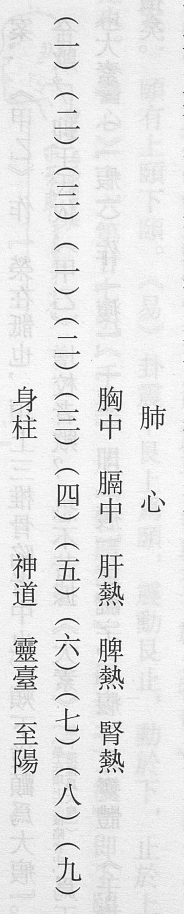

- 肺　心
- 胸中　膈中　肝熱　脾熱　腎熱
- （一）（二）（三）（一）（二）（三）（四）（五）（六）（七）（八）（九）
- 身柱　神道　靈臺　至陽

‘胸中熱’은 폐열을 말하니, 상부에서 가장 위에 있는 것이다. 그래서 제3추 아래 사이를 자침하여 폐 부위의 열을 내보낸다. 「태양하(太陽下)」의 “태양과 소양의 병병(併病)에 결흉(結胸) 같고 심하(心下)가 비경(痞鞕)하면 대추(大椎) 제1간·폐수(肺俞)·간수(肝俞)를 자침해야 한다.”｟十六、四六｠는 여기의 ‘三椎下間’과 법이 비슷하니 함께 고찰해야 한다.

〔志〕흉중과 격상은 심폐의 궁성(宮城)이다. 흉중의 열을 주치한다는 것은 폐열을 사하는 것이고, 격중의 열은 심열을 사하는 것이다. 심폐라 하지 않고 흉중·격중이라 한 것은, 열이 기분(氣分)에 있고 장진(藏真)을 범하지 않았음을 뜻한다.

**○四椎下間，主鬲中熱。**

제4추 아래 사이는 격중(鬲中)의 열을 주치한다.

안(案): ‘鬲中熱’은 곧 심열이다. ‘四椎下間’은 혈 이름이 없고 혈 자리가 아니다. 여기서 특별히 자침하는 것은 예로부터 있던 일종의 자법이 지금까지 겨우 남은 것이다.

**○五椎下間，主肝熱。六椎下間，主脾熱。七椎下間，主腎熱。**

제5추 아래 사이는 간열(肝熱)을 주치한다. 제6추 아래 사이는 비열(脾熱)을 주치한다. 제7추 아래 사이는 신열(腎熱)을 주치한다.

〔楊〕제4추 아래 사이는 차례를 헤아리면 심에 해당하는데, 심은 사기를 받지 않으므로 그 자리를 타서 격을 말한 것이다. 차례대로 추골 아래 사이가 각각 한 장의 열을 주치하는 것이 같지 않으며, 『명당』은 오장의 수혈을 두루 취한다.

**○榮在骶也，項上三椎陷者中也，頰下逆顴，爲大瘕。**

붉은 빛이 목 위 제3추의 오목한 곳에 있다. 뺨 아래 추골을 맞이하는 자리[逆椎]에 색이 나타나면 대가(大瘕)이다.

〔楊〕폐수 위로 세 추골이 목에 있으므로 ‘項上三椎’라 하니, 곧 대추 위의 오목한 곳이다. 뺨 아래에서 추골을 맞이하므로 ‘逆椎’라 한다. 逆은 맞이함이다. 이렇게 뺨 아래 추골 앞쪽에 색이 나타나는 것은 배에 ‘大瘦’ 병이 있는 것이다.

안(案): ‘榮在骶也’ 네 글자는 여러 설이 모두 궁색하다. 그래서 『식(識)』에서 “［簡按］ 이 한 구절은 통하기 어렵고 여러 주석이 모두 타당하지 않다.”라고 하였으니, 탁견이라 할 만하다.

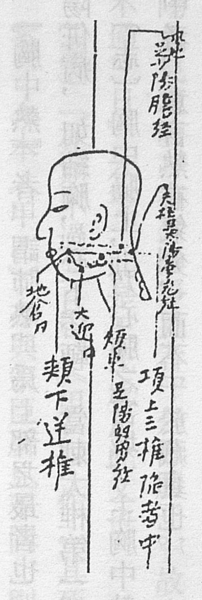

안(案): 『갑을』에는 ‘榮在骶也，項上三椎骨陷者中也，頰下逆顴爲大瘕’로 되어 있다. 그렇다면 왕빙(王冰)이 의거한 『소문(素問)』이 『갑을』과 합치하는 것일까, 아니면 왕씨가 『갑을』에 의거해 더하고 교정한 것일까? 『대소』｟（‘榮在項上三椎陷者中，頰下逆椎爲大瘦’）｠에 의거해 바로잡느니만 못할 듯하다. 『대소』에 （‘瘕’） ‘瘦’로 되어 있는데, ‘瘦’는 곧 ‘瘕’의 와자(訛字)이고 ‘瘕’의 변체이다. 『간록자서(干祿字書)』의 ‘假假，上俗下正’이 증거가 될 수 있다.[역1]

안(案): 대가(大瘕)는 가적(瘕積)이 큰 것을 말한다. 「양명편(陽明篇)」에서 말한 “고가(固瘕)가 되려 한다”｟四十｠ 같은 것이 이것이다. 대개 소음｟七三｠·궐음｟十四｠의 “얼굴이 붉다”도 이와 같은 뜻으로, 모두 위(胃) 속이 허랭하고 묵은 음(飲)이 가벽(瘕癖)이 된 증상이다. 그래서 그 부위가 지창(地倉)·대영(大迎)·협거 부근에 있으니, 모두 족양명위경(足陽明胃經)이다. 풍지(風池)는 족소양담경(足少陽膽經)이고 천주(天柱)는 족태양방광경(足太陽旁光經)이다. 곧 소복(小腹)의 부위이다. 『영추(靈樞)』 「오색(五色)」편에서 “방상(方上)은 위이다. 중앙은 대장이다. 대장을 끼고 있는 것은 신이다. 신과 마주하는 것은 배꼽이다. 면왕(面王) 위는 소장이다. 면왕 아래는 방광과 자궁[子處]이다.”라고 하였으니, 이 또한 관골 아래를 배꼽의 부위로 본 것이다.

**○下牙車，爲腹滿。**

아래 아거(牙車)에 나타나면 복만(腹滿)이다.

〔楊〕아래 아거에 색이 나타나면 복만의 병이다.

『석명(釋名)』에서 말하였다. “頤는 기름[養]이다. 아래에서 움직이고 위에서 멈춘다. 위아래로 음식을 씹어 사람을 기른다. 보거(輔車)라고도 하니, 그 뼈가 강하여 입을 도와 지탱한다는 말이다. 아거(牙車)라고도 하니, 이가 실려 있는 곳이다. 함거(頷車)라고도 한다. 頷은 머금음[含]이니, 입이 음식을 머금는 수레이다. 협거(頰車)라고도 하니, 역시 음식을 싣는 곳이다. 鼸거(鼸車)라고도 하니, 鼸鼠의 먹이가 뺨에 쌓이는데 사람의 먹는 모습이 이와 비슷하므로 이름을 취한 것이다. 수레에 매인 이름은 모두 아래에 있으면서 위의 물건을 싣는 것을 취한 것이다.”

안(案): 턱[頤]에는 상이(上頤)와 하이(下頤)가 있다. 『역(易)』의 괘에서 진(震)이 아래이고 간(艮)이 위인 것이 이괘(頤卦)인데, 진은 움직임이고 간은 멈춤이니 아래에서 움직이고 위에서 멈추는 것이다. 여기서 말한 ‘下牙車’는 곧 하이이다. 『의심(醫心)』 권16 제27에서 『천금(千金)』을 인용해 ‘牡䐗頷髓’를 쓴다 하였는데, 거기서 말한 ‘下頷’이 곧 하이이다.

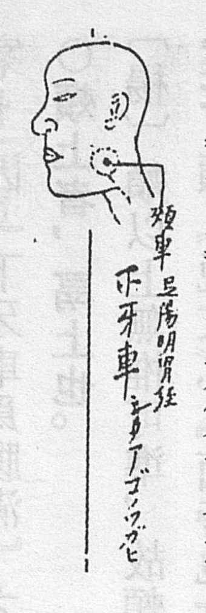

**○顴後，爲脇痛。**

관골 뒤에 나타나면 옆구리 통증이다.

〔楊〕태추(太椎) 좌우의 곁이 추후(椎後)이니, 여기에 색이 나타나면 옆구리 통증이다.

안(案): 주에 ‘脅痛’으로 되어 있는 것에 따르면, （『대소』） 본문이 ‘骨痛’으로 된 것은 잘못된 글자임을 알 수 있다.

안(案): 관골 뒤는 대개 관골 아래에서 뒤로 향한 곳, 하관혈(下關穴) 부근을 말한다. 곧 협거의 위쪽이다.｟『소문』 본문은 이와 같다｠

『대소』에 ｟（‘觀’）｠ ‘椎’로 되어 있는데, ‘權’의 잘못된 글자이다.[역2]

안(案): 『소문』에 따르면 아래 그림과 같다.

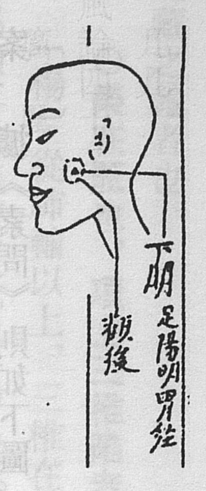

안(案): 『대소』에 따르면 아래 그림과 같다.

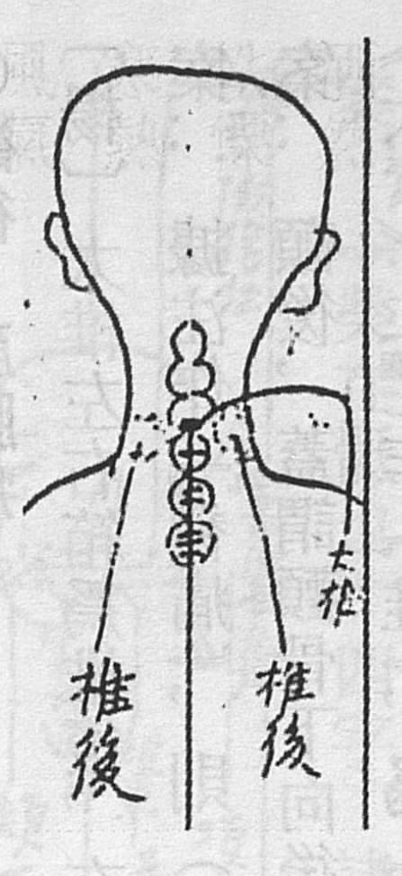

안(案): ‘下牙車爲腹滿’이라는 글에 비추어 미루어 보면 ‘顴後’로 쓰는 것이 옳다.

**○頰上者，鬲上也。**

뺨 위는 격상(鬲上)에 해당한다.

〔楊〕뺨 위로는 기준으로 삼을 추골이 없으므로, 뺨 위에 색이 나타나면 격상을 주관한다.

안(案): 頰은 『설문(説文)』에 “얼굴 옆이다.”라 하였고, 『석명』에 “頰은 夾이다. 얼굴 옆을 일컫는다. 또 음식물을 끼고 거두어들이는 것을 취한 것이다.”라 하였다. 관골 아래가 뺨이고 뺨 위가 관골이다. 대개 관골의 아래 곁이 격상을 살피는 자리이다.

안(案): 격상은 흉중을 말한다.

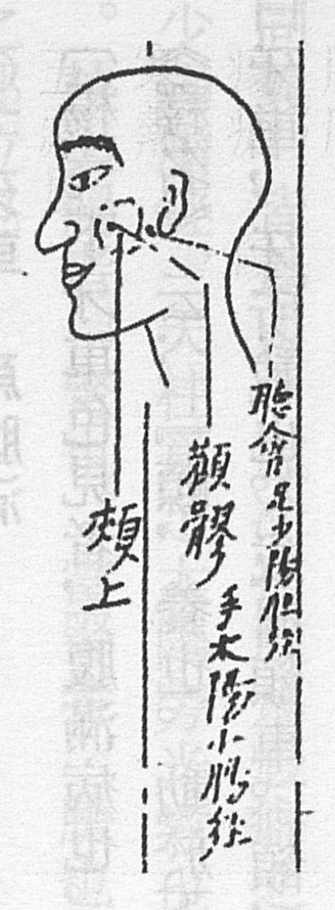

문구(文久) 2년 4월 27일 미시(未時)에 달울당(達鬱堂) 안에서 쓰다.

그때 두견 소리 요란하고 미풍이 얼굴 반쪽에 스치며 맑은 하늘빛이 사랑스러웠다.

기로망양자(岐路亡羊子) 𦳝헌(𦳝軒) 입지(立之)

제32 보(第卅二補)

대가(大瘕)｟廿一ヲ｠

〔馬〕색이 뺨 아래에 나타나고 또 관골을 거슬러 위로 올라가면 대가설(大瘕泄)의 병이다. 『난경(難經)』에도 대가설이 있다.

안(案): 본문에는 ‘泄’ 자가 없는데 마(馬)가 대가설로 본 것은 타당하지 않은 듯하다. 그러나 단독으로 대가라 이름한 병은 없으니, 이 ‘大瘕’는 대가이면서 설사가 없다는 뜻일까? 기록해 두어 뒤의 고찰을 기다린다.

「오십칠난(五十七難)」에서 말하였다. “대가설이 있으니 후중(後重)이라 한다.” 또 말하였다. “대가설은 이급후중(裏急後重)하여 자주 뒷간에 가도 대변을 보지 못하고 음경 속이 아프다.” 『옥편(玉篇)』에 “‘瘕’는 공하(公遐)·공사(公詐) 두 절(切)이다. 오래된 병이고 뱃속의 병이다. 『설문』의 본음은 遐이다.”라 하였다.

역관(逆顴)｟廿一ヲ｠

안(案): 『소문』에 ‘顴’으로 되어 있는 것은, ‘椎’가 본래 ‘顀’로 되어 있던 것이 다시 잘못되어 ‘顴’이 된 듯하다. 『광운(廣韻)』 6 지(脂)에 “‘顀’는 項顀이다.”라 하였으니, 곧 척추를 뜻하는 글자이다.

근열병(筋熱病)｟十九ヲ｠

안(案): 『상한론(傷寒論)』 「태양하」의 “태양·소양 병병에 머리와 목이 뻣뻣하고 아프며 맥이 현(弦)하다.”｟六十｠, 또 “심하가 단단하고 목이 뻣뻣하며 어지러우면 대추·폐수·간수를 자침해야 하며, 절대 사하하지 말라.”｟五四｠, 시계탕(柴桂湯)의 “사지 관절이 번거롭게 아프다[支節煩疼]”｟二十｠는 모두 근열병의 증상이다. 『사기(史記)』 「창공전(倉公傳)」의 ‘潘滿如案曰：如前止’에 대해 서광(徐廣)은 “‘前’은 어떤 본에는 ‘筋’으로 되어 있다.”라고 하였다.

31(三一)　장부(藏府)｟八ヲ｠　낭축(囊縮)｟十二ヲ｠　일기맥증(日期脈證)｟十三ヲ｠　허해(噓欬)｟十八ヲ｠　장맥(藏脈)｟十八ウ｠　유(遺)｟十九ヲ｠　복(復)｟廿ヲ｠　만만(滿懣)｟十四ヲ｠

32(三二)　소변황(小便黃)｟一ヲ｠　다와(多臥)｟同｠　광언(狂言)｟一ウ｠　경(驚)｟同｠　수족조(手足躁)｟同｠　원원𧴨𧴨(員員𧴨𧴨)｟三ヲ｠　선불락(先不樂)｟三ウ｠　면적(面赤)｟同｠　안(顏)｟五ヲ｠　설상황(舌上黃)｟六ヲ｠　䯒산(䯒痠)｟八ウ｠　불욕언(不欲言)｟同｠　담담(澹澹)｟九ウ｠　삼주(三周)｟十一ウ｠　한의한수한처(寒衣寒水寒處)｟十二ウ｠　열병은 머리에서 시작한다[熱病始於頭首]｟十四ウ｠　골통(骨痛)｟十五ウ｠　오십구자(五十九刺)｟十五ウ｠　갑을송본(甲乙宋本)｟十五オ｠　현모(眩冒)｟十六ヲ｠　색영(色榮)｟十七ヲ｠　요(夭)｟同ウ｠　전근(前筋)｟十九ヲ｠　기혈(氣穴)｟廿ヲ｠　대가(大瘕)｟廿一ウ｠　하아거(下牙車)｟同｠[역3][역4]

#### 평열병론(評熱病論)편 제33

〔新〕［按］전원기(全元起)본에는 제5권에 있다.

안(案): 『대소』 권25 「열병설(熱病説)」과 같은 책 권29 「풍수론(風水論)」에 전부 실려 있다. 권 첫머리부터 ‘傷肺則死’까지는 「열병설」에 나온다.

**○黃帝問曰：有病温者，汗出輒復熱，而脈躁疾，不爲汗衰，狂言不能食，病名爲何？岐伯對曰：病名陰陽交，交者死也。**

황제가 물었다. “온병(温病)을 앓는 자가 땀이 나면 곧 다시 열이 나고, 맥이 조질(躁疾)하며 땀으로 수그러들지 않고, 광언(狂言)하며 먹지 못하니, 병명이 무엇인가?” 기백이 답했다. “병명은 음양교(陰陽交)이니, 교(交)이면 죽는다.”

〔楊〕땀은 음액(陰液)이다. 열은 양이 성한 기운이다. 양이 성하면 땀이 없고, 땀이 나면 열이 수그러든다. 지금 땀이 나도 열이 수그러들지 않는 것은 양의 사기[陽耶]가 성한 데다 음이 다시 일어나, 둘이 서로 어울린 것이므로 음양교라 한다.

〔識〕［滑云］交는 교착함을 말한다. ［張云］양사(陽邪)가 음분(陰分)으로 번갈아 들어가 음기가 지키지 못하므로 음양교라 한다. 왕앙(汪昂)은 “「오운행대론(五運行大論)」을 살펴보면 ‘척촌이 뒤바뀌면 죽고, 음양이 어울리면 죽는다.’라 하였으니, 맥을 말한 것이다.”라고 하였다. ［簡按］「창공전」의 “『맥법(脈法)』에 ‘열병에 음양교이면 죽는다.’”가 바로 이것이다.

〔馬〕［按］『영추』 제23 「열병(熱病)」편에서 “열병에 이미 땀을 얻었는데 맥이 여전히 조(躁)하고 숨이 차며 다시 열이 나면 피부를 자침하지 말라. 숨이 심하게 차면 죽는다.”라 하였고, 또 “열병에 이미 땀을 얻었는데 맥이 여전히 조성(躁盛)하면, 이는 음맥의 극한이니 죽는다.”라 하였다. 『상한론』 「궐음편(厥陰篇)」에서 “상한에 발열하고 설사하며 궐역(厥逆)하고 ｟（‘躁’를 보충해야 한다）｠ 눕지 못하면 죽는다.”｟九十｠라 하였고, 또 “상한에 발열하고 설사가 극심하며 궐이 그치지 않으면 죽는다.”｟十二｠라 하였으며, 또 “상한 6~7일에 설사하지 않다가 곧 발열하며 설사하고 그 사람이 땀이 그치지 않으면 죽으니, 음만 있고 양이 없기 때문이다.”｟廿一｠라 하였다.

안(案): 이상은 모두 본론과 부합하니, 사기가 성하고 정기가 허하면 반드시 죽음을 말한다. ‘陰陽交’의 ‘交’는 교대(交代)의 交이니, 양열의 사기가 안으로 더욱 깊이 들어가고 음혈의 땀이 밖으로 지나치게 빠져나가므로 ‘음양교’라 한다는 말이다. 「창공전」은 맥으로 말했지만 그 이치는 하나이다.

**○帝曰：願聞其説。**

황제가 말하였다. “그 설명을 듣고 싶다.”

〔楊〕음양이 어울려 다투어 죽게 되는 까닭을 설명해 달라는 것이다.

**○岐伯曰：人所以汗出者，皆生於穀，穀生於精。今邪氣交爭於骨肉，而得汗者，是邪卻而精勝也。**

기백이 말하였다. “사람이 땀을 내는 것은 모두 곡기에서 생기고, 곡기는 정(精)을 낳는다. 지금 사기가 골육에서 어울려 다투다 땀을 얻으면, 이는 사기가 물러나고 정이 이긴 것이다.

『사기』 「창공전」에서 말하였다. “제(齊)나라 중어부장(中御府長) 신(信)이 병들었다. 신 의(意)가 들어가 맥을 진찰하고 고하였다. ‘열병의 기운입니다. 그러나 더위로 땀이 나고 맥이 조금 쇠약하니 죽지는 않습니다.’ 또 말하였다. ‘이 병은 흐르는 물에 몸을 담가 몹시 차가웠다가 그 뒤 열이 나서 얻은 것입니다.’ 신이 말하였다. ‘그렇습니다. 지난겨울 왕의 사신으로 초나라에 가다가 거현(莒縣) 양주수(陽周水)에 이르렀는데, 거현의 다리가 꽤 무너져 있어 제가 수레 끌채를 잡고 아직 건너지 않으려 했습니다. 말이 놀라자 곧 떨어져 제 몸이 물속에 빠져 거의 죽을 뻔했습니다. 아전이 곧 달려와 저를 구해 물에서 꺼냈는데 옷이 다 젖었습니다. 얼마 뒤 몸이 차가워졌다가 이어 불처럼 뜨거워졌고, 지금까지 찬 것을 접하지 못합니다.’ 신 의는 곧 그를 위해 액탕화제(液湯火齊)를 지어 열을 몰아내니, 한 번 마시자 땀이 다하고 두 번 마시자 열이 물러갔으며 세 번 마시자 병이 나았다. 곧 약을 먹게 하여 20일 남짓 지나자 몸에 병이 없어졌다. 신의 병을 안 까닭은 맥을 짚었을 때 병음(并陰)이었기 때문이다. 『맥법』에 ‘열병에 음양교이면 죽는다.’라고 하였는데, 짚어 보니 교하지 않고 병음이었다. 병음은 맥이 순하고 맑아[順清] 낫고, 그 열이 아직 다하지 않았더라도 산다. 신기(腎氣)가 때로 간탁(間濁)하고 태음의 맥구(脈口)에서 희미한데, 이는 수기(水氣)이다. 신은 본래 수를 주관하므로 이로써 알았다. 치료하지 않고 한 시(時)만 지나도 곧 한열(寒熱)로 바뀌었을 것이다.”

안(案): ‘并陰’은 맥이 조질하지 않고 안정되며, 부삭(浮數)하지 않고 침실(沈實)한 것을 말한다. ‘順清’은 곧 순정(順靜)이니, 그 맥이 화평하여 조질하지 않음을 말한다. ‘間濁’은 혼탁(混濁)이라는 말과 같으니, ‘間’과 ‘混’은 모두 견모(見母)이므로 고음에서 통용했을 것이다.

**○精勝，則當能食而不復熱。復熱者，邪氣也。汗者，精氣也。今汗出而輒復熱者，是邪勝也。**

정이 이기면 먹을 수 있고 다시 열이 나지 않기 마련이다. 다시 나는 열은 사기이고, 땀은 정기이다. 지금 땀이 나고 곧 다시 열이 나는 것은 사기가 이긴 것이다.

〔楊〕정은 곡식의 정이니, 그 액을 땀이라 한다. 상한의 사기[耶氣]를 열이라 한다. 지금 사기와 정기가 골육 사이에서 어울려 다투는데, 정이 이기면 사기가 물러나고 사기가 이기면 정이 소모된다. 땀이 나도 다시 열이 나는 것은 사기가 싸워 정을 이긴 것이므로 죽음에 이른다.

**○不能食者，精無俾也。病而留者，其壽可立而傾也。**

먹지 못하는 것은 정에 보태짐이 없는 것이다. 병이 머물러 있으면 그 수명은 곧바로 기울 수 있다.

（眉）첫째 사증[一死].

〔楊〕열사가 이기면 정액이 없어지고, 정액이 없으면 오직 열만 있다. 癉은 열이다. 그 열이 머물러 떠나지 않으면 오장육부가 다하여, 먹는 능력을 상하게 할 수 있다.

〔識〕왕기(汪機)는 “내가 생각건대 곡기가 변화하여 정이 되는데, 지금 먹지 못하면 정에 보태지는 바가 없다.”라고 하였다. ［高云］俾는 보익함이다. ［簡按］俾는 『이아(爾雅)』 「석고(釋詁)」에 “‘使’이다.”라 하였고, 『설문』에 “‘益’이다.”라 하였다. 왕(王)은 『이아』에 근거했고 고(高)는 『설문』에 근원을 두었으니 모두 통한다.

안(案): ‘病而留者’가 『갑을』에는 ‘熱而留者’로 되어 있는데, 뜻은 바로 같다. 병이라 하든 열이라 하든 모두 사기를 말한다. 그 사기가 머물러 이어지면 수명이 곧바로 기울어 끊어질 수 있음을 말한다.

이 조문은 『대소』에 와자가 많고, 양씨(楊氏)도 잘못된 글자를 따라 설을 세워 분명하지 않다. 이제 『소문』·『갑을』 두 경을 따른다. （『대소』에는 ‘不能食者精毋精毋癉也而留者其盡可立而傷也’로 되어 있다）

**○且夫熱論曰：汗出而脈尚躁盛者，死。**

또 「열론(熱論)」에서 말하였다. “땀이 나도 맥이 여전히 조성하면 죽는다.”

（眉）둘째 사증[二死].

『영추』 권9 「열병」 제23에서 말하였다. “열병에 이미 땀을 얻었는데 맥이 여전히 조성하면, 이는 음맥의 극한이니 죽는다. 땀을 얻고 ｟（‘脈’을 보충해야 한다）｠ 고요하면 산다. 열병에 맥이 여전히 성조(盛躁)한데 땀을 얻지 못하면, 이는 양맥의 극한이니 죽는다. 맥이 성조하다가 땀을 얻고 고요해지면 산다.”

안(案): 본문이 인용한 「열론」은 옛 경의 편명으로, 지금 『영추』 「열병」편에 기록된 것이 바로 이것이다. 『갑을』에는 ‘是熱論曰’ 네 자가 없다.[역5]

**○今脈不與汗相應，此不勝其病也。其死明矣。**

지금 맥이 땀과 상응하지 않으니, 이는 그 병을 이기지 못하는 것이다. 죽을 것이 분명하다.

〔楊〕땀이 나면 맥이 고요해야 하는데, 지금 땀이 나도 맥이 여전히 조성하니, 이는 사기[耶]가 이긴 것이 분명하여 ‘定知定矣’이다.

안(案): 아래의 ‘定’은 ‘死’ 자의 잘못인 듯하다.

**○狂言者是失志，失志者死。**

광언(狂言)은 실지(失志)이니, 실지하면 죽는다.

（眉）셋째 사증[三死].

〔楊〕지(志)는 기억함이다. 신(腎)의 신(神)이다. 신간동기(腎間動氣)는 사람의 생명이니, 동기가 쇠하면 신지(神志)가 떠나므로 죽는다.

『천금방(千金方)』 권29 「오장변화방통결(五藏變化傍通訣)」 제4에서 말하였다.

오신(五神)　신(腎)｟수일(水一)｠　심(心)｟화이(火二)｠　간(肝)｟목삼(木三)｠　폐(肺)｟금사(金四)｠　비(脾)｟토오(土五)｠

오신(五神)　지(志)｟정(精)｠　신(神)｟성(性), 또 맥신(脈神)으로도 쓴다｠　혈(血)｟혼(魂)｠　기(氣)｟백(魄)｠　의(意)｟지(智), 또 영의(營意)로도 쓴다｠

『오행대의(五行大義)』에서 하상공(河上公) 주 『노자(老子)』를 인용하며 또 『소문』과 같다고 하였다.

오신(五神)　정(精)　신(神)　혼(魂)　백(魄)　지(志)

안(案): 광언은 말이 미친 듯 어지러워 일정함이 없는 것으로, 이른바 섬언(譫言)·망어(妄語)가 이것이다. 대개 신지가 지킴을 잃어 생긴 것이다. ‘狂言者是失志’는 옛 훈고로 뜻을 풀이한 글이 남은 것이다.

**○今見三死不見一生，雖愈必死也。**

지금 세 가지 사증[三死]이 보이고 살 징후는 하나도 보이지 않으니, 낫더라도 반드시 죽는다.

안(案): 『대소』에는 ‘今’이 ‘命’으로 되어 있는데, 우연한 잘못이다.

〔楊〕땀이 나도 열이 □ 죽을 징후에 세 가지가 있다. 첫째는 먹지 못하는 것, 둘째는 맥이 여전히 조한 것, 셋째는 실지이다. 땀이 나도 열이 있으면서 이 세 가지 사후(死候)가 있고 살 징후가 보이지 않으면, 나은 듯해도 반드시 죽는다. 또 죽음의 몫이 셋이고 삶의 몫은 하나도 보이지 않는다는 뜻이다.

〔識〕삼사(三死)는, ［馬云］땀을 낸 뒤 곧 다시 열이 나고 먹지 못하는 것이 첫째 사증이다. 땀을 낸 뒤 맥이 여전히 조성한 것이 둘째 사증이다. 땀을 낸 뒤 도리어 광언하고 실지하는 것이 셋째 사증이다. ［簡按］왕(王)은 ‘不勝其病’을 둘째 사증으로 보았으나, 윗글을 고찰하면 이는 땀이 나도 맥이 여전히 조성한 증상을 말한 것이므로 이제 마(馬)의 뜻을 따른다. ［志云］병이 머무는 것이 한 사증이다. 위기(胃氣)가 끊어진 것이 한 사증이다. 신기가 끊어진 것이 한 사증이다. 그러나 ‘胃氣絶，腎氣絶’은 윗글에 말하지 않은 것이니 이 주는 잘못이다.

안(案): 양주의 삼사는 따를 만하고, 마(馬)는 양(楊)의 뜻과 거의 같으니 경을 잘 읽었다고 할 만하다.

안(案): 권 첫머리부터 여기까지는 『옥함경(玉函經)』 권6 제28과 『맥경(脈經)』 권7에 보인다. 이로 미루어 생각하면 이는 중경(仲景)이 남긴 편이 겨우 여기에 남은 것이며, 자서(自序)에서 말한 “『소문』·『구권(九卷)』을 가려 썼다”가 이것이다.

**○帝曰：有病身熱汗出煩滿，煩滿不爲汗解，此爲何病？**

황제가 물었다. “몸에 열이 나고 땀이 나며 번만(煩滿)한데, 번만이 땀으로 풀리지 않는 병이 있으니, 이것은 무슨 병인가?”

（원문의 ‘帝’ 아래에 ‘問於岐伯’ 네 자가 있는데, 『대소』의 글이므로 삭제한다.）

〔楊〕몸에 열이 나고 번만하면 땀으로 풀리기 마련인데, 지금 풀리지 않으므로 물은 것이다.

**○岐伯曰：汗出而身熱者，風也。汗出而煩滿不解者，厥也。病名曰風厥。**

기백이 말하였다. “땀이 나도 몸에 열이 나는 것은 풍(風)이다. 땀이 나도 번만이 풀리지 않는 것은 궐(厥)이다. 병명은 풍궐(風厥)이다.”

〔楊〕풍열이 주리(腠理)를 열어 땀이 된 것이지 정기가 땀이 된 것이 아니므로, 몸의 열이 풀리지 않으니 풍이라 한다. 가슴이 번거롭고 그득하고 답답함이 풀리지 않으니 궐병이라 한다. 풍도 있고 궐도 있으니 풍궐이라 한다.

〔識〕［張云］［按］풍궐의 뜻은 한 가지가 아니다. 본편의 것은 태양·소음의 병을 말한다. 「음양별론(陰陽別論)」에 있는 것은 “이양(二陽)·일음(一陰)이 발병하면 풍궐이라 한다.”라 하였으니 위와 간을 말한다. 「오변(五變)」편에 있는 것은 “사람 가운데 풍궐로 땀을 줄줄 흘리는 병에 잘 걸리는 자는 기육이 단단하지 않고 주리가 성글다.”라 하였다. ［高云］윗글의 땀이 나고 다시 열이 나는 사증을 이어, 다시 땀이 나고 번만한 병을 들어 물은 것이다. 풍은 양사이니 성질이 열어 발산하는 것을 주관한다. 땀이 나면서 몸에 열이 나는 것은 풍이다. 땀은 음액으로 양으로 밖에 나온다. 지금 땀이 나도 가슴이 번거롭고 그득함이 풀리지 않는 것은 음이 고갈되고 양이 허하여 서로 어울려 돕지 못하는 것이니, 이것이 궐이다. 이는 풍으로 땀이 나고 땀으로 궐이 된 것이니, 병명을 풍궐이라 한다. ［簡按］「창공전」의 “풍궐[風蹶]로 가슴이 그득한 것은 그 양으로 지나쳐 들어가 양기가 다하고 음기가 들어온 것이다. 음기가 들어와 퍼지면 한기가 올라가고 열기가 내려오므로 가슴이 그득하고 땀이 난다.”는 이와 조금 다르다.

안(案): 땀이 나고 몸에 열이 나는 것은 표사(表邪)에 달려 있으므로 풍이라 한다. ‘汗出而煩滿不解’는 표사는 풀렸으나 이열(裏熱)이 풀리지 않아, 몸에 열이 있으면서 사지[四枝]｟（‘肢’로 써야 한다）｠가 궐랭(厥冷)한 것이므로 궐이라 한다. 그래서 풍궐이라 한다. “태양병에 발한하여 땀이 새듯 그치지 않으면, 운운, 계지가부자탕(桂枝加附子湯)이 주치한다.”｟上廿二｠, 또 “감초건강탕(甘草乾薑湯)”｟上卅｠, 또 “작약감초부자탕(芍藥甘草附子湯)”｟中三八｠, “복령사역탕(茯苓四逆湯)”｟中三九｠, “계지가작약생강인삼신가탕(桂枝加芍藥生薑人參新加湯)”｟中三二｠의 증은 모두 풍궐의 유증(類證)이다.

**○帝曰：願卒聞之。岐伯曰：巨陽主氣，故先受邪，少陰與其爲表裏也。得熱則上從之，從之則厥也。**

황제가 말하였다. “끝까지 듣고 싶다.” 기백이 말하였다. “거양(巨陽)은 기를 주관하므로 먼저 사기를 받고, 소음(少陰)은 그와 표리가 된다. 열을 얻으면 위로 따르고, 따르면 궐이 된다.”

〔楊〕신간동기는 족태양이 주관하고, 족태양은 족소음과 표리이다. 그러므로 태양이 먼저 사기[耶氣]를 받아 맥을 따라 머리로 올라가고, 열을 얻으면 족태양의 올라가는 기가 이를 따라 열을 받아 상열하한(上熱下寒)이 되며, 궐역(厥逆)하고 땀이 나도 풀리지 않는 번만의 병이 된다.

안(案): ‘巨陽主氣，故先受邪’는 풍을 말하고, ‘少陰與其爲表裏云云’은 궐을 말하니, 바로 앞글과 상응한다. ‘得熱則上從之’는 번만이 풀리지 않음을 말한다. 번만이 풀리지 않으면 궐역이 된다.

**[역1]** 원서대로 옮겼다. 원서의 「假假，上俗下正」과 「瘕之訛字，瘕之變體」는 구별해야 할 두 글자가 같은 꼴로 찍혀 있어 그 차이가 조판에 드러나지 않는다.
**[역2]** 원서대로 옮겼다. 경문의 「顴」이 할주에서 「觀」으로 되어 있는데, 통용자이거나 「顴」의 잘못일 수 있다.
**[역3]** 원서대로 옮겼다. 「十五オ」의 「オ」는 다른 항목의 「ヲ」처럼 앞면 표시로 읽히나, 앞뒤 항목의 차례로 보면 「十五ウ」일 수도 있다.
**[역4]** 원서대로 옮겼다. 바로 앞 「第卅二補」의 표제 아래에는 「大瘕」의 장 표시가 「廿一ヲ」로 적혀 있어 앞면·뒷면 표시가 서로 다르다.
**[역5]** 원서대로 옮겼다. 『素問』 경문은 「且夫熱論曰」로 되어 있어 안어의 「是熱論曰」과 글자가 다른데, 저자가 본 판본의 글자이거나 잘못일 수 있다.

**○帝曰：治之奈何？岐伯曰：表裏刺之，飲之服湯。**

황제가 물었다. “어떻게 치료하는가?” 기백(岐伯)이 답했다. “표리(表裏)를 자침하고, 탕약을 마시게 한다.”

〔楊〕음양 표리의 맥을 자침하여 그 바깥을 공격하고, 탕액(湯液)을 마시게 하여 그 안을 치료할 수 있으니, 이것이 풍궐(風厥)을 치료하는 법이다.

〔識〕［張云］곧 「맥도(脈度)」편에서 말한 “허한 경우 약을 마시게 하여 보한다.”의 뜻이다. ［簡按］약탕(藥湯)을 옛날에는 그냥 湯이라고만 하였다. 『화타전(華他傳)』의 “탕약을 지어 내리니 과연 남자 꼴의 태가 내려왔다.”가 이것이다. 지(志)가 “수진(水津)의 땀을 돕는다.”라고 한 것은 백탕(白湯)을 말한 듯한데, 잘못이다.

안(案): 『대소(大素)』에는 ‘飲之湯’으로 되어 있고 ‘服’ 자가 없는데, 옳은 듯하다. 『갑을(甲乙)』에도 ‘服’ 자가 있으니 ‘服湯’은 그 자체로 말이 되며, 설은 보(補)에 갖추어져 있다.

『갑을경(甲乙經)』 권7 「육경수사발상한열병(六經受邪發傷寒熱病)」 제1 중에서 말하였다. “물었다. 몸에 열이 나고 땀이 나며 번만(煩滿)이 풀리지 않는 병은 무엇인가? 답하였다. 땀이 나도 몸에 열이 나는 것은 풍이고, 땀이 나도 번만이 풀리지 않는 것은 궐이니, 병명은 풍궐이다. 태양은 여러 양의 기를 주관하므로 먼저 사기를 받는다. 소음은 그 표리이니, 열을 얻으면 위로 따르고, 위로 따르면 궐이 된다. 치료는 표리를 자침하고 탕약을 마시게 한다.”

**○帝曰：勞風爲病何如？**

황제가 물었다. “노풍(勞風)의 병은 어떠한가?”

『갑을』 권11 「동작실도(動作失度)」. 『천금(千金)』 권8 「논잡풍상(論雜風狀)」.

**○岐伯曰：勞風，法在肺下。**

기백이 답했다. “노풍은 법도상 폐 아래[肺下]에 있다.

풍사(風邪)가 폐 아래로 들어가 음(飲)과 합쳐지고 오래 끌며 풀리지 않으므로 노풍이라 한다.

〔識〕［張云］피로로 풍에 상한 것이다. 왕씨(王氏)는 “勞는 신로(腎勞)를 말한다.”라고 하였다. 이것도 한 설이지만, 노(勞)의 병은 관련된 것이 많아 신경(腎經)에 그치지 않을 듯하다. ［馬云］이 절의 글을 자세히 음미해 보면 의서의 노증(勞證)인 듯하다. ［簡按］이는 한때 피로하여 풍을 받은 증상이다. 노증에 기침으로 푸르고 누런 콧물을 내어 나은 경우를 본 적이 없으니, 마주(馬注)는 믿기 어렵다. 『병원(病源)』 「풍열후(風熱候)」에서 말하였다. “피부와 주리(腠理)가 허하면 풍열의 기운이 먼저 피모를 상하고 이어 폐로 들어간다. 그 증상은 오풍(惡風)하고 한전(寒戰)하며, 눈이 빠질 듯하고 콧물과 침이 나온다. 살펴서[候]｟（‘之’를 보충해야 한다）｠ 3일 안이나 5일 안에 정명(精明)하지 못한 것이 이것이다. 7~8일에 약간 푸르고 누런 고름 같은 콧물이 탄환만 하게 입과 코 안에서 나오면 좋다. 나오지 않으면 폐를 상하여 해수(欬嗽)와 농혈(膿血)을 뱉는 병으로 변한다.”｟［案］『천금』 권8에 실린 것은 『병원』과 거의 같으며, 글은 뒤에 있다.｠ 이것이 곧 본절의 노풍이다. 본절의 노풍은 『장씨의통(張氏醫通)』이 자세히 논했는데, 글이 번다하여 적지 않으니 해수문(欬嗽門)에서 참고해야 한다. 섭문령(葉文齡)의 『의학통지(醫學統旨)』에서 “노풍은 곧 경(痙)｟（『의학통지』와 『소문식(素問識)』에서 인용한 데는 ‘痓’로 되어 있다. 아래도 같다）｠에 속한다. 강상(強上)은 각궁반장(角弓反張)과 비슷하다. 명시(冥視)는 눈을 뜨고 있어도 물건을 보지 못하는 것이다. 경병(痙病)은 모두 사람을 알아보지 못하거나 눈을 뒤집어 보거나 비스듬히 본다. 치법은 경과 같게 해야 한다.”라고 하였고, 또 왕호고(王好古)의 『의루원융(醫壘元戎)』은 이 증상을 폐위(肺痿)로 보았는데, 모두 잘못이다. 처방은 『성제총록(聖濟總録)』 권13에 갖추어져 있다.

〔紹〕『의학독서기(醫學讀書記)』에서 말하였다. “여기서 상풍(傷風)이 풀리지 않아 노(癆)가 되는 까닭을 깨달을 수 있다. 노풍은 이미 피로한 데다 풍을 받은 것이다. 피로하면 화가 위로 일어나는데 풍이 또 이를 타서, 풍과 화가 서로 부딪쳐 기가 위로 몰리므로 ‘법도상 폐 아래에 있다’고 하였다. 폐는 기를 주관하고 호흡을 맡으니, 풍열이 폐에 있으면 그 액이 반드시 뭉치고 그 기가 반드시 막힌다. 그래서 숙이고 젖힘이 모두 순조롭지 못하므로 ‘부앙을 구제해야 한다’고 하였다. 부앙을 구제한다는 것은 곧 폐기를 통리하고 사기를 흩는다는 말일 것이다. 그러나 사기가 흩어지느냐는 정기의 성쇠에 달려 있다. 양기가 왕성하여 정기를 끌어올리는 자는 3일, 그다음은 5일, 또 그다음은 7일이면 푸르고 누런 콧물이 기침을 따라 나오고, 나오면 풍열이 모두 떠나 폐에 탈이 없다. 나오지 않으면 풍화가 폐 속에 머물러 쌓여 폐가 상한다. 폐가 상하면 숨이 차고 기침하며 목소리가 쉬고 점차 오장에 미쳐 허로(虛勞)의 병이 이루어진다. 지금 사람들이 노병을 치료하면서 날마다 자양(滋養)을 써도 조금도 낫지 않는 것은 사기가 나오지 않았기 때문이 아니겠는가. 오래 머문 사기는 보해도 진실로 무익하고 청열해도 풀리지 않으니, 허로병을 치료하기 어려운 까닭이다.” ［堅按］왕주(王注)에서 ‘從勞風生’이라 하고 또 ‘故腎勞風生’이라 하였으며, 「음양별론(陰陽別論)」 ‘風消’ 주에서 “위병이 깊고 오래되어 비로 전해 들어가므로 풍열이 되어 소삭(消削)한다.”라 하였고, 또 ‘風厥’ 주에서 “간기는 풍이 되고 신기는 거슬러 오르니, 풍이자 궐이므로 풍궐이라 한다.”라 하였으며, 「기병론(奇病論)」 ‘息積’ 주에서 “뜸을 뜨면 화열이 안에서 태워 기가 변화하여 풍이 된다.”라 하였고, 또 ‘腎風’ 주에서 “노기(勞氣)가 한에 닿으므로 변화하여 풍이 된다.”라 하였다. 이는 모두 안에서 생긴 풍을 말한 것이지 밖에서 온 풍사가 아니다. 이는 왕씨가 처음 세운 설이지만, 실은 「사시자역종(四時刺逆從)」편의 호산풍(狐疝風)과 폐·비·심·신의 풍산(風疝)이라는 항목에 연원을 둔다.

안(案): 폐의 경맥은 심(心)의 오른쪽 방에서 시작하여 두 잎으로 들어가고, 폐의 낙맥은 두 잎에서 나와 심의 왼쪽 방으로 돌아간다. 대개 폐의 위는 인후이고, 폐 아래는 두 잎이 심포막(心包膜)을 감싸는 자리를 말한다. 경맥과 낙맥 두 맥은 그 근원이 함께 신에서 나오므로, 신기가 피로하면 그 병이 폐 아래에 있다. 제3추 아래 둘째 줄이 폐수(肺俞)이고, 제4추 아래가 궐음수(厥陰俞), 제5추 아래가 심수(心俞)이니, 폐 아래는 제4추 이하를 말한다.

〔識〕［吳云］그 사기를 받는 곳은 폐 아래이니, 대개 제4·5·6추 사이이다. 장(張)도 같다. ［馬云］그 치법은 폐 아래에 있다. ［高云］폐 아래는 심이다. 번로(煩勞)하면 심을 상하므로 노풍의 병은 법도상 폐 아래에 있다. ［簡按］이 설은 믿기 어렵고, 오주(吳注)를 따라야 한다.｟초본(抄本)에 의거함｠

**○其爲病也，使人強上冥視，**

그 병은 사람의 머리와 목을 뻣뻣하게[強上] 하고 보는 것을 아찔하게[冥視] 하며,

『갑을』에는 ‘冥’이 ‘瞑’으로 되어 있다.

〔識〕［簡按］「맥해(脈解)」편에서 “이른바 강상(強上)이 등까지 당기는 것은 양기가 크게 올라가 다투기 때문에 강상이 된다.”라고 하였고, 왕주에서 “강상은 머리｟（‘頸’으로 써야 한다）｠와 목이 굳어 뻣뻣한 것을 말한다.”라고 하였으니 이 주와 같다. 마(馬)·지(志)는 이를 따랐다. 오(吳)·장(張)은 양(楊)의 뜻에 의거했는데 잘못인 듯하다. 지금의 『천금』에는 ‘弦上而目眩’으로 되어 있는데｟［案］송본 『천금』에는 ‘彊上而目脫’로 되어 있어 『병원』과 합치한다.｠ 대개 ‘冥視’는 곧 목현(目眩)을 말한다.｟［案］‘冥’은 곧 ‘瞑’의 고자(古字)이다. ‘冥視’는 보는 것이 아찔한 것을 말하니, 두현(頭眩)·목현과 같은 뜻이다.｠

**○唾出若涕，**

침을 뱉으면 콧물 같은 것이 나오고,

〔識〕［吳云］폐 속의 진액이 풍열에 쪄져 끈끈해지므로, 뱉는 침이 코 속의 콧물 같다. 폐는 피모를 주관하는데, 폐가 상하면 장진(藏真)의 기가 피모를 채우기에 부족하므로 오풍하고 진한(振寒)한다. 『장씨의통』에서 “침을 뱉으면 콧물 같은 것이 나오는 것은 담음(痰飲)이 위로 넘치는 징후이다.”라고 하였다. ［簡按］옛날에는 ‘痰’ 자가 없었다. 여기서 ‘唾出如涕’라 한 것은 끈끈한 담을 뱉는 것을 말한다.

**○惡風而振寒，此爲勞風之病。**

오풍(惡風)하고 진한(振寒)하니, 이것이 노풍의 병이다.”

（『대소』에는 ‘使人強上冥視’ 아래에 ‘晚’ 자가 있고, ‘勞風’이 ‘勞中’으로 되어 있다.）

〔楊〕피로한 중에 풍을 맞아 병이 된 것을 노중(勞中)이라 하고 노풍이라고도 한다. 폐 아래는 병이 머무는 자리이다. 강상은 젖히기를 좋아하는 것이다. ‘冥視晚’의 晚은 늦음이니, 눈을 감고 천천히 보아도 보이지 않는다는 말이다. 침이 콧물 같다는 것은 침이 고름 같은 것이다. 바람을 쐬려 하지 않고, 바람을 쐬면 곧 진한하니, 이것이 노중의 병 증상이다.

안(案): 『대소』의 ‘晚’ 자는 연문(衍文)인 듯하고, 양(楊)이 ‘晚’ 자에 나아가 설을 세운 것은 옳지 않은 듯하다. ‘勞中’과 ‘勞風’은 본래 하나의 음이니, ‘中’은 ‘風’의 음이 잘못되고 글자가 무너진 것인 듯하다.

**○帝曰：治之奈何？岐伯曰：以救俛仰。**

황제가 물었다. “어떻게 치료하는가?” 기백이 답했다. “면앙(俛仰)을 구제한다.

〔楊〕이 병은 숙이고 젖히는 일이 많으므로 이를 구제한다.

〔吳〕대개 폐 아래에 풍열이 있어 분창(膹脹)하면 숙이기와 젖히기가 모두 불리하다. 그러므로 반드시 그 면앙을 구제해야 하며, 숙이고 젖힐 수 있으면 폐 아래가 다스려진 것이다.

안(案): 「음양응상(陰陽應象)」 제5의 “양이 이기면 몸에 열이 나고 주리가 닫히며, 숨이 거칠어 이 때문에 숙였다 젖혔다 한다.”는 여기의 ‘俛仰’과 같은 뜻이니, ‘俛仰’ 두 글자는 천(喘)을 가리켜 말한 것임을 알 수 있다.

〔馬〕그 치법은 ‘以救俛仰’ 한 구절뿐이니, 침법과 도인법(導引法)일 것이다. 다만 그 법이 전하지 않으니 억지로 덧붙이지 않는다.

〔張〕풍의 경중은 그 증상이 면앙하는 사이에 있으므로 먼저 구제해야 한다. 그런데 이를 구제하려면 반드시 먼저 폐를 따뜻하게 해야 한다. 폐를 따뜻하게 하면 풍이 흩어지고, 풍이 흩어지면 면앙이 편안해진다. 온산(温散)해도 낫지 않고 오래 울체되어 열이 되면, 그런 뒤에 청해(清解)할 수 있다. 따뜻하게 하고 식히는 것이 마땅함을 잃으면 병이 반드시 길어지고 심해진다.

〔紹〕［琦曰］｟（이 두 글자는 연문인 듯하다）｠ ‘以救俛仰’에 대해, ［琦曰］기도(氣道)를 통리하여 호흡이 통하게 함을 말한다. ［堅按］이 증상은 목이 뻣뻣하고 눈이 어지러워 기거가 불편하고, 기침하는 이는 옆으로 누우면 반드시 심해진다. 그렇다면 부축하고 침과 약을 써서 모두 편안하게 한다는 말이 아니겠는가?

안(案): 이 설이 옳은 듯하다. 치법은 다만 심흉의 담음을 통리하는 것이 좋으니, 담을 통리하는 것이 곧 ‘救俛仰’의 뜻이다.

**○巨陽引精者三日，中年者五日，不精者七日。**

거양(巨陽)이 정을 끌어올리는[引精] 자는 3일, 중년인 자는 5일, 정이 부족한[不精] 자는 7일이다.

〔識〕［吳云］거양은 소음신과 표리가 되고, 신은 정의 부(府)이다. 정은 음체(陰體)여서 스스로 움직이지 못하고, 반드시 거양의 기가 끌어야 베풀어 내보낼 수 있으므로 ‘巨陽引精’이라 한다. 이는 소장년으로, 수가 화를 구제하기에 충분하므로 3일이면 나을 수 있다. 중년인 자는 정이 다하지는 않았으나 소장년에 비해 약하므로 5일이면 나을 수 있다. 노년의 사람은 천계(天癸)가 다했으므로 ‘不精’이라 한다. 불정은 진음(真陰)이 쇠패하여｟（‘水’를 보충해야 한다）｠ 화를 구제하기에 부족하므로, 치료해도 7일이 되어야 비로소 낫는다. ［張云］풍사가 폐를 병들게 할 때는 반드시 족태양방광경(足太陽膀胱經)의 풍문(風門)·폐수 등의 혈을 거쳐 안으로 장에 들어간다. 태양은 수의 부(府)이자 삼양의 표이다. 그러므로 정을 끌어 위로 올리면 풍이 기침을 따라 흩어진다. 거양의 기가 성하여 정을 끄는 것이 빠르면 3일에 응하고, 중년으로 정이 쇠하면 5일에 응하며, 쇠년으로 정이 부족하면 7일에 응한다. 기침으로 푸른 담과 콧물을 내면 낫는데, 아랫글과 같은 것이 곧 ‘引精’을 말한다. 『장씨의통』은 아래 구절을 끌어 “이 증상을 치료할 때는 급히 거양을 위로 끌어올려야 한다.”라고 하였는데, 잘못인 듯하다.

안(案): 이 세 구절은, 외사(外邪)의 병은 소년이 일찍 낫고 장년이 그다음이며 노년이 또 그다음이라는 차례가 있음을 말한다. ‘巨陽引精’은 14~15세에서 30세까지를 말한다. ‘中年’은 30세에서 50세까지를 말한다. ‘不精’은 50세 이상을 말한다. 생각건대 ‘精’은 정기를 말하니, 「음양응상」｟五｠에서 말한 “기는 정으로 돌아가고 정은 화(化)로 돌아간다. 정은 기를 먹고 형은 미(味)를 먹는다. 화는 정을 낳고 기는 형을 낳으며, 미는 형을 상하고 기는 정을 상하며, 정은 변화하여 기가 된다.”가 이것이다. 정기가 충만한 자는 사기가 들어오지 못하고, 사기가 침범해 오더라도 깊이 들어가지 못한다. 정기가 조금 쇠한 자는 사기가 조금 깊이 들어간다. 정기가 몹시 부족한 자는 사기가 점점 깊이 들어간다. 이것이 사기가 사람에게 적중했을 때 그 사람의 중기 허실에 따라 낫는 데에도 더디고 빠름이 있는 까닭이다. 대개 ‘不精’은 정이 없다는 것이 아니라 정기가 부족함을 말한다. 사람에게 없어서는 안 되는 것이 정이므로 ‘不精’이라 하고 ‘無精’이라 하지 않았다. 사람에게 없어서는 안 되는 것이 인(仁)이므로 ‘不仁’이라 하고 ‘無仁’이라 하지 않은 것과 같다. 옛사람이 글자를 쓰는 데에는 저절로 법도가 있으니, 까닭 없이 그렇게 쓴 것이 아니다.

**○欬出青黃涕，其狀如膿，大如彈丸，從口中若鼻中出。**

기침으로 푸르고 누런 콧물을 내는데, 그 모양은 고름 같고 크기는 탄환만 하며, 입 안이나 콧속에서 나온다.

안(案): 입에서 나오는 것은 담말(痰沫)이고, 코에서 나오는 것은 이즙(洟汁)이다.

〔識〕장로(張璐)는 “크기가 탄환만 하다는 것은 오래도록 폐의 구멍을 막고 있던 뭉친 담으로, 사기가 쌓인 것이 성함을 보여 준다.”라고 하였다. 『천금』 중에는 ‘出’ 아래에 ‘爲善’ 두 자가 있다. 왕주의 “축문(蓄門)은 곧 목구멍 위로 코로 통하는 구멍의 문이다.”는 『영(靈)』 「영기(營氣)」편에 나오는데, 『신교정(新校正)』이 고찰을 놓쳤다.

안(案): 기침으로 콧물과 담을 내는 것은 사기가 담을 따라 나오는 것이니, 그 이치가 한법(汗法)·토법(吐法)·하법(下法) 세 법과 같다. 지금 외사가 낫지 않아 담과 기침이 여러 날 이어지는 경우, 오래도록 일어나지 못해도 죽는 사람이 없으니, 곧 노풍의 부류이다.

**○不出則傷肺，傷肺則死也。**

나오지 않으면 폐를 상하고, 폐를 상하면 죽는다.

〔楊〕침으로 거양의 정을 끌면 3일에 면앙이 낫는다. 양명의 정을 끌면 5일, 소양으로 정이 부족한 것을 끌면 7일이 되어야 푸르고 누런 탁한 콧물이 코와 입에서 나와 병이 낫는다. 나오지 않으면 위로 폐를 상하여 죽음을 면치 못한다.

〔張〕기침에 콧물이 나오지 않는 것은 곧 지금 사람들이 말하는 건해수(乾欬嗽)이다. 심하면 금수(金水)가 고갈되어 허로의 징후가 되므로 죽는다.

〔識〕태충(太冲)은 “옛날에는 痰이라는 이름이 없었고, 『소문』의 이 한 조에 특별히 보인다. 전체가 담을 말하는데 다만 ‘痰’ 자가 없을 뿐이다.”라고 하며 이 한 항목을 끌어왔으니, 탁견이라 할 만하다.｟초본｠

안(案): 담수(痰水)를 뱉어 내지 못하는 기침을 건해(乾欬)라 하니, 곧 노수(勞嗽)이다. 양이 항진하고 음이 말라 마침내 사증이 된다. 지금 병자를 살펴보면, 역병 뒤의 해수를 제대로 치료하지 못해 노병이 되는 경우가 왕왕 있으니, 이것을 말한다.

『갑을』 권11 「동작실도」 제7에서 말하였다. “물었다. 노풍의 병은 어떠한가? 답하였다. 노풍은 법도상 폐 아래에 있으며, 그 병은 사람의 머리와 목을 뻣뻣하게 하고 보는 것을 아찔하게 하며, 침을 뱉으면 콧물 같은 것이 나오고, 오풍하고 진한하니, 이것이 노풍의 병이다. 물었다. 어떻게 치료하는가? 답하였다. 면앙을 구제한다. 태양이 정을 끌어올리는 자는 3일, 중년인 자는 5일, 정이 부족한 자는 7일이면, 기침으로 푸르고 누런 콧물을 내는데, 그 모양은 고름 같고 크기는 탄환만 하며, 입 안이나 콧구멍에서 나온다. 나오지 않으면 폐를 상하고, 폐를 상하면 죽는다.”

『천금』 권8 「논잡풍상」 제1에서 말하였다. “노풍의 병은 법도상 폐 아래에 있으며, 사람의 머리와 목을 뻣뻣하게 하고 눈이 빠질 듯하게 하며, 침을 뱉으면 콧물 같은 것이 나오고, 오풍하고 진한한다. 살펴서 3일 및 5일 중에 정명하지 못한 것이 이것이다. 7~8일에 약간 푸르고 누런 고름 같은 콧물이 탄환만 하게 입과 코에서 나오면 좋고, 나오지 않으면 폐를 상한다.”

**○帝曰：有病腎風者，面胕痝然，壅害於言，可刺不？**

황제가 물었다. “신풍(腎風)을 앓는 자가 얼굴이 부어 커다랗고[面胕痝然] 말하는 데에 막힘이 있으면[壅害於言], 자침해도 되는가?”

〔楊〕胕는 부부반(扶付反)이다. 뜻은 腐이다. 𤼃는 보강반(普江反)이다. 신기가 손상되어 썩어, 얼굴이 𤼃然하게 부풀어 막히게 하고 말에 소리가 없으므로 ‘害言’이라 한다. 이것이 신풍의 증상이니, 자침해도 되는지[可刺以不]를 물은 것이다. ［案］‘刺以’는 순서가 뒤바뀐 듯하다.｟（『대소』에는 ‘痝’이 ‘𤼃’으로 되어 있다）｠

〔識〕［簡按］「기병론」 및 「풍론(風論)」과 함께 참고해야 한다.

「기병론」 47에서 말하였다. “황제가 물었다. ‘얼굴이 커다랗게 부어 수기(水氣)가 있는 듯하고, 맥을 짚으면 대긴(大緊)하며, 몸에 통증이 없고, 몸이 여위지 않으며, 먹지 못하고 먹어도 적은 병이 있으니, 병명이 무엇인가?’ 기백이 답했다. ‘병은 신에서 생기며, 이름은 신풍이다. 신풍이면 먹지 못하고 잘 놀라며, 놀란 뒤 심기가 위축되면 죽는다.’ 황제가 말하였다. ‘좋다.’” 「풍론」 42에서 말하였다. “겨울 임계일에 사기에 적중하면 신풍이 된다. 신풍의 증상은 땀이 많고 오풍하며, 얼굴이 커다랗게 부종이 있고[痝然浮腫], 척추가 아파 바로 서지 못하고, 얼굴빛이 그을음처럼 검고[炲], 은곡(隱曲)이 불리하며, 살필 곳은 기육 위에 있고 그 빛이 검다.”

〔識〕［吳云］胕는 종(腫)이다. ［張云］胕는 부종(浮腫)이다. 痝然은 실색한 모양이다. 지(志)·고(高)는 모두 “부은 모양”이라고 하였다. ［簡按］『산해경(山海經)』에 “죽산(竹山)에 풀이 있으니 이름이 황관(黃雚)이다. 이 풀로 씻으면 옴이 낫고 또 胕를 낫게 할 수 있다.”라 하였고, 곽박(郭璞) 주에 “胕는 종이다.”라 하였으니, 오(吳)·장(張)의 말을 증명할 수 있다. 마(馬)와 지(志)는 “胕는 발등이다.”라고 하였는데, ‘趺’와 통한다고 본 것이다. 그러나 「수열혈론(水熱穴論)」에서 “위아래로 피부에 넘치므로 부종[胕腫]이 된다.”라 하였으니, 어찌 발등의 뜻이겠는가? 고(高)는 “피부 안쪽과 기육 바깥을 胕라 한다.”라고 하였는데, 이는 「수열혈론」의 “피부｟（‘裏’로 써야 한다）｠로 가서 전하여 부종이 된다”는 글을 잘못 읽은 것이니, 모두 따를 수 없다. 왕주는 「기병론」에서 “痝然은 얼굴과 눈이 부풀어 오르고 빛이 섞인 것을 말한다.”라 하였으니 이 주와 조금 다르다. 또 「풍론」 ‘面痝然浮腫’의 주는 본편과 같다. 『광운(廣韻)』·『집운(集韻)』에 모두 “‘痝’은 막강절(莫江切)이고 음이 尨이다. 병으로 지친 것이며, 일설에는 술병이다.”라 하였으니, 모두 이곳과 상관이 없다. 그래서 ‘痝’이 곧 ‘龐’이고 ‘龐’은 또 ‘庬’으로도 쓰는 것이 아닌가 의심한다. 「기병론」의 ‘痝然’이 마본(馬本)에는 ‘龐’으로 되어 있다. 『설문(説文)』을 고찰하면 “‘庬’은 돌이 큰 모양이다. 厂을 따르고 尨 소리이다. 일설에는 두터움이다.”라 하였고, 『옥편(玉篇)』에 “크다.”라 하였으니, 痝然이 곧 庬然으로 부어 커다란 모양임을 알겠다. 疒을 따른 것은 ‘痎’·‘痱’의 부류이다. 장주(張注)는 잘못이다.

〔紹〕선형(先兄)이 말하였다. “『주어(周語)』 ‘敦庬純固’의 주에 ‘庬은 크다는 뜻이다.’라고 하였다.”

난헌선생(蘭軒先生)이 말하였다. 胕는 浮와 같다. 「평열병론(評熱病論)」의 ‘面胕痝然’, 「수열혈론」의 “부종[胕腫]은 수가 모여 병을 낳은 것이다”, 「풍론」의 ‘痝然浮腫’이 있다. 『금궤(金匱)』 「수기편(水氣篇)」의 “피수(皮水)의 외증은 부종[胕腫]이다”를 『천금』은 이 글을 실으며 ‘浮腫’으로 썼다. 『병원』 「해수상기후(欬嗽上氣候)」의 ‘面目胕腫’을 『외대(外臺)』는 인용하며 ‘浮腫’으로 썼다. 『맥경(脈經)』 제8의 ‘上氣面浮腫肩息’을 『천금』 「해수편(欬嗽篇)」은 ‘胕腫’으로 썼으니, 모두 증거가 될 수 있다. 대개 ‘孚’를 따르는 글자를 혹 ‘付’로 쓰는 일은 옛 책에 왕왕 있다. 『시(詩)』 「한광(漢廣)」 모전(毛傳)의 ‘方，泭也’에서 『석문(釋文)』은 ‘泭’를 또 ‘桴’로, 혹 ‘柎’로 쓴다 하였으니 모두 같다. 『서(書)』 「고종융일(高宗肜日)」의 ‘天既孚命’을 『사기(史記)』 「은본기(殷本紀)」는 ‘附命’으로 썼다. 『예(禮)』 「투호(投壺)」의 ‘若是者浮’에 대해 정주(鄭注)는 “浮는 혹 符로 쓴다.”라 한 것 등이 이것이다.｟『난헌유고(蘭軒遺稿)』 상｠

안(案): ‘庬’을 ‘痝’으로 쓴 것은 속체에서 획을 더하여[增畫] 자형을 무성하고 아름답게 하는 예이다. ‘店’을 ‘痁’으로, ‘龐’을 ‘𤼃’으로, ‘庳’를 ‘痺’로 쓴 것과 같다. 자세한 것은 「삼부구후(三部九候)」 제28｟十七ウ｠에 보이니 함께 고찰할 만하다.

〔識〕［吳云］얼굴이 부어 커다랗고 막힌다는 것은 신풍이 위로 아울러 막히게 한 것이므로 말에 지장이 있다. ［張云］壅은 무겁고 탁하여 맑지 않은 것이다. 풍을 앓으면 신맥이 불리하므로 막혀 말하는 데 지장이 있다. ［簡按］왕(王)·오(吳)는 ‘壅’ 자를 윗구에 붙이고 장(張)은 아랫구에 붙였으며, 지(志)·고(高)가 모두 이를 따랐으니, 이제 장의 뜻을 따른다.

안(案): ‘壅害’ 두 글자는 이어 읽어 아랫구에 붙이는데, ‘然’과 ‘言’ 두 글자가 압운하니 옳은 듯하다. 다만 양주(楊注)도 ‘壅’을 윗구에 붙여 읽었으니, 왕씨도 양설을 취한 것일까. 대개 壅은 소리가 시원하게 나오지 않는 것이고, 害는 소리는 있으나 말을 이루지 못하는 것이다.

**○岐伯曰：虛不當刺，不當刺而刺，後五日其氣必至。**

기백이 말하였다. “허하면 자침해서는 안 된다. 자침해서는 안 되는데 자침하면 5일 뒤에 그 기가 반드시 이른다.”

『대소』에는 ‘虛’ 자가 겹쳐 있다.

〔楊〕이와 같은 증상은 신풍의 증상이다. 신이 거듭 허한 데 온 풍은 자침해서는 안 된다. 자침하면 그 수(水)의 수가 찬 날에 이르러 병기가 이르기 마련이다. 자침한 날을 빼고 뒤로 5일을 취하면 합쳐 6일이니, 수의 성수(成數)이다.

〔張〕5일 뒤라는 것은 장기(藏氣)가 한 바퀴 돌아 다시 그 상한 장에 이르므로, 병기가 이로 인해 심해지는 것이다.

〔志〕「평맥(平脈)」편에서 “신기가 미약하고 정혈이 적으면 분기(奔氣)가 몰아쳐 흉격으로 올라 들어간다.”라고 하였으니, 정기가 허하면 수사(水邪)의 기가 도리어 거슬러 오름을 말한다. 5일이란, 풍사도 처음에는 태양을 병들게 하고 5일이면 병이 소음에 미쳐 그 기를 움직임을 말한다.

안(案): 이 조문은 신이 허하면 자침해서는 안 되는 이치를 말한다.

양주와 같이 보면 자침한 날을 빼고 그 뒤 5일에 그 기가 반드시 이른다는 말이다. 자침한다면 반드시 족소음신경을 자침한 것이다. 그 그림은 다음과 같다.

- 刺之二日除之
- 後五日
- 〓
- 三
- 四
- 五
- 一腎水一
- 二心火二
- 三肝木三
- 四肺金四
- 五脾土五
- 六腎水六｟第六日水之成數也｠
- 足少陰
- 手少陰
- 足厥陰
- 手太陰
- 足太陰
- 足少陰

지총(志聰)의 주와 같이 보면, 태양의 사기는 방광경[旁光經]에 있어야 하는데, 허함이 깊은 자는 그 사기가 곧바로 신경에 들어간다는 말이다. 대개 자침한 날을 소음병이 처음 발병한 날로 본 것이다. 그 그림은 다음과 같다.

- 刺之二日｟少陰病｠
- 一太陽受之
- 二陽明受之
- 三少陽受之
- 四太陰受之
- 五少陰受之
- 因風而動腎藏之水

안(案): 양주가 옳은 듯하다. 왕주는 자세히 말하지 않았으나 그 뜻은 양주와 같은 듯하다.

**○帝曰：其至何如？岐伯曰：至必少氣時熱，時熱從胸背上至頭，汗出手熱，口乾苦渴，小便黃，目下腫，腹中鳴，身重難以行，月事不來，煩而不能食，不能正偃，正偃則欬。病名曰風水，論在刺法中。**

황제가 말하였다. “그 병이 이르면 어떠한가?” 기백이 말하였다. “이르면 반드시 소기(少氣)하고 때때로 열이 나는데[時熱], 때때로 나는 열은 가슴과 등에서 위로 머리까지 이르며, 땀이 나고 손에 열이 있으며, 입이 마르고 쓰며 갈증이 나고[口乾苦渴], 소변이 누렇고, 눈 아래가 붓고, 뱃속에서 소리가 나고[腹中鳴], 몸이 무거워 걷기 어렵고, 월경이 오지 않으며[月事不來], 번(煩)하여 먹지 못하고, 똑바로 눕지 못하는데[不能正偃], 똑바로 누우면 기침이 난다. 병명을 풍수(風水)라 하며, 그 논의는 「자법(刺法)」 안에 있다.”

〔楊〕신풍병(腎風病)의 기가 이르면 모두 여덟 가지 증후가 있다. 첫째 소기, 둘째 시열, 셋째 가슴에서 머리까지 땀이 나는 것, 넷째 손의 열, 다섯째 입이 마름, 여섯째 고갈(苦渴), 일곱째 똑바로 눕지 못함인데, 이는 바로 눕지 못한다는 말로, ‘作臥’하면 곧 기침한다는 것이다.｟［案］‘作’ 위에 ‘人’ 자가 빠진 듯하고, ‘作臥’는 ‘仰臥’의 잘못인 듯하다.｠ 이 여덟 증후가 있으면 ‘候是’ 신풍수병(腎風水病)이다.

안(案): ‘候是’는 ‘便是’의 잘못인 듯하다. 어떤 이는 ‘候’ 자 하나가 연문(衍文)이라 하는데 옳지 않다.

〔馬〕사기가 다시 이를 때에는 반드시 소기하고, 반드시 때때로 열이 나고, 반드시 열이 가슴과 등에서 위로 머리까지 이르며 모두 땀이 나고, 반드시 손에 열이 나고, 반드시 입이 마르고 쓰며 갈증이 나고, 반드시 소변이 누렇고, 반드시 눈 아래가 붓고, 반드시 뱃속에서 소리가 나고, 반드시 몸이 무거워 걷기 어렵고, 반드시 월경이 오지 않고, 반드시 번하여 먹지 못하고, 반드시 똑바로 눕지 못하는데, 똑바로 누우면 기침한다. 이는 본래 신풍(腎風)의 병인데 그 이름을 또 풍수라 한 것이다.

〔張〕이 절의 여러 풀이는 모두 아래 글과 같은데, 다만 열이 가슴과 등에서 위로 머리까지 이르는 것과 손의 열 등은 그 뜻이 언급되지 않았으니 탈간(脫簡)인 듯하다. 이 병은 신음(腎陰)이 부족한데 다시 자침하여 진음(真陰)을 거듭 상해서 생긴 것이다. 신과 방광은 표리이니, 신경(腎經)은 발에서 올라가 가슴속으로 들어가고 방광경은 머리와 목에서 내려와 어깨와 등으로 행한다. 음이 허하면 양이 승하므로 열이 어깨와 등에서 위로 머리까지 이르러 땀이 난다. 수심주(手心主)의 맥은 손바닥 안으로 들어가는데, 신수(腎水)가 부족하면 심화(心火)가 남으므로 또 손의 열이 된다.

「병능론(病能論)」의 ‘不得偃臥’에 대한 왕주(王注)는 “바로 눕지 못한다는 말이다.”라고 하였다.

〔識〕마본(馬本)은 ‘汗出’과 ‘手熱’을 각각 두 글자 구로, ‘口乾苦渴’을 네 글자 구로 끊었다. 장본(張本)은 ‘汗出手熱’과 ‘口乾苦渴’을 각각 네 글자 구로 끊었고 고(高)도 같다. 지(志)는 ‘汗出’ 이하를 각각 두 글자 한 구로 끊었다. 오본(吳本)은 원본과 같다. ［簡按］장본이 옳다. 고갈(苦渴)은 입이 쓰고 갈증이 난다는 말인 듯하니, 아래 글에 “입이 쓰고 혀가 마른다.”라고 하였다.

〔識〕［張云］신은 수(水)를 주관하는데 풍이 신경에 있으므로 곧 풍수라 한다. ［志云］병명을 풍수라 한 것은 풍으로 인해 그 수가 움직이기 때문이다. ［高云］이는 신풍의 병이다. 신이 풍사를 받아 풍이 행하고 수가 흩어지므로 병명을 풍수라 한다. ［馬云］풍수의 증은 또 「수열혈론(水熱穴論)」·「기병론(奇病論)」·「논질진척편(論疾診尺篇)」에 보인다. ［簡按］이 편에서 말한 ‘풍수’는 신풍을 잘못 자침하여 변한 것을 일컫는 이름이다. 『상한론(傷寒論)』에서 “온병(温病)에 땀을 내어 몸이 작열(灼熱)하는 것을 풍온(風温)이라 한다.”라고 한 것과 같으니, 「수열혈론」 등에서 논한 것과는 조금 다르다.

「수열혈론」에 “신에서 땀이 날 때 풍을 만나면 부종(胕腫)으로 전변한다. 근본이 신에 있으므로 풍수라 한다.”라고 하였다. 『금궤요략(金匱要略)』에 “풍수는 그 맥이 저절로 부(浮)하고, 외증(外證)은 뼈마디가 아프고 오풍(惡風)한다.”라고 하였다. 또 “촌구맥(寸口脈)이 침활(沈滑)하면 속에 수기(水氣)가 있는 것으로, 얼굴과 눈이 붓고 크며 열이 있으면 풍수라 한다.”라고 하였다.

〔紹〕풍수(風水). ［琦曰］수병(水病)은 폐와 신을 위주로 하지만 실은 비(脾)에 근본한다. 신은 수장(水藏)이어서 같은 부류끼리 따르므로 수는 모두 신에 책임을 묻는다. 폐는 치절(治節)을 주관하니 기가 허하여 기화하지 못해도 수가 쌓인다. 그러나 중토(中土)의 기가 실하여 승강이 어그러지지 않으면 수가 생길 까닭이 없다. 그러므로 수병은 모두 비가 허하여 수를 제어하지 못한 데서 말미암는다.

이 설은 따를 만하다. 대체로 외사(外邪)에 수기가 있어 해천(欬喘)하는 경우는 모두 비와 신의 허에서 비롯하므로, 치료는 수한(水寒)과 음결(飲結)을 없애는 것을 위주로 한다. 중경(仲景)의 시호(柴胡)·승기(承氣) 등 여러 탕이 곧 이 뜻이니, 아래에 자세히 주를 달았다.

**○帝曰：願聞其説。岐伯曰：邪之所湊，其氣必虛。**

황제가 말하였다. “그 설명을 듣고 싶다.” 기백이 말하였다. “사기(邪氣)가 모이는 곳은 그 기가 반드시 허하다.”

〔紹〕이는 사기가 모이면 기가 허해진다는 말이 아니라, 기가 허한 곳에 사기가 반드시 모인다는 말이다. 그래서 아래 글에서 “음이 허하면 양이 반드시 모인다.”로 받았으니, 이 말은 사기가 사람을 상하게 하는 이치를 다 드러낸다.

〔識〕『설문(説文)』에 “湊는 물 위에 사람이 모이는 곳이다.”라고 하였고, 『옥편(玉篇)』에 “다투어 나아가는 것이다.”라고 하였다.

**○陰虛者，陽必湊之。**

음이 허하면 양이 반드시 모여든다.

〔馬〕대체로 사기가 양경에 모이면[輳] 그 양경의 기가 반드시 허하고, 사기가 음경에 모이면 그 음경의 기가 반드시 허하다. 지금 신이 허한 것은 음허(陰虛)이다. 음이 허하면 양사(陽邪)가 모여든다.

안(案): 이상 네 구는 사기가 들어가는 곳은 본래의 기가 반드시 허함을 말한다. 음혈(陰血)이 허하면 양기가 사기와 맞서 열이 된다.

**○故少氣時熱而汗出也。小便黃者，少腹中有熱也。**

그러므로 소기(少氣)하고 때때로 열이 나며 땀이 난다. 소변이 누런 것은 소복(少腹) 속, 곧 위(胃) 속에 열이 있기 때문이다.

〔楊〕사기[耶]가 허한 곳에 모인다는 것은 신기가 허하다는 것이다. 신기가 허해지면 양기가 □ 아우르므로 속에 열이 있어 소변이 누렇다.

〔志〕풍사가 신을 상하면 정기(精氣)가 반드시 허해지고, 음이 허하면 양이 가서 타므로 때때로 발열한다. 신은 생기(生氣)의 근원이므로 소기가 된다. 양이 음에 더해지면 땀이 나고, 습열이 위로 쪄 오르므로 가슴과 등에서 곧장 머리로 오른다. 열이 하초에 있으므로 소변이 누렇다. 예충지(倪冲之)는 “태양과 소음은 표본(標本)이 서로 합하니, 풍사가 신을 상하면 처음에는 태양을 병들게 하고 심해지면 신으로 들어간다. 신열이 위로 쪄 오르며 또 태양의 기를 따라 올라가므로 가슴과 등에서 올라 머리에 이른다.”라고 하였다.

안(案): 소기하고 때때로 열이 나며, 가슴과 등에서 위로 머리까지 땀이 나고, 소변이 누런 것은 양명(陽明)의 위실증(胃實證)이다. ‘汗出也’의 ‘也’ 자는 연문인 듯하다. ‘少腹中有熱’은 곧 위 속에 열이 있다는 말이다. 중경이 “양명병에 맥이 지(遲)하고 땀이 나도 오한하지 않으면 그 몸이 반드시 무겁고, 단기(短氣)하고 복만(腹滿)하며 숨이 차고, 조열(潮熱)이 있으면 이는｟‘外’를 보충해야 한다｠ 풀리려는 것이니 이(裏)를 공격할 수 있다. 손발에 축축이 땀이 나면 이는 대변이 이미 굳은 것이다. 대승기탕(大承氣湯)으로 주치한다.”｟卅二｠라고 한 것이 이것이다. 『소문(素問)』에서 말한 “소음은 신경(腎經)이다.”가 곧 중경이 말한 ‘양명증(陽明證)’이다. 『소문』은 오직 부위로 말했을 뿐 음양 두 증을 나누지 않았다. 이 이치를 궁구하여 그 글을 살피면 『내경(内經)』과 『상한론』은 결국 같은 뜻이고, 이 이치를 궁구하지 않고 읽으면 평생토록 경의 뜻을 얻는 이가 없다. 이것이 우리 일가의 해경법(解經法)이다.

**○不能正偃者，胃中不和也。正偃則欬甚，上迫肺也。**

똑바로 눕지 못하는 것은 위 속이 조화롭지 못하기 때문이다. 똑바로 누우면 기침이 심해지는 것은 위로 폐를 핍박하기 때문이다.

〔楊〕신에 허풍(虛風)이 있으면 위 속이 조화롭지 못하고, 바로 누우면 기가 위로 폐를 핍박하므로 기침한다.

〔識〕「병능편(病能篇)」에 “사람이 바로 눕지 못하는 것은 무엇 때문인가? 기백이 말하였다. 폐는 장(藏)의 덮개이다. 폐기가 성하면 맥이 커지고, 맥이 커지면 바로 눕지 못한다.”라고 하였다.

안(案): 기침은 폐병이지만 실은 위병으로, ‘胃中不和’가 일으키는 것이다. 「해론(欬論)」에서 “이는 모두 위에 모여 폐에 관계되어, 사람으로 하여금 콧물과 침이 많고 얼굴이 부으며 기가 거슬러 오르게 한다.”라고 한 데서 증명할 수 있다.

여기서 말한 ‘欬’는 『상한론』 소시호탕(小柴胡湯) 조문의 “혹 기침하면 인삼·대조·생강을 빼고 오미자 반 되와 건강 두 냥을 더한다.”와, 소청룡탕(小青龍湯) 조문의 “심하에 수기가 있어 발열하고 기침한다.” 따위가 이것이다. 대체로 담음(痰飲)이 가슴속에 머물러 막히는 것은 모두 위 속이 조화롭지 못해서이다. 위 속이 화평하면 음(飲)이 빚어질 이치가 결코 없다. 이것이 「해론」에서 말한 “이는 모두 위에 모여 폐에 관계된다.”의 이치이니, 천고에 썩지 않을 말이다.

**○諸有水氣者，微腫先見於目下也。帝曰：何以言？岐伯曰：水者，陰也，目下亦陰也。腹者，至陰之所居，故水在腹者，必使目下腫也。**

수기(水氣)가 있는 경우는 모두 가벼운 부종이 먼저 눈 아래에 나타난다. 황제가 말하였다. “어찌하여 그렇게 말하는가?” 기백이 말하였다. “수는 음이고 눈 아래도 음이다. 배는 지음(至陰)이 머무는 곳이므로, 수가 배에 있으면 반드시 눈 아래를 붓게 한다.”

〔楊〕수와 눈 아래와 배는 모두 음이므로, 수가 배에 있으면 곧 눈 아래가 붓는다.

〔志〕태음은 지음이다. 수사(水邪)가 위로 배를 타면 처음에는 위□를 상하고 점차 비에 미치므로, 가벼운 부종이 먼저 눈 아래에 나타난다. 비는 눈꺼풀[約束]을 주관한다.

『금궤(金匱)』 권중(卷中) 「수기(水氣)」 제14에 “수병 환자는 눈 아래에 와잠(臥蠶)이 있고 얼굴과 눈이 선명하고 윤택하며 맥이 복(伏)하고 소갈(消渴)한다. 수병으로 배가 크고 소변이 잘 나오지 않으며 그 맥이 침절(沈絶)하면 사하(瀉下)시킬 수 있다.”라고 하였다.

『영추(靈樞)』 권21 「논질진척(論疾診尺)」 제74에 “사람의 눈두덩 위를 보아 막 자고 일어난 듯 살짝 부어[微癰] 있고, 목의 맥이 뛰며, 때때로 기침하고, 손발 위를 누르면 움푹 패여 올라오지 않는 것은 풍수(風水)와 부창(膚脹)이다.”라고 하였다.

『금궤』 권중 「해수(欬嗽)」 제12에 “해역(欬逆)으로 기대어 숨 쉬고 숨이 짧아 눕지 못하며 그 모습이 부은 듯한 것을 지음(支飲)이라 한다.”라고 하였다.

안(案): 눈 아래는 위경(胃經)이다. 위 속이 조화롭지 못하면 수도(水道)가 통하지 못하므로 수종(水腫)이 된다. 눈 아래에 가벼운 부종이 있는 것은 뱃속에 수기가 있음을 아는 증후이다.

지음(至陰)은 비와 신을 말한다.

**○真氣上逆，故口苦舌乾，臥不得正偃，正偃則欬出清水也。**

진기(真氣)가 위로 거슬러 오르므로 입이 쓰고 혀가 마르며, 누워도 똑바로 눕지 못하고, 똑바로 누우면 기침하며 맑은 물을 뱉는다.

〔楊〕수가 배에 있으므로 진기가 위로 거슬러 올라 입이 쓰고 혀가 마른다. 똑바로 누우면 기침하고, 기침하면 맑은 물을 토한다.

안(案): 수 가운데 사기가 있으면 진액이 상부를 적시지 못하고 오직 진양(真陽)의 기만 위로 거슬러 오르므로 입이 쓰고 혀가 마른다. 오령산(五苓散)의 ‘번갈(煩渴)’｟中四二｠, 소시호탕의 ‘혹 갈증이 나거나 혹 기침한다’｟中六八｠, 소양병(少陽病)의 ‘입이 쓰고 목이 마른다’｟一｠가 이것이다.

기침하면서 맑은 물을 토하는 것은 곧 수음(水飲)이 일으킨 것이지 끈끈한 담이 아니니, 앞 조문 ‘노풍(勞風)이 폐 아래에 있다’의 ‘콧물 같은 것을 뱉는다’와는 같지 않다.[역1]

『상한론』 권3 「태양중편(太陽中篇)」에 “맥이 부삭(浮數)하면 땀이 나서 나아야 한다 운운. 표리가 실해져 진액이 저절로 조화되기를 기다리면 저절로 땀이 나서 낫는다.”｟十九｠라고 하였다. 또 권5 「양명편(陽明篇)」에 “소시호탕을 줄 수 있다. 상초가 통하면 진액이 내려가고 위기(胃氣)가 그로 인해 조화되어, 몸에 축축이 땀이 나며 풀린다.”｟五二｠라고 하였다. 이에 따르면 상초가 통하지 못하고 진액이 내려가지 못하므로 ‘입이 쓰고 혀가 마른다’가 되며, 소시호탕을 쓴다. 상초가 통하고 진액이 내려가면 입이 쓰고 목이 마른 증이 다시 없게 된다.

**○諸水病者，故不得臥。臥則驚，驚則欬甚也。**

모든 수병(水病)은 그러므로 눕지 못한다. 누우면 놀라고[驚], 놀라면 기침이 심해진다.

〔楊〕또 모든 수병에 바로 누워 놀라면 기침이 심해지는 것도 또 하나의 증후이다.

〔高〕누우면 놀라는 것은 수기가 심(心)을 능멸하기 때문이다.

안(案): ‘諸水病者’는 상한(傷寒)이든 잡병이든 가리지 않고 수가 배에 있는 경우를 말한다. 바로 누우면 그 수가 심가(心家)를 핍박하므로 놀라게 된다. ‘驚則欬甚’은 지금도 기침 환자가 낮에는 멀쩡하다가 밤에 누우면 기침이 나서 눕지 못하고 잠들지 못하는 경우가 흔히 있으니, 모두 이 부류이다.

「태양중편」 시호가용골모려탕(柴胡加龍骨牡蠣湯)의 ‘가슴이 그득하고 번하며 놀란다’｟八二｠, 계지거작약가촉칠모려용골구역탕(桂枝去勺藥加蜀漆牡蠣龍骨救逆湯)의 ‘망양(亡陽)으로 반드시 경광(驚狂)한다’｟八七｠, ‘태양상한(太陽傷寒)에 온침(温鍼)을 더하면 반드시 놀란다’｟九五｠는 모두 수음이 요동하여 위로 심과 간을 핍박하므로 경증(驚證)이 생긴 것이다.

**○腹中鳴者，病本於胃也。薄脾則煩不能食。食不下者，胃脘隔也。**

뱃속에서 소리가 나는 것은 병이 위(胃)에 근본하기 때문이다. 간(肝)을 핍박하면 번(煩)하다. 먹지 못하고 음식이 내려가지 않는 것은 위완(胃脘)이 막혔기 때문이다.

〔楊〕월경이 오지 않는 병은 위기(胃氣)가 조화롭지 못한 데서 말미암는다. 그러므로 기가 간을 핍박하여 번하고 먹지 못하며, 위관(胃管)이 막혀 뱃속에 음식이 없으므로 뱃속에서 소리가 난다.

안(案): ‘腹中鳴者’는 곧 장명(腸鳴)이다. 장 속에서 수곡을 나누어 흘려보내는 일이 그 상도(常度)를 잃으므로 장명이 된다. 장 속이 조화롭지 못한 것은 위 속이 조화롭지 못한 데서 비롯하므로 병이 위에 근본한다고 하였다. 「태양하편(太陽下篇)」 생강사심탕(生薑瀉心湯)의 ‘뱃속에서 우레 같은 소리가 난다’｟三十一｠, 감초사심탕(甘草瀉心湯)의 ‘뱃속에서 우레 같은 소리가 난다’｟卅二｠, 「평맥법(平脈法)」의 “부양맥(趺陽脈)이 긴(緊)하면서 부(浮)한데 부와 긴이 서로 부딪치면 장에서 소리가 나며 구르고, 구르면 기가 움직여 격기(膈氣)가 내려간다.”｟三十｠, 『금궤(金匱)』｟上｠ 부자갱미탕(附子粳米湯)의 ‘뱃속에 한기가 있어 우레 같은 소리가 나고 끊어질 듯 아프다’｟第十｠, 「담음(痰飲)」 제12의 “그 사람이 평소 성하다가 지금 야위고, 수가 장 사이로 달려 꾸르륵 소리가 나는 것을 담음이라 한다.”, 「수기(水氣)」 제14의 “영위가 통하지 못하면 배가 그득하고 옆구리에서 소리가 나며 서로 쫓아, 기가 방광으로 구른다.”는 모두 장명과 복명(腹鳴)이 하나라는 증거이다.

‘薄脾’는 『대소(大素)』에 ‘薄肝’으로 되어 있으니 따를 만하다. ‘薄肝則煩’ 네 글자가 한 구이다. 수음이 간을 핍박하면 반드시 번이 생기고, 비를 핍박하면 반드시 번이 생기지는 않으나, 비를 핍박하여 간에 미치면 심가를 해치므로 번이 된다. 지총(志聰)이 예충지(倪冲之)의 말을 인용하여 “경의 뜻을 살펴보건대 수사는 위만 탈 뿐이고, 비를 핍박하고 폐를 범하며 심을 핍박하는 것은 위기가 옮겨 타는 것이지 수사가 곧바로 심하에 이르는 것이 아니다. 신은 위의 관문이니, 수가 관문에서 나가면 사기가 위에 머물러 있으므로 병이 위에 근본한다고 하였다.”라고 하였다. 이 설이 옳은 듯하다.

‘不能食者’는 먹지 않는 것으로, 먹고 싶어 하지 못함을 말한다. ‘食不下者’는 토해 내는 것으로, 음식이 위 속으로 들어가지 못함을 말한다. ‘不能食’과 ‘食不下’는 모두 위관 안의 기가 막혀 통하지 못해 위 속으로 받아들이려 하지 않는 데서 비롯한다.

‘胃管’의 풀이는 이미 「음양별론(陰陽別論)」 제7 안에 보인다.

‘不能食者’는 소시호의 ‘不能食’｟七一｠이고, ‘食不下者’는 소시호의 ‘말없이 음식을 먹으려 하지 않고 심번하며 자주 구역한다’｟六八｠가 이것이다.

**○身重難以行者，胃脈在足也。**

몸이 무거워 걷기 어려운 것은 위맥(胃脈)이 발에 있기 때문이다.

〔楊〕위맥인 족양명(足陽明)은 발에 있다. 지금 위기가 조화롭지 못해 기가 발로 내려가 마침내 몸이 무겁고 발로 걷지 못하게 한다.

〔張〕위는 기육(肌肉)을 주관하고 그 맥은 발로 행한다. 수기가 살 속에 머물므로 몸이 무거워 걷지 못한다.

안(案): ‘身重難以行’은 태양병 시호가용려(柴胡加龍蠣)의 ‘온몸이 다 무거워 돌아눕지 못한다’｟中八二｠, ‘양명병에 맥이 지하고 땀이 나도 오한하지 않으면 그 몸이 반드시 무겁다’｟卅二｠, ‘삼양합병에 배가 그득하고 몸이 무거워 돌아눕기 어렵다’｟明四十三｠로, 모두 위열에 음(飲)을 겸한 증이다.

이상의 설명은 위를 조화시키면 음이 제거되고, 음이 제거되면 신허가 회복되어 사기가 떠나는 이치를 말한 것이다. 다만 약을 복용하여 낫게 해야지 침자(鍼刺)해서는 안 된다. 그래서 “허하면 자침할 수 없으니, 자침할 수 없는데 자침하면 그 기가 반드시 이른다.”라고 하였다. ‘至’ 이하는 모두 잘못 자침한 뒤의 증후를 말한 것이다.

**○月事不來者，胞脈閉也。胞脈者，屬心而絡於胞中。今氣上迫肺，心氣不得下通，故月事不來也。帝曰：善。**

월경이 오지 않는 것은 포맥(胞脈)이 닫혔기 때문이다. 포맥은 심에 속하고 포중(胞中)에 이어진다. 지금 기가 위로 폐를 핍박하여 심기가 아래로 통하지 못하므로 월경이 오지 않는다. 황제가 말하였다. “좋다.”

〔楊〕포(胞)는 임맥과 충맥이 포중에서 일어나 경락의 바다[經胳海]가 되므로 포맥이라 한다. 방광의 포(胞)와 여자의 자문(子門) 사이에서 이 충맥이 일어나 위로 인후에 이르는데, 먼저 심과 폐를 지난다. 폐와 심은 함께 서로 이어져 있다. 지금 포맥이 □ 사기[耶]로 막혀, 아래로는 포에 넘치고 기가 위로는 폐를 핍박하여 기가 내려가지 못하므로 월경이 오지 않는다.

〔馬〕내가 보건대 월경이 오지 않는다는 것은 부인을 두고 논한 듯하다. 그러나 남자의 신풍도 여러 증이 모두 같고 오직 이 한 증만 다를 뿐이다.

〔張〕포는 곧 자궁으로 상화(相火)가 있는 곳이다. 심은 혈맥을 주관하며 군화(君火)가 머무는 곳이다. 양기가 상하로 교통하므로 포맥이 심에 속하고 포중에 이어져 월경을 통하게 한다. 지금 기가 위로 폐를 핍박하면 음사(陰邪)가 양의 길을 막아 심기가 아래로 행하지 못하므로 포맥이 닫혀 월경이 끊어진다. 위 글과 같은 것은 모두 허하여 자침해서는 안 되는 병이니, 잘못 자침한 해가 작지 않음을 알 수 있다.

〔志〕중초의 즙이 신으로 흘러넘쳐 정(精)이 되고, 심을 받들어 붉게 변화하여 혈이 되며, 혈의 액이 땀이 된다. 이 절은 처음에 풍이 신장의 정을 상함을 논하고, 끝에 심을 받들어 붉게 변화하지 못함으로 맺었다. 이 편은 양열의 사기를 평론하는데, 오직 음정(陰精)과 땀에 의지해야 이를 이길 수 있다. 앞 장은 곡정(穀精)의 땀이 사기를 이기지 못하면 죽는다고 논하였다. 여기서는 신장의 정이 풍사에 상하고 또 심기가 아래로 통하지 못해 붉게 변화하지 못하니, 풍사도 땀을 따라 풀리지 못함을 말한다. ［再按］영기(榮氣)의 길은 곡식을 받아들이는 것을 보배로 삼는다. 곡식이 위로 들어가 폐로 전해지고, 안으로 흘러넘치며 밖으로 퍼진다. 정미 가운데 온전한 것은 경수(經隧)로 영양하며 늘 영양하여 그치지 않는다. 그러므로 혈은 중초의 수곡의 즙으로, 경맥으로 행하고 피부로 스며드는 두 길이 있다. 중초가 기를 받아 즙을 취하여 변화시켜 붉어진 것은 온전한 정미로서 경수로 행하는 혈이다. 안으로 흘러넘치고 밖으로 퍼지는 것은 포중으로 흘러넘쳐 피부로 퍼지는 혈이다. 포맥은 심에 속하여 심기가 아래로 통해야 혈이 된다. 충맥과 임맥은 모두 포중에서 일어나 위로 등 속을 따라 경락의 바다가 된다. 그 떠서 밖으로 있는 것은 배의 오른쪽을 따라 위로 행하여 인후에서 모이고, 갈라져 입술과 입에 이어진다. 혈기가 성하면 피부를 채우고 살을 덥힌다. 혈만 홀로 성하면 피부로 스며들어 솜털을 낳는다. 남자는 입술과 입에 이르러 수염을 기르고, 여자는 가슴속에 이르러 내려가 월경이 된다. 혈의 액이 땀이 된다는 것은 피부로 스며드는 혈이지 경맥의 혈이 아니다. 그러므로 여자의 월경을 들어 이를 밝힌 것이다. 기가 위로 폐를 핍박한다는 것은 진기가 위로 거슬러 올라 입이 쓰고 혀가 마르며 놀라면 기침이 심해지는 것으로, 심기가 위로 타올라 아래로 통하지 못하는 것이다.

안(案): ‘胞脈閉’는 곧 경폐(經閉)이다. 사기가 잘못된 자침을 거쳐 혈 속으로 들어가면 그 기와 액이 사열(邪熱)과 함께 위로 달려 아래로 이르지 못하므로 ‘月事不來’의 증이 된다는 말이다. 「태양하편」｟十八｠에 “부인이 중풍(中風)에 걸린 지 7, 8일에 이어서 한열이 때를 두고 발작한다. 월경이 마침 끊어진 경우는 열이 혈실(血室)에 들어간 것으로 그 혈이 반드시 맺히므로 학(瘧)의 형상처럼 때를 두고 발작하게 하니, 소시호탕으로 주치한다.”라고 하였다. 이는 부인이 중풍증에 걸려 월경이 마침 끊어지고, 7, 8일에 이르러 이어서 학의 형상과 같은 한열이 생기면 이는 열이 혈실에 들어간 것으로, 그 혈이 반드시 포 안에 맺히므로 마침 끊어지게 한다는 말이니, 이 논과 꼭 들어맞아 서로 밝혀 준다. 포맥의 풀이는 「복중론(腹中論)」 제40 안에 나온다.

『상한론』 「불가하편(不可下篇)」의 ‘胞中當虛’.

문구(文久) 2년 임술년 5월 16일 영헌(榮軒)에서 쓰다.

목양재(牧羊齋) 양죽(養竹) 원립지(源立之)

제33 보(第三十三補)

강상명시(強上瞑視)｟八ウ｠

안(案): ‘강상(強上)’은 갈근탕(葛根湯)의 ‘목덜미와 등이 뻣뻣하다[項背強几几]｟中二｠’, ‘명시(瞑視)’는 영계출감탕(苓桂朮甘湯)의 ‘일어나면 머리가 어지럽다｟中卅七｠’ 따위가 이것이다.

타출여체(唾出如涕)｟九ヲ｠

안(案): ‘唾出如涕’는 마황탕(麻黃湯)의 ‘천(喘)’｟中五｠, 소청룡(小青龍)의 ‘해천(欬喘)’｟中十、中十一、中十三｠ 따위가 이것이다.

월경이 오지 않는 것은 포맥이 닫혔기 때문이다[月水不來者胞脈閉也]｟廿ヲ｠[역2]

『금궤(金匱)』 권하(卷下) 「부인잡병(婦人雜病)」 제22에 “부인의 병은 허하고 냉이 쌓이며 기가 맺혀 생긴다. 월경이 끊어져 여러 해에 이르기도 한다. 혈한(血寒)이 포문(胞門)에 쌓여 맺히고, 한기가 경락을 상하면 위에서 엉겨 굳어 침과 거품을 구토하고 오래되면 폐옹(肺癰)이 되어 몸이 야위고 상한다. 가운데서 서리어 맺히면 배꼽을 둘러 한산(寒疝)이 되거나 양 옆구리가 아프다. 장(藏)과 이어지거나 열이 가운데 맺히면 통증이 관원(關元)에 있다. 맥이 삭(數)하되 부스럼이 없으면 살갗이 물고기 비늘 같다. 때로 남자에게도 나타나니 여자에게만 그치지 않는다. 아래에 있어 많지 않으면 월경이 고르지 않고, 음부가 당기며 아프고 소복이 오한한다. 혹 허리와 척추로 뻗치고 아래로 기가(氣街)에 뿌리박아, 기충(氣衝)이 당기며 아프고 무릎과 정강이가 아프며 번하다. 갑자기 어지러워 쓰러지니 그 모습이 궐전(厥癲)과 같다. 혹 근심하고 슬퍼하며 자주 성낸다. 이는 모두 대하(帶下)이지 귀신이 있는 것이 아니다. 오래되면 야위고 맥이 허하며 한(寒)이 많다. 서른여섯 가지 병은 변화가 천만 갈래이다. 맥의 음양과 허실긴현(虛實緊弦)을 살펴 침과 약을 시행하면 위태로움을 다스려 편안함을 얻는다. 같은 병이라도 맥은 각기 근원이 다르다. 그대는 분별해 기억하고 그렇지 않다고 말하지 말라.”라고 하였다.

땀이 났는데도 맥이 여전히 조급하고 성하면 죽는다[汗出而脈尚躁盛者死]｟三ウ｠

『상한론』 권6 「궐음편(厥陰篇)」 제12에 “상한으로 하리(下利)가 하루 10여 차례인데 맥이 도리어 실하면 죽는다.”｟四一｠라고 하였다.

안(案): ‘汗出’과 ‘下利’는 액이 빠지는 데 이르면 그 이치가 같으니, 이는 정기가 허하고 사기가 실한 극단이다.

복탕(服湯)｟六ヲ｠

안(案): ‘服’은 곧 복약(服藥)의 복이니, ‘服湯’이라 한 것은 복용해야 할 탕약을 말한다. 대체로 복식(服食)이라 하는 것은 약과 음식을 복용하는 것을 말한다. 『수지(隋志)』에 신선복식(神仙服食)의 여러 방이 실려 있는 데서 증명할 수 있다.

안(案): ‘表裏刺之，飲之服湯’은 표(表)는 자침하고 이(裏)는 탕약을 복용하게 한다는 말이다. 이것이 고문의 법이다. 대체로 병이 표에 있으면 침자로 치료하고 이에 있으면 탕약으로 치료하는 것이 일정한 법이다.

**[역1]** 원서대로 옮겼다. 앞의 안어에는 「唾出若涕」로 되어 있다.
**[역2]** 원서대로 옮겼다. 경문에는 「月事不來者」로 되어 있다.

#### 역조론(逆調論)편 제34

〔高〕조(調)는 조화이다. 역조(逆調)는 한열·수화·영위의 기를 거슬러 조화하지 못하는 것이다. 한열이 역조하면 번(煩)이 되고 비(痺)가 되며, 수화가 역조하면 육삭(肉爍)이 되고 연절(攣節)이 되며, 영위가 역조하면 육가(肉苛)가 되고, 장기(藏氣)가 역조하면 식천(息喘)이 된다.

**○黃帝問曰：人身非常温也，非常熱也，爲之熱而煩滿者，何也？**

황제가 물었다. “사람 몸에 통상의 온병[常温]이 있는 것도 아니고 통상의 열병[常熱]이 있는 것도 아닌데, 열이 나고 번만(煩滿)하는 것은 무엇 때문인가?”

〔吳〕이는 기표(肌表)가 늘 온열한 것이 아님을 말한 것이다.

〔張〕평소에 있던 것이 아니므로 ‘非常’이라 하였다.

〔志〕이는 상하 음양이 조화롭지 못함을 논한 것이다. ‘非常温’은 표에 늘 온열의 병이 있는 것이 아니라는 말이다. ‘非常熱’은 이(裏)에 늘 오장의 열이 있는 것이 아니라는 말이다. ‘爲之’는 양열의 기가 그렇게 만든다는 것이다.

안(案): 이는 ‘温’과 ‘熱’ 두 글자를 나누어 말하여 뜻이 분명하다. ‘常温’은 춘온병(春温病)을 말하고, ‘常熱’은 하열병(夏熱病)을 말한다. 「상한례(傷寒例)」에서 “바로 병들지 않으면 한독(寒毒)이 기부(肌膚)에 잠복했다가 봄이 되면 온병으로 변하고 여름이 되면 서병(暑病)으로 변한다. 서병은 열이 극심하여 온병보다 무겁다. 그러므로 고생하는 사람에게 봄과 여름에 온열병이 많은 것은 모두 겨울철에 한사를 범한 데서 비롯한 것이지 시행(時行)의 기가 아니다.”라고 한 것이 이것이다. 사람 몸에 병든 열기가 통상의 외감 온병과 열병이 아닌데도 번열(煩熱)하고 민란(悶亂)하는 것은 자신의 음기가 적고 양기가 승한 병이니, ‘소단(消癉)’｟廿八｠·‘소중(消中)’｟十七｠의 부류로, 후세의 노열골증(勞熱骨蒸)이다.[역2]

**○岐伯對曰：陰氣少而陽氣勝，故熱而煩滿也。**

기백이 대답하였다. “음기가 적고 양기가 승하므로 열이 나고 번만(煩滿)한다.”

이상은 『대소(大素)』 권30 「열번(熱煩)」이다.

〔楊〕몸에 열이 나고 열로 괴로우며 번한 것은 양이 승하기 때문이다.

〔志〕화는 양으로 위에 있고 수는 음으로 아래에 있다. 음기가 적고 양기가 승하므로 열이 나고 위에서 번만한다.

안(案): 뒤의 글에 따르면 여기에도 ‘熱從中生’ 구를 더해서 보아야 한다. 사람 몸의 음양 두 기에 많고 적음이 없는 것을 병 없는 평인이라 한다. 지금 음기가 적고 양기가 많으면 항양(亢陽)이 위에서 성하고 진혈(真血)이 아래에서 빠지므로 열번(熱煩)이 된다.

**○帝曰：人身非衣寒也，中非有寒氣也，寒從中生者何？**

황제가 말하였다. “사람 몸이 옷이 얇아 찬 것도 아니고 속에 한기(寒氣)가 있는 것도 아닌데, 한기가 속에서 생기는 것은 무엇 때문인가?”

〔馬〕사람 몸이 입은 옷이 본래 찬 것도 아니고 한기가 속에 있는 것도 아닌데 몸의 한기가 속에서 생기는 것은, 이 사람에게 비기(痺氣)가 많기 때문이다.

〔志〕몸이 옷 때문에 찬 것이 아니니 표에 한이 없는 것이다. 속에 한기가 있지 않으니 이에 한이 없는 것이다. 한이 속에서 생긴다는 것은 한이 음 가운데서 생긴다는 말이다.

〔琦〕‘中非有寒氣’의 ‘中’ 자는 잘못인 듯하다.

안(案): 사람 몸이 옷이 얇고 적어서 살갗에 소름이 돋는 것도 아니고, 기부 속에 풍한의 사기가 있어서 오들오들 떠는 것도 아니며, 다만 그 한랭함이 기육과 뼈 속에서 생기는 것은 내인(内因)의 한증(寒證)이다.

**○岐伯曰：是人多痺氣也。陽氣少，陰氣多，故身寒如從水中出。**

기백이 말하였다. “이 사람은 비기(痺氣)가 많다. 양기가 적고 음기가 많으므로 몸이 차서 마치 물속에서 나온 듯하다.”

이상은 『대소』 권30 「신한(身寒)」이다.

〔楊〕겉옷이 얇지 않고 속으로 추위를 느끼지 않는데 몸이 차서 물속에서 나온 듯한 것은 속에 한기가 많기 때문이다.

〔馬〕［按］여기서 비기라 한 것은 곧 『영추(靈樞)』 「수요강유편(壽夭剛柔篇)」에서 말한 한비(寒痺)이다.

〔吳〕비기는 기가 잘 흐르지 못하고 막혀 붙은 것이다.

〔志〕비기는 기가 닫힌 것이다. 양기가 적고 음기가 많은 것은 이 사람에게 비기가 많기 때문이다. 병이 음에 있는 것을 비라 한다. 한습의 기가 이음(裏陰)에 닫히면 화열이 아래로 음과 사귀지 못하고, 음기가 성하면 양기가 조금 쇠한다. 음한(陰寒)의 기가 지나치게 많으므로 몸이 차서 물속에서 나온 듯하다. 열은 양화(陽火)에서 나오므로 번하고, 한은 음수(陰水)에서 나오므로 물속에서 나온 듯하니, 이는 상하 수화와 음양이 조화롭지 못한 것이다.

〔識〕『성제총록(聖濟總録)』에 “양이 허하면 외한(外寒)이 생기고 음이 성하면 내한(内寒)이 생긴다. 사람 몸의 음양이 치우쳐 승하면 저절로 한열이 생기니, 반드시 밖에서 사기에 상한 것은 아니다. 비기로 속이 찬 것은 기가 막혀 혈이 운행하지 못하고 양이 허하여 음이 저절로 승하기 때문이다. 그러므로 혈이 엉겨 껄끄럽고 맥이 통하지 않으며, 그 증은 몸이 차서 물속에서 나온 듯하다. 방은 20권 안에 나온다.”라고 하였다.

안(案): ‘多痺氣’는 『상한론(傷寒論)』 「궐음편(厥陰篇)」에서 “궐(厥)은 음양의 기가 서로 순조롭게 이어지지 못하면 곧 궐이 된다. 궐은 손발이 역랭(逆冷)한 것이다.”｟十二｠라고 하고, 또 “상한에 맥이 미(微)하고 궐하며, 7, 8일에 이르러 살갗이 차고 그 사람이 조(躁)하여 잠시도 편안할 때가 없으면 이는 장궐(藏厥)이지 회궐(蚘厥)이 아니다.”｟十三｠라고 한 것은 모두 이 조문과 서로 밝혀 줄 수 있다. 다만 이 조문은 사람 몸의 한열 두 증을 두루 말한 것으로 손발의 한열만 가리킨 것이 아니지만, 손발의 한열도 이치는 다르지 않다. 결국 한산(寒疝)·고랭(固冷)·숙음(宿飲)이 일으키는 것으로, ‘多痺氣’가 이것이다. ‘痺氣’는 기비(氣痺)라는 말과 같다.

**○帝曰：人有四支熱，逢風寒，如炙如火者何也？**

황제가 말하였다. “어떤 사람은 사지에 열이 있는데 풍한(風寒)을 만나면 불에 쬐는 듯 불과 같으니[如炙如火], 무엇 때문인가?”

〔識〕［吳云］‘如炙’은 스스로 그 열에 괴로워하는 것이 불에 그을리는 듯한 것이다. ‘如火’는 남이 그 열을 만져 보면 불을 만지는 듯한 것이다. ［簡按］『태소(太素)』의 글을 따라야 한다. 아래 글도 같다.

**○岐伯曰：是人者，陰氣虛，陽氣盛。四支者，陽也。兩陽相得，而陰氣虛少。少水不能滅盛火，而陽獨治。獨治者，不能生長也，獨勝而止耳。**

기백이 말하였다. “이런 사람은 음기가 허하고 양기가 성하다. 사지는 양이다. 두 양이 서로 만나고 음기는 허소(虛少)하다. 적은 물로는 왕성한 불을 끌 수 없어 양이 홀로 다스린다[陽獨治]. 홀로 다스리는 것은 생장하지 못하고, 홀로 승하다가 그칠 뿐이다.”

〔馬〕［按］이 절은 내상에 외감을 겸한 것이라 하겠다. 사지는 양에 속하고 풍도 양에 속하니, 풍한을 만나면 두 양이 서로 만난다.

〔張〕사지는 모든 양의 근본이다. 풍은 양기이다. 사지의 열이 밖에서 풍을 만나므로 두 양이 서로 만난다고 한다. 게다가 음기가 쇠소(衰少)하면 수가 화를 이기지 못하므로 병이 양이 홀로 다스리는 것이 된다. 치(治)는 왕(王)과 같다. 양이 홀로 다스리는 것은 고양(孤陽)이다. 그러므로 생장하지 못하고 열만 낼 뿐이다.

〔識〕‘不能生長’. ［簡按］『곡량전(穀梁傳)』에 “음만 홀로 있으면 생겨나지 못하고 양만 홀로 있으면 자라지 못한다.”라고 하였으니, 바로 이 뜻이다.

**○逢風而如炙如火者，是人當肉爍也。**

풍을 만나 불에 쬐는 듯 불과 같은 경우, 이 사람은 육삭(肉爍)이 될 것이다.

이상은 『대소』 권30 「육삭(肉爍)」이다.

〔楊〕사람의 사지에 먼저 열이 있는데 풍한을 만나면 더욱 불에 쬐는 듯하다. 이 사람은 음이 허하고 양이 성하며, 사지는 양인데 양기가 사지에서 더욱 성하여 두 양이 합해 홀로 성하니, 기육을 녹여 생장하지 못하므로 육삭이라 한다.

안(案): “태양병 중풍에 화법으로 겁박하여 땀을 내면 사풍(邪風)이 화열을 입어 혈기가 넘쳐흘러 그 상도(常度)를 잃는다. 두 양이 서로 훈작(熏灼)하면 몸이 누렇게 된다. 양이 성하면 코피가 나려 하고 음이 허하면 소변이 어렵다. 음양이 모두 허갈하면 몸이 마른다.”｟中八六｠, 또 “미삭(微數)한 맥에는 삼가 뜸을 떠서는 안 된다. 화가 사기가 되면 번역(煩逆)이 된다. 허를 좇고 실을 쫓아 혈이 맥 속에서 흩어진다. 화기가 미약해도 안으로 치는 힘이 있다. 뼈를 태우고 근을 상하게 하여 혈이 회복되기 어렵다.”｟中九一｠, 『금궤(金匱)』 上 「학병(瘧病)」 제4의 “스승이 말하였다. 음기가 홀로 끊어지고 양기가 홀로 발하면 열이 나고 소기하며, 번원(煩寃)하고 손발에 열이 나면서 구역하려 하는 것을 단학(癉瘧)이라 한다. 단지 열만 나고 오한이 없으면 사기가 안으로 심에 잠복하고 밖으로 분육 사이에 머물러 사람을 소삭(消鑠)하여 살이 빠지게 한다.”는 모두 이 조문과 이치가 같으니 함께 살펴야 한다. 물음에는 ‘逢風寒’이라 하고 답에는 ‘逢風’이라 한 것도 저쪽에서 자세히 하고 이쪽에서 줄이는 고문법일 뿐이다.

**○帝曰：人有身寒，湯火不能熱，厚衣不能温，然不凍慄，是爲何病？**

황제가 말하였다. “어떤 사람은 몸이 찬데 끓는 물과 불로도 덥힐 수 없고 두꺼운 옷으로도 따뜻하게 할 수 없으나 떨지는 않으니[不凍慄], 이것은 무슨 병인가?”

〔楊〕사람의 몸이 차서 추위를 느끼는데 그 병을 알기 어려우므로 물은 것이다.

**○岐伯曰：是人者，素腎氣勝，以水爲事。太陽氣衰，腎脂枯不長。一水不能勝兩火，腎者水也，而生於骨，腎不生，則髓不能滿，故寒甚至骨也。**

기백이 말하였다. “이런 사람은 평소 신기(腎氣)가 승하여 물을 일삼는다[以水爲事]. 태양의 기가 쇠하고 신지(腎脂)가 말라 자라지 못한다. 한 물로는 두 불을 이기지 못한다[一水不能勝兩火]. 신은 수(水)이고 골(骨)을 낳으니, 신이 생하지 못하면 수(髓)가 채워지지 못하므로 한기가 심하여 뼈에 이른다.”

〔楊〕소(素)는 먼저이다. 그 사람은 신기가 먼저 승하고 족태양(足太陽)인 신의 부(府)는 또 쇠하다. 신지가 말라 윤택하게 자라지 못한다. 신장과 부의 한 수가 심과 간 두 양과 한 몸에 함께 있어 양에게 공격당한다. 한 수가 두 양을 이기지 못하므로 도리어 한이 되어 골수에 이르니, 옷과 불로도 따뜻하게 할 수 없다.

〔識〕［志云］‘腎氣勝’은 신수(腎水)의 기가 승한 것이다. ‘以水爲事’는 방광의 수가 승한 것이다. 그 사람의 수한의 기가 치우쳐 승함을 말한다. ［簡按］마(馬)·장(張)은 왕주(王注)를 그대로 따라 종욕(縱欲)의 뜻으로 보았는데, 글의 뜻을 살펴보면 그렇지 않은 듯하다.

〔紹〕［琦曰］‘以水爲事’는 물을 건너고 헤엄치는 따위이다. 신기가 승함을 믿고 찬물을 범하여 건너면, 수기는 신으로 통하므로 신이 수한을 얻어 신 속의 양이 쇠한다. 태양의 기는 온몸을 두루 도는데 신 속의 양기에 힘입어 유행한다. 신기가 쇠하면 태양의 기도 쇠한다. 신은 골수를 주관하고 골수의 생장은 오직 기에 의지한다. 한습이 안에 있으면 도리어 진정(真精)을 소모하고, 신기가 쇠하면 신지가 말라 자라지 못한다. 「위론(痿論)」에도 ‘以水爲事’라는 글이 있는데 습을 가리킨다.

〔識〕［高云］이 사람에게 한이 있는 것은 평소 신기가 승하기 때문이다. 신기가 승하면 물을 일삼으므로 태양의 양기가 쇠한다. 태양의 양기가 쇠하면 고음(孤陰)이 된다. 고음은 자라지 못하므로 신지가 말라 자라지 못한다. ［高云］‘一水不能勝兩火’ 일곱 글자는 아래에 있는 것이 여기에 잘못 거듭된 것으로 연문이다. ［簡按］이는 앞의 주가들이 밝히지 못한 것이니 이제 이를 따른다.

안(案): ‘太陽氣衰’는 수태양(手太陽) 소장경과 족태양(足太陽) 방광[旁光]경의 기가 쇠한 것을 말한다. 소장과 방광의 수 가운데 정수한 것이 들어가 신수를 낳는다. 지금 태양의 기가 쇠하므로 신장의 지액(脂液)이 말라 생장하지 못한다. 그러므로 뼈 속의 수도 차지 못하고 부족하여, 기육이 차고 그 한기가 뼈에 이른다.

**○所以不能凍慄者，肝一陽也，心二陽也，腎孤藏也。一水不能勝二火，故不能凍慄。病名曰骨痺，是人當攣節也。**

떨지 못하는 까닭은 간이 일양(一陽)이고 심이 이양(二陽)이며 신은 고장(孤藏)이기 때문이다. 한 물로는 두 불을 이기지 못하므로 떨지 못한다. 병명을 골비(骨痺)라 하며, 이 사람은 연절(攣節)이 될 것이다.

〔楊〕한기가 뼈에 이르렀어도 두 양이 여전히 승하므로 추워 떨림을 느끼지 않으며, 마침내 골비의 병이 되어 이 사람은 뼈마디가 구련(拘攣)하게 된다. 어떤 본에는 ‘攣’이 ‘變’으로 되어 있으니, 사람에게 이 병이 있으면 반드시 절조(節操)가 변한다는 것이다.

〔識〕［高云］한기가 심하여 뼈에 이르렀으면 떨어야 할 터이다. 떨지 못하는 까닭은, 신수가 간목을 낳는데 간은 음 가운데의 양이므로 간이 일양이다. 소음이 심화와 합하는데 심은 양 가운데의 양이므로 심이 이양이다. 신은 음 가운데의 음이므로 신은 고장이다. 일양과 이양은 화이다. 고장은 수이다. 지금 한 수가 두 화를 이기지 못하므로 한기가 심하여 뼈에 이르렀어도 떨지 못한다. 한이 뼈에 있으므로 병명을 골비라 한다. 골비는 뼈마디가 구련하는 것이니, 이 사람은 연절이 될 것이다.

이는 수화가 역조하여, 양이 홀로 있어 생하지 못하면 육삭이 되고, 음이 외로워 자라지 못하면 연절이 됨을 말한다. ［簡按］여러 주가는 앞 글의 ‘一水不能勝兩火’ 일곱 글자가 연문임을 모르고 양성음허(陽盛陰虛)로 풀이했기 때문에 문리가 어긋나 꿰뚫지 못했다. 고주(高注)를 얻어 뜻이 비로소 드러났다.

〔紹〕［琦曰］‘不能凍慄’의 ‘能’ 자는 연문이다. 아래도 같다. 고장은 일수(一水)라는 말과 같다. 또 “한이 골수에 들어가면 뼈가 병들고 근도 오그라들어 연절이 되며, 병명이 골비인 것은 한습 때문이다.”라고 하였다. ［堅案］이 단락은 기(琦)의 설이 조금 기이하니, 우선 남겨 두어 참고에 대비한다.

안(案): 이는 신허(腎虛)로 화가 동한 증이므로 떨지 않고 근이 오그라든다. 다행히 두 화가 일을 맡고 있으므로 진음이 빠지지 않는다. 진음이 빠지면 반드시 죽는다. 앞 조문의 ‘肉爍’과 서로 표리가 된다.

안(案): ‘攣節’은 뼈마디가 구련함을 말하니, 곧 근맥이 구련하는 것이다. 뼈마디에는 통증과 가려움이 없고, 뼈마디 사이에 붙어 있는 근락이 영양을 잃으므로 뼈마디를 당기는 증이 생긴다.

**○帝曰：人之肉苛者，雖近衣絮，猶尚苛也。是謂何疾？岐伯曰：榮氣虛，衛氣實也。榮氣虛則不仁，衛氣虛則不用，榮衛俱虛，則不仁且不用，肉如故也。人身與志不相有，曰死。**

황제가 말하였다. “사람의 육가(肉苛)는 옷과 솜을 가까이해도 여전히 가(苛)하다. 이것은 무슨 병인가?” 기백이 말하였다. “영기(榮氣)가 허하고 위기(衛氣)가 실한 것이다. 영기가 허하면 불인(不仁)하고, 위기가 허하면 불용(不用)하며, 영위가 모두 허하면 불인하고 불용하여 살이 가(苛)한 듯하다. 몸이 뜻과 상관없게 된 것[人身與志不相有]을 사(死), 곧 죽은 살[死肌]이라 한다.”

이상은 『대소(大素)』 권28 「비론(痺論)」이다.

〔識〕［吳云］苛는 호가절(胡歌切)이다. 마목불인(麻木不仁)이다. ［張云］완고하게 감각이 없고 무거운 것을 말한다. ［簡按］왕주는 ‘𭼓重’이라 하였는데, 살펴보면 ‘𭼓’과 ‘頑’은 음이 같다. 『광운(廣韻)』에 ‘𭼓痺, 오환절(五還切)’이라 하였다. 왕씨가 ‘苛’를 완마(頑麻)의 뜻으로 보았음을 알 수 있다. 『설문(説文)』에 “苛는 작은 풀이다.”라고 하였다. 마비는 병이 피부 위에 있어 특히 세쇄(細瑣)한 것이므로 가세(苛細)에서 뜻을 취한 것이다. 「곡례(曲禮)」｟‘内則’으로 써야 한다｠의 ‘疾痛苛癢’에서 알 수 있다. 지(志)가 “苛는 학대함이니, 솜을 가까이해도 가혹하게 학대함이 여전하다는 말이다.”라고 한 것은 따를 수 없다.[역1]

〔紹〕원순(源順)의 『화명초(和名抄)』에 『옥편(玉篇)』을 인용하여 “苛는 작은 풀에 가시가 난 것이다.”라고 하였다.

〔箚〕『성제총록』에 “혈은 영(榮)이고 기는 위(衛)이다. 기혈이 고루 흘러 통하면 기육에 불인의 병이 없다. 영기가 허하고 위기가 실하면 혈맥이 엉겨 껄끄러워, 살은 전과 같아도 그 증은 ‘𭼓重’하여 가(苛)가 된다.”라고 하였다. ［寛案］황제가 육가를 물었는데 기백이 불인하고 불용하다고 답하였으니, 육가가 곧 불인이다. ［琦曰］영기가 허하면 불인하고 위기가 허하면 불용하다는 것은 널리 펼쳐 말한 것이지 육가 한 증을 말한 것이 아니다. ［稻曰］‘人身與志不相有曰死’ 아홉 글자는 연문이다.

〔識〕‘營氣虛，衛氣實也’. ［馬云］영기는 음기로 안에서 운행하며 양의 지킴이 되므로 그 기가 허하다. 위기는 양기로 밖에서 운행하며 음의 부림이 되므로 그 기가 실하다. 「태음양명론(太陰陽明論)」에 “양의 길은 실하고 음의 길은 허하다.”라고 하였으니, 이것이 곧 이 절의 뜻이다. ［張云］위기가 실하다는 것은 기육에 본래 탈이 없음을 말한다. ［簡按］아래 글에 “영기가 허하면 불인하고 위기가 허하면 불용하며, 영위가 모두 허하면 불인하고 불용하다.”라고 하였으니, 이 일곱 글자는 아래 글과 들어맞지 않아 연문인 듯하며, 앞의 주들은 억지스러운 듯하다.

〔識〕［張云］불인은 통증과 가려움, 추위와 더위를 알지 못하는 것이다. 불용은 움직이지 못하는 것이다. ［簡按］‘肉苛’와 ‘不仁’에는 본래 구분이 있으니, 육가로 완마(頑麻)하므로 통증과 가려움을 알지 못해 불인이 된다. 오(吳)가 “불인은 마목완비(麻木頑痺)이다.”라고 한 것은 잘못이다. 마(馬)가 “불인은 과일 씨 속에 인(仁)이 있는 것인데, 오직 살이 아는 바가 없으면 인처럼 생기가 있지 못한 것과 같다.”라고 한 것은 천착이 심하다.

안(案): ‘不仁’은 이미 「진요경종(診要經終)」 제16·「옥기진장(玉機真藏)」 제19·「혈기형지(血氣形志)」 제24 안에 보이며, 거기에서 자세히 풀이하였다. 다시 살펴보건대[再案] 불인이란, ‘仁’이 ‘柔’·‘靭’·‘腝’·‘任’·‘冉’ 등의 글자와 소리가 같으니, 영위가 서로 조화하지 못해 그 살이 부드럽고 질기지 못함을 말한다. 성무기(成無己)가 「평맥법(平脈法)」에 주를 달아 “인(仁)은 부드러움이다. 불인은 부드럽게 조화되지 못함을 말한다.”라고 하였으니, 이 설은 따를 만하다. 다만 부드럽게 조화되지 못하면 강직함을 말하므로 이것은 불인의 한 단면이지 통론은 아니다. 양주(楊注)에 “인은 친함이다.”라고 한 것은 『설문』에 따른 것으로 옳은 듯하다. 기육이 지각하지 못하고 친화하지 못하는 것을 불인이라 한다.

〔識〕［簡按］‘肉如故也’는 『갑을(甲乙)』에 ‘肉如｟‘加’로 써야 한다｠苛也’로 되어 있다. ［馬云］그 살은 예전보다 줄지 않았을 것이다. ［張云］기육이 전과 같다는 것은 기육에 본래 탈이 없음을 말한다. ［高云］육가가 전과 같다. ［簡按］답하는 말에 ‘苛’ 자가 없으니 『갑을』의 글을 따라야 한다.

안(案): ‘死’는 『본초경(本草經)』에서 말한 ‘사기(死肌)’를 가리킨다. ‘人身與志不相有’는 곧 사기를 말한다. 살이 제 살이 아니어서 통증과 가려움, 긁고 잡는 것을 지각하지 못하는 것이 바로 ‘人身與志不相有’이다. 『소문식(素問識)』 원초(原抄)에 인용한 오주(吳注)의 설도 같다. ｟글은 아래 보(補) 안에 갖추어 있다｠

안(案): ‘苛’는 ‘介’·‘芥’·‘礙’와 동음으로 통용한 것인 듯하니, 살에 무언가 막힌 것이 있는 듯하여 지각하지 못함을 말한다. 앞 글에서는 ‘肉苛’라 하고 여기서는 ‘肉如苛’라 한 것은, ‘心懸’과 ‘心如懸’, ‘常飢’와 ‘如飢’라 한 것과 같은 문례이다. 설명은 『본초경고주(本草經攷注)』 상약(上藥) 백호(白蒿) 아래에 자세히 보이니 함께 살펴야 한다. 『광운』｟‘集韻’으로 써야 한다｠ 상성(上聲) 33 가(哿)에 “苛는 급함이다.”라고 하였는데, 이 뜻이 조금 가깝다.

〔楊〕苛는 음이 하(何)이다. 어떤 본에는 ‘苛’로 되어 있는데, 모두 불인이 심한 것이다. 그러므로 옷과 솜으로 따뜻하게 덮어도 여전히 불인한 것을 가(苛)라 한다. 그러니 옷과 솜으로 따뜻하게 덮어 곧 지각하는 것은 불인이다. 영이 허하고 위가 실하면 기가 이르러 지각하므로 여전히 인(仁)하다. 영이 실하고 위가 허하면 살이 불인하다. 영위가 모두 허하면 불인이 심하므로 살이 가와 같아진다. 여(如)는 같음이다. 몸의 살이 불인이 심하면 신(神)과 서로 맞지 못하여 마침내 죽음에 이른다.[역3]

（眉）「지진요론(至真要論)」의 ‘筋肉拘苛’는 곧 근구육가(筋拘肉苛)를 말한다. 「오상정론(五常政論)」의 ‘皮𭼓肉苛’.

（眉）안(案): ‘不用’은 ‘不痛’의 글자가 무너진 것인 듯하다. ‘痛’ 자는 아래가 ‘用’을 따르고 음도 매우 비슷하여 이렇게 잘못된 것인가. 「비론(痺論)」에 이미 “아프지 않고 불인한 것은 병이 오래되어 깊이 들어가 영위의 운행이 껄끄럽고 경락이 때로 성글기 때문이다.”라고 하였고, 여기서 “영기가 허하면 불인하고 위기가 허하면 불용한다.”라고 하였으니 글의 뜻이 한 줄기이다. 게다가 ‘不用’ 두 글자는 다른 의경에 이런 문례가 없으니, ‘不痛’의 잘못임이 더욱 분명하다.

**○帝曰：人有逆氣不得臥，而息有音者，有不得臥，而息無音者，有起居如故，而息有音者，有得臥行而喘者，有不得臥不能行而喘者，有不得臥，臥而喘者。皆何藏使然？願聞其故。**

황제가 말하였다. “사람에게 역기(逆氣)가 있어 눕지 못하고 숨소리가 나는 경우가 있고, 눕지 못하나 숨소리가 없는 경우가 있고, 기거는 전과 같으나 숨소리가 나는 경우가 있고, 누울 수 있고 다니면 숨이 찬[喘] 경우가 있고, 눕지 못하고 다니지 못하며 숨이 찬 경우가 있고, 눕지 못하고 누우면 숨이 찬 경우가 있다. 모두 어느 장(藏) 때문에 그러한가? 그 까닭을 듣고 싶다.”

〔楊〕이 다섯은 모두 사람의 기거와 눕기, 천(喘)이 편치 못한 병이다. 모두 장 안이 조화롭지 못한 데서 말미암으므로 가르침을 청한 것이다.

〔吳〕이 여섯이 각각 어느 장 때문에 그러한지를 물은 것이다.

안(案): 오(吳)는 ‘者’ 자 여섯에 따라 여섯 단락으로 나누었다. 양(楊)이 다섯 단락으로 본 것은 ‘不得臥而息有音者’와 ‘不得臥而息無音者’를 합쳤기 때문에 다섯이 된 것이다.

〔馬〕이는 사람의 역기 여러 증에 위와 관계된 것, 폐와 관계된 것, 신과 관계된 것의 차이가 있음을 말한다. ［按］「병능론(病能論)」에 사람이 누워도 편치 못한 경우가 있다는 뜻이 있으니 참고할 만하나, 뜻은 이와 다르다.

안(案): 여기서 말한 ‘逆氣’는 수음의 역기를 말한다. 그 부위가 본래 같지 않으니 아래 글에서 말한 것이 바로 그것이다. 앞에서는 역기라 하고 뒤에서는 말하지 않은 것은 고문의 간략한 법일 뿐이다.

**○岐伯曰：不得臥而息有音者，是陽明之逆也。足三陽者下行，今逆而上行，故息有音也。**

기백이 말하였다. “눕지 못하고 숨소리가 나는 것은 양명(陽明)의 역(逆)이다. 족삼양(足三陽)은 아래로 행하는데, 지금 거슬러 위로 행하므로 숨소리가 난다.”

〔張〕족삼양은 그 기가 모두 아래로 행하고, 족삼음(足三陰)은 그 기가 모두 위로 행하니, 이 역시 천기는 내려오고 지기는 올라가는 뜻이다. 그러므로 양명이 위로 행하는 것은 역이고, 역하면 기가 폐에 이어져 숨소리가 나니, 이는 위기가 내려가지 못하는 것이다.

〔志〕한 번 내쉬고 한 번 들이쉬는 것을 식(息)이라 한다. 숨소리가 나는 것은 호흡에 소리가 있는 것으로 기가 거슬러 생긴 것이다.

안(案): 숨소리가 나는 것은 천식(喘息)을 말한다. 위기가 거슬러 행하면 숨이 차므로 눕지 못한다.

**○陽明者，胃脈也。胃者，六府之海，其氣亦下行。陽明逆，不得從其道，故不得臥也。**

양명은 위맥(胃脈)이다. 위는 육부(六府)의 바다이고 그 기도 아래로 행한다. 양명이 역하여 그 길을 따르지 못하므로 눕지 못한다.

『영추』 「동수편(動輸篇)」 제62에 “위는 오장육부의 바다이니, 그 맑은 기가 위로 폐로 들어간다. 폐기는 태음을 따라 행하고, 그 운행은 숨을 따라 오간다. 그러므로 사람이 한 번 내쉬면 맥이 두 번 뛰고 한 번 들이쉬면 맥이 또 두 번 뛴다. 호흡이 그치지 않으므로 맥이 뛰어 멈추지 않는다.”라고 하였다.

안(案): 양명 위경(胃經)의 기는 아래로 행해야 하는데, 지금 거슬러 위로 행하여 그 길을 따르지 못하면 가슴 사이에 반드시 음(飲)이 생겨 숨이 차므로 바로 눕지 못한다. 바로 눕지 못한다는 것은 기대어 숨 쉰다[倚息]는 말이니, 『금궤』 中에서 “해역으로 기대어 숨 쉬고 숨이 짧아 눕지 못하며 그 모습이 부은 듯한 것을 지음(支飲)이라 한다.”라고 한 것이 이것이다.

**[역1]** 원서는 疒+帚 꼴(U+2DF13, 𭼓)로 찍혀 있다. 『광운』 五還切의 표제로 인용되고 ‘頑’과 음이 같다고 하였으므로 ‘頑’ 계열의 글자로 보이나, 통행 글자로 바꾸지 않고 원서 글자 그대로 적었다.

**[역2]** 원서에는 「後世所勞熱骨蒸也」로 되어 있는데, 「所」 뒤에 「謂」가 빠진 것일 수 있다.
**[역3]** 원서대로 옮겼다. 「有本爲苛」는 표제와 같은 글자를 이본 글자로 든 것이어서 어느 한쪽 글자에 잘못이 있을 수 있다.

**○下經曰：胃不和則臥不安。此之謂也。**

『하경(下經)』에 “위(胃)가 조화롭지 못하면 누워도 편치 않다.”라고 한 것이 이것을 말한다.

〔識〕［按］창공(倉公)이 양경(陽慶)에게서 맥서(脈書) 『상하경(上下經)』을 받았다는 것이 『사기(史記)』에 보이니, 아마 그 책일 것이다.

안(案): 옛 책에는 흔히 상하경이 있으니, 『주역(周易)』 상하경과 『본초경(本草經)』 상중하경 등이 이것이다. 「병능론(病能論)」에 “『상경(上經)』은 기가 하늘과 통함을 말한 것이다. 『하경』은 병의 변화를 말한 것이다.”라고 하였다. 「소오과론(疏五過論)」에 “『상경』·『하경』과 규탁(揆度)·음양(陰陽)·기항(奇恒) 다섯 가지 가운데 명당(明堂)으로 결단하고 처음과 끝을 살피면 천하를 두루 다닐 수 있다.”라고 하였다. 이에 따르면 「병능론」에서 말한 ‘下經’이 이와 합치한다. 『대소(大素)』에 ‘上經’으로 되어 있는 것은 잘못인 듯하다. 「창공전(倉公傳)」에서 말한 ‘脈書上下經’도 이와 합치하지 않으니, 본문에 끌어다 대는 것은 옳지 않다. 또 살펴보건대[又案] 「위론(痿論)」에도 ‘下經’을 세 번 인용하였으니 함께 살펴야 한다.

〔張〕불안은 뒤척이며 편치 못함을 말한다. 지금 사람이 지나치게 배불리 먹거나 창만(脹滿)을 앓으면 누워도 반드시 편치 않으니, 이는 모두 위기(胃氣)가 조화롭지 못하기 때문이다. ［按］위에서 물은 ‘눕지 못하나 숨소리가 없는 경우’도 뜻이 이와 같으므로 다시 답하지 않았다.

안(案): 숨소리가 없다는 것은 다만 천명(喘鳴)이 없다는 말이다. 가슴속의 음(飲)이 거슬러 오르는 것은 여전히 있으므로 눕지 못한다.

〔志〕양명의 진액은 기를 따라 아래로 신에 들어간다. 양명이 거슬러 그 길을 따르지 못하면 신의 수기가 도리어 위로 양명에 머물므로 위가 조화롭지 못하여 누워도 편치 않다.

안(案): 배불리 먹어 창만한 것과 진액이 거슬러 오르는 것은 모두 음(飲)이 일으킨 것이다. 두 장씨(張氏)의 설이 특히 옳으나, 다만 ‘飲’ 한 글자가 빠진 것이 아쉽다.

**○夫起居如故而息有音者，此肺之絡脈逆也。絡脈不得隨經上下，故留經而不行，絡脈之病人也微，故起居如故，而息有音也。**

기거는 전과 같으나 숨소리가 나는 것은 폐의 낙맥(絡脈)이 거스른 것이다. 낙맥이 경맥을 따라 오르내리지 못하므로 역기(逆氣)가 경맥에 머물러 걷지 못하게 한다[留經而不行]. 낙맥이 사람을 병들게 하는 것은 가벼우므로 기거는 전과 같으나 숨소리가 난다.

안(案): 『대소』｟‘音事者’로 되어 있다｠의 ‘事’ 자는 방훈(傍訓)이 본문에 잘못 섞인 것인가.

〔楊〕낙맥은 경맥을 따라 오르내리며 행한다. 낙맥이 사기[耶]를 받아 경맥에 흘러들어 머물면 사람을 병들게 하는 것이 심하다. 그러므로 기거가 편치 않고 숨에도 소리가 난다. 지금 낙맥의 기가 거슬러 경맥을 따르지 않으니 그 병은 가볍다. 그래서 기거는 전과 같고 숨소리만 난다.

〔張〕병이 위에 있지 않고 장에도 있지 않으므로 기거가 전과 같다. 기가 폐의 낙맥에서 거스른 것은 병이 얕고 가벼우므로 다만 숨소리가 날 뿐이다. 위에서 물은 ‘누울 수 있고 다니면 숨이 찬 경우’도 뜻이 이와 비슷하므로 다시 답하지 않았다.

안(案): 물음에서는 ‘喘’이라 하고 답에서는 ‘息有音’이라 하였으니 서로 밝혀 준다.

안(案): ‘起居如故’는 곧 ‘得臥行’을 말한다. ‘得臥行而喘’은 계지가후박행자탕(桂枝加厚朴杏子湯)과 마황탕(麻黄湯)의 천(喘)이 이것이다.

안(案): ‘留經而不行’은 사기가 경맥 속으로 흘러들면 사람이 걸어 다니지 못하게 된다는 말로, 곧 기거가 전과 같지 않음을 말한다. ‘行’ 자는 물음 속 ‘得臥行’의 ‘行’ 자에 호응하고, ‘臥’ 자는 그 안에 저절로 함축되어 있다. 낙맥과 경맥은 가는 길이 본래 다르므로 ‘絡脈不得隨經上下’라 한 것이며, 이는 그 정상을 말한 것이다. ‘留經而不行’은 역기가 경맥 속에 머물러 걸어 다니지 못하게 한다는 말이다.

**○夫不得臥，臥而喘者，是水氣之客也。夫水者，循津液而流也。腎者，水藏，主津液。津液主臥與喘也。帝曰：善。**

눕지 못하고 누우면 숨이 찬 것은 수기(水氣)가 거스른 것이다. 수는 진액(津液)을 따라 흐른다. 신은 수장(水藏)으로 진액을 주관한다. 진액은 눕는 것과 숨 차는 것을 주관한다. 황제가 말하였다. “좋다.”

〔楊〕신은 수장으로 ‘耳’ 안의 진액을 주관한다. 지금 수기가 진액에 침입하여 그것을 따라 흐르는데, 진액은 눕는 것과 숨 차는 것을 주관하므로, 진액이 사기[耶]를 받으면 눕지 못하고 누우면 곧 숨이 찬다.｟［案］‘耳’는 ‘身’의 잘못인 듯하다.｠

〔張〕수병은 그 근본이 신에 있고 말단이 폐에 있으므로 눕지 못한다. 누우면 숨이 차는 것은 표본이 모두 병든 것이다. 위에서 물은 ‘눕지 못하고 다니지 못하며 숨이 찬 경우’도 뜻이 이 절과 비슷하므로 다시 답하지 않았다.

안(案): ‘水氣之客’은 앞뒤의 문례로 살펴보면 ‘客’은 ‘逆’의 잘못인 듯하니, 옛 음이 서로 가까워 글자가 잘못된 것인가. ‘水氣’라 한 것은 곧 음(飲)을 말한다. 이 조문 첫머리에 ‘逆氣’라 하였는데, 역기는 곧 수음이다. 수음과 역기에는 본래 폐·위·신의 구별이 있으니, 가벼운 것은 사기가 폐를 상한 천이고, 조금 무거운 것은 위가 거스른 천이며, 가장 무거운 것은 신기가 거스른 천이다. ‘不得臥’는 수기가 특히 심한 것이다. ‘不能行’도 그 안에 함축되어 있으니, 이것은 고문이 간이하여 앞뒤가 서로 그 뜻을 채워 주는 것이다.

### 중광보주황제내경소문(重廣補注黄帝内經素問) 권제9

소문고주(素問攷注) 권제9

문구(文久) 2년 임술년 10월 17일 밤 삼경에 등불 아래서 다 쓰다.　추정주인(萩亭主人) 입지(立之)

제34 보(第三十四補)

통상의 온병이 있는 것이 아니다[非常温也]｟ウ｠

〔紹〕［琦曰］온서(温暑)의 때를 만나지 않았는데 번만이 생기는 것이다. 이것이 이른바 겨울은 견디나 여름은 견디지 못한다는 것이다.

〔馬〕제3절에 근거하여 이 절과 아우르면 이 절은 외감이 아닌 듯하다. 내상일 것이다.｟［案］이 설은 따를 만하다.｠

음기가 적고 양기가 승하다[陰氣少而陽氣勝]｟一ウ｠

〔馬〕음기는 여러 음경의 기와 영기이다. 양기는 여러 양경의 기와 위기이다.

왈사(曰死)｟八ウ｠

〔識〕여러 주가는 모두 사생(死生)의 사(死)로 보았는데, 오(吳)만 홀로 “사람이 비록 아직 살아 있어도 그 생리는 꺾인 것이다. 팔다리 하나, 살 한 곳이 죽은 것이니 죽음의 무리이다.”라고 하였다. ［按］이는 오(吳)가 ‘死’를 『신농본경(神農本經)』에서 말한 사기(死肌)의 사로 본 것으로 매우 절묘하다. 그러나 『갑을(甲乙)』에 ‘三十日死’로 되어 있으니 곧바로 따를 수는 없다.｟원초본(原抄本)｠

그러므로 숨소리가 난다[故息有音也]｟九ヲ｠

〔楊〕양명은 삼양의 어른이므로 기가 아래로 행하면 순하여 숨이 고르고, 조화를 잃어 위로 행하면 거슬러 소리가 난다. 이는 ‘息有音’을 풀이한 것이다.

이것을 말한다[此之謂也]｟九ウ｠

〔楊〕양명이 길을 따라 거슬러 행하면 숨에 곧 소리가 난다. 지금 ‘不依者道’ 거슬러 행하므로 눕지 못한다. ‘上經’은 앞에서 말한 경이다.

안(案): ‘者’ 자는 연문인 듯하고, 어떤 이는 ‘循’ 자의 잘못이라 한다.

골비(骨痺)｟六ウ｠

안(案): ‘骨痺’는 신기가 막혀 닫힌 것을 말한다. 한이 골수에 들어간 것으로 보는 것은 그르다. 「생기통천론(生氣通天論)」 제3에서 말한 ‘大骨氣勞’도 신기가 지쳤음을 말한다. ‘骨痺’는 병명이고 ‘攣節’은 병증이니, 관절이 구련하는 증을 골비병이라 이름한다는 말이다.

33(三三)　음양교(陰陽交)｟二ヲ｠　땀은 곡식에서 생긴다[汗生於穀]｟二ヲ｠　땀은 정기이다[汗者精氣也]｟三ヲ｠　무비(無俾)｟三ヲ｠　광언(狂言)｟四ヲ｠　풍궐(風厥)｟五ヲ｠　탕(湯)｟六ウ｠　노풍(勞風)｟七ヲ｠　폐하(肺下)｟八ウ｠　강상(強上)｟八ウ｠　명시(冥視)｟同｠

타출약체(唾出若涕)｟九ヲ｠　면앙(俛仰)｟九ウ｠　정(精)｟十ウ｠　해출청황체(欬出青黄涕)｟十一ヲ｠　신풍(腎風)｟十二ヲ｠　부(胕)｟同｠　痝연(痝然)｟同｠　옹해어언(壅害於言)｟十二ヲ｠　풍수(風水)｟十五ヲ｠　소변황(小便黄)｟十七ヲ｠　불능정언(不能正偃)｟同ウ｠

목하종(目下腫)｟十八ヲ｠　해출청수(欬出清水)｟十八ウ｠　구고설건(口苦舌乾)｟同｠　누우면 놀라고 놀라면 기침이 심해진다[臥則驚驚則欬甚]｟十九ヲ｠　복중명(腹中鳴)｟十九ヲ｠　간을 핍박하면 번하다[薄肝則煩]｟同｠　불능식식불하(不能食食不下)｟同｠　신중(身重)｟十九ウ｠　월사불래(月事不來)｟廿ヲ｠　포맥폐(胞脈閉)｟同｠

34(三四)　열번(熱煩)｟一ウ｠　비기(痺氣)｟二ヲ｠　육삭(肉爍)｟三ウ｠　음기양기(陰氣陽氣)｟一ウ、三ヲ｠　양기위(陽氣衛)｟一ウ、三ヲ｠　골비(骨痺)｟五ウ｠　연절(攣節)｟同｠　육가(肉苛)｟六ウ｠　왈사(曰死)｟同｠　불인(不仁)｟同｠　불용(不用)｟同｠

식유음(息有音)｟八ウ｠　천(喘)｟同｠　역기(逆氣)｟同｠　하경(下經)｟九ウ｠　영기위기(榮氣衛氣)｟六ウ｠　객역(客逆)｟十一ヲ｠

소문고주(素問攷注)(수정판)

하(下)

［日］삼립지(森立之) 찬(撰)　곽수매(郭秀梅)　［日］강전연길(岡田研吉) 교주(校注)

학원출판사(學苑出版社)

## 소문고주 하(素問攷注下)(수정판)

［日］삼립지(森立之) 찬(撰)

곽수매(郭秀梅)　［日］강전연길(岡田研吉) 교주(校注)

학원출판사(學苑出版社)

## 하책(下冊)

## 소문고주(素問攷注) 권제10

### 중광보주황제내경소문(重廣補注黄帝内經素問) 권제10

#### 학론(瘧論)편 제35

（眉）『서(書)』 「금등(金縢)」의 ‘某遘厲虐疾’에 대해 『전(傳)』에 “厲는 위태롭고 사납고 포악한 것이다.”라고 하였다. 살펴보건대[案] ‘厲’는 곧 역(疫)이다. ‘虐’은 곧 ‘虎’이다. 살펴보건대[案] 두 병은 본래 한 사기인데 드러남이 다를 뿐이다.[역2]

（眉）『의심방(醫心方)』 권14에 ‘虎’가 흔히 ‘虐’으로 되어 있으니 옛 정자(正字)이다.

**○黄帝問曰：夫痎瘧，皆生於風，其蓄作有時者何也？**

황제가 물었다. “해학(痎瘧)은 모두 풍(風)에서 생기는데, 그것이 잠복했다가 때를 두고 발작하는[蓄作有時] 것은 무엇 때문인가?”

〔楊〕‘㾬’는 어떤 이가 이틀에 한 번 발작하는 것을 ‘㾬瘧’이라 한다고 하였다. 이 경에서는 다만 여름에 서(暑)에 상하여 가을에 병이 된다고 하였다. ‘㾬瘧’이라 하기도 하고 그냥 ‘瘧’이라 하기도 하니, 매일 발작하느냐 하루걸러 발작하느냐로 ‘㾬’를 정할 필요는 없다. 모두 사시에 응하되 그 모습이 달라서 ‘㾬’라 한 것이다. 주리(腠理)가 열리면서 풍이 들어가 빠져나가지 못하고, 잠복하여 사시와 합하고, 발작하는 날의 때가 또 다른데, 그 까닭이 무엇인가를 물은 것이다.[역3]

〔識〕『갑을(甲乙)』·『천금(千金)』에는 ‘痎’ 자가 없다. ［馬云］痎는 음이 개(皆)이다. 후세에 ‘㾬’를 따른 것은 잘못이다. 해학은 학(瘧)의 총칭이다. 왕주(王注)는 노학(老瘧)으로 보았으나 반드시 그렇지는 않다. ‘痎㾬’｟‘瘧’으로 의심된다｠이 모두 풍에서 생긴다고 하였으니, ‘皆’ 한 글자로 볼 때 한학(寒瘧)·온학(温瘧)·단학(癉瘧)을 막론하고, 매일·하루걸러·사흘을 가리지 않고 모두 해학이라 일컬을 수 있다. ［簡按］『광아(廣雅)』에 “痎는 점학(痁瘧)이다.”라고 하였다. 『설문(説文)』에 “痎는 이틀에 한 번 발작하는 학이다.”라고 하였다. 학은 이틀에 한 번 발작하는 것이 많으므로 그로써 총칭으로 삼은 것이다. 왕빙이 노학으로 본 것은 그 설이 장문중(張文仲)에게서 나온 듯하고,｟『외대(外臺)』 달간(獺肝) 등 8미 방의 전시병(傳屍病)을 해학·둔주(遁注)·골증(骨蒸)·복련(伏連)·殗殜이라고도 한 것이 이것이다.｠ 그 근원은 「오십육난(五十六難)」의 “‘痎逆㾬瘧’이 여러 해 그치지 않는다.”를 잘못 읽은 데 있다. ［吳云］痎도 학이다. 밤에 앓는 것을 痎라 하고 낮에 앓는 것을 瘧이라 한다. 방언서(方言書)에 야시(夜市)를 해시(痎市)라 하는 것은 여기에 근본한다. ― 방언서가 어떤 책인지는 알 수 없다. 『청상잡기(青箱雜記)』·『예장만록(豫章漫録)』·『오잡조(五雜組)』 등을 살펴보니 “촉(蜀)에 해시가 있는데 하루걸러 한 번 모이는 것이 해학의 한 번 발작함과 같으니, 그 풍속은 또 냉열이 발작했다 쉬는 것을 시장에 비유한 것이다.”라고 하였다. 야시라는 설은 상고할 곳이 없다. ［張云］痎는 ‘모두[皆]’이다. 瘧은 잔학(殘虐)함을 말한다. 학증이 많지만 모두 학이라 하므로 해학이라 한다. ［李云］가을의 학은 모두 痎라 한다. 곧 ‘모두 풍에서 생긴다’의 ‘皆’ 자에서 여러 학의 통칭임을 알 수 있다.｟『의종필독(醫宗必讀)』에는 추학(秋瘧)의 설을 싣지 않고, 모든 학을 痎라 하며 옛사람의 풀이는 그르다고 하였다.｠ 지(志)는 오(吳)와 같으면서, 「생기통천론(生氣通天論)」을 풀이할 때는 “음학(陰瘧)이다.”라고 하였다. ［高云］痎는 음학이다. 瘧은 양학(陽瘧)이다. 이상 몇 가지 설은 모두 근거 없는 말로 따를 수 없다. 공영달(孔穎達)의 『좌전정의(左傳正義)』에 “痎는 작은 학이고 痁은 큰 학이다.”라고 한 것도 이 경의 뜻이 아니다. ‘畜作’은 「세로편(歲露篇)」에 ‘稸’으로 되어 있다. ［馬云］稸은 쌓는다는 뜻이므로 그 곁이 모두 ‘禾’를 따른다. 발작하지 않는 것을 畜이라 하고 발작할 때를 作이라 한다.[역1]

『진본명당(真本明堂)』 권1 열결(列缺) 아래 양주(楊注)에 “때를 맞추어 발작하는 것은 ‘虎’이고, 때 없이 발작하는 것은 한열(寒熱)이다.”라고 하였다. 여기서 한열이라 한 것은 역질(疫疾)을 가리키니, 이 양(楊)의 말은 천고의 묘설이자 바른 말이다.

〔紹〕선형(先兄)은 “『성제총록(聖濟總録)』에 ‘해학은 학이 때를 갖추어[該時] 발작하는 것으로, 매일 발작하기도 하고 하루걸러 발작하기도 한다. 한학·온학·단학이 발작마다 때를 갖추므로 『내경(内經)』에서 통틀어 해학이라 하였다’라고 하였는데, 이 설은 그르다. 또 『좌전(左傳)』의 ‘疥’ 자는 옛 설에 따르면 곧 ‘痎’ 자이다.”라고 하였다.｟『좌전』 소공(昭公) 20년의 ‘齊侯疥，遂痁’에 대해 두주(杜注)는 “痁은 학이다.”라고 하였다. 육찬(陸粲)의 부주(附注)에 ‘疥’는 옛 음이 계(戒)이다. 양(梁) 원제(元帝)는 음을 해(該)라 하였으니, 글자는 ‘痎’로 써야 하며 이틀에 한 번 발작하는 학이다. 후학들은 모두 ‘疥’ 자를 잘못으로 여겼다. ［案］『좌전』의 예에 일로 인하여 이어지는 것을 ‘遂’라 한다. 痎가 이미 학질이라면 어찌하여 다시 ‘遂痁’이라 하겠는가. 안지추(顔之推)는 “『설문』에 痎는 이틀에 한 번 발작하는 학이다. ‘痁’은 열이 있는 학이다. 제후(齊侯)의 병은 본래 한 번씩 발작하다가 뒤에 점차 심해져 마침내 날마다 열이 발작한 것이다. 지금 북방에서는 아직도 해학을 부르며 음을 개(皆)라 한다. 그런데 세간에 전하는 본에는 ‘痎’를 ‘疥’로 쓴 것이 많고, 속유들이 이에 맞추어 옴을 앓으면 오한이 나고 변하여 학이 된다고 풀이하니, 이는 억측이다. 옴은 작은 병인데 어찌 학으로 바뀌겠는가.”라고 하였다. ［今案］공소(孔疏)에 양(梁)나라 사람 원압(袁狎)의 설을 인용한 데서도 ‘疥’는 ‘痎’여야 한다고 하였다.｠

안(案): ‘痎瘧皆生於風’은 외사가 들어와 모원(募原)에 단단히 달라붙기 때문에 여러 학이 될 수 있다는 말이지, 따로 한 종류의 학사(瘧邪)가 있다는 말이 아니다. 오우가(吳又可)의 『온역론(温疫論)』에서 학과 역(疫)은 비슷하나 역은 위로 전해지고 학은 위로 전해지지 않는다고 한 것은, 한마디로 충분하다. 본래 역사(疫邪)와 학사 두 종류가 있는 것이 아니다. 그해 그달에 한결같이 유행하는 풍사가 학증이 되기도 하고 역증이 되기도 하며, 처음에 학이었다가 뒤에 역이 되기도 하고 처음에 역이었다가 뒤에 학이 되기도 하여, 그 증이 일정하지 않다. 위로 전해지지 않고 한열이 쉬었다 발작하는 증이 되는 것을 학이라 이름하고, 위로 전해진 뒤에 조열(潮熱)과 섬어(譫語)가 되는 것을 역이라 이름한다. 여기서 모두 풍에서 생긴다고 한 것은 썩지 않을 금언이다.

（眉）「육원정기론(六元正紀論)」의 ‘民病寒熱’에 대한 왕주는 “한열은 학이다.”라고 하였다. 또 “학한(瘧寒)의 병이다.”라고 하였다.

（眉）『진본명당』 ‘列缺’ 아래 양주에서 학에 열두 가지 모습이 있음을 총괄해 논하였다. 또 ‘大淵’ 아래 양주에 “虎는 해침이고 악함이다. 이 병이 악하여 사람을 해칠 수 있으므로 瘧이라 한다.”라고 하였다.

**○岐伯對曰：瘧之始發也，先起於毫毛，伸欠乃作，寒慄鼓頷，腰脊俱痛。寒去則内外皆熱，頭痛如破，渴欲冷飲。**

기백이 대답하였다. “학이 처음 발작할 때는 먼저 솜털에서 일어나고, 기지개와 하품[伸欠]이 나며, 추워 떨면서 턱을 덜덜 떨고[寒慄鼓頷], 허리와 척추가 모두 아프다. 한기가 물러가면 안팎이 모두 뜨겁고, 머리가 깨질 듯 아프며, 갈증이 나서 찬 것을 마시려 한다.”

〔楊〕한학(寒瘧)이 발작하는 모습은 모두 일곱 가지이다. 첫째 솜털에서 일어나니 털이 곤두서는 것이고, 둘째 기지개와 하품, 셋째 추워 떨림, 넷째 허리와 척추의 통증, 다섯째 안팎의 열, 여섯째 심한 두통, 일곱째 갈증으로 물을 마심이다. 한학의 모습에 이 일곱 가지가 있다.

〔識〕［張云］伸은 사지를 펴는 것으로 사기가 경맥에서 움직이는 것이다. 欠은 하품이다. 음양이 서로 다투어 당겨서 그렇다. ［簡按］「곡례(曲禮)」에 “군자를 모시고 앉아 있을 때 군자가 하품하고 기지개를 켜며 지팡이와 신을 만지고 해의 이르고 늦음을 살핀다.”라고 하였고, 정주(鄭注)에 “군자에게 피곤한 기색이 있기 때문이다.”라고 하였다. 『전한(前漢)』 「익봉전(翼奉傳)」에 “몸이 병들면 하품과 기지개가 모습에 나타난다.”라고 하였다. ［馬云］‘伸’은 ‘呻’으로 써야 하니, 呻은 신(腎)의 소리이다. ― 이 말은 잘못이다. 이 논은 학의 모습을 논한 것으로 한학만을 가리킨다.

안(案): 이는 학이 발작하는 모습을 매우 자세히 말한 것이다. 고함(鼓頷)은 추워 떨림이 가장 심한 것이다. 먼저 오한이 나고, 다음에 이를 악물고 떨며[噤栗], 뒤에 턱을 덜덜 떤다. 오한이 나도 금률(噤栗)에 이르지 않는 경우가 있고, 금률해도 고함에 이르지 않는 경우가 있으나, 고함하면서 오한과 금률이 없는 경우는 없다. 한(寒)은 증한(憎寒)을 말하고, 율(慄)은 송률(悚慄)·율렬(栗列)을 말한다.

안(案): 여기서 안팎이 모두 뜨겁다고 한 것은, 밖은 피부를 말하고 안은 기육과 근골을 말하는 것이지 장위와 장(藏) 안을 말하는 것이 아니다. 뒤의 글에 “열기가 성하여 피부의 안, 장위의 밖에 잠복하니 이곳은 영기가 머무는 곳이다.”라고 한 데서 증명할 수 있다.

**○帝曰：何氣使然，願聞其道。**

황제가 말하였다. “어떤 기가 그렇게 만드는가? 그 이치를 듣고 싶다.”

〔楊〕한학이 발작하는 까닭을 물은 것이다.

안(案): ‘何氣使然’은 이상의 여러 증에서 사기가 어디에 있고 어떤 기를 흔들어 그렇게 만드는가를 말한 것으로, 그 병의 이치를 듣고 싶다는 것이다.

**○岐伯曰：陰陽上下交爭，虚實更作，陰陽相移也。**

기백이 말하였다. “음양이 상하로 서로 다투고, 허실이 번갈아 일어나며, 음양이 서로 옮겨 간다.”

안(案): 이 세 구와 다음 두 구는 한전(寒戰)과 발열의 이치를 말한 것이다. 「평열병론(評熱病論)」 33에서 말한 “사기가 모이는 곳은 그 기가 반드시 허하다. 음이 허하면 양이 반드시 모인다.”와 뜻이 같다. 양은 위(衛)이고 기이고 열이며, 음은 영(營)이고 혈이고 한이다. 지금 모원에 있는 사기가 허를 타고 표로 발하면, 이때 한열이 번갈아 일어나 학증이 된다. 양기가 내려가고 음기가 올라가 태괘(泰卦)의 상이 되는 것이 평인이다. 지금 음기가 아래에 있어 올라가지 않고 양기가 위에 있어 내려가지 않으면 천지비(天地否)의 상이 되니, 이는 굶주림이 지나치거나 힘을 쓰고 방사가 지나친 따위로 이지러진 바가 있어서 그렇다. 그 허를 타고 모원의 사기가 끓어올라 기표에 이르는데, 이지러진 바가 있으므로 음양이 상하로 서로 다투어 오한의 모습이 된다. 정기가 허한 곳을 사기가 타므로 ‘虚實更作，陰陽相移’라 하였다. “음이 허하면 양이 반드시 모인다.”라고 한 것은 정기가 허하면 사기가 모인다는 말이다. ‘陰陽上下交爭’은 한전의 이치를 말하고, ‘虚實更作，陰陽相移’는 발열의 이치를 말한다. 『온역론』이 이 이치를 매우 자세히 말하였으니, 이제 그 글을 아래에 든다.

『온역론』에 “사기에 얕게 감촉된 경우는 사기가 정기를 이기지 못해 바로 발작하지 못한다. 혹 굶주림과 포식, 힘을 씀, 근심과 생각, 기운이 치밀어 성냄을 만나 정기가 상하면 사기가 비로소 펼쳐 넘치게 되어, 영위가 운행하는 기틀이 막히고 내 몸의 양기가 그로 인해 굴곡되므로 열이 된다. 처음에는 양이 안에 막혀 표에 이르지 못하므로 먼저 오싹오싹 오한이 나고, 심하면 사지가 궐역(厥逆)한다. 양기가 점차 쌓여 울결이 극에 달하면 통하므로 궐이 돌아오고 안팎이 모두 뜨겁다. 이에 이르러 다만 열만 나고 오한하지 않는 것은 그 양기가 통하기 때문이다. 이때 땀이 나야 한다.”라고 하였다.

**○陽并於陰，則陰實而陽虚。陽明虚，則寒慄鼓頷也。**

양이 음에 아우러지면 음이 실하고 양이 허하다. 양명(陽明)이 허하면 추워 떨면서 턱을 덜덜 떤다.

〔紹〕［琦曰］양이 음에 아우러진다는 것은 음이 양으로 나가는 것이다. 양이 음에 아우러지므로 양이 허하여 오한한다. 왕주가 양기가 음분으로 들어간다고 한 것은 잘못이다. ［堅按］양주의 아래 글에 “삼양이 모두 음에 아우러지면 삼양이 다 허하고, 허하면 음이 타므로 밖이 차다.”라고 하였으니, 기(琦)의 뜻이 이와 합치한다.

안(案): 위양(衛陽)의 기가 영음(營陰)에 아우러지면 양명 위경의 표기가 허해지고 한사가 이를 타므로 추워 떨면서 턱을 덜덜 떤다.

**○巨陽虚，則腰背頭項痛。**

거양(巨陽)이 허하면 허리·등·머리·목덜미가 아프다.

〔志〕사기가 위기와 함께 안으로 핍박하면 삼양의 기가 함께 음에 아우러진다. 음에 아우러지면 음은 안에서 실하고 양은 밖에서 허하다. 양명의 기는 기육을 주관하고 경맥은 턱 아래에서 교차하므로 추워 떨면서 턱을 덜덜 떤다. 태양의 기는 표를 주관하여 위로 머리에 오르고, 그 경맥은 위로 뇌에서 모이며 목덜미로 나와 아래로 등골을 따르므로 허리·등·머리·목덜미가 모두 아프다. 마시(馬蒔)는 “양기가 꺼지면 음기가 승하니, 경에 ‘병이 아픈 것은 음이다’라고 하였다.”라고 하였다.｟［案］‘經云’은 『영추(靈樞)』 「종시편(終始篇)」에 나온다.｠

**○三陽俱虚，則陰氣勝。陰氣勝，則骨寒而痛。**

삼양(三陽)이 모두 허하면 음기가 승한다. 음기가 승하면 뼈가 차고 아프다.

〔張〕삼양은 양명과 소양을 겸하여 말한 것이다. 음이 승하면 양기가 행하지 못하고 혈맥이 엉겨 막히므로 뼈가 차고 아프다.

**○寒生於内，故中外皆寒。**

한이 안에서 생기므로 속과 겉이 모두 차다.

〔張〕표리에 음사가 모두 승한 것이다.

안(案): ‘内’는 ‘裏’와 같으니 위 속을 말한다. 위는 기육을 주관하므로, 위 속이 차면 영위가 모두 찬다. 여기서 ‘中’이라 한 것은 영분(營分)인 모원의 자리를 말한다. ‘中’과 ‘内’는 그 뜻이 본래 다르니 융통성 있게 보아야 한다. 「기교변대론(氣交變大論)」에 ‘中熱’이라 한 것에 대해 왕주는 “중열은 가슴과 심의 속을 말한다.”라고 하였다. 『온역론』에 “땀을 내는 이치는 안에서 중(中)을 거쳐 표에 이르는 것이다.”라고 하였다. 모두 증명이 된다. 『상한론(傷寒論)』 삼음편(三陰篇)에서 말한 것이 바로 이것이다.[역4]

〔楊〕한기가 장위의 밖, 피부의 안에 잠복하여 영기에 머문다. 봄철에 이르러 음양이 서로 다투어 번갈아 승하고 번갈아 쇠하므로 허실이 서로 옮겨 간다. 삼양이 모두 음에 아우러지면 삼양이 다 허하다. 허하면 음이 타므로 밖이 차다. 음기가 강성하고 성하므로 안이 차니, 안팎이 모두 차서 끓는 물과 불로도 따뜻하게 할 수 없다.

**[역1]** 원서 인쇄는 ‘痎㾬’이고, 본문 割注가 스스로 ‘瘧’으로 의심하므로(疑作『瘧』) ‘痎瘧’일 것이다. 글자는 원서대로 두었다.

**[역2]** 원서에는 「虐即虎」, 「『虎』多作『虐』」로 찍혀 있는데, 이 「虎」는 문맥상 「瘧」을 가리키는 글자로 보인다.
**[역3]** 원서대로 옮겼다. 楊注의 「㾬」는 경문 「痎瘧」을 풀이하는 자리에 쓰여 「痎」와 같은 병명을 가리키는 글자로 읽힐 수 있다.
**[역4]** 원서는 「可活者矣」이나 문맥상 「可活看矣」의 잘못일 수 있어 그 뜻으로 옮겼다.

**○陽盛則外熱，陰虚則内熱，外内皆熱，則喘而渴，故欲冷飲也。**

양(陽)이 성하면 밖이 열(熱)하고, 음(陰)이 허하면 안이 열하다. 안팎이 모두 열하면 숨이 차고[喘] 갈증이 나므로 찬 것을 마시려 한다.

〔楊〕음이 극에 달하면 양이 성하고, 양이 성하면 밖이 열하다. 음이 극에 달하면 음이 허하고, 음이 허하면 양이 올라타므로 안이 열하다. 안팎이 모두 열하여 ‘慄’｟［案］‘熛’의 잘못인 듯하다.｠탄(炭)보다 심하니, 얼음물로도 식히지 못하므로 갈증이 나서 마시려 한다.

〔張〕이 사기(邪氣)는 음분(陰分)에서 다시 양분(陽分)으로 합쳐진 것이다. 양분에 합쳐지면 양이 이기고, 양이 이기면 안팎이 모두 열하여 숨이 차고 갈증이 나며 찬 것을 좋아한다.

안(案): 이것은 한(寒)이 열(熱)로 변하는 이치를 말한 것이다. 대개 이(裏)의 양기가 성하면 사기가 양기에 밀려나 열이 되니, 이것이 위양(衛陽)이 밖으로 새어 나가는 열이다. 이때 영음(營陰)의 기가 허하므로 그 허를 틈타 사열(邪熱)이 이로 들어가 내열(内熱)이 된다. 내열이란 이른바 이열(裏熱)로, 열이 위구(胃口)까지 미친 것이다. 바깥 표(表)와 안 이(裏)가 모두 열하므로 외열(外熱)은 천(喘)이 되고 내열은 갈증이 된다.

（眉）「음양응상론(陰陽應象論)」 제5에서 “중만(中滿)은 안에서 사한다”라 하였고, 왕주(王注)에서 “안[内]은 뱃속을 말한다”라 하였다. 대개 심흉(心胸)이 그득하고 창만한 것은 위(胃) 안에서 사한다는 말이다. 『금궤(金匱)』 「복만(腹滿)」 제10에서 “누르면 심하(心下)가 그득하고 아픈 것은 실(實)이다. 사하(瀉下)시켜야 하니, 대시호탕(大柴胡湯)이 알맞다”라 한 것으로 증명할 수 있다.

**○此皆得之夏傷於暑，熱氣盛，藏於皮膚之内，腸胃之外，此榮氣之所舍也。**

이것은 모두 여름에 서(暑)에 상한 데서 얻은 것이다. 열기가 성하여 피부 안, 장위(腸胃) 밖에 숨으니, 이곳은 영기(榮氣)가 머무는 곳이다.

〔張〕서(暑)에 상한 것은 여름이니, 그 계절은 열이 성하지만 그 사기는 풍한(風寒)이다. 위 글에서 “해학(痎瘧)은 모두 풍(風)에서 생긴다”라 하고, 「금궤진언론(金匱真言論)」에서 “여름 서(暑)에 땀이 나지 않으면 가을에 풍학(風瘧)이 된다”라 하였으니, 그 뜻을 알 수 있다. 풍한이 표(表)에 있으면 반드시 울체되어 열이 된다. 피부 안, 장위 밖에 숨었다는 것은 곧 경맥 사이일 뿐이다. 영(榮)은 맥 속을 돌므로 이곳은 영기가 머무는 곳이라 하였다.

〔李〕여름 서(暑)에 땀이 나면 무슨 병이 있겠는가? 혹 처창(悽愴)한 수한(水寒)을 만나거나 바람을 쐬며 더위를 식히면, 열이 크게 성한데도 발월(發越)하지 못하여 사기가 영(營)을 머물 곳으로 삼는다.

〔楊〕이것은 날마다 발작하는 까닭을 말한 것이다. 피부 안, 장위 밖, 맥 속의 영기가 사기[耶]의 거처이다.

〔紹〕［堅按］양주(楊注)가 옳다. 사기가 영분(營分)에 있으면 그 기가 얕으므로 날마다 발작하고, 모원(募原)에 있으면 그 기가 깊으므로 하루 걸러 발작한다. 기(琦)가 학사(瘧邪)는 대부분 영분에 있다고 한 것은 잘못이다.

안(案): 영분에 사기가 있으면 반드시 한열(寒熱) 증상이 된다. 소시호(小柴胡)의 “왕래한열(往來寒熱)”, 시호계지탕(柴胡桂枝湯)의 “발열하고 약간 오한한다”, 계이마일(桂二麻一)의 “형상이 학(瘧)과 비슷하고 하루에 두 번 발작한다”, 계이월일(桂二越一)의 “열이 많고 한이 적다”, 계마각반(桂麻各半)의 “학 모양 같고 하루에 두세 번 발작한다” 따위는 모두 사기가 영분에 있는 것이다. “부인이 중풍(中風)으로 발열·오한하는데 월경이 마침 오고 열이 혈실(血室)로 들어간다”는 증도 같다.

**○此令人汗空疎，腠理開。**

이 때문에 사람의 한공(汗空)이 성글어지고 주리(腠理)가 열린다.

〔吳〕‘此’ 자는 서기(暑氣)를 가리켜 말한 것이니, 양기가 만물을 소설(疏泄)하는 일을 주관하기 때문이다.

〔李〕이것은 풍사(風邪)가 쉽게 침범함을 밝힌 것이다.

〔張〕서기는 기표(肌表)를 열 수 있다.

안(案): 한공(汗空)은 대개 모공을 말한다. 모공이 소통되면 주리가 열리니, 이때 사기가 영분으로 들어가 머문다는 말이다. 『대소(大素)』에는 ‘汗出空疎’로 되어 있고, 전원기본(全元起本)과 『갑을(甲乙)』도 같은데, 그 뜻은 다르지 않다.

**○因得秋氣，汗出遇風，及得之以浴，水氣舍於皮膚之内，與衛氣并居。衛氣者，晝日行於陽，夜行於陰。此氣得陽而外出，得陰而内薄，内外相薄，是以日作。**

그러다 가을 기운을 얻어 땀이 날 때 바람을 맞거나 목욕을 하여 수기(水氣)가 피부 안에 머물러 위기(衛氣)와 함께 자리한다. 위기는 낮에는 양(陽)을 돌고 밤에는 음(陰)을 돈다. 이 기는 양을 얻으면 밖으로 나오고 음을 얻으면 안으로 핍박해 들어가니, 안팎이 서로 부딪치므로 날마다 발작한다.

〔楊〕사기가 영기 속에 머물러 땀을 나게 하고 주리를 열었는데, 가을 기운을 얻어 다시 피부 안에 숨어 위기와 함께 자리한다. 위기는 낮에는 양을 돌고 밤에는 음을 도는데, 사기가 위기와 함께 돌므로 날마다 발작한다.

안(案): 양주에 따르면 본문의 ‘夜行於陰’ 네 글자는 빠진 글인 듯하다.[역2]

〔張〕안에 잠복한 서사(暑邪)는 음사(陰邪)이다. 가을 기운과 수기도 음기이다. 새로운 사기가 위기와 함께 자리하면 안으로 복서(伏暑)와 합하므로 음양이 서로 부딪쳐 학이 발작한다. ［按］서(暑)에 상해 학이 되는데 어찌 음사라 하는가? 대개 양서(陽暑)는 기를 상하여 그 증상에 땀이 많고, 감수하면 곧 발하므로 사기가 머물 수 없다. 머물러 숨어 떠나지 않는 것은 오직 음서(陰暑)뿐이니, 땀이 없기 때문이다. 그러므로 학을 앓는 사람은 모두 한창 더운 때 서늘함을 탐하고 시원함을 취하여 풍한을 피하지 않는 데서 비롯한다. 혹은 찬물로 목욕하거나 강에서 씻거나 생랭(生冷)한 음식을 지나치게 먹는다. 건장한 사람은 사기가 머물 수 없어 반드시 병이 되지는 않지만, 약한 사람은 영위(營衛)에 쌓이는 것을 면하지 못한다. 다만 밖으로 한에 감수하면 대부분 학이 되고, 안으로 한에 상하면 대부분 이질[痢]이 된다. 이 두 가지를 삼갈 수 있다면 학과 이질이 어디서 오겠는가?

〔識〕제주(諸注)는 ‘浴’ 아래에서 끊는데, 지(志)·고(高)가 ‘浴水氣’로 이어 읽은 것은 옳지 않다. ［汪云］‘夏傷於暑’부터 이 ‘衛氣并居’까지는 학을 일으키는 까닭을 밝힌 것이다.

〔高〕학이 발작할 때는 반드시 위기가 응해야 발작한다. 이 위기가 낮의 양을 얻으면 밖으로 나오고 밤의 음을 얻으면 안으로 핍박하여, 안팎이 서로 부딪치다가 사기를 만나면 발작하므로 날마다 발작한다.

안(案): ‘衛氣者’부터 ‘内薄’까지는 위기의 평상 운행을 말한 것이다. 지금 서사가 영분에 잠복해 있는데 가을 습기가 막 위분(衛分)을 침범하므로, 안으로 영에 머문 사기와 밖으로 위에 합쳐진 사기가 “안팎이 서로 부딪치므로 날마다 발작한다”는 것이다. 장주(張注)를 따를 만하다.

**○帝曰：其間日而作者，何也？岐伯曰：其氣之舍深，内薄於陰，陽氣獨發，陰邪内著，陰與陽爭，不得出，是以間日而作也。**

황제가 물었다. “하루 걸러 발작하는 것은 어째서인가?” 기백이 답했다. “그 기가 머무는 곳이 깊어 안으로 음(陰)을 핍박하니, 양기(陽氣)는 홀로 발하고 음사(陰邪)는 안에 붙어 있어 음과 양이 다투어 나오지 못하므로 하루 걸러 발작한다.”

〔楊〕그 사기는 위기를 따라 안으로 들어가 음을 핍박하여 양과 서로 다투는데, □□□□ 날마다 위기와 함께 밖으로 나오는 양과 함께하지 못하므로 하루 걸러 발작한다.

〔吳〕사기와 정기가 서로 만나지 못하므로 하루 걸러 발작한다.

〔李〕사기가 머무는 곳이 깊이 장(藏)으로 들어갔으니, 이것이 안으로 음분을 핍박한 것이다. 양기가 홀로 발한다는 것은 위양의 운행이 여전하다는 것이다. 음을 핍박한 사기는 더디고 나오기 어려우므로 하루 걸러 발작한다.

안(案): ‘其氣’는 사기를 말한다. ‘内薄於陰’은 모원을 말한다. 대개 모원에 서려 있는[蟠踞] 사기는 쉽게 발설되지 않으니, 영음과 위양이 서로 다투는 때를 만나도 자기의 양기는 홀로 발하고 학의 음사는 안에 붙어 있으므로 매일 발출되지 못한다. 영음의 기가 가득 차 학사를 밀어내기를 기다린 뒤에야 학증이 일어나므로 하루 걸러 발작한다.

**○帝曰：善。其作日晏，與其日早者，何氣使然？岐伯曰：邪氣客於風府，循膂而下。**

황제가 말했다. “좋다. 발작 시각이 날마다 늦어지기도 하고 날마다 일러지기도 하는 것은 어떤 기가 그렇게 하는가?” 기백이 답했다. “사기가 풍부(風府)에 객(客)하여 여(膂)를 따라 내려간다.”

〔識〕［張云］‘膂’는 ‘吕’와 같다. 등뼈를 ‘吕’라 하니 상형이다. 일설에는 등뼈 양옆의 살을 ‘膂’라 한다. ‘下’란 아래로 미저(尾骶)까지 내려가는 것이다. ［簡按］『설문(説文)』에 “‘吕’는 등뼈이다”라 하였고, 『광아(廣雅)』에 “‘膂’는 살이다”라 하였다. 앞의 설은 『설문』에 근거하고, 뒤의 설과 왕(王)·마(馬)의 주는 『광아』에서 나왔다. ‘循膂而下’라는 말에 따르면 등뼈로 보는 것이 뜻에 합당하다.

안(案): ‘循膂而下’는 곧 모원의 자리이다. 이른바 ‘作’이란 한율(寒慄)이 발작하는 것을 말한다. 지금 세속에서 ‘乎古利’라 부르는 것이 곧 ‘作’ 자의 훈이다. 『화명초(和名抄)』에 “瘧病은 속칭 ‘衣夜美’라 한다. ‘和良波夜美’라고도 한다”라 하였다. 이른바 ‘衣夜美’는 ‘疫’과 훈이 같으니, 학도 역사(疫邪)이므로 그렇게 이름한 것이다. ‘衣夜美’란 ‘役病’으로, 백성이 모두 앓는다는 뜻이다. ‘和良波也美’란 ‘童病’의 훈이다. 『동관기(東觀記)』에 “장사(壯士)는 학을 앓지 않는다”라 하였고, 유효표(劉孝標)가 주(注)한 『세설(世説)』에 “세속에 전하기를 학을 퍼뜨리는 귀신은 몸집이 작아 대개 덩치 큰 사람은 앓게 하지 않는다”라 하였으니, 모두 어린아이가 많이 앓는다는 증거이다. 그 설은 『난헌유고(蘭軒遺藁)』에 자세하다.

**○衛氣一日一夜，大會於風府，其明日日下一節，故其作也晏。**

위기(衛氣)는 하루 밤낮에 한 번 풍부(風府)에서 크게 모이고, 그 이튿날부터 날마다 한 마디[節]씩 내려가므로 발작이 늦어진다.

『병원(病源)』에는 ‘大’ 위에 ‘常’ 자가 있다.

안(案): 이것은 한율이 발작하는 시각이 날이 갈수록 점점 늦어지는 이치를 말한 것이다.

〔張〕위기는 매일 새벽이면 족태양(足太陽)의 정명혈(睛明穴)에서 나와 풍부에서 크게 모이니, 이것이 하루 밤낮 위기가 두루 도는 일정한 도수이다. 사기가 풍부에 객하면 반드시 여(膂)를 따라 내려가는데, 그 기가 점점 깊어져 날마다 한 마디씩 내려간다. 양에서 음으로 나아가니 그 만남이 점점 늦어지므로 발작도 점점 늦어진다.

**○此先客於脊背也，每至於風府則腠理開，腠理開則邪氣入，邪氣入則病作，以此日作稍益晏也。**

이것은 먼저 척배(脊背)에 객한 것이다. 위기가 풍부에 이를 때마다 주리(腠理)가 열리고, 주리가 열리면 사기가 들어가며, 사기가 들어가면 병이 발작한다. 이 때문에 날마다 발작이 조금씩 더 늦어진다.

〔張〕먼저 척배에 객했다는 것은 처음 감수한 복사(伏邪)를 말한다. 풍부에 이를 때마다 주리가 열린다는 것은 위기와 사기의 만남을 말한다. 만나면 병이 발작하고, 늦어지는 것은 사기가 날마다 내려가기 때문이다.

안(案): 이상은 날마다 발작하는 학의 발작 시각이 날마다 늦어짐을 말한 것이다. 그러므로 여기에 ‘日作’ 두 글자가 있어 ‘帝曰其作日晏’ 이하의 글을 맺은 것이다.

**○其出於風府，日下一節，二十五日，下至骶骨，二十六日，入於脊内，注於伏膂之脈。**

풍부에서 나와 날마다 한 마디씩 내려가 25일이면 아래로 저골(骶骨)에 이르고, 26일이면 척추 안으로 들어가 복려지맥(伏膂之脈)으로 흘러든다.

〔張〕목뼈 3마디, 등뼈 21마디, 모두 24마디이다. 사기가 풍부에서 날마다 한 마디씩 내려가므로 25일이면 아래로 미저에 이르고, 다시 뒤에서 앞으로 향하므로 26일이면 척추 안으로 들어가 복려지맥으로 흘러든다. 살펴보건대[按] 「세로편(歲露篇)」에 “척추 안으로 들어가 복충지맥(伏衝之脈)으로 흘러든다”라 하였다. 대개 충맥(衝脈) 가운데 등을 따라가는 것은 척려(脊膂) 사이로 숨어 가므로 복려라고도 한 것이다.

안(案): 위로 풍부에서 아래로 미저까지 25일로 보는 것이 옳으니, 목뼈 3마디를 빼고 셀 수 없다.

〔楊〕위기를 따라 풍부에서 날마다 내려가므로 발작이 ‘晏’이니, ‘晏’은 늦다는 뜻이다. ‘骶’는 정례반(丁禮反)으로 미궁골(尾窮骨)이다.

안(案): 지금 학을 앓는 사람에게 들어보면, 오한이 대추(大椎) 부근에서 시작하는 경우도, 6·7번째 추골 부근에서 시작하는 경우도, 허리의 요료(腰髎)·천골(薦骨) 부근에서 시작하는 경우도 있다.

**○其氣上行，九日出於缺盆之中。其氣日高，故作日益早也。**

그 기는 위로 올라가 9일이면 결분(缺盆) 가운데로 나온다. 그 기가 날마다 높아지므로 발작이 날로 일러진다.

〔楊〕사기가 위기와 함께 21추까지 내려가는 동안에는 날마다 발작이 늦어진다. 22일에 이르면 사기가 위기와 함께 독맥(督脈)으로 흘러들어 위로 올라가니, 기가 높이 올라가므로 발작이 일러진다.

〔識〕［吳云］기가 위로 갈 때는 관절의 막힘이 없으므로 9일이면 결분으로 나온다. ［簡按］여기 결분은 양명경의 결분이 아니다. 「골도편(骨度篇)」에 “결후(結喉) 아래로 결분 가운데까지 길이 4촌이고, 결분 아래로 𩩲간(𩩲骭)까지 길이 9촌이다”라 하였고, 「골공론(骨空論)」에 “목구멍 중앙, 결분 가운데에 있는 곳을 치료한다”라 하였으며, 「본수편(本輸篇)」에 “결분 가운데는 임맥(任脈)이니 천돌(天突)이라 한다”라 하였다. 모두 위경(胃經)의 결분이 아니라 임맥의 천돌혈을 가리켜 말한 것인데, 제가(諸家)가 주를 달지 않은 것은 어째서인가?

〔張〕사기가 복려지맥에 있으면 척추를 따라 올라가는데 관절의 막힘이 없으므로 9일이면 결분으로 나온다. 그 기가 날마다 높아지면 음에서 양으로 나아가 그 사기가 날마다 물러나므로 발작이 점점 일러진다.

**○其間日發者，由邪氣内薄於五藏，横連募原也。其道遠，其氣深，其行遲，不能與衛氣俱行，不得皆出，故間日乃作也。**

하루 걸러 발작하는 것은 사기가 안으로 오장(五藏)을 핍박하고 옆으로 모원(募原)에 이어져 있기 때문이다. 그 길이 멀고 그 기가 깊으며 그 운행이 더디어 위기와 함께 돌지 못하고 함께 나오지 못하므로 하루 걸러 발작한다.

『갑을』에는 ‘皆’가 ‘偕’로 되어 있어 『대소』와 합치한다. 살펴보건대[案] ‘皆’와 ‘偕’는 옛날에 흔히 통용되었다.

〔楊〕‘偕’는 함께라는 뜻이다. 모원은 오장에 모두 있다. 그 사기가 안으로 오장 속에 붙고 옆으로 오장 모원의 수(輸)에 이어져 위기와 밤낮으로 함께 돌지 못하고, 음양이 하루 걸러 한 번 이르므로 하루 걸러 발작한다.

안(案): 이것은 하루 걸러 발작하는 뜻을 거듭 밝힌 것이다. 고(高)는 이 44자를 앞의 ‘帝曰其間日而作者何也’의 답어(答語)로 옮겨 ‘其氣之舍云云’ 위에 두고 “이 단락은 구본(舊本)에 ‘故作日益早’ 아래에 있었는데, 지금 여기로 바로잡는다”라 하였다. 이 설은 옳은 듯하나 옳지 않다. 고문(古文)에는 왕왕 이런 예가 있고, 또 『대소』와 『병원』이 모두 『소문(素問)』 본문과 같으니 고의 설은 따를 수 없다.

〔識〕［簡按］「거통론(舉痛論)」과 전본(全本)·『태소(太素)』·『소원(巢源)』에는 ‘膜原’으로 되어 있다. 「거통론」의 왕주에 “‘膜’은 격(鬲) 사이의 막을 말하고, ‘原’은 격황(鬲肓)의 원(原)을 말한다”라 하였으나 뜻이 아주 분명하지는 않다. 여기서 ‘鬲募之原系’라 한 것이 저 주보다 낫게 느껴진다. 대개 ‘膜’은 본래 장막[帷幕]의 ‘幕’에서 뜻을 취한 것이다. 막 사이의 얇은 가죽이 탁기(濁氣)를 가려 막는 것이 마치 장막이 위에 있는 것과 같으므로 ‘幕’이라 하였고, 그래서 肉을 따라 ‘膜’으로 쓴 것이다. ‘募’로 쓴 것은 ‘幕’의 잘못일 뿐이다. 「태양양명론(太陽陽明論)」에 “비장과 위는 막으로 서로 이어져 있다”라 하였는데 『대소』에는 ‘膜’이 ‘募’로 되어 있으니, ‘募’와 ‘幕’이 서로 잘못 쓰였음을 알 수 있다. 웅(熊)·장(張)은 모두 ‘音暮’라 하였다. ［張云］제경(諸經) 모원의 기는 안으로 오장에 이어지고, 사기가 음분에 있으므로 길이 멀고 운행이 더디다. ［志云］모원이란 장부(藏府)를 가로로 잇는 고막(膏膜)으로, 곧 『금궤』에서 말한 피부·장부의 문리(文理)이며, 위기가 돌아다니는 주리이다. 두 사람의 설은 모두 온당하지 않으니, 일단 왕의 뜻을 따른다. 「거통론」의 ‘小腸膜原’ 주와 함께 보아야 한다.[역3]

〔紹〕「사객편(邪客篇)」의 ‘募筋’이 『태소』에는 ‘幕筋’으로 되어 있고, 양주에서는 “‘幕’은 ‘膜’으로 보아야 하니, 역시 덮어 가리는 것이다”라 하였다. 대개 ‘幕’을 ‘膜’으로 고친 것이 반드시 옳지는 않다. 그러나 『원식(原識)』의 뜻을 드러내기에 충분하다. 선교유(先教諭)에게 따로 『모원고(募原攷)』｟『의잉(醫賸)』 뒤에 있다｠가 있으니 배우는 이는 함께 보아야 한다. ‘横連’ 두 글자는 제가에 풀이가 없다. 대개 격막[膈募]이 가로로 가리므로 사기가 객할 때도 그 자리에 가로로 이어지는 것이다.

안(案): ‘募’는 곧 ‘幕’의 속자이다. ‘幕’은 곧 ‘膜’의 정자이다. 『석명(釋名)』에 “‘膜’은 ‘幕’이다. 덮어 얽어 한 몸이 되게 한다”라 한 것으로 증명할 수 있다. 『설문』의 “‘募’는 널리 구한다는 뜻이다. 막고절(莫故切)”은 글자가 따로 다르다. 살펴보면 막원(膜原)은 곧 격막(膈膜)의 원계(原系)이다. 그 전체 모양은 연잎과 같아 앞은 𩩲간에 붙어 늑골에 이어지고, 뒤는 계륵(季肋)에 붙으며, 그 끝은 두 갈래가 되어 아래로 요척추골(腰脊椎骨)에 이어진다. 앞은 높이 솟고 뒤는 점점 낮아, 위로 심폐 두 장을 싣고 아래로 간·비·신 세 장을 가로로 덮는다. 뒤쪽이 척골에 이어지는 곳을 모원이라 하니, 왕주에서 말한 ‘鬲肓之原’이 이것이다. 이미 「통평허실(通評虚實)」 제28에 자세히 보인다.

안(案): 막원에 잠복한 사기는 위기의 운행·회합에 따라 전한(戰汗)이 되지만, 그 길이 멀고 그 기가 깊으며 그 운행이 더디어 사기가 다 나오지 못하고 남은 사기가 다시 모이므로 하루 걸러 발작한다. 결국 학사는 모두 음(飲) 속에 맺힌 실사(實邪)이므로 깊이 들어가고 발작이 빠르지 않다. 다만 위(胃)로 들어가지 않으므로 설태가 희기만 하고[白苔] 음식은 먹을 수 있을 뿐이다.

（眉）당나라 사람의 속자에서 ‘力’을 ‘ㄌ’로 쓰니, ‘男勑’이 그것이다. ‘幕’이 ‘募’로 잘못된 것은, ‘幕’이 한 번 잘못되어 ‘’가 되고 두 번 잘못되어 ‘募’가 된 것이니, 『설문』의 “‘募’는 널리 구한다는 뜻이다. 막고절(莫故切)”이라는 글자와는 글자가 원래 따로 다르다.[역1]

**○帝曰：夫子言，衛氣每至於風府，腠理乃發。發則邪氣入，入則病作。今衛氣日下一節，其氣之發也，不當風府，其日作者奈何？**

황제가 물었다. “선생이 말하기를, 위기가 풍부에 이를 때마다 주리가 열리고, 열리면 사기가 들어가며, 들어가면 병이 발작한다고 하였다. 지금 위기는 날마다 한 마디씩 내려가니 그 기가 발할 때 풍부에 닿지 않는데, 날마다 발작하는 것은 어째서인가?”

〔楊〕목 발제(髮際) 위 풍부의 구멍에 위기의 운행이 날마다 이른다. 21마디를 내려갔다가 다시 올라와야 비로소 풍부에서 만나니, 날마다 발작하는 것과 서로 맞지 않으므로 어떻게 통하는지 물은 것이다.

〔張〕위 글에서 사기가 풍부에 객하여 위기와 함께 날마다 한 마디씩 내려간다고 하였으니, 위기와 풍부는 날마다 서로 멀어진다. 그러면 어디서 만나 병이 날마다 발작하겠는가? 그래서 의심하여 물은 것이다.

**○岐伯曰：此邪氣客於頭項，循膂而下者也。故虚實不同，邪中異所，則不得當其風府也。故邪中於頭項者，氣至頭項而病。中於背者，氣至背而病。中於腰脊者，氣至腰脊而病。中於手足者，氣至手足而病。衛氣之所在，與邪氣相合，則病作。故風無常府，衛氣之所發，必開其腠理，邪氣之所合，則其府也。帝曰：善。**

기백이 답했다. “이것은 사기가 두항(頭項)에 객하여 여(膂)를 따라 내려가는 경우이다. 그러므로 허실이 같지 않아 사기가 적중한 곳이 다르면 풍부에 닿지 않게 된다. 그러므로 사기가 두항에 적중하면 기가 두항에 이르러 병이 나고, 등에 적중하면 기가 등에 이르러 병이 나며, 요척(腰脊)에 적중하면 기가 요척에 이르러 병이 나고, 손발에 적중하면 기가 손발에 이르러 병이 난다. 위기가 있는 곳에서 사기와 합치면 병이 발작한다. 그러므로 풍(風)에는 일정한 부(府)가 없으니, 위기가 발하는 곳은 반드시 주리를 열고, 사기가 합하는 곳이 곧 그 부이다.” 황제가 말했다. “좋다.”

〔楊〕일정한 부가 없다는 것은, 위기가 주리에서 발하면 사기가 거기에 머무는데, 곧 높이 풍부와 같아지니, 반드시 목 발제 위만을 일정한 부로 삼는 것은 아니라는 말이다. 그러므로 위기가 주리를 열어 사기가 머무는 곳에서 그 병이 날마다 발작한다.[역4]

〔識〕‘此邪氣’ 이하 88자는 『외대(外臺)』에 있으니, 이는 옛 주문(注文)인 듯하다.

〔箚〕［寬案］‘此邪氣’ 이하 88자는 『대소』에 없으니, 왕씨(王氏)가 보충한 글인 듯하다. 대개 황제가 풍부에 닿지 않는 것을 물었고 기백이 풍에 일정한 부가 없다고 답했으니, 글 뜻이 순조롭게 이어지는 듯하다.｟이 설은 따를 만하다｠

〔張〕대체로 사기가 두항에 객하면 반드시 여를 따라 내려가니, 이것이 그 상례이다. 그러나 사기가 적중하는 곳은 다만 허실에 따라 그 자리가 달라 반드시 모두 풍부에 닿는 것은 아니다. 그렇다면 날마다 내려간다는 것은 오직 사기일 뿐이다. 위기는 두루 순환하니 어찌 날마다 내려갈 이치가 있겠는가? 다만 기가 이르러 만나야 병이 발작하니, 사기와 위기가 모두 날마다 한 마디씩 내려가는 셈이 된다. 기가 이른다는 것은 위기가 이른다는 것이다. 이르러 사기와 합친 뒤에 병이 발작하므로 그 잠복과 발작[畜作]에 늦고 이른 때가 있다. 부(府)란 물건을 모으는 곳이므로, 풍이 머무는 곳은 어디든 곧 풍부가 된다. 위기가 이르러 사기와 합치면 주리가 열리고, 열리면 사기가 다시｟（‘入’을 보충해야 한다）｠하니, 그러므로 위아래 좌우를 막론하고｟（‘皆可中邪，凡邪所中之處亦’이 빠졌다）｠모두 풍부라 부를 수 있다. 그래서 풍에 일정한 부가 없다고 한 것이다.

〔馬〕대체로 물건이 모이는 곳은 모두 부라 할 수 있으니, 풍부의 부가 아니다.

안(案): 대체로 학이 발작할 때는 대개 풍부｟목 위｠에서 한전(寒戰)이 일어나는 것이 그 상례이다. 앞글에서 설명한 바가 매우 자세하다. 그 변례에 이르면 다른 곳에서 한전이 일어나는 경우도 있으므로 여기서 자세히 논한 것이다. ‘其氣之發也，不當風府，其日作者’라 한 것은 사기가 일으키는 한전이 풍부가 아닌 다른 곳에 있으면서 날마다 발작하는 경우가 있을 수 있다는 말이므로 의심하여 물은 것이다. 기백이 풍에 일정한 부가 없다 운운으로 답한 것은, 그 한전이 오로지 풍부에만 있지 않고 사기가 있고 위기가 발하는 곳이면 어디든 있다는 말이다.

**○夫風之與瘧也，相似同類，而風獨常在，瘧得有時而休者，何也？**

풍(風)과 학(瘧)은 서로 비슷하고 같은 부류인데, 풍은 늘 있고 학은 때로 멎는 것은 어째서인가?

〔楊〕주리가 열려 풍이 장(藏) 안으로 들어가 때가 되면 발하는 것을 학이라 한다. 그렇다면 풍과 학은 이름이 다르나 같은 부류이다. 학은 날마다 멎는 때가 있으나 풍부는 늘 있어 낫지 않으니, 그 뜻은 어떠한가?

〔張〕이 ‘風’ 자는 풍증(風證)을 가리켜 말한 것이다. 풍과 학은 모두 풍에서 비롯되니 본래 서로 비슷하고 같은 부류이다. 그러나 풍은 쉼이 없고 학은 때로 멎으므로 가려 알아야 한다.

**○岐伯曰：風氣留其處，故常在。瘧氣隨經絡，沈以内薄，故衛氣應乃作。**

기백이 답했다. “풍기(風氣)는 그 자리에 머물러 있으므로 늘 있다. 학기(瘧氣)는 경락을 따라 깊이 안으로 핍박하므로 위기가 응해야 발작한다.”

〔楊〕경맥이 멈추어 머무는 곳을 위기가 지나간다. 경맥과 위기는 서로 순응하므로, 경맥이 안으로 핍박해 멈춘 곳에 위기도 머문다. 위기가 풍과 함께 머문 곳에서 발동하면 학이 되니, 그러므로 풍은 늘 있고 학은 멎었다 발작했다 한다.

〔張〕풍기가 그 자리에 머문다는 것은 붙어서 옮겨 가지 않는다는 것이다. 학기가 경락을 따른다는 것은 흘러 변하여 일정하지 않다는 것이다. 깊이 안으로 핍박한다는 것은 그 깊음을 말한 것으로, 곧 위 글의 오장을 핍박하고 옆으로 모원에 이어진다는 말이다. 그러므로 반드시 위기가 응해야 발작한다.

안(案): 이것은 학이 멎고 발작하여 여러 사기와 다른 이치를 다시 거듭 밝힌 것이다.

이상은 『대소』 권25 「학해(瘧解)」이다.

**[역1]** 원서는 莫 아래 力을 쓴 꼴(코드 없음)로, ‘幕’이 ‘募’로 잘못 변해 가는 중간 꼴로 든 글자인 듯하다. 표지는 위치 그대로 두었다.

**[역2]** 원서대로 옮겼다. 이 책의 경문에는 「夜行於陰」 네 글자가 있으므로, 「빠진 글」이라는 말은 『太素』 본문을 두고 한 것일 수 있다.
**[역3]** 원서 「太陽陽明論」은 「太陰陽明論」의 잘못으로 보인다(인용된 「脾與胃以膜相連」은 『素問』 太陰陽明論篇에 있다).
**[역4]** 원서대로 옮겼다. 『黃帝內經太素注』 청 영계정사 초본에는 「即同風府」로 되어 있어 「高」가 없다.

**○帝曰：瘧先寒而後熱者，何也？岐伯曰：夏傷於大暑，其汗大出，腠理開發，因遇夏氣淒滄之水寒，藏於腠理皮膚之中，秋傷於風，則病成矣。**

황제가 물었다. “학(瘧)이 먼저 오한이 나고 뒤에 열이 나는 것은 어째서인가?” 기백이 답했다. “여름에 대서(大暑)에 상하여 땀이 크게 나고 주리(腠理)가 열렸는데, 여름 기운의 처창(淒滄)한 소한(小寒)을 만나 주리와 피부 속에 숨고, 가을에 풍(風)에 상하면 병이 이루어진다.”

（眉）『천(千)』｟十ノ廿二ヲ｠

〔識〕‘水寒’은, ［滑云］‘水’는 ‘小’로 된 데도 있다. ［馬云］‘小寒’으로 써야 한다. 오본(吳本)에는 ‘小寒’으로 되어 있다. ［張云］‘淒滄之水寒’은 물에 목욕하거나 서늘함을 쐬는 따위를 말한다. 서(暑)로 인해 한(寒)을 받으면 주리가 닫혀 땀이 나지 않고 한사(寒邪)가 먼저 피부 속에 잠복하는데, 맑은 가을 기운을 얻어 풍이 밖에서 엄습하면 병이 발한다. ［志云］풍의 한기를 ‘淒’라 하고 물의 한기를 ‘滄’이라 한다. ［簡按］‘淒滄’을 풍과 수로 나눌 필요는 없다. 『영(靈)』 「사전편(師傳篇)」에 “추울 때 처창하게 하지 말고 더울 때 땀나게 하지 말라”라 하였다.

〔紹〕『대소(大素)』에 ‘水寒’이 ‘小寒寒迫之’로 되어 있고, 『외대(外臺)』에 인용한 『병원(病源)』도 같다. ［堅案］앞 글의 ‘夏傷於暑熱氣盛云云’과 여기는 조금 다르다. 『대소』에 ‘病成’이 ‘病盛’으로 되어 있고, 『병원』도 같다.｟『외대』에 인용한 데는 ‘病成’으로 되어 있다｠

〔識〕「생기통천론(生氣通天論)」에 “여름에 서(暑)에 상하면 가을에 해학(痎瘧)이 된다”라 하였다. 「금궤진언론(金匱真言論)」에 “가을에는 풍학(風瘧)을 잘 앓는다”라 하였다. 「음양응상대론(陰陽應象大論)」에 “여름에 서에 상하면 가을에 반드시 해학을 앓는다”라 하였다.｟『영(靈)』 「논질진척편(論疾診尺篇)」도 같다｠ 『주례(周禮)』 「질의직(疾醫職)」에 “가을철에는 학과 한질(寒疾)이 있다”라 하였다. 『좌전(左傳)』 정공(定公) 4년에 “순인(荀寅)이 말하기를, 장맛비가 막 내리니 학질이 막 일어난다”라 하였다.

안(案): 『대소』의 ‘小寒’은 따를 만하고, ‘病盛’은 따를 수 없다. 대개 ‘成’과 ‘盛’은 옛날에 흔히 통용되었다.

**○夫寒者陰氣也，風者陽氣也。先傷於寒，而後傷於風，故先寒而後熱也，病以時作，名曰寒瘧。**

한(寒)은 음기(陰氣)이고 풍(風)은 양기(陽氣)이다. 먼저 한에 상하고 뒤에 풍에 상하므로 먼저 오한이 나고 뒤에 열이 난다. 병이 때를 맞추어 발작하니, 한학(寒瘧)이라 한다.

〔識〕［張云］먼저 음사(陰邪)를 받고 뒤에 양사(陽邪)를 받으므로 먼저 오한이 나고 뒤에 열이 난다. 사람이 앓는 학은 대부분 이 증에 속한다. ［簡按］앞 글에 “학이 처음 발작할 때는 먼저 솜털에서 일어나 기지개와 하품을 하고, 한율(寒慄)로 턱이 떨리며 허리와 등이 모두 아프다. 오한이 가시면 안팎이 모두 열하다”라 하였으니, 이것이 학의 정증(正證)이다. 이(李)가 “온학(温瘧)·단학(癉瘧)은 모두 진학(真瘧)이 아니다”라 하였으니, 한학이야말로 진학임을 알 수 있다.

안(案): 먼저 한에 상하고 뒤에 풍에 상한다는 것은 먼저 오한이 나고 뒤에 열이 나는 이치를 말한 것에 지나지 않는다. 한기에 적중하면 한증이 되고 풍기에 적중하면 열증이 된다는 것은 아니다. 다만 안에 잠복한 한사가 발하지 않다가 가을의 풍사를 만나 서로 응하여 학질을 일으키는 것이다. 그래서 나는 “대체로 고경(古經)의 글에는 글에 의거해 뜻을 얻을 수 없는 것이 있으니, 뜻을 얻은 뒤에야 그 글이 비로소 풀린다”라고 하는 것이다. 제5[권] 10엽 앞면[第五、十葉面]

（眉）『진본명당(真本明堂)』 권1 ‘열결(列缺)’의 양주(楊注)가 앞 글의 ‘夏傷於大暑’ 이하를 인용하였는데, 글에 약간 차이가 있고 ‘病以時作，名曰寒瘧’ 두 구가 없다.

（眉）『진본명당』 ‘열결’ 아래 양주: “학에는 세 가지가 있으니, 한학이 첫째, 온학이 둘째, 단학이 셋째이다. 먼저 오한이 나고 뒤에 열이 나는 것이 한학이고, 먼저 열이 나고 뒤에 오한이 나는 것이 온학이며, 열만 나고 오한이 없는 것이 단학이다.”

**○帝曰：先熱而後寒者，何也？岐伯曰：此先傷於風，而後傷於寒，故先熱而後寒也，亦以時作，名曰温瘧。**

황제가 물었다. “먼저 열이 나고 뒤에 오한이 나는 것은 어째서인가?” 기백이 답했다. “이것은 먼저 풍에 상하고 뒤에 한에 상한 것이므로 먼저 열이 나고 뒤에 오한이 난다. 역시 때를 맞추어 발작하니, 온학(温瘧)이라 한다.”

안(案): 온학 한 증은 예로부터 분명한 풀이가 없다. 지금 환자에게서 자세히 살펴보아도 먼저 열이 나고 뒤에 오한이 나는 증은 보지 못하였다. 『금궤(金匱)』에 “온학은 그 맥이 평소와 같고, 몸에 오한은 없고 열만 있으며, 골절이 아프고 번거로우며, 때때로 구역한다. 백호가계지탕(白虎加桂枝湯)으로 주치한다”라 하였다. 『천금(千金)』｟十一（‘十’으로 써야 한다）ノ廿四ヲ｠에 “온학이 있으니, 그 맥이 평소와 같고 오한이 드는 때가 없으며, 병든 지 6~7일에 열만 보인다. 그 증후는 골절이 아프고 번거로우며, 때때로 구역하고, 아침에 발작하면 저녁에 풀리고 저녁에 발작하면 아침에 풀리니, 온학이라 한다. 백호가계탕(白虎加桂湯)으로 주치한다”라 하였다. 『외대』｟五ノ十六ヲ｠에 인용한 『천금』에 “온학이 있으니, 그 맥이 평인과 같다. 오한이 드는 때가 없고 때로 열이 나며, 그 증후는 골절이 아프고 번거로우며, 때때로 구역하고, 아침에 발작하면 저녁에 풀리고 저녁에 발작하면 아침에 풀리니, 모두 백호가계심탕(白虎加桂心湯)으로 주치한다”라 하였다. 『의심방(醫心方)』｟十四ノ三二ウ｠에 인용한 『통현(通玄)』에 “온학은 흡흡(吸吸) 발열하고 오한이 적으며, 가슴이 㥃하고 얼굴이 붉으며, 심(心)에서 발한다. 방(方)은 운운”이라 하였다. 『병원』｟十一ノ四ヲ｠에 “학을 앓은 지 6~7일에 열만 보이는 것이 온학이다”라 하였다. 이상의 여러 설을 통틀어 살펴보면 온학은 곧 열이 많고 오한이 적은 증으로, 처음부터 끝까지 열이 있다. 그 발작은 하루 걸러 또는 날마다 기일이 되면 일어나 약간 한율이 난 뒤로는 열만 나고 오한은 없으니, 이 증은 때때로 있으며 백호(白虎)로 주치하는 것이 합당하다. 처음부터 끝까지 열이 있으므로 먼저 열이 나고 뒤에 오한이 난다고 한 것이지, 정학(正瘧)의 한열과 같은 것이 아니다. 내가 여러 해 동안 경문에 의문을 품었다가 하루아침에 이렇게 밝혀냈으니, 식자의 질정을 기다린다. 나머지는 『본초경고주(本草經攷注)』 서록(序録) 아래에 자세히 보인다.

**○其但熱而不寒者，陰氣先絶，陽氣獨發，則少氣煩冤，手足熱而欲嘔，名曰癉瘧。**

열만 나고 오한이 없는 것은 음기가 먼저 끊어지고 양기가 홀로 발하여, 소기(少氣)하고 가슴이 답답하며[煩冤], 손발이 뜨겁고 구역하려 하니, 단학(癉瘧)이라 한다.

〔楊〕이 두 가지 학은 그 말미암은 바를 간략히 보인 것이고, 자세한 풀이는 아래에 있다.

〔識〕［志云］‘癉’은 ‘單’이다. 양에서만 발하여 열을 앓는다는 말이다. 『성제총록(聖濟總録)』에 “단양(單陽)이 ‘癉’이다”라 하였다. 만씨(萬氏) 『육영가비(育嬰家祕)』에 “경에서는 ‘癉’이라고만 하였는데 세속에서 ‘疸’이라 부른다. ‘癉’은 ‘單’이니, 단양이고 음이 없다는 말이다”라 하였다. ［簡按］‘癉’을 단양의 뜻으로 보는 것은 단학에서는 되지만, 비단(脾癉)｟「기병(奇病)」｠·담단(膽癉)｟同上｠·소단(消癉)｟「통평허실(通評虛實)」·『영(靈)』 「오변(五變)」｠ 및 ‘癉成爲消中’｟「맥요정미(脈要精微)」｠ 등에 이르면 통하지 않는다. 왕주(王注)에서 열로 본 것이 가장 분명하다. 대개 ‘癉’은 ‘燀’에 疒을 더한 것이다. ‘燀’은 『설문(説文)』에 “불을 때는 것이다”라 하였고, 『광운(廣韻)』에 “불이 일어나는 모양이다｟二・仙 척연절(尺延切)｠”라 하였으며, 『국어(國語)』 「주어(周語)」에 ‘火無炎燀’이라 하였다. ‘癉’이 열이 되는 까닭은 여기에 있을 것이다.

안(案): 학은 본래 한열이 멎었다 발작했다 하는 병의 이름인데, 이를 전주(轉注)하여 열이 많고 오한이 적은 증을 온학이라 하고, 열만 나고 오한이 없는 증도 단학이라 하였다. 다만 발열에 일정한 기일이 있으므로 학이라는 이름을 얻었을 뿐이다.

안(案): ‘癉’은 곧 ‘殫’ 자로, 소삭(消鑠)하여 살이 빠지는 것을 말한다. 제주(諸注)는 풀이를 잘못하였다. ‘癉’ 자 풀이는 이미 「맥요정미(脈要精微)」 17, 「옥기진장(玉機真藏)」 19에 보인다. 단학증은 본편 끝에서 자세히 논하니 함께 보아야 한다.

**○帝曰：夫經言有餘者寫之，不足者補之。今熱爲有餘，寒爲不足。**

황제가 물었다. “경(經)에서 말하기를 유여(有餘)하면 사하고 부족하면 보한다고 하였다. 지금 열은 유여이고 한은 부족이다.

안(案): ‘經言’이 어느 책에서 나왔는지 자세하지 않다. 『영추(靈樞)』 「역순(逆順)」 55에 “맥의 성쇠는 혈기의 허실·유여·부족을 살피는 것이다. 자침의 대요는 병을 찌를 수 있는 것과 아직 찌를 수 없는 것과 이미 찌를 수 없는 것을 반드시 분명히 아는 것이다”라 하였으니, 글은 다르나 뜻은 같다. 또 「창론(脹論)」 제35에 “역순을 분명히 알면 침놓는 횟수를 잃지 않는다. 허를 사하고 실을 보하면 신(神)이 제 집을 떠난다”라 하였고, 또 “반드시 그 진찰을 살펴, 사해야 하면 사하고 보해야 하면 보하니, 북채에 북이 응하는 것과 같다”라 하였으니, 역시 같은 뜻이다.

**○夫瘧者之寒，湯火不能温也。及其熱，冰水不能寒也。此皆有餘不足之類。當此之時，良工不能止，必須其自衰乃刺之，其故何也，願聞其説。岐伯曰：經言無刺熇熇之熱，無刺渾渾之脈，無刺漉漉之汗，故爲其病逆，未可治也。**

학을 앓는 사람의 오한은 끓는 물과 불로도 따뜻하게 하지 못하고, 그 열은 얼음물로도 식히지 못한다. 이것은 모두 유여·부족에 속한다. 이때에는 뛰어난 의사[良工]도 멈추지 못하고, 반드시 저절로 쇠하기를 기다려 자침해야 하니, 그 까닭은 무엇인가? 그 설명을 듣고 싶다.” 기백이 답했다. “경에서 말하기를 熇熇한 열에는 자침하지 말고, 혼혼(渾渾)한 맥에는 자침하지 말며, 녹록(漉漉)한 땀에는 자침하지 말라고 하였다. 그 병이 거스르는 때이므로 아직 치료할 수 없다.”

〔楊〕이것은 병이 발작하여 성한 때에는 취할 수 없음을 말한 것이다.

『영추』 「역순편(逆順篇)」 제55에 “자법(刺法)에 이르기를, 熇熇한 열에는 자침하지 말고, 녹록한 땀에는 자침하지 말고, 혼혼한 맥에는 자침하지 말고, 병과 맥이 서로 거스르는 경우에는 자침하지 말라고 하였다”라 하였다.

〔張〕熇熇한 기세는 열이 한창 성한 것이니 자침해서는 안 되며, 그 예봉을 피한다는 말이다. 혼혼한 맥은 음양·허실이 아직 정해지지 않은 것이다. 그 실상을 얻지 못하면 잘못될까 염려되므로 아직 자침할 수 없다. ‘漉漉’은 땀이 크게 나는 것이다. 그때는 사기와 정기가 아직 나뉘지 않았으므로 자침할 수 없다. 이 세 경우에 자침하면 그 병기를 거스르는 것이다.

〔紹〕‘熇熇之熱’은, 선형(先兄)이 말하였다. 『역(易)』 가인괘(家人卦) 구삼(九三)의 ‘家人嗃嗃’에 대해 정현(鄭玄)이 “‘嗃嗃’은 고열(苦熱)의 뜻이다”라 하였고, 『석문(釋文)』에 유표(劉表)의 장구(章句)에는 ‘熇熇’으로 되어 있다고 하였다.

〔箚〕『시(詩)』 「대아(大雅)」의 ‘多將熇熇，不可救藥’에 대해 『전(傳)』에 “‘熇熇’은 치성한 모양이다”라 하고, 『소(疏)』에 “‘熇熇’은 기운의 열이 성한 것이다. 그러므로 기｟（‘熾’로 써야 한다）｠가 성하다고 하였다”라 하였다.

안(案): 『설문』에 “‘熇’은 불이 뜨거운 것이다”라 하였다. 『의심(醫心)』에 인용된 『대소』 양상선(楊上善)은 “‘熇’은 호독반(呼篤反)이다. 열이 치성한 것이다”라 하였고, 방기(旁記)에 인용한 『옥편(玉篇)』에 “허혹반(許酷反)이다. 치성함이요 태움이다”라 하였다.｟一ノ八オ｠

〔識〕［馬云］혼혼한 맥에 자침하지 말라는 것은 맥이 사기가 성하여 어지러운 것이다. ［張云］음양·허실이 아직 정해지지 않은 것이다. ［簡按］‘渾渾’은 「맥요정미론(脈要精微論)」의 ‘渾渾’과 뜻이 같으니 맥이 성한 것을 말한다. 「칠발(七發)」 주에 “‘渾渾’은 물결이 서로 따르는 모양이다”라 하였다.

〔箚〕『순자(荀子)』 「부국편(富國篇)」의 ‘渾渾如泉源’ 주에 “‘渾渾’은 물이 흐르는 모양이다”라 하였다.

안(案): 기백이 먼저 옛 경문을 인용하여 대체로 병세가 성할 때는 자침할 수 없는 이치를 증명하고, 이어 학의 초기에도 자침할 수 없는 뜻을 말한 것이다.

**○夫瘧之始發也，陽氣并於陰，當是之時，陽虛而陰盛，外無氣，故先寒慄也。**

학이 처음 발작할 때는 양기(陽氣)가 음(陰)으로 합쳐진다. 이때는 양이 허하고 음이 성하여 밖에 기가 없으므로 먼저 한율(寒慄)이 난다.

〔張〕이것은 음이 유여하고 양이 부족한 것이다. 위기(衛氣)가 음분(陰分)으로 합쳐지면 표(表)가 허하므로 밖에 기가 없다고 하였다.

안(案): 이것도 한율의 이치를 거듭 밝힌 것이다. 설명은 앞의｟3엽 뒷면｠ ‘陰陽相移’ 아래에 보인다. 대개 밖에 양기가 없으므로 한율이 난다.

**○陰氣逆極，則復出之陽，陽與陰復并於外，則陰虛而陽實，故先熱而渴。**

음기가 거슬러 극에 달하면 다시 나와 양으로 가고, 양이 음과 다시 밖에서 합쳐지면 음이 허하고 양이 실하므로 먼저 열이 나고 갈증이 난다.

〔張〕기가 이(裏)에서 극에 달하면 다시 밖으로 나오니, 음이 허하고 양이 실하므로 병이 열이 나고 갈증이 난다.

〔識〕오(吳)는 ‘先’을 ‘後’로 고쳤다. ［簡按］지금 징험해 보면 먼저 열이 나고 땀이 난 뒤 이윽고 갈증이 나니, ‘先’으로 쓴 것이 옳다.

안(案): 이것도 열과 갈증의 이치를 거듭 말한 것이다. “음과 양이 밖에서 합쳐진다”고 하였으므로 열이 되고, “음이 허하고 양이 실하다”고 하였으므로 갈증이 된다는 말이다.

**○夫瘧氣者，并於陽則陽勝，并於陰則陰勝。陰勝則寒，陽勝則熱。**

학기(瘧氣)는 양에 합쳐지면 양이 이기고, 음에 합쳐지면 음이 이긴다. 음이 이기면 오한이 나고, 양이 이기면 열이 난다.

〔張〕이것이 학증에 오한이 나기도 하고 열이 나기도 하는 까닭이다.

안(案): 이것도 한열의 이치를 거듭 아울러 논한 것이다.

**○瘧者，風寒之氣不常也。病極則復。**

학은 풍한(風寒)의 기가 일정하지 않은 것이다. 병이 극에 달하면 되돌아온다.

〔張〕음이었다 양이었다 하여 학은 본래 일정하지 않다. 먼저 오한이 나고 뒤에 열이 나는 것은 음이 극에 달해 양으로 되돌아간 것이고, 먼저 열이 나고 뒤에 오한이 나는 것은 양이 극에 달해 음으로 되돌아간 것이다.

안(案): 뒤의 설은 조금 문제가 있다. 내가 보기에 먼저 열이 나고 뒤에 오한이 나는 것은 이런 뜻이 아니다. 설명은 앞의 ‘温瘧’ 아래에 보인다｟十四ウ｠.

〔識〕왕(王)은 ‘至’ 자를 아래 구에 이었고, 오(吳)·장(張)도 같다. 마(馬)·지(志)·고(高)는 모두 『갑을(甲乙)』·전본(全本)·『태소(太素)』에 근거해 위 구에 붙였다. 왕앙(汪昂)이 말하였다.

“‘至’ 자를 위 구에 이어 읽는 이도 있으니, 한열이 다시 이른다는 말이다. 지금은 왕씨를 따른다.”

**○至病之發也，如火之熱，如風雨，不可當也。**

병이 발작할 때에 이르면 불처럼 뜨겁고 비바람처럼 감당할 수 없다.

〔張〕그 사나움이 이와 같으므로 학(瘧)이라 이름한 것이다.

**○故經言曰：方其盛時必毀，因其衰也，事必大昌，此之謂也。**

그러므로 경에서 말하기를 “한창 성할 때는 감히 훼상하지 말고, 이미 쇠했을 때 자침하면 일이 반드시 크게 창성한다”라 한 것이 이를 말한다.

〔楊〕이것은 쇠할 때 취하면 유익함을 말한 것이다.

〔張〕병사(病邪)가 한창 성할 때는 진기(真氣)가 쇠한 때이니, 그때 자침하면 반드시 훼상을 초래한다. 그러므로 쇠하여 멎기를 기다린 뒤에 취해야 사기가 제거되고 일이 크게 창성한다. 이것이 곧 위 글의 저절로 쇠하기를 기다려 자침한다는 말이다.

『영추』 「역순편」 제55에 “그러므로 말하기를, 한창 성할 때는 감히 훼상하지 말고, 이미 쇠했을 때 자침하면 일이 반드시 크게 창성한다”라 하였다.

안(案): ‘經言’은 고경에 이 말이 있다는 것이다. ‘曰’은 고경의 글 가운데 ‘曰’ 자를 머리에 얹은 것을 그대로 인용한 것이다. 『영추』에 ‘故曰’ 두 글자를 얹은 것으로 증명할 수 있다. 혹 이 글에 ‘故’ 자가 빠진 것이 아닐까? 고증을 위해 남겨 둔다.

안(案): 이는 『영추』를 따라야 하니, ‘傷’과 ‘昌’ 두 글자가 압운한다. 『대소』에 ‘勿敢必毀’로 되어 있는데, 감히 자침하지 말라, 반드시 진기를 훼손한다는 말이니, 두 ‘必’ 자의 뜻이 바로 같다. 『소문(素問)』 본문을 따른다면 장주(張注)가 온당하다.

〔箚〕양씨(楊氏) 『직지방(直指方)』에 “대체로 학에 처음 걸린 사나흘은 들불처럼 번져 가까이할 수 없고, 파도가 세차게 일어 물결을 돌리기 어렵다. 조금 안정되기를 기다려 도모해야 한다. 경에서 말한 ‘성할 때는 쇠하기를 기다려 낫게 할 수 있다’는 것이다”라 하였다.

**○瘧之未發也，陰未并陽，陽未并陰，因而調之，真氣得安，邪氣乃亡。故工不能治其已發，爲其氣逆也。**

학이 아직 발작하지 않았을 때는 음이 아직 양에 합쳐지지 않고 양이 아직 음에 합쳐지지 않았으니, 이때를 따라 조절하면 진기(真氣)가 안정되고 사기가 없어진다. 그러므로 의사는 이미 발작한 것을 치료할 수 없으니, 그 기가 거스르기 때문이다.

〔楊〕이것은 아직 병들지 않은 병, 아직 성하지 않은 때에 취함을 말한 것이다.

〔張〕사기가 한창 발작할 때는 음양의 기가 거스르는 때이므로 억지로 치료할 수 없다.

〔識〕［馬云］살펴보건대[按] 후세 사람이 약을 쓸 때에도 반드시 학기가 발작하기 전에 써야 효과가 있다. 침만 그런 것이 아니다. 학이 발작하고 나서 약을 쓰면 찬 약은 한을 돕고 더운 약은 열을 도와 도리어 무익하고 병세를 더한다. 이 뜻은 『영추』 「역순편」과 함께 보아야 한다. ［簡按］앞 글에서는 ‘病逆’, 여기서는 ‘氣逆’이라 하였으나 그 뜻은 하나이다. 축여궁(祝茹穹)의 『심의집(心醫集)』에 “학질이 매일 기한에 맞추어 오는 것을 학신(瘧信)이라 하는데, 이때는 증에 따라 발산해야 하고 곧바로 공격해서는 안 되며 절학(截瘧)해서도 안 된다. 앞당겨지거나 늦어지면 이것은 정기가 점차 왕성해져 사기가 용납되지 않는 것으로 사쇠(邪衰)라 하니, 비로소 절학할 수 있다”라 하였으니, 바로 이 절의 이치이다.

**○帝曰：善。攻之奈何？早晏何如？**

황제가 말했다. “좋다. 어떻게 공격하는가? 이르고 늦음은 어떠한가?”

〔楊〕‘晏’은 늦다는 뜻이다. 학을 치료하는 요점은 취하는 때가 이르고 늦음이 어떠한가 하는 것이다.

안(案): ‘工’과 ‘攻’은 고금자(古今字)이고,｟（『대소』에는 ‘工’이 ‘攻’으로 되어 있다）｠ ‘奈何’와 ‘何如’는 비슷하나 조금 다르다. 그 뜻은, 침으로 공격하는 방법이 ‘어떠한가[奈何]’, 시술의 이르고 늦음은 언제인가, ‘어떠한가[何如]’라는 말이다.

**○岐伯曰：瘧之且發也，陰陽之且移也，必從四末始也。**

기백이 답했다. “학이 막 발작하려 할 때, 음양이 막 옮겨 가려 할 때는 반드시 사말(四末)에서 시작한다.

〔志〕‘且’는 아직 정해지지 않았음을 나타내는 말이다. 학이 곧 발작하려 하고 음양이 곧 옮겨 가려 할 때 반드시 사말에서 시작한다는 말이다.

**○陽已傷，陰從之，故先其時，堅束其處，令邪氣不得入，陰氣不得出，審候見之，在孫絡盛堅而血者，皆取之。此真往而｟取｠未得并者也。**

양이 이미 상하면 음이 따른다. 그러므로 그때에 앞서 그 자리를 단단히 묶어 사기가 들어오지 못하고 음기가 나가지 못하게 하고, 살펴서 손락(孫絡)이 성하고 단단하며 피가 맺힌 것이 보이면 모두 취한다. 이것이 곧바로 가서｟取｠ 아직 합쳐지지 못한 것을 취하는 것이다.”

〔楊〕이것은 치료가 이른 때에 있고 늦은 때에 있지 않음을 말한 것이다. 학이 발작할 때는 반드시 안의 음과 밖의 양이 서로 들어가고 서로 합쳐지고 서로 옮겨 가야 발작한다. 사지(四支)는 양이 되고 장부(藏府)는 음이 된다. 학이 발작하려 할 때 양은 사지에서 들어가고 음은 장부에서 나와 두 기가 서로 다투니, 음이 이기면 오한이 되고 양이 이기면 열이 된다. 두 기가 합쳐지기 전에 치료하여, 끈으로 사지의 병이 오는 곳을 단단히 묶어 두 기가 서로 통하지 못하게 하고, 반드시 사기가 손락[孫胳]에 드러나면 모두 찔러 피를 제거하니, 이것이 요긴한 방법이다. 양이 이미 상했다는 것은 양이 허한 것이다. 음이 따른다는 것은 음이 합쳐진 것이다.

〔張〕음양이 막 옮겨 가려 할 때 반드시 사말에서 시작한다는 것은, 십이경 정(井)·원(原)의 기가 모두 사지에 근본을 두기 때문이다. 그러므로 학이 발작하려 할 때는 사지에 먼저 한기가 드니, 이것이 곧 그 증후이다. 그러므로 치료하는 사람은 그때에 앞서 아직 발작하지 않은 사이에 그 자리를 단단히 묶어야 하니, 사관(四關)의 위를 말한다. 사기가 흘러가지 못하게 한 뒤 손락의 단단하고 성한 것을 살펴 모두 취한다. 지금 북방 사람들이 이 방법을 많이 행하여 폄석으로 피를 내는데[砭出其血] 이를 방한(放寒)이라 하니, 그 뜻이 곧 이것이다. 그러므로 진기는 저절로 오가게 하고 사기는 합쳐질 수 없게 할 수 있다.

〔吳〕그 자리를 단단히 묶는다는 것은 노(臑) 위를 말한다. 피를 취하는 방법은 지금 북방 사람들이 행한다.

〔識〕［志云］사말을 단단히 묶어 이 경에 있는 사기가 저 경으로 들어가지 못하고, 저 경의 경기가 나와서 이 경과 합쳐지지 못하게 한다. ［簡按］지주(志注)가 온당하다. 『천금』에 이 글을 실었는데, ‘故先’ 이하 43자가 “그러므로 기가 아직 합쳐지지 않았을 때, 그때보다 밥 한 끼 먹을 시간쯤 앞서 가는 왼꼰 새끼[細左索]로 손발 열 손가락·발가락을 단단히 묶어 사기가 들어오지 못하고 음기가 나가지 못하게 하고, 때가 지나면 푼다”로 되어 있으니, 이것도 따로 한 방법이다.

〔識〕‘真往’은 『대소』에 ‘直往’으로 되어 있으니, 옳은 듯하다.

〔紹〕『대소』에 ‘真’이 ‘直’으로 되어 있고, ‘而’ 아래에 ‘取’ 자가 있으니 옳다.｟『신교정(新校正)』에서 특별히 ‘直往’을 들었다｠ ［琦曰］이른바 맞이하여 빼앗는 것이다.

**○帝曰：瘧不發，其應何如？**

황제가 물었다. “학이 발작하지 않을 때 그 응함은 어떠한가?”

〔楊〕학병은 멎을 때가 있고 발작할 때가 있는데, 어떤 기에 응하는가?

**○岐伯曰：瘧氣者，必更盛更虛，當｟隨｠氣之所在也。病在陽則熱而脈躁，在陰則寒而脈靜。**

기백이 답했다. “학기는 반드시 번갈아 성하고 번갈아 허하니, 기가 있는 곳을 따르기｟隨｠ 마련이다. 병이 양에 있으면 열이 나고 맥이 조(躁)하며, 음에 있으면 오한이 나고 맥이 정(靜)하다.

〔張〕학이 발작하지 않는다는 것은 아직 발작하지 않은 때를 말한다. 그 응함을 살피려면 기가 있는 곳을 찾아야 한다. 그러므로 증상의 한열과 맥의 조정(躁靜)만으로도 그 병의 음양을 가릴 수 있다.

**○極則陰陽俱衰，衛氣相離，故病得休。衛氣集，則復病也。**

극에 달하면 음양이 모두 쇠하여 위기와 서로 떨어지므로 병이 멎는다. 위기가 모이면 다시 병이 난다.”

〔楊〕학기가 위기와 모이지 않으므로 멎는다. 학기가 위기에 자리하여 위기와 모이면 그 병이 다시 발작한다. 그러므로 병이 발작하지 않는 것은 음양과 서로 응하지 않기 때문이다.

〔張〕학이 음에 있거나 양에 있거나, 음양이 성하여 극에 달하면 기가 반드시 모두 쇠하므로, 위기와 서로 떨어져 병이 멎는다. 위기가 다시 이르면 사기와 정기가 나뉘어 다투어 병이 다시 발작한다.

**○帝曰：時有間二日，或至數日發，或渴或不渴，其故何也？**

황제가 물었다. “때로 이틀 걸러, 혹은 며칠 만에 발작하고, 혹은 갈증이 나고 혹은 나지 않으니, 그 까닭은 무엇인가?”

〔楊〕학의 발작은 더디고 잦음이 같지 않다. 거르지 않는 것은 하루에 한 번 발작하는 것을 말하고, 거르는 것은 하루 걸러 발작하는 것이며, 이틀·사흘 걸러 한 번 발작하기도 하고, 며칠 만에, 나흘 이상에 한 번 발작하기도 한다. 이틀 이상 거르는 온학은 사람들이 대개 알아보지 못하여 학으로 여기지 않으니, 잘 살펴 보사를 행해야 한다. 『본초회(本草匯)』 권5에 “학의 한열은 날마다 발작하는 것은 사기가 얕게 객한 것이고, 걸러 발작하는 것은 사기가 깊이 객한 것이다”라 하였다.

**○岐伯曰：其間日者，邪氣與衛氣客於六府，而有時相失，不能相得，故休數日乃作也。**

기백이 답했다. “그 걸러 발작하는 것은 사기가 위기와 함께 육부(六府)에 객(客)하는데, 때로 서로 어긋나 만나지 못하므로 며칠을 쉬었다가 발작한다.

〔楊〕학기와 위기가 함께 돌아 육부에 이르면 곡기가 때로 성쇠하여 두 기를 서로 어긋나게 하니, 며칠 만에야 한 번 모이고, 모일 때 발작하므로 며칠 만에 발작한다.｟［案］‘今’은 ‘令’의 잘못인 듯하다.｠

〔張〕‘客’은 만난다[會]는 말과 같다. 사기가 육부에 있으면 기가 멀고 만남이 드물므로 이틀 걸러, 혹은 며칠 쉬었다가 발작한다.

〔志〕육부란 육부의 모원(募原)을 말한다. 육부의 막원(膜原)은 장위에 이어진 지막(脂膜)이다. 서로 어긋난다는 것은 위기와 만나지 못한다는 것이다. 대개 육부의 모원은 그 길이 더 멀어 기가 미치지 못하는 곳이 있으므로, 때로 서로 어긋나 그 사기와 만나지 못하여, 이틀 걸러 혹은 며칠 만에 발작한다. 예중지(倪仲之)｟（倪沖之로 써야 한다）｠가 말하였다. “장(藏)의 막원에서 하루 걸러 발작하는 것은 가슴 속의 격막으로 그 길이 가깝고, 육부의 막원은 더 아래에 있어 멀므로 이틀 걸러, 혹은 며칠 만에 발작하는 것이다.”

안(案): 여기서 말한 ‘六府’를 지총(志聰)이 ‘六府膜原’으로 단정한 것은 따를 만하다. 「거통론(舉痛論)」에서 말한 ‘小腸膜原’과, 『영추』 「관능편(官能篇)」에 “격(膈)에는 위아래가 있으니, 그 기가 있는 곳을 안다”라 한 것이 있다. 이른바 ‘上膈’이 횡격막이라면 ‘下膈’은 소장막원임을 알 수 있다. 이로 살펴보면 학사(瘧邪)의 기가 영분(營分)에 있으면 날마다 발작하고, 오장 막원에 있으면 하루 걸러 발작하며, 육부 막원에 있으면 며칠 걸러 발작한다. 소장 모원 설은 「거통론」에 갖추어 있다.

（眉）「거통론」의 ‘寒氣客於腸胃之間，膜原之下’에 대한 왕주에 “‘膜’은 격(鬲) 사이의 막을 말하고, ‘原’은 격황(鬲肓)의 원(原)을 말한다”라 하였다. 여기서 ‘六府’라 한 것이 곧 격의 원계(原系)를 말함을 증명할 수 있다.

**○瘧者，陰陽更勝也。或甚或不甚，故或渴或不渴。**

학은 음양이 번갈아 이기는 것이다. 심하기도 하고 심하지 않기도 하므로 갈증이 나기도 하고 나지 않기도 한다.”

〔楊〕음이 이기면 오한이 심하고 갈증이 없으며, 양이 이기면 열이 심하므로 갈증이 난다.

안(案): 앞에서는 발작하지 않는 이치를 말하고, 이어서 날마다 발작하고 하루 걸러 발작하는 이치를 말하였으며, 여기서는 또 갈증이 나고 나지 않는 이치를 말하였다. 앞글에서 다하지 못한 뜻을 되풀이해 정성껏 이야기하여 여기에 이르러 다 말한 것이다.

**○帝曰：論言夏傷於暑，秋必病瘧。**

황제가 물었다. “논(論)에서 말하기를, 여름에 서(暑)에 상하면 가을에 반드시 학(瘧)을 앓는다고 하였다.

안(案): 여기서 ‘論言’이라 하였는데, 이 구절은 「생기통천론(生氣通天論)」｟三｠에서는 기백의 말로서 ‘是以’ 두 글자를 머리에 얹었고, 「음양응상대론(陰陽應象大論)」에서는 황제의 말로 ‘故曰’ 두 글자를 머리에 얹었다. 이로 살펴보면 이것은 전해 들은 옛 논(論)으로, 고경(古經)의 글과는 같지 않은 것이 아닐까. 대개 황제가(黄帝家)의 책에 이미 경서(經書)와 논서(論書) 두 가지가 있었으므로 ‘經言’이라 하기도 하고 ‘論言’이라 하기도 하니, 그 출처가 본래 다른 것이다. 혹자는 고경 안에 본래 논이 있었고 따로 논서가 있었던 것은 아니라고 한다. 이치로 보아 그럴 수도 있다. 마(馬)·오(吳)·장(張)은 모두 논이 곧 「생기통천론」과 「음양응상대론」 두 논이라 하였다. 이 설은 옳지 않다. 대개 두 논은 모두 왕빙(王冰)이 이름 붙인 것이고 옛날에는 이런 이름이 없었으니, 경문의 ‘論’ 자가 본래 다른 뜻임을 알 수 있다.

**○今瘧不必應者，何也？**

지금 학이 반드시 그에 응하지 않는 것은 어째서인가?”

〔楊〕여름에 서에 상하면 가을에 반드시 해학(㾬瘧)을 앓는다. 지금 학의 발작은 반드시 가을에 다 발작하는 것이 아니니, 그 까닭은 무엇인가?[역2]

**○岐伯曰：此應四時者也。其病異形者，反四時也。**

기백이 답했다. “이것은 사시(四時)에 응하는 것이다. 그 병의 형상이 다른 것은 사시에 어긋난 것이다.

〔楊〕여름에 서에 상하거나 겨울에 한에 상하여 학이 된 경우, 그 발작할 때에 이르면 모두 사시에 응하되 다만 병의 형상이 다를 뿐이다.

〔志〕기백은 여름에 서에 상하면 가을에 반드시 학을 앓는 것이 사시에 응하는 것이라고 말하였다. 사시에 응한다는 것은 사시 음양의 기가 오르내리고 드나드는 데 따라 병이 된다는 것이다. 그 병의 형상이 다른 것은 사시에 어긋난 것이다. 사시에 어긋난다는 것은 머물러 쌓인 사기가 아니라 사시의 기에 감수하여 병이 된다는 것이다.

**○其以秋病者，寒甚。以冬病者，寒不甚。以春病者，惡風。以夏病者，多汗。**

가을에 앓는 것은 오한이 심하고, 겨울에 앓는 것은 오한이 심하지 않으며, 봄에 앓는 것은 오풍(惡風)하고, 여름에 앓는 것은 땀이 많다.

〔楊〕‘䛩’는 어로반(於路反)이다. 두려워하고 싫어한다[畏䛩]는 뜻이다. 다 같이 한(寒)·서(暑)에 상하여 모두 사시에 따라 학이 된다는 말이다. 가을 석 달은 음기가 이기므로 열이 적고 오한이 심하다. 겨울 석 달은 양이 생기고 음이 쇠하므로 열이 많고 오한이 적다. 봄 석 달은 풍이 성하므로 오풍한다. 여름 석 달은 온열(温熱)이 성하므로 땀이 많다.

〔志〕가을에는 양기가 내려가고 날씨가 막 서늘해지므로 가을의 서늘한 기에 감수하여 병이 된 것은 오한이 심하다. 겨울에는 양기가 안에 잠복하여 있어 그 철의 한기를 받아도 양기를 얻어 열로 변하므로 오한이 심하지 않다. 봄에는 양기가 막 나오나 날씨가 아직 차므로 오풍한다. 여름에는 양기가 밖으로 새어 나가 주리(腠理)가 비고 성글므로 땀이 많다. 이것은 사시의 사기에 감수하는 대로 곧 학을 앓는 것이다. 예충지(倪沖之)가 “봄에 풍에 상하므로 오풍하고, 여름에 서에 상하므로 땀이 많으며, 가을에 습에 상하므로 오한이 심하고, 겨울에 한에 상하면 병열이 되므로 오한이 심하지 않다”라 하였으니, 풍·한·서·습의 사기가 사시에 모두 학을 앓게 할 수 있다는 말이다.

안(案): 이것은 학이 반드시 가을에만 있지 않고 사시에 모두 있다는 말이다.

**○帝曰：夫病温瘧與寒瘧，而皆安舍，舍於何藏？**

황제가 물었다. “온학(温瘧)과 한학(寒瘧)을 앓을 때 모두 어디에 머무는가? 어느 장(藏)에 머무는가?”

〔楊〕한·온 두 학이 자리하는 장을 물은 것이다.

（眉）『천(千)』｟十ノ廿二ウ｠。

**○岐伯曰：温瘧者，得之冬中於風寒，氣藏於骨髓之中。**

기백이 답했다. “온학은 겨울에 풍한(風寒)에 적중하여 얻은 것으로, 그 기가 골수 속에 숨는다.

〔張〕풍은 비록 양사(陽邪)이지만 그 기는 차므로 풍한이라 아울러 말할 수 있다.

안(案): 『상한론(傷寒論)』 「상한례(傷寒例)」에 “즉시 병들지 않은 경우 한독(寒毒)이 기부(肌膚)｟『병원(病源)』·『천금(千金)』에는 모두 ‘肌骨’로 되어 있다｠에 숨어 있다가 봄에 이르러 온병(温病)으로 변하고, 여름에 이르러 서병(暑病)으로 변한다”라 하였으니, 이 글과 뜻이 같다. 대개 상한과 학은 모두 풍한이고 들어가는 곳도 같으나, 다만 발설되는 증이 학증이 되기도 하고 상한이 되기도 하여 여기에 이르러 그 이름이 저절로 달라질 뿐이다. 상한이 되기도 하고 학이 되기도 하는 것은 그 사람 양기의 허실과 사독(邪毒)의 후박에 따라 달라지는 것이다. 대개 학증이 되는 사람은 숙음(宿飲)이 있으므로 사기가 위(胃) 속으로 들어가지 못하고, 영분(營分)·모원(募原)의 수혈(水血) 속에 있어 한열이 멎었다 발작했다 하는 증이 된다.

**○至春則陽氣大發，邪氣不能自出，因遇大暑，腦髓爍，肌肉消，腠理發泄。或有所用力，邪氣與汗皆出，此病藏於腎，其氣先從内出之於外也。如是者，陰虛而陽盛，陽盛則熱矣。衰則氣復反入，入則陽虛，陽虛則寒矣，故先熱而後寒，名曰温瘧。**

봄이 되면 양기가 크게 발하는데도 사기가 스스로 나오지 못하다가, 대서(大暑)를 만나 뇌수(腦髓)가 녹고 기육(肌肉)이 사그라지며 주리가 열려 새어 나가거나, 힘을 쓰는 일이 있으면 사기가 땀과 함께 모두 나온다. 이 병은 신(腎)에 숨어 있어 그 기가 먼저 안에서 밖으로 나온다. 이와 같은 경우는 음이 허하고 양이 성하니, 양이 성하면 열이 난다. 쇠하면 기가 다시 돌아 들어가고, 들어가면 양이 허하니, 양이 허하면 오한이 난다. 그러므로 먼저 열이 나고 뒤에 오한이 나니, 온학이라 한다.”

〔楊〕이것은 온학이 머무는 장을 말한 것이다. 겨울 석 달에 주리가 열린 틈에 큰 추위를 얻어 기가 깊이 골수까지 들어가 신 속에 숨는다는 말이다. 봄이 되어 양기가 발해도 나오지 못하고 안에서 뇌수를 녹이고 맥육(脈肉)을 녹여 윤기를 없애며 주리를 열어 새게 한다. 힘을 쓰다 땀이 나면 그 한기가 안에서 땀과 함께 나오니, 이것이 곧 음허이다. 음이 허하여 양이 올라타 안에서 성하여 열이 되므로 먼저 열이 난다. 열이 극에 달했다가 다시 쇠하면 안으로 돌아 들어가 밖의 양이 다시 허하고, 양이 허하여 음이 올라타 오한이 되니, 그래서 뒤에 오한이 난다. 그러므로 온학이라 한다.

〔馬〕그 한기가 골수 속에 숨는 것은 바로 신(腎)이 골(骨)을 주관하기 때문이다. 이 병이 처음에 어디에 머물러 숨었는가 하면 실로 신에 숨었다. 바로 신은 겨울을 주관하여 겨울에 사기를 간직하기 때문이다. 풍부(風府)에서 복려지맥(伏膂之脈)으로 내려가므로 신이 간직한다고 하였다. 다시 위로 올라가 결분(缺盆) 가운데로 나오면 안에서 밖으로 나온 것이다. 이와 같은 경우 처음에는 음이 나와 양으로 가므로 음이 허하고 양이 성하니, 양이 성하면 열이 난다. 이윽고 양기가 거슬러 극에 달하면 기가 다시 돌아 들어가 양이 허하니, 양이 허하면 오한이 난다. 그러므로 먼저 열이 나고 뒤에 오한이 나니, 병명을 온학이라 한다. 이로 보면 온학이 머무는 곳은 신일 뿐이다.

안(案): ‘藏骨髓中’은 마주(馬注)에서 신장 부분의 복려지맥으로 보았는데 따를 만하다. 제주(諸注)가 신이 골을 주관하므로 사기가 골수 속에 숨는다고 본 것은 옳지 않다. 대개 사기가 수(髓) 속으로 들어가 숨을 이치는 없고, 다만 그 사기가 깊이 숨었으므로 “그 기가 골수 속에 숨는다”라 한 것이다. 『상한론』에서 말한 “골절이 아프다”도 같은 이치이다. 골절은 아픔이나 가려움을 지각하는 것이 아니고, 다만 골절을 얽고 있는 근락(筋絡)에 통증이 생기는 것이니, 곧 열이 혈분(血分)으로 들어간 증일 뿐이다.

안(案): 여기의 음양도 영위(營衛)를 말하니, 위 글의 음양과 같은 뜻이다. 영위의 운행 기틀에 따라 한열을 일으키는 이치를 다시 밝힌 것이다. 제주는 따를 수 없다. ‘先熱後寒’은 설명이 앞에 갖추어져 있다｟14엽 뒷면｠.

**○帝曰：癉瘧何如？岐伯曰：癉瘧者，肺素有熱，氣盛於身，厥逆上衝，中氣實而不外泄。因有所用力，腠理開，風寒舍於皮膚之内，分肉之間而發，發則陽氣盛，陽氣盛而不衰則病矣。其氣不及於陰，故但熱而不寒。**

황제가 물었다. “단학(癉瘧)은 어떠한가?” 기백이 답했다. “단학은 폐에 본래 열이 있어 기가 몸에 성하고, 궐역(厥逆)하여 상(上)·중(中)의 기가 실해져 밖으로 새지 않는다. 힘을 쓴 일로 주리가 열리면 풍한이 피부 안, 분육(分肉) 사이에 머물러 발한다. 발하면 양기가 성하고, 양기가 성하여 쇠하지 않으면 병이 된다. 그 기가 음에 미치지 못하므로 열만 나고 오한은 없다.

〔張〕폐에 본래 열이 있는 사람은 양이 성하고 기가 실한 사람이다. 그러므로 사기가 밖에서 적중해도 양분(陽分)에만 있고 음에 미치지 못하니, 열만 나고 오한은 없다.

〔楊〕‘癉’은 열이다. ‘素’는 먼저라는 뜻이다. 사람의 폐 속에 먼저 열기가 있어 내열(内熱)로 발하고, 내열이 성하여 쇠하지 않으면 단학의 병이 된다.

**○氣内藏於心，而外舍於分肉之間，令人消爍脱肉，故命曰癉瘧。帝曰：善。**

기가 안으로 심(心)에 숨고 밖으로 분육 사이에 머물러 사람을 소삭(消爍)하게 하여 살이 빠지게 하므로 단학이라 한다.” 황제가 말했다. “좋다.”

〔楊〕한기에 의해 발하여 열기가 음으로 돌아가지 않으므로 열만 나고 오한은 없다. 신(神)이 한기를 끌어 심에 숨기고 분육 사이에 머물게 하므로 소삭하여 살이 빠지게 하고 사람을 여위게 한다. 그렇다면 오한 없이 열만 있으므로 단학이라 한다.

〔張〕기가 심에 숨으니, 심은 양의 장(藏)이다. 열이 기육 사이에 있어 사람을 소삭하게 한다. 그렇다면 단학이 머무는 곳은 폐와 심 두 경이다.

〔箚〕［寬案］‘消爍’과｟（『대소(大素)』에는 아래 글자로 되어 있다）｠ ‘銷鑠’은 통용된다. 『사기(史記)』 「추양전(鄒陽傳)」에 “뭇사람의 입은 쇠를 녹이고, 쌓인 비방은 뼈를 녹인다”라 하였다. 『태소(太素)』에 ‘爍’이 ‘鑠’으로 되어 있고, 『금궤(金匱)』 「학병편(瘧病篇)」도 같다.

안(案): 이것도 단학의 이치를 거듭 밝힌 것이다. 대개 “폐에 본래 열이 있어 기가 몸에 성하다”는 것은 담열(痰熱)이다. ‘厥逆上衝中氣實而不外泄’은 담 속에 사기를 끼고 맺혀 실하여 통하지 않아 사역증(四逆證)을 일으킨 것으로, 사역산증(四逆散證)과 같다. 『대소』에 ‘衝’ 자가 없는 것이 옳은 듯하다. ‘上中氣實’은 흉상(胸上)·격중(鬲中)의 음사(飲邪)가 맺혀 실하여 통하지 않는다는 말이다. 이 ‘中’ 자는 앞글에서 말한 ‘中外’의 ‘中’과 같은 뜻이다.｟五ヲ｠ “힘을 쓴 일로 주리가 열린다”는 것은 곧 예전부터 피부·분육 사이에 머물던 사기가 이때에 이르러 발한다는 것이다. “발하면 양기가 성하고, 양기가 성하여 쇠하지 않으면 병이 된다”는 것은 위양(衛陽)의 기가 사기와 함께 성하여 열이 된다는 것이다. “그 기가 음에 미치지 못한다”는 것은 그 사기가 얕게 들어가 모원의 음분(陰分)에 미치지 못한다는 말이다. 그러므로 발열만 하고 오한은 일으키지 않는데, 발열에 일정한 기일이 있으므로 학이라는 이름을 얻었다. “기가 안으로 심에 숨는다”는 것은 그 사기가 격막 위 심장 부위에 다가가 있다는 말이다. 심장 속에 있다는 뜻이 아니다. 대개 사기가 심가(心家)에 다가가면 사화(邪火)가 더욱 치성하여 밖으로 분육 사이에 머문다. 그 열이 성하므로 사람을 소삭하게 하여 살이 빠지게 하고, 소삭하여 살이 빠지면 진혈(津血)이 다 없어지므로[殫盡] 단학이라 한다.

〔箚〕［寬案］이 편에서 ‘此’라 하고 ‘此氣’라 하고 ‘其氣’라 한 것은 모두 학을 가리켜 말한 것이다.

안(案): 지금 본편의 글을 통틀어 살펴보면, 한학은 대개 가을에 발하고 온학은 대개 여름에 발하는데, 모두 사기가 모원에 있다. 단학은 모원에 들어가지 않고 격막에 있는 사기일 뿐이다. 그러므로 오로지 열로 변화하여 소삭하고 살이 빠지니, 역시 온학의 유증(類證)이다. 대개 「상한례」로 견주면 온학은 온병과 같고 단학은 풍온(風温)과 같다. 지금 『금궤』에서 온학을 백호가계탕(白虎加桂湯)으로 치료한 것으로 미루어 보면 단학도 백호탕(白虎湯)의 범례에 든다. 『천금』에 실린 중경(仲景)의 학 치료 여러 방에 단학과 온학을 아울러 들고 백호가계탕으로 주치한 것도 증거가 될 수 있다.

문구(文久) 임술년 소춘(小春) 24일 유시(酉時) 하각(下刻), 등불 아래 문진관(問津館)에서 붓을 거두었다. 이날 반계(磐溪) 대규옹(大槻翁)이 군명(君命)을 받아 선대(仙臺)로 옮기므로 이 시를 지어 작별하였다.

헤어져 하늘 끝에 떨어진다 말하지 말라,

날아가는 기러기가 달과 꽃 소식을 전해 줄 것이다.

오랑캐 땅과 통신하는 아득함에 견주면,

일천 리 밖은 이웃집이다.

목양재주(牧羊齋主) 삼립지(森立之)

제35 보(第三十五補)

한(寒)은 음기이다[夫寒者陰氣也]｟十四ヲ｠

〔楊〕여름에 소한(小寒)을 만나 주리와 피부 속에 숨고, 가을에 이르러 다시 풍에 상한다. 먼저 한을 만났으므로 먼저 오한이 나고, 뒤에 풍에 상했으므로 뒤에 열이 나니, 이것이 한학이다.

복려지맥(伏膂之脈)｟九ウ｠

〔馬〕대개 신맥(腎脈)은 허리 안쪽 뒤 가장자리를 따라 척추를 꿰고 신에 속한다. 그 곧게 가는 것은 신에서 올라가 간과 격을 꿰고 폐 속으로 들어간다. 척추를 꿰고 여(膂)를 따라 숨어 가므로 복려지맥이라 한다.

고함(鼓頷)｟頷二ウ｠

안(案): ‘頷’은 『대소』에 ‘領’으로 되어 있고 정자이니 따를 만하다. 『설문(説文)』에 “‘領’은 ‘顄’이다”, “‘顄’은 턱[頤]이다”라 한 것이 이것이다. “‘頷’은 얼굴이 누렇다”는 별개의 뜻이다.

단학이라 한다[命曰癉瘧]｟廿六ヲ｠

『천금』 권10에 “학이 막 발작하려 할 때, 음양이 막 옮겨 가려 할 때는 반드시 사말(四末)에서 시작한다. 양이 이미 상하면 음이 따른다. 그러므로 기가 아직 합쳐지지 않았을 때, 그때보다 밥 한 끼 먹을 시간쯤 앞서 가는 왼꼰 새끼[細左索]로 손발 열 손가락·발가락을 단단히 묶어 사기가 들어오지 못하고 음기가 나가지 못하게 하고, 때가 지나면 푼다”라 하였다.｟廿三ヲ｠

안(案): 이 한 조는 앞글의 ‘命曰癉瘧’ 아래에 이어지니, 역시 고경의 남은 글인 듯하므로 여기에 적어 고찰에 대비한다.

이 병은 신에 숨는다[此病藏於腎]｟廿四ウ｠

안(案): 신은 수장(水藏)이다. 음(飲)과 혈(血)도 수(水)인데, 사기가 수 속에 있어 그로 인해 학이 되므로 “이 병은 신에 숨는다”라 한 것이다.

「시종용론(示從容論)」에 ‘脾胞膀胱’이라 하였는데, 이른바 ‘脾’는 삼초(三焦)를 가리킨다. 여기서 ‘腎’이라 한 것도 같은 뜻으로, 삼초·방광[旁光]·모원을 통틀어 말한 것이다.

#### 자학(刺瘧)편 제36

**○黄帝曰：瘧而不渴，間日而作，奈何？岐伯曰：瘧而不渴，間日而作，刺足太陽。渴而間日作，刺足少陽。温瘧者，汗不出，爲五十九刺。**

황제가 물었다. “학이 갈증이 없고 하루 걸러 발작하는 것은 어떻게 하는가?” 기백이 답했다. “학이 갈증이 없고 하루 걸러 발작하면 족태양(足太陽)을 찌른다. 갈증이 있고 하루 걸러 발작하면 족소양(足少陽)을 찌른다. 온학으로 땀이 나지 않으면 오십구자(五十九刺)를 행한다.”

〔楊〕족태양은 음에 있으면서 수(水)를 주관하므로 갈증이 없고 하루 걸러 발작한다. 족소양은 양에 있으므로 갈증이 있고 하루 걸러 발작한다. 이 둘은 모두 한학이다. 온학은 상한으로 생긴 것이므로 땀이 나지 않고, 오십구자를 행한다.

안(案): 이 세 조는 『소문(素問)』에서는 본편 끝에 있고, 『대소』 권25 「십이학(十二瘧)」편은 머리에 이것을 내놓았으므로, 지금 여기에 내어 참고에 대비한다. 그 고주(考注)는 편 끝에서 서술한다.

**○足太陽之瘧，令人腰痛頭重，寒從背起，先寒後熱，熇熇暍暍然。熱止汗出，難已。刺郄中出血。**

족태양의 학은 허리가 아프고 머리가 무거우며, 한기가 등에서 일어나고, 먼저 오한이 나고 뒤에 열이 나며, 후끈후끈 몹시 뜨겁다[熇熇暍暍]. 열이 멎고 땀이 나면 잘 낫지 않는다. 극중(郄中)을 찔러 피를 낸다.

〔楊〕족태양맥은 머리에서 등으로 내려가 허리로 내려가는데, 사기가 객하므로 한기가 등에서 일어난다. 『명당(明堂)』의 “족태양의 합혈(合穴) 위중(委中)은 경학(經瘧)의 증상을 치료한다”가 이와 같다.

『외대(外臺)』 권39의 『갑을경(甲乙經)』에 “위중(委中)은 오금 중앙의 동맥에 있으며, 허리가 아파 척추 옆을 끼고 머리까지 이르러 ‘沈沈然’ 머리가 아프고, 한기가 등에서 일어나며, ‘先寒從熱’하고, 갈증이 멎지 않으며, 그제야 땀이 나는 것을 주치한다”라 하였다.

지금 본 『갑을』에는 ‘沈沈’이 ‘几几’로, ‘頭痛’이 ‘頭重’으로 되어 있고, ‘從’ 자가 없다.

안(案): 『갑을』의 이 글은 『의심방(醫心方)』 권2와 황국(皇國) 전본 고초(古抄) 권자본(卷子本) 『명당경(明堂經)』으로 고찰하면 모두 『명당경』의 글이다. 지금 이 양주(楊注)에서 말한 『명당』의 ‘委中療經瘧狀’이 바로 이와 합치하고, 『외대』에 인용한 것이 아마 고본의 면목이니 인증해야 한다.

안(案): 『신교정(新校正)』에 따르면 전본(全本)·『갑을』·소원방(巢元方)이 모두 『대소』와 같고 『명당』과 합치하니, 지금 본 『소문』은 왕빙이 고친 것인 듯함을 알 수 있다. 지금 본 『병원』에 ‘渴止’가 ‘渴而熱止’로 되어 있고, 『외대』에 인용한 『병원』은 『소문』과 같아 『신교정』의 인용과 맞지 않으니 더욱 의심스럽다.

안(案): ‘沈沈’은 ‘貞貞’과 같으니, 옛 음에 ‘貞’과 ‘沈’은 서로 통한다.

〔馬〕극중은 곧 위중혈로 본경에 속하며, 오금 중앙 약문(約紋) 가운데 동맥에 있다. 5푼을 찌르고 7호(呼) 유침하며 뜸 3장(壯)을 뜬다. 왕주에서 다시 금문(金門)으로 본 것은 적확하지 않다.

**○足少陽之瘧，令人身體解㑊，寒不甚，熱不甚，惡見人，見人心惕惕然，熱多汗出甚，刺足少陽。**

족소양의 학은 몸이 해역(解㑊)하고, 오한도 심하지 않고 열도 심하지 않으며, 사람 보기를 싫어하고, 사람을 보면 가슴이 두근거리며 놀라고[惕惕然], 열이 많으면 땀이 심하게 난다. 족소양을 찌른다.

〔楊〕족소양맥은 온몸의 지절(支節)을 얽으므로 이 맥이 병들면 몸이 해역한다. 족소양은 궐음과 합하므로 한열이 모두 심하지 않고 사람 보기를 싫어한다. 열이 많으면 땀이 심하게 난다. 족소양의 풍지(風池)·구허(丘虛) 등의 혈을 취할 수 있다.

안(案): ‘解㑊’에 관한 설명은 이미 「평인기상(平人氣象)」 18, 「옥기진장(玉機真藏)」 19에 보인다. 예로부터 단지 게으르고 피곤하다는 뜻으로만 보았고, ‘㑊’에 대해서는 분명한 설명이 없다. 장(張)이 “‘㑊’은 자취이다. 형적(形跡)이 곤권(困倦)한 것이다”라 한 것은 더욱 틀렸다. 「자요론(刺要論)」 50에 “뼈를 찌르되 수(髓)를 상하게 하지 말라. 수가 상하면 소삭(銷鑠)하고 정강이가 시큰거리며, 몸이 ‘解㑊然’하여 움직이지 못한다”라 하였는데, 왕주에 “해역은 강하다 해도 강하지 않고, 약하다 해도 약하지 않으며, 열하다 해도 열하지 않고, 차다 해도 차지 않아 ‘解解㑊㑊’하여 이름 붙일 수 없는 것을 말한다”라 하였다. 이 주의 설명이 매우 분명하다. 그런데 여기 왕주에서는 ‘如下句’라 하였으니, 어찌 그리 소홀한가. 그래서 살펴보면 「자요론」 주의 ‘解㑊’ 뜻은 반드시 옛 주를 채용한 것이므로 다른 곳과 다른 듯하다. 또 「자요론」의 ‘解㑊然’으로 살펴보면 ‘解㑊’ 두 글자가 숙어임을 알 수 있다. 대개 ‘解㑊’을 빠르게 말한 것이 ‘𠊬’이다. 『설문』에 “‘𠊬’은 徼𠊬으로 굴욕을 받는 것이다”, 또 “‘𢞏’은 수고로움이다”라 하였다. 단옥재(段玉裁)는 “‘𢞏’과 ‘𠊬’은 음과 뜻이 모두 같으니, 본래 한 글자일 뿐이다”라 하였고, 또 “『사기』 「흉노전(匈奴傳)」과 『한서(漢書)』 「조충국전(趙充國傳)」에 모두 ‘徼極’이라 하였으니, ‘徼𠊬’과 음은 다르나 뜻은 같다”라 하였는데, 이 설이 옳다. 『광아(廣雅)』 「석고(釋詁)」에 “‘𠊬’은 극(極)이다”, “‘𢞏’은 수고로움이다”라 하였는데, 왕염손(王念孫)이 말하였다. “‘𠊬’에 대하여, 『조책(趙策)』에 ‘태후의 옥체에 피로한 바가 있을까[卻] 염려된다’라 하였는데, 『사기』 「조세가(趙世家)」에는 ‘卻’이 ‘苦’로 되어 있다. 사마상여(司馬相如)의 「자허부(子虛賦)」에 ‘徼谻受詘’이라 하였는데, 곽박(郭璞)의 주에 ‘‘谻’은 피로가 극에 달한 것이다’라 하였다. 「상림부(上林賦)」에 ‘與其窮極倦谻’이라 하였는데, 곽주에 ‘‘窮極倦谻’은 지친 것이다’라 하였다. 『방언(方言)』에 ‘‘谻’은 지침이다’라 하였다. 『설문』에 ‘‘𠊬’은 徼𠊬으로 굴욕을 받는 것이다’, ‘‘𢞏’은 수고로움이다’라 하였으니, 모두 글자는 달라도 뜻은 같다.” ‘窮’·‘極’·‘倦’·‘谻’은 한 소리가 바뀐 것이다. 또 살펴보건대[又案] 『설문』 丮부에 “‘谻’은 서로 踦谻하는 것이다”라 하였고, 『계전(繫傳)』에 “‘𠊬’은 곤극(困劇)이다”라 하였다. 내가 생각하기에 ‘𠊬’은 ‘倦’·‘極’과 음과 뜻이 모두 같으니, 그 뜻은 소리에 있다. 느리게 말하면 ‘徼𠊬’이 되고, ‘徼𠊬’과 ‘解㑊’도 한 소리이다. ‘倦谻’이라 하고 ‘踦谻’이라 하고 ‘困劇’이라 한 것은 모두 한 소리가 바뀌어 ‘𠊬’의 뜻이 된 것이다. 그런데 『사기집해(史記集解)』에 서광(徐廣)을 인용하여 “‘谻’은 음이 ‘劇’이다”라 하고, 곽박을 인용하여 “‘谻’은 피로가 극에 달한 것이다. ‘詘’은 다한 것이다. 짐승 가운데 지쳐 노니는 것이 있으면 막아서 잡는다는 말이다”라 하였으며, 『색은(索隱)』에 사마표(司馬彪)를 인용하여 “‘徼’는 막는다는 뜻이다. ‘谻’은 지친다는 뜻이다. 지친 것을 막는다는 말이다”라 하였으니, 이는 글자에 나아가 설명한 것으로 따를 수 없다. 지금 ‘解㑊’ 두 글자의 뜻을 고구하여 마침내 옛사람 주해의 잘못을 알았으니, 기이하지 않은가. 「지진요대론(至真要大論)」의 왕주에 ‘解㑊’ 설이 있으니 참고해야 한다. 『설문』에 “‘怾’는 게으름이다”라 하였고, 단주(段注)에 “의경(醫經)의 ‘解㑊’의 ‘㑊’은 이 글자로 써야 한다”라 하였다.[역1]

안(案): 협계(俠谿)는 새끼발가락과 넷째 발가락 사이 기골(歧骨) 사이, 본절(本節) 앞 오목한 곳에 있고, 구허(丘墟)는 발 바깥쪽 복사뼈 아래 앞쪽 오목한 곳에 있으며, 풍지(風池)는 섭유(顳顬) 뒤 발제의 오목한 곳에 있다. 모두 족소양담경(足少陽膽經)이고, 모두 음학(瘖瘧)을 주치한다. 『갑을경』에 보인다.[역3]

**○足陽明之瘧，令人先寒洒淅，洒淅寒甚，久乃熱，熱去汗出，喜見日月光火氣，乃快然。刺足陽明跗上。**

족양명(足陽明)의 학은 먼저 오한이 나며 오싹오싹 떨리고[洒淅], 오싹오싹 떨리며 오한이 심하다가 한참 뒤에 열이 나며, 열이 가시면 땀이 나고, 해와 달빛과 불기운을 보기를 좋아하여 그제야 상쾌해진다. 족양명 부상(跗上)을 찌른다.

〔楊〕족양명은 두 양이 합하여 밝으므로, 땀이 나고 나면 해와 달의 밝은 빛을 보기를 좋아하고 보면 마음이 상쾌하다. 발등 위는 족양명맥이 지나는 곳이다.

안(案): 『천금』 권30에 “충양(衝陽)은 학으로 먼저 오한이 나며 ‘洗淅’하기가 심하고 한참 뒤에 열이 나며, 열이 가시면 땀이 나는 것을 주치한다”라 하였다.｟三四ヲ｠ 『의심방』 권2에 “충양 두 혈은 학으로 오한이 드는 것을 주치한다”라 하였다. 『외대』에 인용한 『갑을』에 “충양은 ‘皮先寒’을 주치한다”라 하였다.｟三十九ノ四一ヲ｠ 『천금』과 『의심』에 근거하면 ‘皮’는 ‘瘧’의 잘못인 듯하며, 지금 본 『갑을』에는 상고할 수 없다.

안(案): ‘洒淅’은 ‘洒洒’·‘洗洗’·‘赤色’과 같으니, 모두 오한으로 떨리는 모양을 형용한 것이다. 설명은 『본초경고주(本草經攷注)』 상품 아교(阿膠)조 아래에 보인다. 『대소』에는 ‘淅’이 ‘沂’으로 되어 있는데, ‘沂’은 곧 ‘泝’의 속자이다. ‘洒洒’는 이미 「진요경종(診要經終)」 16에 보인다. 「자요편(刺要篇)」 50에 ‘泝泝然寒慄’이라 하였는데, 『갑을』에는 ‘淅然寒慄’로 되어 있다.[역4]

안(案): 비토(脾土)는 습을 싫어하고 건조함을 좋아하므로 “해와 달빛과 불기운을 보기를 좋아하여 그제야 상쾌해진다”는 것이다.

**○足太陰之瘧，令人不樂，好大息，不嗜食，多寒熱汗出。病至則善嘔，嘔已乃衰，即取之。**

족태음(足太陰)의 학은 즐겁지 않고 한숨을 자주 쉬며 음식을 즐기지 않고, 한열과 땀이 많다. 병이 이르면 구역을 잘 하고, 구역이 끝나면 쇠하니, 그때 곧 취한다.

〔楊〕족태음맥은 위(胃)에서 갈라져 격으로 올라가 심 속으로 흘러들므로 학이 사람을 즐겁지 않게 하고 한숨을 자주 쉬게 한다. 비위는 음식을 주관하므로 비맥이 병들면 음식을 즐기지 않는다. 그 맥은 배로 들어가 비에 속하고 위를 얽으며[胳], 격으로 올라가 인후를 끼므로 병이 극에 달하려 하면 구역[歐]을 잘 한다. 구역이 끝나 쇠할 때 곧 취해야 한다.

안(案): 왕주에 “곧 정(井)·수(俞)와 공손(公孫)을 취한다”라 하였다. 『외대』에 인용한 『갑을』에 “공손은 학으로 음식을 즐기지 않고 한열과 땀이 많은 것을 주치한다”라 하였다. 『의심』 권2에 인용한 『명당』에는 “한열과 땀, 음식을 즐기지 않음, 오한이 많음을 주치한다”로 되어 있다. 『천금』 권30 「열병(熱病)」 제5에 “대체로 한숨을 자주 쉬고 음식을 즐기지 않으며 한열이 많고 땀이 나는 경우, 병이 이르면 구역을 잘 하고 구역이 끝나면 쇠하니, 곧 공손과 정수(井輸)를 취한다”라 하였다.｟三二ウ｠ 왕빙이 근거한 바는 아마 『천금』과 합치할 것이다. ‘井俞’라 한 것은, ‘井’은 은백(隱白)이고 ‘俞’는 태백(太白)이다.

**[역1]** 원서 인쇄는 忄+只 꼴(여기서는 ‘怾’로 적음)이나, 『설문』 원문은 ‘伿’(人+只)이고 단주에 ‘解㑊之㑊當作此字’라 한 글자도 그것이니, 문맥상 ‘伿’일 것이다.

**[역2]** 원서대로 옮겼다. 이 주가 풀이한 경문에는 「病瘧」으로, 『補注釋文黃帝內經素問』의 新校正이 든 「生氣通天論」·「陰陽應象大論」에는 「痎瘧」으로 되어 있다.
**[역3]** 원서대로 옮겼다. 「瘖瘧」은 「痎瘧」의 잘못일 수 있다.
**[역4]** 원서대로 옮겼다. 「赤色」은 앞의 첩어들과 꼴이 달라 다른 글자의 잘못일 수도 있고 소리를 빌려 쓴 말일 수도 있으나, 저자가 가리킨 『本草經攷注』 阿膠條를 확인하지 못했다.

**○足少陰之瘧，令人嘔吐甚，多寒熱，熱多寒少，欲閉户牖而處，其病難已。**

족소음(足少陰)의 학(瘧)은 구토(嘔吐)가 심하고 한열(寒熱)이 많은데, 열이 많고 한이 적으며, 문과 창을 닫고 들어앉아 있으려 한다. 이 병은 낫기 어렵다.

〔楊〕족소음맥(足少陰脈)은 간(肝)과 횡격막을 꿰고 폐 속으로 들어가며, 폐에서 나와 심(心)에 낙(胳)하고 가슴 속으로 흘러든다. 그러므로 족소음의 학은 토하고 구역하게 한다. 심하면 한과 열이 모두 다른 경의 학보다 많다. 족소음이 양(陽)의 침범을 받으므로 열이 많고 한이 적으며, 신(腎)의 음맥(陰脈)이 상하므로 문을 닫고 들어앉으려 하고 병이 낫기 어렵다.

안(案): 여기서 자침을 말하지 않은 것은 그 병이 낫기 어렵기 때문일 것이다. 왕주(王注)에서 “태종(太鐘)과 태계(太谿)가 모두 주치한다.”라고 한 것은 『갑을(甲乙)』에 근거한 것이다. 『갑을』에는 “그 병은 낫기 어려우니 태계를 취한다.”로 되어 있다. 『외대(外臺)』 권39에서 말하였다. “태계는 학으로 해역(欬逆)하고 가슴이 답답하여 눕지 못하며, 구역이 심하고 열이 많고 한이 적으며, 문을 닫고 들어앉으려 하는 것을 주치한다.”｟五五ウ｠

〔張〕신이 병들면 음이 허하고, 음이 허하므로 열이 많고 한이 적다. 병이 음에 있으면 고요함을 좋아하므로 문과 창을 닫고 들어앉으려 한다.

〔識〕‘病難已’ 아래에 『갑을』에는 ‘取太谿’ 세 글자가 있다. 위 글의 예를 따르면 이 세 글자가 있어야 할 것이다. ［張云］신은 지음(至陰)의 장인데 사기가 거기에 머무르므로 병이 깊어 낫기 어렵다.

**○足厥陰之瘧，令人腰痛，少腹滿，小便不利，如癃狀非癃也。數便，意恐懼，氣不足，腹中悒悒，刺足厥陰。**

족궐음(足厥陰)의 학은 허리가 아프고 소복(少腹)이 그득하며 소변이 잘 나오지 않아 융(癃)의 모양과 같으나 융은 아니다. 소변이 잦고[數便] 마음이 두려우며 기가 부족하고 장 속이 邑邑하다. 족궐음을 자침한다.

〔楊〕족궐음은 음기(陰器)를 돌아 소복에 이르므로 허리가 아프고 소복이 그득하며 소변이 잘 나오지 않아 융과 같다. 융(癃)은 임(淋)이니, 소변이 잘 나오지 않아 임과 같다는 것이다. 그 맥은 간에 속하고 담(膽)에 낙하며, 담은 족궐음의 부(府)이다. 그러므로 담이 상하면 두렵고 기가 부족하며 장 속이 邑邑하다. 족궐음의 오수(五輸)인 중봉(中封) 등의 혈을 자침할 수 있다.

안(案): 『천금(千金)』 권30 학병(瘧病) 아래에서 말하였다. “중봉은 얼굴빛이 푸르고[色蒼蒼然] 한숨을 쉬며 몸을 떨면서 추운 것을 주치한다.” 『외대』도 같다.

안(案): 왕빙(王冰)은 “태충(太衝)이 주치한다.”라고 하였다. 살펴보건대[案] 『외대』 권39에서 말하였다. “태충은 허리가 아프고 소복이 그득하며 소변이 잘 나오지 않아 융의 모양과 같고, 몸이 수척하며 마음이 두렵고, （‘氣’ 자를 보충해야 한다）부족하며 장 속이 邑邑한 것을 주치한다.” 『의심(醫心)』에서 인용한 『명당(明堂)』에 말하였다. “대충(大衝)은 허리가 아프고 소복이 그득하며 소변이 잘 나오지 않고 장 속이 邑邑한 것을 주치한다.”

안(案): 양주(楊注)에서 중봉 ‘등의’ 혈이라 하였으니 오로지 중봉만 가리킨 것이 아니며, 태충도 아울러 말한 것이다.

안(案): ‘腹中悒悒’은 『대소(大素)』를 따라 ‘腸中邑邑’으로 써야 하니, 그래야 『명당』·『갑을』과 맞는다. 『본초경(本草經)』 중품에서 “길경(桔梗)은 복만(腹滿)에 장명(腸鳴)이 ‘幽幽’한 것을 치료한다.”, “단삼(丹參)은 심복(心腹)의 사기(邪氣)와 장명이 ‘幽幽’하여 물이 달리는 듯한 것을 치료한다.”라고 하였는데, ‘幽幽’와 ‘邑邑’은 음과 뜻이 모두 같을 것이다. ‘邑’은 ‘泱’·‘汪’·‘欸’·‘啞’ 등의 글자와 소리가 바로 통한다. ‘邑邑’은 물이 장 사이를 달리는 모양을 말하며, ‘漉漉’과 비슷하면서도 절로 다르다. ‘漉漉’은 그 소리가 커서 들을 수 있고, ‘邑邑’은 그 소리가 작아 있더라도 들을 수 없으니, 주머니 속에 물을 담아 옮겨 움직이지 않는 모양과 같다. 우읍(憂悒)·울읍(鬱悒) 등의 뜻도 여기에서 나왔다.

〔識〕왕앙(汪昂)이 말하였다. “［按］상한(傷寒)은 족경(足經)을 말하고 수경(手經)에는 미치지 않는다. 이 편에서 학을 논한 것도 족경을 말하고 수경에는 미치지 않으니, 본래 （‘手’ 자를 보충해야 한다）전해지지 않는 것인가, 아니면 족경으로 수경을 포괄할 수 있는 것인가. 편 뒤에서 부(府)의 학을 말하면서 위부(胃府)만 들고 다른 부에는 미치지 않았으니, 이 또한 위를 육부의 으뜸으로 여겼기 때문이 아니겠는가.”｟『차사난지(此事難知)』에 이고(李杲)가 족육경(足六經)의 학을 치료한 처방이 실려 있으니 함께 살펴보아야 한다.｠

안(案): 여기서 족육경의 학만 말한 것은, 학의 사기가 대부분 영분(營分)의 음경 속으로 들어가고 양경 기분(氣分)으로 들어가는 것은 매우 적으므로 먼저 족육경의 학을 말한 것이다. 그 밖의 폐와 심 두 학은 뒤 글에서 말하는데, 곧 폐와 심 두 경의 학으로 그 열사(熱邪)가 두 장의 부위에 닥친 것이다. 그러므로 수태음(手太陰)·수양명(手陽明)과 수소음(手少陰)을 자침하는데, 이 또한 지극히 드물어 늘 있는 증(證)이 아니다.

（眉）『진본명당(真本明堂)』 권1 ‘天（‘中’으로 써야 한다）府’ 아래에서 “가슴 속이 그득하고 ‘色色然’하다.”라고 하였고, 양주에서 “‘色色’은 오한하는 모양이다. 어떤 본에는 ‘邑邑’으로 되어 있다.”라고 하였다.

（眉）『천금』 권30 창만편(脹滿篇)에 “장문(章門)은 장명이 ‘盈盈然’한 것을 주치한다.”라고 하였고, 또 「수종편(水腫篇)」에 “대돈(大敦)은 배꼽과 배가 ‘邑邑’한 것을 주치한다.”라고 하였다.

（眉）『혜음(慧音)』 권17에서 “‘悒悒’은 음립반(音立反)이다. ‘邑’과 같다.”라고 하였다. 왕주(王注) 『초사(楚辭)』에서 “‘悒’은 또 미워하며 탄식하는 것이다.”라고 하였다. 『창힐편(蒼頡篇)』에서 “펴지지 않는 모양이다.”라고 하였다. 『설문(説文)』에서 “불안한 것이다. ‘心’을 따르고 ‘邑’이 소리이다[從心邑聲].”라고 하였다.

**○肺瘧者，令人心寒。寒甚熱，熱間善驚，如有所見者，刺手太陰陽明。**

폐학(肺瘧)은 가슴 속을 서늘하게 한다[心寒]. 한이 심하면 열이 나고, 열이 나는 사이에 잘 놀라며[熱間善驚], 무엇이 보이는 듯하다. 수태음(手太陰)과 수양명(手陽明)을 자침한다.

『천금』｟十ノ廿八ウ｠

〔楊〕이상은 경(經)의 병으로 된 학을 말하였고, 이하는 장(藏)의 병으로 된 학을 말한다. 폐가 심에 닥쳐 있으므로 폐가 병들면 심이 차고 잘 놀라며 망령되이 무엇이 보인다. 폐의 장부(藏府) 표리(表裏)의 맥을 취해야 한다.

〔張〕이 아래는 오장 학의 자법을 말하고 아울러 위(胃)에까지 미친다. 폐는 심의 덮개이다. 한사(寒邪)가 이기지 못하는 곳을 타므로 폐학은 심이 차게 한다. 한이 심하면 다시 열이 나고 심기(心氣)가 상하므로 잘 놀라며 무엇이 보이는 듯하다. 그 표리 두 경을 자침하여 양명의 실(實)을 사(寫)하고 태음의 허(虛)를 보(補)해야 한다.

안(案): 심한(心寒)은 심번(心煩)의 반대로, 심중이 오싹오싹 떨리며 한전(寒戰)이 이는 것을 말한다. 곧 폐의 부위이자 폐의 증후이다. 주석가 가운데 ‘心氣不足’｟마(馬)·지(志)｠이라 한 이가 있는데 옳지 않다.

안(案): 폐열이 심 쪽으로 끌려 미치므로 잘 놀라며 무엇이 보이는 듯한 것이니, 이는 음(飮) 속에 열이 있는 징후이다. 지(志)가 “심은 신(神)의 집이다. 신정(神精)이 어지러워 돌지 못하면 갑자기 이상한 것을 본다.”라고 한 것은 옳지 않다.

**○心瘧者，令人煩心。甚欲得清水，反寒多，不甚熱，刺手少陰。**

심학(心瘧)은 번심(煩心)하게 한다. 심하면 찬물을 찾는데, 도리어 한이 많고 열은 심하지 않다. 수소음(手少陰)을 자침한다.

안(案): 『갑을』에는 이 아래에 ‘是謂神門’ 네 글자가 있고, 『천금익(千金翼)』과 『천금』｟十ノ廿八ヲ｠도 같다.

〔楊〕심중이 번열(煩熱)하므로 찬물을 찾고 차가운 것을 찾는다. 이것은 양이어서 차가움을 얻으면 열이 나므로 차가운 것을 많이 찾는다. 그 한은 심하지 않고 열이 심하다. 심의 경인 수소음이 병을 받아 심번하게 된 것이지 심이 병을 받은 것이 아니다. 또 심에는 신이 있어 사기(耶氣)를 많이 받을 수 없으나, 맥이 사기를 받지 않는 것은 아니므로 번심하게 한다. 치료는 수소음의 소해(少海) 혈에서 한다.

안(案): ‘煩心’은 ‘心煩’과 같으니, 심중이 번열하고 답답하며 어지러운 것을 말한다. 『외대』에서 『갑을』을 인용하여 말하였다. “신문(神門)은 학으로 심번하고, 심하면 찬물을 찾으며, 추우면 더운 곳에 있으려 하는 것을 주치한다.”｟卅九ノ四八ヲ｠ 이에 따르면 왕주가 옳다.

〔張〕학사(瘧邪)가 심에 있으므로 번심이 심하여 물을 찾아 풀려 한다. 심은 본래 양장(陽藏)인데 사기가 머물면 양이 허하고 음이 성하므로 도리어 한이 많고 열은 심하지 않다.

안(案): 학사가 심에 있다는 이 설은 옳지 않다. ‘학사가 심경(心經)에 들어갔다’고 한다면 괜찮다.

**○肝瘧者，令人色蒼蒼然，太息，其狀若死者，刺足厥陰見血。**

간학(肝瘧)은 얼굴빛이 푸르고[蒼蒼然] 한숨을 쉬며[太息], 그 모양이 죽은 사람과 같다. 족궐음을 자침하여 피를 본다.

『천금』｟十ノ廿八ヲ｠

〔楊〕간학의 병이 심하면 정색(正色)이 드러나므로 ‘倉倉然’하다. ‘倉’은 푸른 것이다. 병이 심하면 기가 치달으므로 크게 숨을 내쉰다. 간의 경락[經胳]을 취해 피를 보면 낫는다.

안(案): 여기서 말한 오장의 학은 「풍론(風論)」의 오장풍(五藏風), 「비론(痺論)」의 오장비(五藏痺), 『금궤(金匱)』의 오장중풍(五藏中風)과 그 뜻이 모두 같다. 곧 사기가 오장의 부위에 닥쳐 가까이 온 것을 말하며, 사기가 장 속으로 들어간 것을 말하지 않는다. 앞 글에서 말한 ‘足太陽之瘧’처럼 사기가 경에 있는 것과는 다르다. 「풍론」｟四二ノ八ウ｠에서 “바람이 오장육부의 수(俞)에 맞으면 또한 장부의 풍이 된다.”라고 한 것으로 증명할 수 있다.

안(案): ｟（『대소』에는 이렇게 되어 있다）｠‘倉’은 곧 ‘蒼’의 고자(古字)이다. 『설문』에서 “‘蒼’은 풀빛이다.”라고 하였으니, 본래 청백색과 녹색을 말하며, 전주(轉注)되어 대체로 청백·청흑·청황·청적의 빛을 모두 ‘蒼’이라 한다.

안(案): 중봉혈은 『천금』 권30에서 “얼굴빛이 푸르고 한숨을 쉬며 몸을 떨면서 추운 것을 주치한다.”｟三三ウ｠라고 하였고, 『외대』 권39에서 인용한 『갑을』에서 “얼굴빛이 푸르고 한숨을 쉬며 죽을 듯한 모양이고 몸을 떨면서 추운 것을 주치한다.”｟二七ウ｠라고 하였다. 족궐음간경은 모두 11혈｟각 2혈｠인데 학을 치료한다는 글은 하나도 없으므로, 왕씨(王氏)가 이것을 해당시킨 것이리라.

**○脾瘧者，令人寒，腹中痛，熱則腸中鳴，鳴已汗出，刺足太陰。**

비학(脾瘧)은 춥고 배 속이 아프며, 열이 나면 장 속이 울리고, 울림이 그치면 땀이 난다. 족태음(足太陰)을 자침한다.

『천금』｟十ノ廿八ヲ｠

〔楊〕비맥(脾脈)인 족태음맥은 비에 속하고 위에 낙하며 장(腸)에 이어진다. 곡기가 성하므로 한질(寒疾)에 배가 아프고 장명이 있다. 비의 경맥인 대도(大都)·공손(公孫)·상구(商丘) 등의 혈을 취할 수 있다.

〔張〕비는 지음의 장인데 학사가 머무르므로 춥게 한다. 비맥은 넓적다리에서 배로 들어가므로 배 속이 아프다. 한이 그치고 열이 나면 비기(脾氣)가 움직이므로 장 속이 울린다. 울림이 그치면 양기(陽氣)가 밖으로 통달하므로 땀이 나면서 풀린다.

안(案): 수습(水濕)의 기운이 비로 들어가 닥치면 떨리고 추우며 배가 아프다. 비기가 차츰 운행되면 한이 물러가고 열이 오는데, 이때에 이르면 복통이 그치고 장명이 일어난다. 장명은 수습의 기운이 발설(發泄)되는 징후이므로 땀이 나기 마련이다. 이때 소변도 잘 통하기 마련이니, 대개 한때의 형세이다.

안(案): 상구는 『외대』 권39에서 인용한 『갑을』에서 “학으로 춥고 장 속이 아프며, 그치면 땀이 나는 것을 주치한다.”｟三七ヲ｠라고 하였고, 『천금』 권30에서 “상구는 해학(痎瘧)의 열을 주치한다.”｟三四ヲ｠라고 하였으며, 『의심』 권2에서 “학으로 춥고 배 속이 아픈 것을 주치한다.”｟三十七ヲ｠라고 하였다.

**○腎瘧者，令人洒洒然，腰脊痛宛轉，大便難，目眴眴然，手足寒，刺足太陽少陰。**

신학(腎瘧)은 오싹오싹 춥고[洒洒然] 허리와 척추가 아파 몸을 뒤틀며[宛轉], 대변이 잘 나오지 않고 눈이 흔들려 어지러우며[目眴眴然] 손발이 차다. 족태양(足太陽)과 족소음을 자침한다.

『천금』｟十ノ廿八ウ｠

〔楊〕‘詢’은 청하는 것이다. 청할 일이 있어 눈을 들어 구하는 것을 말한다. ‘詢詢’｟방기(傍記)에 “『절(切)』에 상륜반(相倫反)”이라 하였다.｠은 눈을 들어 오로지 보는 것이다. ‘洒’는 음이 ‘洗’이며, 오한을 말한다. 신맥(腎脈)은 척추를 꿰고 신에 속하며 방광에 낙하므로 허리와 척추가 아파 몸을 뒤틀고 대변이 잘 나오지 않는다. 그 맥은 신에서 위로 간과 횡격막을 꿰고, 간맥은 눈으로 들어가므로 ‘詢詢然’하다. 또 어떤 본에는 ‘眩’으로 되어 있다. 신의 부인 방광의 족태양맥은 눈 안쪽 모서리에서 시작하므로 눈이 어지럽게 한다. 족소음·족태양은 위로 수소음·수태양에 이어지므로 손발이 차다. 이 신의 장과 부 두 맥을 취한다.

안(案): ‘洒洒’는 이미 「진요경종(診要經終)」 제16에 보인다. 『본초경』에 ‘洗洗’으로 되어 있는 것은 뜻이 같고, 『갑을』에 ‘悽悽’로 되어 있는 것도 같다.

〔張〕‘洒洒’는 추워서 떠는 모양이다. 신맥은 척추를 꿰고 신에 속하며 이음(二陰)으로 개규(開竅)한다. 그러므로 허리와 척추의 통증으로 괴로워 몸을 뒤틀고 대변이 잘 나오지 않는다. ‘眴眴然’은 어지럽게 움직이는 모양으로, 눈이 밝게 보지 못하는 것은 수(水)가 이지러진 것이다. 손발이 찬 것은 음의 궐(厥)이다.

안(案): ‘宛轉’은 쌍성(雙聲)의 숙어로, 허리와 척추의 통증이 있는 모양이 구불구불 뒤틀리는 것을 말한다. 몸을 굽히고 펴는 것이 자유롭지 못하므로 뒤트는 모양을 하는 것이다. 『외대』 권16에서 인용한 『산번(刪繁)』에 ‘煩悶宛轉’이라는 글｟二ヲ｠이 있으니 함께 살펴볼 만하다.

안(案): 『설문』에서 “‘旬’은 눈이 흔들리는 것이다. ‘目’을 따르고 ‘勻’의 생략형이 소리이다. 혹 ‘眴’으로 쓴다.”라고 하였고, 『광운(廣韻)』에서 “‘眴’은 허현절(許縣切)이다. 눈이 움직이는 것이다.”라고 하였다. 『대소』에 ‘詢’으로 되어 있는 것도 ‘眴’의 가차(假借)일 것이다. 양주는 글자에 나아가 설명하였으니 옳지 않다.

〔馬〕왕주에서는 방광경의 위중(委中)과 신경(腎經)의 대종(大鐘)이 주치한다고 하였다.

‘委中’은 이미 앞에 보인다｟一ウ｠. ‘大鐘’은 『외대』에서 인용한 『갑을』에서 “오싹오싹 춥고 허리와 척추가 아파 몸을 뒤틀며 눈이 ‘循然’하다.”｟三十九ノ五十六ヲ｠라고 하였고, 『천금』에서 “한이 많고 열이 적은 것을 주치한다.”｟三十ノ卅三ウ｠라고 하였다.

（眉）『갑을』 권9 제8편에 “허리와 척추가 아파 몸을 뒤틀고 눈이 ‘循循’하면 대종이 주치한다.”라고 하였다.

（眉）『천금』 권19 보신 제8(補腎第八)에 “인삼탕(人三湯)은 소복이 급하게 아파 몸을 뒤틀며 죽을 듯한 것을 치료한다.”라고 하였다.[역1]

**○胃瘧者，令人且病也。善飢而不能食，食而支滿腹大，刺足陽明太陰橫脈出血。**

위학(胃瘧)은 단병(旦病), 곧 내열병을 앓게 한다. 잘 허기지면서도 먹지 못하고, 먹으면 지만(支滿)하고 배가 커진다. 족양명(足陽明)과 족태음의 횡맥(橫脈)을 자침하여 피를 낸다.[역2]

『천금』｟十ノ廿九ヲ｠

〔楊〕‘疸’은 음이 ‘旦’이며 내열병(内熱病)이다. 위는 음식을 받는데 음식이 이치에 맞지 않으면 한열이 생기므로 위에 학이 있게 된다. 위맥(胃脈)인 족양명은 위에 속하고 비에 낙하므로 위 속에 열이 있어 잘 허기지면서도 먹지 못하고 배가 버티듯 그득하다[搘滿]. 족양명의 대락(大胳)이 곧 대횡맥(大橫脈)이다.

〔張〕부는 여섯인데 여기서 위만 말한 것은 위가 육부의 으뜸이기 때문이다. 사기가 양명에 있으면 위의 병이 비에 미치므로 잘 허기지면서도 먹지 못하고 지만하며 배가 커진다. 양명의 표리를 아울러 자침해야 한다. 왕씨(王氏)는 “여태(厲兌)·해계(解谿)·삼리(三里)가 주치한다. 족양명은 이 세 혈을 취한다. 족태음은 그 횡맥을 자침하여 피를 내는데, 발 안쪽 복사뼈 앞을 비스듬히 지나는 큰 맥을 말하니 곧 태음의 경이다.”라고 하였다. 이는 곧 상구일 것이다.

안(案): 여태는 『외대』에서 인용한 『갑을』에서 “학으로 음식을 즐기지 않고 배가 차며 창만(脹滿)한 것을 주치한다.”｟卅九ノ四十ウ｠라고 하였다. “해계는 학에 계종(瘈瘲)과 경(驚)이 있는 경우.”｟四一ヲ｠ “삼리는 양궐(陽厥)로 오싹오싹 춥고, 소복이 단단하며, 소중(消中)에 소변이 잘 나오지 않고, 트림을 잘 하고 음식 냄새를 맡으며, 위기(胃氣)가 부족하고, 열중(熱中)에 소곡선기(消穀善飢)한 것을 주치한다.”｟四二ヲ｠ “상구는 학으로 춥고 장 속이 아프며, 그치면 땀이 나고, 배가 그득하여 ‘嚮嚮’하고 대변이 시원치 않은 경우.”｟三七ヲ｠ 『천금』에서 말하였다. “여태는 학으로 음식을 즐기지 않고 오한하는 것을 주치한다.”｟三十ノ三四ウ｠ “삼리는 해학과 소기(少氣)를 주치한다.” “상구는 해학의 열을 주치한다.”｟三四ヲ｠

안(案): 『대소』에는 （‘旦病’이）‘疸病’으로 되어 있다. 양주에서 ‘내열병’이라 한 것은 ‘疸’을 소단(消癉)의 글자로 본 것이다. 그렇다면 『소문』의 ‘旦’ 자는 ‘疸’의 고자이고 ‘癉’의 가차일 것이다. ‘旦’과 ‘單’이 통용된 예는 매우 많다. 『장자(莊子)』 「마제(馬蹄)」의 ‘澶漫爲樂’에 대해 『석문(釋文)』에서 “‘澶’은 어떤 본에는 또 ‘儃’으로 되어 있다. 최본(崔本)에는 ‘但’으로 되어 있고 음은 ‘燀’이다.”라고 하였다. 또 전어(鱣魚)의 글자는 혹 ‘䱇’으로 쓴다. 여기서 ‘癉’을 ‘疸’으로 쓴 것도 같은 뜻이니, 황달의 ‘疸’ 자와는 절로 다르다. 『갑을』 ‘三里’ 아래의 ‘主陽厥，消中，熱中’은 여기서 말한 ‘旦病’을 이르니, 대개 위열이 졸여 닥치는 내열의 여러 증이 이것이다. ‘癉’의 풀이는 이미 「맥요정미(脈要精微)」 제17에 보인다. 『천금』 권10｟二九ヲ｠에 이 글을 실으면서 역시 ‘旦病’으로 썼으니 『소문』과 맞는다.

안(案): ‘太陰橫脈’을 왕주에서는 발 안쪽 복사뼈 앞을 비스듬히 지나는 큰 맥이라 하였고 장주(張注)에서는 상구라 하였는데, 모두 따를 만하다. 양주에서 양명의 대락이라 한 것은 옳지 않다. 대체로 대음비경은 복부의 바깥쪽을 지나 발로 내려가면서 모두 곧게 가다가, 발 안쪽 복사뼈 앞에 이르러서만 가로로 가니, 여기에서 자침하여 피를 내야 하며 다른 곳은 안 된다.

**○瘧發身方熱，刺跗上動脈，開其空，出其血，立寒。**

학이 발작하여 몸이 막 뜨거워지려 할 때, 발등[跗上]의 동맥을 자침하여 그 구멍을 열고 피를 내면 곧 식는다.

〔楊〕앞의 여러 학 가운데 온학(温瘧)이 열이 나려 할 때 발등의 동맥을 자침할 수 있다. 동맥은 곧 충맥(衝脈)으로 오장육부의 바다이므로, 이를 자침하여 십이학(十二瘧)을 치료한다. 구멍을 연다는 것은 그 혈을 흔들어 넓히는 것이니, 열이 물러가고 곧 식는다. 혹은 한이 쇠하고 막 열이 나는 때이다.

〔馬〕발등의 동맥을 자침한다는 것은 충양혈(衝陽穴)일 것이다. 족양명위경은 오장육부의 으뜸이므로 그 혈을 취하여 자침한다. 발등 위 5촌의 동맥으로, 침은 3푼, 10호(呼) 유침하고, 뜸은 3장이다. 살펴보건대[按] 『침구취영(鍼灸聚英)』에서는 곧 충양혈이며, 아래에 「자금론(刺禁論)」을 실어 “발등의 큰 맥을 자침하여 피가 그치지 않으면 죽는다.”라고 하였으니, 충양임이 틀림없다.

안(案): 충양이 학을 주치한다는 것은 이미 앞 글｟三ヲ｠에서 풀이하였다.

안(案): ‘開其空’을 양(楊)이 그 혈을 흔들어 넓히는 것이라 한 것은 옳은 듯하다. 『영추(靈樞)』 「관능(官能)」 제73에서 “‘遙大其穴’하면 기가 나가 빨라진다.”라고 하였는데, 『대소』 권19 「지관능(知官能)」에 이 글을 실으면서 ‘遙’를 ‘搖’로 썼다. 『소문(素問)』 「조경론(調經論)」 제62에서 “실(實)을 사(寫)할 때는 운운, 바깥 문을 닫지 않아 그 병을 내보내고, 그 길을 흔들어 넓혀 그 길을 이롭게 하니, 이를 대사(大寫)라 한다.”라고 하였고, 왕주에서 “그 혈을 열어 기를 빼내려 한다는 말이다.”라고 하였다. 이는 ‘搖大’ 두 글자를 ‘開’ 한 글자로 풀이한 것이니, 여기의 양주와 바로 맞는다.

（眉）‘空’은 음이 ‘孔’이다.

**○瘧方欲寒，刺手陽明太陰，足陽明太陰。**

학으로 막 한이 나려 할 때, 수양명·수태음과 족양명·족태음을 자침한다.

〔楊〕앞의 여러 학 가운데 한학(寒瘧)은 수족의 양명과 태음을 자침할 수 있다. 수양명맥은 상양(商陽)·삼간(三間)·합곡(合谷)·양계(陽谿)·편력(遍歷)·온류(温留)·오리(五里) 등이다. 족양명은 신정(神庭)·개명(開明)·천추(天樞)·해계·충양·함곡(陷谷)·여태 등이다. 수태음은 열결(列缺)·태천(太泉)·소상(少商)이다. 족태음은 대도·공손·상구 등의 혈이다. 혹은 열이 쇠하고 막 한이 나는 때이다.

안(案): 양주에 따르면 수양명의 상양·삼간·합곡·양계·편력(偏歷)·온류·오리, 족양명의 신정｟독맥과 족태양·양명의 회혈｠·천추·해계·충양·여태, 수태음의 열결·태천｟곧 태연(太淵)｠·소상, 족태음의 대도·공손·상구는 모두 학을 주치하는 혈이다｟『외대』에서 『갑을경(甲乙經)』을 인용｠. 다만 함곡에는 학을 주치한다는 글이 없다. 개명 한 혈은 어디인지 자세하지 않으니 의문으로 남겨 둔다.

안(案): 양(楊)이 앞 조문을 온학으로, 이 조문을 한학으로 본 것은 따를 만하다. 앞에서 ‘發身方熱’이라 한 것은 한이 물러가고 열이 오는 때를 말한다. 여기서 ‘瘧方欲寒’이라 한 것은 아직 떨림이 일어나기 전을 말한다. 온학은 먼저 열이 나고 뒤에 춥다고 하지만 맨 처음에 한이 없는 것이 아니라, 조금 한이 있은 뒤에 비로소 열이 난다는 것을 알아야 한다. ‘發·方’과 ‘方欲’ 글자를 눈여겨보아야 한다.

이상 편 머리부터 여기까지는 『대소』 권25 「십이학(十二瘧)」에 실려 있다.

**○瘧脈滿大急，刺背俞，用中鍼，傍伍胠俞各一，適肥瘦出其血也。**

학의 맥이 만(滿)·대(大)·급(急)하면 배수(背俞)를 자침하되 중침(中鍼)을 쓰며 ― 곁의 오거수(傍五胠俞) 각 하나 ― 살찌고 마른 정도에 맞추어 피를 낸다.

이하 ‘失時也’까지는 『대소』 권30 「자학절도(刺瘧節度)」에 실려 있다.

〔楊〕‘滿’은 성한 것이다. 맥이 대(大)한 것은 기가 많고 혈이 적은 것이다. ‘急’은 한이 많은 것이다. 학병에 촌구맥(寸口脈)이 성하고 기가 많고 혈이 적으면서 차면 배수(背輸)를 취할 수 있다. 학을 치료하는 경우가 있으니, 중침으로 수의 곁을 다섯 번 취하고, 또 거수(胠輸)인 양 옆구리 아래 거(胠) 가운데의 수를 자침한다. 학을 치료하는 경우가 있으니, 좌우 각각 한 번 취한다. 취할 때는 살찌고 마른 정도에 맞추어 피를 내는 양을 정한다. ‘傍’은 좌우로 서로 돕는 것이다.[역3]

〔張〕만·대·급은 양사(陽邪)의 실이다. 등은 여러 양이 나오는 곳이므로 자침해야 하는데, 곧 오거수이다. ‘胠’는 옆구리이며, 일설에는 옆으로 벌어진 것이라 한다. 「수열혈론(水熱穴論)」에서 “오장수(五藏俞) 곁의 다섯 혈로 오장의 열을 사한다.”라고 한 것이 이를 말한다. 이 다섯은 오장수 곁의 혈로, 옆으로 벌어져 옆구리에 가까우므로 ‘傍五胠俞’라 하며, 곧 백호(魄户)·신당(神堂)·혼문(魂門)·의사(意舍)·지실(志室)로 모두 족태양경의 혈이다. 살찌고 마른 정도에 맞추어 피를 낸다는 것은, 마른 사람은 얕게 자침하여 피를 적게 내고 살찐 사람은 깊게 자침하여 피를 많이 낸다는 것이다.

이 설은 옳은 듯하다. 다만 이 다섯 수는 학을 주치하지 않으니, 왕주에서 배수를 대저(大杼)로, 오거수를 의희(譩譆)로 본 것이 모두 학을 주치하므로 따를 만한 듯하다. 마(馬)가 “부분(附分)·백호·고황(膏肓)·신당에서 세어 나가 의희(噫嘻)에 이르면 다섯째이므로 오거수라 한다.”라고 한 것도 한 설이다. 그러나 이는 다만 태양의 수 위에서 살찌고 마른 정도에 맞추어 자침하여 피를 내는 것일 뿐, 꼭 학을 주치할 필요는 없다.

우안(又案): 장주가 따를 만하고, 왕주에서 배수를 대저로 본 것은 옳지 않다. 대개 ‘刺背俞，用中鍼，適肥瘦出其血’이 본문이고, ‘傍五胠俞各一’은 ‘背俞’의 주각(注脚)이다. 옛 글에 이런 예가 종종 있으니, 글 안에서 스스로 경(經)과 전(傳)이 되는 것이다.

안(案): 중침은 피침(鈹鍼)을 말한다. 구침(九鍼)의 다섯째 등급에 있으므로 중침이라 한다. 『대소』가 뒤 글에서 ‘第五鍼’이라 하였고 양주에서 ‘鈚鍼’이라 하였으니 증명할 수 있다.

안(案): ‘傍伍’는 （『대소』를 따라）‘傍五’로 써야 한다. ‘伍’는 ‘傍’ 자에 이끌려 사람인변이 더해진 것이다. 고초본(古抄本)에는 ‘五’로 되어 있고 원판(元板)도 같다.

**○瘧脈小實急，灸脛少陰，刺指井。**

학의 맥이 소(小)·실(實)·급(急)하면 정강이의 소음에 뜸을 뜨고, 발가락의 정혈(井穴)을 자침한다.

〔楊〕맥이 소한 것은 혈과 기가 모두 적은 것이다. 학병에 촌구맥을 진찰하여 혈과 기가 모두 적으면서 실하고 한이 많으면, 족소음의 학을 치료하는 수에 뜸을 뜨고 아울러 발가락의 학을 치료하는 정혈을 자침할 수 있다.

（眉）안(案): ‘并’ 아래에 ‘刺’ 자가 빠진 듯하다.

안(案): “복류(復溜)는 학의 열과 소기, 발과 정강이가 차서 스스로 따뜻해지지 못하는 것을 주치한다.”｟『외대』·『갑을』｠에서 인용. “지음(至陰)은 음학(瘖瘧)의 한열을 주치한다.”｟同上。｠. 그러므로 족소음신경의 복류(復留)에 뜸을 뜨고 족태양방광경의 지음에 침을 놓아, 정기(正氣)를 돕고 사기를 몰아 흩는다.[역4]

〔高〕먼저 뜸을 뜨고 뒤에 자침하는 것은 정기를 돕고 사기를 흩는 방법이다.

〔張〕맥이 소·실·급한 것은 음사(陰邪)가 이긴 것이다.

**[역1]** 원서대로 옮겼다. 「人三湯」은 「人參湯」일 수 있다.
**[역2]** 원서대로 옮겼다. 경문은 「且病」이고 안어는 「旦病」으로 썼는데, 『醫學綱目』·『類經』에는 「且病」으로 되어 있다.
**[역3]** 원서대로 옮겼다. 『黃帝內經太素』 사본에도 「葙」으로 되어 있는데, 「相」의 뜻으로 쓴 것일 수 있다.
**[역4]** 원서대로 옮겼다. 「瘖瘧」은 「痎瘧」의 잘못일 수 있다.

**○瘧脈滿大急，刺背俞，用五胠俞背俞各一，適行至於血也。**

학(瘧)의 맥이 만(滿)·대(大)·급(急)하면 배수(背俞)를 자침하되 제5침[五]을 쓰고 ― 거수(胠俞)·배수 각 하나 ― 알맞게 행하여 피에 이르게 한다.

안(案): 『대소(大素)』에 따르면 ‘胠俞各一’ 네 글자는 ‘背俞’ 두 글자의 주각(注脚)이다. （『대소』）‘用第五鍼，適行至於血也’가 본문이다. （『대소』에는 아래의 ‘背俞’ 두 글자가 없다.）

〔楊〕제5 비침(鈚鍼)은 큰 고름을 빼내는 데 쓰는데, 지금 학을 치료하는 배수(背輸)를 자침하는 데 쓰니, 알맞게 행하여 피가 나오면 그친다.

〔識〕［簡按］지(志)·고(高)가 앞의 뜻을 거듭 밝힌 것이라 한 것은 옳지 않다. 지금 『신교정(新校正)』을 따라 22자를 삭제한다.

안(案): 이 한 조문은 『대소』에 있다. 『신교정』이 뒤 글에서 “앞의 ‘瘧脈滿大’부터 여기까지 자세히 보면 전원기(全元起)본에는 제4권에 있는데, 왕씨(王氏)가 옮겨 여기에 이었다.”라고 하였다. 이에 따르면 이 조문이 전원기본에도 실려 있었음을 알 수 있다. 그렇다면 예로부터 이 조문이 여기에 중복되어 있었던 것이고, 다만 글이 조금 다를 뿐이다. 앞에서는 ‘中鍼’이라 하였고 여기서는 ‘第五鍼’이라 하였으며, 앞에서는 ‘傍五胠俞’라 하였고 여기서는 ‘胠俞’라 하였으며, 앞에서는 ‘適肥瘦出其血’이라 하였고 여기서는 ‘適行至於血也’라 하였다. 그 글의 뜻이 서로 밝혀 주므로 함부로 삭제해서는 안 된다. 이와 같은 글의 예가 매우 많으니, 글 안에서 스스로 경(經)과 전(傳)이 되는 것이다.

**○瘧脈緩大虛，便宜用藥，不宜用鍼。**

학의 맥이 완(緩)·대(大)·허(虛)하면 약을 쓰는 것이 알맞고 침을 쓰는 것은 알맞지 않다.

〔楊〕맥이 완한 것은 열이 많은 것이다. 학병에 촌구맥(寸口脈)을 진찰하여 열이 많고 기가 많으며 혈이 적어 허하면 약을 쓸 수 있다. 약을 쓴다는 것은 알맞은 약을 골라 보(補)하는 것이다.

〔志〕맥이 완·대·허한 것은 혈과 기가 모두 허한 것이다.

〔張〕침에는 사(寫)는 있어도 보는 없으므로 맥이 허한 경우에는 침을 쓰는 것이 알맞지 않다. 「맥도편(脈度篇)」에서 “성하면 사하고, 허하면 약을 마시게 하여 보한다.”라고 한 것이 이를 말한다.

**○凡治瘧，先發如食頃，乃可以治，過之則失時也。**

학을 치료할 때는 모두 발작하기 전 밥 먹을 동안쯤[如食頃] 앞서야 치료할 수 있으니, 이를 지나면 때를 놓친다.

〔楊〕이것은 학을 치료하는 시기이다.

〔高〕그 밥 먹을 동안을 지나면 때를 놓치는 것이다. 때를 놓치고 치료하면 치료해도 이로움이 없다.

안(案): 여기서 발작 전에 침을 쓰는 것은 곧 절학(截瘧)의 뜻이니, 『금궤(金匱)』 촉칠산(蜀漆散) 방 뒤에서 “발작 전에 장수(漿水)로 복용한다.”라고 한 것이 이것이다. 다른 약은 이 예가 아니다. 일반적인 학을 치료할 때는 때에 구애받지 않고 복용하기도 하니, 이 글에 얽매여서는 안 된다. 침과 약이 다르지만 그 뜻은 바로 같다.

**○瘧不渴，間日而作，取足陽明，渴而日作，取手陽明。**

학에 갈증이 없고 하루걸러 발작하면 족양명(足陽明)을 취하고, 갈증이 있고 날마다 발작하면 수양명(手陽明)을 취한다.

〔楊〕학에 갈증이 없으면 족양명을 취하고, 갈증이 있으면 수양명을 취하니, 모두 주치하는 수(輸)를 취한다.

안(案): 이 한 조문은 『대소』에는 있고 『소문(素問)』에는 없어, 지금 『대소』에 따라 여기에 보충한다. 『영추(靈樞)』 「잡병편(雜病篇)」의 글도 같다.

안(案): 이는 갈증이 없는 간일학(間日瘧)과 갈증이 있고 날마다 발작하는 학의 치료가 다름을 논한 것이다. 이 편 끝에서 말한 ‘渴不渴間日’의 학과는 조금 달라 중복이 아니다. 앞의 ‘瘧脈滿大急’ 조문과 같은 예이니, 그대로 두고 논하지 않는 것이 좋겠다. 족양명은 위경(胃經)이니 여태(厲兌)·충양(衝陽) 따위가 이것이며, 오로지 한학(寒瘧)을 주치한다. 수양명은 대장경(大腸經)이니 삼간(三間)·합곡(合谷) 따위가 이것이며, 오로지 온학(温瘧)을 주치한다.

‘瘧脈滿大’부터 여기까지는 『대소』 권30 「자학절도(刺瘧節度)」에 실려 있다.

**○諸瘧而脈不見，刺十指間出血，血去必已。先視身之赤如小豆者，盡取之。**

여러 학에 맥이 보이지 않으면 열 손가락[十指] 사이를 자침하여 피를 내는데, 피가 빠지면 반드시 낫는다. 먼저 몸에 붉기가 팥과 같은 것을 살펴 모두 취한다.

『천금(千金)』｟十ノ廿九ウ｠

〔楊〕십이학(十二瘧)에는 각각 낙맥(胳脈)이 보이는 것이 있으니 이에 따라 자침하여 뺀다. 만약 낙이 보이지 않으면, 발의 음양맥이면 발가락 열 사이를 자침하고, 손의 음양맥이 보이지 않으면 손가락 열 사이를 자침하여, 모두 피를 빼면 반드시 낫는다. 또 여러 학이 쇠하려 할 때 몸에 붉은 팥 같은 것이 맺혀 일어나면 모두 자침하여 뺀다.

〔紹〕양(楊)이 맥을 낙맥이라 한 것은 따르기 어렵다. 『유문사친(儒門事親)』에서 말하였다. “마침 진하(陳下)에 학을 2년 앓아 낫지 않는 사람이 있었는데, 온열(温熱)한 약만 복용하여 점점 쇠약해져서 나에게 약을 지어 달라고 하였다. 나는 그가 수척한 것을 보고 차마 한량(寒涼)한 약을 바로 쓰지 못하고, 『내경(内經)』 「자학론(刺瘧論)」을 가져다 자세히 살폈다. 거기에 ‘여러 학이 낫지 않으면 열 손가락 사이를 자침하여 피를 낸다.’라고 하였다. 바로 발작할 때에 내가 그 열 손가락을 자침하여 피를 내니, 피가 멎자 한열이 곧 그쳤고 모두 그 신통함에 놀랐다.” 『의학독서기(醫學讀書記)』에서 말하였다. “여러 학에 맥이 보이지 않으면 모두 열 손가락 사이를 자침하여 피를 내는데, 피가 나오면 반드시 낫는다. 초기의 병에 맥이 나오지 않는 것은 대부분 기혈이 막혀서 그러한 것이니 허둥댈 것이 없다. 성급히 온보(温補)를 쓰면 일을 그르치게 된다.”

안(案): 여기서 맥이 보이지 않는다는 것은 열궐(熱厥)이 더욱 심한 것이다. 그러므로 손가락 사이의 침법을 쓴다. 허증으로 맥이 없는 경우라면 이 예가 아니다. 몸에 붉은 것이 돋는 것도 열궐의 증이다.

〔張〕맥이 보이지 않는 것은 사기가 성하고 기가 거슬러 맥이 숨은 것이다. 그러므로 열 손가락의 피를 자침하여 그 실(實)을 사해야 한다.

**○十二瘧者，其發各不同時。察其病形，以知其何脈之病也。先其發時如食頃而刺之。**

십이학은 발작하는 때가 저마다 다르다. 그 병의 형상을 살펴 어느 맥의 병인지 안다. 발작하기 전 밥 먹을 동안쯤 앞서 자침한다.

〔楊〕이는 십이학을 두루 치료하는 것을 말하니, 모두 학이 발작하기 전 밥 한 번 먹을 동안쯤 앞서 자침하면 반드시 낫는다.

〔張〕십이학은 앞의 육경(六經)과 육장(六藏)과 같은 것이다. 그 발작이 같지 않다. 그러므로 그 형증(形證)에 따라 어느 경의 병에 속하는지 살펴야 한다.

（眉）안(案): 『외대(外臺)』 및 『의심방(醫心方)』 등의 십이학을 참고해야 한다.

**○一刺則衰，二刺則知，三刺則已。**

한 번 자침하면 쇠하고, 두 번 자침하면 효과를 느끼며, 세 번 자침하면 낫는다.

〔楊〕한 번 자침하면 병이 쇠하지만 환자는 나았음을 아직 느끼지 못한다. 두 번 자침하면 나았음을 알지만 병이 아직 다하지 않았다. 세 번 자침하면 병기(病氣)가 모두 다한다.

〔張〕한 번 자침하면 병기가 비록 쇠하지만 아직 느끼지 못하므로, 반드시 다시 자침해야 비로소 효과를 안다. 세 번 자침한 뒤에야 병이 나을 수 있다.

**○不已，刺舌下兩脈出血。不已，刺郄中盛經出血，又刺項已下俠脊者，必已。舌下兩脈者，廉泉也。**

낫지 않으면 혀 아래 두 맥을 자침하여 피를 낸다. 그래도 낫지 않으면 극중(郄中)의 성한 경을 자침하여 피를 내고, 또 목 아래로 척추를 낀 곳을 자침하면 반드시 낫는다. 혀 아래 두 맥은 염천(廉泉)이다.

〔楊〕앞과 같이 자침하여 낫지 않으면 방법을 바꾸어 자침할 수 있다. 모두 세 가지 자침이 있다. 첫째는 혀 아래 족소음맥(足少陰脈)과 임맥(任脈)의 염천혈을 자침한다. 둘째는 오금 안쪽의 위중(委中)을 자침하는데, 찾아보아도 극중이 없으니, 혹 오금 안쪽의 극혈(郄穴)인 위중 가운데를 자침하여 족태양의 성한 경에서 피를 낼 수 있다. 셋째는 목 아래로 척추를 낀 족태양의 태저(太杼)·의희(譩譆) 등의 혈을 자침한다.

〔識〕『갑을(甲乙)』에는 ‘泉’ 아래에 ‘穴’ 자가 있다. ［簡按］여러 주석가가 임맥의 염천이라 한 것은 옳지 않다. 임맥의 염천은 한 혈뿐이니 두 맥이라 말할 수 없다. 이는 족소음의 염천을 말한다. 「기부론(氣府論)」에서 “족소음은 혀 아래 각 하나이다.”라고 하였고, 왕주(王注)에서 “족소음의 혀 아래 두 혈은 인영(人迎) 앞 오목한 곳의 동맥 앞에 있으니, 설본(舌本) 좌우 둘이라 한다.”라고 하였다. 「근결편(根結篇)」에서 “소음은 용천(湧泉)에 뿌리를 두고 염천에 맺힌다.”라고 하였으니 서로 증명할 수 있다.

안(案): 염천은 『명당(明堂)』에서 말하였다. “한 혈이며, 일명 본지(本池)이다. 턱 아래 결후(結喉) 위 설본에 있으며, 2푼 자입하고 3호(呼) 유침하며 뜸은 3장이다. 설본이 부어 말하기 어렵고, 혀가 늘어지며[舌瘲], 침이 절로 흐르고, 해역상기(欬逆上氣)하며, 숨차고 거품을 토하며, 이를 악무는 것을 주치한다.”｟『의심(醫心)』 二ノ八ウ｠ 『천금』 권29 「명당삼인도(明堂三人圖)」 정면부 중행(正面部中行)에 “염천은 턱 아래 결후 위 설본에 있다.”라고 하였다.｟二ウ一｠ 『외대』 권39에서 인용한 『갑을』에 “음유(陰維)와 임맥의 회혈이다.”라고 하였다.｟나머지는 『의심』과 같다. 六十二ヲ｠ 이에 따르면 족소음신경의 염천과 기경 음유의 염천이 같은 곳으로, 중행의 한 혈이 된다. 다만 『소문』 「자학론」·「기부론」에서는 좌우 두 혈로 보아 다른 곳과 맞지 않고 『명당』과도 다르다. 대개 경맥의 열이 성한 경우에 극중·협배(俠背)와 함께 좌우에서 자침하는 것으로, 이는 임시의 요법이지 염천혈에 두 곳이 있다는 말이 아니다.

**○刺瘧者，必先問其病之所先發者，先刺之。**

학을 자침할 때는 반드시 먼저 그 병이 어디에서 먼저 일어났는지 묻고, 그곳을 먼저 자침한다.

〔楊〕먼저 묻는다는 것은 학이 발작하는 처음을 물어 그 시초를 치료하려 하는 것이니, 같게[同] 하여 아는 것이다.｟［案］‘同’은 ‘問’의 잘못인 듯하다.｠

**○先頭痛及重者，先刺頭上。**

먼저 머리가 아프거나 무거운 경우에는 머리 위를 먼저 자침한다.

〔楊〕먼저 독맥(督脈)의 신정(神庭)·상성(上星)·신회(囟會)·백회(百會) 등의 혈을 취한다.｟［案］이 네 혈은 모두 학을 주치하며 『갑을』에 보인다.｠

**○及兩額、兩眉間出血。**

아울러 양쪽 이마와 양 눈썹 사이에서 피를 낸다.

〔楊〕양쪽 턱과 눈썹 사이에서 낙(胳)을 취하여 피를 낸다.｟（『대소』에는 ‘額’이 ‘頷’으로 되어 있다）｠

안(案): 왕주에서는 현로(懸顱)·찬죽(攢竹) 등의 혈이라 하였다. 그러나 양쪽 이마와 눈썹 사이에는 『갑을』에 학을 주치하는 혈이 없으니, 아마 상성·신정 등과 함께 독맥 위 중행에서 취하는 것이리라. 양(楊)이 혈 자리를 바로 말하지 않은 것이 옳은 듯하다.

**○先項背痛者，先刺之。**

먼저 목덜미와 등이 아픈 경우에는 그곳을 먼저 자침한다.

〔楊〕목덜미와 등에서 먼저 일어나는 경우에는 목덜미와 등의 학을 치료하는 자리를 먼저 자침한다.

안(案): 왕주에서 목덜미는 풍지(風池)·풍부(風府), 등은 대저(大杼)·신도(神道)라 하였는데, 『갑을』을 살펴보면 모두 학을 주치한다. 다만 풍부에는 학을 주치한다는 글이 없다.

**○先腰脊痛者，先刺郄中出血。**

먼저 허리와 척추가 아픈 경우에는 극중을 먼저 자침하여 피를 낸다.

〔楊〕위중의 극을 자침하는 것이다.

안(案): 『의심』 권2에서 인용한 『명당』에 “위중은 허리가 아파 척추를 끼고 머리까지 이르는 것을 주치한다.”라고 하였다.｟三十ヲ｠ 『외대』 권39｟六六ヲ｠에서 인용한 『갑을』도 같다.

（眉）『영추』 「본수(本輸)」 제2편에서 말하였다. “위중은 오금 중앙에 있으며, 무릎을 굽혀 취한다.”

**○先手臂痛者，先刺手少陰陽明十指間。**

먼저 손과 팔이 아픈 경우에는 수소음(手少陰)·수양명의 열 손가락 사이를 먼저 자침한다.

〔楊〕손의 표리(表裏) 음양의 맥이니, 열 손가락 사이이다.

〔識〕［張云］수소음과 수양명은 모두 정혈(井穴)을 두고 말한 것이다. 또 열 손가락 사이를 자침한다는 것은 각각 병든 경을 따르는 것이니 역시 정혈을 취한다. ［志云］열 손가락 사이의 소충(少衝)·상양(商陽)을 말한다. 고(高)도 같다. ［簡按］『신교정』에 따라 ‘手陰陽’으로 쓰는 것이 옳은 듯하다. 그러나 아래 글에서 ‘足陽明十指間’이라 하였으니 지(志)의 설이 옳다.

안(案): 소충은 『외대』 권39에서 인용한 『갑을』에서 “일명 경시(經始)이며, 손 새끼손가락 안쪽 가장자리 끝에 있고, 손톱에서 부추 잎만큼 떨어져 있다. 잠깐 추웠다 잠깐 더웠다 하고, 손이 오그라들어 펴지지 않으며, 손바닥이 아파 팔꿈치와 겨드랑이까지 당기는 것을 주치한다.”｟四七ウ｠라고 하였으니, 수소음심맥(手少陰心脈)이 나오는 곳이다. “상양은 일명 절양(絶陽)이다. 손 엄지손가락 다음 손가락 안쪽에 있고, 손톱 모서리에서 부추 잎만큼 떨어져 있다. 오른쪽 병은 왼쪽을 취하고 왼쪽 병은 오른쪽을 취한다. 팔이 당겨 어깨가 아프고 결분(缺盆)까지 당겨 아픈 것을 주치하며, 수양명대장맥이 나오는 곳이다.”｟二三ヲ｠

안(案): 열 손가락 사이를 자침하는 것은 오로지 손과 팔의 통증을 치료하는 법이니, 그 혈 자리는 반드시 소충·상양 두 곳에 있다. 『대소』의 ‘陰陽’과 『소문』의 ‘手少陰陽明’은 글은 달라도 뜻은 같다.

**○先足脛痠痛者，先刺足陽明十指間出血。**

먼저 발과 정강이가 시큰거리며 아픈 경우에는 족양명의 열 발가락 사이를 먼저 자침하여 피를 낸다.

〔楊〕족양명은 삼양(三陽)의 으뜸이므로, 발 열 발가락 사이를 자침하여 피를 내는 것을 모두 족양명이라 일컫는다.

〔志〕열 발가락 사이의 여태이다.

안(案): 여태는 이미 앞 글 ‘胃瘧’ 아래에서 풀이하였으니 함께 보아야 한다.｟八ヲ｠ 이는 양명위맥(陽明胃脈)이 나오는 곳으로, 발 엄지발가락 다음 발가락 끝에 있고 발톱에서 부추 잎만큼 떨어져 있다. 『외대』에서 인용한 『갑을』에서 말하였다. “앞으로 넘어지고 발과 정강이가 찬 것을 주치한다.”｟四十ウ｠

**○風瘧，瘧發則汗出惡風，刺三陽經背俞之血者。**

풍학(風瘧)은 학이 발작하면 땀이 나고 오풍(惡風)한다. 삼양경(三陽經) 배수의 피가 있는 곳을 자침한다.

〔楊〕이것은 풍학의 증상이다. 풍학은 수족 삼양경의 배수를 살펴, 학□이 있는 혈 자리에서 취한다.

안(案): 족태양방광경(足太陽旁光經)의 지음(至陰)·통곡(通谷)·속골(束骨)·경골(京骨)은 모두 해학(痎瘧)을 주치하고, 수태양소장경의 소택(少澤)·전곡(前谷)·후계(後谿)·완골(腕骨)도 모두 해학을 주치한다. 왕주에서 태양이라 한 것이 옳은 듯하다.

**○骭痠痛甚，按之不可，名曰胕髓病。以鑱鍼鍼絶骨，出血，立已。**

정강이[骭]가 시큰거리며 통증이 심하여 누를 수 없는 것을 부수병(胕髓病)이라 한다. 참침(鑱鍼)으로 절골(絶骨)을 자침하여 피를 내면 곧 낫는다.

〔識〕［張云］그 사기가 깊이 숨었으므로 부수병이라 한다. 오본(吳本)에는 ‘胕’가 ‘附’로 되어 있고 고(高)도 같은데, 주에서 “누를 수 없는 것은 통증이 뼈에 있기 때문이다. 수(髓)는 뼈에 저장되므로 부수병(附髓病)이라 한다.”라고 하였다. ［志云］‘胕’는 발등이다. 예중선(倪仲宣)은 “족부(足胕)는 양명의 부분인데, 이 풍목(風木)의 사기가 위토(胃土)를 해쳐 상하게 하므로 부수병이라 한다.”라고 하였다. ［簡按］‘胕’를 ‘跗’로 풀이한 것은 크게 잘못되었다. 통증이 정강이[䯒]에 있는데 어찌 발등이라 하겠는가.

안(案): ‘胕’는 곧 ‘附’가 육달월을 따른 것으로, ‘絡’을 ‘胳’으로 쓰고 ‘診’을 ‘胗’으로 쓰는 예와 같다. 절골은 바깥 복사뼈 위에 있으며 족소양담경(足少陽膽經)의 맥기가 지나는 곳이다. 대개 정강이가 시큰거리는 것은 담즙이 운화(運化)되지 않는 증이므로, 여기를 자침하여 피를 내면 혈이 운화되어 곧 낫는 이치이다. 절골에 관한 여러 설은 다음과 같다.

〔識〕［簡按］왕(王)은 절골을 양보(陽輔)라 하였고 장(張)은 현종(懸鍾)이라 하였다. 『갑을』을 살펴보면 “양보는 발 바깥 복사뼈 위 4촌, 보골(輔骨) 앞, 절골 끝에 있는데 앞으로 2｟（‘三’으로 써야 한다）｠푼쯤이다.”, “현종은 복사뼈 위 3촌에 있다.”라고 하였다. 살펴보건대[按] 경(經) 가운데에는 현종혈이 없고, 양보는 「본수편(本輸篇)」에 보이니 왕주를 따라야 한다.｟「본수편」에서 “양보는 바깥 복사뼈 위, 보골 앞, 절골 끝에 있다.”라고 하였다.｠ 또 『사십오난(四十五難)』의 ‘髓會絶骨’을 살펴보면, 지금 사기가 숨어 수(髓)에 붙었으므로 수회(髓會)인 절골을 자침하여 그 사기를 몰아내는 것이다.[역1]

『외대』 권19 각기문(脚氣門)에서 소공(蘇恭)을 인용하여 말하였다. “절골 두 혈은 발 바깥 복사뼈 위, 뼈가 끊어지는 머리의 오목한 곳에 있다. 또 일부(一夫)라고 한 것이 이것이다.”｟三五ヲ｠ “양보 두 혈은 절골 앞 반 촌 조금 아래에 있다. ［徐云］『명당』에는 절골이라는 이름이 없고 양보 두 혈이 있는데, 무릎 덮개 아래 바깥쪽 3촌 곁의 모서리 뼈에 있으며 새끼발가락 쪽 두 힘줄 사이에 해당한다. 『황제삼부침구경(黃帝三部鍼灸經)』 병권(丙卷)에는 양보 두 혈이 발 바깥 복사뼈 위 4촌, 보골 끝 앞 3푼에 있다고 하여 이와 같지 않다.”｟同｠

『천금』 권29 「명당삼인도」 제1 족소양담경 15혈 원근법 제4(足少陽膽經十五穴遠近法第四)에서 말하였다. “현종은 일명 절골이며, 바깥 복사뼈 위 3촌의 뛰는 곳 가운데에 있고, 족삼양의 낙이다. 양보는 바깥 복사뼈 위, 보골 앞 절골 끝에 있는데 앞으로 3푼쯤이며, 구허(丘墟)에서 7촌 떨어져 있다.”｟十三ウ｠

또 권30 「공혈주대법(孔穴主對法)」 사지 제3 각병(脚病) 아래에서 “양보는 비추(髀樞)와 무릎뼈의 비불인(痺不仁)을 주치한다.”｟廿三ウ｠라고 하였고, 사지병 아래에서 “절골은 사지를 들지 못하는 것을 주치한다.”｟廿五ヲ｠라고 하였으며, 또 권7 각기문에서 “절골혈은 다리 바깥 복사뼈 위 일부(一夫)에 있으며, 4촌이라고도 하는 것이 이것이다.”｟六ヲ｠라고 하였다.

『천금익(千金翼)』 권26・「취공혈법(取孔穴法)」 제1 족소양담경 15혈 제28에서 말하였다. “현종은 일명 절골이다. 바깥 복사뼈 위 3촌의 뛰는 곳 가운데에 있다.”｟十五ヲ｠ “양보는 발 바깥 복사뼈 위, 보골 앞 절골 끝에 있다. 앞으로 3푼쯤이며 구허에서 7촌 떨어져 있다.”｟十五ウ｠ 『외대』 권39에서 인용한 『갑을』에서 말하였다. “현종은 족삼양의 대락(大絡)으로, 바깥 복사뼈 위 3촌의 뛰는 곳 가운데에 있으며, 누르면 양명의 맥이 끊어질 때 취한다.”｟卅ヲ｠ “양보는 발 바깥 복사뼈 위 4촌, 보골 앞 절골 끝에 있는데 앞으로 3푼쯤이며, 구허에서 7촌 떨어져 있고, 족소양맥이 지나가는 곳으로 경(經)이 된다.”｟廿九ヲ｠ 『난경(難經)』｟四十五難｠에서 ‘髓會絶骨’이라 하였다. ［丁曰］절골은 뼈의 이름이다. 그 혈은 바깥 복사뼈 위 4촌에 있으니 양보혈이 이것이다. 우서(虞庶)는 “절골은 곧 양보혈이다.”라고 하였다.

안(案): 이상 여러 설에서 절골이 한결같지 않다. 지금 『천금』과 『천금익』의 ‘懸鐘，一名絶骨’에 근거하여 바른 것으로 삼는다. 『난경』 주석가들이 양보라 한 것은 옳지 않다. 그러나 바깥 복사뼈 위 3~4촌의 자리를 두루 일컬어 말한 것일 뿐이다.

**○身體小痛，刺至陰，諸陰之井，無出血，間日一刺。**

몸이 조금 아프면 지음을 자침한다. 여러 음경의 정혈은 피를 내지 말고 하루걸러 한 번 자침한다.

〔楊〕사람의 발과 정강이[足胻]가 시큰거리며 아파 누를 수 없는 것을 부수병이라 하며, 참침을 쓸 수 있다. 참침으로 피를 내는 것이다. 오장의 여러 음경의 정혈은 목(木)에서 시작하니, 취하되 피를 내지 말아야 한다. 어떤 본에는 ‘髓’가 ‘體’로 되어 있다.

〔識〕‘刺至陰’ 세 글자는 연문(衍文)이니 『갑을』에 따라 삭제해야 한다.

〔紹〕『갑을』에는 ‘刺’ 자가 있다. 『원식(原識)』의 ‘三’ 자는 ‘二’로 써야 한다.

〔志〕대개 정혈은 경기(經氣)가 교차하는 곳이다. 그러므로 사기가 양의 기분(氣分)에 있으면 사하여 피를 내야 하고, 병이 음의 경에 있어 음의 정혈을 취해야 하는 경우에는 하루걸러 한 번 자침하면 사기가 저절로 빠져나간다. ‘不’（연문인 듯하다）피를 내는 데까지 갈 필요가 없으니, 진음(真陰)의 기를 빼내게 되기 때문이다.

**○瘧不渴，間日而作，刺足太陽。**

학에 갈증이 없고 하루걸러 발작하면 족태양(足太陽)을 자침한다.

〔張〕갈증이 없는 것은 안에 사기가 없고 사기가 표(表)에 있기 때문이다. 그러므로 족태양을 자침해야 한다.

**○渴而間日作，刺足少陽。**

갈증이 있고 하루걸러 발작하면 족소양(足少陽)을 자침한다.

〔張〕갈증이 있으면 사기가 표리(表裏) 사이에 있으므로 족소양을 자침해야 한다. 「잡병편」에서 “학에 갈증이 없고 하루걸러 발작하면 족양명을 취한다. 갈증이 있고 날마다 발작하면 수양명을 취한다.”라고 한 것은 이와 같지 않다.

〔紹〕‘刺足陽明’은 현존 『태소(太素)』에 본문과 같고 『신교정』의 인용과는 다르다. 『갑을』에서 말하였다. “『구권(九卷)』에는 ‘족양명을 취한다’고 하였고, 『소문』에는 ‘태음을 자침한다’고 하였다.” ‘刺足少陽’은 『태소』에도 본문과 같다. 『갑을』이 인용한 『구권』은 『신교정』의 인용과 같다.

**[역1]** 원서대로 옮겼다. 『千金』에는 「在外踝上三寸」으로 되어 있으나, 『癰疽神秘灸經』이 인용한 鍼灸經에는 「在足踝上三寸」으로 되어 있다.

**○温瘧汗不出，爲五十九刺。**

온학(温瘧)에 땀이 나지 않으면 오십구자(五十九刺)를 시행한다.

안(案): 온학의 사기는 매우 깊이 들어가므로 열이 나면서 땀이 나지 않는다. 『상한론(傷寒論)』에서 말한 ‘온병(温病)’과 비슷하므로 오십구자를 시행하여 차츰 풀어 준다. ‘五十九刺’는 「자열론(刺熱論)」 제32와 「수열혈론(水熱穴論)」 제60｟（‘六十二’로 해야 한다）｠에 보인다.[역2]

여러 학부터 여기까지는 『대소(大素)』 권25・「십이학(十二瘧)」에 실려 있다.

문구(文久) 임술년 12월 초닷새 등불 아래 사의불사고재(師義不師古齋)에서 붓을 거둔다.　죽서노인(竹嶼老人) 삼립지(森立之)

제36 보유(第三十六補)

폐학(肺瘧)｟五ヲ｠

안(案): 열결(列缺)은 『외대(外臺)』에서 인용한 『갑을(甲乙)』에서 “학에 열이 심하고 경간(驚癇)하며 무엇이 보이는 듯한 것을 주치한다.”｟卅九ノ廿一ウ｠라고 하였고, 『의심(醫心)』에서 인용한 『명당(明堂)』에서 “열결은 학으로 한이 심하고 열이 나며 간(癇)하고 놀라는 것을 주치한다.”｟二ノ十四ウ｠라고 하였다. 이에 따르면 본문의 ‘間’ 자는 아마 ‘癇’의 고자(古字)일 것이니, 두 눈이 위로 치켜 보며 간(間)하여 잘 놀란다는 것은 곧 간하면서 놀라는 것을 말한다.

위학(胃瘧)｟八ウ｠

〔紹〕［堅按］『천금방(千金方)』｟十ノ廿九ヲ｠에서 말하였다. “오장에는 모두 학의 증후가 있으나 육부에는 없고, 오직 위부(胃府)에만 있다.” 『삼인방(三因方)』에서 말하였다. “환자가 한열이 나고 잘 허기지면서도 먹지 못하며, 먹고 나면 지만(支滿)하고 배가 당기며 疞痛하고, 병이 날마다 진행되는 것을 위학이라 한다. 육부에는 학이 없고 오직 위에만 있는 것은, 음식과 기포(飢飽)로 위기(胃氣)가 상하여 이루어지기 때문이며, 세상에서는 식학(食瘧)이라 한다. 혹 여러 학으로 인해 음식을 절제하지 못하여 이 증으로 변하기도 한다.” 『경악전서(景岳全書)』에서 말하였다. “『삼인방』에서 말한 위학은 이미 음식이라 하였으니 분명히 내상(内傷)이다. 또 먼저 학으로 인하고 뒤에 음식에 체한 경우는 있으나, 외사(外邪)로 인하지 않고 식학만 있는 경우는 없다.”

온학에 땀이 나지 않음[温瘧汗不出]｟十七ウ｠

안(案): 이 편은 모두 다섯 장이다. 제1장은 족육경(足六經) 학증의 자법이고, 제2장은 오장 및 위학의 자법이며, 제3장은 온학·한학의 자법이고, 제4장은 학맥(瘧脈)으로 자법을 가린 것이며, 제5장은 절학(截瘧)의 자법으로, 증에 따라 저마다 다르다는 뜻을 밝힌 것이다.

학을 자침하는 경우[刺瘧者]｟十四ヲ｠

『천금(千金)』 권10｟廿九ヲ｠에서 말하였다. “학에 뜸을 뜰 때는 모두 반드시 먼저 그 병이 어디에서 먼저 일어났는지 묻고 그곳을 먼저 뜬다. 머리와 목덜미에서 일어나는 경우에는 발작 전에 미리 대추(大椎) 끝에 뜸을 떠서, 때가 지날 때까지 점차 뜨다가 그친다. 허리와 척추에서 일어나는 경우에는 신수(腎輸)에 100장을 뜬다. 손과 팔에서 일어나는 경우에는 삼간(三間)에 뜬다. 학에는 상성(上星)과 대추에 뜸을 떠서 발작할 때까지 100장을 채운다. 뜸봉[艾炷]은 기장쌀만 하게 하는데, 세상 사람들은 혈을 잡을 줄 몰라 큰 뜸봉에만 힘쓴다. 조금 이상을 느끼면 곧 백회(百會)에 7장을 뜬다. 뒤에 다시 발작하면 또 7장을 뜬다. 지극히 낫기 어려운 경우라도 세 번 넘게 뜨지 않는다. 발로 땅을 밟고 실로 발을 한 바퀴 둘러 재어 가운데를 접어, 대추에서 백회 쪽으로 향해 실 끝에 21장을 뜨는데 뜸봉은 팥만 하게 하고, 또 풍지(風池) 두 혈에 3장을 뜬다. 모든 학은 오래되었든 얼마 안 되었든 바로 눕혀 실로 두 젖 사이를 재어 가운데를 접어 젖에서 아래로 향해, 재어 간 끝에 나이 수만큼 뜨는데 남자는 왼쪽, 여자는 오른쪽이다. 오장의 모든 학은 척택(尺澤)에 7장을 뜨는데, 혈은 팔꿈치 가운데 주름 위의 동맥이다.”

안(案): 이상은 학에 뜸뜨는 법을 논한 것으로, 여기의 학에 자침하는 법과 글의 짜임이 비슷하다. 대개 옛 경 『구권(九卷)』에 자학(刺瘧)과 구학(灸瘧) 두 법이 있었을 것이다. 지금 『소문(素問)』에는 자학만 있고 구학이 없으니, 진인(真人)이 실은 것은 옛 경 구학법의 남은 글일 것이다. 지금 뽑아 여기에 적어 뒷날의 고찰에 대비한다.

여러 학에 맥이 보이지 않음[諸瘧而脈不見]｟十一ウ｠

『천금』 권10｟廿九ウ｠에서 말하였다. “학은 족소음(足少陰)을 자침하여 피가 나오면 낫는다.”

안(案): ‘諸瘧而脈不見’ 조문 뒤에 『천금』에는 이 여덟 글자의 한 조문이 있으니, 대개 이 역시 옛 경의 남은 글이다.

신학(腎瘧)｟七ヲ｠

『천금』 권10｟卅ヲ｠에서 말하였다. “학에 땀이 많고 허리가 아파 굽히고 펴지 못하며, 눈이 빠지는 듯하고 목덜미가 뽑히는 듯하면 곤륜(崑崙)이 주치한다. 혈은 발 바깥 복사뼈 뒤 발꿈치뼈 위의 오목한 곳에 있으며 뜸은 3장이다.” 『외대』 권39에서 인용한 『갑을』도 같다. 『의심』 권2｟三六ウ｠에서 인용한 『명당』에서는 “5푼 자입하고 10호(呼) 유침한다.”라고 하고 ‘足太陽旁光脈’이라 하였다.

또 말하였다. “학이 실하면 허리와 등이 아프고, 허하면 구뉵(鼽衄)하니 비양(飛揚)이 주치한다. 혈은 바깥 복사뼈 위 7촌에 있으며 뜸은 7장이다.” 『의심』 권2｟三五ヲ｠에서 인용한 『명당』에서는 “3푼 자입하고 10호 유침한다.”라고 하고 ‘足太陽旁光脈’이라 하였다.

십이학(十二瘧)｟十二ウ｠

안(案): 여기서 “십이학은 그 병의 형상을 살펴 어느 맥의 병인지 안다.”라고 하였으니, 앞 글의 육장(六藏)의 학도 경맥의 병이지 장부 속으로 들어간 것을 말하지 않음을 알 수 있다.

三五　해학(痎瘧)｟一ヲ｠　고함(鼓頷)｟二ウ｠　함(頷)｟同｠　내외(内外)｟同｠　음(陰)｟營｠양(陽)｟衞三ウ｠　내중외(内中外)｟五ヲ｠　한공(汗空)｟六ウ｠　작(作)｟八ウ｠　모막(募幕)｟十一ウ｠　성성(成盛)｟十四ヲ｠　온학(温瘧)｟十四ウ｠　단학(癉瘧)｟十五ウ｠　熇熇혼혼녹록(熇熇渾渾漉漉)｟十六ウ｠　육부모원(六府募原)｟廿二ヲ｠　논언(論言)｟廿二ウ｠　장골수중(藏骨髓中)｟廿五ウ｠　소삭(消爍)｟廿六ヲ｠　모원(募原)｟十ウ｠

三六　해역(解㑊)｟二ヲ｠　쇄석(洒淅)｟二ウ｠　읍읍(浥浥)｟四ヲ｠　심한(心寒)｟五ヲ｠　번심(煩心)｟五ウ｠　오장학(五藏瘧)｟六ヲ｠　현현(眴眴)｟七ウ｠　단疸(旦疸)｟七ウ｠　중침(中鍼)｟十ヲ｠　제오침(第五鍼)｟十ウ｠　부수병(胕髓病)｟十五ヲ｠　절골(絶骨)｟十六ヲ｠　간간(閒癇)｟五ヲ｠[역1]

#### 기궐론(氣厥論)편 제37

『대소』에 전부 남아 있으며, 권26 「한열상이(寒熱相移)」 아래에 나온다.

〔新〕［按］전원기(全元起)본에는 제9권에 있고 「궐론(厥論)」과 합쳐져 있다.

（眉）「지진요론(至真要論)」의 ‘厥心痛’ 주에서 말하였다. “기궐(氣厥)은 기가 가슴과 옆구리로 치받아 심(心)을 침범하는 것을 말한다. 위(胃)가 역기(逆氣)를 받아 위로 심을 공격하여 아픈 것이다.”

**○黃帝問曰：五藏六府，寒熱相移者何？岐伯曰：腎移寒於肝，癰腫少氣。**

황제가 물었다. “오장육부(五藏六府)에 한열(寒熱)이 서로 옮겨 가는 것은 어떠한가?” 기백이 답했다. “신(腎)이 한(寒)을 간(肝)으로 옮기면 옹종(癰腫)이 생기고 기가 적어진다[少氣].”

〔楊〕오장의 병이 전해 가는 데에는 모두 다섯 사(耶)가 있으니 허(虚)·실(實)·적(賊)·미(微)·정(正) 등을 말한다. 사기가 뒤에서 오면 허사(虚耶)라 하고, 앞에서 오면 실사(實耶)라 하며, 이기지 못하는 곳에서 오면 미사(微耶)라 하고, 이기는 곳에서 오면 적사(賊耶)라 하며, 사기가 자기에게서 일어나면 정사(正耶)라 한다. 신이 한을 비(脾)로 옮기는 것은 이기지 못하는 곳에서 오는 것이다. 신장이 한을 얻어 비장에 전하여 비기(脾氣)가 몸에 돌지 못하게 하므로 옹종이 발생한다. 한이 곡기를 상하게 하므로 기가 적어진다.

〔新〕［按］전원기본에는 ‘腎移寒於脾’로 되어 있고, 전원기의 주에서 “신이 한에 상하여 비로 전한다. 비는 육(肉)을 주관하는데, 한이 육에 생기면 맺혀 단단해진다. 단단한 것이 변하여 고름이 되므로 옹(癰)이 된다. 혈이 상하고 기가 적으므로 소기(少氣)라 한다.”라고 하였다. 『갑을』에도 ‘移寒於脾’로 되어 있다. 왕(王)은 잘못된 본에 따라 마침내 간으로 풀이하였으니, 이 또한 지혜로운 이의 한 실수이다.

〔志〕‘肝’은 ‘脾’로 써야 한다. 비는 기육(肌肉)을 주관하는데, 한기가 열로 변하면 살을 썩혀 옹농(癰膿)이 된다. 비는 원진(元真)의 기를 통섭(統攝)한다. 비장이 사기를 받으므로 기가 적어진다.

안(案): 오(吳)는 옹종을 수종(水腫)의 뜻으로 보았고, 장(張)의 한 설도 이를 따랐다. 『소문식(素問識)』은 이에 근거해 왕의 설을 반박하였는데, 지금 따르지 않는다. 대개 옹저(癰疽)는 비·신 두 장과 위·방광 두 부에 관계되니, 그 설은 이미 『영추(靈樞)』 「옹저편(癰疽篇)」에 자세하다.

『영추』 권24 「옹저(癰疽)」 제81에서 말하였다. “장위(腸胃)가 곡기를 받으면 상초(上焦)가 기를 내어 분육(分肉)을 따뜻하게 하고 골절을 기르며 주리(腠理)를 통하게 한다｟비위(脾胃)가 기육을 주관한다｠. 진액(津液)이 조화되면 변화하여 붉어져 혈이 된다｟신과 방광(膀光)이 기혈의 근원이다｠.”

또 말하였다. “한사(寒邪)가 경락 속｟기육(肌肉)｠에 머무르면 혈이 껄끄러워진다. 혈이 껄끄러우면 통하지 않고, 통하지 않으면 위기(衞氣)가 그리로 돌아가 다시 돌아오지 못하므로｟기혈(氣血)｠ 옹종이 된다.”

안(案): ‘癰腫’은 이미 제3｟十一ヲ｠과 제17｟廿六ヲ｠에 보이니 함께 살펴보아야 한다. 마(馬)·지(志)·고(高)가 모두 왕주(王注)에 근거한 것은 따를 만하다. 여기서 ‘移寒’이라 한 것은 「옹저편」의 ‘寒邪客於經絡之中’과 바로 같은 뜻이다.

**○脾移寒於肝，癰腫筋攣。**

비가 한을 간으로 옮기면 옹종이 생기고 근(筋)이 당긴다[筋攣].

〔楊〕비가 한기를 얻어 간장에 전하는 것을 미사(微耶)라 한다. 비가 한기를 간에 주어 기가 옹알(癰遏)되어 통하지 않으므로 옹종이 된다. 간은 근을 주관하므로 간이 병들면 근이 당긴다.[역3]

〔志〕간은 혈을 주관하니, 한이 있으면 혈이 엉겨 껄끄러워진다. 경(經)에서 말하였다. “영기(榮氣)가 돌지 않으면 옹이 생긴다.” 간은 근을 주관하므로 근이 당긴다.

**○肝移寒於心，狂隔中。**

간이 한을 심으로 옮기면 광(狂)과 격중(隔中)이 된다.

〔楊〕간이 한기를 얻어 심장에 전하는 것을 허사(虚耶)라 한다. 간이 한기를 심에 주면 심이 한기를 얻어 열이 성하고 신(神)이 어지러워지므로 광이 된다. ‘鬲也’는 심기(心氣)가 통하지 않는 것이다.｟‘鬲也’는 ‘鬲中’의 잘못인 듯하다｠

『영추』 「사기장부병형(邪氣藏府病形)」 제4에서 말하였다. “비맥(脾脈)이 약간 급(急)하면 격중(膈中)이 된다. 음식이 들어가면 도로 나오고, 뒤에 거품을 토한다.” 또 「상격(上膈)」｟六十八｠에서 말하였다. “기(氣)가 상격(上膈)｟『갑(甲)』에는 ‘上膈’｠이 되면 음식이 들어가서 도로 나온다.” 또 말하였다. “충(蟲)이 하격(下膈)이 되면, 하격은 음식을 먹고 하루가 지나서야[晬時] 나온다.”

〔志〕간은 양장(陽藏)으로 목화(木火)가 기를 주관하는데, 양이 양에 합쳐지므로 광이 된다. 심은 격(膈) 위에 있고 간은 격 아래에 있어 모자(母子)의 기가 위아래로 서로 통한다. 간의 사기가 위로 심에 옮겨 심 아래에 머무르므로 격중이 된다. 이는 장이 사기를 받지 않고, 오장의 한열이 서로 옮겨 장 밖에 머물러 닥쳐서 장기(藏氣)를 침범하되 장진(藏真)을 상하지 않음을 말한다. 예충지(倪冲之)는 “오장을 치료하면 반은 죽고 반은 산다. 대개 장기(藏氣)가 병든 경우는 살고, 장진을 상한 경우는 죽는다.”라고 하였다.

안(案): 한사가 격막(膈幕)의 위아래에 있는 것은 숙음(宿飮)이 그 소굴이 되기 때문이다. 대개 음사(飮邪)가 심에 닥치면 광이 되고, 심에 닥치지 않으면 격이 막혀 통하지 않고 음식을 토하는 증이 된다. 이는 음사가 위에 있으면 광이 되고 아래에 있으면 격중이 되는 것이다.

**○心移寒於肺，肺消。肺消者，飲一溲二，死不治。**

심이 한을 폐(肺)로 옮기면 폐소(肺消)가 된다. 폐소는 마시는 것이 하나이면 소변이 둘이니, 죽는 병으로 치료할 수 없다.

〔楊〕심이 한기를 얻어 폐에 전하는 것을 적사(賊邪)라 한다. 심이 □ 한기를 폐에 주면, 폐가 한을 얻어 열을 내고 폐가 타서 갈증이 나니 폐소라 한다. 1되를 마시고 소변이 1되이면 치료할 수 있고, 1되를 마시고 소변이 2되이면 폐가 이미 심하게 상하였으므로 죽는다.｟앞의 주문(注文) 예에 따르면 ‘心’ 아래는 ‘將’ 자인 듯하다｠

〔張〕심과 폐는 두 양장이다. 심이 한을 폐로 옮기는 것은 군화(君火)가 쇠한 것이다. 심화(心火)가 부족하면 폐금(肺金)을 따뜻하게 기르지 못한다. 폐기가 따뜻하지 않으면 진액을 운화하지 못하므로, 마시는 것은 하나인데 소변은 곱절이 된다. 폐는 수(水)의 어머니이다. 수가 많이 빠져나가면 폐기가 따라서 다하므로 폐소라 한다. 문호(門户)가 지켜지지 못하고 본원(本元)이 날로 고갈되므로 죽는 병으로 치료할 수 없다. ［按］왕씨(王氏)는 주에서 “심이 여러 한을 받아 한기가 사라지지 않으면 폐로 옮겨 간다. 한이 심화를 따라 안에서 금정(金精)을 녹이는데, 금이 화사(火邪)를 받으므로 중소(中消)가 된다.”라고 하였다. 내 생각에, 화가 안에서 녹이는 경우에 어찌 마시는 것이 하나인데 소변이 둘일 수 있겠는가. 이 주는 타당하지 못한 듯하다.

안(案): 폐소는 폐 부위가 건조하여 물을 끌어들이는 증을 말한다. 양주(楊注)는 따를 만하고, 장주(張注)는 이치가 있는 듯하다. 그러나 폐가 차서 물을 끌어들인다는 것은 이치에 없으니 그렇지 않을 것이다. 『병원(病源)』 갈리후(渴利候)에서 말하였다. “갈리(渴利)는 마시는 대로 소변을 보는 것이다. 신이 허한 사람은 수액을 전하고 제어하지 못하므로 마시는 대로 소변을 본다.” 여기서 말한 ‘갈리’는 ‘폐소’와 같다. 이 증은 부위가 심폐에 있지만 실은 신허(腎虚)로 수를 제어하지 못하는 데서 비롯된 것으로, 위는 열하고 아래는 차서 갈증이 나고 소변이 잦은 증이다. 소(消)는 물을 끌어들여 소리(消利)한다는 이름이니, 『병원』 권5 내소후(内消候)에서 “신이 석(石)을 얻으면 실해지고, 실해지면 수장(水漿)을 소모하므로 소변이 잦다.”라고 하였고, 또 “석열(石熱)만 홀로 성하면 소리가 된다. 그러므로 갈증이 없으면서 소변을 본다.”라고 한 것이 이것이다. ‘消中’은 제17과 제40에 보이고 ‘内消’는 제19에 보이니 함께 살펴볼 만하다.

**○肺移寒於腎，爲涌水。涌水者，按腹不堅。水氣客於大腸，疾行則鳴濯濯，如囊裹漿，水之病也。**

폐가 한을 신으로 옮기면 용수(涌水)가 된다. 용수는 배를 눌러도 단단하지 않다. 수기(水氣)가 대장(大腸)에 머물러, 빨리 걸으면 탁탁(濯濯) 울리는 것이 비단으로 싼 항아리와 같으니, 수의 병이다.

〔楊〕폐가 한기를 얻어 신장에 전하는 것을 허사(虚耶)라 한다. 폐가 한기를 신에 주면 신이 용수를 얻고, 대장에 물이 차서 배 속에 싸여 있는 것이 비단 주머니에 담은 즙 항아리와 같다. 폐한(肺寒)과 음(飮)으로 병이 되므로 폐에서 치료한다.[역4]

〔張〕용수는 물이 아래에서 위로 올라오는 것이 샘물이 솟는 것과 같다. 수는 음기(陰氣)로, 그 근본은 신에 있고 그 끝은 폐에 있다. 폐가 한을 신으로 옮기면 양기가 아래에서 화(化)하지 못한다. 양기가 화하지 못하면 수가 넘쳐 사기가 되어 대장에 머무르는데, 대장이 폐와 합(合)이 되기 때문이다. 다만 배를 눌러도 단단하지 않고 장 속에 탁탁 소리가 나는 것이 그 징후이다.

『영추』 「사기장부병형」 제4에서 말하였다. “대장의 병은 장 속이 끊어지듯 아프고 ‘濯濯’ 울린다.”

또 「사시기(四時氣)」 제19에서 말하였다. “배 속이 늘 울리고 기가 위로 가슴을 치받으며, 숨차서 오래 서 있지 못하는 것은 사기가 대장에 있는 것이다.”

또 「백병시생(百病始生)」 제66에서 말하였다. “장위 사이를 오가며 옮겨 다니고, 물이 모여 스며들어 대어지면 ‘濯濯’ 소리가 난다.”

〔箚〕［寬案］‘濯濯’은 아마 물소리일 것이다. 『시(詩)』 「영대(靈臺)」의 ‘麀鹿濯濯’과 『광아(廣雅)』의 “‘濯濯’은 살찐 것이다.”는 이와 다르다.

안(案): ‘濯濯’이 물소리임은 의심할 것이 없다. 그러나 근거할 분명한 증거가 없으면 함부로 따르기 어렵다. 내 생각에 ‘濯濯’은 ‘澹澹’과 음과 뜻이 모두 같으니, 물이 움직이는 모양[水動皃]이다. 『영추』 「사기장부병형」 제4의 ‘心下澹澹’, 「경맥편(經脈篇)」 제10의 ‘心中憺憺大動’, 「지진요대론(至真要大論)」의 ‘太陽司天，寒淫所勝，病心澹澹大動’을 모두 함께 살펴볼 만하다. 『광운(廣韻)』 권4・각운(覺韻)에서 “‘𩆸’은 직각절(直角切)이다. 큰비가 ‘𩆸𩆸’한 것이다.”라고 한 것도 같은 뜻이다. 『대소』 권27 「사전(邪傳)」의 양주에서 “‘濯濯’은 물소리이다.”｟廿五ヲ｠라고 하였다.

안(案): 여기서 ‘移寒’이라 한 ‘寒’ 자는 한음(寒飮)으로 보아야 하니, 한음이 옮겨 움직이는 것은 사기가 이끌기 때문이다. 그러나 사기가 음 속에 있으면서 열로 변하지 않고 한으로 변하므로 한으로 이름 붙인 것이다. 곧 뒤 글의 ‘移熱’과 상대하여 글을 지은 것이다.

안(案): 『금궤(金匱)』 권중・「담음(痰飲)」 제12에서 “물이 장 사이를 달려 ‘瀝瀝’ 소리가 나는 것을 담음이라 한다.”라고 하였다. 『의심방(醫心方)』 권9・「담음(淡飲)」 제7에서 인용한 『병원』에 이 글을 실으면서 ‘瀝瀝’을 ‘漉漉’으로 쓰고, 방기(傍記)에 “‘漉’은 노곡반(盧谷反)이다. 물이 내려가는 모양[水下兒]이다.”라고 하였으며, 또 “그 병은 가슴과 옆구리가 창만하고 수곡(水穀)이 소화되지 않으며, 두 옆구리에 맺히고 물이 장위로 들어가 움직이면 소리가 난다.”라고 하였으니, 곧 여기서 말한 것과 맞는다. 어떤 이는 말한다. 용수는 물을 토하는 것이다. ‘涌’은 곧 용토(涌吐)의 뜻이다.

안(案): ‘如囊裹漿’은 말이 되지 않는 듯하다. 주머니는 본래 즙을 쌀 수 있는 물건이 아니니, 『대소』에 따라 ‘如裹壺’로 써야 한다. 양(楊)은 “비단으로 즙 항아리를 싼 것과 같다.”라고 하였다. 대개 왕(王)이 양주에 근거하여 ‘壺’를 ‘漿’ 자로 바꾸고 ‘囊’ 자를 보태어, 마침내 알 수 없는 글이 된 것이다. 지금의 『소문』에는 이런 예가 종종 있다. 오직 『대소』가 현존하여 그 잘못을 바로잡을 수 있으니, 기쁘지 아니한가.

（眉）『진본명당(真本明堂)』에 “소상(少商)은 한이 ‘濯濯’하고 한열이 나는 것을 주치한다.”라고 한 것은 수음(水飲)이 고여 머물러 있는 모양을 말할 것이다. 그런데 양주에서 “‘濯’은 씻는 것이다. 한이 물로 씻는 듯 심하므로 거듭 말하였다.”라고 한 것은 ‘寒’을 오한의 뜻으로 본 것이니, 아래 구절의 ‘寒熱’과 중복되어 옳지 않은 듯하다.

**○脾移熱於肝，則爲驚衄。**

비가 열을 간으로 옮기면 경(驚)과 육혈(衄血)이 된다.

〔楊〕비가 열기를 받아 간에 전하는 것을 미사(微耶)라 한다. 비가 열기를 비에 주면 비혈(脾血)이 노하듯 성하여 상하므로 놀라고 두려워하며 육혈이 된다. ‘與脾’·‘脾血’의 두 ‘脾’ 자는 ‘肝’ 자의 잘못이다.

안(案): 열을 옮긴다[移熱]는 것은 사열(邪熱)이 옮겨 움직인다는 말이다. 여기서 말한 오장도 부위를 말하며, 그 장이 열을 받았다는 말이 아니다. 대개 사열이 비에 있는 것이 이른바 양명병(陽明病)이다. 『상한론』 「양명편(陽明篇)」에서 말하였다. “병을 얻은 첫날에 열이 나지 않고 오한하는 것은 어째서인가? 답하였다. 비록 첫날에 얻었더라도 오한은 곧 저절로 그치고, 곧 자한(自汗)이 나면서 오열(惡熱)한다.”｟五｠ “물었다. 오한은 어째서 저절로 그치는가? 답하였다. 양명은 중앙에 자리하여 토(土)를 주관한다. 만물이 돌아가는 곳이라 다시 전해 갈 데가 없다. 처음에는 오한하더라도 이틀째에는 저절로 그친다. 이것이 양명병이다.”｟六｠ 이는 여기서 말한 비열(脾熱)과 뜻이 같다. 위 속에 사기를 받으면 기육이 반드시 뜨거우니, 이것이 비경(脾經)의 사열이다. 그 전에 태양(太陽) 표열(表熱)의 증이 있으면 반드시 오한한다. 이때에 이르러 오한하지 않으므로 열을 옮기는 조문은 비를 시작으로 삼았다. ‘移熱於肝’이라 한 것은 사열이 혈분(血分)에 미친 것이므로 경도 되고 육혈도 된다. 「양명편」에서 말하였다. “맥이 부(浮)하고 열이 나며 입이 마르고 코가 건조한데 먹을 수 있으면 육혈한다.”｟四九｠ 또 말하였다. “양명병에 입이 마르고 물로 입을 헹구려고만 할 뿐 삼키려 하지 않으면 이는 반드시 육혈한다.”｟廿六｠ 또 「태양중편(太陽中篇)」에서 말하였다. “태양병에 맥이 부긴(浮緊)하고 열이 나며 몸에 땀이 없는데, 저절로 육혈하면 낫는다.”｟十七｠ 또 말하였다. “상한(傷寒)에 맥이 부긴한데 발한하지 않아 육혈하게 되면 마황탕(麻黃湯)이 주치한다.”｟廿五｠ 또 말하였다. “상한에 6~7일 대변을 보지 못하고 머리가 아프며 열이 있으면 승기탕(承氣湯)을 준다. 소변이 맑으면 병이 이(裏)에 있지 않고 여전히 표에 있음을 아니 발한해야 한다. 머리가 아프면 반드시 육혈하니 계지탕(桂枝湯)이 알맞다.”｟廿六｠ 또 말하였다. “육혈을 자주 하는 사람은 발한해서는 안 된다. 땀이 나면 반드시 이마 위가 꺼지고 맥이 급긴(急緊)하며 눈을 곧게 뜨고 깜빡이지 못하며 잠들지 못한다.”｟五八｠ 이는 모두 사열이 혈분에 미친 것을 말한다. 하나는 태양에서 열이 나고 하나는 양명에서 열이 나는데, 모두 사열이 간경(肝經)의 혈분에 들어가므로 육혈이 된다. 『상한론』 권3 태양중(太陽中)에서 말하였다. “상한 8~9일에 사하(瀉下)하니 가슴이 그득하고 번경(煩驚)하며, 소변이 잘 나오지 않고 섬어(譫語)하며, 온몸이 다 무거워 돌아눕지 못하면 시호가용골모려탕(柴胡加龍骨牡蠣湯)이 주치한다.”｟八二｠ 또 말하였다. “태양상한(太陽傷寒)에 온침(温鍼)을 더하면 반드시 놀란다.”｟九五｠ 또 말하였다. “상한에 맥이 부한데 의사가 화(火)로 몰아 겁박하였다. 망양(亡陽)하면 반드시 경광(驚狂)하고 눕고 일어남이 불안하니 계지거작약가촉칠모려용골구역탕(桂枝去芍藥加蜀漆牡蠣龍骨救逆湯)이 주치한다.”｟八七｠ 또 상편(上篇)에서 말하였다. “태양병에 열이 나고 갈증이 나며 오한하지 않는 것이 온병이다. 운운. 화(火)를 입으면 약간 누렇게 되고, 심하면 경간(驚癇)처럼 때로 계종(瘈瘲)한다.”｟六｠ 이는 모두 태양경을 잘못 치료한 뒤 경이 생긴 것으로 사기가 혈분을 침범한 증이다. 온병의 경우에는 이양병병(二陽併病)의 부류로 표리가 모두 열하여 사기가 혈분에 더욱 빨리 들어간다. 이상 여러 증은 모두 이 논과 서로 맞으니 함께 살펴볼 만하다.

**○肝移熱於心則死。**

간이 열을 심으로 옮기면 죽는다.

〔楊〕간이 열기를 받아 심에 주는 것을 허사(虚耶)라 한다. 간이 열기를 심에 주는데, 심 속에는 신이 있어 외사를 받지 않으므로 사기를 받으면 곧 죽는다.

〔張〕심은 본래 화에 속하는데 간이 풍열(風熱)을 옮기면 목과 화가 서로 불타 군주를 범하므로 죽게 된다.

안(案): 간경의 사열이 심경으로 끌려 미치면 여러 가지 악증(惡證)이 나타나더라도 죽음에 이르지는 않는다. 두 경의 사열이 심 쪽으로 끌려 미치면 반드시 죽으니, 이는 정허사실(正虚邪實)이 가장 심한 것이다. 「태양상편(太陽上篇)」의 “태양병 풍온(風温)에 다시 거슬러 치료하면 수명을 재촉한다.”｟六｠, 「양명편」의 “눈을 곧게 뜨고 섬어하며 숨차고 그득하면 죽고, 하리(下利)하는 경우에도 죽는다.”｟卅四｠, “발한을 많이 하거나 거듭 발한하면 그 양을 잃어 섬어하는데, 맥이 짧으면 죽고 맥이 절로 고르면 죽지 않는다.”｟卅五｠, “상한에 토하거나 사하한 뒤 풀리지 않고, 대변을 5~6일에서 위로 10여 일까지 보지 못하며, 해 질 녘에 조열(潮熱)이 나고 오한하지 않으며, 혼잣말을 하여 귀신을 보는 듯하다. 심한 경우에는 발작하면 사람을 알아보지 못하고 옷을 더듬고 침상을 어루만지며, 두려워 불안해하고 약간 숨차며 눈을 곧게 뜨는데, 맥이 현(弦)하면 살고 색(濇)하면 죽는다.”｟卅六｠, “소음병(少陰病)에 오한하고 몸을 웅크리며 하리하고 손발이 역랭(逆冷)하면 치료할 수 없다.”, “소음병에 토하고 하리하며 조번(躁煩)하고 사역(四逆)하면 죽는다.”, “소음병에 하리가 그쳤는데 머리가 어지럽고 때때로 저절로 정신이 아득해지면 죽는다.”, “소음병에 사역하고 오한하며 몸을 웅크리고 맥이 이르지 않으며, 번(煩)하지 않으면서 조(躁)하면 죽는다.”, “소음병 6~7일에 숨이 높으면 죽는다.”, “소음병에 맥이 미세침(微細沈)하고 눕고만 싶어 하며, 땀이 나도 번하지 않고 절로 토하려 하며, 5~6일에 이르러 저절로 하리하고 다시 번조하여 눕거나 잠들지 못하면 죽는다.”｟十五至二十｠는 모두 정기가 허하고 사기가 실하여 사기가 심 쪽에 미친 증으로 반드시 죽으니, 본문과 바로 맞는다.

**[역1]** 원서 색인은 ‘浥浥’(四ヲ)으로 되어 있으나 본문(물리 p.0924)은 ‘腹中悒悒’이다. 문맥상 ‘悒悒’일 것이다.

**[역2]** 원서의 「六十」과 교주의 「六十二」를 그대로 옮겼으나, 통행본 『素問』의 편 순서로는 제61일 수 있어 대조가 필요하다.
**[역3]** 원서의 「氣癰遏不通」을 그대로 옮겼으나, 「癰」은 막힌다는 뜻의 「壅」으로 읽을 수 있다.
**[역4]** 원서대로 옮겼다. 이 주의 「如帛囊漿壺」를 안어에서는 「如帛裹漿壺」로 인용하였는데, 『黃帝內經太素』 권26에는 「如帛囊漿壺」로 되어 있다.

**○心移熱於肺，傳爲鬲消。**

심(心)이 열을 폐(肺)로 옮기면 전변하여 격소(鬲消)가 된다.

〔楊〕심이 열기를 받아 폐로 전하니 적사(賊耶)라 한다. 심이 열기를 폐에 보내면 폐가 열기를 얻어 흉격의 열로 마신 것이 소모되고 갈증이 많이 나므로 격소(膈消)라 한다. 마신 것이 소모되고 갈증이 많이 나므로 격소라 한다.[역3]

〔張〕폐는 금(金)에 속하여 그 변화가 본래 건조한데, 심이 다시 열을 옮겨 오면 건조함이 더욱 심해져 전변하여 격소가 된다. 격소는 흉격 위가 타는 듯 번조하고 물을 많이 마시되 잘 소모되는 것이다. ［按］위 글에서 말한 폐소(肺消)는 한(寒)으로 인한 것이고, 여기서 말한 격소는 열로 인한 것이다. 소(消)에 음양 두 증이 있음을 알 수 있으니 반드시 가려야 한다.

안(案): 소(消)는 소갈(消渴)이다. 소라고만 하거나 갈(渴)이라고만 하기도 하고, 소갈이라고도 한다. 소는 녹여 없앤다[消爍]는 뜻으로 물과 미음을 끌어 마시는 것을 말한다. 갈은 말라 다한다[渴盡]는 뜻으로, 역시 물을 마셔도 말라 다하는 것을 말한다. 「음양별론(陰陽別論)」 제7에서 ‘二陽結謂之消’라 하였는데 『대소(大素)』에는 ‘三陽’으로 되어 있고, 양(楊)은 “삼양은 태양(太陽)이다.”라고 하였다. 따를 만하다. 태양 소장·방광경 속에 사기가 있어 음(飮)이 맺힌 사람은 물을 더욱 심하게 당기므로 소라 한다는 말이다. 「기병론(奇病論)」에 ‘消渴’이 있으니 함께 살펴볼 만하다. 설명은 제7 안에 보인다.

안(案): 심이 열을 폐로 옮기면 기침[欬]과 천(喘)이 되는 것은 필연이다. 만약 수음(水飮)이 사열(邪熱)과 서로 부딪쳐 맺혀 흩어지지 않으면 전변하여 격소·번갈(煩渴)의 증이 된다. 전(傳)은 전변의 뜻으로, 곧바로 이 증이 되는 것은 아님을 말한다. “태양병에 맥이 부(浮)하고 미열이 있으며 소갈하면 오령산(五苓散)이 주치한다.”｟中四一｠, “땀을 낸 뒤 맥이 부삭(浮數)하고 번갈하면 오령산이 주치한다.”｟中四二｠, “상한(傷寒)에 토법이나 하법을 쓴 뒤 7, 8일이 지나도 풀리지 않고 열이 안에 맺혀 표리가 모두 열하며, 때때로 오풍(惡風)하고 갈증이 몹시 나며 혀 위가 건조하고 번조하여 물을 몇 되씩 마시려 하면 백호가인삼탕(白虎加人參湯)이 주치한다.”｟下四二｠는 모두 여기서 말한 ‘鬲消’의 부류이다. 대개 심·폐 두 경의 사열은 반드시 끌려서 소장·대장[二腸]과 위 속에 미치므로 이 증이 되는 것이다. ‘鬲膜’에 관한 설은 왕주(王注)가 옳다.

**○肺移熱於腎，傳爲柔痓。**

폐가 열을 신(腎)으로 옮기면 전변하여 소치(素痓)가 된다.

〔楊〕폐가 열기를 받아 신으로 전하니 허사(虚耶)라 한다. 폐가 열기를 신에 보내면 신이 열기를 얻으니, 소치(素痓)라는 병이라 한다. 소치는 몸이 강직되어 돌리지 못하는 것이다.

안(案): 폐경의 사열이 신경으로 옮겨 가는 것 또한 필연이다. 『영추(靈樞)』 「본수(本輸)」 제2에서 “소음(少陰)은 신에 속하고 신은 위로 폐에 이어지므로 두 장을 거느린다.”라고 한 것이 이것이다. 대개 폐·신 두 경의 사열이 진액을 졸여 근맥(筋脈)이 당기고 오그라들므로 치(痓)가 일어나는 것이다. 『금궤(金匱)』 「치병편(痓病篇)」에서 말한 강(剛)·유(柔) 두 치는 모두 본문과 합치하니, 모두 사열이 근맥으로 들어간 증이다. 강치(剛痓)의 표증에는 갈근탕(葛根湯)을 쓰고 유치의 표증에는 과루계지탕(栝栝蔞桂枝湯)을 쓰며, 강치·유치를 가리지 않고 증이 급격하면 대승기탕(大承氣湯)을 쓴다. 그 치법이 모두 사열을 없애고 음혈(陰血)을 자양하는 데 있으니 본문과 서로 합치한다.[역4]

안(案): ‘柔痓’는 잘못된 글자이니 『대소』를 따라 ‘素痓’로 써야 한다. 소(素)는 강직하고 단단하다는 뜻으로, 아직 누이지 않은 실의 이름이다. 누이지 않은 실은 부드럽지 않으므로 전주(轉注)되어 뻣뻣하다는 뜻이 되었다. 어떤 이는 말한다. “‘素’는 ‘塐’의 고자(古字)이다. 『광운(廣韻)』 거성 11모(暮)에 ‘塐는 흙을 빚어 형상을 만드는 것이다’라고 하였다. 『고금기자(古今奇字)』에 나온다.” 또 말한다. “‘塑’는 소상(塑像)이다. 『주공몽서(周公夢書)』에 나온다. 둘 다 ‘素’의 금자(今字)이다.” 이 또한 통한다. 대개 ‘素痓’는 강·유 두 치의 총칭으로, ‘痓’라고만 하기도 하고 ‘素痓’라고도 하니 옛날의 속명일 뿐이다. ‘傳’ 자는 앞 조목과 같이 점차 이루어진다는 뜻이다.｟（‘痓’와 ‘痙’의 약자는 분명히 가리기 어렵다. 『소문식(素問識)』 본편과 「궐론(厥論)」의 안어를 참조하라.）｠

〔張〕폐는 기를 주관하고 신은 골(骨)을 주관한다. 폐와 신이 모두 열하면 진음(真陰)이 날로 소모되므로 전변하여 유치가 된다.

（眉）‘痓’ 자는 이곳의 『음석(音釋)』 및 『상한론(傷寒論)』의 ‘痓’ 자, 「궐론」의 ‘痓’ 자, 『박아(博雅)』의 ‘痓’ 자, 『산해경(山海經)』 「대황남경(大荒南經)」의 ‘痓’ 자에 보인다.

**○腎移熱於脾，傳爲虚腸澼，死不可治。**

신이 열을 비(脾)로 옮기면 전변하여 허장벽(虚腸澼)이 되니, 죽는 병으로 치료할 수 없다.

〔楊〕신이 열기를 받아 폐로 전하니 미사(微耶)라 한다. 신이 열기를 비에 보내는데, 비는 수곡을 주관하므로 비가 열기를 얻으면 장 속의 수곡이 소모되어 마른다. 그래서 장이 허해지고 겹겹이 막혀[辟疊] 통하지 않아 죽는다.[역5]

〔張〕신이 열을 비로 옮기는 것은 음화(陰火)가 위로 타오르는 것이다. 사열이 아래에 있으면 진음이 반드시 이지러지므로 전변하여 허손(虚損)이 된다. 신은 본래 수장(水藏)인데 열을 끼고 비를 업신여기므로 장벽(腸澼)이 된다. 피고름을 설사하고 음이 허하여 도리어 극하면 수(水)와 토(土)가 함께 무너지므로 죽는 병으로 치료하지 못한다.

〔馬〕소장·대장에 모두 벽적(澼積)이 있는 것으로, 「통평허실론(通評虚實論)」에서 말한 혈변을 보거나 흰 거품을 쏟거나 피고름을 쏟는 경우가 이것이다. 이는 토가 끊어지고 수가 마른 것이니 죽는 병으로 치료할 수 없다.

안(案): 장벽에는 본래 허실이 있어 실한 경우는 죽지 않고 허한 경우는 죽는다. 여기서 말한 것은 비·신이 모두 허하고 사열이 안에서 왕성한 경우이므로 허장벽이라 한다. 『상한론』 「궐음편(厥陰篇)」에서 “상한에 발열하고 하리하며 궐역(厥逆)하고 조(躁)하여 눕지 못하면 죽는다.”｟十九｠, “상한에 발열하고 하리가 극심하며 궐이 그치지 않으면 죽는다.”｟廿｠, “상한 6, 7일에 하리하지 않다가 문득 발열하며 하리하고, 그 사람이 땀이 그치지 않으면 죽으니, 음만 있고 양이 없기 때문이다.”｟廿一｠라고 한 것은 모두 허장벽의 부류이다. 제7에서 “음양이 허하고 장벽(腸辟)이면 죽는다.”라고 한 것은 바로 이것과 같은 뜻이다. ‘腸澼’의 풀이는 제3｟十六ウ｠ 안에 자세히 보이고, 또 「통평허실(通評虚實)」 28·「태음양명론(太陰陽明論)」 29·「저지교론(著至教論)」 75 안에도 보이니 함께 살펴볼 만하다. 「대기론(大奇論)」 48에서 “신맥이 작고 뛰면서 침(沈)하면 장벽으로 하혈하는데, 피가 따뜻하고 몸에 열이 있으면 죽는다.”라고 하고, 또 “몸에 열이 있으면 죽는데, 열이 나타나고 7일이면 죽는다.”라고 하였으며, 「통평허실론」 28에서 “장벽으로 혈변을 보는데 몸에 열이 있으면 죽고, 장벽으로 흰 거품을 쏟는데 맥이 부하면 죽으며, 장벽으로 피고름을 쏟는데 맥이 현절(懸絶)하면 죽는다.”라고 하였으니, 모두 「궐음편」에서 말한 사증(死證)과 합치하며, 본문의 ‘虚腸澼’이 곧 이것이다.

**○胞移熱於膀胱，則癃溺血。**

포(胞)가 열을 방광(膀胱)으로 옮기면 융(癃)과 요혈(溺血)이 된다.

〔楊〕포는 여자포(女子胞)이다. 여자포 속에 열이 있으면 방광 ‘尾胞’로 전해진다. ‘尾脬’가 열을 얻으므로 임병(淋病)과 ‘尾血’이 된다.[역1]

〔吳〕포는 음포(陰胞)이다. 남자에게는 정실(精室)이고 여자에게는 혈실(血室)이다. 방광은 소변이 모이는 포이다. 음포가 열을 방광으로 옮기면 소변이 불리하니 이를 융이라 하고, 더 심하면 요혈이 된다는 말이다.

〔馬〕왕안도(王安道)가 말하였다. “방광은 본래 진액의 부(府)이며, 또 포가 있어 방광 속에 자리한다.” 『영추』 「오미편(五味篇)」에서 말하였다. “방광의 포는 얇고 연하다.” 『유찬(類纂)』에서 말하였다. “방광은 포의 집이다. 지금 포 속의 열이 극심하여 열을 방광으로 옮기면 융이 되고 요혈이 된다. 융은 소변이 통하지 않는 것이다.”

「선명오기론(宣明五氣論)」에서 말하였다. “방광이 불리하면 융이 된다.” 대개 열이 극심하면 포와 방광이 모두 창만하여 소변이 나오지 못한다. 요혈은 피가 소변을 따라 내려오는 것이다.

〔張〕방광은 민간에서 수포(溲胞)라 한다. 명문(命門)의 화가 왕성하면 포궁(胞宮)이 열을 방광으로 옮기므로 소변이 불리하여 융이 되고, 심하면 요혈이 된다.

〔志〕방광은 포의 집이다. 충맥(衝脈)·임맥(任脈)은 포 속에서 시작하여 경혈(經血)의 바다가 된다. 포가 열을 방광으로 옮기는 것은 경혈의 사기가 방광으로 옮겨 가는 것이므로 요혈이 된다. 열하면 수도(水道)가 말라붙으므로 융폐(癃閉)가 된다.

안(案): 포는 정실이다. 방광의 뒤에 있으며, 좌우로 나뉘어 달라붙어 있다. 좌우의 아래 구멍은 요관(尿管) 안으로 들어가고, 온전한 형체는 작고 얇은 막주머니로서 구불구불 겹겹이 쌓여 부레와 같은 모양이다. 그 바탕은 응고된 기름처럼 여리고 무르니, 「오미편」에서 말한 ‘薄以懦’가 이것이다. 여자에게는 정실이 없고 자장(子藏)이 있어 자궁 양옆에 있으니, 「오장별론(五藏別論)」에서 말한 ‘女子胞’가 이것이다. ‘女子胞’라고 하였으니, 여자에게는 자장이 되고 남자에게는 정실이 된다는 뜻이 그 안에 들어 있다.

「비론(痺論)」｟제43｠에서 말하였다. “포비(胞痺)는 소복과 방광을 누르면 속이 아프고 끓는 물을 끼얹은 듯하며, 소변이 껄끄럽고 위로는 맑은 콧물이 나온다.”｟十二ノ五ウ｠

「대기론」 제48에서 말하였다. “맥이 활시위나 실올처럼 이르는 것은 포정(胞精)이 부족한 것이다. 말을 잘 하는 환자는 서리가 내릴 때 죽고, 말을 하지 않는 환자는 치료할 수 있다.”｟十三ノ九ヲ｠ 「시종용론(示從容論)」 제76에서 말하였다. “오장육부와 담｟（‘胃’를 보충해야 한다）｠·대소장·비포(脾胞)·방광, 뇌수(腦髓)와 콧물·침, 곡읍(哭泣)과 비애, 물이 따라 흐르는 길, 이는 모두 사람이 살아가는 바탕이자 치료의 과실이 생기는 자리이다.”｟廿三ノ三ヲ｠

안(案): 비포는 곧 포이다. 한 글자로 말하면 포이고 두 글자로 말하면 비포이며, 또 ‘胞䐈’라고도 한다｟「음사발몽(淫邪發夢)」｠. 대개 ‘脾’는 ‘裨’의 뜻이니, 이 기관이 방광을 도와 더한다[裨益]는 말이므로 그렇게 이름한 것이다. ‘胞䐈’의 ‘䐈’은 곧 ‘殖’의 속자이다. 『설문(説文)』에 ‘殖，脂膏久殖也’라 하였고 현(鉉)의 음이 ‘상직절(常職切)’이라 한 것이 이것이니, 곧 화식(貨殖)·번식(繁殖)의 글자이다. 『주례(周禮)』 「궁인(弓人)」 『석문(釋文)』에서 『자림(字林)』을 인용해 ‘䐈，膏敗也’라 하였고, 「고공기(考工記)·궁인(弓人)」의 주에 ‘䐈，亦黏也’라 하였으며, 소(疏)에 ‘지금 사람의 머리카락에 기름기가 있는 것을 䐈이라 한다’고 하였다. 『광운』에 ‘埴，黏土。𡊺，古文’이라 한 것은 모두 ‘殖’과 같은 음이니, 역시 같은 부류로 증명할 수 있다. ‘䐈脯’·‘䐈腸’ 같은 것은 모두 음이 ‘直’이니 이 뜻이 아니다.

재안(再案): ‘脾胞’의 ‘脾’는 곧 삼초(三焦)이다. 설명은 「시종용」｟七六｠ 안에 자세히 보인다.

（眉）『천금(千金)』 권30 대소변병편에서 말하였다. “승부(承扶)는 음포(陰胞)에 한(寒)이 있어 소변이 불리한 것을 주치한다.” 또 말하였다. “관원(關元)·용천(湧泉)은 포전(胞轉)을 주치한다.”

（眉）『천금익(千金翼)』 권30 금사병(禁邪病) 제15편에서 말하였다. “먼저 깨끗한 물을 떠서 그릇에 담고 열 번 주문을 외운다. ‘대장은 방광과 통하고, 오장을 씻어 내어 포낭(胞囊)으로 들어가며, 비·신·태창(太倉)이며, 귀와 눈이 모두 밝아진다’ 등등.”

「통평허실론」 제28에서 말하였다. “갑작스러운 옹(癰)으로 근이 늘어지고[筋緛] 나뉜 곳을 따라 아프며, 백한(魄汗)이 그치지 않고 포기(胞氣)가 부족하면 그 경수(經俞)에서 치료한다.”｟八ノ十五ウ｠

『영추』 「음사발몽」 제43에서 말하였다. “궐기(厥氣)가 ‘胞䐈’에 침범하면 꿈에 대소변을 본다.”｟十三ノ十五ヲ｠

『진본천금(真本千金)』 권1 「진후(診候)」 제4에서 인용한 「음사발몽편」의 글에는 ‘䐈’ 자가 없다.

『병원(病源)』 권14 「제림후(諸淋候)」에서 말하였다. “제림(諸淋)은 신이 허하고 방광에 열이 있기 때문이다. 방광은 신과 표리가 되어 함께 수(水)를 주관한다. 물은 소장으로 들어가 포로 내려가고, 음부로 나가 소변이 된다. 신기는 음부로 통하고, 음부는 진액이 아래로 흐르는 길이다. 음식을 절제하지 않고 희로가 때에 맞지 않으며 허실이 조화되지 않으면 부장(府藏)이 불화하여 신이 허하고 방광에 열이 생긴다. 방광은 진액의 부이므로, 열하면 진액이 안에서 넘쳐 고환으로 흐른다. 수도가 통하지 않아 물이 오르지도 내리지도 못하고 포에 고여 쌓인다. 신이 허하면 소변이 잦고 방광에 열이 있으면 물이 껄끄럽게 내려오니, 잦으면서 껄끄러워 방울방울 떨어지며 시원하게 나오지 않으므로 임(淋)이라 한다. 그 증상은 소변이 적게 나오면서 자주 일어나고, 소복이 활시위처럼 당기며, 통증이 배꼽까지 뻗친다.”｟十四ノ四ウ｠ 또 「혈림후(血淋候)」에서 말하였다. “혈림(血淋)은 열림(熱淋)이 심해진 것으로, 소변에 피가 나오는 것을 혈림이라 한다. 심은 혈을 주관하고, 혈은 몸을 돌며 경락을 두루 통하고 부장을 순환한다. 과로가 심하면 본래의 경로를 잃고 흩어져 포로 넘쳐 스며들어 혈림이 된다.”｟十四ノ六ウ｠

또 말하였다. “소변이 잘 나오면서 많은 것은 방광이 허한하고 포가 미끄럽기[胞滑] 때문이다.”｟十四ノ六ウ｠

또 「요상후(尿牀候)」에서 말하였다. “방광은 족태양(足太陽)이다. 신의 부가 되고, 신은 족소음(足少陰)으로 장이 되어 방광과 합하며, 함께 수를 주관한다. 사람의 음양은 해가 지면 양기가 다하고 음이 기를 받는다. 한밤중에 이르러 음양이 크게 모여 기가 교차하면 잠을 잔다. 소변은 수액의 나머지이다. 방광에서 포로 들어가 소변이 된다. 밤에 누우면 양기가 쇠하여 잠복해 음을 제어하지 못하므로 음기만 일어나 물이 내려오는 것을 막지 못한다. 그래서 잠든 사이에 소변이 나오는 것을 깨닫지 못한다.”｟十四ノ八ヲ｠

또 말하였다. “포전(胞轉)은 포가 구부러져 막혀 소변이 통하지 않는 것으로, 포전이라 한다.”

안(案): 사열이 하초의 포 안으로 들어가면 임이 되고, 혹은 요혈에까지 이른다. 『상한론』 「태양중편(太陽中篇)」에서 말하였다. “임병이 있는 사람은 땀을 내서는 안 되니, 땀을 내면 반드시 변혈(便血)한다.” 또 「소음편(少陰篇)」에서 말하였다. “소음병 8, 9일에 온몸과 손발이 모두 열한 것은 열이 방광에 있기 때문이니, 반드시 변혈한다.”｟十三｠ 또 「궐음편」에서 말하였다. “상한에 열이 적고 궐이 가벼워 손가락 끝이 차고, 말없이 먹으려 하지 않으며 번조하다가, 며칠 뒤 소변이 잘 나오고 색이 희면 이는 열이 제거된 것이다. 먹으려 하면 그 병은 낫는다. 궐이 있으면서 구역하고 흉협이 번만(煩滿)하면 그 뒤에 반드시 변혈한다.”｟十四｠ 이상은 모두 본론과 이치가 같다.

『금궤』 중권에서 말하였다. “열이 하초에 있으면 요혈한다.”｟三ウ｠

안(案): ‘胞’는 ‘苞’의 뜻이다. 방광[旁光]의 하구와 요관 위쪽에 있어 방광을 싸고 있는 것이다. ‘心包’의 ‘包’와 뜻이 같고, ‘膀光’의 ‘胞’와는 같지 않다. 방광은 일명 ‘脬’이며 ‘胞’라고도 하니, ‘胞’는 곧 ‘旁光’을 빠르게 읽은 것이다. ‘旁光’은 넓고 커서 환하게 트였다는 뜻이다. ‘旁光’의 풀이는 이미 제8｟十二ヲ｠ 안에 보인다.

**○膀胱移熱於小腸，鬲腸不便，上爲口麋。**

방광이 열을 소장으로 옮기면 장이 막혀[鬲腸] 대변이 통하지 않고, 위로는 구미(口麋)가 된다.

〔楊〕격(隔)은 막힘이다. 방광[傍胱]은 수이고 소장은 화이다. 이는 적사가 와서 타는 것이므로 소장 속이 막혀 대변을 보지 못하고, 열이 위로 치받아 입안이 문드러지니 구미(口靡)라 한다. 미(靡)는 문드러짐이다. 망□반(亡□反)이다.｟‘亡’ 아래는 ‘彼’ 자인 듯하다｠ ‘傍’은 곧 ‘膀’의 잘못이다.

안(案): 격장(隔腸)은 기가 장 속에서 막혀 대변을 보지 못하는 것을 말한다. 양주(楊注)를 따를 만하다.

〔紹〕［堅案］『대소』에는 ‘麋’가 ‘靡’로 되어 있다. ‘靡’는 아마 ‘㸏’의 생략형일 것이다. 『설문』에 ‘㸏，爛也’라 하였다.

안(案): ‘靡’와 ‘麋’는 모두 가자(假字)이고 ‘㸏’가 정자(正字)이다. 그러나 내가 보기에는 ‘糜，糁也’｟『설문』｠의 글자가 전주되어 ‘靡爛’의 글자가 된 것이다. ‘㸏’은 곧 ‘靡爛’의 글자로서 후세의 속전(俗篆)이니, 이미 『설문』에 보이더라도 정자로 삼을 수 없다. 이는 우리 집안에서 밝혀낸 소학(小學) 독법의 예이다.

〔馬〕방광의 상구는 위로 소장에 이어진다. 지금 방광의 열이 옮겨 가니 이는 수가 화를 이기는 것이다. 소장은 본래 수성(受盛)의 관(官)으로 음식이 변화하여 나오는 곳이다. 지금 화열이 훈증하여 장이 막히고 열로 건조하여 내려가지 못하니 대소변을 보지 못한다. 또 열이 위로 입으로 나와 구창(口瘡)이 되어 문드러지니, 대개 칠규(七竅)는 위에 있고 입은 장위와 통하기 때문에 그 병이 이와 같다.

안(案): 『상한론』 「태양중편」에서 “태양중풍에 화법으로 억지로 땀을 내면 사풍(邪風)이 화열을 입는다. 혈기가 넘쳐 흘러 정상적인 법도를 잃는다. 두 양이 서로 훈작하여 몸에 황달이 생긴다. 양이 왕성하면 코피를 내려 하고 음이 허하면 소변이 어렵다. 음양이 모두 허갈하면 몸이 메마른다. 다만 머리에서만 땀이 나서 목까지 나고 그친다. 배가 그득하고 약간 천식하며 입이 마르고 인후가 문드러지며, 혹은 대변을 보지 못한다. 오래되면 섬어(譫語)하고 심하면 딸꾹질에 이른다. 손발을 조급하게 움직이고 옷깃을 만지작거리며 침상을 더듬는다. 소변이 잘 나오면 그 사람은 치료할 수 있다.”｟八六｠라 하였다. 「궐음편」에서 “상한 1, 2일에서 4, 5일에 이르러 궐한 경우는 반드시 발열한다. 앞서 열했던 경우는 뒤에 반드시 궐하니, 궐이 깊으면 열도 깊고 궐이 가벼우면 열도 가볍다. 궐은 사하시켜야[下之] 하는데 도리어 땀을 내면 반드시 입이 상하여 문드러지고 붉어진다.”｟十｠라 하였다. 모두 본문과 이치가 같다.

『상한론』 권1 「변맥법(辨脈法)」 제1에서 말한 ｟卅一｠ “상초가 울체되어 장기가 서로 훈증하면 입이 문드러지고 잇몸이 삭는다.”도 이와 같은 뜻이다.

**○小腸移熱於大腸，爲虙瘕，爲沈。**

소장이 열을 대장으로 옮기면 복가(伏瘕)가 되고 침(沈)이 된다.

〔楊〕소장이 열을 얻어 대장으로 전하니 적사라 한다. 소장이 열기를 대장에 보내어 병이 되니 밀산(密疝)이라 한다. 대장이 열을 얻어 몹시 껄끄럽고 가라앉아 통하지 않으므로 밀침(密沈)이라는 이름을 얻었다.

『대소』에는 （‘虙瘕’）가 ‘密疝’으로 되어 있는데, ‘伏瘕’와 뜻이 같다. 양주는 뜻이 분명하지 않다.

〔張〕소장의 열이 아래로 가면 대장으로 옮겨 간다. 열이 맺혀 흩어지지 않으면 기나 혈이 굽이진 곳에 머물러 모이니, 이것이 복가이다. 복가는 숨어 엎드려 깊이 가라앉아 쉽게 없앨 수 없음을 말한다.

〔識〕［簡按］『안씨가훈(顏氏家訓)』에서 ‘宓’·‘伏’·‘虙’은 예로부터 통용하는 글자라고 하였다. ‘瘕’는 「대기론」 주에 자세하다.

〔識〕위침(爲沈)에 대하여. ［馬云］복가이면 그 속에 가라앉는다. ［吳云］숨어 엎드린 가(瘕)가 되어 통증이 극심하고 불에 데는 듯 내달리다가, 통증이 그치면 병이 없는 평인과 같으니, 병이 깊이 가라앉아 찾기 쉽지 않다. 장(張)도 같다. ［志云］‘沈’은 치질[痔]이다. 「사기장부편(邪氣藏府篇)」에서 “신맥이 약간 껄끄러우면 침치(沈痔)가 된다.”라고 하였다. ‘沈’이라고만 한 것은 상고 시대의 생략한 글이거나, 혹은 죽간이 빠진 것이 아닐까? 여러 주가의 주석은 모두 ‘沈’을 복가가 가라앉아 머무는 것으로 보았다. ［按］경문에 ‘爲’ 자를 둘 쓴 것은 두 가지 증을 가리키니, 합쳐서 한 증으로 논해서는 안 된다. 고본(高本)에는 ‘沈’ 아래 ‘痔’ 자가 있고, 주에서 “‘痔’ 자는 죽간에서 빠졌으므로 이제 보충한다. 화열이 아래로 가서 침치가 된다.”라고 하였다. ［簡按］두 ‘爲’ 자에 근거하면 지(志)와 고(高)가 옳은 듯하다. 왕앙(汪昂)이 “‘沈’은 ‘疝’ 자의 잘못이다.”라고 한 것은 옳지 않다. 『유문사친(儒門事親)』에서 말하였다. “부인의 월경이 가라앉아 막혀 여러 달 나오지 않는데 살은 빠지지 않는 경우가 있다. 『내경(内經)』에서 이것을 가(瘕)라 하고 침(沈)이라 하였다. 침은 월경이 가라앉아 막혀 나오지 않는 것이다. 서둘러 도인승기탕(桃仁承氣湯)에 당귀(當歸)를 더하여 큰 분량으로 복용해야 하니, 세 번을 넘기지 않아 바로 낫는다.”

〔紹〕［堅案］왕주(王注)의 ‘瘕，一作疝’은 아마 『대소』를 가리킬 것이다. ［琦曰］‘沈’은 ‘癥’으로 써야 한다고 하였는데, 이는 억측이다.

〔箚〕「음양류론(陰陽類論)」의 ‘九竅皆沈’에 대해 왕주(王注)에서 말하였다. “구규가 가라앉아 막혀 통리되지 않는 것이다.” ［稻曰］［按］‘沈’ 자 아래에 빠진 글이 있는 듯하다. 침궐(沈厥)·침치(沈痔)의 예와 같다.

안(案): 복가(伏瘕)는 사열이 장으로 들어가 오래된 음(飮)이 엎드려 맺혀 가취(瘕聚)가 된 것이다. 침(沈)이 된다는 것은, 가취가 일단 나아도 오래된 음과 어혈이 다 없어지지 않은 것이다. 이렇게 고질[沈疴]이 된 것을 침이라 한다. 침은 고질이 되어 낫지 않는다는 말이다. 『옥편(玉篇)』에 ‘瘎은 시잠절(是箴切)로 배의 병이다. 疣은 위와 같다’라 하였고, 『광운』 21침(侵)에 ‘瘎은 씨임절(氏任切)로 배 안의 오랜 병이다. 疣은 위와 같다’라 하였다. 『방언(方言)』 3에 ‘瘼은 병이다. 진(秦)에서는 湛이라 한다’라 하였고, 곽주(郭注)에 ‘음은 諶이다’라 하였다. 『집운(集韻)』 21침에는 ‘瘎’·‘疣’·‘湛’이 같은 음이며, “『방언』에 진(秦)·진(晉) 사이에서는 병을 瘎이라 한다고 하였고, 冘을 따르기도 한다.”라고 하였다. ‘瘎’·‘疣’ 두 글자는 모두 ‘諶’과 음이 같다. ‘湛’과 ‘沈’이 같은 글자의 두 꼴인 것과 같다. 『소문(素問)』은 ‘沈’으로, 『방언』은 ‘湛’으로 썼으니, 모두 고자를 간직한 것이라 더욱 귀하게 여길 만하다. 지금 남자의 오래된 음이나 부인의 어혈로 생긴 병으로, 때때로 통증이 일어났다가 홀연히 사라지는 것을 통틀어 적취(積聚)라 하는데, 옛날에는 그저 침이라고만 하였을 것이다. 『상한론』 「양명편(陽明篇)」에서 말하였다. “양명병에 중한(中寒)이면 먹지 못하고 소변이 불리하며 손발에 땀이 축축이 나는데, 이는 고가(固瘕)가 되려는 것이다. 반드시 대변이 처음은 단단하고 뒤는 묽으니, 그러한 까닭은 위 속이 차서 수곡이 나뉘지 않기 때문이다.” 四十 또 「태양하편(太陽下篇)」에서 말하였다. “옆구리 아래에 평소 비(痞)가 있어 배꼽 곁까지 이어지고, 통증이 소복으로 뻗쳐 음근(陰筋)으로 들어가면 이를 장결(藏結)이라 하며 죽는다.” 一四 이 증 또한 사열이 오래된 음 속으로 다가가 음증이 된 것이다. 그 증이 본문과 비슷하므로 여기에 적어 둔다.

우안(又案): ‘沈’은 혹 ‘湫’와 같은 글자일 것이다. 「변맥법」에서 말하였다. “음양이 모두 궐하고 비기가 외롭게 약해지면 오액(五液)이 쏟아져 내린다. 하초가 닫히지 않으면 대변이 아래로 묵직하고, 변이 잦으면서 어렵게 한다. 배꼽이 찌르듯 추통(湫痛)하면 목숨을 보전하기 어렵다.”｟卅一｠ 『설문』에 ‘湫는 배 속에 수기가 있는 것이다’라 하였으니, 곧 음(飮)으로 인한 통증의 글자이다. 내게 따로 「추자고(湫字考)」가 있으나 글이 번다하므로 여기에 싣지 않는다.

（眉）본편 『음석』에 ‘虙音復’이라 하였다.

（眉）『설문』 ‘虙’ 조항 아래에서 단주(段注)가 ‘虙’과 ‘宓’ 두 글자를 자세히 가렸으나 옳지 않다.

（眉）『대소』의 ‘密’ 또한 ‘伏’의 음이다.

（眉）『설문』에 ‘虙은 범의 모습이다. 虍를 따르고 必이 소리이다. 방륙절(房六切)’이라 하였고, 『설문』에 ‘宓은 편안함이다. 宀을 따르고 必이 소리이다. 미필절(美畢切)’이라 하였다. 두 글자는 명백한데, 세속에서 소홀히 잘못 썼다.

（眉）안(案): 「기부론(氣府論)」의 『신교정(新校正)』에서 “살펴보건대 『갑을경(甲乙經)』에는 ‘伏骨’이 ‘宓骨’로 되어 있다.”라고 하였는데, ‘宓’은 아마 ‘虙’의 잘못일 것이다. 『한서(漢書)』 「고금인표(古今人表)」의 ‘宓羲氏’에 대해 사고(師古)는 “‘宓’은 음이 ‘伏’이며, 글자는 본래 ‘虙’으로 쓰는데 그 음이 같을 뿐이다.”라고 하였다.[역2]

（眉）『영추』 「사기장부병형(邪氣藏府病形)」에서 말하였다. “신맥이 약간 급하면 침궐(沈厥)이 된다.” 『난경(難經)』 18난에서 말하였다. “사람의 병 가운데 가라앉아 머물러 오래된 적취가 있는 경우, 맥을 짚어 알 수 있는가?”

（眉）『안씨가훈』 권6 「서증편(書證篇)」에 ‘虙’ 자에 관한 설이 있어 참고할 만하며, 또 맹강(孟康)의 『한서주(漢書注)』를 인용하여 ‘虙은 지금의 伏羲의 글자이다’라고 하였다. 『한서』 안에 ‘虙戲’·‘虙羲’가 많이 나오는데, 주에서 모두 ‘虙은 伏과 같다’고 하였다. 『시(詩)』 「진보(陳譜)」 소(疏)에 ‘虙戲는 곧 伏羲이니 글자는 다르나 음과 뜻은 같다’고 하였다. 『예(禮)』 「명당위(明堂位)」 주의 ‘承宓羲者’에 대해 『석문』에 ‘本又作虙’이라 하였다. 『한서』 「백관공경표(百官公卿表)」 상의 집주에 ‘宓 자는 본래 虙으로 쓰는데, 옮겨 쓰는 사람이 잘못한 것이다’라고 하였다.

『사기(史記)』 「삼황본기(三皇本紀)」의 ‘宓犧氏’에 대해 자주(自注)에서 ‘살펴보건대 宓은 음이 伏이다’라 하였다. 『가어(家語)』 「칠십이제자해(七十二第子解)」의 ‘密（‘宓’으로 써야 한다）不齊는 자가 子賤이다’라 한 것도 역시 ‘伏’ 자이다.[역6]

（眉）고야산(高野山) 고초본(古抄本) 『오행대의(五行大義)』 권5 제21 「논오제편(論五帝篇)」에서 말하였다. “‘庖犧’를 후세에 음이 잘못되어 ‘伏羲’라 하였다. 혹은 ‘蜜義’라고도 하며, 일명 웅황씨(雄黃氏)라고도 한다.”

（眉）『오경문자(五經文字)』 호부(虍部)에서 말하였다. “‘虙’은 음이 ‘伏’이며, 옛날에 ‘伏羲’의 글자로 썼다.” 『논어(論語)』 『석문』에서 말하였다. “‘宓犧’는 ‘虙’으로 쓰기도 한다.” 또 말하였다. “‘宓’. 자천(子賤)은 성이 ‘虙’이다. 문자가 잘못되어 바뀌어 ‘宓’이 되었으므로, 제남(濟南)의 복생(伏生)을 자천의 후손이라 일컫는 것이 이것이다.”

**[역1]** 원서 인쇄는 세 자리(尾胞·尾脬·尾血) 모두 尸+毛 꼴의 尾, 문맥상 尿일 것이다.
**[역2]** ‘伏骨’이 ‘宓骨’로 되어 있다는 대목과 그 뒤 ‘宓’은 ‘虙’의 잘못이라는 대목의 宓 두 곳은 원서가 必 아래 山 꼴(宓의 이체, 코드 없음)이며, 통행 글자 宓으로 적음.

**[역3]** 원서에는 「消飲多渴，故曰膈消也」가 잇달아 두 번 찍혀 있는데, 影抄本 한 종에도 거듭 적혀 있고(뒤 구절은 「滑飲」) 『太素』 간본 둘에는 한 번만 있다.
**[역4]** 원서의 「栝栝蔞桂枝湯」은 「栝」이 겹친 것으로 「栝蔞桂枝湯」의 잘못으로 보인다(『普濟方』·『景岳全書』에 「栝蔞桂枝湯」).
**[역5]** 원서의 「傳之與肺」는 「傳之與脾」의 잘못으로 보인다(경문 「腎移熱於脾」와 뒷문장 「腎將熱氣與脾」, 『太素』 상무인서관본에 「傳之與脾」).
**[역6]** 원서대로 옮겼다. 『孔子家語』에는 「七十二弟子解」.

**○大腸移熱於胃，善食而瘦入，謂之食亦。**

대장이 열을 위(胃)로 옮기면 잘 먹어도 여위고, 위로 들어간 음식이 바뀌어 없어지니, 이를 식역(食亦)이라 한다.

〔楊〕대장이 열을 얻어 위로 전하는 것을 허사(虛耶)라 한다. 대장이 열을 위에 보내면 위가 열기를 얻어 실하고 왕성해져 음식을 소모하므로 잘 배고파하고 많이 먹는다. 열이 왕성하여 음식이 위로 들어가도 살이 되지 않으므로 여윈다. ‘亦’의 뜻은 ‘易’이어야 하니, 위 속에 열이 있으므로 위로 들어간 음식이 바뀌어 소모되어 없어져[消无] 살이 되지 않아 여윈다는 말이다.｟‘消无’는 ‘消亡’의 잘못인 듯하다｠

〔識〕『갑을(甲乙)』에 ‘瘦’가 ‘溲’로 되어 있는 것은 잘못이다. ‘亦’은 ‘㑊’으로 되어 있고, ‘入’은 ‘又’로 되어 ‘㑊’ 자 아래에 있다. ［簡按］‘亦’은 ‘易’이다. 곧 파역(跛易)·누역(瘻易)·광역(狂易)의 ‘易’이다. 잘 먹으면서도 살찌지 않아 평소와 달라지므로 식역(食易)이라 한다. ［張云］먹어도 역시[亦] 병들어 여위므로 식역이라 한다. 고(高)도 같다. 이는 ‘亦’을 조자(助字)로 풀이한 것이니 병을 이름한 뜻이 아니다. 『천금방(千金方)』에서 말하였다. “많이 먹어도 몸이 여위는 것을 식회(食晦)라 하니, 먼저 비수(脾俞)를 취하고 뒤에 계협(季脇)｟（‘肋’으로 써야 한다）｠을 취한다.” ‘晦’는 보이지 않는다는 뜻이니, 곧 식역(食㑊)이다. 누씨(樓氏)의 『강목(綱目)』에서 말하였다. “식역(食㑊)은 음식이 옮겨 바뀌어 지나가 살이 되지 않고 또 쉽게 배고픈 것을 말한다. 동원(東垣)이 말하기를, 잘 먹으면서 여위는 것은 위가 기분(氣分)에 화사(火邪)를 품은 것이니 먹을 수는 있으나, 비가 허하면 살이 깎인다고 하였다.”

안(案): 이 조목은 『대소(大素)』를 따라야 한다（‘謂’가 ‘胃’로 되어 있다）. 대개 위로 들어간 음식이 바뀌므로[入胃之食亦] 또 식역이라 한 것이니, 본래 병증이던 것이 마침내 병명이 되었다. 다음 조목의 ‘食亦’은 곧 병명이고 그 증은 이것과 같다. 그래서 병명만 말하고 병증은 설명하지 않았다.

안(案): 『상한론(傷寒論)』 「양명편(陽明篇)」에서 “맥이 부(浮)하고 발열하며 입이 마르고 코가 건조한데 먹을 수 있으면 코피가 난다.”九四라 하고, 또 “병을 얻은 지 2, 3일에 맥이 약하고 태양·시호의 증이 없으며 번조하고 명치 아래가 단단하다. 4, 5일이 되어 먹을 수 있더라도 소승기탕(小承氣湯)을 조금씩 주어 약간 조화시켜 조금 안정시킨다.”｟七一｠라 하였다. 또 「소양편(少陽篇)」에서 “상한 3일에 삼양이 다하면 삼음이 사기를 받아야 하는데, 그 사람이 도리어 먹을 수 있고 구역하지 않으면 이는 삼음이 사기를 받지 않은 것이다.”七라 하였다. 또 「양명편」에서 “환자에게 표리의 증이 없고 7, 8일 발열하면 맥이 부삭(浮數)하더라도 사하시킬 수 있다. 사하시킨 뒤에도 맥이 삭하여 풀리지 않고 열이 합쳐지면 곡식을 소모하여 잘 배고프다.”七七라 하였다. 모두 양명병에 잘 먹는 징후이다. 본문의 ‘大腸移熱於胃’도 양명의 유증(類證)이며, 중경(仲景)이 말한 이상 네 증은 모두 위실(胃實)의 정증(正證)이 아니다. 대개 사열이 양명 위경에 있다는 뜻이다. 어떻게 그런 줄 아는가? 「소양편」에서 “상한 3일에 삼양이 다하면 삼음이 사기를 받아야 하는데, 그 사람이 도리어 먹을 수 있고 구역하지 않으면 이는 삼음이 사기를 받지 않은 것이다.”라고 하였다. 여기서 말한 ‘三陰受邪’는 양명병이고, ‘三日陽明爲盡’이라 한 것은 태양증이다. 대개 사열이 위 속에 미치면 도리어 먹을 수 있으나, 사열이 소모한 음식은 살이 되지 않는다. 사하시킬 때를 놓쳐 조시(燥屎)가 이미 이루어지면 먹지 못하게 된다.[역1]

（眉）『비위론(脾胃論)』에서 말하였다. “잘 먹으면서 여위는 경우가 있는데, 위가 기분에 화사를 품으면 먹을 수 있다. 비가 허하면 살이 깎이니 곧 식역(食㑊)이다. 숙화(叔和)가 많이 먹어도 살이 허하다고 한 것이 이것을 말한다.”

（眉）『천금방』 권16 「창만(脹滿)」 제7편에서 말하였다. “배 속에 기가 창만하여 척추까지 당겨 아프고, 많이 먹고 마시는데도 몸이 여위는 것을 식회(食晦)라 한다.” 『갑을』은 이것을 인용하면서 ‘晦’를 ‘㑊’으로 썼다. 또 『천금』 권30 「부인병편(婦人病篇)」 맨 끝에서 ‘小兒食晦’라 하였다.

（眉）『한창괄이지(閑窗括異志)』와 『（속）의설(（續）醫説)』에서 사재지(史載之) 및 청원적도인(清垣赤道人)의 『취영편(吹影編)』을 인용하여 모두 ‘食掛亦’·‘食亦’의 부류를 설명하였으니, 자세한 것은 『시환독아서(時還讀我書)』 권하에 보인다.

**○胃移熱於膽，亦曰食亦。**

위가 열을 담(膽)으로 옮기면 이를 식역(食亦)이라 이름한다.

〔楊〕위가 열기를 얻어 담으로 전하니, 이기지 못하는 쪽에서 오는 것으로 미사(微耶)라 한다. 위가 열기를 담에 보내면 담이 위의 곡기의 열기를 얻어 담기가 소모되어 바뀌니, 역시 식역(食易)이라 한다.

안(案): 위가 음식을 받으면 담액이 스며들어 음식물을 소화시킨다. 지금 위와 담에 사열이 있으면 음식이 들어가더라도 그 기와 액을 전화(傳化)하지 못하므로 먹기만 하고 여윈다. 앞 조목과 같은 증이므로 다시 말하지 않은 것이다. 다만 ‘名曰食亦’｟（『대소』에는 ‘亦曰’이 ‘名曰’로 되어 있다）｠이라 하여, 앞 조목의 ‘食亦’은 병증이고 이 조목은 이 두 글자를 취해 병명으로 삼았으니, 이는 고문이 간결하여 저쪽을 자세히 하고 이쪽을 생략한 예이다.

**○膽移熱於腦，則辛頞鼻淵。鼻淵者，濁涕下不止也。傳爲衄衊瞑目，故得之氣厥也。**

담이 열을 뇌(腦)로 옮기면 콧마루가 맵고 시리며[辛頞] 비연(鼻淵)이 된다. 비연은 탁한 콧물이 그치지 않고 흘러내리는 것이다. 전변하면 육멸(衄衊)과 눈이 어두워지는 증[瞑目]이 되니, 그러므로 기궐(氣厥)에서 얻는다.

〔楊〕（『태소(太素)』에는 ‘頞’이 ‘煩’으로, ‘淵’이 ‘淟’으로, ‘衊’이 ‘䁾’으로 되어 있다）‘淟’은 타전반(他典反)으로 때 묻고 탁한 것이다. ‘䁾’은 망결반(亡結反)으로 눈곱이다. 뇌수(腦髓)는 신에 속하는데, 담이 열기를 얻어 뇌로 전하니, 앞에서 오는 것으로 실사(實耶)라 한다. 담이 열기를 뇌에 보내면 뇌가 담의 열기를 얻어 코가 번거롭고 맵고 시리며 탁한 콧물이 흐르고, 오래도록 그치지 않으면 전변하여 구뉵(鼽衄)·눈곱·눈 어두움이 된다. 명(瞑)은 눈을 뜨기 어려운 것이다. 이 담으로 전해진 병은 모두 거슬러 오른 열기로 생긴 것이다.

〔識〕［吳云］뇌가 그 열을 받으므로 콧대 속이 맵고 얼얼하며, 콧물이 연못처럼 흘러 그치지 않는다. ［簡按］『옥편(玉篇)』에 ‘頞은 코의 줄기이다’라 하였다. 『석명(釋名)』에 ‘頞은 안장이다. 안장처럼 꺾여 있다’라 하였다. 『도익(圖翼)』에서 말하였다. “‘頞’은 음이 ‘遏’이다. 콧대이며 하극(下極)이라고도 하니, 곧 산근(山根)이다.” 심자록(沈子祿)은 “민간에서 코뿌리라 한다.”라고 하였다. ‘頞’은 ‘齃’로 쓰기도 한다.｟‘蹙頞’은 『사기(史記)』 「채택전(蔡澤傳)」에 보인다｠ ［高云］두 콧대[兩頞]가 맵고 시리며, 양옆을 ‘頞’이라 한다. 옳지 않다. 『천금방』에서 말하였다. “비통(鼻洞)은 탁한 것이 그치지 않고 흐르며, 전변하면 코막힘과 눈 어두움이 되니, 그러므로 기궐에서 얻는다.” 비통은 콧물이 쏟아져 그치지 않는다는 뜻이니 곧 비연이다. 『장씨의통(張氏醫通)』에서 말하였다. “비연과 비구(鼻鼽)는 한열을 나누어야 한다. 콧물이 고름 같고 냄새가 나면 연(淵)으로 열에 속하니, 청량한 약으로 흩는다. 콧물이 맑고 냄새가 없으면 허한에 속하니 맵고 따뜻한 약으로 조리한다.”

〔紹〕『대소』에는 ‘鼻淟’으로 되어 있다. ［堅案］‘鼻淟’이라는 이름은 증과 잘 맞지만, 아마 당 태조의 휘를 피하여 고친 것일 것이다. 『대소』에 ‘淵掖’이 ‘泉掖’으로, ‘清冷淵’이 ‘清冷泉’으로 되어 있는 것이 그 증거이다.

안(案): ‘鼻淵’이 『천금』에는 ‘鼻洞’으로, 『대소』에는 ‘鼻淟’으로 되어 있어 모두 그 이름의 뜻이 분명하다. 다만 ‘鼻淵’의 뜻이 분명하지 않은데, 살펴보니 ‘鼻淟’은 본래 옛 이름이다. 『대소』가 예부터 이렇게 썼으니 묘휘를 피한 것은 아닐 것이다. 『옥편』에 ‘淟은 타진절(他殄切), 涊은 내진절(乃殄切)이다. 淟涊은 때 묻고 탁한 것이다’라 한 것이 이것이다. ‘淵’은 곧 ‘衍’·‘羨’·‘涎’ 등의 가차자이다. 『광운』 33선(線)에 “（‘涎’을 보충해야 한다）, 涵涎은 물이 흐르는 것이다.”라 하였다.

〔識〕『갑을』에 ‘衊’이 ‘瞸’으로 되어 있다. 『석음(釋音)』에 ‘衊은 막결절(莫結切)이다’라 하였다. 『광운』에 ‘瞸은 눈이 붉은 것이다’라 하였다. ［簡按］왕주(王註)의 ‘汙血’은 『설문(説文)』에 보인다. ［吳云］코에서 피가 나는 것을 육멸이라 하는데, 심한 것이 육(衄)이고 가벼운 것이 멸(衊)이다. 근거가 무엇인지 자세하지 않다. 『성제총록(聖濟總録)』에서 “코에 있으면 육이고 땀구멍에 있으면 멸이다.”라고 하였는데, 이는 왕주를 잘못 읽어 ‘汙’를 ‘汗’으로 여긴 것이니 매우 소홀하다.

〔紹〕『태소』에는 ‘衊’이 ‘瞜’로 되어 있다. ［堅案］‘瞜’ 자는 양주(楊注)에 근거하면 ‘瞸’ 자의 잘못이다. 『천금』에는 ‘鼽瞢’으로 되어 있는데, 이는 ‘瞜’ 자에서 다시 바뀌어 잘못된 것이다.

안(案): ‘瞜’는 아마 ‘䁾’의 잘못일 것이다. 『본초화명(本草和名)』에 ‘菥冥子，一名蔑菥’이라 하였다. ‘蔑’이 ‘甍’으로 되어 있는 것은 瓦를 戈로 바꾼 것이니, 증거로 삼을 수 있다.

〔識〕‘故得之氣厥也’에 대하여. ［簡按］왕빙 이하 여러 주가는 한 편의 뜻을 총결한 것으로 보았으나, 용수(涌水)·융(癃)·요혈(溺血)·복가(虙瘕)·식역은 기궐에서 얻는 것이 아닌 듯하니, 신알(辛頞)·비연·육멸·명목(瞑目)만을 말한 것이다. 전본(全本)은 이 편을 「궐론(厥論)」에 합쳤고, 편명을 ‘氣厥’이라 한 것은 왕빙이 고쳐 정한 것이니, 이것이 총결의 글이 아님을 알 수 있다.

〔紹〕『태소』에는 ‘氣厥’이 뒤바뀌어 있다. ［楊曰］이 담으로 전해진 병은 모두 거슬러 오른 열기로 생긴 것이다. ［堅案］양주는 『원식(原識)』의 뜻과 부합한다.

안(案): 위쪽 칠규의 작용은 모두 담즙의 미묘한 기를 나누어 받아 이루어진다. 지금 담 속의 열기가 위로 거슬러 오르면 코와 눈에서 탁한 즙이 나오고, 혹은 코피가 나거나 눈이 어두워진다. ‘膽’의 풀이는 이미 제8｟五ウ｠ 안에 보인다.

〔箚〕『광아(廣雅)』에 ‘淟은 탁함이다’라 하였다. 또 『일체경음의(一切經音義)』에서 『자림(字林)』을 인용해 ‘垢는 탁함이다’라 하였다. 이는 양주와 합치한다. ‘淵’ 자는 당나라 사람이 휘를 피해 ‘泉’으로 고쳤으니 『이십이사차기(廿二史箚記)』에 보인다. 휘를 피한 것이라면 ‘鼻泉’이 되어야지 ‘鼻淟’으로 쓸 수는 없다.

（眉）「지진요론(至真要論)」에 “소음(少陰)의 복기(復氣)가 심하면 폐로 들어가 기침하고 비연이 된다.”라 하였다.

（眉）안(案): 왕주(王注)의 ‘衊謂汗血也’에 대해 이른바 한혈(汗血)은 곧 기뉵(肌衄)이라 하는데, 이 설은 옳지 않다. 왕주에서 ‘衄出汙血也，衊謂汙血也’라 하였으니, 왕빙(王氷)이 ‘汚’ 자로 ‘衊’을 풀이하였고, ‘衄衊’ 두 글자로 코피라는 한 병을 풀이한 설임을 알 수 있다.

（眉）「육원정기론(六元正紀論)」에 “소음이 이르면 슬픔과 망령됨, 육멸이 된다.”라 하였고, 왕주에 ‘衊，汚血亦脂也’라 하였다.

문구(文久) 임술년 12월 17일 밤 등불 아래에서 쓰다　선헌노인(選軒老人) 삼립지(森立之) 제37 보(第三十七補)

폐소(肺消)

〔紹〕［琦曰］폐장이 한을 받으면 비양(脾陽)도 무너져, 마신 것이 위로 들어가도 다시 정미(精微)로 소화되지 못하고 곧바로 수부(水府)로 보내진다. 위로는 상화(相火)가 금을 녹이고 아래로는 방광이 차고 미끄러우며, 풍수(風水)가 힘을 다해 터져 나가므로 하나를 마시고 둘을 소변으로 낸다. 이는 위는 열하고 아래는 차며 중초는 습이 막힌 것이다. 『금궤(金匱)』에서 남자의 소갈에 한 말을 마시면 소변도 한 말을 보는 경우 신기환(腎氣丸)이 주치한다고 하였으니, 신을 따뜻하게 하고 수를 자양하는 까닭이다. 여기서 하나를 마시고 둘을 소변으로 내는 것은 심기가 무너진 데서 비롯한다. 군화(君火)가 쇠하여 꺼지고 상화가 타오른다. 추축(樞軸)이 돌지 않아 오장의 정액이 남김없이 새어 나가고 장의 신이 이미 무너졌으므로 치료할 수 없다. 「음양별론(陰陽別論)」에서 심이 폐로 가는 것을 사음(死陰)이라 한다고 한 것이 이것이다. 『의학독서기(醫學讀書記)』에서 말하였다. “폐는 상초에 자리하여 기화(氣化)를 맡는다. 폐에 열이 있으면 숙강되지 않고, 숙강되지 않으면 물이 내려가지 않는다. 폐가 차면 기가 변화하지 못하고, 변화하지 못하면 물이 퍼지지 않아, 마신 물이 곧바로 아래로 달려갈 뿐 아니라 몸속에 있는 진액까지 모두 아래로 달려가는 기세를 따른다. 내려가기만 하고 오르지 못하니 생기가 곧 그치므로, 하나를 마시고 둘을 소변으로 내면 죽는 병으로 치료할 수 없다고 한 것이다.”

복밀(虙密)｟十ヲ｠

양옥승(梁玉繩)의 『인표고(人表攷)』 ‘太昊帝宓羲氏’ 아래에서 말하였다. “‘虙羲’는 처음 『관자(管子)』 「봉선편(封禪篇)」에 보이고, 또 『좌전(左傳)』 소공(昭公) 17년 공소(孔疏)에 보이며, 또 『역(易)』 「계(系)」 『석문(釋文)』에 ‘虙은 服이다’라 하였다.” 또 말하였다. “‘宓’은 곧 ‘虙’의 생략형으로 ‘伏’ 자와 같다. 그러므로 『한서(漢書)』 전체에서 「여인표(如人表)」·「공경표(公卿表)」·「율력(律歷)」·「예문지(藝文志)」·「양웅전(揚雄傳)」이 모두 ‘宓’으로 썼다. 수(隋) 안지추(顏之推)의 『가훈(家訓)』 「서증편(書證篇)」은 위(魏) 장읍(張揖)·맹강(孟康)을 인용하여 ‘宓은 지금의 伏이다’라 하였다. 그 밖에 정주(鄭注)의 『주례(周禮)』 「태복(太卜)」, 『예(禮)』 「월령(月令)」·「명당위(明堂位)」 및 『풍속통(風俗通)』 「성음권(聲音卷)」도 ‘宓’으로 썼다.” 『한자(韓子)』 「난언(難言)」, 『사기』 「제자전(弟子傳)」에서 더 증거를 찾으면 ‘虙子賤’을 ‘宓子賤’으로 썼다. 「예문지」에 ‘宓子’가 있는데 곧 ‘子賤’이고, 『회남자(淮南子)』 「숙진(俶真)」, 『사기』 「사마상여전(司馬相如傳)」에서는 ‘虙妃’를 ‘宓妃’로 썼으며, 사고(師古)가 『한서』에 단 주는 모두 ‘宓’의 음을 ‘伏’이라 하였고, 유독 「공경표」에서만 ‘宓’ 자가 잘못이라 하였다. 「월령」 소(疏)에서도 ‘宓’이 잘못이라 하였으니 아마 『가훈』에 근거한 것이다. ‘虙’을 잘못 ‘宓’으로 썼다는 설은 고찰이 부족한 듯하며, 또 ‘密’로 잘못 쓴 것도 있으니, ‘宓’의 본음이 ‘密’이어서 마침내 잘못 바뀌어 ‘密’이 된 것이다. 나씨(羅氏)의 『국명기(國名紀)』에서 “전해 오며 ‘密’로 잘못되었다.”라고 하였다. 『석문』이 「월령」·「명당위」의 ‘宓’ 자에 첫 음을 ‘密’이라 한 것은 잘못이다. 그러나 그 잘못은 이미 오래되었다. 『가훈』은 ‘宓犧氏’를 가리며 ‘세속에서 다시 山을 더하였다’는 말을 하였다. 『진서(晉書)』의 ‘李密’을 진(晉) 상거(常璩)의 『화양국지(華陽國志)』는 ‘李宓’으로 썼고, 『삼국지(三國志)』 「촉지(蜀志)」의 ‘秦宓’을 『후한서(後漢書)』 「방술(方術)·동부전(董扶傳)」은 ‘秦密’로 썼으니, 두 이름은 본음이 같아서 통용한 것이다. 『회남자』 「진｟（‘泰’로 써야 한다）｠족(秦族)」은 아예 ‘虙子賤’을 ‘密子賤’으로 썼다. 『노사(路史)』는 복희(伏羲)의 후손에 밀씨(密氏)가 있다고 서술하였고, 『통지(通志)』 「씨족략(氏族略)」 4는 ‘宓’이 바뀌어 ‘密’이 되었으며 후세 사람이 족(族)을 구별하였다고 하였으나, 모두 근거로 삼기에 부족하다.[역2]

식역(食亦)｟十一ウ｠

『본초연의(本草衍義)』에서 말하였다. “어떤 소아가 허활(虛滑)을 앓아 음식이 대강만 소화되었다. 대변을 하루 10여 차례 보고, 사지가 마르며 배가 크고, 먹고 나면 또 배고파하였다. 이 병이 바로 대장이 열을 위로 옮겨 잘 먹어도 여위는 것이다. 또 식역(食㑊)이라 하는 것으로, 때는 5, 6월이었고 맥이 홍대(洪大)하되 누르면 끊어졌다. 이제 여섯 맥이 오직 홍하니 여름의 기만 홀로 그러한 것이고, 누르면 끊어지니 위기(胃氣)가 없는 것이다. 경에서 말하기를, 여름 맥은 홍한데 홍이 많고 위기가 적으면 병이고, 홍만 있고 위기가 없으면 죽는다고 하였다. 여름에는 위기를 근본으로 삼는데, 치료가 때를 놓쳐 열흘을 넘기지 못하고 과연 죽었다.”｟「서례(序例)」 하권 제4조｠

안(案): 『갑을경(甲乙經)』 권9의 7에서 말하였다. “배 속에 기가 창만하여 척추까지 당겨 아프고, 먹고 마시는데도 몸이 여위는 것을 식역(食㑊)이라 한다. 먼저 비수를 취하고 뒤에 계협을 취한다.” 『천금』 권16 「창만」의 뜸법에 이 글을 실었는데, ‘而’가 ‘多’로, ‘食㑊’이 ‘食晦’로 되어 있다. ‘食晦’는 곧 ‘食亦’의 다른 이름으로, 아마 속칭일 것이다. 『갑을』 권12 「소아잡병(小兒雜病)」 제11에서 말하였다. “소아의 식회(食晦)로 머리가 아프면 의희(譩譆)가 주치한다.”｟（『천금』 권30 「소아병(小兒病)」 제9의 글도 같다）｠ 난헌선생(蘭軒先生)이 말하였다. “식회는 대개 음식이 저절로 소모되어 살이 생기지 않는 것이다. 『석명』에 ‘晦는 달이 다한 것의 이름이다. 晦는 灰이다. 불이 꺼지면 재가 되니, 달빛이 다한 것이 이와 비슷하다’라 하였다. 또 『문선(文選)』 「강엄잡체왕징군시(江淹雜體王徵君詩)」의 ‘寂歷百草晦’ 주에 ‘대체로 초목의 꽃과 열매가 무성한 것을 明이라 하고, 가지와 잎이 시든 것을 晦라 한다’고 하였다. 『속의설(續醫説)』 권3은 사재지를 인용하여 식괘(食掛)라는 한 증을 이름하였다. 살펴보면 ‘食掛’도 ‘食晦’의 말이 잘못 바뀐 것이다. 아마 사재지가 외운 것을 함부로 말하여 책으로 만들었으므로 ‘食晦’를 ‘食掛’로 잘못 썼을 것이다.

#### 해론(欬論)편 제38

『대소』 권29 「해론(欬論)」에 전부 실려 있다.

〔新〕［按］전원기본(全元起本)에는 제9권에 있다.

**○黃帝問曰：肺之令人欬，何也？岐伯對曰：五藏六府，皆令人欬，非獨肺也。**

황제(黄帝)가 물었다. “폐가 사람을 기침[欬]하게 하는 것은 어째서인가?” 기백(岐伯)이 답했다. “오장육부(五藏六府)가 모두 사람을 기침하게 하니, 폐만 그런 것이 아니다.”

〔楊〕오장육부가 모두 폐를 거쳐 전해 주어 기침을 폐해(肺欬)라 일컫지만, 장부에 모두 기침이 있다.

〔吳〕이 두 구절이 한 편의 큰 요지이다.

〔志〕폐는 기를 주관하고 높은 자리에 있어 온 맥의 조회를 받는다. 그러므로 기침은 비록 폐의 증이지만 오장육부의 사기가 모두 위로 폐로 돌아가 기침이 된다.

〔識〕［吳云］소리가 있는 것을 해(欬)라 하고 소리가 이어지는 것을 수(嗽)라 한다. ‘嗽’를 말하지 않은 것은 글을 생략한 것이다. 『유문사친(儒門事親)』에서 말하였다. “수와 해는 같은 증이다. 후세 사람이 수를 양, 해를 음이라 하기도 하지만 근거가 없다. 또 『내경(内經)』 「해론」 한 편은 오로지 해만 말하였고 그 속에 ‘嗽’ 자가 없다. 이로써 말하면 해가 곧 수이고 수가 곧 해이다. 「음양응상대론(陰陽應象大論)」에서 가을에 습에 상하면 겨울에 해수(欬嗽)가 생긴다고 하였다. 또 「오장생성편(五藏生成篇)」에서 해수로 기가 치민다고 하였다. 또 「진요경종론(診要經終論)」에서 봄에 가을의 분부(分部)를 찌르면 돌아서 해수가 된다고 하였다. 또 「시종용편(示從容篇)」에서 해수하고 번원(煩寃)한 것은 신기가 거슬러 오른 것이라고 하였다. 『소문』은 오직 네 곳에서만 ‘欬嗽’를 이어 말하고, 나머지 편에서는 해만 말하고 수를 말하지 않았으니, 해수가 같은 증임을 알 수 있다.” ［簡按］『석명』에 ‘欬는 刻이다. 기가 내달려 드나듦이 고르지 못하여 물건을 새기는 듯하다’, ‘嗽는 促이다. 힘을 써서 급하게 재촉하는 것이다’라 하였다. 오곤(吳崑)의 뜻이 바로 이와 부합한다. 유완소(劉完素)가 “해는 담이 없고 소리가 있는 것을 말하고, 수는 소리가 없고 담이 있는 것을 말한다.”｟（『보명집(保命集)』）｠라 한 데 대해, 이탕경(李湯卿)이 “근거가 없다.”｟（『심인감주(心印紺珠)』）｠라고 가렸으니 매우 옳다.

〔紹〕선형(先兄)이 말하였다. “『의종필독(醫宗必讀)』에서 말하였다. 여기서 해를 말하고 수를 말하지 않은 것은 글을 생략한 것이다. 예컨대 가을에 습에 상한다는 말이 두 편에 보이는데, 한 편에는 ‘欬’ 자만 있고 한 편에는 ‘嗽’ 자까지 있으니, 이 편에서 해를 들면 ‘嗽’ 자가 그 안에 들어 있음을 알 수 있다.”

안(案): 『설문』에 ‘欬는 거스르는 기이다’, ‘欶는 빠는 것이다’, ‘吮은 欶이다’라 하였다. 이로 보면 해는 기를 내보내며 소리가 있는 것이고, 삭(欶)은 기를 들이켜며 소리가 있는 것이다. ‘欬’ 자의 풀이는 『본초경고주(本草經攷注)』 서록(序録) 안에 보인다.

**○帝曰：願聞其狀。岐伯曰：皮毛者，肺之合也。皮毛先受邪氣，邪氣以從其合也。**

황제가 말했다. “그 모습을 듣고 싶다.” 기백이 말했다. “피모(皮毛)는 폐와 합(合)하는 곳이다. 피모가 먼저 사기를 받으면 사기가 그 합한 곳을 따라 들어간다.”

〔張〕사기는 풍한(風寒)이다. 피모가 먼저 받으면 폐로 들어가니, 그 합한 곳을 따르기 때문이다.

**○其寒飲食入胃，從肺脈上至於肺，則肺寒。肺寒則外内合邪，因而客之，則爲肺欬。**

찬 음식이 위로 들어가 폐맥을 따라 위로 폐에 이르면 폐가 차가워진다. 폐가 차가워지면 안팎의 사기가 합쳐져 그로 인해 폐에 침입하니, 폐해(肺欬)가 된다.

〔楊〕폐는 피모와 합하므로 피모가 한사(寒耶)를 받으면 안으로 폐에 합한다. 사람의 폐맥인 수태음(手太陰)은 위의 중초[中膲]에서 시작하여 아래로 대장을 얽고[下胳太腸], 돌아서 위의 입구를 따라 올라 격막을 지나 □폐로 간다. 찬 음료와 찬 음식이 위로 들어가면 한기가 폐맥을 따라 올라 폐 속으로 들어가 바깥의 한사와 서로 합하며, 폐는 한을 싫어하므로 마침내 폐해의 병이 일어난다.

〔識〕「사기장부병형편(邪氣藏府病形篇)」에서 말하였다. “몸이 차고 찬 것을 마시면 폐를 상하니, 두 한이 서로 감응하여 안팎이 모두 상하므로 기가 거슬러 위로 오른다.” 왕앙(汪昂)이 말하였다. “피모가 한을 받는 것은 외상한(外傷寒)이다. 찬 데 있고 찬 것을 마시는 것은 내상한(内傷寒)이다. 지금 사람은 외상한만 알고 내상한이 있는 줄을 몰라, 잘못하여 음증(陰症)이라 하는 것이 이것이다. 『내경』을 읽지 않고서 어찌 이것을 알 수 있겠는가?”

안(案): 중경이 말한 삼음증은 모두 오래된 음(飮)이 만든 것이다. 그 사역(四逆)과 열이 없는 여러 증은 모두 안에 한음(寒飮)이 있어 이루어진 것이지, 장이 차고 열이 없는 증을 가리켜 말한 것이 아니다. 그러므로 건강·부자의 부류로 음의 한을 한번 흩으면 궐이 회복되고 맥이 나오며, 음증이 양증으로 변한다. 진음직중(真陰直中)은 삼음편에서 말한 사증이 이것이다. 대개 위가 차고 오래된 음이 있는 사람은 사풍(耶風)을 받아도 양열증이 되지 못하고 음한증이 되니, 이를 음증이라 한다. 왕앙이 말한 것은 곧 이 이치이니, 내 뜻을 먼저 얻은 것이다.

**○五藏各以其時受病，非其時，各傳以與之。**

오장은 각각 자기 때에 병을 받고, 자기 때가 아니면 각각 전하여 폐에 준다.

〔楊〕오장이 각각 왕성한 때[王時]에 한에 상하면 폐가 먼저 받아 전변하여 오장의 해가 된다. 그 때가 아닌 것은 또 다른 장이 한을 받아 전해 오는 것으로 인한다. 그러므로 폐해의 병을 나머지 장에 전하여 오장해(五藏欬)라 일컫는다.

〔志〕다음으로 오장의 사기가 위로 폐로 돌아가 역시 해가 됨을 논한다. 봄을 타면 간이 먼저 사기를 받고, 여름을 타면 심이 먼저 사기를 받으며, 가을을 타면 폐가 먼저 사기를 받으니, 이는 오장이 각각 주관하는 때에 병을 받는 것이다. 가을철이 아니면 오장의 사기가 각각 폐로 전해져 해가 된다.

안(案): 폐는 피모를 주관하고, 대개 외사는 피모를 거치지 않는 것이 없다. 그러므로 다른 네 장이 사기를 받더라도 폐를 상하지 않는 경우가 없으니, 그래서 ‘非其時各傳以與之’라 한 것이다.

**○人與天地相參，故五藏各以時感於寒則受病，微則爲欬，甚者爲泄爲痛。**

사람은 천지와 서로 응하므로, 오장이 각각 자기 때에 한에 감촉되면 병을 받는데, 가벼우면 기침이 되고 심하면 설사가 되고 통증이 된다.

（고종덕(顧從德) 고본(顧本)에는 ‘以’ 아래 ‘治’ 자가 있다.）

〔楊〕‘各以時’는 오장이 각각 왕성한 때를 말한다. ‘感於寒’은 상한에 감촉됨이다. 상한에 감촉된 병에는 가볍고 무거움이 있어 가벼우면 기침이 되고 무거우면 설리(洩利)와 통비(痛痺)가 된다.

〔識〕［吳云］위 글에서 안팎의 사기가 합한다고 하였으므로 병도 안팎을 겸한다. 해는 외증이고 설사는 이증(裏證)이다. 한이 표에 있으면 몸이 아프고 한이 이(裏)에 있으면 배가 아프니, 이는 안팎을 겸한 것이다.

（眉）‘者’는 ‘則’과 같다.｟（『대소』에는 ‘者’가 ‘則’으로 되어 있다）｠ 왕인지(王引之)의 설을 참고할 만하다.

**○黃帝曰：五藏之欬奈何？岐伯曰：五藏之久欬乃移於府。**

황제가 말했다. “오장의 기침은 어떠한가?” 기백이 말했다. “오장의 기침이 오래되면 부(府)로 옮겨 간다.”

〔楊〕이하는 폐해가 서로 전하여 장부의 해가 됨을 말한다. 오장의 해는 가까운 것은 아직 허하지 않고, 오래된 것은 전변하여 육부의 해가 된다.

**[역1]** 원서대로 옮겼다. 바로 앞 인용의 『傷寒論』에는 「三日，三陽爲盡」으로 되어 있어 「陽明」은 「三陽」의 잘못일 수 있다.
**[역2]** 원서대로 옮겼다. 「如人表」는 앞의 양옥승 『人表攷』가 다루는 『漢書』의 「古今人表」를 가리키는 것으로 보여 「如」는 「古今」의 잘못일 수 있다.

**○乘秋則肺先受邪，乘春則肝先受之，乘夏則心先受之，乘至陰則脾先受之，乘冬則腎先受之。**

가을을 타면 폐가 먼저 사기를 받고, 봄을 타면 간이 먼저 받으며, 여름을 타면 심이 먼저 받고, 지음(至陰)을 타면 비가 먼저 받으며, 겨울을 타면 신이 먼저 받는다.

〔楊〕폐는 한을 싫어하므로 폐가 먼저 한을 받는다. 간이 왕성한 봄을 타면 간이 받아 곧 간해(肝欬)가 된다. 폐가 먼저 한을 받고 지음을 타면 곧 비해(脾欬)가 된다. 폐가 먼저 한을 받고 겨울을 타면 곧 신해(腎欬)가 된다.

〔識〕［簡按］『신교정(新校正)』에 따르면 전본(全本)과 『태소(太素)』에는 이｟（‘乘秋則’）｠ 세 글자가 없다. 그러나 아래 글에 ‘乘春’·‘乘夏’ 등의 말이 있으니 전본과 『태소』가 빠뜨린 것이며, 마시(馬蒔) 이하 여러 본에는 모두 있다.

〔吳〕이는 이른바 오장이 각각 자기 때에 병을 받는다는 것이며, 먼저 받는다고 하였으니 그다음에는 폐에 미쳐 기침이 된다.

〔紹〕［堅按］양주(楊注)에 근거하면 『태소』의 ‘肝先受之’의 ‘先’ 자도 함께 없앤 것이니, 예에 맞는다.

안(案): 『소문(素問)』에 따르면 다섯 ‘先’ 자가 있어도 뜻이 통하니, 『대소(大素)』에 근거해 고칠 필요가 없고, 뜻에는 차이가 없다.

〔識〕［高云］비는 음 가운데 지음이며 사계절에 붙어 왕성하니, 지음을 탄다는 것은 곧 그 왕성한 때이다. ［簡按］「비론(痺論)」의 ‘以至陰遇此者，爲肌痺’에 대해 왕주(王注)에서 “지음은 무기월(戊己月) 및 토가 붙는｟（‘王’을 보충해야 한다）｠ 달을 말한다.”라고 하였다.

**○帝曰：何以異之？**

황제가 말했다. “어떻게 구별하는가?”

〔楊〕이하는 오장해의 모습을 묻고 답한 것이다.

**○岐伯曰：肺欬之狀，欬而喘息有音，甚則唾血。**

기백이 말했다. “폐해(肺欬)의 모습은, 기침하면서 숨이 차고 소리가 나며, 심하면 피를 뱉는다[唾血].”

〔楊〕폐해의 모습을 말한다.

〔識〕『병원(病源)』에는 ‘音’ 아래 ‘聲’ 자가 있다.

〔張〕폐는 기를 주관하고 호흡을 맡으므로 숨이 차면서 소리가 난다. 타혈(唾血)은 기침을 따라 나오는 것으로, 그 병이 폐에 있으니 구혈(嘔血)과 같지 않다.

〔紹〕‘唾’는 대개 체타(涕唾)이지 진타(津唾)를 말하는 것이 아니다. ［張曰］타혈은 기침을 따라 나온다. 옳다.

안(案): 『설문(説文)』에 ‘喘은 빠른 숨이다’라 하였다. 현(鉉)의 음은 ‘창연절(昌沇切)’이다. ‘歂은 입김을 끌어들이는 것이다’라 하였다. 현의 음은 ‘시연절(市緣切)’이다. 두 글자는 원래 같은 글자일 것이다. 빠른 숨은 호흡이 빠르고 촉박함을 말하고, 입김을 끌어들임은 숨을 길게 들이켜는 것을 말하니, 모두 소리가 있다는 뜻이다. 「역조론(逆調論)」 四三에서 ‘息有音’이라 하고 ‘喘’이라 한 것도 같은 뜻을 서로 바꾸어 쓴 것이니 함께 살펴볼 만하다. 타혈은 곧 해혈(欬血)이니, 끈적한 침 속에 피가 있는 것을 말한다.

**○心欬之狀，欬則心痛，喉中介介如梗狀，甚則咽腫喉痺。**

심해(心欬)의 모습은, 기침하면 가슴이 아프고 목구멍 속이 개개(介介)하여 무언가 걸린 듯하며, 심하면 인후가 붓고 후비(喉痺)가 된다.

〔楊〕‘介介’는 목구멍 속의 기가 걸린 듯한 것이다.

〔識〕『갑을(甲乙)』에는 ‘介介’가 ‘喝喝’로 되어 있다. ‘梗’은 『병원』에 ‘哽’으로 되어 있다. ［吳云］‘介介’는 단단히 걸려 방해되는 느낌이다. ［志云］「장부병형편(藏府病形篇)」에서 “심맥이 몹시 대(大)하면 후개(喉吤)가 된다.”라고 하였다. 대개 목구멍은 폐의 구멍인데, 심화가 금을 침범하므로 목구멍 속이 개연(介然)하여 걸린 듯하다. ［簡按］「서경부(西京賦)」 주에서 “초목이 사람을 찌르는 것을 梗이라 한다.”라고 하였다.

〔箚〕『좌전(左傳)』의 ‘介居大國之間’, 『역(易)』의 ‘介於石’은 모두 ‘芥’와 통한다. 『방언(方言)』에서 “초목의 가시를 관동(關東)에서는 梗이라 한다.”라고 하였다. 어떤 이는 말한다. “‘梗’과 ‘鯁’은 통용하니, ‘骨鯁’의 ‘鯁’과 같다.”

**○肝欬之狀，欬則兩脇下痛，甚則不可以轉，轉則兩胠下滿。**

간해(肝欬)의 모습은, 기침하면 양 옆구리 아래가 아프고, 심하면 몸을 돌릴 수 없으며, 돌리면 양 겨드랑이 아래[兩胠下]가 그득하다.

〔楊〕‘胠’는 어떤 본에 ‘脅’으로 되어 있다. （『대소』에는 ‘脇’이 ‘胠’로 되어 있다）

〔識〕‘兩脇下痛’은 『갑을』에 ‘胠痛’ 두 글자로 되어 있다. ‘不可以轉轉則’은 『외대(外臺)』에 ‘不可以轉側’으로 되어 있는데 옳은 듯하다. ‘兩胠下滿’은 『갑을』에 ‘胠’가 ‘脇’으로 되어 있다.｟（『원초(原抄)』）｠

안(案): ‘胠’의 풀이는 이미 제10편｟十四ヲ｠과 제19｟二ウ｠ 안에 보인다.

**○脾欬之狀，欬則右脇下痛。陰陰引肩背，甚則不可以動，動則欬劇。**

비해(脾欬)의 모습은, 기침하면 왼쪽 옆구리 아래가 아프다. 은은하게[陰陰] 어깨와 등까지 당기며, 심하면 움직일 수 없고, 움직이면 기침이 극심해진다.

〔志〕「경맥편(經脈篇)」에서 말하였다. “비가 병들면 몸이 모두 무거워 움직일 수 없다.” 대개 가벼우면 위로 폐를 타서 기침이 되고, 심하면 병이 본경에 미친다.

〔張〕［按］비해에 오른쪽 겨드랑이 아래가 아픈 것은 대개 음토(陰土)의 기가 곤(坤)에 응하여 서남쪽으로 나오기 때문이다. 「평인기상론(平人氣象論)」에서 “위의 대락(大絡)을 허리(虛里)라 하는데, 격막을 뚫고 폐에 이어져 왼쪽 젖 아래로 나온다.”라고 한 것을 보면, 어찌 양토(陽土)의 기가 간(艮)에 응하여 동북쪽으로 나오는 것이 아니겠는가? 사람은 천지와 서로 응하니, 이치가 들어맞지 않는 곳이 없다.

〔識〕‘陰陰引肩背’는 『병원』에 ‘瘖瘖引肩髆’（‘瘖瘖引於髆背’로 써야 한다）으로 되어 있다. ［馬云］［按］『차사난지(此事難知)』에 이동원(李東垣)의 오장해 치료 처방을 모았는데, 폐해에는 마황탕(麻黃湯), 심해에는 길경탕(桔梗湯), 간해에는 소시호탕(小柴胡湯), 비해에는 승마탕(升麻湯), 신해에는 마황부자세신탕(麻黃附子細辛湯)을 썼다. 병의 실정에 다 들어맞지는 않지만, 우선 여기에 갖추어 채택을 기다린다.

안(案): 몸속 구조[内景]를 실지로 살펴보면 ‘右脇下’는 ‘左脇下’로 써야 한다. 『대소』에는 ‘右’ 위에 ‘在’ 자가 있으니, 아마 원래 ‘左’였는데 ‘左’가 ‘在’로 잘못되고 뒤에 ‘右’ 자를 더한 것이 아닐까. ‘右脇’으로 쓰면 뜻이 통하지 않으므로 갖가지 망령된 설이 생겼다. 이제 ‘左’ 자의 잘못으로 단정하고, 적어서 뒷날의 고찰을 기다린다.

（眉）「지진요론(至真要論)」 ‘食痺’의 주에서 말하였다. “식비(食痺)는 먹고 나면 명치 아래가 아픈 것이니, 은은하여[陰陰然] 뭐라 이름할 수 없고 참을 수 없다.”

**○腎欬之狀，欬則腰背相引而痛，甚則欬涎。**

신해(腎欬)의 모습은, 기침하면 허리와 등이 서로 당기며 아프고, 심하면 기침할 때 연(涎)이 나온다.

〔楊〕음은 ‘涎’이니 신의 액이다. 기침할 때 연이 나오는 것을 말한다.[역1]

〔紹〕［堅案］‘演’은 아마 ‘㵝’의 잘못일 것이다. ‘㵝’은 곧 ‘涎’ 자이니, 『집운(集韻)』과 혜림(慧琳)의 『음의(音義)』에 보인다. ［又案］이 연은 곧 지금의 끈적한 담이다. ［琦曰］신은 오액(五液)을 주관하고, 비로 들어가면 연이 되는데, 탁한 음이 위로 차오르므로 기침하면서 연이 많다.

안(案): ‘演’은 곧 ‘㵝’의 혹체(或體)이니 잘못된 글자가 아닐 것이다. 『설문』의 ‘演은 길게 흐르는 것이다. 일설에는 물 이름이라 한다’의 글자와는 저절로 구별된다.

〔志〕신맥은 격막을 뚫고 폐 속으로 들어가므로 기침하면 폐수(肺俞)가 서로 당기며 아프고, 폐와 신은 모두 수를 쌓는 곳이므로 심하면 기침할 때 연이 나온다.

（眉）『진본명당(真本明堂)』에 “어제(魚際)는 ‘數唾羨下’를 주치한다.”라 하였고, 양주에 ‘涎下’라 하였으며, 또 곁에 ‘사연반(似延反)’이라 적혀 있다.

**○帝曰：六府之欬奈何？安所受病？岐伯曰：五藏之久欬，乃移於六府。脾欬不已，則胃受之。胃欬之狀，欬而嘔，嘔甚則長蟲出。**

황제가 말했다. “육부의 기침은 어떠한가? 어디에서 병을 받는가?” 기백이 말했다. “오장의 기침이 오래되면 육부로 옮겨 간다. 비해가 그치지 않으면 위가 받는다. 위해(胃欬)의 모습은, 기침하면서 구역하고, 구역이 심하면 장충(長蟲)이 나온다.”

〔楊〕이하의 문답은 육부해의 모습을 말한다. 육부의 해는 모두 기해(氣欬)로, 날이 오래되면 부로 옮겨 들어가 부해(府欬)가 된다. 부가 해를 일으켜 장으로 옮겨 들어가는 것이 아니니, 피부가 한을 받아 □폐에 이르고, 폐 속의 오래된 한과 합쳐 두 사기가 해를 이루어 오장으로 옮겨 간 뒤에 밖으로 부에 이르기 때문이다. 그러므로 부에서 장으로 옮겨 들어가지 않는다. 그래서 비해가 오래되면 옮겨 가서 위해가 된다. 장충은 회충[蛕蟲]이다.[역2]

〔識〕［張云］장충은 회충(蚘蟲)이다. 길이가 한 자이다. 「장부병형편」에서 말하였다. “비맥이 약간 활(滑)하면 충독(蟲毒)과 회갈(蛕蝎)이 된다.” ‘蚘’·‘蛕’·‘蛔’는 모두 음이 ‘回’이다. 『설문』에 ‘배 속의 긴 벌레이다’라 하였다. 『관윤자(關尹子)』에서 말하였다. “사람의 한 몸은 안으로 요충과 회충을 품고 밖으로 서캐와 이를 길러 낸다.” 동방삭(東方朔)의 『신이경(神異經)』에서 말하였다. “사람 배 속의 회충은 그 모양이 지렁이 같은데, 이는 곡식을 소화시키는 벌레이다. 많으면 사람을 상하고 적으면 곡식이 소화되지 않는다.” 회충이 늘 장위 속에 있음을 알 수 있다.

안(案): 『신이경』은 따를 만한 듯하다. 내가 전에 상주(相州)에 있을 때 가마우지 장인이 가마우지로 은어[年魚]를 잡는 것을 직접 보았는데, 가마우지의 목 뒤를 쇠고리로 잠가 물고기가 위 속으로 들어가지 못하게 하였다. 쇠고리가 조금이라도 느슨하면 잠깐 사이에 물고기 머리가 위로 들어간 부분이 이리저리 파먹혀 있었다. “가마우지 배 속에 있는 수많은 회충이 갉아먹은 것이다.”라고 하였다. 곧 『신이경』의 설명과 꼭 들어맞으니, 사람과 동물이 같은 이치라 아마 그러할 것이다. 적어서 참고에 대비한다.

안(案): 오장해는 모두 각기 그 부위에 있으면서 증이 다른 것을 말하니, 곧 오장의 경락이다. 실제로 기침병은 모두 폐부(肺部)와 관계된다. 그러므로 오장의 해가 오래되면 육부가 받는다. 대체로 장병은 부병에 비해 무겁지만 해만은 그렇지 않아, 부해가 도리어 장해보다 무겁다. 이로써 장해가 곧 경병(經病)으로 그 부위만을 말한 것이며, 여러 해는 모두 폐병임을 알 수 있다.

**○肝欬不已，則膽受之。膽欬之狀，欬嘔膽汁。**

간해가 그치지 않으면 담이 받는다. 담해(膽欬)의 모습은, 기침하면서 담즙을 토한다.

〔楊〕담즙을 토하는 것[歐膽汁]은 기침이 담을 끌어당기므로 담즙을 토하고 입이 쓴 것이다.

〔識〕‘嘔膽汁’은 『천금(千金)』에 ‘清苦汁出’로 되어 있다. 「사시기편(四時氣篇)」에서 말하였다. “담액이 새면 입이 쓰고, 위기가 거스르면 쓴 것을 토하므로 구담(嘔膽)이라 한다.” 『영추(靈樞)』 「천년편(天年篇)」에서 말하였다. “50세에는 간기가 쇠하기 시작하고 간엽이 얇아지기 시작하며 담즙이 줄기 시작하고 눈이 밝지 않기 시작한다.”

안(案): 담즙은 곧 쓴 물로, 담부(膽府)에 저장된 액즙이 해역을 따라 나오는 것이다.

**○肺欬不已，則大腸受之。大腸欬狀，欬而遺失。**

폐해가 그치지 않으면 대장이 받는다. 대장해(大腸欬)의 모습은, 기침하면서 대변을 지린다[遺失].

〔楊〕유시(遺矢)는 기침이 대장을 끌어당기므로 대변을 지리는 것이다. （『대소』에는 ‘失’이 ‘矢’로 되어 있다）

〔識〕［志云］‘失’은 ‘矢’로 써야 한다. 「염파전(廉頗傳)」에서 “잠깐 앉은 사이에 세 번 대변을 지렸다[三遺矢].”라고 하였다. ［簡按］『갑을』에 ‘矢’로 되어 있는 것이 옳다. 『병원』에는 ‘屎’로, 『천금』에는 ‘糞’으로 되어 있다.

안(案): 대장이 한사를 받으면 거두어들이는 직분을 잃으므로 기침을 따라 대변을 지린다. ‘失’과 ‘矢’는 통용한다. ‘失’은 또 ‘矢’의 예서체이니, 설명이 『난헌유고(蘭軒遺稿)』 안에 보인다.

**○心欬不已，則小腸受之。小腸欬狀，欬而失氣，氣與欬俱失。**

심해가 그치지 않으면 소장이 받는다. 소장해(小腸欬)의 모습은, 기침하면서 방귀가 나오니[失氣], 방귀가 기침과 함께 나온다.

〔楊〕소장은 위에 있는데 기침이 소장을 끌어당기므로 방귀가 기침과 함께 나오는 것이다.

〔識〕『병원』과 『외대』에는 ‘與欬俱出’로 되어 있다.

〔張〕소장 아래가 곧 대장이다. 대장의 기는 소장의 변화에서 비롯하므로, 소장이 사기를 받아 기침하면 아래로 내달려 방귀가 나온다.

**○腎欬不已，則膀胱受之。膀胱欬狀，欬而遺溺。**

신해가 그치지 않으면 방광이 받는다. 방광해(膀胱欬)의 모습은, 기침하면서 소변을 지린다.

〔楊〕기침이 방광을 움직이므로 소변이 나온다.

**○久欬不已，則三焦受之。三焦欬狀，欬而腹滿，不欲食飲。**

오랜 기침이 그치지 않으면 삼초(三焦)가 받는다. 삼초해(三焦欬)의 모습은, 기침하면서 배가 그득하고 먹고 마시려 하지 않는다.

〔楊〕삼초[三膲]는 따로 속한 장이 없고 방광과 합하므로, 방광의 해가 오래도록 그치지 않으면 배가 그득하고 먹으려 하지 않는다.

안(案): 양주에 근거하면 본문의 ‘腸’ 자는 ‘腹’의 잘못이다.[역3]

〔識〕［張云］오랜 기침이 그치지 않으면 상·중·하 삼초가 모두 병들어 들이고 내보내고 오르내림이 모두 그 조화를｟（‘失’을 보충해야 한다）｠ 잃으므로, 배가 그득하고 먹고 마시지 못한다. ［簡按］왕주는 상·중 이초로, 마주(馬注)는 수소양(手少陽)의 삼초로 보았는데 옳지 않은 듯하다.

〔志〕『영추경(靈樞經)』에서 말하였다. “소양(少陽)은 신에 속하고 신은 위로 폐에 이어지므로 두 장을 거느린다. 삼초는 중독(中瀆)의 부이니 수도가 여기서 나오고 방광에 속하며, 이는 고부(孤府)이고 육부가 합하는 곳이다.” 그래서 신해가 그치지 않으면 방광이 받고, 오랜 기침이 그치지 않으면 삼초가 받는다. 이는 신이 두 장이 되어 육부와 합하는 것이다. 삼초는 중독의 부이므로 배가 그득하다. 기침하면 상초가 받아들이는 일을 주관하지 못하므로 먹고 마시려 하지 않는다.

〔箚〕여서공(驪恕公)이 말하였다. “살펴보건대[按] 이 증은 『차사난지』에서 전씨이공산(錢氏異功散)을 주로 쓴다.”

**○此皆聚於胃，關於肺，使人多涕唾，而面浮腫，氣逆也。**

이는 모두 위에 모이고 폐에 관계되어, 담연[涕唾]이 많아지게 하고 얼굴이 부으니, 기가 거슬러 오른 것이다.

〔楊〕이 육부의 해는 모두 기가 위 속에 모인 것이다. 위로 폐에 관계되어 얼굴이 막혀 붓고 기가 거슬러 올라 기침이 된다.

〔識〕［馬云］오장육부의 해가 이와 같으나, 모두 위에 모이는 것은 위가 오장육부의 주인이기 때문이다. 폐에 관계되는 것은 폐가 먼저 사기를 받은 뒤에 다른 장과 부로 전하기 때문이다. 콧물과 침이 많고 얼굴이 붓는 것은 모두 기가 위로 거슬러 오르기 때문이다. 이는 장부해를 총괄하는 말이다. ［簡按］이 풀이가 왕주보다 낫고, 장(張)과 고(高)도 모두 마시의 뜻을 따랐다.

〔紹〕‘涕唾’도 끈적한 담이니, 「평열병론(評熱病論)」의 ‘唾出若涕’의 ‘涕’와 같다.

〔張〕이 아래는 여러 해의 증을 총결하고 그 치법까지 언급한 것이다. 여러 해가 모두 위에 모이고 폐에 관계되는 것은, 위가 오장육부의 근본이고 폐가 피모와 합하기 때문이다. 위 글에서 말한 피모가 먼저 사기를 받는 것과 찬 음식이 위로 들어가는 것은 모두 폐와 위의 증후이다. 양명의 맥은 코에서 시작하여 얼굴에 모이고 입으로 나오므로, 콧물과 침이 많고 얼굴이 붓는다. 폐는 장부의 덮개로서 기를 주관하므로 기침하고 기가 거슬러 오르게 한다.

안(案): ‘此皆’는 앞의 오장육부의 해가 모두 그렇다는 말이다. ‘聚於胃’는 육부해를 말한다. 육부해의 첫머리에 먼저 위해를 설명하였으니, 이것이 위에 모인다고 한 까닭이다. ‘關於肺’는 오장해를 말한다. 먼저 폐해를 설명하였으니, 이것이 폐에 관계된다고 한 까닭이다. ‘涕唾’는 곧 담연(痰涎)으로 폐에 관계됨을 말한다. ‘面腫氣逆’은 위에 모임을 말한다.

**○帝曰：治之奈何？岐伯曰：治藏者治其俞，治府者治其合，浮腫者治其經。帝曰：善。**

황제가 말했다. “어떻게 치료하는가?” 기백이 말했다. “장을 치료할 때는 그 수(俞)를 다스리고, 부를 치료할 때는 그 합(合)을 다스리며, 부종에는 그 경(經)을 다스린다.” 황제가 말했다. “좋다.”

〔楊〕오장해를 치료할 때는 장경(藏經)의 제3 수혈(輸穴)을 치료해야 한다. 육부해를 치료할 때는 장경의 제6 합혈을 치료해야 한다. 부종이 있으면 낙맥[胳]을 □해서는 안 되며 경혈(經穴)을 치료해야 한다.

〔張〕맥이 흘러드는 곳이 수(俞)이고, 들어가는 곳이 합이며, 지나가는 곳이 경이니, 여러 장（‘府’를 보충해야 한다）이 모두 그러하다.

〔識〕［志云］해가 오장에 있으면 그 수(俞)를 치료해야 한다. 오장의 수는 모두 등에 있다. 배수(背俞)를 알려면 먼저 두 젖 사이를 재고 풀로 그 등을 재니, 이것이 오장의 수에 뜸뜨고 침놓는 법도이다. ［簡按］이는 「혈기형지편(血氣形志篇)」에 근거한 것이고 여러 주가는 모두 「본수편(本輸篇)」에 근원하였으니, 어느 쪽이 옳은지 알 수 없다.

〔識〕［志云］합은 안의 부를 치료하므로, 해가 육부에 있으면 합에서 취한다. 위의 합은 삼리(三里)로 들어가고, 대장의 합은 거허상렴(巨虛上廉)으로 들어가며, 소장의 합은 거허하렴(巨虛下廉)으로 들어가고, 삼초의 합은 위양(委陽)으로 들어가며, 방광의 합은 위중앙(委中央)으로 들어가고, 담의 합은 양릉천(陽陵泉)으로 들어간다. 고(高)도 같다. ［簡按］이는 「사기장부병형편」에 근거한 것이고 여러 주가는 모두 「본수편」에 근원하였으니, 역시 어느 쪽이 옳은지 알 수 없다.

〔識〕［志云］부종은 폐와 위의 경맥을 취하여 치료한다. ［簡按］위 글에서 수(俞)를 말하고 합을 말하였으니, 앞의 주가 옳은 듯하다. 『증치준승(證治準繩)』과 『장씨의통(張氏醫通)』의 해수문에 증보(增補)한 『소문』의 오장육부 해 치료례가 실려 있으니, 참고해 보아야 한다.

〔紹〕［琦曰］경문이 해를 논한 것은 오로지 한을 주로 하였고, 『금궤(金匱)』가 지음(支飮)으로 말한 것도 역시 한이다. 『금궤』와 이 경은 바로 서로 밝혀 주니, 모두 수습과 한기가 만든 것이다. 조화(燥火)의 사기로도 기침이 일어나지만 이는 겸증이지 전적인 병이 아니다. 내상의 노수(勞嗽)에 이르면 또 표 가운데의 표에 속하니, 해로 따질 수 없다. 폐위(肺痿)·폐옹(肺癰) 및 큰 병 뒤나 나이가 많고 기가 약한 경우에 해수가 많더라도 해로 논하여 치료할 수 없는 것과 같다. ［堅案］장개빈(張介賓)에게 이미 자세한 설이 있고 그 뜻이 매우 정밀하니, 반드시 참고해 보아야 한다.

〔張〕［愚按］기침의 증은 반드시 폐에서 비롯한다. 그런데 본편에서 “오장육부가 모두 사람을 기침하게 한다.”라 하고, 또 “오장은 각각 자기 때에 병을 받고, 자기 때가 아니면 각각 전하여 준다.”라 하였으니, 폐에만 있는 것이 아니다. 대개 기침에는 내상과 외감의 구분이 있으므로, 폐에서 오장으로 전해지는 경우도 있고 오장에서 폐로 전해지는 경우도 있다. 풍한서습(風寒暑濕)이 밖에서 상하면 반드시 먼저 피모에 적중한다. 피모는 폐와 합하므로 사기를 받아 풀리지 않으면, 이는 폐에서 뒤에 여러 장으로 전해지는 것이다. 과로·욕정·감정이 안에서 상하면 장기가 상한다. 먼저 음분(陰分)에서 비롯해 상초에 병이 미치니, 이는 여러 장에서 뒤에 폐로 전해지는 것이다. 다만 표에서 들어온 것은 그 병이 양에 있으므로 반드시 표에서 내보내야 하니, 치법은 맵고 따뜻하게 하여 그 소속을 찾아 외사를 흩어 없애면 폐기가 맑아져 기침이 저절로 낫는다. 안에서 생긴 것은 그 음을 상한 것이다. 음이 아래에서 허하면 양이 위로 뜬다. 수가 마르고 금이 메마르면 폐가 건조함에 시달린다. 폐가 건조하면 가렵고, 가려우면 기침이 그치지 않는다. 이를 치료할 때는 단맛으로 음을 기르고 윤택함으로 폐를 길러, 수를 튼튼하게 하고 기를 회복시키면 폐가 편안해진다. 큰 법칙을 말하면, 표사를 치료하는 약은 정(靜)해서는 안 된다. 정하면 머물러 풀리지 않아 오래되면 반드시 다른 병으로 변하므로, 찬 약과 수렴하는 약을 가장 꺼린다. 「오장생성편」에서 말한 ‘肺欲辛’이 이것이다. 이증을 치료하는 약은 동(動)해서는 안 된다. 동하면 허화가 편안하지 않고 진음이 회복되지 않아 건조함과 가려움이 더해져 병이 반드시 날로 심해지므로, 맵고 향이 강하여 양을 돕는 약을 가장 꺼린다. 「선명오기편(宣明五氣篇)」에서 말한 ‘辛走氣，氣病無多食辛’이 이것이다. 그러나 표를 치료할 때 흩어야 하더라도, 형기와 병기가 모두 허하면 또 중기(中氣)를 보하면서 따뜻하게 푸는 약으로 보좌해야 한다. 오로지 흩기만 하면 폐기가 더욱 약해지고 주리(腠理)가 더욱 성글어져 외사가 허를 타고 쉽게 들어와 병이 더 심해질까 염려된다. 이(裏)를 치료할 때 고요하게 음을 길러야 하더라도, 명문의 양이 허하여 기를 받아들이지 못하면 인삼·생강·계피·부자의 부류도 반드시 써야 하니, 그렇지 않으면 기가 수를 변화시키지 못해 끝내 음에 보탬이 없다. 화로 인한 것은 청열해야 하고, 습으로 인한 것은 이습해야 하며, 담으로 인한 것은 담을 내리고, 기로 인한 것은 기를 다스린다. 방서에 실린 조목이 매우 많더라도 병의 근본을 찾으면 오직 풍한과 노손(勞損) 두 가지가 열에 여덟아홉을 차지한다. 풍한은 양실(陽實)에서 원인을 찾아야 하고, 노손은 음허(陰虛)에서 원인을 찾아야 한다. 이것이 기침 증의 강령이며, 그 밖에 표를 치료하는 법도 나타난 증을 따라 겸하여 조리하면 될 뿐, 본래 근본을 찾는 법이 아니다. 노인의 오랜 기침은 원기가 이미 허하여 본래 완치하기 어렵다. 대체로 비와 폐를 따뜻하게 기르거나 표를 겸하여 치료하며, 몸이 쇠약해져 곤경에 이르지 않게만 지키면 좋다. 기이한 효과를 구하여 반드시 공격하려 드는 것은 좋은 계책이 아니다. 병을 치료하기가 본래 어려운데 기침을 치료하기가 더욱 어려운 것은 그 요점을 얻지 못하기 때문이다. 그러므로 내가 그 대략을 이와 같이 진술하니, 보는 사람은 치법이 자세하지 않다고 여겨 소홀히 하지 말라.

안(案): 이 편은 모두 1장 3단이다. 첫 단은 해수가 반드시 먼저 폐로 인함을 논하였고, 둘째 단은 오장해를 논하였는데, 오장해는 각기 그 부위에 따라 나눈 것으로 장병의 해가 아니라 경병의 해이다. 셋째 단은 육부해를 논하였다. 장해가 그치지 않으면 부해가 된다고 하였으니, 장해는 장병이 아니라 경병임을 알아야 한다. 대개 육부해가 가장 무겁고, 여러 해의 증은 모두 폐와 위에 관계되며, 그 자법(刺法)은 각각 다르다.

중광보주황제내경소문(重廣補注黃帝内經素問) 권제10

소문고주(素問攷注) 권제10

임술년 12월 20일 추치실(推致室)에서 쓰다　죽서한인(竹嶼閑人) 삼립지(森立之)

제38 보(第三十八補)

구해(久欬)｟八ウ｠

안(案): 구해는 앞 글에서 말한 오장육부의 해이다.

기침하면서 방귀가 나오니, 방귀가 기침과 함께 나온다[欬而失氣，氣與欬俱失].

37(三七)

옹종(癰腫)｟一ヲ｠

폐소(肺消)｟二ウ｠

용수(涌水)｟三ウ｠

탁탁(濯濯)｟同上｠

이한(移寒)｟四ヲ｠

이열(移熱)｟三ウ｠

격소(鬲消)｟五ヲ｠

소치(素痓)｟五ウ｠

허장벽(虛腸澼)｟六ヲ｠

포(胞)｟六ウ、九ヲ｠

비포(脾胞)｟七ウ｠

포䐈(胞䐈)｟同｠

미미(麋靡)｟九ウ｠

복가(虙瘕)｟十ヲ｠

침추(沈湫)｟十一ウ｠

식역(食亦)｟十二ウ｠

비연(鼻淵)｟鼻洟十三ウ、十四ウ｠

멸䁾(衊䁾)｟十四ヲ｠

38(三八)

해수(欬嗽)｟二ヲ｠

내상한음한음증(内傷寒陰寒飲證)｟二ウ｠

천식(喘息)｟四ウ｠

경(梗)｟五ヲ｠

음음(陰陰)｟五ウ｠

연연(涎演)｟六ウ｠

장충(長蟲)｟七ヲ｠

소곡충(消穀蟲)｟同｠

담즙(膽汁)｟七ウ｠

유실시(遺失矢)｟八ヲ｠

실기(失氣)｟同｠

## 소문고주(素問攷注) 권제11

### 중광보주황제내경소문(重廣補注黃帝内經素問) 권제11

#### 거통론(擧痛論)편 제39

『대소』에 전부 남아 있다.

〔新〕［按］전원기본(全元起本)에는 제3권에 있으며, 이름이 「오장거통(五藏擧痛)」이다. ‘擧痛’이라 이름한 뜻은 자세하지 않다. ［按］본편은 곧 황제가 오장의 졸통(卒痛)을 물은 것이니, ‘擧’는 ‘卒’의 잘못이 아닌가 한다.

〔識〕［馬云］편 첫머리에서 여러 통증을 모두 들어[擧] 문답하였으므로 편명으로 삼았다. 오곤(吳崑)은 『신교정』에 근거해 ‘卒痛’으로 고쳤다.

**○黃帝問曰：余聞善言天者，必有驗於人，**

황제가 물었다. 내가 듣기로, 하늘을 잘 말하는 사람은 반드시 사람에게서 징험하고,

이하 ‘帝曰善’까지는 『대소』 권27 「사객(耶客)」에 있다.

〔楊〕하늘을 잘 말하는 사람은 반드시 하늘을 본받아 사람을 말하므로 사람에게서 징험한다.

〔識〕『국어(國語)』 「초어(楚語)」에서 말하였다. “초나라 우윤(右尹) 자혁(子革)이 말하였다. 백성은 하늘이 낳은 것이니, 하늘을 알면 반드시 백성을 안다.”

**○善言古者，必有合於今，**

옛날을 잘 말하는 사람은 반드시 지금에 합치하며,

〔楊〕지금으로 옛날을 찾아 지금의 법으로 삼으므로 반드시 옛날에 합치한다.

**○善言人者，必有厭於己。**

사람을 잘 말하는 사람은 반드시 자기에게 흡족함이 있다.

〔楊〕사람을 잘 말하고 아는 사람은 반드시 먼저 자기에게 충족되어야 사람을 알 수 있다. 자기에게 충족되지 않으면서 사람을 알려 한 경우는 없었다.

**[역1]** 원서대로 옮겼다. 뒤의 단락이 「演」 자를 논하는 것으로 보아 이 주의 앞에 표제자 「演」이 있었을 수 있다.
**[역2]** 원서대로 옮겼다. 검색된 『太素』 권29 본문에는 이 구절이 「六府之欬，五藏欬日久，移入於府」로 되어 있다.
**[역3]** 원서대로 옮겼다. 이 책의 경문은 「欬而腹滿」으로 「腸」 자가 없으니, 저자는 「腸」으로 된 다른 판본의 본문을 두고 말한 것일 수 있다.

**○如此則道不惑，而要數極，所謂明也。**

이와 같으면 도(道)에 미혹되지 않고 요체와 이치[要數]를 끝까지 궁구하니, 이것이 이른바 밝음[明]이다.

〔楊〕이와 같이 사람에게 세 가지 좋은 행실이 있으면 도에 미혹되지 않는다. 그렇게 되는 까닭은 그 요체와 이치의 극치를 얻어 밝게 통달하였기 때문이다. 수(數)는 이치이다.

〔張〕하늘과 사람은 한 이치여서 그 음양과 기수(氣數)가 모두 서로 들어맞는다. 그러므로 하늘을 잘 말하는 사람은 반드시 사람에게서 징험한다. 옛날은 지금의 거울이니 앞으로 올 일을 살피려면 반드시 지난 일을 보아야 한다. 그러므로 옛날을 잘 말하는 사람은 반드시 지금에 들어맞는다. 남에게 좋은 점이 있으면 본받을 수 있고 좋지 않은 점이 있으면 경계로 삼을 수 있다. 그러므로 남을 잘 말하는 사람은 반드시 자기에게 족함이 있다. 염(厭)은 족함이고 아름다움이다. 이 세 가지를 밝히면 또 무엇을 밝히지 못하겠는가.

〔識〕［簡按］「옥판론요편(玉版論要篇)」에서 “지수(至數)의 요체는 가까이 있으면서도 미묘하다.”라고 하였다.

**○今余問於夫子，令言而可知，視而可見，捫而可得，令驗於己，而發蒙解惑，可得而聞乎？**

지금 내가 선생에게 묻는다. 말하면 알 수 있고, 보면 볼 수 있으며, 만지면[捫] 얻을 수 있게 하고, 자기에게 징험하게 하여 어리석음을 깨우치고[發蒙] 의혹을 풀게 하는 것을 들을 수 있는가?

〔楊〕먼저 스스로 행하여 자기에게 징험할 수 있는 것이 있은 뒤에 그 병이 말미암은 바를 묻는다. 그러므로 말하면 안다고 한 것이다. 안색을 살펴서 알므로 보면 안다고 한 것이다. 맥을 짚어서 알므로 만지면 얻을 수 있다고 한 것이다. 이렇게 아는 사람은 먼저 자기 몸에 징험하므로 남을 위해 귀와 눈의 어두움을 깨우치고 심부(心府)의 의혹을 풀어 줄 수 있다. 이러한 도를 들을 수 있는가?

〔識〕［簡按］‘蒙’과 ‘矇’은 같다. 「자절진사론(刺節真邪論)」에 “둘째를 ‘發矇’이라 한다.”, 『예기(禮記)』 「중니연거(仲尼燕居)」에 “환하게 ‘發矇’한 것과 같다.”, 또 동방삭(東方朔)의 「칠간(七諫)」에 “임금께서 ‘發矇’해 주시기를 바란다.”, 『한(漢)』 「양웅전(揚雄傳)」에 “‘發矇’하여 확 트인다.”, 「두융전(竇融傳)」에 “‘發矇’한 듯 탁 트인다.”라고 하였다. 진(晉)의 고개지(顧愷之)가 『계몽기(啓矇記)』를 지었고, 주자(朱子)에게 『역학계몽(易學啓蒙)』이 있다. 『시(詩)』 모전(毛傳)에 “눈동자가 있으나 보지 못하는 것을 ‘矇’이라 한다.”라고 하였고, 왕충(王充)의 『논형(論衡)』에 “사람이 배우고 묻지 않은 것을 ‘矇’이라 한다. ‘矇’은 대나무나 나무 같은 부류이다.”라고 하였으니, 모두 증거로 삼을 수 있다. 왕주(王注)는 타당하지 않다.

〔紹〕선형(先兄)이 말하였다. “『역(易)』 몽괘(蒙卦) 초육(初六)에 어리석음을 깨우치니 사람을 형벌로 다스림이 이롭다고 하였다.”

**○岐伯再拜稽首對曰：何道之問也？帝曰：願聞人之五藏卒痛，何氣使然。岐伯對曰：經脈流行不止，環周不休。寒氣入經而稽遲，泣而不行，客於脈外則血少，客於脈中則氣不通，故卒然而痛。**

기백(岐伯)이 두 번 절하고 머리를 조아려 대답하였다. “무슨 도를 묻는가?” 황제가 말하였다. “사람의 오장(五藏)에 갑자기 통증이 생기는 것은 어떤 기가 그렇게 만드는 것인지 듣고 싶다.” 기백이 대답하였다. “경맥(經脈)은 그치지 않고 흐르며 쉬지 않고 순환한다. 한기(寒氣)가 경맥에 들어가면 머물러 더디어지고 엉겨서[泣] 흐르지 않는다. 맥 밖에 침범하면 혈이 적어지고, 맥 안에 침범하면 기가 통하지 않으므로 갑자기 아프다.”

〔紹〕［高曰］통증은 장부의 기가 통하지 않는 것이다. 그러므로 오장의 갑작스러운 통증은 어떤 기가 그렇게 하는지 듣고 싶다고 한 것이다. ［堅案］‘五藏’ 두 글자는 아래 글과 호응하지 않으니 잘못된 곳이 있는 듯하다.

안(案): 뒷글에서 “한기가 오장에 침범하여 궐역(厥逆)해 위로 토해 내면 음기가 고갈되고 양기가 아직 들어오지 못하므로, 갑자기 아파 죽은 듯 사람을 알아보지 못하다가 기가 다시 돌아오면 살아난다.”라고 한 것은 여기서 말한 ‘五藏卒痛’과 뜻이 같다. 대개 오장의 갑작스러운 통증이란 심복(心腹)의 갑작스러운 통증을 말한다. 『본초경(本草經)』에서 말한 ‘五藏邪氣’｟고채(苦菜)·왕손(王孫)·인우(茵芋)｠, ‘五内邪氣’｟지자(枝子)｠, ‘邪氣在藏中’｟황환(黃環)｠, ‘五藏腹中積聚’｟웅지(熊脂)｠가 모두 위(胃) 속을 가리켜 오장·오내(五内)라 하여 심복 속을 두루 말한 것과 같다. 『상한론(傷寒論)』 권3의 ‘藏無他病’｟三ノ廿四｠, ‘其藏有寒’｟卷六五條｠, ‘藏府相連’｟三ノ六九｠, ‘藏結’｟卷四一條、二條、四一條｠, ‘藏厥’｟卷六十三條｠은 모두 장(藏)이 위 속을 가리키는 말로, 본론과 뜻이 같다.

〔紹〕［馬云］경맥 밖에 침범하면 혈이 본래 적은 데다 더욱 껄끄러워지고, 경맥 안에 침범하면 맥이 마침내 삽(澀)해져 통하지 않으니, 모두 갑자기 아플 수 있다. ［琦曰］맥 밖은 위(衛)를 상하고 맥 안은 영(營)을 상하니, 글을 서로 바꾸어 써서[互文] 뜻을 드러낸 것이다. 혈이 적으면 기가 허함을 알 수 있고, 기가 통하지 않으면 혈도 돌지 못한다. 그 맥은 반드시 지색(遲濇)하게 나타난다. ［堅案］마(馬)의 설이 낫다.

안(案): 이제 경문을 깊이 살펴보니 기(琦)의 설이 옳은 듯하다.

〔紹〕『사재지방(史載之方)』에서 말하였다. “한습(寒濕)의 기가 우세하여 배가 아프면 육맥(六脈)이 모두 미세(微細)하고 침(沈)하며 때때로 조금씩 친다. 경결(經訣)에서 이른바 양맥이 현(弦)하면 머리가 아프고 음맥이 미(微)하면 배가 아프다는 것이 이것이다.” 또 말하였다. “「거통론(擧痛論)」에서 한기가 맥 밖에 침범한다 운운하였는데, 그 맥은 바로 한습의 기가 우세한 것과 같다.”

안(案): 혈기가 통하여 돌면 아프지 않다. 한기가 있으면 혈기가 통하지 않으므로 아프다. 음(飲)이 맺히고 혈이 정체되면 모두 아플 수 있는데, 이는 한습으로 막혔기 때문이다. 그러므로 한기(寒氣)라고 한 것이다.

**○帝曰：其痛或卒然而止者，或痛甚不休者，或痛甚不可按者，或按之而痛止者，或按之無益者，或喘動應手者，或心與背相引而痛者，或脇肋與少腹相引而痛者，或腹痛引陰股者，或痛宿昔而成積者，或卒然痛，死不知人，有少間復生者，或痛而嘔者，或腹痛而後泄者，或痛而閉不通者。**

황제가 말하였다. “그 통증은 갑자기 멎는 것이 있고, 심하게 아파 그치지 않는 것이 있고, 심하게 아파 누를 수 없는 것이 있고, 누르면 통증이 멎는 것이 있고, 눌러도 소용없는 것이 있고, 꿈틀거리듯 뛰어[喘動] 손에 응하는 것이 있고, 가슴과 등이 서로 당기며 아픈 것이 있고, 옆구리[脇肋]와 소복(少腹)이 서로 당기며 아픈 것이 있고, 배가 아프면서 음고(陰股)로 당기는 것이 있고, 통증이 하룻밤 사이[宿昔]에 적(積)을 이루는 것이 있고, 갑자기 아파 죽은 듯 사람을 알아보지 못하다가 잠시 뒤 되살아나는 것이 있고, 아프면서 구토하는 것이 있고, 배가 아프고 나서 설사하는 것이 있고, 아프면서 막혀 통하지 않는 것이 있다.”

〔楊〕넓적다리 바깥이 비(髀)이고 비의 안쪽이 고(股)이며, 음부 아래의 고가 음고(陰股)이다. ‘悗’은 음이 悶이다.

**○凡此諸痛，各不同形，別之奈何？**

이 여러 통증은 각각 형증[形]이 같지 않은데, 어떻게 구별하는가?

〔楊〕이 열네 가지 구별되는 병 가운데 열세 가지는 한기가 안에 침범하여 병이 된 것이고, 한 가지는 열기가 안에 침범하여 막힌 것인데, 모두 통증이 된다. 병이 어디에서 말미암는지 알지 못하므로 물은 것이다.

〔張〕위의 갑작스러운 통증의 증상은 모두 열네 가지이며, 그 증후가 각각 다르다.

〔志〕형(形)은 증(證)이다. 통증의 증이 각각 같지 않으니 어떻게 구별하느냐는 말이다.

**○岐伯曰：寒氣客於脈外則脈寒，脈寒則縮蜷。縮蜷則脈絀急，則外引小絡，故卒然而痛，得炅則痛立止。**

기백이 말하였다. “한기가 장(腸) 밖에 침범하면 장이 차가워지고, 장이 차가워지면 오그라들며[縮蜷], 오그라들면 장이 굽어 당겨져[絀急] 밖으로 소락(小絡)을 당기므로 갑자기 아프다. 열기[炅]를 얻으면 통증이 곧 멎는다.”

〔識〕웅음(熊音)에 “‘蜷’은 구원반(具員反)이다. 오그라져 펴지지 않는 것이다.”라고 하였다.

안(案): ‘蜷’은 곧 ‘卷’의 속자이다. 『대소(大素)』에는 ‘卷’으로 되어 있으니 따를 만하다.

〔識〕『석음(釋音)』에 “‘絀’은 정골절(丁骨切)이다.”라고 하였다. ［張云］‘絀’은 굽은 것이다. ［簡按］『광운(廣韻)』에 “‘絀’은 죽률절(竹律切)로, 음은 窋이다.”라고 하였다. 『순자(荀子)』 「비상편(非相篇)」의 ‘緩急嬴絀’（‘嬴’은 ‘贏’으로 써야 한다）의 주에 “폄과 굽힘을 말하는 것과 같다.”라고 하였다.

안(案): ‘絀’은 ‘屈’의 가차(假借)이다. 『순자』에서 ‘緩急嬴絀’이라 하고 여기서 ‘絀急’이라 하였으니 말투가 서로 같으며, 『설문(説文)』의 “‘絀’은 진홍색이다.”라는 본뜻과는 상관이 없다.

〔識〕‘炅’은 웅음(熊音)에 “고혜반(古惠反)이다. 연기가 나오는 모양이다.”라고 하였다. 당춘(唐椿)의 『원병집(原病集)』에 “‘灵’은 음이 翎이다. 조금 열이 있는 모양이다. 『내경(内經)』 「거통론(擧痛論)」에 한기가 맥 밖에 침범하여 소락을 당겨 아픈데 ‘灵’을 얻으면 통증이 멎는다고 하였다.”라고 하였고, 그 주에 “‘灵’은 열이다.”라고 하였다. 『편(篇)』·『운(韻)』을 살펴보면 “‘炅’은 밝음이다.”라고 하여 열과 상관이 없다. 찾아보니 ‘灵’이 있는데 이는 조금 열이 있는 모양이다. 베껴 쓰는 사람이 ‘灵’을 ‘炅’으로 잘못 쓴 듯하나 옳고 그름을 알 수 없으니 살펴 읽어야 한다. 『자전(字典)』을 살펴보면 “‘炅’은 『당운(唐韻)』에 고형절(古迥切)로 음이 熲이다. 『설문』에 ‘보임[見]이다’라고 하였고, 『광운』에 ‘빛이다’라고 하였다.”, “‘灵’은 『광운』에 낭정절(郎丁切)로 음이 靈이다. 『자류(字類)』에 ‘조금 열이 있는 모양이다’라고 하였고, 『정자통(正字通)』에 ‘靈의 속자이다’라고 하였다.”라고 되어 있다. ［簡按］웅(熊)과 당(唐)은 모두 틀렸다. ［高云］‘炅’은 ‘炯’과 같으니 열이다. 『집운(集韻)』에 “‘烱’은 구영절(俱永切)로 음이 憬이다. 찌는 듯한 더위이다.”라고 하였다. 『자휘(字彙)』에는 ‘거영절(居永切)’로 되어 있다. 『통아(通雅)』에서 “『영(靈)』·『소(素)』의 ‘炅’은 ‘熱’과 같다고 보아야 한다.”라고 하였는데, 이 설이 타당하다.

「거통론(擧痛論)」 끝에는 ‘炅’ 자가 많이 있는데, 『대소(大素)』에 실린 것은 ‘炅’으로 되기도 하고 ‘熱’로 되기도 하니, 본래 같은 글자 같은 음이며 ‘桂’ 음의 글자와는 저절로 구별됨을 알 수 있다.

『신찬자경(新撰字鏡)』 권제1 화부(火部)에서 말하였다. “‘炔’은 고혜반(古惠反)이다. 보임이고, 성씨이며, 연기가 나는 모양이다. ‘炅’은 윗글자와 같다.”

안(案): ‘炅’ 자를 『소문』에서 쓴 것은 ‘熱’과 같다. 옛말에 열을 ‘炅’이라 한 것이 있었던 듯한데, 아마 지방 속어에서 나왔을 것이다. 아들 약지(約之)가 말하였다. “‘炅’은 고형반(古迥反)으로 열의 뜻이 없다. 『소문』의 ‘炅’ 자는 ‘熱’ 자의 이문(異文)으로 중세의 속자인 듯하다. ‘日’과 ‘火’를 합친 것이니 회의자(會意字)일 것이다. ‘蘇’를 ‘甦’로 쓰고 ‘觸’을 ‘觕’으로 쓰는 부류와 같을 것이다.”

〔張〕‘綣’은 펴지지 않는 것이다. ‘絀’은 굽은 것이다. ‘炅’은 열이다. 한기가 맥 밖에 침범한 것은 사기가 그다지 깊지 않으나 위기(衛氣)가 흘러 통하지 못하여 밖으로 소락을 당겨 갑자기 아프다. 그러므로 따뜻한 기운을 얻기만 하면 그 통증이 곧 멎는다.

〔楊〕‘絀’은 저률반(褚律反)으로 꿰맴이다. 장(腸)이 차가워져 오그라드는 것이 꿰매어 이은 것과 같음을 말한다. 장이 ‘絀’하는 것은 장경(腸經)에 속한 소락이 장에 흩어져 얽혀 있으므로, 장이 차가워지면 굽어 당겨져 낙맥을 당겨 아프고, 열을 얻으면 곧 낫는다. ‘炅’은 열이다.

안(案): 『대소』에는 ‘脈’이 ‘腸’으로 되어 있는데 잘못인 듯하다. 양(楊)은 잘못된 판본에 나아가 설을 세웠으니 따를 수 없다.

재안(再案): ‘腸’으로 된 것이 옳다. 장 밖의 한기라고 한 것은 곧 삼초(三焦)의 수음(水飲)이다. 이 물이 장 속으로 스며들므로 장을 굽어 당겨지게 하는 것이다.

안(案): 이상은 ‘帝曰其痛或卒然而止’에 대한 답이다. 마황탕(麻黃湯)의 ‘骨節疼痛’·‘身疼腰痛’, 상한(傷寒)의 ‘體痛’｟上三｠, “맥이 부긴(浮緊)하면 으레 몸이 아프다.”｟上廿｠ 같은 부류가 이것이다.

（眉）송판(宋板)에는 ‘炅’이 모두 ‘炅’으로 되어 있는데, 송(宋) 태종(太宗)의 휘를 피한 것이다. 태종의 휘는 炅이고, 처음 이름은 광의(匡義)였는데 광의(光義)로 고쳐 내려 주었다. 대개 ‘匡’·‘光’·‘炅’은 모두 음이 같고, 뒤에 ‘炅’으로 고친 것은 ‘日’과 ‘火’를 따른 글자로써 자기 덕의 성대함을 해와 불에 견준 것이다.[역1]

（眉）『광운(廣韻)』 하평성(下平聲)（청운(青韻)）에 『자류(字類)』를 인용하여 “‘灵’은 조금 열이 있는 것이다. ‘灵’은 음이 令이다.”라고 하였다.

（眉）『상한직격(傷寒直格)』에 “‘炅’은 음이 桂이고 열이다. 옛 음 耿은 틀렸다.”라고 하였다.

（眉）「소오과론(疏五過論)」에서 ‘積寒炅’이라 하였는데, 왕주(王注)에 “‘炅’은 열을 말하니, 밖으로 한열이 되는 것이다.”라고 하였다.

（眉）「장자절론(長刺節論)」의 ‘盡炅病已’에 대해 왕주에 “‘炅’은 열이다.”라고 하였다.

（眉）「조경론(調經論)」의 ‘乃爲炅中’에 대해 왕주에 “‘炅’은 열이다.”라고 하였다.

（眉）「음양류론(陰陽類論)」의 ‘炅至以病皆死’에 대해 주에 “‘炅’은 열이다.”라고 하였다.

（眉）「장자절론」에서 ‘筋炅病已止’라 하였는데, 왕주에 “근(筋)이 차가워 비(痺)가 생기므로, 근에 열을 얻어 병이 나으면 그친다.”라고 하였다.

**○因重中於寒，則痛久矣。**

거듭 한기에 적중하므로[重中於寒] 통증이 오래간다.

〔馬〕심하게 아파 그치지 않는 부류는 한기가 경맥 밖에 침범한 데다 앞서 적중하고 뒤에 또 적중하여 한기에 거듭 적중한 것이므로 통증이 더욱 오래간다.

안(案): 앞글 ‘或痛甚不休’에 대한 답이다. “태양병(太陽病)에 맥이 부긴(浮緊)하고 땀이 없으며 발열하고 몸이 아프다. 8~9일이 지나도 풀리지 않고 표증(表證)이 그대로 있으면 이는 발한시켜야 하니 마황탕이 알맞다.”｟中十六｠, “상한 8~9일에 풍습(風濕)이 서로 부딪쳐 몸이 아프고 번거로우며 스스로 돌아눕지 못하면 계지부자탕(桂枝附子湯)으로 주치한다.”｟下四八｠, “상한 6~7일에 발열｟（‘微’를 보충해야 한다）｠하고 오한(惡寒)하며 사지 관절이 번거롭게 아프면 시호계지탕(柴胡桂枝湯)으로 주치한다.”｟下廿｠ 같은 부류가 이것이다.

**○寒氣客於經脈之中，與炅氣相薄，則脈滿，滿則痛而不可按也。寒氣稽留，炅氣從上，則脈充大而血氣亂，故痛甚不可按也。**

한기가 경맥 안에 침범하여 열기[炅氣]와 서로 부딪치면 맥이 그득해지고, 그득해지면 아파서 누를 수 없다. 한기가 머물러 있고 열기가 위로 오르면 맥이 충대(充大)해지고 혈기가 어지러워지므로 심하게 아파 누를 수 없다.

〔馬〕심하게 아파 누를 수 없는 부류는 한기가 경맥 안에 침범하고 안에서 내열의 기가 밖으로 나와, 한기와 열기가 서로 부딪쳐 경맥이 저절로 그득해진 것이다. 그득해지면 맥이 충대해지고 이때 혈과 기가 어지러워지므로 심하게 아파 누를 수 없다.

〔楊〕아파서 누를 수 없는 것은 두 가지 뜻으로 풀이한다. 첫째는 한기와 열기가 맥 안에서 부딪쳐 그득하고 아파서 누를 수 없는 것이다. 둘째는 한기가 아래에 머물고 열기가 위로 올라 맥의 혈기가 서로 어지러워지므로 누를 수 없는 것이다.

〔識〕［滑云］‘而不可按也’는 ‘痛甚不休也’로 써야 한다.

〔紹〕양주(楊注)는 두 가지 뜻으로 보았다. ［堅按］이는 두 가지 뜻이 아닌 듯하다. ［琦曰］‘寒氣稽留，熱氣從上’은 서로 부딪친다는 뜻을 풀이한 것이다. 이 설이 옳은 듯하다.

오(吳)·마(馬) 등 여러 주의 뜻도 이미 그러하다. 『사재지방(史載之方)』은 ‘滿則’ 이하 17자를 빼고 인용하였으니, 중복으로 여긴 것이다. 사씨(史氏)는 또 말하였다. “그 맥이 손가락 아래에 흩어지고 그득하며 충대하나 지수(至數)가 많지 않고 힘이 그다지 없으면, 한기를 없애고 혈기를 돌게 해야 한다.”

안(案): 앞글 ‘或痛甚不可按者’에 대한 답이다. “풍습이 서로 부딪쳐 골절이 번거롭게 아프고 당기듯 아파 굽히고 펴지 못하며, 가까이 대기만 해도 통증이 심해지면 감초부자탕(甘草附子湯)으로 주치한다.”｟下四十九｠가 이와 같은 부류의 증이다.

안(案): ‘寒氣稽留’ 이하는 앞글 ‘脈滿’에 대한 주석이다. 고문에 이런 예가 많다.

**○寒氣客於腸胃之間，膜原之下，血｟而｠不得散，小絡急引，故痛。按之則血氣散，故按之痛止。**

한기가 장위(腸胃) 사이, 막원(膜原) 아래에 침범하여｟而｠ 흩어지지 못하면 소락(小絡)이 당겨 오므라들므로 아프다. 누르면 기가 흩어지므로 누르면 통증이 멎는다.

〔楊〕장위에는 모두 모(募)와 원(原)이 있고, 모원 아래에는 모두 손락(孫胳)이 있다. 한기가 장위의 모원 아래에 침범하면 손락이 당겨 오므라들어 아프므로, 누르면 흩어져 통증이 멎는다.

안(案): 이는 『대소(大素)』의 경문과 주를 따라 읽어야 한다. 지금의 『소문(素問)』에는 ‘而’가 ‘血’로 잘못되어 있는데, 왕빙(王冰)이 잘못된 판본에 근거하였으므로 아래 글에서 또 ‘血’ 자를 보충하였다. 그 뒤 주가들은 모두 ‘血’ 자에 나아가 억지로 풀이하였으니 모두 따를 수 없다.

〔張〕「백병시생편(百病始生篇)」에서 말하였다. “장위의 모원에 붙으면 배불리 먹을 때는 편안하고 배고플 때는 아프다.” 뜻이 이와 통한다.

안(案): ‘腸胃之間，募原之下’는 『영추(靈樞)』에서 말한 ‘募原之間’, 또 ‘移行腸胃之間’ 및 ‘腸胃之募原’을 가리킨다. 그 통증도 복부에 있으면서 당기고 끊어질 듯 아픈 것을 말한다. 이제 『영추』의 글을 아래에 뽑아 적는다.

『영추』 권19 「백병시생편(百病始生篇) 제66」에서 말하였다. “이 때문에 허사(虛邪)가 사람에게 적중할 때는 피부에서 시작한다. 피부가 늘어지면 주리(腠理)가 열리고, 열리면 사기가 모발을 따라 들어오며, 들어오면 깊이 이르고, 깊이 이르면 모발이 곤두서고, 모발이 곤두서면 오싹오싹하므로 피부가 아프다. 머물러 떠나지 않으면 낙맥(絡脈)으로 전해져 머문다. 낙맥에 있을 때는 기육이 아픈데, 그 통증이 때때로 그치고 대경(大經)이 대신 받는다. 머물러 떠나지 않으면 경맥으로 전해져 머문다. 경맥에 있을 때는 오싹오싹하고 잘 놀란다. 머물러 떠나지 않으면 수(輸)로 전해져 머문다. 수에 있을 때는 육경이 통하지 않아 사지의 관절이 아프고 허리와 척추가 뻣뻣해진다. 머물러 떠나지 않으면 복충지맥(伏衝之脈)으로 전해져 머문다. 복충에 있을 때는 몸이 무겁고 아프다. 머물러 떠나지 않으면 장위로 전해져 머문다. 장위에 있을 때는 배가 꾸르륵거리고[賁嚮] 복창(腹脹)하며, 한이 많으면 장명(腸鳴)·손설(飧泄)하고 음식이 소화되지 않으며, 열이 많으면 묽은 변에 문드러진 것이 섞여 나온다. 머물러 떠나지 않으면 장위 바깥, 모원 사이로 전해져 머물러 맥에 들러붙고, 머물러 떠나지 않으면 자라서 적(積)을 이룬다.”

또 말하였다. “손락의 맥에 붙어 적을 이룬 것은 그 적이 위아래로 오간다. 팔과 손은 손락이 있는 곳인데, 떠 있고 늘어져 있어 적을 붙잡아 멈추게 하지 못하므로 장위 사이를 오가며 옮겨 다닌다. 물이 모이고 스며들어 대어지면 출렁출렁[濯濯] 소리가 나고, 한이 있으면 진창(䐜脹)하여 그득하고 우레 소리가 나며 당기므로 때때로 끊어질 듯 아프다. 양명(陽明)의 경맥에 붙으면 배꼽을 끼고 있으며, 배불리 먹으면 더 커지고 배고프면 더 작아진다. 완근(緩筋)에 붙으면 양명의 적과 비슷한데, 배불리 먹으면 아프고 배고프면 편안하다. 장위의 모원에 붙으면 아프면서 밖으로 완근에 이어지고, 배불리 먹으면 편안하고 배고프면 아프다. 복충의 맥에 붙으면 만졌을 때 손에 응하여 움직이고, 손을 떼면 열기가 두 넓적다리로 내려가 끓는 물을 끼얹는 듯하다. 장 뒤에 있는 여근(膂筋)에 붙으면 배고플 때는 적이 드러나고 배부를 때는 드러나지 않으며, 눌러도 잡히지 않는다. 수(輸)의 맥에 붙으면 막혀 통하지 않고 진액이 내려가지 않아 구멍들이 마르고 막힌다. 이는 사기가 밖에서 안으로 들어오고 위에서 아래로 내려가는 것이다.”

안(案): 여기서 말한 ‘腸胃之間，募原之下’는 곧 『영추』에서 말한 ‘腸胃之時’, ‘外募原之間’, ‘乃移行腸胃之間’을 가리킨다.

안(案): 앞글 ‘按之痛止’에 대한 답이다.

**○寒氣客於俠脊之脈，則深按之不能及，故按之無益也。**

한기가 협척(俠脊)의 맥에 침범하면 깊어서 눌러도 미치지 못하므로 눌러도 소용없다.

〔楊〕협척의 맥은 독맥(督脈)이다. 독맥이 척추를 끼고 있으므로 협척의 맥이라 한다. 독맥은 척추 속을 끼고 깊이 올라가므로 눌러도 미치지 못하니, 그래서 눌러도 소용없다.

〔識〕［張云］협척은 족태양경(足太陽經)이다. 그 가장 깊은 곳은 복충(伏衝)·복려(伏膂)의 맥이므로 눌러도 그곳에 미치지 못한다. ［志云］복충의 맥이다. 깊다는 것은 사기가 협척의 충맥(衝脈)에 침범하면 깊고, 복부의 충맥에 있으면 바깥으로 떠서 얕음을 말한다. ［簡按］충맥에 부침(浮沈)의 구별이 있음은 『영(靈)』 「오음오미편(五音五味篇)」에 보인다. 지(志)의 주의 뜻이 낫다.

〔紹〕사재지(史載之)가 말하였다. “그 맥은 척택(尺澤)에서 침(沈)하면서 칠 것이니, 신경(腎經)을 통하게 하여 그 한기를 없애야 한다.”

『영추』 「오음오미편」에서 말하였다. “충맥과 임맥(任脈)은 모두 포중(胞中)에서 일어나 위로 등 속을 따라가며 경락의 바다가 된다. 그 떠서 바깥에 있는 것은 배의 오른쪽을 따라 올라가 인후에서 만나고, 갈라져 입술과 입에 얽힌다.”｟十九ノ二ヲ｠ 또 「백병시생편」에서 말하였다. “장 뒤에 있는 여근에 붙으면 배고플 때는 적이 드러나고 배부를 때는 드러나지 않으며, 눌러도 잡히지 않는다.”｟十九ノ五ヲ｠

안(案): 협척의 맥은 『영추』에서 말한 ‘膂筋’이다. 앞글 ‘按之無益’에 대한 답이다.

**○寒氣客於衝脈，衝脈起於關元，隨腹直上。寒氣客則脈不通，脈不通則氣因之，故喘動應手矣。**

한기가 충맥(衝脈)에 침범한다. 충맥은 관원(關元)에서 일어나 배를 따라 곧게 올라간다. 한기가 침범하면 맥이 통하지 않고, 맥이 통하지 않으면 기가 이에 따라 막히므로 꿈틀거리듯 뛰어[喘動] 손에 응한다.

〔楊〕관원은 배꼽 아래에 있는데, 소복 아래로 포(胞)에 해당한다. 그러므로 앞에서 충맥이 포중에서 일어나 곧게 올라간다고 하였다. 사기[耶氣]가 침범하므로 헐떡이듯 뛰어 손에 응한다. 어떤 판본에는 ‘起於關元’ 아래 열 자가 없다.

〔識〕［馬云］헐떡이며 움직이면 손에 응하여 아프다. ［志云］인영(人迎)과 기구(氣口)가 헐떡이듯 급하게 손에 응한다. ［簡按］왕(王)·오(吳)·장(張)은 모두 풀이하지 않았다. 이는 복중의 축동(築動)을 가리켜 말한 것으로, 『영(靈)』 「백병시생편」에서 “복충의 맥에 붙으면 만졌을 때 손에 응하여 움직인다.”라고 한 것이 이것이다. ‘喘’은 혹 ‘蝡’과 통하는 듯하다. ‘蝡’은 음이 輭이고, 『설문(説文)』에 “움직임이다.”라고 하였다. 마(馬)·지(志)의 주는 틀린 듯하다.

〔紹〕『광아(廣雅)』에 “‘揣’·‘蝡’은 움직임이다.”라고 하였다. 『소증(疏證)』에서 말하였다. “「석훈(釋訓)」에 ‘揣抗’은 흔듦이라 하였다. ‘揣抗’이 바뀌어 ‘喘耎’이 되었다.” 『장자(莊子)』 「거협편(胠篋篇)」｟（‘篋’은 원래 ‘筐’으로 되어 있었다）｠의 ‘喘耎之蟲’에 대해 최선(崔譔)의 주에 “움직이는 것이니 벌레이다. 발 없는 벌레라고도 한다.”라고 하였다. 이 설은 ‘喘’과 ‘蝡’이 서로 통함을 증명하기에 충분하다. ‘揣’·‘喘’·‘蝡’은 모두 같은 운이다.

안(案): 앞글 ‘喘動應手’에 대한 답이다. 꿈틀거리듯 뛰어 손에 응하는 것은 수음(水飲)의 증후이다. 「태양중편(太陽中篇)」 제35조에서 “발한한 뒤에 배꼽 아래가 두근거리는 사람은 분돈(奔豚)이 되려는 것이니, 복령감초계지대조탕(茯苓甘草桂枝大棗湯)으로 주치한다.”라고 한 것이 이와 같은 부류의 증이다.

**○寒氣客於背俞之脈，則脈泣。脈泣則血虛，血虛則痛。其俞注於心，故相引而痛。按之則熱氣至，熱氣至則痛止矣。**

한기가 배수(背俞)의 맥에 침범하면 맥이 엉기고, 맥이 엉기면 혈이 허해지며, 혈이 허해지면 아프다. 그 수(俞)가 심(心)으로 흘러들므로 서로 당기며 아프다. 누르면 열기가 이르고, 열기가 이르면 통증이 멎는다.

〔楊〕배수의 맥은 족태양맥(足太陽脈)이다. 태양의 심수(心輸) 낙맥이 심 속으로 흘러들므로, 한기가 태양에 침범하면 심을 당겨 아프다. 누르고 손을 옮기지 않으면 손이 뜨거워지므로 통증이 멎는다.

〔識〕‘按之則云云’에 대해 ［滑云］이상 열세 글자는 무엇을 가리키는지 알 수 없다. ［簡按］고(高)의 판본에는 이 열세 글자가 네 번째 답의 ‘故按之痛止’ 아래로 옮겨져 있는데, 글의 맥락이 통하니 매우 옳다.

〔紹〕사재지가 말하였다. “맥이 삽(澀)한 것은 혈이 허하여 그 맥을 돌게 하지 못하기 때문이다. 육맥이 세삭(細數)하고 간맥과 심맥이 더욱 미(微)하다. 심맥이 규(芤)를 띤 듯하고 세게 누르면 비어 있으며, 왕왕 몸에 땀이 있으니, 그 혈을 넉넉하게 하여 심을 얻게 해야 한다.” ［案］‘得’ 자는 타당하지 않다.

안(案): 앞글 ‘心與背相引而痛’에 대한 답이다. 가슴이 등까지 꿰뚫듯 아픈 것은 음(飲)이 가슴에 맺힌 증이므로, 손으로 누르면 열기가 이르러 그 통증이 잠시 멎을 뿐이다. 소시호탕(小柴胡湯)｟中六八、六九｠의 여러 증과 ‘刺期門’｟下十六｠의 증이 이 조문과 비슷하고, 『금궤(金匱)』 상권 「흉비(胸痺)」 제9의 과루해백반하탕(栝樓薤白半夏湯)도 같다. 대체로 가슴이 아프고 비(痞)하며 음이 맺힌 경우는 반드시 사기가 더해진다. 다만 사기가 성하고 음이 적은 경우가 있고, 사기가 적고 음이 성한 경우가 있을 뿐이다. 음의 맺힘이 성하고 사기가 적어 누르면 열기가 이르러 그 통증이 잠시 멎는 경우는, 가벼우면 소함흉(小陷胸)｟下十一｠, 무거우면 백산(白散)｟下十五｠의 증이다. 사기가 성하고 음이 적은 경우는 대소시호(大小柴胡)의 증이다. 음과 사기가 모두 성한 경우는 대함흉(大陷胸)｟下七｠, 십조탕(十棗湯)｟下二十六｠ 같은 부류의 증이다.

**[역1]** 원서대로 옮겼다. 원서에는 앞뒤 두 글자가 똑같이 「炅」으로 찍혀 있어 송판의 피휘 글자꼴이 무엇인지 드러나지 않는다.

**○寒氣客於厥陰之脈，厥陰之脈者，絡陰器，繫於肝。寒氣客於脈中，則血泣脈急，故脇肋與少腹相引痛矣。**

한기(寒氣)가 궐음(厥陰)의 맥에 침범한다. 궐음의 맥은 음기(陰器)에 얽히고 간에 이어져 있다. 한기가 맥 안에 침범하면 혈이 엉기고[血泣] 맥이 당기므로 옆구리[脇肋]와 소복(少腹)이 서로 당기며 아프다.

〔楊〕궐음간맥(厥陰肝脈)은 간에 속하고 담에 얽히며 옆구리에 퍼진다. 그러므로 한기가 침범하면 혈이 엉기고 맥이 당겨져 옆구리와 소복을 당기며 아프다.

안(案): 『상한론(傷寒論)』 「태양하편(太陽下篇)」 10조에서 말하였다. “태양병(太陽病)에 거듭 발한하고 또 사하(瀉下)하여 5~6일 대변을 보지 못하고, 혀 위가 마르고 갈증이 나며, 해질녘[日晡所]에 조금 조열(潮熱)이 있고, 심하(心下)에서 소복까지 단단하고 그득하며 아파서 가까이 대지 못하면 대함흉탕(大陷胸湯)으로 주치한다.” 바로 이 글과 들어맞으니, 곧 사기가 수혈(水血) 속에 맺힌 증이다.

**○厥氣客於陰股，寒氣上及少腹，血泣在下相引，故腹痛引陰股。**

궐기(厥氣)가 음고(陰股)에 침범하면 한기가 위로 소복에 미치고, 혈이 아래에서 엉겨 서로 당기므로 배가 아프면서 음고로 당긴다.

〔楊〕궐기가 음고에 침범하면 음고의 혈이 엉기므로, 그 기가 위로 소복을 당겨 아프다.

〔張〕궐기는 차가운 역기이다. 소복과 음고 사이는 족삼음(足三陰)과 충맥(衝脈)이 지나는 곳이다. 한기가 이곳을 범하면 모두 서로 당기며 아프다.

안(案): 「태양하(太陽下)」｟四一｠에서 말하였다. “병자가 옆구리 아래에 본래 비(痞)가 있어 배꼽 옆까지 이어지고, 통증이 소복으로 당기며 음근(陰筋)으로 당기는（‘入’으로 써야 한다） 경우는 장결(藏結)이라 하니 죽는다.” 이것과 바로 같다. 평소 한산(寒疝)이 있는 사람이 풍한에 감촉되면 사기도 한(寒)을 따라 변하여 열이 되지 못하고, 마침내 음증(陰證)을 이루어 죽는다. 또 「궐음편(厥陰篇)」｟廿七｠에서 “땀이 크게 나도 열이 물러가지 않고 속이 당기며 사지가 아프고, 또 하리(下利)하고 궐역(厥逆)하며 오한(惡寒)하면 사역탕(四逆湯)으로 주치한다.”라고 하였으니, 이것도 같은 부류의 증이다.

**○寒氣客於小腸膜原之間，絡血之中，血泣不得注於大經，血氣稽留不得行，故宿昔而成積矣。**

한기가 소장의 막원(膜原) 사이, 낙혈(絡血) 속에 침범하면 혈이 엉겨 대경(大經)으로 흘러들지 못하고, 혈기가 머물러 돌지 못하므로 하룻밤 사이[宿昔]에 적(積)을 이룬다.

안(案): 『대소(大素)』에는 이 조문과 뒷 조문의 앞뒤가 바뀌어, 다음 조문이 앞에 있고 이 조문이 뒤에 있다.

〔楊〕장(腸)은 대장과 소장을 말한다. 대장의 모(募)는 천추(天樞)로 배꼽 좌우 각 2촌에 있고, 원(原)은 손 엄지 사이에 있다. 소장의 모는 배꼽 아래 3촌의 관원(關元)에 있고, 원은 손 바깥쪽 완골(椀骨) 앞의 완골(完骨)에 있다. 한기가 이 모원 아래 혈락 속에 침범하면 엉겨 돌지 못하고 오래 머물러 적을 이룬다.

안(案): 양주(楊注)가 ‘募’와 ‘原’을 나눈 것은 옳지 않다. 『대소』 본문에서 ‘腸募關元之間’이라 한 것은 소복을 두루 말한 것일 뿐이니, 『소문(素問)』과 그 뜻이 다르지 않다.

〔識〕‘小腸膜原之間’에 대해 ［簡按］윗글에서 ‘腸胃之間，膜原之下’라 하였다. ［張云］“막(膜)은 근막이다. 원(原)은 황(肓)의 원이다. 장위 사이, 막원 아래에는 모두 빈 곳이 있다.” 이처럼 ‘原’을 ‘肓之原’으로 본 것은 잘못인 듯하다. 「백병시생편(百病始生篇)」에서 ‘舍於腸胃之外，募原之間’이라 하고 또 ‘著於腸胃之募原’이라 하였으며, 「태음양명론(太陰陽明論)」에서 “비와 위는 막으로 서로 이어져 있다.”라고 하였다. 대개 장부 사이에 막이 있어 서로 가리고, 계(系)가 있어 서로 이어 주는데, 이것이 곧 막원이다. 그러므로 왕빙(王冰)이 「학론(瘧論)」에 주를 달아 ‘膈膜（「학론」에는 ‘鬲募’로 되어 있다）之原系’라 하였고, 마(馬)가 「시생편(始生篇)」에 주를 달아 “장위의 바깥, 막（‘募’로 써야 한다）원 사이는 곧 피부의 안쪽, 막의 바깥이다.”라고 하였는데, 이 설이 옳은 듯하다. ［志云］대경은 장부의 큰 낙맥이다. ［簡按］「백병시생편」의 ‘其痛之時息，大經乃代’, 「이합진사론(離合真邪論)」의 ‘反亂大經’이 모두 그 뜻이다. ［志云］숙석(宿昔)은 머문 지 오래된 것이다. ［高云］하루아침 하루저녁의 일이 아니므로 통증이 오래간다. 왕앙(汪昂)이 말하였다. “［按］이는 곧 지금의 소장기(小腸氣)이다.”

〔紹〕사재지(史載之)가 말하였다. “그 맥은 침대(沈大)하고 실(實)하며, 방광이 움직여 소리가 나니 소장을 통하게 해야 한다.”

『영추(靈樞)』 「백병시생편」에서 말하였다. “허사(虛邪)가 사람에게 적중할 때는 피부에서 시작한다 운운. 머물러 떠나지 않으면 장위 바깥, 모원 사이로 전해져 머물러 맥에 들러붙고, 머물러 떠나지 않으면 자라서 적을 이룬다.”

또 말하였다. “손락(孫絡)의 맥에 붙어 적을 이룬 것은 그 적이 위아래로 오간다. 팔과 손은 손락이 있는 곳이다. 떠 있고 늘어져 있어 적을 붙잡아 멈추게 하지 못하므로 장위 사이를 오가며 옮겨 다닌다. 물이 모이고 스며들어 대어지면 출렁출렁[濯濯] 소리가 난다. 한이 있으면 진창(䐜脹)하여 그득하고 우레 소리가 나며 당기므로 때때로 끊어질 듯 아프다. 양명(陽明)의 경맥에 붙으면 배꼽을 끼고 있으며, 배불리 먹으면 더 커지고 배고프면 더 작아진다. 완근(緩筋)에 붙으면 양명의 적과 비슷한데, 배불리 먹으면 아프고 배고프면 편안하다. 장위의 모원에 붙으면 아프면서 밖으로 완근에 이어지고, 배불리 먹으면 편안하고 배고프면 아프다. 복충(伏衝)의 맥에 붙으면 만졌을 때 손에 응하여 움직이고, 손을 떼면 열기가 두 넓적다리로 내려가 끓는 물을 끼얹는 듯하다. 장 뒤에 있는 여근(膂筋)에 붙으면 배고플 때는 적이 드러나고 배부를 때는 드러나지 않으며, 눌러도 잡히지 않는다. 수(輸)의 맥에 붙으면 막혀 통하지 않고 진액이 내려가지 않아 구멍들이 마르고 막힌다. 이는 사기가 밖에서 안으로 들어오고 위에서 아래로 내려가는 것이다.”

또 말하였다. “적이 처음 생기는 것은 한(寒)을 얻어 생기며, 궐(厥)하여 적을 이룬다. 궐기가 발이 답답하고 불편함[足悗]을 낳고, 발이 불편하면 정강이가 차가워지며, 정강이가 차가우면 혈맥이 엉겨 껄끄러워지고, 혈맥이 엉겨 껄끄러워지면 한기가 위로 장위에 들어가며, 장위에 들어가면 䐜창하고, 䐜창하면 장 바깥의 즙말(汁沫)이 몰려 모여 흩어지지 못해 날로 적을 이룬다. 갑자기 많이 먹고 마시면 장이 그득해지고, 기거가 절도 없고 힘을 지나치게 쓰면 낙맥이 상한다. 양락(陽絡)이 상하면 혈이 밖으로 넘치고, 혈이 밖으로 넘치면 코피가 난다. 음락(陰絡)이 상하면 혈이 안으로 넘치고, 혈이 안으로 넘치면 대변에 피가 나온다. 장위의 낙맥이 상하면 혈이 장 바깥으로 넘치는데, 장 바깥에 한이 있어 즙말이 혈과 서로 부딪치면 아우러져 엉겨 모여 흩어지지 못해 적이 이루어진다. 갑자기 밖에서 한에 적중하거나 안으로 근심과 성냄에 상하면 기가 위로 거슬러 오르고, 기가 위로 거슬러 오르면 육수(六輸)가 통하지 않으며, 온기가 돌지 못하여 엉겨 맺히고 쌓여 흩어지지 않고, 진액이 껄끄러워져 들러붙어 떠나지 않아 적이 모두 이루어진다.”[역1][역2]

『상한론』 「양명편(陽明篇)」에서 말하였다. “양명병에 한(寒)에 적중한 경우는 먹지 못하고 소변이 잘 나오지 않으며 손발에 축축하게 땀이 나니, 이는 고가(固瘕)｟『옥함(玉函)』에는 ‘堅瘕’로 되어 있고, 『익(翼)』도 같다｠가 되려는 것으로, 반드시 대변이 처음은 단단하고 뒤는 묽다. 그렇게 되는 까닭은 위 속이 차가워 수곡이 구별되지 않기 때문이다.” 살펴보건대[案] ‘欲作固瘕’는 「백병시생」에서 말한 ‘得寒乃生，厥乃成積’과 뜻이 같으니 함께 볼 만하다.[역3]

『금궤(金匱)』 중권 「부인잡병(婦人雜病)」 22조에서 말하였다. “부인의 병은 허로 인하여 냉이 쌓이고 기가 맺혀 여러 병이 된다 운운. 한이 경락을 상하고 혈이 포문(胞門)에 맺힌다 운운. 가운데에서 서리어 맺혀 배꼽을 둘러 한산이 되거나, 두 옆구리가 아프며 장(藏)과 서로 이어진다. 혹은 열이 가운데에 맺혀 통증이 관원에 있다 운운. 때로 남자에게도 나타나니 여자의 몸에만 그치는 것이 아니다.” 살펴보건대[案] 이 설은 본론과 바로 들어맞는다.

『천금(千金)』 권4 「월수불통(月水不通)」 4의 모몽원(牡蒙圓) 아래에서 말하였다. “습한(濕寒)이 포(胞) 속에 들어가 소복에 맺혀 단단하게 아프고 적취(積聚)가 되는데, 작은 것은 달걀만 하고 큰 것은 주먹만 하며, 누르면 손을 튕기듯 은은하다. 혹은 벌레가 깨무는 듯하고 혹은 침으로 찌르는 듯하며, 기가 때때로 가슴을 치받고 두 옆구리가 버티듯 그득하며, 먹고 마시지 못하고 먹어도 소화되지 않으며 위아래로 흘러 통한다. 혹은 위관(胃管)에 머물러 통증이 옥문(玉門)과 등·어깨에 이어진다 운운.”｟十二ヲ｠

안(案): ‘宿昔’은 오랜 시간의 뜻으로 보기도 하고 어젯밤의 뜻으로 보기도 한다. 여기서 말한 ‘宿昔’은 어젯밤의 뜻일 것이다. 『대소』에 ‘卒然’으로 되어 있는 것도 증거가 될 수 있다. 혈이 한사(寒邪)의 기를 얻어 흐르지 못하면 엉겨 맺혀 적이 되어 아프다. 혈은 따뜻하게 도는 것을 정상으로 삼으니, 한으로 엉겨 돌지 않으면 갑자기 적을 이루며 날을 끌지 않는다. 『상한론』 「궐음편」에서 “병자가 손발이 궐랭(厥冷)하고, 자기는 결흉(結胸)이 아니라 말하며, 소복이 그득하고 누르면 아픈 경우는 냉이 방광[旁光]과 관원에 맺힌 것이다.”｟十五｠라고 하였으니, 이것과 뜻이 같다.

（眉）（『대소』에는 ‘小腸膜原’이 ‘腸募關’으로 되어 있다）장의 몸체는 막이므로 ‘腸募’라 한다. ‘募’는 곧 ‘幕’이며 ‘膜’과 같다. 관원은 단전(丹田)·기가(氣街)를 말하며, ‘胭’이다.

**○寒氣客於五藏，厥逆上泄，陰氣竭，陽氣未入，故卒然痛，死不知人。氣復反，則生矣。**

한기가 오장(五藏)에 침범하면 궐역(厥逆)하여 위로 토해 내고[上泄] 음기가 고갈되며 양기가 아직 들어오지 못하므로, 갑자기 아파 죽은 듯 사람을 알아보지 못한다. 기가 다시 돌아오면 살아난다.

〔楊〕한기가 오장 속에 들어가 궐역하여 위로 토하면 마침내 음기가 고갈되고, 양기가 아직 들어오지 못한 사이에 갑자기 아파 사람을 알아보지 못하며, 양기가 장으로 들어오면 되살아난다.

〔識〕［吳云］‘上泄’은 구토하여 솟구치는 것이다. 솟구쳐 거스름이 심하면 음기가 반드시 고갈된다. ［馬云］음경의 기가 고갈되어 위기(衛氣)가 들어가지 못하므로 한기가 막혀 정체된다. ［高云］음기가 안에서 고갈되고 양기가 밖에서 허하여 곧바로 음으로 들어가지 못한다. 음기가 고갈되고 양기가 아직 들어오지 못하므로 갑자기 아파 죽은 듯 사람을 알아보지 못한다. 잠시 뒤 고갈된 음기가 회복되고 아직 들어오지 못한 양기가 돌아오면, 잠깐 심해졌다가 잠깐 깨어났다가 하면서 살아난다.

〔紹〕사재지가 말하였다. “그 맥은 복(伏)하면서 크고 뼈대 있는 힘이 전혀 없으며, 삼부(三部)가 모두 규(芤)하고 몸에 식은땀이 있다. 기해(氣海)에 뜸을 뜬 뒤 난약(煖藥)을 써야 한다.”

「궐론(厥論) 45」에서 말하였다. “황제가 말하였다. 궐(厥)은 사람의 배를 그득하게 하기도 하고, 사람이 갑자기 사람을 알아보지 못하게 하기도 하며, 반나절이나 길게는 하루가 되어야 사람을 알아보기도 하는데, 무엇 때문인가? 기백(岐伯)이 말하였다. 음기가 위에서 성하면 아래가 허하고, 아래가 허하면 배가 창만(脹滿)한다. 양기가 위에서 성하면 하기가 거듭 위로 올라 사기가 거스른다. 거스르면 양기가 어지러워지고, 양기가 어지러워지면 사람을 알아보지 못한다.”｟十二ノ十二ヲ｠

안(案): 이 증은 곧 시궐(尸厥)이다. ‘客於五藏’이라 한 것은 한사가 깊이 들어간 것을 두루 말하여 ‘五藏’이라 한 것이다. 『본초경(本艸經)』에서 말한 ‘五藏邪氣’｟고채(苦菜)·왕손(王孫)·인우(茵芋)｠, ‘五内邪氣’｟지자(枝子)｠의 부류와 같아 오로지 위 속을 가리킨다. 그 열궐(熱厥)이 심한 경우는 궐역하여 위로 토하고, 음한(飲寒)이 답답하게 막혀 심폐를 가리므로 오장의 경맥이 아직 밖으로 빠져나가지 못하니, 이것이 음기가 고갈된 것이다. 그 위의 양기가 잠시 위로 이르지 못하니, 이것이 양기가 아직 들어오지 못한 것이다. 이때를 맞아 갑자기 아파 죽은 듯 사람을 알아보지 못한다. 「평맥법(平脈法)」에서 “소음맥이 이르지 않으면 신기(腎氣)가 미약하고 정혈이 적으며, 분기(奔氣)가 다그쳐 위로 흉격에 들어가고, 종기(宗氣)가 도리어 모여 혈이 심하에 맺히며, 양기가 아래로 물러나 열이 음고로 돌아가 음과 서로 움직여 몸을 불인(不仁)하게 하니, 이것이 시궐이다. 기문(期門)·거궐(巨厥)을 자침해야 한다.”라고 하였고, 『병원(病源)』에서 “시염(尸魘)은 음기가 거스른 것이다. 이는 양맥이 갑자기 아래로 떨어지고 음맥이 갑자기 위로 올라 음양이 서로 떨어져 있고 영위(榮衛)가 통하지 않으며, 진기가 궐하여 어지러워지고 객사가 이를 틈탄 것이다. 그 모습은 죽은 것 같으나 아직 미약하게 숨이 있어 일정하지 않고, 맥은 아직 뛰나 몸은 지각이 없다. 그 귀 안을 들어 보면 잇달아 휘파람 같은 소리가 있고, 넓적다리 사이가 따뜻한 것이 이것이다.”라고 하였으니, 모두 증거로 삼을 수 있다. 자세한 설은 앞｟三ヲ｠에 보인다.[역4][역5]

‘尸厥’은 『금궤고주(金匱攷注)』 제1편과 『편작전휘고(扁鵲傳彙攷)』에 자세히 보이니 함께 볼 만하다.

**○寒氣客於腸胃，厥逆上出，故痛而嘔也。**

한기가 장위(腸胃)에 침범하면 궐역하여 위로 나오므로 아프면서 구토한다.

〔楊〕한기가 장위에 침범하면 그 기가 거슬러 오르므로 아프면서 구토한다.

〔張〕장위는 육부(六府)를 말한다. 수곡이 육부에 있을 때는 반드시 위에서 아래로 내려가는 것이 순행이다. 한기가 침범하면 거슬러 위로 나오므로 통증이 되고 구토가 된다.

〔紹〕사재지가 말하였다. “그 맥은 세활(細滑)하다.” 사씨(史氏)는 증마다 치방을 붙였으나 취할 것이 매우 적어 싣지 않는다.

안(案): 지금 상한(傷寒) 환자를 살펴보면 양명 위실증(胃實證)에는 반드시 발이 차가운 증상이 있는데, 아래가 막히면 거슬러 오르므로 아프면서 구토한다. 『상한론』 십조탕(十棗湯)의 증에서 “하리하고 구역하며 심하가 비경만(痞鞕滿)하고 옆구리 아래로 당기며 아프다.”｟太下二六｠라고 하였고, 또 「양명편」에서 “상한에 발열하고 땀이 없으며 구역하여 먹지 못하다가, 도리어 축축하게 땀이 나면 이는 양명으로 전속(轉屬)한 것이다.”｟八｠라고 하였으며, 또 “양명병에 옆구리 아래가 단단하고 그득하며 대변을 보지 못하고 구역하며 혀 위에 흰 태가 있으면 소시호탕(小柴胡湯)을 줄 수 있다.”｟二五｠라고 하였으니, 모두 이 조문과 같은 부류의 증이다.

안(案): 오우가(呉又可)는 사하할 수 있는 여러 증의 조문에서 말하였다. “사역(四逆)·맥궐(脈厥)·체궐(體厥)은 모두 기가 막힌 것에 속한다. 양기가 안에 답답하게 막혀 밖으로 사방에 퍼지지 못하는 것이니 위가(胃家)의 실이다. 사하해야 한다.”｟下十六ウ｠

**○寒氣客於小腸，小腸不得成聚，故後泄腹痛矣。**

한기가 소장에 침범하면 소장이 수곡을 모아 이루지[成聚] 못하므로 설사하고 배가 아프다.

〔楊〕한기가 소장에 침범하면 적취를 이루지 못하므로 설사하고 배가 아프다.

〔張〕소장은 병화(丙火)의 부(府)인데, 한사가 이를 이기면 양기가 수곡을 화(化)하지 못하여 머물 수 없으므로 설사하고 배가 아프다.

〔識〕［簡按］왕주(王注)가 옳다.

안(案): ‘成聚’는 소장이 수곡을 받아 일단 모은 뒤 화기(火氣)로 소화시켜 수곡을 나누어, 물은 방광[旁光]으로 흐르고 곡식은 대장으로 들어가게 하는 것이니, 이것이 화성(化成)의 공이다. 그러므로 ‘成聚’라 한 것이다. 여러 주는 왕빙과 다르지 않다.

안(案): “태음병은 배가 그득하고 토하며 음식이 내려가지 않고, 자리(自利)가 더욱 심하며 때때로 배가 저절로 아픈데, 사하하면 반드시 가슴 아래가 맺혀 단단해진다.”｟一｠, “자리하면서 갈증이 없는 것은 태음에 속하니, 그 장(藏)에 한이 있기 때문이다. 따뜻하게 해야 하니 사역(四逆) 부류를 복용하는 것이 알맞다.”｟五｠, “소음병 2~3일에서 4~5일에 배가 아프고 소변이 잘 나오지 않으며 하리가 그치지 않고 농혈변을 보면 도화탕(桃花湯)으로 주치한다.”｟廿七｠, 진무탕(真武湯)｟三六｠의 ‘腹痛下利’, 통맥사역(通脈四逆)｟三七｠의 ‘腹痛下利’, 사역산(四逆散)｟三八｠의 ‘腹痛下利’는 모두 이 조문의 뜻이다. 대개 묵은 음(飲)이 한사를 얻어 화(火)의 작용을 잃으면 모아 이루지 못하여 설사하고 배가 아프다. 사역 부류를 가려 써야 한다.

**○熱氣留於小腸，腸中痛，癉熱焦渴，則堅乾不得出，故痛而閉不通矣。**

열기가 소장에 머무르면 장 속이 아프고, 단열(癉熱)로 타는 듯 갈증이 나며[焦渴], 대변이 굳고 말라 나오지 못하므로 아프면서 막혀 통하지 않는다.

〔楊〕열기가 소장 속에 머무르면 소장 속이 뜨거워지고, 조박(糟粕)이 타고 말라 굳어지므로 대변이 막혀 통하지 않는다.

〔張〕열이 소장에 머무는 것은 양장(陽藏)의 양병(陽病)이다. 그러므로 단열·초갈(焦竭)·견건(堅乾)·통폐(痛閉)의 병이 된다. ［愚按］후세의 통증 치법에 통증에는 보법(補法)이 없다고 하는 것이 있고, 통하면 아프지 않고 아프면 통하지 않는다고 하는 것이 있으며, 통증은 ‘利’에 따라 줄어든다고 하는 것이 있는데, 사람들이 서로 전하여 외며 모두 바꿀 수 없는 법으로 여긴다. 통증의 증이면 모두 이를 고집하여 쓴다. 그러나 아프면서 막힌 것은 물론 통하게 할 수 있으니 이 절에서 말한 열이 소장에 맺혀 막혀 통하지 않는 부류가 그러하고, 아프면서 설사하는 것은 통하게 할 수 없으니 위 절에서 말한 한기가 소장에 침범하여 설사하고 배가 아픈 부류가 그러함을 모르는 것이다. 왕형공(王荊公)이 ‘痛利’ 두 글자를 풀이한 것을 보면 이러하다. “치법에서 ‘諸痛爲實，痛隨利減’이라 하였는데, 세속에서는 ‘利’를 사하로 여긴다. 가령 통증이 표에 있어도 실이고, 통증이 이(裏)에 있어도 실이며, 통증이 혈기에 있어도 실이다. 그러므로 표에 있는 것은 발한하면 낫고, 리에 있는 것은 사하하면 나으며, 혈기에 있는 것은 흩고 돌게 하면 낫는다. 어찌 ‘利’를 사하로 여길 수 있겠는가. ‘通’ 자로 풀이해야 옳다.” 이 설은 매우 좋아 실증을 치료하는 법을 이미 얻었다. 그러나 통증에도 허실이 있고 치법에도 보사(補寫)가 있으니, 그것을 가리는 법은 자세히 해야 한다. 대체로 아프면서 창만하고 막힌 것은 대개 실이고, 창만하지 않고 막히지 않은 것은 대개 허이다. 아프면서 누르는 것을 거부하면 실이고, 누를 수 있으면 허이다. 찬 것을 좋아하면 대개 실이고, 뜨거운 것을 좋아하면 대개 허이다. 배부르면 심해지는 것은 대개 실이고, 배고프면 심해지는 것은 대개 허이다. 맥이 실하고 숨이 거친 것은 대개 실이고, 맥이 허하고 기가 적은 것은 대개 허이다. 새로 병들고 장년인 경우는 대개 실이고, 공벌할수록 심해지는 경우는 대개 허이다. 통증이 경맥에 있으면 맥이 대개 현대(弦大)하고, 통증이 장(藏)에 있으면 맥이 대개 침미(沈微)하다. 반드시 맥과 증을 함께 살펴야 허실이 저절로 분명하게 가려진다. 실한 것은 ‘利’할 수 있지만 허한 것도 ‘利’할 수 있겠는가. ‘利’해서는 안 되는데 ‘利’하면 해가 적지 않다. 그러므로 대체로 표허(表虚)로 아픈 것은 양이 부족한 것이니 온경(温經)해야 한다. 이허(裏虚)로 아픈 것은 음이 부족한 것이니 양영(養營)해야 한다. 상허(上虚)로 아픈 것은 심비(心脾)가 상한 것이니 보중(補中)해야 한다. 하허(下虚)로 아픈 것은 설사로 음을 잃은 것이니 서둘러 비신(脾腎)을 구하고 명문(命門)을 온보(温補)해야 한다. 온보로 통증을 치료한 것은 옛사람에게도 적지 않았으나, 근래의 설입제(薛立齊)·왕석산(汪石山) 등이 특히 잘 터득하였다. 그런데 단계(丹溪)처럼 밝은 이조차 모든 통증에 기를 보해서는 안 된다고 하였으니, 사람의 식견을 가두는 것이 어찌 좋은 법이겠는가?[역6]

안(案): 소장의 열폐(熱閉)는 곧 양명 위실증이다. 『상한론』에서 ‘胃家實’이라 하고 ‘胃中有燥屎’라 한 것은 실은 소장이 실하고 소장에 조시(燥屎)가 있는 것이다. ‘胃’라고 한 것은 뭉뚱그려 말하여 나누지 않은 것이고, 『소문』에서 ‘小腸’이라 한 것은 나누어 말한 것으로 참된 조예에서 나온 것이다.

안(案): ‘熱氣’라 한 것은 수한(水寒)이 심하지 않고 양기가 성하므로 사기와 정기가 서로 맞서 열기가 된 것이다.

안(案): 『금궤』 「복만(腹滿)」 제10에서 “아프면서 막힌 경우는 후박삼물탕(厚朴三物湯)으로 주치한다.”라고 하고, 또 “누르면 심하가 그득하고 아픈 경우는 실이다. 사하해야 하니 대시호탕(大柴胡湯)이 알맞다.”라고 하며, 또 “병자가 배가 그득한데 눌러서 아프지 않으면 허이고 아프면 실이니 사하할 수 있다.”라고 하였으니 본문과 들어맞는다. ‘癉熱’의 뜻은 이미 「맥요정미(脈要精微) 17」｟廿三ヲ｠에 보인다.

**○帝曰：所謂言而可知者也。**

황제가 말하였다. “이것이 이른바 말하면 알 수 있다는 것이다.”

안(案): 앞글 ‘言而可知’의 답이 여기서 맺어진다.

**○視而可見奈何？岐伯曰：五藏六府，固盡有部，視其五色，黄赤爲熱，白爲寒，青黑爲痛，此所謂視而可見者也。**

“보면 볼 수 있다는 것은 어떠한가?” 기백이 말하였다. “오장육부(五藏六府)에는 본래 모두 부위가 있으니, 그 오색(五色)을 보아 황색과 적색은 열이고, 백색은 한이며, 청색과 흑색은 통증이다. 이것이 이른바 보면 볼 수 있다는 것이다.”

〔楊〕오장육부는 각각 색의 부위가 있어 그 부위 가운데 색이 나타나므로, 보면 곧 장부의 병을 안다. 이것이 볼 수 있다는 것이다.

〔張〕황적색은 화가 경맥에서 움직이므로 열이 된다. 백색은 양기가 쇠약하고 혈이 위로 영양하지 못하므로 한이 된다. 청흑색은 혈이 엉기고 기가 정체되므로 통증이 된다.

『영추』 「오색편(五色篇) 49」에서 말하였다. “뇌공(雷公)이 말하였다. 오색을 맡아 보는 것은 어떠한가? 황제가 말하였다. 청색과 흑색은 통증이고, 황색과 적색은 열이며, 백색은 한이니, 이를 오관(五官)이라 한다.”｟十五ノ四ヲ｠

안(案): 오장육부의 부위는 『영추』 「오색편」｟十五ノ五ヲ｠에 보이니 참고할 만하다.

**○帝曰：捫而可得奈何？岐伯曰：視其主病之脈，堅而血及陷下者，皆可捫而得也。帝曰：善。**

황제가 말하였다. “만지면[捫] 얻을 수 있다는 것은 어떠한가?” 기백이 말하였다. “병을 주관하는 맥을 보아 단단하면서 혈이 있거나 움푹 꺼진 것은 모두 만져서 얻을 수 있다.” 황제가 말하였다. “좋다.”

〔楊〕맥과 피부의 상태를 보고 그 말미암은 바를 묻는다. 그러므로 ‘聞而得’이라 한 것이다.

〔張〕병을 주관하는 맥은 병이 있는 곳이다. 맥이 단단한 것은 사기가 모인 것이고, 혈이 머문 것은 낙맥이 반드시 성하여 일어나 있으며, 움푹 꺼진 것은 혈기가 부족한 것으로 대개 음의 증후이다. 이런 것은 모두 더듬어 얻을 수 있다.

안(案): 『대소』에는 （‘可捫’의） ‘捫’이 ‘聞’으로 되어 있는데, 우연한 잘못일 뿐이다. 양(楊)이 잘못된 글자에 나아가 설을 세운 것은 옳지 않다. 앞글의 물음에 이미 ‘捫’으로 되어 있으니, 우연한 잘못임을 알 수 있다.

**○余知百病生於氣也。**

나는 온갖 병이 기에서 생긴다는 것을 안다.

안(案): 이 한 구절은 모든 내인(内因)의 병을 총괄하여 말한 것이다.

〔張〕기가 사람에게 있어 조화로우면 정기가 되고 조화롭지 않으면 사기가 된다. 표리·허실·역순·완급이 모두 기로 인해 이르므로 온갖 병이 모두 기에서 생긴다.

**○怒則氣上，喜則氣緩，悲則氣消，恐則氣下，寒則氣收，炅則氣泄，驚則氣亂，勞則氣耗，思則氣結，九氣不同，何病之生？**

성내면 기가 오르고, 기뻐하면 기가 늘어지고, 슬퍼하면 기가 사그라지고, 두려워하면 기가 내려가고, 추우면 기가 수렴되고, 더우면[炅] 기가 새어 나가고, 놀라면 기가 어지러워지고, 과로하면 기가 소모되고, 생각하면 기가 맺힌다. 이 구기(九氣)가 같지 않은데 어떤 병이 생기는가?

〔楊〕‘炅’은 음이 桂이고 열이다. 사람이 병이 생기는 것은 모두 안으로 노(怒)·희(喜)·사(思)·우(憂)·공(恐) 등 오지(五志)로 인하고, 밖으로 음양과 한서(寒暑)로 인하여 기에 발하여 온갖 병이 생긴다. 그러므로 섭생을 잘하는 사람은 안으로 희로를 없애고 밖으로 한서를 피하므로, 도중에 요절하는 일이 없이 마침내 장생구시(長生久視)를 얻는다. 뜻을 풀어 놓고 정을 멋대로 하여 성내면 기가 올라 혼(魂)을 상하고, 혼이 상하면 간이 상한다. 기뻐하면 기가 늘어져 신(神)을 상하고, 신이 상하면 심이 상한다. 근심하고 슬퍼하면 기가 사그라져 역시 혼을 상하고, 혼이 상하면 간이 상한다. 두려워하면 기가 내려가 지(志)를 상하고, 지가 상하면 신이 상한다. 한이 많으면 기가 수렴되어 모여 안으로 폐를 상한다. 열이 많으면 주리(腠理)가 열려 새어 나가 안으로 심을 상한다. 근심하면 기가 어지러워져 혼을 상하고, 혼이 상하면 폐가 상한다. 과로가 많아 기가 소모되면 신을 상한다. 생각하면 기가 맺혀 의(意)를 상하고, 의가 상하면 비가 상한다. 오장이 이미 상하면 각각 이기지 못하는 때에 이르러 죽는다. 이는 모두 구사(九耶)로 말미암아 구기에서 생긴 병이다.[역7]

**[역1]** 원서대로 옮겼다. 『新刊黃帝內經靈樞』 刊本에는 원서와 같고, 趙府居敬堂 明刻本 등에는 「卒然外中於寒」으로 되어 있다.
**[역2]** 원서대로 옮겼다. 『古今圖書集成』·『證治準繩』의 인용에는 원서와 같고, 趙府居敬堂 明刻本 『靈樞』 등에는 「凝血蘊裏」로 되어 있다.
**[역3]** 원서 「可併者」는 「可併看」의 잘못으로 보인다(같은 책 다른 자리에서는 이 맺음말을 「可併看」으로 썼다).
**[역4]** 원서 「巨厥」은 혈 이름 「巨闕」의 잘못으로 보인다(趙開美本 『傷寒論』과 『註解傷寒論』에는 「巨闕」로 되어 있다).
**[역5]** 원서대로 옮겼다. 안어가 이 대목을 시궐(尸厥)의 증거로 들고 있어 「尸魘」은 「尸厥」의 잘못일 수 있다.
**[역6]** 『醫門法律』 등에는 「薛立齋」로 되어 있어, 원서 「薛立齊」의 「齊」는 「齋」의 잘못으로 보인다.
**[역7]** 원서대로 옮겼다. 『太素』 일부 판본에는 「傷魄，魄傷則肺傷也」로 되어 있다.

**○岐伯曰：怒則氣逆，甚則嘔血及飱泄，故氣上矣。**

기백(岐伯)이 말하였다. “성내면 기가 거슬러 오르고, 심하면 구혈(嘔血)하고 손설(飱泄)하므로 기가 오른다고 한 것이다.”

〔楊〕기를 끌어 올리므로 기가 거슬러 성냄이 심해지고, 기가 거스르면 구혈과 먹은 기운이 거슬러 오르는 데 이른다.

〔張〕성냄은 간의 지(志)이다. 성냄이 간에서 움직이면 기가 거슬러 오르고, 기가 혈을 몰아 올리므로 심하면 구혈한다. 간목(肝木)이 비를 타므로 손설이 된다. 간은 음중의 양기로 아래에서 발하므로 기가 오른다. ‘及飱泄’ 세 글자는 『갑을경(甲乙經)』에 ‘食而氣逆’으로 되어 있는데, 뜻이 또한 타당하다.[역1]

〔識〕［簡按］『갑을(甲乙)』·『태소(太素)』에는 ‘食而氣逆’으로 되어 있다. 그러나 「경맥편(經脈篇)」에 간이 주관하는 병으로 ‘嘔逆飱泄’이 있으니, 반드시 글자를 고칠 필요는 없다.

〔紹〕장자화(張子和)의 『유문사친(儒門事親)』에서 말하였다. “『소문』의 구기(九氣)에 관한 논의는 그 변화가 매우 자세하고 이치가 매우 분명하다. 그러나 구기에 감촉되어 생기는 병을 논한 것은 간략하여, 구혈과 손설만 논하고 나머지는 모두 말하지 않았다.” 또 말하였다. “『영추(靈樞)』는 신(神)·의(意)·혼(魂)·백(魄)·지(志)·정(精)이 주관하는 병을 논하였으나 한(寒)·열(熱)·서(暑)·경(驚)·노(勞) 네 증은 없으므로, 내가 이를 미루어 넓혔다 운운.” 그 글이 꽤 번다하니 참고해야 한다.[역2]

안(案): 『대소(大素)』에서 ‘食而逆’이라 한 것은 음식을 토하는 것을 말한다. 성난 기가 거슬러 오르면 심할 때 구혈하거나 음식을 토한다.

안(案): 손설은 기의 거스름이 위에서 성하여 아래가 쇠하므로 아래가 차가워 손설하는 증이 된 것이다. ‘飱泄’은 이미 앞의 「사기조신(四氣調神) 2」｟四ヲ｠에 보인다.

**○喜則氣和志達，榮衛通利，故氣緩矣。**

기뻐하면 기가 조화롭고 뜻이 펴지며 영위(榮衛)가 잘 통하므로 기가 늘어진다.

〔楊〕기뻐하면 기가 조화롭고 뜻이 펴지며 영위가 잘 돌므로 기가 늘어져 병이 된다.

〔張〕기맥이 조화로우므로 뜻이 펴지고, 영위가 잘 통하므로 기가 느긋해진다. 기쁨이 심하면 기가 지나치게 늘어져 차츰 흩어지기에 이른다. 그러므로 「조경론(調經論)」에서 “기뻐하면 기가 내려간다.”라고 하고, 「본신편(本神篇)」에서 “기쁘고 즐거워하는 사람은 신이 흩어져 간직되지 않는다.”라고 하였으니, 그 뜻을 알 수 있다.

〔紹〕［琦曰］구기는 모두 병으로 말한 것이니, ‘緩’은 늘어지고 흩어져 수렴되지 않는 뜻으로 보아야 한다. 「음양응상론(陰陽應象論)」에서 갑작스러운 기쁨은 양을 상한다고 하고, 또 기쁨은 심을 상한다고 한 것이 이것이다.

안(案): 기(琦)의 설을 따를 만하다.

**○悲則心系急，肺布葉擧，而上焦不通，榮衛不散，熱氣在中，故氣消矣。**

슬퍼하면 심계(心系)가 당기고 폐의 포엽[布葉]이 들리며, 상초(上焦)가 통하지 않고 영위가 흩어지지 않아 열기가 속에 있으므로 기가 사그라진다.

〔楊〕간맥은 위로 항상(頏顙)으로 들어가 목계(目系)에 이어진다. 그 갈래는 간에서 갈라져 격(膈)을 꿰뚫고 위로 폐에 흘러든다. 폐는 슬픔을 주관하고, 중초와 상초는 심폐에 있다. 슬픈 기가 폐에 모이면 폐엽이 들리고 심계가 당긴다. 영위의 기가 심폐에 있어 모여 흩어지지 않고 신이 돌아가 옮기지 않으니, 그래서 열이 나고 기가 사그라져 허해진다.

〔張〕슬픔이 심에서 생기면 심계가 당기고, 폐에 아우러지면 폐엽이 들린다. 그러므로 「선명오기편(宣明五氣篇)」에서 정기가 폐에 아우러지면 슬퍼한다고 하였다. 심폐는 모두 격 위에 있으므로 상초가 통하지 않게 된다. 폐는 기를 주관하여 표리로 돌리므로 영위가 흩어지지 않게 된다. 슬픔은 기를 상하므로 기가 사그라진다.

〔識〕［志云］폐장이 넓게 퍼지고 폐엽이 위로 들린다. ［簡按］이는 전주(全注)에 근거한 것이니, 이제 이를 따른다.

**○恐則精卻，卻則上焦閉，閉則氣還，還則下焦脹，故氣不行矣。**

두려워하면 정(精)이 물러나고[精卻], 물러나면 상초가 막히며, 막히면 기가 되돌아가고, 되돌아가면 하초(下焦)가 창만(脹滿)하므로 기가 돌지 못한다.

〔楊〕명문(命門)이 정을 간직하지만 통틀어 신(腎)이라 한다. 그 맥은 신에서 일어나 위로 간과 격을 꿰뚫고 폐 속으로 들어간다. 그 갈래는 폐에서 심에 얽혀 가슴 속으로 흘러든다. 그러므로 사람이 놀라고 두려워하면 그 정이 물러나 오그라들어 오른다. 상초는 위구(胃口) 위에서 일어나는데, 상초가 막혀 통하지 않으면 기가 위로 오르지 못하고 하초로 되돌아가, 하초의 장이 그득해져 기가 돌지 못한다.[역3]

〔張〕두려움은 신을 상하고 정을 상하므로 정이 물러나게 된다. ‘卻’은 물러남이다. 정이 물러나면 오르내림이 사귀지 못하므로 상초가 막힌다. 상초가 막히면 기가 아래로 돌아가 병이 창만이 되고 기가 돌지 못한다. 그러므로 두려워하면 기가 내려간다고 한 것이다. 「본신편」에서 말하였다. “근심하는 사람은 기가 막혀 돌지 못한다. 두려워하는 사람은 신이 흔들려 거두어지지 않는다.”

〔識〕『신교정(新校正)』에는 ‘氣下行’으로 되어 있다. 윗글을 살펴보면 ‘下’로 된 것이 옳다. 오(呉)도 이를 따랐다. 마(馬)는 “‘下行’으로 쓴 것은 경맥의 운행을 모르기 때문이다.”라고 하였다. 장(張)도 「본신편」의 “근심하는 사람은 기가 막혀 돌지 못한다.”를 끌어 증명하였으나, 모두 믿기 어렵다.

안(案): 이 설은 옳은 듯하나 실은 그르다. 앞뒤 문례에 따르면 ‘故氣下’라 해야 하고 ‘下行’이라 해서는 안 된다. 여기서 ‘故氣不行’이라 하고 ‘故氣下’라 하지 않은 것은 고문이 간략하여 말하지 않아도 뜻이 그 안에 있기 때문이다. 장(張)이 “기가 돌지 못하므로 두려워하면 기가 내려간다고 한 것이다.”라고 한 것은 이 뜻을 풀어 낸 것이니 따를 만하다.

**○寒則腠理閉，氣不行，故氣收矣。**

추우면 주리(腠理)가 닫혀 기가 돌지 못하므로 기가 수렴된다.

〔楊〕영위가 통하지 않는 데다 한을 만나면 주리가 닫혀 막히고, 기가 모여 병이 된다.

〔張〕‘腠’는 피부의 주(腠)이고, ‘理’는 살의 결이다. 한이 밖을 묶으면 현부(玄府)가 꽉 닫혀 양기가 펴지지 못하므로, 안으로 수렴되어 흩어지지 못한다.

안(案): 『대소』에는 이 조문과 뒷 조문의 자리가 다르다. 갈근(葛根)·마황(麻黄)·대청룡탕(大青龍湯)의 땀 없음이 모두 이와 같다.

**○炅則腠理開，榮衛通，汗大泄，故氣泄。**

더우면[炅] 주리가 열리고 영위가 통하여 땀이 크게 새어 나가므로 기가 새어 나간다.

〔楊〕기가 돌지 못하다가 혹 열로 인해 주리가 열리면 영위가 밖으로 통하여 땀이 크게 새어 나간다.

〔張〕열이 있으면 흘러 통하므로 주리가 열린다. 양이 땀을 따라 흩어지므로 기도 새어 나간다.

안(案): 태양중열갈(太陽中熱暍)의 땀 남과 태양중풍(太陽中風) 계지(桂枝) 여러 탕의 땀 남이 모두 이와 같다.

안(案): 『대소』에 ‘故氣泄’ 세 글자가 없는 것에 근거하면 앞글의 ‘故氣不行’과 같은 문례이다. 이 조문의 ‘故氣泄’ 세 글자는 왕빙(王冰)이 보충한 것일 터이다. 고문에서 문례가 한결같지 않은 것은 왕왕 있어 여기에 그치지 않는다.

안(案): 이 ‘炅’이 『대소』에는 ‘熱’로 되어 있어 앞글에 ‘炅’으로 된 것과 맞지 않는다. 이에 근거하면 ‘炅’은 곧 ‘熱’ 자이며 다만 이체일 뿐일 것이다. 설명은 앞글｟五ヲ｠에 보인다.

**○驚則心無所倚，神無所歸，慮無所定，故氣亂矣。**

근심하면[驚] 심(心)이 기댈 곳이 없고 신(神)이 돌아갈 곳이 없으며 생각이 정해질 곳이 없으므로 기가 어지러워진다.

〔楊〕심신의 작용은 사람의 근심이다. 여러 일을 잊어 마음은 있어도 사물을 감당하지 못하므로 기댈 곳이 없다고 하였다. 기와 영(營)이 있는 곳에는 신이 반드시 돌아간다. 지금 근심이 번다하여 기가 모여 돌지 못하므로 신이 돌아갈 곳이 없다. 생각도 신의 작용이니 그래서 근심한다. 일을 미리 헤아리지 못하고 기에 주인이 없어 지키지 못하므로 기가 어지러워진다.

〔張〕크게 놀라고 갑자기 두려워하면 신지(神志)가 흩어져 없어지고, 혈기가 나뉘어 떨어지며, 음양이 깨어져 흩어지므로 기가 어지러워진다.

안(案): 『대소』에 ‘驚’이 ‘憂’로 되어 있는 것이 옳은 듯하다. ‘恐’과 ‘驚’은 서로 비슷한데, 근심은 폐의 지이니 「음양응상론」｟五｠에 보인다. 또 「선명오기」｟廿三｠와 『영(靈)』 「구침(九鍼)」｟七八｠에서 모두 “정기가 간에 아우러지면 근심한다.”라고 하였다. 또 『영추』 「본신편」｟八｠에서 “비는 근심이 풀리지 않으면 의(意)를 상한다.”라고 하였으니, 모두 참고할 수 있다.

**○勞則喘息汗出，外内皆越，故氣耗矣。**

과로하면 숨을 헐떡이고 땀이 나며 밖과 안이 모두 넘쳐 나가므로 기가 소모된다.

〔楊〕사람이 힘을 써서 지치면 기가 아우러져 헐떡인다. 피부와 안의 장부에서 모두 땀이 나는데, 땀은 곧 기이므로 땀이 나면 안팎의 기가 쇠하여 소모된다.

〔張〕피로가 지나치면 양기가 음분(陰分)에서 움직이므로, 위로 폐로 달려 헐떡임이 되고 밖으로 표에 이르러 땀이 된다. 양이 움직이면 흩어지므로 안팎이 모두 넘쳐 나가 기가 소모된다.

**○思則心有所存，神有所歸，正氣留而不行，故氣結矣。**

생각하면 심에 간직하는 바가 있고 신이 돌아가는 바가 있어 정기(正氣)가 머물러 돌지 못하므로 기가 맺힌다.

〔楊〕한 가지 일을 오로지 생각하면 심기가 한 사물에 머문다. 그래서 신이 한 사물에 힘쓰는 가운데 심신이 기를 끌어 모으므로 맺혀 병이 된다.

〔張〕생각이 그치지 않으면 얽매이고 그리워하여 풀리지 않고 신이 머물러 흩어지지 않으므로 기가 맺힌다.

〔張〕감정과 생각의 손상은 비록 오장에 각각 속하는 바가 있으나, 그 말미암은 바를 찾으면 모두 심에서 발한다. 그러므로 「본신편」에서 “심이 두려워하고 생각하면 신을 상하고, 신이 상하면 두려워 자신을 잃는다.”라고 하였고, 「사기장부병형편(邪氣藏府病形篇)」에서 “근심하고 두려워하면 심을 상한다.”라고 하였으며, 「구문편(口問篇)」에서 “슬퍼하고 근심하면 심이 움직이고, 심이 움직이면 오장육부가 모두 흔들린다.”라고 하였다. 심이 오장육부의 큰 주인으로서 혼백을 통솔하고 지의(志意)를 겸하여 거느림을 볼 수 있다. 그러므로 근심이 심에서 움직이면 폐가 응하고, 생각이 심에서 움직이면 비가 응하며, 성냄이 심에서 움직이면 간이 응하고, 두려움이 심에서 움직이면 신이 응한다. 이것이 오지(五志)가 오직 심의 부림을 받는 까닭이다.

문구(文久) 3년 계해 2월 14일 온지약실(温知藥室)에서 쓰다. 어제 13일 장군가(將軍家)가 상락(上洛)하러 출발하였고 오늘은 비바람이 치니, 길을 깨끗이 해 주는 하늘의 상서인 듯하다.

죽헌거사(竹軒居士)　원립지(源立之)

제39편 보충(第三十九補)

한기가 궐음의 맥에 침범한다[寒氣客於厥陰之脈]｟十ヲ｠

〔紹〕사재지(史載之)가 말하였다. “그 맥은 모두 가볍게 현(弦)을 띠고, 간맥이 신맥에 이어지며, 맥이 현장(弦長)하고 긴(緊)하며, 심하면 척택(尺澤)을 지나쳐 현하다.”

열기가 소장에 머무른다[熱氣留於小腸]｟十七ヲ｠

〔識〕［簡按］이 편에서 복통을 서술한 열네 조문 가운데 열에 속하는 것은 한 조문뿐이고 나머지는 모두 한에 속한다. 왕씨(王氏)의 『증치준승(證治準繩)』에 설이 있으니 참고해야 한다. 또 『사재지방(史載之方)』은 증마다 맥후와 치방을 붙였으나 글이 번다하여 싣지 않으니, 참고해야 한다.

안(案): 풍한의 사기가 들어와 통증이 되는 것은 모두 묵은 음(飲)과 수한(水寒)이 있어 사기가 들어와 한(寒)을 따라 변하므로 아픈 것이다. 그 열통(熱痛)은 오직 장폐(腸閉) 한 증뿐이고 나머지는 모두 한통(寒痛)에 속한다.

밖과 안이 모두 넘쳐 나간다[外内皆越]｟廿二ウ｠

〔馬〕사람이 힘들게 일하면 기가 움직여 숨을 헐떡이고 땀이 반드시 밖으로 나온다. 헐떡이면 안의 기가 넘쳐 나가고 땀이 나면 밖의 기가 넘쳐 나가므로, 이 때문에 소모되어 흩어진다.

안(案): 사람이 빨리 달리거나 힘을 쓰면 땀이 나고, 땀이 나면 원기가 소모되어 흩어진다. 이때를 맞아 적사(賊邪)가 침입해 오는 일이 있으니, 삼가지 않을 수 있겠는가.[역4]

폐의 포엽이 들린다[肺布葉擧]｟廿ヲ｠

안(案): ‘布葉’은 폐장 속에 가득 퍼져 있는 작은 잎을 말한다. 『난경』 「사십이난(四十二難)」에서 말한 “폐의 무게는 3근 3냥이고 여섯 잎과 두 귀로, 모두 여덟 잎이다.”는 이 뜻이 아니다. 슬퍼하면 심계가 당기고 폐기가 성나 펴지므로 폐의 작은 잎들이 포도[蒲陶] 알처럼 모두 들린다. 주가들이 대부분 ‘布葉’을 폐의 여덟 잎으로 본 것은 옳지 않다. ‘心系’와 마주하여 ‘布葉’이라 하였으니, 폐 속의 가지와 잎이 포도 알처럼 여러 송이를 이룬 것임을 알 수 있다. 「자금편(刺禁篇)」｟五十二｠에서 “발아래 포락(布絡)을 찔러 맥에 적중하였는데 피가 나오지 않으면 부종이 된다.”라고 하였다. 여기서 말한 ‘布絡’은 ‘布葉’과 뜻이 같아 발아래에 가득 퍼져 있는 작은 낙맥을 말한다. 오(呉)가 ‘浮淺散見之絡’이라 한 것이 옳다.

#### 복중론(腹中論)편 제40

『대소』에는 ‘熱中消中’과 ‘懷子’ 두 절이 빠져 있고 나머지는 모두 있다.

〔新〕［按］전원기(全元起)본에는 제5권에 있다.

**○黄帝問曰：有病心腹滿，旦食則不能暮食，此爲何病？岐伯對曰：名爲鼓脹。**

황제가 물었다. “심복(心腹)이 그득한 병이 있어 아침에 먹으면 저녁에 먹지 못하는데, 이는 무슨 병인가?” 기백이 대답하였다. “고창(鼓脹)이라 한다.”

（『대소』에는 ‘鼓脈脹’으로 되어 있다）안(案): 양주(楊注)에 근거하면 ‘脈’ 자는 잘못 덧붙은 것일 뿐이다.

〔張〕안으로 비신(脾腎)이 상하여 속에 머물러 정체되면 심복이 창만하여 다시 먹지 못한다. 그 창만이 북과 같으므로 고창이라 한다.

『본초회(本草匯)』 권4에서 말하였다. “고창(蠱脹)은 비의 습열(濕熱)이 쌓여 정체되거나 안으로 상하여 어혈이 정체되고 쌓여 이루어진다. 습을 없애고 열을 식히며 소변을 잘 나가게 하고 적을 없애야 한다.”

안(案): 『광운(廣韻)』에 ‘鼓’와 ‘蠱’는 모두 음이 古로 같으니, 같은 병임을 알 수 있다.

〔高〕심복은 심의 아래, 배의 위이다. 만(滿)은 창만이다.

〔呉〕이는 아침에 느슨하고 저녁에 급한 것이다.

〔志〕고창은 북의 가죽처럼 속이 비어 부푼 것이다. 이는 비토(脾土)의 기가 허하여 곡식을 삭이지 못하므로, 아침에 먹으면 저녁에 먹지 못하고 허창(虛脹)이 북과 같아지는 것이다.

**○帝曰：治之奈何？岐伯曰：治之以雞矢醴，一劑知，二劑已。**

황제가 말하였다. “어떻게 치료하는가?” 기백이 말하였다. “계시례(雞矢醴)로 치료하는데, 1제에 효과가 나타나고[知] 2제에 낫는다[已].”

〔張〕계시(雞矢)의 성질은 적을 삭이고 기를 내리며 대소변을 통하게 하니, 실사(實邪)를 공벌하는 약제이다. 1제에 그 효과를 알 수 있고, 2제에 그 병을 낫게 할 수 있다. 고창이 정체와 쌓임 및 습열의 유여(有餘)로 말미암은 경우는 모두 쓰는 것이 알맞다. 비위가 허한하여 창만이 생긴 경우와 기허로 속이 그득한 등의 증에는 가장 꺼리니, 잘못 복용하면 죽는다. 살펴보건대[按] 『보제방(普濟方)』에서 “비가 허하여 수(水)를 제어하지 못하고 수가 도리어 토를 이겨, 수곡이 운화되지 못하고 기가 펴져 흐르지 못하여 속이 그득해진 것을 치료하는 데는 계시례로 주치하는 것이 알맞다.”라고 하였다. 이 설은 허실을 밝히지 못하여 경문의 뜻을 매우 잃었으니 살펴야 한다. 계시례 만드는 법은 살펴보건대[按] 『정전(正傳)』에서 “불깐 수탉의 똥 1되를 곱게 갈아 누렇게 타도록 볶아 땅 위에서 화독(火毒)을 빼고, 펄펄 끓인 물을 부어 즙을 받아, 한 번에 큰 잔으로 하나씩 목향(木香)·빈랑(檳榔) 가루 각 1돈을 타서 하루 세 번 공복에 복용하되, 병이 가라앉을 때까지 쓴다.”라고 하였다. 또 살펴보건대[按] 『의감(醫鑑)』 등의 책에서 “마른 불깐 수탉의 똥 8홉을 약간 타도록 볶아 무회(無灰)의 좋은 술 3사발에 넣고 함께 달여 절반 정도로 졸인 뒤 베로 걸러 즙을 받는다. 오경(五更)에 뜨겁게 마시면 배가 꾸르륵거리고 진시·사시에 두세 번 대변을 보는데 모두 검은 물이다. 다음 날 발등에 차츰 주름이 잡히는 것을 느끼면 또 한 번 마시는데, 그러면 주름이 차츰 무릎 위까지 이르러 병이 낫는다.”라고 하였다. 이 두 법 가운데 뒤의 것을 쓰는 것이 편리한 듯하다.

〔識〕［簡按］『성제총록(聖濟總録)』에 “고창으로 아침에 먹으면 저녁에 먹지 못하는 것을 치료하는 계시례법(雞屎醴法). 마른 계시. 이 한 가지를 가루 내어 한 번에 순주(醇酒)로 1전비(錢匕)를 타서 식후 잠자리에 들 때 복용한다.”라고 하였고, 『선명론(宣明論)』에 “계시례. 마른 것을 볶아 대황(大黄)·도인(桃仁) 각 같은 양을 가루 내어, 한 번에 2돈을 물 한 잔 반에 생강(生薑) 3쪽과 함께 7푼으로 달여 식전에 복용한다.”라고 하였다. 이 밖에도 여러 처방이 있으니 증에 따라 가려 써야 한다. 1제·2제라고 한 것을 보면 옛날에 따로 제법이 있었음을 알 수 있다.｟전하지 않아 아쉽다. 원초(原抄)｠ 『천금(千金)』 권3 「중풍(中風)」 제3에 “계분주(雞糞酒)는 산후 중풍과 온갖 병 및 남자의 모든 중풍을 주치하는 신효방이다. 계분 1되를 누렇게 볶고, 오두(烏豆) 1되를 소리가 그칠 때까지 볶되 태우지 않는다. 이 두 가지를 청주 3되 반으로 먼저 계분에 붓고 다음에 콩에 부어 즙을 받아, 한 번에 1되씩 따뜻하게 복용하여 땀을 낸다. 병이 무거우면 모두 4~5일 복용하면 모두 낫는다.”라고 하였다.｟『부인양방(婦人良方)』에는 ‘雞糞酒’를 인용하여 ‘雞屎醴’라 하였다｠

〔紹〕［堅按］인존(仁存) 손씨(孫氏)의 『치병활법비방(治病活法祕方)』에서 말하였다. “계시례는 심복이 그득하여 아침에 먹으면 저녁에 먹지 못하는 것을 치료한다. 비원(脾元)이 허약하여 수를 제어하지 못하는 데서 말미암는다. 수기가 위로 올라 토를 적신다. 토가 습하면 수곡을 운화하지 못하여 기가 펴져 흐르지 못하고 위아래가 막히므로 속이 그득해진다. 아침에는 양기가 자라나 곡기가 쉽게 소화되므로 먹을 수 있다. 저녁에는 음기가 나아와 곡식이 소화되지 못하므로 먹을 수 없다. 그 맥은 침실(沈實)하고 활(滑)하며, 병명은 곡창(穀脹)이다. 계시백(雞矢白) 반 되｟‘矢’는 ‘屎’와 같다｠를 좋은 술 1말에 7일 담갔다가 한 번에 한 잔씩 복용한다. 이 처방은 『소문(素問)』에서 나왔다.” ［又按］왕씨(王氏)가 든 ‘소변을 크게 잘 나가게 하고 약간 차다’는 것은 『본초(本草)』 흑자(黑字)의 글이다. 또 방이지(方以智)의 『물리소식(物理小識)』에 시례(矢醴)에 대한 설이 있으나 요점이 매우 적어 싣지 않는다.

『의심방(醫心方)』 권10｟廿一ウ｠에 인용된 『천금방(千金方)』에서 말하였다. “미징(米癥)으로 늘 쌀을 먹고 싶어 하는 것을 치료하는 처방. 계시 1되, 백미 5홉. 이 두 가지를 섞어 볶아 쌀을 태운 뒤 찧어 가루 내어 물 2되로 한 번에 복용한다. 잠시 뒤 병든 쌀 부스러기를 토해 낸다. 쌀이 없으면 담(淡)이 나올 것이다. ｟［今案］ 『신록방(新録方)』에는 물 3되에 섞어 저어 한 번에 복용한다고 하였다. 쌀을 토할 것이며, 다 나오지 않으면 다시 복용하니 매우 좋다.｠”

안(案): 인용된 『천금』은 지금의 판본과 크게 다른데, 당본(唐本)의 옛 모습일 것이므로 이제 이에 근거한다.

『천금』 권11 「징견적취(癥堅積聚)」 제5에서 말하였다. “음식 중에 병을 얻어 별징(鼈癥)이 되어 심하가 단단한 것을 치료하는 처방. 계시 1되를 누렇게 볶아 5홉을 취해 술 1되에 담그고, 다시 절반을 취해 찧어 가루 낸다. 담갔던 술로 방촌비(方寸匕)를 복용하되 하루 두 번, 3일 안에 1제를 쓴다.”

『성제총록』에서 말하였다. “고만(鼓滿)으로 아침에 먹으면 저녁에 먹지 못하는 것을 치료하는 계시례방(雞屎醴方). 마른 계시. 이 한 가지를 가루 내어 한 번에 순주로 1전비를 타서 식후 잠자리에 들 때 복용한다.” 이는 송대에 가장 오래된 처방이다.

〔呉〕‘知’는 효과의 절반이고, ‘已’는 효과의 극치이다.

우리 집안에서는 볶아 가루 낸 계시를 술로 넘겨 고창을 여러 번 고쳤다. 고창은 세상에서 불치병이라 핑계 대니 탄식할 만하다. 원치(元治) 갑자년 여름부터 초겨울까지 우리 번(藩)의 하인이 이것으로 완쾌되었는데, 이름은 무길(茂吉)이다. 다만 오래, 많이 복용해야 한다.

（眉）『본초도경(本草圖經)』에서 말하였다. “『소문』에서 심복이 그득하여 아침에 먹으면 저녁에 먹지 못하는 것을 고창이라 하고, 계시례로 치료한다고 하였다. 그 주에서 지금의 『본초』에 계시는 소변을 잘 나가게 하고 약간 차며 고창은 치료하지 않는다고 하였다. 지금의 처방에서는 만드는 법으로 취하여 끓는 물에 담가 복용할 뿐이다.”

**○帝曰：其時有復發者，何也？**

황제가 말하였다. “그것이 때때로 재발하는 것은 무엇 때문인가?”

〔張〕창만의 병은 대개 되풀이된다.

**○岐伯曰：此飲食不節，故時有病也。**

기백이 말하였다. “이는 음식을 절제하지 못하므로 때때로 병이 있는 것이다.”

〔張〕고창의 병은 본래 머물러 정체된 데서 말미암으므로, 다시 음식을 멋대로 해서는 안 된다.

**○雖然，其病且已，時故當病氣聚於腹也。**

그렇지만 그 병이 나아 갈 때에도 그 때문에 병기(病氣)가 배에 모이기 마련이다.

〔張〕병이 나아 가더라도 다시 비를 상하면 기가 다시 모인다.

〔楊〕기가 심복에 그득하므로 아침에 먹으면 저녁에 먹지 못한다. 이를 고창이라 한다. 계분죽환(雞糞竹丸)｟［案］‘雞糞廿丸’의 잘못일 것이다.｠을 취해 연기가 성하도록 볶아 청주 1말 반을 부어 즙을 받으니, 계례(雞醴)라 한다. 마셔서 땀을 낸다. 1제에 낫지 않으면 2제에 이른다. 고창만 치료할 뿐 아니라 부창(膚脹)도 낫는다. 재발하는 것은 음식을 삼가 절제하지 않기 때문이다.

『본초(本草)』 백자(白字)에 “계시백은 소갈(消渇)과 상한의 한열을 치료한다.”라고 하였고, 흑자에 “석림(石淋)과 전근(轉筋)을 깨뜨리고, 소변을 잘 나가게 하며, 유뇨(遺溺)를 멎게 하고, 흉터를 없앤다.”라고 하였다.

『촉본주(蜀本注)』에서 말하였다. “계분은 검은 수탉의 것을 좋게 여긴다. 이시진(李時珍)이 말하였다. 수탉의 똥에만 흰 것이 있으니 섣달에 거둔다. 흰 닭으로 뼈가 검은 것이 더욱 좋다.”

안(案): 계시는 유뇨를 치료하고, 또 중풍을 치료하며, 또 소아의 구금(口噤)과 경제(驚啼)를 치료하고, 또 태아가 배 속에서 죽은 것을 치료하니, 모두 옛 처방에 있다. 그 뜻을 살펴보면, 닭의 성질은 양이 쌓인 것이어서 음분과 혈 속의 습이 답답하게 막힌 기를 발산한다. 그러므로 계시백도 장위 속으로 들어가 임병과 유뇨를 치료하고, 따라서 장위에 있는 수습과 창만도 흩어 풀 수 있으니, 이는 곧 장위의 기화(氣化)가 시행되는 본원을 치료하는 이치이다.

대체로 새 종류는 아래에 구멍이 하나뿐이어서 오줌과 똥의 두 길이 나뉘지 않으므로, 수곡이 나뉘지 않는 모든 증을 다 치료한다. 대개 닭은 양물(陽物)이어서 새벽하늘에 이미 소리를 내니, 이 양물의 똥을 쓰면 수곡이 나뉘지 않는 병에 수곡을 나눌 수 있게 하는 것이다.

**○帝曰：有病胸脇支滿者，妨於食，病至則先聞腥臊，**

황제가 말하였다. 가슴과 옆구리가 버티듯 그득한[支滿] 병이 있어 먹는 데 방해가 되고, 병이 이르면 먼저 비린내와 누린내[腥臊]를 맡으며,

〔識〕［馬云］「금궤진언론(金匱真言論)」에서 간은 그 냄새가 누린내이고 폐는 그 냄새가 비린내라고 하였다. ［張云］폐는 기를 주관하며 그 냄새가 비린내이다. 간은 혈을 주관하며 그 냄새가 누린내이다. 폐기가 간을 누르지 못하면 간과 폐가 함께 위로 거스른다. 탁기가 내려가지 못하고 청기가 오르지 못하므로 비린내와 누린내를 맡고 맑은 액을 토한다.

**○出清液，**

맑은 액[清液]이 나오며,

〔識〕［簡按］왕주(王注)는 요루(窈漏)를 음호(陰戶)라 하였고 「골공론(骨空論)」 주에도 보이니, 이는 백옥(白沃)의 부류가 된다. 마(馬)는 이를 그르다 하여 맑은 콧물이 코에서 나오는 뜻으로 보았고, 오(呉)도 같다. 윗글을 살펴보면 장주(張注)가 맑은 액을 토하는 것으로 본 것이 옳은 듯하다.

**○先唾血，**

먼저 피를 뱉으며,

안(案): 두 ‘先’ 자는 융통성 있게 보아야 하니, 먹는 데 방해가 되기 전에 먼저 비린내를 맡고, 맑은 액이 나오기 전에 먼저 기침하며 피를 뱉는다는 말이다.

**[역1]** 원서의 구두대로 옮겼다. 뜻으로는 「肝爲陰中之陽，氣發於下」로 끊어 읽을 수도 있다.
**[역2]** 『玉機微義』 등의 인용에는 「寒、暑、驚、勞四證」으로 되어 있어, 다섯 글자를 들고 네 증이라 한 원서의 「熱」은 잘못 더 들어간 글자로 보인다.
**[역3]** 원서대로 옮겼다. 경문에는 「下焦脹」으로 되어 있어 「腸」은 「脹」의 잘못일 수 있다.
**[역4]** 원서 「當以時也」는 「當此時也」의 잘못일 수 있어 「이때를 맞아」의 뜻으로 옮겼다.

**○四支清，目眩，時時前後血，病名爲何？何以得之？岐伯曰：病名血枯。此得之年少時，有所大脱血。若醉入房，中氣竭，肝傷，故月事衰少不來也。**

사지(四支)가 싸늘하고 눈이 어지러우며[目眩] 수시로 앞뒤로 피가 나오는데, 병명은 무엇이고 어떻게 해서 얻는가? 기백(岐伯)이 답했다. “병명은 혈고(血枯)이다. 이는 젊었을 때 크게 탈혈(脱血)한 일이 있었거나, 취한 채 방사를 하여[醉入房] 중기(中氣)가 부족해지고[竭] 간(肝)이 상하여 얻은 것이다. 그러므로 월경[月事]이 줄어 나오지 않는 것이다.”

〔張〕입에서 피를 뱉는 것은 혈이 경맥으로 돌아가지 못하기 때문이다. 사지가 싸늘한 것은 기가 두루 돌지 못하기 때문이다. 머리와 눈이 어지러운 것은 혈을 많이 잃어 기도 혈을 따라 빠져나갔기 때문이다. 혈기가 이미 어지러워졌으므로 전음과 후음으로 피가 때 없이 나오고, 월경[月信]은 도리어 기약이 없어진다.

〔識〕『부인양방(婦人良方)』에서 말하였다. “낙용길(駱龍吉)이 말하였다. ‘간은 혈을 저장하고 천일(天一)의 기를 받아 자영(滋榮)하는 장부이다. 그 경맥은 위로 격막을 꿰고 옆구리에 퍼진다. 지금 탈혈(脱血)하고 정을 잃어 간기가 이미 상했으므로 혈이 말라 영양하지 못한다. 가슴과 옆구리가 그득한 것은 경락이 지나는 자리이기 때문이다. 그런데 식사에 지장이 있는 것은 간병이 비위로 전해졌기 때문이다. 병이 이르면 먼저 비린내와 누린내를 맡고 맑은 액이 나오는 것은 간병에 폐가 승(乘)했기 때문이다. 먼저 피를 뱉고 사지가 싸늘하며 눈이 어지럽고 수시로 앞뒤로 피가 나오는 것은 모두 간병으로 혈이 상한 증상이다.’”

〔張〕혈고(血枯)는 월경이 끊긴 것이다. 이렇게 되는 까닭은 근원이 둘이다. 하나는 젊었을 때 크게 탈혈한 일이 있는 경우로, 출산이 잦거나 붕림(崩淋)·토혈·뉵혈 같은 것이 모두 이에 해당한다. 다른 하나는 취한 뒤 방사를 하는 경우로, 혈이 성하고 열이 있는데 이로 인해 함부로 방종하면 음정(陰精)이 다 새어 나가고, 정이 빠지면 기도 빠지므로 중기(中氣)가 고갈된다. 신은 폐장(閉藏)을 주관하고 간은 소설(疏泄)을 주관하므로 신만 상하는 것이 아니라 간까지 상하고, 오래되면 삼음(三陰)이 모두 휴손된다. 그래서 먼저 위 글에서 말한 여러 증상이 나타나고 끝내는 반드시 혈고에 이르러 월경이 줄어 나오지 않게 된다. 이것은 여자를 두고 말한 것이지만, 남자가 앞의 증상을 범하면 역시 정고(精枯)의 병을 면하지 못하니, 노손(勞損)의 부류가 모두 이것이다.

〔楊〕혈고병의 병형은 여덟 가지이다. 첫째 가슴과 옆구리가 지만(支滿)하고, 둘째 식사에 지장이 있으며, 셋째 병이 발작하려 할 때 먼저 비린내와 누린내를 맡고, 넷째 맑은 액이 흘러나오며, 다섯째 병들면 먼저 피를 뱉고, 여섯째 사지가 차며, 일곱째 눈이 어지럽고, 여덟째 대소변에 때때로 피가 나온다. 이 여덟 증상이 있으면 혈고병이라 한다. 이 병은 소년 시절에 크게 탈혈한 일이 있거나, 취한 채 방사를 하여 중기가 다하여 끊어지고 상해서 얻으니, 월경이 줄거나 다시 오지 않게 되어 이 혈고병을 이룬다.

안(案): ‘竭’과 ‘盡’은 다르다. ‘竭’은 부족하다는 뜻이다. 여기서 ‘中氣竭’이라 한 것은 신(腎) 속의 정기가 부족하다는 말이다. ‘竭’과 ‘盡’의 풀이는 이미 「상고천진(上古天真)」 제1편에 나왔다.

**○帝曰：治之奈何，復以何術？岐伯曰：以四烏鰂骨，一藘茹，二物并合之，丸以雀卵，大如小豆，以五丸爲後飯，飲以鮑魚汁，利腸中，及傷肝也。**

황제가 물었다. “치료는 어떻게 하며, 어떤 방법으로 회복시키는가?” 기백이 답했다. “오적골(烏鰂骨) 넷과 여여(藘茹) 하나, 이 두 약을 합하여 작란(雀卵)으로 소두(小豆)만 하게 환을 짓고, 5환을 식후에[後飯] 복용하며, 포어즙(鮑魚汁)을 마시게 한다. 이로써 상중(傷中)[腸中]을 통리(通利)하고 상한 간[傷肝]에까지 미친다.”

〔楊〕‘四’는 4분(四分)이고 ‘一’은 1분(一分)이다. 작란으로 찧어 환을 만들어 식후에 복용하고, 포어즙을 마셔 𦝲을 통리하며, ［案］‘𦝲’은 ‘腸’의 잘못인 듯하다. 간이 상한 것까지 보한다.

〔識〕주본(周本)에는 ‘鰂’이 ‘鯽’으로 되어 있다. ［簡按］『설문(説文)』에 “‘鰂’은 오즉어이다.”라 하고, 또 “‘鰂’은 ‘即’을 따르기도 한다.”라 하였으니, ‘鰂’과 ‘鯽’이 한 글자임을 알 수 있다. 『본초(本草)』에는 ‘烏賊’으로 되어 있다. 나원(羅願)은 “이 물고기에는 문채와 먹이 있어 법칙[則]으로 삼을 만하므로 ‘烏鰂’이라 한다. ‘鰂’은 ‘則’이다. 뼈를 표초(螵蛸)라 하는 것은 모양을 본뜬 것이다.”라고 하였다. 왕빙이 말한 고본초경(古本草經)은 곧 『증류(證類)』의 백자(白字) 글이다. ［呉云］오적골은 색(濇)한 약물이어서 지혈할 수 있다. ［張云］기미가 짜고 따뜻하며 아래로 내려가므로 여자의 적백누하(赤白漏下)와 혈폐(血閉)｟이상은 『신농본경(神農本經)』｠와 혈고(血枯)를 주치한다. 그 성질이 색하므로 자식을 갖게 할 수도 있다. 이시진(李時珍)은 “오적골은 궐음(厥陰) 혈분(血分)의 약이다. 맛이 짜서 혈로 달린다. 혈고·혈가(血瘕)·경폐(經閉)·붕대(崩帶)·하리(下痢)는 궐음의 본병(本病)이다. 궐음은 간에 속하고 간은 혈을 주관하므로 여러 혈병을 모두 치료한다.”라고 하였다.

〔識〕［張云］노여(蘆茹)는 여로(茹蘆)라고도 하니 곧 천초(茜草)이다. 기미가 달고 차며 독이 없다. 지혈하고 붕루(崩漏)를 치료하며, 정기를 더하고 혈을 활발하게 하며 혈맥을 통하게 한다. ［按］『갑을경(甲乙經)』·『태소(太素)』·『신교정(新校正)』에 모두 ‘蕳茹’로 된 것은 잘못이다. 간여(蕳茹)에는 독이 있으니 어찌 혈고에 맞겠는가. 모두 자세히 살피지 못한 것이다. ［志云］‘蘆茹’는 ‘茹蘆’여야 한다. ［高云］‘茹蘆’가 옛 판본에는 ‘蘆茹’로 잘못되어 있어 이제 고쳤다. ［簡按］『본초』에 간여(蕳茹)는 있으나 노여(蘆茹)는 없으므로 『신교정』에서 “‘藘’를 고쳐 ‘蕳’으로 써야 한다.”라고 하였다. 그러나 『남제(南齊)』에 “왕자륭(王子隆)은 나이 31세（‘二’로 써야 한다）에 몸이 지나치게 비대하여 늘 노여환(蘆茹丸)을 복용해 스스로 살을 줄였다.”라고 하였다. 『증류본초(證類本草)』의 간여(蕳茹) 조에는 이 편의 왕주(王注) 글을 인용했으니, ‘藘’·‘蘆’·‘蕳’은 같은 음으로 옛날에 통용했음을 알 수 있다. 장개빈(張介賓)은 이를 여려(茹藘)의 다른 이름으로 여겼다. 살펴보면 『시(詩)』 「정풍(鄭風)」에 “여려(茹藘)가 언덕에 있다.”라 하고, 『이아(爾雅)』에 “여려는 천(蒨)이다.”라 하였으며, 곽주(郭注)에 “붉은색을 물들일 수 있다.”라 하고, 형소(邢疏)에 “지혈(地血)이라고도 하며 제(齊)나라 사람들은 천(茜)이라 한다.”라 하였고, 『별록(別録)』에 “천근(茜根)은 여려라고도 한다.”라고 하였으니, 이것을 여려의 다른 이름으로 여긴 것은 잘못이다. 그러나 혈고에 쓰는 것은 여려여야 하므로, 장지총과 고세식이 모두 장개빈의 주를 따라 여려로 고친 것은 매우 옳다. 이시진은 “천근은 색이 붉고 기가 따뜻하며 맛이 약간 시고 짠맛을 띤다. 색이 붉어 영분(營分)으로 들어가고, 기가 따뜻해 막힌 것을 돌리며, 맛이 시어 간으로 들어가고 짠맛은 혈로 달리니, 수족궐음(手足厥陰) 혈분의 약이다. 오로지 행혈(行血)·활혈(活血)하니, 민간 처방에서 여자의 월경불통을 치료할 때 1냥을 술에 달여 복용하면 하루 만에 통하니 매우 효과가 있다.”라고 하였다. 이것은 장개빈 주의 방증이 될 수 있다. ‘四烏鰂骨一蕳茹’를 제가들은 풀이하지 않았다. 『성제총록(聖濟總録)』에는 “오적어골은 껍질을 제거하고 4냥, 간여 1냥”이라 하였고, 『부인양방』도 같다. 이는 여여의 양을 오적골의 4분의 1로 쓴다는 말이니, 옛 법은 저울 분량에 얽매이지 않았으므로 이렇게 말한 것이다.

〔識〕［馬云］포어즙(鮑魚汁)은 민간에서 말하는 소금에 절인 생선 국물[醃魚滷]이다. ［張云］포어는 곧 지금의 싱겁게 말린 생선이다. 어느 생선으로든 만들 수 있으나 오직 석수어(石首魚)와 즉어(鯽魚)로 만든 것이 낫고, 그 기미는 맵고 따뜻하며 독이 없다. 물고기는 본래 물속에 사는 것이므로 그 성질이 수장(水藏)으로 들어가 혈맥을 통하게 하고 음기를 더한다. 달인 즙을 복용하면 여러 약과 함께 여자의 혈폐(血閉)를 통하게 한다. 이상 네 약은 모두 혈맥을 통하게 하고, 혈은 간이 주관하므로 병이 간을 상한 경우에도 모두 쓸 수 있다. 이시진(李時珍)은 “포어를 『별록(別録)』에서 ‘짜게 하지 말라’고 하였으니 싱거운 생선임이 틀림없다.”라고 하였다. ［簡按］『부인양방(婦人良方)』과 『성제총록(聖濟總録)』에 모두 “포어 달인 탕으로 복용하고 밥으로 눌러 준다.”라고 하였다. 마시(馬蒔)가 포어를 절인 생선으로, 즙을 소금물로 여긴 것은 모두 잘못이다. 『천금익(千金翼)』에 “부인의 누혈(漏血)·붕중(崩中)을 치료하는 포어탕(鮑魚湯). 포어·당귀·아교·애엽 모두 4미”라고 하였으니, 음을 더하는 효능이 있음을 알 수 있다.

안(案): 왕주(王注)에 “오적어골과 여여 등은 모두 혈고를 치료하지 못하지만, 경법(經法)에서 쓰는 것은 그 병이 생기고 일어난 곳을 공격하는 것일 뿐이다.”라고 하였는데, 이 설은 따를 만하다. 여기서 말한 혈고는 혈액이 말랐다는 뜻이 아니라, 어혈이 안에 있어 월경이 고르지 못한 증상이다. 혈고는 경폐(經閉)라는 말과 같다. 그래서 오적어골로 잠시 붕혈(崩血)을 멈추고, 여여로 패혈(敗血)을 제거하며, 작란(雀卵)으로 신기(腎氣)를 보하고, 포어즙으로 패혈을 끌어낸다. 그 묘미는 특히 오적골 한 가지에 있으니, 먼저 수혈(收血)하고 다음에 파혈(破血)하며 뒤에 보혈(補血)하는 이치이다.

‘오적어골(烏賊魚骨)’｟품중(品中)｠ 백자(白字)에 “맛은 짜고 약간 따뜻하며, 여자의 적백누하(赤白漏下)와 경즙(經汁)의 혈폐를 치료한다.”라고 하였다. 흑자(黑字)에는 “독이 없고, 살은 맛이 시고 평하며, 경기(驚氣)가 배로 들어가 배꼽 둘레가 아픈 것과 음부 속이 차고 부은 것을 치료하고 자식을 갖게 한다.”라고 하였다. 『약성론(藥性論)』에는 “부인의 누혈을 멎게 한다.”라고 하였다.

안(案): 오적골은 패자(貝子)·용골(龍骨)과 성질이 조금 같고 그 효능도 비슷하다. 대체로 음(飲)과 혈(血)이 응결한 것을 깨뜨려 풀어 준다는 뜻이다.[역2]

‘간여(間茹)’｟품하(品下)｠ 백자에 “맛은 맵고 차며, 고름과 악혈(惡血)을 배출한다.”라고 하였다. 흑자에는 “시고 약간 차며 약간의 독이 있고, 징가(癥瘕)를 깨뜨리며 열비(熱痺)를 제거한다.”라고 하였다.[역1]

‘포어(鮑魚)’｟상(上)｠ 흑자에 “맛은 맵고 냄새가 나며 따뜻하고 독이 없으며, 여자의 붕중(崩中)으로 피가 멎지 않는 것을 치료한다. 짜게 하지 말라.”라고 하였다. 도주(陶注)에는 “지금의 이 포어는 곧 숙어(鱐魚)로, 길이가 한 자쯤 되며 살째 싱겁게 말린 것인데 냄새가 전혀 없다. 어쨌든 누혈을 치료하지만 어느 것이 진짜인지 모르겠다.”라고 하였다.

〔紹〕［琦曰］혈고와 경폐는 본래 허증에 속한다. 그러나 반드시 어적(瘀積)이 있어 새 혈이 생기지 못하고 묵은 적이 날로 자라며, 장부의 진액이 모두 잠식되어 마침내 패증(敗症)을 이루니, 보양만 해서는 죽음을 구하지 못한다. 『금궤(金匱)』에 허로(虛勞)를 치료하는 대황자충환(大黄蟅蟲丸)이 있는 것은 여기에 근본을 둔 것이다. 혈기가 본래 허한 데다 담(痰)·한(寒)·기(氣)를 끼면 곧 달라붙어 어혈이 되니, 치료는 먼저 어혈을 제거하고 이어서 정기를 기르면 된다. 오적은 궐음의 혈약(血藥)이다. 여여는 곧 천초(茜草)이다. 이 두 약은 평간(平肝)·행어(行瘀)를 주관한다. 작란은 정혈을 온보(温補)한다. 포어는 썩은 물건으로, 역시 어혈을 통하게 하고 정기를 보익하며, 아울러 활혈산어(活血散瘀)한다. 허로의 치법은 이를 벗어나지 않는다.

〔紹〕［堅按］『본초경(本草經)』에 “병이 심복 이하에 있으면 먼저 약을 복용하고 뒤에 식사한다.”라고 하였다.

안(案): ‘後飯’을 왕빙은 식전 복용의 뜻으로, 양상선은 식후 복용의 뜻으로 보아 뜻이 서로 어긋난다. 왕주를 따라 식전 복용으로 보아야 『본초경』의 설과 맞는다.

안(案): ‘利腸中乃傷肝也’는 자세한 풀이를 얻지 못했다. 장 속을 통리한다는 것은 수시로 앞뒤로 나오는 피를 내보내고, 또 월경이 줄거나 오지 않던 것을 평소 주기대로 나오게 한다는 말인 듯하다. 상한 간에까지 미친다는 것은, 대체로 간혈이 상하면 온몸의 혈이 다시 움직이지 못하므로 이 또한 온몸의 혈로를 통리해야 한다는 말이다.[역3]

우안(又案): 『신교정(新校正)』에 “살펴보건대[按], 다른 판본에는 ‘傷中’으로 되어 있다.”라고 하였는데, 이를 따라 고쳐야 앞 글의 ‘中氣竭，肝傷’과 꼭 맞는다. ‘傷中’은 신(腎)을 가리키니, 신은 수장(水藏)이다. 대체로 온몸의 수음(水飲)이 온화(温化)되어 움직이지 못하면 가슴과 옆구리가 지만(支滿)한 증상 등이 된다. ‘傷肝’은, 간은 혈이니, 대체로 온몸의 혈액도 온화되어 움직이지 못하면 수시로 앞뒤로 피가 나오고 월경이 줄거나 오지 않는 증후가 된다. 이 약은 상중(傷中)의 수음과 상간(傷肝)의 혈액을 통리할 수 있으므로, 월경이 제때 나오고 가슴과 옆구리가 지만한 증상 등이 모두 낫는다. 『차기(箚記)』도 ‘傷中’으로 쓴 것을 옳다 하였으니 내 설과 부합한다.

（眉）후세 청나라 의사 장로옥(張路玉) 등은 모두 장개빈의 설에 따라 『소문(素問)』의 ‘藘茹’를 여려(茹藘)인 천초로 여겼다. 아, 한 개가 헛것을 보고 짖으면 만 마리 개가 사실인 양 따라 짖는 법이니, 어찌 삼가지 않을 수 있겠는가?

（眉）안(案): 이 또한 상초와 중초의 병이므로 양주(楊注)를 따라야 하고, 왕주는 잘못이다. 『소문』에 ‘後飯’이라는 글이 두 번 나오는데, 하나는 여기이고 하나는 「병능론(病能論)」이며, 모두 같은 뜻으로 밥보다 뒤라는 말이다. 두 ‘後飯’을 서로 다른 뜻으로 볼 수는 없다.

**○帝曰：病有少腹盛，上下左右皆有根，此爲何病？可治不？岐伯曰：病名曰伏梁。**

황제가 물었다. “소복(少腹)이 그득하고 상하좌우에 모두 뿌리가 있는 병이 있는데, 이것은 무슨 병인가? 치료할 수 있는가?” 기백이 답했다. “병명은 복량(伏梁)이다.”

이하 ‘環齊而痛’까지는 『대소(大素)』 권30 「복량병(伏梁病)」에 있다.

〔識〕［馬云］소복이 그득한 것이다. ［吳云］‘根’은 병이 다다라 멈춘 곳이다. ［馬云］‘不’은 ‘否’와 같다. ［張云］‘伏’은 숨어 있다는 것이다. ‘梁’은 강하고 단단하다는 말이다. 살펴보건대[按] 「사기장부병형편(邪氣藏府病形篇)」에 “심맥이 약간 완(緩)하면 복량이 되는데, 심하(心下)에 있으면서 위아래로 움직이고 때때로 피를 뱉는다.”라 하였고, 또 「경근편(經筋篇)」에 “수소음(手少陰)의 근병(筋病)은 속이 당기고 심(心)이 복량을 받든다.”라 하였다. 그러므로 「오십육난(五十六難)」에 “심의 적(積)을 복량이라 한다. 배꼽 위에서 일어나 크기가 팔뚝만 하고 위로 심하에 이른다.”라고 하였으니, 그 뜻은 이 두 편에 근본을 둔다. 그러나 이 절에서 배꼽 위에 있으면 역(逆)이고 배꼽 아래에 있으면 종(從)이라 하고, 다음 절에서 배꼽을 둘러 아프면 병명이 복량이라 한 것을 보면, 심적(心積)만을 복량이라 한 것이 아니다. 대체로 적이 안에 숨어 단단한 것은 모두 이렇게 부를 수 있다. 그러므로 이 편에서 복량만 말한 것은 여러 적을 총괄하여 말한 것임을 알 수 있다. ［吳云］복량은 잠복한 교량과 같다는 말로, 병이 깊이 붙어 있음을 이르는 이름이다. 이는 『난경(難經)』에서 논한 복량과 다르다. 저것은 심의 적으로 장(藏)의 음기이고, 이것은 고름과 피가 모인 것으로 양독(陽毒)이다.

〔箚〕도엽통달(稻葉通達)은 “복량은 후세에 말하는 징(癥)·괴(塊)·현(痃)이 모두 이것이다.”라고 하였다.

안(案): ‘伏梁’을 『난경』 「오십육난」에서 심적의 이름으로 삼았는데, ‘伏梁’은 옛날의 속명으로 적(積)을 이르는 듯하다. 오적(五積)은 모양이 달라서 이름도 달랐을 뿐이다. ‘伏梁’을 빠르게 읽으면 ‘旁’이 되니, 상하좌우를 가리지 않고 그 적이 옆으로 나온 것을 ‘伏梁’이라 한다. 『이아(爾雅)』 「석궁(釋宮)」 제5에 “두 길로 통하는 것을 기방(岐旁)이라 하고, 세 길로 통하는 것을 극방(劇旁)이라 한다.”라고 한 ‘旁’ 자가 바로 이런 뜻이다.

**○帝曰：伏梁何因而得之？岐伯曰：裹大膿血，居腸胃之外，不可治，治之每切按之致死。**

황제가 물었다. “복량은 무엇 때문에 얻는가?” 기백이 답했다. “많은 농혈(膿血)을 싸고서 장위(腸胃)의 바깥에 자리하고 있어 치료할 수 없으니, 치료하려고 매번 눌러 대면[切按] 죽음에 이른다.”

〔識〕［吳云］‘每切按之’는 손을 바짝 대어 누른다는 말이다. ［張云］‘按’은 누르는 것이다. ［高云］매번 급하게 안마하면 반드시 진기가 상하므로 죽음에 이른다.

안(案): ‘裹大膿血居腸胃之外不可治’, 이 한마디는 모든 적괴(積塊)병의 원인이다. 혈이 장위의 바깥에 있어 차게 맺혀 흩어지지 않으므로 적이 된다. 부인의 혈가(血瘕)와 남자의 한산(寒疝)이 이것이다. 『금궤(金匱)』 권하 「부인잡병(婦人雜病)」 제22에 “부인의 병은 허(虛)와 적랭(積冷)과 결기(結氣)로 인해 여러 병이 되고, 월경이 끊겨 여러 해에 이르면 혈이 차서 포문(胞門)에 쌓여 맺히고, 한(寒)이 경락을 상하여 엉겨 단단해진다.”라고 하였다. 이 책 「평열병론(評熱病論)」 제33에 “월경이 오지 않는 것은 포맥(胞脈)이 닫혔기 때문이다. 포맥은 심에 속하고 포중(胞中)에 낙(絡)한다.”라 하였고, 또 「기병론(奇病論)」 제47에 “포락(胞絡)은 신에 이어져 있다.”라고 하였다. 여기서 말한 ‘胞門’·‘胞脈’·‘胞絡’은 모두 자궁으로 흘러드는 혈의 길을 이른다. 이 혈이 차서 맺혀 굳으면 자궁 바깥, 장위 바깥의 낙맥이 있는 곳에서 흩어지지 않아 적취(積聚)가 되고, 오래되면 옹(癰)을 이룬다. 위에 있는 것을 폐옹(肺癰)이라 하고 아래에 있는 것을 장옹(腸癰)이라 하니, 모두 폐와 장 바깥의 일인데 그 부위로 이름을 붙여 폐옹·장옹이라 한 것이다.

안(案): ‘裹大膿血’은 앞 글에서 말한 ‘소복이 그득하고 상하좌우에 모두 뿌리가 있어 복량이라 한다’는 것이 포락(胞絡) 속에 많은 농혈을 싸고 있어 생긴 것임을 말한다. 앞 글과 대조하며 보면 분명히 이해할 수 있다.

**○帝曰：何以然？岐伯曰：此下則因陰，必下膿血，上則迫胃脘，生鬲，俠胃脘内癰。**

황제가 물었다. “어째서 그러한가?” 기백이 답했다. “이것이 아래로는 음(陰)을 따라 반드시 농혈을 쏟고, 위로는 위완(胃脘)을 압박하여 격(鬲)을 이루며, 위완을 끼고 내옹(内癰)이 된다.”

〔楊〕어째서 누르면 죽음에 이르는가? 그 복량이 아래로는 음에 말미암고, 농혈은 반드시 위로 위관(胃管)을 압박하며 위로 격막[隔]으로 나와 위관에 옹이 생기게 한다. 그러므로 누르면 아래로는 음을 당기고 위로는 심복에 이어져 죽음에 이른다. 脘□□□（뒤의 보유에 있다）

〔識〕［馬云］그 아래는 족삼음과 서로 이어져, 반드시 때로 남아도는 농혈을 쏟는다. ［志云］‘此下’는 소복을 말한다. ‘陰’은 전후 이음(二陰)이다. ［簡按］장지총의 주를 따라야 한다. ［吳云］내옹은 안에서 궤양이 된 옹으로 겉으로 드러나지 않는다.

『병원(病源)』 권33 「내옹후(内癰候)」에서 말하였다. “내옹은 음식을 절제하지 않고 차고 더움이 고르지 못해 한기가 안에 객(客)하여 생긴다. 흉격에 있기도 하고 장위에 있기도 한데, 한이 혈을 꺾어 혈기가 머물러 한과 서로 부딪치고, 막히고 맺혀 흩어지지 않은 데에 열기가 올라타면 고름으로 변하므로 내옹이라 한다. 가슴속이 아프고 숨이 짧으며 열이 나는 환자는, 손으로 왼쪽 눈을 누르고 뜻을 모아 오른쪽 눈으로 보았을 때 빛이 보이면 가슴속에 옹이 맺힌 것이다. 빛이 보이지 않으면 표저(熛疽)가 안에 있는 것이고, 농혈을 토하면 치료할 수 없다. 급히 재로 그 농혈을 덮어야 하니, 그렇지 않으면 사람의 장 속에 붙는다. 결통(結痛)이 옆구리 아래나 배꼽 왼쪽에 있고 가까이에서 맺혀 덩어리를 이루며 장열(壯熱)이 나면 반드시 옹농(癰膿)이 된다. 맥을 보아 삭(數)한데 몸에 열이 없으면 안에 옹이 있는 것이다.”

안(案): ‘下則因陰必下膿血’은, 장위 바깥에 있는 농혈이 아래로 스며들어 이음으로 흘러들면 반드시 대소변으로 농혈을 쏟는다는 말이다. ‘上則迫胃脘生鬲’은, 장위에 있는 농혈이 기를 따라 위로 치밀어 위완을 압박하면 가슴속이 막혀 통하지 않는 증상이 된다는 말이다. ‘生’은 ‘成’과 같으니, ‘痤疿’를 이룬다, ‘大丁’을 이룬다, ‘大僂’를 이룬다, ‘癰腫’을 이룬다｟제3｠고 한 것과 같은 문례(文例)이다. 「음양별론(陰陽別論)」 제7에 “일양(一陽)이 발병하면 숨이 짧고 기침을 잘하며 설사를 잘하고, 전하면 심체(心掣)가 되고 전하면 격(隔)이 된다.”라 하였고, 또 「기궐론(氣厥論)」 제37에 “간이 심으로 한을 옮기면 광(狂)과 격중(隔中)｟『대소(大素)』에는 ‘鬲中’으로 되어 있다｠이 된다.”라고 하였는데, 모두 여기서 말한 ‘鬲’과 뜻이 같으니 함께 살펴볼 만하다. ‘俠胃脘内癰’은, 장위 바깥에 있는 농혈이 기를 따라 위로 치밀어 위의 상완(上脘)을 끼고 안에서 옹농을 이룬다는 말이다. 위로 격막을 압박하지 않으므로 ‘俠胃脘’이라 하였다. 그 자리는 비위의 위, 간담의 아래이며 배꼽 위에 해당하고, 살갗에 드러나지 않고 복부 안에 있으므로 ‘内癰’이라 하였다. ‘内癰’ 위에 ‘生’ 자 하나를 더해서 보아야 하니, 윗글 ‘生鬲’의 ‘生’ 자가 이를 포괄한 것이다. 곧 위를 자세히 하고 아래를 생략한 문법일 뿐이다. ‘胃管癰’은 「병능론(病能論)」 제46에 보인다.

**○此久病也，難治。居齊上爲逆，居齊下爲從，勿動亟奪。**

이것은 오래된 병이어서 치료하기 어렵다. 배꼽[齊] 위에 있으면 역(逆)이고, 배꼽 아래에 있으면 종(從)이다. 움직이게 하거나 급히 빼앗지[亟奪] 말아야 한다.

〔張〕이것은 하루아침에 이루어진 것이 아니라 오래도록 쌓여 뿌리와 맺힘이 날로 깊어졌으므로 치료하기 쉽지 않다.

〔馬〕이 적이 저절로 올라가 위를 압박하여 배꼽 위에 있으면 역이다. 처음과 같이 배꼽 아래에 있으면 순이다. 그러나 이를 치료하는 데에는 다른 방법이 없고, 결코 가볍게 움직여서는 안 된다. 윗글의 눌러 대는 것과 같다. 자주 사(寫)하여 빼앗아야 점차 줄어 위로 압박하지 않게 할 수 있다는 말이다.

〔吳〕‘齊’는 ‘臍’와 같다. 배꼽 아래 부위는 소장·대장·방광이 자리한 곳으로 모두 손상을 견딜 수 있다. 농혈이 뚫고 터져도 사람의 생사에 관계되지 않으므로 순이 된다.

〔識〕［高云］‘勿動亟奪’은 급히 안마하여 빼앗지 말라는 말과 같다. 급히 빼앗아서는 안 되는데 함부로 빼앗으면 반드시 진기가 상하여 죽음에 이른다. ［簡按］고세식의 주가 타당하니 이제 이를 따른다.

안(案): ‘居齊上’은 ‘迫胃脘生鬲，俠胃脘内癰’을 말한다. ‘居齊下’는 ‘因陰必下膿血’을 말한다.

**○論在刺法中。**

논의는 「자법(刺法)」 속에 있다.

〔張〕침으로 치료해야 한다는 말인데 지금은 그 뜻이 없어졌다. ［按］복량(伏梁) 한 증은 곧 지금 말하는 비괴(痞塊)이며, 치료하려면 뜸보다 좋은 것이 없다.

안(案): ‘刺法’은 곧 지금 판본 『소문(素問)』 권21 제72편 「자법(刺法)」이다. 예로부터 이름만 있고 글은 없는데, 이 조문의 복량 침법과 황제·기백의 문답 역시 「자법」 안에 있다는 말이다.

**○此風根也，其氣溢於大腸，而著於肓。肓之原在齊下，故環齊而痛也。**

이것은 풍근(風根)이다. 그 기가 대장으로 넘쳐 황(肓)에 붙는다. 황의 원(原)이 배꼽 아래에 있으므로 배꼽을 둘러 아프다.

이 26자는 이제 『대소(大素)』에 근거해 보충하고 바로잡았다.

〔楊〕이런 병은 얻은 지 반드시 오래된 것이다. ‘亟’은 □이다. 이 병은 풍을 근본으로 하며, 그 기가 대장 속으로 넘쳐 배꼽 아래 황원(肓原)에 붙으므로 배꼽을 둘러 아프다. 함부로 움직이거나 자주 빼앗아서는 안 되니, □之하면 죽음에 이른다. 황원에 있으므로 배꼽 위에 있으면 역이 된다.

『갑을경(甲乙經)』 권8 「경락수병입장위(經絡受病入腸胃)」 제2에서 말하였다. “소복이 그득하고 좌우상하에 모두 뿌리가 있는 병이 있는데 복량이라 한다. 많은 농혈을 싸고서 장위의 바깥에 있어 치료할 수 없고, 매번 눌러 대면 죽음에 이른다. 이것이 아래로는 음을 따라 반드시 농혈을 쏟고, 위로는 위완을 압박하여 격을 이루며, 위완을 끼고｟어떤 판본에는 ‘依’로 되어 있다｠ 내옹이 되는데, 이는 오래된 병이어서 치료하기 어렵다. 배꼽 위에 있으면 역이고 배꼽 아래에 있으면 순이니, 움직이거나 급히 빼앗지 말아야 한다. 그 기가 대장으로 넘쳐｟『소문』에는 ‘泄’로 되어 있다｠ 황에 붙는다. 황의 원이 배꼽 아래에 있으므로 배꼽을 둘러 아프다.”

안(案): 이상의 경문은 『대소』와 『갑을』이 일치한다. 『소문』에는 ‘論在刺法中’ 아래에 ‘帝曰人有身體云云，病名伏梁’ 26자가 있는데, 왕빙(王冰)이 「기병론(奇病論)」의 글을 여기로 옮긴 것이다. 이는 왕빙이 정한 것이지 옛 글이 아니므로 따를 수 없다. 이제 본문을 『대소』와 『갑을』에 근거해 교정하여 왕씨 이전의 경문을 회복한다.

**○帝曰：人有身體髀股䯒皆腫，環齊而痛，是爲何病？岐伯曰：病名伏梁，此風根也。**

황제가 물었다. “몸과 넓적다리[髀股]와 정강이[䯒]가 모두 붓고 배꼽을 둘러 아픈 사람이 있는데, 이것은 무슨 병인가?” 기백이 답했다. “병명은 복량이고, 이것은 풍근(風根)이다.”

이하 ‘水溺濇之病’까지는 『대소』 권30 「복량병(伏梁病)」에 있다.

（眉）『천금방(千金方)』의 송나라 사람의 예[宋人例]에서 말하였다. “복량을 풍근과 가리지 못하고, （‘中風不分乎時疾’을 보충해야 한다） 이것이 지금 천하 의사들의 공통된 병폐이다. 그래서 분명하게 가려 말한다.”

**[역1]** 원서 인쇄는 ‘間茹’(艹 없는 間)이고, 문맥상 ‘蕳茹’일 것이다.
**[역2]** 원서대로 「飲血」로 옮겼다. 문맥상 「瘀血」의 잘못일 수도 있으나 이를 뒷받침할 원전 근거는 찾지 못했다.
**[역3]** 같은 경문과 바로 뒤 풀이에는 「及傷肝」으로 되어 있어, 원서 「利腸中乃傷肝也」의 「乃」는 「及」의 잘못으로 보인다.

**○其氣溢於大腸，而著於肓。肓之原在齊下，故環齊而痛也。**

그 기가 대장으로 넘쳐 황(肓)에 붙는다. 황의 원(原)이 배꼽[齊] 아래에 있으므로 배꼽을 둘러 아프다.

〔張〕풍근(風根)은 곧 한기(寒氣)이니, 「백병시생편(百病始生篇)」에 “적(積)이 처음 생길 때 한을 얻어 생기고, 궐(厥)하여 적을 이룬다.”라고 한 것이 바로 이것을 말한다. 황의 원이 배꼽 아래에 있다는 것은 곧 하기해(下氣海)이니, 하황(下肓)이라고도 하며 「구침십이원편(九鍼十二原篇)」에서 발앙(脖胦)이라 한 것이다. 지금 병이 충맥(衝脈)에 있으면 대장·소장과 서로 붙어 기해의 사이에 해당하므로 그 병이 이와 같다.

안(案): ‘肓之原在齊下’는 곧 모원(募原)이다. 「학론(瘧論)」 왕주(王注)에서 “（위에 ‘募原謂’ 세 글자가 있다） 격(鬲)과 모(募)의 근원 계통”이라 하고, 「거통론(舉痛論)」 왕주에서 “‘膜’은 격막 사이의 막을 말하고, ‘原’은 격황(鬲肓)의 원을 말한다.”라고 한 것이 이것이다. 『영추(靈樞)』 권19 「백병시생편」 제66에서 “손락의 맥에 붙은 사기로 적이 이루어진 것은 오가며 옮겨 다니다 장위의 모원에 붙는다.”라고 한 것과 이 설이 꼭 맞는다. 이제 그 글을 아래에 뽑아 참고로 삼는다.

『영추』 「백병시생편」에서 말하였다. “그러므로 허사(虛邪)가 사람을 적중하면 피부에서 시작한다, 운운. 그것이 손락의 맥에 붙어 적을 이룬 경우, 그 적은 위아래로 오간다. 팔과 손은 손락이 자리하는 곳이다. 뜨고 느슨하여 적을 붙잡아 멈추게 하지 못하므로 장위 사이를 오가며 옮겨 다니고, 물이 모여 스며들고 흘러들어 꾸르륵 소리가 나며, 한이 있으면 배가 불러[䐜] 창만하고 우레 치듯 당기므로 때때로 끊어지듯 아프다. 그것이 양명(陽明)의 경맥에 붙으면 배꼽을 끼고 자리하여, 배불리 먹으면 더 커지고 배고프면 더 작아진다. 그것이 완근(緩筋)에 붙으면 양명의 적과 비슷하여, 배불리 먹으면 아프고 배고프면 편안하다. 그것이 장위의 모원에 붙으면 아프면서 밖으로 완근에 이어지고, 배불리 먹으면 편안하고 배고프면 아프다.”

안(案): ‘移行腸胃之間’이라 하고, ‘著於陽明之經’이라 하며, ‘著於腸胃之募原’이라 한 것은 모두 격막 아래, 간담과 비위의 사이, 장 위쪽의 막원(膜原)이 있는 곳을 말한다. ‘挾臍而居’라 한 것은 ‘環齊而痛’과 바로 같다.

또 말하였다. “장위의 낙맥이 상하면 혈이 장 밖으로 넘친다. 장 밖에 차가운 즙말(汁沫)이 있어 혈과 서로 부딪치면, 합쳐져 엉기고 모여 흩어지지 못해 적을 이룬다. 갑자기 밖으로 한에 적중되거나 안으로 근심과 분노에 상하면 기가 위로 치민다. 기가 위로 치밀면 육수(六輸)가 통하지 않고 온기가 돌지 못하여, 엉긴 혈이 쌓여 흩어지지 않고 진액이 깔깔하게 스며들어 붙어서 떠나지 않으니, 적이 다 이루어진다.”

**○不可動之，動之爲水溺濇之病。**

움직이게 해서는 안 된다. 움직이게 하면 수병(水病)이 되고 소변이 깔깔해지는[溺濇] 병이 된다.

〔楊〕머리 아래를 몸[身]이라 하고 사지를 체(體)라 한다. ‘肘’의 뜻은 썩는다[腐]가 되어야 한다. 髀□, 넓적다리, 무릎 아래의 긴 뼈를 정강이[脛]라 한다. 이와 같이 네 곳이 모두 썩은 듯 붓고[腐腫] 아울러 배꼽을 둘러 아프면 복량(伏梁)이라 한다. 이 복량병은 풍을 근본으로 한다. ‘動’은 변하여 발작한다는 뜻이다. □變發하면 수병이 될 수 있으니, 소변은 차가운 부(府)이다.[역1]

〔識〕［吳云］‘水溺’은 소변이다. ［志云］풍사의 뿌리가 배꼽 아래에 머물러 있어, 움직이게 하면 풍기가 넘쳐 그 수(水)를 고동시킨다. 수가 위로 넘치면 소변이 이 때문에 잘 나오지 않는다. ［高云］이것은 기분(氣分)에 있는 복량이어서, 많은 농혈을 싸고 있는 복량과 같지 않다. ［簡按］장지총이 ‘水’ 아래에서 구를 끊은 것은 여러 주와 다르다.｟［案］‘水’ 아래에서 구를 끊는 것이 따를 만하다.｠

〔紹〕왕주 「기병론(奇病論)」에서 말하였다. “그러므로 움직이게 하면 수병이 되고 소변이 깔깔해진다. ‘動’은 독약을 조제하여 쳐서 움직여 크게 사하게 하는 것을 말한다.”

안(案): ‘不可動之’는 앞 조문의 ‘勿動’과 뜻이 같으니, 안마하여 낙맥을 움직여서는 안 된다는 말이다. 여러 주가가 모두 ‘動’을 하제(下劑)의 뜻으로 본 것은 옳지 않다. ‘水溺濇’은 왕주를 따를 만하다. 『본초경(本草經)』 발피(髮髲) 조에 “오륭(五癃)으로 소변을 보지 못한다.”｟상품(上品)｠라 하고, 서부(鼠婦) 조에 “기륭(氣癃)으로 소변을 보지 못한다.”｟하품(下品)｠라고 한 것과 같은 문례(文例)이다.

〔紹〕이 단락은 『대소(大素)』의 문구에 착오가 있어 온당하지 않다. 『외과정의(外科精義)』의 복량환(伏梁丸)은 ｟『양생필용방(養生必用方)』｠에 나오는데, “배꼽을 둘러 붓고 아픈 것과 장위의 창저(瘡疽)를 치료한다. 후박(厚朴)｟생강즙으로 법제한다｠　복령(茯苓)　지각(枳殼)｟밀기울로 볶고 속을 제거한다｠　백출(白朮)　형삼릉(荊三稜)｟포(炮)한다｠　반하(半夏)｟끓는 물로 일곱 번 씻는다｠　인삼(人參)｟이상 각 1냥｠. 위 약을 곱게 가루 내어 밀가루 풀로 소두(小豆)만 하게 환을 지어, 매번 30환을 식전에 미음으로 복용한다.”라고 하였다.

『갑을경(甲乙經)』 권8 제2에서 말하였다. “몸과 허리와 넓적다리와 정강이와 등이 모두 붓고 배꼽을 둘러 아픈 병이 있는데, 이것은 무슨 병인가? 답하였다. 병명은 복량이다. 이것은 풍근이니 움직이게 해서는 안 되며, 움직이게 하면 수병이 되고 소변이 깔깔해지는 병이 된다.”

안(案): 『대소』에는 먼저 이 조문이 나오고 다음에 앞의 ‘病有少腹盛’ 조문이 나오는데, 『갑을』과 일치하니 옛 판본이 이와 같았음을 알 수 있다. 지금 판본 『소문(素問)』은 왕빙(王冰)이 편차하면서 옛 모습을 고친 것이니 따를 수 없다.

**○帝曰：夫子數言熱中消中不可服高梁芳草石藥，石藥發瘨，芳草發狂。**

황제가 말하였다. “선생은 열중(熱中)과 소중(消中)에는 고량(高梁)·방초(芳草)·석약(石藥)을 복용해서는 안 되고, 석약은 전(瘨)을 일으키고 방초는 광(狂)을 일으킨다고 자주 말하였다.”

「통평허실론(通評虛實論)」｟廿八｠에서 말하였다. “소단(消癉)을 치료할 때, 살지고 귀한 사람은 고량(高梁)의 병이다.”

「기병론(奇病論)」｟四七｠에서 말하였다. “오미(五味)가 입으로 들어가 위에 저장되면 비가 그 정기를 운행시킨다. 진액이 비에 있으므로 입이 달게 된다. 이는 기름지고 맛있는 것이 일으킨 것이다. 이런 사람은 반드시 달고 맛있는 것을 자주 먹어 많이 살찐다. 기름진 것은 속에 열이 나게 하고, 단것은 속을 그득하게 하므로 그 기가 위로 넘쳐 소갈(消渴)로 바뀐다.”

안(案): 열중(熱中)은 곧 내열(内熱)이니 위 속이 건조하다는 말이다. 소중(消中)은 곧 소단이니 소갈을 말한다.

〔張〕열중과 소중은 곧 내열병이다. 오직 부귀한 사람에게 많다. 고량은 기름진 음식이다. 방초는 맵고 향기로운 약이다. 석약은 불에 달구어 단련한 금석류이다. 이 셋은 모두 열을 돕고 음을 소모할 수 있으니, 열병에는 금해야 한다.

〔識〕［馬云］‘瘨’은 ‘癲’과 같다. ［簡按］‘瘨’은 『설문(説文)』에 “병이다. 일설에는 배가 부풀어 오르는 것이다.”라 하였으니 곧 ‘䐜’이 疒을 따른 글자이고, 『전국책(戰國策)』에서는 전광(癲狂)의 ‘癲’으로 썼으니 옛날에 통용했음을 알 수 있다. 다만 왕빙이 기쁨과 노여움이 많다고 풀이한 것은 큰 잘못이다.｟「선명오기편(宣明五氣篇)」에 자세히 나온다｠ 『갑을』에 ‘疽’로 되어 있는 것이 옳은 듯하다.

〔紹〕『초사(楚辭)』 「대초(大招)」의 ‘和致芳只’ 주에 “‘芳’은 생강과 산초이다.”라 하고, 장형(張衡)의 「칠변(七辯)」에 “향기로 생강과 산초를 쓴다.”라고 하였다. 여기서 말한 방초는 생강과 산초 부류인 듯하니, 장개빈의 주도 그렇게 말하였다.

（眉）안(案): 석(石)은 혈기를 무겁게 막으므로 전(瘨)이 되고, 방초는 정기를 가볍게 띄우므로 광(狂)이 된다.

**○夫熱中消中者，皆富貴人也。今禁高梁，是不合其心？禁芳草石藥，是病不愈？願聞其説。**

“열중과 소중을 앓는 사람은 모두 부귀한 사람들이다. 이제 고량을 금하면 그들의 마음에 맞지 않을 것이고, 방초와 석약은 금해야 하니 금하지 않으면 병이 낫지 않을 것이다[禁芳草石藥，是病不愈]. 그 설명을 듣고 싶다.”

〔高〕열중과 소중은 정혈이 안에서 고갈되고 화열(火熱)이 녹이는 것으로, 모두 부귀한 사람의 병이다. 부귀한 사람은 기름진 음식으로 자신을 기르니, 이제 고량을 금하면 그 마음에 맞지 않는다. 부귀한 사람은 토기(土氣)가 막혀 있어 위를 승산(升散)하고 아래를 진중(鎮重)해야 하니, 이제 방초와 석약을 금하면 병이 낫지 않는다.

〔識〕장개빈의 주에 따르면 ‘禁’ 위에 ‘不’ 자 하나가 빠졌다.

안(案): ‘禁芳草石藥’의 ‘禁’ 자를 어떤 이는 ‘服’의 잘못이라 하는데, 내 생각은 이렇다. 방초와 석약은 금해야 하며, 금하지 않으면 병이 낫지 않는다는 말이다. 이것은 한 가지 문법으로, 곳곳에 예가 있다.

**○岐伯曰：夫芳草之氣美，石藥之氣悍，二者其氣急疾堅勁，故非緩心和人，不可以服此二者。**

기백이 답했다. “방초의 기는 아름답고 석약의 기는 사납습니다. 이 둘은 그 기가 급하고 빠르며 단단하고 굳세니, 마음이 온화하고 느긋한 사람[緩心和人]이 아니면 이 둘을 복용해서는 안 됩니다.”

〔紹〕「창공전(倉公傳)」에서 말하였다. “논하여 말한다. 중열(中熱)로 소변을 보지 못하는 사람은 오석(五石)을 복용해서는 안 된다. 돌로 된 약은 정밀하고 사납다.”

안(案): ‘緩心和人’을 왕빙은 ‘性和心緩’으로 여겼는데, 뜻으로는 괜찮다. 그러나 ‘性’ 자는 본문에 없으므로 옳지 않은 듯하다. 이것도 글자를 뒤집어 놓은 문법으로, ‘心和緩人’의 뜻이니, ‘頭項強痛’과 같은 문례이다.

**○帝曰：不可以服此二者，何以然？岐伯曰：夫熱氣慓悍，藥氣亦然。二者相遇，恐内傷脾。脾者，土也，而惡木。服此藥者，至甲乙日更論。帝曰：善。**

황제가 물었다. “이 둘을 복용해서는 안 되는 것은 어째서인가?” 기백이 답했다. “열기는 표한(慓悍)하고 약기도 그렇습니다. 이 둘이 만나면 안으로 비(脾)를 상할까 염려됩니다. 비는 토(土)이니 목(木)을 싫어합니다. 이 약을 복용한 사람은 갑을일(甲乙日)에 이르러 다시 논해야 합니다.” 황제가 말하였다. “좋다.”

〔識〕웅음(熊音)에 “‘慓’는 음이 ‘票’이고 급하다는 뜻이다. ‘悍’은 음이 ‘汗’이고 사납다는 뜻이다.”라고 하였다.｟두 글자는 「음양응상대론(陰陽應象大論)」 5, 『고(攷)』 二一ウ 에 보인다.｠

〔箚〕『설문』에 “‘慓’는 빠르다는 뜻이다.”, “‘悍’은 용맹하다는 뜻이다.”라고 하였다. 『박아(博雅)』에 “‘慓’는 급하다는 뜻이다.”라 하고, 『집운(集韻)』에 “‘悍’은 급하다는 뜻이다.”라고 하였다.

『갑을경』 권십일오(卷十一五)·「기일발(氣溢發)」 제6에서 말하였다. “열중과 소중에는 고량(膏梁)·방초·석약을 복용해서는 안 되니, 석약은 저(疽)를 일으키고｟『소문』에는 □（‘癲’）으로 되어 있다｠, 방초는 광을 일으킨다. 열중과 소중을 앓는 사람은 모두 부귀한 사람들이다. 이제 고량을 금하면 그 마음에 맞지 않고, 방초와 석약을 금하면 병이 낫지 않으니, 그 설명을 듣고 싶다. 답하였다. 방초의 기는 아름답고 석약의 기는 사납다. 이 둘은 그 기가 급하고 빠르며 단단하고 굳세니, 마음이 온화하고 느긋한 사람이 아니면 이 둘을 복용해서는 안 된다. 열기는 표한하고 약기도 그렇다. 이 둘이 만나면 안으로 비를 상할까 염려된다. 비는 토이니 목을 싫어한다. 이 약을 복용한 사람은 갑을일에 이르면 더욱 심해질 것이다｟『소문』에는 ‘當更論’으로 되어 있다｠.”[역2]

〔張〕비는 음중의 지음(至陰)이다. 양이 이기면 음을 상하므로 두 열이 기를 합치면 반드시 비를 상하게 된다. 비가 상하면 목을 두려워하므로 갑을일에 이르러 다시 논한다고 한 것이니, 반드시 심해진다는 말이다. ［愚按］소단과 소중은 곧 후세에 말하는 삼소증(三消證)이다. 많이 마시고도 갈증이 그치지 않는 것은 상소(上消)이고, 곡식을 빨리 소화하고 잘 배고픈 것은 중소(中消)이며, 소변이 잦고 기름처럼 탁하여 참지 못하는 것은 하소(下消)이다. 「기궐론(氣厥論)」의 ‘肺消’·‘鬲消’와 「기병론」의 ‘消渴’은 곧 상소이다. 「맥요정미론(脈要精微論)」의 “단(癉)이 이루어지면 소중이 된다.”와 「사전편(師傳篇)」의 “위 속에 열이 있으면 곡식을 소화해 잘 배고프게 한다.”는 곧 중소이다. 「사기장부병형편(邪氣藏府病形篇)」의 “신맥과 간맥이 약간 소(小)하면”은 모두 소단인데, 간과 신은 아래에 있으니 곧 하소이다. 유하간(劉河間)의 「삼소론(三消論)」을 보면 “오장육부와 사지는 모두 비위에서 기를 받아 그 진액을 운행시켜 적시고 기른다.”라고 하였다. 그런데 소갈병은 본래 습하고 찬 음기가 극도로 쇠하고 건조하고 뜨거운 양기가 너무 성하기 때문이다. “치료는 신수(腎水)의 음한(陰寒)의 허를 보하고, 심화(心火)의 양열(陽熱)의 실을 사하며, 장위의 심한 조열(燥熱)을 제거하고, 몸속 진액의 쇠약함을 구제해야 한다. 길이 흩어져 맺히지 않고, 진액이 생겨 마르지 않으며, 기혈이 조화되어 깔깔하지 않으면 병은 저절로 낫는다.” “물을 많이 마시고 소변이 많으면 소갈이라 한다. 많이 마시되 갈증이 심하지 않고 소변이 잦으며 여위면 소중이라 한다. 갈증이 나서 물을 끝없이 마시고 다리가 여위며 소변에 기름 같은 액이 있으면 신소(腎消)라 한다.” 모두 조열이 너무 심하기 때문이다. “삼초와 장위의 주리(腠理)·맥락이 울결하여 막히면, 속으로 많이 마셔도 끝내 밖으로 적시지 못해 온몸을 영양하지 못하므로 갈증이 그치지 않고 소변이 많이 나오거나 자주 본다.” 또 장대인(張戴人)｟（『유문사친(儒門事親)』）｠은 말하였다. “「삼소지설당종화단(三消之説當從火斷)」｟（편명）｠: 화의 작용은 나무를 태우면 소진되어 숯이 되고, 금을 달구면 녹아 즙이 되며, 돌을 달구면 삭아 재가 되고, 바닷물을 달이면 줄어 소금이 되며, 수은을 말리면 삭아 가루가 되고, 주석을 달이면 삭아 단(丹)이 된다. 그러므로 못 속의 고인 물은 뜨거운 볕에 줄어들고, 솥 안의 물은 센 불에 마른다. 오장에서 심은 군화(君火)의 정화(正化)이고 신은 군화의 대화(對化)이며, 삼초는 상화(相火)의 정화이고 담은 상화의 대화이다. 그 평형을 얻으면 음식을 익히고 단련하여 찌꺼기를 없애고, 평형을 잃으면 장부를 태워 진액을 고갈시킨다. 한 몸의 심화가 위에서 심하면 격막의 소(消)가 되고, 가운데에서 심하면 장위의 소가 되며, 아래에서 심하면 고액(膏液)의 소가 되고, 밖에서 심하면 기육의 소가 된다. 위에서 심해져 그치지 않으면 소가 폐에 미치고, 가운데에서 심해져 그치지 않으면 소가 비에 미치며, 아래에서 심해져 그치지 않으면 소가 간신에 미치고, 밖에서 심해져 그치지 않으면 소가 근골에 미친다. 네 장이 모두 소진되면 심이 비로소 스스로 타서 죽는다. 그러므로 『소문(素問)』에 소단·소중·소갈·풍소(風消)·격소(膈消)·폐소(肺消)의 설이 있으니, 소의 증상은 같지 않으나 화로 돌아가는 것은 하나이다.” 이 삼소는 화를 따른다는 설을 두 분이 자세히 말하였다. 또 살펴보건대[按] 『수진방(袖珍方)』에서 말하였다. “사람 몸에 신이 있는 것은 나무에 뿌리가 있는 것과 같다. 그러므로 신장이 병을 받으면 반드시 먼저 모습이 초췌해진다. 자양하더라도 윤택하게 할 수 없다. 그러므로 소갈 환자는 모두 신경(腎經)의 병이다. 왕성할 때 스스로 보양하지 않고, 마음껏 욕정을 부리고 술을 끝없이 마시며, 포와 구운 고기와 단석(丹石) 등의 약을 먹어, 마침내 신수가 고갈되고 심화가 치성하며 삼초가 맹렬하고 오장이 말라, 이로 말미암아 갈증과 소변 잦은 증상[渴利]이 생긴다. 이것은 또 삼소가 모두 신에 근본을 둔다는 말이다.” 또 하백제(何栢齊)는 말하였다. “조화의 기틀은 수와 화일 뿐이니, 고르게 해야지 치우쳐서는 안 되고, 사귀게 해야지 갈라져서는 안 된다. 수는 습과 한이 되고 화는 열과 조가 된다. 화의 성질은 위로 타오르고 수의 성질은 아래로 적시므로, 화는 아래에, 수는 위에 있어야 쉽게 사귄다. 사귀면 기제(既濟)가 되고 사귀지 못하면 미제(未濟)가 되며, 사귀지 못함이 극에 달하면 갈라져 죽는다. 소갈증은 사귀지 못하고 화가 치우쳐 성한 것이고, 수기증(水氣證)은 사귀지 못하고 수가 치우쳐 성한 것이다. 그 치우침을 제어하여 사귀게 하는 것이 치료법이다.” 이 여러 논의를 보면, 소를 치료하는 방법은 청화(清火)와 장수(壯水) 둘 사이에 있고, 다만 삼초의 허실을 살펴 자양하기도 하고 사하기도 하여 마땅한 대로 쓰면 다 된 듯하다. 그러나 내가 보기에는 더 할 말이 있다. 「음양별론(陰陽別論)」에 “이양(二陽)의 병은 심비에서 발하고” “전하면 풍소(風消)가 된다.”라고 한 것은, 양명이 십이경의 바다인데 토가 쇠하여 목기가 승하므로 기육의 풍소가 된다는 말이다. 「기궐론」에 “심이 폐로 한을 옮기면 폐소가 된다. 한 번 마시고 두 번 소변을 보면 죽는 병으로 치료할 수 없다.”라고 한 것은, 원양(元陽)이 쇠하여 금이 차고 수가 차가워져 폐신의 소가 된다는 말이다. 「사기장부병형편」에 “오장의 맥이 약간 소한 것은 모두 소단이 된다.”라고 한 것은, 촌구(寸口)의 약함이 밖으로 나타나 혈기가 쇠하여 안에서 소모된다는 말이다. 또 「기교변대론(氣交變大論)」에 “수(水)의 운이 태과한 해에 위로 태양(太陽)이 임하면 백성이 갈증과 망모(妄冒)를 앓는다.”라 하고, 「오상정대론(五常政大論)」에 “태양이 사천(司天)하면 한기가 아래로 임하고 심화가 위로 따르니, 백성이 목구멍이 마르고 갈증을 잘 앓는다.”라 하며, 「지진요대론(至真要大論)」에 “태양이 사천하면 한음(寒淫)이 이기니, 백성이 목구멍이 마르고 갈증이 나서 마시고 싶어 한다.”라고 하였는데, 이는 모두 음으로 양을 누르고 수로 화를 제어한 것이다. 반드시 온제(温劑)로 한사를 흩어 없애야 그 병이 저절로 낫는다. 이와 같은 것들은 모두 소갈의 부류이다. 소(消)란 소모한다는 뜻이다. 양이 이기면 음을 소모할 수 있으니, 음이 이기면 어찌 양을 소모하지 못하겠는가. 그러므로 정신·혈기·기육·근골의 소모는 모두 소가 아닌 것이 없다. 내가 일찍이 한 벼슬아치를 치료했는데, 나이가 마흔을 넘어 공문서 일로 피로가 쌓여 큰 병이 되었다. 정신이 피곤하고 식사가 줄며, 자주 두려워하고, 상초에는 갈증이 없어 물을 즐기지 않으며, 조금 마시면 넘치듯 내려가지 않았다. 그런데 밤마다 소변을 두세 되씩 보는데 어디서 나오는지 알 수 없었고, 그 절반은 탁한 액이었다. 마지막에 나를 불러 진찰하게 하고는 이렇게 말하였다. “병든 뒤로 밤새 잠들지 못한 것이 이미 반년이 넘었습니다. 어쩌다 몽롱하게 잠들 듯하면 반드시 죽은 사람과 초상 같은 일을 꿈꾸니, 귀신이 가까이하는 것을 면하지 못할 듯합니다.” 나는 말하였다. “그렇지 않습니다. 이것은 사려와 피로가 쌓여 심신이 손상된 것입니다. 원양이 이미 휴손되어 음사가 이겼으므로 음몽(陰夢)이 많은 것입니다. 양이 쇠하면 기가 허하고, 양이 음을 거느리지 못하면 수가 기로 변하지 못하므로 마시는 물은 적고 탁한 소변은 많습니다. 양기가 점차 돌아오면 음사는 저절로 물러납니다. 이것은 바로 『내경(内經)』에서 말한 ‘심이 폐로 한을 옮기면 한 번 마시고 두 번 소변을 본다’는 증상입니다. 병이 본래 가볍지 않으나, 다행히 맥이 아직 완(緩)을 띠고 살이 아직 빠지지 않았으며 위기(胃氣)가 남아 있으니 걱정할 것 없습니다.” 이에 귀비(歸脾) 계열에서 백출(白朮)·목향(木香)을 빼고, 팔미(八味) 계열에서 단피(丹皮)·택사(澤瀉)를 빼서, 하나로는 양을 기르고 하나로는 음을 길렀다. 번갈아 쓰기를 300여 제, 인삼 20여 근을 쓴 뒤에 완쾌하였다. 이것이 신이 위에서 소모되고 정이 아래에서 소모된 증상이 아니겠는가? 소에 음양이 있으니 모두 화증이라 할 수 없음을 알 수 있다. 우선 이 한 안(按)을 기록하여 소를 치료하는 사람의 거울로 삼는다.

**○有病膺腫頸痛，胸滿腹脹，此爲何病，何以得之？**

옹종(癰腫)[膺腫]이 있고 목이 아프며 가슴이 그득하고 배가 불러 오는 병이 있는데, 이것은 무슨 병이고 어떻게 얻는가?

이하 ‘帝曰善’까지는 『대소(大素)』 권26 「옹저(癰疽)」에 있다.

〔楊〕옹종으로 인해 이 세 가지 병이 있는데, 그 까닭을 알지 못하므로 물은 것이다.

**○岐伯曰：名厥逆。**

기백이 답했다. “궐역(厥逆)이라 한다.”

〔楊〕옹종으로 열이 모여 기가 어긋나 위로 치미니, 위가 성하므로 목이 아프고 아래가 허하므로 가슴이 그득하고 배가 불러 온다.

안(案): ‘膺腫’은 『대소』와 『갑을』을 따라 ‘癰腫’으로 써야 한다. 왕빙은 잘못된 판본에 근거해 주를 달았으니 근거로 삼을 수 없다. ‘膺’은 ‘癰’의 이구(異構) 속자로, ‘膺腹’의 글자와는 본래 다른 듯하다. ‘膺’이 본래 ‘𦡁’으로 되어 있고 또 ‘膺’이 된 것일까. 어떤 이는 본래 ‘癰’인데 속되게 肉을 더해 ‘𦡁’이 되었으니, ‘焦’가 ‘膲’가 되고 ‘然’이 ‘燃’이 된 것과 같은 예라고 한다. 『사기(史記)』 「창공전(倉公傳)」에 “닷새 만에 𦡁腫이 된다.”라고 하였으니, 이 ‘膺腫’도 ‘𦡁腫’의 잘못일 뿐이다.

〔張〕이는 음이 양으로 합쳐지고 아래가 위로 거슬러 올라간 것이므로 병명을 궐역이라 한다.

안(案): ‘頸痛，胸滿腹脹’은 모두 옹독(癰毒)이 안으로 공격하는 증상이다. 안으로 공격하면 반드시 사지가 차가우므로 ‘名厥逆’이라 하였다. 이때는 온양(温養)하여 음양과 혈기가 합쳐져 갈라지지 않게 하면, 궐역이 점차 돌아오고 목의 통증과 가슴이 그득하고 배가 불러 오는 증상도 점차 나을 것이다. 약을 쓴다면 발산(發散)·해독해야 하니 형개·방풍·堯·치자·대황·망초 같은 것이고, 혈기가 합쳐진 뒤를 기다려 비로소 뜸과 침석(鍼石)의 치법을 쓸 수 있다.[역3]

**○帝曰：治之奈何？岐伯曰：灸之則瘖，石之則狂，須其氣并，乃可治也。**

황제가 물었다. “치료는 어떻게 하는가?” 기백이 답했다. “뜸을 뜨면 음(瘖)이 되고, 폄석으로 찌르면[石之] 광(狂)이 된다. 그 기가 합쳐지기[氣并]를 기다려야 치료할 수 있다.”

〔張〕‘瘖’은 목소리를 잃는 것이다. ‘石’은 침과 폄석을 통틀어 말한 것이다.

**○帝曰：何以然？岐伯曰：陽氣重上，有餘於上。灸之則陽氣入陰，入則瘖。石之則陽氣虛，虛則狂。須其氣并而治之，可使全也。帝曰：善。**

황제가 물었다. “어째서 그러한가?” 기백이 답했다. “양기가 위로 거듭 올라[重上] 위에서 남아돈다. 뜸을 뜨면 양기가 음으로 들어가고, 들어가면 음(瘖)이 된다. 폄석으로 찌르면 양기가 허해지고, 허하면 광이 된다. 그 기가 합쳐지기를 기다려 치료하면 온전하게 할 수 있다.” 황제가 말하였다. “좋다.”

〔馬〕이때에 양기가 위로 거듭 올라 위에서 남아돌므로, 뜸을 뜨면 양기가 불을 따라 음분(陰分)으로 들어간다. 불과 양이 함께 음으로 들어가면 버티지 못하므로 음(瘖)이 된다. 폄석으로 찌르면 위에 있던 양기가 또 침을 따라 빠져나가므로 양기가 더욱 허해지고, 허하면 광이 된다. 반드시 양기가 위에서 내려오고 음기가 아래에서 올라 음양이 합쳐지기를 기다린 뒤에 치료해야 한다. 뜸을 뜨든 침을 놓든 온전하게 할 수 있다. 양기란 위기(衛氣)를 말하고 음기란 영기(營氣)를 말한다. 살펴보건대[按] 이는 내상(内傷)의 증상이니, 외감에서 비롯된 것이 아닌 듯하다.

〔張〕‘氣并’은 음양이 거슬렀다가 반드시 점차 통하게 됨을 말한다. 위아래가 사귀지 못해 궐역이 되었는데, 어긋나 갈라져 있을 때 억지로 치료하면 어느 한쪽이 끊어질까 염려된다. 그러므로 기가 합쳐지기를 기다려, 음이든 양이든 그 성쇠에 따라 살펴 조절하면 보전할 수 있다.

〔張〕양기가 위에 남아도는데 또 뜸을 뜨면 불로 불을 돕는 격이다. 양이 극에 달해 음을 타면 음이 버티지 못하므로 목소리를 잃어 음(瘖)이 된다. 양이 위로 합쳐지면 그 아래는 반드시 허한데, 폄석으로 사하면 양기가 자침을 따라 빠져나간다. 기가 빠져나가면 위아래가 모두 허하고 신이 지킴을 잃으므로 광이 된다.

〔箚〕［琦曰］‘氣并’의 뜻은 자세하지 않다. ［稻曰］「조경론(調經論)」에 “기가 합쳐지면 혈이 없고, 혈이 합쳐지면 기가 없다.”라 하였고, 또 “혈과 기가 합쳐져 위로 달리면 대궐(大厥)이 된다. 궐하면 갑자기 죽고, 기가 다시 돌아오면 산다.”라 하였으며, 또 “음과 양이 합쳐지고 혈기가 합쳐지면 병형이 이루어진다.”라고 하였다. 살펴보건대[按] 여기서 말한 ‘須其氣并’은 궐기(厥氣)가 다시 돌아온 뒤에 치료한다는 말이다.

『갑을(甲乙)』 권11 「한기객어경락지중발옹저(寒氣客於經絡之中發癰疽)」 제9｟하(下)｠에서 말하였다. “물었다. 옹종이 있고 목이 아프며 가슴이 그득하고 배가 불러 오는 병은 무슨 병인가? 답하였다. 병명은 궐역이다. 뜸을 뜨면 음(瘖)이 되고, 폄석으로 찌르면 광이 된다. 그 기가 합쳐지기를 기다려야 치료할 수 있다. 양기가 위로 거듭 올라｟어떤 판본에는 ‘止’로 되어 있다｠ 위에서 남아돈다. 뜸을 뜨면 양기가 음으로 들어가고, 들어가면 음이 된다. 폄석으로 찌르면 양기가 허해지고, 허하면 광이 된다. 그 기가 합쳐지기를 기다려 치료하면 낫게 할 수 있다.”｟十一ウ｠

**[역1]** 원서대로 옮겼다. 경문에는 「水溺濇之病」으로 되어 있어 「冷」·「府」는 각각 「濇」·「病」의 잘못일 수 있다.
**[역2]** 원서 「卷十一五·氣溢發第六」의 가운뎃점은 「卷十一·五氣溢發第六」 자리의 잘못으로 보인다(『鍼灸甲乙經』 권11의 편명은 「五氣溢發消渴黄癉第六」으로 되어 있다).
**[역3]** 원서대로 「堯」로 옮겼다. 앞뒤가 약재 약칭의 나열이어서 연교(連翹)의 「翹」를 줄여 적었거나 잘못 적은 것일 수 있다.

**○何以知懷子之且生也？岐伯曰：身有病而無邪脈也。**

임신[懷子]과 해산이 임박함[且生]은 어떻게 아는가? 기백이 답했다. “몸에는 병이 있으나 사맥(邪脈)이 없다.”

〔識〕［志云］‘且生’은 태를 이루는 혈기가 뱃속에 비어 있는 채로 매달려 있고 경맥의 이끌림이 없으므로, 열 달이 되면 비어 빠져나올 수 있다는 말이다. ［簡按］‘且生’을 장지총은 분만할 때를 가리킨 듯이 보았으나, 경문을 음미해 보면 전혀 그렇지 않다. ［吳云］‘生’은 후환이 없다는 뜻이다.

안(案): ‘懷子’는 임신 1개월에서 10개월까지를 말한다. ‘且生’은 해산달 분만 전을 말한다. ‘之’는 ‘與’와 같다. ‘懷子之且生’은 회임과 해산 임박을 말한다. 이때는 병증이 여러 갈래이나 맥만은 병들지 않으므로, 아래 글에서 ‘無邪脈也’라고 하였다.

〔識〕왕앙(汪昂)은 “‘病’ 자를 왕주(王注)에서 경폐(經閉)로 풀이했다. 살펴보건대[按] 부인이 임신하면 구역·두통 등의 병이 많다. 그러나 몸은 병들어도 맥은 병들지 않는다. 경폐는 그 정상일 뿐 병이 아니다.”라고 하였다.

〔馬〕사맥이 없다는 것은 척중(尺中)의 맥이 고르다는 것이다.

〔張〕몸에 병이 있다는 것은 월경이 끊기고 오조(惡阻)가 있는 것 등을 말한다. 몸이 병들면 맥도 병들어야 하니, 끊겼다 이어졌다 고르지 않거나 현(弦)·색(濇)·세(細)·삭(數)한 것은 모두 사맥으로 곧 진짜 병이다. 육맥(六脈)이 고르고 활(滑)한데 몸이 불편하면 태기임이 틀림없다.

（眉）허씨(許氏) 『설문(説文)』에서 ‘懷妊’의 글자는 모두 ‘褢妊’으로, ‘褢子’로 썼다. ‘包’ 자 아래, ‘壬’ 자 아래, ‘孕’ 자 아래가 이것이다.

**○帝曰：病熱而有所痛者，何也？岐伯曰：病熱者，陽脈也。以三陽之動也。**

황제가 물었다. “열병이면서 아픈 데가 있는 것은 어째서인가?” 기백이 답했다. “열병은 양맥(陽脈)이다. 삼양(三陽)이 동(動)하기 때문이다.”

〔張〕양맥은 화사(火邪)이다. 열병은 반드시 양에서 말미암으므로 삼양의 맥의 움직임이 심하다.

**○人迎一盛少陽，二盛太陽，三盛陽明，入陰也。**

인영(人迎)이 1배 성하면 소양(少陽), 2배 성하면 태양(太陽), 3배 성하면 양명(陽明)이고, 음으로 들어간다.

〔張〕인영은 족양명맥으로, 양을 살피는 곳이다. 「종시(終始)」·「금복(禁服)」·「육절장상(六節藏象)」 등의 편에 그 뜻이 자세히 밝혀져 있다. 인영이 1배 성하면 병이 족소양에 있고, 1배 성하면서 조(躁)하면 병이 수소양에 있다. 인영이 2배 성하면 병이 족태양에 있고, 2배 성하면서 조하면 병이 수태양에 있다. 인영이 3배 성하면 병이 족양명에 있고, 3배 성하면서 조하면 병이 수양명에 있다는 말이다. 사열(邪熱)이 표에 있다가 삼양을 다 거치면 음분으로 들어간다.

**○夫陽入於陰，故病在頭與腹，乃䐜脹而頭痛也。帝曰：善。**

양이 음으로 들어가므로 머리와 배가 아프니[病在頭與腹], 배가 불러 창만하고[䐜脹] 머리가 아프다. 황제가 말하였다. “좋다.”

〔楊〕양명은 혈기가 가장 크므로 인영이 3배 성해야 병이 있음을 알 수 있고, 태양은 그다음으로 적으므로 2배 성하면 알 수 있으며, 소양은 가장 적으므로 1배 성하면 알 수 있다. 열병은 양이다. 대양(大陽)은 머리에 있으므로 열병은 대양에서 일어나 먼저 □를 받고, 양이 받은 뒤 아래로 양명으로 들어가므로 양명이 그다음으로 병든다. 양명이 □ 끝나고 아직 소양으로 흐르지 않았으므로 병이 적다. 태양이 소음으로 들어가 양이 성하고 음이 허하므로, 양이 성하여 머리가 아프고 음이 허하여 배가 불러 온다.

〔張〕머리는 양을 주관하고 배는 음을 주관한다. 양사(陽邪)가 머리에 있으면 머리가 아프고, 음분으로 들어가면 배가 불러 창만해진다.

안(案): 『대소(大素)』에 ‘病’이 ‘痛’으로 되어 있으니 따를 만하다. 두통은 표양증(表陽證)이고 복통은 음한증(陰寒證)이다. 태양병의 ‘頭痛’, 소음병의 ‘腹痛’, 양명병의 ‘腹滿’이 이것이다.

『갑을경(甲乙經)』 권7 「육경수병발상한열병(六經受病發傷寒熱病)」 제1 중(中)에서 말하였다. “황제가 물었다. 열병이면서 아픈 데가 있는 것은 어째서인가? 기백이 대답하였다. 열병은 양맥이다. 삼양이 성하기 때문이다. 인영이 1배 성하면 소양에 있고, 2배 성하면 태양에 있으며, 3배 성하면 양명에 있다. 양이 음으로 들어가므로 병이 머리와 배에 있으니, 배가 불러 창만하고 머리가 아프다.”

문구(文久) 3년 4월 소진일[小盡日]　하필독서재(何必讀書齋)에서 쓰다　만연거사(漫然居士)　삼립부(森立夫)

제40편 보유[第四十補]

‘帝曰：伏梁’｟九ウ｠부터 ‘致死’까지

〔楊〕막이 농혈을 싸서 장위 바깥 사방에 있고, 뿌리가 소복 속에 있으니 눌러서는 안 된다. 누르면 병세가 마침내 죽음에 이르니, 복량(伏梁)이라 한다.

안(案): ‘每切按之致死’는 복량이 소복에 있는 경우에 눌러 대면 갑자기 죽을 듯한 모습에 이른다는 말이지, 정말 죽는다는 것이 아니다.

‘帝曰：何以然’부터 ‘内癰’까지｟十ウ｠

〔楊〕어째서 누르면 죽음에 이르는가? 그 복량이 아래로는 음에 말미암고, 농혈은 반드시 위로 위관(胃管)을 압박하며 위로 격막[隔]으로 나와 위관에 옹이 생기게 한다. 그러므로 누르면 아래로는 음을 당기고 위로는 심복에 이어져 죽음에 이른다. 脘□□□.

금방초석약(禁芳草石藥)｟十六ヲ｠

〔箚〕［寬案］기백[伯]은 평소 열중(熱中)과 소중(消中)에 방초(芳草)와 석약(石藥)을 복용해서는 안 된다고 말하였는데, 황제는 이 둘을 복용하지 않으면 병이 낫지 않을까 의심하였으므로 물은 것이다. ‘禁’ 위에 ‘不’ 자를 보충할 필요가 없으니 그 뜻이 저절로 통한다.

39(三九)　발몽해혹(發蒙解惑)｟二ヲ｠　한기(寒氣)｟三ウ｠　권(蜷)｟四ウ｠　출(絀)｟同｠　경(炅)｟五ヲ｠　장위지간(腸胃之間)｟七ヲ、八ヲ｠　천蝡揣(喘蝡揣)｟九ヲ｠ 　숙석(宿昔)｟十一ウ、十三ウ｠　적(積)｟十一ヲ｠　시궐(尸厥)｟十四ウ｠　상출(上出)｟十四ウ｠　성취(成聚)｟十五ヲ｠　단열초갈(癉熱焦渴)｟十五ウ｠　온갖 병은 기에서 생긴다[百病生於氣]｟十八ヲ｠　폐포엽거(肺布葉舉)｟廿ウ｠　천갈(喘喝)｟廿二ウ｠　막원(膜原)｟六ウ｠

40(四十)　고창(鼓脹)｟一ヲ｠　계시례(雞矢醴)｟一ウ｠　혈고(血枯)｟四ウ｠　갈진(竭盡)｟六ヲ｠　오적(烏鰂)｟同｠　노여(蘆茹)｟六ヲ｠　작란(雀卵)｟同｠　후반(後飯)｟同｠　포어즙(鮑魚汁)｟同｠　복량(伏梁)｟九ウ｠　위완(胃脘)｟十ウ｠　내옹(内癰)｟同｠　자법(刺法)｟十二ヲ｠　황지원(肓之原)｟十三ヲ｠　수뇨색지병(水溺濇之病)｟十四ヲ｠　열중소중(熱中消中)｟十五ヲ｠　고량(高梁)｟同｠　방초석약(芳草石藥)｟同｠　전광(瘨狂)｟同｠　완심화인(緩心和人)｟十六ウ｠　표한(慓悍)｟十六ウ｠　토는 목을 싫어한다[土惡木]｟同｠　응종(膺腫)｟廿ウ｠　음(瘖)｟廿一ヲ｠　기병(氣并)｟同｠　회자지차생(懷子之且生)｟廿二ウ｠　두통(頭痛)｟陽｠　복창(腹脹)｟陰廿三ウ｠

#### 자요통(刺腰痛)편 제41

『대소(大素)』 권30 「요통(腰痛)」에 전부 실려 있다.

**○足太陽脈，令人腰痛，引項脊尻背，如重狀。**

족태양맥(足太陽脈)이 병들면 허리가 아픈데, 목과 척추와 꽁무니[尻]와 등까지 당기고 무거운 것을 진 듯하다.

〔識〕‘尻’는 웅음(熊音)에 ‘고고반(苦高反)’이다. ［簡按］『설문(説文)』에 “‘尻，也’. 尸를 따르고 九가 성부이다.”라 하고, 『광아(廣雅)』에 “‘尻’는 둔부[臀]이다.”라 하였다. 또 『증운(增韻)』에 “‘구도절(丘刀切)’. 척추뼈가 끝나는 곳”이라 하였다. 이는 옛 뜻과 다르니 살펴보아야 한다.[역2]

〔紹〕선형(先兄)이 말하였다. “［吳云］‘尻’는 둔부[臀]이다. ［按］‘尻’와 ‘臀’은 본래 다르니, 오의 설은 잘못이다.”

안(案): ‘尻’와 ‘肛’은 고금자(古今字)이다. 그러나 통틀어 말하면 ‘尻’와 ‘臀’은 구분하지 않으니, 설명이 이미 「장기법시론(藏氣法時論)」 제22에 갖추어져 있다｟十五ヲ｠. 함께 보아야 한다. ‘項脊’은 위쪽을 당기는 것을 말하고, ‘尻背’는 아래쪽을 당기는 것을 말한다.

**○刺其郄中，太陽正經出血，春無見血。**

그 극중(郄中), 곧 태양의 정경(正經)을 찔러 피를 내되, 봄에는 피를 보지 말아야 한다.

〔識〕「경별편(經別篇)」에 “족태양의 정(正)은 갈라져 오금[膕] 속으로 들어간다.”라고 하였다. 고세식이 왕주에 근거한 것이 옳고, 마시와 장개빈이 곤륜혈(崑崙穴)로 본 것은 잘못이다.

〔馬〕이것은 방광경 요통의 모습과 그것을 찌르는 법을 말한 것이다.

『외대(外臺)』 권39에서 『갑을(甲乙)』을 인용하여 말하였다. “위중(委中)은 토(土)이다. 오금 한가운데 동맥에 있으며, 족태양맥이 들어가는 곳이다. 합혈(合穴)이 되고｟六三ウ｠, 요통이 척추를 끼고 머리까지 이르러 묵직한 것을 주치한다.”｟六六ヲ｠

〔楊〕목과 척추와 꽁무니는 모두 족태양맥이 지나는 곳이므로, 요통이 극중(郄中)으로 당기면 족태양의 금문(金門)을 찌른다. 족태양은 겨울에 왕성하고 봄에는 기가 쇠하므로, 피를 내면 허해질까 염려하여 금한 것이다.

안(案): 양주(楊注)는 ‘以刺其郄中’을 윗구에 붙여 병증으로 삼고, 족태양 정경을 금문으로 보았다. 이 설은 옳지 않다. 금문은 족태양의 극혈(郄穴)로 관량(關梁)이라고도 하며, 발 바깥 복사뼈 아래에 있고 요통을 주치하지 않는다.

**○少陽，令人腰痛，如以鍼刺其皮中，循循然不可以俛仰，不可以顧。**

소양(少陽)이 병들면 허리가 아픈데, 침으로 피부 속을 찌르는 듯하고, 점차[循循然] 구부렸다 폈다 할 수 없고 돌아볼 수 없다.

〔馬〕이것은 담경 요통의 모습과 그것을 찌르는 법을 말한 것이다.

〔識〕［吳云］‘循循’은 점차이다. 점차 구부렸다 폈다 할 수 없게 된다는 말이다. ［張云］더디고 막힌 모양이다. ［簡按］「이합진사론(離合真邪論)」에 “그것이 폐（‘脈’으로 써야 한다） 속을 갈 때 순순연(循循然)하다.”라고 하였으니, 오곤의 주를 따라야 한다.

〔箚〕하안(何晏)의 『논어(論語)』 주에 “‘循循’은 차례가 있는 모양이다.”라고 하였다.

**○刺少陽成骨之端出血，成骨在膝外廉之骨獨起者，夏無見血。**

소양의 성골(成骨) 끝을 찔러 피를 낸다. 성골은 무릎 바깥쪽에 홀로 솟은 뼈이다. 여름에는 피를 보지 말아야 한다.

〔楊〕소양은 족소양이다. 그 맥은 목을 지나 옆구리를 따라 기가(氣街)로 나와 허리로 가므로, 요통으로 구부렸다 폈다 하지 못하고 돌아보지 못한다. 성골은 무릎뼈 바깥쪽에 솟은 큰 뼈이다. 족소양맥이 脾를 따라 나와 지나가므로 요통에 이곳을 찌른다. 족소양은 봄에 왕성하고 여름에는 기가 쇠하므로, 피를 내면 허해질까 염려하여 금한 것이다.[역3]

〔識〕『갑을』에는 ‘盛骨’로 되어 있다. ［吳云］성골의 끝은 양관혈(陽關穴)이다. 장개빈도 같다. ［志云］무릎 바깥쪽 양릉천(陽陵泉)의 아래｟위로 써야 한다｠에 홀로 솟은 뼈가 있어 성골이 된다. 족소양은 뼈를 주관하니, 이곳은 근과 뼈가 만나는 곳이다. 누씨(樓氏)의 『강목(綱目)』에서 말하였다. “［按］이것은 양릉천혈을 말한다.” ［簡按］『갑을』에 “양관은 양릉천 위 3촌, 독비(犢鼻) 바깥의 오목한 곳에 있다.”, “양릉천은 무릎 아래 1촌, □ 바깥쪽의 오목한 곳에 있다.”라고 하였다. 왕주를 살펴보면 두 혈은 모두 맞지 않으니, 반드시 다른 혈이다.

안(案): ‘成骨端’은 독비와 양관의 중간, 큰 뼈마디 아래의 손가락이 들어갈 만한 곳이다.

〔馬〕이것은 담경 요통의 모습과 그것을 찌르는 법을 말한 것이다.

**○陽明，令人腰痛，不可以顧。顧如有見者，善悲。**

양명(陽明)이 병들면 허리가 아프고 돌아볼 수 없다. 돌아보면 무엇이 보이는 듯하고, 잘 슬퍼한다.

〔吳〕중경(仲景)이 말한 “귀신을 본 듯하다.”가 이것이다. 잘 슬퍼하는 것은 양명의 열이 심하여 신이 소망(消亡)하기 때문이다. 『경(經)』에 “신이 남아돌면 웃음이 그치지 않고, 부족하면 슬퍼한다.”라고 한 것이 이를 말한다.

**○刺陽明於䯒前三痏，上下和之出血，秋無見血。**

정강이[䯒] 앞의 양명경을 3유(三痏) 찔러 위아래를 조화시키고 피를 내되, 가을에는 피를 보지 말아야 한다.

〔楊〕족양명의 지맥은 목구멍을 따라 결분(缺盆)으로 들어간다. 또 다른 지맥은 복부 속을 따라 기가(氣街)로 내려가므로 요통으로 돌아보지 못한다. 양명의 곡기(穀氣)가 허하므로 망령되이 보이는 것이 있다. 허하여 간기에 극을 당하므로 잘 슬퍼한다. 아래로 정강이 바깥쪽을 따라가므로 이곳을 찔러 위아래를 조화시킨다. 족양명은 중하(仲夏)에 왕성하고 가을에 이르러 쇠하므로, 피를 내면 허해질까 염려하여 금한 것이다.

〔識〕『신교정(新校正)』에 “‘䯒’이 『갑을』에는 ‘骭’으로 되어 있다.”라고 하였는데, 지금의 『갑을』에는 ‘䯒’으로 되어 있다. ［簡按］‘䯒’은 『자서(字書)』에 “소의 등뼈”라 하였다. ‘胻’은 『설문』에 “정강이 끝이다.”, 『광아』에 “정강이이다.”라 하였다. 그러나 이 경전에서는 ‘䯒’과 ‘胻’을 통용하였다.

〔紹〕‘䯒’은 『대소』에 ‘骭’으로 되어 있다. 『이아(爾雅)』 「석친(釋親)」에 “‘胻’은 정강이이다.”라 하고, 『사(史)』 「추양전(鄒陽傳)」 『색은(索隱)』에서 『비창(埤蒼)』을 인용하여 “‘骭’은 정강이이다.”라 하며, 또 『시(詩)』 「교언(巧言)」 『전(傳)』에 “‘骭’은 다리의 정강이이다.”라고 하였다.

안(案): ‘䯒’의 풀이는 이미 「맥요정미(脈要精微)」 제17과 「장기법시(藏氣法時)」 제22에 나왔다.

안(案): 양주에 따르면 ‘䯒前’은 곧바로 삼리(三里)를 가리키는 것이 아니라 족양명의 정강이 앞 여러 혈을 널리 말한 것이다. ‘上下和之’는 위로 돌아보지 못하는 것과 아래로 요통, 이 두 증상을 3유 찔러 피를 내면 혈맥이 저절로 조화되어 두 증상이 저절로 낫는다는 말이다. 이 설이 옳은 듯하다. 다만 ‘胻前三痏’의 혈 자리는 삼리와 상거허·하거허[二巨虛]를 벗어나지 않을 뿐이다.

〔張〕‘上下和之’는 상거허·하거허를 아울러 말한 것이다. 장지총과 고세식도 같다.

〔馬〕이것은 위경 요통의 모습과 그것을 찌르는 법을 말한 것이다.

**○足少陰，令人腰痛，痛引脊内廉。**

족소음(足少陰)이 병들면 허리가 아픈데, 통증이 척추 안쪽까지 당긴다.

〔馬〕위 글에서 족삼양의 요통을 다 말하였고, 이하 두 절은 족소음과 궐음을 말한다. 족태음의 요통은 「무자론(繆刺論)」에 따르면 이 편의 끝 절에서 말한 것이 이것이다. 이 한 절은 신경 요통의 모습과 그것을 찌르는 법을 말한 것이다.

안(案): ‘脊内廉’은 척추뼈가 살 속으로 들어간 안쪽을 말한다.

**○刺少陰於内踝上二痏，春無見血，出血太多，不可復也。**

안쪽 복사뼈 위의 소음경을 2유(二痏) 찌르되, 봄에는 피를 보지 말아야 한다. 피를 너무 많이 내면 회복할 수 없다.

〔楊〕족소음맥은 넓적다리 안쪽 뒤를 올라 척추를 꿰고 신에 속하며 방광에 낙(胳)하므로, 요통이 척추 안쪽까지 당겨 아프다. 연골(然骨) 아래로 나와 안쪽 복사뼈 뒤를 따르므로 안쪽 복사뼈 아래를 취한다. 소음은 대양(大陽)과 함께 겨울에 왕성하고 봄에 이르러 기가 쇠하므로, 피를 내면 허해질까 염려하여 금한 것이다.

〔識〕안쪽 복사뼈 위 2유에 대해 ［高云］좌우 태계(太谿) 2유이다. ［簡按］복류(復溜)가 바르다.

안(案): 『소문(素問)』의 ‘内踝上’에 따르면 복류가 옳고, 『대소』의 ‘内踝下’에 따르면 태계가 옳다. 두 혈 모두 족소음신경이니 두 설을 함께 두어도 좋다.

〔識〕‘不可復也’는 『갑을』에 ‘不’ 위에 ‘虛’ 자가 있다. ［馬云］신기를 회복할 수 없다. 장개빈도 같다. ［高云］피를 너무 많이 내면 겨울에 이르러 다시 저장할 수 없다. ［簡按］『갑을』에 따르면 혈이 허하여 회복할 수 없다는 말이다.

〔馬〕다만 봄철에는 목이 왕성하고 수가 쇠하므로 봄에는 피를 보지 말라 하였으니, 족태양과 같다. 피를 너무 많이 내면 요통은 그대로이고 신기를 회복할 수 없다.

〔高〕［按］봄·여름·가을에는 모두 피를 보지 말라 하고 겨울은 말하지 않았으니, 겨울 저장의 때에는 음혈이 가득 차 있고 나머지 세 철은 모두 부족하다는 뜻이다.

안(案): 이 설은 옳은 듯하나 옳지 않은 듯하다. 피를 보지 말라는 것을 겨울에만 말하지 않은 것은, 빈틈없이 닫혀 있는 때에 함부로[叨] 사혈(寫血)해서는 안 됨이 당연하기 때문이다. 그러므로 겨울에는 ‘無見血’이라 하지 않고 봄에 이르러 말한 것이니, 겨울에는 찔러서는 안 되고, 봄의 발진(發陳) 때에 이르러 가는 침으로 기를 빼야 한다는 말이다. 피를 너무 많이 내면 크게 허해져 회복할 수 없고, 때로는 죽음에 이른다.

거음지맥(居陰之脈)　족태양경에서 음분에 자리한 맥

해맥(解脈)　족태양경에서 나뉘어 허리 부위에 낙(絡)하는 맥

해맥(解脈)　같다

동음지맥(同陰之脈)　족소양의 낙맥으로 갈라져 궐음으로 달리는 맥

양유지맥(陽維之脈)　양유(陽維)

형락지맥(衡絡之脈)　족태양의 바깥 경맥에서 갈라져 가로로 팔료(八髎)에 낙하는 것

회음지맥(會陰之脈)　족태양의 가운데 경맥에서 갈라져 가로로 회음(會陰)에서 만나는 것

비양지맥(飛陽之脈)　음유(陰維)

창양지맥(昌陽之脈)　음교(陰蹻)

산맥(散脈)　족소양·궐음의 맥으로 허리 부위를 가로지르는 것[横門要部][역4]

육리지맥(肉裏之脈)　족소양담경(足少陽膽經)

**○厥陰之脈，令人腰痛，腰中如張弓弩弦。**

거음(居陰)의 맥[厥陰之脈]이 병들면 허리가 아픈데, 허리 속이 활과 쇠뇌의 시위를 당긴 듯하다.

〔呉〕궐음(厥陰)의 맥은 소복에 이르러 간에 속한다. 간은 근을 주관하니, 간이 병들면 근이 당기므로 허리 속이 활과 쇠뇌의 시위를 당긴 듯하게 한다.

**○刺厥陰之脈，在腨踵魚腹之外，循之累累然，乃刺之。**

거음의 맥[厥陰之脈]을 찌르는데, 그 자리는 장딴지 아래 천종(腨踵)과 어복(魚腹)의 바깥이다. 더듬어 보아 구슬을 꿴 듯 오돌토돌하면[累累然] 찌른다.

〔識〕［呉云］‘腨’은 장딴지이다. ‘腨踵’은 장딴지가 끝나는 곳이다. ‘累累然’은 사기가 맺힌 것으로, 낙맥에 물결치는 둔덕 같은 것이 있는 것이다.

〔箚〕「평인기상론(平人氣象論)」에 “정상인의 심맥이 올 때는 누루(累累)하여 구슬을 꿴 듯하다.”라고 하였다.

안(案): 족궐음의 맥은 천종·어복의 바깥에 있지 않고 안쪽 복사뼈 위에 있으니 맞지 않는 듯하다. 『대소』에 ‘居陰之脈’으로 되어 있고, 양주가 태양의 낙맥으로 본 것을 따를 만하다. 족태양경은 새끼발가락 끝에서 일어나 바로 천종·어복의 바깥쪽에 있으며, 이곳의 낙맥에 머문 피가 있으면 흔히 구슬을 꿴 듯 누누한 모양이 된다.

안(案): 장주(張注)에 “더듬어 누누연한 것은 곧 족궐음의 낙맥인 여구혈(蠡溝穴)이다.”라 하고, 『식(識)』도 이를 따랐다. 그러나 이 혈은 안쪽 복사뼈 위에 있고 어복의 바깥에 있지 않으므로 따르기 어렵다.

안(案): ‘居陰’을 왕빙(王冰)은 ‘厥’ 자의 초서로 보았는데, 옳지 않은 듯하다. ‘居陰’은 옛날의 속칭으로, 태양경 중 음분에 자리한 경맥을 말한다. 족삼양의 경맥 중 오직 태양만이 복삼(僕參)에서 승부(承扶)까지 바로 음분에 자리한다. 뒤 글의 ‘同陰之脈’·‘飛陽之脈’·‘昌陽之脈’도 모두 옛날의 속칭이니, 설명은 아래에 자세하다.

**○其病令人善言，默默然不慧，刺之三痏。**

그 병은 말을 자주 하게[善言] 하고, 묵묵하여 또렷하지 못하게 한다. 3유 찌른다.

〔楊〕거음맥은 천종·어장(魚腸)의 바깥에 있고 그곳에는 족태양맥만 있으니, 족태양의 낙(胳)일 것이다.

〔識〕［簡按］‘善言默默’은 제가의 주가 모두 억지스럽다. 전본(全本)을 따라 ‘善’ 자를 빼야 뜻이 비로소 통한다. ［志云］‘不慧’는 말이 분명하지 못한 것이다（‘明矣’는 ‘爽也’로 써야 한다）. ［簡按］‘其病云云’ 이하 15자는 앞의 네 경맥 요통의 예와 같지 않으니 연문(衍文)인 듯하다.

〔箚〕『전한(前漢)』 「창읍애왕전(昌邑哀王傳)」에 ‘清狂不惠’가 있는데, 소림(蘇林)이 “어떤 이는 안색과 살결이 맑고 차분하나 마음이 또렷하지 못한 것을 청광(清狂)이라 한다.”라고 하였다.

『갑을경』 권9 「신소장수병(腎小腸受病)」 제8에서 말하였다. “족태양맥이 병들면 허리가 아픈데, 목과 척추와 꽁무니와 등까지 당기고 부은 듯하다. 그 극중을 찌른다. 태양의 정경에서 피를 빼되, 봄에는 피를 보지 말아야 한다.” “소양이 병들면 허리가 아픈데, 침으로 피부 속을 찌르는 듯하고, 점차 구부렸다 폈다 할 수 없고 좌우로 돌아볼 수 없다. 소양의 성골(盛骨) 끝을 찔러 피를 낸다. 성골은 무릎 바깥쪽에 홀로 솟은 뼈이다. 여름에는 피를 보지 말아야 한다.” “양명이 병들면 허리가 아프고 돌아볼 수 없다. 돌아보면 무엇이 보이는 듯하고 잘 슬퍼한다. 정강이[胻] 앞의 양명경을 3유 찔러 위아래를 조화시키고 피를 내되, 가을에는 피를 보지 말아야 한다.”

“족소음이 병들면 허리가 아픈데, 통증이 척추 안쪽까지 당긴다. 안쪽 복사뼈 위의 족소음경을 2유 찌른다. 봄에는 피를 보지 말아야 하고, 피를 너무 많이 내면 허하여 회복할 수 없다.” “궐음의 맥이 병들면 허리가 아픈데, 허리 속이 활과 쇠뇌의 시위를 당긴 듯하다. 궐음의 맥을 찌르는데, 천종·어복의 바깥에 있으며, 더듬어 누누연하면 찌른다. 그 병은 사람으로 하여금 말을 잘하게 하고, 묵묵하여 또렷하지 못하게 한다. 3유 찌른다.”

**○解脈，令人腰痛，引肩目䀮䀮然，時遺溲。**

해맥(解脈)이 병들면 허리가 아픈데, 어깨까지 당기고 눈이 침침하며[䀮䀮然] 때때로 소변을 지린다.

〔識〕［高云］‘解’는 흩어진다는 뜻이다. 해맥은 온몸의 가로무늬 맥으로, 피부에 흩어지며 태양이 주관하는 것이다. 장지총도 같다. ［簡按］왕빙·오곤 등 제가와 조금 다르다.

안(案): 이 설은 옳지 않고 왕주를 따를 만하다. 족태양경은 위중(委中)에서 둘로 나뉘어 등 부위로 들어가 두 줄이 되고, 또 나뉘어 허리 부위의 팔료(八髎)에 낙하니, 이를 해맥이라 한다. 이것도 상고의 속칭일 뿐이다.

〔馬〕이것은 해맥 요통의 모습을 두 번 말하고 찌르는 법도 달리한 것이다. 해맥은 방광경의 맥이다｟본래의 지맥｠. 두 맥이 새끼줄의 가닥이 풀린 듯하므로 해맥이라 한다. ‘解’는 흩어져 간다는 뜻으로, 합치지 않고 따로 간다는 말이다. 그러므로 해맥이 병들면 허리가 아프고｟척추를 끼고 허리 속에 이른다｠, 통증이 반드시 어깨까지 당기며｟어깻죽지를 따라간다｠, 눈이 침침하여 밝지 않고｟눈 안쪽 모서리에서 일어난다｠, 때때로 소변을 지리니｟신에 낙하고 방광에 속한다｠, 모두 방광의 증후이다.

（眉）이 편에 ‘䀮䀮’이 세 번 나오는데, 『대소』에는 ‘䀮’으로, ‘芒’으로, ‘盳’으로 되어 있으니 모두 한 글자이다. 음은 ‘荒’이고 ‘亡’이 아니다. 『노자(老子)』의 ‘怳’ 자가 부혁본(傅奕本)에 ‘芒’으로 되어 있는 것은 『대소』와 같은 이치이다.[역1]

**○刺解脈，在膝筋肉分間，郄外廉之横脈，出血，血變而止。**

해맥을 찌르는데, 그 자리는 무릎의 근육 나뉜 사이, 극(郄) 바깥쪽의 횡맥(横脈)이다. 피를 내되 피의 색이 변하면 그친다.

〔楊〕해맥이 지나는 곳의 병은 족궐음과 비슷하니, 족궐음의 낙(胳)맥이기도 하다.

〔識〕‘横脈’（‘膝筋肉分間’으로 써야 한다）은 ［志云］대양(大陽)의 위중혈(委中穴)이다. ［樓云］［愚按］무릎 바깥쪽 근육 나뉜 사이는 곧 위양혈(委陽穴)이다. ［呉云］‘郄’은 오금의 가로무늬이다. ‘廉’은 모서리이다.

안(案): ‘郄外廉之横脈’은 곧 오금 가로무늬의 위중과 양관 사이의 횡맥으로, 자흑색 혈락이 보이는 것이 이것이다.

『갑을경』에서 말하였다. “해맥이 병들면 허리가 아픈데, 통증이 어깨까지 당기고 눈이 침침하며 때때로 소변을 지린다. 해맥을 찌르는데, 무릎의 근육 나뉜 사이, 극 바깥쪽의 횡맥에 있다. 피를 내되 피의 색이 변하면 그친다.”｟九ノ十二ヲ｠

**○解脈，令人腰痛，如引帶常如折腰狀，善恐。**

해맥이 병들면 허리가 아픈데, 찢어지는 듯하여[如引帶] 늘 허리가 꺾인 듯하고, 잘 성낸다[善恐].

안(案): ‘如引帶’는 자세하지 않다. 『대소』에는 ‘如別’로 되어 있는데, ‘別’은 곧 ‘列’의 잘못이고, ‘列’은 ‘裂’의 고자(古字)이다. 『갑을』에 ‘裂’로 되어 있으니 증거로 삼을 수 있다. 허리 아픔이 찢어지는 듯하다는 것은 그 통증이 매우 심하여 찢기는 듯하다는 말이다. 그러므로 허리를 펴지 못하고 늘 허리가 꺾인 모양이 된다. ‘善恐’에 대해 마(馬)는 “방광과 신은 표리이니, 신이 허하면 두려움이 많다.”라고 하였고, 오(呉)와 장(張)도 같다. 이 설은 옳지 않다. 신허(腎虛)의 善恐이라면 자락사혈법(刺絡瀉血法)을 써서는 안 되니, 『대소』를 따라 ‘善怒’로 써야 한다. 오지(五志)에서 간은 노(怒)이니, 심혈이 남아돌고 간의 근이 팽팽해지면 잘 성내게 된다.

**[역1]** 원서는 目+芒 꼴(유니코드 없음)이고, 통행 글자 䀮(目+荒)로 대용해 적음.
**[역2]** 원서대로 옮겼다. 「尻，也」는 「也」 앞의 풀이 글자가 빠진 것으로 보인다.
**[역3]** 원서대로 옮겼다. 『黃帝內經太素』 검색본에도 「脾」로 되어 있으나, 족소양맥의 경로로 보아 「髀」의 뜻일 수 있다.
**[역4]** 원서 「横門要部」는 출처를 찾지 못해 뜻이 분명하지 않으며, 「要」는 「腰」의 뜻, 「門」은 「間」의 잘못일 수 있다.

**○刺解脈，在郄中，結絡如黍米。刺之，血射以黑，見赤血而已。**

해맥(解脈)을 자침하는 자리는 극중(郄中)으로, 맺힌 낙맥[結絡]이 기장쌀만 하다. 자침하면 피가 검게 뿜어 나오는데, 붉은 피가 보이면 멈춘다.

〔楊〕앞의 해맥(解脈)은 궐음(厥陰)과 비슷하다. 지금 여기서 해맥의 극중(郄中)을 자침한다는 것은 족궐음 극중의 낙[胳]을 취하는 것일 것이다.

〔識〕［簡按］해맥이 둘 있다. ［全云］잘못인 듯하나 자세하지 않다. 그러나 그 증후와 자침하는 혈 자리를 살펴보면 모두 족태양에 속하므로, 왕(王) 이후로는 아무도 의심하지 않았다.

안(案): 이 조문은 『대소(大素)』에서는 뒤 조문 ‘同陰之脈云云’의 아래에 있고, 『갑을(甲乙)』도 같다. 이에 따르면 왕빙(王冰)이 차주(次注)할 때 두 해맥 조문을 잇대어 놓았을 뿐이다. 대개 옛 경전이 전해 올 때 이 두 해맥 조문이 있었는데 글뜻이 조금 달랐으므로 둘 다 남겨 둔 것이다. 「자학편(刺瘧篇)」 제36에 “학맥(瘧脈)이 가득 차고 크고 급하면 배수(背俞)를 자침하되 중침(中鍼)을 쓴다.”는 조문과 “학맥이 가득 차고 크고 급하면 배수를 자침하되 오거수(五胠俞)를 쓴다.”는 조문이 있어 두 조문이 서로 출입이 있는 것과 같은 예이니, 고문에는 이처럼 서로 보태어 그 뜻을 이루는 경우가 종종 있다.

안(案): 이 조문은 앞의 ‘解脈’ 조문에 비해 증상이 조금 심하다. 그래서 극중의 맺힌 낙맥이 기장쌀만 하다는 것도 앞의 ‘郄外廉之横脈出血’에 비해 맺힌 피가 더욱 많은 것이니, 이것이 두 조문이 있는 까닭이다.

**○同陰之脈，令人腰痛，痛如小錘居其中，怫然腫。**

동음지맥(同陰之脈)이 병들면 허리가 아픈데, 작은 침[小鍼]이 그 속에 박힌 듯 아프고, 불끈 작게 부어오른다[怫然腫].

〔識〕동음지맥(同陰之脈)은 마(馬)·장(張)이 왕주(王注)를 따랐다. ［呉云］자세하지 않다. 그러나 바깥 복사뼈 절골(絶骨)의 끝을 자침한다고 하였으니, 족소양의 맥이 닿는 곳일 뿐이다. 그래서 왕빙(王冰)이 소양의 별락(別絡)이라 주석하였다. ［簡按］「경맥편(經脈篇)」에 “족소양의 맥은 곧바로 내려가 절골의 끝에 닿는다.”라고 하였으니, 오(呉)는 왕주가 여기에 근원함을 증명한 것이다. ［志云］교맥(蹻脈)에는 음양이 있고 남녀의 음양은 경락이 서로 교차하여 아우르므로 동음지맥이라 한다. ［高云］양교(陽蹻)의 맥은 음에서 양으로 나오므로 동음이라 한다. 모두 잘못이다.

안(案): ‘同陰之脈’은 ‘居陰之脈’과 뜻이 같으니 옛날의 속칭이며, 곧 소양의 낙맥을 말한다. 왕주(王注)와 양주(楊注)가 모두 따를 만하다.

〔識〕‘錘’는 『옥편(玉篇)』에 “칭(稱)은 추[錘]이다.”라고 하였고, 『광아(廣雅)』에 “권(權)을 추[錘]라 하니, 그 모양이 드리워져 있기 때문이다.”라고 하였다. 마(馬)는 『태소(太素)』에 따라 ‘鍼’으로 썼다. ［張云］작은 망치가 그 속에 들어 있는 듯하다는 것은 묵직하게 아프다는 것이다. ［簡按］지금 장주(張注)를 따른다.

안(案): 요통의 모양을 따져 보면 （『대소(大素)』에 있는）‘如小鍼居其中’은 허리를 굽혔다 폈다 할 때 아픔을 느끼는 것을 말한다. ‘如小錘居其中’은 뜻이 이루어지지 않는 듯하다. 묵직하게 아픈 모양이라면 ‘小’ 자가 맞지 않으니, 지금 『대소』를 따르고 마주(馬注)에 의거하는 것이 옳다. 어떤 이는 “살펴보건대[案] ‘痛如小錘居其中，怫然腫’이란 허리 전체가 아픈 것이 아니라, 다만 작은 망치 같은 것이 피부 속에 들어 있는 듯 불끈 작은 부기가 일어나 그 작게 부은 곳이 아프다는 말이다.”라고 하였는데, 이것도 통한다.

〔箚〕여서공(驪恕公)은 “「경맥편(經脈篇)」에 ‘족소양의 별락은 이름이 광명(光明)으로, 복사뼈에서 5치 떨어져 갈라져 궐음으로 달리고,｟『갑을(甲乙)』에는 ‘並經’ 두 글자가 있다｠ 아래로 족부(足跗)에 낙한다’고 하였으니, 왕주(王注)는 아마 여기에 근본을 둔 것이다.”라고 하였다. ［寛案］‘怫然’은 통증 부위 위가 붓는 것을 말한다. 장(張)이 통증의 모양으로 본 것은 잘못이다.

안(案): 장(張)이 “부어오른 것이 성난 듯하다.”라고 하였으니, 통증의 모양으로 본 것이 아니다.

**○刺同陰之脈，在外踝上絶骨之端，爲三痏。**

동음지맥(同陰之脈)을 자침하는 자리는 바깥 복사뼈 위 절골(絶骨)의 끝으로, 3유(三痏)를 놓는다.

안(案): 왕주(王注)에서 말한 “족소양의 별락으로, 갈라져 궐음으로 달리고 경맥을 따라 내려가 족부(足跗)에 낙하므로 동음맥이라 한다.”에 대해, 지금 이 설에 따라 아래에 그림을 그린다.

〔楊〕동음맥(同陰脈)은 바깥 복사뼈 위 절골의 끝에 있으니, 족소양의 낙맥[胳脈]일 것이다.

**○陽維之脈，令人腰痛，痛上怫然腫。**

양유지맥(陽維之脈)이 병들면 허리가 아픈데, 통증 부위 위가 불끈 작게 부어오른다.

안(案): ‘痛上怫然腫’이라는 이 말에 따르면, 앞 조문의 ‘怫然腫’도 작게 부어오른다는 뜻임이 더욱 분명하다.

**○刺陽維之脈，脈與太陽合腨下間，去地一尺所。**

양유지맥(陽維之脈)을 자침하는 자리는 그 맥이 태양경(太陽經)과 장딴지 아래 사이에서 합하는 곳으로, 지면에서 한 자쯤 떨어져 있다.

〔楊〕양유(陽維)는 모든 양맥이 모이는 곳으로, 머리에서 내려와 금문(金門)·양교(陽交)에 이르는 것이 바로 그것이다. 허리를 지나 족태양과 장딴지 아래 사이에서 합하니, 지면에서 위로 한 자 되는 자리에서 양유의 요통을 치료한다.

〔識〕『신교정(新校正)』과 마(馬)·장(張)·고(高)는 모두 승산혈(承山穴)로 보았다. ［志云］양유는 모든 양맥이 모이는 곳에서 시작하고, 그 맥은 족태양의 금문에서 일어나는데, 혈은 발 바깥 복사뼈 아래 1치 5푼에 있으며｟여러 책은 모두 1치라 하였고 『팔맥고(八脈攷)』만 1치 5푼이라 하였다｠, 바깥 복사뼈 위 7치로 올라가 양교에서 족소양과 만나 양유의 극혈(郄穴)이 되므로｟『갑을(甲乙)』에 보인다｠ 태양과 합해야 한다. 장딴지 아래 사이에서 취한다는 것은 대개 양유의 극혈을 취하는 것이다. 극혈이 복사뼈 위 7치이니, 이것이 지면에서 한 자쯤 떨어진 곳이다. ［簡按］양교는 정강이 바깥쪽에 있으니 장딴지 아래 사이라 해서는 안 된다. 지(志)의 주는 옳지 않다. ‘所’와 ‘許’는 같으니, 자세한 것은 『통아(通雅)』에 보인다.

안(案): ‘陽維之脈，脈與太陽合腨下間，去地一尺所’를 승산(承山)으로 본 것은 따를 만하다. 『의심방(醫心方)』 권2에 인용한 『명당(明堂)』에 “승산은 허리와 등의 통증을 주치한다.”라고 하였고, 『외대(外臺)』 권39에 인용한 『갑을』도 같다. 그러나 양교(陽交)는 요통을 주치하지 않고 또 장딴지 아래에 있지도 않으니 따를 수 없다.

**○衡絡之脈，令人腰痛，痛不可以俛仰。仰則恐仆，得之舉重傷腰，衡絡絶，惡血歸之。**

형락지맥(衡絡之脈)이 병들면 허리가 아픈데, 아파서 굽혔다 폈다 할 수 없고, 젖히면 넘어질까 두렵다. 이 병은 무거운 것을 들다 허리를 다쳐 형락(衡絡)이 끊어지고 악혈(惡血)이 그리로 몰려 생긴다.

〔紹〕상고해 보면 ‘衡’은 ‘横’이기도 하니, 안씨(顔氏)의 『광류정속(匡謬正俗)』에 보인다.

**○刺之在郄陽筋之間，上郄數寸，衡居爲二痏，出血。**

자침 자리는 극(郄)의 양근(陽筋) 사이로, 극에서 몇 치 위에 가로로 자리 잡아[衡居] 2유(二痏)를 놓아 출혈시킨다.

〔楊〕충맥(衝脈)은 척추 속을 따라간다. 무거운 것을 들어 충맥의 낙[胳]이 끊어지면 악혈이 모여드는 곳에 □痛이 되니, 충맥의 극(郄)과 양근(陽筋) 사이를 자침한다. 몇 치 위가 충기(衝氣)가 머무는 곳이다. 〔識〕마(馬)·장(張)은 왕주(王注)를 따랐다. ［呉云］극양(郄陽)은 부극(浮郄)·위양(委陽) 두 혈이다. ‘上郄數寸’은 위중(委中)에서 몇 치 위라는 것이다. ‘衡居’는 환자를 바르게 앉히는 것이다. ［志云］극양은 족태양의 부극을 말한다. ［高云］자침 자리는 부극과 회양(會陽)의 큰 근 사이이다. 회양의 혈을 밝힌 것으로, 부극에서 몇 치 위, 볼기 아래에 가로로 자리한다. ［簡按］여러 설은 합당하지 않다. 누씨(樓氏)는 왕주를 인용하여 “지금 살펴보면 위양은 바로 극의 바깥 가장자리 가로 주름[横紋]이 끝나는 곳에 있으니 이 혈은 극 위가 아니다. 은문(殷門)은 극에서 위로 한 자이니 이 혈은 몇 치가 아니다. 대개 극양근(郄陽筋)이란, 살펴보건대[按] 극의 안팎 가장자리에 각각 큰 근이 하나씩 있어 위로 볼기에 맺히는데, 지금 바깥 가장자리의 큰 근을 말하므로 양근이라 한 것이다. 극에서 몇 치 위, 바깥 가장자리 큰 근의 두 사이에서 혈락(血絡)이 성한 것을 보아 가로로 자리 잡아 2유를 놓아 출혈시킨다.”라고 하였다. 이 설이 매우 옳다. 『갑을(甲乙)』 다른 조문에 은문이 주치한다고 하였는데 병증이 이와 같으니, 참고해야 한다.

안(案): 족태양이 위중(委中)에서 갈라져 가로로 허리 속 팔료(八髎)로 들어가는 맥을 ‘衡絡之脈’이라 하니, 왕주(王注)에서 말한 것이 바로 이것이다.

안(案): 왕주와 양주(楊注)는 그 설이 대체로 같고, 누씨(樓氏)의 설도 큰 차이가 없다. 왕주에 따라 위양(委陽)·은문(殷門)을 가로로 자리 잡아 2유를 놓는 것으로 바른 설을 삼아야 한다. 그 그림은 아래와 같다.

『갑을(甲乙)』 권9에 “동음지맥이 병들면 허리가 작은 망치가 그 속에 들어 있는 듯 아프고 불끈 붓는다. 동음지맥을 자침하는 자리는 바깥 복사뼈 위 절골의 끝으로, 3유를 놓는다.”라고 하였다.

“해맥이 병들면 허리가 아픈데, 찢어지는 듯하고｟『소문(素問)』에는 ‘引帶’로 되어 있다｠, 늘 허리가 꺾이는 듯한 모양이며, 화를 잘 낸다. 해맥을 자침하는 자리는 극중으로, 맺힌 낙맥이 기장쌀만 하다. 자침하면 피가 검게 뿜어 나오는데, 붉은 피가 보이면 낫는다.” ｟전원기(全元起)는 “해맥이 둘 있는데 병의 근원이 각각 다르다. 잘못인 듯하나 자세하지 않다.”라고 하였다.｠

“양유지맥이 병들면 허리가 아픈데, 통증 부위 위가 불끈 붓는다. 양유지맥을 자침하는 자리는 그 맥이 태양과 장딴지 아래 사이에서 합하는 곳으로, 지면에서 한 자쯤 떨어져 있다.”[역2]

“형락지맥이 병들면 허리가 아픈데, 굽힐 수는 있어도 젖힐 수 없고, 젖히면 넘어질까 두렵다. 이 병은 무거운 것을 들다 허리를 다쳐 형락이 끊어져 상하고 악혈이 그리로 몰려 생긴다. 자침 자리는 극양의 근 사이로, 극에서 몇 치 위에 가로로 자리 잡아 2유를 놓아 출혈시킨다.”[역3]

**○會陰之脈，令人腰痛，痛上漯漯然汗出，汗乾，令人欲飲，飲已欲走。**

회음지맥(會陰之脈)이 병들면 허리가 아픈데, 통증 부위 위가 부어오르면서[漯漯然] 땀이 나오고, 땀이 마르면 물을 마시고 싶어 하며, 마시고 나면 달려 나가려 한다.

〔馬〕이것은 회음지맥에 요통의 증상이 있고 자침하는 법이 있음을 말한 것이다. 회음(會陰)은 본래 임맥경(任脈經)의 혈 이름으로, 독맥(督脈)이 회음에서 등으로 올라가니, 회음지맥은 허리에서 내려가 후음(後陰)에서 만난다. 그 맥이 사기를 받으면 역시 허리를 아프게 할 수 있다.

〔高〕회음은 대변 앞, 소변 뒤에 있으며, 임맥·독맥 두 맥이 전음과 후음 사이에서 서로 만나므로 회음이라 한다.

안(案): 족태양의 가운데 경맥이 갈라져 회음으로 들어가므로 회음지맥이라 한다.

〔識〕‘漯漯然’은 『갑을(甲乙)』에 ‘濈然’으로 되어 있다. 웅(熊)의 음에 “‘漯’은 도합반(徒合反)이니 음이 踏이다.”라고 하였고, 장(張)은 ‘음이 磊’라 하였다. ［簡按］“‘滀漯’은 물이 모여 있는 모양이다.”라는 말이 목현허(木玄虛)의 「해부(海賦)」 주에 보인다.

안(案): 漯漯은 경전에 증거가 없다. 『영추(靈樞)』 「전광편(瘨狂篇)」에 “풍역(風逆)이 갑자기 오면 사지가 붓고 몸이 漯漯하며 훌쩍이고 때때로 춥다.”라고 하였고, 또 “소기(少氣)하면 몸이 漯漯하다. 말이 吸吸하다.”라고 하였다. 『대소(大素)』 권30 「소기편(少氣篇)」에 이 글을 실었는데, 양주(楊注)에 “漯漯·吸吸은 모두 허한 모양이다.”라고 하였다. 또 「잡병편(雜病篇)」에 “궐(厥)로 가슴이 그득하고 얼굴이 부으며 입술이 漯漯然하고 갑자기 말하기 어렵다.｟『대소』에는 상고할 만한 이 글이 없다｠”라고 하였다. 상고해 보면 ‘漯’은 아마 ‘濕’의 예변(隷變)일 것이다. 『설문(説文)』에는 ‘濕’으로 되어 있고 예서로는 ‘濕’으로 쓰는데, 다시 ‘糸’ 하나를 줄이고 ‘日’에 가운데 획을 더하여 마침내 ‘漯’이 되었다. ‘漯’ 자는 글자를 이루지 못한 것이니, ‘冐’가 ‘冒’로, ‘暴’이 ‘暴’（暴에서 曰을 田으로 바꾼 꼴）으로 되는 예와 같다. 『영추』의 ‘身漯漯’·‘唇漯漯’이라는 말에 따르면 漯漯은 부어오른 모양을 형용한 것이니, ‘沓’·‘誻’·‘涾’ 등의 글자와 같다. 『문선(文選)』 「칠발(七發)」 주에 인용한 『비창(埤蒼)』에 “‘沓’은 솥이 끓어 넘치는 것이다. 도답절(徒答切)이다.”라고 하였다. 『순자(荀子)』 「정명편(正名篇)」의 ‘誻誻然而沸’ 주에 “‘誻誻’은 말이 많은 것이다.”라고 하였다. 『문선』 「해부(海賦)」의 ‘長波涾沲’ 주에 “‘涾沲’은 서로 겹친 모양이다.”라고 하였다. 함께 상고할 만하다. 『이아(爾雅)』 「석지(釋地)」의 『석문(釋文)』에 “‘隰’은 어떤 본에는 ‘隰’으로 되어 있다. 음은 習이다.”라고 하였다.[역1]

**○刺直陽之脈，上三痏，在蹻上郄下五寸横居，視其盛者出血。**

직양지맥(直陽之脈)을 자침하되, 교(蹻) 위 극(郄) 아래, 그 아래로 3치쯤에 가로로 자리 잡아 2유(二痏)를 놓고, 성한 것을 보아 출혈시킨다.

〔楊〕직양(直陽)을 자침한다는 것은 어떤 본에는 ‘會陽’으로 되어 있다. 교(喬) 위 극 아래에 가로로 자리한 낙맥[胳脈]이다.

〔識〕마(馬)·오(呉)·장(張)은 모두 왕주(王注)에 의거하였다. ［高云］직양은 태양과 독맥이 서로 합하는 맥이다. ［簡按］임맥과 독맥이 서로 합하는 맥이다. 대개 ‘直’과 ‘値’는 통용되니｟『사기(史記)』 「영성전(甯成傳)」에 보인다｠, 만난다는 뜻이다. 곧 두 맥이 만난다는 뜻이니, 『신교정(新校正)』에서 “직양지맥은 곧 회음지맥이다.”라고 한 것이 이것이다. 왕주 「골공론(骨空論)」에 “임맥·충맥·독맥은 한 근원에서 세 갈래로 나뉜다. 임맥이 등을 따라가는 것을 독맥이라 하고, 소복(少腹)에서 곧바로 올라가는 것을 임맥이라 하니, 이 때문에 등과 배, 음과 양으로 따로 이름을 붙였을 뿐이다.”라고 하였다. 이 두 맥이 갈라지는 곳이 곧 만나는 자리임을 알 수 있으므로, 회음이라 이름하고 또 직양이라고도 이름한 것이다. ［志云］회음 절 뒤에는 자침 조문이 있어야 하고, 직양을 자침한다는 말 앞에는 요통이 있어야 한다. 혹 죽간이 빠진 것인가. 아니면 독맥이 임맥과 교차하므로 병이 음에 있는데 양에서 취하는 것인가. 이 설이 옳음에 가까우나, 직양이 곧 회음임은 살피지 못하였다.

안(案): ‘直陽之脈’에 대해 여러 설이 어지러워 일정하지 않은 것은 『소문(素問)』의 잘못된 본에 의거하여 설을 세웠기 때문이다. 지금 『대소(大素)』에 따르면 그 뜻이 분명하여 의심할 것이 없다. ‘横居’라 한 것은 비양(飛陽)·승산(承山)이 그것이다. “2유를 교(喬) 위 극 아래, 그 아래로 3치쯤에 가로로 자리 잡아 놓는다.”｟『대소』｠

안(案): ‘横居’는 앞글의 ‘衡居’와 같으니 함께 상고할 만하다.

‘喬’는 곧 ‘蹻’의 고자(古字)로, ‘腳’과 음도 뜻도 같다. 설명은 이미 「경맥별론(經脈別論)」 제21｟八ヲ｠에 보인다.

**○飛陽之脈，令人腰痛，痛上拂拂然，甚則悲以恐。**

비양지맥(飛陽之脈)이 병들면 허리가 아픈데, 통증 부위 위가 끓어오르듯 솟고[拂拂然], 심하면 슬퍼하고 두려워한다.

〔識〕［馬云］본래 족태양경의 혈 이름이다. 이 혈은 족태양의 낙으로, 갈라져 소음으로 달린다. 오(呉)·장(張)도 같다. ［高云］비양은 음유(陰維)의 맥이다. 음유의 맥은 족소음의 축빈(築賓)에서 시작한다. 지금 비양이라 한 것은, 「경맥편(經脈篇)」에 족태양의 별락은 이름이 비양으로, 복사뼈에서 7치 떨어져 갈라져 소음으로 달린다고 하였으니, 비양은 태양에서 갈라져 나와 그대로 소음으로 달리는 것이다. ［簡按］고(高)·지(志)는 왕주(王注)를 따랐다. 「경맥편」을 살펴보면 비양은 복사뼈에서 7치 떨어진 곳에 있고 또 소음의 뒤에 있는데, 아래 글에서는 안쪽 복사뼈 위 5치에 있다 하고 또 소음의 앞이라 하였으니, 이 비양이 태양경의 비양이 아님을 알 수 있다. 아래 글에 음유와 만난다고 하였으니, 비양이 음유의 맥도 아님을 알 수 있다. 대개 이것은 족궐음의 여구혈(蠡溝穴)을 가리킨다. 「경맥편」에 “족궐음의 별락은 이름이 여구로, 안쪽 복사뼈에서 5치 떨어져 갈라져 소양으로 달린다.”라고 하였다. 음경에서 양경으로 달리므로 비양이라 이름한 것이니, 뜻을 혹 여기서 취했을 것이다. 앞의 주는 잘못인 듯하다.

안(案): ‘五寸’은 『대소(大素)』에 ‘二寸’으로 되어 있으니 따를 만하다. 『소문(素問)』에서 ‘五寸’으로 쓴 것은 잘못이다. 여기서 5치를 따라 설을 세운 것은 옳지 않다.

안(案): ‘飛陽’을 왕(王)이 음유의 맥으로 본 것은 따를 만하다. 여러 주는 옳지 않다.

〔馬〕통증 부위 위가 佛佛然하다는 것은 그 부은 모습이 성난 듯함을 말한다.

안(案): ‘拂拂’·‘弗弗’·‘佛佛’은 모두 끓어오른다는 뜻이니, 다른 뜻이 있는 것이 아니다.

〔箚〕［寛案］이것은 통증 부위 위가 붓는 것을 말한다. 장(張)이 통증의 모양으로 본 것은 잘못이다.

〔紹〕선형(先兄)이 말하였다. “비양(飛陽)은 곧 비양(腓陽)이다. 고문에서 ‘肥’를 ‘𩇯’로 쓰는데 옛 ‘蜚’ 자와 비슷하므로 ‘飛’로 잘못되었다. 그리고 ‘腓’와 ‘肥’는 옛날에 서로 통하였다. 『역(易)』 「둔괘(遯卦)」의 ‘肥遁無不利’가 『문선(文選)』 「사현부(思玄賦)」에는 ‘飛遁’으로 되어 있고, 조자건(曹子建)의 「칠계(七啓)」에는 ‘飛遯’으로 되어 있으니, ‘飛’와 ‘肥’가 고문에서 서로 잘못 쓰였음을 알 수 있다. 또 『역』 「함괘(咸卦)」의 ‘咸其腓凶’은 『석문(釋文)』에 ‘순상(荀爽)은 肥로 썼다’고 하였으니, ‘肥’와 ‘腓’가 고문에서 서로 통한다는 증거가 된다. 대개 족태양의 맥이 갈라져 내려가 장딴지 속을 꿰뚫으므로 ‘腨陽之脈’이라 한 것이다. 앞의 설은 요씨(姚氏)의 『서계총화(西溪叢話)』에 근거한 것이다.”[역4]

안(案): 비양(飛陽)은 이름의 뜻이 자세하지 않다. 지금 이 설이 비양(腓陽)의 뜻으로 본 것은 따를 만하다. 『대소』의 양주(楊注)에 “어떤 본에는 ‘飛’가 ‘蜚’로 되어 있다.”라고 하였으니, 이에 따르면 ‘飛’가 ‘腓’임이 더욱 분명하다.

〔馬〕족태양의 낙은 갈라져 소음으로 달린다. 소음의 맥은 신(腎)에서 위로 횡격막[鬲]을 꿰뚫고, 그 지맥은 폐에서 나와 심(心)에 낙한다. 그래서 심하면 슬퍼하고 두려워한다. 두려움은 신에서 생기고, 슬픔은 심에서 생긴다.

〔張〕족태양의 맥은 신에 낙하고, 그 별락은 심에 닿아 들어가 흩어진다. 그래서 심하면 슬퍼하고 두려워하니, 슬픔은 심에서 생기고 두려움은 신에서 생긴다.

**○刺飛陽之脈，在内踝上五寸，少陰之前，與陰維之會。**

비양지맥(飛陽之脈)을 자침하는 자리는 안쪽 복사뼈 위 2치로, 소음경(少陰經)의 앞, 음유맥(陰維脈)과 만나는 곳이다.

안(案): 양주(楊注)에 따르면 （『대소(大素)』에 있는）‘太陰’은 곧 ‘少陰’의 잘못이다.

〔楊〕족태양의 별락은 이름이 비양(飛陽)인데, 어떤 본에는 ‘飛’가 ‘蜚’로 되어 있다. 태양은 바깥 복사뼈 위 7치에서 떨어져 갈라져 족소음으로 달려 안쪽 복사뼈 위 2치에 이르니, 족소음의 앞, 음유와 만나는 곳이 곧 이 자침 자리이다.

안(案): 비양은 바깥 복사뼈 위 7치에 있으니 족태양 방광경[旁光經]인데, 여기서 ‘飛陽之脈’이라 한 것은 대개 음유의 맥을 말한다. 비양이라 한 것도 옛날의 속칭일 뿐이다. 곧 음유가 시작하는 축빈(築賓)｟안쪽 복사뼈 위 장딴지 살이 나뉘는 가운데｠ 자리를 가리켜 말한 것이다. 지금 음유의 맥이 허리를 아프게 하므로 복류(復溜)를 자침하니, 안쪽 복사뼈 위 2치에 있으며, 족소음 신경(腎經)이면서 음유와 서로 합한다. 『명당(明堂)』에 “복류는 요통이 척추 안쪽 가장자리로 당기는 것을 주치한다.”｟『의심방(醫心方)』 권2에서 인용｠라고 한 것이 이것이다.

**○昌陽之脈，令人腰痛。痛引膺，目䀮䀮然。甚則反折，舌卷不能言。**

창양지맥(昌陽之脈)이 병들면 허리가 아프다. 통증이 가슴 곁[膺]으로 당기고 눈이 침침하다[目䀮䀮然]. 심하면 뒤로 젖혀져[反折] 허리를 굽히지 못하고, 혀가 말려 말을 하지 못한다.

〔識〕［馬云］창양(昌陽)은 족소음 신경(腎經)의 혈 이름으로, 복류(復溜)라고도 한다. 족소음의 맥은 그 직행하는 것이 신에서 위로 간과 횡격막[肝鬲]을 꿰뚫고 폐 속으로 들어가 후롱(喉嚨)을 따라 혀뿌리를 끼고, 그 지맥은 폐에서 나와 심에 낙하며 가슴 속으로 흘러든다. 그래서 창양지맥이 허리를 아프게 하고 그 통증이 가슴 곁으로 당기는 것이니, 응(膺)은 곧 가슴의 곁이다. 장(張)·오(呉)도 같다. ［簡按］『갑을(甲乙)』에 “복류는 일명 창양이다.”라고 하였다. 아래 글의 ‘舌卷不能言’도 소음이 흘러드는 곳이기 때문이다. 지금 마주(馬注)를 따른다.

안(案): ‘膺’은 이미 「장기법시(藏氣法時)」 제22에 보인다. ‘䀮䀮’도 제22｟十ウ｠에 보인다.

〔馬〕심하면 뒤로 젖혀진다는 것은 허리를 펴지 못하는 것이다.

안(案): ‘反折’이란 허리가 아파 굽히지 못하는 것을 말한다. 『병원(病源)』 권5 「요통불득면앙후(腰痛不得俛仰候)」에 “양병(陽病)은 굽히지 못하고, 음병(陰病)은 젖히지 못한다.”라고 하였고, 또 “허리가 아파 숙이지 못한다.”라고 하였으니 증거로 삼을 수 있다.

**○刺内筋，爲二痏。在内踝上，大筋前，太陰後，上踝二寸所。**

내근(内筋)을 자침하여 2유(二痏)를 놓는다. 자리는 안쪽 복사뼈 위, 큰 근의 앞, 태음(太陰)의 뒤로, 복사뼈에서 위로 2치쯤이다.

〔楊〕내근은 복사뼈 큰 근의 앞, 대음의 뒤, 안쪽 복사뼈 위 3치쯤에 있다. 태근(太筋)은 태음의 근일 것이다. 내근은 지근(支筋)□ 족태양 큰 근의 앞, 족대음 근의 뒤, 안쪽 복사뼈 위 3치이다.[역5]

『의심방(醫心方)』 권2에 인용한 『명당』에 “교신(交信) 두 혈은 안쪽 복사뼈 위 2치에 있다. 4푼 자입하고 뜸 3장을 뜨며, 고추(股樞)와 장딴지 안쪽 가장자리의 통증을 주치한다.”라고 하였다. 방기(旁記)에 “음교맥(陰喬脈)이다. ‘踹’는 시쇠반(時衰反)이다. 비장(腓腸)이다. 바른 글자는 ‘腨’이다.”라고 하였다.

안(案): 안쪽 복사뼈 위 3치, 큰 근의 앞, 태음의 뒤, 복사뼈에서 위로 2치쯤이라는 것은 곧 음교(陰蹻)이니, 교신·복류(復溜) 두 혈이 이것이다. ‘昌陽之脈’의 요통은 교신·복류[復留]에 침을 놓아 낫게 해야 한다. 『대소(大素)』에서 ‘三寸’으로 쓴 것은 잘못인 듯하다. 두 혈은 모두 안쪽 복사뼈 위 2치 되는 곳이고, ‘爲二痏’라는 글에 따르면 두 혈임을 알 수 있다. 지금 아래에 그림을 그려 참고에 대비한다. 두 혈은 모두 족소음 신경의 혈이면서 음교맥이다.

『갑을경(甲乙經)』에 “회음지맥이 병들면 허리가 아프다. 통증 부위 위로 땀이 솟아 나오고, 땀이 마르면 물을 마시고 싶어 하며, 마시고 나면 달려 나가려 한다. 직양지맥을 자침하여 3유를 놓으니, 교(蹻) 위 극 아래 세 곳에 가로로 자리 잡아, 성한 것을 보아 출혈시킨다.”라고 하였다. 『소문(素問)』에는 ‘濈濈然’이 ‘漯漯然’으로, ‘三所’가 ‘五寸’으로 되어 있다.[역6]

“비양지맥이 병들면 허리가 아프다. 통증 부위 위가 불끈 솟고, 심하면 슬퍼하고 두려워한다. 비양지맥을 자침하는 자리는 안쪽 복사뼈 위 2치｟『소문』에는 ‘五寸’으로 되어 있다｠로, 소음의 앞, 음유와 만나는 곳이다.”

“창양지맥이 병들면 허리가 아프다. 통증이 가슴 곁으로 당기고 눈이 침침하며, 심하면 뒤로 젖혀지고 혀가 말려 말을 하지 못한다. 내근을 자침하여 2유를 놓는다. 자리는 안쪽 복사뼈 위 큰 근의 뒤, 복사뼈에서 위로 1치쯤이다.” ｟『소문』에는 ‘大筋’이 ‘太陰’으로 되어 있다. 九ノ十三ヲ｠

“비양(飛揚)은 일명 궐양(厥陽)이다. 바깥 복사뼈 위 7치에 있고 족태양의 낙이며, 실하면 허리와 등이 아프다.” ｟『외대(外臺)』 권39에 인용한 『갑을』｠

“승산(承山)은 뾰족한 장딴지살[兌踹腸] 아래 분육(分肉) 사이의 오목한 곳에 있다. 허리와 등의 통증을 주치한다.” ｟同上｠ 족태양의 낙이다.

“복류(復溜)는 일명 복백(伏白), 일명 창양이다. 발 안쪽 복사뼈 위 2치의 오목한 곳에 있으며, 요통이 척추 안쪽 가장자리로 당기는 것을 주치한다.” ｟『외대』 권39에 인용한 『갑을』｠

안(案): 『의심방(醫心方)』 권2에 인용한 『명당』의 글도 같은데, 다만 ‘溜’가 ‘留’로 되어 있다. 여기서 ‘昌陽之脈’이라 한 것은 곧 복류[復留]를 가리켜 말한 것임을 알 수 있다. 앞의 설과 함께 상고해야 한다.

“교신(交信)은 혈이 안쪽 복사뼈 위 2치, 소음의 앞, 태음의 뒤 가장자리 근과 뼈 사이에 있으며, 족음교(足陰蹻)의 극혈이다. 고추와 장딴지 안쪽 가장자리의 통증을 주치한다.” ｟同上｠

안(案): 본문에서 ‘太陰後’라 한 것도 이 교신을 가리켜 말한 것이다. 여기서 ‘太陰後廉’이라 한 것과 꼭 들어맞는다.

**[역1]** 원서 인쇄는 『설문』의 ‘濕’과 예서의 ‘濕’, 『석문』의 표제 ‘隰’과 이본 ‘隰’이 두 쌍 모두 같은 꼴이다. 설명으로 보아 각 쌍은 서로 다른 이체자였을 것으로 보이나, 원서 글자 그대로 두었다.

**[역2]** 원서 「種」은 「腫」의 잘못으로 보인다(『素問』 여러 판본에 「腫」으로 되어 있다).
**[역3]** 원서 「相之」는 『鍼灸甲乙經』 사고전서본과 같고, 다른 판본과 『素問』에는 「得之」로 되어 있다.
**[역4]** 원서대로 옮겼다. 앞의 논지가 「飛陽」을 「腓陽」으로 풀이하는 것이어서 「腨」은 「腓」의 잘못일 수 있으나, 앞 구절 「貫踹内」와도 뜻이 닿는다.
**[역5]** 원서대로 옮겼다. 경문에는 「在内踝上，大筋前，太陰後，上踝二寸所」로 「三寸」이 없고 楊注에 「内踝上三寸所」가 있으며, 같은 안어 뒤에서 「三寸」을 잘못으로 보았으므로 이 「三寸」은 앞뒤가 어긋난다.
**[역6]** 원서대로 「三所」로 옮겼다. 바로 뒤 교감에서도 「『三所』作『五寸』」으로 되풀이되어 저자가 본 글자로 보이며, 저자가 앞서 인용한 『大素』에는 「下三寸所」로 되어 있다.

**○散脈，令人腰痛而熱。熱甚生煩，腰下如有横木居其中，甚則遺溲。**

산맥(散脈)이 병들면 허리가 아프면서 열이 난다. 열이 심하면 번(煩)이 생기고, 허리 아래에 가로지른 나무가 들어 있는 듯하며, 심하면 소변을 지린다[遺溲].

〔識〕［馬云］나는 이 절의 산맥에 의문이 있다. 어째서 왕주(王注)는 곧바로 족태음의 지기(地機)라 하였는가. 다른 곳을 두루 살펴보아도 산맥이라는 설은 없다. 다만 살펴보건대[按] 지기혈도 허리가 아파 굽혔다 폈다 하지 못하는 것을 치료하므로, 우선 왕주를 따른다. ［呉云］산맥은 양명의 별락 가운데 흩어져 가는 것이다. ［高云］충맥(衝脈)이다. 충맥은 포중(胞中)에서 시작하여 음혈(陰血)을 받아 피부에 스며드니, 온몸에 통하는 태양의 해맥(解脈)과 같으므로 산맥이라 한다. 혈이 피부에 차지 못하므로 허리가 아프고 몸에 열이 난다. 지(志)도 같다. ［簡按］고(高)와 지(志)는 동음(同陰) 이하 여섯 조문을 기경팔맥(奇經八脈)의 뜻으로 보았기 때문에 이런 설이 있다. 그러나 충맥을 산맥이라 해서는 안 되니, 억지 풀이인 듯하다. 지금 오주(呉注)를 따른다. 뜻은 아래 글에 갖추어져 있다.

안(案): 산맥은 양(楊)이 족소양·족궐음 두 경의 별명으로 보았는데 따를 만하다. 산맥이란 허리 부위에 가로로 흩어지는 맥을 말하며, ‘解脈’과 뜻이 같고 역시 옛날의 속명이다. 「경맥편(經脈篇)」에 “담족소양의 맥은, 그 지맥이 가로로 비염(髀厭) 속으로 들어가고, 그 직행하는 것은 아래로 비염 속에서 합하여, 넓적다리 바깥쪽으로 내려가 무릎 바깥 가장자리로 나온다 운운”이라 하였으니, 곧 가로로 풀어지는[横解] 자리이다. 여러 주는 모두 옳지 않다. 「경맥편」에 또 “담족소양은 뼈에서 생기는 병을 주관하니, 가슴·옆구리·늑골·넓적다리·무릎 바깥에서 정강이·절골(絶骨)·바깥 복사뼈 앞까지, 그리고 모든 관절이 다 아프다.” “간족궐음은 시동병(是動病)으로 허리가 아파 굽혔다 폈다 할 수 없고, 간에서 생기는 병은 유뇨(遺溺)와 폐륭(閉癃)이다.”라고 하였으니, 여기서 말한 병증과 꼭 들어맞는다.

**○刺散脈，在膝前骨肉分間，絡外廉，束脈，爲三痏。**

산맥(散脈)을 자침하는 자리는 무릎 앞 뼈와 살이 나뉘는 사이로, 낙맥의 바깥 가장자리 속맥(束脈)이며, 3유(三痏)를 놓는다.

〔楊〕산맥이 무릎 앞 살이 나뉘는 사이에 있다 하였는데, 십이경맥 가운데 족궐음과 족소양만이 무릎 앞에 있고 소변[溲]을 주관하므로, 이 두 경의 별명일 것이다. 두 경의 대락 바깥 가장자리에 있는 소락을 속맥이라 하며, 산맥이라고도 한다.

〔識〕［呉云］양명의 맥은 기가(氣街)에 이르러 합하므로 유뇨[遺溺]（‘溲’로 써야 한다）하게 한다. 양명의 맥은 슬빈(膝髕) 속으로 내려가 정강이 바깥 가장자리를 따라가므로 그 자리를 자침한다. ［張云］살펴보건대[按] 이 절은 양명경을 가리켜 산맥이라 한 듯한데, 왕씨(王氏)는 태음으로 풀이하였으니 의문이 있는 듯하다. 다만 이 편에는 유독 태음의 자침법만 빠져 있고, 아래 글에 ‘上熱刺足太陰’이라 한 것이 이와 서로 호응하는 듯하며, 또 지기혈이 요통을 주치함을 상고해 보면, 지금 왕씨의 주를 따른다. ［高云］무릎 앞의 뼈는 독비혈(犢鼻穴)이다. 살이 나뉘는 사이까지는 삼리혈(三里穴)이다. 낙맥의 바깥 가장자리는 상렴혈(上廉穴)이다. ［簡按］장(張)이 마(馬)의 설에 따라 왕주를 좇은 것은 일리가 있는 듯하나, 『갑을(甲乙)』을 상고해 보면 지기혈은 무릎 아래 5치에 있으니 어찌 무릎 앞이라 할 수 있겠는가. 그래서 누씨(樓氏)의 『강목(綱目)』에 “왕주가 지기라 한 것은 잘못이다. 무릎 앞 뼈와 살이 나뉘는 사이, 낙맥 바깥 가장자리 속맥이라 하였으니, 삼리·양릉천(陽陵泉) 세 혈 위의 뼈 위, 무릎과 나뉘는 사이가 그 혈일 것이며, 가로로 3유를 자침하는 것이다.”｟‘세 혈’은 두 혈이어야 하며, 혹 한 혈이 빠진 듯하다.｠라고 하였다. 이 설이 꽤 일리가 있으니, 지금 오(呉)를 따라 ‘散脈’을 양명의 별락으로 보고, 누(樓)를 따라 무릎 앞 뼈와 살이 나뉘는 사이를 혈에 얽매이지 않고 무릎뼈 위 살이 나뉘는 사이에 가로로 3유를 자침한다는 뜻으로 본다. 고주(高注)의 세 혈은 ‘束脈’의 뜻에 절실하지 않다.

안(案): ‘膝前骨肉分間，絡外廉，束脈’이란 족소양경의 양교(陽交)·양릉천(陽陵泉)·양관(陽關) 세 혈을 말한다. ‘三痏’라 한 것이 아마 이것이다.

『갑을경(甲乙經)』에 “산맥이 병들면 허리가 아프면서 열이 나고, 열이 심하면 번조하며, 허리 아래에 가로지른 나무가 들어 있는 듯하고, 심하면 유뇨한다. 산맥을 자침하는 자리는 무릎 앞 뼈와 살이 나뉘는 사이로, 낙맥의 바깥 가장자리 속맥이며, 3유를 놓는다.”라고 하였다. ｟九ノ十三ヲ｠

**○肉里之脈，令人腰痛，不可以欬，欬則筋縮急。**

육리지맥(肉里之脈)이 병들면 허리가 아프고 기침을 할 수 없으니, 기침을 하면 근이 오그라들고 당긴다.

〔識〕육리지맥은, ［呉云］자세하지 않다. 마(馬)·장(張)은 왕주(王注)에 의거하였다. ［志云］육(肉)은 분육(分肉)이다. 이(里)는 기육의 무늬결이다. ［高云］‘里’는 ‘理’와 같다. 육리(肉理)는 기육의 무늬결이다. 육리의 맥은 밖으로는 피부와 통하고 안으로는 근과 통한다. 허리가 아파 기침을 할 수 없는 것은 밖으로 피부와 통하지 못하기 때문이다. 기침을 하면 근이 오그라들고 당기는 것은 안으로 근과 통하지 못하기 때문이다. ［簡按］여러 설이 일정하지 않으니, 지금은 우선 왕주를 따른다.

**○刺肉里之脈，爲二痏，在太陽之外，少陽絶骨之後。**

육리지맥(肉里之脈)을 자침하여 2유(二痏)를 놓으니, 자리는 태양의 바깥, 소양 절골(絶骨)의 뒤이다.

〔楊〕태양의 바깥 절골의 뒤는 소음일 것이니, 육리맥이 된다.

〔識〕『갑을(甲乙)』에는 ‘後’가 ‘端’으로 되어 있다. ［簡按］「본수편(本輸篇)」에 “양보(陽輔)는 바깥 복사뼈 위, 보골(輔骨)의 앞, 절골의 끝에 이르는 곳이다.”라고 하였다. 「기혈론(氣穴論)」에 ‘分肉二穴’이라 하였는데, 왕주(王注)에 “발 바깥 복사뼈 위 절골의 끝 3푼, 근육이 나뉘는 사이에 있으며, 양유맥(陽維脈)의 기가 일어나는 곳이다.”라고 하였고, 『신교정(新校正)』에 “자리를 자세히 보면 양보인 듯하다.”라고 하였다. 지금 이 절은 『갑을』에 ‘絶骨之端’으로 되어 있으니 양보임이 분명하고, 더구나 근이 오그라들고 당기는 것은 담병(膽病)이 주관하는 바이니 의심할 것이 없다. ［高云］바로 태양의 부양혈(附陽穴)이다. 이는 『갑을』에 “부양은 태양의 앞, 소음의 뒤이다.”라고 한 것에 의거한 것이다. 그러나 근이 오그라들고 당기는 것과는 관계가 없으니, 왕주를 따라야 한다.

안(案): 육리지맥은 곧 양보이다. 족소양 담경(膽經)의 병이 이것이다. 『신교정』의 설을 따라야 한다. 「기혈론」에서 ‘分肉’이라 하고 여기서 ‘肉里之脈’이라 한 것은 그 뜻이 꼭 같으니, 바로 양보의 속명일 뿐이다. 그 증거는 다음과 같다.

양보는 바깥 복사뼈 위 4치, 보골 앞 절골의 끝, 앞으로 3푼쯤, 구허(丘墟)에서 7치 떨어진 곳에 있으며, 허리가 작은 망치가 그 속에 들어 있는 듯 아프고, 불끈 부으며, 기침을 할 수 없고, 기침을 하면 근이 오그라들고 당기는 것을 주치한다. ｟『외대(外臺)』 권39에 인용한 『갑을』 三十ウ｠ 『갑을』에 “육리지맥이 병들면 허리가 아프고 기침을 할 수 없으며, 기침을 하면 근이 경련한다. 육리지맥을 자침하여 2유를 놓으니, 자리는 태양의 바깥, 소양 절골의 끝이다.”라고 하였다. ｟九ノ十三ヲ｠

**○腰痛俠脊而痛，至頭几几然，目䀮䀮欲僵仆，刺足太陽□中，出血。**

허리가 아프면서 척추를 끼고 아프고, 통증이 머리에 이르러 머리 속이 몹시 아프며[几几然], 눈이 침침하여[目䀮䀮] 뻣뻣이 넘어지려 하면, 족태양(足太陽)의 □中을 자침하여 출혈시킨다.

안(案): （『대소(大素)』에 ‘䀮䀮’이 달리 적힌）‘䀠䀠’은 곧 ‘盳盳’의 잘못이다. 어떤 이는 “‘盳盳’은 잘못이다.”라고 하였다. 상고해 볼 만하다.[역1]

〔楊〕족양명은 머리 아래에 있고, 지맥은 위(胃)의 하구(下口)에서 시작하여 배 속을 따라 기가(氣街)까지 내려간다. 배 속은 척추에 가까우므로 요통이 생긴다. 족양명의 극중(郄中)에서 출혈시킨다.

안(案): 『갑을(甲乙)』 등에 따르면 （양주(楊注)에서）‘陽明’으로 쓴 것은 잘못이다.

위중(委中)은 『외대(外臺)』에 인용한 『갑을』에 “괵(膕) 중앙의 동맥에 있고,｟『의심방(醫心方)』 권2에 인용한 『명당(明堂)』에는 ‘央’ 아래에 ‘約文中’ 세 글자가 있다｠ 요통이 척추를 끼고 머리까지 이르러 沈沈然하고 눈이 침침하며 전질(癲疾)로 몸이 뒤로 젖혀지는 것을 주치한다.”라고 하였다. ｟『의심방』에 인용한 『명당』에는 ‘風痓’로 되어 있으니 상고해 볼 만하다｠

『갑을』 권9 「신소장수병(腎小腸受病)」 제8에 “허리가 아프면서 척추를 끼고 아프고, 머리가 几几然하며, 눈이 침침하여 뻣뻣이 넘어지려 하면 족태양의 극중을 자침하여 출혈시킨다.”라고 하였다. ｟十三ウ｠ 또 권7 「육경수병(六經受病)」 제1 중에 “궐(厥)로 척추를 끼고 아프고, 머리와 목이 几几하며, 눈이 침침하고, 허리와 척추가 뻣뻣하면 족태양 괵중의 혈락(血絡)을 취한다. 목구멍이 마르고 입이 뜨거워 아교 같으면 족소양을 취한다.”라고 하였다. 이 조문은 『소문(素問)』 「자요통편(刺腰痛篇)」에서 나왔으니, 뒤의 요통 자침 부분에 있어야 한다. ｟八ヲ｠[역2]

안(案): ‘几几’는 『대소(大素)』를 따라 ‘沈沈’으로 써야 한다. ‘沈沈’은 아마 ‘貞貞’과 음도 뜻도 같으니, 머리 속 통증이 심한 모양을 말한다. ‘貞貞’은 이미 「자열편(刺熱篇)」 제32에 보이니 함께 상고할 만하다. ‘几几’로 쓴다면, 허리가 아프면서 척추를 끼고 목덜미를 당겨 几几然한 것을 말하니, 그 근이 경련하고 당기는 것이다.

**○腰痛上寒，刺足太陽陽明。上熱，刺足厥陰。不可以俛仰，刺足少陽。中熱而喘，刺足少陰，刺郄中出血。**

허리가 아프면서 위가 차면 족태양(足太陽)·양명(陽明)을 자침한다. 위가 뜨거우면 족궐음(足厥陰)을 자침한다. 굽혔다 폈다 할 수 없으면 족소양(足少陽)을 자침한다. 속이 뜨겁고 숨이 차면 족소음(足少陰)을 자침하고, 극중(郄中)을 자침하여 출혈시킨다.

〔楊〕요통에 위가 뜨거우면 허리에 해당하는 족대양·족양명의 맥을 보(補)한다. 요통에 위가 차면 허리에 해당하는 족궐음의 맥을 사(寫)한다. 족소양은 관절의 기틀[機關]을 주관하므로, 굽혔다 폈다 할 수 없으면 족소양을 취한다. 요통에 속이 뜨겁고 □ 숨이 찬 듯 기가 움직이면 족소음 극중을 취하여 출혈시킨다.

‘腰痛上寒，刺足太陽’이란, 『외대(外臺)』 권39에 인용한 『갑을(甲乙)』의 족태양 방광경[旁光經]에 “부승(扶承)은 일명 육극(肉郄), 일명 음관(陰關), 일명 피부(皮部)이다. 꽁무니와 볼기 아래 넓적다리 음측 위의 가로 무늬[衝文] 가운데 있다. 일설에는 넓적다리 음측 아래의 가로 무늬 가운데 있다.”｟『의심(醫心)』 권2에 인용한 『명당(明堂)』에는 ‘股陰下衡文中’으로 되어 있다｠라고 하였고, 주에 “그 몸을 떠받치므로 이렇게 부른다.”라고 하였다. “허리·척추·꽁무니·볼기·넓적다리 음측이 차고 몹시 아픈 것을 주치한다.”｟『의심』 권2에 인용한 『명당』에는 ‘大’ 자가 없고, 『천금(千金)』도 같다｠라고 하였다. 또 “포황(胞肓)은 제19추 아래 양옆 각 3치의 오목한 곳에 있으며, 족태양의 맥기가 일어나는 곳으로, 엎드려서 취한다. 허리와 척추가 아프고 오한(惡寒)하는 것을 주치한다.”｟『의심』 권2에서 인용. 『명당』도 같다｠라고 하였다. 『천금』에 “차료(次窌)·포황·승근(承筋)은 허리와 척추가 아프고 오한하는 것을 주치한다.”라고 하였다. ｟卅ノ廿二ウ｠

양명(陽明)은 『외대』 권39에 인용한 『갑을』에 “음시(陰市)는 일명 음정(陰鼎)으로, 무릎 위 3치 복토(伏兎) 아래에 있으며, 절하는 자세로 취한다. 족양명의 맥기가 일어나는 곳이며, 허리가 아프면서 찬물처럼 찬 것을 주치한다.”라고 하였다. ｟지금 본 『갑을』에는 상고할 곳이 없다｠

‘上熱刺足厥陰’은 『외대』 권39에 인용한 『갑을』에 “중봉(中封)은 발 복사뼈 앞 1치에 있으며, 발을 젖혀 취하는 오목한 곳으로, 발을 펴면 얻을 수 있다. 배꼽과 소복(少腹)이 허리 속으로 당겨 아프고, 몸이 누렇고 때때로 미열이 있는 것을 주치한다.”라고 하였다.

‘不可以俛仰，刺足少陽’은 『외대』에 인용한 『갑을』에 “장문(章門)은 요통으로 몸을 돌리지 못하는 것을 주치한다.”｟三九ノ三四ウ｠ “경문(京門)은 감골(監骨) 허리 가운데 계륵(季肋) 끝 척추를 낀 곳에 있으며, 요통으로 오래 서거나 굽혔다 폈다 하지 못하는 것을 주치한다.”｟同｠라고 하였다. ‘中熱而喘，刺足少陰’은 『외대』에 인용한 『갑을』에 “대종(大鍾)은 발꿈치 뒤 충(衝) 가운데 있으며, 허하면 요통·한궐(寒厥)이 생기고 가슴이 답답하고 숨이 차며, 기가 적어 숨쉬기 부족한 것을 주치한다.｟五六ヲ｠” “용천(涌泉)은 요통과 천역(喘逆)을 주치한다.”｟五五ヲ｠라고 하였다.

‘刺郄中出血’은 『외대』에 인용한 『갑을』에 “위중(委中)은 괵 중앙의 동맥에 있으며, 요통이 척추를 끼고 몸에 열이 나는 것을 주치한다.”｟六六ヲ｠ “족태양의 맥이 들어가는 곳으로 합혈(合穴)이다. 견권(甄權)·『천금』·양조(楊操)도 같다.”｟六三ウ｠라고 하였다.

『갑을』에 “요통에 위가 차면 족태양·양명을 취하고, 통증에 위가 뜨거우면 족궐음을 취한다. 굽혔다 폈다 할 수 없으면 족소양을 취한다. 속이 뜨겁고 숨이 차면 족소음과 극중의 혈락을 취한다.”라고 하였다. ｟九ノ十三ウ｠

『영추(靈樞)』 권10 「잡병편(雜病篇)」에 “요통에 통증 부위 위가 차면 족태양·양명을 취한다. 통증 부위 위가 뜨거우면 족궐음을 취한다. 굽혔다 폈다 할 수 없으면 족태양을 취한다. 속이 뜨겁고 숨이 차면 족소음과 괵중의 혈락을 취한다.”라고 하였다.

〔識〕‘腰痛上寒’ 이하 38자는 『영추』 「잡병편」에도 보이는데, ‘痛’ 아래에 다시 ‘痛’ 자가 있다. ［吳云］피부 위가 찬 것은 한기가 열을 감싼 것이니, 그 표(表)를 사(寫)해야 한다. ［張云］상한(上寒)·상열(上熱)은 모두 상체를 가지고 말한 것이다. ［高云］이것은 요통의 한열에도 삼양삼음을 자침함을 말한 것이니, 삼양삼음의 맥이 허리를 아프게 할 때에만 자침하는 것이 아니다. 윗글에서 육기(六氣)를 말하면서 태음에 미치지 않았으므로 여기서도 태음을 말하지 않았다. ［簡按］『영추』에 따르면 오주(吳注)를 따라야 한다. 삼양삼음을 말하면서 태음을 말하지 않은 것은 틀림없이 탈문(脱文)이다. ‘上熱’은 『영추』·『갑을』에 ‘上’ 위에 ‘痛’ 자가 있다. ［吳云］피부 위가 뜨거운 것은 열이 실하여 표에 이른 것이니, 그 이(裏)를 사해야 하므로 족궐음을 자침한다. ‘不可以俛仰’은, ［吳云］소양의 맥은 몸의 양옆을 지나므로 굽히고 펴는 것이 모두 불리하다. 장(張)도 같다. ［高云］음양의 추전(樞轉)이 조화롭지 못하므로 족소양을 자침하니, 그 추(樞)를 조화시켜 음양을 돌게 하는 것이다. ‘中熱而喘’은, ［張云］소음은 수(水)를 주관하는데, 수의 병으로 화(火)를 제어하지 못하므로 속이 뜨겁다. 소음의 맥은 간과 횡격막을 꿰뚫고 폐 속으로 들어가므로 숨이 차니, 족소음을 자침해야 하며, 용천(涌泉)·대종(大鍾)이 모두 주치한다. ［簡按］［吳云］소음의 극혈은 수천(水泉)이다. ［志云］‘郄’은 틈이다. 경혈의 빈틈을 극이라 한다. 음극(陰郄)은 족소음의 축빈혈(築賓穴)이다. 모두 잘못이다.

**○腰痛上寒不可顧，刺足陽明。上熱，刺足太陰。中熱而喘，刺足少陰。**

허리가 아프면서 위가 차면 족양명(足陽明)을 자침한다. 위가 뜨거우면 족태음(足太陰)을 자침한다. 속이 뜨겁고 숨이 차면 족소음(足少陰)을 자침한다.

〔楊〕앞의 요통은 극중(郄中)을 자침하고, 여기서는 괵중(膕中)을 자침한다.

〔識〕［志云］여기서부터 ‘引脊内廉，刺足少陰’까지는 연문(衍文)이다.｟모두 62자이다｠ ［愚按］왕씨(王氏)가 취한 혈은 앞사람의 것을 이어받은 것에 지나지 않거나 그때 세속에서 쓰던 것으로, 경문의 뜻에서 나온 것이 아니다. ［高云］연문이다. 옛 본의 주에 “고본(古本)에는 모두 없고 왕씨가 덧붙인 것이다.”라고 하였다. ［簡按］지금 지(志)·고(高)를 따라 풀이하지 않는다.

안(案): 『대소(大素)』로 상고해 보면 이 조문은 앞 조문의 중복이면서 조금 다른 것이다. 옛 책에 이런 예가 매우 많으며, 설명은 앞글 ‘解脈’ 아래｟七ウ｠에 있으므로 여기서는 덧붙이지 않는다. 지(志)·고(高)가 모두 연문으로 본 것은 잘못이다.

안(案): ‘不可顧’ 세 글자는 『대소』에 없으니 따를 만하다. ‘腰痛不可顧’라는 글은 앞글의 소양과 양명｟一ウ、二ウ｠ 요통 조문에 보이니 상고할 만하다. 『갑을(甲乙)』에 “요통으로 몸을 돌리지 못하면 장문(章門)이 주치한다.”｟九ノ十四ヲ｠ “신요통(腎腰痛)으로 굽혔다 폈다 하지 못하면 음릉천(陰陵泉)이 주치한다.”｟同｠라고 하였다. 모두 족태음 비경(脾經)에 속하니 이것과는 자연히 다르지만, 기록하여 상고에 대비한다.

‘足陽明’은 『외대(外臺)』에 인용한 『갑을』에 “거허하렴(巨虛下廉)｟삼리(三里) 아래 5치｠은 허리가 소복(少腹)으로 당겨 아픈 것을 주치한다.”｟三九ノ四一ウ｠ “기충(氣衝)은 귀래(歸來) 아래 1치, 서혜(鼠鼷) 위 1치에 있으며, 동맥이 손에 닿는다. 족양명의 맥기가 일어나는 곳으로, 요통이 고환·소복과 넓적다리까지 당기고 갑자기 굽히면 젖히지 못하는 것을 주치한다.”｟同上ノ四六ウ｠라고 하였다.

‘足太陰’·‘陰陵泉’은 설명이 앞에 있다.

（『대소』에 있는）‘足少陰，膕中血胳’이란 족소음과 괵중의 혈락(血絡)을 말한다. ‘膕中’은 곧 위중(委中)으로 족태양경이니, 앞 조문과 함께 상고해야 한다. 대개 옛날부터 두 본이 있어 그 글이 같지 않았으므로 이런 중복이 있게 되었으니, 둘 다 남겨 두어야 한다.

**○大便難，刺足少陰。**

대변을 보기 어려우면 족소음(足少陰)을 자침한다.

이하 ‘刺足少陰’까지 36자는 『대소』에 없다.

안(案): 왕주(王注)가 용천(涌泉)으로 본 것은 따를 만하다. 『외대』에 인용한 『갑을』에 “용천은 일명 지충(地衝)으로, 발바닥 오목한 곳, 발을 구부리고 발가락을 오므릴 때 움푹한 가운데에 있으며, 요통과 대변 보기 어려운 것을 주치한다.”라고 하였다. ｟三九ノ五五ヲ｠

**○少腹滿，刺足厥陰。**

소복(少腹)이 그득하면 족궐음(足厥陰)을 자침한다.

『의심방(醫心方)』 권2에 인용한 『명당(明堂)』에 “대충(大衝) 두 혈은 엄지발가락 본절 2치, 혹은 1치 반의 오목한 곳에 있으며, 요통과 소복이 그득한 것을 주치한다.”라고 하였다. ｟三八ヲ｠

『외대(外臺)』 권39에 인용한 『갑을(甲乙)』에 “태충(太衝)은 토(土)이며, 족궐음의 맥이 흘러드는 곳으로 수혈(輸穴)이다.”라고 하였다. ｟二六ウ｠

**○如折，不可以俛仰，不可舉，刺足太陽。**

허리가 꺾이는 듯하고, 굽혔다 폈다 할 수 없으며, 들어 올릴 수 없으면 족태양(足太陽)을 자침한다.

『의심(醫心)』에 인용한 『명당』에 “속골(束骨) 두 혈은 새끼발가락 바깥쪽 본절 뒤의 오목한 곳에 있으며, 허리가 꺾이는 듯 아픈 것을 주치한다.”라고 하였다. ｟二ノ三九ウ｠ 『외대』에 인용한 『갑을』도 같다.

또 “곤륜(崑崙) 두 혈은 요통으로 굽혔다 폈다 하지 못하는 것을 주치한다.”라고 하였다. ｟二ノ三六ウ｠ 『외대』에 인용한 『갑을』도 같다.

『외대』에 인용한 『갑을』에 “경골(京骨)은 허리와 등을 굽혔다 폈다 하지 못하는 것을 주치한다.”라고 하였다. ｟三九ノ六四ヲ｠

『의심』에 인용한 『명당』에 “신맥(申脈)은 요통으로 들어 올리지 못하는 것을 주치한다.”라고 하였다. ｟二ノ三七ヲ｠

『외대』에 인용한 『갑을』｟三九ノ六四ウ｠도 같은데, ‘舉’ 아래에 ‘足’ 자가 있다.

『외대』에 인용한 『갑을』에 “복삼(僕參)은 요통으로 발을 들지 못하는 것을 주치한다.”라고 하였다. ｟三九ノ六四ウ｠

**○引脊内廉，刺足少陰。**

척추 안쪽 가장자리로 당기면 족소음(足少陰)을 자침한다.

『의심』에 인용한 『명당』에 “복류[復留]는 요통이 척추 안쪽 가장자리로 당기는 것을 주치한다.”라고 하였다. ｟二ノ三六ウ｠

**○腰痛引少腹控䏚，不可以仰。刺腰尻交者，兩髁胂上，以月生死爲痏數，發鍼立已。**

허리가 아프면서 소복(少腹)으로 당기고 옆구리 아래 빈 곳[䏚]까지 땅겨 몸을 젖힐 수 없으면, 허리와 꽁무니가 만나는 곳, 양쪽 과신(髁胂) 위를 자침하되, 달의 차고 기움[月生死]으로 유(痏)의 수를 삼으면, 침을 놓자마자 곧 낫는다.

〔楊〕‘䏚’은 이소급(以沼及)이다. ‘胂’은 척추뼈 양쪽 곁의 살이다. ［案］‘以沼及’은 곧 ‘以沼反’의 잘못이다.

〔紹〕선형(先兄)은 “왕주(王注) 「장자절론(長刺節論)」에 ‘요과골(腰髁骨)은 허리 곁 척추를 낀 곳으로, 바로 섰을 때 오목한 가운데에 있으며, 누르면 뼈가 있는 곳이다.’라고 하였다.”라고 하였다.

〔馬〕［按］이 절은 「무자론(繆刺論)」에 갖추어 보인다. 거기에 “사기가 족태음의 낙에 침입하면 허리를 아프게 한다.”라고 하였으니, 이것이 비경(脾經)의 요통임을 알 수 있다. 양쪽 과신 위는 곧 팔료(八髎) 가운데 제4료인 하료혈(下髎穴)이다.

『외대』에 인용한 『갑을』에 “하𢨺(下𢨺)는 요통과 소복통을 주치한다.”라고 하였다. ｟三九ノ七二ウ｠ 『의심』에 인용한 『명당』에 “요통으로 몸을 돌리지 못하고 꽁무니와 엉덩이 속이 아픈 것을 주치한다.”라고 하였다. ｟二ノ廿一ヲ｠

〔馬〕‘䏚’은 계협(季脇) 아래 비고 물렁한 곳이다.

『갑을』 권9에 “요통이 소복으로 당기고 옆구리 아래 빈 곳까지 땅겨 몸을 젖힐 수 없으면, 꽁무니가 만나는 곳, 양쪽 과신 위를 자침한다. 달의 기울고 참으로 유의 수를 삼으면 침을 놓자마자 곧 낫는다.”라고 하였다. 『소문(素問)』에는 “왼쪽은 오른쪽을 취하고, 오른쪽은 왼쪽을 취한다.”라고 하였다. ｟十三ウ｠

（眉）‘䏚’은 이 편의 음석(音釋)에 ‘眇’ 정자로 되어 있고, 망표절(亡表切)이라 하였다.

‘䏚’ ヒハラ、ヨハゴシ. 자세한 것은 『옥기진장론고주(玉机真藏論攷注)』｟七オ｠에 보인다.

**○左取右，右取左。**

왼쪽 병은 오른쪽을 취하고, 오른쪽 병은 왼쪽을 취한다.

안(案): 이 여섯 글자는 『대소(大素)』에 없으니, 아마 왕씨(王氏)가 「무자론」에 근거해 넣은 것일 것이다.

### 중광보주황제내경소문(重廣補注黃帝内經素問) 권제11

소문고주(素問攷注) 권제11

문구(文久) 3년 중하(仲夏) 기망(既望)에 쓰기를 마치다.

미지유간인(未知有間人) 삼립지(森立之) 양죽옹(養竹翁)

요즈음 장마철인데 비가 없고 찌는 더위를 견딜 수 없어 단오에 짓다.

오랑캐는 아직 군사를 일으키지 않았건만, 날카로운 기세가 강성(江城)에 가득하다.

부질없이 바라보니 숱한 문 위로, 높은 바람에 깃발이 나부낀다.

제41 보충(第四十一補)

고(尻)｟一ヲ｠

〔箚〕『장경음의(藏經音義)』에 인용한 『성류(聲類)』에 “‘尻’는 볼기[臀]이다.”라고 하였다.

여중상(如重狀)｟一ヲ｠

안(案): ‘如重狀’이란 『금궤(金匱)』 권중 신착(腎著) 조문에 “허리 아래가 차고 아프며 배가 오천 전(錢)을 찬 듯 무겁다.”라고 한 것이니, 바로 이것을 말한다.

䯒｟骭｠전삼유(前三痏)｟三ウ｠

〔紹〕『설문(説文)』에 “‘骭’은 骹이다. 骨을 따르고 交가 소리이다.”｟‘骹’ 아래에 ‘脛也’라 하였다｠라고 하였다.[역3]

几几｟十九ヲ｠

〔識〕‘几几’는 웅(熊)에 “음은 朱（‘殊’로 써야 한다）이며, 깃 달린 새가 나는 듯하다.”라고 하였다. ［馬云］성무기(成無己)는 『상한론(傷寒論)』을 풀이하면서 목을 빼는 모양이라 하였다. ［張云］기대어 엎드린 모양이다. ［志云］깃이 짧은 새가 등이 뻣뻣하여 펴려는 형상이다. ［簡按］『통아(通雅)』에 “『설문』에 ‘𠘧’은 새의 짧은 깃이니, 나는 모양이 𠘧𠘧하다고 하였다. 손면(孫愐)은 ‘几’로 수록하였다.”라고 하였다. 『운회(韻會)』에 “갈고리 삐침이 있는 것은 궤안의 ‘几’로 음이 寄이다. 갈고리 삐침이 없는 것은 ‘𠘧’으로 음이 朱이며, 새의 짧은 깃이다.”라고 하였다. 정명선(鄭明選)의 『비언(粃言)』에 “『황제내경(黃帝内經)』에 ‘허리가 아프고 척추를 끼고 아프며 머리에 이르러 𠘧𠘧然하다’고 하였다. ‘𠘧’은 음이 殳이며 새의 짧은 깃이다. 사람이 앓아（‘痛’으로 써야 한다） 머리와 목이 뻣뻣하고 팔이 오그라들면 그와 비슷하다. ‘几’ 자와는 다르다. ‘几’ 자는 꼬리가 위로 당겨 올라가고 ‘𠘧’ 자는 그렇지 않다.”라고 하였다. 여기서는 음 朱를 바른 것으로 삼아야 한다. 장(張)은 ‘几’ 자로 여겨 풀이한 듯한데, 아마 『본사방(本事方)』에 근거한 것일 것이다. 『본사방』이 궤안의 ‘几’로 여긴 것은 잘못이다. 상고해 보아야 한다.

〔識〕진무택(陳無擇)·정응모(程應旄)가 ‘𠘧𠘧’을 ‘兀兀’｟음은 忽이다｠로 쓴 것은 모두 잘못이다. ［馬云］이것은 요통의 증 가운데 족태양과 관련된 것을 말한 것이다. ｟원초(原抄)｠

해맥(解脈)｟七ヲ｠

〔紹〕『의학독서기(醫學讀書記)』에 “이 편을 자세히 보면 여러 경맥의 요통을 두루 들면서 유독 대맥(帶脈)만 빠뜨리고 해맥은 거듭 나온다. 살펴보건대[按] 대맥은 소복 옆, 계협 아래에서 일어나 몸을 한 바퀴 도는 것이 띠를 묶은 듯하다. 그렇다면 여기서 말한 ‘요통이 띠를 당기는 듯하고 늘 허리가 꺾이는 듯한 모양’은 당연히 대맥의 병이다. 해맥이라 한 것은 전사(傳寫)의 잘못이다.”라고 하였다. ［堅按］이 설은 옳지 않다.

41(四一)

고항(尻肛)｟一ヲ｠

순순연(循循然)｟一ウ｠

척내렴(脊内廉)｟三ウ｠

거음지맥(居陰之脈)｟四ウ｠

말없이 멍하여 정신이 맑지 못하다[默默然不慧]｟五ヲ｠

해맥(解脈)｟六ヲ｠

별렬(別裂)｟七ヲ｠

작은 침이 그 속에 박힌 듯 아프고 불끈 작게 부어오른다[如小錘居其中怫然腫]｟同ウ｠

漯漯연(漯漯然)｟十一ヲ｠

반절(反折)｟十四ヲ｠

두침침연(頭沈沈然)｟十八ウ｠

八八｟同｠

청광(清狂)｟五ウ｠

## 소문고주(素問攷注) 권제12

### 중광보주황제내경소문(重廣補注黃帝内經素問) 권제12

#### 풍론(風論)편 제42

〔新〕［按］전원기본(全元起本)에는 제9권에 있다. ｟『대소(大素)』에 온전히 있다｠

**[역1]** 원서는 目+王 꼴(코드 없음), 통행 글자 盳(目+亡)으로 적음.
**[역2]** 원서대로 옮겼다. 『針灸甲乙經』 권7에도 「主頭項几几」로 되어 있으나, 『素問』 경문에는 「至頭几几然」으로 되어 있어 「主」는 「至」의 잘못일 수 있다.
**[역3]** 원서대로 옮겼다. 「骭」에는 「交」가 들어 있지 않으므로 「交聲」은 「干聲」의 잘못이거나 「骹」의 설명이 섞인 것일 수 있다.

**○黃帝問曰：風之傷人也，或爲寒熱，或爲熱中，或爲寒中，或爲癘風，或爲偏枯，或爲風也，其病各異，其名不同，或内至五藏六府，不知其解，願聞其説。**

황제(黃帝)가 물었다. “풍(風)이 사람을 상하면 한열(寒熱)이 되기도 하고, 열중(熱中)이 되기도 하고, 한중(寒中)이 되기도 하고, 여풍(癘風)이 되기도 하고, 편고(偏枯)가 되기도 하며, 그것이 풍병(風病)이 되면 병이 각각 다르고 이름이 같지 않으며, 안으로 오장육부(五藏六府)에 이르기도 한다. 그 까닭을 모르겠으니 설명을 듣고 싶다.”

（眉）『갑(甲)』 권10 「풍(風)」｟상(上)｠.

이하 편 끝까지는 『대소(大素)』 권28 「제풍수류(諸風數類)」에 있다.

『천금방(千金方)』 권8 「논잡풍상(論雜風狀)」 제1에 “대체로 풍이 사람을 상하면 한중이 되기도 하고, 열중이 되기도 하고, 여풍[厲風]이 되기도 하고, 편고가 되기도 하고, 적풍(賊風)이 되기도 한다.”라고 하였다. ｟三ヲ｠

〔滑〕‘偏枯’는 ‘偏風’으로 써야 한다. 아래 글에서 봄 갑을(甲乙)에 상하면 편풍(偏風)이 된다고 한 것이 이것이다.

안(案): 여기서는 ‘偏枯’라 하고 뒤에서는 ‘偏風’이라 하였으니, 대개 글은 달라도 뜻은 같다. 활(滑)의 설이 옳다. 다만 『병원(病源)』 권1 풍병문(風病門)에서 두 후(候)를 따로 내어 「풍편고후(風偏枯候)」에 “그 증상은 반신을 쓰지 못하고 기육이 한쪽으로 말라 작아지며 아프되, 말은 변하지 않고 지각은 어지럽지 않은 것이다.”라고 하였다. 「편풍후(偏風候)」에는 “편풍은 풍사(風邪)가 몸 한쪽에 치우쳐 침입한 것이다. 사람 몸에 한쪽으로 허한 데가 있으면 풍사가 그 허를 타고 상하므로 편풍이 된다. 그 증상은 통증과 가려움을 모르기도 하고, 늘어지기도 하고, 저리고 아프기도 한 것이다.”라고 하였다. 넓게 말하면 반신을 쓰지 못하는 증을 편고라 하고 또 편풍이라 하며, 나누어 말하면 반신을 쓰지 못하면서 여위고 작아진 것을 편고라 하고, 반신을 쓰지 못하지만 여위고 작아지지 않은 것을 편풍이라 함을 알아야 한다. 『갑을(甲乙)』 권10 「풍(風)」｟하(下)｠에 “편고로 감각이 없고, 손이 오그라들어[瘈] 한쪽이 작아지며, 근이 당기면 대릉(大陵)이 주치한다.”｟十一ヲ｠라고 하였으니, 이것이 『병원』에서 말한 ‘偏枯’이다.

『상서대전(尚書大傳)』 권4 「약설(略説)」에 “탕(湯)은 편(扁)하였으니, 편은 마름[枯]이다.”라고 하였고, 강성(康成)의 주에 “탕의 몸이 반쪽이 ‘小家扁枯’하였다는 말이다.”라고 하였다.[역1]

〔識〕‘或爲風也’는 『천금(千金)』에 ‘或爲賊風’으로 되어 있다. ［滑云］‘或’은 ‘均’으로 써야 한다. ［高云］풍병이 일정하지 않은 것이 되기도 한다. ［簡按］아래 글에 뇌풍(腦風)·목풍(目風)·누풍(漏風)·내풍(内風)·수풍(首風)·장풍(腸風)·설풍(泄風)이 있으니, ‘爲’와 ‘風’ 사이에 탈자가 있는 듯하다.

안(案): 『갑을』에 ‘其爲風也’로 되어 있으니 뇌풍·목풍 등을 가리켜 말한 것이며, 따라야 한다. 『대소』·『천금』에 ‘或爲賊風’으로 되어 있는데, ‘賊風’은 풍과 같다. 대개 사람을 해치는 풍이라는 것이니 역시 뇌풍·목풍 등을 가리켜 말한 것으로, 두 뜻이 있는 것이 아니라 전해 받은 것이 본래 두 본이었을 뿐이다.

〔楊〕풍과 기는 하나이니, 천천하면 기가 되고 급하면 풍이 된다. 사람의 삶은 풍기에 감응하여 살고, 그 병도 풍기로 인해 병이 된다. 그러므로 풍은 백병의 으뜸이다. 사람을 상할 때 병을 이루기도 하고 이루지 않기도 한다. 사람을 상해 병을 이루는 데는 모두 다섯 갈래가 있다. 첫째 한열, 둘째 열중, 셋째 한중, 넷째 여병(癘病), 다섯째 편고이다. 이 다섯은 풍의 상함이 변하여 이루어진 것이고, 나머지 병은 병의 형태와 이름이 각각 같지 않다. ‘或爲賊風’이라 한 것은, 다만 풍의 병됨이 원인이 같지 않으므로 병의 이름과 형태도 각각 다르다는 것이다.

**○岐伯對曰：風氣藏於皮膚之間，内不得通，外不得泄。風者善行而數變。**

기백(岐伯)이 답했다. “풍기(風氣)가 피부 사이에 잠복하면 안으로 통하지 못하고 밖으로 새어 나가지 못한다. 풍은 잘 움직이고 자주 변한다.”

〔楊〕풍이 장부 안에 들어가 병이 되면 마침내 장부의 풍이라 이름한다는 말이다. 풍기가 피부 사이에 잠복하여 안으로는 대소변의 길을 통하지 못하고 밖으로는 주리(腠理)로 새지 못한다. 풍의 성질은 움직이기를 좋아하므로 잘 돌아다니고 자주 변하여 차례로 병을 만든다.

〔張〕풍한(風寒)이 피부와 주리를 습격하면 현부(玄府)가 닫히므로 안으로 통하지 못하고 밖으로 새어 나가지 못하니, 이것이 외감의 시작이다.

〔紹〕［堅按］『천금방(千金方)』은 이 단락을 엮어 그 뜻을 더 펼쳐 말하였다. “풍은 잘 움직이고 자주 변한다. 사람의 살갗 속에 있으면 안으로 새어 나가지 못하고 밖으로 흩어지지 못하며, 사람의 움직임과 고요함에 따라 그 성질이 변한다. 풍이 있으면서 한(寒)을 만나면 음식이 내려가지 않고, 열을 만나면 기육이 여위면서 한열이 난다. 풍이 있으면서 양성(陽盛)을 만나면 땀이 나지 않고, 음성(陰盛)을 만나면 땀이 저절로 난다. 살찐 사람이 풍이 있으면 기육이 두터워 새어 나가기 어려우므로 열중이 되어 눈이 누렇게 되기 쉽고, 여윈 사람이 풍이 있으면 기육이 얇아 늘 밖으로 땀이 나고 몸속이 차며 눈물이 난다. 풍이 있으면서 허를 만나 주리가 열리면 밖으로 나가 으슬으슬 추운 듯하고, 몸속에 물이 끼얹어지는 듯하며, 때로 대롱으로 부는 듯한 곳이 있으니, 이것이 그 증이다. 풍이 있으면서 실을 만나 주리가 닫히면 안으로 잠복하여 사람을 뜨겁고 답답하게 하니, 이것이 그 증이다.” ｟八ノ三ヲ｠

**○腠理開則洒然寒，閉則熱而悶。**

주리(腠理)가 열리면 오싹 춥고[洒然寒], 닫히면 열이 나고 답답하다.

〔楊〕풍기의 사기[耶]를 얻게 되는 것은 허기짐이나 다시 힘을 씀으로 인한 것이니, 주리가 열려 풍이 털구멍으로 들어오면 오싹 춥다. 주리가 막히면 안으로 막혀 뜨겁고 답답하다. ‘洒’는 □洗이니, 씻은 듯이 추운 것이다.

〔箚〕（양주(楊注)의）□는 ‘音’ 자일 것이다. ［寛案］‘洒’와 ‘洗’는 음이 통하니, 양(楊)이 씻는 듯하다고 풀이한 것은 잘못이다.

〔張〕풍의 성질은 움직이므로 잘 돌아다니고 자주 변한다. 풍은 본래 양사(陽邪)이고 양은 소설(疏泄)을 주관하므로 주리를 열게 한다. 열리면 위기(衛氣)가 굳건하지 못하므로 오싹 춥다. 한이 우세하면 주리가 닫히고, 닫히면 양기가 안으로 막히므로 번열이 나고 답답하다.

**○其寒也則衰食飲，其熱也則消肌肉，故使人怢慄而不能食，名曰寒熱。**

한기가 있으면 음식은 줄어도 먹을 수는 있고[衰食飲], 열이 있으면 기육(肌肉)이 여윈다. 그러므로 사람이 오한으로 떨며[怢慄] 먹지 못하게 되니, 이를 한열(寒熱)이라 한다.

〔楊〕그 한(寒)이 새어 나가지 못하고 안에 있으므로 먹지 못한다. 그 열이 새어 나가지 못하고 밖에 있으므로 기육이 여윈다. 이 때문에 사람이 바람을 싫어하고 먹지 못하게 되니, 한열의 병이라 일컫는다. ‘怢慄’은 떨며 추워하는 모양이다.

안(案): ‘衰食飲’이란 먹을 수 있다는 말로, ‘不能食’과 서로 반대된다. 양주(楊注)가 서로 뒤섞은 것은 잘못이다.

〔識〕‘怢慄’은, ［樓云］‘怢’은 타골절(陀骨切)이다. 홀연히 잊는 것이다.｟『집운(集韻)』에 보인다｠ ‘慄’은 두려워함이다. ‘怢’은 웅(熊)의 음이 타대절(他對切)이다. 자서를 상고해 보면 모두 떨며 추워한다는 뜻이 없다. 『갑을(甲乙)』에는 ‘解㑊’로 되어 있으니 문리에 맞다.

안(案): ‘怢慄’은 오한으로 떠는 모양으로, ‘勅濇’·‘邮沂’ 등과 같다. 『천금(千金)』 권9 「발한환(發汗丸)」 제6에 “신단환(神丹丸)은 상한으로 勅濇하며 오한하는 것을 치료한다.”｟廿ウ｠라고 하였다. 『영추(靈樞)』 「사기장부병형편(邪氣藏府病形篇)」 제4에 “허사(虛邪)가 몸에 맞으면 오싹하며 몸이 떨린다.”｟二ノ五ウ｠라고 하였다. 『대소(大素)』 권15 「색맥척진(色脈尺診)」에 이 글을 실었는데 ‘灑淅’이 ‘邮沂’으로 되어 있다.

〔張〕한사(寒邪)가 양을 상하면 위기(胃氣)가 소화하지 못하므로 음식이 줄고, 열사(熱邪)가 음을 상하면 진액이 마르므로 기육이 여윈다. 한열이 번갈아 일어나면 떨며 추워하므로 ‘怢慄’하여 먹지 못한다. 이 위의 세 절은 모두 풍이 한열이 됨을 밝힌 것이다.

안(案): 여기서 말한 ‘寒熱’은 외사(外邪)의 한열증을 말하니, 학병(瘧病)과는 자연히 다르다. 『상한론(傷寒論)』 「태양상(太陽上)」에 “태양병을 얻은 지 8, 9일에 학(瘧)과 같은 증상으로 발열오한하고 열이 많고 한이 적다.”｟廿四｠ “형태가 학과 비슷하여 하루에 두 번 발작한다.”｟廿六｠ “태양병에 발열오한하고 열이 많고 한이 적다.”｟廿八｠라고 하였다. 또 궐음병의 “먼저 궐하고 뒤에 열이 난다.”｟六七、九十、十一、十三、十四｠ “한이 많고 열이 적다.”｟七十｠가 모두 여기서 말한 ‘寒熱’과 같다. 대체로 한열증은 학과 비슷하며, 사기가 곧바로 위(胃)로 들어간 증이 아니므로 설태가 희고 누렇게 마르지 않는다. 대개 사기가 피부로 들어가 경락에 머물고 장위 바깥의 모원(募原)에 있으면서 사기가 음(飲)과 혈을 쳐서 한열증이 되는 것이다. 『영추』 「백병시생편(百病始生篇)」 제66에 “허사가 사람에게 맞으면 피부에서 시작한다. 피부가 늘어지면 주리가 열리고, 열리면 사기가 모발을 따라 들어간다. 들어가면 깊이 닿고, 깊어지면 모발이 서고, 모발이 서면 으슬으슬하므로 피부가 아프다. 머물러 떠나지 않으면 낙맥으로 전해져 머문다. 낙맥에 있을 때는 기육이 아픈데, 그 통증이 때로 그치니 대경(大經)이 이를 대신한다. 머물러 떠나지 않으면 경맥으로 전해져 머문다. 경맥에 있을 때는 으슬으슬하고 잘 놀란다 운운”이라 하였으니 증거로 삼을 수 있다.

〔識〕‘名曰寒熱’은, ［簡按］「맥요정미론(脈要精微論)」에 “풍이 이루어지면 한열이 된다.”라고 하였으니, 모두 허로(虛勞) 한열을 말하며, 곧 후세에서 말하는 풍로(風勞)이다.

안(案): 이 설은 옳은 듯하지만 실은 그렇지 않다. 여기서 말한 ‘寒熱’은 전적으로 외사가 처음 일어날 때의 한열이니, 결코 풍로 따위가 아니다. 뒷글에서 ‘癘風，或名曰寒熱’이라 한 것이 곧 풍로이다. 설명은 뒷글에 있다.

**○風氣與陽明入胃，循脈而上至目内眥，其人肥則風氣不得外泄，則爲熱中而目黃。**

풍기(風氣)가 양명(陽明)과 함께 위(胃)로 들어가 맥을 따라 올라가 목내자(目内眥)에 이른다. 그 사람이 살쪘으면 풍기가 밖으로 새어 나가지 못하여 열중(熱中)이 되고 눈이 누렇게 된다.

〔楊〕이 아래는 열중병을 말한 것이다. 풍기가 피부에서 족양명의 경맥을 따라 위(胃) 속으로 들어간다. 족양명경은 목내자에서 들어가 위에 속하므로, 그 맥을 따라 목내자에 이른다. 그 사람이 살쪄서 주리가 치밀하여 열리지 않으므로 풍기가 막혀 밖으로 새어 나가지 못한다. 그래서 안으로 열중이 되어 눈이 누렇게 되는 병을 앓는다. ｟［案］‘密’이 ‘蜜’로 잘못되었다.｠

안(案): ‘風氣’는 사기(邪氣)라는 말과 같다. 여기서 ‘與陽明入胃’라 한 것은 중경(仲景)이 말한 양명증을 말한다. ‘熱中’은 위 속의 열을 말한 것이 아니라 기육과 혈맥 속의 열이니, 장위 바깥의 열이다. 「학론(瘧論)」에 “한이 안에서 생기므로 안팎이 모두 차다.”라고 하였는데, 거기서 말한 ‘中’ 자의 뜻이 이것과 같다. 고주(攷注)는 거기에 자세하다. ｟三十五｠

안(案): ‘目黃’은 「태양중편(太陽中篇)」｟一七｠의 “얼굴과 눈과 몸이 누렇다.”, 「양명편(陽明篇)」｟三五｠의 “양명중풍에 온몸과 눈이 모두 누렇다.”, 또 ｟七八｠의 “상한에 발한한 뒤 몸과 눈이 누렇다.”가 모두 이것과 들어맞는다. 여기서 사람의 살찌고 여윔으로 한열 두 증을 나눈 것도 대략을 말한 것일 뿐이다. 대개 살찐 것은 기혈이 건실한 것이고, 여윈 것은 기혈이 허약하다는 뜻이다.

**○人瘦則外泄而寒，則爲寒中而泣出。**

사람이 여위면 밖으로 새어 나가 차게 되니, 한중(寒中)이 되고 눈물이 난다.

〔楊〕이 아래는 한중병을 말한 것이다. 사람이 여위면 주리가 성글고 허하여 온기가 밖으로 새어 나가므로, 풍기가 안으로 한중이 된다. 족양명의 맥이 허하고 차므로 눈물이 난다.

안(案): 「태양중편」에 실린 발한 뒤 음으로 들어간 증｟卅二、卅四、卅五、卅六、卅七、卅八、卅九、四十｠이 여기서 말한 ‘寒中’과 같다. 눈물이 나는 것은 안에 음한(飲寒)이 있는 증이다. 『금궤(金匱)』｟中｠ 「담음편(痰飲篇)」 제12에 “격상(膈上)의 병으로 담(痰)이 있으면 운운, 눈물이 저절로 난다.”라고 하였으니 함께 상고할 만하다.

**○風氣與太陽俱入，行諸脈俞，散於分肉之間，與衛氣相干，其道不利，故使肌肉憤䐜而有瘍，衛氣有所凝而不行，故其肉有不仁也。**

풍기(風氣)가 태양(太陽)과 함께 들어가 여러 맥수(脈俞)를 돌다 분육(分肉) 사이에 흩어져 위기(衛氣)와 서로 부딪치니, 그 길이 통하지 못한다. 그러므로 기육이 부풀어 오르고[憤䐜] 창양(瘡瘍)이 생기며, 위기가 어딘가 엉겨 돌지 못하므로 그 살에 불인(不仁)이 생긴다.

〔楊〕이 아래는 여병(癘病)을 말한 것이다. 거양(巨陽)은 족태양이다. 풍기의 사기[耶]가 족태양과 두 기가 함께 십이경맥의 수혈 속으로 들어가고, 또 분육과 주리 사이로 흩어진다. 그것이 태양과 함께 수혈로 들어가 위기 위로 올라오는 것이다. 음사(淫耶)의 기가 위기와 서로 부딪쳐 위기를 깔깔하게 하여 돌지 못하게 하므로, 기육이 불끈 일어나고 배가 불러 상하는 데가 있다. 위기가 엉겨 모여 돌지 못하므로 살이 불인하다. （『태소(太素)』에는 ‘凝’이 ‘涘’로 되어 있다）‘涘’는 뜻이 ‘凝’에 해당한다. ｟방기(旁記): ‘賁’은 방분반(房粉反)이다. 『절(切)』에는 박곤반(博昆反)이다. 용맹함이다. ‘涘’는 상리반(桑吏反)이다.｠

〔識〕［高云］풍이 사람을 상하여 여풍이 되기도 한다는 것은, 풍기가 태양과 함께 들어가 태양의 맥수를 돈다는 것이다. 맥은 경맥이고 수(俞)는 수혈이다. 태양의 기는 온몸을 주관하는데, 지금 맥수를 돌아 온몸의 분육 사이로 흩어진다. 분육은 나뉜 주리의 기육이다. 분육으로 흩어져 다시 온몸의 위기와 서로 부딪친다. 풍기가 맥수를 돌고 분육으로 흩어져 위기와 부딪치면 정기가 통하지 못하여 그 길이 통하지 못한다. 그 길이 통하지 못하므로 기육이 불끈 부풀어 창양이 생긴다. 양(瘍)은 여양(癘瘍)이다. 이처럼 기육에 창양이 있는 것은 맥 바깥의 위기가 어딘가 엉겨 돌지 못하기 때문이므로, 그 기육이 여양이 되고 또 불인이 있게 된다. ［簡按］여기서부터 ‘有不仁也’까지는 여러 주가 모두 창양과 불인을 논한 것으로 보았다. 그래서 오(吳)는 편 첫머리에 ‘爲瘍，爲不仁’ 두 구를 보충하였다. 그런데 고(高)만이 아래 글에 이어 여증(癘證)의 창양과 불인으로 보았으니, 문리가 서로 꿰어져 앞의 주보다 꽤 나은 듯하므로 지금 이를 따른다.

안(案): 고주(高注)는 은연중에 양주(楊注)와 합치하니 옳은 듯하며, 묻는 말과도 부합한다. 대개 여(癘)가 이루어질 때는 그 증이 점차 진행되는데, 밖으로 드러나는 것은 기육이 불끈 부풀고 창양이 되며, 안으로 울결하는 것은 기육의 불인이 되니, 모두 여풍 초기의 증후이다. ‘肌肉憤䐜’이란 기육 위에 멍울[痦瘰]이 삼씨나 콩처럼 부어오른 것을 말한다. ‘肉不仁’이란 『본초경(本草經)』에서 말한 ‘死肌’이다.

〔識〕웅(熊)의 음에 “‘憤’은 음이 忿이다. 일어남이다. ‘䐜’은 충인반(充人反)이다. ‘瘍’은 이장반(以章反)이다. 창(瘡)이다.”라고 하였다. ［吳云］‘憤䐜’은 부어오름이다. ‘瘍’은 옹독(癰毒)이다. ［簡按］왕주(王注) 「생기통천론(生氣通天論)」의 ‘痤’ 자 풀이에 “색이 붉고 䐜憤하다.”라고 하였으니 역시 부어오른다는 뜻이다. 『소원(巢源)』 「제라후(諸癩候)」에 “포(皰)가 생기는데, 살이 복숭아씨나 작은 대추 같다.”라고 하였으니 대개 이런 따위를 말한다.

**○癘者，有榮氣熱胕，其氣不清，故使其鼻柱壞而色敗，皮膚瘍潰。**

여(癘)란 영기(榮氣)가 열로 썩어[熱胕] 그 기가 맑지 못한 것이다. 그러므로 코기둥[鼻柱]이 무너지고 안색이 나빠지며 피부에 창양이 생겨 짓무른다.

〔識〕조부본(趙府本)·웅본(熊本)에는 ‘氣’가 ‘衛’로 되어 있다. ［滑云］‘有’ 자는 연문이다. ‘胕’는 ‘腐’와 같다. 이 단락은 ‘風寒客於脈而不去，名曰癘風。癘者，榮衛熱胕，其氣不清，故使鼻柱壞而色敗，皮膚瘍潰’로 써야 한다. ［簡按］이것이 과연 옳은지 알 수 없으나, 기록하여 일설로 남겨 둔다. 「장자절론(長刺節論)」에 “대풍(大風)을 앓아 뼈마디가 무겁고 수염과 눈썹이 빠지는 것을 대풍이라 한다. 기육을 자침하는 것을 기준으로 삼아 땀을 100일 내고, 골수를 자침하여 땀을 100일 내어, 모두 200일이 되어 머리털과 눈썹이 나면 침을 멈춘다.”라고 하였고, 또 「사시기편(四時氣篇)」에 “여기(癘氣)（‘風’으로 써야 한다）는 평소에 그 부은 곳 위를 자침하고, 다 놓은 뒤 예침(鋭鍼)으로 그 자리를 찔러 눌러서 악기(惡氣)를 빼내되, 부기가 다 빠져야 멈춘다. 늘 정해진 음식[方食]을 먹고 다른 음식을 먹지 않는다.”라고 하였으니, 모두 이 절과 서로 같다. 대풍이라 하고 여기라 한 것은 곧 여(癘)를 말할 뿐이다.

〔馬〕코는 호흡이 드나드는 곳으로, 밖으로는 오기(五氣)가 코로 들어오고, 안으로는 썩은 기운이 코로 나간다. 그래서 코기둥이 변하여 무너지고 안색이 나빠지며, 피부에 창양이 생겨 짓무르게 된다.

안(案): 「골공론(骨空論)」에서 말한 ‘大風’은 별개이니, 일반적인 외사를 말한다. 마씨(馬氏)가 이를 뒤섞은 것은 잘못이다.

〔紹〕［堅按］영기(榮氣)는 영혈(營血)이라는 말과 같다.

안(案): ‘胕’는 곧 ‘腐’의 이체 구조[異構]이다. 왕주(王注)도 ‘胕’를 부괴(胕壞)라 하였으니 ‘腐’로 읽은 것이다.

안(案): 코는 폐기가 드나들며 호흡하는 문호이다. 코기둥은 곧 연골 가운데 으뜸가는 것이므로, 안의 피가 썩으면 기둥뼈가 무너져 짓무르고 녹아 없어진다. 여풍뿐 아니라 매독(黴毒) 환자도 코기둥이 무너지는 경우가 종종 있으니, 역시 썩은 피의 소행이다.

안(案): 코기둥이 무너지고 안색이 나빠지는 것은 내독(内毒)이다. 피부에 창양이 생겨 짓무르는 것은 외독(外毒)이 드러난 것이다. 『대소(大素)』의 ‘傷潰’도 뜻이 같다. ‘傷’과 ‘瘡’은 옛날에 많이 통용되었으니, ‘傷潰’는 ‘瘡潰’라는 말과 같다.

**○風寒客於脈而不去，名曰癘風。**

풍한(風寒)이 맥에 침입하여 떠나지 않는 것을 여풍(癘風)이라 한다.

〔楊〕‘胕’는 썩음이다. 태양과 위기가 영혈 속에 있으므로 탁해져 가슴과 배에서 열이 나고 위로 코를 치받으므로 코뼈[鼻鼽骨]가 무너진다. 그 기가 피부로 흩어지므로 피부가 짓무른다. 사기인 풍한의 기가 맥에 침입하여 머물러 떠나지 않아 병이 되므로 여풍이라 일컫는다. 역서반(力誓反)이다.

**○或名曰寒熱。**

한열(寒熱)이라고 부르기도 한다.

〔楊〕앞의 여풍을 한열의 병이라고 부르기도 한다는 말이다.

〔識〕활본(滑本)은 이 다섯 글자를 삭제하였다. ［簡按］이것은 연문이니, 여러 주는 억지 풀이이다.

〔馬〕그러나 때때로 한열을 일으키기도 하므로, 어떤 이는 한열이라는 이름으로 부르기도 한다.

안(案): 한열은 혈 속에 사기가 있는 증후이다. 그래서 여러 창과 나력(瘡癧)의 부기는 반드시 먼저 한열을 일으키니, 이 때문에 『영추(靈樞)』 「한열편(寒熱篇)」은 오로지 서루(鼠瘻)의 한열만을 말한 것이다. 여풍도 풍한이 맥에 침입한 병이므로 처음부터 끝까지 한열이 있다. 그래서 일명 한열이라 한 것이다. 활씨(滑氏)가 이 다섯 글자를 삭제한 것은 더욱 잘못이다. 양(楊)·마(馬)는 모두 왕주와 같으니 따를 만하다.

『갑을경(甲乙經)』에 “풍기가 태양과 함께 들어가 여러 맥수를 돌다 분육 사이로 흩어지고, 위기가 사나워서 사기가 때때로 위기와 서로 부딪쳐,｟『소문(素問)』에는 ‘衛氣悍邪時’ 다섯 글자가 없다｠ 그 길이 통하지 못한다. 그러므로 기육이 부풀어 오르고 창양이 생기며, 위기가 엉겨 돌지 못하는 곳이 있으므로 그 살에 불인이 있다. 여[厲]란 영기가 열로 뜨고[熱浮] 그 기가 맑지 못한 것이니, 코기둥이 무너지고 안색이 나빠지며 피부에 창양이 생겨 짓무른다. 풍한이 맥에 침입하여 떠나지 않으면 이름을 여풍[厲風]이라 하고, 한열이라고도 한다.”라고 하였다. ｟十ノ六ウ｠

**○以春甲乙傷於風者，爲肝風。以夏丙丁傷於風者，爲心風。以季夏戊己傷於邪者，爲脾風。以秋庚辛中於邪者，爲肺風。以冬壬癸中於邪者，爲腎風。**

봄의 갑을(甲乙)에 풍에 상한 것은 간풍(肝風)이 된다. 여름의 병정(丙丁)에 풍에 상한 것은 심풍(心風)이 된다. 늦여름[季夏]의 무기(戊己)에 사기에 상한 것은 비풍(脾風)이 된다. 가을의 경신(庚辛)에 사기에 맞은 것은 폐풍(肺風)이 된다. 겨울의 임계(壬癸)에 사기에 맞은 것은 신풍(腎風)이 된다.

〔楊〕봄의 갑을은 목(木)이 왕성한 때이다. 목이 왕성할 때 맞바람으로 오는 풍을 사풍[耶風]이라 한다. 목이 성하면 쇠퇴에 가까우므로 맞바람으로 사풍이 와서 간을 상하니 간풍이라 한다. 나머지도 이와 같다.

〔馬〕이 절을 보면 ‘傷’이라 하고 ‘中’이라 하여 서로 바꾸어 말하였으니, ‘傷’과 ‘中’ 두 글자는 구별이 없다. 후세에 중풍문(中風門)을 중풍이라 하고 상풍문(傷風門)을 상(傷)이라 하여, 중풍은 무겁고 상풍은 가볍다고 보았다. 주단계(朱丹谿)에게 ‘傷’과 ‘中’을 가리는 논의가 있으나 군더더기이다.[역2]

〔張〕살펴보건대[按] 이 절은 사시(四時)와 십간(十干)의 풍을 오장에 나누어 배속한 것이지, 봄이면 반드시 갑을에 간을 상하고 여름이면 반드시 병정에 심을 상한다는 말이 아니다. 대체로 하루 가운데에도 사시의 기가 있고, 십이시(十二時) 가운데에도 십간의 구분이 있다. 그러므로 봄의 기를 얻으면 간으로 들어가고, 갑을의 기를 얻어도 간으로 들어가니, 유(類)로써 구해야지 얽매여서는 안 된다. 다른 기도 모두 그렇다.

안(案): ‘傷’이라 하고 ‘中’이라 하고 ‘風’이라 하고 ‘邪’라 한 것은 서로 바꾸어 말한 것으로 뜻이 같다. 봄과 여름에 ‘傷風’이라 하고 늦여름에 ‘傷邪’라 하고 가을과 겨울에 ‘中邪’라 한 것은 글자를 쓰는 법칙상 자연히 그럴 수밖에 없었던 것이다.

**○風中五藏六府之俞，亦爲藏府之風。**

풍이 오장육부(五藏六府)의 수(俞)에 맞으면 역시 장부의 풍이 된다.

〔楊〕장부의 수는 배수(背輸)일 것이다. 가까이 장부의 수를 상하므로 장부의 풍이라 한다.

〔識〕［簡按］마(馬)·오(吳)·장(張)은 왕주(王注)를 따라 ‘風中五藏六府之俞，亦爲藏府之風’ 두 구를 편풍이 생기는 까닭으로 보았다. 지(志)·고(高)는 윗글의 사시 오장의 풍에 이어 한 절로 삼았다. ‘亦’ 자로 상고해 보면 지·고가 옳다. ［高云］각각 오행의 때와 날에 사기를 받아 오장의 기가 그에 응하면 오장의 풍이 된다. 풍이 오장육부의 수혈에 맞아 그 경맥을 상해도 장부의 풍이 된다. ‘傷於風’이라 하고 다시 ‘傷於邪’라 한 것은 풍이 사기임을 밝힌 것이다. ‘傷於邪’라 하고 다시 ‘中於邪’라 한 것은 상(傷)이 곧 중(中)임을 밝힌 것이다. 이것은 ‘或内至五藏六府’가 장부의 풍이 됨이 이와 같음을 거듭 밝힌 것이다.

안(案): 왕(王)·마(馬)·오(吳)·장(張)이 모두 따를 만하다. 뒷글의 ‘各’ 자는 ‘五藏六府之俞’를 가리킨다. 왕(汪)·이(李)도 왕주를 따랐다.

**[역1]** 원서대로 옮겼다. 『太平御覽』 권363의 인용에도 「言湯體半小，家扁枯」로 되어 있으며, 『高密遺書』 집본은 「小家」 두 글자에 잘못이 있는 듯하다고 의심하였다.
**[역2]** 원서 「名傷風門爲傷」은 「傷」 뒤에 「風」이 빠진 것으로 보인다(『黃帝內經素問註證發微』에는 「爲傷風」으로 되어 있다).

**○各入其門户所中，則爲偏風。**

각각 그 문호(門户)로 들어가 적중한 곳이면 편풍(偏風)이 된다.

〔楊〕문호는 공혈(空穴)이다. 사기(耶氣)가 적중한 곳이 곧 치우쳐 병이 되므로 편풍이라 한다.

〔識〕지(志)는 ‘各’ 위에 동그라미를 쳐 별도의 단락으로 삼고, 주에서 “이는 풍사가 몸에 치우쳐 머물러 편풍이 됨을 논한 것이다. 문호는 혈기의 문호이다.”라고 하였다. ［簡按］「자절진사론(刺節真邪論)」에 “허사(虛邪)가 몸의 절반에 치우쳐 머물러 깊이 들어가 안으로 영위(榮衛)에 자리 잡는다. 영위가 차츰 쇠하면 진기(真氣)가 떠나고 사기만 남아 편고(偏枯)가 발생한다.”라고 하였다. 이로 미루어 보면 문호는 곧 영(榮)이 쇠약한 곳이다. 지(志)가 혈기의 문호라고 한 것은 옳음에 가깝다. ［案］이 설은 따르기 어렵다.[역2]

〔馬〕이는 풍증(風證) 가운데 편풍이 있는 것이 풍이 각각 장부로 들어가기 때문임을 말한 것이다. 풍이 오장육부의 수혈(俞穴)에 적중하여 각각 그 문호로 들어가면, 왼쪽이나 오른쪽, 위나 아래로 한곳에 치우치니, 이것이 편풍이다. 바로 첫 절의 편고에 관한 물음에 답한 것이다.

〔識〕『신교만전방(神巧萬全方)』에서 말하였다. “경(經)에 편풍후(偏風候)가 있고, 또 반신불수후(半身不遂候)가 있으며, 또 풍편고후(風偏枯候)가 있다. 이 셋은 대체로 같은데 옛사람이 따로 편목을 둔 것은, 풍을 가리키면 편풍이라 하고, 병을 가리키면 반신불수라 하며, 기육이 한쪽만 작은 것을 편고라 불렀기 때문이다.”

『병원(病源)』 권1 「풍편고후(風偏枯候)」에서 말하였다. “풍편고는 혈기가 한쪽으로 허하여 주리(腠理)가 열리고 풍습(風濕)을 받아 생긴다. 풍습이 반신의 분주(分腠) 사이에 머물러 혈기가 엉겨 껄끄러워져 적셔 기르지 못하고, 오래도록 낫지 않으면 진기가 떠나고 사기만 남아 편고가 된다. 그 증상은 반신을 쓰지 못하고[半身不隨] 기육이 한쪽만 말라 작아지며 아프지만, 말은 변하지 않고 정신은 어지럽지 않다.”

또 「풍반신불수후(風半身不隨候)」에서 말하였다. “반신불수는 비위의 기가 약하고 혈기가 한쪽으로 허하여 풍사가 타고 들어와 생긴다. 비위는 수곡(水穀)의 바다로, 수곡의 정기가 변화하여 혈기가 되어 몸을 적셔 기른다. 비위가 약해지면 수곡의 정기가 두루 적셔 기르지 못하여 혈기가 한쪽으로 허해지고 풍사의 침입을 받으므로 반신을 쓰지 못한다.”

또 「편풍후(偏風候)」에서 말하였다. “편풍은 풍사가 몸의 한쪽에 치우쳐 머무는 것이다. 몸이 한쪽으로 허하면 풍사가 그 허한 틈을 타 상하게 하므로 편풍이 된다. 그 증상은 통증과 가려움을 모르기도 하고, 늘어지기도 하며, 저리고 아프기도 하다.”

『갑을경(甲乙經)』에서 말하였다. “봄 갑을일에 풍에 상하면 간풍(肝風)이 된다. 여름 병정일에 풍에 상하면 심풍(心風)이 된다. 늦여름 무기일에 풍에 상하면 비풍(脾風)이 된다. 가을 경신일에 풍에 상하면 폐풍(肺風)이 된다. 겨울 임계일에 풍에 상하면 신풍(腎風)이 된다. 풍기가 오장육부의 수혈에 적중하면 역시 장부의 풍이 되어 각각 그 문호로 들어간다. 풍이 적중한 곳이면 편풍이 된다.”｟十ノ六ウ｠｟뒤에 거듭 나오니 여기서는 삭제해야 한다｠

**○風氣循風府而上，則爲腦風。**

풍기(風氣)가 풍부(風府)를 따라 올라가면 뇌풍(腦風)이 된다.

〔楊〕풍부는 목덜미 머리털 경계에서 1촌 들어간 곳에 있으며, 독맥(督脈)과 양유맥(陽維脈)이 만나는 곳으로, 대양(大陽)에 가까이 있어 뇌로 들어갔다가 ‘豦’로 나온다. 풍사가 맥을 따라 뇌로 들어가므로 뇌병이라 한다. ［案］‘豦’ 자는 의심스러우니, ‘處’의 잘못인 듯하다.

〔識〕［吳云］뇌풍은 머리가 아픈 것이다. ［簡按］『의설(醫説)』에 “뇌풍은 머리가 어지럽고 한쪽이 아픈 것이다.”라고 하였다. 『병원』에 풍두현후(風頭眩候)가 있는데 곧 뇌풍인 듯하다.｟［案］『병원』 이하 11자는 『원초(原抄)』에 따랐다｠『성제총록(聖濟總録)』에서 말하였다. “뇌호(腦户)는 독맥과 족태양이 만나는 곳이다. 풍사가 그 경맥에 부딪쳐 머물러 돌지 못하면 뇌수가 안으로 약해지므로 목덜미와 등이 추위를 타고 뇌호가 자주 차다. 처방은 15권에 갖추어져 있다.”

『병원』 「풍두현후(風頭眩候)」에서 말하였다. “풍현(風眩)은 혈기가 허하여 풍사가 뇌로 들어가 목계(目系)를 끌어당겨 생긴다. 오장육부의 정기는 모두 위로 눈에 흘러들고, 혈기와 맥이 함께 위의 목계에 이르며, 위로 뇌에 속하고 뒤로 목덜미 가운데로 나온다. 몸이 허한 때를 만나면 풍사에 상하는데, 뇌로 들어가면 뇌가 돌고 목계가 당기며, 목계가 당기므로 어지럼증이 된다.”

**○風入係頭，則爲目風眼寒。**

풍이 들어가 머리에 이어지면 목풍(目風)이 되어 눈이 시리다[眼寒].

〔楊〕사기가 머리에 있는 목계로 들어가므로 목풍이 된다.｟（『태소(太素)』에는 ‘眼寒’이 ‘眠寒’으로 되어 있다）｠

〔馬〕그러므로 풍이 뇌로 들어가면 뇌풍이 된다. 눈은 앞에 있으나 그 목계는 머리의 뇌에 있다. 풍이 뇌와 머리로 들어가면 눈으로 전해 들어가 목풍이 되니, 그 눈은 추위를 두려워할 것이다.

**○飲酒中風，則爲漏風。**

술을 마시고 풍에 맞으면 누풍(漏風)이 된다.

〔楊〕술을 마시고 차가운 곳에서 자서 주리가 열려 풍에 맞고 땀이 새므로 누풍이 된다. 어떤 본에는 ‘目風眼寒’으로 되어 있다.

〔箚〕［寛案］아래 글에 근거하면 『태소』가 옳은 듯하다.

〔張〕술의 성질은 따뜻하고 발산하여 현부(玄府)를 잘 연다. 술 마신 뒤 풍에 맞으면 땀이 새어 그치지 않으므로 누풍이라 하며, 「병능론(病能論)」에서는 주풍(酒風)이라 하였다.

안(案): 양상선(楊上善)의 주에 근거하면 『소문(素問)』에는 본래 두 가지 본이 있었다. 하나는 ‘眼寒’으로 되어 윗구에 붙으니 왕빙(王冰)이 따른 것이 이것이고, 하나는 ‘眠寒’으로 되어 아랫구에 붙으니 양상선의 주가 따른 것이 이것이다. 그 뜻은 둘 다 통한다.

**○入房汗出中風，則爲内風。**

방사(房事)로 땀이 난 뒤 풍에 맞으면 내풍(内風)이 된다.

〔楊〕방사에 힘을 써 땀이 나고 풍에 맞아 안이 상하므로 내풍이라 한다.

〔識〕［吳云］지금 사람의 유정(遺精)·해혈(欬血)·침한(寢汗)·골증(骨蒸)은 내풍으로 인한 것이다. ［簡按］「평열병론(評熱病論)」에 “노풍(勞風)은 법이 폐 아래에 있다.”라고 하였으니 내풍과는 전혀 다르다. 왕주(王注)는 잘못인 듯하다. 『장씨의통(張氏醫通)』에서 말하였다. “방사로 땀이 난 뒤 풍에 맞으면 기침하고 얼굴이 붉어진다. 『내경(内經)』에서는 이를 내풍이라 하였다. 맥이 부긴(浮緊)하면 소청룡(小青龍)을, 맥이 침긴(沈緊)하면 진무탕(真武湯)을 쓴다.”

안(案): ‘内風’의 ‘内’는 방내(房内)를 말한다. 「창공전(倉公傳)」에 “병은 술과 방사로 얻었다.”｟七ウ、十四ウ｠라고 하였고, 또 “병은 방사로 얻었다.”｟十二ヲ｠라고 하였으며, 또 “그로 인해 방사를 하였다.”｟十六ヲ｠라고 하였고, 또 “스스로 방사를 그쳤다.”｟十四ウ｠라고 하였으니, 모두 증거로 삼을 수 있다. 대개 방사로 얻은 풍병을 ‘内風’이라 하고, 또 ‘勞風’이라고도 한다. 노풍은 방로(房勞)로 얻은 것이므로 ‘勞風’이라고도 하는 것이다.

**○新沐中風，則爲首風。**

막 머리를 감고 풍에 맞으면 수풍(首風)이 된다.

〔楊〕막 머리를 감고 나면 머리의 때가 떨어지고 주리가 열려 풍을 받으므로 수풍이라 한다.

〔識〕［吳云］목(沐)은 머리를 씻는 것이다. ［張云］일설에는 목욕이라 한다. ［簡按］『화제국방(和劑局方)』에 세두풍(洗頭風)이 있다. 『증치요결(證治要訣)』에 “창문 틈 사이에서 머리를 빗고 씻다가 갑자기 중풍처럼 되는 것을 첨풍(簷風)이라 부른다.”라고 하였으니, 이것도 수풍에 속한다.

**○久風入中，則爲腸風飧泄。**

오래된 풍이 속으로 들어가면 장풍(腸風)과 손설(飧泄)이 된다.

〔楊〕피부가 풍을 받은 것을 오래되었다[久]고 한다. 장위 속으로 전해 들어가 설사하므로 장풍이라 한다.

〔識〕［馬云］풍이 오래되어 그 속으로 들어가면 장풍이 되니, 그 음식이 때로 소화되지 않은 채 나온다. ［簡按］오(吳)와 장(張)은 모두 장풍하혈(腸風下血)의 증으로 보았는데 틀렸다.

〔箚〕［寛案］위아래 글의 예에 근거하면 ‘飧泄’ 두 글자는 연문(衍文)인 듯하다.

안(案): 『설문(説文)』에 ‘飧’은 ‘餔’이고 반절은 사혼절(思渾切)이라 하였다. ‘飱’으로 쓰는 것은 속자로 획을 더한[增劃] 꼴이니, ‘怨’을 ‘惌’으로, ‘枚’를 ‘牧’으로 쓰는 예와 같다. 또 ‘餐’은 ‘吞’이고｟七安切｠, ‘水’를 따라 ‘湌’으로 쓰기도 한다고 하였다. 『광운(廣韻)』에서는 속자로 ‘湌’으로 쓴다고 하였고, 또 ‘餔’는 해가 신시(申時)에 이를 때 먹는 밥이라 하였다. 이에 따르면 ‘飧泄’의 글자는 모두 『대소(大素)』를 따라 ‘湌泄’로 쓰는 것이 바르다. ‘飱’은 ‘餐’의 속체(俗體)이기도 한데, ‘飧’ 자에 획을 더해 속자로 ‘飱’으로 쓴 것과 꼴은 같지만 글자의 근원은 실제로 다르다. 이 설은 이미 제2｟四ヲ｠에 갖추어져 있다. 이제 칠안절(七安切)로 바로잡는 것이 옳다. 양상선｟二ノ四ヲ｠은 ‘湌音孫’이라 하였는데, 이 음은 옳지 않다. 그 뒤로 모두 이렇게 읽어 왔으니 바로잡아야 한다. 『본초강목(本草綱目)』 권32 촉초(蜀椒) 부방(附方)에서 『보제방(普濟方)』을 인용하여 ‘餐瀉不化’라 하였는데, 여기서 말한 ‘餐瀉’가 곧 ‘飧泄’이니 증거로 삼을 수 있다.[역3]

**○外在腠理，則爲泄風。**

밖으로 주리(腠理)에 있으면 설풍(泄風)이 된다.

〔楊〕풍이 주리 속에 있어 땀이 새어 그치지 않으므로 설풍(洩風)이라 한다.

〔識〕［高云］오래된 풍이 밖으로 주리에 있으면 은진(隱疹)의 설풍이 된다. ［簡按］이는 『금궤요략(金匱要略)』에서 논한 것으로 본편의 설풍과 같지 않으니, 아래 글을 살펴야 한다. 『금궤(金匱)』｟中十五ヲ「평맥(平脈)」二十六｠에서 말하였다. “풍과 기가 서로 부딪쳐 풍이 강하면 은진이 되어 몸이 가렵고, 가려움은 설풍이 되며, 오래되면 가라(痂癩)가 된다.” ［張云］위 글의 ‘風氣循風府而上’부터 여기까지 모두 일곱 가지이니, ‘或爲風也’를 밝힌 것이다. 그러므로 ‘其病各異，其名不同’의 뜻이 있다.

안(案): 『본경(本經)』에 “충울자(充尉子)의 줄기는 은진[隱軫]의 가려움을 치료한다.”라고 하였다. ‘隱軫’이 곧 ‘泄風’이다. 설명은 『상한론고주(傷寒論攷注)』 「평맥편(平脈篇)」의 ‘隱疹’ 아래에 자세히 보인다.

안(案): 이상의 뇌풍·목풍·누풍·내풍·수풍·장풍·설풍 일곱 가지는 모두 사풍(邪風)이 엄습해 들어와 생긴 것으로, 그 사람의 타고난 허실이 다름에 따라 병증도 다를 뿐이다. 앞글 물음 가운데 ‘或爲風也’에 대한 답이다. 『대소』에 ‘或爲賊風也’로 된 것이 옳은 듯하다.

**○故風者，百病之長也。至其變化，乃爲他病也。無常方然，致有風氣也。**

그러므로 풍은 백병(百病)의 으뜸이다. 그 변화에 이르면 다른 병이 된다. 다른 병은 일정한 시작이 없으나, 그렇게 되는 지극한 까닭은 풍기(風氣)에 있다.

〔楊〕온갖 병이 풍으로 인해 생기므로 으뜸이 된다. 풍으로 인해 변하여 만병이 되니 한 갈래만이 아니므로 풍기를 병의 으뜸으로 삼는다. ［案］『의심(醫心)』 권3｟一ウ｠에 인용된 글은 조금 다른데, 대개 줄여서 인용한 것이다.

〔識〕‘然’은 『천금(千金)』에 ‘焉’으로 되어 있고, 활수(滑壽)의 본에는 ‘致’ 이하 다섯 자가 삭제되어 있다.

〔箚〕［琦曰］‘無常’ 아홉 자는 연문이다.

〔張〕풍이 처음 들어올 때는 얕은 데서 깊은 데로 가고, 그 변화에 이르면 다른 병이 되므로 풍을 백병의 으뜸이라 한다. 「골공론(骨空論)」에서 “풍은 백병의 시작이다.”라고 하였다. ‘無常方然’은 변화가 많으나 그렇게 되는 것은 모두 풍기로 말미암음을 말한다.

안(案): 「사시자역종론(四時刺逆從論)」에 “그러므로 사기는 늘 사시의 기혈을 따라 들어와 머문다. 그 변화에 이르면 헤아릴 수 없다.”라고 하였다.

『갑을경』에서 말하였다. “봄 갑을일에 풍에 상하면 간풍이 되고, 여름 병정일에 풍에 상하면 심풍이 되고, 늦여름 무기일에 풍에 상하면 비풍이 되고, 가을 경신일에 풍에 상하면 폐풍이 되고, 겨울 임계일에 풍에 상하면 신풍이 된다. 풍기가 오장육부의 수혈에 적중하면 역시 장부의 풍이 되어 각각 그 문호로 들어간다. 풍이 적중한 곳이면 편풍이 되고, 풍기가 풍부를 따라 올라가면 뇌풍이 되고, 들어가 머리에 이어지면 목풍이 되어 눈이 시리고, 술을 마시고 풍에 맞으면 누풍이 되고, 방사로 땀이 난 뒤 풍에 맞으면 내풍이 되고, 막 머리를 감고 풍에 맞으면 수풍이 되고, 오래된 풍이 속으로 들어가면 장풍과 손설(飧泄)이 되며, 밖으로 주리에 있으면 설풍이 된다. 그러므로 풍은 백병의 으뜸이라 한다. 그 변화에 이르면 다른 병이 되어 일정한 방향이 없으니, 그러므로 풍기가 있는 것이다.”｟十ノ六ウ｠

『천금방(千金方)』에서 말하였다. “풍이 사람을 상하면 한중(寒中)이 되기도 하고, 열중(熱中)이 되기도 하며, 여풍(厲風)이 되기도 하고, 편고가 되기도 하며, 적풍(賊風)이 되기도 한다. 그러므로 봄 갑을일에 풍에 상하면 간풍이 되고, 여름 병정일에 풍에 상하면 심풍이 되고, 사계(四季) 무기일에 풍에 상하면 비풍이 되고, 가을 경신일에 풍에 상하면 폐풍이 되고, 겨울 임계일에 풍에 상하면 신풍이 된다. 풍이 오장육부의 수혈[輸]에 적중하면 역시 장부의 풍이 되어 각각 그 문호로 들어가며, 적중한 곳이면 편풍이 된다. 풍기가 풍부를 따라 올라가면 뇌풍이 되고, 풍이 머리로 들어가면 목풍이 되어 눈이 시리고, 술을 마시고 풍에 맞으면 주풍이 되고, 방사로 땀이 난 뒤 풍에 맞으면 내풍이 되고, 막 머리를 감고 풍에 맞으면 수풍이 되고, 오래된 풍에 방사를 하여 풍에 맞으면 장풍이 되고, 밖으로 주리에 있으면 설풍이 된다. 그러므로 풍은 백병의 으뜸이라 한다. 그 변화에 이르면 다른 병이 되어 일정한 방향이 없다.”｟八ノ三ヲ｠[역4]

（眉）‘無常’ 위에 ‘他病’ 두 글자를 넣어 보아야 하고, ‘然’ 아래에 ‘者’ 자를 넣어 보아야 한다. ‘方’은 시작이다. 타병(他病)은 역병 외의 잡다한 온갖 병을 가리킨다. ‘致’는 그 이치의 극치이자 지극한 요체이다.

**○帝曰：五藏風之形狀不同者何，願聞其診及其病能。**

황제가 물었다. “오장풍(五藏風)의 형상이 같지 않은 것은 어째서인가? 그 진단과 병능(病能)을 듣고 싶다.”

〔楊〕진(診)은 그 형상을 보고 말미암은 바를 아는 것이므로 진이라 한다. 낮에 덜하고 저녁에 심한 것 등이 곧 상(狀)이다. 기침과 숨이 짧은 것 등이 곧 병복(病服)이다.

〔紹〕［按］‘服’은 ‘能’ 자일 것이다.

안(案): ‘診’은 『설문』에 ‘視’라 하였고, 『광운』에 맥을 살피는 것이고, 또 보는 것이며, 징험하는 것이라 하였다. 대개 ‘診’ 자는 ‘言’을 따르니 본래 보고 또 묻는다는 뜻이다. 그러므로 전주(轉注)되어 진맥(診脈)｟「편창전(扁倉傳)」｠·진색(診色)｟이 본문｠·진복(診腹)의 글자가 된 것이다.

**○岐伯曰：肺風之狀，多汗惡風，色皏然白，時欬短氣，晝日則差，暮則甚。診在眉上，其色白。**

기백이 답했다. “폐풍(肺風)의 증상은 땀이 많고 오풍(惡風)하며, 안색이 엷게 희고[皏然白], 때로 기침하고 숨이 짧으며[短氣], 낮에는 낫고 저녁에는 심해진다. 진단 부위는 눈썹 위이고 그 빛은 희다.”

〔楊〕‘皏’은 보행반(普幸反)이다. 흰빛이 엷은 것이다. 폐풍의 상능(狀能)은 모두 일곱 가지이다. 첫째는 땀이 많은 것, 둘째는 오풍, 셋째는 빛이 흰 것으로 얼굴빛이 희고 엷음을 말한다. 넷째는 기침, 다섯째는 숨이 짧은 것, 여섯째는 낮에 덜하고 저녁에 심한 것인데, 폐가 대음(大陰)에서 왕성하므로 저녁에 심하다. 일곱째는 오색이 각각 그 부위에 나타나는 것을 진단하는 것이다. 엷고 윤택한 것은 오장풍의 징후이다. 흰색은 폐의 색이다.

안(案): ‘皏’은 『설문』에 없다. 『광아(廣雅)』에 ‘皏’은 희다고 하였고, 『옥편(玉篇)』에 ‘皏’은 ‘暍白’이라 하고, 또 엷은 색이라 하였다. 왕염손(王念孫)은 말하였다. “『초사(楚辭)』 「원유(遠遊)」의 ‘玉色頩以脕顔兮’에 왕일(王逸)이 ‘얼굴에 광택이 있어 곱고 좋은 것이다.’라고 주를 달았다. ‘頩’은 ‘皏’과 소리와 뜻이 가깝다.”

우안(又案): 『광아』 「석훈(釋訓)」에 ‘景景’은 희다고 하였다. 왕염손은 풀이가 없다. 입지(立之)가 생각하기에 ‘景景’은 ‘皏皏’과 같은 것이 아니겠는가. 또 『집운(集韻)』 상성 41형(迥)에 ‘鮩’은 부형절(部迥切)로 흰 물고기라 하였다. 『광운』 같은 운에 ‘鮩’은 흰 물고기 이름이라 하였다. 또 15청(青)에 ‘艵’은 보정절(普丁切)로 옥색이라 하였고, ‘頩’은 얼굴빛이며 또 보랭절(普冷切)이라 하였다. 모두 음과 뜻이 같은 듯하다.

『갑을(甲乙)』 권10｟七ヲ｠의 글은 본문과 같다.

『천금방』에서 말하였다. “풍은 대체로 등의 오장 수혈[輸]로 들어와 여러 장이 병을 받는데, 폐병이 가장 급하다. 폐는 기식(氣息)을 주관하고 또 여러 장을 덮고 있기 때문이다. 폐가 풍에 맞으면 환자는 반듯이 누워 가슴이 그득하고 숨이 짧으며 정신이 아찔하고 답답하며 땀이 나니, 이것이 폐풍의 증이다. 눈 아래와 코 위 양쪽에서 입까지 내려가는 곳의 빛이 희면 아직 치료할 수 있다. 급히 폐수(肺輸)에 뜸 100장을 뜨고 속명탕(續命湯)을 복용시키되, 소아는 줄인다. 빛이 누렇다면 이는 폐가 이미 상하여 변해서 피가 된 것이니 다시 치료할 수 없다. 그 환자는 헛소리를 하며 허공을 움켜쥐고 땅을 가리키거나 스스로 옷을 집어 솔기를 찾게 되는데, 이와 같으면 며칠 만에 죽는다. 급한 풍사에 적중되면 곧 멍하고 황홀하며 미친 말과 헛소리를 하거나, 기운이 없어 숨이 끊어질 듯하며 다시 말을 하지 못한다. 의사를 찾아 곧바로 치료하지 않으면 하룻밤 사이에 죽는다. 알아차리는 즉시 폐수·격수(膈輸)·간수(肝輸)에 뜸 수십 장을 뜨고 급히 속명탕을 복용시키면 구할 수 있다. 침이 흘러나와 거두지 못하면 뜸을 뜬 뒤 함께 탕약을 주어야 한다. 여러 양경이 풍을 받아도 황홀하고 헛소리를 하여 폐병과 비슷하나, 병세가 느슨하여 오래 지나서 죽는다.”｟八ノ二ヲ｠

『의심방(醫心方)』 권3에서 『병원』을 인용하여 말하였다. “폐가 풍에 맞으면 반듯이 누워 가슴이 그득하고 숨이 짧으며 정신이 아찔하고 답답하며 땀이 난다. 눈 아래와 코 위 양쪽에서 입까지 내려가는 곳의 빛을 보아 희면 치료할 수 있으니, 급히 폐수(肺俞)에 뜸 100장을 뜬다. 빛이 누러면 폐가 이미 상하여 변해서 피가 된 것이니 다시 치료할 수 없다. 그 환자는 함부로 허공을 움켜쥐고 가리키거나 스스로 옷을 집게 되는데, 이와 같으면 며칠 만에 죽는다.”｟三ヲ｠

**○心風之狀，多汗惡風，焦絶善怒嚇，赤色，病甚則言不可快。診在口，其色赤。**

심풍(心風)의 증상은 땀이 많고 오풍(惡風)하며, 열이 맺혀 통하지 않고[焦絶] 자주 성내어 꾸짖으며[善怒嚇], 안색이 붉고, 병이 심해지면 말을 시원하게 하지 못한다. 진단 부위는 입이고 그 빛은 붉다.

〔楊〕심풍의 상능은 일곱 가지이다. 첫째는 땀이 많은 것, 둘째는 오풍, 셋째는 초절(燋絶)인데, ‘燋’는 열이고 ‘絶’은 통하지 않는 것이니 열이 통하지 않음을 말한다. 넷째는 잘 성내는 것, 다섯째는 얼굴빛이 붉은 것, 여섯째는 통증이 심하여 편안하지 못한 것, 일곱째는 해당 부위의 빛이 입에 나타나는 것인데, 입은 심의 부위이다.

〔識〕초절(焦絶)은 ［馬云］심이 사기를 받은 것이 바로 가운데에 있으므로 상·중·하 삼초의 기가 오르내리기 몹시 어려워 막혀 끊어진 듯한 것이다. ［張云］입술과 혀가 타서 마르고 진액이 말라 끊어진 것이다. ［簡按］자세하지 않다. 장(張)은 왕빙의 뜻에 근거하였으니 일단 이를 따른다. ‘善怒嚇赤色’은 『갑을』에 ‘嚇’ 자가 없고 ‘色赤’으로 되어 있다. ［樓云］‘嚇’ 자는 연문이다. ［高云］목과 화가 서로 생하므로 성을 내어 사람을 위협하기를 잘한다. ［簡按］『장자(莊子)』 「추수(秋水)」에 “소리개가 썩은 쥐를 얻었는데 원추(鵷雛)가 지나가자 올려다보며 ‘嚇’ 하였다.”라고 하였고, 사마(司馬)는 “소리를 성나게 내는 것이니, 자기 것을 빼앗길까 두려워해서이다.”라고 하였다. 또 오장의 풍에서 정지(情志)를 말한 것은 오직 심·간 두 장뿐인데, 간에 대해서는 ‘善悲’라 하고 또 ‘善怒’라 하였으니 모두 의심스럽다. 지금은 우선 왕주를 따른다. ‘診在口’는 고(高)의 본에 ‘口’가 ‘舌’로 되어 있고, 주에서 “‘舌’은 구본에 ‘口’로 잘못되어 있어 이제 고쳤다.”라고 하였다.[역1]

안(案): 「사기조신(四氣調神)」 제2｟八ヲ｠에서 “가을 기운을 거스르면 태음이 거두어들이지 못하여 폐기가 타는 듯 그득하다[焦滿].”라고 하였다. 양상선의 주에서도 ‘焦’를 열로 풀이하였으니 이곳과 뜻이 같으므로 함께 살펴야 한다. 여기서 말한 ‘焦絶’은 ‘焦滿’과 뜻이 비슷하다. 저기서는 폐기가 거두어들이지 못하므로 폐창(肺脹)과 천만(喘滿)의 증이 되어 ‘焦滿’이라 하였고, 여기서는 사기가 심경(心經)을 침범하므로 안팎이 모두 뜨겁고 끊겨 통하지 않아 ‘焦絶’이라 하였으니, 곧 백호탕(白虎湯)의 증이다. 열이 맺혀 속에 있고 표리가 모두 뜨거우며 때때로 오풍하는 경우이다. 여러 주는 모두 풀이를 잘못하였고 양상선의 주만 따를 만하다. 『대소』의 ‘嚇’ 아래 ‘者’ 자는 연문인 듯하다. ‘病甚’이 ‘痛甚’으로 되어 있는데, 대개 옛날에 ‘病’과 ‘痛’은 서로 잘못 쓰인 경우가 많고 그 뜻도 서로 통한다. ‘腹’과 ‘腸’이 서로 잘못 쓰이고 서로 통용되는 예와 같다.

『천금방』에서 말하였다. “심이 풍에 맞으면 환자는 반듯이 눕기만 할 수 있고 몸을 기울이지 못하며, 답답하고 어지러우며 정신이 아찔하여 까무러치고 땀이 나니, 이것이 심풍의 증이다. 입술이 새빨가면 아직 치료할 수 있다. 급히 심수(心輸)에 뜸 100장을 뜨고 속명탕을 복용시킨다. 입술이 푸르거나 희거나 누렇거나 검으면 이는 심이 이미 무너져 물이 된 것이다. 눈과 얼굴이 멍하고 때때로 움찔거리면 다시 치료할 수 없고, 5~6일 만에 죽는다｟일설에는 열흘 만에 죽는다고 한다｠.”｟八ノ二ウ｠

『의심』에서 『병원』을 인용하여 말하였다. “심이 풍에 맞으면 반듯이 눕기만 할 수 있고 몸을 기울이지 못하며 땀이 난다. 입술이 붉고 땀이 흐르면 치료할 수 있으니, 급히 심수(心俞)에 뜸 100장을 뜬다. 입술이 푸르거나 희거나 누렇거나 검으면 이는 심이 무너져 물이 된 것이다. 눈과 얼굴이 멍하고 때때로 움찔거리면 다시 치료할 수 없고, 5~6일 만에 죽는다.”｟三ノ二ウ｠

『갑을경』에서 말하였다. “심풍의 증상은 땀이 많고 오풍하며, 초절하고 잘 성내며, 빛이 붉다. 병이 심해지면 말이 시원하지 않다. 진단 부위는 입이고 그 빛은 붉다.”

안(案): 『갑을』에 ‘言不快’로 되어 ‘可’ 자가 없는데 옳은 듯하다. 『대소』에는 ‘言’ 자가 없으니 뜻이 저절로 다르다.

〔紹〕［琦曰］심의 구멍은 혀이고 그 맥은 갈라져 혀뿌리에 이어지니, 경락이 사기를 받으므로 말이 어눌하고 껄끄럽다.

**○肝風之狀，多汗惡風，善悲，色微蒼，嗌乾，善怒，時憎女子。診在目下，其色青。**

간풍(肝風)의 증상은 땀이 많고 오풍(惡風)하며, 잘 슬퍼하고, 안색이 약간 푸르며, 목구멍이 마르고, 잘 성내며, 때로 여자를 싫어한다. 진단 부위는 눈 아래이고 그 빛은 푸르다.

〔楊〕간풍의 상능은 여덟 가지이다. 첫째는 땀이 많은 것, 둘째는 오풍, 셋째는 잘 슬퍼하는 것, 넷째는 얼굴빛이 약간 푸른 것, 다섯째는 목이 마른 것, 여섯째는 잘 성내는 것, 일곱째는 때로 여자를 싫어하는 것, 여덟째는 해당 부위의 빛이 나타나는 것이다.

〔吳〕간맥은 음기(陰器)를 도니, 간기가 다스려지면 여색을 즐겨 여자를 원하고, 간기가 쇠하면 여색을 싫어하여 여자를 미워한다.

〔張〕간은 음 가운데의 양이고 그 맥은 음기를 돈다. 강하면 색을 좋아하고, 병들면 음을 시기하므로 때로 여자를 싫어한다.｟［案］전적으로 오곤(吳崑)의 주에 근거하되 조금 다르며, 따를 만하다. 여러 주는 모두 분명하지 않다.｠

『갑을』의 글은 본문과 같다.｟十ノ七ヲ｠

『천금방』에서 말하였다. “간이 풍에 맞으면 환자는 쪼그려 앉기만 하고 머리를 숙이지 못하며, 두 눈을 둘러 이마 위까지 빛이 약간 푸르면 간풍의 증이다. 입술빛이 푸르고 얼굴이 누러면 아직 치료할 수 있다. 급히 간수(肝輸)에 뜸 100장을 뜨고 속명탕을 복용시킨다. 크게 푸르고 검으며 얼굴이 한 번 누렇고 한 번 희면 이는 간이 이미 상한 것이니 다시 치료할 수 없고, 며칠 만에 죽는다.”

『의심』에서 『병원』을 인용하여 말하였다. “간이 풍에 맞으면 쪼그려 앉기만 하고 머리를 숙이지 못한다. 두 눈을 둘러 이마 위까지 빛이 약간 푸르고, 입술빛이 푸르며 얼굴이 누러면 아직 치료할 수 있으니, 급히 간수(肝俞)에 뜸 100장을 뜬다. 크게 푸르고 검으며 얼굴이 한 번 누렇고 한 번 희면 이는 간이 이미 상한 것이니 다시 치료할 수 없고, 며칠 만에 죽는다.”｟三ノ二ウ｠

**[역1]** 원서 인쇄는 사마(司馬) 주의 「恐其奪已也」에서 ‘已’이나, 문맥상 ‘己’일 것이다.
**[역2]** 원서대로 옮겼다. 앞의 인용 「榮衛稍衰」로 보아 「榮」 아래에 「衛」가 빠졌을 수 있다.
**[역3]** 원서대로 옮겼다. 「枚」와 「牧」은 획수가 같아 획을 더한 예로는 의문이 있으므로 다른 글자의 잘못일 수 있다.
**[역4]** 원서대로 옮겼다. 앞서 인용한 『千金方』의 같은 대목에는 「當妄言掇空指地」로 되어 있다.

**○脾風之狀，多汗惡風，身體怠墮，四支不欲動，色薄微黄，不嗜食。診在鼻上，其色黄。**

비풍(脾風)의 증상은 땀이 많고 오풍(惡風)하며, 몸이 나른하고[怠墮] 사지를 움직이려 하지 않으며, 안색이 엷고 약간 누렇고, 음식을 즐기지 않는다. 진단 부위는 코 위이고 그 빛은 누렇다.

〔楊〕비풍의 상능(狀能)은 일곱 가지이다. 첫째는 땀이 많은 것, 둘째는 오풍, 셋째는 몸이 나른한 것인데 머리와 사지를 뺀 것을 몸[身體]이라 한다. 넷째는 사지를 쓰지 못하는 것, 다섯째는 얼굴빛이 약간 누런 것, 여섯째는 음식 맛을 모르는 것, 일곱째는 해당 부위의 빛이 나타나는 것이다.

〔箚〕［吳曰］‘墮’와 ‘惰’는 같다.

〔紹〕‘色薄微黄’은 ［琦曰］토(土)가 가운데 자리하여 사방에 물을 대니, 장부의 정기가 드러나 빛이 되면 밝고 두텁다. 비가 쇠하여 물을 대지 못하므로 빛이 엷다.

『갑을(甲乙)』의 글은 같다.

『천금(千金)』 권15 상 「육극(肉極)」 제4｟十四ウ｠에서 말하였다. “풍기가 피부에 숨으면 살빛이 무너진다. 늦여름 무기일에 풍에 상하면 비풍이 된다. 비풍의 증상은 땀이 많은데, 음이 동하여 한(寒)에 상하면 한하고, 한하면 허하며, 허하면 몸이 무겁고 나른하며, 사지를 들려 하지 않고 음식을 즐기지 않는다. 먹으면 기침하고, 기침하면 오른쪽 옆구리 아래가 아프며, 은은히 어깨와 등까지 당겨 움직일 수 없으니, 이를 여풍(厲風)이라 한다. 속은 허하고 겉은 실하다. 양이 동하여 열(熱)에 상하면 열하고, 열하면 실하며, 실하면 몸 위로 쥐가 달리는 듯하고, 입술과 입이 헐며, 피부색이 변하고, 몸의 진액이 빠지며, 주리가 열려 땀이 크게 새니, 이를 악풍(惡風)이라 한다. 그 강령을 가리고 처음과 끝을 알며, 음양의 동정과 살의 허실을 알아야 한다. 실하면 사하고 허하면 보한다. 병을 잘 치료하는 사람은 풍이 처음 살과 피모·기부·근맥 사이에 들어왔을 때 곧바로 처치해야 한다. 육부와 오장으로 들어가면 반은 죽는다.”

『천금』 권8에서 말하였다. “비가 풍에 맞으면 환자는 쪼그려 앉기만 하고 배가 그득하며, 온몸이 누렇고, 짠 즙을 토하고 땀이 나면 아직 치료할 수 있다. 급히 비수(脾輸)에 뜸 100장을 뜨고 속명탕(續命湯)을 복용시킨다. 눈 아래가 푸르고 손발이 푸르면 다시 치료할 수 없다.”｟二ウ｠

『의심(醫心)』 권3에서 『병원(病源)』을 인용하여 말하였다. “비가 풍에 맞으면 쪼그려 앉고 배가 그득하며, 온몸이 누렇고, 신물을 토하고 땀이 나면 치료할 수 있으니, 급히 비수(脾俞)에 뜸 100장을 뜬다. 손발이 푸르면 다시 치료할 수 없다.”｟二ウ｠

**○腎風之狀，多汗惡風，面痝然浮腫，脊痛不能正立，其色炲，隱曲不利。診在肌上，其色黑。**

신풍(腎風)의 증상은 땀이 많고 오풍하며, 얼굴이 크게 부어[痝然浮腫] 있고, 등뼈가 아파 똑바로 서지 못하며, 안색이 그을음처럼 검고[炲], 은곡(隱曲)이 불리하다. 진단 부위는 ‘肌上’이고 그 빛은 검다.

〔楊〕신풍의 상능은 일곱 가지이다. 첫째는 땀이 많은 것, 둘째는 오풍, 셋째는 얼굴이 붓는 것, 넷째는 허리와 등뼈가 아픈 것, 다섯째는 얼굴빛이 연기 그을음[烟炲]｟대재반(大才反)｠처럼 검은 것, 여섯째는 은곡이 불리한 것으로 대소변이 잘 통하지 않음을 말한다. 일곱째는 해당 부위의 빛이 나타나는 것이다. 턱 위[頤上]는 신의 부위이다. 어떤 본에는 ‘肌上’으로 되어 있는데 잘못이다.｟『대소(大素)』에는 ‘肌上’이 ‘頤上’으로 되어 있다｠

〔識〕‘痝然’은 ［張云］들뜨고 처참한 모양이다. ［簡案］‘庬’과 뜻이 같으며, 「평열병론(評熱病論)」에 갖추어져 있다.

〔紹〕［琦曰］얼굴이 붓는 것은 풍이 수기를 끼고 위로 올라가는 것이니, 곧 「평열병론」의 풍수(風水)이다.

〔識〕［志云］후세 사람이 한 가지 빛으로 여길까 염려하였으므로 ‘蒼’·‘炲’·‘皏然’·‘微黄’이라 하였으니, 대의는 「오장생성편(五藏生成篇)」에서 빛을 논한 것과 같다. ‘炲’는 연기 그을음처럼 검은 빛이다. ‘肌’는 고(高)의 본에 ‘䐢’로 되어 있고, 주에서 “‘䐢’는 구본에 ‘肌’로 잘못되어 있어 이제 고쳤다. ‘䐢’는 양쪽 뺨의 살이다. ‘䐢’ 위는 관(顴)이다. 관골은 신이 주관하는 곳이다.”라고 하였다. ［簡按］『설문(説文)』에 ‘䐢’는 뺨의 살이라 하였다. 「오열오사편(五閲五使篇)」에서 “신병이 있으면 관골과 이마가 검다.”라고 하였으니, 고(高)의 주는 확실히 근거가 있다. 그러나 ‘幾’와 ‘几’는 통용되므로 ‘饑’를 ‘飢’로, ‘機’를 ‘机’로 쓰니, ‘肌’를 꼭 ‘䐢’로 고칠 필요는 없다.

〔紹〕‘肌上’은 『대소』에 ‘頤上’으로 되어 있다. 양(楊)은 “턱 위는 신의 부위이다. 어떤 본에는 ‘肌上’으로 되어 있는데 잘못이다.”라고 하였다. ［琦曰］‘診在肌上’은 자세하지 않다. 「자열론(刺熱論)」에서 턱으로 신을 살피니, ‘肌’는 혹 ‘頤’의 잘못일 것이다. ［堅案］두 설이 모두 합당하지만, 아쉽게도 ‘肌’가 ‘䐢’임을 몰랐다.

안(案): ‘痝’은 곧 ‘庬’으로, 크다는 뜻이다. 설명은 「평열병론」 33｟十三ヲウ｠에 자세히 보인다. ‘隱曲’은 이미 「음양별론(陰陽別論)」 제7｟四ヲ、十九ヲ 두 곳｠에 보였다. ‘胕’의 뜻은 또 33｟十三｠에 갖추어져 있다. ‘色炲’는 이미 「오장생성」 10｟三ヲ｠에 보였다.[역2]

『갑을』의 글은 같은데｟十ノ七ヲ｠, 다만 ‘脊’ 위에 ‘腰’ 자가 있어 『대소』와 합치한다.

『천금』에서 말하였다. “신이 풍에 맞으면 환자는 쪼그려 앉고 허리가 아프다. 옆구리 좌우를 보아 아직 떡[餅粢] 크기의 누런 빛이 없으면 아직 치료할 수 있다. 급히 신수(腎輸)에 뜸 100장을 뜨고 속명탕을 복용시킨다. 이가 누렇고 붉으며 귀밑머리가 곧게 서고 얼굴이 흙빛이면 다시 치료할 수 없다.”｟八ノ二ウ｠

『의심』 권3에서 『병원』을 인용하여 말하였다. “신이 풍에 맞으면 쪼그려 앉고 허리가 아프다. 옆구리 좌우를 보아 아직 떡[䴵䊅] 크기의 누런 빛이 없으면 치료할 수 있으니, 급히 신수(腎俞)에 뜸 100장을 뜬다. 이가 누렇고 붉으며 귀밑머리가 곧게 서고 얼굴이 흙빛이면 다시 치료할 수 없다.”｟三ヲ｠

（眉）「지진요대론(至真要大論)」에 “태양이 사천(司天)하여 한음(寒淫)이 이기면, 심하면 빛이 그을음처럼 검다.”라고 하였고, 왕주(王注)에 “한기가 양을 이겨 수가 행하여 화를 능멸한다.”라고 하였다.

오장풍(五藏風) 사색(死色) 부위

**○胃風之狀，頸多汗，惡風，食飲不下，鬲塞不通，腹善滿，失衣則䐜脹，食寒則泄，診形瘦而腹大。**

위풍(胃風)의 증상은 목에 땀이 많고 오풍하며, 음식이 내려가지 않고, 격(鬲)이 막혀 통하지 않으며, 배가 자주 그득하고, 옷을 벗으면 배가 불러 오르며[䐜脹], 찬 것을 먹으면 설사한다. 진찰하면 몸은 여위고 배는 크다.

〔楊〕위풍의 상능은 여덟 가지이다. 첫째는 목에 땀이 많은 것, 둘째는 오풍, 셋째는 음식이 내려가지 않는 것, 넷째는 격이 통하지 않는 것으로 격 속이 메는 것이다. 다섯째는 배가 자주 그득한 것, 여섯째는 몸을 덮지 못하면 배가 불러 오르는 것, 일곱째는 찬 것을 먹으면 설사하는 것, 여덟째는 위풍의 형체 진단으로, 여위고 배가 큰 것이 위풍의 징후임을 말한다.

『천금방(千金方)』에서 말하였다. “막 먹고 나서 풍을 맞으면 위풍이 된다. 그 증상은 오풍하고 목에 땀이 많으며, 격 아래가 막혀 통하지 않고, 음식이 내려가지 않으며, 창만하고, 몸은 여위고 배가 크며, 옷을 벗으면 답답하게 그득하고, 찬 것을 먹으면 통설(洞泄)한다.”｟八ノ三ウ｠『의심』 권3에서 『소품(小品)』을 인용한 데에는 ‘膈’이 ‘鬲’으로, ‘憤’이 ‘填’으로, ‘即’이 ‘則’으로 되어 있다. 『갑을』｟十ノ七ウ｠의 본문은 같다.

안(案): 여기서 오장풍과 위풍을 논한 것은 「자학론(刺瘧論)」에 오장학(五藏瘧)과 위학(胃瘧)이 있는 것과 같은 이치이다. 대개 오장의 경수(經俞) 외에 위수(胃俞)와 위경(胃經)이 따로 있어, 사시를 논하지 않고 음식을 겸하여 오는 것을 위풍이라 하니, 후세에서 말하는 협식감모(挾食感冒)가 곧 이것이다. 『금궤(金匱)』에서 말한 “음식의 사기[槃飪之邪]가 입으로 들어오는 것이 숙식(宿食)이다.”는 여기서 말한 ‘胃風’을 가리킨다.

〔識〕［簡按］이는 「복중론(腹中論)」에서 말한 고창(鼓脹)의 부류로, 『화제국방(和劑局方)』 위풍탕(胃風湯)의 위풍이나 『의설(醫説)』의 풍토에 적응하지 못하는 위풍과는 같지 않다. 『성제총록(聖濟總録)』에 치료 처방이 있으며 17권에 갖추어져 있다. ‘失衣則䐜脹’은 ［吳云］풍한이 사기를 도와 맥이 더욱 엉겨 껄끄러워지므로 배가 불러 오르게 한다. ［張云］옷을 벗으면 양명이 밖에서 한을 받으므로 배가 불러 오른다. ［簡按］왕주의 중열(中熱)은 잘못인 듯하다. ‘診形瘦而腹大’는 ［高云］그 형색을 진찰하면 여위고 배 위를 진찰하면 크다는 말과 같으니, 오장은 빛으로 진찰하고 육부는 형체로 진찰한다는 뜻을 밝힌 것이다.

안(案): 『소문식(素問識)』에서 ‘胃風’을 고창의 부류로 본 것은 그렇지 않은 듯하다. 대개 외사에 식상을 겸하였으므로 음식이 내려가지 않고 격이 막혀 통하지 않으며 배가 자주 그득하다. 옷을 벗으면 배가 불러 오르는 것은 후세에서 말하는 탈착풍(脱著風)이다. 여기서 말한 䐜脹은 음식이 소화되지 않는 증으로, 곧 하리(下利)가 될 조짐이 여기에 있는 것이지 고창을 말하는 것이 아니다. 갈근탕(葛根湯)이나 시계탕(柴桂湯) 부류를 골라 써야 한다. 찬 것을 먹으면 설사하는 경우는 불환금정기산(不換金正氣散)이나 전씨백출산(錢氏白朮散) 부류를 쓴다. 몸이 여위고 배가 큰 것은 당연히 정부탕(淨府湯)이 주치하는 바이다. 내 견해는 이와 같으나 뒷날의 고찰을 더 기다린다.

**○首風之狀，頭面多汗惡風。當先風一日，則病甚。頭痛不可以出内，至其風日，則病少愈。**

수풍(首風)의 증상은 머리가 아프고 얼굴에 땀이 많으며 오풍(惡風)한다. 풍을 맞기 하루 전[先當風一日]에는 병이 심하여 머리가 아파 드나들 수 없고, 그 풍이 든 날에 이르면 병이 조금 낫는다.

안(案): 왕주에 근거하면 『소문(素問)』 본문도 원래 ‘先當風’으로 되어 있었으니, 금본은 우연히 잘못된 것이다.

〔楊〕수풍의 상능은 세 가지이다. 첫째는 머리와 얼굴에 땀이 많은 것, 둘째는 오풍, 셋째는 증후가 나타날 때 나가지 못하는 것으로 뜰에 나가 거닐지 못하는 것이다. ‘出内’는 방 안에 있지 못하는 것이다.

〔識〕［志云］풍은 하늘의 양기이다. 사람의 양기는 하늘의 풍기에 응한다. 여러 양의 기는 위로 머리로 나가므로 하루 앞서 병이 심해진다. 아들 조황(兆璜)은 “풍이 일어나려 하면 몸에 머문 풍도 일어나므로 하루 앞서 병이 심해지니, 사람의 기가 하늘과 통하는 것이다.”라고 하였다. ［張云］수풍을 앓는 사람은 일어났다 그쳤다 하는 때가 없으므로, 풍기가 일어나려 할 때 반드시 풍보다 하루 앞서 병이 심해져 머리가 아프다. 양사가 양분에 있고 양의 성질은 앞서고 빠르기 때문이다. 먼저 이른 것은 반드시 먼저 쇠하므로 그 풍이 든 날에 이르면 병이 조금 낫는다. 『성제총록』에서 말하였다. “양의 기는 천지의 질풍으로 이름 붙이니, 풍이 행하면 양이 화한다. 머리는 여러 양이 모이는 곳이므로 이에 상응한다. 처방은 15권에 갖추어져 있다.”

〔紹〕『삼인방(三因方)』에서는 부자마두산(附子摩頭散)을 처방하였는데, 곧 『금궤』의 두풍마산(頭風摩散)이다.

『천금방』에서 말하였다. “막 머리 감고 목욕하고 나서 풍을 맞으면 수풍이 된다. 그 증상은 오풍하고 땀이 많으며 머리가 아프다.”｟八ノ三ウ｠｟『의심』에서 『소품』을 인용한 데에는 ‘而’가 ‘面’으로 되어 있다. 三ノ六ウ｠

『갑을경(甲乙經)』에서 말하였다. “수풍의 증상은 머리가 아프고 얼굴에 땀이 많으며 오풍한다. 풍을 맞기 하루 전에는 병이 심하고 머리가 아파 드나들 수 없으며, 그 풍이 든 날에 이르면 병이 조금 낫는다.”｟十ノ七ウ｠

안(案): 앞글에서 이미 ‘新沐中風則爲首風’이라 하였으니, 이는 먼저 병인을 말하고 여기서 거듭 병상을 말한 것이다. 『천금』과 『갑을』에 근거하면 ‘頭痛面多汗’으로 쓰는 것이 옳은 듯하고, 금본 『대소』와 『소문』은 모두 잘못 빠뜨린 것이다.

안(案): ‘先當風一日’은 막 머리를 감은 날을 말한다. 그때 사기가 들어오려 하지만 아직 들어오지 않아 두통이 더욱 심하고 풍한을 싫어한다. ‘至其風日’은 머리를 감은 다음 날, 사기가 바로 들어온 날을 말한다. 이날에 이르면 어제보다 두통이 조금 낫다. 『상한론(傷寒論)』 「태양중(太陽中)」에서 “병자가 늘 저절로 땀이 나면 계지탕(桂枝湯)이 알맞다.”｟廿三｠, “병자의 장(藏)에 다른 병이 없고 운운하면 계지탕이 알맞다.”｟廿四｠라고 한 것이 이와 뜻이 같다.

**○漏風之狀，或多汗，常不可單衣，食則汗出，甚則身汗，喘息惡風，衣常濡，口乾善渴，不能勞事。**

누풍(漏風)의 증상은 땀이 많기도 하고, 늘 홑옷을 입지 못하며, 먹으면 땀이 나고, 심하면 온몸에 땀이 나며 숨이 차고 오풍(惡風)하고, 옷과 치마[衣常]가 젖으며, 입이 마르고 자주 갈증이 나고, 힘든 일을 감당하지 못한다.

안(案): 앞글에서 ‘飲酒中風則爲漏風’이라 하였으니, 이는 먼저 병인을 말하고 여기서 거듭 병상을 말한 것으로, 앞 조목의 수풍과 같은 예이다.

〔楊〕누풍의 상능은 일곱 가지이다. 첫째는 땀이 많은 것으로 옷을 겹쳐 입으면 땀이 나고 홑옷을 입으면 춥다는 말이다. 둘째는 먹으면 땀이 심해지고 병이 심하면 땀이 없는 것, 셋째는 오풍, 넷째는 옷과 치마가 늘 젖는 것, 다섯째는 입이 마른 것, 여섯째는 자주 갈증이 나는 것, 일곱째는 힘든 일을 감당하지 못하는 것이다.

안(案): 『대소』는 우연히 ‘喘’ 자를 빠뜨렸는데, 양상선은 잘못된 본에 따라 주를 달아 땀이 없다고 하였으니, 뒤의 글 ‘衣裳濡’에 이르면 통하지 않는다.

〔識〕『성제총록』에서 말하였다. “술을 마시고 풍에 맞으면 누풍이 되니, 누풍의 증상은 운운.” 또 말하였다. “몸에 열이 나고 나른하며[解墮] 땀이 목욕한 듯 흐르고 오풍하며 기운이 적으면, 병명을 주풍(酒風)이라 한다.｟「병능론(病能論)」에 나온다｠술은 양을 기르는 것인데, 술이 위로 들어가면 곡기와 서로 부딪쳐 열이 속에서 왕성해지고, 그 기가 사납고 빨라 양기와 함께 새어 나간다. 주리를 허하게 하여 풍에 맞게 하므로 땀이 많고 오풍하며 홑옷을 입지 못한다. 숨이 차고 기운이 적은 것은 열이 폐를 훈증하여 피모에 머물기 때문이다. 입이 마르고 자주 갈증이 나는 것은 땀이 많이 나서 진액을 잃기 때문이다. 나른하여 힘든 일을 감당하지 못하는 것은 정기가 소모되어 다하여 사지를 영양하지 못하기 때문이다. 누풍이라 하는 것은 땀이 나서 그치지 않는 것이 그릇이 새는 것과 같기 때문이다. 오래 치료하지 않으면 소갈(消渴)로 변한다. 처방은 13권에 갖추어져 있다.”

‘常不可單衣’는 왕앙(汪昂)이 “땀이 많고 주리가 성글어 늘 추위를 두려워한다. 마주(馬注)는 더위를 두려워하여 홑옷조차 벗으려 하는 것으로 보았다. 앙(昂)이 살펴보건대, 더위를 두려워한다고 해 놓고 아래에서 어찌 또 오풍을 말하겠는가?”라고 하였다. 고(高)는 “땀이 많아 표가 허하니 겹옷을 입으려 하므로 늘 홑옷을 입지 못하는 것이다.”라고 하였다.

〔紹〕『삼인방』에서는 「병능론」의 주풍과 뒤섞어 미함탕(麋銜湯)을 처방하였다. ‘常不可單衣’는 왕(汪)의 설이 가장 온당하다. ‘身汗’은 ［琦曰］두 글자는 연문이다. ‘不能勞事’는 ［琦曰］양이 새어 허해지므로 힘든 일을 견디지 못한다.

〔紹〕‘衣常濡’는 『태소(太素)』에 ‘常’이 ‘裳’으로 되어 있다. ［堅按］왕주에도 ‘衣裳濡’라 하였으니, 원본이 그러했던 듯하다.

안(案): 『설문』 건부(巾部)에 ‘常’은 아래에 입는 치마[下帬]이며, ‘巾’을 따르고 ‘尚’이 소리이고, 현(鉉)의 음은 시양절(市羊切)이며, ‘衣’를 따라 ‘裳’으로 쓰기도 한다고 하였다. 이에 근거하면 『소문』의 ‘常’이 본자(本字)이고 『대소』의 ‘裳’은 금자(今字)이니, 늘[尋常]의 뜻으로 읽어서는 안 된다.

『천금방』에서 말하였다. “취하여 풍을 맞으면 누풍이 된다. 그 증상은 오풍하고 땀이 많으며, 기운이 적고 입이 마르며 자주 갈증이 난다. 옷을 가까이하면 몸이 불에 타는 듯하고, 음식을 대하면 땀이 비처럼 흐르며, 뼈마디가 나른하여 스스로 힘쓰려 하지 않는다.”｟六ノ三ヲ｠

『의심』에서 『소품방(小品方)』을 인용한 데에는 ‘善’ 자가 없고, ‘身’ 아래에 ‘熱’ 자가 있으며, ‘墯’가 ‘惰’로, ‘勞’가 ‘營’으로 되어 있다.｟六ウ｠

『갑을』은 본문과 같다.｟十ノ七ウ｠

안(案): ‘不能勞事’는 『천금』에 ‘骨節解惰，不欲自勞’ 여덟 자로 되어 있고, 『의심』에서 『소품』을 인용한 데에는 ‘自勞’가 ‘自營’으로 되어 있다. 모두 자기 일을 힘써 하지 못함을 말하니, 글은 달라도 뜻은 같다.[역1]

**○泄風之狀，多汗，汗出泄衣上，口中乾，上漬其風，不能勞事，身體盡痛則寒。**

설풍(泄風)의 증상은 땀이 많아 땀이 옷 위로 새어 나오고, 입안이 마르며, 윗몸이 땀에 젖은 채 풍을 맞고[上漬其風], 힘든 일을 감당하지 못하며, 온몸이 다 아프면 춥다.

〔楊〕설풍(洩風)의 상능은 네 가지이다. 첫째는 땀이 많아 옷을 더럽히는 것, 둘째는 입이 마른 것, 셋째는 위가 젖어 피부 위가 찬 것, 넷째는 힘쓰면 몸이 아프고 추운 것이다.

〔識〕［簡按］위 글의 오래된 풍이 속으로 들어가면 장풍(腸風)과 손설(飧泄)이 되고 밖으로 주리에 있으면 설풍이 된다는 것을, 이 절에서는 땀이 많아 땀이 옷 위로 새어 나온다고 하였으니, 대개 이는 땀이 새는 것이 누풍보다 심하다. 『신교정(新校正)』이 『천금』에 근거하여 ‘内風’으로 고친 것은 단정하기 어렵다. ‘上漬其風’은 ［吳云］상지(上漬)는 반신 위로 땀이 많아 물에 담근 듯한 것이다. 지(志)（高로 써야 한다）는 네 글자를 한 구로 삼아 주에서 “옷 위로 새면 몸이 젖고, 젖은 데다 차서 물에 담긴 듯한데 풍까지 있으므로 ‘上漬其風’이라 한다.”라고 하였다. ［簡按］네 글자는 자세하지 않으며, 혹 연문인 듯하다. ［吳云］여기서 뇌풍·목풍·내풍·장풍·손설을 언급하지 않은 것은 옛글에서 잃어버린 것이다. 위풍을 말하면서 위 글에서 언급하지 않은 것도 위 글에서 잃어버린 것이다.

안(案): 이 설은 옳지 않다. 대개 ‘腦風’·‘目風’은 편풍이 되지 않은 것이 혹 상부의 맥락 속으로 들어가면 이 두 병이 된다는 말이다. ‘内風’과 ‘泄風’은 같은 것으로, ‘内風’은 방로(房勞) 풍증 가운데 내증이고, ‘泄風’은 방로 풍증 가운데 외증이다. ‘腸風’은 당연히 아래로 풍랭을 받아 수곡이 소화되지 않는 증이다. ‘胃風’은 오장풍의 병에 붙어 있으므로 위에서는 생략하고 아래에서 자세히 하였다. 옛글에는 이따금 이런 예가 있다.

〔紹〕『삼인방』은 『천금』을 따라 ‘内風’으로 쓰고 부자탕(附子湯)으로 치료하였다. 처방: 부자(附子)｟생것, 껍질과 배꼽을 제거｠·인삼(人參)｟각 반 냥｠·회향(茴香)｟볶음｠·복령(茯苓)·산약(山藥)｟각 1푼｠·감초(甘草)｟구움｠·건강(乾薑)｟포제, 각 3푼｠. 이상을 썰어 산제로 만들어, 1회 4대전(大錢)을 물 2잔에 생강 3쪽, 소금 조금을 넣고 7할이 되도록 달여 찌꺼기를 버리고 공복에 복용한다. ‘上漬其風’은 ［琦曰］‘其風’ 두 글자는 연문이다. 온몸이 다 아픈 것은 땀이 나 진액이 마르고 영위가 껄끄럽게 막혀 이런 증이 있는 것이다. 계지가작약생강인삼신가탕(桂枝加芍藥生薑人參新加湯)의 신동통(身疼痛)과 같은 부류이다. 기(琦)가 거듭 한에 감촉된 것으로 본 것은 잘못이다.

『의심방(醫心方)』에서 『소품방』을 인용하여 말하였다. “막 방사를 마치고 풍을 맞으면 설풍이 된다. 그 증상은 오풍하고 땀이 흘러 옷을 적신다.”｟三ノ六ウ｠

『천금』 권8｟三ウ｠에 이 글이 실려 있는데, ‘泄風’이 ‘内風’으로 되어 있다.

〔新〕［按］본론 앞글에서 먼저 누풍·내풍·수풍을 말하고, 다음으로 속으로 들어가면 장풍이 되고 겉에 있으면 설풍이 된다고 하였는데, 지금 설풍은 있고 내풍은 없다. 손사막(孫思邈)이 실은 내풍은 곧 이 설풍의 증상이므로, 이 ‘泄’ 자는 ‘内’의 잘못인 듯하다.

안(案): 『의심』에서 『소품』을 인용한 데에는 ‘泄風’으로 되어 있고, 그 다음 조목에 “노풍(勞風)의 병은 법이 폐 아래에 있다 운운”이라 하였다. 『천금방』은 ‘泄風’이 ‘内風’으로 되어 있고, ‘勞風云云’이 앞글 ‘沾衣’ 아래에 이어져 줄을 바꾸어 새로 시작하지 않았다. 이로 살펴보면 왕씨(王氏)는 아마 『천금』에 따라 ‘勞風’을 ‘内風’과 잘못 섞은 듯하다.｟十二ノ二ウ四 왕주(王注)를 인용｠『소품』의 ‘泄風’은 『소문』과 합치하고, 『천금』의 ‘内風’은 잘못인 듯하다. 이에 살펴보면 방로에 풍을 맞은 것을 내풍이라 하고 또 설풍이라 하니, 설풍은 그 증을 말하고 내풍은 그 원인을 말한 것으로 뜻이 다르지 않다. 대개 수풍·누풍·내풍은 앞에서는 병인만 말하고 여기서는 병증만 말한 것이다. 앞글에서 물음에 ‘偏枯’라 하고 답에 ‘偏風’이라 하였으며, 물음에 ‘癘風’이라 하고 답에 ‘癘或名曰寒熱’이라 한 예와 같다.

**[역1]** 원서 인쇄는 「共謂不能作勞自已之事」에서 ‘已’이나, 문맥상 ‘自己’의 ‘己’일 것이다.
**[역2]** 원서대로 옮겼다. 이 단락의 경문에는 「胕」가 없고 「浮腫」만 있어, 「浮」와 통하는 글자로 말한 것일 수 있다.

**○帝曰：善。**

황제가 말했다. “좋다.”

안(案): 본편은 모두 한 장이다. 대개 풍사가 사람을 상하면 모두 먼저 한열이 되므로, 먼저 오한(惡寒)과 발열을 말하고, 다음으로 열중(熱中)의 양증과 한중(寒中)의 음증을 말하고, 다음으로 여풍(癘風)을 말하고, 다음으로 편고(偏枯)를 말하고, 다음으로 여러 풍증｟『소문(素問)』에는 ‘風’으로, 『대소(大素)』에는 ‘賊風’으로 되어 있는데 그 뜻은 같다｠을 말하였다. 처음에 뇌풍(腦風)·목풍(目風)｟역시 편고의 부류이다｠을 내고, 가운데에 누풍(漏風)·내풍(内風)·수풍(首風)을 내고, 끝에 구풍(久風)을 내어 안팎의 두 증인 장풍(腸風)과 설풍(泄風)을 말하였다. 다음으로 오장풍(五藏風)과 위풍(胃風)을 말하고, 또 수풍·누풍·설풍의 병상을 말하였다. 차례가 정연하고 뜻이 서로 이어지니, 참으로 옛 성인이 남긴 경전이다.

계해년 6월 3일, 독미능독서재(讀未能讀書齋)에서 쓰다.

이날 서성(西城)에 화재가 있었고, 서남쪽 큰 바람이 모래를 말아 올렸다. 눈이 붉어지고 아픈 병을 앓아 말없이 앉아 일이 없었다. 정광(正光)과 작별하고 희찬(喜撰)을 가까이하니, 대나무 평상과 자기 베개에 맑음이 끝이 없다. 유행병[天行]은 피하기 어려운 같은 사기이니, 청요주인(青要主人)도 눈을 앓는다.｟정광은 술 이름이고, 희찬은 차 이름이다. 모두 상품에 속한다｠　빙대자(冰臺子)

제42 보(補)

봄 갑을일에 풍에 상하면 간풍(肝風)이 된다[以春甲乙傷於風者爲肝風]｟四二ノ八ウ｠

〔識〕이하 57자를 오(吳)는 아래 글 ‘故風者百病之長也’ 위로 옮겼는데, 옳음에 가깝다.｟［案］이 설은 옳지 않으니 따르기 어렵다.｠

누풍(漏風)｟十一ウ｠

「병능론(病能論)」｟四六｠에서 말하였다. “몸에 열이 나고 나른하며[解墮] 땀이 목욕한 듯 흐르고 오풍(惡風)하며 기운이 적은 병이 있으니, 이것은 무슨 병인가? 기백이 답했다. 병명은 주풍(酒風)이다. 황제가 물었다. 어떻게 치료하는가? 기백이 답했다. 택사(澤瀉)와 출(朮) 각 10푼, 미함(麋銜) 5푼을 합하여 세 손가락으로 집어 밥보다 먼저 복용한다.”｟十三ノ二ウ｠

내풍(内風)｟十一ウ｠

〔紹〕공씨(龔氏)의 『수세보언(壽世保言)（‘言’은 ‘元’으로 써야 한다）』에서는 신수(腎水)가 허쇠하고 음허양실하여 갑자기 쓰러져 아무것도 모르는 증으로 보았다.

진(診)｟十四ヲ｠

진본(真本) 『옥편(玉篇)』에 ‘診’은 제인반(除忍反)이라 하고, 『설문(説文)』에 ‘診’은 보는 것이라 하며, 야왕(野王)이 살펴보건대 『사기(史記)』의 ‘臣意診其脈’이 이것이고, 『성류(聲類)』에 ‘診’은 징험하는 것이라 하였다.

오장풍(五藏風)｟廿ヲ｠

『의심방(醫心方)』 권3에서 『소품방(小品方)』을 인용하여 말하였다. “봄 갑을은 목(木)이니, 동방의 청풍(清風)에 상하면 간풍이 된다. 머리와 목의 ‘肝頸愈’ 가운데로 들어가, 병이 되면 땀이 많고 오풍하며, 잘 성내고 양 옆구리가 아프며, 악혈(惡血)이 안에 있고 음식이 내려가지 않으며, 사지 마디가 때때로 붓고, 안색이 창망(蒼茫)하며, 목구멍이 마르고 코가 막히며 코피가 난다[仇衄].”｟방기(旁記): ‘泄’은 사열반(私列反)·여제반(餘制反) 두 음이다. 새는 것이고 그치는 것이다. ‘蒼茫’은 막랑반(莫郎反)이다. 큰물이 아득한 모양이다. ‘仇’는 ‘鼽’로도 쓰며 거구반(巨鳩反)이다. 찬 기운에 코가 막히는 것이다. ‘嗌’은 어륙반(於六反)이다. 『설문』에 목구멍이라 하였다.｠[역1]

여름 병정은 화(火)이니, 남방의 탕풍(湯風)에 상하면 심풍(心風)이 된다. 가슴과 옆구리, 부장(府藏)의 심수(心俞) 가운데로 들어가, 병이 되면 땀이 많고 오풍하며, 초췌하고 잘 슬퍼하며, 안색이 붉고, 소화되지 않은 곡식을 쏟는 통설(洞泄)을 한다. 중하(仲夏) 무기는 토(土)이니, 같은 남방의 양풍(陽風)에 상하면 비풍(脾風)이 된다. 등뼈의 비수(脾俞) 가운데로 들어가, 병이 되면 땀이 많고 오풍하며, 기육이 아프고, 몸이 나른하며, 사지를 움직이려 하지 않고, 음식을 즐기지 않으며, 안색이 누렇다. 흔히 사람의 허실에 따라 변한다. 양기가 남고 음기가 부족하면 안팎으로 열이 생기는데, 그것이 가운데에 있으면 자주 허기지게 한다. 양기가 부족하고 음기가 남으면 안에 한이 있어 속에서 나오는 듯하고, 장이 울리며 아프다. 가을 경신은 금(金)이니, 서방의 양풍(涼風)에 상하면 폐풍(肺風)이 된다. 어깨와 등의 폐수(肺俞) 가운데로 들어가, 병이 되면 땀이 많고 오풍하며, 한열이 있고, 기침할 때 어깨와 등이 들썩이며, 안색이 패연(霈然)히 희고, 학(瘧)을 앓아 낮에 덜하고 저녁에 심하다. 겨울 임계는 수(水)이니, 북방의 한풍(寒風)에 상하면 신풍(腎風)이 된다. 허리와 넓적다리와 사지의 신수(腎俞) 가운데로 들어가, 병이 되면 땀이 많고 오풍하며, 허리와 등뼈, 어깨와 등, 목덜미가 아프고, 오래 서 있지 못하며, 대소변이 나오는 것이 어렵고 불리하며, 음비(陰痺)는 눌러도 찾을 수 없고, 아랫배가 불러 오르며, 얼굴이 크게 부어 윤기가 돌고, 때로 어지러우며, 안색이 검고, 궐(厥)하게 한다.｟방기: ‘痝’은 보강반(普江反)이다. 얼굴 피부가 일어나는 모양을 ‘痝’이라 쓰고, 막강반(莫江反)이다. 병으로 고달픈 것이다. ‘厥’은 거월반(居月反)이다. 시궐(尸厥)이다. 『옥편』에는 ‘瘚’로 되어 있으며 기가 거스르는 것이다.｠

（眉）뒤 글의 예에 따르면 ‘肝頸’의 ‘頸’은 연문이다.

（眉）（小便腹脹）‘便’ 자는 연문인 듯하다.

이상은 사시 정기의 풍이니, 평인은 이를 풀어야 하는데, 지나치면 병을 얻어 증후가 이와 같다.

#### 비론(痺論)편 제43

〔新〕살펴보건대[按] 전원기(全元起) 본에는 제8권에 있다.

『대소』에 전부 남아 있다.

**○黄帝問曰：痺之安生？岐伯對曰：風寒濕三氣雜至，合而爲痺也。**

황제(黄帝)가 물었다. “비(痺)는 어떻게 생기는가?” 기백(岐伯)이 답했다. “풍(風)·한(寒)·습(濕) 세 기운이 섞여 이르러 합하면 비가 된다.”

이하 ‘重感於風寒濕之氣也’까지는 『대소』 권28 「비론(痺論)」이다.

〔楊〕풍·한·습이 각각 그 병이 되는데, 세 기운이 섞여 합하여 함께 한 병이 되면 비라고 한다.

진본 『명당경(明堂經)』의 “대연(大淵)은 비(痺)와 역기(逆氣)를 주치한다.”에 양상선(楊上善)은 “또 병이 양에 있으면 풍이라 하고, 병이 음에 있으면 비라 하며, 음양이 함께 병들면 풍비(風痺)라 하니, 이것이 비의 대론이다.”라고 주를 달았다. 이는 『영(靈)』 「수요강유편(壽夭剛柔篇)」에 근본을 둔 것이다.

〔識〕［張云］비(痺)는 막힘[閉]이다. 「음양별론(陰陽別論)」에서 일음일양이 맺힌 것을 후비(喉痺)라 하고, 「지진요대론(至真要大論)」에서 식비(食痺)로 토한다고 한 것을 보면, 이는 모두 막힌다는 뜻임을 알 수 있다. 그러므로 풍·한·습 세 기운이 섞여 이르면 경락을 막아 혈기가 돌지 못하여 병이 비가 되니, 곧 통풍(痛風)이나 불인(不仁)의 부류이다. 화타(華佗)의 『중장경(中藏經)』에서 말하였다. “비는 풍·한·서·습의 기운이 사람의 장부에 적중하여 생긴 것이다. 비는 막힘이다. 오장육부가 사기에 감촉되어 진기가 어지러워지고 막혀 불인하므로 비라 한다.” 정현(鄭玄)은 『역통괘험(易通卦驗)』에 주를 달아 “비는 기가 통하지 않아 병이 된 것이다.”라고 하였다. ［簡按］경(經)에서 비에는 네 가지 뜻이 있다. 병이 음에 있는 것의 총칭으로 쓴 것이 있으니 「수요강유편」에 보인다. 오로지 막힌다는 뜻으로 쓴 것이 있으니 식비·후비가 이것이다. 마비(麻痺)의 비로 쓴 것이 있으니 왕주(王注)에서 ‘𭼓痺’라 한 것이 이것이다. 통풍(痛風)·역절(歷節)의 뜻으로 쓴 것이 있으니 본편의 행비(行痺)·통비(痛痺)·착비(著痺) 부류가 이것이다. 그 밖에도 모두 막힌다는 뜻을 벗어나지 않으니, 배우는 이는 자세히 음미해야 한다. 『일체경음의(一切經音義)』에서 『창힐편(蒼頡篇)』을 인용하여 “비는 손발이 불인한 것이다.”라고 하였다.

〔箚〕『한(漢)』 「예문지(藝文志)」에 ‘五藏六府痺十二病方三十卷’이 있는데, 사고(師古)는 “비는 풍습의 병이다. 음은 필이반(必二反)이다.”라고 하였다. 『설문』에 ‘痺’는 습병이며 ‘疒’을 따르고 ‘畀’가 소리라고 하였다. 주씨(朱氏)의 『활인서(活人書)』에 “비는 막힘이다. 막혀 불인하므로 비라 한다.”라고 하였다. ［寛案］「음양별론」의 ‘喉痺’ 주에 고초본(古抄本)은 ‘痺音閉’라 하였다. 이에 살펴보면 ‘痺’의 고음은 ‘閉’와 같으니, ‘痺，閉也’는 ‘禮，履也’와 같은 예이다. 앞의 주들이 이 뜻에 미치지 못한 것은 어째서인가.

안(案): ‘痺’의 풀이는 이미 「진요경종(診要經終)」 16｟十ウ｠의 보(補)에 보이니, 함께 보아야 한다.

『천금(千金)』 권8 「제잡풍상(諸雜風狀)」 제1에서 말하였다. “여러 비는 풍·한·습 세 기운이 함께 분육(分肉) 사이에 머물러 핍박하여 거품[沫]이 되고, 한을 만나면 모이는 데서 생긴다. 모이면 분육을 밀어내고, 살이 찢어지면 아프며, 아프면 신(神)이 그곳으로 돌아간다. 신이 돌아가면 뜨겁고, 뜨거우면 통증이 풀리며, 통증이 풀리면 궐(厥)하고, 궐하면 다른 비가 발생하며, 발생하면 이와 같다. 이는 안으로 장에 있지 않고 밖으로 피부에 드러나지 않은 채 분육 사이에 자리 잡아, 진기가 두루 돌지 못하므로 비가 되는 것이다.”｟四ウ｠

（眉）안(案): 천지간의 기는 무수하지만 요약하면, 셋으로 나누면 풍·한·습이고, 넷으로 나누면 풍·한·습·서이며, 다섯으로 나누면 풍·한·습·서·조이고, 여섯으로 나누면 풍·한·습·서·조·화이다.

（眉）안(案): 사고(師古)가 네 글자로 『한서』 본문을 풀이한 것은 더욱 온당하지 않다. 오늘날 잡병의 태반이 『한서』에서 말한 비에 해당한다.

**○其風氣勝者，爲行痺。**

그중 풍기(風氣)가 우세한 것은 행비(行痺)가 된다.

〔識〕［馬云］풍기가 우세한 것은 풍이 양경으로 받아들여지므로 행비의 증이 되니, 벌레가 머리와 얼굴과 사지를 기어가는 듯하다. ［張云］풍은 잘 돌아다니고 자주 변하므로 행비가 된다. 주주(走注)·역절로 아픈 부류가 모두 이것이다. ［簡按］장(張)은 누씨(樓氏)의 『강목(綱目)』에 따른 것으로, 아래 통비·착비도 같다. 『장씨의통(張氏醫通)』에서 말하였다. “행비는 달리듯 옮겨 다녀 일정한 곳이 없으니, 풍의 작용이다. 월비가출부탕(越脾加朮附湯)을 쓴다.”

『천금방(千金方)』에서 말하였다. “풍이 가장 많은 것은 불인하면서 부으니, 행비가 된다.”｟八ノ四ウ｠

안(案): 『금궤(金匱)』 상 「혈비(血痺)」 제6에서 “혈비는 외증이 몸이 불인하여 풍비의 증상과 같다.”라고 하였으니, 여기서 말한 풍비가 곧 행비이다.

**○寒氣勝者，爲痛痺。**

한기(寒氣)가 우세한 것은 통비(痛痺)가 된다.

〔識〕［馬云］한기가 우세한 것은 한이 음경으로 받아들여지므로 통비의 증이 될 수밖에 없다. 한기가 혈을 상하게 하여 상한 곳이 아프다. ［張云］음한의 기가 기육과 근골 사이에 머물면 엉겨 맺혀 흩어지지 않는다. 양기가 돌지 못하므로 통증을 견딜 수 없으니 곧 통풍이다. 『장씨의통』에서 말하였다. “통비는 통증에 일정한 곳이 없으니, 곧 습기가 신을 상하게 하고 신이 간을 생하지 못한 것이다. 간풍이 습을 끼고 사지로 흘러 다니며, 어깨와 팔이 아프고 당기며 들떠 붓는다. 『금궤』의 오두탕(烏頭湯)을 쓴다. 몸이 아파 부러질 듯하고 살이 송곳으로 찌르고 ‘及’（‘刃’으로 써야 한다）으로 베는 듯하면 『천금』의 부자탕(附子湯)을 쓴다.”[역2]

『천금방』에서 말하였다. “한이 많은 것은 통비가 된다.”｟八ノ四ウ｠

**○濕氣勝者，爲著痺也。**

습기(濕氣)가 우세한 것은 착비(著痺)가 된다.

〔楊〕셋이 합한 가운데 하나가 많으면 따로 비의 이름을 받는다. 그러므로 셋 가운데 풍이 많은 것을 행비라 한다. 그 비병이 옮겨 다니며 머물지 않으므로 행비라 한다. 셋 가운데 한이 많으면 음이 왕성하여 아프므로 통비라 한다. 셋 가운데 습기가 많으면 머물러 옮겨 다니지 않으므로 착비라 한다. ‘著’은 머문다는 뜻이다. 이 세 가지 병은 세 기운이 함께 이룬 것으로 다른 병과 달리, 한이 있거나 열이 있거나, 아프거나 아프지 않거나 모두 비라 한다.

〔識〕［馬云］습기가 우세한 것은 습이 피육과 근맥으로 받아들여지므로 착비의 증이 될 수밖에 없다. 깊이 붙어 떠나지 않고, 들어 올려도 아프지 않다.

장(張)은 “착비는 지체가 무겁게 붙어 옮겨 가지 않거나 완고하게 감각이 없어 불인하다. 습은 토를 따라 변화하니 병이 기육에 많이 발생한다.”라고 하였다. ［簡按］진씨(陳氏)의 『삼인방(三因方)』에 “부어 그득하고 무겁게 붙는 것은 습이 우세한 것이다.”라고 하였으니, 이는 착비를 습각기(濕腳氣)로 본 듯하다. 지(志)는 말하였다. “『영추(靈樞)』에 풍비가 있고 『상한론(傷寒論)』에 습비(濕痺)가 있으니, 이는 한 기운에 감촉되어 비가 된 것이다. 본편은 풍·한·습 세 기운이 섞여 이르러 서로 합하여 비가 되는 것을 논하였다. 「주비편(周痺篇)」에서 말하였다. 풍·한·습의 기운이 바깥 분육 사이에 머물러 핍박하여 거품이 되고, 거품이 한을 만나면 모이며, 모이면 분육을 밀어내 갈라지게 한다. 갈라지면 아프고, 아프면 신이 그곳으로 돌아간다. 신이 돌아가면 뜨겁고, 뜨거우면 통증이 풀린다. 통증이 풀리면 궐하고, 궐하면 다른 비가 발생한다. 발생하면 이와 같으니, 이는 한비(寒痺)가 먼저 발생하고 다른 비가 다시 발생하는 것이다. 본편에서 풍기가 우세한 것은 행비가 되고 습기가 우세한 것은 착비가 된다고 논한 것은, 세 기운이 섞여 합한 가운데 한 기운이 우세한 것을 주된 병으로 삼은 것이다. 경의 논의가 같지 않은 것은 증에 따라 각각 다르기 때문이다. 병에 임하는 이는 각각 체득해야 한다.” 『장씨의통』에서 말하였다. “착비는 저리고 붙어 불인하며, 왼쪽이나 오른쪽으로 반신이 마목(麻木)한다. 얼굴이나 머리, 손과 팔, 다리와 넓적다리가 마목불인(麻木不仁)하면 모두 신효황기탕(神效黃芪湯)이 알맞다.”

안(案): 『유문사친(儒門事親)』 권15가 곧 세상에 전하는 신효명방(神效名方)이니, 이 처방은 아마 이 권에 실린 것일 터이다.

『천금방』에서 말하였다. “습이 많은 것은 착비가 된다.”｟八ノ四ウ｠

『갑을경(甲乙經)』에서 말하였다. “비는 어떻게 생기는가? 답하였다. 풍·한·습 세 기운이 합하여 이르러 섞이면 비가 된다. 그중 풍기가 우세한 것은 행비가 되고, 한기가 우세한 것은 통비가 되며, 습기가 우세한 것은 착비가 된다.”｟十ノ二ウ｠

안(案): ‘著痺’의 ‘著’은 『금궤』 중권의 “신착(腎著)의 병은 몸이 무겁다.”와 뜻이 같다. 또 『천금』 권17｟卅二ウ｠에 대소부착산(大小附著散)이 있으니 함께 살펴볼 만하다.

**○帝曰：其有五者何也。岐伯曰：以冬遇此者爲骨痺，以春遇此者爲筋痺，以夏遇此者爲脈痺，以至陰遇此者爲肌痺，以秋遇此者爲皮痺。**

황제가 물었다. “비에 다섯 가지가 있는 것은 어째서인가?” 기백이 답했다. “겨울에 이를 만나면 골비(骨痺)가 되고, 봄에 이를 만나면 근비(筋痺)가 되고, 여름에 이를 만나면 맥비(脈痺)가 되고, 지음(至陰)에 이를 만나면 기비(肌痺)가 되고, 가을에 이를 만나면 피비(皮痺)가 된다.”

〔楊〕겨울철에 스스로 조절하지 못하여 이 세 기운을 만나 세 가지 비가 되면 모두 골비라 한다. 겨울은 뼈이기 때문이다. 나머지 넷도 이와 같다. 지음은 6월로 비(脾)가 주관하는 때이다.

〔識〕［樓云］풍·한·습이 만든 행비·통비·착비의 병이 겨울에 만나면 골비가 되고, 봄에 만나면 근비가 되고, 여름에 만나면 맥비가 되고, 장하(長夏)에 만나면 기비가 되고, 가을에 만나면 피비가 되니, 모두 만난 때와 머문 곳으로 이름 붙인 것이지, 행비·통비·착비 외에 따로 골비·근비·맥비·기비·피비가 있는 것이 아니다. ［案］누(樓)의 설은 양상선의 주와 은연중에 합치한다.

『갑을경』에서 말하였다. “물었다. 비에 다섯 가지가 있는 것은 어째서인가? 답하였다. 겨울에 이를 만나면 골비가 되고, 봄에 이를 만나면 근비가 되고, 여름에 이를 만나면 맥비가 되고, 지음에 이를 만나면 기비가 되고, 가을에 이를 만나면 피비가 된다.”｟十ノ二ウ｠

**○帝曰：内舍五藏六府，何氣使然？**

황제가 물었다. “안으로 오장육부(五藏六府)에 머무는 것은 어떤 기운이 그렇게 하는가?”

〔楊〕오시(五時)에 세 기운에 감촉되어 다섯 비가 된다는 뜻은 이미 알았는데, 비병이 안으로 장부 속에 머무는 것이 있으니, 어떤 기운이 그렇게 하는가 하는 것이다.

**○岐伯曰：五藏皆有合，病久而不去者，内舍於其合也。故骨痺不已，復感於邪，内舍於腎。筋痺不已，復感於邪，内舍於肝。脈痺不已，復感於邪，内舍於心。肌痺不已，復感於邪，内舍於脾。皮痺不已，復感於邪，内舍於肺。所謂痺者，各以其時，重感於風寒濕之氣也。**

기백이 답했다. “오장에는 모두 합(合)이 있으니, 병이 오래되어 떠나지 않으면 안으로 그 합에 머문다. 그러므로 골비가 낫지 않은 채 다시 사기에 감촉되면 안으로 신에 머문다. 근비가 낫지 않은 채 다시 사기에 감촉되면 안으로 간에 머문다. 맥비가 낫지 않은 채 다시 사기에 감촉되면 안으로 심에 머문다. 기비가 낫지 않은 채 다시 사기에 감촉되면 안으로 비에 머문다. 피비가 낫지 않은 채 다시 사기에 감촉되면 안으로 폐에 머문다. 이른바 비는 각각 그 때에 풍·한·습의 기운에 거듭 감촉된 것이다.”

『갑을』의 글은 본문과 같은데, 다만 ‘重’ 자가 없다.

〔楊〕오장의 합은 오장의 오수(五輸) 가운데 모두 합혈이 있음을 말한다. 여러 맥이 밖에서 와 오장에 합하는 곳이므로 합을 안으로 삼는다. 그래서 골·근·맥·기·피 등 다섯 비가 오래도록 낫지 않으면 안으로 합에 머문다. 합에 있을 때 다시 사기에 감촉되면 장으로 옮겨 들어가는데, 장으로 들어간 경우는 죽는다.

**○凡痺之客五藏者，肺痺者，煩滿喘而嘔。**

비가 오장에 머무는 경우, 폐비(肺痺)는 가슴이 답답하고 그득하며[煩滿] 숨이 차고 구역한다.

이하 ‘在脾’까지는 『대소』 권3 「음양잡설(陰陽雜説)」이다.

〔楊〕사기(耶氣)가 폐와 수태음에 머물므로 가슴이 답답하고 그득하며 자주 구역한다.

「옥기진장(玉機真藏)」 제19에서 말하였다. “지금 풍한이 사람에게 머물면 솜털이 다 곤두서고, 피부가 닫혀 열이 난다. 이때는 땀을 내어 발산할 수 있다. 혹 비가 되어 불인하고 붓고 아프면, 이때는 탕위(湯熨)나 뜸과 침으로 없앨 수 있다. 치료하지 않으면 병이 들어가 폐에 머무니, 이를 폐비라 한다. 기침이 나고 기가 치밀어 오른다. 치료하지 않으면 폐가 곧 전하여 간으로 가니, 병명을 간비(肝痺)라 하고 궐(厥)이라고도 한다. 옆구리가 아프고 먹은 것을 토한다. 이때는 안마하거나 침을 놓을 수 있다.”

「음양별론」 제7에서 말하였다. “이양(二陽)의 병은 심과 비에서 발생하니, 은곡(隱曲)을 얻지 못하고 여자는 월경이 없다.”

안(案): 여기서 말한 ‘凡痺之客五藏者’는 모두 음사(飲邪)가 막힌 것[飲閉]을 말한다.

**○心痺者，脈不通，煩則心下鼓，暴上氣而喘，嗌乾善噫，厥氣上則恐。**

심비(心痺)는 맥이 통하지 않고, 가슴이 답답하면 아래로 배가 불러 오르며[心下鼓], 갑자기 기가 치밀어 숨이 차고, 목구멍이 마르며 자주 트림하고, 궐기(厥氣)가 치밀면 두려워한다.

〔楊〕사기가 심과 수태양(手太陽)에 머물므로 상하가 통하지 않고, 답답하면 아랫배가 ‘故’ 불러 오르는 등의 병이 된다. ［案］‘故’는 ‘鼓’의 잘못인 듯하다.

〔識〕‘心下鼓’는 ［馬云］‘鼓’ 자에서 구를 끊으니, 심 아래가 북치듯 떨린다는 말이다. ［高云］심이 허하면 답답하므로 답답하면 심 아래가 뛴다. ‘鼓’는 움직인다는 말과 같다.

［簡按］왕주의 ‘鼓滿’은 잘못이다.

안(案): ‘心下鼓’는 『대소』에 ‘心’ 자가 없으니, ‘下鼓’는 배가 불러 오른다는 뜻이다. 왕주도 아마 전해 받은 바가 있을 것이다. 대개 심번(心煩)은 아래로는 장위가 막혀 고창(鼓脹)이 되고, 위로는 음(飲)이 심규(心竅)를 핍박하여 번열(煩熱)이 되며, 상하가 통하지 않으므로 그 형세가 이와 같은 것이다.

〔馬〕거스르는 기운이 위로 심을 타고 올라 신기(神氣)가 부족하면, 약한 자가 강한 자의 능멸을 두려워하듯 하므로 두려워한다. 「선명오기편(宣明五氣篇)」에서 “정기가 신에 함께 모이면 두려워한다.”라고 하였다. 지금은 심기가 부족하여 수에 능멸당하는 것이다.

**○肝痺者，夜臥則驚，多飲數小便，上爲引如懷。**

간비(肝痺)는 밤에 누우면 놀라고, 물을 많이 마시고 소변을 자주 보며, 배가 당겨 임신한 듯하다[上爲引如懷].

〔楊〕사기가 간과 족궐음맥에 머문다. 궐음맥은 눈과 음기에 이어지므로 누우면 놀라고 소변을 자주 본다. ‘演’은 ‘涎’이어야 할 것이니, 침이 흘러 가슴속을 무너뜨린다는 말이다.

（『태소(太素)』에는 ‘引’이 ‘演’으로, ‘懷’가 ‘壞’로 되어 있다.）

〔紹〕‘多飲數小便’은 ［琦曰］열이 위로 폐에 번지므로 물을 많이 마신다. 간이 울체되어 내보내려 하므로 소변을 자주 본다.

〔識〕‘上爲引如懷’는 ［高云］「경맥론(經脈論)」에서 “간병은 남자는 퇴산(㿉疝)이고, 부인은 아랫배가 붓는다.”라고 하였으므로, 위가 아래로 당겨 물건을 품은 듯한 상태가 된다.

안(案): 밤에 누우면 놀란다는 것은 밤에 누워 눈을 감자마자 잠들지 못하고 놀란다는 말이다. ‘上爲引如懷’는 지금은 우선 왕주에 따르는 것이 온당한 듯하다.

（眉）허씨(許氏)의 『설문』에 ‘懷妊’의 글자는 모두 ‘褱姙’·‘褱子’로 되어 있으니, ‘包’ 자·‘壬’ 자·‘孕’ 자 아래가 이것이다.

**○腎痺者，善脹，尻以代踵，脊以代頭。**

신비(腎痺)는 배가 자주 불러 오르고, 꽁무니로 발꿈치를 대신하고, 등뼈로 머리를 대신한다.

〔楊〕사기가 신과 소음맥에 머물므로 배가 자주 불러 오르고 등뼈가 굽는다.

〔識〕［高云］‘尻’는 꼬리뼈이다. 꼬리뼈가 아래로 쪼그려 발꿈치를 대신하니 골위(骨痿)이다. 등뼈가 높이 솟아 머리를 대신하니 천주(天柱)가 기운 것이다. ［簡按］왕빙은 구급(拘急)으로 풀이하였고 여러 주가 모두 같다. 고(高)는 위약(痿弱)으로 풀이하였으니 뜻이 각각 다르다.

안(案): ‘尻以代踵’은 허리뼈가 위벽(痿躄)［イザリ］하여 걷지 못함을 말한다. ‘脊以代頭’는 등뼈가 굽어 구부정하고[傴僂] 목뼈가 낮게 처져 하늘을 우러러보지 못함을 말한다. 귀배(龜背)［セムシ］ 병이 이것이다. 대개 신비는 가벼우면 배가 불러 오르고, 심하면 뒤의 두 병이 된다.

**○脾痺者，四支解墮，發欬嘔汁，上爲大塞。**

비비(脾痺)는 사지가 나른하고[解墮], 기침하며 즙을 토하고, 위로는 크게 막힌다[大塞].

〔楊〕사기가 비와 족태음맥에 머물러 사지를 영양하지 못하므로 나른하게 한다. 또 비해(脾欬)를 일으키고, 위가 차서 찬물을 토한다.（『태소』에는 ‘塞’이 ‘寒’으로 되어 있다.）

〔紹〕선형(先兄)은 “［按］‘大塞’의 뜻은 자세하지 않은데, 음식이 들어가지 않는다는 말이 아니겠는가?”라고 하였다. ［琦曰］아래에서 장으로 들어가면 죽는다고 하였는데, 여기 나열한 오장의 비에는 죽을 징후가 보이지 않는다. 또 오장 가운데 신비만 골비의 진단이고, 나머지는 모두 장의 본병이어서 비와 전혀 관계가 없다. 그러므로 임씨(林氏)가 말하기를 “위의 ‘凡痺之客五藏者’부터 ‘痺聚在脾’까지는 전원기 본에 「음양별론」 안에 있었으니, 이는 왕빙이 옮긴 것이다.”라고 하였다. 대개 폐비·심비 등의 이름이 있다는 이유로 마음대로 끼워 넣은 것이다. 경에서 말한 폐비·심비는 병의 변명(變名)으로, 「오장생성편」에도 오장의 비증이 있지만 본편의 풍비의 뜻과는 아득히 관계가 없음을 전혀 몰랐다. 경솔하게 옮긴 것은 잘못이다. ［堅案］기(琦)의 설이 옳다.

안(案): 『대소』도 전원기 본과 같으니, 기(琦)의 설은 따를 만하다.

안(案): ‘上爲大塞’은 인후가 막히는 것을 말하니, “목구멍 속에 구운 고기가 있는 듯하다”｟『금궤』 하권 「부인잡병(婦人雜病)」｠는 것으로, 후세에서 말하는 매핵기(梅核氣)｟『직지방(直指方)』｠의 부류이다. 『갑을』 권9｟五ヲ｠ 「사재폐오장육부수병(邪在肺五藏六府受病)」 제3에서 “기침하고 숨이 차서 앉지도 눕지도 못하고, 호흡할 때 ‘素’ 삼키지 못하면｟『외대(外臺)』 권29에서 『갑을』을 인용한 데에는 ‘素’가 ‘索’으로 되어 있다｠운문(雲門)이 주치한다.”라고 하였다. 운문은 비경 족태음의 맥기가 나오는 곳이니, 이 비비의 증과 꼭 합치한다. 또 『대소』 아래 글에 ‘淫氣雍塞，痺聚在脾’라는 글이 있으니, 여기서 말한 ‘上爲大塞’과 꼭 합치한다.

（眉）『의심방』에서 『명당(明堂)』을 인용하여 말하였다. “운문은 후비(喉痺), 가슴속으로 갑자기 치미는 기운, 해역(欬逆)과 숨참, 가슴속의 열, 심복통을 주치한다.”｟二ノ廿四ウ｠

**○腸痺者，數飲而出不得，中氣喘爭，時發飧泄。**

장비(腸痺)는 물을 자주 마시지만 나오지 않고, 중기(中氣)가 헐떡이며 다투고, 때로 손설(飧泄)을 일으킨다.

（『대소』）방기(旁記): ‘爭’은 『절(切)』에 측경반(側莖反)이다.

〔楊〕사기가 대장과 수양명맥에 머물러, 대장 속에 열이 있어 대변이 어렵고, 폐기가 헐떡이며 다투고, 때로 설찬(洩飡)이 있다.

〔張〕장비는 대장과 소장을 겸하여 말한 것이다. 장 사이에 비병이 들면 하초의 기가 변화하지 못하므로, 자주 마셔도 물이 나오지 못한다. 물이 나오지 못하면 본말이 모두 병들므로 중기와 헐떡이며 다툰다. 대개 청탁이 나뉘지 않으므로 때로 손설(飧泄)을 일으킨다.

〔馬〕이는 장비와 포비(胞痺)가 육부의 비 가운데 각각 그 증이 있음을 말한 것이다. 오장에 각각 그 비가 있듯이, 육부에도 그 비가 있다.

안(案): 장비는 대소장과 위를 겸하여 말한 것으로, 모두 숙음(宿飲)과 내한(内寒)의 여러 증이다. 대개 ‘數飲而出不得’은 소장에 관계되고, ‘中氣喘爭’은 위에 관계되며, ‘時發飧泄’은 대장에 관계된다.

**[역1]** 「頸愈中」의 「愈」는 같은 인용의 「心俞」「脾俞」「肺俞」「腎俞」에 비추어 「俞」와 통해 쓴 것일 수 있고, 「南方湯風」과 「同南方陽風」은 『醫心方』 抄本 검색문에도 같은 꼴로 되어 있어 원서대로 옮겼다.
**[역2]** 원서대로 옮겼다. 앞의 행비 설명 「走注無定」과 겹쳐 「痛有定處」의 잘못일 수 있으나, 『張氏醫通』 원문은 확인하지 못했다.

**○胞痺者，少腹膀胱按之内痛，若沃以湯，澀於小便，上爲清涕。**

포비(胞痺)는 소복(少腹)과 방광을 누르면 두 넓적다리[兩髀]가 뜨거운 물을 끼얹은 듯하며, 소변이 껄끄럽고, 위로는 맑은 콧물[清涕]이 나온다.

안(案): 『대소(大素)』에는 （‘腹’이） ‘腸’으로, （‘湯’이） ‘陽’으로 되어 있는데, 모두 오자이다.

〔楊〕방광은 오줌을 담으므로 포(胞)라 하니, 곧 오줌통[尿脬]이다. 脬는 필포반(匹苞反)이다. 사기[耶]가 방광과 족태양(足太陽)에 침범하여 방광 속에 열이 생기므로 누르면 넓적다리가 뜨겁고, 아래로는 소변이 껄끄럽고, 코에서 맑은 콧물이 나온다. ［案］‘鼻’ 자는 곧 ‘上’ 자의 주해이다.

〔新〕전원기본(全元起本)에는 ‘内痛’이 ‘兩髀’로 되어 있다.

〔馬〕방광은 소복 안에 있고 포는 방광 안에 있다. 포가 풍한습의 기운을 받아 비(痺)가 되면 소복과 방광을 누를 때 속이 아프고, 뜨거운 물을 끼얹은 듯하며, 소변이 껄끄럽다. 포비라 한 것은 대체로 방광의 병이라는 말일 뿐이다.

안(案): 포는 정실(精室)로서 방광(膀光)의 뒤에 붙어 있고, 여자는 자궁을 포로 삼는다. 오곤(吳崑)과 마시(馬蒔)의 설이 이러한데 따를 만하다. 「기궐론(氣厥論)」 37의 “포가 방광(旁光)으로 열을 옮기면 융(癃)이 되고 피오줌을 눈다.”도 이와 같은 이치이다. 왕빙(王冰)·양상선(楊上善)·장개빈(張介賓) 등은 곧바로 ‘胞’를 방광의 다른 이름으로 보았는데, 아마 옳지 않을 것이다. 만약 방광의 다른 이름이 포라면 아래 글의 ‘少腹旁光’이라는 글이 통하기 어렵다. 「시종용론(示從容論)」 76의 ‘脾胞膀胱’도 함께 살펴보아야 한다.

안(案): ‘少腹旁光按之内痛’이란 피부 겉이 소복이고 피부 안이 방광이라는 말이니, 곧 소복을 누르면 방광 속이 아프다는 뜻으로, 대체로 이것도 도치된 문법일 뿐이다. 『상한론(傷寒論)』 「궐음편(厥陰篇)」의 “소복이 그득하여 누르면 아픈 것은 냉기가 방광과 관원(關元)에 맺힌 것이다.”도 이와 같은 문례이다.

〔識〕‘按之内痛，若沃以湯’에 대하여. ［簡按］「백병시생편(百病始生篇)」에 “적(積)이 복충맥(伏衝脈)에 붙은 경우는 만지면 손에 응하여 움직이고, 손을 떼면 열기가 두 넓적다리로 내려가 뜨거운 물을 끼얹는 듯하다.”라고 하였다. 모두 기열(肌熱)의 모습을 말한 것이다. 이에 근거하면 ‘内痛’이 ‘兩髀’로 되어 있는 것이 옳은 듯하다.

안(案): 뜨거운 물을 끼얹은 듯한 것은 넓적다리 안쪽의 증상이다. 지금의 각기병(腳氣病)에 흔히 이런 모습이 있는데, 이 또한 수습(水濕)과 열이 막혀 생긴 것일 뿐이다. 전원기본과 『대소』가 모두 ‘兩髀’로 되어 있으니, 『소문(素問)』의 ‘内痛’은 아마도 왕빙(王氷)이 글자를 고쳐 붉은 글씨로 적은[朱書] 부분일 것이다.

안(案): ‘上爲清涕’에 대해서는 「시종용론」 76에 “뇌수(腦髓)·콧물·침·곡읍·비애는 물이 따라 흐르는 것이니, 이는 모두 사람에게서 생기는 것이니, 치료에서 잘못되는 자리이다.”라고 하였다. 콧물과 침이 모두 수음(水飲)의 여파가 미친 것임을 알 수 있다.

（眉）안(案): 뜨거운 물을 끼얹은 듯하다는 것은 두 넓적다리 사이 한가운데 근락(筋絡) 어름에 갑자기 불젓가락이나 뜨거운 물이 들어오는 듯하여 화끈거리고 아파 견딜 수 없는 것으로, 각기병에 흔히 이 증상이 있다. 『소문식(素問識)』에서 기열의 모습이라 한 것은 옳지 않다.

**○陰氣者，靜則神藏，躁則消亡。**

음기(陰氣)는 고요하면 신(神)이 간직되고, 조급하면 사라져 없어진다[消亡].

〔楊〕오장의 기는 음기이고, 육부의 기는 양기이다. 또 오장의 기를 수고롭게 하지 않으면 오신(五神)이 각각 제 장을 지키므로 ‘神藏’이라 한 것이다. 해침[賊]은 이와 반대로, 출척(怵惕)하고 사려하거나, 비애가 속을 흔들거나, 희락이 끝이 없거나, 수우(愁憂)가 풀리지 않거나, 성냄이 그치지 않거나, 공구(恐懼)가 쉬지 않거나, 조동(躁動)이 멎지 않으면 오신이 소멸하여 장을 상하는 것이다.[역1]

〔識〕［馬云］이는 장부에 비가 생기는 까닭이 내상을 근본으로 하고 그 뒤에 외사가 타고 들기 때문임을 말한 것이다. 음기는 영기(營氣)이다. 음기는 정미하고 전일하여[精專] 종기(宗氣)를 따라 경맥 속을 운행한다. 고요하면 오장의 신이 저절로 간직되어 사라지지 않고, 조급하면 오장의 신이 사라져 없어지고 간직되지 못한다. 오비(五痺)가 있게 되는 것은 반드시 사기에 거듭 감촉되어 오장의 비가 되기 때문이다. 육부에 비가 생기는 까닭은 무엇인가? 음식은 본래 사람을 기르는 것이지만 곱절로 쓰면 바로 사람을 해치므로, 음식을 제멋대로 곱절로 먹으면 장위가 곧 상한다. 장위가 상하면 사기가 수혈[俞]을 타고 들어가 비가 된다. 살펴보건대[按] 「생기통천론(生氣通天論)」에 “양기는 정미하면 신을 기르고, 부드러우면 근을 기른다.”라고 한 것은 위기(衛氣)를 논한 것이고, 이 절의 말은 영기를 논한 것이다. 왕빙 주가 장과 부로 나눈 것은 책을 보는 법도가 있으나, 음기가 영기임을 몰랐을 뿐이다. ［簡按］이 19자를 오곤은 「생기통천론」으로 옮겼는데, 옛 경문이 정말 그러했는지 알 수 없으니, 지금은 일단 마시의 주를 따른다.

**○飲食自倍，腸胃乃傷。**

음식을 제멋대로 곱절로 먹으면 장위(腸胃)가 곧 상한다.

〔楊〕사람이 음식을 먹으면 위가 차면 장이 비고, 장이 차면 위가 비어 장과 위가 번갈아 차고 비므로 기가 통하여 오래 산다[長生久視]. 음식을 제멋대로 곱절로 먹으면 기가 통하지 않아 수명을 깎는다. 이것이 부(府)를 상하는 것이다.

안(案): 마시 주에서 음기와 양기를 영위(營衛)로 본 것은 따를 만하다. 그러나 내가 보기에 영위의 부조화는 본래 위기(胃氣)가 화평하지 못한 데서 비롯하고, 위기의 불화는 음식의 절도를 잃은 데서 비롯한다. 대체로 음식을 절제하지 않으면 수음이 안에서 생기는데, 그것이 장위 속에 있지 않고 장위 밖에 있는 경우에는 그 자리를 따라 비폐(痺閉)가 생긴다. 여러 비증(痺證)이 있게 되는 것은 이 때문이다. 영위 두 기의 운행이 고요하기도 하고 조급하기도 한 것 역시 음(飲)이 막아 가로놓인 데서 비롯한다. 대체로 수음은 따뜻함을 얻으면 통리하고 차가움을 얻으면 폐색하니, 이 이치를 익숙히 이해하면 음양과 허실을 분명하게 알 수 있다. 음기를 장기(張琦)는 혈기(血氣)로 보았는데 따를 만하다. 혈기는 곧 영기이다.

〔紹〕［琦曰］부(府)는 양이고 장(藏)은 음이므로 장의 기를 음기라 한다. 사람이 지기(志氣)를 안정시킬 수 있으면 신이 안에 간직되어 음이 고르고 양이 잠기며[陰平陽祕], 수는 오르고 화는 내려 정기가 안에서 다스려지니 사기가 범하지 못한다는 말이다. 때때로 조동하여 혈기를 어지럽히면 양신(陽神)이 소모되니, 「생기통천론」에서 말한 “기거가 놀란 듯하면 신기가 곧 뜬다.”는 것이다. 신기가 사라져 없어지므로 사기가 들어올 수 있다. 장위는 본래 받아 담고 옮겨 나르는 부인데, 음식을 절제하지 않으면 번번이 상하게 된다. 이는 장부가 사기를 받는 연유를 통틀어 말한 것이다.

**○淫氣喘息，痺聚在肺。**

음기(淫氣)로 천식(喘息)하면 비가 폐에 모인 것이다.

〔楊〕음(淫)은 지나침이다. 천식은 폐가 일으키는 것이다. 천식이 지나치면 폐가 허하여 사기[耶]가 침범하므로 비가 모인다.

〔識〕‘淫氣’에 대하여. ［滑云］왕빙 주가 이러이러하다고 하였는데, 이렇다면 내상에 속하고 풍·한·습 세 기운이 뒤섞여 이르러 생긴 외상이 아니다. 「선명오기편(宣明五氣篇)」에 “사기가 음에 들어가면 비가 된다.”라고 하였는데, 이른바 사기가 어찌 음기(淫氣)를 가리켜 말한 것이겠는가? ［馬云］사기가 스며들어 천식이 그치지 않는 것이다. 폐가 기를 주관하는데 비가 폐에 모였기 때문에 천식이 이와 같다.｟아래 글의 뜻도 모두 같다｠ ［志云］이는 음기(陰氣)가 조급하여 사라져 없어지면 비가 장에 모임을 거듭 밝힌 것이다. 음기(淫氣)란 음기(陰氣)가 넘쳐 고요히 간직되지 못하는 것이다. 음기(淫氣)가 천식에 이르면 폐기가 간직되지 못하여 비가 폐에 모인다.｟아래 글의 뜻도 모두 같다｠ ［吳云］기가 그 평형을 잃은 것을 음기(淫氣)라 한다. 비취(痺聚)란 풍·한·습 세 기운이 엉겨 모인 것이다. ［簡按］「생기통천론」에 “풍이 침범하여 기를 적시면[風客淫氣] 정이 곧 망가지니, 사기가 간을 상한 것이다.”라고 하였다. 『설문(説文)』에 “‘淫’은 결을 따라 스며드는 것이다.”라고 하였다. ［徐曰］그 맥리(脈理)를 따라 스며드는 것이다.

안(案): 이 여섯 구에 모두 ‘淫氣’ 두 자를 얹은 것은 「생기통천」 3의 ‘風客淫氣’와 뜻이 같다. 그쪽은 네 글자 한 구를 뒤의 세 절에 씌웠으므로 뒤 글에 세 ‘因’ 자를 이어 놓았는데, 여기에 여섯 ‘淫氣’가 있는 것과 같은 문례이니 함께 살펴보아야 한다. 풍사가 양기를 적셔 스며들면 천식이 되는데, 이는 음기(淫氣)가 비폐(痺閉)하고 모여[湫聚] 폐경에 있다는 말이다. 아래도 모두 이와 같다.

**○淫氣憂思，痺聚在心。**

음기(淫氣)로 근심하고 생각이 많으면 비가 심에 모인 것이다.

〔楊〕근심과 생각은 심이 일으키는 것이다. 근심과 생각이 지나치면 심이 상하여 사기[耶]가 침범하므로 비가 모인다.

안(案): 외사로 근심하고 생각이 많은 것은 그 음기(淫氣)가 모여 막혀 심경에 있는 것으로, 이 또한 수음이 사기와 맺혀 심규(心竅)를 압박하는 증상이다.

**○淫氣遺溺，痺聚在腎。**

음기(淫氣)로 유뇨(遺溺)하면 비가 신에 모인 것이다.

〔楊〕구타(歐唾)는 신이 일으키는 것이다. 구타가 지나치면 신이 허하여 사기[耶]가 침범하므로 비가 모인다.

안(案): 신은 수(水)를 주관하는데, 지금 음기(淫氣)가 신경에 막혔으므로 유뇨의 증상이 된다. 『대소』에 ‘歐唾’로 되어 있는 것도 같은 이치이다. 다만 수액이 순행하지 못하여 위로 넘치면 구타가 되고, 아래로 새면 유뇨가 된다.

〔馬〕사기가 스며들어 방광이 유뇨하는 것이다. 신은 방광과 표리가 되는데 비가 신에 모였기 때문에 유뇨가 이와 같다.

**○淫氣乏竭，痺聚在肝。**

음기(淫氣)로 목이 타고 말라붙으면[渴乏] 비가 간에 모인 것이다.

〔楊〕간은 혈을 주관하는데, 지금 갈증이 많아 혈이 상하고 간이 허해지므로 비가 모인다.

〔馬〕사기가 스며들어 음혈이 고갈되는 것이다. 간이 혈을 주관하는데 비가 간에 모였기 때문에 고갈이 이와 같다.

안(案): 『대소』에는 （‘乏竭’이） ‘渴乏’으로 되어 있고, 양상선 주는 ‘渴之多’로 풀었다. 대체로 ‘渴乏’은 갈증으로 마르고 모자란다는 뜻이다. 안이 마르고 모자라므로 물을 몹시 많이 들이켠다. 이 또한 사기가 맺히고 음(飲)이 막혀 간경에 있는 증상이다.

안(案): ‘乏竭’은 병증이 되지 못한다. 주가들이 음혈 고갈의 뜻으로 본 것도 병증이 아니어서 앞뒤의 예와 같지 않다. 『대소』에 ‘渴乏’으로 된 것이 옳은 듯하다.

**○淫氣肌絶，痺聚在脾。**

음기(淫氣)로 몹시 굶주리면[飢絶] 비가 위(胃)에 모인 것이다.

〔楊〕기(飢)란 위에 곡기가 적은 것이다. 지나치게 굶주려 먹지 못하면 위가 허해지므로 비가 모인다.

〔馬〕사기가 스며들어 기(肌)의 기운이 막혀 끊어지는 것이다. 비(脾)가 기(肌)를 주관하는데 비(痺)가 비(脾)에 모였기 때문에 기절(肌絶)이 이와 같다.

〔識〕［吳云］기육이 갈라지는 것이다. ［志云］기육이 타서 끊어지는 것이다.

안(案): ‘肌絶’은 말이 되지 않으니, 이 또한 『대소』를 따라 ‘飢絶’·‘在胃’로 보는 것이 옳다. 대체로 ‘飢絶’은 곧 ‘絶飢’로, 몹시 굶주린다는 말이다. 다만 몹시 굶주리면서도 먹지 못하는 것은 사기와 음(飲)이 위 속에 막혀 맺힌 증상이다. （‘在脾’가 『태소(太素)』에는 ‘在胃’로 되어 있다.）

**○淫氣雍塞，痺聚在脾。**

음기(淫氣)로 옹색(雍塞)하면 비(痺)가 비(脾)에 모인 것이다.

이 여덟 자는 『소문』에 없고 『대소』에 있어, 이제 이에 근거하여 보충해 바로잡는다.

〔楊〕곡기가 지나치게 막히면 실해져 비(痺)가 비(脾)에 모인다.

안(案): 옹색은 대체로 가슴이 그득한 것을 말한다. 사기와 음(飲)이 막혀 맺혀 비경(脾經)에 있으면 반드시 가슴이 그득한 증상이 된다. 어떤 이는 “‘雍’은 ‘膺’의 망가진 글자이다. ‘膺塞’은 곧 가슴이 막힌 것이다.”라고 하는데, 옳은지 알 수 없어 일단 두 설을 적어 고찰에 대비한다.

안(案): 폐의 ‘喘息’, 심의 ‘憂思’, 신의 ‘遺尿’, 간의 ‘渴乏’, 비의 ‘雍塞’, 위의 ‘飢絶’은 모두 음사(飲邪)의 비취(痺聚) 징후이다. 위 글에서 말한 ‘凡痺之客五藏’이란 바로 여기서 말한 ‘淫氣’·‘痺聚’로서, 「생기통천」 3의 ‘風客淫氣’와 꼭 맞는다. 여기의 ‘喘息’은 앞 글의 ‘肺痺，喘而嘔’와, ‘憂思’는 ‘厥氣上則恐’과, ‘遺尿’｟歐唾｠는 ‘善脹’과, ‘渴乏’은 ‘多飲’과, ‘雍塞’은 ‘上爲大塞’과 맞는다.

안(案): 여기서 오장과 위의 비취를 든 것은 「자학편(刺瘧篇)」｟卅六｠에서 오장학(五藏瘧) 외에 위학(胃瘧)이 있는 것과 같은 이치이니, 『대소』를 따라 여덟 자를 보충해 넣어야 한다.

**○諸痺不已，亦益内也。其風氣勝者，其人易已也。**

여러 비가 낫지 않으면 또한 안으로 더 깊어진다. 그 풍기(風氣)가 우세한 사람은 쉽게 낫는다.

〔楊〕이른바 오비가 낫지 않는다는 것은 각각 제때에 또 적사(賊邪)에 거듭 감촉되어 한습의 기운이 안으로 더해진 것이니, 오장의 비는 죽는다. 풍이 더해진 것은 쉽게 낫는다.

〔張〕표에 있는 것이 제거되지 않으면 반드시 날로 안으로 더 깊어진다. 풍은 양사이므로 흩을 수 있어 쉽게 낫는다. 그렇다면 한비(寒痺)와 습비(濕痺) 둘은 낫기가 비교적 어려우니, 음사가 머물러 잘 움직이지 않기 때문이다.

〔識〕［馬云］어떤 이는 ‘亦益内’를 ‘入房’으로 보는데, 그 설도 통한다. ［志云］‘亦’이란 안에서 피육근골과 합한 곳에만 그치지 않는다는 말이다. ［簡按］마시가 든 어떤 이의 설은 타당하지 않다. 『의통(醫通)』에는 ‘益’이 ‘溢’로 되어 있다.

안(案): ‘諸痺不已’ 이하 편 끝까지는 『대소』 권28 「비론(痺論)」에 있다. 『상한론』의 여섯 병[六病] 중풍(中風)이 모두 나으려는 징후인 것도 이와 같은 이치이다. 음병(陰病)이 치료하기 어려운 것은 모두 한습이 우세하고 수음이 막혀 모이며 양기가 모자라는 증상임을 알 수 있다.

**○帝曰：痺其時有死者，或疼久者，或易已者，其故何也？**

황제가 물었다. “비에는 때로 죽는 경우도 있고, 오래 아픈 경우도 있고, 쉽게 낫는 경우도 있는데, 그 까닭은 무엇인가?”

〔楊〕비의 경중이 이 셋을 넘지 않으므로 물은 것이다.

**○岐伯曰：其入藏者死。**

기백(岐伯)이 답했다. “장(藏)으로 들어간 것은 죽는다.”

〔楊〕장에는 신이 있으므로 비가 들어가면 죽음에 이른다.

〔馬〕사기가 안의 장으로 들어가므로 장기가 이미 끊어져 죽는 것이다.

〔紹〕손사막(孫思邈)이 각기를 논하여 “황제가 말한 완풍(緩風)·습비(濕痺)가 이것이다.”라고 하였다. 그렇다면 비가 장으로 들어가는 것은 각기충심(腳氣衝心)의 부류가 아니겠는가?

안(案): 내가 보기에 수기(水氣)·산기(疝氣)·각기(腳氣)의 부류는 장으로 들어간 경우 모두 반드시 죽으니, 굳이 충심이라고 말할 필요는 없다.

**○其留連筋骨間者，疼久。**

근골 사이에 머물러 이어진 것은 오래 아프다.

〔楊〕치우쳐 붙어 근골 사이에 매여 있으므로 근골이 쑤시고 아프다.

안(案): ‘偏’은 ‘留’의 잘못인 듯하다. 앞 글에서 말한 ‘痛痺’·‘著痺’·‘骨痺’·‘筋痺’가 이것이다.

**○其留皮膚間者，易已。**

피부 사이에 머문 것은 쉽게 낫는다.

〔楊〕피부의 얕은 곳 사이로 흘러 다니니, 움직이고 또 얕으므로 쉽게 낫는다.

안(案): 앞 글에서 말한 ‘風痺’·‘脈痺’·‘肌痺’·‘皮痺’가 이것이다.

**○帝曰：其客於六府者，何也？岐伯曰：此亦其食飲居處，爲其病本也。**

황제가 물었다. “육부(六府)에 침범하는 것은 어째서인가?” 기백이 답했다. “이 또한 음식과 거처가 그 병의 근본이 된다.”

〔高〕음식을 곱절로 먹고 거처가 알맞지 않은 것이 곧 부비(府痺)의 병본이라는 말과 같다.

『상한론』 권2 「상한례(傷寒例)」 제4조에 “토지의 따뜻하고 서늘함과 높고 낮음이 같지 않고, 물성의 강하고 부드러움과 먹고 사는 것[飡居]도 다르다.”라고 하였다. 여기의 왕빙 주는 이 글을 그대로 쓰면서 ‘食居不異’로 적었으므로, 『신교정(新校正)』은 『상한론』을 인용해 ‘食居亦異’로 적었다. 이에 근거하면 왕빙 주의 ‘不異’는 그 잘못이 오래된 것이다. 살펴보건대[案] ‘飡’은 곧 ‘餐’의 속체(俗體)이다. 『일체경혜림음의(一切經慧琳音義)』 14｟十一ヲ｠의 『대보적경(大寶積經)』 제67권 ‘餐食’ 아래에 “창단반(倉單反)이다. 『설문』에 삼킴[呑]이다. ‘食’을 따르고 ‘𣦻’이 성부이다. ‘𣦻’은 음이 ‘殘’이다. 혹 ‘水’를 따라 ‘湌’으로 쓴다. 경문에서 ‘冫’｟음은 氷｠을 따른 것은 잘못이다.”라고 하였으니 증거로 삼을 만하다. 어떤 이가 “‘湌’은 곧 ‘食’의 속자이다.”라고 하나, 분명한 증거를 얻지 못했으니 아마 옳지 않을 것이다.

『여람(呂覽)』 권20 「달울(達鬱)」 5에 “사람의 360마디, 구규(九竅)·오장·육부에서 기부는 치밀하고자 하고, 혈맥은 통하고자 하며, 근골은 굳고자 하고, 심지는 화평하고자 하며, 정기는 운행하고자 한다. 이와 같으면 병이 머물 곳이 없고 나쁜 것이 생길 길이 없다. 병이 머물고 나쁜 것이 생기는 것은 정기가 막혔기 때문이다.”라고 하였다.

또 권3 「진수(盡數)」 2에 “물이 가벼운 곳에는 대머리와 혹부리[癭]가 많고, 물이 무거운 곳에는 다리 붓는 병[尰]과 앉은뱅이[躄]가 많으며, 물이 단 곳에는 곱고 아름다운 사람이 많고, 물이 매운 곳에는 저(疽)와 좌(痤)를 앓는 사람이 많으며, 물이 쓴 곳에는 절름발이[尪]와 곱사등이[傴]가 많다. 음식은 진한 맛을 억지로 먹지 말고, 강렬한 맛과 독한 술을 쓰지 말아야 하니, 이를 병의 시작[疾首]이라 한다. 음식을 때맞추어 먹을 수 있으면 몸에 반드시 재앙이 없다.”라고 하였다. 살펴보건대[案] 이 또한 ‘食居’가 병이 된다는 뜻이다.

**○六府亦各有俞，風寒濕氣中其俞，而食飲應之，循俞而入，各舍其府也。**

육부에도 각각 수(俞)가 있어, 풍한습(風寒濕)의 기운이 그 수에 적중하고 음식이 이에 응하면, 수를 따라 들어가 각각 제 부에 머문다.

〔楊〕위에서는 비가 장으로 들어가는 것을 말하였고, 아래에서는 비가 부로 들어가는 연유를 말한다. 풍·한·습 세 기운의 외사[耶]가 부의 수(輸)에 적중하고 음식과 거처가 안에 있어, 사기가 안에서 응하여 밖을 끌어들이므로 비가 육부로 들어간다. 그 수에 적중한다는 것은 또한 부의 합(合)이다.

〔馬〕육부의 분육(分肉)에는 모두 각각 수혈이 있다. 풍·한·습 세 기운이 밖에서 그 수혈에 적중하고 안의 음식 실절이 이에 응하면 사기가 수혈을 따라 들어가 각각 육부 안에 머무르니, 이것이 비가 이루어지는 까닭이다. ［按］365혈은 모두 수라고 말할 수 있다. 여기서 수라고 한 것은 육부의 혈 모두로 사기가 들어갈 수 있다는 것인데, 왕빙 주는 족태양경의 등에 있는 여섯 수혈만으로 풀이하였으니 이치에 맞지 않는다. 정(井)·형(滎)·수(俞)·원(原)·경(經)·합(合)의 수혈만으로 풀이해도 오히려 다 통하지 못하는데, 하물며 등의 여섯 수혈이겠는가?

안(案): 『상한론』 「서(序)」에 “경락과 부수(府俞)는 음양이 모여 통한다.”라고 하였는데, 이 ‘俞’ 자는 거기와 뜻이 같다. 『갑을경(甲乙經)』 권3 「수태음급비(手太陰及臂)」 제24에 “황제가 물었다. ‘오장육부에서 나오는 곳을 듣고 싶다.’ 기백이 답했다. ‘오장에는 다섯 수가 있으니 다섯씩 다섯으로 25이고, 육부에는 여섯 수가 있으니 여섯씩 여섯으로 36수이다. 경맥이 12, 낙맥이 15로 모두 27기가 오르내리며 운행하는데, 나오는 곳이 정(井), 흐르는 곳이 형(滎), 쏟아지는 곳이 수(俞), 지나는 곳이 원(原), 운행하는 곳이 경(經), 들어가는 곳이 합(合)이다.’｟이상은 「구침십이원(九鍼十二原)」의 글이다｠ 나누어 말하면 쏟아지는 곳이 수이고, 통틀어 말하면 수태음의 정·형·원·경·합이 모두 수이다. 이 여섯이 아닌 것은 간(間)이라 한다.”라고 하였다. 이 또한 통칭하여 수라 한 것이다. 본문의 ‘俞’ 자가 바로 이 뜻이다. 왕빙 주에서 배수(背俞)로 본 것은 아마 잘못일 것이고, 양상선 주가 따를 만하다.

**○帝曰：以鍼治之奈何？岐伯曰：五藏有俞，六府有合，循脈之分，各有所發，各隨其過，則病瘳也。**

황제가 물었다. “침으로 어떻게 치료하는가?” 기백이 답했다. “오장에는 수(俞)가 있고 육부에는 합(合)이 있으니, 맥이 나뉘는 곳을 따라 각각 병이 발하는 데가 있다. 각각 병이 지나는 곳[過]을 다스리면 병이 낫는다.”

〔楊〕오장의 수란, 비를 치료하는 법으로 오장의 수를 취하는 것이다. 묻는다. “비를 치료하는 요점은 아픈 곳을 수로 삼는 것인데, 지금 여기서 오장의 수를 취하니 어떻게 통하는가?” 답한다. “아픈 비는 아픈 곳을 수로 삼을 수 있다. 아프지 않은 비는 어떻게 아픈 곳을 수로 삼겠는가? 그러므로 무엇이 알맞은지 헤아려 합당한 곳을 취하는 것이 의사의 뜻임을 알 수 있다.” 육부의 비를 치료할 때는 그 합을 취하는 것이 좋다. 장부의 수와 합에는 모두 장부의 맥기가 발하는 곳이 있으므로 살펴서 다스린다.

〔紹〕『태소』에는 ‘各治其遇’로 되어 있는데, ‘遇’는 ‘過’의 잘못으로 보아야 한다.

〔張〕오장에 수가 있고 육부에 합이 있다는 것은 장과 부를 아울러 서로 번갈아 말한 것이다.

〔識〕［馬云］장부의 경맥이 지나는 부위를 따라 각각 병이 발하는 경이 있으니, 그 병이 있는 곳을 따라 찌르면 수든 합이든 병이 낫지 않음이 없다. ［志云］각각 병든 곳[有過之處]을 따라 취한다. ［簡按］장개빈은 ‘所發’을 정혈(井穴)로 보았고, ‘過’ 자를 오곤·장개빈·고세식(高世栻)은 왕빙 주에 따라 평성으로 읽었는데, 모두 잘못이다.

안(案): 이 설은 따를 수 없다. 이제 마시 주를 따라, 병이 지나는 곳을 따라 찌르면 병이 낫는다고 본다. 왕빙 주도 같다. 내 생각에 『갑을』과 『대소』에 ‘隨’가 ‘治’로 되어 있는 것이 옳은 듯하다. ‘治’와 ‘隨’는 소리가 서로 가까우므로 잘못되어 ‘隨’ 자가 되었을 것이다.

**○帝曰：榮衛之氣，亦令人痺乎？**

황제가 물었다. “영위(榮衛)의 기도 사람에게 비를 일으키는가?”

〔楊〕이는 영위 두 기 중에 어느 것이 세 기운과 합하여 비가 되는지를 물은 것이다.

**○岐伯曰：榮者，水穀之精氣也。和調於五藏，灑陳於六府，乃能入於脈也。故循脈上下，貫五藏，絡六府也。**

기백이 답했다. “영(榮)은 수곡(水穀)의 정기(精氣)이다. 오장을 조화시키고 육부에 뿌려 펴며[灑陳], 그리하여 맥으로 들어갈 수 있다. 그러므로 맥을 따라 오르내리며 오장을 꿰뚫고 육부를 잇는다.”

〔楊〕영위 혈기는 경맥을 따라 운행하여 오장을 꿰뚫어 정신을 조화시키고, 육부에 이어져[胳] 화기를 뿌려 편다. 진(陳)은 일으킴이다. 그러므로 세 기운과 합하여 비가 된다. 다만 12경 중 장맥은 장을 꿰뚫고 부에 이어지며 부맥은 부를 꿰뚫고 장에 이어지는데, 모두 영기이다. 어찌하여 여기서 □ 영기를 말할 때 장은 꿰뚫기만 하고 부는 잇기만 한다고 하였는가? 그러나 여기서 말한 것은 한쪽만 든 것이고, 장부의 맥이 꿰뚫고 잇는 것은 같다.

〔張〕영기는 음기로서 수곡의 정미가 변화한 것이므로 수곡의 정기라 한다. 「위기편(衛氣篇)」에 “정기(精氣)가 경으로 운행하는 것이 영기이다.”라고 하였고, 「정리론(正理論)」에 “곡식이 위로 들어가면 맥도가 통하고, 물이 경으로 들어가면 혈이 이루어진다.”라고 하였다. 곡식이 위로 들어가 폐로 전해지면 오장육부가 모두 기를 받는다. 그 맑은 것은 영이 되고 탁한 것은 위가 되며, 영은 맥 속에 있고 위는 맥 밖에 있으므로, 장부와 맥락에 이르지 않는 곳이 없다. 『영추(靈樞)』 8 「영위생회편(營衛生會篇)」 18에 “사람은 곡식에서 기를 받는데, 곡식이 위로 들어가 폐로 전해진다. 오장육부가 모두 기를 받는다. 그 맑은 것은 영이 되고, 영은 맥 속에 있다.”, “영은 중초(中焦)에서 나온다.”, “중초도 위 속에서 나란히 나와 상초의 뒤로 나오는데, 이곳에서 받은 기는 조박(糟粕)을 거르고 진액을 쪄서 그 정미를 변화시킨다. 위로 폐맥에 쏟아져 곧 변화하여 혈이 되어 생명을 받드니, 이보다 귀한 것이 없다. 그러므로 홀로 경수(經隧)로 운행할 수 있으니, 이를 영기라 한다.”라고 하였다.

또 권8 「영기(營氣)」 제16에 “영기의 도는 곡식을 받아들이는 것을 보배로 삼는다. 곡식이 위로 들어가 곧 폐로 전해진다. 안으로 흘러넘치고 밖으로 퍼져 흩어진다. 정미하고 전일한 것은 경수로 운행하여 늘 영위하기를 그치지 않고 끝나면 다시 시작하니, 이를 천지의 벼리라 한다. 그러므로 기는 태음에서 나와 이러이러하니, 이것이 독맥(督脈)이다.”라고 하였다.

**[역1]** 원서대로 옮겼다. 「賊」은 경문의 「躁則消亡」과 같은 단락의 「躁動不已」에 비추어 「躁」의 잘못일 수 있다.

**○衛氣者，水穀之悍氣也。其氣慓疾滑利，不能入於脈也。故循皮膚之中，分肉之間，熏於肓膜，散於胸腹。**

위기(衛氣)는 수곡(水穀)의 한기(悍氣)이다. 그 기는 표질(慓疾)하고 활리(滑利)하여 맥으로 들어가지 못한다. 그러므로 피부 속과 분육(分肉) 사이를 따라 돌고, 황막(肓膜)을 훈증하며, 흉복(胸腹)으로 흩어진다.

〔張〕위기는 양기이다. 양기가 이르면 떠서 성하고 빠르므로 한기(悍氣)라 한다. 표(慓)는 급함이다. 피부 속과 분육 사이는 맥의 밖이다. 황(肓)이란 대체로 강복(腔腹)의 살결 사이, 위아래 빈틈을 모두 황이라 한다. 「자금론(刺禁論)」에 “격황(鬲肓)의 위 가운데에 부모가 있다.”라고 하였고, 『좌전(左傳)』에 “고(膏)의 위, 황의 아래”라고 한 것은 모두 격의 위를 말한 것이다. 또 「복중론(腹中論)」에 “그 기가 대장으로 넘쳐 황에 붙으니, 황의 원(原)은 배꼽 아래[齊下]에 있다.”라고 하였고, 「구침십이원편(九鍼十二原篇)」에 “황의 원은 발앙(脖胦)에서 나온다.”라고 하였으며, 「창론(脹論)」에 “육황(肉肓)에 빠지면 기혈(氣穴)에 적중한다.”라고 하였으니, 황의 뜻이 흉격만을 가리키는 것이 아님을 또 알 수 있다. 막(膜)은 근막이다.｟뜻은 뒤의 71에 자세하다｠ 위기는 맥으로 들어가지 않고 이르지 않는 곳이 없으므로 그 운행이 이와 같다. 「위기편(衛氣篇)」에 “그 뜬 기로서 경을 따르지 않는 것이 위기이다.”라고 하였고, 「사객편(邪客篇)」에 “위기는 그 한기의 표질함을 내어 먼저 사말(四末)·분육·피부 사이로 운행하여 쉬지 않는 것이다.”라고 하였으며, 「본장편(本藏篇)」에 “위기는 분육을 따뜻하게 하고 피부를 채우며 주리(腠理)를 살지게 하고 개합을 맡는 것이다.”라고 하였으니, 모두 이 절과 서로 밝혀 준다.

안(案): 분육이란 붉은 살과 흰 살갗[赤肉白膚]의 경계를 말한다. 붉은 살은 영기가 운행하는 곳이고, 흰 살갗은 위기가 따라 도는 곳이다.

**○逆其氣則病，從其氣則愈，不與風寒濕氣合，故不爲痺。帝曰：善。**

그 기를 거스르면 병들고 그 기를 따르면 낫는다. 풍한습(風寒濕)의 기와 합하지 않으므로 비(痺)가 되지 않는다. 황제가 말했다. “좋다.”

〔楊〕위의 수곡 한기(悍氣)는 그 성질이 날카롭고 빨라 피부와 분육 사이로 달리고 위모(胃募)를 훈증하므로 흉복으로 흩어질 수 있다. 막으면 옹저(癰疽)의 병이 생기고 통하면 병이 없으니, 이 때문에 세 기운과 합하여 비가 되지 않는다.

〔張〕영위의 기는 거스르기만 하지 않으면 되므로, 거스르면 병들고 따르면 낫는다. 그러나 피육·근골·혈맥·장부처럼 형체가 있는 것이 아니어서 붙을 자취가 없으므로 세 기운과 합하지 않으니, 대체로 형체가 없으면 비도 없다.

『갑을(甲乙)』에 이렇게 말하였다. “여러 비가 낫지 않으면 또한 안으로 더 깊어진다. 그 풍기가 우세한 사람은 쉽게 낫는다. 물었다. 때로 죽는 경우도 있고, 오래 아픈 경우도 있고, 쉽게 낫는 경우도 있는 것은 어째서인가? 답했다. 장으로 들어간 것은 죽고, 근골 사이에 머물러 이어진 것은 오래 아프며, 피부 사이에 머물러 이어진 것은 쉽게 낫는다. 물었다. 육부에 침범하는 것은 어떠한가? 답했다. 이 또한 음식과 거처가 그 병의 근본이 된다. 육부에도 각각 수(俞)가 있어, 풍한습의 기운이 그 수에 적중하고 음식이 이에 응하면, 수를 따라 들어가 각각 제 부에 머문다. 물었다. 침으로 어떻게 치료하는가? 답했다. 오장에는 수가 있고 육부에는 합이 있으니, 맥이 나뉘는 곳을 따라 각각 발하는 데가 있다. 각각 그 지나는 곳을 다스리면 병이 낫는다. 물었다. 영위의 기도 사람에게 비를 일으키는가? 답했다. 영은 수곡의 정기이다. 오장을 조화시키고 육부에 뿌려 펴며, 그리하여 맥으로 들어갈 수 있다. 그러므로 맥을 따라 오르내리며 오장을 꿰뚫고 육부를 잇는다. 위는 수곡의 한기이다. 그 기는 표질하고 활리하여 맥으로 들어가지 못한다. 그러므로 피부 속과 분육 사이를 따라 돌고, 황막을 훈증하며, 흉복에 모인다｟『소문(素問)』에는 ‘散’으로 되어 있다｠. 그 기를 거스르면 병들고 그 기를 따르면 낫는다. 풍한습의 기와 합하지 않으므로 비가 되지 않는다.”

**○痺或痛，或不痛，或不仁，或寒，或熱，或燥，或濕，其故何也？**

비는 혹 아프고, 혹 아프지 않고, 혹 불인(不仁)하고, 혹 차고, 혹 뜨겁고, 혹 마르고, 혹 습한데, 그 까닭은 무엇인가?

〔楊〕세 기운이 비를 이루는 모습에는 모두 그 일곱 가지[‘廿’（‘其’로 써야 한다）‘七’]가 있으므로 풀이를 청한 것이다.

**○岐伯曰：痛者，寒氣多也。有寒故痛也。**

기백(岐伯)이 답했다. “아픈 것은 한기(寒氣)가 많기 때문이다. 한(寒)이 있으므로 아프다.”

〔楊〕안으로 받은 한기가 이미 많은데 다시 옷이 얇아 한기가 생겨 안팎에 한이 있으므로 비에 통증이 있다.

〔馬〕그러므로 “한기가 우세한 것은 통비(痛痺)가 된다.”라고 하였다.

〔張〕한이 많으면 혈맥이 엉겨 막히므로 반드시 아프다. 「종시편(終始篇)」의 “병이 아픈 것은 음이다.”와 같다.

**○其不痛不仁者，病久入深，榮衛之行濇，經絡時疏，故不通，**

아프지 않고 불인한 것은 병이 오래되어 깊이 들어가 영위(榮衛)의 운행이 껄끄럽고 경락이 때로 성글어지므로 아프지 않은 것이며,

（『태소(太素)』에는 ‘故疏而不通’으로 되어 있다.）

〔識〕‘不通’은 여러 주가 모두 『갑을』에 따라 ‘通’을 ‘痛’으로 보았으니, 이제 이를 따른다.

〔張〕‘通’은 ‘痛’으로 써야 하니, 『갑을경(甲乙經)』도 그렇다. 소(疏)는 공허함이다. 영위의 운행이 껄끄럽고 경락이 때로 성글어지면 혈기가 줄어든다. 혈기가 줄어들면 체역(滯逆)도 적으므로 아프지 않다. 「역조론(逆調論)」에 “영기가 허하면 불인하고, 위기가 허하면 쓰지 못한다.”라고 하였다.

**○皮膚不營，故爲不仁。**

피부가 영양을 받지 못하므로 불인이 된다.

‘病久’ 이하 여기까지는 진본 『명당경(明堂經)』의 ‘少商主手臂不仁’ 아래 양상선(楊上善) 주에 인용되어 있는데, ‘疏而’ 두 자가 없다.

〔張〕영양을 받지 못한다는 것은 혈기가 이르지 않는 것이다.

안(案): 이상은 ‘不痛不仁’의 물음에 답한 말이다. 대체로 아프지 않은 것도 불인의 한 단면이다. 불인한 것은 반드시 아프지 않지만, 아프지 않은 것이 반드시 불인이 되는 것은 아니다. 「역조론」의 ‘不用’ 두 자는 아마 ‘不痛’의 잘못일 것이다. 설명은 그곳｟三四｠ 아래에 자세하다.

**○其寒者，陽氣少，陰氣多，與病相益，故寒也。**

찬 것은 양기가 적고 음기가 많아 병과 서로 더해지므로 차다.

〔楊〕인(仁)은 친함이고 깨달음이다. 영위와 경락[經胳]의 기가 성글고 껄끄러워 피부 속을 영양하지 못하므로 피부가 아픔과 가려움을 깨닫지 못하니, 이를 불인이라 한다. 감촉한 양열의 기가 적고 음한의 기가 많아 먼저 앓던 병과 서로 더해지므로 비가 차가워진다.

안(案): ‘與病相益’이란 곧 앞 글에서 말한 ‘諸痺不已，亦益内也’의 ‘益’이니, 이전부터 있던 수음(水飲)과 밖에서 온 한습이 서로 더해지므로 열이 되지 못하고 한이 되는 것으로, 내습과 외습이 서로 더한다는 말이다. 소음병과 각기(腳氣)도 모두 이 이치이다.

**○其熱者，陽氣多，陰氣少，病氣勝，陽遭陰，故爲痺熱。**

뜨거운 것은 양기가 많고 음기가 적어 병기(病氣)가 우세하고, 양이 음을 만나므로 비열(痺熱)이 된다.

〔楊〕감촉한 양열의 기가 많고 음한의 기가 적어 음양 두 기가 서로 만나 부딪치며, 양이 우세하여 병이 되므로 비열이 된다.

〔識〕오(呉)는 ‘遭’를 ‘乘’으로 쓰고 “예전에는 ‘陽遭陰’으로 되어 있었으나 타당하지 않다. 이제 『갑을』에 따라 ‘陽乘陰’으로 고치니 이치에 가깝다.”라고 하였다. ［滑云］‘或熱’ 아래에 ‘或燥’의 물음이 있는데, 지금 여기에는 답하는 말이 없다.

〔紹〕［高曰］음기가 성하여 습을 주관함을 알면 양기가 성하여 조(燥)를 주관함을 알 수 있다. ［志曰］조란 땀이 없는 것을 말한다. ［堅按］고세식(高世栻)의 설은 마시(馬蒔) 주에 근본을 둔 것이다. 그러나 위 글의 ‘或燥’ 두 자는 후인이 덧붙인 것인 듯하다.

（眉）안(案): 이 설은 자못 이치가 있다. 그러나 『대소(大素)』에도 ‘或燥’ 두 자가 있으니, 섣불리 따르기 어렵다.

〔馬〕비가 마르는 까닭은 말하지 않았으나, 습한 것을 뒤집어 보면 위기가 많고 영기가 적은데 열을 만남이 너무 심하여 두 양이 서로 감응하는 것이니, 그것이 조(燥)임을 알 수 있다.

**○其多汗而濡者，此其逢濕甚也。陽氣少，陰氣盛，兩氣相感，故汗出而濡也。**

찬 땀이 많이 나서 축축한 것은 습을 심하게 만난 것이다. 양기가 적고 음기가 성한데 두 기가 서로 감응하므로 땀이 나서 축축하다.

〔楊〕감촉한 양기가 적고, 습이 한기와 서로 감응하므로 차가우면서 땀이 나 옷이 축축하게 젖는다.

〔張〕두 기란 한과 습의 두 기이다. 「맥요정미론(脈要精微論)」에 “음기가 남으면 땀이 많고 몸이 차다.”라고 하였으니, 그 뜻이 곧 이것이다.

〔識〕장조황(張兆璜)은 “양열이 성하면 땀이 많이 난다. 축축한 땀은 또 음한에 속하니, 의사는 살펴야 한다.”라고 하였다.

안(案): 이 설은 따를 만하다. 『대소』에 ‘多寒汗而濡’로 되어 있어, 굳이 따지지 않아도 충분하다.

안(案): 두 기가 서로 감응한다는 것은 안의 음(飲)·수습의 기와 밖의 사기·한습의 기가 서로 감동하여 비를 일으키면 몸이 차면서 땀이 나는 것이다. 앞 글의 ‘與病相益’과 뜻이 같다.

안(案): 물음｟十九オ｠에는 ‘燥’가 있는데 답에 ‘燥’가 없는 것은 대체로 열 속에 조를 겸하기 때문이다. 앞 글｟十九ウ｠의 ‘不痛’에 ‘不痛不仁’으로 답하여 함께 말한 것과 같은 예이다. 이 책에 간혹 이처럼 물음과 답이 맞지 않는 문례가 있는 것은 고문이 간략한 까닭일 뿐이다.

（眉）「지진요대론(至真要大論)」의 ‘所謂感邪而生病也’ 주에 “밖에 그 기가 있는데 안에서 이를 싫어하여 안팎이 달가워하지 않아 그로 인해 병이 나니, 이를 감(感)이라 한다.”라고 하였다.

**○帝曰：夫痺之爲病，不痛何也？**

황제가 물었다. “비가 병이 되었는데 아프지 않은 것은 어째서인가?”

〔楊〕세 기운이 합하여 병이 된 것을 비라 하는데, 아프지 않은 경우가 있으니 그 까닭이 무엇인가?

**○岐伯曰：痺在於骨則重，在於脈則血凝而不流，在於筋則屈不伸，在於肉則不仁，在於皮則寒。故具此五者，則不痛也。**

기백이 답했다. “비가 골(骨)에 있으면 무겁고, 맥에 있으면 혈이 엉겨 흐르지 않으며, 근(筋)에 있으면 굽혀 펴지 못하고, 육(肉)에 있으면 불인하며, 피(皮)에 있으면 차다. 그러므로 이 다섯을 갖추면 아프지 않다.”

〔識〕왕앙(汪昂)은 “아프면 혈기가 그래도 두루 돌 수 있다. 다섯은 기혈이 부족한 것으로 모두 통증보다 중하므로 다시 아프지 않다. 여러 풀이는 분명하지 못하다.”라고 하였다.

〔紹〕［琦曰］다섯을 갖추면 피에서 골까지 들어간 것이니, 이른바 병이 오래되어 깊이 들어간 것으로, 아프지 않은 것이 중함을 밝힌 것이다.

〔馬〕이는 비가 다섯에 있으면 아프지 않음을 말한 것인데, 한기가 우세한 것을 제외하고 말한 것이다. 황제의 뜻은 비가 병이 되면 모두 아파야 하는데 지금 한기가 우세한 것을 통비라고 하니, 풍습에 감촉된 것이 아프지 않은 것은 어째서인가 한 것이다. 기백은 풍습에 감촉된 것이 아프지는 않지만 말끔히 탈이 없을 수도 없다고 말한 것이다. 골에 있으면 무겁다는 등의 말이 이것이니, 그러므로 이 다섯을 갖추면 아프지 않을 뿐이다.

〔張〕이 다섯을 갖추면 근골·피육·혈맥 사이에 기가 막히지 않은 곳이 없으므로 아플 수 없다.

안(案): 앞 글에서는 기비(肌痺)라 하고 여기서는 육(肉)이라 하였으니, ‘肌’가 곧 ‘肉’으로서 흰 살갗 다음의 붉은 살임을 알 수 있다. 여기서 피라고 한 것도 부(膚)를 겸하여 말한 것이다. 이 다섯 증상이 곧 비(痱)이다. 설명은 「옥기(玉機)」 19｟十七ヲ｠에 갖추어져 있다.

（眉）진본 『명당경』의 ‘大淵主痺逆氣’ 양상선 주에 이 절의 글을 인용하였는데, 대체로 『태소』와 같다. 그런데 ‘淁’ 자 곁에 『之佛流』라고 훈을 달았으니, ‘淁’이 껄끄럽다[澀]는 뜻임을 알 수 있다. （『태소』에는 ‘凝’이 ‘淁’으로 되어 있다.）

**○凡痺之類，逢寒則蟲，逢熱則縱。帝曰：善。**

비의 부류는 모두 찬 기운을 만나면 쑤시듯 아프고[蟲], 열을 만나면 늘어진다[縱]. 황제가 말했다. “좋다.”

이 절은 진본 『명당경』 ‘大淵’ 주에 ‘凡’ 자에서 ‘縱’ 자까지 인용되어 있는데, 『태소』와 글이 같고 다만 위의 ‘則’이 ‘即’으로 되어 있다.

〔楊〕세 기운이 비가 되는 자리에 다섯이 있다. 한 사람이 이 다섯을 갖추면 아프다. 그 비가 아프지 않으면 이것은 아프지 않은 비이다. 비가 곧 통증이라고 말하는 이가 있는데, 비를 이해하지 못한 사람이다. 알지 못한다[不知]는 것은 깨닫지 못하는 불인이다.[역2]

〔識〕［馬云］‘蟲’은 『갑을』에 ‘急’으로 되어 있다. 왕씨(王氏)가 벌레가 기어가는 듯한 것으로 본 것은 잘못이다. 대체로 풍이 우세하면 행비(行痺)가 되는 것이지 찬 기운을 만나서가 아니다. ［張云］찬 기운을 만나면 근이 구련하므로 당기고, 열을 만나면 근이 늘어지므로 처진다. 오(吳)도 같다. ［簡按］장지총(張志聰)은 왕빙 주를 그대로 따랐다. ［高云］한과 습이 서로 부딪치므로 벌레가 생긴다. 이는 크게 잘못되었다. 『소원(巢源)』에 “비의 부류는 모두 열을 만나면 가렵고, 찬 기운을 만나면 아프다.”라고 하였다.

〔紹〕［堅按］『태소』에 ‘逢熱’이 ‘逢濕’으로 되어 있는 것은 옳지 않다.

안(案): ‘蟲’은 ‘痛’·‘疼’과 음이 같고, ‘疼’ 자는 『설문(説文)』에 ‘痋’으로 되어 있어 “동병(動病)이다. ‘疒’을 따르고 ‘蟲’의 생략형이 성부이다.”라고 하였으며, 현(鉉)의 음은 도동절(徒冬切)이다. 『석명(釋名)』에 “‘疼’은 비(痺)이다. 기가 쑤시듯[疼疼然] 번거롭다.”라고 하였는데, 필원(畢沅)은 이렇게 말하였다. “‘疼’ 자는 『설문』에 없고 ‘痋’ 자가 있는데 ‘동통(動痛)이다. 疒을 따르고 蟲의 생략형이 성부이다’라고 하였다. 지금 판본 『설문』에 ‘動病’으로 된 것은 잘못이다. 『일체경음의(一切經音義)』의 인용에 근거해 바로잡았다. 또 이르기를, ‘疼’은 ‘痋’·‘疼’ 두 꼴로도 쓰며 모두 도동절(徒冬切)이다｟『혜(慧)』 四十三ノ十六ウ｠라 하였고, 『광아(廣雅)』에 ‘疼은 통(痛)이다’라고 하였다. 여기서는 비라고 하였다. 지금 판본에 ‘卑’로 되어 있고 ‘也’ 자가 없는데, 『일체경음의』의 인용에 근거해 고치고 더했다. 『설문』에 ‘痺는 습병(濕病)이다. 疒을 따르고 畀가 성부이다’라고 하였다. 『내경(内經)』에 통비(痛痺)가 있으므로 여기서 ‘疼은 비이다’라고 한 것이다. 지금 사람이 ‘疼’을 도등절(徒登切)로 읽는 것은 소리가 바뀐 것이다.” 『광아』의 ‘疼은 통이다’에 대해 왕염손(王念孫)은 이렇게 말하였다. “疼은 『역통괘험(易通卦驗)』에 ‘疵疼과 요통을 많이 앓는다’라고 하였다. ‘疼’은 ‘痋’과 같다. 지금 속어에서 ‘疼’은 소리가 ‘騰’과 같다. 『중경음의(衆經音義)』 권14에 ‘疼은 시골에서 음을 騰이라 한다’라고 하였으니, 당나라 때 이미 이 음이 있었다.” 입지(立之)가 생각건대, 『석명』에 ‘疼은 비이다’, 『광아』에 ‘疼은 통이다’라고 하고, 또 『석명』에 ‘기가 쑤시듯 번거롭다’라고 하였으니, 이에 따르면 대체로 비증의 통증은 다른 여러 통증과 같지 않다. 『금궤(金匱)』 상의 “태양병에 관절이 쑤시고 아프며 번거로우면 이를 습비(濕痺)라 한다.”, 『천금(千金)』 권7 각기문의 “부자탕(附子湯)은 습비·완풍으로 몸이 쑤시고 아파 살이 끊어지는 듯, 송곳으로 찌르고 칼로 베는 듯한 것을 치료한다.”｟十七ヲ｠, 또 “요주(蓼酒)는 사지에 기가 있는 것을 치료한다. 冬｟‘冬’은 ‘疼’인 듯하다｠字臥腳冷”｟廿三ヲ｠과 같은 부류는 모두 습비로 쑤시고 번거로워 간헐적으로 아픈 모습을 말한 것이다. 『설문』이 ‘動痛’으로 풀이한 것도 간헐적인 통증을 말한 것일 뿐이다. 『소문』에 ‘蟲’으로 되어 있는 것은 대체로 ‘痋’의 고자이다. ‘痋’은 ‘蟲’을 따라야 하고, ‘虫’으로 쓴 것은 전문(篆文)의 생략된 꼴이다. 지금 ‘蟲’으로 쓴 것은 ‘癖’을 ‘辟’으로, ‘癘’를 ‘厲’로 쓰는 예와 같다. 『천금』에 ‘疼’이 ‘冬’으로 되어 있는 것｟七ノ十七ヲ｠도 이와 같은 예로, 우연히 남은 고자이다. ‘蟲’과 ‘縱’은 압운으로도 맞으니, 『갑을』을 따라 섣불리 ‘急’으로 고쳐서는 안 된다. 『통괘험』의 ‘疵疼’에서 ‘疵’도 ‘痺’의 가차자이거나 이체일 것이다.[역1][역3]

문구(文久) 계해년 6월 12일 미각(未刻)에 오금당(五禽堂) 남쪽 곁방[南箱]에서 쓰다.

촉𣗘화(蜀𣗘華) 아래 맑은 바람[清颯]이 많은 곳에서　군담옹(涒淡翁) 입지(立之)

제43 보(第四十三補)

포비(胞痺)｟九ヲ｠

〔紹〕선형(先兄)이 말하였다. “고(高)가 말하기를, 육부의 비를 말하면서 위·담·삼초를 말하지 않은 것은, 장위는 모두 조박(糟粕)을 받으니 장을 말하면 다시 위를 말할 필요가 없기 때문이다. 포는 경혈의 바다이고 담은 중정(中精)의 부이니, 포를 말하면 담을 말할 필요가 없다. 삼초는 중독(中瀆)의 부로서 수도가 나오는 곳이니, 방광을 말하면 다시 삼초를 말할 필요가 없다.”

42(四二)

여려(癘厲)｟一ヲ｠

편고편풍(偏枯偏風)｟一ウ｠

洒연(洒然)｟二ヲ｠

돌률(怢慄)｟三ヲ｠

한열(寒熱)｟同｠

풍기(風氣)｟四ヲ｠

한중(寒中)｟四ウ｠

열중(熱中)｟四ヲ｠

육불인(肉不仁)｟五ヲ｠

분䐜(憤䐜)｟五ヲ｠

여(癘)｟六ヲ｠

양상(瘍傷)

창(瘡)｟六ヲ｠

부부(胕腐)｟七ヲ｠

한열(寒熱)｟七ウ｠

오장풍(五藏風)｟八ウ、十四ヲ｠

장부지풍(藏府之風)｟八ウ｠

편풍(偏風)｟九ヲ｠

뇌풍(腦風)｟十ウ｠

목풍(目風)｟十一ヲ｠

누풍(漏風)｟同ウ｠

내풍(内風)｟同｠

수풍(首風)｟十二ヲ｠

장풍손설(腸風飧泄)｟同ウ｠

설풍(泄風)｟同｠

풍은 온갖 병의 우두머리이다[風者百病之長]｟又十二ヲ｠

진(診)｟十三ウ｠

병연(皏然)｟十四ヲ｠

초절(焦絶)｟十五ヲ｠

노혁(怒嚇)｟同｠

痝연(痝然)｟十六ウ｠

색炲(色炲)｟同｠

은곡불리(隱曲不利)｟十八ウ｠

오장급위풍(五藏及胃風)｟廿ウ｠

실의(失衣)｟廿ヲ｠

상상(常裳)｟廿三ヲ｠

43(四三)

비(痺)｟一ヲ｠

행비(行痺)｟二ヲ｠

통비(痛痺)｟二ウ｠

착비(著痺)｟三ヲ｠

골비(骨痺)｟腎四ウ｠

근비(筋痺)｟肝同｠

맥비(脈痺)｟心同｠

기비(肌痺)｟脾同｠

피비(皮痺)｟肺同｠

오장비(五藏痺)｟五ウ｠

심하고(心下鼓)｟六ヲ｠

엉덩이가 발꿈치를 대신한다[尻以代踵]｟七ウ｠

척추가 머리를 대신한다[脊以代頭]｟同｠

구즙(嘔汁)｟同ウ｠

위로 크게 막힌다[上爲大塞]｟同｠

내통(内痛)｟八ウ｠

두 넓적다리가 뜨거운 물을 끼얹은 듯하다[兩髀如沃湯]｟八ウ｠

청체(清涕)｟同｠

음기(陰氣)｟九ウ｠

음기(淫氣)｟十ウ｠

유뇨(遺溺)｟十一ウ｠

갈핍(渴乏)｟十二ヲ｠

기절(飢絶)｟同｠

옹색(雍塞)｟十二ウ｠

식거(食居)｟十四ヲ｠

수(俞)｟十五ウ｠

영(榮)｟十六ウ｠

위(衛)｟十七ウ｠

분육(分肉)｟十八ヲ｠

찬찬(餐飡)｟十四ヲ｠

불인(不仁)｟廿ヲ｠

두 기가 서로 감응한다[兩氣相感]｟廿一ヲ｠

부지(不知)｟同ウ｠

충동(蟲疼)｟廿二ヲ｠

#### 위론(痿論)편 제44

〔新〕［按］전원기본(全元起本)에는 제4권에 있다.

『대소』에 전부 남아 있다.

**○黄帝問曰：五藏使人痿，何也？**

황제(黄帝)가 물었다. “오장이 사람에게 위(痿)를 일으키는 것은 어째서인가?”

이하 편 끝까지는 『대소』 권25 「오장위(五藏痿)」에 있다.

〔楊〕위(痿)는 굽고 약한 것이다. 오장의 열로 말미암아 피부·맥·근·육·골이 늘어지고 굽고 약해져 쓰지 못하므로 위라 한다. 그러니 오장의 열이 사람에게 위를 일으킴은 어떠한가를 물은 것이다.

〔識〕［呉云］‘痿’는 ‘萎’와 같으니, 약하여 쓰지 못한다는 뜻이다. ［高云］위 편의 비증을 이어 위증을 논한 것이다. 위란 사지가 시들어 약하여 움직이지 못하니, 버려져 쓰이지 않는다는 뜻이다. 반씨(潘氏)의 『의등속염(醫燈續焰)』에 “‘痿’는 ‘委’이다. 발이 위하여 쓰지 못하는 데에 시들어 떨치지 못한다는 뜻이 있으므로 글자가 ‘委’를 따른다.”라고 하였다. ［簡按］위는 오로지 사지가 시들어 약한 병에 속하지만 폐위(肺痿)·음위(陰痿) 등의 증상이 있고, 『소원』에 폐위(肺萎)·음위(陰萎)로 되어 있으니, ‘痿’와 ‘萎’가 같음을 알 수 있다. 오곤의 설이 분명하고 확실하다. 대체로 위·비·궐[痿痺瘚] 세 병은 서로 비슷하여 옛날에는 흔히 뒤섞였다. 『설문』에 “‘痿’는 비질(痺疾)이다.”라고 하였고, 『전한서(前漢書)』 「애제기(哀帝紀)」의 ‘痿痺’에 사고(師古)는 “위도 비병이다.”라고 하였으며, 매승(枚乘)의 「칠발(七發)」에 “나가면 수레, 들어오면 가마를 타니, 궐위(蹷痿)의 기틀이라 한다.”라고 한 것이 이런 부류이다. 그러므로 본경은 세 편으로 나누어 자세히 논하였다.

〔紹〕［志曰］오장은 각각 합하는 곳이 있는데, 비는 밖에서 안으로 합하여 병드니 외인이고, 위는 안에서 밖으로 합하여 병드니 내인이다. ［琦曰］비와 위는 비슷하면서 같지 않다. 비는 외감이고 위는 내상에 속한다. 비는 내상이 있어도 외감이 많고, 위는 외감이 아니어도 내상이 심하다.

〔劄〕『한(漢)』 「애제기(哀帝紀)」 주에 소림(蘇林)이 “‘痿’는 음이 ‘萎枯’의 ‘萎’이다.”라고 하였다. 『여람(呂覽)』에 “양이 많으면 위가 된다.”라고 하였고, 또 “막힌 것이 발에 머물면 위가 되고 궐이 된다.”라고 하였다.

（眉）안(案): 위는 곧 탄완(攤緩)이다.

**○岐伯對曰：肺主身之皮毛。**

기백이 답했다. “폐는 몸의 피모(皮毛)를 주관한다.”

안(案): 피(皮)는 피부를 말한다. 피라 하면 부(膚)는 그 가운데에 있으니, 겉에서 말하면 피라 하고 속에서 말하면 부라 한다. 또 “기부(肌膚)는 흰 살이 이것이다.”라고 하였다. 여기서는 피 위쪽에서 말했으므로 피모라 일컬은 것이다. ‘皮膚’의 뜻은 이미 「옥기진장(玉機真藏)」 19｟十四ウ｠에 보인다. 대체로 몸에 모발이 있는 것은 땅에 초목이 있는 것과 같다. 나무 가운데에도 단단하고 무른 것과 크고 작은 것이 있으므로, 사람과 짐승에게 손발톱·이빨과 뿔이 있으니, 손발톱과 뿔도 모발의 부류 중 가장 단단하고 큰 것이다.

**○心主身之血脈。**

심은 몸의 혈맥(血脈)을 주관한다.

안(案): 피부 아래에 혈맥이 흘러들어 온몸에 이르지 않는 곳이 없으며, 솟아 나오는 것도 있고 숨어서 가는 것도 있으니, 땅 위와 땅 아래에 모두 물이 있다는 뜻과 같다. 『설문』에 “‘脈’은 혈리(血理)가 나뉜 것으로, 몸속을 운행하는 것을 맥이라 한다.”｟『혜음(慧音)』 二ノ二ヲ 인용｠라고 하였다.

**○肝主身之筋膜。**

간은 몸의 근막(筋膜)을 주관한다.

안(案): 근과 막은 같은 부류이나 꼴이 다르다. 장부를 이어 묶고 골절을 붙들며 오금과 살을 보양하여 굽히고 펴는 것을 자재롭게 하는 것이다. 그 가운데에도 단단하고 무른 것과 크고 작은 것이 있으니, 초목의 뿌리에 크고 작으며 단단하고 무른 것이 있어 흙과 돌을 붙드는 뜻과 같다. 『설문』에 “‘筋’은 살의 힘이다.”라고 하였다.

아래 글에 “근막이 마르면 근이 당겨 구련하고, 발하여 근위(筋痿)가 된다.”라고 하였다.

〔張〕대체로 막(膜)은 막(幕)과 같다. 살결과 장부 사이에 있는 편편하게 이어진 얇은 근을 모두 막이라 하니, 혈기를 가려 막는 것이다. 근막이 있는 곳에는 맥락이 반드시 나뉘고 혈기가 반드시 모이므로 또 막원(膜原)이라 하고, 지막(脂膜)이라고도 한다.

**○脾主身之肌肉。**

비는 몸의 기육(肌肉)을 주관한다.

안(案): 『설문』에 “‘肉’은 자육(胾肉)이다.”, “‘肌’는 살이다.”, “‘脂’는 뿔을 인 짐승의 것이 지(脂)이고, 뿔이 없는 짐승의 것이 고(膏)이다.”라고 하였다. 대체로 온몸의 흰 살과 붉은 살은 모두 비가 주관하는 바이니, 천하에 토지가 있고 땅에 비옥하고 메마른 곳이 있는 것과 같다. 대체로 형질이 있는 모든 것은 토에 속한다. 『대소』에 ‘脂肉’으로 되어 있는 것은 ‘肌肉’과 같으니, 지(脂)도 흰 살이 있는 곳을 말한다.

**[역1]** 「又云，疼又作『痋』『疼』二形」의 『疼』: 통행 글자로 적음. 원서는 月+冬 꼴(코드 없음) — 疼의 이체.

**[역2]** 원서대로 옮겼다. 검색한 『黃帝內經太素』 판본은 이 대목의 「痺」 자가 모두 빠진 채 「爲其不痛」으로 되어 있어, 「爲痛」은 「爲痺」의 잘못일 수 있다.
**[역3]** 원서대로 옮겼다. 「字」는 본문 크기로 찍혀 있으나 앞의 작은 글자 「『冬』『疼』恐」에 이어지는 割注 글자일 수 있다.

**○腎主身之骨髓。**

신은 몸의 골수(骨髓)를 주관한다.

〔楊〕오장의 위(痿)를 밝히려고 먼저 오장이 낳는 바를 말한 것이다. 막(膜)은 사람의 피부 아래 살 위에 있으니, 막은 살의 근이다.

양상선(楊上善) 주의 ‘膜’ 풀이는 매우 정확하고 적절하다. ‘皮下肉上’이라 한 것은 피부 안, 살 가운데라는 말과 같다. ‘膜’을 ‘肉之筋也’로 풀이한 것은 매우 절묘하다.

「평인기상론(平人氣象論)」｟十八｠에 “장진(藏真)이 간으로 흩어지니 간은 근막의 기를 간직한다. 장진이 심으로 통하니 심은 혈맥의 기를 간직한다. 장진이 비로 적셔 드니 비는 기육의 기를 간직한다. 장진이 폐에서 높으니 영위와 음양을 운행한다.｟『갑을(甲乙)』에 ‘以’ 자가 ‘肺’로 되어 있는데 옳다.｠ 장진이 신으로 내려가니 신은 골수의 기를 간직한다.”라고 하였다. 살펴보건대[案] 이와 뜻이 같으니 함께 살펴보아야 한다.

안(案): 겉 피부 위의 시작을 피모(皮毛)라 하고, 몸 안 살 속의 끝을 골수라 한다. 그러므로 『상한론(傷寒論)』 「태양상편(太陽上篇)」에 “환자의 몸이 크게 뜨거운데 도리어 옷을 입으려 하는 것은 열이 피부에 있고 한이 골수에 있는 것이다. 몸이 크게 찬데 도리어 옷을 가까이하려 하지 않는 것은 한이 피부에 있고 열이 골수에 있는 것이다.”라고 한 것으로 증거 삼을 수 있다. 대체로 골수가 살 속에 있는 것은 흙 속에 금석이 있는 것과 같다.

사기가 먼저 피모로 들어간 경우는 모두 반드시 오한이 으슬으슬하고[嗇嗇], 다음으로 혈맥에 들어가면 발열하며, 다음으로 근막에 들어가면 목덜미와 등이 뻣뻣하고[項背強几几], 다음으로 기육에 들어가면 몸이 아프고, 다음으로 골수에 들어가면 골절이 쑤시니, 이것이 사기가 몸속으로 들어가는 차례이다.

**○故肺熱葉焦，則皮毛虛弱，急薄著則生痿躄也。**

그러므로 폐기(肺氣)가 열하여 폐엽(肺葉)이 타면 피모가 허약해지고, 급속히 졸아들어 한쪽에 붙고[急薄著], 붙으면 위벽(痿躄)이 생긴다.

〔楊〕폐가 열하면 폐엽이 타서 마르고, 밖으로 피모와 부(膚)를 약하게 하며, 급히 서로 붙어 손발에 생기면 위벽[痿辟]으로 쓰지 못한다.

〔張〕폐위(肺痿)는 피모의 위이다. 대체로 열이 폐금(肺金)을 타면 안으로는 폐엽이 타고, 밖으로는 피모가 허약하고 급박(急薄)해진다. 열기가 머물러 떠나지 않아 근맥과 골육에 미치면 위벽의 병이 생긴다. 벽(躄)은 발이 약하여 걷지 못하는 것이다.

〔識〕［呉云］착(著)은 머물러 떠나지 않는 것이다. ［張云］피모가 허약하여 급박해지고, 열기가 머물러 떠나지 않는다. ［志云］『영추(靈樞)』에 “피부가 얇게 붙고 모주(毛腠)가 시들어 탄다.”라고 하였다. 착이란 피모가 말라붙어 생기가 돌지 않는 것이므로, 착하면 위벽이 생긴다고 한 것이다.

〔識〕［呉云］벽은 발을 쓰지 못하는 것이다. 폐는 기를 주관하는데, 기가 병들면 몸에 두루 채우지 못하므로 손은 위하고 발은 벽하게 된다. 왕앙(汪昂)은 “폐는 피모를 주관하며 정을 전하고 기를 편다. 폐가 열하여 폐엽이 타면 피모로 정을 나르지 못하므로 허약하고 급박하며 피부가 말라붙어 위벽으로 걷지 못하니, 나무껍질이 벗겨지면 가지와 줄기로 진액을 보내지 못해 마르는 것과 같다.”라고 하였다. ［簡按］『사기(史記)』 「한왕신전(韓王信傳)」에 “제가 돌아가기를 생각함은 위(痿)를 앓는 사람이 일어나기를 잊지 못하는 것과 같다.”라고 하였고, 장읍(張揖)은 “‘痿’는 ‘行’（‘起’로 써야 한다）하지 못하는 것이다.”라고 하였다. 『오월춘추(呉越春秋)』에 “과인이 오나라를 ‘思’（‘念’으로 써야 한다）함은 벽을 앓는 사람이 달리기를 잊지 못하는 것과 같다.”라고 하였다. ‘躄’은 또 ‘躃’로 쓰니, 『예기석문(禮記釋文)』에 “‘躃’은 두 발로 걷지 못하는 것이다.”라고 하였다. 이로 보면 위와 벽은 모두 발이 못 쓰게 되는 병이다. 그러나 위는 시들어 약하다는 뜻이고, 벽은 두 발로 걷지 못함을 일컬으니, 저절로 구별이 있을 수밖에 없다. 왕빙(王冰)은 「소오과론(疏五過論)」의 ‘痿躄爲攣’이라는 말에 따라 연벽(攣躄)으로 풀이하였고, 오(呉)는 손과 발의 병으로 나누었는데, 모두 얽매인 듯하다. 다른 장의 예에 근거하면 여기는 피위(皮痿)라 해야 하는데 위벽이라 한 것은 대체로 폐가 위증의 주인이기 때문이다.

〔紹〕［琦曰］사려와 분노로 오지(五志)의 화가 안에서 치성하여 폐금을 녹이므로 천식에 소리가 나고 폐엽이 타서 시든다. 폐는 영위를 운행하고 음양을 다스리는 곳으로, 음식의 정미는 반드시 폐에서 전하여 퍼져 진액으로 변화하여 장부에 대어 준다. 폐장이 한번 상하면 오장이 받을 곳이 없으므로 이로 인해 위벽이 이루어진다.

안(案): ‘肺’ 아래에 『대소(大素)』에는 ‘氣’ 자가 있고 『갑을』도 같으니, 다른 네 장의 문례와 꼭 맞으므로 이를 따라 바로잡아야 한다. 엽이란 폐장 전체의 수없이 많은 막주머니가 꼭 잎과 같음을 말하니, 「거통론(舉痛論)」 39에서 말한 ‘布葉’이 이것이다. 엽초(葉焦)는 「사기조신(四氣調神)」 2에서 말한 ‘肺氣焦滿’과 비슷하다. 다만 그쪽은 폐창(肺脹)이므로 ‘焦滿’이라 하고, 여기는 폐위이니 타서 시든다는 말인데, 타는 듯한 열이라는 뜻은 같다.

안(案): 폐기가 열한 것은 안으로 칠정의 기가 태우고 녹여 생긴 것이다. 그 증상은 반드시 해수와 상기(上氣)이고, 밖으로는 피모를 허약하게 한다. 피모가 허약하다는 것은 살이 빠지고 여윈다는 말이다. 『대소』에 ‘皮毛膚弱’으로 되어 있는데 뜻은 다르지 않으나, ‘膚’는 아마 ‘虛’의 잘못일 것이다. 이는 대체로 신위(腎痿)·노해(勞欬)로 나아가는 단계이다. 만약 급속히 달여 졸아들어 한쪽에 붙으면 위가 되기도 하고 벽이 되기도 한다. 『갑을』에 ‘著’ 자가 거듭되어 있는데 따를 만하니, 앞뒤의 문례와 맞는다. ‘急’ 자는 점차로 오지 않는다는 뜻이고, ‘生’ 자는 갑자기 일어나지 않는다는 말이니, 두 글자를 살려서 보면 그 뜻을 찾을 수 있다.

**○心氣熱，則下脈厥而上，上則下脈虛，虛則生脈痿，樞折挈脛，縱而不任地也。**

심기(心氣)가 열하면 아래의 맥이 궐(厥)하여 위로 오르고, 위로 오르면 아래의 맥이 허해지며, 허하면 맥위(脈痿)가 생겨 골절의 지도리가 떨어져 나가듯 당기고[樞折挈], 정강이가 늘어져 땅을 딛지 못한다.

〔楊〕심은 혈맥을 주관하는데, 심장의 기가 열하면 아래의 혈맥을 궐역하여 오르게 하고, 아래 맥의 혈기가 위로 가면 아래의 맥이 허해지므로 맥위가 생긴다. 지도리가 끊어지고[樞折] 다리와 정강이가 늘어져[瘲緩] 땅을 딛지 못한다.

〔識〕‘樞折挈’에 대하여. ［呉云］지도리인 관절 부위가 끊어지기도 하고 당기기도 한다. 장지총(張志聰)본은 ‘挈’ 한 글자를 한 구로 삼고 주에서 “지도리가 끊어지면 뼈가 흔들려 땅에 편안하지 못하다. 뼈가 흔들린다는 것은 마디가 늘어져 거두어지지 않는 것이다.｟이상은 「근결편(根結篇)」의 글이다｠ 그러므로 근골이 매달려 거두어지지 않는다.”라고 하였다. 왕앙은 “지도리 사이가 끊어진 듯 당겨지는 듯하다.”라고 하였다. ［簡按］『설문(説文)』에 “‘挈’은 ‘懸’（‘縣’으로 써야 한다）持이다.”라고 하였다. 왕빙의 뜻을 미루어 보면 무릎과 팔목의 지도리가 매달아 지탱하는 힘을 잃어 끊어져 나간 듯하다는 말이니, 이 주가 낫다. 『갑을』에 ‘挈’이 ‘瘈’로 되어 있는 것은 옳지 않다.

〔劄〕「근결편」에 “관(關)을 꺾고 추(樞)를 무너뜨린다.”라고 하였고, 또 “추가 꺾이면 뼈가 흔들려 땅에 편안하지 못하다.”라고 하였으며, 또 “추가 꺾이면 맥에 맺힌 곳이 있어 통하지 않는다.”라고 하였다. ［按］‘挈’ 자 위에 빠진 글자가 있는 듯하다.

안(案): ‘樞折挈’이란 골절의 지도리 부위에 근맥의 기가 허하여 영양을 잃으므로 그 기를 잇고 지탱하지 못해 떨어져 나가고 당기게 된다는 말이다. 관절이 당기므로 그 정강이의 근이 늘어져 바로 서서 땅을 딛지 못한다. 이 증상을 맥위라 하는데, ‘瘈瘲’과 뜻이 같다. ‘瘈瘲’의 자의는 이미 「진요경종(診要經終)」 16·「옥기진장(玉機真藏)」 19·「장기법시(藏氣法時)」 21에 보이니 함께 살펴보아야 한다. ‘挈’은 아마 ‘瘈引’의 고자가 겨우 남은 것으로서 ‘掣’·‘瘈’·‘瘛’와 같고, 『설문』의 ‘挈持’의 글자와는 본래 다를 것이다.

안(案): 이 증상은 신허화동(腎虛火動)으로 열이 심에 미친 것으로, 위는 열하고 아래는 차며, 곧 혈이 말라 근이 당기는데, 당기면 반드시 늘어진다. 한 번 당기고 한 번 늘어지는 것과 좌탄우완(左攤右緩)이 여기에서 일어난다. 여기서 말한 ‘脈痿’는 신허유중(腎虛類中)의 증상으로, 지금 속명으로 『與伊與伊』라 하는 것이 이것이다.

**○肝氣熱，則膽泄口苦，筋膜乾。筋膜乾，則筋急而攣，發爲筋痿。**

간기(肝氣)가 열하면 담즙이 새어 입이 쓰고 근막(筋膜)이 마른다. 근막이 마르면 근이 당겨 구련하고, 발하여 근위(筋痿)가 된다.

〔楊〕연(攣)에는 근이 차서 당기는 것이 있고,｟［案］‘筋寒’은 잘못 뒤집힌 듯하다.｠ 열이 있어 근이 말라 연이 되는 것이 있으니, 근이 불을 만나면 말려 오그라들어 연이 되고 펴지면 늘어지는[瘲] 것과 같으므로 근위가 된다.

〔張〕담은 간에 붙어 있어 간기가 열하면 담즙이 넘쳐 새므로 입이 쓰다. 근막이 열을 받으면 혈액이 말라붙으므로 당겨 구련하여 근위가 된다.

〔識〕［簡按］「기병론(奇病論)」에 “담이 허하여 기가 위로 넘치면 입이 쓰니, 담단(膽癉)이라 한다.”라고 하였다.

안(案): 「사객편(邪客篇)」의 ‘募筋’이 『대소』에는 ‘幕筋’으로 되어 있는데, 여기서 말한 ‘筋膜’과 같고, ‘幕’이 고자이다. 설명은 「학론(瘧論)」｟三十五｠에 자세하다.

**○脾氣熱，則胃乾而渴，肌肉不仁，發爲肉痿。**

비기(脾氣)가 열하면 위가 말라 갈증이 나고, 기육(肌肉)이 불인(不仁)하며, 발하여 육위(肉痿)가 된다.

〔楊〕비와 위는 서로 의지하므로 비가 열하면 위가 건조해지고, 그러므로 살이 불인하여 발하여 육위가 된다.

〔紹〕［琦曰］육위는 비증(痺症)에 속하는 듯한데 위라 한 것은 반드시 근골의 병을 겸하기 때문이다. 「생기통천론(生氣通天論)」에 “습열이 제거되지 않으면 큰 근은 오그라들어 짧아지고, 작은 근은 늘어져 길어지니, 오그라들어 짧아지면 구급이 되고 늘어져 길어지면 위가 된다.”라고 하였고, 또 “가을에 습에 상하면 발하여 위궐(痿厥)이 된다.”라고 하였다. 「음양응상론(陰陽應象論)」에 “땅의 습기에 감촉되면 피육과 근골을 해친다.”라고 하였다. 대체로 비가 습을 받으면 반드시 관절로 흘러가고, 내열이 이에 응하면 위벽이 되니, 기육의 불인에 그치지 않는다. ［案］이 설은 따를 만하다.

안(案): 간담과 비위는 모두 그 자리가 서로 맞닿아 있으므로, 간경에 열기가 있으면 담즙이 새고 비경에 열기가 있으면 위가 마르니, 소양병(少陽病)의 입이 쓴 것, 양명병(陽明病)의 갈증과 같은 이치이다. 대체로 입이 쓴 담병은 음증(飲症)에 속하니, 음가(飲家)가 쓴 즙을 토하는 일이 흔히 있다. 갈증의 위병은 내열에 속하니, 더위를 먹거나 무거운 것을 지고 힘을 쓰면 큰 갈증이 생기는 것으로 증거 삼을 수 있다. 담즙을 토하는 데 소양의 혈락을 찌르는 것은 「사시기(四時氣)」｟十九｠·「사기장부병형(邪氣藏府病形)」｟四｠에 보인다.

**○腎氣熱，則腰脊不舉，骨枯而髓減，發爲骨痿。**

신기(腎氣)가 열하면 허리와 척추를 들지 못하고, 뼈가 마르고 수(髓)가 줄어, 발하여 골위(骨痿)가 된다.

〔楊〕신은 허리 안에 있으니, 신기가 열하면 허리와 척추를 들지 못하고, 뼈가 마르고 열이 달여 수가 줄므로 발하여 골위가 된다.

「자요통편(刺腰痛篇)」｟四一｠에 “족소음이 사람에게 요통을 일으키면 통증이 척추 안쪽 가장자리로 당기니, 안쪽 복사뼈 위의 소음을 2유(痏) 찌른다. 봄에는 피를 보지 말아야 하니, 출혈이 너무 많으면 회복할 수 없다.”라고 하였다.

안(案): 신경에 열기가 있으면 허리와 척추를 들지 못하는데, 이는 음(飲)과 혈이 신경에 막힌 것으로 곧 습열이다. 뼈가 마르고 수가 줄어드는 극에 이르면 발하여 골위의 증상이 되어 걷지 못하니, 골증노열(骨蒸勞熱)의 부류가 이것이다.

안(案): 폐와 심에는 ‘則生’이라 하고 간·비·신에는 ‘發爲’라 한 것은 호문(互文)으로 뜻이 같다. 대체로 ‘則生’과 ‘發爲’는 모두 오랜 시간에 걸쳐 차츰 이루어진다는 뜻이다. 「음양응상」｟五｠의 “봄에 반드시 온병(温病)이 되고, 가을에 반드시 해학(痎瘧)이 되며, 여름에 손설(飧泄)이 생기고, 겨울에 해수가 생긴다.”와 「생기통천」｟三｠의 “봄에 풍에 상하면 사기가 머물러 이어져 통설(洞泄)이 되고, 가을에 해학이 되며, 발하여 위궐이 되고, 봄에 반드시 온병이 된다.”는 문례가 이와 같으니 함께 살펴보아야 한다.

안(案): 폐경에 열이 있으면 포엽(布葉)이 타고 피모가 허약해진다. 포엽이 타면 해수와 천식이 나고, 피모가 허약하면 저절로 땀이 나니, 이것이 표증이다. 폐열이 안으로 들어가 급박하게 신에 미치면 습열이 붙어 떠나지 않아 마침내 위벽의 증상을 이룬다. 풍병(風病)과 비질(痱疾)이 모두 담에서 비롯하는 부류가 이것이다. 아래 네 장도 이와 같다.

『갑을경(甲乙經)』에 이렇게 말하였다. “황제(黄帝)가 물었다. 오장이 사람에게 위를 일으키는 것은 어째서인가? 기백(岐伯)이 답했다. 폐는 몸의 피모를 주관하고, 심은 몸의 혈맥을 주관하며, 간은 몸의 근막을 주관하고, 비는 몸의 기육을 주관하며, 신은 몸의 골수를 주관한다. 그러므로 폐기가 열하면 폐엽이 타고, 타면 피모가 허약해지며 급박하게 붙고, 붙으면 위벽이 생긴다. 그러므로 심기가 열하면 아래의 맥이 궐하여 위로 오르고, 위로 오르면 아래의 맥이 허해지며, 허하면 맥위가 생겨 지도리가 끊어지고 정강이가 당기며[瘈] 부어서 땅을 딛지 못한다.｟『소문(素問)』에는 ‘瘈’가 ‘挈’로, ‘腫’이 ‘瘲’으로 되어 있다.｠ 간기가 열하면 담이 열하여 새어 입이 쓰고 근막이 마른다. 근막이 마르면 근이 당겨 구련하고, 발하여 근위가 된다. 비기가 열하면 위가 말라 갈증이 나고 기육이 불인하며, 발하여 육위가 된다. 신기가 열하면 허리와 척추를 들지 못하고, 뼈가 마르고 수가 줄어, 발하여 골위가 된다.”｟十ノ十二ウ｠

**○帝曰：何以得之？岐伯曰：肺者藏之長也，爲心之蓋也，**

황제가 물었다. “어떻게 해서 얻는가?” 기백이 답했다. “폐는 장(藏)의 우두머리이고 심의 덮개이니,

〔張〕폐는 자리가 가장 높으므로 우두머리라 하고, 심 위를 덮으므로 덮개라 한다.

〔識〕［志云］장진이 폐에서 높고 백맥을 조회하여 장부로 기를 운행하므로 장의 우두머리가 된다. ［簡按］「병능론(病能論)」과 「구침론(九鍼論)」에 모두 “폐는 오장육부의 덮개이다.”라고 하였다.

**○有所失亡，所求不得，則發肺鳴，鳴則肺熱葉焦。**

뜻을 잃은 바가 있고 구하는 바를 얻지 못하면 폐명(肺鳴)이 일어나고, 폐명이 나면 폐가 열하여 폐엽이 탄다.

안(案): 앞 글에서는 오장의 기열을 말하였고, 여기 이하에서는 내인을 말하여 오장이 열하게 되는 이치를 밝혔다. 여기서는 먼저 폐열이 되는 까닭을 말하였다.

〔李〕뜻이 있으되 이루지 못하면 울체하여 화가 생긴다. 화가 와서 금을 타는데, 그 半을 얻지 못하면 저절로 운다. 폐가 울면 그 폐엽이 반드시 탄다.[역2]

안(案): ‘失亡’은 뜻을 잃은 바가 있음을 말한다.

〔識〕오(呉)는 이 아래에 ‘生痿躄’ 세 자를 보충하였다. ［簡按］이는 위 글의 ‘著則生痿躄’이라는 말에 근거한 것이지만, 역시 타당하지 않다.

**○故曰五藏因肺熱葉焦，發爲痿躄，此之謂也。**

그러므로 “오장이 폐열로 폐엽이 타는 데서 말미암아 발하여 위벽이 된다.”라고 한 것은 이를 말한다.

〔楊〕폐는 오장의 위에 있고 심의 덮개이며 기를 주관하므로 장의 우두머리가 된다. 이 때문에 마음에 잃은 바가 있고 구하여 얻지 못하면 곧 폐를 상한다. 폐가 상하면 숨을 내쉴 때 소리가 나고 폐엽을 움직여 타게 하며, 오장이 폐엽의 타는 열로 말미암아 마침내 발하여 위벽[痿辟]이 된다.

〔識〕［呉云］‘故曰’ 이하는 옛말이다. 마시(馬蒔)와 장개빈(張介賓)도 같다. ［志云］『하경(下經)』 「본병편(本病篇)」에 이 말이 있다는 것이다. 이상은 폐가 열하여 폐엽이 타서 오장의 열을 이루는 것을 논하였고, 이 아래는 오장이 각각 원인이 있어 스스로 맥·육·근·골의 위를 이루는 것을 논한다.

안(案): 여기서는 ‘五藏’이라 하고 앞 글에서는 ‘急薄著’라 하였다. 이에 근거해 고찰하면 폐열이 안으로 신을 침범하여 발하여 위벽이 되는 것으로, 다른 네 장과 같지 않다. 설명은 앞 글에 보인다.

**○悲哀太甚，則胞絡絶。胞絡絶，則陽氣内動。發則心下崩，數溲血也。**

비애가 너무 심하면 포락(胞絡)이 끊어지고, 포락이 끊어지면 양기가 안에서 동한다. 발하면 심하(心下)가 무너지듯 붕중(崩中)이 되어 자주 피오줌을 눈다.

안(案): 비애가 너무 심한 것은 심열이 되고 맥위가 되는 원인이다. ‘心下崩’은 곧 붕중(崩中)이다. 양상선 주가 따를 만하다. 백자(白字) 택란(澤蘭)이 “해산한 부인의 내뉵(内衄)을 치료한다.”라고 하였는데, 내뉵(内衄)은 곧 붕혈(崩血)을 말한다.

〔識〕고세식(高世栻)본에는 ‘胞’가 ‘包’로 되어 있고 “‘包’는 옛 판본에 ‘胞’로 잘못되어 있어 이제 고친다. 비애가 너무 심하면 심기가 안으로 상하므로 포락이 끊어진다. 포락은 심포(心包)의 낙맥이다. 포락이 끊어지면 혈이 밖으로 넘치고 양열의 기가 안에서 동한다. 그 병이 발하면 심기가 아래로 무너지고, 아래로 무너지면 자주 피오줌을 눈다.”라고 하였다. ［簡按］이는 『신교정(新校正)』에 따라 글자를 고친 것이지만, 그 뜻은 왕빙과 양상선의 주에 근원을 두어 자못 확실해 보인다. ［馬云］이 포락은 곧 ‘胞絡宮’의 ‘胞’ 자로서, 바로 부인이 수태하는 곳이다. 저 심포락의 ‘包’ 자는 ‘肉’을 따르지 않으니, 왕빙 주가 ‘胞’를 ‘包’로 본 것은 잘못이다. 「평열병론(評熱病論)」에 “포맥은 심에 속하고 포중에 이어진다.”라고 하였다. 그러므로 비애가 너무 심하면 심계(心系)가 당기고, 포의 낙맥이 막혀 끊어져 위아래가 사귀지 못하며, 항진한 양이 안에서 동하여 혈을 아래로 몰아 무너뜨려 자주 피오줌을 누게 한다. 장개빈도 같다. 이 설에 따라 ‘胞’를 여자의 포로 보면 남자에게는 맥위의 증상이 전혀 없게 되니, 크게 어긋난다. 장지총(張志聰)이 “포의 대락은 곧 충맥이다.”라고 한 것도 억측이다. 다만 ‘絶’ 자는 마시 주를 따라 막혀 끊어진다는 뜻으로 보아야 한다.

**○故本病曰大經空虛，發爲肌痺，傳爲脈痿。**

그러므로 「본병(本病)」에 “대경(大經)이 공허하면 발하여 맥비[脈痺]가 되고, 전하여 맥위가 된다.”라고 하였다.

〔楊〕포락[胞胳]은 심 위의 포락맥이다. 심이 비애가 너무 심하면 심 위의 포락맥을 끊어지게 한다. 수소양(手少陽)의 기가 안에서 동하여 상함이 있으면 심화가 무너져 손상되고, 혈이 수소양맥을 따라 내려가 ‘尾血’이 되어, 맥을 허하게 하여 맥비(脈痺)가 되고 전하여 맥위가 된다.[역1]

〔識〕［張云］혈을 잃으면 대경이 공허해져 기육에 스며들어 대고 맥락을 영양할 수 없으므로 먼저 기육의 완비(頑痺)가 되고, 그 뒤에 전하여 맥위가 된다. ［簡按］장지총은 포의 대락으로 보았고, 고세식도 같다. 왕빙 주를 따라야 한다.

안(案): ‘肌痺’도 통하기는 한다. 그러나 『대소』에 ‘脈痺’로 되어 있는 것이 더욱 따를 만한 듯하다.

안(案): ‘發爲’·‘傳爲’의 문례는 「생기(生氣)」｟三｠에 이미 보인다.

**○思想無窮，所願不得，意淫於外，入房太甚，宗筋弛縱，發爲筋痿，及爲白淫。**

생각이 끝이 없고 바라는 바를 얻지 못하며, 뜻이 밖으로 넘치고, 입방(入房)이 너무 심하면 종근(宗筋)이 늘어져 발하여 근위(筋痿)가 되고, 또 백음(白淫)이 된다.

〔識〕［馬云］생각이 이미 끝이 없고 바라는 바를 또 이루지 못하여, 그 뜻이 오래도록 밖으로 넘치고, 혹 입방이 너무 심한 데 이르러 종근이 늘어진다. ［高云］생각이 끝이 없고 바라는 바를 얻지 못하면 안에서 울체하여 간기가 상한다. 뜻이 밖으로 넘친다는 것은 그 뜻이 밖으로 방종하여 고요히 간직되지 않는 것이다. 입방이 너무 심하여 종근이 늘어진다는 것은 방로(房勞)가 지나쳐 음기(陰器)가 쇠약한 것이다. ［簡按］아래 글의 ‘使内也’라는 말에 근거하면, 근위의 증상은 생각이 끝이 없고 바라는 바를 얻지 못하며 뜻이 밖으로 넘치는 데다 또 방로가 거듭된 데서 비롯한다. 마시가 ‘或’ 한 자를 더해 풀이하고, 고세식이 네 구를 세 항목으로 나누고 또 종근이 늘어지는 것을 음위(陰痿)로 본 것은 모두 경문의 뜻에 어긋나는 듯하다.

안(案): ‘思想無極，所願不得者，意淫於外’란 간은 지(志)로는 노(怒)가 되니, 뜻을 얻지 못하면 반드시 분노의 기세가 생긴다는 말이다. 이것은 간기가 밖으로 넘치는 것이다. ‘入房太甚’이란 바라는 바를 얻지 못하면 간기가 안으로 울체하여 펴지지 못하고, 그로 인해 마침내 함부로 음욕이 생긴다는 말이니, 이것은 간기가 안으로 허한 것이다. 지금 세상에 흔히 선비가 청운의 뜻을 품었다가 바라는 바를 뜻대로 얻지 못하여 간기가 울복하고, 방 안에서 답답함을 풀다가[叨排悶於房内] 근위·𩍍예증(筋痿𩍍曳證)이 되는 경우가 있으니, 바로 본문과 꼭 맞는다.[역3]

안(案): ‘思想無窮’ 등의 글은 간열이 되고 근위가 되는 까닭이다. 백음이란 정이 저절로 새는 것으로, 신허(腎虛)의 외증이다.

（眉）진본 『명당(明堂)』의 어제(魚際) 아래 양상선 주에 이 절의 글을 인용하고 “종근은 곧 음(陰)이다.”라고 하였다.

（眉）안(案): 『영(靈)』 「오미론(五味論)」에 “음은 근이 쌓여 끝나는 곳이다.”라고 하였다.

（眉）「복중론(腹中論)」 왕빙 주에 “청액(清液)은 맑은 물이다. 청체(清涕)라고도 한다. 청체란 구멍으로부터 번져 흘러내려 나오는 물이 맑고 찬 것을 말한다.”라고 하였다. 『외대(外臺)』 권39 「명당편(明堂篇)」에 “대혁(大赫)은 여자의 적음(赤淫), 남자의 정일(精溢)과 음경이 위로 오그라드는 것을 주치한다.”｟『의심(醫心)』 2권도 같다｠라고 하였다. 이른바 ‘赤淫’은 여기의 ‘白淫’과 같은 이치임을 알 수 있다. 적백옥(赤白沃)은 적백대하(赤白帶下)이다. 남자에게는 백음이 있고 적음이 없으므로 또 정일이라 한다. 여자는 적음이 많고 백음도 많다.

**○故下經曰：筋痿者，生於肝，使内也。**

그러므로 『하경(下經)』에 “근위는 사내(使内)에서 생긴다.”라고 하였다.

안(案): ‘生於肝’은 사내에서 생긴다는 뜻이다. 고문이 간략하여 이런 예가 있다.

〔楊〕사랑하는 여색을 생각하며 끝없는 마음을 그칠 줄 모르고, 바라는 바를 이루지 못하여 밖으로 넘치는 마음이 깊어지고, 입방이 너무 심하여 마침내 음기(陰器)를 늘어지게 한다. 음은 여러 근의 으뜸이므로 종근이 상하면 근위가 되고, 부인은 발하여 백음이 된다. ‘經曰’이란 이미 설명된 경을 끌어다 증거로 삼은 것이다. ‘使内’도 입방이다.

안(案): 『대소』에 ‘肝’ 자가 없는데 따를 만하다. ‘下經’은 이미 「역조론(逆調論)」 34｟九ウ｠에 보인다. ‘内’ 자는 이미 「풍론(風論)」 42｟十二ヲ｠에 보인다.

**[역1]** 원서 인쇄는 尸+毛(尾), 문맥상 尿血의 尿일 것이다.
**[역2]** 원서대로 옮겼다. 「半」은 뜻이 잘 통하지 않아 「平」의 잘못일 수 있으나, 인용 원문은 확인하지 못했다.
**[역3]** 원서 안어의 「思想無極」은 「思想無窮」의 잘못으로 보인다(같은 쪽 경문과 『類經』에 「思想無窮」).

**○有漸於濕，以水爲事。若有所留，居處相濕，肌肉濡漬，痺而不仁，發爲肉痿，故下經曰：肉痿者，得之濕地也。**

습기에 서서히 젖어 들거나 물을 다루는 일을 하여 몸에 습기가 머무르고, 거처(居處)마저 모두 낮고 습하면, 기육(肌肉)이 축축이 젖어 저리고 감각이 없어져[痺而不仁] 육위(肉痿)가 발생한다. 그러므로 『하경(下經)』에 “육위는 습한 땅에서 얻는다.”라고 하였다.

안(案): ‘有漸於濕’ 운운은 비열(脾熱)이 육위가 되는 까닭을 말한 것이다.

〔楊〕점(漸)은 적신다[漬]는 뜻이다. 습한 곳에 머물러 살아 서로 적셔져 기육이 저리고 감각이 없어지면, 마침내 기육이 모두 위종(痿瘲)하게 된다. 이를 육위라 한다.

〔識〕［馬云］漸은 음이 첨(尖)이다. 『시(詩)』에 ‘漸車帷裳’이라 하였고, 그 주에 “漸은 적신다는 뜻이다.”라 하였다. ［張云］점(漸)은 유래가 있다는 뜻이다.

〔劄〕［琦曰］‘居處相濕’ 네 글자에 잘못이 있다.

〔紹〕［琦曰］육위는 비증(痺症)에 속하는 듯한데 이를 위(痿)라 한 것은 반드시 근골의 병을 겸하기 때문이다. 「생기통천론(生氣通天論)」에 “습열이 제거되지 않으면 대근은 오그라들어 짧아지고 소근은 늘어져 길어진다. 오그라들어 짧아지면 구급(拘急)이 되고, 늘어져 길어지면 위(痿)가 된다.”라 하였고, 또 “가을에 습에 상하면 위궐(痿厥)이 발생한다.”라 하였다. 「음양응상론(陰陽應象論)」에 “땅의 습기에 감촉되면 피부·기육·근·뼈를 해친다.”라 하였다. 대개 비가 습을 받으면 반드시 관절로 흘러가고 내열이 이에 호응하면 위벽(痿躄)이 되니, 기육의 불인(不仁)에 그치지 않는다.

〔識〕［呉云］유(留)는 물에 오래 머무는 것이다. 상(相)은 짝한다는 뜻이다. 거처하는 사이에 혹 습과 짝한다는 말이다. ［張云］상(相)은 아우른다는 뜻이다. ［馬云］

그 거처가 또 습하다. ［志云］습탁(濕濁)이 머무르는 데다 거처까지 낮고 습하여 안팎이 서로 습해진 것이다. ［簡按］‘相’ 자는 풀기 어려우니, 잠시 지(志)를 따른다.

안(案): ‘居處相濕’은 거(居)와 처(處)가 모두 낮고 습하다는 말이다. 거는 편히 머무는 평소의 거주지를 말하고 처는 잠시 쉬어 머무는 곳을 말하니 그 뜻이 다르다. 양주(楊注)를 따를 만하다. 비와 이슬을 무릅쓰거나 물을 건너고 목욕하는 일 따위로 습기에 서서히 젖어 들거나 물을 다루는 일을 하면, 몸속에 습기가 머물러 어딘가 편치 않은 곳을 느끼게 된다. 또 거처가 모두 낮고 습하거나, 기육 속에 땀이 조금씩 흘러들어 늘 축축이 젖게 된다는 말이다. 「맥요정미론(脈要精微論)」 17에 “관한(灌汗)을 앓을 것이다.”라 하였는데, 이는 땀이 쏟아붓듯 크게 나는 것이다. 여기서 말한 유지(濡漬)는 땀이 기육 속에 있어 크게 쏟아지지 않는 것이다. 그러므로 그 기가 저리고 막혀 불인의 증상이 된다. 육위는 곧 불인이 심한 것이다. 온몸의 기육이 위약(痿弱)하고 불인하므로 육위라 한다.

（眉）안(案): 거(居)는 작고 처(處)는 크다. 거는 사는 집을 말하고, 처는 그 땅을 말한다.

**○有所遠行勞倦，逢大熱而渴。渴則陽氣内伐，内伐則熱舍於腎。腎者，水藏也。今水不勝火，則骨枯而髓虛，故足不任身，發爲骨痿。故下經曰：骨痿者，生於大熱也。**

먼 길을 가서 노권(勞倦)한 데다 큰 열을 만나 갈증이 나면, 갈증으로 양기(陽氣)가 안을 치고[内伐], 안을 치면 열이 신(腎)에 머무른다. 신은 수장(水藏)이다. 이제 수가 화를 이기지 못하면 뼈가 마르고 수(髓)가 허해지므로 발이 몸을 감당하지 못하여 골위(骨痿)가 발생한다. 그러므로 『하경』에 “골위는 큰 열에서 생긴다.”라고 하였다.

〔楊〕노권에 큰 열을 만나 갈증이 나면 양명이 안에서 대(代)한다는 것은, 양명이 곡기를 주관하여 그 기가 열로 왕성한데 다시 밖의 열이 더해지니 양명의 맥이 안에서 곧 대절(代絶)한다는 것이다. 안팎의 열이 왕성하여 아래로 수(水)인 신에 합하니, 수가 화를 이기지 못하므로 뼈가 마르고 수(髓)가 고갈된다. 뼈가 마르고 수가 고갈되므로 발이 몸을 감당하지 못하고 골위가 발생한다.

〔張〕먼 길을 가서 노권하면 열이 가장 잘 생긴다. 양이 왕성하면 안으로 진음(真陰)을 치고, 수가 화를 이기지 못하므로 병의 주된 자리가 신이다.

〔識〕［馬云］갈증이 나면 위기(衛氣)가 안에서 그 음기를 친다. ［簡按］「영위생회편(營衛生會篇)」에 “위기가 안에서 쳐서 공격한다.”라 하였으니, 마(馬)는 아마 여기에 근거했을 것이다.

〔劄〕［稻曰］‘内伐’은 옛말이다.

안(案): 골위도 각기(腳氣)의 한 종류이다. 『의심방(醫心方)』 권8에 소경(蘇敬)의 논을 인용하여 “각기의 병은 본래 신허(腎虛)에서 비롯된다.”라 하였고, 또 당시중(唐侍中)의 논을 인용하여 “각기병은 모두 서습(暑濕)의 기가 안에 쌓이고 독한 바람이 밖에서 부딪쳐 생긴다.”라 하였으니, 증거로 삼을 만하다.

안(案): 폐에 대해서는 잃은 것이 있고 구하는 것을 얻지 못한다 하였고, 심에 대해서는 슬픔이 너무 심하다 하였으며, 간에 대해서는 생각이 끝이 없다 하였다. 폐·심·간 세 장은 기혈이 있는 곳으로 심정이 이에 관계된다. 그러므로 심정을 수고롭게 하면 이 세 장의 위증(痿證)이 된다. 비에 대해서는 습기에 서서히 젖어 들고 물을 다루는 일을 한다 하였고, 신에 대해서는 먼 길을 가서 노권한다 하였다. 비는 기육을 주관하고 신은 뼈와 수(水)를 주관하여 형장(形藏)이 되므로, 수습(水濕)의 기가 안에 감촉하면 육위가 되고, 서습과 큰 열이 안에 감촉하면 골위가 된다.

**○帝曰：何以別之？岐伯曰：肺熱者，色白而毛敗。**

황제가 물었다. “어떻게 구별하는가?” 기백(岐伯)이 답하였다. “폐열(肺熱)이면 얼굴빛이 희고 털이 상한다.”

〔楊〕흰색은 폐의 색이고, 털은 폐가 주관하는 것이다.

〔馬〕이것은 오장의 위증을 구별할 때 오색과 오합(五合)의 증상을 살펴야 함을 말한 것이다.

**○心熱者，色赤而絡脈溢。**

심열(心熱)이면 얼굴빛이 붉고 낙맥(絡脈)이 넘친다.

〔楊〕붉은색은 심의 색이고, 낙맥(胳脈)은 심이 주관하는 것이다. 낙맥이 부풀어 드러나는 것이 넘침[溢]이다.

**○肝熱者，色蒼而爪枯。**

간열(肝熱)이면 얼굴빛이 푸르고 손발톱이 마른다.

〔楊〕창(倉)은 푸르다는 뜻이다. 푸른색은 간의 색이고, 손발톱은 간이 주관하는 것이다.

**○脾熱者，色黄而肉蠕動。**

비열(脾熱)이면 얼굴빛이 누렇고 기육이 꿈틀거린다[蠕動].

〔楊〕누런색은 비의 색이고, 기육은 비가 주관하는 것이다.

안(案): ‘蠕動’의 글자는 또 ‘耎’·‘需’·‘濡’·‘喘’으로도 쓰는데, 모두 음이 이연절(而兗切)이다. 자세한 것은 「삼부(三部)」｟二十ノ八ウ｠에 보인다.

**○腎熱者，色黑而齒槁。**

신열(腎熱)이면 얼굴빛이 검고 치아가 마른다.

〔楊〕‘熇’는 ‘槁’로 써야 하니, 얼굴빛이 검고 치아가 마른다는 것이다. 검은색은 신의 색이고, 치아는 신이 주관하는 것이다. 그러므로 털이 상하고, 맥이 넘치며, 손발톱이 마르고, 기육이 꿈틀거리고, 치아가 마르면 오장의 열로 위증이 된 것임을 곧 안다.

**○帝曰：如夫子言可矣。論言治痿者獨取陽明，何也？岐伯曰：陽明者，五藏六府之海，主閏宗筋，宗筋主束骨而利機關也。**

황제가 말하였다. “선생의 말이 옳다. 논(論)에서 위증을 치료할 때 오직 양명(陽明)만 취한다고 한 것은 어째서인가?” 기백이 답하였다. “양명은 오장육부(五藏六府)의 바다로 종근(宗筋)을 적셔 주는 일을 주관하고, 종근은 살과 뼈를 묶고 기관(機關)을 이롭게 하는 일을 주관한다.”

〔楊〕양명은 수곡을 주관하므로 장부의 바다가 되며, 종근을 적셔 주어 골육을 묶어 주고 여러 기관을 이롭게 한다.

‘陽明’ 이하 ‘足痿不用’까지는 『대소(大素)』 권10의 대맥(帶脈) 아래에 다시 나오니, 이 양주(楊注)는 권10에 실린 것이다.

〔識〕『갑을(甲乙)』에는 ‘閏’이 ‘潤’으로 되어 있다. 마(馬)와 오(吳)는 모두 ‘閏’과 ‘潤’은 같다고 하였다. ［馬云］종근은 사람에게서 발의 강약이 달린 곳이다. 양명이 실하면 종근이 윤택하고, 양명이 허하면 종근이 늘어진다. 세상에서는 종근이 곧 전음(前陰)인가 의심한다. 살펴보건대[按] 「궐론(厥論)」에 “전음은 종근이 모이는 곳이다.”라 하였으니, 종근을 전음이라 말해서는 안 된다. ［張云］종근은 전음에 모이는 근으로 여러 근의 회합처이며, 허리·척추·계곡(谿谷)의 근이 모두 여기에 속하므로 뼈를 묶고 기관을 이롭게 하는 일을 주관한다. ［簡按］「오음오미편(五音五味篇)」에 “환관은 그 종근을 제거한다.”라 하였으니, 이에 따르면 장주(張注)가 옳은 듯하다. 그러나 전음은 종근이 모이는 곳이므로 전음을 자르는 것을 종근을 제거한다고 말한 것이지, 종근을 곧 전음이라 할 수는 없다. 왕주(王注)는 상세히 갖춘 듯하나 미진한 점이 있으니, 여러 편을 참고해야 비로소 그 뜻을 얻을 것이다. ｟왕(王)의 설에 따르면 현벽(痃癖)·현기(痃氣)｠ 횡현(橫弦)·수현(豎弦) 따위는 아마 종근이 뻣뻣하게 긴장하여 생기는 것이다.

〔識〕［吳云］속(束)은 관섭(管攝)한다는 뜻이다. 「골공론(骨空論)」에 “엉덩이뼈[髖]를 끼고 있는 곳이 기(機)이고, 오금 위가 관(關)이다.”라 하였다. 또 「사객편(邪客篇)」에 따르면 두 팔꿈치·두 겨드랑이·두 넓적다리·두 오금이 모두 기관의 집이다.

〔箚〕［琦曰］종근은 털이 난 자리의 횡골(橫骨) 위아래 양옆의 세로로 뻗은 근이다. 위로는 등과 배에 얽혀 머리와 목에 이르고, 아래로는 관골(髖骨)·꽁무니·정강이·넓적다리를 꿰뚫는다.

〔汪〕종근은 음모 속 횡골 위아래, 배꼽 양옆의 세로로 뻗은 근을 말한다. 위로는 흉격에 얽히고 아래로는 관골과 꽁무니를 꿰뚫으며, 또 등과 배를 지나 머리와 목으로 올라가므로 종근이라 하며, 뼈를 묶고 기관을 이롭게 하는 일을 주관한다. 허리는 신의 큰 관절로 굽히고 펴는 일을 맡으므로 기관이라 한다.

（眉）안(案): ‘閏’과 ‘潤’은 고금자(古今字)이다.（『대소』에는 ‘閏’이 ‘潤’으로 되어 있다）‘從玉門聲’으로, 옥(玉)을 따르고 문(門)이 소리 부분이다. 지금의 『광운(廣韻)』에 옥을 따르고 있으니, 『설문(説文)』의 설이 잘못되었음을 증명할 수 있다.

（眉）『대소』에는 ‘骨’ 위에 ‘肉’ 자가 있는데, 이것이 옳다.

（眉）진본(真本) 『명당(明堂)』의 어제(魚際) 아래 양주에 “종근은 곧 음부이다.”라 하였다.

（眉）‘宗筋’의 설은 여기 세 번 나오는 왕주가 매우 옳으니, 곧 심하(心下)에서 소복(小腹)까지 이르는 다섯 쌍의 근과 백조(白條) 등이다.

**○衝脈者，經脈之海也。主滲灌谿谷。**

충맥(衝脈)은 경맥의 바다로, 계곡(谿谷)에 스며들어 적셔 주는 일을 주관한다.

〔楊〕양명은 장부의 바다가 되고, 충맥은 혈기가 왕성하므로 경맥의 바다가 되어 골육이 모이는 곳에 스며들어 적셔서 그 혈기를 더해 준다. ｟권10에 실려 있다｠

〔識〕「오음오미편」에 “충맥은 포중(胞中)에서 시작하여 위로 척（‘背’로 써야 함）의 속을 따라 올라가 경락의 바다가 된다.”라 하였다. 「동수편(動輸篇)」과 「해론(海論)」에 “충맥은 십이경의 바다이다.”라 하였다.

**○與陽明合於宗筋，陰陽總宗筋之會，會於氣街，而陽明爲之長，皆屬於帶脈，而絡於督脈。**

충맥은 양명과 종근에서 합하고, 남녀의 전음[陰陽]이 종근의 회합을 총괄하여 기가(氣街)에서 만나는데, 양명이 그 우두머리가 되며, 모두 대맥(帶脈)에 속하고 독맥(督脈)에 이어진다.

〔楊〕충맥과 양명 두 맥은 음기(陰器)에서 합하여 종근에 모두 모이는데, 종근은 곧 두 고환과 음경이다. 다시 좌우 기가에서 만나 좌우 양명을 주로 삼고, 함께 대맥에 속하며 이어서 독맥에 이어지니, 대맥으로 묶어 당기는 것이다.

〔識〕［滑云］（‘汪’으로 써야 한다. 아래도 같다）음양이 종근의 회합을 총괄한다는 것은 곧 「궐론」의 “전음은 종근이 모이는 곳이며 태음과 양명이 합하는 곳이다.”라는 뜻이다. ［張云］종근은 전음에 모인다. 전음은 족삼음(足三陰)·양명·소양과 충맥·임맥·독맥·교맥(蹻脈)의 아홉 맥이 만나는 곳이다. 아홉 가운데 양명은 오장육부의 바다이고 충맥은 경맥의 바다이니, 이 한 음과 한 양이 그 사이를 총괄하므로 음양이 종근의 회합을 총괄한다고 한 것이다. ［簡按］고(高)는 “음양은 음교·양교·음유·양유이다.”라 하였는데, 활(滑)과 장(張) 두 사람의 근거 있는 설만 못하다.

〔識〕기가(氣街)는 ［志云］배의 기가 다니는 거리이다. 『갑을』에서는 일명 기충(氣衝)이라 한다. ［簡按］『설문』에 ‘街，四通道也’라 하고 또 ‘衝，通道也’라 하였으니, 글자는 달라도 뜻이 같음을 알 수 있다.

〔識〕「경별편(經別篇)」에 “14번째 척추에서 나와 대맥에 속한다.”라 하였다. 「이십팔난(二十八難)」에 “대맥은 계협(季脇)에서 시작하여 몸을 한 바퀴 돈다.”라 하였고, 양주(楊注)에 “대(帶)라는 말은 묶는다는 뜻이다. 여러 맥을 모두 묶어 고르고 부드럽게 한다는 말이다. 회(廻)는 두른다는 뜻이다. 몸을 한 바퀴 두르니 띠를 묶는 것과 같다.”라 하였다.

（眉）음양은 남자의 양경(陽莖)과 여자의 음빈(陰牝)을 말한다.

**○故陽明虛，則宗筋縱，帶脈不引，故足痿不用也。**

그러므로 양명이 허하면 종근이 늘어지고 대맥이 끌어당기지 못하므로 발이 위약해져 쓰지 못한다.

〔楊〕양명의 곡기가 허소하면 종근인 음경이 늘어진다. 대맥이 끌어당기지 못하면 근맥이 풀려 늘어지므로 발이 위약해진다. ｟이 주도 권10에 실려 있다｠

〔楊〕양명은 위맥(胃脈)이고, 위는 수곡을 주관하여 혈기를 흘려 내어 오장육부를 도우니, 바다가 돕는 것과 같다. 그러므로 양명을 바다라 일컫고, 장부에서 흘러나와 운행하는 28맥이 모두 충맥으로 돌아가므로 충맥을 경맥의 바다라 일컫는다. 이는 충맥이 양명 수곡의 기로 대맥·독맥과 서로 만나 종근을 적시는 것이니, 그래서 종근이 살과 뼈를 관리하여 묶고 기관을 이롭게 할 수 있다. 종근은 족태음·소음·궐음의 세 음근과 족양명이 모두 음기에 모이므로 종근이라 한다. 그러므로 양명이 우두머리가 되는데, 양명의 수곡의 기가 허하면 대맥이 발을 묶어 당기지 못하므로 발이 위약해져 쓰지 못한다.

〔識〕［吳云］불인(不引)은 거두어 당기지 못한다는 뜻이다. ［高云］불인은 끌어당겨 둘러 묶지 못한다는 뜻이다. ［簡按］오(吳)의 뜻이 낫다.

〔汪〕인(引)은 끌어당긴다는 뜻이다.

안(案): 종근에 대해 늘어진다 하고 대맥에 대해 끌어당기지 못한다 한 것은 호문(互文)이다. 불인은 곧 늘어진다는 뜻일 뿐이다.

**○帝曰：治之奈何？岐伯曰：各補其滎而通其俞，調其虛實，和其逆順，筋脈骨肉，各以其時受月，則病已矣。帝曰：善。**

황제가 물었다. “어떻게 치료하는가?” 기백이 답하였다. “각각 그 형혈(滎穴)을 보하고 그 수혈(俞穴)을 소통시키며, 그 허실을 조절하고 그 역순(逆順)을 조화시키되, 근·맥·골·육을 각각 그에 응하는 때의 날에 맞추어 다스리면 병이 낫는다.” 황제가 말하였다. “좋다.”

〔楊〕오장의 열위(熱痿)는 모두 음허(陰虛)이므로 오장 음경의 형혈을 보한다. 음경의 형혈은 수(水)이다. 음경의 수(輸)는 목(木)으로 소양이다. 그러므로 열위에는 그 수혈을 소통시킨다. 각각 그 때에 따른다는 것은 각각 그 때에 병을 받은 날에 맞추어 조절하면 모두 낫는다는 것이다.[역1]

〔識〕［吳云］십이경에는 형혈과 수혈이 있는데, 흘러드는 곳이 형혈이고 쏟아져 드는 곳이 수혈이다. 보한다는 것은 그 기를 이르게 하는 것이고, 소통시킨다는 것은 그 기를 운행시키는 것이다. ［張云］위 글에서는 오직 양명만 취한다고 하고 여기서는 다시 각각 그 형혈을 보하고 그 수혈을 소통시킨다고 하였다. 위증을 치료할 때 양명을 취하되, 반드시 병을 받은 경을 살펴 함께 치료해야 한다는 것이다. 근위(筋痿)에는 양명과 궐음의 형혈·수혈을 취하고, 맥위(脈痿)에는 양명과 소음의 형혈·수혈을 취하며, 육위와 골위도 그 치료가 모두 그러하다. ［高云］각각 안에 있는 형혈(滎血)을 보하고 밖에 있는 수혈을 소통시킨다. 정기가 허하면 보하여 조절하고, 사기가 실하면 사하여 조절한다. 지(志)도 같다. ［簡按］오(吳)와 장(張)을 그대로 따라야 한다.

〔識〕‘和其逆順’은 ［馬云］보할 때는 거슬러 취하고 사할 때는 순히 취한다. ［志云］그 기의 오고 감을 조화시킨다. ［高云］거스르는 것은 조화시켜 순하게 하고, 순한 것은 조화시켜 거스르지 않게 한다. ［簡按］「음양응상대론(陰陽應象大論)」의 “음양이 뒤바뀌는 것은 병의 역종(逆從)이다.”에 대한 오주(吳注)에 “역종은 순하지 않다는 뜻이다.”라 하였다. 여기서 말한 역순도 순하지 않다는 뜻으로 보아야 뜻이 비로소 통한다.

〔識〕‘以其時受月’은 ［高云］간이 주관하는 근, 심이 주관하는 맥, 신이 주관하는 뼈, 비가 주관하는 살이다. 각각 그 사계절에 기를 받는 달에 시술하면 병이 낫는다. 기를 받는다는 것은 근은 봄에, 맥은 여름에, 뼈는 겨울에, 살은 장하(長夏)에 기를 받는 것이다. ［簡按］오(吳)가 ‘月’을 ‘氣’로 고친 것은 따를 수 없다.

안(案): 『대소』에는 ‘各以其時受日則病已矣’로 되어 있으니, 간목(肝木)의 위증은 갑일(甲日)·을일(乙日)에 자침한다는 말인 듯하다. 다른 네 장도 모두 이에 준한다.

안(案): 이 편은 단 한 장(章)이다. 오장의 위증을 되풀이하여 간곡히 논하고 끝에 가서 그 치료가 오로지 양명에 있다고 하였는데, 이는 침자(鍼刺)를 말한 것이지만 탕약의 치료도 같은 이치이니 융통성 있게 보아야 한다. 후세의 각기병도 그 이치가 모두 이 편 안에 있다. 배우는 이들은 습사(濕邪)를 받는 사람은 모두 내허(内虛)로 말미암는다는 이치를 알아야 한다.

문구(文久) 계해년 칠월 초하루, 영풍정(聆風亭) 남쪽 창 아래에서 쓰다.

허심도인(虛心道人) 삼립지(森立之), 또 다른 호는 죽선(竹僊)

제44 보(第四十四補)

급박착(急薄著)｟三ヲ｠

〔箚〕［寬案］‘著’ 자는 아마 어조사로, 급박함이 심한 것을 말한다. 오(吳)가 ‘熱氣中留著’로 풀이하고 지(志)가 ‘皮毛燥著’라 한 것은 모두 타당하지 않다.

위벽(痿躄)｟三ヲ｠

〔箚〕『태소(太素)』에는 ‘躄’이 ‘辟’으로 되어 있다. ［寬案］‘躄’과 ‘辟’은 옛 글자에서 통용하였다. 『순자(荀子)』의 ‘不能以辟馬毀輿致遠’, 가의(賈誼)의 ‘類辟且病痱’가 있고, 사고(師古)는 ‘躄，足病’이라 하였다.

간에서 생기니 방사로 인한 것이다[生於肝使内也]｟十ヲ｠

〔箚〕기(琦)의 본에는 ‘肝’이 ‘疾’로 되어 있고, “疾은 지나치게 심하다는 말이다.”라 하였다. ［寬案］『태소』에는 ‘肝’ 자가 없고, 왕주에도 간의 뜻을 언급하지 않았으니, 잘못이 있는 듯하다.[역2]

추절挈경(樞折挈脛)｟四ウ｠

안(案): 「근결편(根結篇)」에 따르면 ‘樞折’ 두 글자는 숙어이고 ‘樞折’은 ‘折樞’와 같으니, 관절의 지도리 되는 곳에 근맥이 통하지 않는 것을 말한다. ‘挈脛’은 무릎 관절의 기가 통하지 않아 정강이의 맥을 끌어당기므로 발이 늘어져 땅을 바르게 밟지 못하는 것을 말한다. ‘樞折挈脛’은 ‘折樞挈脛’이라는 말과 같으니, ‘折樞’는 늘어짐을 말하고 ‘挈脛’은 당겨 오그라듦을 말한다. 앞의 설에서 ‘樞折挈’ 세 글자를 한 구로 삼은 것은 옳지 않으니, 이는 ‘頭項強痛’과 같은 문례이다.

심하붕(心下崩)｟八ウ｠

안(案): 심하붕은 피가 심하(心下)에 있다가 무너져 터져 나와 마침내 수혈(溲血)·변혈(便血)이 되는 것을 말하니, 나오는 곳은 아래에 있어도 그 근원은 심하의 포락(包絡) 속에 있다. ‘心下崩’은 ‘心肝澼’과 뜻이 같다. 「대기론(大奇論)」｟四八｠에 “신맥(腎脈)이 작고 치며 가라앉으면 장벽(腸澼)으로 피를 내린다.” 운운하고, “심간벽(心肝澼)도 피를 내린다.”라 하였으니 참고해야 한다.

근막(筋膜)｟二オ｠【楷】

전초본(傳抄本) 『달마대사역근경(達磨大師易筋經)』 「막론편(膜論篇)」에 말하였다. “뼈와 수의 밖, 피부와 살의 안에서부터 오장육부와 사지백해에 이르기까지 근이 없는 곳이 없고, 막이 없는 곳도 없다. 막은 근에 비해 조금 부드럽고, 살에 비해 조금 질기다. 근은 갈래져 뼈와 살에 절반쯤 붙어 있고, 막은 살과 근에 두루 붙어 있으니, 나뉘는 모양이 이와 같다. 근을 단련하기는 쉽고 막을 단련하기는 어렵다. 수련의 공부는 기를 위주로 하니, 천지가 만물을 낳을 때 기가 이르는 곳에 만물이 자라듯, 수련하여 기가 이르면 근과 막이 함께 단단해진다. 그런데 근은 체가 허하여 영기(靈氣)가 이르면 막을 일으키지만, 몸이 가라앉고 탁하면 기가 곱절로 차지 못하여 일으켜 세우지 못한다. 근을 단련한 뒤에는 반드시 공력을 곱절로 더하여, 온몸의 막이 모두 일어나 근과 함께 단단해지고 밖으로 피부에 붙으며 그 안까지 단단해지기를 기다려야, 비로소 기가 충만해지고 비로소 끝마친 것이 된다. 그렇지 않으면 근이 단단해도 도움이 없으니, 비유하자면 식물을 북돋우지도 않고 흙도 없이 기르는 것과 같아 온전한 공이라 할 수 없다.” 이 책 머리에는 당(唐) 정관(貞觀) 2년 늦봄 3월 삼원(三原) 이정(李靖)의 서문이 있고, 그다음에 송나라 사람과 명나라 사람의 서문이 있다.[역3]

#### 궐론(厥論)편 제45

〔新〕살펴보건대[按] 전원기(全元起)본에는 제5권에 있다.

『대소(大素)』 권26 「한열궐(寒熱厥)」에 전문이 있다.

**○黃帝問曰：厥之寒熱者何也？**

황제(黄帝)가 물었다. “궐(厥)에 한(寒)과 열(熱)이 있는 것은 어째서인가?”

〔楊〕궐은 기가 움직여 거스르는 것이다. 기가 조화를 잃고 거스르는 데에는 한도 있고 열도 있으므로 궐의 한열이라 하였다. 구월반(九月反)이다. 역기(逆氣)이다.

진본(真本) 『명당(明堂)』의 ‘列缺，治寒厥’에 대한 양주(楊注)에 “궐에는 두 종류가 있으니, 한궐(寒厥)과 열궐(熱厥)이다.”라 하였다.

〔張〕궐은 거스르는 것이다. 기가 거스르면 어지러워지므로 갑자기 어지러워 쓰러지고 끊어질 듯하니, 이를 궐이라 한다. ［愚按］궐증이 발에서 일어나는 것은 궐이 발생하는 시초이다. 심하면 갑자기 쓰러지고 폭궐(暴厥)하여 홀연히 사람을 알아보지 못하는데, 가벼우면 차차 깨어나고 무거우면 곧 죽으니 가장 위급한 증후이다. 후세에는 상세히 살피지 못하고 손발의 한열만으로 궐이라 하고, 또 각기(脚氣)를 궐이라 하는 이도 있으니 매우 잘못이다. 장중경(張仲景)에게 한궐·열궐의 구분이 있으나 이 역시 손발을 두고 말한 것이니, 그것은 상한의 한열을 변별한 것일 뿐 실로 『내경(内經)』에서 말한 궐과 같지 않다. 「대기론」의 “폭궐은 사람과 말을 나눌 줄 모른다.”와, 「조경론(調經論)」의 “혈과 기가 함께 위로 달리면 대궐(大厥)이 되고, 궐하면 갑자기 죽는데, 기가 되돌아오면 살고 되돌아오지 않으면 죽는다.”와, 「무자론(繆刺論)」의 “수족 소음·태음과 족양명의 낙맥 다섯이 모두 고갈되면 온몸의 맥이 다 무거워지고 형체가 지각이 없어진다. 그 모양이 시체와 같아 시궐(尸厥)이라고도 한다.”를 보면, 이런 것들이 어찌 손발의 한열과 각기만을 말한 것이겠는가? 지금 사람들은 대부분 궐증을 몰라 모두 중풍(中風)으로 지목한다. 중풍은 병이 대개 경락이 상한 것이고, 궐역(厥逆)은 바로 정(精)이 안에서 빼앗긴 데서 비롯되니, 표리와 허실의 병정을 가려야 한다. 명칭이 바르지 않으니 풍으로 궐을 치료하는 것도 괴이할 것이 없다. 의학의 해로움 가운데 이보다 더 해로운 것이 없다.[역4]

〔識〕［簡按］『천금방(千金方)』 범례에서 궐을 각기로 보았는데, 왕주에서 이미 언급하였으니 당나라 때 그런 설을 편 사람이 있었음을 알 수 있다. 살펴보면 『영(靈)』 「한열병편(寒熱病篇)」의 “궐비(厥痺)는 궐기(厥氣)가 위로 배에 미치면 죽는다（‘則死’ 두 글자는 연문인 듯하다）.”는 특히 각기충심(脚氣冲心)을 가리키는 듯하다. ‘厥’은 『이아(爾雅)』에 ‘瘚’로 되어 있고, 『설문』에도 ‘瘚’로 되어 있으며, ‘屰气也。從疒從屰從欠’이라 하고, 또 ‘欮，瘚或省疒’이라 하였다. 『사기(史記)』 「편창전(扁倉傳)」에는 ‘蹶’로 되어 있고, 유희(劉熙)의 『석명(釋名)』에는 ‘厥，逆氣也’라 하였다. 안사고(顔師古)는 『급취장(急就章)』 주에서 “궐(瘚)은 기가 아래에서 일어나 위로 올라가 심(心)과 옆구리를 찌르는 것이다.”라 하였다. 궐에는 기궐(氣厥)·혈궐(血厥)·담궐(痰厥)·주궐(酒厥)·장궐(藏厥)·회궐(蛔厥)·색궐(色厥) 등이 있는데, 『경악전서(景岳全書)』에 상세히 논하였다.

안(案): 『상한론(傷寒論)』｟六｠에 “궐은 모두 음양의 기가 서로 순하게 이어지지 않아 궐이 되는 것이다. 궐은 손발이 싸늘한 것이다.”라 하였으니, 궐은 음양 기혈 두 기가 서로 순하게 이어지지 않는 것의 이름임을 알아야 한다. 서로 순하게 이어지지 않을 때 양기가 아래에서 쇠하면 한궐이 되고, 음기가 아래에서 쇠하면 열궐이 된다. 중경은 궐음편에서 한궐로만 설명하였기 때문에 “궐은 손발이 싸늘한 것이다.”라 하였으니, 이는 오로지 한궐의 한 측면을 논한 것일 뿐이지 『소문(素問)』 「궐론」과 그 설이 다른 것이 아니다. 다만 삼음의 궐역은 음궐증(陰厥證)이고, 삼양의 번열(煩熱)로 답답하게 조금 번조하거나｟中七、七｠, 찌는 듯 열이 나거나｟明六、八｠, 손발이 따뜻한 것 따위는 모두 양궐증(陽厥證)이다.

안(案): 궐은 본래 기가 거스르는 것의 이름이다. 그러므로 기가 거스르는 여러 증상은 모두 궐이라 부를 수 있으니, 뒤의 글에서 말한 삼음삼양의 궐이 그것이다.

（眉）『봉심방(捧心方)』 권6 「각기편(脚氣篇)」에 말하였다. “황제 때에는 궐이라 하였고, 양한 사이에는 완풍(緩風)이라 하였으며, 송·제 이후로는 각기라 하였다.”

（眉）송나라 신하들의 『천금방』 「범례」에 말하였다. “옛 경방(經方)은 말이 우아하고 깊어 ‘蹷’을 각기라 하였다.”

**[역1]** 원서대로 옮겼다. 『黃帝內經太素』 楊注에도 「陰滎，水也。陰輸是木少陽也」로 되어 있는데, 음경의 滎·輸에 水·木을 배속한 것은 양상선 자신의 논법이거나 글자에 잘못이 있는 것일 수 있다.
**[역2]** 원서는 「琦本作『肝』作『疾』」인데 앞의 「作」은 더 들어간 글자일 수 있어 「琦本『肝』作『疾』」의 뜻으로 옮겼다.
**[역3]** 원서의 표점대로 옮겼다. 筋과 膜의 대구로 보면 「筋體虛靈，氣至則起，膜體沈濁」으로 끊어 읽을 수도 있다.
**[역4]** 원서대로 옮겼다. 뒤의 「害」는 다른 글자의 잘못일 수 있으나 원전을 확인하지 못했다.

**○岐伯對曰：陽氣衰於下，則爲寒厥。陰氣衰於下，則爲熱厥。**

기백(岐伯)이 답하였다. “양기(陽氣)가 아래에서 쇠하면 한궐(寒厥)이 되고, 음기(陰氣)가 아래에서 쇠하면 열궐(熱厥)이 된다.”

〔楊〕아래는 발을 말한다. 발의 양기가 허하여 음기가 이를 타면 발이 차니 한궐이라 한다. 발의 음기가 허하여 양기가 이를 타면 발이 뜨거우니 열궐이라 한다.

〔張〕사물의 생기는 반드시 아래에서 위로 오른다. 그러므로 음양의 기가 아래에서 쇠하면 한궐과 열궐이 이로 말미암아 생긴다.

**○帝曰：熱厥之爲熱也，必起於足下者，何也？**

황제가 물었다. “열궐의 열이 반드시 발바닥에서 시작되는 것은 어째서인가?”

〔楊〕한열로 거스르는 기는 발바닥에서 생기는데, 지금 발바닥의 열이 발등에서 생기지 않는 것은 어째서인가?

**○岐伯曰：陽氣起於足五指之表，陰脈者，集於足下，而聚於足心，故陽氣勝，則足下熱也。**

기백이 답하였다. “양기는 다섯 발가락의 바깥쪽[表]에서 일어나고, 음맥(陰脈)은 발바닥에 모여들고[集] 족심(足心)에 모인다[聚]. 그러므로 양기가 이기면 발바닥이 뜨겁다.”

〔楊〕다섯 발가락의 바깥쪽은 양이다. 족심은 양이다. ｟［案］‘陽也’는 ‘陰也’의 잘못인 듯하다.｠ 양은 바깥쪽에서 생겨 발바닥을 따뜻하게 하는데, 지금 발바닥의 음이 허하고 양이 이기므로 발바닥이 뜨거우니, 이를 열궐의 열이라 한다.

〔張〕발가락 끝을 바깥쪽이라 하니, 삼양이 일어나는 곳이다. 발바닥과 족심은 삼음이 모이는 곳이다. 양기가 이기면 음기가 허하여 양이 음의 자리를 타므로 열궐은 반드시 발바닥에서 시작된다. 음허(陰虛)를 앓는 사람에게 족심의 열이 많은 까닭이 이것이다.

안(案): 「경맥편(經脈篇)」에 “비족태음(脾足太陰)의 맥은 엄지발가락 끝에서 시작하여 발가락 안쪽 백육제(白肉際)를 따라 핵골(核骨) 뒤를 지나 안쪽 복사뼈 앞 가장자리로 올라간다. 신족소음(腎足少陰)의 맥은 새끼발가락 아래에서 시작하여 비스듬히 족심으로 달린다. 간족궐음(肝足厥陰)의 맥은 엄지발가락 총모(叢毛) 언저리에서 시작하여 위로 발등 위 가장자리를 따라간다.”라 하였다. 이에 따르면 ‘集足下’는 간·비 두 경을 말하고, ‘聚於足心’은 신경을 말한다. 집(集)은 구집(鳩集)한다는 말이고, 취(聚)는 취합(聚合)한다는 뜻이다.

안(案): 『갑을경(甲乙經)』에 “방광은 지음(至陰)에서 나온다. 지음은 금(金)이다. 새끼발가락 바깥쪽에 있으며 발톱에서 부추 잎만큼 떨어져 있고, 족태양맥이 나오는 곳이다.”｟三ノ四一ウ｠ “담은 규음(竅陰)에서 나온다. 규음은 금이다. 넷째 발가락 끝에 있으며 발톱에서 부추 잎만큼 떨어져 있고, 족소양맥이 나오는 곳이다.”｟三ノ卅九ヲ｠ “위는 여태(厲兌)에서 나온다. 여태는 금이다. 둘째 발가락 끝에 있으며 발톱 모서리에서 부추 잎만큼 떨어져 있고, 족양명맥이 나오는 곳이다.”｟三ノ卅七ウ｠라 하였으니, 여기서 말한 ‘陽氣起於足五指之表’에 꼭 들어맞는다.

안(案): ‘足下熱’에 대해 소유(蘇遊)의 『현감론(玄感論)』에 “골증(骨蒸)은 그 근원이 먼저 신에서 일어난다. 신이 받은 다음 심으로 전하는데, 심이 처음 기를 받으면 운운. 손발과 오심(五心)이 모두 뜨겁다.”라 하였다. ｟《外》十三ノ十九ヲ｠

**○帝曰：寒厥之爲寒也，必從五指而上於膝者，何也？岐伯曰：陰氣起於五指之裏，集於膝下，而聚於膝上，故陰氣勝，則從五指至膝上寒。其寒也不從外，皆從内也。**

황제가 물었다. “한궐의 한이 반드시 다섯 발가락에서 시작하여 무릎까지 올라가는 것은 어째서인가?” 기백이 답하였다. “음기는 다섯 발가락의 안쪽[裏]에서 일어나 무릎 아래에 모여들고 무릎 위에 모인다. 그러므로 음기가 이기면 다섯 발가락에서 무릎 위까지 차다. 그 한은 밖에서 온 것이 아니라 모두 안에서 나온 것이다.”

〔楊〕다섯 발가락의 안쪽은 음이고, 무릎 아래에서 무릎 위까지는 양이다. 지금 양이 허하고 음이 이기므로 무릎 위아래가 찬 것이다. 무릎 위아래의 냉기는 밖에서 온 것이 아니라 모두 다섯 발가락 안쪽에서 한기가 위로 타고 올라와 찬 것이다.

안(案): 『갑을경』에 “비는 은백(隱白)에 있다. 은백은 목(木)이다. 엄지발가락 끝 안쪽에 있으며 발톱에서 부추 잎만큼 떨어져 있고, 족태음맥이 나오는 곳이다.”｟三ノ三四ウ｠ “신은 용천(湧泉)에서 나온다. 용천은 목이다. 족심의 오목한 곳에 있으며, 발을 굽히고 발가락을 오므릴 때 움푹 들어가는 곳에 있고, 족소음맥이 나오는 곳이다.”｟三ノ三六ウ｠, “간은 대돈(大敦)에서 나온다. 대돈은 목이다. 엄지발가락 끝에 있으며 발톱에서 부추 잎만큼 떨어진 곳과 삼모(三毛) 가운데에 있고, 족궐음맥이 나오는 곳이다.”｟三ノ三五ウ｠라 하였으니, 여기서 말한 ‘陰氣起於五指之裏’가 이것이다.

〔張〕안쪽[裏]은 내측을 말하니 역시 발바닥이다. 음기가 이기면 양기가 허하고 양이 음을 이기지 못하므로, 한궐은 반드시 다섯 발가락에서 일어나 위로 무릎까지 차가워진다. 그러나 그 한은 밖에서 들어온 것이 아니라 모두 안에서 생긴 것이다. 그러므로 양허(陽虛)를 앓는 사람은 반드시 손발이 찬 일이 많은데, 모두 손가락·발가락 끝에서 시작된다.

안(案): 소음의 사역(四逆)과 궐음의 병궐(病厥)은 모두 본문에서 말한 ‘寒厥’이다.

**○帝曰：寒厥何失而然也？**

황제가 물었다. “한궐은 무엇을 잃어 그렇게 되는가?”

〔楊〕궐은 잃는다[失]는 뜻이다. 한궐의 기가 무엇을 잃고 거슬러 손발을 차게 하는가 하는 것이다.

〔張〕궐이 발작하려 할 때 손발이 먼저 찬 것이 한궐이다.

**○岐伯曰：前陰者，宗筋之所聚，太陰陽明之所合也。**

기백이 답하였다. “전음(前陰)은 종근(宗筋)이 모이는 곳이며, 태음과 양명이 합하는 곳이다.”

〔馬〕전음은 음기(陰器)이고 외신(外腎)이다. 종근은 음모[陰髦] 속 횡골 위아래의 세로로 뻗은 근이다.

〔張〕종근은 뭇 근이 모인 곳이다. 족삼음·양명·소양과 충맥·임맥·독맥·교맥의 근맥이 모두 여기에 모이므로 종근이라 한다. 여기서 태음과 양명이 합하는 것만을 말한 것은 수곡의 장부를 중시하기 때문이다. 위는 수곡과 기혈의 바다로 종근을 적시는 일을 주관하고, 또 음양이 종근의 회합을 총괄하여 기가에서 만나는데 양명이 그 우두머리가 되므로, 특별히 말하여 아래 글의 뜻을 밝힌 것이다.

〔識〕［簡按］영씨(甯氏)의 『석골분경(析骨分經)』에 “고환은 외신으로, 족궐음간경에 속한다.”라 하였다. 또 『운회(韻會)』에 “외신을 세(勢)라 한다. 궁형(宮刑)은 남자의 세를 베는 것이다.”라 하였다. 이에 따르면 환관이 그 종근을 제거한다는 것은 고환을 베어 내는 것이다.

**○春夏則陽氣多而陰氣少，秋冬則陰氣盛而陽氣衰。**

봄과 여름에는 양기가 많고 음기가 적으며, 가을과 겨울에는 음기가 왕성하고 양기가 쇠한다.

〔楊〕대변이 나오는 곳이 후음(後陰)이고, 음기(陰器)가 전음이다. 종(宗)은 모두 합친다는 뜻이다. 사람 몸의 큰 근이 모두 모여 전음이 된다. 수태음맥은 태장(太腸)에 이어지고 위구(胃口)를 따르며, 족태음맥은 위에 이어지고, 수양명맥은 대장(大腸)에 속하며, 족양명맥은 위에 속한다. 이 두 음양의 맥은 모두 수곡을 주관하여 함께 수곡의 기로 여러 근을 돕는다. 그러므로 족태음·족소음·족궐음·족양명 등의 여러 근이 음기에 모여 종근이 되니, 종근은 태음과 양명이 합하는 곳이다. 봄과 여름은 양이므로 사람의 족양명은 봄과 여름에 기가 왕성하고, 가을과 겨울은 음이므로 사람의 족태음은 가을과 겨울에 기가 왕성하다.[역1]

**○此人者質壯，以秋冬奪於所用，下氣上爭，不能復，精氣溢下，邪氣因從之而上也。**

이런 사람은 체질이 건장하여 가을과 겨울에 힘을 써서 빼앗기니[奪於所用], 하기(下氣)가 위로 다투어 회복되지 못하고, 정기(精氣)가 아래로 넘쳐 빠지며, 사기(邪氣)가 이를 좇아 위로 올라간다.

〔識〕‘下氣上爭不能復’은 ［吳云］하기는 몸의 절반 아래의 기이다. 위로 다툰다는 것은 양이 치고 음이 격동하여 몸의 절반 아래의 기도 끌려 올라가 다투는 것이다. ［馬云］이는 아래에 있는 신기(腎氣)가 억지로 힘을 쓴 탓에 마침내 상초의 기와 다투어 예전처럼 회복되지 못하는 것이다. ［高云］아래에 있는 음기가 양과 위에서 다투어 양기가 회복되지 못하는 것이니, 회복은 안에 간직되는 것이다.

〔識〕‘精氣溢下’는 ［吳云］음정(陰精)의 기가 솟구쳐 넘쳐 아래로 새어 나가는 것이다. ［志云］양기가 위로 나가면 음장(陰藏)의 정기도 아래로 넘친다. ［簡按］「상고천진론(上古天真論)」에 “16세[二八]에 신기가 왕성해지고 천계(天癸)가 이르러 정기가 넘쳐 쏟아진다.”라 하였으니, 이것도 정기가 새는 것을 말함을 알 수 있다. 그러나 저쪽은 신기가 남아돌아 그런 것이고 이쪽은 상성하허(上盛下虛)로 말미암은 것이니, 뜻이 사뭇 다르다.

〔識〕‘邪氣因從之’는 ［張云］양이 허하면 음이 이겨 사기가 된다. ［簡按］오(吳)가 “사기는 양기이다. 그 자리를 잃었으므로 사기로 지목한 것이다.”라 한 것은 몹시 잘못된 풀이이니, ‘陽’ 자를 ‘陰’으로 고쳐야 겨우 통한다.

안(案): ‘精氣溢下，邪氣因從之’는, 가을과 겨울에 힘을 써서 빼앗기면 하기가 위로 다투어 회복되지 못하니, 이는 신허(腎虛)로 화가 동하여 위는 뜨겁고 아래는 차며, 신장에서 전하는 음정의 기가 폐부(肺部)까지 올라가지 못한다는 말이다. 그러므로 수한(水寒)이 아래로 흐르고 사기가 이를 타서 열로 변하지 않고 한으로 변하니, 이른바 소음병의 궐역(厥逆)이다.

**○氣因於中。**

기(氣)는 중(中)을 말미암아 퍼진다.

〔識〕왕앙(汪昂)은 “한이 안에서 발생하니, 곧 앞의 ‘밖에서 오지 않는다’는 뜻이다.”라 하였다. ［高云］음한의 사기가 중(中)에서 비롯하여 양기가 날로 쇠한다. ［簡按］이 한 구절은 여러 설이 어긋난다. 『갑을(甲乙)』에는 ‘於’가 ‘所’로 되어 있고, 오(吳)는 이 네 글자를 위의 ‘前陰者宗筋之所聚’ 위로 옮겼으며, 마(馬)는 ‘因’을 ‘困’으로 고쳤고, 장(張)은 ‘氣’를 위 글의 정기·사기로 보았으며, 지(志)는 기가 중초 수곡에서 생겨나는 것으로 보았는데, 모두 그다지 분명하지 않다. 위 글의 뜻을 살펴보면 왕(汪)과 고(高)의 풀이가 온당한 듯하니, 지금은 잠시 이를 따른다.

안(案): 여기서 말한 ‘氣因於中’의 기는 곧 위 글에서 말한 ‘下氣’의 기이다. 마(馬)가 ‘在下之腎氣’라 한 것을 따를 만하다. 앞에서는 ‘精氣溢下’라 하고 뒤에서는 ‘腎氣有衰’라 하였으니 함께 살펴볼 만하다. 중은 비위를 말한다. 아래 글의 ‘氣聚於脾中’과 그 뜻이 서로 밝혀진다. ‘氣因於中’은 신기가 위로 훈증하여 비기를 말미암아 사지 말단으로 퍼진다는 말이다.

**○陽氣衰，不能滲營其經絡。陽氣日損，陰氣獨在，故手足爲之寒也。**

양기가 쇠하여 그 경락에 스며들어 영양하지 못한다. 양기가 날로 줄어들고 음기만 홀로 남으므로 손발이 그로 말미암아 차가워진다.

〔楊〕이 사람은 한궐로 손발이 찬 사람을 말한다. 그 사람은 형체가 건장하여 욕심대로 행한다. 양기가 쇠하는 가을과 겨울에 입방(入房)이 지나쳐 상하므로 힘을 써서 빼앗겼다고 한 것이다. 힘을 써서 빼앗기면 양기가 위에서 허하고 음기가 위로 다투어 조화되어 회복되지 못한다. 정기가 넘쳐 새어 더욱 허해지면 한사(寒耶)의 기가 허를 틈타 위로 타고 올라와 그 가운데에 자리 잡는다. 한이 가운데에 자리 잡으므로 양기가 쇠하고 허해진다. 양기는 위기(衛氣)이다. 위기는 맥 밖을 다니며 경락(經胳)에 스며들어 몸을 영양하는데, 한사가 위에 자리 잡아 위기가 날로 줄고 음기만 홀로 작용하므로 손발이 차니, 이를 한궐이라 한다.

〔識〕장조황(張兆璜)은 “삼(滲)은 맥 밖에 스며드는 것이고, 영(營)은 맥 속을 영양하는 것이다. 영기와 종기(宗氣)는 모두 정양(精陽)의 기이다. 영기는 맥 속을 다니고, 여러 양의 기는 맥 밖에 담담히 스며드니, 위기만 맥 밖을 다니는 것이 아니다.”라 하였다. ［滑云］（‘汪’으로 써야 한다）장자화(張子和)가 말하였다. “가을과 겨울에는 음이 왕성하고 양이 쇠한다. 어떤 사람이 건장함을 믿고 가을과 겨울에 욕정을 멋대로 부리면 양이 안에서 빼앗기고 음기가 아래로 넘치며 사기가 위로 올라간다. 양기가 이미 쇠하고 진정(真精)도 고갈되어 양이 영양하지 못하고 음기만 홀로 운행하므로 손발이 차고 한궐이 발생한다.”

안(案): 경맥은 낙맥의 안에 있고 낙맥은 경맥의 밖에 있으므로, 경맥에는 영양한다[營]고 하고 낙맥에는 스며든다[滲]고 하였으니, 글자를 꼭 맞게 쓴 것이다. 『상한론(傷寒論)』 「궐음편(厥陰篇)」 21에 “상한 6, 7일에 설사하지 않다가 곧 열이 나면서 설사하고 그 사람이 땀이 멎지 않으면 죽으니, 음만 있고 양이 없기 때문이다.”라 하였다. 그 조문에서 말한 음양은 이곳 경문에서 말한 음기·양기와 같다. 영혈(營血)을 음기라 하고, 위기를 양기라 한다.

안(案): ‘陽氣日損’의 ‘日’ 자를 음미해 볼 만하다. 사기와 맞서 싸울 양기가 없으므로 하루하루 열이 없이 궐하게 된다. 『상한론』 「궐음편」 13에 “상한에 맥이 미하고 궐하며 7, 8일에 이르러 피부가 차고 그 사람이 조급하여 잠시도 편안할 때가 없으면 장궐(藏厥)이다.”라 하였고, 또 23에 “열이 나면서 궐하고 7일에 설사하면 치료하기 어렵다.”라 하였으니, 모두 증거로 삼을 만하다.

『상한론』 「궐음편」에 말하였다. “궐은 모두 음양의 기가 서로 순하게 이어지지 않아 궐이 되는 것이다. 궐은 손발이 싸늘한 것이다.”

**○帝曰：熱厥何如而然也？岐伯曰：酒入於胃，則絡脈滿而經脈虛，脾主爲胃行其津液者也。陰氣虛則陽氣入，陽氣入則胃不和，胃不和則精氣竭，精氣竭則不營其四支也。**

황제가 물었다. “열궐은 어떻게 하여 그렇게 되는가?” 기백이 답하였다. “술이 위에 들어가면 낙맥(絡脈)이 가득 차고 경맥(經脈)이 허해진다. 비는 위를 위해 그 진액을 운행하는 일을 주관한다. 음기가 허하면 양기가 들어오고, 양기가 들어오면 위가 조화되지 못하며, 위가 조화되지 못하면 정기가 고갈되고, 정기가 고갈되면 사지를 영양하지 못한다.”

〔楊〕술은 익은 액[熟液]이므로 사람이 술에 취하면 먼저 낙맥(胳脈) 속으로 들어가 몰리니, 그러므로 경맥이 허해진다. 비는 본래 위를 위해 진액을 운행하여 나머지 네 장에 대 주는데, 지금 술과 음식이 먼저 낙맥 속을 채우면 비장의 음이 허해진다. 비장의 음이 허하면 비경이 허해진다. 비경이 허해지면 양기가 이를 탄다. 양기가 비 속에 모이면 곡식의 정기가 고갈된다. 곡식의 정기가 고갈되면 사지를 영양하지 못한다. 양사(陽耶)가 홀로 작용하므로 손발이 뜨겁다.

〔識〕‘絡脈滿而經脈虛’는 ［志云］『영추(靈樞)』 「경맥편」에 “술을 마시면 위기가 먼저 피부를 다니고 먼저 낙맥을 채운다.”라 하였다. 위기는 수곡의 사나운 기이다. 술도 수곡의 사납고 뜨거운 액이므로 위기를 따라 먼저 피부를 다니고 피부에서 낙맥을 채우니, 이는 비기를 따라 경맥을 다니지 않는 것이다. 그러므로 낙맥이 가득 차고 경맥이 허하다.

〔紹〕‘陰氣虛則陽氣入’은, 선형(先兄)이 말하였다. “장(張)이 ‘습열이 비에 있으면 비음이 허하고 양이 홀로 치솟아 위가 조화되지 못한다. 비위가 함께 병들면 정기가 고갈되므로 그 경락과 사지를 영양하지 못한다.’라 하였고, 고(高)가 ‘들어온다는 것은 낙맥의 열이 다시 위로 들어오는 것이다.’라 하였다.”

『영추』 「경맥편」에 말하였다. “술을 마시면 위기가 먼저 피부를 다니고 먼저 낙맥을 채우는데, 낙맥이 먼저 왕성해진다. 그러므로 위기가 이미 고르게 되면 영기가 비로소 가득 차서 경맥이 크게 왕성해진다. 맥이 갑자기 움직이는 것은 모두 사기가 자리 잡은 것이다. 본말에 머물러 움직이지 않으면 열이 나고, 단단하지 않으면 꺼지고 비어서 뭇 맥과 같지 않으니, 이로써 어느 맥이 움직이는지 안다. 뇌공(雷公)이 물었다. ‘경맥과 낙맥이 다른 것을 어떻게 아는가?’ 황제가 답하였다. ‘경맥은 늘 볼 수 없으며 그 허실은 기구(氣口)로 안다. 보이는 맥은 모두 낙맥이다.’”

『영추』 「논용편(論勇篇)」에 말하였다. “술은 수곡의 정미이자 익힌 곡식의 액이며, 그 기가 사납다. 위 속에 들어가면 위가 부풀고, 기가 거슬러 올라가 가슴에 차며, 간이 뜨고 담이 옆으로 뻗는다. 이때에는 진실로 용사에 견줄 만하다. 기가 쇠하면 뉘우치니, 용사와 같은 부류이지만 피할 줄 모르는 것을 주패(酒悖)라 한다.”

**○此人必數醉若飽以入房，氣聚於脾中，不得散。酒氣與穀氣相薄，熱盛於中，故熱徧於身，内熱而溺赤也。夫酒氣盛而慓悍，腎氣有衰，陽氣獨勝，故手足爲之熱也。**

이런 사람은 반드시 자주 취하거나 배부른 상태로 입방(入房)하여, 기가 비(脾) 속에 모여 흩어지지 못한다. 술기운과 곡기(穀氣)가 서로 부딪쳐 열이 중(中)에 왕성하므로 열이 온몸에 두루 퍼지고 내열로 소변이 붉어진다. 술기운은 왕성하고 사나운데 신기(腎氣)가 쇠하여 양기만 홀로 이기므로 손발이 그로 말미암아 뜨겁다.

〔楊〕이것은 병을 얻는 까닭을 자세히 말한 것이다. 이 사람은 손발이 뜨거운 열궐의 사람을 말한다. 자주 술에 취하고 배불리 먹어 술과 곡식이 소화되지 않은 채 입방하면 기가 비장에 모인다. 두 기가 서로 전하여 안으로는 중을 달구고 밖으로는 온몸에 두루 퍼져 안팎이 모두 뜨겁다. 진음(真陰)이 안에서 쇠하고 양기가 밖에서 이기며 손발이 모두 뜨거우니, 이를 열궐이라 한다.

〔識〕‘氣聚於脾中’은 ［馬云］하기가 위로 다투어 비 속에 모인다. ［志云］곡기가 비 속에 모인다. 고(高)도 같다.

〔識〕‘腎氣日衰，陽氣獨勝’은 송본(宋本)에 ‘日’이 ‘有’로 되어 있고, 오(吳)는 ‘自’로 썼다. 『장씨의통(張氏醫通)』에 말하였다. “한궐을 얻는 까닭을 논하면, 그 사람의 양기가 쇠하여 경락에 스며들어 영양하지 못하고 양기가 날로 줄고 음기만 홀로 남으므로 손발이 차가워진다. 부자이중탕(附子理中湯)을 쓴다. 열궐을 얻는 까닭을 논하면, 그 사람이 반드시 자주 취하거나 배부른 상태로 입방하여 기가 비 속에 모이고 신기가 날로 쇠하며 양기가 홀로 이기므로 손발이 뜨거워진다. 가감신기환(加減腎氣丸)을 쓴다.”

〔張〕［按］이 편의 한궐과 열궐 두 궐은, 하나는 건장함을 믿고 가을과 겨울에 힘을 써서 빼앗겼기 때문에 양기가 쇠하여 한궐이 된 것이고, 하나는 자주 취하거나 배부른 상태로 입방하였기 때문에 정기가 고갈되어 열궐이 된 것이다. 둘 다 주색으로 상하여 진원(真元)이 손상되어 이 병이 되었으므로 이 편의 첫머리에서 그 까닭을 말하였다. 그렇다면 궐의 경중을 여기서 볼 수 있다.

〔馬〕술기운은 본래 왕성하고 사나운데, 신음(腎陰)이 이미 쇠하고 위양(胃陽)이 홀로 이기니 손발이 모두 뜨거워지는 것이 당연하다.

**○帝曰：厥或令人腹滿，或令人暴不知人，或至半日，遠至一日，乃知人者，何也？**

황제가 물었다. “궐은 어떤 때는 배가 그득하게 하고, 어떤 때는 갑자기 사람을 알아보지 못하게 하여, 반나절이나 길게는 하루가 지나야 사람을 알아보게 되는데 어째서인가?”

〔楊〕배가 그득하게 하거나 사람을 알아보지 못하게 하는 것을 실역(失逆)으로 여겨 궐이라 일컫는데, 그 까닭을 듣고자 한다는 것이다.

**○岐伯曰：陰氣盛於上則下虛，下虛則腹脹滿。**

기백이 답하였다. “음기가 위에서 왕성하면 아래가 허하고, 아래가 허하면 배가 불러 그득해진다.”

〔楊〕위는 심복(心腹)을 말하고 아래는 발을 말한다. 위의 양에 음이 없는 것이 아니고, 아래의 음에 양이 없는 것이 아니니, 이것이 기의 일상이다. 지금 음기가 위에 몰려 왕성하고 아래가 허하므로 배가 그득하다.

〔識〕『갑을』에는 ‘脹’ 자가 없다. ［馬云］하기가 위로 다투어 위로 운행하면 아래가 허하다. 그러므로 기가 배에 있고 발에 있지 않아 배가 불러 그득해진다. 음기가 위에서 왕성하면 배가 그득하다고 한 것은 위 글의 한궐이다. ［高云］음한의 기가 위에서 왕성하면 위아래가 모두 음이고 양기가 아래에서 허하다. 아래가 허하면 배가 불러 그득해지니, 이로써 배가 그득한 것이 한궐이 되는 뜻을 밝혔다. ［簡按］장(張)이 “음이 아래에서 허하면 비신의 기가 운화되지 못하므로 배가 불러 그득해진다.”라 한 것은 옳지 않은 듯하다.

안(案): ‘腹脹滿’은 수음(水飲)이 막혀 맺힌 것을 말한다. 음한의 증상은 모두 수음이 일으키는 것이니, 사기가 있더라도 열로 변하지 않고 한으로 변한다. 그래서 배가 그득하면서 사역(四逆)이 되니, 곧 한궐의 유사 증상이다. 『금궤(金匱)』 상권 「복만편(腹滿篇)」 10에 “부양맥(趺陽脈)이 미현(微弦)하면 으레 배가 그득하다.”라 하였고, 또 “환자가 배가 그득한데 눌러도 아프지 않으면 허이다.”라 하였으며, 또 “배가 그득하다가 때로 덜했다가 다시 그대로이면 이는 한(寒)이니, 온약(温藥)을 주어야 한다.”라 하였다. ｟《外臺》七ノ三四ヲ｠ 범왕(范汪)은 뱃속의 한기로 부풀고 천둥 같은 소리가 나며 끊어질 듯 아프고 가슴과 옆구리가 거슬러 그득한 것을 치료하는 데 부자갱미탕(附子粳米湯) 처방을 썼다. 뒤에 “중경의 『상한론』도 같다.”라 하였다. ｟지금 책 『금궤』에 ‘脹’ 자가 없는 것은 잘못 빠진 것이다.｠ 또 ｟七ノ四五ヲ｠ 중경의 『상한론』에 “한산(寒疝)으로 배가 그득하고 손발이 차고 감각이 없는 것은 운운. 오두계지탕(烏頭桂枝湯)으로 주치한다.”라 하였다. ｟지금 책 『금궤』는 잘못되었으니, 이제 『외대(外臺)』에 따른다｠ 이들은 모두 이곳과 같은 이치이니, 장주(張注)를 따를 만하다.

**[역1]** 원서 「太腸」은 「大腸」의 잘못으로 보인다(같은 줄 「手陽明脈屬大腸」과 『黃帝內經太素』에 「大腸」).

**○陽氣盛於上，則下氣重上，而邪氣逆，逆則陽氣亂，陽氣亂則不知人也。帝曰：善。**

양기가 위에서 왕성하면 하기(下氣)가 위로 거듭 올라가 사기(邪氣)가 거스르고, 거스르면 양기가 어지러워지며, 양기가 어지러워지면 사람을 알아보지 못한다. 황제가 말하였다. “좋다.”

〔楊〕심복(心腹)은 양이다. 아래의 양기가 심복으로 거듭 올라가니, 이것이 사기(耶氣)의 역란(逆亂)이다. 그러므로 사람을 알아보지 못한다.

〔識〕『신교정(新校正)』은 ‘陽氣盛於上’을 『갑을(甲乙)』에 근거하여 ‘腹滿’ 두 글자로 썼다. 그 뜻을 자세히 변별하여 활(滑)도 이를 따랐지만, 마(馬)·오(吳) 등 여러 주가는 원문대로 풀이하였다. ［簡按］황제의 물음에 ‘或’ 자가 둘 있으므로 음기가 위에서 왕성한 것과 양기가 위에서 왕성한 것의 두 끝을 들어 답한 것이니, 『신교정』은 옳은 듯하지만 도리어 그르다. ［馬云］이는 위 글의 열궐이다. ［高云］양열의 기가 위에서 왕성하면 하기가 거듭 올라가 사기가 거스르고, 거스르면 양기가 어지러워지며, 어지러워지면 심신(心神)이 편안하지 못하므로 갑자기 사람을 알아보지 못한다. 이로써 갑자기 사람을 알아보지 못하는 것이 열궐이 되는 뜻을 밝혔다.

〔識〕‘下氣重上’은 ［吳云］‘重’은 평성으로, 아우른다는 뜻이다. 사기는 기가 그 일상을 잃은 것의 이름이다. ［簡按］「복중론(腹中論)」에 “양기가 거듭 올라가 위에 남아돈다.”라 하였는데, 이것도 궐역을 논한 것이니 곧 같은 뜻이다.

〔紹〕『의학독서기(醫學讀書記)』에 말하였다. “『소문(素問)』에 ‘음기가 위에서 왕성하면 아래가 허하고, 아래가 허하면 배가 불러 그득해진다.’라 하고, 또 ‘양기가 위에서 왕성하면 하기가 거듭 올라가 사기가 거스르고, 거스르면 양기가 어지러워지며, 양기가 어지러워지면 사람을 알아보지 못한다.’라 하였다. 이 두 단락은 기백이 황제의 물음 ‘궐은 어떤 때는 배가 그득하게 하고’와 ‘어떤 때는 정신이 혼미하여 알아보지 못하게 한다’ 두 말에 나누어 답한 말이다. 이른바 음기는 하기이다. 하기가 위에서 왕성하면 아래에는 도리어 기가 없고, 아래에 기가 없으면 운화되지 못하므로 배가 불러 그득해진다. 이른바 하기는 곧 음기이다. 양기가 위에서 왕성하면 음기가 위로 치달으니, 음이 양을 따르는 뜻이다. 사기도 곧 음기이니, 그 바름을 잃고 위로 치달으므로 사기가 된다. 사기가 거스르면 양기가 어지러워지고, 기가 다스려지면 밝고 어지러우면 혼미하므로 사람을 알아보지 못한다. 『갑을경(甲乙經)』은 ‘陽氣盛於上’ 다섯 글자를 깎아 내고 ‘下虛則腹脹滿’ 아래에 ‘腹滿’ 두 글자를 더하였으니, ‘下氣重上’의 ‘上’에 대해 임씨(林氏)는 『갑을』을 따라야 한다고 하면서, 음기가 위에서 왕성한데 또 양기가 위에서 왕성한 일은 없다고 하였다. 두 분 모두 나누어 답한 말을 살피지 못하여 그렇게 말한 것이니, 아마도 익숙하여 살피지 못한 경우일 것이다.” ［堅按］이 설이 명확하며, 바로 『원식(原識)』과 합치한다.

〔識〕‘不知人也’는 ［志云］갑자기 혼미해져 쓰러지기도 한다. 오(吳)는 이 아래에 ‘逆之微者，半日復。逆之甚者，一日復，復則知人矣’ 19자를 보충하였다. ［簡按］경문이 예전에 이러하였는지 알 수 없으니, 요컨대 단정할 수 없다.

〔紹〕‘不知人也’에 대해 기(琦)는 중경의 「맥법(脈法)」, 「생기통천론(生氣通天論)」｟박궐(薄厥)｠, 「조경론(調經論)」｟대궐(大厥)｠, 「무자론(繆刺論)」의 글을 들어 말하였다. “여러 조목의 뜻을 합쳐 보면 모두 혈기가 서로 부딪치고 양기가 막혀 울모(鬱冒)하여 돌지 못하는 것으로, 한열의 궐과는 다르다.”

『사기(史記)』에 말하였다. “편작(扁鵲)이 말하였다. ‘태자의 병과 같은 것은 이른바 시궐(尸蹷)이다. 양이 음 속으로 들어가 위를 움직여 얽혀 감돌고, 경맥과 유락(維絡)에 적중하여 갈라져 삼초와 방광으로 내려간다. 그래서 양맥은 아래로 떨어지고 음맥은 위로 다툰다. 모이는 기가 막혀 통하지 않으니, 음은 위로 오르고 양은 안으로 움직이며, 아래 안쪽에서는 고동하되 일어나지 못하고, 위 바깥쪽에서는 끊어져 부림을 받지 못한다. 위에는 양이 끊어진 낙맥이 있고, 아래에는 음이 깨진 뉴(紐)가 있어, 음이 깨지고 양이 끊어져 안색이 이미 무너지고 맥이 어지러우므로 형체가 고요하여 죽은 것과 같으나, 태자는 죽지 않았다. 양이 음의 지란장(支蘭藏)으로 들어간 자는 살고, 음이 양의 지란장으로 들어간 자는 죽는다. 이 몇 가지는 모두 오장이 궐할 때 갑자기 일어나는 것이다.’”

〔附案〕시궐(尸厥)의 병은 글의 뜻을 자세히 풀어 그 기전을 미루어 보면 양실이 음을 범하는 증상에 지나지 않으며, 그렇게 되는 까닭은 아마 사려가 울결하여 기운이 펴지지 않아 그렇게 된 것이다. 이제 다시 『내경』에서 궐을 말한 여러 조문을 살펴보면, 「생기통천론」에 “양기는 크게 노하면 형기(形氣)가 끊어지고 혈이 위에 뭉쳐 사람을 박궐(薄厥)하게 한다.”라 하였고, 「궐론(厥論)」의 운운｟곧 본문이다｠과, 「대기론(大奇論)」에 “맥이 숨찬 듯 이르는 것을 폭궐(暴厥)이라 한다. 폭궐은 사람과 말을 나눌 줄 모른다｟『맥경(脈經)』·『태소(太素)』에는 모두 ‘氣厥’로 되어 있다｠”라 하였으며, 「양명맥해편(陽明脈解篇)」에 “궐역이 장에 이어지면 죽고 경에 이어지면 산다.”라 하였고, 「조경론」에 “혈과 기가 함께 위로 달리면 대궐이 되고, 궐하면 갑자기 죽는데, 기가 되돌아오면 살고 되돌아오지 않으면 죽는다.”라 하였으니, 모두 본문과 서로 밝힐 만하다. 『금궤(金匱)』 첫 편에 말하였다. “물었다. ‘촌맥이 침대(沈大)하고 활하니, 침은 실이고 활은 기이다. 실과 기가 서로 부딪쳐 혈기가 장에 들어가면 곧 죽고 부에 들어가면 곧 나으니, 이것을 졸궐(卒厥)이라 하는데 무슨 말인가?’ 스승이 말하였다. ‘입술과 입이 푸르고 몸이 차면 장에 들어간 것이니 곧 죽는다. 몸이 온화하고 땀이 절로 나면 부에 들어간 것이니 곧 낫는다.’” 이 조문은 『맥경』에 평졸시궐맥증(平卒尸厥脈證)이라 제목하였고, 『소원(巢源)』 시궐후(尸厥候)에도 그 글이 실려 있으니, 이런 종류의 증상은 지금 세상에도 간혹 볼 수 있다. 『본사방(本事方)』에 기중(氣中)이라는 한 증상이 있고, 『증치요결(證治要訣)』에 “기궐(氣厥)은 곧 중기(中氣)이다.”라 하였으니, 기궐과 시궐은 그 정황이 다르지 않고 그 증상이 같다. 『고금의통(古今醫統)』·『의종금감(醫宗金鑑)』이 시궐을 유중풍(類中風)으로 본 것은 설명이 정밀하지 못하다. ｟채정(茝庭) 선생의 『편창전휘고(扁倉傳彙考)』 부안(附案)｠

안(案): 시궐은 음궐(飲厥)이자 간궐(肝厥)이다. 지금 왕왕 이런 증상이 있는데, 위중해도 반드시 낫는다. ‘入藏則死’라 한 것은 졸중풍(卒中風)·중악(中惡) 따위이다.

부쟁재(不爭齋) 아부정녕(阿部正寧) 군의 어머니 수광원(壽光院) 비구니가 일찍이 간궐을 앓아, 답답하게 막혀 사람을 알아보지 못하고 거의 죽은 사람 같았다. 다만 맥이 조금 응하고 심복에 따뜻한 기운이 있으며 소복이 약간 그득하고 물약을 삼킬 수 있었다. 뜸을 한 장 뜰 때마다 입과 눈이 움직였고, 두 장 이상은 다시 아픔을 알지 못하였다. 이와 같이 사흘이 지나 홀연히 기가 돌아와 또렷해졌는데, 어떤 약이 효과를 내어 깨어났는지는 알 수 없다. 마침내 보름 동안 조리하여 완쾌하였다. 그 뒤 십여 년이 지나 다른 증상을 앓다가 세상을 떠났다. 이것도 시궐의 한 종류일 것이다.

**○願聞六經脈之厥狀病能也。**

육경맥(六經脈)의 궐의 모양[狀]과 병능(病能)을 듣고 싶다.

이 아래 편 끝까지는 『대소(大素)』 권26 「경맥궐(經脈厥)」에 있다.

〔楊〕수족 삼음삼양의 기가 조화를 잃고 거슬러 궐이 되는 모양을 듣고자 한다는 것이다. 능(能)은 궐이 병을 일으킬 수 있다는 뜻이다.

〔識〕［吳云］능(能)은 형(形)과 같다. 장(張)도 같다. ［志云］병능은 기항(奇恒)의 병을 일으킬 수 있다는 것이다. ［簡按］오(吳)의 말이 가깝다. 자세한 것은 「병능론(病能論)」 편 머리에 보인다.

〔紹〕［琦曰］열궐은 양경에 속하고 한궐은 음경에 속하지만, 음양의 허실이 서로 타면 양경에도 한궐이 있고 열궐도 있다.

안(案): ‘狀病能’ 세 글자는 말이 되지 않는다. ‘狀’이라 하면 또 ‘病能’이라 할 수 없고, ‘病能’이라 하면 ‘狀’ 자가 없어야 옳다. 그렇다면 원래 ‘病能’으로 되어 있었는데 옆에 적은 ‘狀’ 자가 ‘病能’ 두 글자의 주문으로서 잘못 본문에 섞인 것인가? 아니면 ‘狀’ 자가 본문이고 ‘病能’ 두 글자가 도리어 옆에 적은 것인가? 기록하여 뒷날의 고증을 기다린다.

**○岐伯曰：巨陽之厥，則腫首頭重，足不能行，發爲眴仆。**

기백이 답하였다. “거양(巨陽)의 궐은 머리가 붓고 무거우며, 발이 걷지 못하고, 어지러워 쓰러진다[眴仆].”

〔楊〕거양은 태양이다. 종(踵)은 발이다. 수(首)는 머리이다. 족태양맥은 머리에서 발까지 이르므로 태양의 기가 조화를 잃고 거스르면 머리와 발이 모두 무겁고, 무겁기 때문에 걷지 못한다. 수족 태양은 모두 눈으로 들어가므로 눈이 어지러워 쓰러진다. 眴은 호편반(胡遍反)이며, 눈이 흔들리는 것이다.

〔識〕‘腫首頭重’은 ［簡按］「맥해편(脈解篇)」의 ‘腫腰脽痛’과 「저지교론(著至教論)」의 ‘乾嗌喉塞’은 『논어(論語)』의 ‘迅雷風烈’, 『초사(楚辭)』의 ‘吉月辰良’과 자법(字法)이 같다. ‘腫’은 지(志)의 본에 ‘踵’으로 되어 있는데 옳지 않다.

〔紹〕『태소』에는 ‘腫’이 ‘踵’으로 되어 있다. ［堅按］이것은 왕씨(王氏)가 그르다고 한 것이다.

〔識〕‘眴仆’는 『갑을』에 ‘眩仆’로 되어 있다. ［吳云］眴은 눈이 어지러운 것이다. 부(仆)는 넘어지는 것이다. ［馬云］어지러워 넘어지는 것이니, 위가 무겁고 아래가 가벼운 증상이다.

안(案): ‘眴仆’는 이미 「맥요정미(脈要精微)」 17에 보이며, 설명은 거기에 있다. 또 「자학편(刺瘧篇)」 36｟七ヲ｠에 ‘目眴眴然’이라는 글이 있고, 「오장생성(五藏生成)」 10｟十二ウ｠에 ‘徇蒙招尤’라는 글이 있으니, 함께 볼 만하다.

안(案): ‘巨陽之厥’은 태양경의 기가 거스르는 것을 말하며, 손발의 궐역을 말한 것이 아니다. 왕주(王注)에서 ‘궐역이 밖으로 나타난 모습’이라 하며 이 증상으로 본 것은 옳지 않은 듯하다.

**○陽明之厥，則癲病欲走呼。腹滿不得臥，面赤而熱，妄見而妄言。**

양명의 궐은 전병(癲病)으로 달리고 소리치려 하며, 배가 그득하여 눕지 못하고, 얼굴이 붉고 열이 나며, 헛것을 보고 헛소리를 한다.

〔楊〕족양명맥은 얼굴에서 내려가 배로 들어가 발에 이르므로, 양명의 기가 조화를 잃고 거스르면 전질(癲疾)로 달리고 소리치며, 배가 그득하여 눕지 못하고, 얼굴이 붉고 열이 나며, 헛것을 보고 헛소리를 하는데, 이는 모두 양명의 곡기가 왕성하고 열사(熱耶)의 기가 타기 때문이다.

〔張〕양명은 위맥(胃脈)으로 기와 혈이 많은 경이다. 기가 위에서 거스르면 양명의 사기가 실하므로 전광(癲狂)의 질환이 되어 달리고 소리치려 한다. 그 맥은 배 속을 따르므로 배가 그득해진다. 위가 조화되지 못하면 눕는 것이 편안하지 않으므로 눕지 못한다. 양명의 맥은 얼굴을 지나므로 얼굴이 붉고 열이 난다. 양사(陽邪)가 왕성하면 신명이 어지러워지므로 헛것을 보고 헛소리를 한다.

**○少陽之厥，則暴聾頰腫而熱，脇痛，骭不可以運。**

소양의 궐은 갑자기 귀가 먹고 뺨이 부으면서 열이 나고, 옆구리가 아프며, 정강이[骭]를 움직일 수 없다.

〔楊〕수족 양명의 맥은 모두 귓속으로 들어가고, 족소양맥은 뺨을 따라 옆구리로 내려가 정강이를 따라 발에 이른다. 그러므로 갑자기 귀가 먹고 뺨이 붓고 옆구리가 아프며 다리와 정강이를 움직일 수 없다.[역1]

（『태소』에는 ‘骭’이 ‘骭’으로 되어 있다.）[역2]

**○太陰之厥，則腹滿䐜脹，後不利，不欲食，食則嘔，不得臥。**

태음의 궐은 배가 그득하고 불러 오르며[䐜脹], 대변이 잘 나가지 않고, 먹고 싶지 않으며, 먹으면 토하고, 눕지 못한다.

〔楊〕족태음 비맥은 배의 장위를 주관하므로, 태음의 맥기가 조화를 잃고 거스르면 배가 그득하고 대변이 잘 나가지 않으며 먹지 못하고 토하며 눕지 못한다.

〔志〕음식이 위에 들어가면 비가 옮겨 나른다. 거스르는 기가 비에 있으므로 대변이 잘 나가지 않는다. 비가 옮겨 나르지 못하면 위도 조화되지 못하니, 그래서 먹으면 토하고 눕지 못한다.

**○少陰之厥，則口乾溺赤，腹滿心痛。**

소음의 궐은 입이 마르고 소변이 붉으며, 배가 그득하고 가슴이 아프다.

〔楊〕수소음맥은 소장에 이어지고, 족소음맥은 넓적다리 안쪽 가장자리를 따라 위로 올라가 척추를 꿰뚫어 신에 속하고 방광에 이어지며, 심 위에 이어져 혀뿌리를 낀다. 소음의 기가 거스르면 혀가 마르고 소변이 붉으며 배가 그득하고 가슴이 아프다.

〔志〕음액이 위로 대 주지 못하므로 입이 마르고 가슴이 아프다. 폐금(肺金)이 아래로 통조(通調)하지 못하므로 소변이 붉다. 수화와 음양의 기가 위아래로 사귀지 못하므로 배가 그득하다.

**○厥陰之厥，則少腹腫痛，腹脹，涇溲不利，好臥屈膝，陰縮腫，骭内熱。**

궐음의 궐은 소복(少腹)이 붓고 아프며, 배가 부풀고, 경수(經溲)가 순조롭지 않으며, 무릎을 굽혀 눕기를 좋아하고, 고환이 한쪽은 오그라들고 한쪽은 부으며[陰縮腫], 정강이 안쪽이 뜨겁다.

〔楊〕족궐음맥은 발에서 복사뼈 위 8촌으로 올라가 태음의 뒤로 교차해 나와서 넓적다리 안쪽을 따라 올라가 음모 속으로 들어가 음기를 돌고 소복에 이르러 위를 낀다. 그러므로 소음의 맥기가 조화를 잃고 거스르면 소복이 아프고 부풀며, 소변이 잘 나가지 않고, 무릎을 굽혀 눕기를 좋아하며, 음기가 오그라들고 부으며, 정강이 안쪽이 뜨겁다. 어떤 본에는 ‘脛外熱’로 되어 있는데, 족궐음맥은 맥 밖을 다니지 않으니 ‘外’는 잘못이다. ［案］‘脈外’는 곧 ‘脛外’의 잘못이다.[역3]

〔識〕［簡按］‘涇溲’는 여러 주가가 풀이하지 않았고, 다만 장(張)이 “涇은 음이 경(經)이며 물 이름이다.”라 하였으나 뜻이 통하기 어렵다. 「조경론」의 왕주에 “涇은 대변이고, 溲는 소변이다.”라 하였고, 양상선(楊上善)은 “涇은 經으로 되어 있으니, 부인의 월경이다.”라 하였으며, 오(吳)는 “涇은 물이 일정하게 흐르는 것이다. 溲는 소변이다. 涇溲不利는 늘 나오는 소변이 잘 나가지 않는 것을 말한다.”라 하였는데, 이 몇 가지 설도 온당하지 않다. 『영(靈)』 「본신편(本神篇)」에도 ‘腹脹經溲不利’라는 글이 있는데, ‘經’은 『갑을』에 ‘涇’으로 되어 있으니, 아마 涇溲는 소변일 것이다. 『집운(集韻)』에 ‘涇，去挺切。泉也’라 하였고, 유희(劉熙)의 『석명(釋名)』에 ‘水直波曰涇。涇，徑也，言道徑也’라 하였다. 溲는 대소변의 통칭이다. 『국어(國語)』에 ‘少溲於豕牢’라 하였고, 『사기』 「창공전(倉公傳)」에 ‘大小溲’라는 말이 있으며, 『오월춘추(吳越春秋)』의 ‘太宰嚭奉溲惡’에 대한 주에 “溲는 곧 변이다. 惡은 대변（‘溲’로 써야 함）이다.”라 하였으니, 그러므로 ‘涇’ 자를 더해 대변과 구별한 것이다. 「맥요정미론(脈要精微論)」에서 소변을 수천(水泉)이라 한 것이 또 하나의 증거이다.

안(案): ‘涇溲’는 곧 ‘經溲’이다. ‘經’ 자가 溲 자의 물수변에 끌려 잘못되어 涇溲로 쓰인 것이다. 경수(經溲)는 온몸의 수액이 몸 안에 있을 때는 경(經)이 되고 아래로 나오면 수(溲)가 되므로 경수라 한 것이다. 다만 이 편의 ‘涇溲’는 『대소(大素)』에 ‘涇’ 자가 없다. 「조경론」의 ‘涇溲’도 『대소』에 ‘涇’ 자가 없다. 양주(楊注)에 “어떤 본에는 ‘經溲’로 되어 있는데, 經은 곧 부인의 월경이다.”라 하였다. 이에 따르면 『대소』 본문에는 원래 ‘涇溲’ 자가 없었다. 다만 『영』 「본신편」의 글을 『대소』 권6에 실었는데 여전히 ‘經溲不利’로 되어 있다. 양주는 이를 ‘女子月經，并大小便不利’라 하였으니, ‘經’을 월경으로 보고 ‘溲’를 대소변으로 본 것이며, 「창공전」의 ‘大小溲’라는 글과 합치한다. 우안(又案): 「창공전」의 ‘令人不得前後溲’에 대해 『색은(索隱)』에 “溲는 음이 소류반(所留反)이다. 전수(前溲)는 소변을 말하고, 후수(後溲)는 대변이다.”라 하였다. 또 ‘一飮得前溲，再飮大溲’라는 글도 있으니, 함께 살펴볼 만하다.

『영』 「본신편」의 ‘脾氣實則腹脹經溲不利’는 『대소』 권6 이름 없는 편에 ‘腹’ 자가 없고, 양주에 “실하면 부풀어 그득하고, 여자의 월경과 대소변이 잘 나가지 않는다.”라 하였다. 이는 상선(上善)이 ‘經’을 월수(月水)로 보고 ‘溲’ 한 글자를 대소변의 뜻으로 본 것이다. 『갑을』 권1 제1편에 실린 「본신편」의 글에는 ‘經’이 ‘涇’으로 되어 있다.

〔識〕‘陰縮腫’은 『갑을』에 ‘腫’ 자가 없는데, 이것이 옳다.

〔紹〕‘屈膝’은, 선형(先兄)이 말하였다. “장(張)이 ‘간은 근을 주관하고 피극(罷極)의 근본이므로 발이 약해져 눕기를 좋아하고 무릎을 굽힌다.’라 하였고, 고(高)가 ‘무릎을 굽힌다는 것은 몸을 웅크리고 눕는 것이다.’라 하였다. 고의 설이 옳다.”

〔紹〕‘陰縮腫’은, 선형이 말하였다. “고(高)가 ‘음축종(陰縮腫)은 전음이 위축되어 오그라들고 음낭이 붓는 것이다.’라 하였다. 살펴보건대[按] 『소원(巢源)』 허로음산종축후(虛勞陰疝腫縮候)에 ‘산(疝)은 기로 인한 통증이다. 뭇 근이 음기에 모이는데, 사기가 궐음·소음의 경에 머물러 냉기와 서로 부딪치면 음부가 아프고 부으며 연축(攣縮)한다.’라 하였다.”

안(案): 이른바 ‘陰疝腫縮’은 고환 좌우가 한쪽은 붓고 한쪽은 오그라드는 것을 말하는 듯하다. 지금 음산을 직접 보면 왕왕 이러하니, 본문의 ‘陰縮腫’도 그러할 것이다. 『갑을』에 ‘腫’ 자가 없다는 것과 고주(高注)에서 음경이 오그라들고 음낭이 붓는 것으로 본 것은 모두 옳지 않다.

〔琦〕이상은 모두 열궐의 증후이다.

안(案): 이 설은 옳지 않다. 『소문』은 경맥으로 논한 것이니 한열로 나눌 수 없다. 그 설은 뒤에 갖추어 놓았다.

안(案): 이상 육경맥의 궐은 모두 음궐(飮厥)이다. 속에 숙음(宿飮)이 있는 사람은 풍한습의 사기가 침입하면 역시 한을 따라 변한다. 거양의 “머리가 무겁고 어지러워 쓰러진다”는 것은 영계출감(苓桂朮甘)의 “일어나면 머리가 어지럽다”와 진무탕(真武湯)의 “떨려서 땅에 쓰러지려 한다” 따위이다. 양명의 “배가 그득하고 헛것을 보고 헛소리를 한다”는 것은 대승기탕(大承氣湯)의 “배가 그득하다”｟卅二｠, “헛소리와 혼잣말을 하여 귀신을 본 듯하다”｟卅六｠ 따위이다. 소양의 “갑자기 귀가 먹고 뺨이 붓고 옆구리가 아프다”는 것은 “소양중풍(少陽中風)에 두 귀가 들리지 않는다”｟二｠, “옆구리 아래가 단단하고 그득하다”｟四｠, 소시호탕(小柴胡湯)의 “가슴과 옆구리가 괴롭고 그득하다”, 소시호탕의 “귀 앞뒤가 붓는다”｟陽明五三｠ 따위이다. 태음의 “배가 부풀고 대변이 잘 나가지 않으며 먹으면 토한다”는 것은 “양명병에 옆구리 아래가 단단하고 그득하며 대변이 나오지 않고 토하며 혀 위에 흰 설태가 있으면 소시호탕을 줄 수 있다”｟二五｠, “곡식을 먹으면 토하려 하는 것은 양명에 속한다. 오수유탕(吳茱萸湯)으로 주치한다”｟四六｠, “6, 7일에 소변이 적으면 음식을 받지 못하더라도 운운. 대승기탕이 알맞다”｟一七｠, 소시호의 “헛구역질을 하고 먹지 못한다”｟少陽四｠, “소음병 6, 7일에 배가 부풀고 대변이 나오지 않으면 급히 사하해야 하니 대승기탕이 알맞다”｟二四｠, “궐음의 병은 배가 고파도 먹고 싶지 않고 먹으면 회충을 토한다”｟一｠ 따위이다. 소음의 “입이 마르고 소변이 붉으며 배가 그득하고 가슴이 아프다”는 것은 “양명중풍에 입이 쓰고 목이 마르며 배가 그득하고 소변이 잘 나오지 않는다”｟二十｠, “양명중풍에 배 전체가 그득하고 옆구리 아래와 가슴이 아프며, 오래 눌러도 기가 통하지 않고 소변이 잘 나오지 않는다”｟三五｠, 대함흉(大陷胸)의 “심하가 아프고 누르면 돌처럼 단단하다”｟下八｠, “심하에서 소복까지 단단하고 그득하며 아파서 가까이 대지 못한다”｟下十｠, 소함흉(小陷胸)의 “바로 심하에 있으며 누르면 아프다”｟一下十｠ 따위이다. 궐음의 “소복이 붓고 아프며 배가 부풀고 경수(涇溲)가 순조롭지 않으며, 눕기를 좋아하고 무릎을 굽히며, 고환이 오그라들고 부으며, 정강이[胻] 안쪽이 뜨겁다”는 것은 “옆구리 아래에 본래 비(痞)가 있어 배꼽 옆에 이어지고, 통증이 소복으로 뻗어 음근(陰筋)으로 들어가면 이를 장결(藏結)이라 하며 죽는다”｟一下四｠, “소음병에 오한이 나고 몸을 웅크리며 때로 저절로 번조하여 옷과 이불을 벗으려 하면 치료할 수 있다”｟九｠, “소음병에 다만 눕고만 싶어 한다”｟廿｠, “소음병에 사역(四逆)이 있고 혹 소변이 잘 나오지 않으면 사역산(四逆散)으로 주치한다”｟九三｠ 따위이다. 이들은 모두 음사(飮邪)가 서로 부딪치는 증상이지만, 경문은 한열허실을 나누지 않고 다만 경락으로 말하였고, 중경의 『상한론』은 한열허실로 나누어 풀이하였으므로 합치하지 않는 듯 보인다. 이 이치를 깊이 궁구한 뒤에야 경문과 『상한론』의 뜻을 비로소 얻을 수 있다.

안(案): ‘屈膝’과 ‘胻内熱’을 말하였으니, 반드시 사역이 있음을 알 수 있다. 사역이므로 그 무릎을 굽힌다. 손발이 궐랭(厥冷)해도 정강이 안쪽이 도리어 뜨거운 것은 절로 알 수 있다. 고문을 읽을 때에는 이처럼 말 밖에서 뜻을 찾아야 하는 곳이 있다. 배우는 이가 여기에 주의하는 것을 먼저 할 일로 삼으면 영란(靈蘭)과 명당(明堂)에도 반걸음씩 쌓아 이를 수 있을 것이다.

（眉）「지진요론(至真要論)」에 ‘溲便變’이라 하고, 또 ‘便溲不時’라 하였다.

（眉）『옥편(玉篇)』에 ‘浚、溲同。上所留切。小便也’라 하였다.

**○盛則寫之，虛則補之，不盛不虛，以經取之。**

왕성하면 사하고, 허하면 보하며, 왕성하지도 허하지도 않으면 그 경을 취한다.

〔識〕［吳云］『난경(難經)』에 “왕성하지도 허하지도 않으면 그 경을 취한다는 것은, 정경(正經)이 스스로 병든 것이지 다른 사기에 적중된 것이 아니다. 그 경 자체를 취해야 한다.”라 하였다. ｟69난(六十九難)｠ 바로 이것을 말한다. ［馬云］왕성하지도 허하지도 않으면 담에 있으면 담을 취하고 간을 취하지 않으며, 간에 있으면 간을 취하고 담을 취하지 않으니, 이른바 그 경 자체를 취한다는 것이다. 이를 곧 경치(經治)라 하고, 또 경자(經刺)라 한다.

〔箚〕［琦曰］왕성하다는 것은 사기의 실이고, 허하다는 것은 정기의 허이다. 왕성하지도 허하지도 않으면 다만 그 경맥을 소통시키면 궐기가 가라앉는다.

**[역1]** 원서대로 옮겼다. 경문이 「少陽之厥」이고 뒤 문장도 「足少陽脈」이어서 「陽明」은 「少陽」의 잘못일 수 있다.
**[역2]** 원서에 견주는 두 글자가 같은 꼴로 찍혀 있어 어느 한쪽은 본래 다른 글자였을 수 있다.
**[역3]** 원서대로 옮겼다. 『黃帝內經太素』에도 「故少陰脈氣失逆」으로 되어 있으나, 경문과 앞 문장이 厥陰이어서 「少陰」은 「厥陰」의 잘못일 수 있다.

**○太陰厥逆，胻急攣，心痛引腹，治主病者。**

태음(太陰)의 궐역(厥逆)은 정강이가 당기고 오그라들며[胻急攣] 심통(心痛)이 배까지 당기니, 그 병을 주치하는 혈로 치료한다[治主病者].

〔楊〕족태음맥(足太陰脈)은 발에서 위로 올라가 정강이를 따라가고, 뒤로 비(脾)에 속하고 위(胃)에 연락되며[胳] 심중(心中)으로 흘러든다. 그러므로 족태음의 기가 동하여 거스르면[失逆] 정강이가 당기고 오그라들며 심통이 배까지 당긴다. 정강이가 당기고 오그라드는 등의 병이 있는 경우에는 족태음맥에서 발하는 혈(穴)로 치료할 수 있으니, 이 병을 주치하는 것이다. 나머지도 이에 준한다. 물었다. “앞 장에서 이미 육경(六經)의 궐을 말하였는데 이제 다시 말하니, 어떤 차이가 있는가?” 답하였다. “두 장은 경맥의 궐을 앞뒤로 설명하였는데, 주치하는 병이 좌우로 같지 않기 때문이다.”[역2]

〔張〕치주병자(治主病者)는 본경(本經)의 좌우·상하와 원혈(原穴)·수혈(俞穴) 등에 각각 쓰기 알맞은 것이 있으니, 그 주치하는 바를 살펴 자침해야 한다는 말이다. 나머지도 이에 준한다. ［按］

육경의 궐은 이미 앞 글에 갖추어져 있는데 여기서 다시 말한 것은, 전원기본(全元起本)을 상고하면 이 절 아래가 따로 제9권 안에 있었기 때문이다. 대개 서로 밝혀 주는 글로 원래 두 편에 속하던 것을 왕씨(王氏)가 부류에 따라 이곳으로 옮긴 것이지, 이 편의 중복이 아니다.

〔紹〕［琦曰］살펴보건대[按] 궐에는 한(寒)과 열(熱) 두 증후가 있다. 앞에 열거한 육경의 증은 모두 열궐(熱厥)이고, 여기부터 끝까지 말한 것은 모두 한궐(寒厥)이다. ［堅按］이 아래의 여러 증이 반드시 한에 속하는 것은 아니니, 기(琦)의 설은 따르기 어렵다.

안(案): 앞 글은 육경맥(六經脈) 가운데 기가 거스르는 것을 말하였고, 여기부터는 수족 육경맥의 사지 궐역을 말한다. 궐역은 각 경에 따라 다르므로 나머지 증을 서술하여 밝히고, 이어서 각 혈이 주치하는 병과 대조하여 치료하게 한 것이다. 이른바 ‘治主病者’는 『명당경(明堂經)』에서 말한 것을 가리킨다.

『외대(外臺)』 권39에 인용된 『갑을(甲乙)』에 말하였다. “은백(隱白)은 엄지발가락 끝 안쪽에 있으며 발톱 모서리에서 부추 잎만큼 떨어져 있고, 족태음맥이 나오는 곳으로 정혈(井穴)이다. 발과 정강이 속이 찬 것, 발바닥이 찬 것, 기가 가슴속에 가득한 것, 복창(腹脹), 숨이 거스르고 열기가 있는 것을 주치한다.” “대도(大都)는 엄지발가락 본절(本節) 뒤 오목한 가운데에 있다. 궐로 손발이 찬 것, 궐심통(厥心痛), 복창만(腹脹滿)으로 심통이 더욱 심한 위심통(胃心痛)을 주치한다.” “상구(商丘)는 안쪽 복사뼈 약간 앞 아래 오목한 가운데에 있다. 심하(心下)에 한(寒)이 있어 아프고 근(筋)이 오그라들며 아픈 것을 주치한다.” “삼음교(三陰交)는 안쪽 복사뼈 위 3촌 뼈 아래 오목한 가운데에 있고, 족태음·소음·궐음이 만나는 곳이다. 발이 위(痿)하여 걷지 않으려 하는 것, 자주 당기는 것, 발바닥 통증을 주치한다.” “기문(期門)은 간의 모혈(募穴)이다. 제2늑골 끝, 불용(不容) 곁 1촌 5푼에 있으며, 위로 두 젖과 곧게 마주하고, 족태음·궐음·음유(陰維)가 만나는 곳으로, 팔을 들고 취한다. 발이 차고 심장이 끊어질 듯 아프며 배가 그득하고 소복(少腹)이 더욱 커진 것을 주치한다.” “부사(府舍)는 복결(腹結) 아래 3촌에 있고, 족태음·음유가 만나는 곳이다. 심복이 그득하고 적취(積聚)가 있으며 궐역하는 것을 주치한다.” 이들은 모두 본문과 합치한다. 『상한론(傷寒論)』 「태양상편(太陽上篇)」｟卅一、三｠의 “심번(心煩)하고 다리가 오그라들고 당긴다”와 “궐역하고 두 정강이가 구급(拘急)하다”, 또 「곽란(霍亂)」｟七｠의 “사지가 구급하고 수족이 궐랭(厥冷)하다”, 「음양역(陰陽易)」｟二｠의 “소복이 안에서 당기고[裏急] 열이 위로 치받아 가슴에 이르며 무릎과 정강이가 구급하다”는 모두 비경(脾經)에 수사(水邪)가 있는 증이다.

**○少陰厥逆，虛滿嘔變，下泄清，治主病者。**

소음(少陰)의 궐역은 허만(虛滿)과 구변(嘔變)이 있고 아래로 맑은 물을 설사하니[下泄清], 그 병을 주치하는 혈로 치료한다.

〔楊〕족소음맥(足少陰脈)은 척추를 꿰뚫어 신(腎)에 속하고 방광에 연락되며, 폐를 꿰뚫어 폐로 들어가 흉중으로 흘러든다. 그러므로 족소음의 맥기가 거스르면 심복이 허만하고 구토하며[歐吐] 하리(下利)하는데, 푸른빛의 것이 나오는 것은 소복 사이가 차기 때문이다.

〔識〕［吳云］소음은 신(腎)이다. 신간(腎間)의 명문(命門)의 화(火)가 허쇠하여 비토(脾土)를 생할 수 없으므로 허만하게 된다. 허만은 속이 허하면서 그득한 것이다. 구변은 수곡(水穀)이 이미 변했는데도 구역하여 나오는 것이니, 소음은 아래에 있으므로 음식이 하초에 이르러 그 빛이 이미 변했는데도 토하는 것이다. 설청(泄清)은 아래로 맑고 차게 설사하는 것이다. ［志云］소음의 기는 위로 양명과 서로 합하여 수곡의 소화를 주관한다. 소음의 기가 궐하면 중초가 허만하게 되고 변하여 구역이 된다. 위아래의 수화(水火)의 기가 사귀지 못하므로 아래로 맑고 차게 설사한다. ［按］‘嘔變’은 ‘變嘔’로 써야 한다. 『영추(靈樞)』 「오미편(五味篇)」에 쓴맛은 뼈로 가니 많이 먹으면 변구(變嘔)하게 된다고 한 것이 이 편의 대의와 같다. 또 소리만 있고 나오는 것이 없는 것을 구(嘔)라 하므로, 변이된 것을 토해 낸다고 풀어서는 안 된다. ［高云］구역하려는 변증(變證)이 있다는 것이다. ［簡按］불전(佛典)에 ‘變吐’라는 말이 있으니, 嘔變·變嘔가 구역을 이르는 말임을 알 수 있다. 여러 주석은 억지 풀이인 듯하다.

〔箚〕『의심방(醫心方)』에 인용된 『의문방(醫門方)』에 “구역하고 토하며[嘔逆變吐] 음식이 내려가지 않는 것을 치료한다.”라고 하였다. 또 숙식불소방(宿食不消方)에 인용된 『남해전(南海傳)』에 “손가락으로 목구멍 속을 긁어 남김없이 토한다[變吐].”라고 하였다.

〔箚〕‘下泄清’에 대하여. ［寛案］清과 圊은 통용된다. 이는 아마 중경(仲景)이 말한 맑은 물을 하리하는 것[下利清水]일 것이다. 아래로 맑고 차게 설사한다는 여러 주석의 풀이는 잘못인 듯하다.

안(案): ‘嘔變’은 ‘變’ 한 글자로도 말하는데 곧 구토를 이르니, 위반(胃反)의 ‘反’과 뜻이 같다. ‘嘔變’을 ‘變嘔’라고도 하는 것은 ‘胃反’을 ‘反胃’라고도 하는 예와 같다. 『오행대의(五行大義)』 권3에 인용된 『양생경(養生經)』에 ‘苦走骨，多食之令人變’이라 하였는데, 「오미편(五味篇)」에는 이 글이 ‘變嘔’로 실려 있다. 「장기법시론(藏氣法時論)｟廿二｠」의 ‘心病，其變病，刺郄中血者’를 왕주(王注)는 ‘嘔變’의 병으로 보았다. 『영추(靈樞)』 「구문편(口問篇)｟廿八｠」에 ‘中氣不足，胃使爲之變’이라 하였고, 또 「전광편(瘨狂篇)」｟廿二｠에 ‘風逆云云，飢則煩，飽則善變’이라 하였으며, 또 ‘血變而止’라 하였고, 또 「자절진사(刺節真邪)」에도 ‘血變而止’라 하였으며, 「기교변대론(氣交變大論)｟六九｠」에 ‘腹滿，溏泄，腸鳴，反下甚’이라 하였고, 『상한론』 「불가하편(不可下篇)」에 ‘嘔變，反腸出，顛倒不得安’이라 하였으며, 또 「태양중편(太陽中篇)」 화역장(火逆章)에 ‘欲小便不得，反嘔，欲失溲’라 하였다. 이들 모두가 증거가 될 수 있다. 자세한 것은 「사기조신편(四氣調神篇)｟二｠」 ‘寒變’ 아래와 「장기법시(藏氣法時)｟廿二｠」 ‘變病’ 아래에 보인다.

안(案): 하설청(下泄清)은 곧 맑은 물을 하리하는 것이니, 대변과 섞이지 않고 물만 내려가는 것을 이른다. 과양온(瓜瓤瘟)에서 맑은 물을 설사하는데 그 속에 오이 속 같은 것이 있는 것과 같으니, 무오·기미·임술·계해년에 유행한 폭사역(暴瀉疫), 곧 민간에서 호랑리(虎狼痢)라 부르는 것이 바로 이것이다. 그것이 소음 신경(腎經)이 다스려지지 못한 일로서 온몸의 진액이 한꺼번에 아래로 쏟아지는 증임은 의심할 여지가 없으니, 여기의 뜻이 물이 내려가는 것임을 알 수 있다. 『대소(大素)』에 ‘清’이 ‘青’으로 되어 있는 것은 옛날에 ‘青’을 ‘清’으로 많이 빌려 썼기 때문이다. 「궐병편(厥病篇)」의 ‘手足青至節’이 「잡병편(雜病篇)」에는 ‘手足清’으로 되어 있고, 다른 편에는 모두 ‘清’으로 되어 있다. 간혹 ‘青’으로 쓴 것은 고문의 가차(假借)이지 청백(青白)의 뜻이 아니다. 여기 양주(楊注)는 잘못된 글자에 나아가 설명한 것이니 옳지 않다.

『외대(外臺)』 권39에 인용된 『갑을(甲乙)』의 신인(腎人) 아래에 말하였다. “거궐(巨闕)은 구미(鳩尾) 아래 1촌에 있다. 임맥(任脈)의 기가 발하는 곳으로, 심복의 창만(脹滿)과 곽란(霍亂)을 주치한다.”｟五九ウ｠ “중관(中管)은 일명 태창(太倉)이며, 상관(上管) 아래 1촌에 있다. 수태양·소양과 족양명이 생하는 곳이고 임맥과 만나는 곳으로, 배가 불러 통하지 않는 것, 심(心)이 크게 단단한 것, 위창(胃脹), 곽란, 설사가 나와도 스스로 모르는 것을 주치한다.”｟同｠ “중정(中庭)은 단중(亶中) 아래 1촌 6푼 오목한 가운데에 있다. 임맥의 기가 발하는 곳이다. 흉협이 버티듯 그득한 것, 격(膈)이 차서 음식이 내려가지 않는 것, 구토하여 먹은 것이 도로 나오는 것을 주치한다.”｟六三ヲ｠

（眉）『희음(希音)』 9권 9쪽 하. ‘歐變’의 위 글자는 『고성(考聲)』에 “歐는 토하려 하는 것이다.”라 하였고, 『자서(字書)』에 “위중(胃中)의 병이다.”라 하였으며, 율문(律文)에는 ‘漚’로 되어 있다. 아래 글자는 『절운(切韻)』에 ‘通也’라 하였다.

**○厥陰厥逆，攣腰痛虛滿，前閉讝言，治主病者。**

궐음(厥陰)의 궐역은 오그라들고 요통과 허만(虛滿)이 있으며 소변이 막히고[前閉] 섬언(讝言)을 하니, 그 병을 주치하는 혈로 치료한다.

〔楊〕족궐음(足厥陰)은 음기(陰器)를 돌아 소복에 이르고 후롱(喉嚨)을 따라 항상(頏顙)으로 들어간다. 그러므로 족궐음맥이 거스르면 허리가 오그라들고 허만하며 소변이 막힌다. 讝은 제염반(諸閻反)이니 말이 많은 것이다. 전해 오기로는 내함반(乃銜反)이니 혼잣말하는 것이다. 곁에 기록하기를 ‘閻，《切》余廉反’이라 하였다.

〔識〕‘前閉’에 대하여. ［高云］전음(前陰)이 막히는 것이다.

『외대(外臺)』｟卅九｠의 간인(肝人) 아래에 말하였다. “태충(太衝)은 엄지발가락 본절 뒤 2촌 반 또는 1촌 반 오목한 가운데에 있다. 소변이 잘 나오지 않아 융(癃)과 같은 모양인 것, 당설(溏泄), 융(癃), 발이 찬 것을 주치한다.”｟二七ウ｠ “중봉(中封)은 발 안쪽 복사뼈 앞 1촌에 있으며, 발을 젖혀 취하는 오목한 가운데이고 발을 펴야 얻어진다. 산융(疝癃)과, 배꼽과 소복이 허리 속까지 당겨 아픈 것을 주치한다.”｟同｠ “곡천(曲泉)은 무릎 안쪽 보골(輔骨) 아래, 큰 힘줄 위 작은 힘줄 아래의 오목한 가운데에 있으며, 무릎을 굽혀야 얻어진다. 근(筋)이 오그라드는 것, 무릎을 굽혔다 펴지 못하는 것, 발광(發狂)을 주치한다.”｟二八ヲ｠ “융폐(癃閉)로 뒤늦게 조금씩 새는 것.”｟同｠[역1]

안(案): 이른바 ‘厥陰厥逆’은 삼음(三陰)의 궐역 여러 증을 이른다. ‘前閉讝言’은 “소음병에 기침하고 하리하며 섬어(讝語)하는 것은 화기(火氣)로 겁박당했기 때문이니, 소변이 반드시 어렵다.”｟四｠라는 부류가 이것이다. 전폐(前閉)라 하였으니 하리가 있음을 알 수 있다. 이는 고문이 간략한 곳이니 융통성 있게 보아야 한다.

**○三陰俱逆，不得前後，使人手足寒，三日死。**

삼음(三陰)이 함께 거스르면 대소변을 보지 못하고[不得前後] 손발이 차가워지며 3일 만에 죽는다.

〔楊〕역(逆)은 곧 기가 거스르는 것으로, 궐역이라 한다. 족삼음(足三陰)의 맥이 동시에 거스르면 반드시 대소변이 통하지 않고 손발이 차가우며, 기한이 3일에 이르면 죽는다.

〔識〕［張云］막혀 통하지 않거나 혹은 지려서 가누지 못하니, 그 정상을 얻지 못한 것을 이른다. 삼음이 함께 거스르면 장기(藏氣)가 끊어진다. 「양명맥해편(陽明脈解篇)」에서 궐역이 경(經)으로 이어지면 살고 장(藏)으로 이어지면 죽는다고 한 것이 이를 말한다. ［志云］음이 아래에서 닫힌 것이다. ［簡按］이는 이변(二便)이 통하지 않는 것을 말한다. 장주(張注)의 ‘或遺失不禁’은 잘못이다.

안(案): ‘三陰俱逆’은 비·신·간 세 경에 사기가 있어 궐역하는 증을 이른다. ‘不得前後’는 양명병의 공하(攻下)해서는 안 되는 2조｟廿九、三十｠, 사증(死證) 2조｟卅四、卅五｠, 소음의 사증 2조｟十八、十九｠, 궐음의 사증｟十八、廿二｠ 2조가 이와 합치한다. 「열론(熱論)」에 “사람이 한(寒)에 상하면 병열(病熱)이 되는데, 열이 심해도 죽지 않지만, 양감(兩感)으로 한에 걸려 병든 경우는 반드시 죽음을 면치 못한다.”라 하였고, 또 “삼음삼양과 오장육부가 모두 병을 받아 영위(榮衛)가 돌지 않고 오장이 통하지 않으면 죽는다.”라 하였으며, 또 “양감으로 한에 걸린 경우 ｟病｠ 3일이면 소양과 궐음이 함께 병들어 귀가 먹고 음낭이 오그라들며 궐하고, 물과 미음이 들어가지 않고 사람을 알아보지 못하며, 6일이면 죽는다.”라 하였으니, 모두 이것과 뜻이 같다. 「열론」은 ‘六日死’라 하였고 여기는 ‘三日死’라 하였는데, 그 날수는 정확히 합치한다. 삼음이 함께 거슬러 대소변을 보지 못하고 손발이 차가워진다는 것은, 곧 「열론」에서 말한 ‘3일째 소양과 궐음이 함께 병들었을 때 궐하고 물과 미음이 들어가지 않고 사람을 알아보지 못하는’ 경우로서, 다시 3일이 지나 죽는다는 것이다. 그러므로 여기의 ‘三日’이 「열론」의 ‘六日死’와 합치함을 알 수 있다.

**○太陽厥逆，僵仆嘔血善衄，治主病者。**

태양(太陽)의 궐역은 뒤로 넘어지거나 앞으로 엎어지고[僵仆] 구혈(嘔血)하며 육(衄)이 잦으니, 그 병을 주치하는 혈로 치료한다.

〔楊〕족태양맥(足太陽脈)은 코에서 일어나 목내자(目内眥) 곁을 지나고 척추를 끼고 요중(腰中)에 이르러 신에 연락되고 방광에 속한다. 그러므로 족태양의 맥기가 거스르면 강부(僵仆)하고 구혈하며 육혈이 잦다. 뒤로 넘어지는 것을 강(僵)이라 하고 앞으로 엎어지는 것을 부(仆)라 한다. 강부하여 상처가 나므로 구혈하는 것이다. 태양의 거스름[歐逆]이 코로 이어지므로 육혈이 잦다.

〔高〕강부는 곧 위 글의 ‘發爲眴仆’의 뜻이다.

〔識〕‘嘔血善衄’에 대하여. ［志云］양기가 위로 거스르면 구혈하고 양열(陽熱)이 위에 있으면 육혈하니, 이는 대양[大陽]의 기가 위로 궐역하여 혈을 압박해 함부로 돌게 한 것이다. ［高云］양열의 기가 피모(皮毛)로 돌지 못하고 안으로 낙맥(絡脈)을 상하게 하는데, 양락(陽絡)이 상하면 혈이 밖으로 넘치므로 구혈하고 육혈이 잦다. ［簡按］오본(吳本)에는 ‘嘔血’ 두 글자가 없다. 뜻이 서로 맞지 않는다고 하여 （吳）곤(崑)이 멋대로 없앤 것이니 잘못이다.

〔馬〕‘嘔血善衄’은 『영추(靈樞)』 「경맥편(經脈篇)」에서도 그 병이 구뉵(鼽衄)이라고 하였다. 이는 본경의 증이므로 그 본경을 치료할 뿐이다.

안(案): 태양의 궐역도 수(水)와 혈(血)이 일으키는 것이다. 사기가 수혈(水血) 가운데 있으면 양사(陽邪)가 위에서 성하고 아래는 반드시 역랭(逆冷)한다. 심한 경우는 강부와 구혈이 되고, 가벼운 경우는 육혈이 된다. 여기서 말하는 구혈은 육혈과 이치가 같으니, 경혈(經血)이 거슬러 돌아 생기는 것이다. 「태양중편(太陽中篇)」의 영계출감(苓桂朮甘)｟三七｠과 진무(真武)｟五四｠의 증이 여기서 말한 ‘僵仆’의 뜻이다. 또 마황탕(麻黃湯)의 육혈｟十六｠과 자뉵(自衄)｟十七｠이 여기서 말한 선뉵(善衄)의 뜻이다.

『외대(外臺)』 권39에 인용된 『갑을(甲乙)』의 방광인(膀胱人) 아래에 말하였다. “신맥(申脈)은 양교(陽蹻)가 생하는 곳이다. 바깥 복사뼈 아래 오목하여 손톱이 들어갈 만한 곳에 있다. 전질(癲疾)로 서로 당기는 것[互引]과 강부를 주치한다.”｟六四ウ｠ “복삼(僕參)은 일명 안사(安邪)이다. 발꿈치뼈 아래 오목한 가운데에 있으며, 발을 모아야 얻어진다. 족태양·양교맥이 만나는 곳이다. 전질과 강부를 주치한다.”｟六四ウ｠ “승산(承山)은 태천장(兌踹腸) 아래 분육(分肉) 사이의 오목한 가운데에 있다. 전질, 계종(瘈瘲), 구뉵을 주치한다.”｟六五ウ｠

**○少陽厥逆，機關不利。機關不利者，腰不可以行，項不可以顧。發腸癰，不可治，驚者死。**

소양(少陽)의 궐역은 기관(機關)이 순조롭지 못하다. 기관이 순조롭지 못한 것은 허리를 써서 걸을 수 없고 목을 돌려 돌아볼 수 없는 것이다. 장옹(腸癰)이 생기면 기관불리를 따로 치료해서는 안 되고, 경(驚)이 있으면 죽는다.

〔楊〕족소양맥(足少陽脈)은 뒤로 목을 따라 겨드랑이로 내려가고, 가슴을 따라 계협(季脇)을 지나 비염(髀厭) 가운데에서 합하며, 무릎 바깥쪽으로 내려가 외보골(外輔骨) 앞으로 내려가고, 절골(絶骨)에 이르러 바깥 복사뼈 앞으로 올라가 발등으로 올라가며 넷째 발가락 사이로 들어간다. 지맥은 조갑(爪甲)을 꿰뚫고 □ 몸의 골절과 기관에 연락된다. 그러므로 소양의 기가 거스르면 기관이 순조롭지 못하다. 허리는 기관이므로 걸을 수 없다. 소양이 목을 따라가므로 목을 돌아볼 수 없다. 맥이 옆구리 속을 따라 기가(氣街)로 나오니, 장옹이 생기면 오히려 치료할 수 있으나, 장옹의 기가 거슬러 담(膽)을 상하게 하면 죽는다.

〔張〕족소양은 담경(膽經)이다. 기관은 근골이 중요하게 모이는 곳이다. 담은 근(筋)이 그에 응하니, 소양이 궐역하면 근이 순조롭지 못하므로 이러한 기관과 허리·목의 병이 된다. 장옹이 소양에서 발하여 궐역하는 것은 상화(相火)의 결독(結毒)이므로 치료할 수 없다. 경(驚)이 있으면 그 독이 장(藏)에 이어진 것이므로 죽게 된다.

〔識〕［高云］소양경의 궐기가 거스르면 추전(樞轉)이 어그러지므로 기관이 순조롭지 못하다. 추전하지 못하고 밖으로 따르면 장옹이 생긴다. 장옹이 생기면 안에 울체된 기가 옹을 통해 빠져나가니, 소양의 주병을 치료해서는 안 되고 양명의 장옹을 치료해야 한다. 이는 소양의 궐역으로 병의 양상이 양명에서 발한 것이어서 양명을 치료해야 하므로 치주병자(治主病者)를 말하지 않았다. ［簡按］고(高)는 중경의 ‘구가(嘔家)에 옹농(癰膿)이 있으면 구역을 치료해서는 안 되고 고름이 다하면 저절로 낫는다’는 예에 근거하여 풀이한 것인데, 경의 뜻에 어떠한지는 모르겠으니, 일설로 남겨 둔다.

안(案): 고(高)의 설은 양주(楊注)와 은연중 합치하니 따를 만하다. 양주는 ‘發腸癰’을 수한(水寒)과 혈울(血鬱)이 밖으로 빠져나가는 것으로 보았으므로 오히려 장옹을 치료할 수 있다고 하였다. 경(驚)이 있는 경우는 한울(寒鬱)이 안으로 거슬러 담을 상하게 하므로 죽는다는 것이다.

〔馬〕간의 병은 경해(驚駭)로 발하고 담은 간과 표리가 되므로, 경(驚)이 있으면 죽는다.

〔琦〕發 ‘腸癰不可治’ 다섯 글자는 연문이다.

안(案): 소양 담경은 온몸의 진액을 주관하여 기관을 수섭(收攝)한다. 그러므로 그 경이 막히면 기관이 순조롭지 못하여 이런 여러 증이 된다. 장옹이 생기면 탁액(濁液)이 통리(通利)되어 저절로 나으니, 기관불리를 다시 치료해서는 안 된다. 경은 수음(水飮)이 안에서 치는 증이다. 기관불리에 경이 더해지면 수한(水寒)이 안에서 장(藏)을 쳐서 심가(心家)에까지 미친 것이므로 사증임을 알 수 있다.

**○陽明厥逆，喘欬身熱，善驚，衄嘔血。**

양명(陽明)의 궐역은 천해(喘欬)와 신열(身熱)이 있고 잘 놀라며 육혈과 구혈이 있다.

〔楊〕족양명의 역기가 폐를 타므로 천해한다. 족양명은 몸의 열을 주관하고, 역기가 몸에 거스르면 잘 놀란다. 족양명은 코에서 일어나 아래로 가서 위(胃)에 속하므로, 기가 거슬러 육혈과 구혈[歐血]이 있는데 치료하지 않고 놀람까지 더해지면 신(神)이 어지러워지므로 죽는다.

〔識〕［志云］양명의 기가 궐하면 천(喘)하고 위로 거스르면 해(欬)한다. 양명의 기는 기육을 주관하므로 궐하면 신열이 난다. 이양(二陽)이 병을 발하면 경해를 주관한다. 육혈과 구혈은 양명의 사나운 열기가 궐하여 기가 위로 거슬러 혈을 압박해 함부로 돌게 한 것이니, 이는 병이 기에 있으면서 경혈에까지 미친 것이다. ［高云］나무 소리를 들으면 잘 놀라고, 열이 경을 압박하면 육혈과 구혈이 난다. 앞 글의 ‘發腸癰不可治’에서 소양은 양명을 치료해야 한다고 하였으니, 양명을 치료한다는 뜻이 이미 위에 깃들어 있으므로 여기서는 치주병자를 말하지 않았다. ［簡按］장옹에 양명을 치료한다는 것은 근거를 보지 못하였다. 치주병자를 말하지 않은 것은 탈문(脱文)인 듯하다.

〔紹〕『태소(太素)』에는 ‘嘔血’ 아래에 ‘不可治驚者死’ 여섯 글자가 있는데, 아마 군더더기일 것이다.

안(案): 이 설이 옳은 듯하다. 그러나 『갑을(甲乙)』에도 이 여섯 글자가 있으니 쉽게 따를 수 없다. 이에 상고해 보면, 위경(胃經)이 막혀 궐역이 발하는 경우에는 반드시 천해와 신열, 상역(上逆)의 증이 있다. 잘 놀라는 것도 수혈(水血)이 위로 심가를 압박하는 증후인데, 육혈이나 구혈이 나는 경우는 치료해서는 안 된다. 천해와 신열은 대개 실혈(失血)의 형세를 따라 사기가 저절로 제거되고 내울(内鬱)이 저절로 통하므로 그 궐역의 여러 증도 저절로 낫는다. 놀라기만 하는 경우는 내울이 통하지 않아 사열(邪熱)이 심가를 압박하므로 사증이 된다. 여기서 말한 양명은 중경의 태양병 마황탕(麻黃湯)·대청룡탕(大青龍湯) 증의 육혈과 함께 고찰할 수 있다.

**○手太陰厥逆，虛滿而欬，善嘔沫，治主病者。**

수태음(手太陰)의 궐역은 허만하고 기침하며 자주 거품을 토하니, 그 병을 주치하는 혈로 치료한다.

〔楊〕수태음맥은 아래로 대장[太腸]에 연락되고 돌아서 위구(胃口)를 따라 격(膈)으로 올라가 폐에 속한다. 그러므로 기가 거슬러 병이 된다.

〔張〕이 아래는 손의 육경의 궐역을 말한다.

〔箚〕『창공전(倉公傳)』에 “번만(煩懣)하여 음식이 내려가지 않고 거품을 토한다.”라고 하였다.

〔識〕［吳云］폐는 치절(治節)을 주관하여 하강의 명령을 행하는데, 폐가 병들면 내려보내지 못하므로 허만하고 기침한다. 허만이 오래되면 반드시 머문 거품이 있으므로 거품을 토한다.

［高云］폐기가 그득하여 기침하면 수진(水津)을 사방으로 퍼뜨리지 못하므로 자주 거품을 토한다[漚沫].

안(案): 이 조문은 곧 폐창(肺脹)으로 해수(欬嗽)하는 증이다. 구말(嘔沫)은 곧 담즙(痰汁)을 토하는 것이다.

『외대(外臺)』 권39에 인용된 『갑을(甲乙)』의 폐인(肺人) 아래에 말하였다. “어제(魚際)는 엄지손가락 본절 뒤 안쪽의 산맥(散脈) 가운데에 있다. 해수, 천(喘), 비(痺)가 가슴과 등으로 달려 숨을 쉬지 못하는 것을 주치한다.”｟廿二ヲ｠ “태연(太淵)은 손바닥 뒤 오목한 가운데에 있다. 비역기(脾逆氣), 한궐(寒厥), 위기(胃氣)의 상역, 심통, 해역(欬逆), 폐창만(肺脹滿)으로 팽팽(彭彭)한 것을 주치한다.”｟廿一ヲ｠ “척택(尺澤)은 해수와 탁한 침을 뱉는 것을 주치한다.”｟廿二ヲ｠[역3]

**○手心主少陰厥逆，心痛引喉，身熱，死，不可治。**

수심주(手心主)와 수소음(手少陰)의 궐역은 심통이 목구멍까지 당기고 신열이 있으면 죽으니, 치료할 수 없다.

〔楊〕수심주(手心主). 수궐음 심포락맥(手厥陰心包胳脈)은 흉중에서 일어나 나와서 심포에 속하고 격으로 내려가 삼초(三焦)를 차례로 연락한다. 수소음맥은 심중에서 일어나 인후를 끼고 올라간다. 그러므로 두 맥이 거스르면 심통이 목구멍까지 당긴다. 심포의 맥이 삼초[三膲]를 차례로 연락하므로, 심이 사기[耶]를 받아 통증이 삼초에 두루 퍼져 신열이 나게 되니, 진심통(真心痛)이라 하며 죽고 치료할 수 없다. 몸에 열이 없으면 역기가 삼초를 두루 돌지 않은 것이므로 치료할 수 있다.

〔識〕［高云］수심주 궐음 포락(包絡)과 수소음 심경(心經)은 경이 궐하고 기가 거스르면 모두 심통의 병이 있다. 목구멍은 폐기(肺氣)이다. 심통이 목구멍까지 당기면 두 화(火)가 위로 타올라 금(金)을 녹이는 것이고, 게다가 신열이 불타는 듯하면 죽으니 치료할 수 없다. ［馬云］「사객편(邪客篇)」에 말하였다. ‘심은 오장육부의 대주(大主)이고 정신이 머무는 곳이다. 그 장은 견고하여 사기가 들어앉지 못한다. 들어앉으면 심이 상하고, 심이 상하면 정（‘精’ 자는 연문이다）신이 떠나고, 신이 떠나면 죽는다.’ 이것이 죽어서 치료할 수 없는 까닭이다.

안(案): 심경에 사기가 있으면 반드시 발열하기 마련이고 궐역하지 않는다. 그런데 지금 궐역하는 것은 곧 불이 위로 타오르는 뜻이자 천지비(天地否)의 상이니, 이 때문에 반드시 죽는 것이다. 번심(煩心)과 장열(掌熱), 심협통(心脇痛)이 있는 경우는 오히려 나을 수 있다. 「경맥편(經脈篇)」｟十｠과 함께 고찰할 수 있다.

**○手太陽厥逆，耳聾泣出，項不可以顧，腰不可以俛仰，治主病者。**

수태양(手太陽)의 궐역은 귀가 먹고 눈물이 나오며, 목을 돌려 돌아볼 수 없고 허리를 굽혔다 젖힐 수 없으니, 그 병을 주치하는 혈로 치료한다.

〔楊〕수태양맥은 새끼손가락 끝에서 일어나 위로 가서 어깨 위에 이르러 결분(缺盆)으로 들어가고, 목을 따라 목태자[目兌眥]에 이르렀다가 물러나 귓속으로 들어간다. 그러므로 수태양의 기가 거스르면 귀가 먹고 눈에서 눈물이 나오며, 목을 돌아볼 수 없고 굽혔다 젖힐 수 없다.

〔識〕‘腰不可以俛仰’에 대하여. ［吳云］그 맥은 소장에 속하고 소장은 허리 부분에 이어져 있으므로 허리를 굽혔다 젖힐 수 없다. ［張云］「사시기편(四時氣篇)」에 말하였다. ‘사기가 소장에 있으면 고환에 이어지고 척추에 매여 속하므로 허리를 굽혔다 젖힐 수 없다.’ ［簡按］왕(王)은 착간문(錯簡文)으로 보았고, 오(吳)와 장(張)은 억지로 풀이한 것이니 꼭 들어맞지 않는 듯하다.

『외대(外臺)』 권39에 인용된 『갑을(甲乙)』의 소장인(小腸人) 아래에 말하였다. “전곡(前谷)은 새끼손가락 바깥쪽 본절 앞 오목한 가운데에 있다. 이명(耳鳴), 턱이 부어 돌아보지 못하는 것, 목이 부어 돌아보지 못하는 것, 눈이 아프고 눈물이 나오는 것을 주치한다.”｟五十ウ｠ “양곡(陽谷)은 손 바깥쪽 손목 가운데 예골(兌骨) 아래 오목한 가운데에 있다. 귀가 먹고 울리는 것, 허리와 목까지 당겨 좌우로 돌아보거나 굽혔다 젖히지 못하는 것을 주치한다.”｟五一ウ｠

**[역1]** 이 줄 네 곳의 癃은 통행 글자로 적었다. 원서는 疒 안에 夅+生 꼴(癃에서 阝 없음)로 인쇄되어 있고 유니코드에 없는 글자인 듯하다.

**[역2]** 원서 「令復言之」의 「令」은 「今」의 잘못으로 보인다(『黃帝內經太素』에 「今復言之」).
**[역3]** 원서대로 옮겼다. 「脾逆氣」는 「痹逆氣」일 수 있으나 원전에서 확인하지 못했다.

**○手陽明少陽厥逆，發喉痺嗌腫痓，治主病者。**

수양명(手陽明)과 수소양(手少陽)이 궐역(厥逆)하면 후비(喉痺)가 생기고 목구멍이 부으며 치(痓)가 생기니, 그 병을 주치하는 혈로 치료한다.

〔楊〕수양명맥은 눈썹[眉]으로 올라가 어깨뼈[髃] 앞쪽으로 나오고, 위로 나와 주골(柱骨)이 만나는 곳에 이르렀다가 아래로 결분(缺盆)으로 들어가며, 지맥은 결분에서 위로 뺨을 꿰뚫는다. 수소양의 지맥은 전중(膻中)에서 결분으로 나와 목으로 올라가 귀 뒤에 매인다. 그러므로 두 맥의 기가 거스르면 후롱(喉嚨)이 비(痺)하고 인익(咽嗌)이 부으며 목이 치(痓)한다. 치는 몸과 목이 뻣뻣해지는 것이다.[역1]

〔識〕［馬云］살펴보건대[按] 전원기본(全元起本)에는 ‘痓’가 ‘痙’으로 되어 있다. 痓는 음이 치(熾)이고, 『상한론(傷寒論)』에 강치(剛痓)·유치(柔痓)가 있다. 痙은 음이 경(敬)이고, 풍으로 뻣뻣해지는 병이다. 여기의 痓는 痙으로 보는 것이 옳고, 후세에 서로 바꿔 쓴 것은 잘못이다. 『영추(靈樞)』 「열병편(熱病篇)」 제27절에 풍치(風痓)의 증이 있다. ［高云］「경맥편(經脈篇)」에 말하였다. ‘대장 수양명의 맥은 진액을 주관한다.’ 지금 수양명의 경기가 궐역하여 진액이 경맥을 영양하지 못하므로 치가 되니, 수양명경의 진액을 도와야 한다. ［簡按］장(張)이 “치는 손·팔·어깨·목이 뻣뻣한 것을 이른다.”라 한 것은 본경이 흐르는 자리에 얽매여 그렇게 말한 것이다.

『외대(外臺)』 권39에 인용된 『갑을(甲乙)』의 대장인(大腸人) 아래에 말하였다. “삼간(三間)은 일명 소곡(少谷)이고, 엄지손가락 본절 뒤 안쪽 오목한 가운데에 있다. 후비로 부어 목이 메는 듯한 것을 주치한다.”｟廿三ウ｠ “태단(兌端)은 윗입술 끝에 있고, 수양명의 맥기가 발하는 곳이다. 치로 입술이 서로 당기는 것을 주치한다.”｟二六ヲ｠ 또 삼초인(三焦人) 아래에 말하였다. “예풍(翳風)은 귀 뒤 오목한 가운데에 있으며, 누르면 귓속까지 당긴다. 치로 말하지 못하는 것을 주치한다.”｟七九ヲ｠ “소락(消濼)은 어깨 아래 팔 바깥쪽의 겨드랑이를 벌려 비스듬한 팔꿈치 분육 아래로 가는 곳에 있다. 목과 등이 당기는 것을 주치한다.”｟七八ウ｠ “중저(中渚)는 넷째 손가락 본절 뒤 사이 오목한 가운데에 있다. 목구멍 바깥이 붓는 것과 후비를 주치한다.”｟七七ヲ｠

중광보주황제내경소문(重廣補注黃帝内經素問) 권제12

소문고주(素問攷注) 권제12

문구(文久) 계해년 9월 초나흘 밤 삼경, 등불 아래 천헌(荈軒)에서 붓을 거두다.

성옹(醒翁) 삼립지(森立之)

어젯밤 유당변(劉棠邊) 군이 피를 한 되 남짓 토하고 갑자기 세상을 떠났다. 아, 슬프다. 향년 39세로 유반(柳沜) 선생과 같은 나이다.

제45 보(第四十五補)

전병에 달려 나가며 소리치려 한다[癲病欲走呼]｟十四ヲ｠

안(案): 여기서 ‘癲病欲走呼’라 하였으니 실은 광병(狂病)이다. 「맥해편(脈解篇)」에 ‘狂巔疾’이라는 글이 있고, 「음양류론(陰陽類論)」에 ‘巔疾爲狂’이라는 말이 있으며, 『영추(靈樞)』 「전광편(癲狂篇)」에 ‘癲疾者，疾發如狂者，死不治’라 하였으니, 모두 전(癲)과 광(狂)을 통틀어 말한 것으로, 전이라 하였으나 실은 광이라는 뜻이다.

다스릴 수 없다[不可治]｟廿三ウ｠

안(案): （『대소(大素)』에는 ‘不可治’가 ‘不熱可治’로 되어 있다）양주(楊注)에 “몸에 열이 없으면 역기가（‘不’을 보충해야 한다）삼초[三膲]를 두루 돌므로 치료할 수 있다.”라 하였으니, 이는 열궐(熱厥)로 얼음처럼 차가운 증을 이르며, 혹 승기탕(承氣湯)을 써야 할 증일 것이다.｟『온역론(温疫論)』 체궐조(體厥條)에 보인다｠ 궐역하면서 신열이 있는 경우는 위는 열하고 아래는 찬 ‘裏寒外熱｟少陰卅七｠’의 증으로, 사역탕(四逆湯) 부류가 주치하는 것이며 사증(死證)이 된다.

머리가 붓고 무겁다[腫首頭重]｟十三ウ｠

안(案): （『대소(大素)』에는 ‘腫’이 ‘踵’으로 되어 있다）‘踵’은 곧 ‘腫’의 가차자(假借字)이다. 『장자(莊子)』 「경상초(庚桑楚)」의 ‘擁腫之與居’에 대해 『석문(釋文)』에 ‘腫，本作踵’이라 하였으니 증거가 될 수 있다. 『이아(爾雅)』 「석목(釋木)」 주의 ‘瘻腫無枝條’에 대해 『석문』에 ‘腫，本或作瘇’이라 하였으니, 이 역시 ‘瘇’을 빌려 ‘腫’으로 쓴 것이다.

骭(骭)｟十四ウ｠

안(案): 『설문(説文)』에 ‘骹，脛也’ ‘骭，骹也’ ‘脛，胻也’ ‘胻，脛耑也’라 하였다. 이 네 글자는 모두 뜻과 음이 같으며 정강이뼈를 이른다. ‘骹’와 ‘骭’은 뜻이 같은데, 걸을 때 서로 엇갈리는 것을 이른다. ‘干’과 ‘巠’은 뜻이 같은데, 줄기[莖𦼮]가 곧게 서 있는 것을 이른다.[역2]

44(四四)

- 피모조각(皮毛爪角)｟二ヲ｠
- 혈맥(血脈)｟同｠
- 근막(筋膜)｟同｠
- 골수(骨髓)｟三ヲ｠
- 위(痿)｟一ヲ｠
- 벽벽(躄辟)｟三ヲ｠
- 폐열엽초(肺熱葉焦)｟同｠
- 추절挈(樞折挈)｟四ウ｠
- 즉생발위(則生發爲)｟六ウ｠
- 포락절(胞絡絶)｟八ヲ｠
- 근위(筋痿)｟九ウ｠
- 거처(居處)｟十ウ｠
- 기육유지(肌肉濡漬)｟同｠
- 골위(骨痿)｟十一ウ｠
- 낙맥일(絡脈溢)｟十二ウ｠
- 육연동(肉蠕動)｟十二ウ｠
- 양명(陽明)｟十三ヲ｠
- 종근(宗筋)｟同｠
- 기관(機關)｟同｠
- 충맥(衝脈)｟十四ヲ｠
- 대맥(帶脈)｟同｠
- 독맥(督脈)｟同｠
- 시수월일(時受月日)｟十五ウ｠

45(四五)

- 궐(厥)｟一ヲ｠
- 족하족심(足下足心)｟三ヲ｠
- 집취(集聚)｟同｠
- 기인어중(氣因於中)｟六ヲ｠
- 양기(陽氣)｟위락(衛絡)｠음기(陰氣)｟경영(經營)｠｟六ウ｠
- 주(酒)｟七ウ｠
- 복창만(腹脹滿)｟九ウ｠
- 부지인시궐(不知人尸厥)｟十ウ｠
- 병능(病能)｟十三ヲ｠
- 종종(腫踵)｟十三ウ｠
- 현부(眴仆)｟十三ウ｠
- 전병에 달려 나가며 소리치려 한다[癲病欲走呼]｟十四ヲ｠
- 䯒骭(䯒骭)｟十四ウ｠
- 경수(涇溲)｟十五ウ｠
- 음궐(飮厥)｟十六ウ｠
- 치주병자(治主病者)｟十七ウ｠
- 구변(嘔變)｟十八ウ｠
- 하설청(下泄清)｟十九ヲ｠
- 청청(清青)｟十九ヲ｠
- 삼음이 모두 거스른다[三陰俱逆]｟廿ヲ｠
- 사흘 만에 죽는다[三日死]｟同｠
- 다스릴 수 없다[不可治]｟廿二ヲ、同ウ｠[역3]
- 구말(嘔沫)｟廿三ヲ｠

## 소문고주(素問攷注) 권제13

### 중광보주황제내경소문(重廣補注黃帝内經素問) 권제13

#### 병능론(病能論)편 제46

『대소(大素)』에 남아 있으나 ‘病厥腰痛’ 한 절은 빠져 있다.

〔新〕살펴보건대[按] 전원기본(全元起本)에는 제5권에 있다.

〔識〕［馬云］能은 음이 내(耐)이다. 『예(禮)』 「악기(樂記)」의 ‘故不耐無樂’에서 그 ‘耐’가 ‘能’으로 되어 있다. 『영추(靈樞)』 「음양이십오인편(陰陽二十五人篇)」에 모두 ‘能’ 자가 있으니, 옛날에는 耐와 能이 통용되었을 것이다. 「음양응상대론(陰陽應象大論)」에서 병의 형상과 내수(耐受)를 말하였으므로, 여기서 병능(病能)으로 편 이름을 삼았다. 장조황(張兆璜)은 “병능이란 기병(奇病)의 형능(形能)을 말한다.”라고 하였다. ［簡按］오(吳)가 앞 편의 병능을 풀이하여 “能은 形과 같다.”라 하였는데, 이 풀이가 옳다.

（眉）‘前篇’은 「궐론(厥論)」을 가리킨다. 「궐론」에 “육경맥(六經脈)의 궐의 형상과 병능을 듣고 싶다.”라고 하였다.

안(案): ‘能’ 자는 이미 「음양응상(陰陽應象)｟五｠」에 자세히 보인다.

「풍론(風論)」의 ‘願聞其診及其病能’에 대해 왕주(王注)에 “진(診)은 말로 할 수 있는 증을 이르고, 능(能)은 안에서 일어나는 병의 형태를 이른다.”라 하였다.

〔紹〕『일체경음의(一切經音義)』 ‘姿態’ 아래에 “고문은 ‘能’으로 쓴다.”라고 하였다.

〔箚〕『본사방(本事方)』 권2에 이 편의 글을 인용하여 ‘第六卷・病能論云：云云’이라 하였다. 이 편은 전본(全本)에서 제5권에 있는데 여기서 6권이라 하니 의심스럽다.

안(案): 원판(元板) 『소문(素問)』은 24권을 12권으로 만들었으므로 이 편이 6권에 있다. 『본사(本事)』에 인용된 권수는 정확히 합치한다. 이에 근거하면 송대에 이미 12권본이 있었던 것이니, 원대에 비로소 권을 합친 것은 아닐 것이다.

（眉）‘病能’의 ‘能’은 곧 ‘態’의 고자(古字)이다. 『설문(説文)』에는 ‘態、㑷’ 두 꼴로 되어 있는데 같은 글자이다. 음은 대(貸)이고 타대절(他代切)이며, 『광운(廣韻)』도 같다. 그런데 마시(馬蒔)가 ‘音耐’라 한 것은 크게 잘못되었다. ‘音耐’라면 노대절(奴代切)로 기능(技能)·감능(堪能)의 글자이지, 형능(形能)의 뜻이 아니다. 자세한 것은 『본초경고주(本草經攷注)』에 보인다.

**○黃帝問曰：人病胃脘癰者，診當何如？岐伯對曰：診此者，當候胃脈。**

황제가 물었다. “사람이 위완옹(胃脘癰)을 앓으면 어떻게 진찰해야 하는가?” 기백이 답했다. “이를 진찰할 때는 위맥(胃脈)을 살펴야 한다.”

〔吳〕흡문(吸門) 아래 분문(賁門) 위에 있어 수곡을 받아들이는 통로를 위완(胃脘)이라 한다.

안(案): ‘胃脘’은 이미 「음양별(陰陽別)」｟七｠에서 풀이하였다.

〔識〕‘當候胃脈’에 대하여. ［滑云］곧 「맥요정미(脈要精微)」의 부상우외(附上右外)로 위(胃)를 살피는 것이다. ［馬云］우관(右關)이다. 오(吳)·장(張)·지(志)도 같다. ［簡按］부상우외는 척부(尺膚)의 자리이지 맥의 분위(分位)가 아니며, 촌관척(寸關尺)을 오장육부에 배속한 것은 『난경(難經)』 이후의 설이다. 여기서 말한 위맥은 틀림없이 따로 살피는 곳이 있을 것이다.

〔紹〕『의학독서기(醫學讀書記)』에 말하였다. “‘當候胃脈’은 부양(趺陽)을 이른다. 부양맥은 반드시 침세한 것이 아닌데 지금 침세한 것은, 기가 위로 거슬러 아래가 허하기 때문이니, 아래가 허하면 침세하다. 인영(人迎)이 매우 성한 것은 기가 위로 거슬러 위가 성한 것이니, 위가 성하므로 인영이 매우 성하다. 기가 위에 모여 열이 돌지 못하면 위완이 막히니, 쌓여서 옹이 되지 않겠는가.” 기(琦)도 부양으로 보았는데, 대개 위옹(胃癰)의 증후에 촌구맥이 홍삭(洪數)하지 않은 경우가 없다고 하였다. 그러나 부양을 진찰하는 것은 중경에게서 비롯되었고 『내경(内經)』에는 보이지 않으니, 이 설 역시 따르기 어렵다.

**○其脈當沈細，沈細者氣逆，逆者人迎甚盛，甚盛則熱。人迎者胃脈也，逆而盛則熱聚於胃口而不行，故胃脘爲癰也。帝曰：善。**

그 맥은 침세(沈細)할 것이니, 침세한 것은 기가 거스른 것이고, 거스르면 인영(人迎)이 매우 성하며, 매우 성하면 열이 있다. 인영은 위맥이니, 거슬러 성하면 열이 위구(胃口)에 모여 돌지 못하므로 위완에 옹이 생긴다. 황제가 말했다. “좋다.”

〔楊〕위관옹(胃管癰)은 위구에 열이 있어 위관에 옹이 생긴 것이다. 위맥을 얻는다는 것은 촌구맥을 말한다. 촌구는 맥이 크게 모이는 곳이고 수태음의 박동처이다. 그러므로 오장육부 십이경맥이 끝나고 시작하는 곳이다. 평인(平人)의 손 촌구에서는 위맥이 부(浮)하고 대(大)해야 한다. 지금 촌구에서 침세한 맥을 얻으면 위에 상한(傷寒)의 역기가 있음을 안다. 그러므로 촌구의 맥은 침세하고 위쪽의 인영은 홍성(洪盛)하다. 성하면 위관에 열이 있다. 위쪽의 인영은 목구멍 양옆에 있으니 족양명 위맥이다. 위기가 거스르면 손의 촌구는 침세하고 목구멍 곁의 인영은 성대하므로, 열이 위구에 모여 돌지 못해 옹이 됨을 안다. 癰은 우공반(紆恭反)이고 붓는 것이다. ［案］‘紆恭反’ 세 글자는 아마 곁에 달린 주가 잘못 들어간 것일 것이다.

〔張〕위기가 거슬러 인영이 성한 것은 거스름은 장(藏)에 있고 열은 경(經)에 있는 것이니, 곧 「종시(終始)」 등의 편에서 말한 ‘인영이 삼성(三盛)이면 병이 양명에 있다’는 것이다.

〔識〕［簡按］『성제총록(聖濟總録)』에 말하였다. “음양이 오르내리면 영위가 흘러 통한다. 기가 거슬러 막히면 머물러 맺혀 옹이 된다. 위완옹은 한기가 양을 막아 열이 위구에 모이고 한열이 조화되지 않아 혈육이 썩어 무너지는 것이다. 기가 위에서 거스르므로 위맥이 침세하고, 양기가 아래로 통하지 못하므로 목의 인영이 매우 성하여, 학질처럼 한열이 나고 피부가 갑옷처럼 거칠어지며, 혹 기침하거나 구역하거나 농혈을 뱉게 된다. 복량(伏梁)의 병을 보아도 위완을 낀 내옹(内癰)이 있으니, 큰 농혈을 싸서 장위 밖에 자리하기 때문이다.” 처방은 권129에 붙어 있다.

『병원(病源)』 권33 내옹후(内癰候)에 말하였다. “내옹은 음식을 절제하지 않고 냉열이 조화되지 않아 한기가 안에 머문 것으로, 혹 흉격에 있고 혹 장위에 있다. 한이 혈을 꺾어 혈기가 머물러 멈추고 한과 서로 부딪쳐 막히고 맺혀 흩어지지 않으며, 열기가 이를 타면 변하여 고름이 되므로 내옹이라 한다. 흉내(胸内)가 아프고 숨이 짧으며 발열할 때, 손으로 왼쪽 눈을 누르고 오른쪽 눈으로 보려 하여 빛이 보이는 경우는 흉내에 옹이 맺힌 것이다. 빛이 보이지 않으면 표저(熛疽)이고, 안에서 농혈을 토하는 듯하면 치료할 수 없다. 급히 재로 그 농혈을 덮어야 하니, 그렇지 않으면 사람의 장 안에 붙는다. 맺혀서 아픈 것이 있는데 혹 옆구리 아래에 있고 혹 배꼽 왼쪽 가까이｟‘近’은 ‘邊’의 잘못인 듯하다｠에 있어 덩어리를 이루고 장열(壯熱)이 나면 반드시 옹농이 된다. 그 맥을 진찰하여 삭(數)한데 몸에 열이 없으면 안에 옹이 있는 것이다.”

안(案): 여기서 말한 내옹은 위관옹을 이른다. 내옹은 하나가 아니고 위관옹도 내옹 가운데 한 가지일 뿐이다. 「대기론(大奇論)四八」에서 말한 ‘肝雍’은 곧 위완옹이다. 설명은 그곳에 자세히 보이니 참고할 수 있다.

안(案): 위맥을 양(楊)은 촌구맥으로 보았으나 따를 수 없다. 대개 이미 전해 내려온 옛 설일 것이다. 『영추(靈樞)』 「동수편(動輸篇)六十二」에 말하였다. “위기는 위로 폐로 흘러들고, 그 사나운 기가 위로 머리를 치받는 것은 운운 함께 인영으로 내려간다. 이는 위기가 따로 양명으로 달려가는 것이다. 그러므로 음양의 위아래는 그 박동이 하나와 같다. 그러므로 양병에 양맥이 작은 것은 역(逆)이고 음병에 음맥이 큰 것은 역이다. 그러므로 음양이 함께 고요하고 함께 움직여 줄을 당기듯 기우는 것은 병이다.” 또 「사시기편(四時氣篇)十九」에 말하였다. “기구(氣口)는 음을 살피고 인영은 양을 살핀다.” 또 「금복편(禁服篇)四十八」에 말하였다. “촌구는 안을 주관하고 인영은 밖을 주관하여 둘이 서로 응해 함께 가고 함께 온다. 줄을 당긴 듯 크기가 고르며, 봄여름에는 인영이 약간 크고 가을겨울에는 촌구가 약간 크다. 이와 같은 것을 평인이라 한다 운운. 인영이 세 배이면 병이 족양명에 있다.” 또 「오색편(五色篇)四十九」에 말하였다. “맥구(脈口)를 짚어 활소긴(滑小緊)하면서 침한 경우는 병이 더욱 심해지며 안에 있다. 인영의 기가 대긴(大緊)하면서 부한 경우는 병이 더욱 심해지며 밖에 있다. 맥구가 부활(浮滑)한 경우는 병이 날로 깊어진다. 인영이 침하면서 활한 경우는 병이 날로 줄어든다. 맥구가 활하면서 침한 경우는 병이 날로 깊어지며 안에 있고, 인영맥이 활성(滑盛)하면서 부한 경우는 병이 날로 깊어지며 밖에 있다. 맥의 부침과 인영·촌구의 기의 크기가 같은 경우는 병이 낫기 어렵다. 병이 장(藏)에 있으면서 침하고 큰 경우는 쉽게 낫는다. 작으면 역이다. 병이 부(府)에 있으면서 부하고 큰 경우는 병이 쉽게 낫는다. 인영이 성하고 단단한 경우는 한에 상한 것이다. 기구가 성하고 단단한 경우는 음식에 상한 것이다.” 이들은 모두 기구와 인영을 함께 말한 것이다. 이곳도 같은 이치이니 따질 필요가 없다. 이에 상고해 보면, ‘當候胃脈’은 아래 글의 ‘人迎者胃脈也’를 이르고, ‘其脈當沈細’는 촌구맥을 이른다.

『갑을경(甲乙經)』 권11 「사기취어하완발내옹(邪氣聚於下脘發内癰) 제8」에 말하였다. “물었다. 위완옹을 앓으면 어떻게 진찰해야 하는가? 답하였다. 이를 진찰할 때는 위맥을 살펴야 하니, 그 맥은 침색(沈濇)｟『소문(素問)』에는 ‘細’로 되어 있다｠할 것이다. 침색한 것은 기가 거스른 것이다. 기가 거스르면 인영이 매우 성하고, 매우 성하면 열이 있다. 인영은 위맥이다. 거슬러 성하면 열이 위구에 모여 돌지 못하므로 위완에 옹이 생긴다.”

**○人有臥而有所不安者，何也？岐伯曰：藏有所傷，及精有所之寄則安，故人不能懸其病也。**

사람이 누워도 편치 않은 데가 있는 것은 어째서인가? 기백이 말했다. 장(藏)에 손상된 데가 있고 정(精)이 부족한 데가 있으면 몸을 기대어 누워도 편치 않으므로, 남이 그 병을 알아보지 못하는 것이다[不能懸其病].

아래로 ‘不得偃臥’까지는 『대소(大素)』 권30 「와식천역(臥息喘逆)」에 있다.

〔楊〕사람이 밤에 누워도 편치 않은 것은 오장이 안으로 상하고 입방(入房)이 지나쳐 정을 너무 많이 쏟아 부족한 데가 있기 때문이다. 그러므로 기대어 누워도 편치 않고 안정되지 못하여 병으로 자주 일어나 움직인다. ［案］‘数’는 ‘數’의 잘못인 듯하다.

〔識〕오본(吳本)에는 ‘精有所倚則臥不安’으로 되어 있고, 주에 “장은 음으로 고요함을 주관하므로, 장에 손상이 있으면 부족의 근심이 있다. 음정(陰精)이 치우쳐 기울면 항진하여 심해지는 해가 있다. 둘 다 밤에 편치 못하게 한다.”라고 하였다. ［簡按］여러 주가의 글을 따라 풀이한 것은 뜻이 통하기 어렵다. 오(吳)는 『갑을(甲乙)』에 근거하여 산정하고 고쳤으나 다만 ‘精’ 자는 옛 글 그대로 두었으니 거의 명확하다. 이제 그것을 따른다.

안(案): 『대소(大素)』에는 ‘精有所乏，倚則不安’으로 되어 있다. 양주(楊注)에 “정을 너무 많이 쏟아 부족한 데가 있으므로 기대어 누워도 편치 않다.”라 하였으니 따라야 한다. 『갑을(甲乙)』에는 ‘情有所倚，則臥不安’으로 되어 있어 그 뜻이 저절로 다르지만 역시 통한다. 『소문(素問)』 본문은 잘못된 판본인 듯 뜻이 통하기 어려우므로 여러 주가 명확한 풀이를 얻지 못하였다.

〔識〕‘不能懸其病’에 대하여. ［吳云］그 병을 허공에 매달아 자기 몸에 병이 되지 않게 할 수 없다는 것이다. ［馬云］懸은 끊는 것이다. 살펴보건대[按] 「역조론(逆調論)」 제6절에 ‘누워도 잠들지 못하고 숨소리가 나는 경우’가 있어 여러 증이 더욱 자세하다. 그러나 여기서 편치 않다고 한 것은 편히 자지 못하는 것이니 그것과 다르다.

〔紹〕［堅按］기(琦)가 “懸其病은 자세하지 않다. 잘못이 있는 듯하다.”라 한 것이 옳은 듯하다.

〔箚〕［寛案］양주(楊注)에 따르면 則과 側은 통용되니, 혹 ‘臥’ 자의 잘못일 것이다. 懸은 현단(懸斷)의 뜻이다. 『후한(後漢)』 「황보규전(皇甫規傳)」 주에 “懸은 停과 같다.”라 하였다.

안(案): 『대소(大素)』에는 ‘故人不能泩懸其病’으로 되어 있고, 양주에 “병（‘處’를 보충해야 한다）을 안정시키지 못하여 자주 일어나 움직인다.”라 하였다. 이에 근거하면 ‘泩’은 ‘注’ 또는 ‘住’의 잘못인 듯하다. ‘注懸’은 편히 눕는다는 뜻이니, 편히 누울 수 없으므로 자주 일어나 움직인다는 말이다.

왕주(王注)에 “사람이 그 병처(病處)를 공중에 매달 수 없다.”라 하였는데, 앉거나 서 있을 수 없다는 말이다. 『소문(素問)』 본문에 ‘安’ 위의 ‘不’ 자가 빠졌으므로 왕주가 ‘누우면 편하다’는 뜻으로 보아 ‘懸’ 자를 이와 같이 풀이한 것이다. 그러나 황제가 물은 ‘有所不安’과 맞지 않으니, 『소문』의 ‘安’ 위에 ‘不’ 자가 빠졌음을 알아야 한다. 이제 『대소』의 ‘倚則不安’에 근거하여 왕주의 ‘그 병처를 공중에 매달 수 없다’로 풀어도 통한다.

우안(又案): 사람이 누워도 편치 않은 데가 있는 것은 대개 허로(虚勞)로 부족하여, 병인 듯하나 병이 아니고 병이 아닌 듯하나 병이 아닌 것도 아니며, 눕기를 좋아하나 누워도 편치 않은 것이다. 이는 장에 손상된 데가 있고 정이 부족한 데가 있어, 누워도 기대어 옆으로 하여 편치 않은데, 그 모습이 병이 없는 듯하므로 다른 사람이 그 병을 알아보지 못한다는 것이다. 내 생각으로는 縣과 見이 같은 음이어서 마침내 ‘見’이 ‘懸’으로 잘못된 것이 아닐까? 기록해 두고 뒷날의 고찰을 기다린다. 『대소』의 ‘泩懸’은, 泩이 省·醒 등의 글자와 같은 음의 차자(借字)이니 ‘泩懸’은 곧 ‘醒見’으로, 또렷이 그 병을 알아본다는 말일 것이다. 혹자는 말한다. “泩은 아마 星 자일 것이다. 星懸은 병이 안에 있어 드러나지 않고 그 증상에 누워도 편치 않은 것만 있어, 별이 하늘에 걸린 것처럼 그 병의 형상을 뚜렷이 알아볼 수 없다는 말이다.”

『갑을경(甲乙經)』 권12 제3에 말하였다. “물었다. 사람이 누워도 편치 않은 데가 있는 것은 어째서인가? 답하였다. 장에 손상된 데가 있고 정이 치우쳐 기우는 데가 있으면 누워도 편치 않으므로｟『소문(素問)』에는 ‘精有所寄則安’으로, 『대소(大素)』에는 ‘精有所倚則不安’으로 되어 있다｠ 사람이 그 병을 알아보지[懸] 못한다.”

（眉）「대기론(大奇論)」에 ‘脈來懸鉤浮，脈至如縣雍’이라 하였고, 또 ‘懸去棗華而死’라 하였다.

**○帝曰：人之不得偃臥者何也？岐伯曰：肺者，藏之蓋也。**

황제가 말했다. “사람이 바로 눕지[偃臥] 못하는 것은 어째서인가?” 기백이 말했다. “폐(肺)는 장(藏)의 덮개이다.”

〔高〕언와(偃臥)는 바로 눕는 것이다. 「평열론(評熱論)」에 “바로 눕지 못하는 것은 위중(胃中)이 조화롭지 못한 것이다.”라 하였으므로, 들어서 다시 물은 것이다.

양주(楊注)가 ‘偃臥’를 ‘正臥’ 두 글자로 풀이한 것은 이미 「평열병론(評熱病論)卅三」에 보이고, 그곳의 양주는 ‘正偃’을 ‘仰臥’ 두 글자로 풀이하였다.

〔紹〕『광아(廣雅)』에 ‘偃，仰也’라 하였다.

〔識〕「위론(痿論)」에 “폐는 장의 어른이고 심의 덮개이다.”라 하였다. 『영추(靈樞)』 「구침론(九鍼論)」에 “오장 가운데 하늘에 응하는 것은 폐이니, 폐는 오장육부의 덮개이다.”라 하였다.

**○肺氣盛則脈大，脈大則不得偃臥。**

폐기(肺氣)가 성하면 맥이 크고, 맥이 크면 바로 눕지 못한다.

〔楊〕폐는 오장의 위에 있으며 기를 주관한다. 기가 남으면 수대양[手大陽]의 맥이 성하므로 바로 눕지 못한다.[역4]

〔紹〕‘脈大’에 대하여 선형(先兄)이 말하였다. “활(滑)이 말하기를 맥은 맥수(脈隧)를 이른다고 하였다.”

안(案): 폐는 기를 주관하므로, 폐기가 성하면 온몸의 맥관에 기가 가득 차서 손의 촌구에서도 그 맥이 크다. 왕주(王注)에 “기가 촉박하고 숨이 차므로 바로 눕지 못한다.”라 하였다. 맥이 크면서 바로 눕지 못하는 것은 그 증이 폐창(肺脹)임이 틀림없다. 「평열병론」에 “바로 눕지 못하는 것은 위중이 조화롭지 못한 것이다. 바로 누우면 기침이 심해지니 위로 폐를 압박하기 때문이다.”라 하였다. 위중이 조화롭지 못하면 폐기가 순조롭지 못하고 폐창으로 해수하니, 「해론(欬論)」에서 ‘此皆聚於胃關於肺’라 한 것이 이것이다.

**○論在奇恒陰陽中。**

이 논의는 「기항음양(奇恒陰陽)」에 있다.

안(案): 이 일곱 글자는 『대소(大素)』에 없다.

『갑을(甲乙)』 권12 제3에 말하였다. “물었다. 사람이 바로 눕지 못하는 것은 어째서인가? 답하였다. 폐는 장의 덮개이다. 폐기가 성하면 맥이 크고, 맥이 크면 바로 눕지 못한다.”

**○帝曰：有病厥者，診右脈沈而緊，左脈浮而遲，不然病主安在。**

황제가 말했다. “궐(厥)을 앓는 사람을 진찰하니 오른쪽 맥은 침긴(沈緊)하고 왼쪽 맥은 부지(浮遲)한데, 병의 주된 자리가 어디인지 모르겠다.”

〔張〕이는 궐역하여 요통이 된 경우로, 그 병이 신에 있음을 말한다. ‘不然’은 『갑을경(甲乙經)』에 ‘不知’로 되어 있는데 뜻이 타당하니 따라야 한다.

이 설을 따를 만하다. 『대소(大素)』의 이 한 절은 지금 판본에 빠져 있다. 그러나 『대소』는 종종 『갑을』과 합치하니, 틀림없이 ‘不知’로 되어 있었을 것을 미루어 알 수 있다.

〔識〕［馬云］이는 두 척맥에 나타나는 것이어야 한다. 오(吳)·장(張)도 같다. ［簡按］본경에는 촌관척의 설이 없고, 여기서는 다만 좌우를 말했을 뿐이니 결코 두 척맥을 이른 것이 아니다. ‘不然’은 마(馬)·오(吳)·장(張)이 모두 『갑을』을 따라 ‘不知’로 하였다. 지(志)와 고(高)는 옛 글을 따라 풀이하였으므로 억지 풀이가 되었다.

**○岐伯曰：冬診之右脈，固當沈緊，此應四時。左脈浮而遲，此逆四時。**

기백이 말했다. “겨울에 진찰하면 오른쪽 맥은 본래 침긴하기 마련이니, 이는 사시(四時)에 응한 것이다. 왼쪽 맥이 부지한 것은 사시를 거스른 것이다.”

〔張〕겨울 기운은 숨어 감추어지므로 침긴한 것은 시기에 응한 것이다. 부지한 것은 역이고, 역이면 궐이 된다.

〔志〕맥은 사시에 합하므로 겨울에 진찰하면 좌우 맥이 모두 침긴하기 마련이다. 지금 왼쪽 맥이 도리어 부지하니, 이는 사시의 기를 거스른 것이다.

**○在左當主病在腎，頗關在肺，當腰痛也。**

왼쪽에 나타나면 주된 병은 신(腎)에 있고, 자못 폐(肺)와도 관계가 있으니 요통이 있을 것이다.

〔識〕［吳云］關은 관계된다는 뜻이다. ［志云］신은 겨울 기운을 주관하는데 도리어 왼쪽에 부(浮)하므로, 주된 병은 신에 있고 자못 폐와 관계되어 요통의 병이 된다. ［簡按］『갑을(甲乙)』에는 ‘關’ 자가 없다. 「기병론(奇病論)」의 ‘其盛在胃，頗在肺’와 구법이 꼭 같다.

**[역1]** 원서대로 옮겼다. 어깨 끝인 「髃」로 이어지는 흐름으로 보아 「眉」는 「肩」의 잘못일 수 있으나 원전에서 확인하지 못했다.
**[역2]** 원서대로 옮겼다. 뒤 구절의 「干」과 「巠」이 성부(聲符)를 든 것과 견주면 이 자리도 성부를 든 말이었을 수 있다.
**[역3]** 원서대로 옮겼으나, 이 항목의 쪽 표시가 제45편 표제 목록에는 「廿二ヲ、同ウ」로, 여기에는 「廿三ウ」로 되어 있어 어느 한쪽이 잘못일 수 있다.
**[역4]** 원서대로 옮겼다. 폐의 기가 남는 일을 말하는 자리이므로 「手大陽」은 「手大陰」의 잘못일 수 있으나 원전에서 확인하지 못했다.

**○帝曰：何以言之？岐伯曰：少陰脈貫腎絡肺，今得肺脈，腎爲之病，故腎爲腰痛之病也。帝曰：善。**

황제가 말했다. “무엇으로 그렇게 말하는가?” 기백이 말했다. “소음맥(少陰脈)은 신(腎)을 꿰뚫고 폐(肺)에 연락되는데, 지금 폐맥을 얻었으니 신이 그 때문에 병든 것이다. 그러므로 신이 요통의 병을 일으킨다.” 황제가 말했다. “좋다.”

『영추(靈樞)』 「본수편(本輸篇)」 2에 말하였다. “소양(少陽)｟『대소(大素)』·『갑을(甲乙)』에는 ‘少陰’으로 되어 있다｠은 신에 속하고 신은 위로 폐에 이어지므로 두 장을 거느린다.”｟『대소(大素)』 11 「본수(本輸)」｠ 「수열혈론(水熱穴論)六十一」에 말하였다. “신은 지음(至陰)이다. 지음은 수(水)가 성한 곳이다. 폐는 태음이다. 소음은 겨울의 맥이다. 그러므로 그 본(本)은 신에 있고 그 말(末)은 폐에 있어 모두 수를 쌓는다.”

안(案): 폐와 신은 자리는 다르지만 기가 통하여 서로 모자(母子)가 된다. 폐는 온몸의 기를 주관하고 신은 온몸의 수를 주관한다. 수는 기로 말미암아 늘 순환하여 그치지 않고, 기는 수를 얻어 늘 자윤하여 그치지 않는데, 이 기화(機化)가 한번 변하면 온갖 나쁜 증이 싹튼다. 신허(腎虚)로 기침과 부종이 생기고, 폐창(肺脹)으로도 기침과 부종이 생기는 부류가 이것이다. 이 궐(厥)로 인한 요통의 병도 신과 폐의 기가 서로 통하지 않는 증이다. 이른바 위는 열하고 아래는 찬 것으로, 『금궤(金匱)』의 허로(虚勞) 요통에 신기환(腎氣丸)을 쓰는 것｟上廿六ウ｠이 바로 이것이다.

**○有病頸癰者，或石治之，或鍼灸治之而皆已，其真安在？岐伯曰：此同名異等者也。**

경옹(頸癰)을 앓는 사람을 폄석[石]으로 치료하기도 하고 침구(鍼灸)로 치료하기도 하는데 모두 낫는다면, 그 참된 치법은 어디에 있는가? 기백이 말했다. “이는 이름은 같으나 등급이 다른 것이다.”

〔楊〕똑같이 옹(癰)이라 부르지만 침구와 폄석 등으로 달리 치료한다.

〔識〕「옹저편(癰疽篇)」에 말하였다. “목에 발한 것을 요저(夭疽)라 하는데, 그 옹은 크고 붉고 검으며, 급히 치료하지 않으면 열기가 아래로 연액(淵腋)으로 들어가 앞으로 임맥을 상하게 하고 안으로 간과 폐를 훈증하여 10여 일이면 죽는다.” ［吳云］真은 바른 치법이다. ［簡按］『갑을(甲乙)』을 따라 ‘其治’로 해야 한다. ［志云］等은 부류이다. ［高云］경옹의 이름은 같지만, 기에 있고 혈에 있는 것은 부류가 다르다.

**○夫癰氣之息者，宜以鍼開除去之。**

옹의 기가 머물러 멈춘[息] 경우는 침으로 열어 제거해야 한다.

〔楊〕식(息)은 늘어나 자라는 것이다. 옹의 기가 자라나면 침으로 그 혈을 열어 그 기를 사(寫)하여 없애야 한다.

〔識〕［馬云］작은 침으로 열어 제거하여 병을 없애는 것은, 옹 사이의 기가 잠시 멎어 있으나 심한 데까지 이르지 않（‘未’로 써야 한다）았기 때문이다. 오(吳)는 ‘息’을 ‘瘜’으로 고치고 “瘜은 부육(腐肉)이다. 鍼은 피침(鈹鍼)이다. 식（‘腐’로 써야 한다）육을 없애는 것이다.”라 하였다. ［張云］息은 멈추는 것이다. 옹에 기가 맺혀 머물러 흩어지지 않는 것이 있으면, 침으로 그 기를 열어 제거해야 하니, 기가 돌면 옹이 낫는다. ［高云］경옹에서 기가 멈춘 경우는 병이 기에 있으니, 침으로 그 기를 열어 통하게 하여 제거해야 한다. 이는 기가 멈추어 옹이 된 것으로 침자의 참된 법이 있는 것이다. 경옹에서 기가 성하고 혈이 모인 경우는 병이 혈에 있으니, 폄석으로 찔러 피를 빼어 사해야 한다. 이는 혈이 모여 옹이 된 것으로 석자(石刺)의 참된 법이 있는 것이다. 이것이 병은 같으나 치료가 달라도 모두 낫는 까닭이다. ［簡按］『설문(説文)』에 ‘瘜，寄肉也’라 하였다. 서개(徐鍇)가 말하였다. “息은 몸 밖에 자라난 것이다. 그러므로 옛날에 외상으로 돈을 빌려 불린 것을 식전(息錢)이라 하고, 흙이 바로바로 자라나는 것을 식양(息壤)이라 하였다.” 『방언(方言)』에는 ‘𦞜’으로 되어 있다. 왕(王)은 사육(死肉)으로 풀이하고 오(吳)는 부육으로 보았으나 고증할 근거가 없다. 장주(張注)가 타당하니 이제 그것을 따른다.

안(案): 『설문(説文)』에 ‘癰，腫也’ ‘腫，癰也’라 하였다. 대체로 한 곳이 부어오른 것을 종(腫)이라 하고 또 옹(癰)이라고도 한다. 腫을 수종(水腫)의 뜻으로 쓰는 것은 전주(轉注)이다. 목에 발한 옹종에는 본래 기와 혈의 구분이 있다. 기종(氣腫)은 작은 침으로 그 기의 맺힘을 열어 흩으면 낫는다. 혈종(血腫)은 곧 고름이 되려 하므로 폄석이나 피침 부류로 그 악혈(惡血)을 사하여 없애면 낫는다. 양주(楊注)는 따를 만하고 장(張)의 설도 양과 합치하며, 왕(王)이 식육(息肉)으로 본 것은 잘못이다.

**○夫氣盛血聚者，宜石而寫之，此所謂同病異治也。**

기가 성하고 혈이 모인 경우는 폄석으로 사(寫)해야 한다. 이것이 이른바 병은 같아도 치료를 달리하는 것이다.

〔楊〕기가 성하고 혈이 모였으나 아직 고름이 되지 않은 경우는 돌로 찜질하여[石熨] 그 성한 기를 사할 수 있다. 기가 성하고 농혈이 모인 경우는 폄석의 침으로 터뜨려 없앨 수 있다.

〔識〕오(吳)는 이 아래（‘上’으로 써야 한다）에 ‘膚頑内陷者，宜灸以引之’ 열 글자를 보충하고 “위 글에 그 물음이 있으므로 외람되이 보충한다.”라고 하였다. 장조황(張兆璜)은 말하였다. “함하(陷下)한 경우는 또 뜸을 뜨는 것이 좋다. 처음에 침구를 말하고 뒤에 침과 폄석만 말한 것은, 이 편이 오장의 상전(相傳)을 논하는데 신장의 기가 이미 간으로 전하였으므로 침과 폄석만 쓰는 것이 좋기 때문이다. 혹 신으로 돌아가 함몰된 경우가 있으면 또 늘 뜸을 뜬다. 이는 분명히 말하지 않았으나 사람들이 뜻으로 깨닫기를 바란 것이니, 읽는 사람은 마음을 가라앉혀 깊이 살펴야 하고 한 글자도 소홀히 해서는 안 된다.” ［簡按］오(吳)의 보충은 참으로 외람되고 장(張)의 설도 천착이니, 모두 따를 수 없다.[역1]

〔紹〕［堅按］옹의 기가 멈춘 것은 고름이 아직 이루어지지 않은 것이고, 기가 성하고 혈이 모인 것은 고름이 이미 이루어진 것이다.

안(案): 이 설은 옳지 않다. 기가 성하고 혈이 모인 것이 고름이 아직 이루어지지 않은 것이므로 폄석으로 사해야 한다. 이미 고름이 이루어진 경우는 뜸으로 따뜻하게 해야 한다. 옹의 기가 멈추어 머물러 맺혀 흩어지지 않아 부은 경우는 작은 침으로 사하여 흩어야 한다. 이 병은 옹저와 저절로 구별되므로 이름은 같으나 등급이 다르다고 한 것이다. 등(等)은 품계의 뜻이니, 병의 모습은 같으나 기혈의 등차가 저절로 다름을 이른다. 아래 글에서 또 ‘同病而異治’라 하였으니, 글 뜻을 깊이 음미하면 고름이 이루어졌는지 아닌지로 치료를 달리한 것이 아님을 알 수 있다.

『갑을(甲乙)』 권11 제9 하에 말하였다. “‘目’ 경옹을 앓는 사람을 폄석으로 치료하기도 하고 침구로 치료하기도 하는데 모두 낫는다면, 그 치법은 어디에 있는가? 답하였다. 이는 이름은 같으나 등급이 다른 것이다. 옹의 기가 멈춘 경우는 침으로 열어 제거해야 한다. 기가 성하고 혈이 모인 경우는 폄석으로 사해야 한다. 이것이 이른바 병은 같아도 치료를 달리하는 것이다.”｟十一ウ｠ ‘目’은 ‘曰’의 잘못인 듯하고, 혹 ‘有’의 잘못이라고도 한다.

**○帝曰：有病怒狂者，此病安生？**

황제가 말했다. “노광(怒狂)을 앓는 사람이 있는데, 이 병은 어디에서 생기는가?”

〔識〕『영추(靈樞)』 「전광편(癲狂篇)」에 말하였다. “광증이 처음 발할 때는 잠이 적고 배고파하지 않으며, 스스로 높고 어질다 하고, 스스로 말 잘하고 지혜롭다 하고, 스스로 존귀하다 하며, 욕하고 꾸짖기를 밤낮으로 그치지 않는다.” 「통평허실론(通評虚實論)」에 말하였다. “전질(癲疾)과 궐광(厥狂)은 오랜 거스름에서 생긴다.” 또 『천금방(千金方)』에 말하였다. “광풍(狂風)으로 욕하고 꾸짖으며 사람을 치고 찍는 것을 열양풍(熱陽風)이라 한다.” 곧 노광이다.

**○岐伯曰：生於陽也。帝曰：陽何以使人狂？岐伯曰：陽氣者，因暴折而難決，故善怒也。病名曰陽厥。**

기백이 말했다. “양(陽)에서 생긴다.” 황제가 말했다. “양이 어떻게 사람을 미치게 하는가?” 기백이 말했다. “양기는 갑자기 꺾여 풀어내기 어려우므로 쉽게 성낸다. 병명을 양궐(陽厥)이라 한다.”

〔識〕［馬云］이 사람은 갑작스러운 때에 꺾이는 일이 있고 일에 결단하기 어려운 것이 있어 뜻을 펴지 못한 것이다. ［吳云］갑자기 꺾여 억눌려 풀어낼 수 없는 것이다. ［志云］決은 흘러가는 것이다. ［高云］決은 흩어지는 것이다. ［簡按］오주(吳注)가 옳다.

안(案): 『광아(廣雅)』 「석고(釋詁)」에 ‘折，曲也’라 하였다. 『전국책(戰國策)』 「서주책(西周策)」의 ‘則周必折而入於韓’의 주에 ‘折，曲也’라 하였다.

〔張〕양기는 막힘없이 뻗어 나가는 것이 알맞은데, 갑자기 꺾임이 있으면 뜻을 펼 수 없고, 혹 일에 결단하기 어려운 것이 있으면 양기가 억눌려 거슬러 위로 올라가므로 노광이 된다. 병명을 양궐이라 한다.

**○帝曰：何以知之？岐伯曰：陽明者常動，巨陽少陽不動，不動而動大疾，此其候也。**

황제가 말했다. “어떻게 아는가?” 기백이 말했다. “양명은 늘 박동하고 거양(巨陽)과 소양은 박동하지 않는데, 박동하지 않던 것이 크고 빠르게 박동하면 이것이 그 증후이다.”

〔楊〕족양명의 인영맥은 늘 박동한다. 병이 있어 이름을 양궐이라 하는데, 양기가 갑자기 꺾이고 손상되어 통하지 못하므로 미쳐서 잘 성낸다. 태양과 소양은 박동하지 않는데 크고 빠르게 박동하는 것으로 증후를 삼는다.

〔馬〕족양명경이 늘 박동한다는 것은 『영추(靈樞)』 「동수편(動輸篇)」에 “족양명은 홀로 쉬지 않고 박동한다.”라고 한 것이다. 그러므로 충양(衝陽)｟곧 부양(跗陽)｠·지창(地倉)·대영(大迎)·하관(下關)·인영(人迎)·기충(氣衝) 부류에는 모두 동맥이 그치지 않으며, 충양이 더욱 심하다. 저 족태양 방광경과 족소양 담경은 박동하지 않는다. 방광경에 천창(天窗)·위중(委中)·곤륜(崑崙)이 있고 담경에 천용(天容)·현종(懸鐘)·청회(聽會)가 있으나 모두 위경의 왕성한 박동에 미치지 못한다. 지금 두 경이 박동하지 않다가 매우 빠르게 박동하는 데 이르렀으니, 이는 그 병이 노광이므로 여러 양의 맥이 이와 같은 것이다.

**○帝曰：治之奈何？岐伯曰：奪其食即已。夫食入於陰，長氣於陽，故奪其食即已。**

황제가 말했다. “어떻게 치료하는가?” 기백이 말했다. “음식을 줄이면[奪其食] 곧 낫는다. 음식은 음(陰)으로 들어가 양(陽)에서 기를 자라게 하므로, 음식을 줄이면 곧 낫는다.”

〔張〕오미(五味)가 입으로 들어가 비(脾)에서 소화되는 것이 음식이 음으로 들어가는 것이고, 위(胃)에 저장되어 오장의 기를 기르는 것이 양에서 기를 자라게 하는 것이다. 음식이 적으면 기가 쇠하므로, 음식을 절제하고 줄여 위화(胃火)가 다시 양사(陽邪)를 돕지 못하게 하면 양궐의 노광이 나을 수 있다.

**○使之服以生鐵洛爲飲。夫生鐵洛者，下氣疾也。帝曰：善。**

생철락(生鐵洛)을 음료로 삼아 복용하게 한다. 생철락은 기질(氣疾)을 내린다. 황제가 말했다. “좋다.”

안(案): （『대소(大素)』에는 ‘夫生’ 아래에 있다）‘長氣推’ 세 글자는 연문인 듯하다. 대개 앞 글의 ‘長氣於’ 세 글자가 잘못 이곳에 덧붙었을 것이다.

〔楊〕음식을 줄인다는 것은 적게 먹는 것이다. 곡기는 열하므로 배 안의 음(陰) 가운데로 밀려 들어가 양을 자라게 하고 성하게 하니, 그 때문에 광병이 심해진다. 그러므로 욕심을 끊고 적게 먹으며 생철락을 복용하게 하면 병이 낫는다. 생철락은 철장(鐵漿)이다. ［案］‘憎’은 ‘增’의 잘못이다.

안(案): ‘生鐵洛’을 왕빙(王氷)은 ‘生鐵液’으로 보고 양주(楊注)는 ‘鐵漿’으로 보았는데 모두 따를 만하다. 장(張)은 『당본초(唐本草)』 이후의 설을 따라 대장간에서 망치로 두드려 떨어지는 쇠 부스러기로 보았으나 옳지 않다. 『본초(本草)』 백자(白字)｟중(中)｠에 “철락(鐵落)은 맛이 맵고 평(平)하며, 풍열을 주치한다.”라 하였고, 흑자(黑字)에 “일명 철액(鐵液)이다. 검게 물들일 수 있으며, 흉격 속의 열기로 막혀 음식이 내려가지 않는 것을 없앤다.”라 하였다. 일화자(日華子)는 “철액은 심경(心驚)과 사기, 시질(時疾)의 열광(熱狂)을 치료한다.”라 하였다. 진장기(陳藏器)는 “철장은 전간(癲癇)의 발열, 급황(急黃), 광주(狂走) 등을 주치한다.”라 하였다. 『도경(圖經)』에 “처음 제련하여 광석 찌꺼기를 없애고 그릇을 주조하는 데 쓰는 것이 생철(生鐵)이다. 두세 번 녹여 두드려 얇은 조각을 만들 수 있는 것이 유철(鑐鐵)이니, 숙철(熟鐵)이라고도 한다.”라 하였다. 이에 상고해 보면, 백자에서 단지 ‘鐵者’라 한 것은 생철을 이른다. 『본초화명(本草和名)』에 ‘鐵’의 훈을 『阿良加禰』라 하고, 『화명초(和名抄)』에 ‘鐵’의 훈을 『久呂加禰』라 하며, 『장생요양방(長生療養方)』에 ‘生鐵’의 훈을 『久呂加禰』라 하였으니, 이런 옛 훈은 물려받은 바가 있어 말한 것으로 증거가 될 수 있다. 洛과 落은 모두 ‘酪’의 고자(古字)이다. 예락(醴酪)·행락(杏酪)의 글자는 옛날에 ‘落’으로만 썼으므로 낙소(酪酥)의 글자도 ‘落蘇’로 썼다. 『본초화명』에 인용된 『약결(藥訣)』에 ‘鹵鹹，一名青牛落’이라 하였다. 『본초화명』에 인용된 『습유(拾遺)』에 ‘茄子，一名落蘇’라 하였다.｟『증류(證類)』에 인용된 맹선(孟詵)도 같다. 옳다.｠

〔識〕［簡按］당본주(唐本注)에 “여러 철로 병을 치료할 때는 모두 환산에 넣지 않고 달여 즙을 내어 쓴다.”라 하였으니, 여기서 음료로 삼는다고 한 것도 달여 즙을 낸 것일 것이다.

〔識〕［簡按］『열자(列子)』 「탕문(湯問)」에 “오(吳)와 초(楚)의 나라에 큰 나무가 있어 그 이름을 櫾｟음이 유(柚)이다｠라 한다. 푸른 나무로 겨울에도 자라고, 열매는 붉고 맛은 시며, 그 껍질의 즙을 먹으면 궤궐(憒厥)의 병이 낫는다.”라 하였고, 장담(張湛)의 주에 “기질(氣疾)이다.”라 하였다. 『양서(梁書)』 「요찰전(姚察傳)」에 “상복을 벗은 뒤로 이어 기질이 더해졌다.”라 하였다. 궤궐은 양궐의 부류이고 기질이 가리키는 것은 하나가 아니다. 대체로 광역(狂易)·전현(癲眩)·경계(驚悸)·간계(癇瘈) 등 심신이 안정되지 못한 증은 모두 기질이라 통칭해야 한다. 疾을 빠르다는 뜻으로 풀어, 효험이 빠르다는 뜻으로 보거나 역기가 빠르다는 말로 보는 것은 크게 어긋난다.

안(案): 안사고(顏師古)가 『급취편(急就篇)』에 주를 달아 “산(疝)은 뱃속의 기질이 위아래로 당기는 것이다.”라고 하였다.

**○有病者身熱解墯汗出如浴，惡風少氣，此爲何病？岐伯曰：病名曰酒風。**

어떤 환자가 신열(身熱)이 나고 몸이 나른하며[解墯] 목욕한 듯 땀이 나고 오풍(惡風)하며 소기(少氣)하니, 이는 무슨 병인가? 기백이 말했다. “병명을 주풍(酒風)이라 한다.”

「풍론(風論)」에 말하였다. “술을 마시고 풍에 맞으면 누풍(漏風)이 된다.” 또 말하였다. “누풍의 증상은 혹 땀이 많아 늘 홑옷을 입지 못하고, 먹으면 땀이 나며, 심하면 온몸에 땀이 나고, 숨이 차며 오풍하고, 옷이 늘 젖어 있으며, 입이 마르고 자주 갈증이 나며, 힘든 일을 하지 못한다.”

『의심방(醫心方)』 권3에 인용된 『소품방(小品方)』에 말하였다. “취하여 풍을 쐬면 누풍이 되는데, 그 증상은 오풍하고 땀이 많으며, 소기하고 입이 마르며 갈증이 나고, 옷을 가까이 하면 몸의 열이 불타는 듯하고, 음식을 대하면 땀이 비처럼 흐르며, 골절이 나른하여 스스로 일을 하려 하지 않는다.”｟六ウ｠ 『천금(千金)』 권6에는 ‘渴’ 위에 ‘善’ 자가 있고 ‘熱’ 자가 없으며, ‘營’이 ‘勞’로 되어 있다.｟三ヲ｠

**○帝曰：治之奈何？岐伯曰：以澤瀉、朮各十分，麋銜五分，合以三指撮爲後飯。**

황제가 말했다. “어떻게 치료하는가?” 기백이 말했다. “택석(澤舃)·출(朮) 각 10분(分)과 미함(麋銜) 5분을 합하여, 세 손가락으로 집은 양[三指撮]을 밥을 먹은 뒤에 복용한다[爲後飯].”

〔楊〕술을 마시고 땀이 난 뒤 풍을 맞은 것을 주풍이라 한다. 먼저 먹고 뒤에 복용하므로 후반(後飯)이라 한다.

택석(澤舃)은 일명 수석(水舃)이다. 맛은 달고 차며, 풍한습비(風寒濕痺)를 치료하고 수(水)를 없애며, 오장을 기르고 기력을 더하며 살찌고 튼튼하게 한다.｟백자(白字)｠

안(案): 『소문(素問)』에 ‘澤瀉’로 쓴 것은 옳지 않다. 속되게 쓰면서 ‘舃’ 자가 한 번 잘못되어 ‘寫’로 되고, 다시 잘못되어 ‘澤’ 자에 이어 물수변을 따라 ‘瀉’가 되었으며, 또 풀초를 따라 ‘蕮’으로 쓴 것도 있는데 『본초화명(本草和名)』과 『집운(集韻)』에 보인다. 『대소(大素)』에 ‘寫’로 쓴 것도 ‘舃’ 자의 속자로 획을 더한 것[增畫]이니, 음은 석(昔)이어야 한다. ‘豉’ 자를 ‘皷’로, ‘席’ 자를 ‘蓆’으로, ‘范’ 자를 ‘萢’로, ‘苑’ 자를 ‘菀’으로 쓰는 예와 같으니, 모두 서가(書家)가 글자 모양을 풍성하고 아름답게 하려 한 것이다. 자세한 것은 『본초경고주(本草經攷注)』에 보인다.[역2]

출(朮)은 일명 산계(山薊)이다. 맛은 쓰고 따뜻하며, 풍한습비와 사기(死肌)를 치료하고, 땀을 멎게 하고 열을 없애며 음식을 소화시키니, 달여 먹는다.｟백자(白字)｠ 맛은 달고 독이 없으며, 몸과 얼굴의 대풍(大風)을 주치하고, 피부 사이의 수(水)와 풍수(風水)로 맺힌 부종을 몰아내며, 허리와 배꼽 사이의 혈을 순조롭게 하고, 담수(痰水)를 없애며 진액을 더한다.｟흑자(黑字)｠

도은거(陶隱居)가 말하였다. “백출(白朮)은 잎이 크고 털이 있으며 가장귀가 갈라지고, 뿌리는 달고 고(膏)가 적어 환산(丸散)으로 쓸 수 있다. 적출(赤朮)은 잎이 가늘고 가장귀가 없으며, 뿌리는 작고 쓰며 고가 많아 달여서 쓸 수 있다.”

안(案): 『소문(素問)』과 『상한론(傷寒論)』에 모두 ‘朮’로 되어 있으니 창출(蒼朮)임을 알 수 있다. 다만 도은거가 ‘백출은 환산으로 쓸 수 있다’고 한 것은 본문의 산제 복용의 뜻과 합치한다. 그렇다면 본문의 출은 백출을 써야 하는가? 그렇지 않다. 백출이라는 호칭은 도씨(陶氏)가 처음 말한 것이다. 옛 『본초(本草)』에 맛이 쓰고 따뜻하다고 한 것은 틀림없이 창출이다. 이는 백자에 고국(苦菊)·고죽(苦竹)을 수록하고 감국(甘菊)·감죽(甘竹)을 수록하지 않았으며, 흑자에 감국·감죽을 수록하고 고국·고죽을 수록하지 않은 예와 같다. 또 백자에서 말한 주치가 본문의 주치와 서로 합치하니, 이 역시 옛 『본초』를 따라 창출을 쓰는 것이 옳다. 마(馬)가 ‘朮은 곧 창출이다’라 한 것이 옳다.

미함(薇銜)은 일명 미함(麋銜)이다. 맛은 쓰고 평(平)하며, 풍습비(風濕痺)와 역절통(歷節痛), 적풍(賊風)을 치료한다.｟백자(白字)｠ 약간 차고 독이 없으며, 수(水)를 몰아내고 위벽(痿躄)을 치료한다.｟흑자(黑字)｠ 7월에 줄기와 잎을 따서 그늘에 말린다.｟同上｠

안(案): 주풍의 증은 습기가 혈맥과 분육 사이에 있는 실열(實熱)의 병이다. 그러므로 이 세 가지 가루약으로 수(水)를 통리하고 습을 없애며 땀을 멎게 하고 열을 없애는 것으로, 식후에 복용하니 오령산(五苓散)을 백음(白飲)으로 복용하는 것과 이치가 같다. 양주(楊注)가 먼저 먹고 뒤에 복용한다고 본 것은 『본초경(本草經)』의 ‘병이 흉격 위에 있는 경우는 먼저 먹고 뒤에 약을 복용한다’는 말과 합치한다. 이 증은 땀이 나고 오풍하며 소기하니, 수음(水飲)이 사기와 맺혀 흉격에 있는 증이다. 왕(王)이 ‘밥은 뒤에, 약은 먼저’라 한 것은 옳지 않은 듯하다. 왜 그런가? 밥을 뒤에 먹고 약을 먼저 먹는 것은 환산 복용의 정해진 법이므로 따로 적을 필요가 없고, 먼저 먹고 뒤에 복용하는 경우에야 비로소 말하는 것이기 때문이다.

‘薇銜’은 빌린 글자이고 ‘麋銜’이 본래 이름이다. 『본초경』은 빌린 글자를 썼고 『소문』은 본 글자를 쓴 것이다. 이제 도주(陶注)에 근거하여 영록근(鈴鹿芹)｟국명(國名)｠으로 충당한다. 설명은 『본초경고주(本草經攷注)』에 보인다.

〔張〕10분은 배로 한 것이다. 5분은 반으로 줄인 것이다. 합이삼지(合以三指)는 세 손가락으로 집어 합쳐 그 양을 어림잡아 달임약을 만든다는 것이다.

〔識〕『성제(聖濟)』에는 ‘十分’이 ‘二兩半’으로, ‘五分’이 ‘一兩一分’으로 되어 있다. 도씨(陶氏)의 『서록(序録)』에 “옛 저울에는 수(銖)와 냥(兩)만 있고 분(分)이라는 이름이 없었다. 지금은 10서(黍)를 1수로, 6수를 1분으로, 4분을 1냥으로 한다.”라 하였다. 그렇다면 4분을 1냥으로 하는 것은 육조(六朝) 이후의 일이니, 이 경에서 말한 분은 분량(分兩)의 분이 아니다. 『총록(總録)』이 잘못된 것이다. 『삼인(三因)』에는 ‘十分’이 ‘一兩’으로, ‘五分’이 ‘半兩’으로 되어 있어 장주(張注)와 부합한다.

〔紹〕『중경방(仲景方)』에서 환산에만 ‘分’ 자를 쓴 것도 나눈다[裁分]는 뜻으로 6수의 분이 아니니, 본경과 뜻이 같다.

〔識〕［吳云］합(合)은 조제하여 합치는 것이다. 삼지촬(三指撮)은 세 손가락 너비로 한 번 집는 것을 말한다. ［簡按］도씨(陶氏)의 『서례(序例)』에 “1촬은 4도규(刀圭)이다. 도규는 방촌비(方寸匕)의 10분의 1로, 오동나무 씨 크기에 준한다.”라 하였다. 여기서 말한 삼지촬은 1방촌비 남짓이다. ［張云］합이삼지는 세 손가락으로 집어 합쳐 그 양을 어림잡아 달임약을 만드는 것이다. 경문을 상고하면 이는 산제를 말한 것이니 장주는 잘못이다. 『성제』에 “위의 세 가지 약을 찧고 체로 쳐서 가루 내어, 매번 2전비(錢匕)를 끓인 물에 타서 식후에 복용한다.”라 하였다. 『삼인』에도 “위를 가루 내어 매번 2전을 술이나 미음에 마음대로 타서 식전에 복용한다.”라 하였다.

안(案): ‘三指撮’은 곧 『서례(序例)』에서 말한 ‘一撮’이다. 4도규의 가루약이니 1회 복용량으로 알맞다. 『원식(原識)』에서 삼지촬을 세 번 집는 뜻으로 본 것은 잘못인 듯하다.

우안(又案): 본문의 ‘三指撮’은 『서례』의 ‘一撮’과 그 뜻이 서로 합치한다. 세 손가락으로 하지 않으면 1촬이라 할 수 없기 때문이다.

〔馬〕그 약을 밥 뒤에 복용하므로 후반(後飯)이라 한다. 왕주(王註)가 약을 먼저 쓴다고 본 것은, 이 증이 표(表)에 있어 먼저 약을 복용하면 이(裏)로 들어감을 모른 것이다. 그러므로 후반은 약이 밥 뒤에 있는 것이다. ［案］이 설은 양주(楊注)와 합치하니 따를 만하다.

〔琦〕증은 표에 있으나 아래로 스며들게 하려 하므로 약을 먼저 쓰고 밥을 뒤에 먹는다. ［案］이 설은 왕주를 고수하였기 때문에 이처럼 억지로 풀이한 것이다.[역3]

『의심방(醫心方)』 권1｟廿四ヲ｠ 「복약절도(服藥節度) 제3」에 인용된 『갈씨방(葛氏方)』에 말하였다. “약을 복용할 때 식전·식후를 말하지 않은 것은 모두 식전에 복용한다. 식후에 복용해야 할 것은 각각 따로 말한다.”

안(案): 이 설에 근거하면 식전에 약을 복용하는 것이 상례이고, 상례가 아니어서 식후에 복용하는 경우는 하나하나 말한다는 것이다. 본문에서 말한 것도 식후 복용인데 상례가 아니므로 ‘爲後飯’이라 하였다. 후반은 밥보다 뒤라는 말이다.

〔箚〕서씨(徐氏)의 『난대궤범(蘭臺軌範)』에 “［按］미함(麋銜)은 곧 녹함초(鹿啣草)이다. 세 손가락으로 집은 것이 촬이니 약 2~3전이다. 위후반(爲後飯)은 약이 밥 뒤에 있는 것이지 밥 앞이 아니다.”라고 하였다.

『갑을(甲乙)』 권10 제2에 말하였다. “물었다. 신열이 나고 나른하며 목욕한 듯 땀이 나고 오풍하며 소기하니, 이는 무슨 병인가? 답하였다. 주풍이라 한다. 택사·출 각 10분과 미함 5분을 합하여 세 손가락으로 집은 양으로 치료하되 밥을 먹은 뒤에 복용한다.”｟十ヲ｠

（眉）소서본(小徐本) 『설문(説文)』에 ‘撮，二指撮也’라 하였고, 대서본(大徐本)에는 ‘兩指撮也’로 되어 있으며, 단옥재(段玉裁)의 주에 “‘二’는 ‘三’의 잘못인 듯하다. 대서본은 다시 ‘兩’으로 고친 것이다.”라 하였다. 살펴보건대[案] 단옥재의 설은 내 생각과 합치한다. ‘撮’이란 말은 粲이고 參이다. 여자 셋이 粲이고 물건 셋이 參이니, 撮도 세 손가락으로 집는 것의 이름임을 알 수 있다. 두 손가락으로 집는 것은 捫이고 摸이지, 撮이라 할 수 없다.

（眉）『금궤(金匱)』 풍인탕(風引湯) 방후에 ‘取三指撮’이라 하였다. 『외대(外臺)』에 “『집험(集驗)』의 유뇨(遺尿)를 치료하는 방: 수탉의 창자를 태워 재로 만들어 가루 내어, 세 손가락으로 한 번 집어[三指一撮] 복용한다 운운. 범주(范注)도 같다.”라 하였다. 여기서 말한 ‘三指一撮’은 곧 삼지촬이고 곧 1촬이다.

**○所謂深之細者，其中手如鍼也。摩之、切之。聚者，堅也。博者，大也。**

이른바 깊이 눌러 세(細)하다는 것은 손에 닿는 것이 침과 같다는 것이다. 가볍게 쓸어 짚고[摩之] 눌러 짚는다[切之]. 눌러 짚어 모인[聚] 것은 단단한 것이고, 쓸어 짚어 넓은[博] 것은 큰 것이다.

〔楊〕맥을 진찰하여 아는 것으로, 손에 닿는 것이 침과 같으니 이것이 세(細)의 모양이다. 절(切)은 누르는 것이다.

〔馬〕처음 네 구는 침법으로 풀이한 듯하다.

〔識〕고(高)는 이하 24자를 앞의 ‘頸癰’（‘故胃脘爲癰也’로 써야 한다） 아래로 옮기고, ‘上經者’ 이하 六（‘八’로 써야 한다）十九 자를 ‘前在陰陽奇恒中’（‘論在奇恒陰陽中’으로 써야 한다） 아래로 옮겨 주석을 달았는데, 대체로 견강부회이니 따를 수 없다.

안(案): 이 네 구를 양주(楊注)가 진맥의 뜻으로 본 것이 옳은 듯하다. ‘所謂’라 하였으니 옛 경전에서 말한 글임을 알 수 있으며, 곧 ‘深之細’, ‘摩之’, ‘切之’, ‘聚’, ‘博’을 이른다. 심지세(深之細)는 무겁게 눌러 세맥을 얻는 것을 이르므로, 손에 닿는 것이 침과 같다고 하여 세맥의 모양을 풀이한 것이다. 마지(摩之)는 가볍게 떠서 진찰하는 것을 이른다. 박(博)은 맥의 모양이 흩어져 퍼지고 홍대(洪大)하며 긴실(緊實)하지 않은 것을 이르므로, 크다고 풀이한 것이다. 절지취(切之聚)는 깊이 눌러 진찰하는 것을 이른다. 취(聚)는 맥의 모양이 긴실하고 침현(沈弦)하며 흩어져 퍼지지 않은 것을 이르므로, 단단하다고 풀이한 것이다. 深之·摩之·切之는 진찰하는 사람의 수법을 이르고, 細·聚·博은 맥의 형태를 이른다. 옛 경문의 ‘摩之、切之、聚、博’은 ‘摩之博’, ‘切之聚’의 뜻이 되니, ‘頭項強痛’과 문례가 같다. ‘深之細摩之切之聚博’ 아홉 글자는 옛 맥서의 글이다.

**[역1]** 원서대로 옮겼다. 『古今圖書集成·藝術典』의 같은 구절에는 「又當灸之」로 되어 있다.
**[역2]** 원서에는 「俗『寫』『舃』字一誤作『寫』」로 찍혀 있으나, 같은 단락의 「『舃』字之俗字增畫」로 보아 「俗寫『舃』字」의 부호 잘못으로 보여 뜻으로 옮겼다.
**[역3]** 원서의 「柱守」를 뜻으로 옮겼으며, 「株守」의 잘못일 수 있으나 원전에서 확인하지 못했다.

**○上經者，言氣之通天也。下經者，言病之變化也。**

상경(上經)은 기가 하늘과 통함을 말한 것이다. 하경(下經)은 병의 변화를 말한 것이다.

〔楊〕상경은 위로 하늘의 기와 통함을 말하고, 하경은 아래로 병의 변화를 말한다. 또 허리 위로는 어느 경의 기이든 그에 따라 상경으로 삼고, 허리 아래는 하경으로 삼으니, 상경은 천기(天氣)와 통하고, 하경은 그 변화를 말한 것이다.

안(案): 「역조론(逆調論)」｟卅四｠에 “『하경(下經)』에서 ‘위가 조화롭지 못하면 누워도 편치 않다’고 하였으니, 이를 말한다.”라고 하였다. 거기서 말한 『하경』이 병을 설명한 것은 이곳의 ‘하경은 병의 변화를 말한다’는 말과 꼭 들어맞는다. 또 「소오과론(疏五過論)」 77에 ‘상경과 하경으로 음양을 헤아린다[揆度]’고 하였으니, 서로 증명할 수 있다. 「위론(痿論)」 44에도 『하경』을 인용하였으니, 아울러 살펴볼 만하다.

**○金匱者，決死生也。**

금궤(金匱)는 사생(死生)을 결단하는 것이다.

〔楊〕금궤의 장은 사생을 결단하는 논의를 지은 것이다.

안(案): 『영(靈)』 「세로편(歲露篇)」에 ‘청컨대 금궤(金匱)에 간직하고 삼실(三實)이라 이름하겠다’고 하였다. 또 「음양이십오인편(陰陽二十五人篇)」에 ‘금궤(金櫃)에 간직하고 감히 드러내지 않는다’고 하였다. 여기서 말한 ‘금궤’는 아마 이것을 가리킬 것이다.

우안(又案): 『견재서목(見在書目)』 「오행가(五行家)」에 ‘황제주금궤(黄帝注金匱) 10권’이 있고, 또 ‘황제금궤소(黄帝金匱疏), 진씨(陳氏) 찬(撰)’이 있다. 또 「천원기대론(天元氣大論)」（‘氣’는 ‘紀’로 써야 한다）에 ‘옥판(玉版)에 새겨 금궤에 간직하고 천원기(天元紀)라 적겠다’고 하였으니, 역시 들어맞는다. 또 「기혈론(氣穴論)」 58에 ‘금궤에 간직한다’고 하였으니, 아울러 살펴볼 만하다.

〔識〕［簡按］『한(漢)』 「고제기(高帝紀)」에서 여순(如淳)은 ‘금궤는 금등(金縢)과 같다’고 하였고, 사고(師古)는 “금으로 궤를 만든 것이니, 잘 지키고 삼간다는 뜻이다.”라고 하였다. 이 글은 「금궤진언론(金匱真言論)」의 편명 아래에 보인다.

**○揆度者，切度之也。**

규탁(揆度)은 맥을 짚어[切] 헤아리는 것이다.

안(案): 절(切)은 맥진(脈診)의 이름이다.

**○奇恒者，言奇病也。所謂奇者，使奇病不得以四時死也。恒者，得以四時死也。**

기항(奇恒)은 기병(奇病)을 말한다. 이른바 기(奇)는 기병이 사시(四時)에 따라 죽지 않게 되는 것이다. 항(恒)은 사시에 따라 죽게 되는 것이다.[역1]

〔楊〕병을 얻어 전변하여 이기는 때[勝時]에 이르러 죽으니, 이것이 항이다. 속에서 희로(喜怒)가 생겨 병이 차례로 전해져 죽게 하니, 이것이 기이다.

（眉）「방성쇠론(方盛衰論)」에 ‘성인이 진찰을 지키는 방법은 기항의 세[奇恒之勢]이니 곧 60수(首)이다’라고 하였고, 왕주(王注)에 “기항의 세 60수는 지금 세상에 전하지 않는다.”라고 하였다.

**○所謂揆者，方切求之也，言切求其脈理也。度者，得其病處，以四時度之也。**

이른바 규(揆)는 바야흐로 짚어서 구하는 것이니, 그 맥리(脈理)를 짚어서 구함을 말한다. 탁(度)은 병처를 찾아 사시로 헤아리는 것이다.

〔楊〕규는 바야흐로 병이 있는 곳을 구하려고 헤아리는 것이다. 탁은 병처를 찾은 뒤 다시 사시에 맞추어 그 득실을 헤아리는 것이다.

〔馬〕규탁은 병을 헤아리는 것을 뜻으로 삼는다. 기병은 반드시 사시에 따라 죽는 것이 아니니, 「기병론(奇病論)」·「대기론(大奇論)」의 부류가 그렇다. 항병(恒病)은 사시에 따라 죽을 수 있으니, 「장기법시론(藏氣法時論)」에서 사시에 맞추어 죽는 부류가 그렇다. 규는 짚어서 그 맥리를 구하는 것이고, 탁은 그 병처를 찾아 마침내 사시로 헤아리는 것이니, 이는 모두 옛 경 편의 뜻이다. 왕주는 이를 놓아두고 풀이하지 않았으니, 아마 이 여러 뜻이 편명임을 살피지 않은 것이리라. 그러나 다른 편의 착간(錯簡)이라고 한 것은 옳다.

〔張〕이 절은 말뜻을 살펴보면 모두 경문에서 밝히지 않은 뜻을 풀이한 것으로, 이 논과는 관계가 없다. 또 경에 보이는 것도 있고 보이지 않는 것도 있으니, 왕씨(王氏)가 옛 경이 끊어져 여기에 잘못 이어졌다고 한 것이 옳다.

안(案): ‘규탁’과 ‘기항’은 이미 「옥판론요편(玉版論要篇)」 15에 보이고, ‘기항지부(奇恒之府)’는 「오장별론(五藏別論)」 11에 보이니, 아울러 살펴볼 만하다.

안(案): ‘기항’은 아마 옛말일 것이다. 여러 정증(正證) 가운데 이치로 미루어 알 수 있는 것을 항이라 하고, 여러 변증(變證) 가운데 일정한 논리로 규율할 수 없는 것을 기라 한다. ‘奇病也’라 한 것은 아마 『소문(素問)』과 『대소(大素)』 모두 ‘奇’ 아래에 ‘恒’이 빠진 것이리라. 설명은 15 가운데 보인다.

이 논은 모두 8장이다. 첫째는 위관옹(胃管癰), 둘째는 누워도 편치 않음[臥不安], 셋째는 반듯이 눕지 못함[不得偃臥], 넷째는 궐요통(厥腰痛), 다섯째는 경옹(頸癰), 여섯째는 노광(怒狂), 일곱째는 주풍(酒風), 여덟째는 옛 경의 편명 풀이를 논하였다.

우안(又案): 제1장에서 ‘그 맥이 침세(沈細)하다’고 한 것은 곧 끝 장에서 말한 ‘깊이 짚어 가는 것[深之細者]’이니, 이 구절을 받아 밝힌 것이다. 제3장에서 ‘맥이 대(大)하다’고 하고 끝 장에서 ‘가볍게 쓸어 짚는다[摩之]’, ‘박(博)은 대이다’라고 하였으며, 제4장에서 ‘오른쪽 맥이 침긴(沈緊)하다’고 하였는데 『갑을(甲乙)』에는 ‘緊’이 ‘堅’으로 되어 있고 끝 장에서 ‘짚어서 모인 것은 견(堅)이다’라고 하였으니, 이들도 모두 앞글을 받아 해석한 것이다. 제3장 끝에서 ‘논의는 기항음양(奇恒陰陽) 가운데 있다’고 하였고 끝 장에서 ‘상경·하경·금궤·기항·규탁’의 뜻을 풀이하였으니, 아마 이 구절도 받아 서술한 것이리라. 제4장에서 ‘겨울에 진찰하면 오른쪽 맥은 본디 침긴하기 마련이니 이는 사시에 응한 것이고, 왼쪽 맥이 부지(浮遲)하면 이는 사시를 거스른 것이다’라고 하고, 끝 장에서 ‘이른바 규는 바야흐로 짚어서 구하는 것이니, 그 맥리를 짚어서 구함을 말한다. 탁은 병처를 찾아 사시로 헤아리는 것이다’라고 하였으니, 이는 제4장의 사시에 응하고 거스르는 두 맥을 받아 말한 것이다. 또 『대소』 권30 주풍 조 뒤에 ‘경해(經解)’라 제목을 달고 이 글을 실었는데 그 차례가 『소문』과 맞으니, 이 끝 장의 몇 구절은 착간으로 단정할 수 없을 듯하다. 이제 나의 고증을 적어 의문을 남겨 둔다.

‘상경하경’은 아마 제3장에서 말한 ‘음양’을 가리킬 것이다.

문구(文久) 3년 계해년 9월 16일 밤, 빗속 등불 아래에서

무소유정(無所有亭)에서 쓰다　성옹(醒翁)　입지(立之)

오늘 당변군(棠邊君)의 영구를 평총(平塚) 상감사(常感寺)로 보내고 돌아오는 길에 비를 만났다. 고도구관(高島久貫)이 찾아와 함께 술을 마시고 취해 잠들었다가, 잠에서 깬 뒤에 이것을 쓴다.

당변의 시호는 ‘최승원이도현각거사(最勝院履道現覺居士)’이다. 9월 3일에 세상을 버렸다. 제46 보충[第四十六補]

황제가 말한 궐병을 앓는 사람[帝曰有病厥者]｟六ヲ｠

『갑을(甲乙)』 9·제8에 말하였다. “황제가 물었다. 궐병(厥病)을 앓는 사람이 있는데, 진찰하면 오른쪽 맥은 침견(沈堅)하고 왼손 맥은 부지하니, 병이 어디에서 생겼는지 알지 못하겠다. 기백이 답했다. 겨울에 진찰하면 오른쪽 맥은 본디 침견하기 마련이니 이는 사시에 응한 것이고, 왼쪽 맥이 부지하면 이는 사시를 거스른 것이다. 왼쪽이 병을 주관하니, 왼쪽을 진찰하면 신에 있고 자못 폐에도 있어 요통이 있을 것이다. 물었다. 어째서 그렇게 말하는가? 답했다. 소음맥은 신을 뚫고 폐에 이어지는데, 지금 폐맥을 얻었으니 신이 그 때문에 병든다. 그래서 요통이 된다.”｟十一ウ｠

황제가 말한 노광을 앓는 사람[帝曰有病怒狂者]｟九ウ｠

『갑을』 11·제2에 말하였다. “물었다. 광노(狂怒)를 앓는 사람이 있으니, 이 병은 어떻게 생기는가? 답했다. 양에서 생긴다. 물었다. 양이 어떻게 사람을 미치게 하는가? 답했다. 양기는 갑자기 꺾여 풀어지기 어려우므로 자주 노하는데, 병명은 양궐(陽厥)이다. 물었다. 어떻게 아는가? 답했다. 양명은 늘 움직이고 태양·소양은 움직이지 않는데, 움직이지 않던 것이 움직이되 크고 빠르면 이것이 그 징후이다. 물었다. 어떻게 치료하는가? 답했다. 음식을 줄이면｟『소문(素問)』에는 ‘奪’로 되어 있다｠ 곧 낫는다. 음식은 음으로 들어가고 기는 양에서 자라므로, 음식을 빼앗으면 곧 낫는다. 생철락(生鐵落)을 복용시켜 뒤에 마시는 것으로 삼는다. 생철락은 기를 내리는 징후[下氣候]이다.”｟『소문』에는 ‘候’가 ‘疾’로 되어 있다｠｟一ウ｠

기질(氣疾)｟十一ウ｠

『어람(御覽)』 723에서 『후주서(後周書)』를 인용하여 말하였다. “요승탄(姚僧坦)은 자가 법위(法衛)이고 오여(吳與) 무강(武康) 사람이다. 대장군 양락공(襄樂公) 하란륭(賀蘭隆)이 전부터 기질이 있었는데, 수종(水腫)과 숨이 가쁘고 몹시 급한 증상까지 더해졌다. 승탄이 곧 처방을 지어 주자 여러 증상이 모두 나았다.”｟六ヲ｠[역2]

#### 기병론(奇病論)편 제47

〔新〕살펴보건대[按] 전원기본(全元起本)에는 제5권에 있다.

『대소(大素)』에 전부 남아 있다.

**○黄帝問曰：人有重身，九月而瘖，此爲何也？**

황제(黄帝)가 물었다. “사람이 임신하여[重身] 9개월에 목소리가 나오지 않으니[瘖], 이는 어째서인가?”

『대소』 권30은 권 첫머리의 쪽이 빠져 있다. ‘病’ 자 이하만 있다.

〔識〕『시(詩)』 「대아(大雅)」에 ‘대임(大任)이 임신하였다[有身]’고 하였는데, 『모전(毛傳)』에 ‘身은 重이다’라고 하였고, 『전(箋)』에 ‘（‘重’은）회임을 이른다’고 하였으며, 마(馬)는 ‘重은 평성(平聲)이다’라고 하였다.

**○岐伯對曰：胞之絡脈絶也。**

기백(岐伯)이 답했다. “포(胞)의 낙맥이 끊어졌기[絶] 때문이다.”

〔馬〕이것은 막혀 끊어진다[阻絶]는 ‘絶’이지 단절을 이르는 것이 아니다. 「생기통천론(生氣通天論)」에 “크게 노하면 형기(形氣)가 끊어지고 피가 위에 몰린다.”고 한 것도 막혀 끊어진다는 ‘絶’이다.

〔識〕［馬云］瘖은 벙어리[瘂]이다. 의서에서는 임신한 사람은 1개월에 간경이 태를 기르고, 2개월에 담경이 태를 기르고, 3개월에 심경이 태를 기르고, 4개월에 소장경이 태를 기르고, 5개월에 비경이 태를 기르고, 6개월에 위경이 태를 기르고, 7개월에 폐경이 태를 기르고, 8개월에 대장경이 태를 기르고, 9개월에 신경이 태를 기르고, 10개월에 방광경이 태를 기른다고 한다. 음경을 먼저 하고 양경을 뒤에 하며, 목(木)에서 시작하여 수(水)에서 끝나니, 오행의 상생으로 차례를 삼은 것이다. 그러나 이치로 미루어 보면 손발 십이경의 경맥은 밤낮으로 쉼 없이 흐르니, 어느 날 어느 때나 모두 함께 태기(胎氣)를 기른다. 경을 나누어 태를 기르는 이치는 결코 없다. 지금 9개월에 음(瘖)이 된다고 한 것은, 아마 9개월에 이르면 임신한 지 이미 오래되어 아이 몸이 날로 자라, 포락궁(胞絡宮)의 낙맥 가운데 신경에 매인 것이 막혀 통하지 않으므로 간혹 이 때문에 음이 되는 사람이 있는 것이지 누구나 그런 것은 아니다. 『영추(靈樞)』 「경맥편(經脈篇)」에 “신(腎) 족소음의 맥은 신에서 위로 간과 격(鬲)을 뚫고 폐 속으로 들어가 후롱(喉嚨)을 따라 설본(舌本)을 낀다.”고 하였다. ［張云］瘖은 목소리가 쉬어 나오지 못하는 것이다. ［簡按］서지재(徐之才)의 축월양태법(逐月養胎法)은 『천금방(千金方)』에 보인다. 소씨(蕭氏)의 『여과경륜(女科經綸)』에 말하였다. “［張嶟璜按］瘖은 말은 있으나 소리가 없는 것을 이른다. 그래서 경에서 ‘不能言’이라 하였다. 이 ‘不能’ 두 글자는 전혀 말하지 못한다는 뜻이 아니다. 대체로 사람의 소리는 후롱에서 나와 설본에서 피어나는데, 태기가 커져 신의 위로 올라가는 경을 막은 것이다. 신의 맥은 폐 속으로 들어가 후롱을 따라 설본에 매이기 때문이다. 목구멍은 폐의 부위이고 폐는 성음을 주관하니, 그 사람이 소곤소곤 사사로이 말하여 마음에는 말이 있어도 들을 수 없으므로 음이라 한다. 폐와 신은 자모(子母)의 장이므로 치료할 필요가 없다고 한 것이다. 『대전(大全)』에서 말을 못함[不語]으로 풀이한 것 같으면 심병(心病)이 된다. 심이 소리를 내어 말이 되게 함을 주관하기 때문이니, 자음(子瘖)과는 전혀 상관이 없다.” 준황의 논은 이와 같다. 그러나 『의설(醫説)』은 소씨(邵氏)의 『후문견록(後聞見録)』을 인용하여 말하였다. “학옹(郝翁)은 이름이 윤(允)이고 박릉(博陵) 사람이다. 한 부인이 임신하여 목이 잠겨 말을 못하였다. 학옹이 말하였다. ‘아이의 포가 커서 경이 막힌 것이니, 아이를 낳아 경이 통하면 말하게 될 것이다. 약으로 해치면 안 된다.’” 또 『의여(醫餘)』를 인용하여 말하였다. “임부가 말을 못하는 것은 병이 아니다. 이런 경우에는 약을 복용할 필요가 없다고 들었다. 출산하는 날에 보생환(保生丸)·사물탕(四物湯) 따위만 복용하면 출산 뒤에 곧 말하게 되니, 이 또한 자연의 이치이지 약의 공이 아니다.” 이는 모두 자음이고, 이 음은 곧 설음(舌瘖)이다. 신의 맥이 설본에 매이니 그 이치가 저절로 분명하다. 소씨가 인용한 것은 오히려 우활하고 그릇되었다. 또 곽씨(郭氏)의 『보경집(保慶集)』 제9론을 살펴보면 산후 불어(不語)에 칠진산(七珍散)을 쓴 것이 있으니, 태전(胎前)에만 이 증이 있는 것이 아님을 알 수 있다.

안(案): 포(胞)는 자장(子藏)이다. 「오장별론(五藏別論)」 11에서 여자포(女子胞)라 한 것으로, 신에 매인 것이 이것이다. 「위론(痿論)」 44에서 말한 ‘슬픔이 너무 심하면 포락(胞絡)이 끊어진다’는 것과는 저절로 구별된다. 저기서는 ‘심포락(心包絡)’을 이르니, 곧 ‘包’ 자에 肉을 더해 ‘胞’로 쓴 것이어서 여기서 말한 ‘胞絡’과는 상관이 없다.

**○帝曰：何以言之？岐伯曰：胞絡者繫於腎，少陰之脈，貫腎，繫舌本，故不能言。**

황제가 물었다. “어째서 그렇게 말하는가?” 기백이 답했다. “포락(胞絡)은 신(腎)에 매여 있고, 소음의 맥은 신을 뚫고 설본(舌本)에 매이므로 말을 하지 못한다.”

〔識〕［張云］포 속의 낙맥은 충맥(衝脈)·임맥(任脈)의 낙맥이다. ［吳云］자궁[子室] 속의 지락(支絡)을 이른다. 繫는 뿌리처럼 이어짐[根系]이다.

**○帝曰：治之奈何？岐伯曰：無治也，當十月復。**

황제가 물었다. “어떻게 치료하는가?” 기백이 답했다. “치료하지 않는다. 10개월이 되면 회복될 것이다.”

〔楊〕부인이 아이를 배면□ 중신(重身)이라 한다. 방광□포락[胞胳]은 신에 이어지고 신은 방광에 속한다. 여자포를 말하지 않고 지금 포락이 신 족소음에 매인다고 하고, 소음이 위로 설본에 매인다고 한 것은, 여자포의 낙맥도 신에 매여 있기 때문이다. 그래서 임신 9개월에 포락이 끊어지면 음이 되어 말을 하지 못한다. □□□□낳으면 예전대로 회복된다.

**○刺法曰：無損不足，益有餘，以成其疹。**

자법(刺法)에 “부족한 것을 덜고 유여한 것을 더하여 고질병[疹]을 이루지 말라.”고 하였다.

〔識〕이 아래로 ‘疹成也’까지를 오(吳)·지(志)는 별개의 장으로 삼았는데, 옳다.

안(案): 이 설은 옳지 않은 듯하다. 왕주가 앞 장의 자법으로 본 것은 양주(楊注)와 같으니, 따를 만하다.

〔識〕［吳云］疹은 병이다. 장(張)·지(志)도 같다. ［簡按］『국어(國語)』에 ‘고아와 과부가 병들었다[疾疹]’고 하였고, 「상한례(傷寒例)」에 “소인이 무릅쓰고 범하면 반드시 갑작스러운 병[暴疹]에 걸린다.”고 하였다. 왕주는 옳지 않은 듯하다.

안(案): ‘疹’은 『설문(説文)』에 ‘疢’으로 되어 있고, ‘열병이다. 從疒從火’라고 하였다. 서현(徐鉉)은 “지금 세속에서 따로 ‘疹’으로 쓰는 것은 옳지 않다. 축인절(丑刃切)이다.”라고 하였다. 전주(轉注)의 뜻으로는 모든 질병[疾疹]의 뜻이 된다. 그러나 여기서 ‘成疹’이라 하였으니, ‘成疹’ 두 글자는 본래 오래 굳은 질병을 이른다. 그래서 왕빙이 ‘疹’을 ‘久病’이라 하였다. 내가 보기에는 ‘成疹’을 구병(久病)이라 하는 것은 되지만, ‘疹’을 곧바로 구병이라 할 수는 없다.

**○然後調之。**

그런 뒤에 조리한다.

〔新〕［按］『갑을경(甲乙經)』과 『대소』에는 이 네 글자가 없다. 살펴보건대[按] 전원기(全元起)의 주에 “이른바 치료하지 않는다는 것은 임신 9개월에 음이 되었는데 몸이 무거워 치료할 수 없고, 10개월을 채워 낳은 뒤에 평상으로 회복되는 것이니, 그런 뒤에 조리한다.”고 하였다. 그렇다면 이 네 글자는 본래 전원기의 주문인데 여기에 잘못 쓰인 것이니, 삭제해야 한다.｟지금 본 『대소』에도 이 네 글자가 없으니, 이 설이 따를 만하다.｠

〔識〕이 네 글자는 『신교정(新校正)』에 따라 삭제해야 한다. 전원기의 주가 섞여 들어간 것이 분명한데, 여러 주석가가 원문으로 삼아 풀이한 것은 어찌 된 일인가.

**○所謂無損不足者，身羸瘦無用鑱石也。無益其有餘者，腹中有形而泄之。泄之則精出，而病獨擅中，故曰疹成也。**

이른바 부족한 것을 덜지 말라는 것은 몸이 여위었으면 참석(鑱石)을 쓰지 말라는 것이다. 유여한 것을 더하지 말라는 것은 배 속에 형체가 있는데 설(泄)하는 경우를 말한다. 설하면 정기가 빠져나가고 병만 홀로 속을 차지하므로, 고질병[疹]이 이루어진다고 한다.

‘小腹當有形’은 이미 「맥요정미론(脈要精微論)」 17 가운데 보인다.

〔楊〕몸이 여위었는데 다시 참석을 쓰면 이는 부족한 것을 더는 것이다. 배 속에 형체가 있으면 이는 유여이다. 이를 더하여 병을 이루니, 이는 유여한 것을 덜어야 병이 치료된다는 말이다. 유여한 것을 더해 병이 되는 것은 알기 쉽지만, 실한 것을 덜어 병이 되는 것은 알기 어려우므로 말해 둘 필요가 있다.

〔識〕‘無用鑱石也’에 대해, ［志云］鑱은 침을 이르고, 石은 폄석(砭石)이다. 『침경(鍼經)』에 “형기가 부족하고 병기도 부족하면 이는 음양의 기가 모두 부족한 것이다. 찔러서는 안 되니, 찌르면 거듭 부족하게 된다. 거듭 부족하면 음양이 모두 고갈되고 혈기가 모두 다하며 오장(五藏)이 비고 근골과 골수가 마르니, 노인은 끊어져 죽고 장년은 회복되지 못한다.”고 하였다. 그러므로 몸이 여윈 사람에게는 함부로 침과 폄석을 써서는 안 된다.

〔識〕‘腹中有形而泄之’에 대해, ［志云］泄은 침으로 사(寫)하는 것을 이른다. 『침경』에 “찔러서 병에 적중하였는데 없어지지 않으면 정기가 새고, 정기가 새면 병이 더욱 심해져 겁먹고 약해진다[恇].”고 하였다. ［按］배 속의 포(胞)와 적(積)은 모두 형체가 있는 것이다. 여자포에서는 유여한 것을 더하지 말라 하고, 식적(息積)에서는 뜸이나 침을 놓아서는 안 된다 하고, 복량(伏梁)에서는 움직여서는 안 된다고 하였으니, 배 속에 형체가 있는 것은 모두 찔러 사해서는 안 된다. 침이 병에 적중하더라도 형체 있는 것이 없어지지 않으면 오히려 정기만 새게 된다. 정기가 나가고 사병(邪病)이 오히려 그 속을 홀로 차지하므로 고질병이 이루어진다. ［簡按］마(馬)·장(張)이 왕주를 따라 임신의 뜻으로 본 것은 옳지 않다.

〔紹〕‘無治也’에 대해 장자화(張子和)의 『치병백법(治病百法)』은 이 대목을 들고 말하였다. “이런 논의가 있으나 옥촉산(玉燭散) 2냥을 달일 수 있다. 물 한 사발과 함께 7할이 되도록 달여 찌꺼기를 버리고 식힌 뒤 꿀을 조금 넣어 수시로 조금씩 마시면, 심화(心火)가 내려가고 폐금(肺金)이 저절로 맑아지므로 소리를 낼 수 있게 된다.” ［堅按］옥촉산은 사물탕(四物湯)·승기탕(承氣湯)·박소(朴消) 각 등분으로 된 것으로, 물에 달인다. 『삼법육문(三法六門)』에 나온다.

〔紹〕‘刺法曰’부터 ‘疹成也’까지에 대해, ［琦曰］이 절은 아마 다른 경의 탈문(脱文)일 것이다.

〔箚〕여서공(驪恕公)이 말하였다. “『갑을』에 따르면 ‘疹’과 ‘成’이 뒤바뀐 듯하다.”

『갑을경』 권12 「부인잡병(婦人雜病)」 제10에 말하였다. “황제가 물었다. 사람이 임신하여 9개월에 목소리가 나오지 않으니 이는 무슨 병인가? 기백이 답했다. 포의 낙맥이 끊어졌기 때문이다. 포락은 신에 매여 있고, 소음의 맥은 신을 뚫고 설본에 매이므로 말을 하지 못하니, 치료하지 않는다. 10개월이 되면 회복될 것이다. 치법(治法)에 ‘부족한 것을 덜고 유여한 것을 넘치게 하여（‘益’으로 써야 한다） 그 고(辜)｟『소문』에는 ‘疹’으로 되어 있다｠를 이루지 말라’고 하였다. 이른바 부족이란 몸이 여윈 것이니 참석을 쓰지 말라. 유여한 것을 더하지 말라는 것은 배 속에 형체가 있는데 사하는 경우이니, 사하면 정기가 빠져나가고 병만 홀로 속을 차지하므로 ‘成辜’라고 한다.”

안(案): ‘부족한 것을 덜고 유여한 것을 더하여 고질병을 이루지 말라’는 것은 세 구로 된 옛 자법서의 글이다. ‘所謂’ 이하 몇 구는 경을 풀이한 글로, 「소침해(小鍼解)」 등과 같은 예이다. 부족한 것을 덜지 말라는 것은 큰 침으로 출혈시키지 말라는 말이니, 몸이 여위고 피가 적기 때문이다. 유여한 것을 더하지 말라는 것은 미침(微鍼)으로 기를 빼지 말라는 말이다. 배 속에 병의 형체가 있는데 그 기를 빼면 그 정기가 저절로 빠져나가고 병의 형체만 배 속에 홀로 자리 잡아 붙어 있게 되기 때문이다. 부족한 것을 덜고 유여한 것을 더하는 것은 모두 작은 병을 큰 병으로 만드는 방법이므로, 고질병이 이루어진다고 한 것이다. 본문은 모든 병의 유여·부족에 대해, 부족하면 큰 침을 쓰지 말고 유여하면 작은 침을 쓰지 말라는 경계를 풀이한 것이다. 기백은 이를 끌어다 임신에는 침으로 치료하지 말라는 뜻으로 삼았다. 그래서 여윈 것을 임신으로 피가 적어 여윈 것으로 보고, 배 속의 형체를 배 안의 태아로 보아, 이를 인용하여 치료하지 말라는 근거로 제시한 것이다.

참침(鑱鍼)과 석침(石鍼)은 모양이 같다. 아마 옛날의 폄석을 쇠로 대신해 만든 것을 참침이라 하였을 것이다. 그 제도는 머리가 크고 끝이 작아 모양이 폄석과 같다. 그래서 「편작전(扁鵲傳)」에도 ‘鑱石’이라는 글이 있고, 『색은(索隱)』에 ‘鑱은 석침을 이른다’고 하였으니, 이곳과 같은 글의 예이다. 이른바 ‘鑱石’은 돌침과 쇠침 두 가지를 합쳐 일컬은 것이다. 「구침십이원(九鍼十二原)」에 “첫째는 참침이다. 참침은 머리가 크고 끝이 날카로워 양기를 빼낸다.”고 하였다. 「구침론(九鍼論)」에 “참침은 중침(中鍼)을 본떠, 끝에서 1촌 반 되는 곳부터 갑자기 날카롭게 하니, 길이는 1촌 6푼이고 열이 머리와 몸에 있는 것을 주치한다.”고 하였다. 「관침편(官鍼篇)」에 “병이 피부에 있어 일정한 곳이 없으면 병처에 참침을 쓰되, 피부가 희면 취하지 않는다.”고 하였다. 「구침론」에 “머리를 크게 하고 끝을 날카롭게 하여 깊이 들어가지 못하게 해서 양기를 빼낸다.”고 하였다.

우안(又案): 참석은 침석(鍼石)이라는 말과 같으니, 크고 작은 구침(九鍼)을 모두 일컬은 말이다. 참석과 침석은 모두 「탕액료례(湯液醪醴)」 14 가운데 보이니, 아울러 살펴볼 만하다. ‘泄之’도 참석을 써서 사하는 것을 이른다. 앞에서는 참석을 쓴다고 하고 뒤에서는 사한다고 하여, 서로 뜻을 이룬다.

**○帝曰：病脇下滿，氣逆，二三歳不已，是爲何病？岐伯曰：病名曰息積。**

황제가 물었다. “협하(脇下)가 그득하고 기가 치밀어 2~3년 동안 낫지 않으니, 이는 무슨 병인가?” 기백이 답했다. “병명은 식적(息積)이다.”

『대소』 30 「식적병(息積病)」.

〔馬〕협하가 창만(脹滿)하고 기가 심하게 천역(喘逆)하여 해가 거듭되어도 낫지 않는 것은, 기식(氣息)이 날로 쌓여 그렇게 된 것이다. 그래서 식적이라 한다.

〔識〕［吳云］식적은 곧 식분(息賁)이니 폐적(肺積)이다. ［張云］적이 가운데 있지 않고 협 아래에 있는 것은, 처음 생길 때는 작다가 오래되면 커져서 협이 그득하고 기가 치밀며 숨이 가쁘고 호흡이 어려워지므로 식적이라 한다. 요즘 사람에게 왼쪽 협 아래에 적이 있어 민간에서 비(痞)라 부르는 것이 바로 이 증이다. 소아에게 특히 많으니, 대개（‘若’으로 써야 한다） 음식에 지나치게 상하여 비가 미처 소화시키지 못하면 남은 기가 머물러 여기에 맺힌다. 그 뿌리는 바로 협 사이에 있고, 양명병이 심해지면 위로 폐에 이어지니, 이것이 식적이 되는 까닭이다. ［簡按］「백병시생편(百病始生篇)」에 ‘머물러 떠나지 않으면 자라서[息] 적이 된다’고 하였다. 이에 따르면 息은 생장(生長)을 이르니,｟『전한(前漢)』 「선제기(宣帝紀)」 사고(師古)의 주에 나온다｠식육(瘜肉)의 ‘瘜’과 같다. 『성제총록(聖濟總録)』에 “소식(消息)은 음양이 번갈아 드는 일이다. 지금 기가 협 아래에 모여 자라기만 하고 사라지지 않으며[息而不消] 쌓이기만 하고 흩어지지 않으므로 그득하고 치밀어 병이 된다. 그러나 기가 바깥에 머물러 위부(胃府)를 범하지 않으므로 먹는 데는 지장이 없고, 다만 기식을 해칠 뿐이다. 도인(導引)은 쌓인 기를 운행시키고, 약력도 도인에 힘입어 운행되기 때문이다.”라고 하였다. 처방은 57권에 붙어 있다. 이는 ‘息而不消，積而不散’으로 ‘식적’의 뜻을 풀이한 것으로 매우 옳다. 그러나 기식을 해친다고 한 데 이르러서는 끝내 그릇된 풀이를 면하지 못하였다.

안(案): 협하가 그득하고 기가 치미는 것은 천식(喘息)의 모습이다. 2~3년 동안 낫지 않는 것은 후세에 말하는 효천(哮喘)이다. 「오십육난(五十六難)」에서 ‘식분’이라 한 것과 여기서 ‘식적’이라 한 것은 같은 것이다. 대개 식분은 기식이 분박(奔迫)한다는 뜻이다. 그것이 오래 잠겨 낫지 않고 점차 해를 넘긴 것을 식적이라 한다. 곧 식분이 낫지 않아 머물러 맺혀 적이 된다는 뜻이다. 「오십육난」에 “폐의 적은 식분이라 하는데, 오른쪽 협 아래에 있고 엎어 놓은 큰 잔만 하다. 오래 낫지 않으면 으슬으슬 한열(寒熱)이 나고 천해(喘咳)하며 폐옹(肺壅)이 생기게 한다. 봄 갑을일(甲乙日)에 얻는다. 어째서 그렇게 말하는가? 심병이 폐로 전해지면 폐는 간으로 전해야 하는데, 간은 봄에 마침 왕성하다. 왕성한 것은 사기를 받지 않으므로 폐가 다시 심으로 돌아가려 하지만 심이 받으려 하지 않는다. 그래서 머물러 맺혀 적이 되므로, 식분은 봄 갑을일에 얻음을 안다.”고 하였으니, 증거로 삼을 수 있다.

**[역1]** 원서대로 옮겼다. 원서의 구두는 「奇，病也」이나, 바로 뒤에서 「奇」 아래 「恒」이 빠졌다고 하므로 경문의 「奇病也」를 든 말일 수 있다.
**[역2]** 원서대로 옮겼으나, 인명과 지명은 「姚僧垣」「吳興」의 잘못일 수 있으며 원전은 대조하지 못했다.

**○此不妨於食，不可灸刺。積爲導引，服藥，藥不能獨治也。**

이 병은 먹는 데 지장이 없고, 뜸이나 침을 놓아서는 안 된다. 꾸준히 도인(導引)을 하고 약을 복용해야 하니, 약만으로는 치료할 수 없다.

〔楊〕협하가 그득한 것은 간기(肝氣)가 모인 것이다. 천식으로 기가 돌지 않으므로 기가 모여 쌓이는데, 2~3년이 지나면 식적이라 한다. 먹는 데는 지장이 없으나 뜸을 떠서는 안 된다. 침을 놓아 정기를 이끌면서 약을 함께 복용할 수 있으며, 기가 돌면 다시 침을 놓아서는 안 된다.｟붉은 글자는 나의 고증이다. ［又案］‘藥’ 자는 겹쳐 써야 한다.｠

〔馬〕이 병은 간경·담경·폐경에 관계되고 위와는 상관이 없으므로 먹는 데 지장이 없다. 다만 뜸이나 침을 놓아서는 안 되니, 뜸을 뜨면 화열이 안에서 태우고 침을 놓으면 기가 빠져 경이 허해지기 때문이다. 반드시 점차 쌓아 가며 날마다 도인의 공을 들이고 조화시키는 약을 써서 둘을 함께 행해야 이 병이 나을 수 있다. 약만 쓰고 도인을 하지 않으면 약만으로는 치료할 수 없다.

〔高〕積은 점차이다. 점차 도인을 하면서 약을 복용해야 하니, 도인으로 운행시키면 경맥의 이지러진 것이 회복될 수 있다. 약만 복용하면 약만으로는 치료할 수 없다.

『갑을경(甲乙經)』 권8 「경락수병(經絡受病)」 제2에 말하였다. “물었다. 협하가 그득하고 기가 거슬러 올라 2~3년 동안 낫지 않으니, 이는 무슨 병인가? 답했다. 병명은 식분(息賁)이다. 이 병은 먹는 데 지장이 없고, 뜸이나 침을 놓아서는 안 된다. 꾸준히 도인을 하고 약을 복용해야 하니, 약만으로는 치료할 수 없다.”｟十ヲ｠

〔紹〕『삼인방(三因方)』은 본증을 들어 마적환(磨積圓)｟호초(胡椒)·목향(木香)·전갈(全蝎)｠과 화기탕(化氣湯)｟축사인(縮砂仁)·계심(桂心)·목향(木香)·감초(甘草)·회향(茴香)·정향피(丁香皮)·청피(青皮)·진피(陳皮)·건생강(乾生薑)·봉출(蓬朮)·호초(胡椒)·침향(沈香)｠ 및 도인법을 제시하였는데, 글이 번다하여 싣지 않는다.

**○帝曰：人有身體髀股䯒皆腫，環齊而痛，是爲何病？岐伯曰：病名曰伏梁，此風根也。其氣溢於大腸，而著於肓。肓之原在齊下，故環齊而痛也。不可動之，動之爲水溺濇之病也。**

황제가 물었다. “몸과 넓적다리·종아리가 모두 붓고 배꼽 둘레가 아픈 사람이 있으니, 이는 무슨 병인가?” 기백이 답했다. “병명은 복량(伏梁)이니, 풍(風)이 뿌리이다. 그 기가 대장으로 넘쳐 황(肓)에 붙는다. 황의 원(原)은 배꼽 아래에 있으므로 배꼽 둘레가 아픈 것이다. 건드려서는 안 되니, 건드리면 소변이 껄끄러운 병[水溺濇]이 된다.”

안(案): 왕주(王注)에 ‘이 한 문답의 뜻은 「복중론(腹中論)」과 같으나 기병(奇病)으로 여겨 여기에 거듭 내었다’고 하였다. 이에 따르면 ‘여기에 거듭 낸 것’은 왕씨가 한 일이다. 여러 주석은 이미 「복중론」에 보이므로 이제 여기에 덧붙이지 않는다.

안(案): 『난경(難經)』은 ‘식분’을 폐적(肺積)으로, ‘복량’을 심적(心積)으로 보았으니, 여기서 말한 것과 뜻이 같다. 두 병은 모두 심복의 병이면서 근원은 모두 신에 있으니, 이는 심과 신, 폐와 신이 기맥을 서로 통하는 이치이다. 그래서 특별히 이 두 병을 들어 기병으로 삼은 것이리라. 『갑을(甲乙)』은 『대소(大素)』와 합치하고, 그 전문은 이미 「복중론」에 보이니, 아울러 보아야 한다.

『대소』 권30 「복량병(伏梁病)」.

「오십육난(五十六難)」에 말하였다. “심의 적은 복량이라 하는데, 배꼽 위에서 일어나 크기가 팔뚝만 하고 위로 심하(心下)에 이른다. 오래 낫지 않으면 번심(煩心)이 생기게 한다. 가을 경신일(庚辛日)에 얻는다. 어째서 그렇게 말하는가? 신병이 심으로 전해지면 심은 폐로 전해야 하는데, 폐는 가을에 마침 왕성하고 왕성한 것은 사기를 받지 않는다. 심이 다시 신으로 돌아가려 하지만 신이 받으려 하지 않는다. 그래서 머물러 맺혀 적이 되므로, 복량은 가을 경신일에 얻음을 안다.”

『영추(靈樞)』 「경근편(經筋篇)」에 말하였다. “수소음의 근은 그 병이 안이 당기고 심이 복량을 받치는 것이다. 복량이 이루어져 피고름을 토하면 죽으니 치료하지 못한다.”

「복중론」 40에 말하였다. “소복(少腹)이 성하고 상하좌우에 모두 뿌리가 있는 병이 있으니, 이는 무슨 병인가? 치료할 수 있는가? 기백이 답했다. 병명은 복량이다. 황제가 물었다. 복량은 무엇 때문에 얻는가? 기백이 답했다. 많은 피고름을 싸서 장위(腸胃)의 바깥에 자리 잡은 것이다. 치료할 수 없으니, 치료할 때마다 눌러 대면 죽음에 이르게 한다. 황제가 물었다. 어째서 그러한가? 기백이 답했다. 이것이 아래로는 음(陰)을 따라 반드시 피고름을 내리고, 위로는 위완(胃脘)을 핍박하여 격(鬲)에 생기고, 위완을 끼고 안에 옹(癰)이 되니, 이는 오랜 병이어서 치료하기 어렵다. 배꼽 위에 있으면 역(逆)이고 배꼽 아래에 있으면 종(從)이니, 건드려 자주 빼앗지 말라. 논의는 자법(刺法) 가운데 있다. 이것은 풍이 뿌리이다. 그 기가 대장으로 넘쳐 황에 붙는다. 황의 원은 배꼽 아래에 있으므로 배꼽 둘레가 아픈 것이다.”

**○帝曰：人有尺脈數甚，筋急而見，此爲何病？**

황제가 물었다. “척맥(尺脈)이 심하게 삭(數)하고 근이 당겨 드러나는 사람이 있으니, 이는 무슨 병인가?”

『대소』 30 「진근(疹筋)」.

〔識〕［簡按］「십삼난(十三難)」에 ‘맥이 삭하면 척(尺)의 피부도 삭하다’고 하였고, 정씨(丁氏)의 주에 “삭은 심(心)이다. 그래서 팔 안쪽 피부가 뜨겁다.”라고 하였다. 아마 이곳과 뜻이 같을 것이다.

〔紹〕『난경경석(難經經釋)』은 「십삼난」 아래에서 말하였다. “지금 경문의 대소(大小) 글자를 없애고 삭(數) 자로 바꾸었다. 삭은 한 호흡에 6~7번 뛰는 것을 이른다. 피부가 어떻게 삭할 수 있는가?” ［案］여기서 말한 경문은 「사기장부병형편(邪氣藏府病形篇)」이다.

안(案): 경문에서 대체로 ‘척촌(尺寸)’이라 한 것은 촌구(寸口)와 척택(尺澤)의 맥을 이른다. 「십삼난」과 「사기장부병형」에서 모두 ‘척의 피부’라 한 것도 척택을 가리켜 말한 것일 뿐이다. 「음양응상대론(陰陽應象大論)」 5에서 말한 ‘척촌을 눌러 부침활색(浮沈滑濇)을 살펴 병이 생긴 곳을 안다’는 것이나, 「십삼난」에서 또 말한 ‘촌구·척내(尺内)와 상응하니, 가령 안색이 푸르면 그 맥은 현(弦)하고 급(急)할 것이다’라는 것은 모두 같은 뜻으로, 촌구가 현하고 척택 안이 급함을 이른다. 이렇게 읽으면 통하지 않는 곳이 없다. 정씨의 주와 서씨(徐氏)의 설은 모두 따를 수 없다.

**○岐伯曰：此所謂疹筋，是人腹必急。白色，黑色見則病甚。**

기백이 답했다. “이것이 이른바 진근(疹筋)이니, 이런 사람은 반드시 배가 당기고 안색이 희다. 검은빛이 나타나면 병이 심하다.”

〔楊〕척맥이 삭하고 근이 당겨 드러나는 것이 진근이다. 진근은 근이 당기고 배가 당긴다. 이는 반드시 금(金)과 수(水)가 간을 타는 것이므로 안색이 희고, 검으면 심한 것이다. 어떤 책에는 ‘尺瘦也’로 되어 있다.

〔紹〕［堅按］『태소(太素)』에 ‘脈’ 자가 없으니, 일설의 ‘尺瘦’로 보는 것이 더욱 옳다. 혈액이 허하여 줄어들므로 척의 살이 깎여 줄어드니, 곧 복근이 뻣뻣하게 서는 진찰 소견이 된다. 이 ‘脈’ 자를 깎아 내면 『소(素)』·『영(靈)』 가운데 척부(尺部)로 맥을 진찰하는 설은 없어지게 된다.

안(案): 「음양응상대론」 5에서 ‘척촌을 누른다’고 한 것은 이미 촌구와 척택 두 맥을 이르니, 척부로 맥을 진찰하는 설이 없다고 할 수 없다. 지금 본 『소문(素問)』에 ‘尺脈’으로 된 것도 아마 척택맥을 가리켜 말한 것이리라. 왕주에 ‘지금 척맥이 삭하고 급한데, 맥이 삭하면 열이고 열이면 근이 늘어지기 마련인데도 도리어 척중의 근이 당겨 드러난다’고 하였으니, 이것도 척맥을 척택맥으로 본 듯하다.

〔張〕척맥이 심하게 삭한 것은 음사(陰邪)가 유여하고 수(水)가 부족한 것이다. 근이 당겨 드러나는 것은 근맥이 구급(拘急)하여 그 형색이 밖으로 드러나는 것이다. 근은 간의 합(合)이니, 음기가 부족하면 간이 길러지지 못하므로 근이 당겨 드러난다. 진근은 병이 근에 있는 것이다.

안(案): 진근은 근병이라는 말과 같으니, 신허화동(腎虛火動)으로 맥이 삭하고 소복이 안으로 당기는 증이다. 『금궤(金匱)』의 허로이급(虛勞裏急)에 소건중탕(小建中湯)이나 신기환(腎氣丸)을 쓰는 것이 이것이다. ‘白色’ 두 글자는 윗구에 붙여 읽는다. 이 증은 실혈(失血)이 매우 많으므로 안색이 희기 마련이다. 검은빛이 나타나면 그 병이 더욱 심한 것이다. 이른바 검은빛은 신수(腎水)의 본색이 나타난 것으로, 허가 극에 이른 것이므로 병이 심하다고 하였다. 양주(楊注)도 이렇게 읽은 듯하나 분명하지 않다. 여러 주석이 모두 ‘희고 검은 두 빛이 나타나면 병이 심하다’고 한 것은 옳지 않은 듯하다.

**○帝曰：人有病頭痛以數歳不已，此安得之？名爲何病？**

황제가 물었다. “두통을 앓아 여러 해 낫지 않는 사람이 있으니, 이는 어디에서 얻은 것인가? 병명은 무엇인가?”

『대소』 30 「두치통(頭齒痛)」.

안(案): 양주에 따르면 （『대소』의）‘歳數’는 전적으로 잘못 뒤바뀐 것이다.

안(案): 두통은 본래 병명이 아니라 병증이다. 그래서 『병원(病源)』은 두통문을 두지 않고, 두면풍후(頭面風候)만 두어 두통을 함께 수록하였으니, 이 또한 병명이 아니라는 증거이다. 두통은 외사 표증(表證)에 본래 있는 것이다. 오래되어도 낫지 않는 것은 습사(濕邪)가 몸의 수혈(水血)과 육분(肉分) 사이로 들어가 풀리지 않는 것이다. 후세에 담궐두통(淡厥頭痛)이라 이름한 것으로, 날씨의 비바람과 흐리고 갬에 따라 두통이 생기는 것이다.

**○岐伯曰：當有所犯大寒，内至骨髓。髓者以腦爲主，腦逆故令頭痛，齒亦痛。**

기백이 답했다. “큰 추위[大寒]를 범한 일이 있어 안으로 골수에 이르렀을 것이다. 수(髓)는 뇌(腦)를 주로 삼으니, 뇌가 거슬러 오르므로 머리가 아프고 이도 아프다.”

〔楊〕대한(大寒)이 골수로 들어가 뇌 속으로 흘러들고, 뇌에 한기가 거슬러 오르므로 두통이 여러 해 낫지 않는다. 치아는 뼈의 나머지[骨餘]이므로 치아도 아프다.

안(案): 대한이 골수에 이른다는 것은 곧 습사가 신경(腎經)으로 들어가 떠나지 않는 것이다. 골수와 이는 모두 신이 주관하므로, 골수와 이를 말하면 신경에 습사가 있음을 알 수 있다.

**○齒痛，不惡清飲，取之陽明，惡清飲，取手陽明。**

이가 아프되 찬 음료를 싫어하지 않으면 족양명(足陽明)에서 취하고, 찬 음료를 싫어하면 수양명(手陽明)에서 취한다.

이 열일곱 글자는 이제 『대소』에 따라 보충하여 바로잡은 것이다. ‘之’는 ‘足’의 잘못인 듯하니, 양주를 살펴볼 만하다.

〔楊〕윗니가 아프더라도 족양명의 곡기(穀氣) 때문에 마시는 것은 □찬 것을 싫어하지 않으니, 족양명에서 취할 수 있다. 아랫니가 아프면 수양명에서 취한다.

**○病名曰厥逆。帝曰：善。**

병명은 궐역(厥逆)이다. 황제가 말하였다. “좋다.”

〔馬〕지금 대한이 골수로 들어가고 기가 거슬러 위로 올라가므로 머리가 아프다. 치아는 뼈의 나머지이므로 치아도 함께 아프다. 이 병은 기가 거슬러서 그렇게 된 것이므로 궐역이라고도 이름한다.

〔王〕전주(全注)에 “사람은 먼저 뇌가 생기니, 뇌가 있음으로 말미암아 골수가 있다. 치아는 뼈의 근본이다.”라고 하였다.

안(案): 「오장생성(五藏生成)」 10에 “모든 수는 뇌에 속한다.”고 하였고, 『영추』 「해론(海論)」에 “뇌는 수의 바다이다.”라고 하였다. 뇌수·이·뼈는 모두 신에 매여 있다. 신경에 습사가 있어 머물러 떠나지 않으므로 그 기가 거슬러 올라 머리는 뜨겁고 발은 차게 하니, 그래서 궐역이라 한다. ‘腦’의 풀이는 제10 가운데 자세히 보인다.

『갑을경』 권4 제2에 말하였다. “물었다. 척부(尺膚)가 심하게 늘어지고｟일설에 또 ‘瘦甚’이 있다｠ 근이 당겨 드러나는 사람이 있으니, 이는 무슨 병인가? 답했다. 이것이 이른바 호근(狐筋)이다. 호근은 이런 사람의 배가 반드시 당기고 안색이 희며, 검은빛이 나타나면 이 병이 심하다.”｟‘狐’는 『소문』에 ‘疹’으로 되어 있다｠｟十五ウ｠

안(案): 『갑을』의 ‘狐’는 ‘疹’ 자의 잘못일 것이다. ‘疹’과 ‘狐’ 두 글자는 초서체가 비슷하여 잘못된 것이다.

또 권9 제1에 말하였다. “황제가 물었다. 두통을 앓아 여러 해 낫지 않으니, 이는 무슨 병인가? 기백이 답했다. 큰 추위를 범한 일이 있어 안으로 골수에 이르렀을 것이다. 골수는 뇌를 주로 삼으니, 뇌가 거슬러 오르므로 머리가 아프고 이도 아프다.”｟一ウ｠

**○帝曰：有病口甘者，病名爲何，何以得之？岐伯曰：此五氣之溢也。名曰脾癉。**

황제가 물었다. “입이 단[口甘] 병이 있으니, 병명은 무엇이고 어떻게 얻는가?” 기백이 답했다. “이는 오기(五氣)가 넘친 것이다. 비단(脾癉)이라 한다.”

『대소』 30 「비단소갈(脾癉消渇)」.

〔識〕‘五氣之溢也’에 대해, ［吳云］비린내·탄내·향내·누린내·썩은내이다. ［張云］오미가 변화한 것이다. ［馬云］오장의 기이다. ［志云］오기는 토기(土氣)이다. 토는 중앙에 자리하여 수로는 5이고, 맛으로는 단맛이며, 장으로는 비이다. 고(高)도 같은데 “溢은 넘치는 것이다.”라고 하였다. ［簡按］만력본(萬曆本) 『의설(醫説)』에 ‘土氣’로 되어 있으니, 지(志)의 주가 옳고 왕빙의 뜻도 그러할 것이다. ［案］『대소』에도 ‘五氣’로 되어 있으니, 이 설은 따르기 어렵다.

안(案): 비는 오미를 받아 그 오기로 오장을 기를 수 있으니, 이것이 정상이다. 지금은 기름지고 맛있는 것을 지나치게 먹어 오기를 운행하여 오장을 기르지 못하므로, 오기가 위로 넘쳐 입이 달게 된다. 오(吳)·장(張)의 설이 옳다.

〔識〕비단에 대해 『성제총록(聖濟總録)』은 말하였다. “음식은 음으로 들어가고 기를 양에서 기르는데, 기름지고 단것이 지나치면 내열(内熱)과 중만(中滿)이 생겨 양기가 성해진다. 그래서 단양(單陽)이 단(癉)이 된다. 그 증은 입이 달고, 오래 치료하지 않으면 소갈(消渇)로 바뀌니, 열기가 위로 넘치기 때문이다.” 처방은 45권에 붙어 있다.

안(案): 비는 건조함을 좋아하고 습을 싫어한다. 지금 비가 기름지고 단것에 상하여 내열이 훈작(薫灼)하므로 비단이라 한다. ‘癉’이라는 말은 ‘殫’이다. ‘殫’은 다함이다. 「맥요정미(脈要精微)」 17 가운데 자세히 보인다.

〔紹〕오기에 대해, ［琦曰］‘五’는 ‘脾’로 써야 한다.

〔箚〕『한예문지(漢藝文志)』에 ‘오장육부단십이병방(五藏六府癉十二病方) 40권’이 있다.

**○夫五味入口，藏於胃，脾爲之行其精氣。津液在脾，故令人口甘也。此肥美之所發也。此人必數食甘美而多肥也。肥者，令人内熱，甘者，令人中滿，故其氣上溢，轉爲消渇。治之以蘭，除陳氣也。**

오미(五味)가 입으로 들어오면 위(胃)에 저장되고, 비(脾)가 그 정기를 운행시킨다. 진액이 비에 머무르므로 입이 달게 된다. 이는 기름지고 맛있는 것으로 생긴다. 이런 사람은 반드시 단것과 맛있는 것을 자주 먹고 기름진 것을 많이 먹는다. 기름진 것은 내열(内熱)을 일으키고, 단것은 중만(中滿)을 일으키므로, 그 기가 위로 넘쳐 소갈(消渇)로 바뀐다. 난(蘭)으로 치료하여 묵은 기[陳氣]를 없앤다.

〔楊〕오기는 오곡의 기이다. 진액이 비에 있다는 것은 다섯 □이다. 기름진 국은 사람에게 열중(熱中)을 일으키므로, 비가 연액(涎液)을 운행시켜 염천(廉泉)으로 나와 입 안으로 들어가니, 비단이라 한다. 내열로 기가 넘치면 소갈로 바뀐다. 난을 달여 마시면 묵은 기를 없앨 수 있다.

〔識〕매승(枚乘)의 「칠발(七發)」에 “달고 무르고 기름지고 진한 것을 장을 썩이는 약이라 한다.”고 하였다. 『갑을』에 ‘數食美而多食甘肥’로 되어 있는 것이 옳다.

〔箚〕［稻曰］이른바 ‘기름지고 단것이 입에 부족하다’는 말의 ‘肥’로, 고기를 이른다.

〔紹〕［琦曰］기름진 것을 먹으면 양기가 막혀 뻗어 나가지 못하므로 내열이 생긴다. 단것을 먹으면 중기(中氣)가 늘어져 잘 머무르므로 중만이 생긴다. 중만하고 열이 있으면 비기가 위로 넘치므로 입이 달다.

〔張〕기름진 것은 맛이 두터워 양을 도우므로 열을 낼 수 있다. 단것은 성질이 느슨하여 흩어지지 않으므로 속에 머무를 수 있다. 열이 머물러 떠나지 않으면 오래되어 반드시 음을 상하게 하고, 그 기가 위로 넘치므로 소갈의 병으로 바뀐다. 난초(蘭草)는 성미가 달고 차서 수도(水道)를 이롭게 하고 상서롭지 못한 것을 물리치며 가슴속의 담벽(痰癖)을 없앤다. 그 기운이 맑고 향기로워 진액을 내고 갈증을 멎게 하며 기육을 윤택하게 하므로, 묵어 쌓인 축열(畜熱)을 없앨 수 있다는 뜻이다.

안(案): 오미가 입으로 들어와 위에 저장되고 비가 그 정기를 운행시키는 것은 정상이다. 이렇게 되면 비 속에 진액이 머물러 있지 않고, 그 진액을 나누어 사방을 적신다｟「옥기(玉机)」 19｠.

진(津)·담(淡)·액(液)·농(濃)은 수(水)와 혈(血)을 말하는 것과 같다. 그러므로 비는 위에서 받은 수곡 정수의 기를 나누어, 위로는 네 장에 이르게 하고 아래로는 대장·소장·삼초·방광의 기관을 적신다. 진액은 늘 있으되 머물러서는 안 된다. 진액이 비에 머물면 비기가 돌려 옮기는 조화를 잃어 습열이 안에 울결하게 되므로, 입에 저절로 단맛을 느낀다. 이는 비기가 운화하지 못해서 생기는 것으로, 비토(脾土)의 본맛이 드러난 것이니, 진장맥(真藏脈)이 드러나는 예와 같다. 왕주에 ‘진액이 비에 있는 것은 비의 습이다’라고 하였으니, 이 한마디로 충분하다.

내열은 오내(五内)의 열을 이르니, 기름진 고기를 많이 먹으면 비기가 진액을 운화하여 나머지 네 장에 이르게 하지 못하므로, 바깥의 네 장이 자윤을 잃어 내열이 생긴다는 말이다. 중만은 위 속이 그득하게 막힘을 이르니, 단것과 맛있는 것을 많이 먹으면 비기가 운화를 잃으므로 위 속이 그득하게 막힌다는 말이다. 그 기가 위로 넘치면 입이 달게 된다. 일찍 치료하지 않으면 내열이 더욱 심해져 소갈증으로 바뀐다.

〔識〕『성제총록』에 ‘비단으로 입이 달고 중만한 것을 치료하는 난초탕(蘭草湯). 난초 1냥을 썰어, 이 한 가지를 물 3잔으로 달여 1잔 반을 취하고 찌꺼기를 버린 뒤 따뜻하게 세 번에 나누어 복용하되 때에 구애받지 않는다’고 하였다. ［簡按］이고(李杲)의 『시효방(試效方)』에 난향음자(蘭香飲子)가 있는데, 『난실비장(蘭室祕藏)』에서는 감로고(甘露膏)라 이름하였으며, 소갈로 물을 매우 많이 마시고 잘 먹으면서도 여위는 것을 치료한다. 왕손(王遜)의 『약성찬요(藥性纂要)』에 “『소문(素問)』에서 난으로 치료하여 묵은 기를 없앤다고 한 것은 유란(幽蘭)과 건란(建蘭)의 잎이지, 난초(蘭草)와 택란(澤蘭)이 아니다.”라고 하였다. 건란과 유란은 옛날에 없었으니, 이는 구종석(寇宗奭)과 진가모(陳嘉謨)의 잘못된 설을 답습한 것일 뿐이다.[역1]

『본초(本草)』 백자(白字)｟상｠에 ‘난초는 일명 수향(水香)이고, 맛은 맵고 평하다. 연못에서 자란다. 수도를 이롭게 하고 고독(蠱毒)을 죽이며 상서롭지 못한 것을 물리친다. 오래 복용하면 몸이 가벼워지고 기를 더하며 늙지 않고 신명(神明)에 통한다’고 하였다.

흑자(黑字)에 ‘독이 없고 가슴속의 담벽을 없앤다’고 하였고, 진장기(陳藏器)는 ‘본래의 효능 밖에 악기(惡氣)를 없앤다’고 하였다.

안(案): 난초는 향기롭고 물가의 습지에서 자라므로 수습(水濕)과 울열(鬱熱)이 닫혀 맺힌 기를 풀어 흩어 수도를 잘 통하게 하니, 참으로 비기가 조화롭지 못한 것을 치료하는 상품이다. 시호(柴胡)가 ‘推陳知’（‘致’로 써야 한다）‘新’하는 것과 같은 이치이다.

『갑을』 권11 제6에 말하였다. “물었다. 입이 단 병이 있으니, 병명은 무엇이고 어떻게 얻는가? 답했다. 이는 오기가 넘친 것이다. 비단이라 한다. 오미가 입으로 들어오면 비에서 피어나고, 위가 그 정기를 운행시킨다. 진액이 비에 머무르므로 입이 달게 된다. 이는 기름지고 맛있는 것으로 생긴다. 이런 사람은 반드시 맛있는 것을 자주 먹고 달고 기름진 것을 많이 먹는다. 기름진 것은 내열을 일으키고 단것은 중만을 일으키므로, 그 기가 위로 넘쳐 소단(消癉)｟『소문』에는 ‘渇’로 되어 있다｠으로 바뀐다. 난으로 치료하여 묵은 기를 없앤다.”｟六ウ｠

**○帝曰：有病口苦，取陽陵泉。口苦者，病名爲何，何以得之？**

황제가 물었다. “입이 쓴[口苦] 병이 있어 양릉천(陽陵泉)에서 취한다. 입이 쓴 것은 병명이 무엇이고 어떻게 얻는가?”

『대소』 30 「담단(膽癉)」.

〔新〕살펴보건대[按] 전원기본(全元起本)과 『태소』에는 ‘口苦取陽陵泉’ 여섯 글자가 없다. 앞뒤 문세를 자세히 보면 이것은 잘못인 듯하다.

『의심(醫心)』 권2에서 『명당(明堂)』을 인용하여 말하였다. “양릉천은 무릎 아래 1촌 바깥쪽 모서리의 오목한 곳에 있다. 6푼 찌르고 뜸 3장을 뜨며, 입이 쓴 것을 주치한다.”｟三三ウ｠ 『외대(外臺)』가 『갑을』을 인용한 것도 같다. 이에 따르면 어떤 책에 이 여섯 글자가 있었고 왕씨가 본 것이 그러하였을 것이다. 아니면 이 여섯 글자는 곁에 적어 둔 것이 정문으로 잘못 섞여 들어간 것일까.

〔識〕이 여섯 글자는 『신교정(新校正)』에 따라 삭제해야 한다. 여러 주석가가 풀이하느라 애썼다.

**○岐伯曰：病名曰膽癉。夫肝者，中之將也，取決於膽，咽爲之使。**

기백이 답했다. “병명은 담단(膽癉)이다. 간(肝)은 몸속의 장군이니, 담(膽)에서 결단을 취하고, 인(咽)이 그 심부름꾼이 된다.”

「영란비전론(靈蘭祕典論)」 8에 말하였다. “간은 장군의 관(官)이니 모려(謀慮)가 여기서 나온다. 담은 중정의 관이니 결단이 여기서 나온다.”

『영추』 「경맥편(經脈篇)」 10에 말하였다. “간 족궐음의 맥은 운운. 위로 격(膈)을 뚫고 협륵(脇肋)에 퍼지며, 후롱(喉嚨)의 뒤를 따라 위로 항상(頏顙)으로 들어간다.”

**○此人者，數謀慮不決，故膽虛。氣上溢而口爲之苦，治之以膽募俞，治在陰陽十二官相使中。**

이런 사람은 자주 모려(謀慮)하면서 결단하지 못하므로 담이 허해진다. 기가 위로 넘쳐 입이 쓰게 되니, 담의 모혈(募穴)과 수혈(俞穴)로 치료한다. 음양십이관상사(陰陽十二官相使)에 있다.

〔楊〕담은 간의 부(府)이고 간은 안의 장군이니, 담에서 결단을 취한다. 그 사람이 모려하면서 결단하지 못하여 담을 상하면, 기가 위로 올라 담이 넘쳐 인에서 입으로 들어가 입이 쓰게 되니, 담단이라 한다. 담의 모혈인 일월혈(日月穴)을 취할 수 있다.[역2]

〔識〕『갑을』에는 ‘虛’ 자가 없다. 오(吳)는 ‘虛’를 ‘噓’로 쓰고 “噓氣는 기가 위로 넘치는｟（‘出’로 써야 한다）｠ 것이다.”라고 하였다. 왕앙(汪昂)은 “오(吳)가 ‘膽虛’를 ‘膽噓’로 고친 것은 잘 통하지 않는다. ‘氣上溢’이 곧 ‘噓’ 자의 뜻이다.”라고 하였다. ［馬云］이는 담기가 번로(煩勞)로 허해진 것이다. ［張云］자주 모려하면서 결단하지 못하면 간담이 모두 지치고, 지치면 반드시 허해지며, 허하면 기가 굳건하지 못하므로 담기가 위로 넘친다. ［簡按］자주 모려하면서 결단하지 못하면 담기가 불울(怫鬱)하기 마련이니, 『갑을』이 옳은 듯하다. 『성제총록』에 “자주 꾀하면서 결단하지 못하면 맑고 깨끗한 것이 흐려지고 어지러워지므로, 기가 위로 넘쳐 입이 쓰게 된다. 경에서 이른바 시동병(是動病)에 입이 쓰다는 것은 기를 시동으로 삼은 것이다.”라고 하였다. 처방은 42권에 붙어 있다. 『위생보감(衛生寶鑑)』에 용담사간탕(龍膽瀉肝湯)이 있는데, 동원(東垣)의 처방과 같지 않다.

〔識〕［吳云］담의 모혈은 일월혈이다. 담수(膽俞)는 척추 제10추 아래 양옆 각 1촌 5푼에 있다. ［簡按］『갑을』에 ‘일월은 담의 모혈이다. 기문(期門) 아래 5푼에 있다’고 하였으니, 마(馬)가 기문으로 본 것은 잘못이다. 왕주의 복모(腹募)·배수(背俞)는 「육십칠난(六十七難)」에서 비롯되었다.

〔識〕‘治在’의 ‘治’를 오(吳)는 ‘論’으로 고치고 주에서 “곧 「영란비전(靈蘭祕典)」에서 논한 것이다.”라고 하였다. 장(張)도 같다. ［簡按］왕빙이 ‘지금 경은 이미 없어졌다’고 하였으니, 어느 것이 옳은지 알 수 없다.

『갑을』 권9 제5에 말하였다. “황제가 물었다. 입이 쓴 데 양릉천을 취하는 경우가 있다. 입이 쓴 것은 병명이 무엇이고 어떻게 얻는가? 기백이 답했다. 병명은 담단이다. 담은 중정지부(中精之府)이고,｟『소문』에는 이 구절이 없다｠ 간은 몸속의 장군이니, 담에서 결단을 취하고 인이 그 심부름꾼이 된다. 이런 사람은 자주 모려하면서 결단하지 못하므로 담기가 위로 넘쳐｟『소문』에는 아래에 ‘虛’ 자가 있다｠ 입이 쓰게 되니, 담의 모혈과 수혈로 치료한다. 음양십이관상사 가운데 있다.”

안(案): ‘治在’의 ‘治’는 『대소』와 『갑을』에 모두 없고, 왕주에 따르면 『소문』에만 있으니, ‘治’ 자가 없는 것이 옳은 듯하다. 『소문』에 우연히 더해진 것일까? 아니면 왕씨가 보충한 붉은 글자일까?

**[역1]** 원서 인쇄는 인용을 여는 『 뒤에 한 칸이 비어 있는데(글자 없음), 문맥상 ‘蘭’ 자가 빠진 것일 듯하다.

**[역2]** 원서의 「於」는 뜻이 잘 통하지 않아 뜻으로 이어 옮겼다. 『黃帝內經太素』 권30에는 「於」 없이 「不決傷膽」으로 되어 있다.

**○帝曰：有癃者，一日數十溲，此不足也。身熱如炭，頸膺如格，人迎躁盛，喘息氣逆，此有餘也。**

황제가 물었다. “융(癃)을 앓는 사람이 하루에 수십 번 소변을 보니, 이는 부족이다. 몸의 열이 숯불 같고, 목과 가슴이 나무가 곧게 선 듯 뻣뻣하며[頸膺如格], 인영(人迎)이 조성(躁盛)하고, 숨이 가쁘며 기가 치미니, 이는 유여이다.”

『대소(大素)』 30 「궐사(厥死)」.

〔識〕［吳云］소변을 보지 못하는 것이다. 융인데 하루에 수십 번 소변을 보는 것은 중기(中氣)가 허쇠하여, 소변을 보려 해도 기가 밀어 보내지 못해 다 나오지 않고, 조금 있으면 또 보고 싶은데 나오는 양도 많지 않기 때문이다. ［簡按］「구문편(口問篇)」에 ‘중기가 부족하면 소변과 대변이 그 때문에 변한다’고 하였다. 진씨(陳氏)의 『삼인방(三因方)』에 “임(淋)을 옛날에는 융(癃)이라 하였으니 이름이 다를 뿐이다. 융은 지침이다. 임은 방울져 떨어짐이다. 지금 이름이 속되지만 뜻은 맞다.”라고 하였는데, 이 설은 옳지 않다. 대동(戴侗)의 『육서고(六書故)』에 “‘淋’과 ‘癃’은 실로 （한） 소리이다. 한 상제(殤帝)의 휘가 융(隆)이므로 ‘癃’을 ‘淋’으로 고쳤다. 융려현(隆慮縣)을 임려현(林慮縣)으로 고쳤다.”고 하였다. 대개 『내경(内經)』과 『본초경(本草經)』은 모두 ‘癃’ 자를 썼으니, ‘淋’으로 쓴 것은 모두 후세 사람이 고친 것이다.

〔紹〕［楊曰］癃은 임(淋)이다. ［堅案］『육서고』에 ‘사람이 소변이 방울져 떨어지며 통하지 않는 병을 앓는 것을 지금 임이라 하고, 옛날에는 癃으로 썼다’ 운운하였다. ‘淋’은 犂침절(犂鍼切)이고, 또 양중절(良中切)이다. ‘癃’은 양중절(良中切)이다. 『사기(史記)』 「효경본기(孝景本紀)」의 『색은(索隱)』에 “‘隆慮’는 음이 ‘林閭’이니, 상제의 휘를 피해 고친 것이다.”라고 하였다.

〔識〕［吳云］몸의 열이 숯불 같은 것은 위가 기육을 주관하기 때문이다. 목과 가슴이 격(格)과 같은 것은 위맥이 후롱(喉嚨)을 따라 젖 안쪽 모서리로 내려가기 때문이다. ［張云］‘如格’은 위아래가 통하지 않아 무엇이 가로막은 듯한 것이다.[역1]

안(案): ‘格’은 『설문(説文)』에 ‘나무가 긴 모양[木長皃]’이라 하였고, 『광운(廣韻)』에 ‘나뭇가지’라 하였다. 대개 ‘如格’은 목과 가슴 사이에 기가 통하지 않아 부드럽지 못하여 나무가 곧게 선 것과 같음을 이른다. ‘如炭’과 한 쌍이 되는 글이다. 장(張)이 ‘무엇이 가로막은 듯하다’고 한 것은 옳지 않다. 후세에 ‘格’을 동사 구실의 글자[活字]로 쓰게 되었으므로 ‘柯’ 자로 대신하였다. 『옥편(玉篇)』에 ‘格은 가액절(柯額切)이다. 법식[式]이고, 헤아림[量]이고, 헤아림[度]이고, 이름[至]이고, 옴[來]이다’라고 하였으니, 옛 뜻이 아니다. 또 『옥편』에 ‘柯는 음이 哥이다. 가지이다. 『설문』에 “도끼 자루이다”라고 하였다’고 하였다. 이는 『설문』의 ‘斧柄’ 뜻의 글자를 ‘如格’의 글자로 빌려 쓴 것이다. 『소문(素問)』의 ‘如格’은 우연히 옛 뜻과 합치한다. 참으로 기황(岐黄)이 남긴 말이니, 귀하게 여기고 중히 여기지 않을 수 있겠는가.

안(案): ‘身熱如炭’은 숯불처럼 타는 듯이 뜨거움을 이른다. 「생기통천론(生氣通天論)」 3의 ‘몸이 타는 숯 같다[體若燔炭]’는 것이 이곳과 뜻이 같으니, 아울러 살펴보아야 한다.

〔識〕［馬云］숨이 가쁘고 기가 심하게 치민다. ［張云］천식(喘息)은 호흡이 급촉한 것이다. 기역(氣逆)은 치절(治節)이 행해지지 않는 것이다.

**○太陰脈微細如髮者，此不足也。其病安在，名爲何病？**

태음맥이 머리카락처럼 미세하니, 이는 부족이다. 그 병은 어디에 있고, 병명은 무엇인가?

〔張〕인영이 조성한 것은 족양명의 동맥으로, 결후 양옆에 있어 양을 살피는 곳이다. 태음맥이 미세한 것은 곧 양손 촌구(寸口)의 맥으로, 음을 살피는 곳이다.

**○岐伯曰：病在太陰，其盛在胃，頗在肺，病名曰厥，死不治。**

기백이 답했다. “병은 태음에 있고, 그 성한 것은 위에 있으며, 자못 폐에도 있으니, 병명은 궐(厥)이고 죽으니 치료하지 못한다.”

〔識〕［馬云］이 병이 태음경의 부족에 있음은 기구(氣口)의 미세한 맥을 보면 알 수 있다. 그 기가 위에서 성함은 인영의 조성한 맥을 보면 알 수 있다. 「육절장상론(六節藏象論)」, 『영추(靈樞)』 「종시(終始)」·「금복(禁服)」 등의 편은 모두 인영이 삼성(三盛)이면 병이 양명에 있다고 하였으니, 이 때문에 그 성한 것이 위에 있다고 한 것이다. 숨이 가쁘고 기가 치미는 것은 자못 폐에 관계되지만, 폐는 허한 것이지 성한 것이 아니며, 다만 사기일 뿐이다. ［簡按］왕빙의 설과 견주어 보면 뜻이 더욱 분명하다. 오(吳)가 태음을 비로 보고 장(張)이 비·폐 두 장으로 본 것은 경의 뜻과 어긋난다.

〔張〕음이 양으로 들어가지 못하므로 그 성한 것이 위에 있다. 양이 음으로 들어가지 못하므로 태음이 미세하다. 병명이 궐인 것은 음양이 모두 거스르기 때문이니, 그래서 죽어 치료할 수 없다.

안(案): 융병인데 하루에 수십 번 소변을 보는 것은 신기(腎氣)가 부족한 것이다. ‘몸의 열이 불 같고 목과 가슴이 격목(格木)처럼 강급하며 인영이 조성한’ 이 세 가지는 위의 허열이 성하여 위로 심폐를 핍박하는 것이다. 그래서 병은 태음에 있고 그 성한 것은 위에 있다고 하였다. 천식과 기역 두 가지는 오로지 폐부(肺部)에 매인 증인데, 역시 위허로 생긴다. ‘태음맥이 머리카락처럼 미세한’ 것은 본디 폐경과 관계되지만, 실은 오장이 모두 허한 맥이고 오로지 신기 부족에서 비롯된 것이니, 이 또한 신과 폐가 기로 서로 통한다는 증거이다. 결국 이 ‘오유여이부족(五有餘二不足)’은 신허화동(腎虛火動)으로 위는 뜨겁고 아래는 찬 증이다.

**○此所謂得五有餘二不足也。帝曰：何謂五有餘二不足？岐伯曰：所謂五有餘者，五病之氣有餘也。二不足者，亦病氣之不足也。今外得五有餘，内得二不足，此其身不表不裏，亦正死明矣。**

이것이 이른바 오유여(五有餘)와 이부족(二不足)을 얻은 것이다. 황제가 물었다. “무엇을 오유여·이부족이라 하는가?” 기백이 답했다. “이른바 오유여는 다섯 가지 병의 기가 유여한 것이다. 이부족도 병기(病氣)가 부족한 것이다. 지금 밖으로 오유여를 얻고 안으로 이부족을 얻었으니, 이 몸은 표도 아니고 이(裏)도 아니어서 죽을 것이 또한 분명하다.”

〔楊〕‘癃’은 ‘痳’이다. 병으로 하루에 수십 번 소변을 보는 것은 신기가 부족한 것이다. 수태음맥이 머리카락 같은 것은 폐기가 부족한 것이다. 이는 두 장이 부족한 것이다. 몸의 열이 불 같은 것이 첫째 유여이다. 목과 가슴 둘의 기가 성하여 격과 같은 것이 셋째까지의 유여이다. 목 앞 위맥인 인영이 조성한 것이 넷째 유여이다. 숨이 가쁘고 기가 치미는 것이 다섯째 유여이다. 사람이 병을 만나 밖으로 오유여가 있고 안으로 이부족이 있는 것은, 병이 수족태음에 있고 위 속에 간직되어 폐에서 움직이니, 표나 이에 정해져 있는 것이 아니다. 궐사(厥死)의 병이라 하니, 치료할 수 없다.

〔張〕이 다섯 가지 병｟왕주(王注)에 의거함｠은 사기가 유여한 것이다. 두 가지 병은 정기가 부족한 것이다. 그 사기를 사하려 하면 음이 안에서 허해지고, 그 허를 보하려 하면 양이 밖에서 실해진다. 이(裏)를 구할 수도 없고 표를 치료할 수도 없으니, 이는 표도 이도 아닌 병으로, 곧 양증음맥(陽證陰脈)의 부류이다. 죽을 뿐이니 어찌할 수 없다.

안(案): 병명을 궐이라 한 것은 위는 뜨겁고 아래는 찬 것을 이른다. 마(馬)가 “대개 인영이 기구보다 성한 것을 격이라 하니, 양기가 위로 거슬러 음기가 밖으로 운행되지 못하기 때문이다.”라고 한 것은 바로 이에 합치하니, 따를 만하다.

〔紹〕대체로 병에 허실이 뒤섞이면 약에 꺼리는 바가 있어 손을 대기가 가장 어려우니, 이 병이 바로 그런 경우이다. 중경(仲景)이 치료하기 어렵다고 일컬은 것도 모두 허실이 뒤섞인 증이다.

〔紹〕［琦曰］융인데 소변을 자주 보는 것은 열이 울결하여 기가 변화하지 못한 것이다. 목과 가슴이 격과 같은 것은 상초(上焦)가 닫혀 막힌 것이다. 인영이 조심(躁甚)한 것은 위열이다. 숨이 가쁘고 기가 치미는 것은 폐사(肺邪)가 실한 것이다. 태음 촌구의 맥이 머리카락처럼 미세한 것은 폐장이 허한 것이다. 이는 폐의 치절이 행해지지 않으므로 수도가 이롭지 못한 것이고, 폐가 열을 받는 것은 양명의 쌓인 열이 위로 막혀 폐가 열의 침음(浸淫)을 받아 위에서 격역(格逆)하기 때문이다.

『갑을(甲乙)』 권9 제11에 말하였다. “물었다. 융을 앓는 사람이 하루에 수십 번 소변을 보니, 이는 부족이다. 몸의 열이 숯불 같고, 목과 가슴이 격과 같으며, 인영이 조성하고, 숨이 가쁘며 기가 치미니, 이는 유여이다.｟『소문』에는 아래에 ‘陽氣大盛於外’ 한 구절이 있다｠ 음기가 부족하면 태음맥이 머리카락처럼 가느니, 이는 부족이다. 그 병은 어디에 있는가? 답했다. 병은 태음에 있고, 그 성한 것은 위에 있으며, 자못 폐에도 있으니, 병명은 궐이고 죽으니 치료하지 못한다. 이는 오유여와 이부족을 얻은 것이다. 물었다. 무엇을 오유여·이부족이라 하는가? 답했다. 이른바 오유여는 병의 기가 유여한 것이다. 이부족도 병기가 부족한 것이다. 지금 밖으로 오유여를 얻고 안으로 이부족을 얻었으니, 이는 표도 아니고 이도 아니어서 사증(死證)임이 또한 분명하다.”｟十六ヲ｠

**○帝曰：人生而有病巓疾者，病名曰何？安所得之？**

황제가 물었다. “태어나면서부터 전질(巓疾)을 앓는 사람이 있으니, 병명은 무엇이고 어디에서 얻은 것인가?”

〔張〕온갖 병이 생기는 것은 반드시 외감과 내상에서 비롯된다. 갓 태어난 사람은 사기를 범한 적이 없는데도 전질이 있으므로, 이를 밝히려 한 것이다.

안(案): ‘巓疾’은 곧 ‘癲疾’이니, 옛날에 ‘巓’ 자를 가차(假借)하여 쓴 것이다. 『본초(本草)』 백자(白字)에 ‘사태(蛇蛻)는 소아의 120가지 경간(驚癇)·계종(瘈瘲)·전질(癲疾)을 치료한다’고 하였다. 거기서 말한 ‘癲疾’은 이곳과 합치하니, 후세에 경풍(驚風)이라 이름한 것이 이것이다.

〔張〕［愚按］‘巓疾’은 곧 전간(癲癇)이다. 본경에서 ‘巓’과 ‘癲’을 통용한 것은 이 절의 뜻에서 볼 수 있으니, 여러 주석가가 머리꼭대기[頂巓]로 풀이한 것은 옳지 않다. 아이가 갓 태어나 전간을 앓는 경우가 있어 요즘 사람들이 태리질(胎裏疾)이라 부르는 것이 바로 이것이고, 태병으로 머리꼭대기가 병든다는 말은 들어 본 적이 없다. 여러 편에 ‘巓’ 자를 쓴 곳은 이에 따라 그 뜻을 분별해야 한다.

**○岐伯曰：病名爲胎病，此得之在母腹中時，其母有所大驚，氣上而不下，精氣并居，故令子發爲巓疾也。**

기백이 답했다. “병명은 태병(胎病)이다. 이는 어머니 배 속에 있을 때 얻은 것으로, 그 어머니가 크게 놀란 일이 있어 기가 올라가 내려오지 않고, 정(精)과 놀란 기가 아우러져 머물렀으므로, 아이에게 전질(巓疾)이 생기게 한 것이다.”

안(案): 어머니의 놀란 기가 아이의 태내로 들어가 아이의 정과 합쳐져 머무는 것이다. 고(高)가 “정이 놀란 기와 함께 머문다.”라고 한 것이 따를 만하다.

〔楊〕사람이 생겨날 때 4개월이면 태가 되는데, 어머니가 사람이나 사물에 놀라면 신기(神氣)가 함께 올라가 태를 놀라게 하므로, 태어난 뒤 전질이 생긴다.

〔紹〕［堅案］『설문(説文)』에 ‘胎는 부인이 임신한 지 3개월이다’라고 하였다.｟단옥재(段玉裁) 교감에 “현응(玄應)은 두 번 인용하면서 모두 ‘二月’로 썼다.”라고 하였다.｠ 『소원(巣源)』과 『천금(千金)』에 모두 ‘임신 3개월에 비로소 태가 된다’고 하였다. 이로써 양주(楊注)의 ‘四’ 자는 아마 ‘三’의 잘못임을 알 수 있다. 그러나 이 ‘胎’ 자는 임신해 있음을 말하는 데 지나지 않으니, 몇 개월로 한정할 필요가 없다.[역2]

안(案): 옛날의 ‘四’ 자는 ‘亖’로 썼으므로 ‘三’ 자와 서로 잘못되었다. 설명은 「보명전형(寶命全形)」 25 가운데 보인다.

〔識〕『갑을』에 그 ‘母’ 아래에 ‘數’ 자가 있다. 장조황(張兆璜)은 “태중에 병을 받는 것은 경간에 그치지 않으니, 임신한 여자는 음식과 기거를 크게 삼가야 한다. 그러면 낳은 아이가 총명하고 병 없이 오래 산다.”라고 하였다. ［高云］그 기가 올라가 내려오지 않으면 정이 놀란 기와 함께 머물러, 태어난 뒤에 아이에게 전질이 생기게 한다. 이 전질은 선천의 기병(奇病)으로 불치에 속한다.

『갑을』 권11 제2에 말하였다. “황제가 물었다. 태어나면서부터 전질을 앓는 사람이 있으니, 어디에서 얻은 것인가? 기백이 답했다. 이는 어머니 배 속에 있을 때 얻은 것으로, 그 어머니가 자주 크게 놀라 기가 올라가 내려오지 않고, 정기가 아우러져 머물렀으므로, 아이에게 전질이 생기게 한 것이다.”

**○帝曰：有病痝然如有水狀，切其脈大緊，身無痛者，形不瘦，不能食，食少，名爲何病？**

황제가 물었다. “얼굴이 부석부석[痝然] 물이 찬 듯한 병이 있어, 맥을 짚으면 대긴(大緊)하고, 몸에 아픈 곳이 없으며, 몸은 여위지 않았으나 먹지 못하거나 먹어도 적으니, 이는 무슨 병인가?”

『대소』 29 「풍수론(風水論)」.

『영(靈)』 「열병(熱病)」 제23에 말하였다. “비(痱)의 병은 몸에 아픈 곳이 없고｟『병원(病源)』과 『외대(外臺)』에는 ‘者’ 자가 없다｠ 사지를 거두지 못하며 운운.” 이로 미루어 ‘身無痛’은 본래 옛말이니, 아픈 곳이 없다는 말과 같다.

〔識〕‘痝’·‘龐’·‘庬’은 같다. 『옥편』에 ‘크다’고 하였으니, 곧 부풀어 오른 모양을 나타낸다. ‘龐’은 또 방잡(龐雜)의 ‘龐’이므로, 왕빙이 두 뜻을 겸하여 풀이하였다. 자세한 것은 「평열병론(評熱病論)」에 보인다.

안(案): ‘庬’ 자의 풀이는 이미 33 가운데 보인다.

**○岐伯曰：病生在腎，名爲腎風。**

기백이 답했다. “병은 신에서 생기니, 신풍(腎風)이라 한다.”

〔識〕［馬云］신은 수(水)에 속하므로 신이 허하면 수가 쌓이고, 신은 풍을 느껴서는 안 되므로 풍이 있으면 몸이 붓는다. 풍열이면 맥이 대(大)하고, 풍과 수가 서로 부딪히면 맥이 긴(緊)하며, 창만하여 비를 핍박하면 먹지 못하고 먹어도 적다. 「수열혈론(水熱穴論)」에 “신은 위의 관문이다. 관문이 이롭지 못하므로 수가 모여 병이 된다.”고 하였으니, 잘 먹기를 바라기는 어렵다. ［高云］수가 풍으로 말미암아 움직이므로 신풍이라 한다. ［簡按］왕빙이 「풍론(風論)」에 주를 달아 ‘신장이 풍을 받으면 얼굴이 부석부석 붓는다’고 하였는데, 장(張)은 ‘외감의 풍이 아니다’라고 하여 풍이 안에서 생긴다고 하였다. 내풍(内風)의 설은 경에 보이지 않으니 따를 수 없다.

**○腎風而不能食，善驚，驚已心氣痿者死。帝曰：善。**

신풍으로 먹지 못하고 자주 놀라 그치지 않으며, 심기가 두근거리면[心氣痿] 죽는다. 황제가 말하였다. “좋다.”

〔楊〕痝然은 얼굴 피부가 부풀어 오른 모양이다. 신풍의 증상은 대략 여섯 가지이니, 첫째 얼굴 피부가 부풀어 오르고, 둘째 맥이 대긴하며, 셋째 몸에 아픈 곳이 없고, 넷째 몸이 여위지 않으며, 다섯째 먹는 것이 적고, 여섯째 자주 놀란다. 이 여섯 증상을 앓는 사람을 신풍이라 한다. 심이 위약해지지 않으면 치료하여 살릴 수 있고, 위약해지면 죽는다.

〔識〕［吳云］신사(腎邪)가 심을 업신여겨 자주 놀라게 한다. 놀라고 난 뒤에도 심기가 여전히 굳세면 신(神)이 왕성한 것이니 살 무리이다. 놀라고 나서 심기가 위약해지면 신이 없어진 것이니 죽을 무리이다. ［志云］신풍은 사증(死證)이 아니다. 이 병은 신에서 생겼는데, 거슬러 그 이기는 곳으로 전해지므로 죽는다. ［簡按］痿에 대해 마(馬)와 장(張)은 왕빙의 뜻을 따랐다.

『갑을』 권8 제5에 말하였다. “물었다. 얼굴이 부석부석 수기(水氣)가 있는 듯한 병이 있어, 맥을 짚으면 대긴하고, 몸에 아픈 곳이 없으며, 몸은 여위지 않았으나 먹지 못하거나 먹어도 적으니, 병명은 무엇인가? 답했다. 병은 신을 주로 하니｟『소문』에는 ‘生’으로 되어 있다｠, 신풍이라 한다. 신풍으로 먹지 못하고 자주 놀라 그치지 않으며,｟『소문』에는 ‘不’ 자가 없다｠ 심기가 위약해지면 죽는다.”｟十六ヲ｠

안(案): 『갑을』에 따르면 ‘腎風而不能食’ 이하가 사증이다. 대개 신풍은 중습(中濕)으로 허하게 붓는 증이다. 그 맥이 대긴한 것은 한습이 속에 있고 진기가 허하여 흩어진 것이다. 『금궤(金匱)』｟상｠ 「허로(虛勞)」 제6에 “맥이 현(弦)하고 대하면 현은 감(減)이고 대는 규(芤)이니, 감은 한(寒)이고 규는 허(虛)이다. 허와 한이 서로 부딪히는 것을 혁(革)이라 한다. 부인은 반산(半產)과 누하(漏下)를 앓고, 남자는 망혈(亡血)과 실정(失精)을 앓는다.”라고 하였다. 거기서 말한 ‘현대’는 이곳의 ‘대긴’과 뜻이 같다. 몸에 아픈 곳이 없는 것도 수습의 허한 징후로, 다만 무거울 뿐이라는 말이다. 몸이 여위지 않은 것은 수기가 있기 때문이다. 먹지 못하거나 먹어도 적다는 것은 혹은 먹지 못하고 혹은 먹어도 적음을 이른다. 이 증은 아직 사증에 이르지 않았으니, 신기환(腎氣丸)·이중탕(理中湯) 따위를 헤아려 쓰는 것이 좋다. 먹지 못하고 자주 놀라 그치지 않는 것은, 수습이 위로 들어가 위기가 변화하지 못하고 위로 심규(心竅)를 핍박하므로 놀라움이 그치지 않게 된 것이다. 수한(水寒)이 심을 핍박하면 심기가 위약해지니, 반드시 죽을 징후이다. 『대소』에 （‘心氣痿’가）‘心痿’로 되어 있으니, 아마 심위(心痿)는 심중의 불인(不仁)을 이르는 것이리라. 소복불인(小腹不仁)이 더욱 심하면 심하까지 이르기도 하니, 이는 수병의 반드시 죽을 징후이다. 어떤 이는 ‘心痿’가 ‘心悸’의 잘못인 듯하다고 한다. 심위와 심기위는 모두 분명하게 풀 수 없으니, 적어 두어 살펴보게 할 따름이다.

안(案): 이 편은 모두 10장이다. 첫째는 임신 9개월의 음병에 침을 놓지 말라는 것이고, 둘째는 식적에 도인과 복약을 하라는 것이며, 셋째는 복량, 넷째는 진근, 다섯째는 두치통, 여섯째는 비단, 일곱째는 담단, 여덟째는 융, 아홉째는 전질, 열째는 신풍이다. 모두 평상시에 있는 병이 아니므로 이 편에 넣었다.

우안(又案): ‘痿’는 ‘痵’의 잘못인 듯하다. 심기계(心氣痵)는 심하의 기가 두근거림을 이르니, 곧 수음(水飲)이 위로 핍박하는 증이다. 『설문』에 ‘痵는 기가 안정되지 않는 것이다’라고 하였으니, 이것이 심계(心悸)의 글자이다. 『소문』에도 이 글자를 썼는데, ‘痿’로 잘못된 것이다.

문구(文久) 3년 9월 29일 붓을 거두다　백구산인(白駒山人) 원립지(源立之) 제47 보충[第四十七補]

기병론(奇病論)｟一ヲ｠

〔識〕［吳云］기병은 평상과 특이하게 다른 병이다. ［簡按］풍이나 비(痺)나 궐이나 위(痿)는 부류가 꽤 많다. 이 편에 실린 임신·소리가 나오지 않음[聲瘖]·식적·진근 등은 대체로 모두 기이하고 특별한 병이므로 기병이라는 이름으로 편을 지었다.

진근(疹筋)｟九ヲ｠

〔識〕［吳云］근의 병이다. ［簡按］『성제총록(聖濟總録)』에 “열이면 근이 늘어지고 한이면 근이 당기는데, 지금 간기가 안에서 허하고 허하면 한이 생기므로 근이 당겨 드러난다. 척맥이 심하게 삭한 것은 척 안쪽이 배 속을 살피는 곳인데 그 사람의 배가 당기면 척맥이 삭하게 나타나기 때문이다. 삭도 허가 되니, 배 안의 기가 허하기 때문이다. 기가 차서 근이 당기고 안색도 희고 검게 나타나니, 한이 심한 증이다.”라고 하였고, 처방은 42권에 붙어 있다. 또 『외대(外臺)』에 “현벽(痃癖)이 발작하면 곧 두 근이 활시위처럼 당긴다.”고 하였다. 진씨(陳氏)의 『부인양방(婦人良方)』에 “현(痃)은 배 안 배꼽 가까이 좌우에 각각 한 가닥 근맥이 당기며 아픈 것이다. 큰 것은 팔뚝만 하고 그다음은 손가락만 하며, 기로 말미암아 이루어져 활시위 모양과 같으므로 현기(痃氣)라 한다.”고 하였다. 혜림(慧琳)의 『일체경음의(一切經音義)』에 “현병(痃病)은 곧 배 속의 냉기병이다. 발작하면 맥이 부풀어 당기는 것이 활시위 같으므로 세속에서 현기병이라 부른다.”고 하였다. 왕주에 따르면 이것이 곧 진근이다.

궐역이라 이름한다[名曰厥逆]｟十ヲ｠

〔識〕『성제총록』의 처방은 51권에 붙어 있고, 이씨(李氏)의 『난실비장(蘭室祕藏)』에 강활부자탕(羌活附子湯)이 있으며, 나씨(羅氏)의 『위생보감(衛生寶鑑)』에 마황부자세신탕(麻黃附子細辛湯)이 있고, 위씨(危氏)의 『득효방(得效方)』에 백부자산(白附子散)이 있으니, 모두 대한이 뇌를 범한 두통을 치료한다.

황제가 말하였다. 좋다[帝曰善]｟十ヲ｠

〔識〕［高云］‘帝曰善’ 세 글자는 연문(衍文)이다.

소갈(消渴)｟十三ヲ｠

〔劄〕［稻曰］『갑을』에 ‘消癉’으로 되어 있는 것이 옳다. 경 가운데 소갈은 다른 편에 보이지 않는다.

안(案): 『대소』와 『소문』에 모두 ‘消渴’로 되어 있으니, 이 설도 따르기 어렵다.

간은 몸속의 장군이다[夫肝者中之將也].｟十三ウ｠

〔識〕『갑을』에 ‘肝’ 위에 ‘膽者中精之府’ 여섯 글자가 있어 『신교정(新校正)』이 인용한 것과 다르다. 『영(靈)』 「사전편(師傳篇)」에 “간은 장군이 됨을 주관한다.”고 하였다. 「육절장상론」에 “12（‘十一’로 써야 한다）장은 모두 담에서 결단을 취한다.”고 하였다. 「본수편(本輸篇)」에 “간은 담과 합한다. 담은 중정지부이다.”라고 하였고, 『오행대의(五行大義)』가 인용한 『하도(河圖)』의 글도 같다. 대개 이 절은 담을 주로 하여 말한 것이니, 『갑을』의 글이 바르다. 『성제총록』에는 ‘담은 중정의 관이고 청정의 부이며, 11장이 결단을 취하는 곳이고, 인이 그 심부름꾼이 된다’고 되어 있다.

불표불리(不表不裏)｟十七ヲ｠

안(案): 오유여·이부족은 모두 음이 맺힌[飲結] 증으로, 피부 안쪽과 장위 바깥, 신·폐 두 경의 사이에 있으므로 표도 아니고 이도 아니라고 한 것이다. 이른바 표는 태양 표증을 이르고, 이는 양명 이증(裏證)을 이른다.

46(四六)　병능(病能)｟一ヲ｠　위완옹(胃脘癰)｟一ウ｠　泩현(泩懸)｟四ヲ｠　폐창(肺脹)｟五ウ｠　요통(腰痛)｟七ヲ｠　신폐(腎肺)｟七ヲ｠　경옹(頸癰)｟七ウ｠　노광(怒狂)｟九ウ｠　양궐(陽厥)同　생철락(生鐵洛)｟十一ヲ｠　주풍(酒風)｟十二ヲ｠　택사출미함(澤瀉朮麋銜)｟十二ヲ｠　삼지촬(三指撮)同　상경하경(上經下經)｟十五ヲ｠　금궤(金匱)｟十五ウ｠　기항(奇恒)｟十六ヲ｠　규탁(揆度)同　기항음양(奇恒陰陽)｟六ヲ｠　현견(懸見)｟五ヲ｠

47(四七)　음(瘖)｟一ヲ｠　포(胞)同　자법(刺法)｟三ヲ｠　식적(息積)｟五ウ｠　도인복약(導引服藥)｟六ウ｠　복량(伏梁)｟七ヲ｠　척맥(尺脈)｟八ヲ｠　진근(疹筋)｟八ウ｠　백색흑색(白色黑色)同　두통수세(頭痛數歲)｟九ウ｠　궐역(厥逆)｟十ヲ｠　비단(脾癉)｟十ウ｠　소갈(消渴)｟十一ウ｠　난(蘭)同　담단(膽癉)｟十三ウ｠　간취결어담(肝取決於膽)｟十三ウ｠　음양십이관상사(陰陽十二官相使)同　융(癃)｟十五ヲ｠　여격(如格)同　여탄(如炭)同　궐(厥)｟十六ヲ｠　오유여이부족(五有餘二不足)｟十六ウ｠　전질(巓疾)｟十八ヲ｠　태병(胎病)｟同ウ｠　痝연(痝然)｟十九ウ｠　신풍(腎風)同　맥대긴(脈大緊)同　심기위(心氣痿)｟廿ヲ｠

#### 대기론(大奇論)편 제48

고본(高本)은 ‘論’ 자를 삭제하였다.

〔新〕살펴보건대[按] 전원기본(全元起本)에는 제9권에 있다.

『대소』에 전부 남아 있다.

**○肝腎俱至，則疝瘕，少腹痛，婦人月使不來。**

간맥과 신맥이 함께 이르면 산가(疝瘕)가 되어 소복(少腹)이 아프고, 부인은 월경[月使]이 오지 않는다.

（眉）『맥경(脈經)』 권5 「편작진제반역사맥요결(扁鵲診諸反逆死脈要訣)」 제5에 이 글이 실려 있는데, 『대소』와 같은 것이 많으므로, 이제 붉은 붓으로 교감한다.

**○肝滿，腎滿，肺滿，皆實即爲腫。**

간만(肝滿)·신만(腎滿)·폐만(肺滿)이 모두 실(實)하면 곧 종(腫)[癰腫]이 된다.

〔楊〕이 세 장의 만실(滿實)은 모두 옹종(癰腫)이 된다.

〔識〕［張云］만(滿)은 사기가 막혀 창만이 된 것이다. 이는 간경·신경·폐경이 모두 그득해질 수 있고, 그 맥이 실하면 부종이 될 것임을 말하니, 아래 글과 같이 분별한다. ［簡按］왕빙은 만을 맥기가 그득하고 실한 것으로 보았다. 문리를 살펴보면 장주(張注)가 낫다. 왕주의 ‘癰腫’은 틀림없이 ‘壅腫’이니, 옮겨 쓰다 잘못된 것일 뿐이다.

안(案): 이 설이 옳은 듯하지만, 양(楊)도 ‘癰腫’이라 하였으니 왕빙도 이어받은 바가 있어 말한 것이다. 『설문』에 ‘癰은 腫이다’, ‘腫은 癰이다’라고 하였다. 이에 따르면 ‘腫’을 옹종으로 보는 것은 아마 옛말이 우연히 남은 것이리라.

안(案): 간만은 아래 글에서 말한 ‘양쪽 거(胠)가 그득한 것’이다. 신만은 거 아래에서 소복까지 그득한 것이다. 폐만은 양쪽 협(脅)이 그득한 것이 이것이다. 대개 폐기가 이롭지 못하므로 협이 그득하고, 신기가 이롭지 못하므로 배가 그득하며, 간기가 이롭지 못하므로 양쪽 거가 그득하다. 협은 폐의 부위이고, 소복은 신의 부위이며, 거는 간의 부위이다. 그득함에는 허실이 있으니, 실하면 옹종이 되기도 하고 허하면 그렇지 않다. 여기서 말한 옹은 내옹(内癰)을 이른다. 내옹에는 몇 가지 증이 있으니, 위로 협륵 안에 있는 것을 폐옹이라 하고, 가운데 양쪽 거 안에 있는 것을 간옹이라 하니 곧 위관옹(胃管癰)이며, 아래로 소복 안에 있는 것을 장옹(腸癰)이라 한다. 이렇게 풀이하면 그 뜻이 분명하여 의심할 것이 없다. 여러 주석은 모두 옳지 않다. 양·왕 두 사람도 분명한 풀이는 없으나 그 뜻은 이와 같아야 한다.

**[역1]** 원서에는 「上下通」으로 찍혀 있으나 뒤의 「若有所格也」와 맞지 않아 「上下不通」의 뜻으로 옮겼으며, 「不」이 빠진 것일 수 있다.
**[역2]** 원서의 「妄」은 문맥이 통하지 않아 옮기지 않았으며, 「要」의 잘못일 수 있다.

**○肺之雍，喘而兩胠滿。**

폐의 옹(雍)이면 숨이 차고 양 옆구리가 그득하다.

〔楊〕폐는 기를 주관하므로 폐에 옹이 생기면 숨이 찬다. 폐맥은 격막으로 올라가 옆구리에 가까이 있으므로 폐옹(肺癰)에는 옆구리가 그득하다.

『금궤(金匱)』 상권 제7에서 말하였다. “입안이 바싹 마르며 기침하고[辟辟燥欬] 곧 가슴속이 은은히 아프며 맥이 도리어 활삭(滑數)하면 이것이 폐옹이다. 기침할 때 고름과 피를 뱉고 맥이 삭（‘虛者爲肺痿’를 보충해야 한다）실(實)한 것은 폐옹이다. 묻기를 ‘기침하고 기가 치밀어 오르는 병에 맥을 보아 어떻게 이것이 폐옹임을 아는가? 고름과 피가 있을 것이니 토하면 죽는다는데, 그 맥은 어떠한가?’ 스승이 답하였다. ‘촌구맥이 미(微)하면서 삭(數)한데, 미는 풍(風)이고 삭은 열(熱)이다. 미하면 땀이 나고 삭하면 오한이 든다. 풍이 위(衛)에 적중하면 내쉰 기가 들어오지 않고, 열이 영(榮)을 지나가면 들이쉰 기가 나가지 않는다. 풍은 피모(皮毛)를 상하고 열은 혈맥(血脈)을 상한다. 풍이 폐에 머무르면 그 사람은 기침하며, 입이 마르고 숨차며 그득하고, 목구멍이 건조하나 갈증은 없으며, 탁한 거품침을 많이 뱉고, 때때로 떨며 춥다. 열이 지나간 곳은 피가 그 때문에 엉기고 막혀 옹농(癰膿)으로 쌓이고 맺혀서 미음 같은 것을 토한다. 막 싹틀 때는 구할 수 있으나 고름이 이루어지면 죽는다.’” “폐옹으로 숨이 차 눕지 못하면 정력자대조사폐탕(葶藶子大棗瀉肺湯)이 주치한다.” “기침하고 가슴이 그득하며 떨며 춥고, 맥이 삭하고, 목이 마르나 갈증은 없고, 때로 비린내 나는 탁한 침을 뱉으며, 오래되어 미음 같은 고름을 토하면 폐옹이다. 길경탕(桔梗湯)이 주치한다.”

『병원(病源)』 권33 「폐옹후(肺癰候)」에서 말하였다. “폐옹은 풍한(風寒)이 폐를 상하여 그 기가 맺히고 모여서 생긴다. 폐는 기를 주관하고 피모를 살피는데, 노역으로 혈기를 상하면 주리(腠理)가 열려 풍한을 받는다. 그 기가 허한 사람은 한(寒)이 허한 틈을 타 폐를 상하고, 한이 혈과 부딪쳐 쌓이고 맺혀 옹(癰)이 된다. 여기에 열이 더해져 쌓인 열이 흩어지지 않으면 혈이 썩어 고름이 된다. 폐는 가슴 사이에 있다. 처음 폐가 한에 상하면 가볍게 기침하고, 폐옹의 증상은 그 사람이 기침하고 가슴속이 그득하며 은은히 아프고 떨며 춥다. 폐부(肺部)의 맥을 진찰하여 긴(緊)하면 폐옹이다. 또 폐옹에는 숨이 차고 다리가 그득하다.” 살펴보건대[案] ‘腳滿’은 ‘胠滿’의 잘못인 듯하다.

〔識〕［馬云］살펴보건대[按] 『갑을(甲乙)』에는 ‘雍’이 ‘癰’으로 되어 있다. 폐·간·신 세 경은 옹이 생길 곳이 아니니, 이 ‘雍’은 단연코 ‘壅’으로 써야 한다. 대개 기가 막히고 체한 것을 말한다. 오(吳)와 장(張)은 모두 ‘雍’은 ‘壅’과 같다고 하였다. ［案］이 설은 따를 수 없다.

안(案): ‘癰’은 ‘癕’으로도 쓴다. 『집운(集韻)』에서 “‘癰’은 ‘臃’으로도 쓰고 ‘𦡈’으로도 적는다”라고 하였다. 이에 따르면 『소문(素問)』의 ‘雍’은 아마 ‘𦡈’의 고자(古字)이거나 ‘𦡚’의 자획이 떨어져 나간 글자일 것이다. ‘兩胠’는 『대소(大素)』를 따라 ‘兩脅’으로 써야 한다. 오(吳)의 본에서 ‘胠’를 고쳐 ‘脇’으로 한 것은 따를 만하다.

**○肝雍，兩胠滿，臥則驚，不得小便。**

간의 옹(雍)이면 양 옆구리[兩胠]가 그득하고, 누우면 놀라며, 소변을 보지 못한다.

〔楊〕양 옆구리[兩胠]는 옆면[側葙] 양쪽 갈비 아래의 빈 곳을 말한다. 간의 부(府)인 족소양맥(足少陽脈)이 옆구리 아래로 지나므로 간옹(肝癰)에는 양 옆구리가 그득하다. 족소양(足小陽)의 별맥이 간으로 올라가 심을 꿰뚫으므로 열이 성하여 옹이 되면 그로 인해 곧 가슴이 놀란다. 간맥은 음부를 둘러싸므로 간병에 열이 심하면 소변을 보지 못한다. 어떤 본에는 ‘小和’로 되어 있는데 글자가 잘못된 것이다.[역1]

〔張〕‘胠’는 음이 구(區)이고, 겨드랑이 아래의 옆구리이다.

『병원』 권33 「내옹후(内癰候)」에서 말하였다. “내옹은 음식을 절제하지 않고 냉열이 고르지 않아 한기가 안에 머물러 생기는데, 가슴과 격막에 있기도 하고 장위(腸胃)에 있기도 하다. 한이 혈을 꺾어 혈기가 머물러 그치고, 한과 서로 부딪쳐 막히고 맺혀 흩어지지 않으며, 열기가 이를 타면 변화하여 고름이 되므로 내옹이라 한다. 가슴속이 아프고 기가 적으며 열이 나는데, 손으로 왼쪽 눈을 누르고 마음으로 오른쪽 눈을 살펴 빛이 보이면 가슴속에 옹이 맺힌 것이다. 빛이 보이지 않으면[若不見光熛], 저(疽)가 옆구리 아래나 배꼽 왼쪽 가까이에 있기도 한데, 맺혀서 덩어리가 되고 장열(壯熱)이 나면 반드시 옹농이 된다. 맥을 진찰하여 삭(數)한데 몸에 열이 없으면 안에 옹이 있다. 『양생방(養生方)』에서 말하였다. ‘4월에는 소라와 닭고기를 먹지 말라. 내옹이 생겨 가슴과 겨드랑이 아래에 있고 누공(瘻孔)이 터져 나온다.’”[역2]

「병능론(病能論)46」에서 말하였다. “황제가 물었다. ‘사람이 위완옹(胃脘癰)을 앓으면 어떻게 진찰해야 하는가?’ 기백(岐伯)이 답했다. ‘이를 진찰할 때는 위맥(胃脈)을 살펴야 하는데, 그 맥은 침세(沈細)하기 마련이다. 침세한 것은 기가 거스른 것이고, 거스르면 인영(人迎)이 매우 성하며, 매우 성하면 열이 난다. 인영은 위맥이니, 거슬러 성하면 열이 위구(胃口)에 모여 돌지 못하므로 위완에 옹이 생긴다.’”

「복중론(腹中論)40」에서 말하였다. “복량(伏梁)은 고름과 피를 크게 싸서 장위 바깥에 머무는 것이다. 이것이 아래로는 음(陰)을 따라 반드시 고름과 피를 내리고, 위로는 위완(胃脘)을 핍박하여 격(鬲)에 생기고, 위완을 끼고 안에 옹(癰)이 된다.”

안(案): 누우면 놀란다는 것은 수혈(水血)이 열을 띠고 심가(心家)를 핍박하는 징후이다. 소변을 보지 못한다는 것은 수혈이 열을 띠어 고름이 되려는 징후이다.

**○腎雍，腳下至少腹滿。**

신의 옹(雍)이면 옆구리 아래에서 소복(少腹)까지 그득하다.

〔楊〕신맥은 14추(椎)까지 올라가 대맥(帶脈)에 속하고 양 옆구리로 지나므로 양 옆구리에서 소복까지 그득하다.

안(案): 양(楊)은 아래 구절부터 ‘偏枯’까지를 한 절로 삼아 주해하였는데 옳지 않다. 대개 편 첫머리의 ‘肝滿’부터 여기까지가 한 장이다.

『금궤』 중권 제18에서 말하였다. “장옹(腸癰)의 병은 몸의 피부가 거칠어지고[甲錯], 뱃가죽이 당기며, 누르면 말랑하여 부은 듯하고, 배에 적취(積聚)가 없고 몸에 열이 없으며 맥이 삭하다. 이것은 장 안에 옹농이 있는 것이다. 의이부자패장산(薏苡附子敗醬散)이 주치한다.”

또 말하였다. “장옹은 소복이 붓고 막히며, 누르면 곧 임병(淋病)처럼 아프나 소변은 저절로 고르고, 때때로 열이 나고 자한(自汗)이 나며 다시 오한이 든다. 그 맥이 지긴(遲緊)하면 고름이 아직 이루어지지 않은 것이니 사하(瀉下)할 수 있으며[可下之], 피가 나올 것이다. 맥이 홍삭(洪數)하면 고름이 이미 이루어진 것이니 사하해서는 안 된다. 대황목단탕(大黃牡丹湯)이 주치한다.”

『병원』 권33 「장옹후(腸癰候)」에서 말하였다. “장옹은 한온(寒温)이 알맞지 않고 희로(喜怒)에 절도가 없어 사기가 영위(榮衛)와 서로 간섭하여 장 안에 있다가 열을 만나 더해진 것이다. 혈기가 쌓이고 맺혀 옹이 되는데, 열이 쌓여 흩어지지 않으면 혈육이 썩어 고름으로 변한다. 그 병의 증상은 소복(小腹)이 무겁고 약간 뻣뻣하며 누르면 곧 아프다. 소변이 잦아 임병 같고, 때때로 땀이 나며 다시 오한이 들고, 온몸의 피부가 모두 거칠어지며, 뱃가죽이 부은 듯 당긴다. 맥을 진찰하여 홍삭하면 이미 고름이 있는 것이고, 지긴하면 아직 고름이 없는 것이다.

심하면 배가 창만하여 커지고, 몸을 돌리면 물소리가 들린다. 혹은 배꼽을 둘러 창(瘡)이 생겨 뚫리면서 고름이 나오기도 하고, 고름이 배꼽 속에서 저절로 나오기도 하며, 대변으로 고름과 피가 나오기도 한다. 오직 급히 치료해야 한다.”

**○脛有大小，髀䯒大，跛易偏枯。**

정강이에 크고 작은 차이가 있으면 넓적다리와 정강이[髀䯒]가 커지거나, 다리를 절어 쓰임이 바뀌거나[跛易], 편고(偏枯)가 된다.

〔楊〕소음맥(少陰脈)이 허하여 병을 받아 두 다리로 돌아가므로 정강이가 크고 작으며, 넓적다리와 정강이[脾䯒]가 커지고, 절름거림이 좌우 두 다리에 번갈아 병이 되므로 ‘易’라 한다. 또 편고병이 된다. ‘䯒’은 膝䯒·股䯒·髀䯒이라 일컫는데, ‘䯒’이 무릎 위아래에 두루 통함을 말한다.

〔張〕발과 정강이가 붓기도 하고 여위기도 하는 것을 ‘크고 작다’고 한다. 넓적다리에서 정강이까지 커지기도 하고, 절기도 하고, 떨며 힘이 없기도 하고, 편고로 쓰지 못하기도 한다. 이는 모두 신경(腎經)이 막혀 돌지 못해 생긴 것이다.

〔識〕［簡按］‘易’는 痿易·狂易의 ‘易’이니, 절면서 그 평상을 바꾼 것을 말한다. 왕주(王注)는 잘못인 듯하다.

안(案): 앞글은 세 곳의 그득함을 보고 세 곳의 내옹을 아는 것이고, 여기는 정강이의 크고 작음을 보고 좌우의 절름거림과 편고를 아는 것이다. 미리 아는 방법이 같으므로 앞글에 이어 말하였다. 한 장인 듯하나 실은 두 장이다. 『갑을』에 아래 ‘大’ 자가 없는 것이 옳은 듯하다. 대개 정강이의 좌우에 크고 작음이 있어서는 안 되는데, 지금 좌우가 한쪽만 크거나 한쪽만 작은 것은 신경·간경·비경이 막혀 그렇게 된 것이다. 일찍 서둘러 치료해야 하니, 그러지 않으면 넓적다리와 정강이가 구련(拘攣)되어 절게[跛易] 된다. ‘跛易’는 오른쪽이나 왼쪽 한 다리가 절고 약해져 그 쓰임이 바뀌는 것을 말한다. ‘狂易’이 발광하여 그 본성을 고쳐 바꾸는 것과 같은 예이다. 허한(虛寒)에 속하는 경우는 반신불수(半身不隨)로 여위고 작아지는 편고증이 되기도 한다.

어떤 이가 말하였다. “아래 ‘大’ 자는 『대소』에 있으니 굳이 『갑을』을 따르지 않아도 된다. 평상인의 정강이는 본래 왼쪽이 크고 오른쪽이 작거나 오른쪽이 크고 왼쪽이 작은 이가 있는데, 이런 사람이 일찍 치료하지 않으면 넓적다리와 정강이가 한쪽만 커지는 증이 되거나, 한 발이 절어 평상과 달라지는 증이 되거나, 반신이 말라 작아지고 쓰지 못하는 증이 된다는 말이니, 이렇게 읽어야 한다.” 따를 만하다.

『갑을경(甲乙經)』 권11 제8에서 말하였다. “간만(肝滿)·신만(腎滿)·폐만(肺滿)이 모두 실(實)하면 종(瘇)이 된다. 폐옹은 숨이 차고 양 정강이｟『소문』에는 ‘胠’로 되어 있다｠가 그득하고, 간옹은 양 옆구리｟『소문』에는 ‘胠’로 되어 있다｠ 아래가 그득하며, 누우면 놀라고 소변을 보지 못한다. 신옹은 옆구리｟『소문』에는 ‘腳’으로 되어 있다｠ 아래에서 소복까지 그득하고, 정강이에 크고 작음이 있고, 넓적다리와 정강이가 절며 편고가 된다.”｟九ウ｠

**○心脈滿大，癇瘛筋攣。**

심맥(心脈)이 만대(滿大)하면 간계(癇瘛)하고 근련(筋攣)한다.

〔楊〕심맥이 그득하고 실하면서 큰 것은 기가 열로 성한 것이므로 소아 간병(癇病)을 일으키고, 혈이 적고 음기가 부족하므로 한(寒)하여 근이 오그라든다.

〔張〕심맥이 만대한 것은 화(火)가 남는 것이다. 심은 혈맥을 주관하는데 화가 성하면 혈이 마르므로 간계하고 근련한다.

〔識〕『갑을』에는 ‘瘛’가 ‘痙’으로 되어 있다. ［張云］‘癇’은 음이 간(間)（‘閑’으로 써야 한다）이니 전간(癲癇)이다. ‘瘛’는 음이 치(熾)이니 추축(抽搐)이다. ‘攣’은 음이 연(戀)이니 구련이다. ［高云］신기(神氣)가 심포(心包)로 통하지 않으면 간이 되고, 신기가 골절로 돌지 않으면 계가 된다. 간이면 근이 안에서 오그라들고 계이면 근이 밖에서 오그라든다. ［簡按］아래 글에서 “이음(二陰)이 급하면 간궐(癇厥)이 된다”고 하고, 「통평허실론(通評虛實論)」에서 “간경(癇驚)에는 다섯 맥을 자침한다”고 하고, 『영추(靈樞)』 「경근편(經筋篇)」에서 “간계와 경(痙)”이라 하고, 「한열병편(寒熱病篇)」에서 “갑자기 경련하고 간(癇)이 일고 어지러우며 발이 몸을 지탱하지 못한다”고 하였으니, 『내경(内經)』에서 ‘癇’을 말한 것이 이와 같다｟「통평허실론」 주에 자세하다｠. 「옥기진장론(玉機真藏論)」에서 “근맥이 서로 당겨 급한 것을 병명 계(瘛)라 한다”고 하고, 왕주에서 “근맥이 열을 받아 저절로 뛰고 당기므로 계라 한다”고 하고, 『영추』 「사기장부병형편(邪氣藏府病形篇)」에서 “심맥이 매우 급하면 계종(瘛瘲)이 되고, 간맥이 미색(微濇)하면 계련(瘛攣)과 근비(筋痺)가 된다”고 하였으니｟계종은 「진요경종편(診要經終篇)」 주에 자세하다｠, 모두 이 편과 서로 밝혀 준다.

안(案): 癇瘛는 눈과 입이 뻣뻣이 당기며 비뚤어지는 것이다. 筋攣은 사지의 근맥이 구련되는 것이다. ‘瘈’는 「장기법시(藏氣法時)22」에 보이고, ‘瘈瘲’은 「진요경종16」에 보이고, ‘瘛’는 「옥기진장19」에 보이니, 아울러 살펴보아야 한다.

**○肝脈小急，癇瘛筋攣。**

간맥(肝脈)이 소급(小急)하면 간계하고 근련한다.

〔楊〕소(小)는 음양 두 기가 부족한 것이고, 급(急)은 한이다. 이는 허한이니, 열이 타면 간이 되고 한이 미치면 근련이 된다.

〔張〕간은 혈을 저장하는데, 소는 혈이 부족한 것이고 급은 사기가 남는 것이므로 이 병이 된다. 간계와 근련은 병이 하나인데 심·간 두 경에 모두 있다. 하나는 내열(内熱) 때문이고 하나는 풍한 때문이니, 한열은 다르지만 혈이 쇠한 것은 같으므로 함께 이 병이 있다.

**○肝脈騖暴，有所驚駭，脈不至，若瘖，不治自已。**

간맥이 무폭(騖暴)한 것은 놀란 일이 있어서이다. 맥이 이르지 않거나 소리가 나오지 않더라도 치료하지 않아도 저절로 낫는다.

〔楊〕간맥이 이르면서 놀란 기운이 있는 것은 놀라서 혼(魂)이 흔들린 것이다. 목소리를 잃어 말을 못 하거나 맥이 이르지 않더라도 모두 치료하지 않아도 저절로 낫는다.

〔張〕‘騖’는 말이 내달리는 것이고, ‘暴’는 급하고 빠른 것이다. 경해(驚駭)는 간의 병이므로 간맥이 급하고 어지러운 것은 놀람 때문에 그렇다. 심하면 맥이 이르지 않고 소리가 나오지 않기도 하는데, 갑자기 놀라면 기가 거스르고 거스르면 맥이 통하지 않으며, 간경의 맥은 후롱(喉嚨)을 따라가므로 소리가 막혀 나오지 않는다. 그러나 이는 한때의 기역(氣逆)일 뿐이어서 기가 통하면 나으므로 치료하지 않아도 저절로 낫는다.

〔識〕웅음(熊音)에 “‘騖’는 음이 무(務)이고, 달린다는 뜻이다”라고 하였다. ［志云］‘騖’는 빨리 달리는 것（‘奔’으로 써야 한다）이다. 또 어지럽게 내달리는 것이다. ［簡按］『후한(後漢)』 「광무기(光武紀)」의 주에 “곧게 달리는 것을 ‘馳’라 하고 어지럽게 달리는 것을 ‘騖’라 한다”라고 하였다. 지(志)의 주는 이에 근거한 것이다. ［馬云］「금궤진언론(金匱真言論)」에서 “간의 병은 경해를 일으킨다”고 하였다. ［吳云］맥이 이르지 않는 것은 여러 병에서 위독한 것이다. 그러나 갑자기 목소리가 쉬어 소리를 잃었다면 이는 간목(肝木)이 궐역(厥逆)하여 기가 막혀 흐르지 않으므로 맥이 이르지 않을 뿐이다. 치료할 것 없이 궐이 돌아오면 저절로 그친다. ［簡按］지(志)가 ‘脈’ 위에 권점을 쳐서 따로 한 장으로 삼은 것은 옳지 않다.

〔紹〕［琦曰］騖暴는 빠르고 급하게 고동치는 뜻이다. 양기가 불안하므로 경해로 얻게 된다. 『본사방(本事方)』 「기중(氣中)」 아래에서 말하였다. “경(經)에서 ‘까닭 없이 소리가 나오지 않고 맥이 이르지 않으면 치료하지 않아도 저절로 낫는다’고 한 것은 기가 갑자기 거스른 것을 말한다. 기가 회복되면 낫는다.”

**○腎脈小急，肝脈小急，心脈小急不鼓，皆爲瘕。**

신맥(腎脈)이 소급하고, 간맥이 소급하며, 심맥이 소급하여 고동치지 않으면 모두 가(瘕)가 된다.

『대소』에는 아래 글 ‘腎脈大急云云’에 이어져 있다.

〔楊〕신·간 두 맥이 소급하고 심맥이 고동치지 않는 것은 모두 안이 허하고 한기가 있는 것이므로 가가 된다.

〔識〕［馬云］‘瘕’는 ‘假’이다. 덩어리에 형체가 있는 듯하나 숨었다 나타났다 일정하지 않으므로 ‘瘕’라 한다. 맥이 본래 급한데 그 급한 가운데 매우 작고, 또 손에 고동쳐 부딪지 않으면 이는 침(沈)이다. 반드시 적가(積瘕)가 속에 있으므로 맥이 화완(和緩)하지 않은 것이다. 지금 세 부의 맥이 이와 같으면 모두 그 본부(本部)를 보아 가(瘕)임을 가려낼 수 있다. ［簡按］『소원(巢源)』에서 “‘瘕’는 ‘假’이니, 허가(虛假)하여 움직일 수 있음을 말한다”고 하고, 또 “형체가 있는 듯 거짓되어 밀면 옮겨 감을 말한다”고 하였다. 대개 징가(癥瘕)를 나누어 말하면 징은 적(積)이고 가는 취(聚)이다. 그러나 징적(癥積)도 가라 일컬을 수 있으니, 「기궐론(氣厥論)」의 복가(虙瘕), 「음양류론(陰陽類論)」의 혈가(血瘕), 「사기장부병형편」의 수가(水瘕), 「수창편(水脹篇)」의 석가(石瘕), 「궐병편(厥病篇)」의 충가(蟲瘕), 『상한론(傷寒論)』의 고가(固瘕), 『신농본경(神農本經)』의 사가(蛇瘕), 「창공전(倉公傳)」의 유적가(遺積瘕)·요가(蟯瘕) 같은 것들이 이것이다. 『설문(説文)』에서 “‘瘕’는 여자의 병이다”라고 한 것은 대개 「골공론(骨空論)」의 ‘여자의 대하와 가취’에 의거해 잘못 이렇게 말했을 뿐이다. 곽박(郭璞)이 『산해경(山海經)』의 ‘瘕疾’에 주를 달아 “충병(蟲病)이다”라고 한 것도 충가·요가가 있기 때문에 한 말이니, 모두 따를 수 없다. 이씨(李氏)의 『필독(必讀)』에서 “‘瘕’는 ‘遐’이니, 여러 해 오래 지났음을 이른다”고 하였다. 여러 해 오래된 병이 어찌 가취뿐이겠는가?

안(案): 가(瘕)는 곧 적취이니, 수혈이 안에서 맺혀 생긴 것이다. 그러므로 『병원』에서 “가병은 한온이 맞지 않고 음식이 소화되지 않아 장기(藏氣)와 서로 부딪쳐 배 안에 쌓이고, 덩어리가 맺혀 가통(瘕痛)이 있으며, 기를 따라 움직이는 것이다. 허가(虛假)하여 단단하지 않음을 말하므로 ‘瘕’라 한다”라고 한 것이 이것이다. 신경의 맥이 작고 급한 것은 신장(腎藏)의 가취 징후이다. 『천금방(千金方)』 권19｟五ヲ｠에서 “신병으로 손발이 역랭(逆冷)하고 얼굴이 붉고 눈이 누렇고 소변을 참지 못하고 골절이 번동(煩疼)하며 소복이 맺혀 아프고 기가 심으로 치받는 경우, 그 맥은 침세하고 활하기 마련인데 지금 도리어 부대(浮大)하고, 그 색은 검어야 하는데 도리어 누런 것은 토가 수를 극하는 것이니 대역(大逆)으로 열이면 열 모두 죽어 치료하지 못한다”라고 한 것이 이것이다. ‘沈細而滑’이라 한 것은 ‘小急不鼓’와 같다. 소복이 맺혀 아프고 기가 심으로 치받는다고 한 것이 가이다. 간경의 맥동이 소급한 것 역시 간장(肝藏)의 가취 징후이다. 『천금』 권11｟五ヲ｠에서 “간병으로 가슴이 그득하고 옆구리가 창만하며, 잘 화내고 소리지르며, 몸에 열이 있으면서 다시 오한이 들고, 사지를 들지 못하고, 얼굴이 희고, 몸이 매끄러운 경우, 그 맥은 현장(弦長)하고 급하기 마련인데 지금 도리어 단색(短濇)하고, 그 색은 푸르러야 하는데 도리어 흰 것은 금이 목을 극하는 것이니 대역으로 열이면 열 모두 죽어 치료하지 못한다”라고 한 것이 이것이다. 가슴이 그득하고 옆구리가 창만하다고 한 것이 가이다. 그 맥이 ‘弦長而急’인 것은 ‘小急’과 같다. ‘長’이라 하고 ‘滑’이라 한 것은 모두 위기(胃氣)가 더해져 있음을 말한다. 다만 심맥이 고동치지 않는다는 것은 의심스럽다. 대개 심맥의 소급이 심한 경우 고동치지 않는 데 이르기도 하는데, 수혈이 심경을 핍박하여 맥도가 닫혀 고동치지 못하게 되기 때문이다.

**○腎肝并沈，爲石水。**

신맥과 간맥이 함께 침(沈)하면 석수(石水)가 된다.

〔新〕살펴보건대 ‘腎肝並沈’부터 아래 ‘并小弦欲驚’까지는 전원기(全元起)본에는 「궐론(厥論)」에 있는데 왕씨(王氏)가 여기로 옮겼다.

『대소』 권26 「경맥궐(經脈厥)」에 이를 실었으니 대개 전원기본과 같다. 이제 여기서 한 글자 낮추어 적어, 왕씨 이전의 옛 모습을 보인다.

〔楊〕신·간은 하부(下部)이지만 신맥은 침하고 간맥은 부하면서 강한데, 지금 간맥과 신맥이 함께 침하니 음기가 성한 것이다. 신은 수를 주관하므로 석수가 된다. 석수는 한겨울 얼어붙은 물이 돌처럼 단단한 것을 말하니, 석수라 이름하여 이 수병이 심함을 말한 것이다. 방기(旁記): ‘鞕’은 오맹반(五猛反)이고, 강하다는 뜻이다.

〔識〕［吳云］침맥은 기육 아래로 간다. 석수는 수가 엉겨 흐르지 못하고 소복에 맺혀 돌처럼 단단한 것이다. 신·간은 아래에 있어 소복의 자리에 있다. 맥이 침하면 이(裏)에 있으므로 신·간이 함께 침한 것은 석수의 상(象)이다. ［馬云］수기가 응결하여 돌이 가라앉은 것 같으므로 석수라 한다. 「음양별론(陰陽別論)」에 “음양이 맺혀 음이 많고 양이 적은 것을 석수라 하는데 소복이 붓는다”가 있고, 『영추』 「사기장부병형편」에 “신맥이 미대(微大)하면 석수인데, 배꼽 아래에서 일어나 소복까지 늘어지고, 위로 위완에 이르면 죽어 치료하지 못한다”가 있으며, 「수창편」에 황제가 석수를 물었으나 기백의 답이 없으니 반드시 탈간(脱簡)이 있다. 모두 적취의 부류이다. ［簡按］『금궤요략(金匱要略)』에서 “석수는 그 맥이 저절로 침하고 외증은 배가 그득하나 숨차지 않다”라고 하였다. 우이(尤怡)가 주에서 “석수는 수가 모여 돌지 않는 것이다. 음이 성하여 소복에 맺힌 까닭에 침하고 숨차지 않다”라고 하였다. 오(吳)가 돌처럼 단단하다고 한 것은 잘못이다. 『장씨의통(張氏醫通)』에서 “신·간이 함께 침한 것은 석수이니 진무탕(真武湯)이 주치한다”라고 하였다.

**○并浮，爲風水。**

함께 부(浮)하면 풍수(風水)가 된다.

〔楊〕부는 양이고 풍도 양이다. 간맥은 부현(浮弦)하다. 지금 신맥과 간맥이 함께 부한데, 신·폐[腎肺]는 모두 음으로 하부에 있으므로 풍수가 된다.｟‘肺’는 ‘肝’의 잘못인 듯하다｠

〔張〕이는 수병(水病)에 음양이 있음을 말한다. 신·간은 아래에 있고, 간은 풍을 주관하고 신은 수를 주관한다. 간·신이 함께 침한 것은 음중의 음병이니 석수를 앓을 것이다. 석수는 소복에 응결하여 아래에 가라앉아 단단하다. 간·신이 함께 부한 것은 음중의 양병이니 풍수를 앓을 것이다. 풍수는 사지를 떠돌며 위로 떠오른다.

**○并虛，爲死。**

함께 허(虛)하면 죽는다.

〔楊〕신·간이 함께 허하면 음양이 모두 허한 것이니, 수병이 되면 반드시 죽는다.

〔張〕근본이 비어 표(表)는 있으나 이(裏)가 없으므로 죽을 것이다.

안(案): 허는 곧 규맥(芤脈)이다.

**○并小絃，欲驚。**

함께 소현(小絃)하면 놀라려 한다.

〔楊〕맥이 작은 것은 혈기가 적은 것이다. 신·간 두 맥의 혈기가 모두 적으면서 현한 것은 신·간이 모두 허한 데다 비기(脾氣)가 와서 타므로 경공(驚恐)한다.

〔張〕간·신이 함께 작은 것은 진음(真陰)이 허한 것이다. 작으면서 현을 겸하는 것은 목사(木邪)가 이기는 것이다. 기가 허하고 담이 겁먹으므로 놀라려 한다.

〔紹〕『태소(太素)』에는 ‘欲’이 ‘亦’으로 되어 있다. 선형(先兄)이 말하였다. “［吳云］‘欲’은 싹텄으나 아직 그렇게 되지 않은 것이다. ［琦曰］구절에 잘못이 있는 듯하다.”

안(案): 신은 수(水)의 근원이고 간은 혈(血)의 근원이므로 신·간 두 경의 수혈이 통리(通利)하지 않으면 수기(水氣)가 되고 경공이 된다. 대체로 경증(驚證)은 모두 수음(水飮)이 심가를 핍박하여 생긴다. 「자열편(刺熱篇)32」에서 “간열병(肝熱病)에 열이 다투면 놀란다”고 하고, 『금궤』에서 “분돈병(奔豚病)은 경공으로부터 얻는다”고 한 것이｟상권 제8｠, 간·신 두 경의 수혈이 놀람이 되는 증거이다.

**○腎脈大急沈，肝脈大急沈，皆爲疝。**

신맥이 대급침(大急沈)하고 간맥이 대급침하면 모두 산(疝)이 된다.

『대소』에는 ‘腎脈’이 앞글 ‘皆爲瘕’ 아래에 이어져 있다.

〔楊〕신·간 두 맥이 큰 것은 기가 많고 혈이 적은 것이다. 급침(急沉)은 모두 한이니, 한기가 안에서 성하므로 산병(疝病)이 된다.

〔識〕［馬云］소복에 맺히기도 하고, 고환(睾丸)에 맺히기도 하고, 고환의 위아래 양옆 신·간 두 맥이 지나는 곳에 맺히기도 하니 모두 이것이다. 흙이 쌓여 높고 큰 것을 ‘山’이라 하는데, ‘疝’에는 점차 쌓이는 뜻이 있으므로 이렇게 이름하였다. ［簡按］『설문』에서 “‘疝’은 복통이다”라고 하였다. 유희(劉熙)의 『석명(釋名)』에서 “심통을 ‘疝’이라 한다. ‘疝’은 ‘詵’이다. 먼저（‘氣’로 써야 한다）詵詵하게 올라가며 아프다”라고 하고, 또 “‘疝’은 ‘詵’이다. 詵詵하게 소복을 당겨 급통한다”라고 하였다. 안사고(顏師古)의 『급취편(急就篇)』 주에서 “‘疝’은 뱃속의 기병으로 위아래로 당긴다”라고 하였다. 『금궤요략』에서 “복통에 맥이 현하면서 긴하면, 현은 위기(衛氣)가 돌지 않는 것이라 곧 오한이 들고, 긴은 먹으려 하지 않는 것이니, 사기와 정기가 부딪치면 곧 한산(寒疝)이 된다”라고 하였다. 누씨(樓氏)의 『강목(綱目)』에서 “‘疝’의 이름은 일곱이지만 한산이 곧 ‘疝’의 총칭이다”라고 하였다.

〔張〕산은 한기가 맺히고 모여 생긴다. 맥이 급한 것은 간사(肝邪)를 낀 것이고, 맥이 침한 것은 음분(陰分)에 있는 것이다. 침급한 것은 태음(太陰)의 사기가 성한 것이다.[역3]

〔劄〕『한예문지(漢藝文志)』의 ‘오장육부산십육병방(五藏六府疝十六病方)’ 40권에 대해 사고(師古)가 말하였다. “‘疝’은 심복(心腹)의 기병이다. 음은 산간반(山諫反)이고, 또 음은 산(刪)이다.”

안(案): 산은 소복이 아픈 병이고 가는 대복(大腹)이 아픈 병이다. 통틀어 말하면 ‘疝瘕’라 하고, 나누어 말하면 ‘疝’·‘瘕’라 한다. 산은 혈 속의 한사(寒邪)가 신부(腎部)의 하초(下焦)에 매인 것이므로 병이 옮겨 다니지 않으며, 다만 그 기가 위로 치받는 경우는 더러 있으니 곧 수혈이 아래에 맺힌 증이다. 「평인기상(平人氣象)18」에서 “촌구맥이 침하면서 약한 것을 한열(寒熱)과 산가(疝瘕)의 소복통이라 한다”라고 하고, 또 “맥이 급한 것을 산가의 소복통이라 한다”라고 하였으니, 이것이 산가를 통틀어 말한 것이다. 약맥(弱脈)은 허이고 급맥은 실이다.

**[역1]** 원서의 「足小陽」은 「足少陽」의 잘못으로 보인다. 『黃帝內經太素』 두 본에는 「足少陽」으로 되어 있다.
**[역2]** 원서의 구두대로 옮겼다. 「若不見光，熛疽或在脅下」로 끊어 읽을 수도 있다.
**[역3]** 원서대로 옮겼다. 위 경문 「大急沈」에 비추어 「沈急而大，陰邪盛也」로 읽을 여지가 있다.

**○心脈搏滑急爲心疝。**

심맥(心脈)이 박활급(搏滑急)하면 심산(心疝)이 된다.

〔楊〕‘揣’는 움직이는 것이다. 활(滑)은 양기가 성하고 약간 열한 것이고, 급(急)은 한이 많은 것이다. 심기가 한하여 한이 성하고 약간 열한데 한이 이기므로 맺혀서 심산이 된다.

〔識〕［高云］심맥이 박활급하면 심기가 사기를 받으므로 심산이 된다. 「맥요정미론(脈要精微論)」에서 “심맥을 진찰하여 급하면 병명이 심산이다. 소복에 형체가 있을 것이다”라고 하였다.

안(案): 산은 수혈(水血)의 병이다. 대개 신수(腎水)가 심혈을 핍박하므로 심맥이 급해진다. 설명은 「맥요정미론17」에 자세하다. ‘搏’·‘揣’의 풀이도 17에 보인다. ‘搏’과 ‘揣’는 모두 쳐서 움직이는 힘이 있다는 뜻이다.

**○肺脈沈搏爲肺疝。**

폐맥(肺脈)이 침박(沈搏)하면 폐산(肺疝)이 된다.

『대소(大素)』에는 ‘肺疝’이 뒷글 ‘脾脈外鼓沈云云’에 이어져 있다.

〔楊〕폐맥은 허부(虛浮)해야 하는데 지금 도리어 침하니 한이 많으므로 폐산이 된다.

〔張〕산을 앓으면서 심맥이 박활급한 것은 한이 간사(肝邪)를 끼고 심을 타는 것이고, 폐맥이 침박한 것은 한이 간사를 끼고 폐를 타는 것이다. ‘寒’이라 한 것은 곧 수한(水寒)이고, ‘肝邪’는 곧 혈 속의 사열(邪熱)이니 습열(濕熱)이라 한다.

〔識〕［志云］폐맥은 부해야 하는데 도리어 침박하니, 폐기가 안으로 거슬러 모여 폐산이 된 것이다. ［高云］폐산은 기산(氣疝)이다. ［簡按］「사시자역종론(四時刺逆從論)」의 폐풍산(肺風疝)은 이름만 있고 증이 없어 알 수 없다. 『사(史)』 「창공전(倉公傳)」에서 “기산이 방광에 머물러 대소변이 어렵고 소변이 붉다”고 하였다. 『소원(巢源)』에서 “기산은 칠산(七疝)의 하나로, 뱃속이 잠깐 그득했다 잠깐 줄며 아픈 것을 기산이라 한다”고 하였다. 고(高)가 기산이라 한 것은 대개 폐가 기를 주관하기 때문이다.

안(案): 폐맥이 침박하다는 것은 침하면서 손에 쳐서 응하는 것을 말한다. 대개 폐와 신은 그 기가 서로 통하니, 금생수(金生水)의 이치이다. 그러므로 폐경이 한사를 받으면 곧바로 신부로 전해져 산통이 되는데, 이를 폐산이라 한다.

이 아래 ‘爲驚’까지 21자는 『맥경(脈經)』에 없다.

**○三陽急爲瘕，**

삼양(三陽)이 급하면 가(瘕)가 되고,

이 아래 ‘二陽急爲驚’까지는 『대소』 권26 「한열상이(寒熱相移)」에 있다.

태양(太陽)은 수소장(手小腸)·족방광(足旁光)이다｟부(府)｠.

〔楊〕가는 여자의 자궁 속 병을 말하는데, 남자도 가를 앓는다. 대체로 맥이 급하면 한이 많다. 삼양은 태양을 말하니, 태양맥이 급한 것을 살펴 얻으면 음이 이겨 한이 많은 것이다. 남자는 가가 되고 여자는 석가(石瘕)의 병이 된다.

**○三陰急爲疝。**

삼음(三陰)이 급하면 산(疝)이 된다.

태음(太陰)은 수폐(手肺)·족비(足脾)이다｟장(藏)｠.

〔識〕［志云］이는 산가(疝瘕)의 병이 삼음·삼양의 기에 병들어 맥에 나타남을 말한다. 자요(子繇)가 말하였다. “‘瘕’는 ‘假’이다. 사물을 빌려 형체를 이룬다. ‘疝’ 자는 ‘山’을 따르니 간산(艮山)이 높이 솟은 상이 있으므로, 병이 삼양의 기에 있는 것이 가이고 삼음의 기에 있는 것이 산이다.” 옥사(玉師)가 말하였다. “가는 장위의 바깥에 있으므로 삼양이 급하다. 산은 오장의 기를 병들게 하므로 삼음이 급하다.” ［馬云］왕주(王注)가 가를 혈로, 산을 기로 나눈 것은 적당하지 않다. 두 병이 기혈을 겸함을 알아야 한다. ［簡按］삼양·삼음은 아래 글의 이음·이양에 비추어 왕주가 옳으니, 제가도 왕주를 따랐다.[역1]

안(案): 마(馬)가 이미 “흙이 쌓여 높고 큰 것을 ‘山’이라 하는데, ‘疝’에는 점차 쌓이는 뜻이 있으므로 이렇게 이름하였다”라고 하였으니, 지(志)의 주는 대개 이에 근거한 것이다. 태양은 방광경[旁光經]이므로 가가 장위 바깥에 있다 하였고, 태음은 폐경이므로 산이 오장의 기를 병들게 한다고 하였다. 대개 장위 바깥에 있는 것은 수가(水瘕)｟「사기장부병형(邪氣藏府病形)」｠·혈가(血瘕)｟「음양류(陰陽類)79」｠가 이것이고, 오장의 기를 병들게 하는 것은 심산·폐산｟이 편｠이 이것이다. 이로써 가는 장위 바깥의 병이고 산은 충임(衝任) 속의 병임을 알 수 있다. ‘三陰三陽説’은 「음양류론(陰陽類論)79」에 보인다.

**○二陰急爲癇厥，**

이음(二陰)이 급하면 간궐(癇厥)이 되고,

이음은 수심(手心)·족신(足腎)이다｟장(藏)｠.

〔楊〕이음은 소음이다. 소음맥이 급한 것을 살펴 얻으면 양이 음과 다투어 급한 것이니[陽與陰急], 양이 이기면 소아[少兒] 간병(癇病)이 일어나 수족이 역랭(逆冷)한다.[역2]

〔識〕［馬云］이음은 심이다. 그 맥이 급하게 오는 것은 바로 심경이 한을 받은 것이다. 한이 혈과 부딪쳐 간이 되고 궐이 된다. ［志云］간궐은 혼미하여 쓰러지고 갑자기 사람을 알아보지 못하는 것이다. ［簡按］간궐은 다만 간병일 뿐이니, 지(志)의 주가 낫다.

안(案): 이음이 급하다는 것은 소음신경(少陰腎經)의 맥이 급한 것을 말한다. 신경에 사기가 있으면 위로 심가(心家)에 미치니 곧 수극화(水剋火)의 이치이다. 「음양류론79」에서 “이음과 이양이 모두 교대로 이르면 병이 신에 있어 욕하고 망령되이 돌아다니며 전질(巓疾)로 광(狂)이 된다”고 한 것은 이와 비슷한 증이니 아울러 살펴보아야 한다.

**○二陽急爲驚。**

이양(二陽)이 급하면 놀란다.

이양은 수대장(手大腸)·족위(足胃)이다｟부(府)｠.

〔楊〕이양은 양명이다. 양이 음과 다투어 소음이 이기면 어른과 아이가 놀라는 병이 일어난다.

〔新〕살펴보건대 ‘三陽急爲瘕’부터 여기까지는 전원기(全元起)본에는 「궐론(厥論)」에 있는데 왕씨(王氏)가 여기로 옮겼다.

〔識〕［張云］목사(木邪)가 위를 타므로 놀람이 일어난다. 「양명맥해편(陽明脈解篇)」에서 “위는 토이다. 그러므로 나무 소리를 듣고 놀라는 것은 토가 목을 싫어하기 때문이다”라고 하였는데, 이 역시 같은 뜻이다. 고본(高本)에서 ‘二陰’ 이하 11자를 앞 절의 ‘若瘖，不治自已’ 아래로 옮긴 것은 옳지 않다.

안(案): 이 네 구절이 한 장으로, 가·경은 양사(陽邪)이고 산·간은 음사(陰邪)인 이치를 말한 것이다. 대개 가·경은 양사이지만 안을 상할 수 있고, 산·간은 음사이지만 밖을 상할 수 있다. 「음양류론79」에서 “삼양·일음에서 태양맥이 이기고 일음이 막지 못하면 안으로 오장을 어지럽히고 밖으로 경해(驚駭)가 된다”고 한 것은 이와 비슷한 증이다.

『갑을(甲乙)』 권4 제1｟하｠에서 말하였다. “심폐（‘脈’으로 써야 한다）가 만대(滿大)하면 간치(癇痓)하고 근련(筋攣)한다. 간맥이 소급(小急)하면 간치하고 근련한다. 간맥이 무폭(騖暴)하면 놀란 일이 있는 것으로, 맥이 이르지 않거나 소리가 나오지 않아도 치료하지 않아도 저절로 낫는다. 신맥이 소급하고, 간맥이 소급하고, 심맥이 소급하여 고동치지 않으면 모두 가가 된다. 신맥이 대급침(大急沈)하고 간맥이 대급침하면 모두 산이 된다. 간·신맥이 함께 침하면 석수(石水)가 되고, 함께 부하면 풍수(風水)가 되고, 함께 허하면 죽고, 함께 소현(小弦)하면 놀라려 한다. 심맥이 췌활급(揣滑急)하면 심산이 되고,｟『소문(素問)』에는 ‘揣’가 ‘搏’으로 되어 있다. 아래도 같다｠ 폐맥이 침췌(沉揣)하면 폐산이 된다. 삼양이 급하면 가가 되고, 이음이 급하면 간궐이 되며,｟어떤 본에는 ‘二陰急爲疝’으로 되어 있다｠ 이양이 급하면 놀란다.”｟十二ヲ｠

**○脾脈外鼓沈爲腸澼，久自已。**

비맥(脾脈)이 외고침(外鼓沈)하면 장벽(腸澼)이 되는데, 오래되면 저절로 낫는다.

『대소』에는 ‘脾脈’이 앞글 ‘肺疝’ 아래에 이어져 있다.

〔楊〕비맥이 밖을 향해 고동치는데, 외고하면서 침하니, 침한(沉寒)은 설사가 된다. 위기(胃氣)가 강성하므로 오래되면 저절로 낫는다.

〔識〕［吳云］외고는 맥의 형세가 밖을 향해 고동치는 것이다. 외고에는 표(表)로 나가는 상이 있으므로 위태롭게 여길 것 없이 오래되면 저절로 그친다. ［馬云］이는 심·간·비·신이 모두 장벽이 되는데 사생의 구분이 있는 것을 맥과 증으로 징험함을 말한다. 장벽은 장에 쌓인 것이 있어 내리는 것이다. 그런데 하혈하는 것｟곧 지금 이른바 실혈(失血)이다｠, 흰 거품이 있는 것｟곧 지금 이른바 거적(去積)이다｠, 고름과 피를 내리는 것｟곧 지금 이른바 이질(痢)이다｠이 있는데, 병이 장에 있으면 모두 장벽이라 한다. ［簡按］고(高)가 “장벽은 설사이다”라고 한 것은 잘못이다. 「통평허실론(通評虛實論)」에 자세하다.

안(案): 외고침은 침맥이면서 밖으로 고동쳐 저절로 삭맥(數脈)을 띠는 것을 말하니, 이른바 ‘음병에 양맥을 얻는다’는 뜻이다. 『상한론(傷寒論)』 「궐음편(厥陰篇)」｟十四｠에서 “하리(下利)에 맥이 침현(沈弦)하면 하중(下重)이다. 맥이 크면 아직 그치지 않은 것이다. 맥이 미약하고 삭하면 저절로 그치려는 것이니 열이 나도 죽지 않는다”라고 하고, 또｟三五｠ “하리에 맥이 삭하고 약간 열이 있으며 땀이 나면 이제 저절로 낫고, 다시 긴(緊)해지면 아직 풀리지 않은 것이다”라고 하였는데, 이와 같은 뜻이다.

**○肝脈小緩爲腸澼，易治。**

간맥이 소완(小緩)하면 장벽이 되는데, 치료하기 쉽다.

〔楊〕간맥은 기혈이 비록 적으나 위기가 강하고 열하므로 치료하면 쉽게 낫는다.

〔張〕간맥이 급대(急大)하면 사기가 성하여 낫기 어렵고, 지금 맥이 소완하면 사기가 가벼워 치료하기 쉽다.

안(案): 이 맥설도 「궐음편」에서 논한 것과 바로 부합하니, 글은 앞 조목 아래에 있다. 아울러 볼 만하다.

**○腎脈小搏沈爲腸澼下血，血温身熱者死。**

신맥(腎脈)이 소박침(小搏沈)하면 장벽으로 하혈한다. 피가 뜨겁고 몸에 열이 나면 죽는다.

〔楊〕신맥의 기혈이 모두 적은데 냉리(冷利)로 하혈하면 위기가 허랭하므로 죽는다. 피가 뜨겁고 몸에 열이 나는 것은 모두 위기가 흩어져 나간 것이다.

〔張〕신은 하부에 있어 그 맥이 본래 침하다. 만약 작으면서 박하면 음기가 부족하고 양사가 탄 것이므로 장벽으로 하혈한다. 피가 따뜻하고 몸에 열이 있으면 사화(邪火)가 남고 진음(真陰)이 패망한 것이므로 죽을 것이다.

〔紹〕『의학독서기(醫學讀書記)』에서 말하였다. “［按］‘温’은 ‘溢’로 써야 한다. 혈은 차가우면 엉겨 흐르지 못하고 뜨거우면 끓어올라 안정되지 못하며, 따뜻한 것은 혈의 평상이다. 몸에 열이 있다 한들 어찌 곧장 죽음에 이르겠는가? 오직 혈이 흘러넘친 데다 다시 몸에 열이 나타나면, 양이 지나치게 항진하고 음이 핍박을 받아 다하지 않고는 그치지 않는 형세이므로 죽는다. 요즘 사람이 실혈한 □（‘後’）에 도리어 몸에 열이 더해지고 해수하면 흔히 죽는 것으로 대강 알 수 있다.” ［琦曰］하혈하는 환자는 맥이 고요하고 몸이 서늘하면 낫고, 몸에 열이 나면 음양이 떨어져 끊어지므로 죽는다. ‘温’ 자는 잘못인 듯하다. ［堅按］‘血温’ 두 글자는 풀이하기 어려운데, 두 설이 모두 일리 있어 보인다. 아래 글에 ‘血衄身熱者死’가 있으니, 이 한 구절이 혹 잘못 글이 겹쳐 나온 것이 아닌가 의심한다.

안(案): 「궐음편」에서 말하였다. “상한에 열이 나고 하리하며 궐역(厥逆)하고 조(躁)하여 눕지 못하면 죽는다.”｟十九ヲ｠ “상한에 열이 나고 하리가 매우 심하며 궐이 그치지 않으면 죽는다.”｟廿｠ “상한 6~7일에 하리가 없다가 곧 열이 나고 하리하며, 그 사람이 땀이 멎지 않으면 죽으니, 음만 있고 양이 없기 때문이다.”｟廿一｠ “상한에 하리가 하루 10여 번이고 맥이 도리어 실하면 죽는다.”｟一四｠ 모두 이 논과 합치하니, 곧 정허사실(正虛邪實)의 사증(死證)이다. 그 하혈은 크게 뜨거워 끓인 물 같다. ‘温’은 곧 열을 말한다. 우이(尤怡)가 “‘温’은 곧 혈의 평상이다”라고 하여 따뜻하다는 뜻으로 여긴 것은 잘못 풀이한 것이다.

**○心肝澼，亦下血，二藏同病者可治。**

심간벽(心肝澼)에도 하혈하는데, 두 장이 함께 병든 경우는 치료할 수 있다.

〔識〕［高云］심맥·간맥이 고르지 않아 장벽을 앓는 것을 말하니, 신맥의 장벽처럼 하혈한다는 것이다. ［志云］이는 앞 글을 이어 음혈이 성한 경우 양의 핍박을 받아도 아직 치료할 수 있음을 말한다. 대개 음혈이 겹쳐 양에 맞서는 것이다. 심은 혈을 생성하고 간은 혈을 저장하므로, 심·간 두 장이 양성한 기를 받아 장벽이 되면 역시 하혈하는데, 두 장이 함께 병들면 음혈이 성하여 양사에 맞설 수 있으므로 그래도 치료할 수 있는 증이다. ［簡按］제가는 왕의 뜻을 따랐고, 지(志)의 뜻은 약간 다르니, 왕주가 타당한 듯하다.

**○其脈小沈濇爲腸澼，其身熱者死，熱見七日死。**

그 맥이 소침색(小沈濇)하면 장벽이 되는데, 몸에 열이 나면 죽고, 열이 나타나면 7일 만에 죽는다.

〔楊〕심·간 두 기가 함께 장벽이 되어 하혈하는 것은 모자(母子)가 서로 돕는 것이므로 치료할 수 있다. 몸에 열이 나는 것은 위기가 흩어져 나간 것이니, 늦어도 7일이면 죽음에 이를 것이다.

안(案): 여기서 ‘身熱者死’라 한 것은 앞 조목과 뜻이 같으니 아울러 살펴보아야 한다. 대개 심·간 속에 접혀 쌓인[襞積] 피가 갑자기 내려가는 것은 곧 장병(藏病)이지만 아직 반드시 죽는 것은 아니다. 몸에 열이 나는 경우는 정허사실로 심·간 두 기가 이미 다하고 목화(木火)가 서로 항진함이 극에 이른 것이라 반드시 죽는다. ‘心肝辟’과 ‘腸澼’은 본래 다른데, 주가들이 모두 ‘腸澼’으로 여긴 것은 옳지 않다. 대개 심간벽의 하혈과 장벽의 하혈은 증은 같지만 그 기전은 크게 다르니, 융통성 있게 보아야 한다. ‘腸澼’은 「생기통천(生氣通天)3」의 ‘太陽（‘陰’으로 써야 한다）陽明’｟廿九｠ 속에 보인다.

〔馬〕두 장이 함께 병들면 목화가 상생하니 그 병을 치료할 수 있다. 맥을 진찰하면 본래 침한데 작은 것은 부족한 것이고 색(濇)한 것은 혈이 상한 것이다. 다행히 몸에 열이 없으면 그래도 치료할 수 있다. 몸에 이미 열이 나면 때가 7일에 이르는데, 화의 성수(成數)이다. 사망일을 점칠 수 있다.

**○胃脈沈鼓濇，胃外鼓大，心脈小堅急，皆鬲偏枯。**

위맥(胃脈)이 침고색(沈鼓濇)하거나, 위맥이 밖으로 고동치며 크거나, 심맥이 소견급(小堅急)하면 모두 혈기가 격절되어[鬲] 편고(偏枯)가 된다.

〔識〕［吳云］대체로 맥은 중화(中和)를 귀하게 여긴다. 위맥이 침고색한 것은 음으로 치우친 것이고, 외고대는 양으로 치우친 것이며, 심맥이 소견급한 것도 음으로 치우친 것이다. 격(鬲)은 음양이 닫혀 끊어진 것이다. 편고는 반신（‘手足’로 써야 한다）을 쓰지 못하는 것이다. 음양이 치우쳐 이기므로 증도 한쪽이 끊어진다. ［張云］위는 수곡(水穀)의 바다이고 심은 혈맥의 주인이다. 위기가 상한 데다 혈맥도 병들었으므로 상하가 비격(否鬲)하고 반신이 편고한다. ［簡按］마(馬)가 “격증과 편고가 된다”고 하고, 고(高)가 ‘皆’를 고쳐 ‘背’로 한 것은 모두 옳지 않다. 지(志)가 “격은 속의 격막 살이다”라고 한 것은 더욱 잘못이다. 『장씨의통(張氏醫通)』에서 말하였다. “조이덕(趙以德)이 말하기를, 위는 비와 표리를 이루니 위의 양이 허하면 안으로 비를 따른다. 비를 따르면 비의 음이 성하므로 위맥이 침고색하다. 색은 혈이 적고 기가 많은 진후이다. 위의 양이 성하면 비의 음이 허하다. 허하면 양과 더불어 안을 주관하지 못하고 도리어 위를 따라 부위 밖으로 넘어가, 팔의 바깥에서 고동치며 크다. 대(大)는 기가 많고 혈이 적은 징후이다. 심은 원양(元陽) 군주가 머무는 집으로 혈을 낳고 맥을 낳는다. 지금 원양이 부족하여 음한(陰寒)이 이를 타므로 심맥이 소견급[少堅急]하다. 소(小)는 양이 부족한 것이고 견급은 음한의 상이다. 심·위의 세 가지 맥은 하나만 보여도 곧 편고가 된다. 심은 천진(天真)과 신기(神機)가 열려 발하는 근본이고, 위는 곡기가 천진을 채우는 근원이니, 하나라도 어긋나면 그 기를 제어하지 못하여 종기(宗氣)가 흩어지므로 분포가 고루 미치지 못한다. 경맥에 고루 미치지 못하면 편고가 되고, 오장에 고루 미치지 못하면 소리가 나오지 않는다. 소리가 나오지 않는 것은 신과 포락(包絡)이 안에서 끊어진 것이다.”[역3]

안(案): 격(鬲)은 혈기가 격절된 것을 말한다. 오(吳)와 장(張)의 설이 옳다.

**○男子發左，女子發右。**

남자는 왼쪽에 발병하고 여자는 오른쪽에 발병한다.

〔張〕남자는 왼쪽이 역(逆)이고 오른쪽이 종(從)이다. 여자는 오른쪽이 역이고 왼쪽이 종이다. 지금 편고로 남자가 왼쪽에, 여자가 오른쪽에 발병하니 역증이다.

〔志〕안에서 밖으로 나타나므로 ‘發’이라 한다.

〔識〕［簡按］장(張)의 주는 「옥판론(玉版論)」에 근거한 것으로 옳다.

〔紹〕『의학독서기』에서 말하였다. “［按］「옥판론요(玉版論要)」에서 남자는 왼쪽이 역이고 오른쪽이 종이며, 여자는 오른쪽이 역이고 왼쪽이 종이라 하였다. 본문은 대개 남자가 왼쪽에, 여자가 오른쪽에 발병하면 법으로는 역이지만, 소리가 나오고 혀가 돌아가면 사기를 받은 것이 가벼우므로 증은 역이어도 치료할 수 있다는 말이다. 남자가 오른쪽에, 여자가 왼쪽에 발병하면 법으로는 종이지만, 소리가 나오지 않으면 사기를 받은 것이 무거우므로 증은 종이어도 반드시 3년이 지나야 일어난다. 역이면서 사기가 무거우면 반드시 죽어 치료하지 못한다. 종이면서 사기가 가벼우면 어찌 3년을 기다린 뒤에야 일어나겠는가?” ［琦曰］남자는 양을 위주로 하고 여자는 음을 위주로 한다. 좌우는 음양의 길이다. 양은 왼쪽에서 오르고 음은 오른쪽에서 내린다. 남자가 오른쪽에 발병하면 음이 병들고 양은 병들지 않은 것이고, 여자가 왼쪽에 발병하면 양이 병들고 음은 병들지 않은 것이다. 남자가 왼쪽에, 여자가 오른쪽에 발병하면 사는 쪽[生者]이 병든 것이다.[역4]

**○不瘖舌轉，可治，三十日起。**

소리가 나오고 혀가 돌아가면 치료할 수 있으며 30일이면 일어난다.

〔識〕［張云］소리가 나오고 혀가 돌아가면 경에는 역행하나 장에는 아직 심하지 않은 것이니 치료할 수 있고, 한 달이면 일어난다. 편고이면서 소리가 나오지 않는 것은 신기가 안에서 고갈된 것이니 그 병이 반드시 심하다. 「맥해편(脈解篇)」에서 “안으로 빼앗기고 궐하면 음비(瘖俳)가 된다. 이는 신허이다”라고 하였으니, 바로 신맥이 후롱(喉嚨)을 따라 설본(舌本)을 끼기 때문이다. ［簡按］왕주는 「기병론(奇病論)」의 ‘임신 9개월에 소리가 나오지 않는다’는 뜻에 근거해 풀이하였는데 잘못인 듯하다.

**○其從者瘖，三歲起。**

종(從)인데 소리가 나오지 않으면 3년 만에 일어난다.

〔識〕［張云］남자가 오른쪽에 발병하고 왼쪽에 발병하지 않으며, 여자가 왼쪽에 발병하고 오른쪽에 발병하지 않으면 모두 종이라 한다. 종은 순(順)이다. 그러나 증은 종이어도 소리가 나오지 않으면 밖은 가볍고 안은 무거운 것이므로 반드시 3년 뒤에야 일어난다. ［高云］「옥판론요」에서 “남자는 오른쪽이 종이고 여자는 왼쪽이 종이다”라고 하였다. 그 종이라는 것은 남자가 오른쪽에, 여자가 왼쪽에 발병함을 말하니, 앞 글의 발병과 같지 않다. ［簡按］왕주는 좌우가 서로 뒤바뀌었고, 마(馬)·오(吳)·지(志)도 같으니, 모두 경의 뜻을 잃었다.

**○年不滿二十者，三歲死。**

나이 20이 안 된 사람은 3년 만에 죽는다.

〔楊〕위맥은 족양명(足陽明) 양이다. 위맥이 도리어 더욱 침세(沉細)하고 고동치며 색하다. 색은 한이다. 그 맥이 밖을 향해 고동치니, 그 기가 지나치게 많음이 이와 같다. 족양명맥이 침고(沉皷)하고 한하며, 밖을 향해 고동치고 기가 많음을 진찰하고, 또 심맥의 혈기가 모두 적고 견실하면서 한함을 얻으면, 위와 심 둘이 함께 병든 것이니 격편고(膈偏枯)라 한다. 남자는 왼쪽[左葙]에 발병하고 여자는 오른쪽[右葙]에 발병한다. 소리가 나오지 않아 말하지 못하고 혀가 돌아가지 않으면 죽는다. 말할 수 있고 혀가 돌아가면 치료하여 30일[卅日]에 걸을 수 있고, 소리가 나오지 않더라도 혀가 순하게 돌아가면 3년이면 낫는다. 나이가 30[卅]이 안 된 사람이 앞의 병을 얻으면 3년 만에 죽는다.

〔張〕기혈이 왕성할 나이에 문득 편고의 폐질이 나타나니, 이는 타고난 바탕이 부족하여 일찍 시드는 조짐이므로 3년을 넘기지 못하고 죽는다.

안(案): 이상은 편고병의 맥증과 남녀 생사를 설명한 것으로 매우 정묘하다. 지금 환자에게서 징험해 보면, 병이 왼쪽에 있는 경우 왼쪽 맥이 반드시 침견(沈堅)하면서 크고 오른쪽 맥은 평상과 같으니, 여기서 말한 것과 꼭 들어맞는다.

**○脈至而搏，血衄身熱者死。**

맥이 이르면서 박(搏)하고, 육혈(衄血)하며 몸에 열이 나면 죽는다.

〔楊〕맥이 이르며 움직이는데, 또 양허(陽虛)로 뉵혈하면 몸이 차가워야 하는데, 뉵혈에 몸에 열이 나니 허한데 거스른 것이므로 죽는다.

〔識〕『갑을』에는 ‘血衄’이 ‘衄血’로 되어 있다. ［張云］박맥은 현강(弦強)하니 음허에 가장 꺼린다. 대체로 실혈·비뉵(鼻衄)의 병에 그 맥이 박하고 몸에 열이 나면 진음이 탈패한 것이므로 죽을 것이다.

**○脈來懸鉤浮，爲常脈。**

맥이 현(弦)·구(鉤)·부(浮)로 오는 것은 상맥(常脈)이다.

〔楊〕여름과 가을 두 맥이 함께 이른 것을 맥고(脈皷)로 여긴다.

〔識〕［張云］실혈증은 음허가 많고, 음허의 맥은 부대(浮大)한 경우가 많으므로 ‘懸鉤’하면서 부한 것이 그 상맥이니 염려할 것 없다. ‘懸’은 높지도 낮지도 않고 부하지도 침하지도 않아 물건이 공중에 매달린 것과 같다는 뜻이다. 맥이 부구(浮鉤)하지만 중화의 기를 잃지 않은 것이다. ［簡按］‘懸’은 공중에 매달려 뿌리가 없는 상이고, 구부(鉤浮)는 양성음허(陽盛陰虛)의 징후이다. 「십오난(十五難)」에서 “맥이 올 때 빠르고 갈 때 더디므로 구(鉤)라 한다”고 하였고, 여광(呂廣)의 주에서 “양이 성하면 그 맥이 올 때 빠르고, 음이 허하면 맥이 갈 때 더디다. 맥이 아래에서 위로 촌구에 이르는 것은 빠르고 척중으로 돌아가는 것은 더디니, 고리처럼 굽어 갈고리와 같다”고 하였다. 맥이 현강하면서 손가락을 쳐 대는 것과 같지 않으니, 이는 망혈가(亡血家)의 상맥이다. ‘懸’을 부하지도 침하지도 않은 것으로 풀이하면 ‘鉤浮’의 ‘浮’는 어찌 설명할 것인가? 오(吳)가 이미 잘못하였고 장(張)이 그것을 답습하였을 뿐이다. 오는 또 상맥을 병 없는 평인의 상맥으로 여겼으니 더욱 잘못이다.

안(案): （『대소』에는 ‘搏’이 ‘揣’로 되어 있다）‘搏’과 ‘揣’는 글자는 다르나 뜻은 같으니, 이미 「맥요정미17」에 보인다. 여기서 다만 ‘搏’이라 한 것은 쳐 대는 것이 일정하지 않고 참오(參伍)가 고르지 않으며 홍대(洪大)하고 뿌리가 없는 맥을 말한다. 대개 이 맥을 얻으면서 몸에 열이 있고 뉵혈이 멎지 않으면 사증임이 틀림없다.

안(案): ‘懸’은 곧 ‘弦’ 자이니 같은 음으로 통용한다. 설명은 이미 「옥기진장(玉機真藏)19」에 보인다. 뉵혈의 맥에 현·구·부, 곧 봄·여름·가을 세 철의 맥상이 보이면 이를 상맥으로 삼는데, 왜 그런가? 피가 위로 거스르면 맥도 위로 거스르니 그럴 수밖에 없다. 그래서 겨울의 석맥(石脈)은 결코 없다. 대개 사철을 막론하고 이 현·구·부 세 맥이 보이면 위기가 아직 다하지 않고 진양(真陽)이 아직 패하지 않은 것이다. 고동침이 상도를 잃고 홍대하고 뿌리가 없는 데 이르면 반드시 죽는다.

**○脈至如喘，名曰暴厥。暴厥者，不知與人言。**

맥이 이를 때 급촉하여 이어지지 않는 것[如喘]을 폭궐(暴厥)이라 한다. 폭궐은 남과 말을 나눌 줄 모른다.

〔楊〕기궐(氣厥)로 말을 알아듣지 못한다.

〔識〕［馬云］‘喘’은 기가 솟구쳐 고르지 않은 것이니, 맥의 형체가 이와 같다. ［張云］기가 헐떡이는 것처럼이라 함은 급촉함을 말한다. ［高云］‘喘’은 빠르고 급하여 질서가 없는 것이다. 맥이 이르는 것이 ‘喘’과 같아 그 상도를 잃으므로 폭궐이라 한다. 폭궐을 거듭 밝히면 한때 혼궤(昏憒)하여 남과 말하는 것을 알지 못하는 것이다. ［簡按］‘如’는 『갑을』에 ‘而’로 되어 있다. ‘如’와 ‘而’는 통용하니 『좌전(左傳)』 장공(莊公) 7년의 두주(杜注)에 나온다. 아래의 ‘如數’도 같다.

안(案): ‘喘’은 ‘緛’과 같으니 오그라들어 짧다는 뜻이다. 설명은 이미 제3편｟五ヲ｠·제10편｟十六ヲ｠에 보이니 아울러 살펴보아야 한다. ‘脈至而喘’은 그 맥동이 급촉하여 이어지지 않는 것을 말한다.

〔張〕폭궐은 갑자기 궐역하여 사람을 알아보지 못하는 것을 말한다.

〔紹〕『맥경』과 『태소(太素)』에는 모두 ‘暴厥’이 ‘氣厥’로 되어 있다. ［堅按］‘氣厥’이 옳은 듯하다. 대개 허학사(許學士)가 이른바 기중(氣中)이니, 「기궐론(氣厥論)」의 ‘氣厥’과 같지 않다. 노씨(盧氏)의 『단계찬요(丹溪纂要)』에서 “기중은 곧 세속에서 말하는 기궐이다”라고 하였다. 옳다. 그러나 애석하게도 『맥경』의 글을 인용하지 않았다.

**[역1]** 원서의 구두 「分瘕爲血疝，爲氣者」는 뒤의 「二病爲氣血相兼」에 비추어 「分瘕爲血，疝爲氣者」로 끊어야 할 것으로 보인다.
**[역2]** 『黃帝內經太素』 권26에는 「是爲陽與陰爭」으로 되어 있고 같은 단락의 楊注에도 「陽與陰爭」이 있어, 원서 「急」은 「爭」의 잘못으로 보인다.
**[역3]** 원서 「少」는 경문 「小堅急」과 바로 뒤의 「小者陽不足」에 비추어 「小」의 잘못으로 보인다.
**[역4]** 원서대로 옮겼다. 앞 문장 「男以陽爲主，女以陰爲主」에 비추어 「生者」는 「主者」의 잘못일 수 있다.

**○脈至如數，使人暴驚，三四日自已。**

맥이 이르면서 삭(數)한 것은 갑자기 놀란 때문이니, 3~4일이면 저절로 낫는다.

〔楊〕갑자기 놀란 것은 치료하지 않아도 3~4일이면 저절로 낫는다.

안(案): 사람이 갑자기 놀라면 맥이 삭해진다. 「생기통천론(生氣通天論)3」에서 “한(寒)에 상하면 문지도리를 돌리듯 하려 하니, 기거가 놀란 듯하면 신기(神氣)가 떠오른다”고 한 것이 이것이다.

『갑을(甲乙)』 권4 「경맥(經脈)」 하에서 말하였다. “비맥이 외고(外鼓)하고 침(沈)하면 장벽(腸澼)이 되는데 오래되면 저절로 낫는다. 간맥이 소완(小緩)하면 장벽이 되는데 치료하기 쉽다. 신맥이 소췌(小揣)하고 침하면 장벽으로 하혈한다. 혈｟『소문(素問)』에는 ‘温’으로 되어 있다｠（‘濕’을 보충해야 한다）에 몸에 열이 나면 죽는다. 심간벽(心肝澼)에도 하혈하는데 두 장이 함께 병들면 치료할 수 있다. 그 맥이 소침색(小沈濇)하면 장벽이 되는데 몸에 열이 나면 죽는다. 열이 심하면 7일 만에 죽는다.｟『소문』에는 ‘熱見’으로 되어 있다｠ 위맥이 침고색(沈鼓濇)하고, 위맥이 외고대(外鼓大)하며, 심맥이 소견급(小堅急)하면 모두 격편고(鬲偏枯)가 되는데, 남자는 왼쪽에, 여자는 오른쪽에 발병한다. 소리가 나오고 혀가 돌아가면 치료할 수 있으니 30일이면 일어난다. 그 종(從)인 경우 소리가 나오지 않으면 3년이면 일어나고, 나이 20이 안 된 사람은 3년 만에 죽는다. 맥이 이르면서 췌하고 육혈(衄血)하며 몸에 열이 있으면 죽는다. 맥이 현구부(懸鉤浮)로 오면 열이 된다.｟『소문』에는 ‘常脈’으로 되어 있다｠ 맥이 이르면서 췌한 것을 폭궐(暴厥)이라 한다. 폭궐은 남과 말하는 것을 알지 못한다. 맥이 이르면서 삭하면 갑자기 놀라게 하는데 3~4일이면 저절로 낫는다.”｟十二ウ｠

**○脈至浮合，浮合如數，一息十至以上，是經氣予不足也。微見，九十日死。**

맥이 부합(浮合)하게 이르는데, 부합하면서 삭하여 한 호흡에 열 번 이상 이르는 것은 경기(經氣)가 부족한 것이다. 잠깐 나타나도 9~10일이면 죽는다.

〔楊〕부합맥(浮合脈)은 경기가 부족한 것이니, 미약하게 나타나면 90일 만에 곧 죽는다.

〔識〕［張云］이 아래는 모두 사망 시기를 말한다. ［高云］피부 위에 떠서 합하니 끓는 물과 같다. 제가는 왕주(王注)를 따랐다. ［馬云］‘微’의 뜻은 ‘겨우’이다. ［吳云］처음 나타나는 것이다. 이 맥이 처음 나타나면 곧 90일에 죽을 것으로 기약한다는 말이니, 나타난 지 이미 오래되었다면 90일도 못 간다. 90일인 까닭은 계절이 바뀌면 천도(天道)가 변하고 사람의 기도 그것을 따르기 때문이다. ［志云］사종(士宗)이 말하기를, ‘微’는 ‘顯’에 상대하여 말한 것이다. 이 맥이 은미하게 나타나면 90일에 죽을 것으로 기약하고, 뚜렷이 드러나면 며칠을 넘기지 못한다. 뒤의 ‘交漆’도 같다고 하였다. ［高云］피부 위에서 은미하게 이 삭이 극한 맥이 나타나고, 중간으로 눌러 찾으면 나타나지 않으므로 90일에 죽는다. 경맥은 달에 응하여 한 달에 한 바퀴 도니, 90일은 세 바퀴이다. ［簡按］사종은 곧 고세식(高世栻)이니, 앞의 설이 옳은 듯하다.

안(案): 부합은 촌·관부의 자리에서 세 손가락 아래가 똑같이 합하여 부맥인 것을 말한다. ‘如’는 ‘而’이다. 맥이 음양으로 모두 부하면서 삭하여 한 호흡 사이에 열 번 이상 이르는 것이 경기의 부족임을 말한다. ‘予’는 대개 ‘與’와 통하니 어조사이다. 다만 고문에 이런 예가 없으니, 이것을 증거로 삼아야 한다. ‘與’ 자가 어조사인 것은 『경전석사(經傳釋詞)』에 보이니 아울러 볼 만하다. 『국어(國語)』 「주어(周語)」의 ‘余一人其流辟於裔土，何辭之與有’는 ‘何辭之有’를 말하고, 「진어(晉語)」의 ‘亡人何國之與有’는 ‘何國之有’를 말하니, 이와 같은 문례이다. 그러니 ‘予’와 ‘與’는 서로 통함을 알 수 있다. 아래 글의 11개 ‘予’는 모두 이 뜻이고, 그 가운데 ‘之予’로 된 것이 둘인데, 바로 『국어』의 ‘之與’와 같다. 『대소(大素)』에는 ‘是’ 아래 ‘與’ 자가 있으니, 역시 어조사이다.

안(案): 경기는 대개 폐경의 기를 말한다. 십이경맥이 모두 폐에 모이므로 경기라 한다. 폐경의 기가 부족하면 그 맥은 반드시 부삭(浮數)하여 절도가 없다. 한 호흡에 열 번 이상 이르는 맥은 한때 겨우 나타나더라도 그 죽음이 가까워 10일을 넘기지 못하므로 ‘微見九十日死’라 하였다. 앞 조목의 ‘三四日自已’와 같은 문례이다. 마(馬)가 “그 죽음은 겨우 9일과 10일 사이에 있다”라고 한 것은 따를 만하다. 제가가 석 달로 여긴 것은 옳지 않다. 이 맥이 보이는 것은 화극금(火剋金)의 상이다.

**○脈至如火薪然，是心精之予奪也，草乾而死。**

맥이 이르는 것이 불이 새로 타오르는 듯한 것은 심정(心精)을 빼앗긴 것이니, 풀이 마를 때 죽는다.

〔楊〕심맥은 갈고리[勾] 같아야 하는데 지금 불이 새로 타오르는 듯하니, 심맥이 급하고 빠른 것이며 화정(火精)을 빼앗긴 것이므로, 풀이 마르는 수(水)의 때에 이르러 극을 받아 죽는다.

〔紹〕『맥경(脈經)』과 『태소(太素)』에는 ‘薪’이 ‘新’으로 되어 있다. ［堅按］‘新’으로 쓴 것이 옳은 듯하다. 왕주에 ‘新然之火焰云云’이라 하였으니, 왕본의 경문이 원래 ‘新’ 자였던 듯하나, 송본은 주까지 모두 ‘薪’으로 되어 있다.

안(案): 고초본(古抄本)은 경문과 주가 모두 ‘新’으로 되어 있으니 따를 만하다. 지금 통행하는 명간(明刊) 송본의 ‘薪’은 곧 ‘新’ 자에 획을 더한[增畫] 예이고, 땔나무[薪楚]의 뜻이 아니다. ‘菌’·‘蓆’·‘韮’·‘蕖’ 등의 예와 같다.

안(案): ‘心’·‘胃’·‘胞’에 모두 ‘精’이라 하였는데, 그 뜻은 ‘氣’와 같다. 대개 심은 화장(火藏)인데, 그 정혈을 빼앗기면 타올라 극도로 항진한다. 불이 타는 것 같다는 것은 번쩍번쩍 일정하지 않은 것으로, 곧 뿌리가 없고 위기(胃氣)가 없는 상이다. 풀이 마를 때 죽는다는 것은 수극화(水剋火)의 뜻이다. 풀이 마르는 것은 초겨울의 절후이므로 양(楊)의 주에서 ‘草乾水時’라 하였는데, 그 뜻은 따를 만하다.

안(案): 불이 새로 타오르는 듯하다는 것은 곧 이른바 ‘但鈎無胃氣’의 뜻이다.

〔張〕불이 땔나무에 타는 듯하다는 것은 올 때는 불꽃처럼 날카롭고 갈 때는 꺼지듯 빠른 것이다. 이는 화장의 뿌리 없는 맥으로, 심경의 정기를 빼앗긴 것이다. 여름철에는 화가 왕성하므로 그래도 버틸 수 있으나, 풀이 마를 때 죽는 것은 양이 다한 때이기 때문이다.

**○脈至如散葉，是肝氣予虛也，木葉落而死。**

맥이 이르는 것이 가시덤불[叢棘] 같은 것은 간기(肝氣)가 허한 것이니, 나뭇잎이 떨어질 때 죽는다.

〔楊〕간맥은 현(弦)과 같은데, 지금 흩어져 오채(五彩)와 같고 변하여 나타남이 일정하지 않으니, 간목기(肝木氣)가 허손한 것이다. 나뭇잎이 떨어지는 금(金)의 때에 이르러 극을 받아 죽는다. 어떤 본에는 ‘藂棘，散葉也’로 되어 있다.

〔識〕［吳云］떠돌며 일정하지 않은 모습이다. 목은 금을 만나면 지고 가을을 만나면 시들므로 늦가을에 죽는다. ［志云］떠돌며 허산(虛散)한 상이다. ［簡按］지금의 『갑을』에는 ‘叢棘’으로 되어 있다.

안(案): 『갑을』의 ‘叢棘’이 옳은 듯하다. ‘叢棘’은 대개 현맥뿐이고 위기가 없는 맥상이니, 현급(弦急)이 더욱 심하여 가시를 만지는 것 같다. 살피건대 ‘叢棘’을 ‘叢茦’으로 쓰기도 하고, 이를 잘못하여 ‘散葉’으로 쓰고, 또 잘못하여 ‘散采’로（『대소』）쓴 것이 아닌가. 나뭇잎이 떨어질 때 죽는다는 것은 곧 금극목(金克木)이다.

〔紹〕［堅按］‘叢棘’과 ‘散葉’은 그 뜻이 본래 다르다. 기(琦)가 “‘叢棘’은 현경(弦硬)하고 어지러운 상이다”라고 한 것이 옳다.

**○脈至如省客，省客者，脈塞而鼓，是腎氣予不足也，懸去棗華而死。**

맥이 이르는 것이 여윈 모습[省容] 같다. 여윈 모습이란 맥이 막히면서 고동치는 것으로, 신기(腎氣)가 부족한 것이니, 대추꽃이 매달렸다 떨어질 때 죽는다.

〔楊〕신맥은 돌과 같은데 지금 여윈 모습[省容] 같고, 차면서[寒] 고동치니, 신의 수기가 상한 것이다. 그러므로 대추꽃 피는 토(土)의 때에 이르러 극을 받아 죽는다.

안(案): ‘省客’은 『대소』를 따라 ‘省容’으로 써야 옳다. ‘省容’은 ‘㾪’하고 여윈 모습을 말하니, 그 맥상은 손으로 마른 뼈 위를 만지는 것과 같은 것이다. ‘省’은 곧 ‘㾪’의 고자(古字)이고, ‘㾪’는 ‘瘠’·‘㾊’과 같은 음이다. 『옥편(玉篇)』에서 “‘瘠’은 재역절(才亦切)이고 여윈다는 뜻이다. ‘㾊’은 고문이다”라고 하였는데 ‘㾪’ 자는 없다. 『광운(廣韻)』 상성 38 경(梗)운에 ‘㾪’를 수록하고 ‘瘦㾪’라 하였다. 이에 따르면 ‘瘦瘠’의 글자가 혹 음이 바뀌어 ‘㾪’가 되었을 것이다. 어떤 이는 “‘省客’의 반절이 ‘瘠’·‘脊’ 등의 글자가 되니, ‘省客’은 ‘脊’의 뜻으로 등뼈를 말한다”라고 하나, 옳지 않은 듯하며, 여전히 적어 두어 의문으로 남긴다.

안(案): ‘省容’의 맥 형상은 ‘塞而鼓’가 이것이다. 대개 맥이 막히면서 고동치는 것은 석맥(石脈)뿐이고 위기가 없는 것이다.

〔識〕［吳云］‘省客’은 안부를 물으러 온 손님이다. ［張云］갔다 왔다 하는 것이다. ‘塞’은 없어져 멎는 것이고, ‘鼓’는 있으면서 치는 것이니, 신의 근원이 튼튼하지 못하여 주지(主持)할 바가 없는 것이다.

〔識〕‘懸去棗華’에 대해, ［張云］대추꽃이 필 무렵은 초여름이다. ‘懸’은 꽃이 피는 것이고 ‘去’는 꽃이 지는 것이니, 대추꽃이 피고 지는 때에 화가 왕성하고 수가 패한다는 말이다. ［馬云］‘懸去’는 세속에서 허송하는 것을 말함과 같다. 오(吳)는 ‘懸去’를 ‘鼓’ 자 아래로 옮겼다. ［簡按］장(張)의 주가 온당하다.

안(案): 대추는 5월에 꽃이 피는데, 피고 지는 데 한 달이 넘으며, 장하(長夏) 토왕(土旺)의 때에 이르면 대추꽃이 모두 나무 위에서 떨어져 땅에 지므로 ‘懸去’라 한다. 양(楊)이 토의 때로 여긴 것은 따를 만하니, 곧 토극수(土克水)의 뜻이다.

**○脈至如丸泥，是胃精予不足也，榆莢落而死。**

맥이 이르는 것이 진흙 덩이[丸泥] 같은 것은 위정(胃精)이 부족한 것이니, 느릅나무 꼬투리[榆莢]가 떨어질 때 죽는다.

〔楊〕‘莢’은 겸조반(兼條反)이다. 콩꼬투리 등의 풀과 같다. 위맥이 연약함이 없고[無胃脈耎弱], 지금 도리어 마른 진흙 덩이처럼 단단하니, 곧 위토(胃土)의 겸기(兼氣)가 손상된 것이다. 그러므로 느릅나무 꼬투리가 떨어지는 목(木)의 때에 이르러 죽는다.[역2]

〔識〕‘如丸泥’에 대해, ［張云］진흙 탄환 모양이니 강하고 짧고 색한 것을 말한다. ［志云］오고 감이 매끄러워 구슬 같은 것을 활(滑)이라 하니, 진흙 덩이 같다는 것은 활동(滑動)의 상이 없는 것이다. ‘榆莢落’에 대해, ［張云］유전(榆錢)이니 봄이 깊어 떨어진다. 목이 왕성한 때라 토가 패한 사람은 죽는다. ［馬云］가을과 겨울이 교차할 때이다. ［簡按］『본초(本草)』에서 소송(蘇頌)은 “느릅나무는 3월에 꼬투리가 생긴다”고 하였고, 이시진(李時珍)은 “잎이 나기 전에 가지 사이에 먼저 유협(榆莢)이 나는데, 모양은 돈 같으나 작고, 흰색으로 꿰미를 이루어 세속에서 유전이라 부른다”고 하였다. 이에 따르면 장의 주가 낫다.

안(案): 위기가 없는 맥은 저절로 활택(滑澤)과 유리(流利)함을 잃으므로 ‘如丸泥’라 한다. 진흙으로 탄환을 만드니, 부드럽고 무르며 매끄럽지 않음을 비유한다. 장(張)·지(志)의 설이 모두 옳다. 느릅나무 꼬투리가 떨어질 때 죽는다는 것은 곧 목극토(木克土)이다.

**○脈至如橫格，是膽氣予不足也，禾熟而死。**

맥이 이르는 것이 가로놓인 나무[橫格] 같은 것은 담기(膽氣)가 부족한 것이니, 벼가 익을 때 죽는다.

〔楊〕담맥은 현과 같은데, 지금 가로놓인 나무 같으니 곧 목의 담기가 손상된 것이다. 벼가 익는 가을 금의 때에 이르러 극을 받아 죽는다.

〔識〕［張云］‘橫格’은 가로놓인 나무가 손가락 아래에 걸린 듯한 것으로, 길고 단단하니 목의 진장(真藏)이며 담기의 부족이다. 벼는 가을에 익는데 금의 시령이 왕성하므로 목이 패하여 죽는다. ［簡按］『설문(説文)』에 “‘格’은 나무가 긴 모양이다”라고 하였다. 왕(王)이 ‘格’을 나무로 풀이한 것은 대개 여기에 근거한 것이다. 장의 주처럼 가로놓인 나무가 손가락 아래 걸린 것이라 한다면, 나무의 뜻은 경문에서 취할 데가 없으니 그 뜻이 과연 어떠한지 모르겠다.｟장의 주는 오(吳)의 잘못을 전부 답습하였다｠

안(案): ‘格’은 나무가 길다는 글자인데, 전주(轉注)되어 격식(格式)·격도(格度)의 뜻이 되었다. 음은 고백절(古伯切)로 입성 맥(陌)운에 든다. ‘骨骼’·‘鹿觡’의 글자도 ‘格’과 음과 뜻이 같다. 여기서 ‘橫格’이라 한 것은 곧 ‘橫木’의 뜻이다. 양(楊)·왕(王)의 설이 모두 옳다. 벼가 익을 때 죽는다는 것은 곧 금극목이다.

（眉）『광운』에는 ‘格’이 탁(鐸)운에도 들어 있는데, 음은 고락절(古落切)이고 나뭇가지라 하였으니, ‘閣’·‘胳’ 등과 같은 음이다.

**○脈至如弦縷，是胞精予不足也，病善言，下霜而死，不言可治。**

맥이 이르는 것이 실을 당기는 듯한[弦縷] 것은 포정(胞精)이 부족한 것이다. 병자가 말을 많이 하면 서리가 내릴 때 죽고, 말을 하지 않으면 치료할 수 있다.

〔楊〕심포맥이 이를 때는 갈고리와 같은데, 지금 활시위의 실처럼 흩어져 모이지 않으니, 심포[心胞]의 화부(火府)가 손상된 것이다. 그러므로 서리와 눈의 수의 때에 이르러 극을 받아 죽는다. 말하기를 좋아하지 않는 것은 심기가 아직 다하지 않은 것이므로 치료할 수 있다.

〔識〕［馬云］맥이 활시위의 실 같은 것은 세속에서 말하는 현선(弦線)과 같으니, 단단하고 급하여 고르지 않음을 주관한다. 「기병론(奇病論)」에서 “포맥은 신에 매인다”라고 하였으니, 대개 부인이 잉태하는 곳으로 곧 포락궁(胞絡宮)이다. ［張云］활시위처럼 급하고 실처럼 가느니 진원(真元)이 손상된 맥이다. 포는 자궁이니 명문(命門)의 원양(元陽)이 모이는 곳이다. 포의 맥은 신에 매이고 신의 맥은 설본(舌本)에 매인다. 포기(胞氣)가 부족하면 고요히 말이 없어야 하는데, 지금 도리어 말을 많이 하니 음기가 갈무리되지 못하고 허양이 밖으로 나타난 것이다. 서리 내릴 때에 이르면 허양이 소진되어 죽는다.

안(案): ‘弦’은 곧 ‘牽’의 가차(假借)이니, ‘弦縷’는 실을 당기는 것을 말하며, ‘橫格’·‘交莢’·‘涌泉’ 등과 같은 문례이다. 포정은 심포격막(心包膈幕)을 말한다. 양(楊)의 주는 따를 만하다. 심정이라 하고 포정이라 한 것은 심과 포가 모두 정혈을 저장하기 때문이다. 「경맥편(經脈篇)」에서 “심주 수궐음심포락(心主手厥陰心包絡)의 맥은 가슴속에서 일어나 나와서 심포락에 속하고, 격막으로 내려가 삼초[三膲]를 차례로 잇는다”고 하였다. 그리고 심주의 시동병(是動病)으로 웃음을 그치지 않으니, 여기서 ‘病善言’이라 한 것과 이치가 같다. 대개 심포는 혈맥을 주관하는데, 지금 포정이 부족하여 혈맥이 모자라면 그 해가 심가(心家)에 미쳐 망령되이 말하고 웃게 된다. 서리 내리는 절기에 이르러 죽는 것은 수극화의 뜻이다. 다만 심과 심포는 자리가 다르므로, 심은 풀이 마를 때 죽는다 하여 초겨울 이후를 말하고, 심포는 서리 내릴 때 죽는다 하여 9월 중 상강(霜降) 이후 입동(立冬) 이전을 말한다. 말을 하지 않는 것은 혈맥이 안에서 다하는 데 이르지 않았으므로 치료할 수 있다.

**○脈至如交漆，交漆者，左右傍至也，微見，三十日死。**

맥이 이르는 것이 얽힌 가시[交莢] 같다. 얽힌 가시란 좌우로 곁에서 이르는 것이니, 잠깐 나타나도 30일이면 죽는다.

〔楊〕‘莢’은 겸조반(兼條反)이다. 꼬투리 등 풀의 열매와 같다. 맥이 이르는 것이 서로 얽히는 듯, 좌우로 곁에서 이르니 이는 차례로 옮겨 가는[次轉] 것이다. 그러므로 잠깐 나타나도 30일[卅日]에 죽는다.

〔識〕‘如交漆’에 대해, 마(馬)·오(吳)·고(高)는 모두 “‘交’는 ‘絞’로 써야 한다”라고 하였다. ［志云］‘交’는 ‘絞’이다. ［張云］옻을 쏟을 때 엇갈리듯, 좌우로 곁에 이르러 얽히어 맑지 않은 것이다. ［簡按］‘左右傍至也’ 아래 ‘是其予不足也’ 한 구절이 빠진 듯하다. 그러므로 마(馬)가 “장부가 모두 허하여 대체로 다 약하다”라고 하고, 오(吳)가 “음양이 어지러운 것이다”라고 하고, 지(志)가 “충임맥이 끊어진 것이다”라고 하고, 고(高)가 “포정 부족의 뜻을 다시 밝힌 것이다”라고 한 것은 모두 억측이다. 지금의 『갑을』에는 ‘漆’이 ‘棘’으로 되어 있다.

안(案): 『대소』의 ‘交莢’이 따를 만하다. 『소문』의 ‘交漆’은 잘못된 글자인 듯하다. 대개 ‘莢’은 곧 ‘茦’ 자이다. 『설문』에 “‘茦’은 ‘莿’이다”, “‘莿’는 ‘茦’이다”라고 하였다. 『옥편』에 “‘莿’는 칠지절(七漬切)이다. 까끄라기이니 초목의 가시이다”라고 하였다. ‘茦’이 ‘莢’으로 된 것은 ‘刺’·‘剌’의 예와 같다. 양(楊)이 콩꼬투리의 글자로 여긴 것은 옳지 않다. ‘如交茦’은 가시가 서로 얽힌 듯 좌우로 곁에 이르러 긴세(緊細)하게 쳐 대는 것을 말하니, 이 또한 ‘弦縷’의 더욱 심한 것으로, 반드시 죽을 것임을 알 수 있다. 이 맥이 잠깐 나타나 그 형체를 다 갖추지 않더라도 30일 안에 반드시 죽는 징후이다. 앞 조목과 합하여 한 조목으로 읽어야 하니, 그렇지 않으면 본래 부족한 글이라 풀이할 수 없다. 여러 주는 모두 따를 수 없다.

**○脈至如涌泉，浮鼓肌中，太陽氣予不足也，少氣味，韭英而死。**

맥이 이르는 것이 솟는 샘 같아 포중(胞中)에 떠서 고동치는 것은 태양기(太陽氣)가 부족한 것이니, 음식의 기미(氣味)가 적고, 부추꽃[韭英]이 필 때 죽는다.

〔楊〕족태양은 신의 부(府)이다. 맥이 지금 샘처럼 떠서 고동쳐 움직이니, 곧 방광 포(胞)의 기와 수가 부족한 것이다. 그러므로 부추꼬투리｟［案］‘莢’은 ‘英’의 잘못인 듯하다｠ 꽃 피는 토의 때에 이르러 극을 받아 죽는다. 어떤 데는 ‘韮英’이라 하였다.

〔識〕마(馬)는 ‘少氣’에서 구를 끊고 주에서 말하였다. “태양은 삼양이고 삼양은 밖을 주관한다. 지금 정기가 부족하므로 기육 속[肌中]에 떠서 고동치며 밖으로 나가려 하니, 그 형세가 음으로 들어가지 못한다. 소기(少氣)를 주관하니 바로 맥이 솟으면 기가 모자라기 때문이다. 부추에 꽃이 피는 때는 겨울 끝 초봄이다. 수가 이미 극도로 이지러졌는데 어찌 한봄까지 이르겠는가?” 장(張)도 같다. ［吳云］소기는 기가 부족한 것이고, 소미(少味)는 액이 부족한 것이다. 부추는 장하에 꽃이 피는데 장하는 토에 속하며, 태양 임수(壬水)가 두려워하는 바이므로 죽는다. ［高云］기는 양이 되고 미는 음이 된다. 태양에는 한열음양의 기가 있는데 태양이 허하므로 기미가 적다. ‘英’은 성한 것이니, 부추꽃은 곧 늦봄 토왕의 때이다. 부추꽃 필 때 죽는 것은 토극수이다. ［簡按］‘少氣味’는 자세히 알 수 없으니, 우선 마의 설을 따른다. ‘韭英’은 오(吳)·고(高)의 말이 옳은 듯하다.

〔紹〕［琦曰］‘少氣味’ 세 글자는 연문(衍文)이다.

〔箚〕「맥요정미론(脈要精微論)」에 맥이 혼혼(渾渾)히 혁(革)하게 이르는 것이 솟는 샘과 같다고 하였다.

안(案): （『대소』에는 ‘脈至如泉浮皷胞中’으로 되어 있다）‘如泉浮鼓’는 허양이 위로 떠오른 뿌리 없는 상이다. ‘肌中’은 『대소』에 ‘胞中’으로 되어 있으니 따를 만하다. 『소문』의 ‘肌中’은 잘못이다. ‘胞中太陽氣’는, 포는 정실(精室)이고 여자에게는 자장(子藏)인데, 이 기가 신 곁으로 올라가니, 왼쪽이 정동맥포경(精動脈胞經)이고 오른쪽이 정혈맥포락(精血脈包絡)이다. 이 또한 태양방광경[太陽旁光經]에 속하므로 ‘胞中太陽氣’라 한다. 이 기가 부족하면 음식이 들어가 지각은 하더라도 그 기미의 힘이 약간 적다. 그렇게 되는 까닭은, 음식이 위에 들어갈 때 그 기미의 달고 좋음을 혀가 먼저 지각한 뒤에 위로 들어가고, 그 달고 좋은 기미가 온몸의 정액을 빚어내기 때문이다. 그러므로 방광경과 정실에서 나오는 양기가 부족하면 기미가 적다. 제가는 모두 잘못 풀이하였는데, 이제 『대소』에 근거해 비로소 옛 경전의 온전한 글을 엿볼 수 있게 되었다. 부추꽃과 열매는 장하에 피는데, 이때 죽는 것은 곧 토극수의 뜻이다.

**○脈至如頽土之狀，按之不得，是肌氣予不足也，五色先見黑，白壘發，死。**

맥이 이르는 것이 쌓아 둔 흙[委土] 같아 눌러도 잡히지 않는 것은 기기(肌氣)가 부족한 것이다. 오색 가운데 먼저 검은색이 나타나고, 봉루(蓬累)[白壘]가 필 때 죽는다.

〔楊〕비맥은 대(代)하여 닭발이 땅을 밟듯 중간에 끊어지는데, 지금 눌러 보면 쌓아 둔 흙[委土] 같아 비위의 연약한 기가 없고, 또 먼저 검은색·흰색이 겹쳐 나타나니 폐와 신이 와서 탄 것이므로 죽는다.

〔識〕［志云］‘頽土’는 무너진 흙이다. 비는 기육을 주관하니, 무너진 흙 같아 눌러도 잡히지 않는 것은 오가고 오르내리는 상이 없는 것이다. 고(高)도 같다. ［志云］‘五色先見黑’은, 토는 중앙에 자리하여 사계절을 나누어 주관하니 오색이 모두 나타나야 하고 먼저 누런색이 나타나야 한다. 오색 가운데 먼저 검은색이 나타나면 토가 패하고 수기가 탄 것이다. ‘白壘’는 『갑을』에 ‘白累’로 되어 있다. ［馬云］‘壘’는 ‘藟’로 써야 한다. 『시(詩)』에 ‘緜緜葛藟’라 하였으니, ‘藟’ 역시 칡의 부류이다. ［吳云］‘壘’는 은진(癮疹)이 높이 솟은 것이다. 북방의 검은색은 수장(收藏)을 주관하고 서방의 흰색은 살물(殺物)을 주관하므로 죽는다. ［張云］‘壘’는 ‘蘽’와 같으니, 곧 봉류(蓬蘽)의 부류이다. ‘蘽’에는 다섯 종류가 있는데, 흰 것은 봄에 피니, 목이 왕성한 때라 토가 패할 것이다. ［簡按］‘壘’와 ‘藟’는 통하니 고칠 필요가 없다. 『이아(爾雅)』의 ‘諸慮山櫐’에 곽박(郭璞)의 주에서 “지금 강동(江東)에서는 ‘櫐’를 ‘藤’이라 부르는데, 칡과 비슷하나 굵고 크다”라고 하였다. 『광아(廣雅)』에서 “‘藟’는 ‘藤’이다”라고 하였다. 『일체경음의(一切經音義)』에서 『집훈(集訓)』을 인용하여 “‘藤’은 ‘藟’이다. ‘藟’는 풀 가운데 가지와 줄기가 뻗어 칡 같은 부류를 말한다. 오월(吳越) 지역에서는 ‘藤’이라 한다”라고 하였다. 『본초』에서 마(馬)·지(志)가 “‘蘽’는 ‘藤’이다”라고 하였으니 ‘蓬蘽’는 분명 덩굴식물이다. 이에 따르면 ‘藟’가 가리키는 것은 하나가 아니어서, ‘白壘’가 무슨 물건인지 알 수 없다. 장(張)의 설은 믿기 어렵고, 오(吳)가 ‘痦癗’의 ‘癗’로 읽은 것도 옳지 않은 듯하다.[역3]

〔識〕［志云］옥사(玉師)가 말하기를, 경맥[經水]이 뜬 물결 같고, 심맥이 불타는 땔나무 같고, 간맥이 흩어진 잎 같고, 위맥이 진흙 덩이 같고, 대양[大陽]이 솟는 샘 같고, 기맥(肌脈)이 무너진 흙 같다는 것은 모두 오행의 기로 형상을 본떠 형용한 것이다. 대개 이는 오장이 허패(虛敗)한 기가 맥에 변하여 나타난 것이지 오장의 병맥이 아니라 하였다.

〔紹〕『맥경』의 ‘白壘’ 아래 주에 “어떤 데는 ‘藟’로 되어 있다”라고 하였다. ［堅按］『제민요술(齊民要術)』에서 『시의소(詩義疏)』를 인용하여 말하였다. “‘櫐’는 거황(巨荒)이다. 연욱(燕薁)과 비슷하고 덩굴이 이어져 자라며, 쑥과 비슷하고｟이 두 글자는 『시석문(詩釋文)』에 근거해 보충하였다｠ 흰색이며, 열매는 붉어 먹을 수 있으나 시고 맛이 좋지 않다. 유주(幽州)에서는 ‘椎櫐’라 한다.”

〔箚〕［寛案］‘五色先見’에서 끊고 ‘黑白累發’에서 끊는다. 오색이 모두 나타나면서 흑·백의 색이 겹쳐 일어남을 말하니, 대개 음양이 서로 다투는 징후이므로 죽는다. ‘壘’ 자는 『갑을』과 『태소』를 따라 ‘累’로 써야 옳다. 제가는 ‘白藟’로 설명하지만, 여러 『본초』에 ‘白藟’라는 이름이 실려 있지 않으므로 따르기 어렵다. 또 앞의 진근증(疹筋證)에서 “흰색과 검은색이 나타나면 병이 심해진다”라고 하고, 왕주에서 “색이 나타난다는 것은 얼굴에 나타남을 말한다. 오색을 볼 때 흰색은 한이고 검은색도 한이므로, 두 색이 나타나면 병이 더욱 심해진다”라고 하였다.

안(案): ‘頽土’는 （『대소』에 있는）‘委土’와 뜻이 같은데, ‘頽’는 ‘䫋’의 잘못인 듯하다. 대개 ‘委’ 자의 속체가 ‘頁’을 따른 것은 ‘豆’를 ‘頭’로 쓴 예와 같다. ‘委土’는 쌓아 둔 흙을 말하니, 부드럽고 무르며 단단하지 않다는 뜻이므로 ‘눌러도 잡히지 않는다’고 하였다. 기기(肌氣)는 곧 비기(脾氣)이다. 비기가 부족하면 오색이 번갈아 나타나는데, 먼저 검은색이 나타나는 것은 토기가 쇠하여 수기가 와서 침범하는 것이다. ‘白壘’는 ‘白櫐’의 잘못인 듯하니, 『대소』와 『갑을』의 ‘白累’가 따를 만하다. ‘白累’는 대개 ‘蓬累’와 같은데, 음이 같아 ‘白累’로 빌려 쓴 것으로, ‘白累’라 일컫는 한 종류가 따로 있는 것이 아니다. ‘伏羲’를 ‘庖犧’로 쓰고, ‘覇’를 ‘白’으로 쓴 것 등도 ‘白’과 ‘蓬’의 음이 통하는 예이다. ‘白櫐’가 필 때 죽는다는 것은 목극토의 뜻이다. 『의심방(醫心方)』 권16에서 『소품(小品)』을 인용한 ‘有胲𤼖𤼖’은 『외대(外臺)』에서 ‘累累’로 인용하였고｟廿五ウ｠, 또 『병원(病源)』을 인용한 ‘壘壘有數胲’는 지금의 『병원』에 ‘累累’로 되어 있으니｟廿八ウ｠, ‘壘’와 ‘累’가 서로 통용됨을 증명할 수 있다.[역1]

**[역1]** 원서의 ‘有胲𤼖𤼖’에서 ‘𤼖’은 疒+壘 꼴 두 글자로 보이며, 뒤이어 『외대』가 ‘累累’로 인용했다고 하므로 ‘累累’와 통하는 글자일 것이다.

**[역2]** 『黃帝內經太素』 권15에는 「如豆莢等草實，胃脈耎弱」로 되어 있어, 원서 「草。無胃脈耎弱」의 「無」는 「實」의 잘못으로 보인다.
**[역3]** 원서대로 옮겼다. 「馬、志」는 『本草』를 편찬한 馬志 한 사람을 가리키는 말일 수 있다.

**○脈至如懸雍，懸雍者，浮揣切之益大，是十二俞之予不足也，水凝而死。**

맥이 매달린 항아리[懸雍]처럼 이른다. 매달린 항아리라는 것은 떠 있어 더듬어 짚으면 더욱 커지는 것으로, 이는 십이수(十二俞)의 기가 부족한 것이니 물이 얼 때 죽는다.

〔楊〕뜨고 실하여 짚으면 더욱 커지니, 이것이 매달려 떨어져 있는[懸離] 모습이다. 현리맥(懸離脈)이 나타나면 오장육부(五藏六府)의 경수(經輸)의 기가 모두 부족한 것이다. 십이경의 수(輸)는 모두 태양(太陽)에 속하므로, 물이 어는 겨울이 되면 죽음이 빠르고 급하니, 병이 물이 얼 때에 이르면 죽는다. 亟은 거력반(居力反)이다.

〔識〕雍은 『갑을(甲乙)』에 ‘癰’으로 되어 있다. 왕(王)·마(馬)·장(張)은 목구멍 사이의 현옹(懸雍)이라 하였고, 지(志)와 고(高)는 모두 ‘雍’을 ‘癰’으로 쓴다고 하며 현옹(懸癰)은 허하게 부은 옹(癰)으로 위로 떠서 뿌리가 크다고 하였으나, 모두 잘못이다. ［簡按］懸雍은 곧 懸甕이니, 대개 雍과 甕은 통한다. 『산해경(山海經)』에 ‘懸雍之山，晉水出焉’이라 하였다.（『소문식(素問識)』에는 ‘甕’으로 되어 있고, 『산해경(山海經)』에는 ‘雍’으로 되어 있으며, 주에 ‘雍音甕’이라 하였다.）곽박(郭璞)（오임신(吳任臣)으로 써야 한다）의 주에서는 “산허리에 항아리 모양의 큰 바위가 있어 이것으로 이름을 삼았다.”라고 하였다. 甕은 瓮으로도 쓰는데, 『설문(説文)』에 ‘罌也’, 『광아(廣雅)』에 ‘瓶也’라 하였다. 대개 배가 크고 입이 작은 모양을 취하여, 떠 있어 더듬어 짚으면 더욱 커지는 모양을 형용한 것이다. ‘浮揣切之益大’ ［馬云］더듬어 짚을 때 그 맥이 더욱 커지고 가라앉는 기색이 전혀 없다. ［張云］뜨고 짧고 외따로 매달려 있어, 위만 있고 아래가 없다. ［志云］揣는 헤아리는 것이다. 먼저 가볍게 띄워 헤아리고 다시 무겁게 눌러 짚으면 그 뿌리가 더욱 크다. ［簡按］지(志)의 주는 경문의 취지와 상반되니 따를 수 없다. 오(吳)가 ‘揣’ 아래에 ‘無力’ 두 글자를 보탠 것은 군더더기이다. ‘十二俞之予不足也’는 『갑을(甲乙)』에 ‘予’ 위에 ‘氣’ 자가 있다. ［張云］수혈은 모두 등에 있어 십이경 장기(藏氣)가 매인 곳이다. 물이 얼 때 죽는 것은 음기가 성하고 외로운 양이 끊어지기 때문이다.

안(案): ‘懸雍’은 곧 ‘懸甕’이니 『식(識)』의 설을 따를 만하고, ‘雍’으로 쓴 것이 고자(古字)이다. 『대소(大素)』에는 ‘離’로 되어 있고 전원기본(全元起本)도 같은데, 오자인 듯하다. 십이수(十二俞)란 등 부위 두 번째 줄의 폐·심·격(膈)·간·담·비·위·삼초·신·대장·소장·방광(旁光)의 열두 수혈을 말한다. 이 십이수의 기는 근원이 장(腸) 사이의 하초(下焦)에서 나오므로, 이 기가 부족하면 위만 있고 아래가 없으며, 뜨고 크기만 하고 가라앉아 실한 것이 없다. 이는 허양(虛陽)이 위에서 성하고 음기가 아래에서 끊어진 것이다. 이 기는 태양 방광경을 따라 위로 올라가니, 곧 물속에 숨은 불[水中之伏火]로서 심포락(心胞絡)과 그 기가 서로 통하며, 하초에서 나와 삼초경으로 들어가지 않고 방광경(膀光經)에 들어가 속한다. 이 기는 포중태양기(胞中太陽氣)와 같지만 나오는 근원은 본래 다르니, 포중태양기는 신장의 근원인 정실(精室)에서 나온다. 수기(水氣)를 포중태양기라 하고, 심포의 근원에서 나오는 하초의 화기(火氣)를 십이수기(十二俞氣)라 한다. 둘 다 태양 방광경이 되지만 그 근원은 본래 수와 화로 구별된다. 수는 정실로서 온몸의 수액이 나오는 곳이고, 화는 하초로서 온몸의 화기가 나오는 곳이다. 이 편에서 말한 열세 가지 기는 그 이치가 매우 분명하니, 배우는 이는 잘 읽고 음미하여 그 요체를 궁구해야 한다. 삼초(三焦)의 焦가 火를 따른 것을 보면, 그것이 화기가 위로 훈증한다는 뜻임도 알 수 있다.

**○脈至如偃刀，偃刀者，浮之小急，按之堅大急，五藏菀熟，寒熱獨并於腎也，如此其人不得坐，立春而死。**

맥이 위로 젖힌 칼[偃刀]처럼 이른다. 위로 젖힌 칼이라는 것은 가볍게 짚으면 작고 급하며 눌러 보면 단단하고 크고 급한 것으로, 오장(五藏)의 기가 극도로 울체되어 다하고[菀熟] 한열(寒熱)이 유독 신(腎)으로 몰린 것이다. 이러하면 환자는 앉아 있지 못하고 입춘에 죽는다.

〔楊〕가볍게 짚으면 작고 급하며 눌러 보면 단단하고 급하고 큰 것, 이것이 언도의 모습이다. 손을 띄워 잡으면 작으니 기혈이 모두 적은 것이고, 눌러 보면 단단하고 실하고 급하니 한(寒)이 많고 기가 적은 것이므로, 곧 오장이 울극[宛熟]되었음을 안다. 한열의 기가 오직 신으로만 몰리니, 봄이 되어 실사[實耶]가 와서 타면 죽음에 이른다.

안(案): 언도와 같다는 것은 칼을 위로 젖혀 놓은 것, 곧 칼날 머리를 말하므로 작고 급하다고 하였다. 소급(小急)이란 가늘고 작으며 긴급하다는 뜻이다. 주가들은 모두 “언도는 눕힌 칼이다, 칼등이다.”라고 하였으나 옳지 않다. 오장의 울극[菀熟]이란 오장의 울기(鬱氣)가 안에 쌓여 이루어진 것이다. 안에 쌓이면 한열이 되는데, 이는 위기(胃氣)가 조화롭지 못하여 오장이 그 때문에 울체되어 한열을 낳은 것으로, 곧 허로(虛勞)의 증이다. 오내(五内)가 울결하여 그로 인해 한열이 되는 것이다. 한열이 유독 신으로 몰린다는 것은, 위가 허하면 신이 허해지는 것이 자연의 이치이고, 신이 허하여 화가 동하면 오장이 달여져 한열이 되기 때문이다. 이에 이르러 언도와 같은 맥이 나타나는 것은 오장의 기가 다하려는 것이므로, 환자는 바르게 앉지 못하고 반드시 반듯이 눕는다. 입춘에 죽는다는 것은 목극토(木克土)의 뜻이다. 맥이 언도와 같은 것은 위기가 끊어지려는 맥이니 반드시 죽을 징후이다. 어떤 이가 “菀熟은 鬱極이라는 말과 같으니, 오장의 기가 다 고갈됨을 말한다.”라고 한 것이 옳은 듯하다. 왕주(王注)에서 ‘熟，熱也’라 한 것은 따를 수 없다. ‘菀’의 풀이는 이미 제2편에 보인다.

**○脈至如丸，滑不直手，不直手者，按之不可得也，是大腸氣予不足也，棗葉生而死。**

맥이 탄환처럼 이르러 매끄럽고 손가락에 맞닿지 않는다. 손가락에 맞닿지 않는다는 것은 눌러 보면 잡히지 않는다는 것이다. 이는 대장(大腸)의 기가 부족한 것이니 대추 잎이 돋을 때 죽는다.

〔楊〕直은 맞닿는다는 뜻이다. 맥이 탄환 같아서 눌러도 손가락 아래에 맞닿지 않으니, 이것이 매끄럽고 곧게 미치지 못하는[滑不瞻直] 기병(氣病)의 맥상이다. 초여름 대추 잎이 돋을 때가 되면 실사[實耶]가 와서 탈 때 죽는다.[역1]

〔張〕탄환 같다는 것은 짧고 작다는 것이다. 直은 맞닿는다는 뜻이니, 매끄럽고 작으며 뿌리가 없어 누름을 견디지 못한다는 말이다. 대장은 경금(庚金)에 응하는데, 대추 잎이 돋는 초여름에 화가 왕성해지면 금이 쇠하므로 죽는다.

〔馬〕대추 잎이 돋을 때는 대추꽃이 피는 때보다 앞선다.

〔識〕마(馬)와 오(吳)는 모두 直이 値와 같다고 하였다. 『갑을(甲乙)』에는 ‘着’으로 되어 있다.

〔馬〕대장의 맥은 가볍고 허하면서 뜨니 폐와 같아야 한다. 지금 대장의 정기가 부족하여 전도(傳道)의 직분을 잃으니, 맥이 탄환처럼 매끄러워 금(金)의 가볍고 허하면서 뜬 본체가 아니다.

안(案): 대장은 폐의 부(府)로 그 기가 서로 통하며 진액을 주관한다. 대장의 기가 부족하면 그 맥이 둥글고 매끄럽다. 눌러도 잡히지 않는다는 것은 진액이 안에서 부족하여 가볍고 허하면서 뜬 본체를 잃었다는 말이다. 대추 잎이 돋을 때 죽는다는 것은 화극금(火克金)의 이치이다.

**○脈至如華者，令人善恐，不欲坐臥，行立常聽，是小腸氣予不足也，季秋而死。**

맥이 꽃처럼 이르면 잘 두려워하고, 앉거나 누우려 하지 않으며, 다니거나 서 있을 때 늘 귀를 기울인다. 이는 소장(小腸)의 기가 부족한 것이니 늦가을[季秋]에 죽는다.

〔楊〕맥이 뜨고 흩어지므로 꽃과 같다. 심(心)의 부인 소장이 허하고 작으므로 두려움이 많고 앉으나 누우나 편치 않다. 심이 허하면 귓속에 무슨 소리가 있는 듯하므로 늘 귀를 기울인다. 늦가을이 되면 폐기(肺氣)가 와서 타므로 마침내 죽음에 이른다.

〔馬〕맥이 꽃처럼 이른다는 것은 초목의 꽃처럼 허약하여 눌러 보면 뿌리가 없다는 것이다. 그 증상으로 잘 두려워하게 되는 것은 심기(心氣)가 부족하기 때문이다. 앉거나 누우려 하지 않는 것은 심기가 편치 않기 때문이다. 다니거나 서 있을 때 늘 무언가를 들으려는 뜻이 있는 것은 두려워하는 마음이 앞서기 때문이니, 이는 소장의 기가 부족하여 생긴 것이다. 대개 심과 소장은 표리(表裏)이므로 소장의 병은 심과 같다. 소장은 화에 속하니, 화가 왕성할 때는 그래도 살 수 있으나 늦가을이 되면 쇠함이 극에 달하여 죽는다.

안(案): 소장의 기가 부족하여 늦가을에 죽는다는 것은, 늦가을은 이미 겨울의 시령이므로 수극화(水克火)의 이치이다. “심정(心精)이 빼앗기면 풀이 마를 때 죽는다.”라는 말과 서로 맞으니, 늦가을은 곧 풀이 마르기 전이다.

안(案): 여기서 말한 ‘經氣’부터 ‘小腸氣’까지 모두 열세 가지는 장부를 배당한 것 외에, 포정(胞精)이 십이수기(十二俞氣)와 짝을 이루고, 오장의 울극[宛熟]이 신으로 몰린 것 또한 비토(脾土)의 소속이다. 이제 그림을 그려 왼쪽에 벌여 둔다.

- 肺經氣
- 微見九十日死
- 火克金
- 大腸氣
- 棗葉生而死
- 火克金
- 心精
- 草乾而死
- 水克火
- 小腸氣
- 季秋而死
- 水克火
- 肝氣
- 木葉落而死
- 金克木
- 膽氣
- 禾熟而死
- 金克木
- 腎氣
- 懸去棗華而死
- 土克水
- 胞中太陽氣
- 韭英而死
- 土克水
- 脾肌氣
- 白累發死
- 木克土
- 胃精
- 榆莢落而死
- 木克土
- 心胞精
- 下霜而死
- 水克火
- 三焦十二俞氣
- 水凝而死
- 水克火
- 胃
- 五藏菀熟寒熱獨并腎
- 立春而死
- 木克土

계해년(癸亥年) 소춘(小春) 20일 밤 등불 아래에서　유하암(柳下盦)에서 쓰다

간저노인(簡抵老人)　원립지(源立之)

제48 보(第四十八補)

풍수(風水)｟九ヲ｠

〔馬〕신맥과 간맥이 함께 뜬다는 것은, 신은 수(水)를 주관하고 간은 풍(風)을 주관하는데 두 부위에 모두 부맥(浮脈)이 나타나니, 수가 쌓이고 풍을 무릅써 종창(腫脹)이 된 것으로, 이름하여 풍수(風水)라 한다. 살펴보건대[按] 풍수의 증은 「평열론(評熱論)」·「수열혈론(水熱穴論)」·『영추(靈樞)』 「논질진척편(論疾診尺篇)」에 보인다. 또 「평인기상론(平人氣象論)」에서 “얼굴이 붓는 것을 풍이라 하고, 정강이가 붓는 것을 수라 한다.”라고 하였다.

현(懸)·구(鈎)·부(浮)를 상맥(常脈)으로 삼는다[懸鈎浮爲常脈]｟十九ヲ｠

〔紹〕‘常脈’은 『맥경(脈經)』에 ‘熱’로, 『태소(太素)』에 ‘脈皷｟［按］곧 皷 자이다.｠’로 되어 있다. ［楊曰］여름과 가을의 두 맥이 함께 이르는 것을 맥고(脈皷)라 한다. ［堅按］『맥경(脈經)』과 『태소경(太素經)』의 주는 모두 잘못이다. ［琦曰］懸은 물건이 매달린 것과 같다. 鈎는 가운데가 약간 굽은 것이다. 현구(懸鈎)는 곧 규맥(芤脈)으로, 실혈(失血)의 상맥이니 피가 빠져 가운데가 비기 때문이다. 이는 『원식(原識)』의 뜻과 합치한다.

30일 만에 죽는다[三十日死]｟廿五ウ｠

〔識〕［吳云］달의 넋[月魄]이 생기고 스러지는 것은 30일로 차고 기우는 주기를 삼는다. 그러므로 음기가 쇠한 자는 그 기한을 넘기지 못한다. ［高云］경맥의 한 주기이다.

#### 맥해(脈解)편 제49

〔新〕살펴보건대[按] 전원기본(全元起本)에는 제9권에 있다.

『대소(大素)』에 전문이 남아 있으며, 권8 「경맥병해(經脈病解)」에 실려 있다｟十八ウ｠.

（眉）이 편은 『영추(靈樞)』 「경맥편(經脈篇)」의 해석으로, 뒤의 「침해편(鍼解篇)」이 『영추(靈樞)』 「구침십이원편(九鍼十二原篇)」을 해석한 것과 같다.

**○太陽所謂腫腰脽痛者，正月太陽寅，寅太陽也，**

태양(太陽)에서 이른바 몸이 붓고[腫] 허리와 엉덩이[腰脽]가 아프다는 것은, 정월은 태양으로 인(寅)에 해당하니 인이 곧 태양이기 때문이다.

〔楊〕脽는 꽁무니[尻]이다. 음은 誰이다. 11월에 일양(一陽)이 생기고, 12월에 이양(二陽)이 생기며, 정월에 삼양(三陽)이 생긴다. 삼양이 생기는 인(寅)의 때에는 그 양이 이미 크므로 태양이라 한다.

〔識〕脽는 『설문(説文)』에 “꽁무니[尻]이다.”라고 하였다. 『한서(漢書)』 「동방삭전(東方朔傳)」의 ‘連脽尻’에 대한 주에서 “볼기[臀]이다.”라고 하였다. 대개 脽는 肉을 따르므로 왕(王)이 볼기 살로 풀이하였다. 이 네 글자는 「궐론(厥論)」의 ‘腫首頭重’, 「저지교론(著至教論)」의 ‘乾嗌喉塞’과 글자 쓰는 법이 꼭 같다.

〔志〕태양은 모든 양을 위하여 기를 주관하고 방광의 수(水) 가운데에서 생겨나므로, 태양의 기를 한 해의 머리로 삼는다.

〔馬〕［按］방광의 여러 증이 어찌 모두 정월에만 있겠는가. 다만 때와 상응하는 뜻을 논한 것이 이와 같을 뿐이다. 대개 허실은 사람에게 달려 있어 때에 따라 병이 되니, 반드시 모두 정월에 있는 것은 아니다. 잘 양생하는 사람은 충실하여 허함이 없으니, 때도 그를 병들게 하지 못한다. 읽는 이는 이런 종류의 경전에 대해 말에 얽매여 뜻을 해치지 않으면 된다. 뒤의 뜻도 이와 같다.

**○正月陽氣出在上，**

정월에는 양기(陽氣)가 나와 위에 있다.

〔楊〕일양은 땅 아래에 있어 깊으니 막 일어날 만하고, 이양은 땅속에 있어 얕으니 나올 만하며, 삼양은 땅 위로 나오므로 정월에 양기가 나와 위에 있다고 한다.

**○而陰氣盛，陽未得自次也，故腫腰脽痛也。**

음기(陰氣)가 성하여 양이 아직 제 차례를 얻지 못하므로, 몸이 붓고 허리와 엉덩이가 아프다.

〔楊〕삼음(三陰)이 아직 땅 위에 있어 사라지지 않았으므로 음기가 성하다. 음기가 성하여 양기를 막으니 양기가 아직 차례대로 오로지 작용하지 못하므로, 피부와 살에 부종이 생기고 허리에 통증이 생긴다.

안(案): 붓고 허리와 엉덩이가 아픈 것은 중습(中濕)이다. 대개 태양 방광(旁光)은 수습(水濕)을 주관하는데, 사기가 이 부위에 적중하면 이 증이 된다. 『금궤(金匱)』 권상 「습병(濕病)」 제2의 감초부자탕(甘草附子湯) 조문에서 “풍습이 서로 부딪쳐 뼈마디가 쑤시고 번열이 나며, 당기듯 아파 굽혔다 폈다 하지 못하고, 혹 몸이 약간 붓는다.”라고 한 것이 이것이다. ‘正月太陽云云，陰氣盛’이라는 것은 몸속의 습기가 성하여 수음(水飲)이 쌓이기 쉬우므로 허리와 엉덩이[要脽]가 붓고 아프다는 것이다. 여기서 정월의 태양으로 말한 것은, 「풍론(風論)」 42에서 “봄의 갑을(甲乙)에 풍에 상한 것을 간풍(肝風)이라 하고, 여름의 병정(丙丁)에 풍에 상한 것을 심풍(心風)이라 한다.”라고 한 것과 같은 부류로, 곧 배당의 큰 뜻이다. 하루 가운데 열두 시 사이에도 갑(甲)·병(丙)의 기가 있으니, 여기서 ‘太陽’이라 한 것 역시 습사가 수부(水府)에 붙는 이치를 보인 것이다.

（眉）‘腫’ 자는 아래 구절에 붙는다. ‘腫’ 위에 ‘身’ 자를 넣어 보아야 하니, 양주(楊注)가 옳다.

（眉）「지진요론(至真要論)」의 주에서 “脽는 볼기 살을 말한다.”라고 하였다.

**○病偏虛爲跛者，正月陽氣凍解，地氣而出也。**

병이 편허(偏虛)하여 절름발이가 된다는 것은, 정월에 양기가 언 것을 풀어 지기(地氣)가 나오기 때문이다.

〔識〕고본(高本)에는 ‘病’ 위에 ‘所謂’ 두 글자가 있고, “옛 판본에 ‘所謂’ 두 글자가 잘못 전해져 ‘出也’ 아래에 있어 이제 바로잡는다. 편허는 편고(偏枯)와 같다. 「대기론(大奇論)」에서 ‘신옹(腎雍)이면 넓적다리와 정강이가 커지고, 절뚝거리며 한쪽이 마른다.’라고 하였으므로, 이른바 병이 편허하여 절름발이가 된다는 것을 밝힌 것이다.”라고 하였다.

〔高〕땅의 얼음이 풀리기 시작하면 지기가 아래에서 위로 나온다.

**○所謂偏虛者，冬寒頗有不足者，故偏虛爲跛也。**

이른바 편허라는 것은 겨울 추위[冬寒]로 자못 부족함이 있는 것이니, 그래서 편허하여 절름발이가 된다.

〔楊〕정월에는 이미 삼양이 있으므로 얼음이 풀려 양기가 땅에서 나온다. 앞서 삼음이 있었으므로 아직 겨울 추위가 있어 양기가 부족하다. 사람의 몸도 그러하다. 양의 절반이 부족하므로 편허가 되니, 跛는 왼쪽 다리를 한쪽으로 저는 것을 말한다.

〔識〕‘所謂’ 두 글자는 고(高)를 따라 삭제하는 것이 옳다.

안(案): ‘所謂’ 두 글자는 ‘病偏虛’ 위에 있어야 하는데 여기에 있는 것은 곧 고문의 도초(倒草)하는 법이다. 본래 이런 꼴이 한 종류 있으니, 비록 여기에 있어도 ‘偏虛爲跛’ 네 글자가 옛말임을 알 수 있다. 반드시 고쳐서 윗글에 올릴 것은 아니다.

안(案): 「사기조신(四氣調神)」 2에서 “이것이 겨울 기운에 응하는 것으로 갈무리를 기르는 도이다. 이를 거스르면 신을 상하여, 봄에 위궐(痿厥)이 되고 생기를 받드는 것이 적어진다.”라고 하였는데, 여기서 ‘爲跛’라 한 것과 뜻이 같다. ‘冬寒云云’은 곧 신의 부족이다.

「음양별론(陰陽別論)」 7에서 “삼양과 삼음이 병을 일으키면 편고(偏枯)·위역(痿易)이 되어 사지를 들지 못한다.”라고 하였는데, 역시 이 논과 뜻이 같으니 함께 살펴보아야 한다.

**○所謂強上引背者，陽氣大上而爭，故強上也。**

이른바 강상(強上)이 등까지 당긴다는 것은 양기가 크게 올라가 다투기 때문이니, 그래서 강상이 된다.

〔楊〕삼양이 성해지려 하면서 삼음과 싸우는데, 양은 커지고 올라가지만 음이 여전히 다투는 것이다.

〔張〕태양의 맥은 목으로 내려와 등을 끼고 가는데, 양기가 크게 올라가 다투면 삼양의 기가 위로 오르는 것과 같아지므로 강상이 등까지 당긴다.

안(案): 「평열병론(評熱病論)」 33에서 “노풍(勞風)의 병은 폐 아래에 있고, 그 병은 사람을 강상(強上)하게 하고 명시(冥視)하게 한다.”라고 하였는데, 이와 뜻이 같다. 대개 강상이 등까지 당긴다는 것은 「태양중편(太陽中篇)」 갈근탕(葛根湯) 조문에서 “태양병에 목덜미와 등이 뻣뻣하여 움츠러든다[項背強几几].”라고 한 것이 이것이다.

**○所謂耳鳴者，陽氣萬物盛上而躍，故耳鳴也。**

이른바 이명(耳鳴)이라는 것은 양기와 만물이 성하게 올라가 뛰어오르기 때문이니, 그래서 이명이 생긴다.

〔楊〕정월의 양기가 만물을 용솟음치게 하여 울리며 오르게 하므로, 병기가 위로 치받아 이명이 생긴다.

〔琦〕‘萬物’ 두 글자는 연문(衍文)이다.

〔高〕「경근편(經筋篇)」에서 “수태양의 근은 그 병이 귓속이 우는 데 응한다.”라고 하였으므로, 이른바 이명이라는 것은 곧 양기와 만물이 성하게 올라가 뛰어오르는 것이고, 뛰어오르면 진동하므로 이명이 생긴다는 것을 밝힌 것이다.

안(案): 『상한론(傷寒論)』 「태양편중(太陽篇中)」에는 ‘耳鳴’ 증을 말하지 않았지만, 두통·항강(項強)이 있을 때 이명을 겸하는 경우가 종종 있다. 다만 오로지 이것만 있는 것은 아니다. “소양중풍(少陽中風)에 두 귀가 들리지 않는다.”｟二｠ 「태양상(太陽上)」（‘中’으로 써야 한다）에서는 “맥을 짚기 전에 환자가 두 손을 엇갈려 스스로 심장 부위를 덮고 있기에, 스승이 시험 삼아 기침을 해 보게 하였는데 기침을 하지 않는다면, 이는 반드시 두 귀가 먹어 듣지 못하는 것이다. 그렇게 된 까닭은 거듭 땀을 내어 허해졌기 때문이다.”｟六四｠라고 하였다. 대개 이롱(耳聾)은 본래 소양증이고, 귀가 먹기 전에는 반드시 이명증이 있으니, 이것이 태양이 성하게 올라가는 징후이다. 이 논은 중경(仲景)이 남기지 못한 글을 보충하기에 충분하다.

**○所謂甚則狂巓疾者，陽盡在上，而陰氣從下，下虛上實，狂巓疾也。**

이른바 심하면 광전(狂巓)의 병이 된다는 것은, 양이 모두 위에 있고 음기가 아래로 따라가 아래가 허하고 위가 실하니 광전의 병이 되는 것이다.

〔楊〕삼양이 만나｟［案］‘交’의 정자(正字)인가.｠ 삼음과 다투어 삼양이 모두 이겨 모두 머리에 있으면 위가 실하게 되고, 삼음이 아래를 따르면 아래가 허하게 된다. 이에 병이 나서 옷을 벗고 높은 데 오르며 내달리고 함부로 말하는 것을 광(狂)이라 하고, 뻣뻣이 넘어져 쓰러지는 것을 전(顛)이라 한다.

〔張〕巓은 癲과 같다. 살펴보건대[按] 「경맥편(經脈篇)」 족태양경 조문 아래에 ‘癲’으로 되어 있으니, 대개 옛날에 통용하던 것이다. 이른바 심하다는 것은 양사(陽邪)가 성함을 말한다. 양사가 양경에 실하면 양이 모두 위에 있고 음기는 아래에 있어 위가 실하고 아래가 허하므로, 광전의 병이 된다.

안(案): ‘狂癲’의 뜻은 「선명오기(宣明五氣)」 23｟十六ウ｠에 자세히 갖추어 있다. ‘巓’과 ‘癲’ 두 글자의 변별은 「오장생성(五藏生成)」 10｟十二ヲ｠에 보인다.

**○所謂浮爲聾者，皆在氣也。**

이른바 양기가 떠오르면 귀가 먹는다는 것은 모두 기(氣)에 있는 것이다.

〔楊〕인영(人迎)의 맥을 짚어 삼양이 뜨는 것을 얻으면 모두 태양의 기로 인해 귀가 먹은 것이다.

〔識〕［高云］「경맥편(經脈篇)」에서 “수태양의 맥은 귓속으로 들어가며, 소생병(所生病)은 이롱(耳聾)이다.”라고 하였다. 그러므로 이른바 뜨면 귀가 먹는다는 것은 역기(逆氣)가 위로 떠서 귀가 먹은 것으로 모두 기에 있다는 것을 밝힌 것이다. ［簡按］마(馬)가 “맥이 뜨면 귀가 먹는다.”라고 한 것은 잘못이다.

안(案): 귀는 신이 주관하는 것이다. 귀가 듣는 까닭은 수도(水道)가 잘 통하여 막히지 않으므로 소리에 응하는 것이 자유로운 것이니, 물이 사물을 비추고 쇠가 소리를 내는 것과 같다. 지금 방광(旁光)·담·삼초·소장 등의 경이 조화롭지 못하면 수도가 활발히 통하지 못하니, 그래서 귀가 먹는다. “소양중풍에 두 귀가 들리지 않는다.”｟二｠와 「태양상편(太陽上篇)」（‘中’으로 써야 한다）의 ‘叉手冒心’ 조문에서 말한 “두 귀가 먹어 듣지 못한다.”｟六四｠가 이것이다. 여기서 ‘浮’라 하고 ‘在氣’라 한 것은 양기가 위로 거슬러 오름을 말한다. 뒷글의 ‘入中爲瘖’은 ‘浮’와 상대되니 함께 살펴볼 만하다.

**○所謂入中爲瘖者，陽盛已衰，故爲瘖也。**

이른바 안으로 들어가면 음(瘖)이 된다는 것은 양이 성했다가 이미 쇠했기 때문이니, 그래서 음이 된다.

〔楊〕대양의 가운데에서 사람을 상하는 것은 곧 양이 크게 성한 것인데, 성했다가 갑자기 쇠하므로 음이 된다. 瘖은 말을 하지 못하는 것이다.

〔張〕소리는 기에서 나오고 기는 양이다. 양이 성하면 소리가 크고 양이 허하면 소리가 작다. 양이 성했다가 이미 쇠하면 목이 쉬어[瘖瘂] 말을 하지 못한다.

안(案): 『대소(大素)』에 ‘入’이 ‘人’으로 되어 있는 것은 잘못이고, 양(楊)이 그 잘못된 글자에 나아가 설을 세웠으니 따를 수 없다. 「복중론(腹中論)」 40에서 “뜸을 뜨면 양기가 음으로 들어가고, 들어가면 음(瘖)이 된다.”라고 하였고, 「선명오기(宣明五氣)」 23에서 “오사(五邪)가 어지럽히는 바, 음을 치면 음(瘖)이 된다.”라고 하였으니, 모두 증거로 삼을 수 있다.

**[역1]** 원서대로 옮겼다. 楊注의 옛 사본 두 종에도 「瞻」으로 되어 있으나 뜻은 분명하지 않다.

**○内奪而厥，則爲瘖俳，此腎虛也。**

안에서 빼앗겨 궐(厥)하면 음비(瘖俳)가 되니, 이는 신허(腎虛)이다.

〔楊〕양기가 밖에서 쇠하므로 다만 음(瘖)이 된다. 왼쪽 신기(腎氣)가 안에서 허하여 빼앗기고 궐하면 음비(瘖痱)가 된다. 痱는 음이 肥이다. 풍병(風病)으로 말을 하지 못하는 것이다. 사지를 쓰지 못하고, 말을 하지 못하며, 마음에 아는 바가 없음을 말한다. 심한 경우는 죽고, 가벼운 경우는 살 수 있어 치료할 수 있다.[역3]

〔張〕俳는 발(發)한다는 것이다. 안에서 빼앗긴다는 것은 정(精)을 빼앗기는 것이다. 정이 빼앗기면 기가 빼앗겨 궐하므로, 소리는 위에서 나오지 않고 몸은 아래에서 못 쓰게 되니, 원양(元陽)이 크게 허해진 것이다. 병의 근본은 신에 있는데, 신맥은 위로 설본(舌本)을 끼고 아래로 발바닥 중심으로 달리므로 이런 병이 된다. 俳는 음이 排여서 취할 뜻이 없으니 잘못이다. ‘痱’로 써야 하며, 『정운(正韻)』에 ‘音沸’라 하였다.[역4]

〔識〕［高云］俳는 痱와 같고 음이 肥이다. 음비(瘖痱)는 입으로 말을 못하고 사지를 거두지 못하는 것이므로 이는 신허라고 하였다. ［簡按］누씨(樓氏)의 『강목(綱目)』에 이 절과 왕주(王注)를 인용하면서 ‘俳’를 ‘痱’로 썼으니, 장주(張注)는 아마 여기에 근원하였을 것이다. 『영추(靈樞)』 「열병편(熱病篇)」에서 “비(痱)의 병은 몸에 통증이 없고 사지를 거두지 못한다. 정신[志]（‘智’로 써야 한다）의 어지러움이 심하지 않고 말이 조금 알아들을 만하면 치료할 수 있다. 심하여 말을 못하면 치료할 수 없다.”라고 하였다. 누씨의 『강목(綱目)』에서는 “痱는 廢이다. 비(痱)는 곧 편고(偏枯) 중 사기가 깊은 것이다. 비와 편고는 두 가지 병이니, 반신에 기가 돌지 않으므로 편고라 하고, 손발이 못 쓰게 되어 거두어지므로[廢而收] 혹 비라 한다. 편폐이든 전폐이든 모두 비라 한다.”라고 하였다. 『한서(漢書)』 「가의전(賈誼傳)」에서 “벽(辟)은 한쪽 면의 병이고, 비(痱)는 한쪽 방향의 병이다.”라고 하였고, 사고(師古)의 주에서 “벽은 다리의 병이고, 비는 풍병이다.”라고 하였다.｟본래 『설문(説文)』에서 나왔다｠ 이로써 보면, 비는 곧 중경(仲景)의 「중풍편(中風篇)」에서 말한 사기가 장(藏)에 들어가면 혀가 말을 하기 어렵다는 것이다. 대개 비는 병명이고, 편풍(偏風)은 원인이며, 편고는 병증이니, 결코 별개가 아니다. 오(吳)가 “俳는 양사(陽事)가 못 쓰게 된 것이다.”라고 한 것은 잘못이다. 『성제총록(聖濟總録)』에 ‘瘖俳門’이 있어 “혀가 굳어 말을 못하고 다리가 못 쓰게 되어 쓰지 못하며, 신이 허약하여 그 기가 궐하여 혀 아래에 이르지 못하는 것을 치료한다.”라고 하고, 지황음자(地黃飲子) 등의 처방을 실었는데, 제51권에 갖추어 있다.[역5]

안(案): 비(痱)가 정식 이름이고, 중풍(中風)은 속칭이다. 의경(醫經)과 경방(經方)에서 속칭을 많이 쓰는 것은, 병명과 약명 두 가지는 세속에서 다 부르고 모두가 아는 이름을 위주로 하기 때문이다. 그래서 정식 이름을 쓰지 않고 속칭을 쓴다. 정식 이름을 감히 쓰지 않은 것이 아니라, 그럴 수밖에 없어서 그런 것이다. 『천금방(千金方)』 송신(宋臣) 범례에서 “옛 경방은 말이 대체로 고아하고 깊어, 말을 못하는 것을 癔라 하고 늘어져 풀어진 것을 痱라 한다.”라고 하였다. ‘痱’를 ‘俳’로, ‘癔’를 ‘瘖’으로 쓴 것은 『본경(本經)』이 고자를 쓴 것이다. ‘癔’는 또 ‘懿’로도 쓰니, 『천금(千金)』 권8 「풍의(風懿)」 제6에 ‘有治風懿不能言，獨活湯’이 있다. 또 ‘噎’로도 쓰니, 『의심방(醫心方)』 권3 「치성열불출방(治聲噎不出方)」 제13에 ‘葛氏方治卒失聲，聲噎不出方’, 『기파방(耆婆方)』의 ‘治人風噎方’이 있고, 『외대(外臺)』 권14 「풍구금방(風口噤方)」 가운데 ‘深師甘竹瀝湯療卒中惡風噎方’이 있다. 살펴보면 ‘瘖’ 또한 ‘音’의 뜻으로 읽어야 하니, 『병원(病源)』 「풍의후(風懿候)」에서 “그 증상은 갑자기 사람을 알아보지 못하고, 목구멍 속에서 ‘噫噫’ 하는 소리가 나며, 혀가 굳어 말을 하지 못한다.”라고 한 것이 이것이다. 懿·癔·噎로 쓴 것은 한 음이 변한 것이지 다른 뜻이 있는 것이 아니다. 오직 意·音·噎과 같은 소리만 있고 말을 이루지 못한다는 말이다.

**○少陰不至者，厥也。**

소음(少陰)이 이르지 않는 것은 궐(厥)이다.

〔楊〕소음은 신맥(腎脈)이다. 족소음맥이 통하지 않으면 혈기가 신을 돕지 못하므로 궐하여 음비(瘖痱)가 된다.

〔張〕이는 윗글의 ‘内奪而厥’의 뜻을 풀이한 것이다. 소음은 신맥으로 태양과 표리이다. 신기가 안에서 빼앗기면 소음이 이르지 않는다. 소음이 이르지 않는다는 것은 음이 허하여 기가 없는 것이고, 기가 없으면 양이 쇠하니, 이것이 궐에 이르는 까닭이다.

안(案): 소음이 이르지 않는다는 것은 족소음신경의 연곡(然谷)·태계(太谿)·수천(水泉) 등의 맥이 뛰지 않는 것을 말하니, 한궐(寒厥)의 극치이다. 『상한론(傷寒論)』에서 “소음이 부양(跗陽)보다 약하면 순(順)이다.”라고 하였는데, 여기서 말한 소음은 오로지 태계를 가리키니, 이와 서로 밝혀 줄 수 있다. 궐은 기가 거스르는 것을 말한다. 『상한론(傷寒論)』에서 “대체로 궐이라는 것은 음양의 기가 서로 순조롭게 이어지지 못하면 곧 궐이 된다. 궐이란 손발이 차가운 것이다.”｟厥十二｠라고 하였다. 이에 따르면 사역(四逆)도 궐의 한 갈래이다. 여기서 말한 궐은 곧 두루 일컫는 말이지 오로지 사역만 가리키는 것이 아니다. 왕주(王注)에서 “소음은 신맥이다.”라고 한 것은 따를 만하다. 다만 태음의 기가 위로 거슬러 간다고 한 것은 통하기 어렵다. 대개 ‘太陰’은 ‘太陽’의 잘못인 듯하니, 그렇지 않으면 끝내 그 뜻을 알 수 없다.

**○少陽所謂心脇痛者，言少陽盛也。盛者心之所表也。**

소양(少陽)에서 이른바 심협통(心脇痛)이라는 것은 소양이 술(戌)[盛]에 해당함을 말한다. 술[盛]은 심(心)이 표(表)로 삼는 바이다.

〔楊〕수소양맥은 심포(心包)를 낙(絡)하고 족소양맥은 옆구리 속을 따라가므로, 소양의 병은 심협통이 된다. ‘成’은 9월에 해당하고, 9월은 양이 적으므로 소양이라 한다. 술(戌)의 소양맥이 심포에 흩어져 락하므로 심의 표가 된다.[역1]

안(案): 『대소(大素)』에 ‘盛’이 ‘成’으로 되어 있고, 양(楊)이 ‘成’을 ‘戌’로 보아 풀이하였으니 매우 따를 만하다. 왜 그런가. 옛글의 ‘戌’ 자에는 바로 ‘成’처럼 쓴 것이 있기 때문이다. 완원(阮元)의 『적고재종정이기관지(積古齋鐘鼎彝器款識)』 권3 「송공술지경종(宋公戌之誙鐘)」 아래에서 “宋公戌을 예전에는 宋公成으로 풀이하였다. 오간숙(吳侃叔)이 말하기를, 『좌전(左傳)』 소공(昭公) 10년 전(傳)의 宋公成을 『공양(公羊)』에서는 ‘戌’로 썼고 『사기(史記)』에서도 ‘成’으로 썼다고 하였다. 이제 이 명문을 보면 『공양(公羊)』이 옳으니, 이는 평공(平公)의 기물이다. 송호(頌壺) 명문의 甲戌과 풍길돈(豐姞敦)의 丙戌이 모두 글자가 ‘戌’로 되어 있어 이것과 같다.”라고 하였다. 완원의 이 설이 증거가 될 만하다. 이제 살펴보면 송호 명문의 ‘戌’은 ‘（전서체）’로, 풍길돈의 ‘戌’은 ‘（전서체）’로 되어 있어 ‘成’과 매우 비슷하다. 여기 『대소(大素)』에 ‘成’으로 되어 있는 것은 ‘戌’의 고문이 전해 내려와 우연히 남은 것이다. 양(楊)이 ‘戌’로 보면서도 본문의 ‘成’ 자를 고치지 않은 것은, 대개 본문의 ‘成’ 자가 곧 ‘戌’ 자로서 ‘成’과 자체가 비슷했기 때문일까. 『소문(素問)』에 ‘盛’으로 된 것은 ‘成’ 자가 다시 잘못된 것으로, 아랫글의 ‘陰氣盛’에 이어져 잘못된 것일까. 주가들은 모두 ‘盛’ 자로 풀이하였으므로 끝내 그 뜻이 분명하지 못했다. ‘少陽戌’로 쓴다면 아랫글의 ‘陽明者午也’와 꼭 들어맞는다.[역6]

「경맥편(經脈篇)」에서 “삼초 수소양의 맥은 족소양의 뒤로 엇갈려 나와 결분(缺盆)으로 들어가고 전중(膻中)에 퍼져 심포에 흩어져 락하며, 격(膈)을 내려가 삼초를 따라 속한다. 담 족소양의 맥은 눈의 예자(銳眥)에서 시작하여 결분에서 합쳐 가슴으로 내려가고, 격을 뚫고 간을 락하며 담에 속하고, 가슴 속을 따라 기가(氣街)로 나온다.”라고 하였다. 이것이 심협통이 되는 까닭이다.

소양이 서로 표리가 되는데, 족소양의 맥이 심포를 락하므로 심의 표라고 하였다.[역7]

（眉）『회남자(淮南子)』 「천문(天文)」에는 ‘戌’이 ‘成’으로 되어 있다. 『공양(公羊)』 성공(成公) 15년 전(傳)의 ‘宋世子戌’에 대해 『석문(釋文)』에 ‘戌，本或作成’이라 하였다. 『좌씨(左氏)』 문공(文公) 2년의 ‘宋公子成’에 대해 『석문(釋文)』에 ‘成，本或作戌’이라 하였다. 『공양(公羊)』 애공(哀公) 13년의 ‘許男成卒’에 대해 『석문(釋文)』에 ‘成，本亦作戌’이라 하였다. 『좌씨(左氏)』 애공 13년의 ‘許男成卒’에 대해 『석문(釋文)』에 ‘成，本或作戌’이라 하였다. 『장자(莊子)』 「대종사(大宗師)」의 『석문(釋文)』에 ‘成，本或作戌’이라 하였다. 『좌씨(左氏)』 소공 10년의 ‘宋公成卒’이 『공양(公羊)』에는 ‘戌’로 되어 있다.

**○九月陽氣盡，而陰氣盛，故心脇痛也。**

9월에는 양기(陽氣)가 다하고 음기(陰氣)가 성하므로 심협통이 생긴다.

〔楊〕음기가 이미 성하고 양기가 다하려 하니, 소양이 병들므로 심협통이 생긴다.

안(案): 때의 차례로 말하면 9월에 양기가 다하고 음기가 성하는 것이다. 사람의 몸으로 말하면 화기가 쇠하고 수기가 성하는 것이다. 수기가 성하다는 것은 곧 수음(水飲)이 체하여 쌓이는 것이니, 수음이 머물러 쌓이므로 심협통이 생긴다. 반드시 9월인 것은 아니다.

〔張〕담에는 상화(相火)가 있고 심에는 군화(君火)가 있는데, 화의 묘(墓)는 술(戌)에 있다. 양이 음을 이기지 못하면 심협이 아프므로 9월의 기에 응한다.

안(案): 이 설은 왕(王)·마(馬)와 같다.

**○所謂不可反側者，陰氣藏物也，物藏則不動，故不可反側也。**

이른바 몸을 뒤척일 수 없다는 것은 음기가 물(物)을 갈무리하기 때문이다. 물이 갈무리되면 움직이지 않으므로 몸을 뒤척일 수 없다.

〔楊〕9월에는 만물이 갈무리되어 고요하고 움직이지 않으니 음이 성한 것이다. 그래서 병이 들면 뒤척이지 못한다.

〔張〕음사(陰邪)가 엉겨 체하여 양 가운데 숨어 있으니, 고요함을 좋아하고 움직임을 싫어하므로 뒤척이면 아프다.

〔高〕「경맥편(經脈篇)」에서 “족소양은 병들면 몸을 돌리지 못한다.”라고 하였으므로, 이른바 몸을 뒤척일 수 없다는 것을 밝힌 것이다. 9월은 음기가 바야흐로 성하니, 음기는 물을 갈무리하는 것이다. 물이 갈무리되면 움직이지 않으므로 소양의 경맥에 몸을 뒤척일 수 없는 병이 있다.

안(案): ‘陰氣藏物’ 이 네 글자는 유음(留飲)의 원인을 더욱 정묘하게 말한 것이다. 대개 양기가 부족하면 음기가 남아돌고, 음기가 남아돌면 위기(胃氣)가 통하지 않아 수음이 심협(心脇) 사이에 머무니, 여기서 ‘陰氣藏物’이라 한 것이 이것이다. 물(物)이란 수(水)와 혈(血)을 말한다. 물이 갈무리되면 움직이지 않는다는 것은 유음(留飲)·축혈(畜血) 같은 부류를 말한다. 「태양중편(太陽中篇)」 시호가용려탕(柴胡加龍蠣湯)에서 “온몸이 다 아프고（‘重’으로 써야 한다） 몸을 뒤척일 수 없다.”｟『천금익(千金翼)』에는 ‘盡痛’ 두 글자가 없다. 八二｠, 같은 하편 계지부자탕(桂枝附子湯)에서 “풍습이 서로 부딪쳐 몸이 쑤시고 번열이 나며 스스로 뒤척이지 못한다.”｟八四｠, 「양명편(陽明篇)」 백호탕(白虎湯)에서 “삼양의 합병(合病)에 배가 그득하고 몸이 무거워 뒤척이기 어렵다.”｟三四｠라고 한 것은 모두 오래된 음[宿飲]이 머물러 사기가 그로 인해 맺힌 증으로, 곧 이 논의 이치이다. 대체로 몸을 뒤척일 수 없는 증은 모두 유음과 습사(濕邪)가 일으킨 것이며, 그 근원은 결국 양기 부족에 있으니, 계지와 부자를 쓰는 까닭이다. 열증이 있으면 혹 대황을 더하거나 혹 석고를 쓰니, 이것이 임기응변의 법이다.

**○所謂甚則躍者，九月萬物盡衰，草木畢落而墮，則氣去陽而之陰，氣盛而陽之下長，故謂躍。**

이른바 심하면 몸이 꿈틀거린다[躍]는 것은, 9월에 만물이 모두 쇠하고 초목이 잎을 다 떨구어[落] 땅으로 떨어지니[墮], 기가 양을 떠나 음으로 가고, 음기가 성하여 양이 아래로 가서 자라므로 躍이라 한다.

〔楊〕躍은 용솟음쳐 움직이는 것이다. 심하다는 것은 9월에 음기가 밖에서 성한 것을 말한다. 그래서 만물의 기가 다하여 모두 떨어지니, 만물의 기가 양을 떠나 음으로 간다. 음기는 땅 위에서 성하고 양기는 땅 아래에 있어 만물의 뿌리를 용솟음쳐 움직이게 하여 안에서 자라게 한다.

안(案): 양주(楊注)에 근거하면, （『대소(大素)』에서）‘氣盛’이 우연히 빠졌다.

〔識〕『문선(文選)』 반악(潘岳)의 「과부부(寡婦賦)」에 ‘木落葉而隕枝’가 있는데, 이선(李善)의 주에서 “모장(毛萇)의 『시전(詩傳)』에 隕은 떨어지는 것이라 하였다.”라고 하였다. 『천금방(千金方)』에 “포황탕(蒲黃湯)은 어린아이가 침상에서 떨어지거나 땅에 떨어진 것을 주치한다.”라고 하였다.

〔吳〕氣盛은 기가 음에서 성한 것이다. 之는 간다는 것이다. 下는 하체이다. 陽之下는 양기가 아래로 감을 말하니, 소양의 맥이 무릎 바깥쪽으로 나와 두 발로 가는 것과 같다. 長은 생장하는 것이다. 양은 움직이는 것이어서 두 발에서 자라므로 뛰게 한다.

안(案): 躍은 몸이 꿈틀거리는 것[瞤動]을 말한다. 氣盛은 음기가 성함을 말한다. 陽之下長은 수음이 불어나고 사기가 한(寒)을 따라 변화하여 궐역(厥逆)하고 꿈틀거리는 것을 말하니, 이는 양기가 하부로 가서 자라, 순음(純陰)이 일을 행하지 못하므로 꿈틀거리는 것이다. 「태양중편(太陽中篇)」 대청룡(大青龍) 아래의 “궐역하고 근육이 놀란 듯 떨리고 살이 꿈틀거린다.”｟八｠, 또 진무탕(真武湯)의 “몸이 꿈틀거리고 후들거려 땅에 쓰러지려 한다.”｟四五｠, 같은 하편 34조의 “상한에 토하고 하법을 쓰고 땀을 낸 뒤 운운, 경맥이 움직이고 떨리는 경우 오래되면 위(痿)가 된다.”, 『금궤(金匱)』 권중 「담음편(痰飲篇)」 12의 “격상에 담병이 있으면 운운, 환자가 후들후들 몸이 몹시 꿈틀거리니, 반드시 복음(伏飲)이 있다.”, 또 「수기편(水氣篇)」 14의 “황한(黃汗)에 몸이 무겁다가 땀이 나고 나면 곧 가벼워지는 경우, 오래되면 반드시 몸이 꿈틀거리고, 꿈틀거리면 가슴속이 아프다.”, 또 「비종편(臂腫篇)」 19의 “이 환자의 몸이 꿈틀거리는 경우는 여로감초탕(藜蘆甘草湯)이 주치한다.”가 모두 증거가 될 수 있다. ‘筋惕’·‘動惕’의 ‘惕’은 ‘躍’과 음과 뜻이 모두 같다. ‘落’과 ‘墮’ 두 글자는 그 뜻이 본래 다르니, 『천금(千金)』 및 「과부부(寡婦賦)」와 문례가 같다. 落은 그 물건에서 떨어져 나가는 것이니 낙화(落花)·낙엽(落葉)이 이런 부류이다. 墮는 제자리를 떠나 여기에 이르는 것이니 타추(墮墜)·타태(墮胎)가 이런 부류이다.

**○陽明所謂洒洒振寒者，**

양명(陽明)에서 이른바 오싹오싹 떨리고 춥다[洒洒振寒]는 것은,

〔楊〕양명은 삼양의 어른이다. 오(午)와 5월은 양기가 성한 때이고 광명(廣明)에 있으므로 양명이라 한다.

안(案): ‘洒’ 자는 이미 16｟五ウ｠, 36｟三ヲ｠, 또｟七ヲ｠에 보이고, 또 43｟三ヲ｠에도 보인다. 「경맥편(經脈篇)」에서 “위 족양명은 시동(是動)하면 오싹오싹 떨리고 추운 병이 든다.”라고 하였다. 여기서 말한 양명은 곧 양명경을 말하며, 중경이 말한 양명이 아니다.

**○陽明者，午也，五月盛陽之陰也，**

양명은 오(午)이니, 5월은 성한 양 속의 음이다.

〔楊〕5월은 성한 양 속에 일음(一陰)의 효(爻)가 생기니, 곧 양 가운데의 음이다.

**○陽盛而陰氣加之，故洒洒振寒也。**

양이 성한데 음기가 더해지므로 오싹오싹 떨리고 춥다.

〔楊〕일음이 처음 생겨 굳세고 사납게[勁𭸦]｟［案］‘勁𭸦’은 곧 ‘勁猛’이다.｠ 양에 더해지므로 오싹오싹 떨리고 춥다.[역2]

안(案): 양명은 기육(肌肉)을 주관하는데, 지금 사기가 기육에 적중하면 반드시 먼저 오싹오싹 떨리고 추우니, 이는 적은 한이 많은 열에 더해지고 작은 음이 큰 양을 침범한 것으로, 여기서 ‘陽盛而陰氣加之’라 한 것이 이것이다. 큰불이 활활 타는 가운데 조금의 물을 부으면 물기가 불기세에 눌려 ‘集集’ 하고 소리를 내는 것과 같으니, 이것이 진한(振寒)의 이치이다. 5월 성한 양의 때에 음기가 안에서 생기는 것은 천지자연의 이치이니 따질 것도 없다. 여기서 이를 든 것은, 글은 여기에 있으나 뜻은 여기에 있지 않으니, 사기에 감촉되면 먼저 떨리고 추운 뒤에 열이 나는 이치를 보인 것이다. 이처럼 살려 보지 않으면 금옥 같은 경문을 깨진 기와와 조약돌처럼 보게 되니, 탄식하지 않을 수 있겠는가.

**○所謂脛腫而股不收者，是五月盛陽之陰也。陽者衰於五月，而一陰氣上，與陽始爭，故脛腫而股不收也。**

이른바 정강이가 붓고 넓적다리를 거두지 못한다는 것은, 5월은 성한 양 속의 음이기 때문이다. 양은 5월에 쇠하고 일음의 기가 올라와 양과 다투기 시작하므로, 정강이가 붓고 넓적다리를 거두지 못한다.

〔楊〕허리 위는 양이고 허리 아래는 음이다. 5월에는 일음의 기가 아래에서 처음 생겨 양과 다투는데, 양은 위에서 강하고 실하며 음은 아래에서 약하고 허하므로, 정강이가 붓고 넓적다리를 거두지 못한다.

안(案): 5월에는 양기가 위에서 성하고 일음의 기가 아래에서 일어나므로, 습사가 사람에게 붙으면 반드시 하부에 있어 정강이가 붓고 넓적다리를 거두지 못하는 증이 된다. 이것이 후세에서 말하는 각기풍독(腳氣風毒)이다. 이 병은 5~6월 사이 장마철에 더욱 많다. 여름이 아닌 때에 앓는 경우도 탁한 사기가 아래를 상하고, 탁한 사기가 아래에 머문다｟『금궤(金匱)』｠는 뜻이다. 환자가 위는 성하고 아래는 허하며, 위는 뜨겁고 아래는 차며, 수습이 아래에 있어 5월의 기후와 꼭 같으면 다른 세 계절에도 이 증을 앓는다. 여기서 다만 양명경의 병을 5월에 매어 둔 것은 그 일반적인 이치를 든 것이다. 이를 근거로 미루어 보면, 허리 아래의 병으로 수습에 속하는 것은 모두 양명 위가(胃家)가 주관함을 알 수 있다.

넓적다리[股]는 안쪽 넓적다리와 바깥쪽 넓적다리[髀]이니, 속칭 『宇知毛毛』라 하는 것이다. 『석명(釋名)』에서 “股는 固이니, 강하고 단단하게 하는 것이다.”라고 하였다. ‘股不收’라는 것은 허리와 넓적다리가 단단하지 못하여 걷고 서는 데 불편함을 말한다. ‘股’ 자의 풀이는 이미 22｟十五ヲ｠에 자세히 보인다.

**○所謂上喘而爲水者，陰氣下而復上，上則邪客於藏府間，故爲水也。**

이른바 위로 숨이 차고 수(水)가 된다는 것은, 음기가 내려갔다가 다시 올라오고, 올라오면 사기가 장부(藏府) 사이에 머물므로 수가 되는 것이다.

〔楊〕5월 양명의 일음이 병이 된 것으로, 위로 숨이 차고 기침하는 수병(水病)을 말한다. 일음이 가슴과 배 속을 오르내리며 정상의 법도를 따르지 않아, 드디어 사기[耶]가 음기를 따라 장부 사이에 머물므로 수병이 된다.

〔吳〕藏은 폐장(肺藏)이다. 府는 위부(胃府)이다. 비토(脾土)가 습을 제어하지 못하므로 폐로 올라가 수천(水喘)이 된다.

안(案): 오(吳)가 장부를 폐와 위로 본 것은 따를 만하다. 『상한론(傷寒論)』 「태양중편(太陽中篇)」｟九六｠의 혈약기진(血弱氣盡) 조문에서 “장부가 서로 이어져 있어 그 통증은 반드시 아래에 있고, 사기는 높고 통증은 낮으므로 구역하게 한다.”라고 하였다. 여기서 말한 장부도 폐와 위를 가리키니, 이 편과 꼭 맞는다. 대개 장부 사이란 격막(鬲膜)의 위아래 사이로, 『금궤(金匱)』에서 말한 “수가 흘러 옆구리 아래에 있다”, “심하에 유음이 있다”, “수가 심하에 머문다”, “가슴속에 유음이 있다”, “격상에 담병이 있다”가 모두 이것이다. 水란 담수(痰水)를 말한다. 上喘의 ‘上’은 윗글의 ‘脛股’에 상대하여 말한 것이다.

**○所謂胸痛少氣者，水氣在藏府也。水者，陰氣也。陰氣在中，故胸痛少氣也。**

이른바 흉통(胸痛)과 소기(少氣)라는 것은 수기(水氣)가 장부에 있기 때문이다. 수는 음기이다. 음기가 속에 있으므로 흉통과 소기가 생긴다.

〔楊〕화는 양기이고 수는 음기이다. 수가 장부 사이에 있으므로 양기가 적어진다.

안(案): 수기가 장부에 있다는 것은 수음과 사기가 서로 부딪쳐 폐장과 위부 속에 있음을 말하니, 장부 사이와는 같지 않다. 앞글에서는 ‘邪’라 하고 여기서는 ‘氣’라 하였는데, 호문(互文)으로 뜻이 같다. 『상한론(傷寒論)』 소청룡탕(小青龍湯) 조문 아래의 “심하에 수기가 있다.”, 또 소음｟三六｠의 “병이 2~3일 운운, 이는 수기가 있는 것이다.”가 모두 여기서 말한 ‘水氣’와 꼭 맞으니 살펴볼 만하다. 대개 수사(水邪)가 폐위에 있으면 흉통과 소기가 생긴다. 소기는 위에서 생기고 흉통은 폐에서 일어나는 것이 자연스러운 형세이다. 주가들이 모두 앞글의 ‘邪客於藏府間’과 같은 것으로 보고 넘어갔으나 옳지 않다. 그렇다면 이 조문은 앞 조문과 합쳐 말해야 할 터인데 따로 여기에 내놓은 것은 그 자리가 다르기 때문임을 알 수 있다. 양명의 이 한 단락을 살펴보면, 사기가 기육에서 들어와 점점 깊이 장부까지 침범하는 차례이니, 표(表)에서 이(裏)로 들어가는 뜻이다.

‘少氣’의 풀이는 이미 「평인기상(平人氣象)」 18에 보인다. 『병원(病源)』 13 「소기후(少氣候)」에서 “폐는 기를 주관하여 호흡을 통하게 하는데, 장기(藏氣)가 부족하면 호흡이 미약하여 소기가 된다. 흉통과 소기는 수가 장부에 있는 것이다. 수는 음기이니, 음기가 안에 있으므로 소기가 된다.”라고 하였다. 이는 본문과 서로 밝혀 주어야 한다.

**○所謂甚則厥，惡人與火，聞木音則惕然而驚者，陽氣與陰氣相薄，水火相惡，故惕然而驚也。**

이른바 심하면 궐하고, 사람과 불을 싫어하며, 나무 소리를 들으면 깜짝 놀란다는 것은, 양기와 음기가 서로 부딪치고 수와 화가 서로 미워하기 때문이니, 그래서 깜짝 놀란다.

〔楊〕양명의 맥기와 음기가 함께 성하다. 수와 화가 서로 미워하므로 깜짝 놀란다. 목(木)이 토(土)를 이기므로 나무 소리를 들으면 깜짝 놀란다.

〔馬〕「양명맥해편(陽明脈解篇)」 30에서 “양명은 살을 주관하고 그 맥은 혈기가 성하니, 사기가 머물면 열이 나고, 열이 심하면 불을 싫어한다.”라고 하였다. 또 “양명이 궐하면 숨이 차고 답답하며, 답답하면 사람을 싫어한다.”라고 하였다. 또 “위는 토이므로, 나무 소리를 듣고 놀라는 것은 토가 목을 싫어하기 때문이다.”라고 하였다. 여기서 양기와 음기가 서로 부딪치고 수와 화가 서로 미워한다고 한 것은, 대개 양기는 위기(胃氣)이고 음기는 수기(水氣)이니, 수기가 장부 사이에 있으므로 서로 미워하여 놀란다는 말이다.

〔識〕［張云］薄은 기가 서로 부딪치는（‘迫’으로 써야 한다） 것이다. ［吳云］薄은 문질러 흔드는 것이다.

「양명맥해편(陽明脈解篇)」 30에서 “황제가 물었다. 족양명의 맥이 병들면 사람과 불을 싫어하고 나무 소리를 들으면 깜짝 놀라며, 종과 북 소리에는 동요하지 않으면서 나무 소리를 들으면 놀라니, 어째서인가. 그 까닭을 듣고 싶다. 기백이 답했다. 양명은 위맥이다. 위는 토이므로, 나무 소리를 듣고 놀라는 것은 토가 목을 싫어하기 때문이다. 황제가 말했다. 좋다. 그 불을 싫어하는 것은 어째서인가. 기백이 말했다. 양명은 살을 주관하고 그 맥은 혈기가 성하니, 사기가 머물면 열이 나고, 열이 심하면 불을 싫어한다. 황제가 말했다. 사람을 싫어하는 것은 어째서인가. 기백이 말했다. 양명이 궐하면 숨이 차고 답답하며, 답답하면 사람을 싫어한다. 황제가 말했다. 숨이 차서 죽는 경우도 있고, 숨이 차도 사는 경우도 있으니 어째서인가. 기백이 말했다. 궐역이 장(藏)에 이어지면 죽고, 경(經)에 이어지면 산다.”라고 하였다.

이 논은 본편과 온전히 같으니, 뜻을 함께 살펴보아야 한다. 이 논은 끝에 궐역을 말하였고 본편은 맨 처음에 궐을 말하였는데, 그 뜻이 다르지 않으니 서로 밝혀 주어야 한다.

안(案): 수음이 사기를 끼고 위 속에 있으면, 밖으로는 사역이 나타나고 안으로는 심흉(心胸)의 담폐(痰閉)와 숨참·답답함으로 사람을 싫어하게 된다. 음사(飲邪)가 서로 부딪쳐 열이 되므로 불을 싫어한다. 음사의 울열이 심과 간을 핍박하므로 나무 소리를 들으면 놀라니, 목극토의 이치이다.

**○所謂欲獨閉户牖而處者，陰陽相薄也，陽盡而陰盛，故欲獨閉户牖而居。**

이른바 홀로 문과 창을 닫고 지내려 한다는 것은 음양이 서로 부딪치기 때문이니, 양이 다하고 음이 성하므로 홀로 문과 창을 닫고 지내려 한다.

〔楊〕음양이 서로 다투어 번갈아 이기는데, 양이 성했다가 이미 쇠하고 다음으로 음기가 성하므로, 문과 창을 닫고 홀로 어두운 곳에 있기를 좋아한다.

〔張〕음사가 성하면 양명의 기가 쇠하므로 고요하려 한다.

안(案): 음양이 서로 부딪쳐 양이 다하고 음이 성한다는 것은, 환자의 수음이 더욱 심하고 사기가 들어와 한을 따라 변화한 것이다. 『상한론(傷寒論)』에서 말한 ‘소음병(少陰病)’이 이것이니, “소음의 병은 맥이 미세(微細)하고 다만 자려고만 한다.”라고 하였다. 『외대(外臺)』 권1에 인용한 최씨(崔氏)는 “대체로 소음병에 한이 많고 표에 열이 없으며, 다만 번민하고 멍하여 말없이 몹시 괴로워하고, 빛을 보려 하지 않으며, 때로 배가 아프고, 맥이 침세(沈細)하며 물을 즐기지 않고, 여러 날 낫지 않는다.”라고 하였으니, 곧 본문의 ‘欲獨閉户牖居’와 꼭 맞는다.

**[역1]** 원서 인쇄는 ‘成’(成爲九月)이나, 양상선 주의 뜻과 아래 안어에 비추어 문맥상 ‘戌’을 가리키는 것일 것이다. 번역은 원서 글자대로 두었다.
**[역2]** 원서는 𭸦 꼴이고, 바로 뒤 할주가 ‘勁𭸦’을 ‘勁猛’으로 풀이한 것으로 보아 ‘猛’의 이체자일 것이다. 번역은 원서 글자대로 두었다.

**[역3]** 원서대로 옮겼다. 『黃帝內經太素』 판본 가운데 「有腎氣內虛奪」로 된 것이 있어 「左」는 「有」의 잘못일 수 있다.
**[역4]** 『類經』 권14와 『醫經原旨』에는 「俳，廢也」로 되어 있어, 원서 「發」은 「廢」의 잘못으로 보인다.
**[역5]** 『醫學綱目』 卷六과 『古今圖書集成』에는 「手足廢而不收」로 되어 있어, 원서 「手足廢而收」는 「不」이 빠진 것으로 보인다.
**[역6]** 원서대로 옮겼다. 『攈古錄金文』에도 「宋公戌之誙鐘」으로 되어 있으나, 『積古齋鍾鼎彜器款識』 道光 刊本의 검색문에는 「宋公戌之䪫鐘」으로 되어 있다.
**[역7]** 원서대로 옮겼다. 바로 앞에 인용한 「經脈篇」에는 心包에 絡하는 것이 「三焦手少陽之脈」으로 되어 있어 「足」은 「手」의 잘못일 수 있으나, 「少陽相爲表裏」를 받아 足少陽을 心에 이은 말로도 읽힌다.

**○所謂病至則欲乘高而歌，棄衣而走者，陰陽復爭，而外并於陽，故使之棄衣而走也。**

이른바 병이 이르면 높은 곳에 올라 노래하려 하고 옷을 벗어 던지고 달린다는 것은, 음양이 다시 다투어 밖으로 양에 몰리기 때문이니, 그래서 옷을 벗어 던지고 달리게 한다.

〔楊〕음양이 서로 다투는데 음은 적고 양은 많아 음이 밖의 양에 몰리므로, 옷을 벗어 던지고 달리려 한다.

「양명맥해(陽明脈解)」 30에서 “병이 심하면 옷을 벗어 던지고 달리며 높은 곳에 올라 노래하고, 혹 며칠씩 먹지 않기도 하고, 담을 넘고 지붕에 오르는데, 오르는 곳은 모두 평소에 할 수 없던 곳이다. 병이 들어 도리어 할 수 있는 것은 어째서인가. 기백이 말했다. 사지는 모든 양의 근본이다. 양이 성하면 사지가 실하고, 실하면 높은 곳에 오를 수 있다.”라고 하였다.

안(案): 앞 조문에서는 ‘陽盡而陰盛’이라 하고 여기서는 ‘外并於陽’이라 하였으니, 두 증은 저절로 서로 표리를 이룬다. 앞은 소음증이고 이것은 양명경증이니, 중경이 말한 ‘양명병(陽明病)’이 아니다. 「태양중편(太陽中篇)」 저당탕(抵當湯)의 ‘發狂’｟百｠, 저당환(抵當丸)（‘湯’으로 써야 한다）의 ‘如狂’｟一百｠, 도핵승기(桃核承氣)의 ‘如狂’｟一八｠, 「양명편(陽明篇)」의 ‘奄然發狂’｟五十｠은 모두 양명경 속의 수와 혈이 사열을 받아 양열증이 된 것이다.

「양명맥해(陽明脈解)」에서 또 말하였다. “황제가 말했다. 옷을 벗어 던지고 달리는 것은 어째서인가. 기백이 말했다. 몸에 열이 성하므로 옷을 벗어 던지고 달리려 한다. 황제가 말했다. 함부로 말하고 욕하며 친소를 가리지 않고 노래하는 것은 어째서인가. 기백이 말했다. 양이 성하면 함부로 말하고 욕하며 친소를 가리지 않고 먹으려 하지 않게 되고, 먹으려 하지 않으므로 함부로 달린다.”

안(案): 내인·외인 두 원인의 여러 광증은 모두 양기가 위로 치솟아 성함이 극에 달하여 생긴 것이니, 술을 마시고 크게 취하면 본성이 바뀌어 미쳐서 욕하고 내달리며 며칠씩 먹지 않는 것과 같다. 대개 위기(胃氣)가 성함이 극에 달하면 수와 혈이 넘쳐흘러 오장에까지 미친다. 심과 간이 특히 먼저 울열로 번민하여 그 때문에 정신이 혼미해지니, 대체로 발광·양명병의 위실(胃實)·섬어(譫語)·미쳐 달려 죽을 듯한 것들은 모두 이 이치를 벗어나지 않는다. 「양명맥해편(陽明脈解篇)」과 함께 살펴보아야 한다. 양명의 위맥에 열이 성함이 극에 달하면 반드시 오장이 모두 병을 받으니, 이것이 따로 「양명맥해」 한 편이 있는 까닭이다.

**○所謂客孫脈，則頭痛鼻鼽腹腫者，陽明并於上。上者則其孫絡太陰也，故頭痛鼻鼽腹腫也。**

이른바 손맥(孫脈)에 머물면 두통·비구(鼻鼽)·복종(腹腫)이 생긴다는 것은 양명이 위로 몰리기 때문이다. 위로 몰린 것은 그 손락(孫絡)이 태음이므로, 두통·비구·복종이 생긴다.

〔楊〕태음의 경맥은 혀 아래에 이르고, 대음의 손락은 머리와 코에 락한다. 그러므로 양명이 태음의 손락으로 몰리면 코막힘과 배가 붓는 것[腹𩩴]을 일으킨다. ［案］‘𩩴’은 곧 ‘腫’의 속체(俗體)이다.

〔識〕［高云］손맥에 머문다는 것은 나온 곳이 자세하지 않으나 대체로 모두 양명의 병이다. 손맥은 손락맥(孫絡脈)이다. 양명의 맥이 아래로 가지 않고 위로 몰린다.

위로 몰린다는 것은 그 손락의 맥이 비(脾)의 대락과 합하여 태음이 되는 것이다. 양명이 위로 몰리므로 두통과 비구가 생기고, 손락이 태음이므로 복종이 생긴다. ［簡按］이 한 구절은 통하기 어려우므로 오(吳)는 ‘其頭之孫絡腹之太陰也’ 열 글자로 고쳤고, 장(張)은 “태음이란 음사가 성함을 말한 것이지 음경을 말한 것이 아니다.”라고 하였으나, 모두 억측이다. 고(高)의 주가 조금 온당하니 우선 그것을 따른다.

안(案): 손맥은 곧 지맥(支脈)으로, 정맥(正脈)에서 나뉘어 가는 것이므로 지맥이라 한다. 낙맥의 가지를 손락이라 하는 것과는 다르다. 고(高)가 손락맥이라 한 것은 깊이 살피지 못한 것이다. 「경맥편(經脈篇)」에서 “위 족양명의 맥은 그 가지가 대영(大迎) 앞에서 인영(人迎)으로 내려가 목구멍을 따라 결분(缺盆)으로 들어가고, 격을 내려가 위에 속하고 비를 락한다.”, “비 족태음의 맥은 배로 들어가 비에 속하고 위를 락하며, 격을 올라 인후를 끼고 설본에 이어져 혀 아래에 흩어진다.”라고 하였으므로, 여기서 ‘陽明并於上，上者則其孫絡太陰也’라고 하였다. 「경맥편(經脈篇)」에서 “위 족양명의 병이 이르면 배에서 꾸르륵 소리가 나고 배가 불러오르는데 이를 간궐(骭厥)이라 한다. 이는 혈(血)을 주관하여 생기는 병으로, 코막힘과 코피, 목의 부종이다.”, “비 족태음이 시동하면 배가 불러오르는 병이 들고, 또 양명의 맥이 발제(髮際)를 따라 이마[額顱]에 이른다.”라고 하였으므로 두통이 생긴다.

‘鼽’의 풀이는 이미 「금궤진언(金匱真言)」 4에 보인다.

안(案): 이 조문은 비와 위가 함께 병든 것이므로 양명과 태음 사이에 매어 있으면서 양명에 속한다. 주가 중에 혹 이에 의문을 두는 이가 있는 것은 어째서인가.

**○太陰所謂病脹者，太陰子也，十一月萬物氣皆藏於中，故曰病脹。**

태음(太陰)에서 이른바 병으로 배가 불러오른다[病脹]는 것은, 태음은 자(子)이고 11월에는 만물의 기가 모두 속에 갈무리되므로 병창(病脹)이라 한다.

〔楊〕11월에는 음기가 크므로 태음이라 한다. 음기는 안으로 모이고 양기는 밖으로 통한다. 11월에는 음기가 안으로 모이고, 일양이 처음 생겼으나 기가 미약하여 아직 밖으로 통하지 못하므로, 안에 막혀[内癰] 창(脹)이 된다. ［案］‘癰’은 ‘壅’의 뜻으로, ‘雍’의 잘못된 자체인 듯하며 옹저(癰疽)의 글자가 아니다.

「경맥편(經脈篇)」 10에서 “비 족태음은 시동하면 배가 불러오르고 트림을 잘하는 병이 드는데, 대변과 방귀가 나오면 시원하면서 덜해지는 듯하며 몸이 다 무겁다.”라고 하였다.

안(案): 만물의 기가 모두 속에 갈무리된다는 것은, 우주 안에서 말하면 양기가 땅속에 갈무리되는 것이고, 몸 안에서 말하면 양기가 위 속에 갈무리되는 것이다. 양기가 안에 갈무리되므로 수도(水道)가 통리되지 않아 엉기고 막혀 창(脹)이 된다. 『상한론(傷寒論)』의 “태음의 병은 배가 그득하고 토하며 음식이 내려가지 않는다.”｟一｠, 또 “배가 그득하고 크게 실하며 아픈 경우 계지가대황탕(桂枝加大黃湯)이 주치한다.”｟七｠는 대개 한실(寒實)의 수음이 위 속에 있으므로 온하법(温下法)을 따른 것이다. 수음이 위 속에 실하면 복창이 되지만 위양(胃陽)은 아직 허하지 않으니, 이것이 11월에 일양이 처음 생기는 이치이다. 복창은 곧 복만(腹滿)으로 그 뜻이 같다.

**○所謂上走心爲噫者，□陰盛而上走於陽明。陽明絡屬心，故曰上走心爲噫。**

이른바 위로 심(心)으로 달려가 트림[噫]이 된다는 것은, □음이 성하여 위로 양명으로 달려가기 때문이다. 양명은 심에 락하여 속하므로, 위로 심으로 달려가 트림이 된다고 한다.

□는 ‘中’ 자가 뭉개진 것인 듯하나, 양주(楊注)에 따르면 ‘下’ 자일 것이다.

〔楊〕11월에는 오음(五陰)의 효가 있으므로 음기가 성하다. 태음은 안에 있으므로 아래가 되고, 양명은 밖에 있으므로 위가 된다. 양명의 정(正)은 위로 배 속으로 들어가 위에 속하고, 비로 흩어지며, 위로 심에 통하므로 양명은 심에 락하여 속한다. 한기가 먼저 위 속에 머물고 다시 궐기(厥氣)가 있어 위에서 위로 흩어지는데, 그 궐기가 다시 위의 상구(上口)로 나오고, 위는 심에 이어지므로 위로 심으로 달려가 트림이 된다고 한다.

〔馬〕「선명오기론(宣明五氣論)」에서 “심은 트림이 된다.”라고 하였다. 또 살펴보건대[按] 『영추(靈樞)』 「구문편(口問篇)」에서 “한기가 위에 머물면 궐역이 아래에서 위로 흩어져 다시 위에서 나오므로 트림이 된다.”라고 하였다. 『소문(素問)』은 심을 말하고 『영추(靈樞)』는 위를 말하였는데, 이 편은 음기가 위(胃)로 달려가고 위(胃)가 심으로 달려감을 겸하여 말하였으니, 세 경이 서로 어우러져 트림이 됨을 보인 것이다.

안(案): 음이 성하여 위로 양명으로 달려가고 양명이 심에 락하여 속한다는 것은, 「경맥편(經脈篇)」에서 말한 “비 족태음의 맥은 그 가지가 다시 위에서 갈라져 격을 올라 심 속으로 들어간다.”가 이것이다. ‘從胃別上膈’이라 한 것이 곧 ‘上走於陽明’을 말한다. 또 ‘陽明經下膈屬胃絡脾’라 한 것도 태음과 양명 두 경이 서로 만나는 증거이다. 왕주(王注)에서 “『영추(靈樞)』에 양명이 심에 이른다는 설이 없다.”라고 한 것은 깊이 살피지 못한 것이고, 양주(楊注)를 따를 만하다.

〔紹〕『신교정(新校正)』이 왕주를 논박한 것은 아마 양씨(楊氏)에 근거하였을 것이다.

**○所謂食則嘔者，物盛滿而上溢，故嘔也。**

이른바 먹으면 구토한다는 것은 물(物)이 가득 차 위로 넘치기 때문이니, 그래서 구토한다.

〔楊〕위 속에 음식이 차면 양기가 이를 삭인다. 지금 11월에는 일양의 힘이 약하여 익혀 삭이지 못하므로, 위가 가득 차 넘치니 이를 歐라 하는데, 이는 구토이다.

안(案): 물(物)이 가득 차 위로 넘친다는 것은 수한(水寒)이 위 속에 가득하여 음식이 들어가도 소화되지 못하고 구역이 됨을 말한다. 「경맥편(經脈篇)」에서 “비 족태음이 시동하면 먹으면 구토하고 위완통(胃脘痛)이 있는 병이 든다.”라고 하였다.

**○所謂得後與氣，則快然如衰者，十二月陰氣下衰，而陽氣且出，故曰得後與氣，則快然如衰也。**

이른바 대변과 방귀가 나오면 시원하면서 덜해지는 듯하다는 것은, 11월[十二月]에 음기가 아래로 쇠하고 양기가 나오려 하기 때문이니, 그래서 대변과 방귀가 나오면 시원하면서 덜해지는 듯하다고 한다.

안(案): 여러 판본에 모두 ‘十二月’로 되어 있으나, 오직 주왈행본(周曰行本)에 ‘十一月’로 되어 있고 『대소(大素)』와 같으니 따를 만하다.[역1]

〔楊〕양기가 아직 크지 않으므로 배가 그득하여 창(脹)이 된다. 음기가 아래로 향하고 일양이 이를 이끌므로, 대변이 나오고 방귀가 나오면 시원하고 배가 줄어든다.

〔馬〕後는 뒷간이다. 氣는 항문에서 방귀가 나오는 것이다.

「경맥편(經脈篇)」에서 “비 족태음은 시동하면 배가 불러오르고 트림을 잘하는 병이 드는데, 대변과 방귀가 나오면 시원하면서 덜해지는 듯하다.”라고 하였다. 『갑을(甲乙)』이 인용한 『영추(靈樞)』 「경맥편(經脈篇)」에도 ‘如衰’가 ‘而衰’로 되어 있다.

안(案): “태음병이 7~8일에 이르면 갑자기 번열이 나고 하루 십여 차례 설사하더라도 반드시 저절로 그치니, 비가(脾家)가 실하여 썩은 찌꺼기가 빠져나가기 때문이다.”｟六｠라고 하였는데, 이는 여기서 말한 ‘陰氣下衰而陽氣且出’과 뜻이 같으니, 양기가 안에서 응하므로 설사를 하더라도 그로 인해 낫는다는 말이다. 여기서 ‘得後與氣，則快然而衰’라 한 것이 이를 말한다.

（眉）「지진요론(至真要論)」에서 “궐음이 재천(在泉)이면 먹으면 구토하고, 배가 불러오르고 트림을 잘하며, 대변과 방귀가 나오면 시원하면서 덜해지는 듯하다.”라고 하였고, 「사기장부병형(邪氣藏府病形)」에서 “소장의 병은 때로 뒤가 급하다.”라고 하였다.

**○少陰所謂腰痛者，少陰者腎也。十月萬物陽氣皆傷，故腰痛也。**

소음(少陰)에서 이른바 요통(腰痛)이라는 것은, 소음은 신(申)[腎]이고 7월[十月]에는 만물의 양기가 모두 상하므로 요통이 생긴다.

〔楊〕7월에 가을 기운이 처음 이르므로 소음이라 한다. 11월에는 소음의 기가 크고, 3월에는 소음이 이미 다한다. 그러므로 소음이 신(腎)에 이르는 7월에는 삼음이 이미 일어나 만물의 양이 이미 쇠한다. 태양은 허리로 가는데 태양이 이미 쇠하였으므로 요통이 생긴다.

〔紹〕［堅按］제자 굴천제(堀川濟)가 말하기를 “이 편은 족삼양·삼음을 여섯 달에 배당하여, 태양은 정월, 궐음은 3월, 양명은 5월, 소음은 7월, 소양은 9월, 태음은 11월이다. 삼양과 삼음이 번갈아 자리를 차지하되 반드시 한 달씩 건너뛴다. 지금 이 경에서 ‘七月’이 ‘十月’로 잘못되어 있는 것은 몹시 어긋나니, 『태소(太素)』를 따라 바로잡아야 한다.”라고 하였다. 이 설이 매우 확실하다.

안(案): 앞뒤의 문례에 근거하면 ‘腎’은 ‘申’으로 써야 하니, 대개 옛 음이 서로 통했기 때문이다. 게다가 소음이 요통을 주관하므로 마침내 ‘腎’으로 잘못 쓴 것일까. 앞글의 ‘戌’은 모양이 비슷하여 ‘成’으로 잘못되었고, 여기서는 음이 가까워 ‘腎’으로 잘못되었으며, ‘七月’이 ‘十月’로 잘못되었으니, 삼분(三墳)의 남은 전적이 오늘날까지 온전히 전하고, 그 오류까지도 고증에 넉넉히 쓸 만함을 알 수 있다. 주가들은 모두 옛 경전을 풀이하는 이치를 모르고 함부로 사사로운 견해로 저마다 말을 세워 마치 송사를 벌이듯 하니, 그 설을 따르기 어려운 것이 종종 있다. 배우는 이는 눈앞의 가까운 뜻에 미혹되어 성스러운 경전의 큰 벼리를 어지럽혀서는 안 된다.

**○所謂嘔欬上氣喘者，陰氣在下，陽氣在上，諸陽氣浮，無所依從，故嘔欬上氣喘也。**

이른바 구토·기침·상기(上氣)·숨참이라는 것은, 음기가 아래에 있고 양기가 위에 있어 모든 양기가 떠서 의지할 곳이 없으므로, 구토·기침·상기·숨참이 생긴다.

〔楊〕이것은 신해(腎欬)이다. 음양 두 기가 조화롭지 못하여 각각 위아래에 있으므로, 모든 양기가 떠서 의지할 곳이 없어 구토·기침·상기·숨참이 잘 생긴다.

안(案): 앞글에서 말한 양명의 숨참은 폐위(肺胃) 사이의 수음이다. 여기서 말한 해천(欬喘)은 신과 폐의 기가 서로 통하지 않아 폐의 양기는 더욱 올라가 내려오지 않고 신의 음기는 더욱 내려가 올라오지 않아 마침내 이 상기(上氣)의 병이 된 것이다. 「경맥편(經脈篇)」의 “폐 수태음의 맥은 중초에서 시작하여 아래로 대장을 락하고, 돌아와 위구(胃口)를 따라 격을 올라 폐에 속한다.”, “신 족소음의 맥은 그 곧게 가는 것이 신에서 올라가 간과 격을 뚫고 폐 속으로 들어간다.”, 또 “신 족소음은 시동하면 기침하여 침에 피가 섞이고, 헐떡이며 숨이 차고, 앉아 있다가 일어나려 하는 병이 든다.”, “폐 수태음은 시동하면 숨이 차고 기침하며 결분 속이 아픈 병이 든다. 폐를 주관하여 생기는 병은 기침, 상기, 숨참과 갈증[喘渴]｟『갑을(甲乙)』에는 ‘喝’로 되어 있다｠, 심번, 흉만이다.”가 이것이다. 『상한론(傷寒論)』 소음병 진무탕(真武湯)의 “이는 수기가 있는 것이니, 그 환자는 혹 기침하고 혹 구토한다.”｟三六｠, 통맥사역(通脈四逆)의 ‘或乾嘔’｟三七｠, 사역산(四逆散)의 ‘或欬’｟三八｠, 저령탕(猪苓湯)의 ‘欬而嘔渴’｟三九｠은 모두 이 편과 뜻이 같다. 태양의 마황(麻黃)·소청룡(小青龍)·소시호(小柴胡)의 ‘喘’과 양명증의 ‘欬喘’ 같은 것은 모두 앞글에서 말한 ‘양명의 숨참’으로, 폐위 사이의 수음을 말한다.

**○所謂色色不能久立久坐，起則目䀮䀮無所見者，萬物陰陽不定，未有主也。秋氣始至，微霜始下，而方殺萬物。陰陽内奪，故目䀮䀮無所見也。**

이른바 속이 답답하여[色色] 오래 서 있거나 오래 앉아 있지 못하고, 일어나면 눈이 침침하여 보이지 않는다는 것은, 만물의 음양이 정해지지 않아 아직 주(主)가 없기 때문이다. 가을 기운이 막 이르고 옅은 서리가 처음 내려 바야흐로 만물을 죽인다. 음양이 안에서 빼앗기므로 눈이 침침하여 보이지 않는다.

〔楊〕7월에는 음양의 기가 고르고 아직 정해진 주(主)가 없는데, 가을 기운이 막 이르러 양기가 처음 빼앗긴다. 그래서 답답하고[邑然] 그득하여 오래 서 있지 못한다. 또 음양이 안에서 각각 부족하므로, 앉았다가 일어나면 눈이 침침하여 보이지 않는다. 어떤 판본에는 ‘露’로 되어 있는데, 백로(白露)는 곧 이슬이 옅은 것이다. 10월에는 이미 된서리가 내리니, 어떤 판본에 10월로 된 것은 잘못임을 알 수 있다.

〔紹〕‘露之微’는 아마 ‘霜之微’로 써야 할 것이다.

〔識〕색색(色色)에 대하여, 마(馬)와 고(高)는 “두 글자는 연문이다.”라고 하였다. 오(吳)는 ‘邑邑’으로 고치고 “근심스럽고 괴로워 견디지 못하는 모양이다.”라고 하였다. ［張云］邑邑으로 써야 하니, 불안한 모양이다. ［簡按］邑邑은 悒悒과 통한다. 『사기(史記)』 「상군전(商君傳)」에서 “어찌 답답하게[邑邑] 수십 수백 년을 기다릴 수 있겠는가.”라고 하였다. 悒은 『설문(説文)』에 “불안한 것이다.”라고 하였다. 장주(張注)는 여기에 근거한 것이다. 지(志)가 고(高)의 설을 실어 “色色은 種種과 같다. 色色不能은 갖가지로 뜻대로 하지 못한다는 말과 같다.”라고 하였는데, 이 풀이는 통하지 않는다. 이제 장주(張注)를 따른다.

〔紹〕『태소(太素)』의 경문과 주가 모두 옳다.

안(案): （『대소(大素)』에는 이렇게 되어 있다）‘邑邑’은 이미 「자학편(刺瘧篇)」에 보이는데, ‘腹中悒悒’이라 하였고 『대소(大素)』에는 ‘腸中邑邑’으로 되어 있으니 따를 만하다. 대개 ‘邑邑’이란 수(水)가 장(腸) 속에 울결되어 잘 통하지 않는 모양을 말한다. 「경맥편(經脈篇)」의 신 시동병(是動病)에서 “헐떡이며 숨이 차고, 앉아 있다가 일어나려 하며, 눈이 침침하여 보이지 않는 듯하다.”라고 한 것이 본문과 맞으니, 음(飲)이 막혀 울체되므로 오래 서 있거나 앉아 있지 못하여 일어나려 하고, 일어나려 할 때 눈이 침침하여 밝지 못하다는 말이다. 「태양중편(太陽中篇)」 영계출감(苓桂朮甘)의 “심하가 치밀어 그득하고 기가 가슴으로 치받으며 일어나면 머리가 어지럽다.”｟三七｠, 진무탕(真武湯)의 ‘振振擗地’｟五三｠, 「양명편(陽明篇)」 대승기탕(大承氣湯)의 “상한 6~7일에 눈이 또렷하지 않고 눈동자가 고르지 않으며 표리증이 없다.”｟七二｠는 모두 본문의 유사증이다.

‘䀮䀮’은 이미 「장기법시(藏氣法時)」｟廿二｠에 보이니 함께 보아야 한다.

안(案): 심은 족소음이고 신은 수소음이니, 심과 신이 서로 그 기를 통하면 배와 가슴이 시원하여 병이 없다. 지금 신기가 올라가지 않고 심기가 내려가지 않아 수음이 격(鬲) 사이에 울폐되므로 눈이 밝지 못하게 된다. 여기서 말한 ‘陰陽’은 오로지 심과 신 두 장을 말한다. 7~8월 사이에는 더위가 아직 물러가지 않고 추위가 조금씩 다가오므로, 음양이 정해지지 않아 아직 주(主)가 없다고 하였다. 이 아래 ‘方殺萬物’까지는 천지의 기후를 말한다. 음양이 안에서 빼앗긴다는 것은 사람 몸속의 음혈(陰血)과 양기가 가을의 숙살(肅殺)하는 시령에 응하여 저절로 안에서 허해짐을 말한다.[역2]

**○所謂少氣善怒者，陽氣不治。陽氣不治，則陽氣不得出，肝氣當治而未得，故善怒。善怒者，名曰煎厥。**

이른바 소기(少氣)하고 잘 성낸다는 것은 양기가 다스려지지 않기 때문이다. 양기가 다스려지지 않으면 양기가 나오지 못하고, 간기(肝氣)가 다스려야 하는데 아직 그러지 못하므로 잘 성낸다. 잘 성내는 것을 전궐(煎厥)이라 한다.

〔楊〕소음의 기가 작용하면 양기는 뜨거워도 작용하지 못하므로 나오지 못한다. 간은 성냄을 주관하는데, 소음이 작용하는 때에 간기가 아직 작용하지 못하므로 잘 성낸다. 잘 성내는 병을 전궐(前厥)이라 한다.

〔識〕［吳云］양기가 다스려지지 않는다는 것은 양기가 펴지지 않는 것이다. 간기가 다스려야 하는데 아직 그러지 못한다는 것은 목(木)의 성질이 조달되지 못한 것이다. 간의 지(志)는 성냄이므로 잘 성낸다. 전궐이란 성난 뜻이 달여져 궐역하는 것이다. ［張云］살펴보건대[按] 전궐이라는 증은, 이 편에서는 양허음성(陽虛陰盛)을 말하고 「생기통천론(生氣通天論)」에서는 음허양성(陰虛陽盛)을 말하니, 전궐에 음양 두 증이 있음을 알 수 있다. ［簡按］이는 소음과 상관이 없고 곧 소양·궐음의 병에 속하니, 의심스럽다. 주가들이 이에 언급하지 않은 것은 어째서인가. 고(高)만 소음 군화의 양기가 다스려지지 않는 것으로 풀이하였는데, 이는 운기가(運氣家)의 말이니 끝내 억지를 면하지 못한다. 장(張)이 양기가 다스려지지 않는 것을 양허로 본 것은 따를 수 없다.

안(案): 장(張)은 전궐에 두 증이 있어, 이 편에서는 양허음성을 말하고 「생기통천론(生氣通天論)」에서는 음허양성을 말한다고 하였다. 이 설은 옳은 듯하지만 그르다. 내가 보기에 두 증은 모두 양허음성의 뜻이지 두 가지 뜻이 있는 것이 아니다. 또 「생기통천론(生氣通天論)」에서 “여름에 쌓이면[辟積] 사람을 전궐하게 한다.”라고 하였는데, 이는 양기가 여름에는 펴져 통해야 하는데 여름에 쌓이면 펴져 통해야 할 기가 간경에 쌓이므로 가을에 이르러 전궐의 열역증(熱逆證)으로 나타난다는 말이다. 여기서 ‘七月少氣善怒’라 한 것은 곧 여름에 쌓였다가 가을에 이르러 전궐이 되는 것으로, 「생기통천론(生氣通天論)」과 그 뜻이 꼭 같다. 결국 양기가 울복(鬱伏)하여 발설되지 않으면 곧 간기가 혈을 다스리지 못하는 것이다. 간기가 울복하므로 잘 성낸다. 대개 여름에 양기가 발설되면 가을 소음이 일을 맡는 때에 이르더라도 전궐이 될 수 없다. 전궐이 되는 것은 반드시 여름에 양기가 발설되지 못해 간기가 울복한 사람이다. 그러므로 가을 소음이 일을 맡는 때에 이르러 이 잘 성내는 전궐의 증이 되니, 곧 금극목(金克木)의 이치이다.

**○所謂恐如人將捕之者，秋氣萬物未有畢去，陰氣少，陽氣入，陰陽相薄，故恐也。**

이른바 누가 자기를 잡으러 오는 것처럼 두려워한다는 것은, 가을 기운에 만물이 아직 다 스러지지 않았고, 음기는 적고 양기가 들어와 음양이 서로 부딪치므로 두려워하는 것이다.

〔楊〕7월에 만물은 조금 쇠하였으나 아직 시들어 떨어지지 않았으므로 다 스러지지 못하였다. 서늘해지기 시작하였으나 아직 춥지 않으므로 음기가 적다. 그때는 아직 더우므로 양기가 들어왔으니, 그렇다면 두 기가 서로 부딪쳐도 모두 부족하여 나아가고 물러남이 정해지지 않으므로 두려움이 있다.

〔張〕음기는 신기를 말하고 양기는 사기를 말한다. 음기가 갈무리되려 하나 아직 갈무리되지 못했는데 양사가 들어가 음양이 서로 부딪치면 신을 상하여 두려움이 되므로, 역시 가을 기운에 응한다.

「음양응상대론(陰陽應象大論)」 5에서 “하늘에서는 한(寒)이 되고, 땅에서는 수(水)가 되며, 몸에서는 뼈가 되고, 장에서는 신이 되며, 변동에서는 떨림이 되고, 지(志)에서는 두려움이 된다. 두려움은 신을 상하고, 사려는 두려움을 이기며, 한은 혈을 상하고, 조(燥)는 한을 이긴다.”라고 하였다.

「선명오기편(宣明五氣篇)」 23에서 “정기가 신으로 몰리면 두려워한다.”라고 하였다. 『영추(靈樞)』 「구침론(九鍼論)」도 같다.

안(案): 정기가 신으로 몰리면 두려워한다는 것은 비기(脾氣)가 신으로 몰려 두려움이 된다는 말이다. 대개 두려움도 수음이 일으키는 증이니, 대체로 양사의 기가 신을 핍박하면 반드시 두려움의 증이 나타난다. 恐과 驚은 비슷하지만, 안으로 恐이 있으면 밖으로 반드시 驚이 있으므로 경공(驚恐)을 이어서 말한다. 그래서 『금궤(金匱)』 상권 제8에서 “분돈병(奔豚病)은 모두 경공에서 얻는다.”라고 하였으니 증거로 삼을 만하다. 또 「장기법시(藏氣法時)」 22에서 “간이 허하면 잘 두려워하여 ‘如人將補之’와 같다.”라고 하였는데, 역시 이와 이치가 같다. 대개 사물을 만나 겁내는 것을 驚이라 하고, 홀로 겁내는 것을 恐이라 하니, 안으로는 恐이고 밖으로는 驚이다.[역3]

**○所謂惡聞食臭者，胃無氣，故惡聞食臭也。**

이른바 음식 냄새 맡기를 싫어한다는 것은 위(胃)에 기가 없기 때문이니, 그래서 음식 냄새 맡기를 싫어한다.

〔楊〕7월에는 양이 쇠하여 위에 기가 많지 않으므로 음식 냄새 맡기를 싫어한다.

〔張〕위에 기가 없다는 것은 위기가 무너진 것이다. 위기가 무너지는 까닭은, 신은 위의 관문인데 신 속의 진화(真火)가 부족하여 화원(化原)을 따뜻하게 기르지 못하므로, 위기가 허하여 음식 냄새 맡기를 싫어하는 것이다.

「경맥편(經脈篇)」에서 “신 족소음은 시동하면 배가 고파도 먹으려 하지 않는 병이 든다.”라고 하였다.

안(案): 위에 기가 없다는 것은 소음 신기가 바야흐로 왕성하여 일을 맡으므로 위양(胃陽)이 부족하여 그 기가 소화시키지 못하는 것이니, 그래서 음식 냄새 맡기를 싫어한다. 「궐음편(厥陰篇)」 오매환(烏梅丸) 조문에서 “음식을 먹으면 구역하고 또 번조한다.”라고 하였다. 수음이 더욱 성하여 회충[蚘蟲]을 움직여서 음식을 먹으면 구역하게 하는 것이다. 수음이 더욱 성하다는 것은 곧 신수(腎水)가 일을 맡아 소음의 기가 응한 것으로, 여기서 ‘胃無氣，故惡聞食臭’라 한 것과 이치가 같다.

**[역1]** 원서대로 옮겼다. 明 周曰校의 간본을 가리킨다면 「行」은 「校」의 잘못일 수 있다.
**[역2]** 원서대로 옮겼다. 통행 배당은 心이 手少陰, 腎이 足少陰이어서 手足이 뒤바뀐 것일 수 있으나, 뒤의 「心腎互相通其氣」와 이어 일부러 엇바꾸어 말한 것일 수도 있다.
**[역3]** 원서대로 옮겼다. 검색된 의서들에도 「如人將補之」로 된 것이 있으나, 뜻으로는 「捕」(잡다)로 읽을 여지가 있다.

**○所謂面黑如地色者，秋氣内奪，故變於色也。**

이른바 얼굴이 땅빛처럼 검다는 것은 가을 기운이 안에서 빼앗겨[秋氣内奪] 그 변화가 안색에 드러나는 것이다.

〔楊〕7월에는 삼양(三陽)이 이미 쇠하고 삼음(三陰)이 이미 일어난다. 그런데 양이 물러가고 음이 오기를 그치지 않으면 음은 강해지고 양은 약해지므로, 안색을 빼앗겨 변한다.

안(案): 면흑여지색(面黑如地色)이란 얼굴빛이 검은 흙과 같아 광택이 없다는 말이다. 추기내탈(秋氣内奪)이란 곧 양기가 안에서 빼앗겨 신장(腎藏)의 본색이 드러난 것이다. 대체로 안색은 광택을 위주로 하니 광택이 있으면 곧 양기가 있는 것이고, 광택이 없으면 위기(胃氣)가 없는 것이다. 『금궤(金匱)』 상(上)・제1의 3에서 “코끝의 색이 약간 검으면 수기(水氣)가 있다.”라 하고, 또 “색이 검으면 노(勞)이다.”라 하였으며, 또 중(中) 12에서 “격간지음(膈間支飲)은 면색려흑(面色黧黑)하다.”라고 하였는데, 모두 위기가 허약하고 수음(水飲)이 득세하여[用事] 얼굴이 검어지는 것이다.

〔張〕색은 해에 응하니 양기의 꽃이다. 음이 양을 이기면 얼굴이 검어지며 색이 변하므로 가을 기운에 응한다. 이것이 곧 「경맥편(經脈篇)」에서 “얼굴이 옻칠한 섶과 같다.”라고 한 뜻이다.

〔高〕지색(地色)은 땅의 검푸른 빛[地蒼之色]으로 칠시(漆柴)와 같다. 가을철 숙살(肅殺)의 기운이 안에서 그 정화(精華)를 빼앗으므로, 겨울에 이르면 안색이 변하여 검어져 땅빛과 같아진다.

안(案): 「맥요정미(脈要精微) 17」에서 “검은색은 겹겹이 칠한 옻빛과 같아야 하고 지창(地蒼)과 같아서는 안 된다.”라고 하였으니, 중칠(重漆)은 광택이 있고 지창은 광택이 없는 것이다. 「진요경종(診要經終) 16」에서 “소음이 끊어지는 경우는 얼굴이 검고 이가 길어지면서 때가 끼며, 배가 창만하여 막히고 위아래가 통하지 않아 죽는다.”라고 하였으니, 이 역시 위기가 이미 다하고 소음만 홀로 득세한 나쁜 증후이다. 살펴보면 ‘地黑’과 ‘地蒼’은 뜻이 다르지 않다. 검은 갈색 뿌리를 창출(蒼朮)이라 하고 검누른 깃의 새를 창경(倉庚)이라 하는 것과 같은 부류이다.[역1]

**○所謂欬則有血者，陽脈傷也，陽氣未盛於上，而脈滿，滿則欬，故血見於鼻也。**

이른바 기침하면 피가 있다는 것은 양맥(陽脈)이 상한 것이다. 양기가 아직 위에서 성하지 않은데 맥이 그득해지고, 그득해지면 기침하므로 피가 코에 나타나는 것이다.

〔楊〕7월은 금(金)으로 폐를 주관한다. 폐는 기침을 주관한다. 기침을 하지 않으면 그만이지만 기침을 하면 양을 상하고, 양이 혈맥을 상하므로 배가 그득해지고 콧속에 피가 보인다.

〔張〕양맥이 상했다는 것은 상초(上焦)의 맥이 상한 것이다. 양기가 아직 위에서 성하지 않은데 맥이 그득하다면, 그득한 것은 모두 한사(寒邪)이다. 대개 신맥(腎脈)은 위로 간과 횡격막을 꿰고 폐 속으로 들어가므로, 기침하면 피가 입으로 나오고 육(衄)하면 피가 코로 나온다.

〔琦〕‘未’ 자는 연문(衍文)이다.

안(案): ‘未’ 자는 ‘氣’ 자의 끝 획이 잘못 불어나 두 글자가 된 것인 듯하다. ‘气’와 ‘未’로 나뉘어 둘이 된 것이다.

〔高〕「경맥편」에서 “신병(腎病)에 기침하고 침을 뱉으면 피가 있다.”라고 하였다. 그러므로 이른바 기침하면 피가 있다는 것을 거듭 밝혀, 이는 음혈이 양의 자리를 타고 양맥이 음으로 돌아가지 못하는 것이므로 양맥이 상했다고 한 것이다. 음혈이 양을 타고 맥이 음으로 돌아가지 못하면 양맥이 그득해진다. 10월에는 양기가 아직 위에서 성하지 않으니, 성할 때가 아닌데 맥이 그득하면 양기가 안에서 거스른다. 그러므로 그득하면 기침하고 기침하면 피가 있으며, 코에까지 나타난다.

안(案): 장주(張注)는 따를 만하다. 『대소(大素)』에 ‘脈滿’이 ‘腹滿’으로 되어 있는 것은 잘못인 듯하다. ‘腹滿’으로 쓴다면 수한(水寒)이 위 속에 있어 그득하다는 말이 된다. 대개 신이 허하면 수한이 아래에 있어 양기가 오르지 못하고 수혈(水血) 속으로 들어가므로 위로 피가 나타나니, 이것이 심신(心腎) 두 경의 음양이 서로 부딪치는 이치이다. 경을 거슬러 오른 피가 입과 코로 나오는 것은 자연스러운 이치이며, 코라고 하면 입은 말하지 않아도 그 안에 들어 있다.

**○厥陰所謂癩疝，婦人少腹腫者，厥陰者辰也。三月陽中之陰，邪在中，故曰癩疝，少腹腫也。**

궐음(厥陰)의 이른바 퇴산(癩疝)과 부인의 소복종(少腹腫)이란, 궐음은 진(辰)이다. 3월은 양 가운데의 음이고 사기가 그 안에 있으므로 퇴산과 소복종이 된다고 한 것이다.

〔楊〕3월에는 음기가 다하려 하므로 궐음이라 한다. 3월은 양이 되고 궐음맥이 그 가운데 있으므로 양 가운데의 음이라 한다. 사기[耶]가 궐음맥에 침입하면 퇴산(頹疝)이 된다. 퇴(頹)란 대부(大夫)의 소복 한기가 음기(陰器) 속에 쌓여 아픈 것이고, 산(疝)이란 쌓인 한기가 위로 소복에 들어가 아픈 것이다. 병이 소복에 있어 아프고 대소변을 볼 수 없으면 병명을 산이라 한다.｟‘大夫’는 곧 ‘丈夫’의 와자(訛字)이다｠

〔識〕［高云］퇴산(癩疝)은 퇴산(㿉疝)과 같으니, 높이 부은 것을 말한다. 「경맥편」에서 “궐음병에 장부는 퇴산(㿉疝)이 되고 부인은 소복이 붓는다.”라고 하였다. ［簡按］

왕씨(王氏)의 『자생경(資生經)』에서 “『천금(千金)』에서 ‘기충(氣衝)은 퇴(癩)를 주치한다.’라 하고 『명당하경(明堂下經)』에서 ‘퇴산(㿗疝)을 치료한다.’라고 하였으니, 퇴(癩)는 곧 퇴산(㿗疝)이다.”라고 하였다. 『소원(巢源)』에서 “퇴(㿗)란 고환[陰核]의 기가 맺혀 붓고 커진 것이다.”라고 하였다. 「음양별론(陰陽別論)」의 ‘頹疝’ 주에 자세히 보인다.

「열론(熱論) 31」에서 “6일째에 궐음이 병을 받는다. 궐음맥은 음기(陰器)를 돌아 간에 낙(絡)하므로 번만(煩滿)하고 음낭이 오그라든다.”라고 하였다.

안(案): 궐음간경의 혈 속에 사기가 있으면 아래로는 음부가 붓고 위로는 소복이 붓는다. 요즘 사람들의 숙질인 산기(疝氣)가 이것이다. 사기가 있으면 숙질을 움직이니 그 증상이 이와 같은 경우가 있다. ‘婦人少腹腫’이라 한 것은 자궁이 부어 있는 것이다[子宮腫中]. 대개 남자의 고환은 두 알이 밖에 있고, 여자의 자궁은 좌우에 두 주머니가 있어 그 속에 자정(子精)을 간직한 채 안에 있다. 안팎의 차이는 있으나 간근(肝筋)에 매여 있기는 같으므로 여기서 아울러 말한 것이다. 『금궤』 하(下)의 “부인의 병은 허로 인해 냉이 쌓여 운운, 때로 남자에게 붙기도 하니 여자 몸에만 그치는 것이 아니다.”와 같은 문례이니 함께 살펴보아야 한다.

**○所謂腰脊痛不可以俛仰者，三月一振榮華，萬物一俛而不仰也。**

이른바 허리와 등뼈가 아파 구부렸다 폈다 할 수 없다는 것은, 3월에 한 번 떨쳐 꽃과 잎이 무성해지면 만물이 한결같이 숙이기만 하고 쳐들지 못하기 때문이다.

〔楊〕진(振)은 움직임이다. 3월에 삼양이 합쳐 움직여 봄이 되면 만물이 무성하여 가지가 낮아지고 잎이 드리워져 숙이기만 하고 쳐들지 못한다. 그러므로 사기가 궐음에 침입하면 허리와 등뼈가 아파 숙이기만 하고 쳐들지 못한다.

〔識〕［吳云］진(振)은 사물의 성질이 고동(鼓動)하는 것이다. ［張云］양기가 떨치는 것이다. ［高云］3월에는 떨쳐 움직여 발생하고 초목이 무성해지며 꽃이 피므로, 3월에 한 번 영화(榮華)를 떨친다고 한다. 생기가 성하더라도 아직 창달하지 못하므로 만물이 모두 숙이기만 하고 쳐들지 못한다. ［馬云］대체로 숙인 것은 쳐들 수 없고 쳐든 것은 숙일 수 없다. 그러므로 간이 그 때에 응하면 요통의 병에 숙이고 쳐들기가 어렵다.

안(案): 요척통(腰脊痛)이란 사기가 간경의 근락(筋絡) 속에 붙은 것을 말한다. 「태양중편(太陽中篇)」｟二九｠에서 “맥이 부(浮)하면 땀으로 풀어야 하는데, 화(火)로 뜸을 뜨면 사기가 나갈 길이 없어 화로 인해 성해지고 허리 아래로 병이 되어 반드시 무겁고 저리니, 화역(火逆)이라 한다.”라고 하였다. 이는 화사(火邪)가 수음과 근락 사이로 빠져 들어가 일어난 것이니 본문과 비슷하다. 대개 3월에는 꽃과 잎이 함께 나오고 초목이 무성하지만, 아직 가지와 꽃송이가 연약하여 숙일 뿐 쳐들지 못한다. 이는 양기가 위로 떠 있어도 음기가 아직 안에 성하므로 습기를 띠고 아래로 드리워지는 것이다. 사람 몸이 습사(濕邪)를 띤 것도 이와 비슷하다. 대체로 꽃·잎·풀싹 같은 것들은 처음 나올 때 반드시 머리를 숙이고 자라니 모두 이와 같으며, 양이 적고 음이 많은[少陽多陰] 이치이다.

**○所謂癩癃疝膚脹者，曰陰亦盛，而脈脹不通，故曰癩癃疝也。**

이른바 퇴륭(癩癃)과 부창(膚脹)이란 음 또한 성하여 맥이 창만해져 통하지 않는 것이므로 퇴륭이라 한다.

〔楊〕독열(毒熱)이 궐음에 침입하므로 정종(釘腫)이 된다. 사기가 음기(陰器)에 침입하면 융병(癃病)이 되어 소변보기가 어렵다. 피부 속에 침입하면 부창이 된다. 3월은 양이 되는데 음기가 한결같이 있으면서 성하므로 음기(陰器)가 붓고 창만해진다. 음기(陰器)가 붓고 창만해져 통하지 않으므로 퇴륭(頹癃)이 된다.

〔識〕［高云］출처가 자세하지 않다. 대체로 모두 궐음의 병이다. 퇴(癩)는 퇴산이다. ［簡按］『영(靈)』 「수창편(水脹篇)」에서 “부창은 한기가 피부 사이에 침입한 것으로, 둥둥 소리가 나며 단단하지 않고, 배가 커지고 온몸이 모두 부으며 피부가 두껍고, 그 배를 누르면 움푹 들어가 올라오지 않으며, 뱃가죽（‘色’으로 써야 한다）이 변하지 않으니, 이것이 그 증후이다.”라고 하였다. ‘曰陰亦盛’의 ‘曰’은 오본(吳本)에 ‘由’로 되어 있다. ［張云］이는 융산(癃疝)과 종창의 원인이 음사(陰邪)가 성한 데 있음을 다시 밝힌 것이다. 음이 성하면 양기가 돌지 못하므로 이러한 여러 증상이 된다. 장조황(張兆璜)은 “‘所謂’라 하고 ‘者’라 한 것은 가설하여 묻는 말이고 아래 글은 답하는 말이므로, ‘曰’ 한 글자를 더해 구별한 것이다.”라고 하였다. ［簡按］위 글에는 ‘曰’ 자를 더한 데가 전혀 없는데 유독 마지막 절에만 있으니 의심스럽다. 오본이 옳은 듯하다. ［吳云］음역성(陰亦盛)이란 양이 본래 성한데 음도 성하다는 말이다. 이 주는 그른 듯하다. ‘亦’ 자는 앞글의 퇴산과 요척통을 이어받아 내려온 것이니, 「평인기상론(平人氣象論)」의 ‘一呼脈再動，一吸脈亦再動’의 ‘亦’과 같은 뜻이다. 「경맥편」에서 “간 족궐음이다. 시동병(是動病)은 장부의 퇴산과 부인의 소복종이다. 이 간이 주관하여 생기는 병은 호산(狐疝)과 폐륭(閉癃)이다.”라고 하였다. 『천금방(千金方)』 권11 「간장맥론(肝藏脈論)」 제1에서 “진찰하여 간적(肝積)의 맥이 현(弦)하면서 세(細)하면 운운, 남자는 적산(積疝)이고 여자는 가림(瘕淋)이다.”라고 하였다.

안(案): 『대소』에 ‘釘癃’으로 되어 있는 것은 ‘釘’과 ‘頹’의 음이 가까워 잘못된 것이 아닐까 한다. 뒤 구절에 ‘頹癃’으로 되어 있으니 ‘釘’ 자가 잘못임을 알 수 있다.

안(案): 『대소』에 ‘疝’ 자가 없는 것이 따를 만하다. 앞글에 ‘頹疝’이라는 글자가 있어서 잘못 들어간 것일 뿐이다.

안(案): ‘癩癃’과 ‘膚脹’은 함께 음이 성하여 수혈(水血)이 통하지 않는 증후이다. 흩어져 퍼진 것이 부창이 되고 아래로 달려간 것이 퇴륭이 된다.

『대소』에 ‘陰一盛脹’으로 되어 있으니, ‘一’은 전일(專一)의 뜻이다. 그러므로 뒤의 글이 이 구절을 받아 음이 창만하여 통하지 않는다고 하였다.（『대소』에는 ‘陰亦盛而脈脹不通’이 ‘陰一盛脹陽脹不通’으로 되어 있다.）

**○所謂甚則嗌乾熱中者，陰陽相薄而熱，故嗌乾也。**

이른바 심해지면 목구멍이 마르고[嗌乾] 속에 열이 난다[熱中]는 것은, 음과 양이 서로 부딪쳐 열이 나므로 목구멍이 마르는 것이다.

〔楊〕심하다는 것은 궐음의 사기가 성한 것을 말한다. 궐음맥은 위를 끼고 간에 속하며 담에 낙(絡)하고 위로 항상(頏顙)으로 들어간다. 그러므로 음양이 서로 부딪치면 열중(熱中)하고 목구멍이 마른다.

〔識〕［馬云］음양이 서로 부딪쳐 안에서는 열중이 되고 위에서는 익건(嗌乾)이 된다. ［高云］「경맥편」에서 “족궐음병이 심하면 목구멍이 마르고, 수궐음병은 심중(心中)에 열이 난다.”라고 하였다.

〔紹〕［琦曰］이 절은｟［案］궐음 한 절을 말한다｠ 글에 잘못과 빠진 곳이 많다. 살펴보건대[按] 이 편이 십이진(十二辰)을 경맥에 나누어 배당한 것은 뜻이 전혀 마땅하지 않지만, 병리를 논한 것은 장부 음양의 성쇠에 근거하여 매우 확실하므로 뜻으로 풀이하였다. 기(琦)의 설은 다소 방자하니 지금은 따르지 않는다.

안(案): 이 12개월 가운데 홀수 달로 삼양삼음을 나눈 것은 아마 전해 받은 옛 뜻이 있을 것이다. 이제 왼쪽에 그림으로 보여 찾아보기 편하게 한다.

- ○太陽 → 寅 → 正月 → 卯二月　□
- 足 → 膀胱 → 手 → 小腸
- ×少陽 → 戌 → 九月 → 亥十月　△
- 足 → 膽 → 手 → 三焦
- ○陽明 → 午 → 五月 → 未六月　▽
- 足 → 胃 → 手 → 大腸
- ○太陰 → 子 → 十一月 → 丑十二月　▽
- 足 → 脾 → 手 → 肺
- ○少陰 → 申 → 七月 → 酉八月　□
- 足 → 腎 → 手 → 心
- ×厥陰 → 辰 → 三月 → 巳四月　△
- 足 → 肝 → 手 → 心主

안(案): 이 편은 모두 한 장으로, 삼음삼양 경맥의 질병을 서술한다. 절마다 ‘所謂’ 두 글자를 머리에 얹었으니 옛 경전의 말임을 알 수 있고, 그 말은 왕왕 「경맥편」의 글과 합치한다. 『대소』에서 ‘經脈病解’라 이름한 것은 경맥의 병증을 풀이한다는 뜻이다. 그런데 왕빙(王冰)이 ‘脈解’라 이름한 것은 그 뜻이 통하기 어렵다. 대체로 『소문(素問)』 81편은 왕빙이 정한 것이고 그 편명도 모두 왕빙이 지은 것이어서 왕왕 경의 뜻과 어긋나니, 『대소』·『갑을(甲乙)』·전본(全本) 등을 따라 바로잡아야 한다.

### 중광보주황제내경소문(重廣補注黃帝内經素問) 권제13

소문고주(素問攷注) 권제13

문구(文久) 계해년 11월 초닷새에 쓰기를 마쳤다.

죽향간인(竹向間人)　삼립지(森立之)

제49 보(第四十九補)

음俳(瘖俳)｟五ウ｠

〔紹〕［堅按］『이아(爾雅)』에서 “비(痱)는 병이다.”라고 하였다. 학의행(郝懿行)의 『이아의소(爾雅義疏)』에서 말하였다. “‘腓’로 통용해 쓴다. 『시(詩)』의 ‘百卉具腓’가 그것으로, 병이라는 뜻이다. 『석문(釋文)』은 『한시(韓詩)』를 인용하여 ‘변하는 것이다.’라고 하였다. 변함과 병듦은 뜻이 가깝고 소리도 서로 전한다. 『문선(文選)』 「희마대시(戲馬臺詩)」 주에 인용한 『모시(毛詩)』에는 ‘痱’로 되어 있는데 지금은 ‘腓’로 쓴다. 『옥편(玉篇)』은 『시』를 인용하면서 바로 ‘百卉具痱’로 썼다. 고본에 ‘痱’로 되어 있었음을 알 수 있다.”

안(案): 초목이 시든다는 뜻의 ‘腓’ 자는 곧 풍비(風痱)의 뜻이다. 몸이 늘어져 쓰지 못한다[癉瘓緩縱]는 글자가 전주(轉注)되어 초목이 시든다[萎痱]는 뜻이 된 것이다. ‘腓’와 ‘俳’로 쓴 것은 모두 고자(古字)이다. ‘人’을 따르고 ‘肉’을 따르니, 함께 사람의 살이 변하여 못 쓰게 됨을 말한다. 『설문(説文)』에서 ‘痱’로 쓴 것은 병명이다.

이른바 위로 숨이 차고 수(水)가 된다는 것[所謂上喘而爲水者]

안(案): 「태양(太陽)」의 마황(麻黃)·청룡(青龍)·시호(柴胡) 증의 천(喘)과 양명증의 해천(欬喘)은 모두 폐·위·격간(膈間)의 수음이니, 본문의 뜻과 똑같다.

48(四八)　종옹(腫癰)｟一ヲ｠　옹옹(雍癕)｟一ウ｠　파易(跛易)｟四ウ｠　편고(偏枯)｟同｠　간계근련(癎瘛筋攣)｟五ヲ｠　경해(驚駭)｟六ヲ｠　음(瘖)｟六ヲ｠　가(瘕)｟七ヲ、十一ウ｠　석수(石水)｟八ヲ｠　풍수(風水)｟八ウ｠　욕경(欲驚)｟九ウ｠　산(疝)｟九ウ、十一ウ｠　심산(心疝)｟十ウ｠　폐산(肺疝)｟十一ヲ｠　간궐(癇厥)｟十二ヲ｠　경(驚)｟十二ウ｠　장벽(腸澼)｟十三ウ、十四ヲ｠　장벽하혈(腸澼下血)｟十四ヲ｠　심간벽하혈(心肝澼下血)｟十五ヲ｠　격편고(鬲偏枯)｟十五ウ｠　남자는 왼쪽에 발병하고 여자는 오른쪽에 발병한다[男子發左女子發右]｟十六ウ｠　음(瘖)｟十七ウ｠　혈뉵신열(血衄身熱)｟十八ウ｠　여천(如喘)｟十九ウ｠　폭경(暴驚)｟六ヲ、廿ヲ｠　폭궐(暴厥)｟十九ウ｠　여부족(予不足)｟廿ウ｠　신신(薪新)｟廿一ウ｠　현거조화(懸去棗華)｟廿二ウ｠　현견(弦牽)｟廿四ウ｠　협茦(莢茦)｟廿五ウ｠　백루(白壘)｟廿六ウ｠봉루(蓬累)｟同｠　옹옹(雍甕)｟廿九ヲ｠　췌(揣)｟廿八ヲ｠　울숙(菀熟)｟二九ウ｠

49(四九)　종요수통(腫腰脽痛)｟一ヲ｠　정월태양인(正月太陽寅)｟同｠　파(跛)｟二ヲ｠　편허(偏虛)｟同｠　강상(強上)｟三ヲ｠　이명(耳鳴)｟同｠　광전질(狂巔疾)｟三ウ｠　하허상실(下虛上實)｟同｠　부위롱(浮爲聾)｟四ヲ｠　음(瘖)｟同ウ｠　음俳(瘖俳)｟同｠　신허(腎虛)｟同｠　궐(厥)｟六ヲ｠　소양심협통(少陽心脇痛)｟六ウ｠　몸을 뒤척일 수 없다[不可反側]｟七ヲ｠　약(躍)｟八ヲ｠　양명洒洒진한(陽明洒洒振寒)｟八ウ｠　경종(脛腫)｟九ヲ｠　고불수(股不收)｟同｠　상천(上喘)｟同ウ｠　위수(爲水)｟同｠　흉통소기(胸痛少氣)｟十ヲ｠　궐(厥)｟同｠　사람과 불을 싫어한다[惡人與火]｟同｠　깜짝 놀란다[惕然而驚]｟同｠　홀로 문과 창을 닫고 지내려 한다[欲獨閉户牖而居]｟十一ウ｠　가주(歌走)｟同｠　두통(頭痛)｟十二ウ｠　비구(鼻鼽)｟同｠　복종(腹腫)｟同｠　병창(病脹)｟十三ヲ｠　애(噫)｟同ウ｠　구(嘔)｟十四ウ｠　후(後)｟同｠　기(氣)｟同｠　소음요통(少陰腰痛)｟十五ヲ｠　구해상기천(嘔欬上氣喘)｟十五ウ｠　읍읍(邑邑)｟十六ヲ｠　선노(善怒)｟十七ヲ｠　전궐(煎厥)｟同｠　누가 자기를 잡으러 오는 것처럼 두려워한다[恐如人將捕之]｟十八ヲ｠　음식 냄새 맡기를 싫어한다[惡聞食臭]｟同ウ｠　얼굴이 땅빛처럼 검다[面黑如地色]｟十九ヲ｠　기침하면 피가 있다[欬有血]｟同ウ｠　궐음퇴산(厥陰癩疝)｟廿ヲ｠　소복종(少腹腫)｟同｠　허리와 등뼈가 아파 구부렸다 폈다 할 수 없다[腰脊痛不可以俛仰]｟廿一ヲ｠　퇴퇴(癩頹)｟同ウ｠　융(癃)｟同｠　산(疝)｟同｠　부창(膚脹)｟同｠　익건(嗌乾)｟廿二ウ｠　신신(腎申)｟十五ヲ｠

## 소문고주(素問攷注) 권제14

### 중광보주황제내경소문(重廣補注黃帝内經素問) 권제14

#### 자요론(刺要論)편 제50

〔新〕［按］전원기본(全元起本)에는 제6권 「자제편(刺齊篇)」 안에 있다. 『태소(太素)』는 일실되었다.

안(案): 이 편은 전본에서는 「자제편」 안에 있고, 『갑을』에서는 권5 「침구금기(鍼灸禁忌)」 하에 있다. 이에 따르면 『태소』는 결권이지만 전본과 같았을 것이다. 그렇다면 지금의 『소문』은 왕씨(王氏)가 차주(次注)할 때 나누어 「자요」 한 편으로 만들어 81편의 수를 굳이 채우려 한 것이므로, 이처럼 조금 작은 편이 있게 된 것이다.

**○黃帝問曰：願聞刺要。岐伯對曰：病有浮沈，刺有淺深，各至其理，無過其道。**

황제(黃帝)가 물었다. “자침의 요체[刺要]를 듣고 싶다.” 기백(岐伯)이 답했다. “병에는 뜨고 가라앉음이 있고 자침에는 얕고 깊음이 있으니, 각각 그 결[理]에 이르게 하고 그 길[道]을 지나치지 말아야 한다.”

〔志〕이(理)란 피부와 기육의 문리(文理)이다.

〔高〕피·육·맥·골의 길을 지나치지 않는 것이니, 그 길에 맞히고 지나쳐서는 안 된다.

**○過之則内傷，不及則生外壅，壅則邪從之。**

지나치면 안을 상하고, 미치지 못하면 밖에 옹체(壅滯)가 생기며, 옹체하면 사기가 이를 따라 들어온다.

안(案): 과지(過之)는 너무 깊게 찌르는 잘못을 말한다. 불급(不及)은 너무 얕게 찌르는 잘못을 말한다. 내상(内傷)은 너무 깊어 혈을 상한 것을 말한다. 외옹(外壅)은 너무 얕아 기를 상한 것을 말한다. 기는 주리(腠理)·피부의 부분을 말하고, 혈은 기육·근맥의 부분을 말한다.

**○淺深不得，反爲大賊，内動五藏，後生大病。**

깊이가 제대로 되지 않으면 도리어 큰 해[大賊]가 되어, 안으로 오장(五藏)을 동요시키고 뒤에 큰 병이 생긴다.

안(案): 침을 놓는 깊이가 법대로 되지 않으면 병을 고치는 법이 도리어 큰 해가 되어, 정기가 안으로 오장을 동요시켜 뒤에 마침내 죽음에 이르는 큰 병이 생긴다. 장(張)은 “뒤에 큰 병이 생긴다는 것은 아래 글에 자세하다.”라고 하였다.

**○故曰：病有在毫毛腠理者，有在皮膚者，**

그러므로 말한다. 병에는 호모(毫毛)와 주리에 있는 것이 있고 피부에 있는 것이 있으며,

〔識〕［志云］호모주리란 귀문(鬼門)과 원부(元府)이다. ［高云］호모 속의 주리이다. ［簡按］『문선』 「서경부(西京賦)」 주에 인용된 『성류(聲類)』와 『광운(廣韻)』에서 “호(毫)는 긴 털이다.”라고 하였다. 지(志)의 현부(玄府) 풀이는 타당하지 않으며, 왕주(王注)에 자세하다.

안(案): 대체로 몸의 털은 머리털과 수염을 빼고 모두 호모라 하며, 그중에도 길고 짧은 구별이 있다. 모공 아래 피부 속에 기가 통하는 곳을 주(腠)라 하니 위분(衛分)이고, 피부 아래 혈이 통하는 곳을 이(理)라 하니 영분(營分)이다. 그러므로 주리는 표(表) 가운데 가장 겉이다. 피부(皮膚)는 피(皮) 아래 살 위의 백부(白膚)로 위기(衛氣)가 통하는 곳이니, 주리와 자리가 다르지 않다. 그러나 살찐 사람은 백부가 특히 많고 여윈 사람은 백부가 매우 적으므로, 주리 다음에 피부를 둔 것이다. 주리의 풀이는 이미 「생기통천(生氣通天) 3」에 보인다. 「거통론(舉痛論) 39」 왕주에서 “주는 진액이 스며 나오는 곳이고 이는 문리가 만나는 곳이다.”라 하고, 『영(靈)』 「본장편(本藏篇)」에서 “삼초와 방광은 주리와 호모가 그에 응한다.”라 하며, 『금궤』 상・제1에서 “주란 삼초가 원진(元真)을 통회하는 곳으로 혈기가 흘러드는 곳이다. 이란 피부와 장부의 문리이다.”라고 하였으니, 모두 증거로 삼을 수 있다.

**○有在肌肉者，有在脈者，有在筋者，有在骨者，有在髓者。**

기육에 있는 것이 있고, 맥에 있는 것이 있고, 근에 있는 것이 있고, 뼈에 있는 것이 있고, 수(髓)에 있는 것이 있다.

안(案): 백부 아래에 적기(赤肌)가 있으니 적육(赤肉)이라고도 한다. 그 속에 맥락이 통해 꿰뚫고, 또 백근(白筋)이 뼈를 얽어 맨다. 뼈 속에 수가 있어 수가 뼈를 기르니, 뼈에 수가 없으면 마른다. 이는 뿔 속에 䚡가 있는 것과 같은 이치이다.

**○是故刺毫毛腠理無傷皮，皮傷則内動肺，**

그러므로 호모와 주리를 찌를 때 피(皮)를 상하지 말아야 하니, 피가 상하면 안으로 폐를 동요시킨다.

안(案): 여기서 피(皮)라 한 것은 피부를 말하는데 ‘膚’ 자 하나를 생략한 것이다. 대개 호모와 주리를 찌른다는 것은 아주 얕게 침을 놓아 겨우 피부 속으로 들어갈 뿐인 것이다. 지금 작은 창양에 고름이 잡히면 침으로 피부를 터뜨려 농혈을 낸다. 또 두창(痘瘡)에 얼굴 부위의 보두(報痘)·시두(試痘) 같은 것이 있어 정두(正痘)가 일어나지 못하게 할 때, 명나라 사람 대만공(戴曼公)의 비결에 “보두·시두 두 가지는 반드시 침으로 터뜨려 피를 조금 내면 잠시 뒤에 온몸의 두창이 모두 일어난다. 이런 것들은 모두 피부를 상하지 않는 이치이다.”라고 하였다. 안으로 폐를 동요시킨다는 것은 곧 앞글에서 말한 ‘内動五藏’의 하나이다. 아래도 이와 같다.

보두·시두의 침법은 비전의 하나이므로 여기에는 싣지 않는다.

**○肺動則秋病温瘧，泝泝然寒慄。**

폐가 동요하면 가을에 온학(温瘧)을 앓아 으슬으슬[泝泝然] 춥고 떨린다.

『갑을』에는 ‘瘧’ 아래에 ‘熱厥’ 두 글자가 있고, ‘泝泝然’이 ‘淅然’으로 되어 있다.

안(案): 폐가 동요한다고 반드시 온학을 앓는 것은 아니다. 폐기가 안으로 동요하고 때가 가을철이면 양기가 내려가므로, 사기가 양기를 따라 안으로 모원(募原)에 들어가 열궐(熱厥)이 되어 온학을 이룬다. 가을이 아니더라도 이처럼 양기가 내려가 안으로 울체된 사람은 사기가 안으로 빠져 영위 사이 모원 자리에 있으면 역시 학질이 될 수 있다. 이는 한 귀퉁이를 들어 보인 것이니, 살려서 보고 살려서 푸는 것은 그 사람에게 달렸다. 아래도 모두 이와 같다.

（眉）「피부론(皮部論)」의 ‘泝然’을 참고할 수 있다.

**○刺皮無傷肉，肉傷則内動脾，脾動則七十二日四季之月，病腹脹煩，不嗜食。**

피를 찌를 때 기육을 상하지 말아야 하니, 기육이 상하면 안으로 비를 동요시키고, 비가 동요하면 네 계절 끝 달의 72일 동안 복창(腹脹)과 번(煩)을 앓고 먹기를 즐기지 않는다.

『갑을』에는 ‘煩’ 아래에 ‘滿’ 자가 있다.

〔吳〕비기가 운화하지 못하면 중기(中氣)가 변화하지 못하므로 번하게 한다. 비가 병들면 삭이지 못하므로 먹기를 즐기지 않게 한다.

**○刺肉無傷脈，脈傷則内動心，心動則夏病心痛。**

기육을 찌를 때 맥을 상하지 말아야 하니, 맥이 상하면 안으로 심을 동요시키고, 심이 동요하면 여름에 심통(心痛)을 앓는다.

안(案): 심통은 맥이 상해서 생기는 것이니 곧 진심통(真心痛)이다. 「사기조신(四氣調神) 2」에서 “여름 기운을 거스르면 태양이 자라지 못하고 심기가 안에서 텅 빈다.”라 하고, 『영추(靈樞)』 「오미편(五味篇) 63」에서 “매운맛은 기로 달려가니, 많이 먹으면 가슴이 텅 비게 한다.”라고 하였는데, 모두 여기서 말한 심통과 같은 뜻이니 함께 살펴보아야 한다.

〔張〕맥은 기육 속에 있고 심과 합(合)이 되니, 맥이 상하면 안으로 심을 동요시킨다. 심은 여름에 왕성한데 바깥 기가 상하므로 여름에 심통이 된다.

**○刺脈無傷筋，筋傷則内動肝，肝動，則春病熱而筋弛。**

맥을 찌를 때 근을 상하지 말아야 하니, 근이 상하면 안으로 간을 동요시키고, 간이 동요하면 봄에 열병을 앓고 근이 늘어진다.

안(案): 근은 백근으로 골절을 유지하는 것이니, 느슨하지도 당기지도 않아야 한다. 이제 근이 상하면 간기가 허해지므로 근이 이완되어 늘어지는 증이 된다. 「생기통천 3」에서 “근이 상하면 늘어져 마치 제 몸을 가누지 못하는 듯하다.”라고 한 것과 같은 뜻이다.

**[역1]** 원서대로 옮겼다. 앞의 고(高) 주에는 「地色」으로 되어 있어 「地黑」은 「地色」의 잘못일 수 있으나, 뒤에서 「蒼」을 검은빛으로 풀이하므로 저자가 뜻으로 바꾸어 쓴 말일 수도 있다.

**○刺筋無傷骨，骨傷則内動腎，腎動則冬病脹腰痛。**

근을 찌를 때 뼈를 상하지 말아야 하니, 뼈가 상하면 안으로 신을 동요시키고, 신이 동요하면 겨울에 창(脹)과 요통을 앓는다.

안(案): 신이 허하면 수(水)를 제어하지 못하므로 복창(腹脹)과 수기(水氣)가 된다. 허리는 신이 주관하는 곳이므로 신이 허하면 요통이 생긴다. 「사기조신(四氣調神) 2」에서 “겨울 기운을 거스르면 소음이 간직하지 못하고 신기가 홀로 가라앉는다.”라고 하였으니 함께 살펴볼 만하다.

**○刺骨無傷髓，髓傷則銷鑠胻酸，體解㑊然不去矣。**

뼈를 찌를 때 수(髓)를 상하지 말아야 하니, 수가 상하면 녹아 말라들고[銷鑠] 정강이가 시큰거리며, 몸이 해역(解㑊)하여 움직여 가지 못한다[不去].

『갑을(甲乙)』에는 ‘銷鑠’이 ‘消濼’으로 되어 있다.

〔張〕수는 뼈를 채우는 것으로 정(精)에 속하는 것 가운데 가장 깊은 것이다. 정수(精髓)가 상하므로 말라 녹아들고 정강이가 시큰거리는 등의 병이 된다. 해역이란 나태하고 피곤하며 약한 것을 이르는 이름으로, 음이 허한 것이다. 음이 그러하면 기가 허하고, 기가 허하면 거동할 수 없으니, 이를 불거(不去)라 한다. ［按］「해론(海論)」에서 말한 수해부족(髓海不足)의 병은 대부분 이와 비슷하다.[역1]

〔識〕［吳云］소삭(銷鑠)이란 골수가 날로 줄어 오금(五金)이 불을 만나 녹는 것과 같다. ［簡按］매승(枚乘)의 「칠발(七發)」에 “금석 같은 단단함이 있더라도 녹아 풀어질 것이다.”라고 한 데 대해 이선(李善)의 주에서 “가규(賈逵)의 『국어(國語)』 주에 ‘삭(鑠)은 녹이는 것이다.’라고 하였다.”라고 하였다.

안(案): ‘銷鑠’은 이미 「학론(瘧論) 35」에 보인다. ‘胻’은 「맥요정미(脈要精微) 17」·「장기법시(藏氣法時) 22」에 보인다. ‘酸’의 뜻은 「자열(刺熱) 32」에 보인다. ‘解㑊’은 「평인기상(平人氣象) 18」에 보이고 또 「자학(刺瘧) 36」에 자세하니, 함께 살펴보아야 한다.

〔識〕불거(不去)에 대해, ［馬云］움직여 가지 못하는 것이다. ［簡按］「삼부구후론(三部九候論)」의 “살이 빠지고 몸이 움직여 가지 못하면 죽는다.”에 대해 왕주(王注)는 “（去）는 가는 것과 같다.”라고 하였다.

안(案): 이 편은 모두 한 장으로, 침을 깊이 넣는 것을 금한 내용이다. 피를 상하면 폐기가 안으로 동요하여 온학(温瘧)이 되고, 기육을 상하면 비기가 안으로 동요하여 복창이 되며, 맥을 상하면 심기가 안으로 동요하여 심통이 되고, 근을 상하면 간기가 안으로 동요하여 근이 늘어지며, 뼈를 상하면 신기가 안으로 동요하여 수창(水脹)이 되고, 수를 상하면 진액이 녹아 말라 해역으로 몸을 뜻대로 쓰지 못하는 증이 된다. 이상의 여러 증은 오로지 침자로 상한 것을 말한 것이지만, 이 이치를 넓혀 대체로 폐가 상하면 학(瘧)이 되는 일이 많고 비가 상하면 창이 되는 일이 많다는 식으로 살려서 보고 통하게 풀어야 한다. 또 그 병이 봄에 많고 그 병이 가을에 많다는 것 같은 말도 살려서 보아야 하며, 이 병은 반드시 봄에 있고 이 병은 반드시 가을에 있다고 여겨서는 안 된다. 이것이 옛 경전을 읽는 살아 있는 법이니, 수주(守株)·교주(膠柱)의 견해를 우습게 여길 수 있게 된 뒤에야 함께 도를 말할 수 있다.

문구(文久) 3년 계해 11월 9일 새벽 등불 아래 백구산방(白駒山房)에서 쓰다.

청광노인(清狂老人)　삼립지(森立之)

제50 보(第五十補)

각각 그 이(理)에 이르되 그 도(道)를 지나치지 말라[各至其理無過其道]｟一ヲ｠

〔箚〕［寬案］‘理’ 자는 ‘道’ 자와 상대되는 말로 곧 도리(道理)의 ‘理’이니, 자법에 깊고 얕은 구분이 있음을 말한다. 지주(志注)가 ‘文理’로 푼 것은 잘못이다. 도(道)는 침으로 찌를 수 있는 길을 말하니, 곧 아래 글의 ‘刺皮無傷肉’ 운운이 그것이다. 왕주는 그른 듯하다.

〔張〕얕아야 할 때 얕지 않고 깊어야 할 때 깊지 않으면 모두 그 길을 지나친 것이다.

#### 자제론(刺齊論)편 제51

〔新〕살펴보건대[按] 전원기본(全元起本)에는 제6권에 있다. 『대소(大素)』는 일실되었다.

안(案): 이 편은 자침의 깊이만 논하니, 뜻이 앞 편과 이어져야 한다. 이에 따르면 전본에도 「자제편(刺齊篇)」 안 앞 편의 뒤에 있었음을 알 수 있다. 다만 지금의 『갑을』에는 권5 「침구금기(鍼灸禁忌)」 상에 있고 앞 편은 하에 있어 이 차례와 같지 않으니 의심스럽다.

**○黃帝問曰：願聞刺淺深之分。岐伯對曰：刺骨者無傷筋，刺筋者無傷肉，刺肉者無傷脈，刺脈者無傷皮，刺皮者無傷肉，刺肉者無傷筋，刺筋者無傷骨。**

황제(黃帝)가 물었다. “자침의 깊고 얕은 구분을 듣고 싶다.” 기백(岐伯)이 답했다. “뼈를 찌를 때는 근을 상하지 말고, 근을 찌를 때는 기육을 상하지 말고, 기육을 찌를 때는 맥을 상하지 말고, 맥을 찌를 때는 피(皮)를 상하지 말고, 피를 찌를 때는 기육을 상하지 말고, 기육을 찌를 때는 근을 상하지 말고, 근을 찌를 때는 뼈를 상하지 말아야 한다.”

〔張〕앞의 네 구절은 깊어야 할 것을 얕게 하지 말라는 말이고, 뒤의 세 구절은 얕아야 할 것을 깊게 하지 말라는 말이다. 뜻은 아래 글과 같다.

**○帝曰：余未知其所謂，願聞其解。**

황제가 말했다. “그 말하는 바를 모르겠으니, 그 풀이를 듣고 싶다.”

『갑을』에는 ‘解’가 ‘詳’으로 되어 있다.

**○岐伯曰：刺骨無傷筋者，鍼至筋而去，不及骨也。**

기백이 말했다. “뼈를 찌를 때 근을 상하지 말라는 것은, 침이 근에 이르러 빠져나가 뼈에 미치지 못하는 것을 말한다.”

〔識〕［高云］그 구분을 알려면 먼저 그 구분이 아닌 것을 알아야 한다. 예를 들어 뼈를 찌를 때는 뼈의 분(分)으로 찔러 들어가고 근을 상하지 않는다. 근을 찌를 때는 근의 분으로 찔러 들어가고 기육을 상하지 않는다. 기육을 찌를 때는 기육의 분으로 찔러 들어가고 맥을 상하지 않는다. 맥에는 낙맥이 있고 경맥이 있으니, 위 편에서 맥이 기육 뒤에 있는 것은 경맥이고 이 편에서 맥이 기육 앞에 있는 것은 낙맥이다. 맥을 찌를 때는 맥의 분으로 찔러 들어가고 피를 상하지 않는다. 이는 깊이 찔러야 할 것을 얕게 하지 말라는 말이니, 얕으면 그 구분이 아니다. ［簡按］아래 글에서 “기육을 찌를 때 맥을 상하지 말라는 것은 맥에 이르러 빠져나가 기육에 미치지 못하는 것이다.”라고 하였으니 곧 맥은 얕고 기육은 깊은 것이어서, 앞 편의 ‘刺肉無傷脈’과 뜻이 어긋난다. 그래서 고(高)가 경맥·낙맥의 설을 세운 것이다. 그러나 경문에 분명한 근거가 없으니, 아마 두 편이 각각 한 학파의 말일 것이다. 고주(高注)는 억지 풀이인 듯하다.

안(案): 고주는 따를 만하다. 그러나 경맥은 깊고 낙맥은 얕다는 설은 옳지 않다. 대개 경맥에도 얕은 데 있는 것이 있고 낙맥에도 깊은 데 있는 것이 있으니, 그 자리에 따라 짐작해야 한다. 이 두 편의 설은 요컨대 기육 속 맥의 행로에 저절로 깊고 얕은 곳이 있음을 알게 하려는 것이다.

**○刺筋無傷肉者，至肉而去，不及筋也。**

근을 찌를 때 기육을 상하지 말라는 것은, 기육에 이르러 빠져나가 근에 미치지 못하는 것을 말한다.

안(案): 자근무상육(刺筋無傷肉)이란, 대개 근은 기육 아래 뼈 위에 많이 있지만 기육 위에 있는 근도 있으니, 다만 근을 찌르는 침은 근을 찌르는 데 요체가 있다는 것이다. 헛되이 기육만 상하고 근에 미치지 못하면 올바른 치료가 아니다.

**○刺肉無傷脈者，至脈而去，不及肉也。**

기육을 찌를 때 맥을 상하지 말라는 것은, 맥에 이르러 빠져나가 기육에 미치지 못하는 것을 말한다.

〔識〕노치(盧治)는 “맥은 기육 속에 있고 기육은 계곡(谿谷)에 있으며, 맥에는 제 길과 결[道理]이 있어 경로가 각기 다르다. 이른바 맥에 이르러 빠져나가 기육에 미치지 못한다는 것은 피부와 낙맥 사이를 찔러 안쪽의 근골에 미치지 않는 것을 말하며, 침이 맥을 따라 다시 기육으로 들어가는 것이 아니다. 이 때문에 ‘刺脈無傷肉’ 구절을 생략하여 후학이 스스로 깨닫게 한 것이다.”라고 하였다. ［簡按］이는 근거 없이 지어낸 말이지만 고주는 전적으로 여기에 근거하였다. 요컨대 앞글에서 “피를 찌를 때 맥을 상하지 말고, 맥을 찌를 때 기육을 상하지 말아 미치지 않게 한다.”라고 해야 하는데, 여기에 이르러서도 ‘無傷脈’·‘刺脈’이라는 말이 없으니 참으로 의심스럽다.

안(案): 노씨(盧氏)의 설은 따를 만하다. 설명은 앞글에 갖추어 두었다.

**○刺脈無傷皮者，至皮而去，不及脈也。**

맥을 찌를 때 피를 상하지 말라는 것은, 피에 이르러 빠져나가 맥에 미치지 못하는 것을 말한다.

안(案): 지피이거(至皮而去)란 피 속으로만 들어가고 맥에 미치지 않는 것을 말한다. 피라 한 것은 피부 아래 백부(白膚)의 기분(氣分) 자리이다.

**○所謂刺皮無傷肉者，病在皮中，鍼入皮中，無傷肉也。**

이른바 피를 찌를 때 기육을 상하지 말라는 것은, 병이 피 속에 있으면 침을 피 속에 넣고 기육을 상하지 않는 것을 말한다.

『갑을』에는 ‘所謂’ 두 글자와 아래 ‘中’ 자가 없고, 아래 ‘傷’ 자가 ‘中’으로 되어 있다.

안(案): 이는 침을 얕게 넣어 겨우 피부 아래 백부의 분에 들어가고 적육(赤肉)의 자리에는 이르지 않는 것을 말한다.

**○刺肉無傷筋者，過肉中筋也。**

기육을 찌를 때 근을 상하지 말라는 것은, 기육을 지나쳐 근을 맞히는 것을 말한다.

안(案): 대개 근은 기육 아래 뼈 위에 있으므로, 침은 막 적육의 분에 들어가고 백근(白筋)에는 이르지 않아야 한다. 기육의 분을 지나치면 근을 맞히기도 한다.

**○刺筋無傷骨者，過筋中骨也。此之謂反也。**

근을 찌를 때 뼈를 상하지 말라는 것은, 근을 지나쳐 뼈를 맞히는 것을 말한다. 이를 반(反)이라 한다.

안(案): 앞글의 네 불급(不及)과 뒷글의 세 대과(大過)를 함께 반이라 한다.

문구(文久) 계해 11월 10일 삼경 등불 아래 쓰기를 마치다.　팔구산인(八九山人)　활활옹(活活翁)　입지(立之)

#### 자금론(刺禁論)편 제52

〔新〕［按］전원기본에는 제6권에 있다.

『대소』 19 「지침석(知鍼石)」에는 ‘刺中心’ 이하가 빠져 있고, 『갑을』은 5 「침도(鍼道)」이다.

**○黃帝問曰：願聞禁數。岐伯對曰：藏有要害，不可不察。**

황제가 물었다. “금기의 조목[禁數]을 듣고 싶다.” 기백이 답했다. “장(藏)에는 요해(要害)가 있으니 반드시 살펴야 한다.”

〔楊〕오장(五藏)의 기가 있는 곳에서 침의 해로움이 지극히 중요함을 알아야 하므로 살펴 알려는 것이다.

〔識〕［志云］수(數)는 몇이니, 금해서 찌르지 말아야 할 곳이 몇인가를 말한다. ［高云］수는 조목이다. 황제가 위 두 편의 뜻을 이어, 자요·자제 안에 반드시 금하는 것이 있을 것이므로 금수(禁數)를 듣고자 한 것이다. ［張云］요해란 각기 요긴한 바가 있고 또 각기 해로운 바가 있다는 말이니 자세히 살펴야 한다. ［志云］오장에는 긴요하면서 해가 되는 곳이 있다. ‘要害’ 두 글자는 오장을 찔러 맞히는 것이 아님을 알아야 한다. 고염무(顧炎武)의 『일지록(日知録)』에서 말하였다. “남월의 「위타전(尉佗傳)」에 ‘군사를 내어 요해처를 지켰다.’라고 하였다. 살펴보건대[按] 『한서(漢書)』 「서남이전(西南夷傳)」 주에서 사고(師古)는 ‘요해란 우리에게는 요긴하고 적에게는 해로운 곳이다.’라고 하였는데, 이 풀이는 다하지 못하였다. 요해는 공수에서 반드시 다투는 땅으로, 내가 저를 해칠 수 있고 저가 나를 해칠 수 있으니 해(害)라고 한다. 사람 몸에도 요해가 있으니, 『소문(素問)』에서 기백이 황제에게 답하여 ‘맥에 요해가 있다.’라고 하였고, 『후한(後漢)』 「내흡전(來歙傳)」에 ‘신의 요해를 맞혔다.’라고 하였다.”

**○肝生於左，**

간(肝)은 왼쪽에서 생하고,

이는 수족삼음(手足三陰)의 경혈(經血)을 간이 맡아 심장의 왼쪽 방에서 생겨난다는 말이다. 육음경(六陰經)은 안에 있어 음이 되지만, 실제로는 혈이 나가면서 맥이 뛰어 양이 되므로 간이 맡는다.

간도 실은 양이면서 음의 자리에 있고, 봄도 실은 양이면서 겉은 음이다.

〔楊〕간은 목(木)이 되고 봄에 해당하므로 기가 왼쪽에서 생한다.

안(案): 음경맥(陰經脈)의 큰 줄기는 심장의 왼쪽 방에서 나와 온몸으로 나뉘어 간 뒤에, 그 혈이 낙맥의 큰 줄기로 들어가 아래로 내려가 심장의 오른쪽 방으로 들어간다. 이 음경맥의 큰 줄기가 곧 간이 간직한 혈이다. 여기서 나온다[出]고 한 것은 심장의 왼쪽 방에서 나온다는 것이다. 그러므로 여기서 ‘肝生於左’라 하였으니, 이는 간이 만든 혈이 호흡을 따라 위로 심장의 왼쪽 방으로 나오는 것이다. 여러 주석은 모두 풀이를 놓쳤다. 수족삼음경맥은 이와 같다.

（眉）안(案): 이는 부분을 오장에 배당하여 온갖 질병을 아는 법이다. 그러므로 대체로 간을 왼쪽에, 비를 오른쪽에, 심을 겉에, 신을 속에 배당하는 것은 복서(卜筮)의 점법과 상수(象數)가 서로 같은 것과 같으며, 간장이 왼쪽에 있고 심장이 겉에 있다는 말이 아니다. 또 예로부터 비를 오른쪽에 배당한 것도 같은 이치이다. 왼쪽은 동쪽이고 오른쪽은 서쪽이며, 겉은 위이고 속은 아래이다.[역2]

**○肺藏於右，**

폐(肺)는 오른쪽에 간직되고,

이는 수족삼양(手足三陽)의 경혈을 폐가 맡아 심장의 오른쪽 방에 간직된다는 말이다. 육양경(六陽經)은 밖에 있어 양이 되지만, 실제로는 혈이 들어오면서 맥이 고요하여 음이 되므로 폐가 맡는다. 폐도 실은 음이면서 양의 자리에 있고, 가을도 실은 음이면서 겉은 양이다.

〔楊〕폐는 금(金)이 되고 가을에 해당하므로 기가 오른쪽에 간직된다. 간은 소양으로 양이 자라는 시작이므로 생한다고 한다. 폐는 소음으로 음이 간직되는 처음이므로 간직된다고 한다.

안(案): 양경맥의 줄기가 심장의 오른쪽 방 속으로 들어가는 것은 폐기가 호흡을 따라 서로 통하여 끌어당기기 때문이다. 그래서 경혈이 폐 속을 지나 낙맥이 되어 심장의 오른쪽 방으로 들어간다. 대개 폐 속의 경락은 펼쳐진 잎을 그물처럼 엮은 속을 지나, 심장의 왼쪽 방에서 나온 혈을 다시 심장의 오른쪽 방으로 흘려 넣는다. 심혈은 이 폐기의 풀무질을 얻어 큰 경맥 줄기를 이룬다. 그러므로 「진액별편(津液別篇)」에서 “심은 주(主)가 되고 폐는 상(相)이 된다.”라고 하였으니 이를 말한다. 이에 따르면 심이 혈을 생하지만 간의 액즙과 폐의 고동하는 기를 얻어야 비로소 붉은 물이 된다. 대개 음경맥은 간이 맡아 심장에서 나가 만 갈래로 나뉘고, 양경맥의 만 갈래가 이를 받아 담아 다시 큰 줄기로 모이면 폐가 맡아 다시 돌아와 심장에 간직된다. 나가는 곳은 심장의 왼쪽 방이고 들어오는 곳은 심장의 오른쪽 방이다.

**○心部於表，**

심(心)은 겉을 맡고[部],

〔楊〕심은 화(火)가 되고 여름에 해당하며, 대양(大陽)의 가장 위에 있으므로 겉이 된다.

안(案): 심화(心火)의 양기가 피부에 충족되므로 ‘心部於表’라 한다. ‘部’는 나누어 배당하고 부별한다는 뜻이다. 「육원정기론(六元正紀論)」에서 “그 부주(部主)를 나눈다.”라 하고, 주에서 “부주는 육기가 나뉘어 맡은 바를 말한다.”라고 하였다. 이로써 ‘部’에도 주관한다는 뜻이 있음을 안다. 또 「지진요론(至真要論)」 주에서 “부로 그 방위를 통괄한다.”라고 하였다.

（眉）「피부론(皮部論)」에서 “피부(皮部)를 알려면 경맥을 벼리로 삼는다. 피의 십이부는 맥의 부이다. 피에는 분부(分部)가 있다.”라고 하였다.

**○腎治於裏，**

신(腎)은 속을 다스리며,

〔楊〕신은 수(水)가 되고 겨울에 해당하며, 대음(大陰)의 가장 아래에 있으므로 속이 된다. 심은 오장의 부주(部主)가 되므로 부라고 일컬을 수 있다. 신간동기(腎間動氣)가 안에서 오장을 다스리므로 속이라 한다.

안(案): 심과 신은 서로 표리가 되므로 「음양응상(陰陽應象) 5」에서 “음은 안에 있어 양을 지키고, 양은 밖에 있어 음의 부림을 받는다.”라고 하였다. 그러나 겉의 양도 속의 음을 돕고 속의 음도 겉의 양을 보태므로, 「생기통천(生氣通天) 3」에서 “음은 정을 간직하여 급히 일어나고, 양은 밖을 지켜 굳게 한다.”라고 하였다. 이는 신수(腎水)가 정(精)이지만 쓰일 때에는 급히 일어나고, 심화가 밖을 지키지만 물러날 때에는 안으로 들어와 단단히 돕는다는 말이니, 본문의 뜻과 같으므로 함께 살펴보아야 한다. 「생기통천 제3」에서 “양은 그로 인해 위로 올라 밖을 지키는 것이다.”라고 하였다.

안(案): 이 앞뒤 여덟 구절은 함께 운어(韻語)이다. ‘害’와 ‘察’은 옛 음이 통하고, ‘生’과 ‘藏’, ‘部’와 ‘治’는 구 안에서 운이 되며, ‘使’와 ‘市’가 압운한다.

안(案): 심과 신 두 기가 서로 통하는 것을 음양이라 하고 영위(營衛)라 하니, 이 기가 순환하여 온몸을 이룬다.

**○脾爲之使，**

비(脾)는 부림꾼[使]이 되고,

〔楊〕비는 토(土)가 되고 사계(四季)에 왕성하다. 비는 곡기를 돌려 네 장을 도우므로 부림꾼이 된다.

안(案): 비는 사계에 있으면서 네 장을 기르며 쉬는 날이 없으므로 부림꾼이라 한다. 『영추(靈樞)』 「사전(師傅)」에서 “비는 호위를 주관하여 부려서 양식을 맞이하게 한다.”라 하고, 「영란비전(靈蘭祕典) 8」에서 “비위는 창름지관(倉廩之官)으로 오미(五味)가 여기서 나온다.”라고 하였으니, 역시 참고할 수 있다.

안(案): 오장의 위치는 겨울의 신이 아래에 있고, 그 위에 봄의 간이 있고, 그 위에 여름의 심이 있고, 가을의 폐가 맨 위에 있다. 토용(土用)의 비는 사계에 해당하므로 정중앙의 곁에 자리하여 네 장에 응한다. 정중앙의 곁이므로 심 아래 간 위의 곁이다. 사람의 간은 오른쪽으로 치우쳐 있지만 다른 동물의 간은 대부분 정중앙에 있다. 신은 뿌리이고 간은 줄기이며 심은 열매와 꽃이고 폐는 잎이며, 격(鬲)은 가지이므로 줄기와 바탕이 같다.

（眉）우안(又案): 오장 가운데 둘이 한 곳에 있는 것은 오직 비와 간뿐이므로, 각각 왼쪽과 오른쪽으로 치우칠 수밖에 없다.

**○胃爲之市。**

위(胃)는 시장[市]이 된다.

〔楊〕위는 비의 부(府)이다. 위는 오곡을 저장하고 기를 주어 비에게 넘겨 네 장을 돕게 하므로 시장이 된다.

「오장별론(五藏別論) 11」에서 “위는 수곡(水穀)의 바다이고 육부(六府)의 큰 근원이다.”라고 하였다.

『영추』 「오미편(五味篇)」에서 “위는 오장육부의 바다이다.”라고 하였다.

안(案): 위는 온갖 수곡과 음식물을 받아들여 사양하지 않으므로 시장이라 하고 또 바다라고 한다. 지(志)가 “네 장의 기로 좌우·표리·상하를 나누고 비위는 가운데 있으므로 시장이 된다.”라고 한 것이 옳다.

**○鬲肓之上，中有父母，**

격황(鬲肓)의 위, 그 가운데 부모(父母)가 있고,

『갑을』에는 ‘鬲’이 ‘膈’으로 되어 있다.

〔楊〕심 아래 격 위를 ‘盲’（‘肓’으로 써야 한다）이라 한다. 심은 양이니 아버지이고 폐는 음이니 어머니이다. 폐는 기를 주관하고 심은 혈을 주관하여 함께 몸을 영위(營衛)하므로 부모가 된다.

안(案): 『의가천자문(醫家千字文)』에 인용하여 “심은 양이니 아버지이고 폐는 음이니 어머니이다. 그러므로 높은 곳이라 한다.”라고 하였다.

〔識〕［吳云］격(鬲)은 격막이다. 황(肓)은 격 위의 살이 없는 빈 곳이다. ［志云］격은 격막이다. 안쪽의 격육(膈肉)은 앞으로 가슴의 구미(鳩尾)에 이어지고, 옆으로 배와 옆구리에 이어지며, 뒤로 척추의 제11추에 이어진다. 황은 곧 모원(募原)의 부류로, 그 근원이 배꼽 아래에서 나오니 발앙(脖胦)이라 한다. ［高云］황은 배꼽 옆의 황수혈(肓俞穴)이다. ［簡按］오(吳)는 「복중론(腹中論)」을 주석하여 “강(腔) 속의 살이 없는 빈 틈을 황이라 한다.”라 하고, 또 「비론(痺論)」을 주석하여 “황은 강 속의 비어 살이 없는 곳이다.”라고 하였으며, 장(張)은 그 설을 이어받아 “황이란 대체로 강복(腔腹)의 살결 사이에 위아래로 빈 틈을 모두 황이라 한다.”라고 하였다. 이는 모두 왕주의 “흉복의 빈 곳에 퍼져 그 황막(肓膜)을 훈증한다.”를 잘못 읽은 데서 나왔다. 왕의 뜻이 어찌 황을 빈 곳으로 본 것이겠는가? 그런데 장은 이 절에서는 전적으로 양(楊)의 뜻을 따랐다. 양주는 『설문(説文)』에 근원을 두었으니 대개 예로부터 전해 온 설로서 이론이 있을 수 없다. 지(志)가 “모원의 부류”라 하고 고(高)가 “황수”라 한 것은 모두 억측이다. 「거통론(舉痛論)」（및 「비론」）과 함께 참고해야 한다.

안(案): ‘鬲’은 곧 ‘膈’의 고자(古字)로 격막을 말한다. 격막은 앞으로 구미 자리에 닿고, 위로 말려 심장을 덮는 것을 황(肓)이라 한다. 대개 ‘肓’이라는 말은 ‘囊’과 같으니, 심장을 감싸 주머니처럼 간직한다는 뜻이다. 일명 심포(心包)이고 일명 심포락(心包絡)이다. 이 자리는 고막(膏膜)으로 틈 없이 감싸고 그 속으로 미묘한 기가 통하여 차고 따뜻함이 조절된다. 그러므로 고황(膏肓)이라고도 하고 격막이라고도 한다. ‘鬲’이라는 말은 ‘隔’과 같으니, 음양의 장을 가려 막는 것이다. 심과 폐 두 양장(陽藏)은 격 위에 있고, 간·비·신 세 장은 격 아래에 있으니, 가려 막는다는 뜻을 알 수 있다. 격을 또 황이라고도 하는 것은 뭉뚱그려 말해 나누지 않은 것이다. 「복중론」에서 “황의 근원은 배꼽 아래에 있다.”라고 한 것이 그것이다. ‘肓之原’은 곧 모원이며, 「복중론 40」에 자세히 보인다.

（眉）‘鬲肓’을 빨리 읽으면 ‘肓’이 되고, ‘肓’의 입성이 ‘鬲’이다. 『설문』에 ‘㡃，一曰㡃隔也。讀若荒’이라 하였다. ‘也’ 자는 단본(段本)에 따라 보충하였다.

（眉）‘肓’이라는 말은 넓음[廣]·빔[虛]·가림[掩]의 뜻이다. 『설문』에 ‘𥿪，絲曼延也’라 하였는데 음이 ‘肓’과 같다. 『옥편(玉篇)』에 ‘㡃，幏也’라 하였다. ‘荒’과 ‘肓’은 음이 같다. ‘荒’은 큼·가림·덮음·빔·공허함·없음으로 풀이되니, 모두 일상적인 훈고이다. 『대현(大玄)』 「현捝(玄捝)」의 ‘推陰陽之荒’에 대해 주에서 “황(荒)은 비고 거칠어 이름 붙일 수 없는 땅을 말한다.”라고 하였다. 『역(易)』 「태(泰)」의 『석문(釋文)』에 ‘荒讀爲康，本亦作巟’이라 하였다. 『환공(桓公) 13년・좌전(左傳)』 ‘荒谷’의 『석문』에 ‘荒，本或作巟’이라 하였다. 『시(詩)』 「천작(天作)」의 전(傳)에 ‘荒，大也’라 하였고, 소(疏)에서 “황은 너그럽고 넓다는 뜻이다.”라고 하였다. 『이아(爾雅)』 「석고(釋詁)」에 ‘漮，虛也’라 하였다. 『석문』에 ‘荒亦丘虛之空無’라 하였다.

**[역1]** 원서대로 옮겼으나, 앞 구 「陰之虛也」와 이어 보면 「陰則氣虛」는 「陰虛則氣虛」에서 「虛」가 빠진 것일 수 있다.
**[역2]** 원서대로 옮겼다. 이 미비가 풀이하는 경문은 「肺藏於右」이고 뒤에 「又古來以脾配右」가 따로 나오므로, 앞의 「脾配右」의 「脾」는 「肺」의 잘못일 수 있다.

**○七節之傍，中有小心。**

일곱째 마디[七節]의 곁, 그 가운데에 소심(小心)이 있다.

〔楊〕척추에는 21마디[三七廿一節]가 있는데, 신은 아래 일곱째의 곁에 있으며, 신(腎)의 신(神)을 지(志)라 한다. 오장의 영(靈)은 모두 신(神)이라 이름한다. 신이 사물을 맡아 처리하는 까닭에 심(心)이라는 이름을 얻었으니, 지심(志心)이란 지의 신이다.｟［案］아래 ‘七’의 아래에 ‘節’이 빠진 듯하다.｠

〔識〕［馬云］심 아래에 심포락(心包絡)이 있으니, 그 형태는 누런 기름이 심을 싸고 있는 것으로 수궐음경(手厥陰經)에 속한다. 제5추｟심수(心俞)｠ 아래로부터 미루어 보면 포락은 제7마디까지 드리워져 그칠 것이다. 대개 심은 군주가 되니 대심(大心)이고, 포락은 신하가 되니 소심이다. ［吳云］척추는 모두 21마디인데 여기서 말한 7마디는 아래쪽의 7마디이다. 그 곁은 두 신이 매인 곳으로, 왼쪽은 신이고 오른쪽은 명문(命門)이다. 명문은 상화(相火)이다. 상화가 심군(心君)을 대신해 일을 행하므로 소심이라 한다. 장(張)도 같다. ［昂云］곁[傍]이란 두 신이다. 가운데[中]란 명문이다. 살펴보건대[按] 심은 성(性)의 성곽이고 신은 명(命)의 뿌리이니, 두 신 사이의 한 점 진양(真陽)은 몸을 낳는 근본이다. 명문이라는 뜻을 취한 것은 이 때문이다. 그 안에 상화가 있어 심군을 대신해 일을 행할 수 있으므로 소심이라 한다. 양상선(楊上善)이 그렇게 말했고 오(吳)도 그 설을 주장했다. 대개 심군은 하는 일이 없고 우리의 하루 동작과 언행은 모두 명문의 상화이다. 마주(馬注)는 운운하였는데, 이 풀이대로라면 ‘傍’ 자는 붙을 데가 없는 듯하다. ［志云］칠절의 곁은 격수(膈俞)의 사이이다. 소(小)는 미(微)이고 세(細)이다. 그 가운데 소심이 있다는 것은 심기가 그 사이로 나오는 것이 지극히 미세함을 말한다. 고(高)도 같다. ［簡按］『갑을(甲乙)』에도 ‘志心’으로 되어 있다. 왕(王)은 심포락을 가리킨 듯하고, 양(楊)은 14추 곁의 신수(腎俞)로 보았으면서 또 “지(志)라는 이름을 얻은 것은 심의 신이다.”라고 하였다. 그런데 「음양류론(陰陽類論)」의 ‘上空志心’을 왕은 소심으로 보았고 양은 신의 지가 심신(心神)으로 들어간다는 뜻으로 보았으니, 양주는 이곳과 저곳의 뜻이 달라 그다지 분명하지 않다. 또 대체로 척추는 위에서 세어 아래에 이르며 아래에서 세어 그 추를 말한 예가 없으니, 역시 타당하지 않은 듯하다. 「배수편(背腧篇)」에 “심수(心腧)는 제5초(焦)｟‘椎’로 써야 한다. 아래도 같다｠ 사이에 있고, 격수(膈俞)는 제7초 사이에 있다.”라고 하였는데, 심포수(心包腧)는 경문에서 찾을 수 없으니｟『동인(銅人)』 등은 심추(心椎) 곁을 궐음수(厥陰俞)로 본다｠ 왕과 마(馬)는 타당하지 않다. 오(吳)와 장(張)은 양을 주장하였으나, 명문은 『난경(難經)』에 처음 보이고 상화는 본래 운기(運氣)의 말이니 모두 본경의 뜻이 아니며, 지(志)와 고(高)가 멋대로 지어낸 것은 말할 것도 없다. 내 생각에 ‘七節之傍’이라 하고 ‘上空’이라 한 것은 심포도 아니고 신도 아니니, 반드시 따로 가리키는 곳이 있을 것이다. 여러 설을 들어 뒷날의 고찰을 기다린다.

안(案): ‘小心’이 『태소(太素)』에는 ‘志心’으로 되어 있으니 곧 명문을 말한다. 명문이란 소신(小腎)이다. 대신(大腎) 안쪽 곁에 좌우 각 하나씩 있으며, 모양은 둥글면서 납작하고 크기는 바둑돌만 하며 생김새도 비슷하다. 그 바탕은 살 같으면서 살이 아니고 기름 같으면서 기름이 아니니, 곧 ‘胭’이다. 색은 황갈색에 얼룩무늬가 있고 속은 비어 있으며 담흑색의 짠 즙이 조금 들어 있는 것이 바로 이것이다. 『삼십구난(三十九難)』에서 “명문은 그 기가 신과 통한다.”라고 하였으니 역시 증거로 삼을 수 있다. 명문과 신은 서로 다른 물건이다. 『영(靈)』 「본수편(本輸篇)」에서 “신은 위로 폐에 이어지므로 두 장을 거느린다.”｟『대소(大素)』 11 「본수(本輸)」와 『갑을』 권1도 같다｠라 하고, 『팔십일난(八十一難)』（‘三十九難’으로 써야 한다）에서 “오장에도 여섯이 있다는 것은 신에 두 장이 있음을 말한다.”라 하였으며, 또 『삼십육난(卅六難)』에서 “신이 둘이지만 모두 신은 아니다. 왼쪽은 신이고 오른쪽은 명문이다. 명문은 정신이 머무는 곳이고 원기가 매인 곳이다.”라고 하였다. 이런 설들은 예로부터 모두 신의 좌우를 나누어 신과 명문으로 삼은 것인데, 그르다. 지금 대신을 신으로 삼고 소신을 명문으로 삼으면 옛 설과 합치한다. 다만 ‘左右’ 두 글자가 붙을 곳이 없으니 의심스럽다. 아들 약지(約之)에게 설이 있어 이렇게 말한다. 신장이라는 것은 모두 네 개로, 척려(脊呂)의 경락 가지 끝에 붙어 있어 열매가 나무에 달린 것과 같다. 크고 타원형인 것이 둘, 작고 둥근 것이 둘이며, 예로부터 신이라 일컬은 것은 이 넷을 모두 아우른 말이다. 그런데 그 작은 것에 따로 이름을 붙이기도 했으니, 『내경(内經)』의 ‘志心’·‘小心’, 『난경』의 ‘命門’, 『갑을』의 ‘腎脂’가 그것이다. 자세한 것은 삼곡생주(三谷笙洲)의 『해체발몽(解體發蒙)』에 보인다. 생주는 『삼십육난』·『삼십구난』의 왼쪽은 신이고 오른쪽은 명문이라는 설을 후인이 끼워 넣은 글로 보았다. 약지가 살펴보건대[約之案] 이 설은 그르다. 『난경』에 서로 맞지 않는 두 설이 있는 것이 아니다. 왜 그런가? 『난경』의 ‘左右’라는 말은 『전국(戰國)』 「위책(魏策)」의 ‘左右’라는 말과 같으니, 왼쪽·오른쪽을 말하는 것이 아니라 소원함과 친근함의 뜻이다. 대개 대신은 척려 경맥에서 멀므로 왼쪽이라 일컫고, 소신은 척려 경맥에 가까우므로 오른쪽이라 일컬었다. 『전국』 「위책」의 “반드시 진(秦)을 오른쪽으로 하고 위(魏)를 왼쪽으로 할 것이다.”에 대한 주에서 “오른쪽은 친함이고 왼쪽은 소원하여 밖으로 함이다.”라고 하였다. 또 “연(衍)이 한(韓)을 오른쪽으로 하고 위를 왼쪽으로 하려 한다.”에 대한 주에서 “오른쪽은 가까움이고 왼쪽은 멂이다.”라고 하였다. 또 『국어(國語)』 「진어(晉語)」의 “이는 그를 왼쪽으로 하는 것이다.”에 대한 주에서 “왼쪽은 밖과 같다.”라고 하였다. 이제 이 분명한 증거를 얻으니 천고의 의혹이 한순간에 얼음 녹듯 풀린다. 유쾌하기 그지없어 잠시 적어 둔다. 이 설은 자못 일리가 있다. 내가 또 살펴보건대[余又案] 『오행대의(五行大義)』에 인용된 『팔십일문(八十一問)』에서 말하였다. “장은 각각 하나인데 신만 둘인 것은 어째서인가? 왼쪽은 신이고 오른쪽은 명문이다. 명문은 정신이 모이는 곳이다. 묻기를, 앞에서는 신이 음이므로 쌍이라고 풀이하고 이제 왼쪽은 신이고 오른쪽은 명문이라 하니, 어찌 스스로 어긋나지 않는가? 답하기를, 명문과 신은 이름은 다르나 형체는 같다. 수장(水藏)으로서는 체질이 다르지 않으므로 둘 다 음수(陰數)를 주로 하고, 이름으로는 좌우가 둘로 갈리므로 각기 주관하는 바가 있다. 삼초와 방광이 모두 수부(水府)이면서 두 이름을 갖는 데 지장이 없는 것과 같다.” 여기서 ‘名異形同’이라 하고 ‘猶如三焦旁光倶水府，不妨兩號’라 한 것은 대신과 소신이 이름은 달라도 형체는 같아 곧 두 수장이 있다는 것이니, 삼초와 방광이 이름과 형체가 달라도 함께 수부가 되는 것과 같다는 말이다. 그렇다면 이 설도 앞의 설을 입증하기에 충분하다. 또 명문을 단독으로는 ‘命’이라 일컫고 신과 이어서는 ‘腎命’이라 일컬으니, 『본강(本綱)』 과부(果部) 호도(胡桃)조 아래에 자주 보인다. 「음양류론(陰陽類論) 79」에서 ‘上空志心’이라 하였고, 왕주(王注)에서 “지심은 소심을 말한다.”라 하고 본문을 인용해 증명하였다. 그러나 『대소』·『갑을』에 모두 ‘志心’으로 되어 있으니, 지금의 『소문(素問)』에 ‘小心’으로 된 것은 의심스럽다. 아마 ‘志心’과 ‘小心’은 모두 옛말로서 두 이름인 듯하다. ‘志心’은 곧 지(志)를 말한다. 명문은 지를 간직하는 곳이므로 ‘志心’이라 이름한다. ‘志心’은 아마 원래 ‘㞢心’으로 썼을 것이니, 곧 ‘志’ 자를 나눈 꼴로 마음이 가는 바라는 뜻이다. ‘㞢（士의 전서체）心’ 두 글자이므로 ‘小心’으로 잘못된 것이 아닐까 한다. 의문으로 남겨 둔다. 다만 그 기가 심과 통하므로 지심이라 하고 또 소심이라 한 것은 틀림없다. 앙(昂)의 설에 따르면 심은 군화(君火)이므로 그냥 심이라 하고, 명문은 수 가운데의 상화이므로 소심이라 한다. 아들 약지는 심장은 군(君)이고 명문은 소군(小君)이니, 양을 돕는 음으로서 임금을 돕는 소군과 비슷하므로 소심이라 이름했다고 본다.

‘七節’을 아래에서부터 센 것은, 위에서 세면 매우 멀기 때문에 편한 대로 아래에서 센 것이다. 이는 옛 성인이 남긴 법에 일정함이 있는 것이니, 여기에 의심을 둘 까닭이 어디 있겠는가?

칠절지방 중유소심(七節之傍中有小心)에서 곁[傍]이라 한 것은 양쪽 곁으로 대신의 자리를 말하고, 가운데[中]라 한 것은 소신의 자리를 말한다. 소신은 대신에 비해 중앙에 가까우므로 ‘中有小心’이라 한다. 척추 부위의 경혈로 보면 14추 아래 중앙의 한 혈이 명문이다. 14추 아래 정중선에서 2촌 떨어진 좌우 각 2혈이 신수(腎俞)이고, 또 정중선에서 3촌 반 떨어진 것이 지실(志室)이다. 이는 경혈로 보면 중앙이 소신과 통하므로 명문이라 이름하고, 제2행이 대신과 통하므로 신수라 이름하며, 제3행이 또 소신 지심의 기와 통하므로 지실이라 이름한 것이다.[역1]

（眉）「해정미론(解精微論)」에서 “수의 정(精)은 지(志)가 되고 화의 정은 신(神)이 되며, 수화가 서로 감응하면 신과 지가 함께 슬퍼하니, 이 때문에 눈물이 생긴다. 그러므로 속담에 ‘마음이 슬픈 것을 지가 슬프다고 한다.’라고 하니, 지와 심의 정이 함께 눈으로 모인다.”라고 하였다.

**○從之有福，逆之有咎。**

이를 따르면 복이 있고 거스르면 허물이 있다.

〔楊〕사람이 위로 혈기를 따르고 아래로 지심을 따르면 장생의 복이 있고, 거스르면 사지(死地)로 들어가는 화가 있다.

안(案): 간은 왼쪽에서 생하고 폐는 오른쪽에 간직된다는 것은 경맥과 낙맥이 좌우상하로 늘 도는 것을 말한다. 심은 겉을 맡고 신은 속을 다스린다는 것은 영혈(營血)과 위기(衛氣)가 음양표리로 순행하는 것을 말한다. 비는 부림꾼이 되고 위는 시장이 된다는 것은, 위가 수곡과 온갖 음식물을 받아들이고 비가 수곡의 기를 부려 네 장에 전하면 네 장이 이 기를 얻어 서로 조양(調養)함을 말한다. 「영란비전(靈蘭祕典) 8」에서 “비위는 창름지관(倉廩之官)으로 오미(五味)가 여기서 나온다.”라고 한 것은, 비와 위가 서로 얻어 기르고 쓰는 뜻이다.

안(案): 격황의 위, 그 가운데 부모가 있다는 것은 격막 위에 심과 폐 두 장이 있어 부모가 자식을 기르는 것과 같음을 말한다. 부모는 화(火)와 금(金), 음양의 뜻이다. 대개 전중(膻中)은 항상 빈 자리이고 기만 이곳에 모이므로 기해(氣海)라 한다. 기해 가운데 심과 폐 두 장이 있는 것은 하늘에 해와 달이 걸려 있는 것과 같다. 두 장의 기가 온몸에 가득한 것을 양기라 하니, 원기(元氣)·진기(真氣)·정기(正氣)·형기(形氣)·위기(衛氣)가 이것이다. 「생기통천론(生氣通天論)」에서 “창천의 기가 맑고 깨끗하면 지의(志意)가 다스려지고, 이를 따르면 양기가 굳건하여 적사(賊邪)가 있어도 해칠 수 없다.”라 하고, 또 “양기는 하늘의 해와 같아 그 자리를 잃으면 수명이 꺾이고 드러나지 못한다. 그러므로 천체의 운행은 햇빛으로 밝아야 하니, 양은 그로 인해 위로 올라 밖을 지키는 것이다.”라고 하였으니, 모두 증거로 삼을 수 있다.

안(案): 칠절의 곁, 그 가운데 소심이 있다는 것은 대신이 수(水)이고 음이며 소신이 음 가운데의 양이고 수 가운데의 화임을 말한다. 두 신은 서로 의지해 일을 이루니, 심과 폐가 위에서 기를 돌리는 것과 같아 두 신의 기가 위로 심폐에 통한다. 대개 대신은 소신의 기화(氣化)를 얻어 위로 심폐에 통한다. 대신과 소신 둘은 물과 땅 기운 같아서, 땅 기운이 위로 올라 구름·안개·바람·비가 되듯 신기가 위로 올라 진액과 기혈이 되어 적시지 않는 곳이 없고 이르지 않는 곳이 없다. 그러므로 신기가 아래에서 쇠하면 귀와 눈이 밝지 않고, 신기가 성하면 귀와 눈이 밝으며 오래 산다. 「상고천진론(上古天真論)」에서 “신은 수를 주관하여 오장육부의 정을 받아 간직하므로 오장이 성해야 쏟아 낼 수 있다. 이제 오장이 모두 쇠하여 근골이 풀리고 천계(天癸)가 다하였으므로, 머리털과 귀밑털이 희어지고 몸이 무거우며 걸음이 바르지 않고 자식이 없다.”라고 하였으니 이를 말한다.

〔馬〕장부가 사람 몸에서 차지하는 위치가 이처럼 중요하므로, 찌를 때 그 자리를 따라 상하지 않으면 복이 있고, 그 자리를 거슬러 상하게 하면 허물이 있다. 중풍(中風)에서 이른바 요해를 살펴야 한다는 것이 이 때문이다.[역2]

**○刺中心，一日死，其動爲噫。**

찔러 심(心)을 맞히면 하루 만에 죽으며, 그 동요는 트림[噫]이 된다.

이하는 『태소』에 빠져 있고, 『갑을』 권5 「침구금기(鍼灸禁忌)」 상에 실려 있는데 차례가 같지 않으므로, 지금 글자 오른쪽에 번호를 적어 나타낸다.

〔馬〕여기부터는 자침의 해를 말한다. 심은 오장육부의 주인이므로 이를 맞히면 하루를 넘기지 못하니 그 죽음이 가장 빠르다. 동(動)은 변동이다. 심은 기에서 트림이 되니, 트림이 나타나면 심기가 끊어진 것이다.

「선명오기(宣明五氣) 23」에서 “심은 트림이 된다.”라고 하였다.

（眉）『갑을』｟五｠은 먹 글씨, 『천금(千金)』은 붉은 글씨, 『의심(醫心)』｟二｠은 남색 글씨로 적었다.

**○刺中肝，五日死，其動爲語。**

찔러 간을 맞히면 닷새 만에 죽으며, 그 동요는 말[語]이 된다.

『갑을』에는 ‘語’가 ‘穴’로 되어 있다. 살펴보건대[案] ‘穴’은 ‘欠’의 잘못인 듯하다. 『의심』｟二｠에 손사막(孫思邈)을 인용하여 “경에서 ‘語’는 ‘欠’으로 되어 있다고 하였다.”라고 하였다.｟四五ヲ｠

〔張〕어(語)는 까닭 없이 망언하는 것을 말한다. 간은 기에서 말이 되니, 말이 나타나면 간이 끊어진 것이다.

「선명오기」에서 “간은 말이 된다.”라고 하였다.

〔馬〕‘五日’은 ‘三日’로 써야 할 듯하니, 목(木)의 생수(生數)이다.｟고(高)도 같다｠

**○刺中腎，六日死，其動爲嚏。**

찔러 신을 맞히면 엿새 만에 죽으며, 그 동요는 재채기[嚏]가 된다.

『갑을』에는 ‘六’이 ‘三’으로 되어 있다.

〔張〕「진요경종론(診要經終論)」에서 “신을 맞히면 이레 만에 죽는다.”라고 하였다. 「사시자역종론(四時刺逆從論)」에서 “그 동요는 재채기가 되고 하품이 된다.”라고 하였다. 이것이 나타나면 신기가 끊어진 것이다.

「선명오기」에서 “신은 재채기가 된다.”라고 하였다.

**○刺中肺，三日死，其動爲欬。**

찔러 폐를 맞히면 사흘 만에 죽으며, 그 동요는 기침[欬]이 된다.

〔張〕폐는 기에서 기침이 되니, 기침이 나타나면 폐기가 끊어진 것이다. 「진요경종론」에서 “폐를 맞히면 닷새 만에 죽는다.”라고 하였다.

「선명오기」에서 “폐는 기침이 된다.”라고 하였다.

**○刺中脾，十日死，其動爲吞。**

찔러 비를 맞히면 열흘 만에 죽으며, 그 동요는 삼킴[吞]이 된다.

『갑을』에는 ‘十’ 아래에 ‘五’ 자가 있다.

〔張〕비는 기에서 삼킴이 되니, 삼킴이 나타나면 비가 끊어진 것이다. 「진요경종론」에서 “비를 맞히면 닷새 만에 죽는다.”라고 하였다. ［愚按］위 글에서 오장을 찔러 상했을 때 죽는 기일에 각각 멀고 가까움이 있는 것은 음양의 요해에 느리고 급함이 있기 때문이다. 대개 사생의 도는 오직 양을 위주로 하므로, 양을 상하면 급하고 음을 상하면 조금 더디다. 심과 폐는 격 위에 있는 두 양장(陽藏)이다. 심은 양 가운데의 양이고 폐는 양 가운데의 음이므로, 심이 가장 급하여 하루이고 폐가 그다음으로 사흘이다. 간·비·신은 격 아래에 있는 세 음장(陰藏)이다. 간은 음 가운데의 양이고 신은 음 가운데의 음이며 비는 음 가운데의 지음(至陰)이므로, 간이 조금 급하여 닷새이고 신이 그다음으로 엿새이며 비가 또 그다음으로 열흘이다. 이것이 느리고 급한 뜻이다. 살펴보건대[按] 「진요경종론」에 왕씨(王氏)는 오행의 수로 주를 달아, 비는 생수를 말하고 폐는 생수의 나머지를 말하며 신은 성수(成數)의 나머지를 말하고 심은 수를 말하지 않았다. 이 설은 이치에 가까운 듯하다. 그러나 이러기도 하고 저러기도 하며 말하기도 하고 말하지 않기도 하여 다 맞추기 어려우니, 억지가 없을 수 없을 듯하다. 「사시역종론(四時逆從論)」의 글은 이 편과 같다. 「선명오기」에서 “비는 삼킴이 된다.”라고 하였다.

**○刺中膽，一日半死，其動爲嘔。**

찔러 담을 맞히면 하루 반 만에 죽으며, 그 동요는 구역[嘔]이 된다.

〔識〕［馬云］담은 육부의 하나로 오장과 구별되므로 따로 한 절을 두었다. 하루 반 만에 죽는 것은 그것이 생수의 절반이기 때문이다. ［張云］대체로 열한 장(藏)은 모두 담에서 결단을 얻으니, 이를 중정지관(中正之官)이자 기항지부(奇恒之府)라 하며, 이를 상하면 위험이 지극히 빠르다. 구역은 위에서 나오는데 담의 증에서는 이를 꺼리니, 목사(木邪)가 토를 범한 것으로 나타나면 죽는다. ［高云］「사기장부병형편(邪氣藏府病形篇)」에서 “담병은 묵은 즙을 토한다.”라고 하였으므로 그 동요가 구역이 된다. 구역은 담기가 허한 것이다.

안(案): 『갑을』에는 이 아래에 ‘刺膈中爲傷中，其病雖愈，不過一歲必死’ 16자가 있고, 『천금』·『의심』도 모두 같다. 살펴보면 「진요경종편(診要經終篇)」에는 ‘刺中膽’이라는 글이 없고, ‘中鬲者，皆爲傷中，其病雖愈，不過一歲必死’ 17자가 ‘中肺云云’ 뒤에 있어, 여기 『신교정(新校正)』이 인용한 것과 다르다. 이에 따르면 송나라 신하들이 본 『소문』은 지금 판본과 또 달랐던 것일까? 아마 송나라 신하들의 인용이 어쩌다 잘못된 것일 듯하다.

**○刺跗上，中大脈，血出不止死。**

발등[跗上]을 찌르다 대맥(大脈)을 맞혀 피가 멎지 않으면 죽는다.

『의심』에는 이 아래에 ‘趺上大脈動脈也’ 7자가 있는데, 주문(注文)인 듯하다. 아래도 같다. 『의심』에는 ‘跗上中’이 ‘中趺’ 두 글자로 되어 있다.

〔馬〕부상(跗上)은 발등이다. 발등을 찌른다는 것은 충양맥(衝陽脈)을 찌르는 것이다. 충양혈은 위경의 원혈(原穴)이며, 『상한론(傷寒論)』에서는 부양맥(趺陽脈)이라 하였다.

〔高〕위 족양명맥은 발등으로 내려가고, 그 지맥은 발등 위에서 갈라져 엄지발가락으로 들어가 족태음과 만나므로, 발등을 찌르는 것은 위맥을 찌르는 것이다. 대맥을 맞힌다는 것은 엄지발가락의 경맥을 맞혀 상하는 것이다. 대맥을 맞혀 피가 멎지 않으면 태음의 맥이 엄지발가락을 돌아 오르지 못하므로 죽는다.

**○刺面中溜脈，不幸爲盲。**

얼굴을 찌르다 유맥(溜脈)을 맞히면 불행히 눈이 먼다.

『갑을』에는 ‘溜’가 ‘流’로 되어 있고, 『천금』도 같다.

〔識〕［馬云］살펴보건대[按] 『영추(靈樞)』 「본수편」에서 “어제(魚際)로 흐른다[溜].”라고 하였으니 ‘溜’는 ‘流’와 같다. 이른바 유맥이란 대체로 눈과 흘러 통하는 맥이 모두 해당한다. 또 살펴보건대[按] 「대혹론(大惑論)」에서 “오장육부의 정은 모두 위로 눈에 흘러들어 눈의 정이 된다.”라 하고, 「논질진척편(論疾診尺篇)」에서 “붉은 맥이 위에서 아래로 내려오면 태양병이고, 아래에서 위로 올라가면 양명병이며, 밖에서 안으로 달리면 소양병이다.”라고 하였으니, 이것이 모두 유맥의 뜻이다. 오(吳)와 장(張)도 뜻이 같다. ［志云］유맥은 맥의 지별(支別)로 피부 사이에 떠서 보이는 것이다. ［高云］음양이 서로 지나는 맥이다. ［簡按］지(志)와 고(高)의 주는 근거를 찾지 못하였으니, 지금은 마(馬)의 뜻을 따른다.

**○刺頭中腦户，入腦立死。**

머리를 찌르다 뇌호(腦户)를 맞혀 뇌로 들어가면 바로 죽는다.

『의심』에는 ‘頭’가 ‘項’으로 되어 있다.

〔志〕독맥(督脈)은 뇌호에서 위로 백회(百會)·신회(顖會)에 이르는데, 이곳은 두개골이 둘로 나뉘어 안으로 뇌와 통한다. 깊이 찔러 잘못하여 뇌를 맞히면 바로 죽는다.

**○刺舌下中脈太過，血出不止，爲瘖。**

혀 밑을 찌르다 맥을 지나치게 맞혀 피가 멎지 않으면 음(瘖)이 된다.

『갑을』에는 ‘血出’이 뒤바뀌어 있다. 『의심』에는 ‘出’ 자가 없고 ‘太’가 ‘大’로 되어 있다. 『천금』에도 ‘大’로 되어 있다.

〔馬〕설하(舌下)는 염천혈(廉泉穴)로 임맥경(任脈經)에 속한다. 왕주가 비맥이라 한 것은 의미가 없다. 대개 『영추』 「경맥편」에서 비맥이 혀 밑에 흩어진다고 한 것을 근거로 혀 밑을 비맥으로 삼았을 뿐, 염천의 이름이 또 설본(舌本)이고 설본이 곧 혀 밑임을 전혀 살피지 않은 것이다.

〔張〕설하맥은 임맥의 염천혈로 족소음의 표(標)이다. 맥을 지나치게 맞혀 피가 멎지 않으면 신을 상한다. 신이 허하면 기가 없으므로 음이 되게 한다. 살펴보건대[按] 「우에무언론(憂恚無言論)」에서 “족소음은 위로 혀에 매이고 횡골에 낙(絡)하며 회염(會厭)에서 끝난다.”라 하고, 「맥해편(脈解篇)」에서 “안에서 빼앗겨 궐하면 음俳(瘖俳)가 되니, 이는 신허이다.”라고 하였으니, 음이 신에 근본함은 의심할 것이 없다.

**○刺足下布絡中脈，血不出，爲腫。**

발바닥의 포락(布絡)을 찌르다 맥을 맞혔는데 피가 나오지 않으면 종(腫)이 된다.

『의심』에는 ‘絡’이 ‘胳’으로 되어 있고 『천금』도 같으며, 이 아래에 ‘布胳是足少陰脈皮部胳也’ 11자가 있다.

〔識〕［馬云］포락이란 대체로 발의 육경에 모두 있는 낙맥이다. 잘못하여 그 맥을 맞혔는데 피도 나오지 않으면 반드시 사기가 흩어지지 못하여 종이 된다. 왕주가 연곡(然谷)의 가운데로만 본 것은 지나친 천착이다. ［吳云］얕게 떠서 흩어져 보이는 낙맥인데 맥을 맞히면 지나치게 깊은 것이다. ［簡按］‘中’을 왕이 본음[如字]대로 읽은 것은 그르다.

안(案): 포락이란 발바닥에 가득 퍼진 미세한 낙맥을 말한다. 「거통론(舉痛論) 39」에서 “폐의 펼쳐진 잎이 들린다.”라고 하였으니, 여기서 말한 ‘布葉’은 ‘布絡’과 같은 뜻으로, 폐장의 수백 개가 이어져 가득 퍼진 작은 잎을 말한다.

**○刺郄中大脈，令人仆脱色。**

극중(郄中)을 찌르다 대맥을 맞히면 사람이 쓰러지고 얼굴빛을 잃는다.

『의심』에는 이 아래에 ‘刺諸郄當宜刺之不可中於大胳也’ 14자가 있다.

〔識〕［馬云］‘郄中’ 아래에 ‘中’ 자 하나가 있어야 하며, 거성(去聲)이다. ［張云］극(郄)은 족태양의 위중혈(委中穴)이다. 위중을 찌르다 그 대맥을 맞히면 양경에서 음기를 상하므로 쓰러지고 얼굴빛을 잃는다. ［簡按］‘郄’ 아래에서 구를 끊어 지(志)와 고(高)가 부극혈(浮郄穴)로 본 것은 그르다.

안(案): 장(張)이 ‘郄’ 한 글자를 ‘郄中’ 혈로 본 것은 그른 듯하다. 마(馬)가 ‘郄中’ 아래에 다시 ‘中’ 자가 있어야 한다고 본 설은 따를 만하다. 앞글의 예에 따르면 ‘中大脈’ 세 글자는 잘못 치료함을 뜻한다. 또 살펴보건대[又案] 『의심방(醫心方)』에서 ‘刺諸郄’라 하였으니, 극(郄)은 위중만을 가리키는 것이 아니라 겨드랑이 아래·사타구니 등의 총칭이다.

**[역1]** 원서대로 옮겼다. 신수혈은 통상 좌우에 한 혈씩인데, 『黃帝內經素問注證發微』에도 「分肉二穴」을 「左右各二穴」이라 적은 예가 있어 좌우 합쳐 두 혈이라는 뜻일 수 있다.
**[역2]** 원서대로 옮겼다. 자법을 논하는 문맥에서 「中風」은 뜻이 잘 통하지 않아 다른 글자의 잘못일 수 있으나, 원전으로 확인하지 못했다.

**○刺氣街中脈，血不出，爲腫鼠僕。**

기가(氣街)를 찌르다 맥을 맞혔는데 피가 나오지 않으면 서복(鼠僕) 부위가 붓는다.

『갑을(甲乙)』에는 ‘僕’이 ‘鼷’로 되어 있고, 『의심(醫心)』도 같다. 『천금(千金)』에는 ‘街’가 ‘衝’으로, ‘僕’이 ‘鼷’로 되어 있다. 『의심』에는 ‘氣’ 자가 없다.

〔識〕왕주(王注)는 ‘中’을 본래 음대로 읽었고[如字], 제가(諸家)는 거성(去聲)으로 읽었는데, 이제 제가를 따른다. ［馬云］‘僕’은 ‘鼷’로 써야 한다. 기가를 찌르다 잘못 그 맥을 맞혔는데 피마저 나오지 않으면 혈기가 속에 함께 모이므로 안으로 맺혀 붓게 되니, 그 자리가 서혜(鼠鼷) 안이다. 장(張)도 같다. ［吳云］‘僕’은 ‘仆’이다. 찔러 들어가 맥을 맞혔는데 피가 나오지 못하면 쥐가 엎어진 모양으로 붓는다. ［簡按］마주(馬注)가 옳다. 다만 ‘僕’을 굳이 ‘鼷’로 고칠 필요는 없다. ‘鼷’는 『설문(説文)』에 “작은 쥐이다.”라 하였고, 『옥편(玉篇)』에 “‘𪖈’은 쥐 이름이다.”라 하였으며, 『소원(巢源)』 부골저후(附骨疽候)에 “산부와 부녀에게는 서𦡧(鼠𦡧)·가두(髂頭)·비슬(䏶膝) 사이에 잘 생긴다.”라 하였으니, ‘僕’·‘𦡧’·‘𪖈’은 뜻이 같고 곧 서혜임을 알 수 있다. 지(志)·고(高)가 서혜와 복삼(僕參)으로 본 것은 그르다.

『천금』 권29 제3편에 이 편의 글이 실려 있는데, ‘街’가 ‘衝’으로, ‘𪖈’이 ‘鼷’로 되어 있다.

안(案): 서복(鼠僕)은 아랫배 좌우와 넓적다리 사이의 접히는 곳이다. 『의심방(醫心方)』 권2에 『명당(明堂)』을 인용하여 “음렴(陰廉) 2혈은 양시(羊矢) 아래에 있으며, 기가에서 2촌 떨어져 있다.”라 하였고, 주에 “양시는 서𪖈(鼠𪖈)이라고도 하니, 음부의 양쪽 가장자리로 배와 넓적다리가 맞닿는 곳이다.”라 하였다.｟三ウ｠ 대개 ‘鼠僕’은 예로부터 내려온 속어로, 갓 죽은 새끼 쥐를 말한다. 그러므로 『서경잡기(西京雜記)』 권6에 “사물에는 본래 비슷하면서도 아닌 것이 있다. 옥 가운데 다듬지 않은 것을 ‘璞’이라 하고, 죽은 쥐 가운데 아직 말리지 않은 것도 ‘璞’이라 하니, 이름은 같아도 실제는 다르므로 가려야 한다.”라 한 것으로 증명할 수 있다.

‘爲腫鼠僕’은 서복 부위가 부어오른다는 말이니, 마주가 옳다. 왕(王)·오(吳)가 쥐로 본 것은 그르다. 앞 글에서 “족하(足下) 포락(布絡)을 찌르다 맥을 맞혔는데 피가 나오지 않으면 붓는다.”라 한 것과 문례(文例)가 같다. 『갑을』에 ‘鼠鼷’로 되어 있는 것은 오자이다.

（眉）경혈서에 ‘鼠鼷’라고 된 것은 송판(宋板) 이래 여러 의서가 다 그렇고, 이당(李唐) 때 베껴 전한 여러 본의 의서에는 모두 ‘鼠𪖈’으로 되어 있으니, ‘𪖈’이 옳고 ‘鼷’가 그름을 알 수 있다.

（眉）『의심방』 권2 음렴혈 옆에 “‘𪖈’은 보목반(補木反)이다. 쥐 이름이다.”라고 적혀 있다.

**○刺脊間，中髓，爲傴。**

척추 사이를 찌르다 수(髓)를 맞히면 몸이 구부정해진다[傴].

〔馬〕척추 사이는 독맥경(督脈經)의 척중혈(脊中穴)로, 일명 신종(神宗), 일명 척수(脊俞)이며, 제11추 아래에 있다. 침은 5푼 놓고, 득기(得氣)하면 곧 소리가 난다[鳴]. 뜸은 금하니, 뜸을 뜨면 허리가 구부정해진다. 일설에는, 척추 사이를 찔러 그 수를 맞히면 정기(精氣)가 새어 모두 구루(傴僂)가 되니, 척중 한 혈에 그치지 않는다고 한다.[역1]

안(案): 『의심방』 권2에 『명당』을 인용하여 “척중 1혈은 제11추 마디 아래 사이에 있고, 5푼 찔러 넣는다. 뜸을 떠서는 안 되니, 몸이 구부정해진다.”라 하였다. 마주는 전적으로 이런 설에 근거하였다. 그러나 여기서는 ‘脊間’이라 하고 ‘脊中’이라 하지 않았으며, 또 『명당』은 뜸을 뜨면 구부정해진다고 하였으니 본래 다르다. 왕주대로 척추 뼈마디 사이로 보아야 한다.

**○刺乳上，中乳房，爲腫根蝕。**

유상(乳上)을 찌르다 유방(乳房)을 맞히면 부어서 안으로 좀먹어 들어간다[根蝕].

〔識〕웅(熊)의 『음(音)』에 “‘蝕’은 음이 ‘食’이니, 누에가 잎을 먹는 것과 같다.”라 하였다. ［張云］유방은 흉중의 기혈이 모여드는 방이다. 그러므로 유상의 혈을 찌르다 잘못 유방을 맞히면 기가 맺혀 흩어지지 않고 머물러 붓게 되며, 부으면 반드시 터지고, 유근(乳根)까지 함께 좀먹어 낫기 어렵다. ［簡按］‘根’은 유방의 뿌리를 말하며 유근혈(乳根穴)이 아니다. 오(吳)가 “고름 뿌리가 생겨 안으로 좀먹는다.”라 한 것은 그르다. 『한서(漢書)』 「서강전(西羌傳)」에 “저(疽)가 먹어 들어[疽食] 번져 나가 그 끝을 알 수 없다.”라 하였고, 또 『후한(後漢)』 「동탁전(董卓傳)」에 “옹(癰)을 터뜨리면 아프기는 해도 안으로 먹어 드는 것[内食]보다는 낫다.”라 하였다.

안(案): ‘根食’은 ‘内食’이라는 말과 같으니, 굳이 유방의 뿌리를 가리켜 말한 것은 아니다. 그 증상은 바로 유옹(乳癰)·유암(乳岩) 같은 부류이다. ‘乳上’은 유중혈(乳中穴)을 말한다. 『의심』에 『명당』을 인용하여 “이 혈의 자리는 젖 한가운데에 해당하므로 뜸을 금하였다. 뜸을 뜨면 불행히 식창(蝕創)이 생기는데, 창 속에 고름과 피, 맑은 즙이 있는 경우는 고칠 수 있고, 창 속에 식육(瘜肉)이 있거나 창이 된 경우는 죽는다.”라 하였으니, 여기서 말한 것과 뜻이 같다.[역2]

**○刺缺盆中，内陷氣泄，令人喘欬逆。**

결분(缺盆) 속을 찌르다 너무 깊이 들어가[内陷] 기가 새면 천(喘)과 해역(欬逆)이 생긴다.

『의심』에는 ‘欬’ 자가 없다.

〔識〕［志云］결분은 목구멍 옆 양쪽 횡골(橫骨)의 오목한 곳에 있는데, 이지러진 동이 같아서 이런 이름이 붙었다. 결분 속을 찌른다는 것은 수양명대장맥(手陽明大腸脈)을 찌르는 것이다. 수양명맥은 내려가 결분으로 들어가 폐에 낙(絡)하고 내려가 대장에 속한다. 내함기설(内陷氣泄)은 맥이 안으로 꺼지고 기가 도리어 안으로 새는 것이다. 『침경(鍼經)』에 “사람이 태어나 이루어지는 바탕은 혈맥이다. 그러므로 이를 치료할 때 침은 반드시 몸체를 크게 하고 끝을 둥글게 하여, 맥을 눌러도 꺼지지 않게 함으로써 그 기를 이르게 한다.”라 하였다. 대개 자법의 요체는 기가 이르러야 효과가 있는 것이다. 만약 안으로 꺼져 기가 도리어 아래로 새면 해천(欬喘)의 역증(逆證)이 된다. 경(經)에 “기가 가슴으로 치받아 천이 있어 오래 서 있지 못하는 것은 병이 대장에 있다.”라 하였으니, 대개 대장은 폐의 부(府)이기 때문이다. ［簡按］지(志)는 왕주를 따라 ‘缺盆中’을 한 구로 보았고, 오(吳)·마(馬)·장(張)은 앞의 예에 따라 그 안으로 꺼진 맥을 맞힌 것으로 보았는데, 얽매인 듯하다. ［志云］내함기설은 맥이 안으로 꺼지고 기가 도리어 안으로 새는 것이다.｟（앞에 나왔으니 연문인 듯하다）｠ ［高云］너무 깊이 찌르면 내함(内陷)이 되니, 아래도 모두 이와 같다.

안(案): 고주(高注)가 따를 만하다. 「자요(刺要)」·「자제(刺齊)」｟五十、五一｠ 두 편에서 말한 ‘깊이 찔러 안을 상한다’는 것이다.

**○刺手魚腹，内陷爲腫。**

손의 어복(魚腹)을 찌르다 너무 깊이 들어가면 붓는다.

『의심』에는 ‘腹’이 ‘腸’으로 되어 있다.

〔識〕［志云］어복은 손 엄지 아래에 있는데, 물고기 배처럼 둥글고 두툼하니, 수태음(手太陰)의 어제혈(魚際穴)이다. 폐는 기를 주관하며 대장과 표리를 이룬다. 맥이 안으로 꺼지면 혈이 흩어지지 못하고 기가 나가지 못하므로 붓는다. 이상은 손발·머리·목·가슴·등에 모두 요해처(要害處)가 있음을 논한 것이다. ［簡按］제가가 ‘魚腹’을 한 구, ‘内陷’을 한 구로 본 것이 옳다.

**○無刺大醉，令人氣亂。無刺大怒，令人氣逆。無刺大勞人，無刺新飽人，無刺大饑人，無刺大渴人，無刺大驚人。**

크게 취한 사람을 찌르지 말라. 기가 어지러워진다. 크게 성난 사람을 찌르지 말라. 기가 거슬러 오른다. 몹시 지친 사람을 찌르지 말고, 갓 배불리 먹은 사람을 찌르지 말며, 몹시 굶주린 사람을 찌르지 말고, 몹시 갈증 난 사람을 찌르지 말며, 크게 놀란 사람을 찌르지 말라.

〔馬〕이는 가볍게 찔러서는 안 되는 사람들을 차례로 든 것으로, 모두 자금(刺禁)의 큰 뜻이다. 살펴보건대[按] 『영추(靈樞)』 「종시편(終始篇)」에 “무릇 자법의 금기는 다음과 같다. 방사(房事) 직후에는 찌르지 말고 찌른 직후에는 방사하지 말라. 취했으면 찌르지 말고 찌른 뒤에는 취하지 말라. 막 성냈으면 찌르지 말고 찌른 뒤에는 성내지 말라. 막 지쳤으면 찌르지 말고 찌른 뒤에는 지치지 말라. 배불리 먹었으면 찌르지 말고 찌른 뒤에는 배불리 먹지 말라. 굶주렸으면 찌르지 말고 찌른 뒤에는 굶주리지 말라. 갈증이 나면 찌르지 말고 찌른 뒤에는 갈증이 나게 하지 말라. 크게 놀라거나 크게 두려워하면 반드시 그 기를 안정시킨 뒤에 찌른다.”라 하였으니, 여기보다 더 자세하다.

**○刺陰股中大脈，血出不止，死。**

음고(陰股)를 찌르다 대맥(大脈)을 맞혀 피가 멎지 않으면 죽는다.

〔識〕［張云］음고의 대맥은 족태음(足太陰) 기문(箕門)과 혈해(血海) 사이이다. ［吳云］비·신·간 세 맥이 모두 음고로 지나간다. ［志云］음고는 족소음(足少陰) 경맥이 따라가는 곳이다. 대맥은 대락(大絡)이다. ［高云］궐음맥(厥陰脈)은 엄지발가락에서 시작하여 음고를 따라 올라간다. 음고 속을 찌르면 엄지발가락의 경맥을 상하므로 피가 멎지 않는다. ［簡按］여러 설이 한결같지 않은데, 오(吳)의 설이 타당한 듯하다.

안(案): 지(志)의 설이 따를 만하다. ‘中大脈’ 세 글자가 한 구이다.

**○刺客主人，内陷中脈，爲内漏，爲聾。**

객주인(客主人)을 찌르다 너무 깊이 들어가 맥을 맞히면 누(漏)가 되거나 귀가 먹는다.

『갑을』에는 ‘漏’ 위에 ‘内’ 자가 없다. 『천금』·『의심』은 본문과 같다.

〔識〕［吳云］내루(内漏)는 맥기가 다른 데로 새어 빠지는 것이다. ［張云］귓속에 고름이 생기는 것이 내루이다.

안(案): ‘内漏’는 『갑을』에 ‘内’ 자가 없으니, 따를 만하다. 잘못 찔러 맥을 맞히면 출혈이 멎지 않아 누음(漏瘖)이 되기도 하고 귀가 먹기도 한다는 말이다. 오(吳)의 설이 따를 만하고, 장(張)이 ‘内漏’를 귓속에 고름이 생긴다는 뜻으로 본 것은 옳지 않다.

**○刺膝髕，出液爲跛。**

슬빈(膝髕)을 찔러 액(液)이 나오면 다리를 절게 된다.

〔識〕［馬云］독비(犢鼻)는 슬빈의 아래에 있으니, 독비 양옆의 위가 슬빈이다. ［張云］‘髕’은 슬개골이다. ［簡按］『백호통(白虎通)』에 “‘髕’은 슬개골이다.”라 하였고, 『성제총록(聖濟總録)』에 “비추(髀樞) 아래 끝에 슬개골이 있는데, 좌우 합쳐 둘이며, 힘이 없고 액이 많다.”라 하였다. ［志云］무릎은 근(筋)이 모이는 곳이고, 액은 정(精)을 대고 공규(空竅)를 적시는 것이다.

안(案): ‘刺膝髕’은 무슨 병을 치료하는 것인지 자세하지 않다. 다만 정강이에 아픈 곳이 있어 이곳에 침을 놓은 것이다. 이제 학슬풍(鶴膝風) 환자로 경험해 보니, 슬빈 위에 침을 놓아 맑은 물이 나오는 경우는 곧 나아 예전처럼 일어나 걷는다. 고름 같은 액이 나오는 경우는 일어나지 못하고 다리를 절게 된다. 이로 보면 이 조문은 전적으로 학슬풍의 침법을 가리켜 말한 것일 뿐이니, 그렇지 않으면 뜻을 풀 수 없다.

**○刺臂太陰脈，出血多，立死。**

비태음맥(臂太陰脈)을 찔러 피가 많이 나면 그 자리에서 죽는다.

『갑을』에는 이 한 절 10자가 없고, 『천금』·『의심』에는 모두 있다. 지금의 『갑을』은 빠뜨린 듯하다. 『의심』에는 ‘太’가 ‘大’로 되어 있다.

〔馬〕［按］『영추』 「한열병편(寒熱病篇)」에도 비태음이 있으니, 그 맥이 팔로 지나가므로 손[手]이라고도 팔[臂]이라고도 할 수 있다.

안(案): 촌구(寸口)의 오목한 곳을 경거(經渠)라 하니, 여기서 ‘臂太陰脈’이라 한 것은 곧 경거를 말한다. 뒤에 따로 주중(肘中) 척택(尺澤)이 있으니, 태음경의 맥도(脈道)를 두루 가리킨 것이 아님을 알 수 있다. 또 ‘立死’라 하였으니 촌구임을 알 수 있다. 주가들이 모두 그저 폐맥(肺脈)으로만 본 것은 옳지 않다.

『의심』에는 이 아래에 “손 대음(大陰)의 경거는 피를 내서는 안 되니, 피를 내면 그 자리에서 죽는다. 살펴보건대[按] 이 팔의 대음맥은 모두 피를 내서는 안 된다.”라는 26자가 있는데, 주문(注文)인 듯하다. 다만 누구에게서 나왔는지 자세하지 않으니, 아마 전(全)이 아니면 양(楊)일 것이다.

**○刺足少陰脈，重虛出血，爲舌難以言。**

족소음맥(足少陰脈)을 두세 번 찔러 피를 내어 거듭 허해지면[重虛] 혀로 말하기 어려워진다.

『의심』에는 이 아래에 “족소음은 설본(舌本)에 이른다. 그 맥이 먼저 허한데 또 찔러 피를 내면 거듭 허해지므로 말하기 어려워진다.”라는 24자가 있다.

안(案): 족소음맥 역시 대계(大谿)를 가리켜 말한 것이다. 이 혈은 발 안쪽 복사뼈 뒤 근골(跟骨) 위 동맥의 오목한 곳에 있으니, 앞 조문이 촌구를 가리킨 것과 같은 예이다. 주가들이 모두 족소음 경맥을 두루 일컫는 뜻으로 본 것은 옳지 않다.

**○刺膺中，陷中肺，爲喘逆仰息。**

응중(膺中)을 찌르다 맥으로 깊이 들어가면[陷中肺] 천역(喘逆)이 생겨 고개를 젖히고 숨 쉰다.

『갑을』에는 아래 ‘中’ 자가 없고, ‘肺’가 ‘脈’으로 되어 있다. 『의심』에는 이 아래에 “일명 중부(中府)이니, 폐의 모혈(募穴)이다.”라는 7자가 있다.

안(案): 응중에서 찌를 수 있는 혈은 천돌(天突)·선기(旋機)·화개(華蓋)·중정(中庭)이다. ‘陷中肺’는 『갑을』을 따라 ‘陷脈’ 두 글자로 보아야 한다. ‘陷脈’은 앞 글에서 말한 ‘内陷中脈’과 뜻이 같으며, 본문의 ‘中肺’는 오자인 듯하다. 잘못 폐를 맞혔다면 어찌 천역·앙식(仰息)에 그치겠는가? 여러 주의 설은 끌어다 맞춘 것이라 근거로 삼을 수 없다.

우안(又案): 『천금』·『의심』이 모두 본문과 같으니, 『의심』이 어떤 주를 끌어 ‘膺中’을 중부로 본 것이 따를 만한 듯하다.

**○刺肘中，内陷氣歸之，爲不屈伸。**

주중(肘中)을 찌르다 너무 깊이 들어가 기가 그리로 몰리면 굽히고 펴지 못한다.

『의심』에는 ‘伸’이 ‘申’으로 되어 있다.

안(案): 주중을 왕(王)이 척택으로 본 것이 옳다. 마(馬)·장(張) 무리가 모두 척택·곡택(曲澤)으로 본 것은 그르다. 대개 맥을 깊이 찌르면 피가 나오고 근을 깊이 찌르면 기가 그리로 몰리니, ‘氣歸之’ 세 글자가 곧 깊이 찔러 근을 상한다는 뜻임을 알 수 있다.

〔識〕［張云］기가 이곳으로 새면 기가 그리로 몰린다. ［志云］내함(内陷)은 그 사기를 사해 내보내지 못하여 기가 안으로 몰리게 된 것이다. 기가 나가지 못하면 혈이 흩어지지 못하므로 굽히고 펴지 못한다. ［簡按］왕주의 악기(惡氣)는 잘못인 듯하다.

**○刺陰股下三寸，内陷，令人遺溺。**

음고 아래 3촌을 찌르다 너무 깊이 들어가면 소변이 저절로 나온다[遺溺].

『갑을』에는 ‘下’가 ‘中陰’ 두 글자로 되어 있다. 『의심』에는 ‘三’ 위에 ‘陰’ 자가 있고, 이 아래에 “음고 아래는 족대음(足大陰) 오리혈(五里穴)에 해당한다.”라는 11자가 있다.

〔識〕［馬云］이는 간(肝)의 혈을 찌르다 잘못 안으로 깊이 들어가면 유뇨가 된다는 말이다. 왕주는 신경(腎經)의 낙(絡)이라 하였는데, 이제 살펴보건대[按] 간경에 음포혈(陰包穴)이 있어 유뇨를 치료하고, 무릎 위 4촌에 있으니, 바로 겨드랑이 아래 3촌인 곳에 해당하며, 신경에는 혈이 없다. ［張云］음고의 맥은 족삼음(足三陰)으로, 모두 위로 음기(陰器)에 모인다. 다만 소음이 넓적다리 사이를 지나는 부분은 경(經)만 있고 혈이 없다. 기충(氣衝) 아래 3촌에 있는 것은 족궐음(足厥陰)의 오리로, 장중열만(腸中熱滿)으로 소변을 보지 못하는 것을 주치한다. 깊이 찔러 안으로 들어가 유뇨가 멎지 않게 하는 것은 이 혈일 것이다. 그러나 궐음의 음포, 양명의 기문도 모두 유뇨를 치료하니, 너무 깊이 찌르면 소변이 도리어 멎지 않게 된다.[역3]

안(案): 음고 아래 3촌은 오리이다. 『외대(外臺)』 권39 간인(肝人) 항목 아래에 『갑을』을 인용하여 “오리는 음렴 아래 2촌, 기충에서 3촌 떨어진 곳, 음고 속의 동맥에 있으며, 소복(少腹)이 그득하고 열로 막혀 소변을 보지 못하는 것을 주치한다.”라 하였다. 『의심방』 권2에 『명당』을 인용하여 “오리 2혈은 아래로 기가에서 3촌 떨어진 곳, 음고 속의 동맥에 있다.”라 하였고, 주에 “배에서 5촌 떨어져 있으므로 6푼 찔러 넣는다. 뜸은 5장 뜨고, 배가 그득하고 열로 막혀 소변을 보지 못하는 것을 주치한다.”라 하였다. 모두 참고할 만하다.

**○刺掖下脇間，内陷，令人欬。**

겨드랑이 아래 옆구리 사이를 찌르다 너무 깊이 들어가면 기침이 난다.

『갑을』에는 ‘掖’이 ‘腋’으로 되어 있고, 『천금』도 같다. 『의심』에는 이 아래에 “연액혈(渕掖穴)에 해당한다.”라는 5자가 있다.

〔高〕수궐음심포맥(手厥陰心包脈)은 가슴을 따라 옆구리로 나와 위로 겨드랑이 아래에 이른다. 겨드랑이 아래 옆구리 사이를 찌르는 것은 심포맥을 찌르는 것이다. 너무 깊이 찌르면 맞아 상하여 안으로 꺼지고, 맥이 경을 따르지 못한 채 위로 폐를 핍박하므로 기침이 난다.

안(案): ‘掖下’는 천부(天府)를 가리키는 듯하다. 『의심』 권2에 『명당』을 인용하여 “천부 2혈은 겨드랑이 아래 3촌, 비노(臂臑) 안쪽 가장자리의 동맥에 있으며, 뜸을 금한다. 4푼 찔러 넣고 세 호흡 머문다. 수태음폐(手太陰肺)이며, 기침과 상기(上氣)로 숨을 쉬지 못하는 것을 주치한다.”라 하였고, 또 “가슴 부위 둘째 줄의 수부(輸府)와 혹중(或中)·신장(神藏)은 함께 족소음신(足少陰腎)이며, 함께 해역(欬逆)·상기를 주치하고, 함께 4푼 찔러 넣는다.”라 하였다. 이로 보면 이런 혈들을 4푼 넘게 찌르면 폐·신 두 경의 기를 상하므로 기침이 나는 것이다.[역4]

**○刺少腹，中膀胱溺出，令人少腹滿。**

소복(少腹)을 찌르다 방광을 맞혀 소변이 새어 나오면 소복이 그득해진다.

『천금』에는 두 ‘少’ 자가 ‘小’로 되어 있다.

〔張〕찔러 방광을 맞히면 포기(胞氣)가 새므로 소변이 밖으로 나오고 소복이 그득해진다.

**○刺腨腸，内陷，爲腫。**

천장(腨腸)을 찌르다 너무 깊이 들어가면 붓는다.

〔識〕［馬云］천장은 발의 어복(魚腹) 가운데인 승근혈(承筋穴)이니, 민간에서 말하는 장딴지이다. ［吳云］‘腨’은 발의 배이다. ［張云］장딴지이다. 살이 두텁고 기가 깊어 쉽게 돌아 흩어지지 않으므로 찔러서 안으로 꺼지면 붓는다. ［志云］민간에서 말하는 장딴지이다.

안(案): ‘腨腸’을 마(馬)가 승근혈로 본 것은 그럴듯하지만 그르다. 『의심방』에 『명당』을 인용하여 “승근 2혈은 일명 천장, 일명 직장(直腸)이며, 천장 한가운데 오목한 곳에 있다. 찌르지 않고 뜸을 3장 뜬다.”라 하였다. 이로 보면 승근은 금침혈(禁鍼穴)이니 이 혈이 아님을 알 수 있다. 같은 책에 『명당』을 인용하여 “승산(承山) 2혈은 일명 어장(魚腸), 일명 장산(腸山), 일명 육주(肉柱)이며, 태장(兌腸) 아래 분육(分肉) 사이 오목한 곳에 있다. 7푼 찔러 넣고 뜸을 5장 뜨며, 정강이가 저린 것을 주치한다.”라 하였다. 이로 보면 본문의 천장은 곧 승산혈을 가리켜 말한 것임을 알 수 있다. 족태양방광경(足太陽旁光經)이다.[역5]

**○刺匡上，陷骨中脈，爲漏爲盲。**

눈언저리 위[匡上]를 찌르다 오목한 뼈[陷骨] 속 맥을 맞히면 누(漏)가 되거나 눈이 먼다.

『의심』에는 ‘匡’ 위에 ‘目’이 있고, 『천금』도 같으며, ‘爲漏爲盲’이 ‘中漏瘖’ 세 글자로 되어 있다.

〔識〕［馬云］‘匡’은 눈언저리[目眶]이니, 민간에서 말하는 안광(眼眶)이다. ‘陷骨’은 광골(匡骨)을 말한다. ‘脈’은 곧 눈의 계(系)이다. ‘中’은 거성이다. ［高云］‘匡上’은 눈언저리（‘匡’으로 써야 한다） 위의 눈썹 사이이다. ‘陷骨’은 사죽공혈(絲竹空穴)로, 눈썹 뒤의 오목한 뼈이다. ［簡按］‘匡’과 ‘眶’은 같다. 『사기(史記)』 「회남왕안전(淮南王安傳)」의 ‘涕滿匡而橫流’가 그것이다. 『갑을』에 “사죽공은 눈썹 뒤 오목한 곳에 있으며, 족소양(足少陽) 맥기가 나오는 곳이다.”라 하였고, 『외대』에 “일명 목료(目窌)이다.”라 하였으니, 고주가 옳은 듯하다.

안(案): ‘匡上’은 사죽공을 말한다. 『의심』 권2에 『명당』을 인용하여 “계죽공(系竹空) 2혈은 일명 목𢨺(目𢨺)이며, 눈썹 뒤 오목한 곳에 있다. 3푼 찔러 넣고 세 호흡 머물며, 뜸을 금한다. 두（‘痛’을 보충해야 한다）와 눈 속이 붉고 침침한 것[眊眊]을 주치한다.”라 하였다.｟七ウ｠

안(案): ‘漏’는 누음(漏瘖)이 된다는 말이다. ‘盲’은 눈이 보이지 않는다는 말이다. 대개 밖으로 드러나면 누가 되니 맹(盲)이 되지 않고, 안으로 치고 들면 맹이 되니 누가 될 수 없다. 마주에 “‘漏’는 눈물이 멎지 않고 흐르는 것이다.”라 하였고 제가가 모두 같은데, 따를 수 없다. 앞 글에서 “객주인을 찌르다 너무 깊이 들어가 맥을 맞히면 누가 되거나 귀가 먹는다.”｟十三ウ｠라 한 것과 문례가 같으니, 함께 고찰해야 한다.

**[역1]** 원서대로 옮겼다. 『古今圖書集成·藝術典』이 인용한 馬蒔 주에는 「得氣即瀉」로 되어 있다.
**[역2]** 원서대로 옮겼다. 같은 단락의 「蝕創」으로 보아 「若」 뒤에 「蝕」이 빠졌을 수 있으나, 원전으로 확인하지 못했다.
**[역3]** 원서대로 옮겼다. 경문은 「陰股下三寸」이고 앞에서 陰包穴을 무릎 위 네 치라 하였으므로, 「腋」은 「股」의 잘못일 수 있다.
**[역4]** 원서대로 옮겼다. 『鍼灸甲乙經』에는 족소음 혈명이 「彧中」으로 되어 있다.
**[역5]** 원서대로 옮겼다. 같은 단락에 「腨腸」이 있어 「兌腸」은 이와 관련된 글자의 잘못일 수 있으나, 원전으로 확인하지 못했다.

**○刺關節中，液出，不得屈伸。**

관절 속을 찔러 액(液)이 나오면 굽히고 펴지 못한다.

『의심(醫心)』에는 이 한 절이 없다. 앞 글｟十三｠의 “슬빈(膝髕)을 찔러 액이 나오면 다리를 절게 된다.”와 뜻이 같으니, 없어도 되지 않겠는가.

〔馬〕‘中’은 평성(平聲)이다. 손발의 관절, 곧 팔꿈치·넓적다리·무릎이 만나는 곳을 찔러 액이 나오게 하면 근막(筋膜)이 점차 마르므로, 손발을 가리지 않고 모두 굽히고 펴지 못하게 된다.

안(案): 주료(肘窌)·곡지(曲池)·양구(梁丘)·양관(陽關)은 모두 굽히고 펴지 못하는 것을 주치하니, 『의심방(醫心方)』이 인용한 『명당(明堂)』에 나온다. 이로 보면 대체로 관절 속에 부어오른 곳이 있어 굽히고 펴지 못하는 경우는 봉침(鋒鍼)으로 찔러 피를 내는데, 피가 나오면 반드시 낫는다. 찌르는 때를 놓쳐 고름이 이미 생겼으면 피가 나오지 않고 흰 액이 나오는데, 이런 경우는 낫지 않아 평생 굽히고 펴지 못하는 고질(固疾)이 된다. 앞 글 十三의 ‘刺膝臏出液爲跛’와 뜻이 같으니, 함께 고찰해야 한다.

안(案): ‘刺中心’ 이하 끝까지 30조는 『의심』·『천금(千金)』의 차례가 『갑을(甲乙)』과 같고 약간 다른 것이 있어, 이제 일일이 교감하였다. 『천금』은 글자 옆에 붉은 글씨로, 『의심』은 쪽빛 글씨로 적었다.

안(案): 이 편은 모두 두 장이니, 처음부터 ‘逆之有咎’까지가 한 장이고, ‘刺中心’ 이하 끝까지가 한 장이다.

문구(文久) 제3년 11월 22일 쓰기를 마치다.

팔구산인(八九山人)　삼립지(森立之) 속독옹(速讀翁)

제52 보(第五十二補)

극중의 대맥을 찌름[刺郄中大脈]｟十ウ｠

〔識〕［吳云］태양(太陽)은 제양(諸陽)이 모이는 곳이므로 이와 같이 된다. ［簡按］「경맥편(經脈篇)」에 “심한 경우 사(寫)하면 번민하고, 번민이 심하면 쓰러져 말을 못 하니, 번민하면 급히 앉힌다.”라 하였는데, 모두 후세에 말하는 침훈(鍼暈)이다. 『침구취영(鍼灸聚英)』 등에 자세히 나온다.

중허(重虛)｟十四ウ｠

안(案): 장(張)이 “신(腎)이 이미 허한데 다시 찔러 피를 내니, 이것이 중허이다.”라 하였는데, 이 설은 옳지 않다. 대개 두세 번 찔러 피를 내면 피가 크게 새어 나가니, 이것이 중허이다. 신이 이미 허하다면 찔러 피를 낼 이치가 결코 없다.

소심(小心)｟四ヲ｠

왕앙(汪昂) 『본초비요(本草備要)』 호도(胡桃) 항목에 “시진(時珍)이 말하기를, 명문(命門)은 삼초(三焦)의 본원이다. 명문은 자리한 부(府)를 가리켜 이름한 것으로, 정(精)을 간직하고 포(胞)를 잇는 것이다. 그 몸체는 기름도 살도 아니며 흰 막으로 싸여 있고, 일곱째 마디 옆, 두 신 사이에 있으며, 두 가닥이 척추에 붙어 아래로 두 신에 통하고 위로 심폐에 통하며 뇌에 꿰여 이어진다. 생명의 근원이고 상화(相火)의 주인이며 정기(精氣)의 부로서, 사람과 동물에 모두 있고, 사람을 낳고 동물을 낳는 것이 모두 이로 말미암는다.”라 하였다. 이 설은 『본초강목(本草綱目)』 과부(果部) 호도 항목에 이미 자세히 나온다. 청(淸) 풍초첨(馮楚瞻)의 『금낭비록(錦囊祕録)』에도 인용되어 있다.

또 『본초강목』 시(豕) 항목 아래에 ‘䏠은 음이 夷이고, 胰로도 쓴다’라 하였고, 시진은 “일명 신지(腎脂)이며, 두 신 사이에 생기는데, 기름 같으면서 기름이 아니고 살 같으면서 살이 아니니, 곧 사람과 동물의 명문·삼초가 발원하는 곳이다. 살찌면 많고 마르면 적다. 대개 기르는 것[頤養]이 이에 힘입으므로 ‘頤’라고 한다.”라 하였다. 이제 살펴보건대[今案] 시진의 말로 고찰하면 ‘頤’와 ‘䏠’은 정자(正字)와 속자(俗字)이다. 『옥편(玉篇)』에 “‘䏠’은 돼지의 䏠이다.”라 하였고, 『광운(廣韻)』 7 지(之)에 “‘䏠’은 돼지의 군살이다. 지금은 저䏠(豬䏠)이라 한다.”라 하였으며, 또 6 지(脂)에 “‘胰’는 등뼈를 낀 살이다.”라 하였다. 『옥편』 二部에 “‘𦣝’는 익지절(弋之切)이다. 양기(陽氣)이다.”라 하였는데, 이 역시 신간(腎間) 명문 진양(真陽)의 뜻으로, 좌우에 둘이 있으므로 ‘二’를 따른 것이 아니겠는가? 이제 고찰해 보니, 새와 짐승에게 모두 䏠이 있는데, 사람에 비하면 짐승의 䏠은 실하고 크며, 쥐의 䏠은 특히 커서 신에 바짝 붙어 있고, 새 종류의 신胰(腎胰)는 대부분 척추 사이에 파묻혀 있으며, 약간 길고 크지만 실하지 않다.[역1]

간좌폐우심표신리(肝左肺右心表腎裏)｟一ウ｠

【楷】「자열편(刺熱篇)」에 “간열병(肝熱病)은 왼쪽 뺨이 먼저 붉어지고, 심열병(心熱病)은 이마가 먼저 붉어지며, 비열병(脾熱病)은 코가 먼저 붉어지고, 폐열병(肺熱病)은 오른쪽 뺨이 먼저 붉어지며, 신열병(腎熱病)은 턱이 먼저 붉어진다.”라 하였고, 왕주(王注)에 “간기(肝氣)는 목(木)에 합하고 목기(木氣)는 봄에 응하니, 남쪽을 향해 바르게 다스리면 왼쪽 뺨에 해당한다. 폐기(肺氣)는 금(金)에 합하고 금기(金氣)는 가을에 응하니, 남쪽을 향해 바르게 다스리면 오른쪽 뺨에 해당한다.”라 하였다.

【楷】격황(鬲肓)｟三ヲ｠

【楷】입지안(立之案): 고황(膏肓)은 옛 속어로 단중(亶中)을 말한다. ‘膏肓’을 빨리 발음하면 ‘鬲’이 되니, ‘鬲’은 곧 ‘膏肓’이다. ‘膏’와 ‘肓’은 두 가지 뜻이 있는 것이 아니다. 『좌전(左傳)』의 ‘膏之上，肓之下’（‘肓之上，膏之下’로 써야 한다） 역시 하나의 격막(鬲膜)의 위와 아래를 말한 것이다. 『설문(説文)』에 “‘肓’은 심장 위, 격(鬲) 아래이다.”라 한 것은 위는 심장이고 아래는 격이라는 말이니, 곧 심하(心下)의 격막과 포락(包絡)이다. 대개 격막 위아래 부위는 위(胃)의 상구(上口)로, 이곳은 수음(水飲)이 머물러 엉겨 맺히는 자리이다. 그러므로 역질(疫疾)의 결흉(結胸)·심하비(心下痞) 등 대체로 소양(少陽)·궐음(厥陰)의 여러 증이 모두 여기에 뿌리를 두며, 학사(瘧邪)가 깊이 잠겨 굳어지는 것도 음(飲)을 끼고 이 자리에 있는 것이니, 한열(寒熱)이 쉬었다 일어나는 증이 되는 까닭이다.

【楷】『의심방』 권14 상한후식금방(傷寒後食禁方) 제58편에 “『칠권식경(七卷食經)』에 이르기를, 시행병(時行病) 환자는 날대추와 양고기를 먹지 말아야 한다. 격(隔) 위에 열㷍(熱㷍)이 생긴다.”라 하였다.

#### 자지론(刺志論)편 제53

〔新〕살펴보건대[按] 전원기(全元起)본에는 제6권에 있다.

『대소(大素)』에는 빠져 있다. 『갑을』 권4 「경맥 하(經脈下)」에 있다.

**○黃帝問曰：願聞虛實之要。**

황제(黃帝)가 물었다. “허실(虛實)의 요체를 듣고 싶다.”

안(案): ‘虛實’ 두 글자는 관계되는 바가 매우 커서 다 궁구할 수 없을 만큼 많으므로, 오직 허실 두 가지의 가장 요긴하고 꼭 맞는 것을 들으려 한 것이다.

**○岐伯對曰：氣實形實，氣虛形虛，此其常也。反此者病。**

기백(岐伯)이 답했다. “기(氣)가 실하면 형(形)이 실하고 기가 허하면 형이 허하니, 이것이 정상[常]이다. 이와 반대이면 병이다.”

〔馬〕기는 인체의 기이니, 영기(營氣)·위기(衛氣)가 그것이다. 형은 사람의 형체이다. 다음 절에서 기백은 ‘身’ 자로 ‘形’ 자를 대신하였다. 기가 실하면 형이 실하고 기가 허하면 형이 허하니, 이처럼 서로 걸맞은 것이 정상이고, 서로 반대이면 병이다.

〔張〕형은 밖에 서 있고 기는 안에 차 있으니, 형과 기가 서로 합하는 것을 화평(和平)이라 한다. 그러므로 기가 실한 경우 형이 실하고 기가 허한 경우 형이 허한 것은 타고난 품부의 정상이다. 형과 기가 서로 반대이면 치우쳐 허하거나 치우쳐 실한 병이 생긴다.

**○穀盛氣盛，穀虛氣虛，此其常也。反此者病。**

곡(穀)이 성하면 기가 성하고 곡이 허하면 기가 허하니, 이것이 정상이다. 이와 반대이면 병이다.

〔馬〕곡식을 먹는 양에 많고 적음이 있어 곡기(穀氣)에 성쇠가 있다. 그러므로 곡이 많으면 기가 성하고 곡이 허하면 기가 허하니, 이처럼 서로 걸맞은 것이 정상이고 서로 반대이면 병이다. 여기서 말한 기는 곧 위 글에서 말한 기이다. 『영추(靈樞)』 「영위생회편(營衛生會篇)」에 “사람은 곡에서 기를 받는다. 곡이 위(胃)로 들어가 비(脾)로 전해지면 오장육부(五藏六府)가 모두 기를 받는다. 그 맑은 것이 영(營)이 되고 탁한 것이 위(衛)가 된다.”라 하였다.

**○脈實血實，脈虛血虛，此其常也。反此者病。**

맥이 실하면 혈이 실하고 맥이 허하면 혈이 허하니, 이것이 정상이다. 이와 반대이면 병이다.

〔馬〕「맥요정미론(脈要精微論)」에 “맥은 혈의 부(府)이다.”라 하였으니, 혈의 많고 적음은 반드시 경맥 속에 모인다는 말이다. 그러므로 맥이 실하면 혈이 실하고 맥이 허하면 혈이 허하니, 이처럼 서로 걸맞은 것이 정상이고 서로 반대이면 병이다.

〔紹〕기의 허실은 맥으로 살필 뿐 아니라 반드시 숨으로도 살펴야 한다. 그러므로 장주(張注)에서 기가 많은 것을 천만(喘滿)이라 하였다. 「옥기진장론(玉機真藏論)」과 함께 참고하는 것이 더욱 좋다.

**○帝曰：如何而反？岐伯曰：氣虛身熱，此謂反也。**

황제가 말했다. “어떠하면 반대인가?” 기백이 말했다. “기가 허한데 몸에 열이 있는 것을 반대라고 한다.”

『갑을』에는 ‘氣盛身寒，氣虛身熱曰反’으로 되어 있는데, 옳은 듯하다. 마(馬)는 ‘氣’ 자 위에 ‘氣盛身寒此謂反也’ 8자를 보충하고 “이 8자는 내가 외람되이 넣은 것이니, 구본은 탈간(脫簡)이다.”라 하였다. 오(吳)·장(張)의 설도 같다.

〔張〕이 아래는 곧 위 글을 풀이한 것이다.

**○穀入多而氣少，此謂反也。穀不入而氣多，此謂反也。**

곡이 많이 들어가는데 기가 적으면 이를 반대라 한다. 곡이 들어가지 않는데 기가 많으면 이를 반대라 한다.

『갑을』에는 ‘穀入多而氣少（‘曰反’을 보충해야 한다），穀不入而氣多曰反’으로 되어 있다.

**○脈盛血少，此謂反也。脈少血多，此謂反也。**

맥이 성한데 혈이 적으면 이를 반대라 한다. 맥이 작은데 혈이 많으면 이를 반대라 한다.

『갑을』에는 ‘脈盛血少曰反，脈少血多曰反’으로 되어 있다.

〔識〕오(吳)는 ‘少’를 ‘小’로 썼다. ［馬云］‘少’는 ‘小’로 써야 한다. ［張云］맥이 성하고 혈이 적은 것은 양이 실하고 음이 허한 것이다. 맥이 적고 혈이 많은 것은 양이 허하고 음이 실한 것이다. ［簡按］혈의 많고 적음은 대개 얼굴을 살펴 안다.

안(案): 혈의 많고 적음은 맥의 크고 작음으로 살펴 안다. 뒤 글에 ‘脈小血多，脈大血少’로 되어 있는 것으로 알 수 있다.

**○氣盛身寒，得之傷寒。氣虛身熱，得之傷暑。**

기가 성한데 몸이 찬 것은 상한(傷寒)에서 얻은 것이다. 기가 허한데 몸에 열이 있는 것은 상서(傷暑)에서 얻은 것이다.

〔識〕［馬云］여기서 상한은 처음에 감촉한 한(寒)이니, 날이 오래되면 한도 열이 된다. 그러므로 「열론(熱論)」에 “대체로 열병은 모두 상한의 부류이다.”라 하였다. 「수열혈론(水熱穴論)」에서 황제가 “사람이 한에 상하여（‘得’으로 써야 한다） 열로 전변하는 것은 어째서인가?”라 하자, 기백이 “한이 감촉하면 몸에 열이 난다.”라 하였다. ［張云］살펴보건대[按] 「열론편(熱論篇)」에 “사람이 한에 상하면 병이 열이 된다.”라 하였는데, 이 절은 다시 몸이 찬 것을 상한, 몸에 열이 있는 것을 상서라 하였으니, 그 설이 서로 반대되는 듯하다. 그러나 사계절 모두 상한이 있고 상서는 오직 여름에만 있음을 몰라서 그런 것이다. 병이 나는 때가 같지 않으면 저절로 가릴 필요가 없다. 다만 하지 뒤에 한과 서에 감촉하여 같은 때에 병이 나는 경우는 그 음양을 살펴야 한다. 대개 음사(陰邪)가 사람에게 적중하면 한이 표(表)에 모이고 기가 이(裏)에 모이므로, 사기는 성실한데 몸은 본래 한(寒) 때문에 찬 것이다. 서사(暑邪)가 사람에게 적중하면 열이 밖에서 부딪고 기가 속에서 상하므로, 정기는 피곤하고 몸은 열 때문에 뜨거울 뿐 한은 없다. 이것이 여름철 한과 서의 분명한 구별이므로 둘을 여기에 나란히 말한 것이지, 상한을 앓는 사람이 모두 몸이 차고 열이 없다는 말은 아니다.

안(案): ‘氣盛身寒，得之傷寒’은 『상한론(傷寒論)』에서 “태양병(太陽病)에 이미 열이 났든 아직 열이 나지 않았든 반드시 오한(惡寒)이 있으니 운운, 상한이라 이름한다.”라 한 것이 그것이다. 대체로 상한은 반드시 먼저 오한하고 뒤에 열이 나니, 오한 없이 열이 나는 경우는 없다. 다만 그 오한이 짧기도 하고 길기도 한데, 짧은 경우는 먼저 오한한다고 말할 것도 못 되므로 발열을 먼저 말한 것이다. 「열론(熱論) 31」에 “열병은 모두 상한의 부류이다.”라 한 것이 그것이다. 어떤 이는 “『소문(素問)』에서 말한 열병은 『상한론』에서 말한 상한과 본래 다르다.”라고 하는데, 경의 뜻을 깨닫지 못한 말이다.

‘氣虛身熱，得之傷暑’는 여름철 중갈(中暍)로, 중기(中氣)가 허한 사람이 걸린다. 처음에는 반드시 오한이 있지만 그 오한이 매우 미약하고 갑자기 발열로 변하므로, 심한 쪽을 들어 ‘氣虛身熱’이라 한 것이다. 『상한론』（『금궤요략(金匱要略)』으로 써야 한다）에 “태양중열(太陽中熱)은 갈(暍)이다.”라 하였다. 그 사람은 땀이 나고 오한하며 몸에 열이 있고 갈증이 나니, 이것이 맨 처음에 반드시 약간의 오한이 있다는 증거이다. 또 “태양중갈(太陽中暍)은 몸에 열이 나고 아프고 무거우며 맥이 미약(微弱)하다. 이는 여름철 찬물에 상하여 물이 피부 속으로 돌아다녀 생긴 것이다.”라 하였으니, 이는 오한이 겨우 있다가 갑자기 열이 나는 경우이다. 대개 먼저 양기가 안으로 허하므로 사기가 양기와 다투지 않고 곧바로 안으로 들어간다. 그러므로 대사(大邪)가 먼저 피부로 들어갈 때 오한이 있을 수밖에 없으나, 다만 오한이 매우 미약하여 말할 것도 못 되므로 오직 ‘身熱’이라고만 한 것이다. 이른바 상서는 곧 상한으로, 여름철에 있는 것을 상서·병서(病暑)·중열(中熱)·중갈이라 일컬은 것이다. 「열병론(熱病論)」（‘熱論’으로 써야 한다）에 “대체로 상한을 앓아 온병(温病)이 된 것 가운데, 하지 전이면 병온(病温)이고 하지 뒤면 병서(病暑)이니, 땀과 함께 모두 나가게 해야 하고 멎게 하지 말라.”라 한 것으로 증명할 수 있다.

**○穀入多而氣少者，得之有所脫血，濕居下也。**

곡이 많이 들어가는데 기가 적은 것은 탈혈(脫血)한 적이 있어 습(濕)이 아래에 자리한 데서 얻은 것이다.

『갑을』에는 ‘居’ 아래에 ‘其’ 자가 있다.

〔馬〕곡이 많이 들어가는데 기는 도리어 적은 것은 탈혈한 적이 있어서이니, 피가 너무 많이 빠져나가면 기가 적어진다. 또 습이 하부에 자리하면 습이 성해 근맥이 막히므로 기 역시 쇠한다.

〔張〕곡이 많이 들어가는 것은 위열(胃熱)로 곡을 잘 삭이는 것이다. 탈혈은 그 음을 잃은 것이다. 습이 아래에 자리한 것은 비신(脾腎)이 부족한 것이니 역시 음허이다. 그러면 기가 없으므로, 곡은 많이 들어가도 기는 적다.

안(案): 곡이 많이 들어가는데 기가 적은 것은 곧 비허(脾虛)로 먹으려 하는 것을 말한다. 이는 먼저 탈혈한 적이 있어서이다. 탈혈하면 기가 허해지고, 기가 허하면 진액이 돌지 못하며 수도(水道)가 통하지 않으므로, 하초(下焦)에 축수(畜水)가 생긴다. 그래서 ‘濕居下’라 한 것이다. 이런 증은 반드시 변화가 일어나므로, 먼저 곡식을 줄이고 수기(水氣)를 없애야 하며, 그러면 비기(脾氣)가 저절로 조화되고 위기(衛氣)가 저절로 성해지니, 오늘날 이중탕(理中湯)을 쓰는 치례(治例)가 이것이다. 각기(脚氣) 증에 잘 먹는 경우가 많은데, 충심(衝心)이 반드시 가까이 와 있는 것이니, 이 역시 ‘濕居下’이다.

〔識〕［簡按］피가 빠지고 진액이 마르면 수습(水濕)이 아래로 돌아가고 아울러 위(胃) 속의 진액이 모자라므로 곡을 잘 삭이고 쉽게 배고프니, 『상한론』 저당탕(抵當湯) 치증과 그 이치가 대략 같다. 왕주가 탈혈과 습거하(濕居下)를 하나의 일로 본 것은 잘못인 듯하다.

**○穀入少而氣多者，邪在胃及與肺也。**

곡이 적게 들어가는데 기가 많은 것은 사기(邪氣)가 위(胃)와 폐(肺)에 있는 것이다.

〔馬〕곡이 적게 들어가는데 기는 도리어 많은 것은 사기가 위에 있어서이니, 위는 본래 기와 혈이 많은데 사기가 막으면 기가 더욱 많아진다. 또 사기가 폐에 있으면 폐기가 천만하여 기가 더욱 많아진다. 여기서 말한 사기는 풍·한·서·습·조·화가 모두 그것이다.

〔張〕사기가 위에 있으면 먹지 못하므로 곡이 적게 들어간다. 사기가 폐에 있으면 숨이 천만하므로 기가 많다.

안(案): 곡이 적게 들어가면 위기(衛氣)도 적어야 할 터인데 그 기가 도리어 많은 것은 다른 까닭이 아니라 사기가 위와 폐에 있기 때문이다. 대개 양명병(陽明病)의 ‘能食’｟十三、十九、廿二｠과 ‘不能食’｟八、十三、十四、十八｠ 및 소시호(小柴胡) 조문｟中六八六九｠의 ‘不欲飲食’은 사기가 폐와 위에 있는 것이다. 사기가 폐와 위에 있으면 격막 위아래에 반드시 수음(水飲)이 있어 천해(喘欬) 증이 된다.

**○脈小血多者，飲中熱也。**

맥이 작은데 혈이 많은 것은 음(飲)이 속에 있으면서 열이 있는 것이다[飲中熱].

『갑을』에는 ‘小’가 ‘少’로 되어 있는데, 잘못이다.

〔昂〕살펴보건대[按] 『소(素)』·『영(靈)』에는 모두 ‘痰’ 자가 없고, 오직 이곳에 ‘飲’ 자가 있다.

안(案): 혈이 많은 사람은 맥이 홍대(洪大)하기 마련인데, 지금 맥이 미소(微小)한 것은 숙음(宿飲)이 속에 있으면서 열이 있기 때문이다. 대개 혈이 많은 사람은 반드시 담음(痰飲)이 많은데, 음한(飲寒)이 되지 않고 음열(飲熱)이 된다. 음열이 있고 혈이 많은 사람은 그 맥이 대부분 미세(微細)하고 약하니, 음 속에 열이 있어 혈도(血道)를 막으므로 맥이 미소해지는 것이다. 『금궤(金匱)』 「담음편(痰飲篇)」에 “오랜 기침이 여러 해 된 경우, 맥이 약하면 치료할 수 있고 실대삭(實大數)하면 죽으며, 맥이 허하면 반드시 모(冒)를 앓는다. 그 사람에게 본래 지음(支飲)이 가슴 속에 있기 때문이다. 음가(飲家)로 다스린다.”라 하였다. 『상한론』 「태양하편(太陽下篇)」 과체산(瓜蔕散) 조문에 “맥이 약간 부(浮)하고 가슴 속이 비경(痞鞕)하다.”라 하였고, 방후(方後)에 “망혈(亡血)한 여러 허가(虛家)에게는 주지 않는다.”라 하였으니, 음열이 있고 혈이 많은 것은 과체산이 주치함을 알 수 있다. 여러 주가가 음중열을 술을 마시다 열에 적중한 병으로 본 것은 진실로 망령된 풀이로, 근거로 삼기에 부족하다.

**○脈大血少者，脈有風氣，水漿不入，此之謂也。**

맥이 큰데 혈이 적은 것은 맥에 풍기(風氣)가 있고 수장(水漿)이 들어가지 않는 것이니, 이를 말한 것이다.

『갑을』에는 ‘之’ 자가 없고, ‘謂’ 아래에 ‘反’ 자가 있다.

〔吳〕이 위는 모두 반대가 병이 된다는 것을 풀이한 말이다.

〔張〕풍은 양사(陽邪)로서 맥 속에 머물므로 맥이 크다. 수장이 들어가지 않으면 중초(中焦)에서 생화(生化)할 것이 없으므로 혈이 적다.

안(案): 맥에 풍기가 있다는 것은 혈 속에 사기가 있는 것이다. 그러므로 맥이 크니 이것이 사실(邪實)이다. 수장이 들어가지 않는 것은 위기(胃氣)가 허약한 것이다. 그러므로 혈이 적으니 이것이 정허(正虛)이다. 정허사실(正虛邪實)의 증은 대부분 사증(死證)이다. 「궐음편(厥陰篇)」｟四二｠에 “상한에 하루 여러 차례 설사하는데[下利日餘行] 맥이 도리어 실하면 죽는다.”라 하였다. 「태양하편」｟五十｠에 “상한에 맥이 부활(浮滑)하면, 이는 표에 열이 있고 이에 한이 있는 것이니, 백호탕(白虎湯)으로 주치한다.”라 하였는데, 『옥함(玉函)』에는 “상한에 맥이 부활하면서 표열이한(表熱裏寒)이면 백통탕(白通湯)으로 주치한다. 예전에 백통탕이라 하였는데, 일설에 백호탕이라 한 것은 잘못인 듯하다.｟舊云 이하는 숙화(叔和)에게서 나왔다｠”로 되어 있다. 대개 백호탕과 백통탕이 주치하는 바는 한열허실(寒熱虛實)의 차이가 있으나 그 증과 맥은 같으므로 두 곳에 실었는데, 후인이 혹 저것을 두고 이것을 깎거나 이것을 두고 저것을 깎았으므로 이런 이동(異同)과 출입이 생긴 것이다. 「하편(下篇)」｟十五｠의 삼물백산(三物白散) 조문도 이와 같은 예이니 함께 고찰해야 한다. 모두 정허사실로, 맥이 실대하고 표에 열이 있으면서 이에 한이 있으니, 강부(薑附)의 큰 제제가 아니면 되돌릴 수 없는 증이다.[역2]

**○夫實者氣入也，虛者氣出也。**

실(實)은 기가 들어오는 것이고, 허(虛)는 기가 나가는 것이다.

〔馬〕이는 실을 사(寫)하고 허를 보(補)하는 데 법이 있음을 말한 것이다. 이른바 실은 사기가 들어와 실한 것이니 진실(真實)이 아니다. 이른바 허는 정기가 나가 허한 것이니 곧 진허(真虛)이다.

〔張〕기가 들어온다는 것은 안에 가득 차는 것이니 그래서 실이 된다. 기가 나간다는 것은 속에서 새는 것이니 그래서 허가 된다.

**○氣實者熱也，氣虛者寒也。**

기가 실한 것은 열이고, 기가 허한 것은 한이다.

〔馬〕사기가 실하면 그 몸이 반드시 뜨겁다. 기가 허하면 그 몸이 반드시 차다. 한열 사이에 허실이 포괄된다.

〔張〕기는 양이니, 기가 실하면 양이 실하므로 열이 나고, 기가 허하면 양이 허하므로 허하다.[역3]

**○入實者，左手開鍼空也。入虛者，左手閉鍼空也。**

실한 곳에 침을 넣을 때는 오른손으로 침구멍[鍼空]을 벌리고, 허한 곳에 침을 넣을 때는 왼손으로 침구멍을 닫는다.

『갑을』에는 ‘空’이 ‘孔’으로 되어 있다.

〔張〕입실(入實)은 실한 곳을 찌르는 것이다. 오른손으로 침을 잡고 흔들어 그 길을 넓히니, 이것이 오른손으로 침구멍을 벌리는 것이다. 입허(入虛)는 허한 곳을 찌르는 것이다. 침을 뺀 뒤에 왼손으로 밀어 그 문을 닫으니, 이것이 왼손으로 침구멍을 닫는 것이다. 열면 사기가 나가므로 실한 것을 사할 수 있고, 닫으면 신기(神氣)가 보존되므로 허한 것을 보할 수 있다.

안(案): 활(滑)·오(吳)·장(張)·지(志)·고(高)가 모두 ‘右手開鍼空’으로 썼으니 따를 만하다. 「보명전형(寶命全形) 25」에 ‘手動若務’라 하였다. ‘手動’은 오른손으로 침구멍을 벌리는 것을 말하고, ‘若務’는 곧 ‘而務’로서 왼손으로 침구멍을 닫는 것을 말한다. 『영추』 「관능편(官能篇) 73」에 “사(寫)는 반드시 원(員)을 쓰니, 눌러 돌리면 그 기가 돌아간다. 빨리 넣고 천천히 빼면 사기가 나간다. 펴서 맞이하며 그 혈을 흔들어 넓히면 기가 빨리 나간다. 보(補)는 반드시 방(方)을 쓰니, 밖으로 피부를 당겨 그 문에 맞추고, 왼쪽으로 추(樞)를 당기고 오른쪽으로 피부를 밀어 살짝 돌리며 천천히 밀어 넣는다. 반드시 곧고 바르게 하고 편안하고 고요하게 하며, 마음을 굳게 하여 게을리하지 말고, 잠시 머물렀다가 기가 내려오면 빨리 빼고, 그 피부를 밀어 바깥 문을 덮으면 진기(真氣)가 보존된다. 침을 쓰는 요체는 그 신(神)을 잊지 않는 것이다.”라 한 것으로도 증명할 수 있다.

안(案): 이 편은 모두 한 장이니, 사실정허(邪實正虛)에 대하여 침법에 본래 보법과 사법이 있음을 말한 것이다.

문구(文久) 계해년 11월 25일 베끼기를 마치다.

온지자(温知子)　삼립지(森立之)

50(五十)　호모주리(毫毛腠理)｟一ウ｠　피부(皮膚)同　기육(肌肉)｟二ヲ｠　맥근(脈筋)同　골수(骨髓)同

51(五十一)

52(五十二)　간은 왼쪽에서 생기고 폐는 오른쪽에 간직된다[肝生於左肺藏於右]｟一ウ｠　심신(心腎)｟二ヲ｠　비위(脾胃)｟二ウ｠　격황(鬲肓)｟三ヲ｠　소심(小心)｟四ヲ｠　족하포락(足下布絡)｟十ヲ｠　서복(鼠僕)｟十ウ｠　요해(要害)｟一オ｠[역4]

53(五十三)　상한(傷寒)｟二ウ｠　상서(傷暑)同　곡이 많이 들어가는데 기가 적음[穀入多而氣少]｟三ウ｠　곡이 적게 들어가는데 기가 많음[穀入少而氣多]｟四ヲ｠　음중열(飲中熱)｟四ウ｠　맥에 풍기가 있음[脈有風氣]｟五ヲ｠　허한(虛寒)　실열(實熱)｟五ウ｠

#### 침해(鍼解)편 제54

〔新〕［按］전원기본에는 제6권에 있다.

『태소(太素)』 권19 「지침석(知鍼石)」에 전부 실려 있다.

**○黃帝問曰：願聞九鍼之解，虛實之道。**

황제가 물었다. “구침(九鍼)의 풀이와 허실의 도(道)를 듣고 싶다.”

〔楊〕구침이 구수(九數)에 응하는 허실의 도를 풀어 주기를 청한 것이다.

〔馬〕［按］『영추』에 「구침십이원편(九鍼十二原篇)」이 있고, 「소침해편(小鍼解篇)」은 바로 「구침십이원편」의 침법을 풀이한 것이다. 이 편은 「소침해편」과 대동소이하므로 역시 「침해편(鍼解篇)」이라 하였다. 그래서 내가 「소침해편」의 말을 끌어넣어 풀이하였다.

〔識〕고(高)본에는 ‘篇’이 ‘論’으로 되어 있으니, 기백과 황제의 문답이 있기 때문일 것이다.

**○岐伯對曰：刺虛則實之者，鍼下熱也。氣實乃熱也。**

기백이 답했다. “‘허한 것을 찌를 때는 실하게 한다’는 것은 침 아래가 뜨거워지는 것이다. 기가 실해야 뜨거워진다.”

〔楊〕한허(寒虛)를 찔러 침 아래가 뜨거워지면 실하여 조화를 이룬다.

〔馬〕『침경(鍼經)』의 이른바 ‘刺虛則實之’는 기구(氣口)가 허하여 보해야 한다는 말이다. 보한다는 것은 곧 아래 글의 ‘刺虛須其實’이니, 양기가 왕성하게 이르기를 기다려 침 아래가 뜨거워진 뒤에 침을 뺀다. 대개 기가 실해야 뜨거워진다. 이것이 보법이다.

**○滿而泄之者，鍼下寒也。氣虛乃寒也。**

‘가득하면 빼낸다’는 것은 침 아래가 차가워지는 것이다. 기가 허해야 차가워진다.

〔楊〕열실(熱實)을 찔러 침 아래가 차가워지면 허하여 조화를 이룬다.

〔馬〕‘滿而泄之’는 기구가 성하여 사해야 한다는 말이다. 사한다는 것은 곧 아래 글의 ‘刺實須其虛’이니, 음기가 왕성하게 이르기를 기다려 침 아래가 이미 차가워진 뒤에 침을 뺀다. 대개 기가 허해야 차가워진다. ‘寒’은 서늘함이다.

〔張〕침 아래가 차갑다는 것은 뜨겁던 것이 차가워지는 것이다. 차가워지면 사기가 나가 실하던 것이 허해지므로 사법이 된다.

〔紹〕『태소』에는 ‘氣實乃熱也氣虛乃寒也’ 10자가 없다. ［堅按］주문(注文)이 잘못 섞여 든 듯하다. ‘滿而泄之’는 「십이원편(十二原篇)」에 ‘滿則泄之’로 되어 있다.

**[역1]** 원서 인쇄는 ‘二部’이다. ‘𦣝’는 『옥편』의 부수자이므로 문맥상 ‘𦣝部’를 잘못 찍은 것일 수 있다. 다만 바로 뒤에 저자가 ‘故從二歟’라고 논하고 있어 원서 글자대로 두었다.

**[역2]** 원서 「日餘行」은 「十」이 빠진 것으로 보인다(『醫宗金鑒』·『傷寒補天石』에 「傷寒下利日十餘行」으로 되어 있다).
**[역3]** 원서 「氣虛則陽虛故虛」의 끝 「虛」는 「寒」의 잘못으로 보인다(『類經』 각본에 「氣虛則陽虛故寒」으로 되어 있고, 앞 구는 「故熱」이다).
**[역4]** 원서대로 옮겼다. 이 목록의 다른 쪽 표시는 「ヲ」·「ウ」로 적혀 있고 앞 항목이 「十ウ」여서, 「一オ」는 「十一ヲ」를 줄이거나 잘못 적은 것일 수 있다.

**○菀陳則除之者，出惡血也。**

‘울진(菀陳)이면 제거한다’는 것은 악혈(惡血)을 빼내는 것이다.

〔楊〕울진(宛陳)은 악혈이다.

〔馬〕‘菀’은 음이 ‘苑’이다. 『침경(鍼經)』에는 ‘宛’으로 되어 있으니, 맺힘이고 쌓임이다. ‘陳’은 오래됨이다. ‘除’는 없앰이다. 낙맥(絡脈) 속에 피가 쌓여 오래된 것은 그 혈맥을 없애 악혈을 빼낸다는 말이다.

안(案): ‘宛陳’은 이미 「탕액요례론(湯液醪醴論) 14」에 나왔다.

**○邪勝則虛之者，出鍼勿按。**

‘사기(邪氣)가 성하면 허하게 한다’는 것은 침을 빼고 누르지 않는 것이다.

〔楊〕누르지 않는 것은 그 사기를 빼내려는 것이다.

〔馬〕여러 경의 사기가 성한 것은 모두 그 사기를 사(寫)한다는 말이다. 침을 뺄 때 그 혈을 누르지 않아 사기가 새어 나가게 한다. 이 위는 모두 사법이다.

**○徐而疾則實者，徐出鍼而疾按之。**

‘천천히 하고 빨리 하면 실해진다’는 것은 침을 천천히 빼고 빨리 누르는 것이다.

〔楊〕사법은 ‘除’하여 침을 빼는 것이 옳은데, 다만 빨리 눌러 버리면 사기가 빠지지 않으므로 실해진다.[역1]

〔馬〕이것은 보법이다. 「소침해(小鍼解)」에 “‘徐而疾則實’은 천천히 넣고 빨리 뺀다는 말이다.”라 하였다. 곧 침을 넣는 것을 천천히 한다고 하고 침을 빼는 것을 천천히 한다고 하지 않았으니, 이 풀이와 같지 않다.

**○疾而徐則虛者，疾出鍼而徐按之。**

‘빨리 하고 천천히 하면 허해진다’는 것은 침을 빨리 빼고 천천히 누르는 것이다.

〔馬〕이것은 사법이다. 「소침해」에 “‘疾而徐則虛’는 빨리 넣고 천천히 뺀다는 말이다.”라 하였으니, 역시 이것과 같지 않다.

〔楊〕보법은 침을 빨리 빼는 것이 옳다. 다만 ‘田’（‘由’로 써야 한다） 천천히 하여 곧바로 누르지 않으므로 정기가 빠져나가 허해진다.

안(案): 마주(馬注)가 낫고, 양주(楊注)는 따를 수 없다.

**○言實與虛者，寒温氣多少也。**

‘실(實)과 허(虛)를 말한다’는 것은 한온(寒温)의 기가 많고 적음이다.

〔楊〕한온 두 기가 치우쳐 많거나 적어 허실이 된다는 말이다.

〔馬〕침 아래가 차고 기가 적은 것은 허이니 사기가 이미 물러간 것이다. 침 아래가 뜨겁고 기가 많은 것은 실이니 정기가 이미 회복된 것이다.

〔吳〕찬 것은 허이고 따뜻한 것은 실이다. 기가 적은 것은 허이고 기가 많은 것은 실이다.

**○若無若有者，疾不可知也。**

‘없는 듯 있는 듯하다’는 것은 병을 알 수 없다는 것이다.

『영(靈)』 「사기장부병형(邪氣藏府病形)」에 “정사(正邪)가 사람에게 적중하는 것은 미약하여, 먼저 얼굴빛에 나타나고 몸으로는 느끼지 못하며, 있는 듯 없는 듯, 잃은 듯 남은 듯하고, 형체가 있는 듯 없는 듯하여 그 실정을 알 수 없다.”라 하였다.

〔楊〕병이 있는 듯 없는 듯하므로 알기 어렵다는 말이다.

〔馬〕그 한온의 많고 적음은 지극히 빠르고 신속하여, 있고 없음 사이에서 어렴풋하니, 참으로 쉽게 알 수 없다. 「소침해」에 “실과 허를 말하되 있는 듯 없는 듯하다는 것은, 실한 것은 기가 있고 허한 것은 기가 없다는 말이다.”라 하였다.

**○察後與先者，知病先後也。**

‘뒤와 앞을 살핀다’는 것은 병의 선후를 아는 것이다.

〔楊〕서로 전해지는 병의 선후를 안다는 것이다.

〔馬〕병의 허실 선후를 안 뒤에 보사(補寫)의 법을 베푼다는 말이다. 이 아래에 ‘若亡若存’의 풀이가 있어야 한다. 「소침해」에 “뒤와 앞을 살피고 잃은 듯 남은 듯하다는 것은 기의 허실과 보사의 선후를 말한다.”라 하였다. 그 기가 이미 내려갔는지 늘 남아 있는지를 살핀다는 것이다.

〔吳〕선후에는 표본(標本)의 구별이 있으므로 이를 살핀다. 장(張)도 같다. ［案］이 설은 따를 수 없다.

**○爲虛與實者，工勿失其法。**

‘허와 실을 다룬다’는 것은 의공(醫工)이 그 법을 잃지 말아야 한다는 것이다.

〔楊〕허한 것을 찔러 실하게 하고, 실한 것을 찔러 허하게 하는 것이 의공이 지킬 바이다.

**○若得若失者，離其法也。**

‘얻은 듯 잃은 듯하다’는 것은 그 법을 벗어난 것이다.

〔楊〕바른 법을 잃었으므로 얻고 잃음을 정하기 어렵다.

〔馬〕‘爲虛與實’은 의공이 실하면 허하게 하고 허하면 실하게 하여 보사의 법을 잃지 않는다는 말이다. ‘若得若失’은 의공이 스스로 그 법을 벗어나 잘못 보사를 베풀어 얻은 것이 있는 듯하나 실은 잃은 것이 있는 듯하다는 말이다. 「소침해」에 “허와 실을 다루되 얻은 듯 잃은 듯하다는 것은, 보할 때는 필연(佖然)히 얻은 듯하고, 사할 때는 황연(怳然)히 잃은 듯하다는 말이다.”라 하였으니, 뜻이 이것과 역시 다르다.

**○虛實之要，九鍼最妙者，爲其各有所宜也。**

‘허실의 요체는 구침(九鍼)이 가장 묘하다’는 것은 각각 알맞은 쓰임이 있기 때문이다.

〔楊〕요체는 각각 알맞은 쓰임이 있다는 데 있다.

〔馬〕열이 머리와 몸에 있으면 참침(鑱鍼)이 알맞다. 분육(分肉)에 기가 가득하면 원침(圓鍼)이 알맞다. 맥기(脈氣)가 허소(虛少)하면 시침(鍉鍼)이 알맞다. 열을 사하여 피를 내고 고질병을 발설시키려면 봉침(鋒鍼)이 알맞다. 옹종(癰腫)을 터뜨려 고름과 피를 내려면 피침(鈹鍼)이 알맞다. 음양을 조화시키고 갑작스러운 부종을 없애려면 원리침(員利鍼)이 알맞다. 경락 속의 통비(痛痺)를 치료하려면 호침(毫鍼)이 알맞다. 비(痺)가 깊어 골해(骨解)·허리·척추·마디·주리 사이에 있으면 장침(長鍼)이 알맞다. 허풍(虛風)이 골해와 피부 사이에 머물면 대침(大鍼)이 알맞다.

**○補寫之時者，與氣開闔相合也。**

‘보사의 때’는 기의 열리고 닫힘과 서로 합하는 것이다.

〔楊〕보할 때는 닫고 사할 때는 열어 열(熱)에 맞추는 것으로 때를 삼는다.[역2]

〔馬〕각 경의 맥기가 수태음(手太陰)에서 궐음(厥陰)까지 돌며 밤낮으로 모두 50도를 돈다는 말이다. 침이 들어간 뒤에 침 아래로 기가 오는 것을 ‘열림[開]’이라 하니 맞이하여 사할 수 있고, 기가 지나간 것을 ‘닫힘[闔]’이라 하니 따라가 보할 수 있으니, 침이 기의 개합과 서로 합한다.

〔新〕살펴보건대 편 첫머리부터 여기까지 글은 『영추경(靈樞經)』에서 나왔고 『소문(素問)』이 이를 풀이한 것으로, 서로 뜻을 밝혀 준다. 『갑을경(甲乙經)』에 ‘補寫時，以鍼爲之者’라 하였으니, 여기에는 이 네 글자가 빠졌다.

**○九鍼之名，各不同形者，鍼窮其所當補寫也。**

‘구침의 이름마다 형태가 다르다’는 것은 침이 보사해야 할 바를 다하게 하려는 것이다.

〔楊〕구침의 형태와 이름이 다른 것은 맡아 주치하는 병이 구별되고, 보사의 쓰임도 다르기 때문이다.

〔馬〕그 침의 다름에 나아가, 어떤 침이 보(補)가 되고 어떤 침이 사(寫)가 되는지를 궁구해야 한다.

**○刺實須其虛者，留鍼陰氣隆至，乃去鍼也。**

‘실한 것을 찌를 때는 허해지기를 기다린다’는 것은 침을 머물러 음기가 왕성하게 이르면 침을 빼는 것이다.

〔楊〕열실(熱實)을 찌를 때는 침을 머물러 침 아래가 차가워져 열이 없게 한 뒤에 침을 뺀다.

〔識〕오(吳)는 ‘陰氣隆至’ 아래에 ‘鍼下寒’ 세 글자를 보충하였다.

〔張〕여기서부터 아래 글 ‘神無營於衆物者’까지는 모두 앞의 「보명전형론(寶命全形論)」의 뜻을 풀이한 것이다.

**○刺虛須其實者，陽氣隆至，鍼下熱，乃去鍼也。**

‘허한 것을 찌를 때는 실해지기를 기다린다’는 것은 양기가 왕성하게 이르러 침 아래가 뜨거워지면 침을 빼는 것이다.

〔楊〕한허(寒虛)를 찌를 때는 침을 머물러 침 아래가 뜨거워져 한이 없게 한 뒤에 침을 뺀다.

**○經氣已至，慎守勿失者，勿變更也。**

‘경기(經氣)가 이미 이르면 삼가 지켜 잃지 말라’는 것은 바꾸지 말라는 것이다.

〔楊〕한온의 기가 침 아래로 내려와 이르면, 너무 지나치거나 미치지 못하여 다른 병으로 변하게 하지 말라는 것이다.

〔馬〕각 경의 기를 얻어 이미 이르렀으면 삼가 이를 지키고, 바꾸어 다른 법을 쓰지 말라는 말이다.

안(案): ‘隆至’는 『태소(太素)』에 ‘降之’로 되어 있는데, 대개 ‘降’ 역시 ‘隆’의 속된 와자(訛字)이다. ‘降之’는 말이 되지 않으니 그 뜻이 아니다. ‘隆至’는 그 기가 가득 차서 침 아래에 이르는 것을 말한다. ‘隆之已至’는 그 기가 가득 찰 때가 이른 것을 말한다. ‘經氣’ 두 글자는 왕씨(王氏)가 고친 것인 듯하니, 주서(朱書)로 나눈 부분일 따름이다.

**○深淺在志者，知病之内外也。**

‘깊고 얕음이 뜻[志]에 있다’는 것은 병의 안팎을 아는 것이다.

〔楊〕침을 놓아 깊고 얕은 데서 득기(得氣)하면 곧 병이 장(藏)에 있는지 부(府)에 있는지를 안다.

〔馬〕병이 깊으면 침도 깊게, 병이 얕으면 침도 얕게 놓아 병의 안팎을 나눈다는 말이다.

**○近遠如一者，深淺其候等也。**

‘가깝든 멀든 한결같다’는 것은 깊든 얕든 그 기를 살피는 것이 같다는 것이다.

〔楊〕깊고 얕은 데서 징후를 얻으면 알맞음에 맞추어 지나치거나 미치지 못하게 하지 않음을 안다.

〔馬〕깊기도 하고 얕기도 하여 멀고 가까움이 같지 않더라도 그 살피는 바는 오직 기가 이르는 것을 기준으로 삼으니, 그 살핌은 서로 같아 둘이 없다는 말이다.

**○如臨深淵者，不敢墮也。**

‘깊은 못에 임한 듯하다’는 것은 감히 게을리하지 않는 것이다.

〔楊〕그르칠까 두려워하는 것이다.

〔馬〕기를 살피는 일이 끝나도 보사의 법을 감히 가벼이 하거나 게을리하지 않는다는 말이다.

**○手如握虎者，欲其壯也。**

‘손은 범을 움켜쥔 듯하다’는 것은 굳세게 하려는 것이다.

안(案): ‘握虎’의 설은 이미 「보명전형(寶命全形) 25」에 나왔다.

〔楊〕오로지 힘쓰기를 다하는 것이다.

〔馬〕침을 굳게 잡아 굳세게 하려 한다는 말이다.

**○神無營於衆物者，靜志觀病人，無左右視也。**

‘신(神)이 여러 사물에 쏠리지 않는다’는 것은 뜻을 고요히 하여 환자를 살피고 좌우를 돌아보지 않는 것이다.

〔楊〕뜻이 한결같아 어지럽지 않음을 말한다.

〔馬〕의공의 신이다. 뜻을 고요히 하여 환자를 살피고 좌우를 돌아보아 자기의 신을 어지럽히지 말라는 것이다.

〔張〕신지(神志)가 안정되지 않는 것은 먼저 눈에서 시작하니, 눈이 고요하면 신이 고요하고, 신이 고요하면 뜻이 오로지하다. 병은 고요함으로 살펴야 그르침이 없으므로 좌우를 돌아보지 않는다.

**○義無邪下者，欲端以正也。必正其神者，瞻病人目，制其神，令氣易行也。**

‘몸가짐[義]이 치우치게 내려가지 않는다’는 것은 단정하고 바르게 하려는 것이다. ‘반드시 그 신(神)을 바르게 한다’는 것은 환자의 눈을 바라보며 자기의 신을 다스려 기가 쉽게 돌게 하는 것이다.

〔楊〕스스로 신을 다스리지 못하는 것을 ‘義耶下’라 한다.

안(案): ‘義’는 위의(威義)·용의(容義)의 ‘義’로, 본래의 뜻이다. 후세에는 ‘儀’ 자를 쓰지만, 여기의 ‘義’가 고자(古字)이자 정자(正字)이다.

〔馬〕‘義無斜下’는 손가락을 바르게 하고 침을 곧게 하여 단정하고 바르게 하려는 것으로, 치우침이 없다는 말이다. ‘必正其神’은 환자의 신이다. 환자의 눈을 바라보며 그 신기(神氣)를 다스려 전일하게 함으로써 환자의 기가 쉽게 돌게 하려는 것이다.

안(案): 이 주는 왕의 설을 따랐고 제가도 모두 같으나 옳지 않다. 양주는 의사의 신으로 보았으니 따를 만하다.

안(案): 『영추(靈樞)』 「구침십이원(九鍼十二原) 1」에 “손가락을 바르게 하여 곧게 찌르되 침을 좌우로 기울이지 말고, 신을 추호(秋毫)에 두며, 뜻을 환자에게 모은다.”라 한 것과 뜻이 같으니, 왕주가 이미 말하였고, 고(高)·장(張)도 같다.

**○所謂三里者，下膝三寸也。所謂跗之者，舉膝分易見也。**

이른바 삼리(三里)는 무릎 아래 3촌이다. 이른바 ‘跗之’는 무릎을 들면 그 부위가 쉽게 드러나는 것이다.

〔楊〕삼리와 부양혈(付陽穴)의 소재를 말한 것이다. 부양혈은 바깥 복사뼈 위 3촌에 있으니, 무릎을 들어 나눌 때 그 혈이 쉽게 드러난다. 또 ‘付’는 삼리의 소재로, 무릎을 들어 나누면 그 혈이 쉽게 드러난다.

〔識〕「본수편(本輸篇)」에 “하릉(下陵)으로 들어간다. 하릉은 무릎 아래 3촌, 행골(䯒骨) 바깥의 삼리이다.”라 하였다. ［簡按］그저 무릎 아래라고만 하면 기준이 없는 듯하다. 『천금(千金)』에 “슬두골(膝頭骨) 마디 아래 3촌에 있다.”라 하였고, 『자생(資生)』에 “독비(犢鼻) 아래 3촌이다.”라 하였다. ‘跗之’는 『신교정(新校正)』이 「골공론(骨空論)」에 근거하여 ‘跗上’으로 썼고, 마(馬)·장(張)·고(高)가 모두 그 설을 따랐다. ［吳云］‘跗’는 ‘拊’의 잘못이다. ‘拊’는 무겁게 누르는 것이다. ‘拊之’는 물건으로 삼리 부위를 무겁게 누르는 것이다. 대개 삼리와 부양(趺陽)은 한 맥으로 서로 통하니, 삼리를 무겁게 누르면 부양맥이 뛰지 않아 그 혈을 쉽게 가릴 수 있다. ［志云］‘跗之’는 족부(足跗) 위의 충양맥(衝陽脈)이다. ［簡按］마(馬)·장(張)·오(吳)는 글자를 고친 것은 다르나 그 뜻은 왕의 뜻에 근거한 것이다. 이제 고찰하건대 그저 ‘所謂跗之者，舉膝分易見也’라고만 하였고, 삼리를 누르면 부(趺) 위의 맥이 멎는다는 설은 없으니 따를 수 없다. ‘跗’ 위에 ‘低’ 자가 빠지고 ‘之’ 위에 ‘取’ 자가 빠진 듯하다. 『영(靈)』 「사기장부병형편(邪氣藏府病形篇)」에 “삼리는 발등을 낮추어 취하고, 거허(巨虛)는 발을 들어 취한다.”라 하였고, 전본(全本)에는 ‘低胻’으로 되어 있으니, 증거가 될 수 있다.

〔馬〕이는 취혈법을 말한 것이다. 이른바 삼리는 곧 족양명위경(足陽明胃經)의 혈로 무릎 아래 3촌이다. 이른바 ‘跗上’은 곧 족양명위경의 충양혈(衝陽穴)이니, 무릎 아래 삼리를 들어 무겁게 누르면 충양의 동맥이 멎으므로 ‘그 무릎 부위를 들면 쉽게 드러난다’고 하였다.

**○巨虛者，蹻足䯒獨陷者，下廉者，陷下者也。**

거허(巨虛)는 발을 들 때 䯒에서 유독 오목해지는 곳이고, 하렴(下廉)은 오목하게 꺼진 곳이다.

〔楊〕삼리 아래 3촌, 䯒 바깥의 유독 오목하고 크게 빈 곳 가운데 있으니, 이름하여 거허이다. 거허 가운데 상렴(上廉)은 족양명맥이 대장과 합하고, 하렴은 족양명맥이 소장과 합한다. ‘喬’는 높음이니, 바깥 복사뼈 위의 높이 들린 곳을 말한다. 흔들어 취한다.

〔馬〕거허에는 거허상렴(巨虛上廉)이 있으니 상거허(上巨虛)라고도 하며 삼리 아래 3촌에 있고, 거허하렴(巨虛下廉)이 있으니 하거허(下巨虛)라고도 하며 상렴 아래 3촌에 있는데, 발을 들 때 䯒에서 유독 오목해지는 곳에서 취한다. ‘蹻’는 듦이다. 대개 큰 뼈의 부위에 오목한 곧은 길이 있어 이 두 혈을 취할 수 있으므로 ‘하렴은 오목하게 꺼진 곳이다’라고 하였다. 하렴을 말하면 상렴은 미루어 알 수 있다.

『영추』 「본수편(本輸篇) 2」에 “하릉은 무릎 아래 3촌, 행골(胻骨)｟『대소(大素)』 권11 「본수(本輸)」에는 ‘骨’ 자가 없다｠ 바깥의 삼리이다. 합(合)이 된다. 다시 삼리｟『대소』에는 ‘三里’ 두 글자가 없다｠ 아래로 3촌이 거허상렴이고, 다시 상렴 아래로 3촌이 거허하렴이다.”라 하였다.

『의심방(醫心方)』 권2에 『명당(明堂)』을 인용하여 “삼리 2혈은 무릎 아래 3촌, 정강이 바깥 가장자리에 있다. 거허상렴 2혈은 삼리 아래 3촌에 있다. 거허하렴 2혈은 상렴 아래 3촌에 있다. 충양은 일명 회원(會原)이며, 발등 위 5촌, 뼈 사이 동맥 위에 있고, 함곡(陷谷)에서 3촌 떨어져 있다.”라 하였다.

**○帝曰：余聞九鍼，上應天地四時陰陽，願聞其方，令可傳於後世，以爲常也。**

황제가 말했다. “내가 듣건대 구침은 위로 천지(天地)·사시(四時)·음양(陰陽)에 응한다고 한다. 그 방법을 들어 후세에 전하여 법도로 삼게 하고 싶다.”

〔馬〕이 절은 『영추』 「구침론(九鍼論)」 제1절과 함께 보아야 한다.

**○岐伯曰：夫一天、二地、三人、四時、五音、六律、七星、八風、九野，**

기백이 말했다. “1은 하늘, 2는 땅, 3은 사람, 4는 사시, 5는 오음(五音), 6은 육률(六律), 7은 칠성(七星), 8은 팔풍(八風), 9는 구야(九野)이니,

〔楊〕이는 천지음양의 수를 든 것이다.

**○身形亦應之，鍼各有所宜，故曰九鍼。**

몸의 형체도 이에 응하고, 침에는 각각 알맞은 쓰임이 있으므로 구침이라 한다.”

〔楊〕사람의 형체가 구수(九數)에 응하므로 각각 따로 알맞은 쓰임이 있다고 한 것이다.

〔馬〕이는 사람이 천지와 참여함을 자세히 말한 것으로, 구침의 쓰임에 따라 넓혀 미룬 것이다. 하늘은 1이니 양이고 홀수이다. 땅은 2이니 음이고 짝수이다. 사람은 3이니 천지에 참여하여 셋이 된다. 시는 넷, 음은 다섯, 율은 여섯, 별은 일곱, 풍은 여덟, 야는 아홉이므로, 이를 본떠 구침을 둔 것이 이것이다.

**○人皮應天，**

사람의 피부는 하늘에 응하고,

〔馬〕하늘은 만물을 덮고, 피부는 몸을 가려 준다.

**○人肉應地，**

사람의 살은 땅에 응하고,

〔馬〕땅은 두터운 덕으로 만물을 싣고, 살은 부드럽고 두터우며 안정되어 이를 본뜬다.

**○人脈應人。**

사람의 맥은 사람에 응한다.

〔馬〕사람에게는 성쇠와 변화가 있고, 맥은 허실이 일정하지 않아 이를 본뜬다.

〔張〕움직임과 고요함에 때가 있고 성쇠에 변화가 있으며, 천지 가운데 자리하니, 사람의 상(象)이다.

안(案): 피부와 살은 기를 통하되 활동하지 않으니, 활동하는 것은 오직 맥뿐이어서 사람에 응한다.

**○人筋應時，**

사람의 근(筋)은 사시에 응하고,

〔馬〕시후(時候)는 각각 맡은 바가 있고, 근은 각각 나누어 묶는 바가 있어 이를 본뜬다.

안(案): 근은 365절(節)을 붙들어 주므로 사시에 응한다.

**○人聲應音，**

사람의 목소리는 오음에 응하고,

〔張〕음은 소리로 생기며 오행을 갖춘다.

안(案): 『천금』 권29 오장방통(五藏傍通)은 다음과 같다.

오장(五藏)　신(腎)｟수(水) 1｠　심(心)｟화(火) 2｠　간(肝)｟목(木) 3｠　폐(肺)｟금(金) 4｠　비(脾)｟토(土) 5｠

오성(五聲)　우(羽)｟실 48가닥｠　치(徵)｟실 54가닥｠　각(角)｟실 64가닥｠　상(商)｟실 72가닥｠　궁(宮)｟실 81가닥｠

**○人陰陽合氣應律，**

사람의 음양이 합한 기는 육률에 응하고,

〔馬〕사람의 음양이 합한 기가 육률에 응하니, 율은 덜고 더하며 서로 낳고, 기는 음양으로 이를 본뜬다.

〔張〕사람에게는 육음(六陰)·육양(六陽)이 있어 천기(天氣)와 합하니, 율의 상이다.

〔識〕［簡按］『신교정』이 인용한 별본에 ‘氣’가 ‘度’로 되어 있으니, 옳은 듯하다.

이 설은 따를 수 없다. ‘氣’는 인기(人氣)를 말하니, 수삼음(手三陰)·수삼양(手三陽)·족삼음(足三陰)·족삼양(足三陽)을 합쳐 12율에 응한다. 12율은 곧 12달을 말한다. 『법언(法言)』 주에 “12율은 12달의 율（‘吕’를 보충해야 한다）이다.”라 하였다. 곧 6률(律)·6려(呂)는 천기의 음양으로, 이를 육률이라 하고 또 12율이라 하는 것은 같은 것이다.

**○人齒面目應星，**

사람의 치아·얼굴·눈은 칠성에 응하고,

〔張〕빽빽이 벌여 있으니 별의 상이다.

안(案): 왕주(王注)가 칠규(七竅)로 본 것이 따를 만하다. 『신교정』에 “살펴보건대 이 주는 전원기(全元起)의 말이다.”라 하였다. 이로 보면 왕주에는 연원이 있으니 사사로운 설이 아니다.

**○人出入氣應風，**

사람의 드나드는 기는 팔풍에 응하고,

〔馬〕사람에게 드나드는 기가 있어 풍에 응하니, 풍에는 오고 감이 있고 기는 이를 본뜬다.

**○人九竅三百六十五絡應野。**

사람의 구규(九竅)와 365락(絡)은 구야에 응한다.

〔志〕「음양응상대론(陰陽應象大論)」에 땅에 구야가 있고 사람에게 구규가 있다고 하였다. 구야는 구주(九州)의 분야이다. 사람의 365락은 땅의 온갖 내가 구주 사이를 흘러 모여 통하는 것과 같다.

〔馬〕구규가 거느리고 365락이 이를 돕는 것이 야에 응한다. 대개 야는 아홉으로 나뉘고 야 가운데 만물이 뒤섞여 있어 그 상이 서로 비슷하다. 그러므로 구침으로 찌르는 것도 이 아홉의 수에 합하기 위함이다.

안(案): 구규 가운데 상부의 칠규는 이미 칠성에 응하였으니, 여기서 구규라 한 것은 오로지 아래 두 구멍을 가리키고, 365락과 아울러 온몸의 혈육을 총괄하는 말이다. 그러므로 땅의 구야에 응한다.

**○故一鍼皮，二鍼肉，三鍼脈，四鍼筋，五鍼骨，六鍼調陰陽，七鍼益精，八鍼除風，九鍼通九竅，除三百六十五節氣，此之謂各有所主也。**

그러므로 제1침은 피부, 제2침은 살, 제3침은 맥, 제4침은 근, 제5침은 뼈를 다스리고, 제6침은 음양을 조화시키며, 제7침은 정(精)을 더하고, 제8침은 풍을 없애며, 제9침은 구규를 통하게 하고 365절의 기[邪氣]를 없앤다. 이를 일러 각각 주관하는 바가 있다고 한다.

〔楊〕인체가 이미 구수에 응하니, 침을 놓는 데에도 아홉 구별이 있다. 음양을 조화시키는 것은 육률에 응한다. 정을 더하는 것은 오장의 정을 더하는 것으로 칠성에 응하니, 칠성은 북두칠성을 말한다. 풍을 없애는 것은 팔풍에 응한다. 구규를 통하게 하는 것은 365절의 기와 구야에 응한다. 인체에 주관하여 합하는 바가 있기 때문이다. ［案］‘七里’는 ‘七星’의 잘못인 듯하다.[역3]

〔馬〕구침으로 구규를 통하게 하고 365절의 사기를 없애니, 이를 일러 각각 주관하는 바가 있다고 한다.

〔識〕［簡按］「소침해」에 “마디가 만나는 365회(會)는 낙맥이 여러 마디로 스며들어 대는 곳이다.”라 하였다. 『자화자(子華子)』에 “온몸의 뼈는 모두 360인데, 정액이 아침저녁으로 모여드는 곳이다.”라 하였다. 이로 보면 365락과 가리키는 바가 같다.｟원초본(原抄本)이 이와 같다｠

안(案): 이 한 절은 앞 글의 ‘人皮應天’ 운운을 받아 구침에 응하게 한 것이다. 대개 피부·살·맥·근·뼈는 곧 폐·비·심·간·신이 주관하는 바이다. 앞 글에서 ‘應音’이라 하고 여기서 ‘骨’이라 하여 맞지 않는 듯하나, 음성이 나오는 것은 신에 근원하므로, 신기(腎氣)가 왕성하고 골절이 튼튼한 사람은 음성이 매우 맑고 밝으니, 이것이 소리가 신에서 나온다는 증거이다. 앞 글에서 ‘齒面目’이라 하고 여기서 ‘益精’이라 한 것도 같은 이치이다. 대개 정기가 부족하면 칠규가 막히고, 정기가 가득 넘치면 귀와 눈이 밝아진다는 말이다.

앞 글에서 ‘應風’이라 하고 여기서 ‘除風’이라 하였으니, 사람의 호흡하는 기가 천기에 응하므로 부족한 곳이 있으면 사기가 호흡을 따라 들어옴을 비로소 알겠다. 그렇다면 입과 코의 호흡은 곧 사풍(邪風)이 드나드는 문이다. 대개 피부가 사기를 받으면 입과 코도 사기를 받으니, 한꺼번에 일어나는 형세이다. 명(明) 민자경(閔子慶)의 『상한천요편(傷寒闡要編)』과 오우가(吳又可)의 『온역론(温疫論)』은 사기가 입과 코로 들어오는 이치를 주로 논하였고, 학자들은 모두 후세에 발명한 것으로 여기지만, 경문에 이미 이처럼 분명한 글이 있으니 그 설은 더욱 오래된 것이고 후세에 비로소 시작된 것이 아니다. 대체로 옛 경전을 살려 읽으면 모두 오늘날에 꼭 들어맞는다. 살려 읽지 못하면 아득히 종이 위의 공론일 뿐이다. 먼저 마음속에 이런 견해를 세운 뒤 옛 경전을 베고 깔듯 가까이하면 통하여 풀지 못할 것이 거의 없다.

‘三百六十五節氣’를 마(馬)가 사기로 본 것이 따를 만하다. 대개 사기는 피부로 들어오거나 입과 코로 들어오는데, 경락으로 들어온 것은 곧 365절의 허한 틈을 타 들어올 수 있어 이르지 않는 곳이 없다. 또 음양역(陰陽易)이 앞 구멍[前竅]으로 옮는 것, 매독(黴毒)이 앞 구멍으로 옮는 것은 그 이치가 모두 하나이다. 그렇다면 입과 코가 사기의 문일 뿐 아니라, 구규가 모두 사기의 문이다.

‘各有所主也’는 구침이 저마다 형태가 다르고 쓰임이 다르므로 각각 주관하는 바가 있다고 한 것이다.

**○人心意應八風，**

사람의 심의(心意)는 팔풍에 응하고,

〔識〕［簡按］여기서부터 아래 ‘應之九’까지는 반드시 탈오(脱誤)가 있으니, ‘九竅’ 이하 123자뿐이 아니다.

〔張〕이 아래는 위 글에서 다하지 못한 뜻을 다시 밝힌 것이다.

〔馬〕팔풍은 일정하지 않고, 심의의 변화도 이와 같다.

**○人氣應天，**

사람의 기는 하늘에 응하고,

〔楊〕심의와 사기는 천지 가운데의 팔풍에 응한다.

안(案): 양(楊)은 앞 두 구를 합쳐 풀어 한 뜻으로 보았는데, 옳지 않은 듯하다.

〔張〕기는 양에 속하며 쉬지 않고 운행하므로 하늘에 응한다.

안(案): 기는 곧 인체의 양기·위기(衛氣)를 가리켜 말한 것이다.

안(案): 사람의 사기가 천지에 응한다는 것은 대개 인체가 사기를 받으면 반드시 먼저 피부와 살에 적중한다는 말이다. 앞 글에서 ‘人皮應（‘天’을 보충해야 한다），人肉應地’라 한 뜻을 여기서 거듭 밝힌 것이다.

**○人面應之七星，**

사람의 얼굴은 칠성에 응하고,

안(案): 앞 글에서 ‘人齒面目應星’이라 하고 여기서 ‘人面應之七星’이라 하였으니, 그 뜻이 서로 보완하며, 곧 얼굴의 칠규를 말한다.

**○人髮齒耳目五聲，應五音六律，**

사람의 머리털·치아·귀·눈과 오성(五聲)은 오음과 육률에 응하고,

〔馬〕사람의 머리털·치아·귀·눈은 모두 여섯이니 육률에 응하고, 사람의 오성은 오음에 응한다.

안(案): 마(馬)의 설이 따를 만하고, 여러 주의 설은 모두 옳지 않다.

**○人陰陽脈血氣應地，**

사람의 음양과 맥의 혈기는 땅에 응한다.

〔馬〕사람의 음양 12경과 맥·혈은 땅에 응한다.

안(案): 앞 글에서 ‘陰陽合氣應律’이라 한 것은 수족 삼음삼양 경맥의 기가 하늘의 12율에 응한다는 말이다. 여기서 ‘血氣應地’라 한 것은 경맥 속의 피가 쉬지 않고 흐르는 것이 땅속에 물이 흐르는 것과 같다는 뜻이다. 저기서는 기를 말하고 여기서는 혈을 말하였으니, 혈이므로 땅에 응하고 기이므로 하늘에 응하며, 같은 뜻을 거듭 낸 것이 아니다.

**[역1]** 원서대로 옮겼다. 앞 경문의 「徐出鍼」으로 보면 「除」는 「徐」일 수 있다.
**[역2]** 원서대로 옮겼다. 「合熱爲時之」의 「熱」은 앞뒤 뜻이 잘 통하지 않아 다른 글자일 수 있다.
**[역3]** 원서대로 옮겼다. 안어가 가리키는 「七里」는 이 단락의 楊注에 보이지 않고 「七星」만 있어, 안어가 따른 사본의 글자일 수 있다.

**○人肝目應之九，**

사람의 간(肝)과 눈이 이에 응하여 아홉이다.

〔識〕오(吳)·장(張)은 이 여섯 글자를 아래 글 二（‘一’로 써야 한다）百二十三字와 함께 좀먹어 떨어져 나간 죽간[蠹簡]의 잔결로 보고 반드시 빠지고 잘못된 곳이 있다고 하였는데, 옳다. 지(志)는 ‘九竅三百六十五’까지를 주석으로 보았고, 고(高)는 ‘九’ 한 글자를 아래로 이어 문드러진 글[爛文]로 보고 ‘人肝目應之’ 다섯 글자에 주를 달았는데, 모두 따를 수 없다.

**○九竅三百六十五。**

구규(九竅)는 365이다.

안(案): 이 아래가 왕씨(王氏)가 말한 ‘一百廿四字’이다.

〔楊〕간은 눈을 주관하고, 하늘에서는 해와 달이 되며, 그 수는 9에 해당한다. 그러므로 구규가 구야(九野) 365의 수에 합한다.

**○人一以觀動靜，**

사람은 1로써 움직임과 고요함을 살피고,

〔楊〕구수(九數)에는 각각 9분의 뜻이 있다. 그러므로 사람의 1분은 동정(動靜)을 본받는다.

**○天二以候五色，七星應之以候髮毋澤。**

하늘은 2로써 오색(五色)을 살피며, 칠성(七星)이 이에 응하여 머리카락이 윤택하지 않음을 살핀다.

〔楊〕하늘의 2분의 뜻은 오색을 살피는 것이다. 칠성이 머리카락에 나뉘니 모두 하늘과 합한다.

**○五音一以候宮商角徵羽，**

오음(五音)은 1로써 궁상각치우(宮商角徵羽)를 살피고,

〔楊〕오음 1분의 뜻은 사람의 오성(五聲)을 살피는 것이다.

**○六律有餘不足應之，**

육률(六律)은 유여(有餘)와 부족이 이에 응하며,

〔楊〕육률의 오르내림으로 허실을 살핀다.

**○二地一以候高下有餘，**

이지(二地)는 1로써 높낮이와 유여를 살피고,

〔楊〕땅의 1분의 뜻은 높낮이와 유여를 살피는 것이다.

**○九野一節俞應之以候閉。**

구야(九野)는 1로서 절수(節俞)가 이에 응하여 닫힘을 살핀다.

〔楊〕구야 1분의 뜻은 365절의 기를 살피는 것이니, 수혈(輸穴)이 닫혀 새지 않는 것이다.

**○三人變一分人候齒泄多血少，**

삼인(三人)의 변화 1분은 사람의 치아와, 설(泄)이 많고 혈이 적음을 살피고,

〔楊〕사람의 9변(九變) 1분의 뜻은 치아 및 설(洩)이 많고 혈이 적음을 살피는 것이다.

**○十分角之變，**

10분은 각음(角音)의 변화이며,

〔楊〕구수는 각각 9인데 여기서 10분이라 한 것은 자세하지 않다. 혹 전해 지키다 잘못된[守誤] 10분의 뜻일 수 있으니, 각음의 변화이다.[역1]

**○五分以候緩急，**

5분은 완급(緩急)을 살피고,

〔楊〕5분의 뜻은 완급을 살피는 것이다.

안(案): 양주(楊注)에 따르면 본문의 ‘候’ 자는 잘못 빠진 듯하다.（『태소(太素)』에는 ‘候’가 없다.）

**○六分不足，**

6분은 부족이며,

〔楊〕6분으로 부족을 살핀다.

**○三分寒關節，**

3분은 한(寒)과 관절(關節)이고,

〔楊〕3분으로 한과 개절(開節)을 살핀다.[역2]

**○第九分四時人寒温燥濕，**

제9분은 사시(四時)와 사람의 한온조습(寒温燥濕)이며,

〔楊〕사람의 제9분으로 사시를 살피니, 한온조습을 조절하는 것이다.

**○四時一應之以候相反一，**

사시는 1이 이에 응하여 상반(相反)을 살피고,

〔楊〕사시 1분으로 상반을 살핀다.

**○四方各作解。**

사방(四方)이 각각 해(解)를 짓는다.

〔楊〕사시 1분으로 사방의 작해(作解)를 살핀다. 이 9수는 하나하나 각각 9분이 있는데, 취하여 해를 짓는 것의 많고 적음이 같지 않아 혹 1을 취하고 혹 2·3·4 등을 취한다. 장구를 나누기 어려워 다만 구절을 가리킬 뿐이다.

〔新〕왕씨(王氏)가 ‘一百二十四字’라 한 것을 살펴보면 지금은 ‘一百二十三字’가 있으니, 또 한 글자가 없어진 것이다.

안(案): 『태소』에는 ‘也’ 자가 하나 있고 ‘候’ 자가 하나 빠져 123자가 된다. 그러나 양주에 따르면 ‘候’ 자는 전적으로 현행본에서 잘못 빠진 것인 듯하다. 왕씨의 원본을 살펴보면 역시 ‘也’ 자가 있었으므로 124자가 된 것이다.

안(案): 양(楊)에게 주해가 있으나 그 뜻이 분명하지 않다. 대개 원래 권이 빠지고 떨어져 겨우 읽을 수 있는 글자만 남아 100여 자를 얻은 것이다. 전(全)·양(楊)·왕(王) 세 사람 이전에 이미 이러했으니, 지금은 살필 길이 없을 뿐이다.

안(案): 왕씨 이래 ‘一百二十四字’라 한 것은 ‘九竅云云’ 이하의 수를 센 것이다. 지금 살펴보면 ‘人肝目應之九’ 이하는 풀 수 없으니, 그러면 129자가 된다.

문구(文久) 계해년 11월 27일 밤 등불 아래에서 쓰기를 마치다.

양죽거사(養竹居士)　삼립지(森立之)

#### 장자절론(長刺節論)편 제55

〔新〕살펴보건대[按] 전원기본(全元起本)에는 제3권에 있다.

『태소』 권23 「잡자(雜刺)」에 전부 실려 있다.

**○刺家不診，聽病者言。**

침을 놓는 이[刺家]는 진찰할 때 병자의 말을 듣는다.

〔張〕침을 잘 놓는 이는 진찰을 기다릴 필요 없이 병자의 말만 들어도 침을 놓아 맞히지 못하는 경우가 없다. 이것은 침의 신묘함을 터득한 이를 두고 한 말이지, 자가(刺家)는 일절 진찰할 필요가 없다는 말이 아니다. 지금 후세의 의사는 침도 정밀하지 못하고 진찰도 못하니, 허실보사(虛實補寫)에 어찌 잘못이 없겠는가? 그러므로 「구침십이원(九鍼十二原)」편에서 또 “침을 쓰려 할 때는 반드시 먼저 맥을 진찰하여 기의 심하고 덜함을 살핀 뒤에야 치료할 수 있다.”라고 하였다. 그 뜻을 알 수 있다.

안(案): 이는 곧 옛 침가(鍼家)의 문진법[聞法]이다. 『식(識)』 원초본에 “［敬云］‘不’ 자는 오자가 아니면 연문(衍文)이다.”라고 하였는데, 이 설은 옳은 듯하나 그르다. ‘不’ 자를 풀 수 없다고 여겼기 때문에 장주(張注)처럼 군더더기 변명이 있게 된 것이다. 대개 ‘不’ 자는 조자(助字)이며, 고문에 이런 예가 매우 많다. 『이아(爾雅)』 「석구(釋丘)」 제10의 ‘厓岸’ 아래에 ‘夷上洒下不漘’이라 하였고, 곽주(郭注)에 “언덕의 흙이 평탄하고 그 아래 물이 깊은 것을 ‘漘’이라 한다. ‘不’은 발성(發聲)이다.”라고 하였다. 또 「석어(釋魚)」의 ‘龜左倪不類，右倪不若’도 모두 ‘不’ 자가 발성이다. 손염(孫炎)이 ‘不漘’의 ‘不’을 연문으로 본 것은 깊이 살피지 못한 것이다. 고문에 이런 예가 매우 많아 일일이 들 겨를이 없으니, 『경전석사(經傳釋詞)』 권10에 자세히 보인다.

**○在頭，頭疾痛，爲藏鍼之，**

병이 머리에 있어 머리가 아프면 침을 놓는다.

안(案): ‘頭疾痛’은 곧 두통을 말한다. 『주례(周禮)』의 ‘痟首疾’도 두통을 말한다. 대개 ‘疾痛’ 두 글자는 숙어이니, 『예기(禮記)』 「내칙(内則)」의 ‘問疾痛苛癢’이 그것이다.

〔識〕［馬云］머리가 아프다는 것은 그 병이 뇌에 있다는 말이다. 뇌는 곧 뼈이다. 이에 침을 깊이 넣되 물건을 감추듯[藏] 한다. ［張云］‘藏’은 속을 말하니, 곧 침을 깊이 넣는다는 뜻이다. ［志云］‘藏’은 숨김이니, 침을 숨겨 감추어 찌른다는 말이다. 대개 머리의 피육은 가장 얇아 뼈에 이르기 쉬우므로, 뼈에 이르되 뼈를 상하지 않게 하는 것이다. ［簡按］‘藏’ 자는 자세하지 않다. 오(吳)가 전본(全本)에 따라 삭제하였는데 옳은 듯하다.

안(案): 아래 글에서 『태소』의 ‘藏’·‘鍼’ 두 글자가 『소문(素問)』과 서로 다르니, 이 ‘藏’ 자는 전적으로 ‘鍼’ 자가 잘못 더해진 것이 아닐까? 아래의 ‘之’ 자는 조어(助語)의 ‘之’ 자로, 송판(宋板)에서 우연히 삭제되지 않은 것이다.

우안(又案): 이 자법(刺法)은 머리 위를 곧바로 찌른다는 말이 아니다. 두통을 치료하는 경혈은 모두 그 자리를 찌르면 깊이 찌르는 법을 쓸 수 있으므로 아래 글에서 말한 것이다.

**○刺至骨，病已。上無傷骨肉及皮。皮者，道也。陰刺入一，傍四處。**

뼈에 이르도록 찔러 병이 낫게 하되, 뼈와 살과 피부를 상하지 않게 한다. 피부는 침이 들어가는 길이다. 음자(陰刺)는 하나를 찔러 넣고 곁의 네 곳을 찌른다.

안(案): ‘病已’는 두통이 나음을 말한다. ‘已’ 아래 ‘上’ 자는 『태소』에 없으니 따를 만하다.

〔楊〕불진자(不診刾) 제15이다. 찌르는 사람은 병자가 스스로 병처를 알면 다시 진찰할 필요가 없어 더 진찰하지 않고 곧 침을 놓으므로 장침(藏鍼)이라 한다. 장침의 법은 골부(骨部)를 찌르되 뼈·살·피부의 부를 상하게 해서는 안 된다. 피부는 뼈와 살을 찌르는 길로 삼는 것이니 다른 곳을 상해서는 안 된다. 머리의 병을 찌를 때, 머리는 양이고 심한 한(寒)이 뇌에 들어가 머리가 아픈 병이 된 것이므로, 양자(陽刾)의 법으로 가운데 하나를 곧게 넣고 곁에 넷을 넣어 넓고 큰 기를 치료한다. 본래 음자(陰刺)로 되어 있는 것은 글자가 잘못된 것이다.

안(案): 『태소』는 위 1절을 두통을 찌르는 자법으로 보았으니 따를 만하다. ‘皮者，道也’는 ‘피육은 침이 들어가는 길이다’라는 말과 같다. 뼈에 이르는 침은 반드시 피육의 분(分)을 거치는데, 피육의 분에만 들어가면 피육을 상하여 못 미친 잘못을 저지르고, 뼈의 분으로 들어가 버리면 골수를 상하여 지나친 잘못을 저지른다는 말이다. 다만 뼈의 분에 이르러 멈추는 것이 법에 맞다. 「자제론(刺齊論)」 51에서 말한 깊이의 구분이 곧 이 이치이니 아울러 살펴야 한다.

**○治寒熱深專者，刺大藏，迫藏刺背，背俞也。**

한열(寒熱)로 몸을 떠는[深專] 경우를 치료할 때는 대장(大藏)을 찌르되, 장(藏)에 가까이 등을 찌르니 배수(背俞)이다.

〔楊〕한열침(寒熱鍼) 제16이다. 대장(大藏)은 폐장(肺藏)이다. 폐장의 형체는 다른 네 장보다 크므로 대장이라 한다. 폐의 한열을 찌르는 법은 장을 맞아 찌르니, 배수(背輸)를 찌른다. ‘迫’은 가까움이다.

**○刺之迫藏，藏會腹中，寒熱去而止，與刺之要，發鍼而淺出血。**

장에 가까이 찌르는 것은 장이 복중(腹中)에 모이기 때문이다. 한열이 물러가면 그치며, 찌르는 요령은 침을 놓아 얕게 피를 내는 것이다.

〔楊〕배수를 찌르되 장에 가까이 찔러 장기(藏氣)가 복중에 모여 통하게 하고, 한열의 기가 다하면 그친다. 아울러 허리 가운데를 찔러 그 장기를 얕게 발산하고 피를 낸다.

안(案): 양주에 따르면 （『대소(大素)』에는 ‘淺’으로 되어 있다） ‘洩’은 ‘淺’의 잘못이다.

안(案): 『태소』는 위 1절을 한열을 치료하는 자법으로 보았으니 따를 만하다. ‘大藏’을 양(楊)은 폐로 보았는데, 대개 오장 가운데 폐가 가장 넓고 크므로 대장이라 한 것이다.

‘深專’은 주가(注家)들이 모두 ‘깊고 또 오로지함의 뜻’이라 하였으니, 그렇다면 표사(表邪)의 한열이 아니라 학증(瘧證)의 한열을 말하는 것이다. 혹자는 “‘深專’은 곧 ‘參索’의 뜻으로, 한열을 형용하는 글자이다.”라고 한다. 나는 그렇게 보지 않는다. 고음(古音)은 통용이 매우 넓어 지금 음과 다르다. 그러므로 ‘參索’은 또 ‘瘮瘛’·‘瘮索’·‘痒𤶬𤶬’으로도 쓰고, ‘洗洗’은 또 ‘洒洒’로도 쓴다. 그렇다면 여기서 ‘深專’이라 한 것은 아마 ‘振戰’의 가차자(假借字)일 것이다. ‘瘮瘛’를 ‘痒瘛’로 쓰고 ‘戰寒’을 ‘煎寒’으로 쓰는 것으로 미루어 보면, 떨림[振戰]의 뜻으로 보아도 된다. 한열로 떠는 것은 사기가 모원(募原)에서 나오는 시기이다. 이때 폐수(肺俞)에 침을 놓아 3푼 찔러 넣고 7호(呼) 머무르게 하면 폐경의 기가 운행하여 한열이 땀으로 저절로 풀린다.

‘發鍼’은 『태소』에 ‘發藏’으로 되어 있고, 양주는 그 장기를 발산하는 것으로 보았다. 그러나 침을 놓아 피를 내는 것이 뜻에 합당하다. ‘藏’으로 된 것은 ‘鍼’의 잘못인 듯하다.

**○治腐腫者，刺腐上，視癰小大，深淺刺，刺大者多血，小者深之，必端内鍼爲故止。**

옹종[腐腫]을 치료할 때는 그 위를 찌르되, 옹(癰)의 크기를 보아 깊이를 달리 찌른다. 큰 것을 찌를 때는 피를 많이 내고 작은 것은 깊이 찌르며, 반드시 곧게 침을 넣는 것을 기준으로 삼고 그친다.

〔楊〕옹종자(癰腫刾) 제17이다. 옹을 찌르는 법은 옹 위에 찌르되, 큰 것은 깊게 하고 작은 것은 얕게 한다. 곧 ‘喘’으로 ‘藏’을 넣어 피를 내는 것을 기준으로 삼는다. ‘藏’은 적랑반(賊郎反)이다.

안(案): ‘腐’는 ‘膺’의 잘못이다. 「복중론(腹中論)」 40의 ‘膺腫’이 『태소』·『갑을(甲乙)』에는 ‘癰腫’으로 되어 있으니 아울러 살필 만하다. 그 주에 자세히 보인다. 『태소』에는 （‘端’）이 ‘喘’으로, （‘鍼’）이 ‘藏’으로 되어 있는데 모두 오자이니, 『갑을』에 따라 바로잡아야 한다.

『갑을』 권11 「옹저(癰疽)」 하에서 말하였다. “옹종을 치료할 때는 옹 위를 찌르되, 옹의 크기를 보아 깊이를 달리 찌른다. 큰 것을 찌를 때는 많이 하고 깊게 하며, 반드시 곧게 침을 넣는 것을 기준으로 삼고 그친다.”

〔新〕이 글에 작은 것을 깊게 찌른다고 하였으니, 이는 잘못인 듯하다.

（眉）안(案): ‘癕’은 혹 ‘𦙃’으로도 쓰는데, 잘못하여 ‘腐’가 된 것이 아닐까.

**○病在少腹有積，刺皮𩩻，以下至少腹而止，刺俠脊兩傍四椎間，刺兩髂髎，季脇肋間，導腹中氣，熱下已。**

병이 소복(少腹)에 있어 적(積)이 있으면 배와 배꼽[皮𩩻]을 찌르되 아래로 소복까지 이르러 그치고, 척추 양옆 네 번째 추골 사이를 찌르고, 양쪽 가비[髂髎]와 계협(季脇)의 늑골 사이를 찔러 복중의 기를 이끌면 열이 내려가 낫는다.

안(案): ‘脊’ 아래 『태소』에 ‘刾’ 자가 있는 것은 연문인 듯하다.

〔楊〕장적자(腸積刾) 제18이다. ‘髂’는 객매반(客罵反)이니 허리뼈 양쪽 곁이다. 소양(少陽)은 척추에 붙어 내려가 고계(睪系)에 이어지고 밖으로 배꼽에 붙는다. 그러므로 소장(小腸)에 적이 있으면 배꼽과 배에서 아래로 소복까지 찌르고, 아울러 척추 사이와 계륵(季肋) 사이를 찌른다.[역3]

안(案): 이 1절은 『태소』에서 소장의 적을 치료하는 자법으로 보았다. ‘皮𩩻’는 『태소』에 따라 ‘腹齊’로 써야 한다. ‘腹’ 자의 초서체가 ‘皮’로 잘못되고, ‘齊’ 자가 ‘盾’으로 잘못되었으며, 또 骨 변을 붙여 ‘𩩻’이 된 것이다. 대개 소장에 식적(食積)이 있으면 그 겉은 대복·소복 부위가 되므로, 이곳을 찔러 복중의 기를 이끌어 장 속의 열이 내려가면 그만이다. 『태소』대로라면 장중을 이끌어 열기가 내려가면 위로 오른 기의 적이 저절로 낫는다는 말이 된다. 대개 ‘兩髂髀季脅肋間’은 아래로는 요과(腰髁)·비골(髀骨), 위로는 계륵골(季肋骨) 사이를 말하니, 장문(章門)·경문(京門) 언저리이다.

**○病在少腹，腹痛不得大小便，病名曰疝，得之寒，刺少腹兩股間，刺腰髁骨間，刺而多之，盡炅病已。**

병이 소복에 있어 배가 아프고 대소변을 보지 못하는 것은 병명을 산(疝)이라 하며, 한(寒)에서 얻는다. 소복과 양쪽 넓적다리 사이를 찌르고 허리와 과골(髁骨) 사이를 찌르되, 많이 찔러 모두 뜨거워지면[炅] 병이 낫는다.

『갑을』에는 ‘腹痛’의 ‘腹’이 없고, ‘得之’의 ‘之’가 없으며, ‘寒’ 아래 ‘刺’ 자가 ‘則’으로 되어 있고, ‘腹’과 ‘兩’ 사이에 ‘脹’ 자가 있으며, ‘股間’ 아래 ‘冷’ 자가 있고, ‘髁’가 ‘腂’로 되어 있다.｟九ノ十五ヲ｠

〔楊〕‘髁’는 구화반(口化反)이다. 통산자(痛疝刾) 제19이다. ‘得寒’은 한에서 얻었다는 것이니, 이 다섯 곳을 많이 찔러 열을 얻으면 곧 낫는다. ‘炅’은 음이 桂이다.

안(案): 「대기론(大奇論)」 48에서 “신맥(腎脈)이 대급침(大急沈)하고 간맥(肝脈)이 대급침하면 모두 산(疝)이다.”라고 하였다. ‘疝’의 풀이는 그 주에 자세하니 아울러 살펴야 한다. ‘炅’의 풀이는 「거통론(舉痛論)」 39에 보인다.

**○病在筋，筋攣節痛，不可以行，名曰筋痺，刺筋上爲故，刺分肉間，不可中骨也，病起筋炅病已止。**

병이 근(筋)에 있어 근이 땅기고 마디가 아파 걸을 수 없는 것을 근비(筋痺)라 한다. 근 위를 찌르는 것을 기준으로 삼아 분육(分肉) 사이를 찌르되 뼈를 건드려서는 안 되니, 건드리면 다른 병이 일어난다. 근이 뜨거워지면[炅] 병이 나은 것이니 그친다.

〔楊〕근비자(筋痺刾) 제20이다. 근은 여러 마디를 얽고 있으므로 근이 땅기면 여러 마디가 모두 아프다. 골부를 건드려 근에서 병이 일어나게 해서는 안 되니, 그래서 근이 뜨거워지면 그치는 것이다.

〔識〕［志云］‘病起筋炅’은 근이 펴져 병에서 일어나고 근이 뜨거워져 병이 그친다는 것이다. ［高云］찌르는 것이 알맞으면 병이 일어나고 근이 뜨거워진다. 병이 일어나고 근이 뜨거워지면 병이 그치고, 병이 그치면 찌르기를 멈춘다. ［簡按］고주(高注)의 뜻이 통한다. 오(吳)는 ‘病起’ 두 글자를 삭제하였다.

안(案): ‘病起’는 여러 주가 모두 그르다. 찌를 때 뼈를 건드려서는 안 되니, 뼈를 건드리면 병이 일어난다는 말이다. ‘病起’는 다른 병이 벌떼처럼 일어남을 말한다. 근 위를 찔러 기가 근에 이르러 뜨거워지면 병이 나은 것이니, 그제야 찌르기를 그친다.

안(案): ‘筋痺’는 이미 「비론(痺論)」 43에 보인다｟四ウ｠. 또 “비(痺)가 근에 있으면 굽혀져 펴지지 않는다.”라고 하였다.｟廿一ウ｠

（眉）『갑을』 권10 「비(痺)」 하에는 ‘也’ 자가 없고 ‘炅’이 ‘熱’로 되어 있다.

（眉）‘分肉’의 ‘肉’ 자는 왕주(王注)에 따르면 『소문』 본문에 틀림없이 없었으니 『태소』와 같음을 알 수 있다. 금본은 우연히 ‘肉’ 자가 더해진 것이다.

（眉）‘炅’은 『광운(廣韻)』에 “고혜절(古惠切)이니 빛이다.”라고 하였고, 『오음집운(五音集韻)』에 “음이 影이니 연기가 나는 모양이다.”라고 하였다.

**○病在肌膚，肌膚盡痛，痛名曰肌痺。傷於寒濕，刺大分小分，多發鍼而深之，以熱爲故。**

병이 기부(肌膚)에 있어 기부가 온통 아픈 것을 기비(肌痺)라 한다. 한습(寒濕)에 상한 것이니 대분(大分)·소분(小分)을 찌르되, 침을 많이 놓고 깊이 찔러 뜨거워지는 것을 기준으로 삼는다.[역4]

〔楊〕기부비자(肌膚痺刾) 제21이다. 한습의 기가 기육 속에 머무는 것을 비비(肥痺)라 하니, 살의 대분·소분 사이를 찌를 수 있다.[역5]

안(案): ‘肌痺’도 「비론」에 보인다.

〔馬〕「기혈론(氣穴論)」에서 “살이 크게 모인 곳이 곡(谷)이다.”라고 하였으니 합곡(合谷)·양곡(陽谷) 등이 대분이고, 살이 작게 모인 곳이 계(谿)이니 해계(解谿)·사계(使谿) 등이 소분이다.[역6]

**○無傷筋骨，傷筋骨，癰發若變，諸分盡熱，病已止。**

근골(筋骨)을 상하지 말아야 한다. 근골을 상하면 옹이 생기거나 근이 땅긴다[變]. 여러 분이 모두 뜨거워지면 병이 나은 것이니 그친다.

（眉）『갑을』에는 아래 ‘傷筋骨’이 ‘筋骨傷’으로 되어 있고, ‘癰’ 아래 ‘發’ 자가 있다.（경문을 필사할 때 ‘發’이 빠졌다.）

〔楊〕기육의 분을 찌를 때는 뼈와 근의 부를 상해서는 안 된다. 근골의 부를 상하면 발하여 옹이 된다. 비비를 찌를 때 여러 분육 사이가 모두 뜨거워지면 곧 병이 나은 것이다.

〔識〕『영(靈)』 「관침(官鍼)」편에서 “병이 얕은데 침이 깊으면 안으로 좋은 살을 상하여 피부에 옹이 된다.”라고 하였다. ［吳云］그 상도(常道)를 변한 것이다. ［馬云］옹이 발하고 다른 변화가 있게 된다는 것이다.

안(案): ‘若變’은 자세하지 않다. 내 생각에 ‘變’은 ‘攣’의 잘못인 듯하다. 근골을 상하면 깊고 무거운 경우는 옹이 발하고, 얕고 가벼운 경우는 혹 근이 땅겨 끌린다는 말이다. 대개 뼈가 상하면 옹이 되고, 근이 상하면 연(攣)이 된다.

우안(又案): 『광아(廣雅)』 「석언(釋言)」에 ‘扳은 援이다’라고 하였다. 은공(隱公) 원년 『공양전(公羊傳)』의 ‘諸大夫扳隱而立之’에 하휴(何休)의 주는 “‘扳’은 끌어당김이다.”라고 하였다. 왕염손(王念孫)은 “‘扳’은 뜻이 ‘攀’과 같다.”라고 하였다. 이에 따르면 이 ‘變’도 혹 ‘扳’·‘攀’ 등 글자의 가차가 아닐까. 『광아』 「석고(釋詁)」에 ‘攀은 끌어당김이다’라고 하였다.

안(案): ‘攣’에 대해 혜(慧) 『음(音)』은 고야왕(顧野王)을 인용하여 “몸이 구부러지는 병을 말한다. 『고성(考聲)』에 손발의 병이라 하였다. ‘癵’으로도 쓴다. 『고금정자(古今正字)』는 疒을 따르고 䜌이 소리이다. 경에는 ‘攣’으로 되어 있는데 역시 통한다.”라고 하였다.｟三二ノ三ヲ｠ 또 『고성』을 인용하여 “손발이 굽고 약해지는 병이다.”라고 하였다.｟二ノ十五ウ｠ 또 “『고성』에 ‘攣’은 구(拘)이다.”라고 하였다.｟六十九ノ十四ウ｠ 또 “『운영(韻英)』에 손발의 근이 급히 땅기고 묶여 걷거나 펴고 오므리지 못하는 것이다. 정체(正體)는 疒을 따르고 䜌을 따라 ‘癵’으로 쓴다. ‘癵’은 음이 열전반(劣轉反)이다.”라고 하였다.｟六十九ノ十四ウ｠ 또 “『이아』에 ‘攣’은 병이다. 『설문(説文)』은 手를 따르고 䜌이 소리이다. ‘䜌’은 음이 위와 같다. 혹 ‘𤻲’로도 쓴다.”라고 하였다.｟七十八ノ十六ウ｠ 금본 『이아』를 살펴보면 ‘癵은 병이다’로 되어 있고, 『문선(文選)』 「등도자호색부(登徒子好色賦)」 주에 인용한 『이아』도 ‘攣은 병이다’로 되어 있다. 이에 따르면 금본 『이아』의 ‘癵’은 속자이니 ‘攣’으로 쓰는 것이 옳다.

**○病在骨，骨重不可舉，骨髓酸痛，寒氣至，名曰骨痺，深者刺無傷脈肉爲故，其道大分小分，骨熱病已止。**

병이 뼈에 있어 뼈가 무거워 들 수 없고 골수가 시큰거리며 아프고 한기(寒氣)가 이르는 것을 골비(骨痺)라 한다. 깊이 찌를 때는 맥과 살을 상하지 않는 것을 기준으로 삼고, 그 길은 대분·소분이다. 뼈가 뜨거워지면 병이 나은 것이니 그친다.

안(案): ‘骨重’은 （『대소』에 ‘骨痺’가 ‘骨骨重痺’로 되어 있다） 앞 글에 이끌려 잘못 더해진 것이다. 『갑을』 권10 「비」 하에는 ‘酸’이 ‘痠’으로 되어 있고, ‘大’ 아래 ‘分’ 자가 없다.

〔楊〕비자(痺刾) 제22이다. 사기[耶]가 뼈에 있어 뼈가 무겁고 시큰거리며 아픈 것을 골비라 한다. 찌를 때는 맥과 살의 부를 상하지 말고, 뼈의 부 대소분 사이를 찔러야 한다.

안(案): ‘骨痺’도 「비론」에 보인다.

**○病在諸陽脈，且寒且熱，諸分且寒且熱，名曰狂。刺之虛脈，視分盡熱，病已止。**

병이 제양맥(諸陽脈)에 있어 한열이 번갈아 나고 여러 분에도 한열이 번갈아 나는 것을 광(狂)이라 한다. 찔러서 맥을 허하게 하고, 여러 분이 모두 뜨거워지는지 살펴 병이 나으면 그친다.

〔楊〕광병자(狂病刺) 제23이다. 양이 양명·태양 등에 아우르므로 제양맥이라 한다. 몸과 사지의 여러 분에 한열이 있는 것을 광이라 한다. 자법은 허한 음을 보하여 분마다 모두 뜨거워지게 하면 병이 평정된다.

〔張〕양이 이기면 광병이 된다. 병이 여러 양분에 있어 경맥과 분육 사이에 한열이 번갈아 나타나는 경우는 모두 양사(陽邪)가 혈기를 어지럽힌 것으로, 열이 극에 달하면 한이 생긴다. 그래서 병이 광이 된다.

〔高〕병이 제양맥에 있으면서 한열이 번갈아 나면 사기가 경맥을 탄 것이고, 여러 분에 한열이 번갈아 나면 사기가 분육을 탄 것이다. 분육의 사기와 경맥의 사기가 서로 합쳐진 것을 병명으로 광이라 한다.

〔馬〕찌를 때는 그 맥이 성한 틈을 타 사(寫)하여 허하게 하고, 여러 분육이 모두 뜨거워지는지 살펴 그러면 병이 나은 것이니 침을 멈출 수 있다.

〔張〕‘刺之虛脈’은 성한 것을 사하여 허하게 한다는 말이다. 그러나 반드시 침 아래 여러 분이 모두 뜨거워지는지 살펴야 하니, 그러면 기가 이르고 사기가 물러나 병이 나은 것이므로 침을 멈춘다.

안(案): 혈중에 사기가 있으면 한열왕래(寒熱往來)가 되고 광증(狂證)이 된다. 한열과 발광이 있은 뒤에는 그 혈맥이 반드시 허한(虛寒)해지는데, 허한한 곳이 곧 사기가 있는 곳이다. 이곳을 찔러 사기를 제거하면 기가 이르러 뜨거워지니, 이것이 병이 나은 징후이다.

**○病初發，歲一發，不治，月一發，不治，月四五發，名曰癲病，刺諸分諸脈，其無寒者，以鍼調之，病止。**

병이 처음 발할 때 1년에 한 번 발하다가, 치료하지 않으면 한 달에 한 번 발하고, 또 치료하지 않으면 한 달에 네댓 번 발하는 것을 전병(癲病)이라 한다. 여러 분과 여러 맥을 찌르되, 한(寒)이 없는 경우는 침으로 조절하면 병이 그친다.

〔楊〕전병자(癲病刺) 제24이다. ‘一發不療’는 전병을 얻어 한 번 심하게 발한 뒤 몇 시기가 지나도록 발하지 않아 치료하지 않은 것을 말하니, 뒤에 다시 발할 때는 하루에 한 번 발하고, 또 치료하지 않으면 뒤에 다시 발할 때 하루 중 네댓 차례 발한다. 이를 전병이라 한다. 자법은 발작이 끝나기를 기다려 여러 분과 여러 맥을 찌르고, 침으로 심하게 찬 것을 보하면 병이 낫는다. 어떤 본에는 ‘月一發’로 되어 있다.

〔馬〕윗글에서 병이 제양맥에 있는 것을 광이라 하였으니 여기서는 제음맥에 있는 것을 전(癲)이라 한 것이다. 윗글에서 한열이 발한다고 한 것은 그 한도 열이 극에 달해 생긴 것이다. 여기서 한이 없다고 한 것은, 병이 음분에 있으면 차기만 하고 열이 없는데 한이 없어지는 데 이르면 병이 나을 조짐이라는 말이다. 이것이 양경·음경의 구분이고, 한열과 한의 다름이며, 광과 전의 차이이다.

『난경(難經)』에서 제양은 광이 되고 제음은 전이 된다고 한 것은 이 때문이다.

〔張〕한이 없는 경우는 전질(癲疾)에도 양사가 있는 것이니, 사하거나 보하거나 침으로 조절해야 한다. 살펴보건대[按] 『갑을경(甲乙經)』에 “여러 분을 찌르되 그 맥이 더욱 찬 경우 침으로 보한다.”라고 하였으니, 여전히 음증으로 말한 것이다.

『갑을』 권11 「광간(狂癇)」 제2에서 말하였다. “처음 발할 때 1년에 한 번 발하다가, 치료하지 않으면 한 달에 한 번 발하고, 치료하지 않으면 한 달에 네댓 번 발하는 것을 전질이라 한다. 여러 분을 찌르되 그 맥이 더욱 찬 경우 침으로 보한다. 『소문』에 여러 맥과 여러 분을 찌르되 한이 없는 경우는 침으로 조절하면 병이 나아 그친다고 하였다.”

안(案): 이 절은 『소문』과 『태소』의 글이 같지 않아（『대소』에는 ‘病初發盛，一發不治日一發，不治四五發’로 되어 있다） 그 뜻도 저절로 다르다. 『소문』의 1년에 한 번 발하다가 치료하지 않으면 한 달에 한 번 발하고, 또 치료하지 않으면 한 달에 네댓 번 발한다는 것은, 지금 전간(癲癇) 환자가 맨 처음에는 겨우 한 번 발하고 뒤에 두세 번 발한 뒤에야 비로소 전병인 줄 아는 것과 같으니, 이 뜻이 낫다. 『태소』처럼 맨 처음 심하게 한 번 발했을 때 곧바로 치료하지 않으면 하루에 한 번 발하고, 또 치료하지 않으면 하루에 네댓 번 발한다는 것은 전(瘨) 가운데 특히 급격한 것이다. 그 침치는 여러 분과 여러 맥을 찔러 사법을 쓰고, 더욱 찬 경우는 사법을 쓸 수 없으므로 침으로 조절한다. 이렇게 살려서 풀면 오늘날에 꼭 들어맞는다. 주가들의 설은 흔히 더듬어 찾기만 하고 신 신고 가려운 데를 긁는 격이라 참된 이치를 거의 잃었다.

**[역1]** 원서대로 옮겼다. 楊注의 다른 자리에 쓰인 「字誤耳也」로 보면 「守」는 「字」일 수 있으나, 『黃帝內經太素注』 초본에도 「守誤」로 되어 있다.
**[역2]** 원서대로 옮겼다. 경문에는 「寒關節」로 되어 있어 楊注의 「開」는 「關」일 수 있다.
**[역3]** 원서대로 옮겼다. 바로 뒤에 「故小腸有積」이라 이어지므로 「少陽」은 「小腸」의 잘못일 수 있다.
**[역4]** 원서 「肌膚盡痛，痛名曰肌痺」의 뒤 「痛」은 겹쳐 들어간 글자로 보인다(『補註釋文黄帝内經素問』·『類經』에 「肌膚盡痛，名曰肌痺」로 되어 있다).
**[역5]** 원서대로 옮겼다. 楊注는 사본 자료에도 「肥」 계통으로 되어 있으나, 경문은 「肌痺」이다.
**[역6]** 원서대로 옮겼다. 『張隱庵馬元台合注素問靈樞』 석인본에는 「解谿、俠谿」로 되어 있어 「使」는 「俠」의 잘못일 수 있다.

**○病風，且寒且熱，炅汗出，一日數過，先刺諸分理絡脈，汗出且寒且熱，三日一刺，百日而已。**

풍(風)을 앓아 한열(寒熱)이 번갈아 나고 뜨거우며[炅] 땀이 나는 것이 하루에 여러 번이면, 먼저 여러 분리(分理)와 낙맥(絡脈)을 찌른다. 땀이 나면서도 한열이 번갈아 나면 3일에 한 번 찔러 100일이면 낫는다.

『갑을(甲乙)』 권7 「육경수병(六經受病)」 중에는 ‘過’가 ‘欠’으로 되어 있다.

〔楊〕한열자(寒熱刺) 제25이다. 풍이 한열이 된 것으로, 하루에 여러 차례 한열과 땀이 함께 나면 여러 분주(分腠)와 낙맥[胳脈]을 찌른다. 다시 한열이 번갈아 나면 3일에 한 번 찌르니, 나눈 분량[分劑]이다.

〔馬〕풍병으로 한열이 발하고 열이 날 때 땀이 나는 것이 하루에 여러 번인 경우는 곧 「풍론(風論)」에서 말한 한열증이다.

〔吳〕땀이 났는데도 여전히 한열이 나면 사기가 성하고 병이 깊은 것이어서 하루아침에 제거할 수 없으니, 반드시 3일에 한 번 찔러 100일이 되어야 비로소 낫는다.

안(案): 여기서 말한 풍은 곧 「풍론」에서 “여풍(癘風)은 한열이라고도 하니, 풍한이 맥에 머물러 떠나지 않는 것이다.”라고 한 것이 그것이다. 대개 여풍의 초발은 혈중에 사기가 있는 증이므로 먼저 한열이 번갈아 난다. 이때 여러 분과 낙맥을 찔러 피를 내면 독사(毒邪)가 다 제거되고 탁혈(濁血)이 청혈(清血)이 되어 점점 나으니, 100일 기한에 이르기도 한다.

**○病大風，骨節重，鬚眉墮，名曰大風，刺肌肉爲故，汗出百日，刺骨髓，汗出百日，凡二百日，鬚眉生而止鍼。**

대풍(大風)을 앓아 골절이 무겁고 수염과 눈썹이 빠지는 것을 대풍이라 한다. 기육(肌肉)을 찌르는 것을 기준으로 삼아 땀을 내기를 100일, 골수를 찔러 땀을 내기를 100일, 모두 200일 하여 수염과 눈썹이 나면 침을 멈춘다.

『갑을』 권10 「풍(風)」 하에는 ‘墮’가 ‘墜’로 되어 있다.

〔楊〕대풍자(大風刺) 제26이다. 기육의 부와 골수의 부를 찌르되 각각 100일을 지나 200일이면 끝나니, 수염과 눈썹이 나는 것을 한도로 삼는다.

〔馬〕대풍을 앓는 것은 곧 「풍론」 및 『영추(靈樞)』 「사시기(四時氣)」편에서 모두 여(癘)라 한 것이다.

〔張〕얕은 것은 주리(腠理)에 두루 퍼져 있으므로 기육을 찌르는 것을 기준으로 삼으니, 양분의 독풍(毒風)을 내보내 땀을 따라 흩어지게 하기 위해서이다. 깊은 것을 찌를 때는 반드시 골수를 취해야 하니, 음분의 풍독을 내보내기 위해서이다.

〔吳〕풍독이 다 제거되고 영위(營衛)가 모두 회복되어 수염과 눈썹이 다시 나면 침을 멈춘다.

〔高〕모두 200일이면 천간(天干)이 20번 돌아 수염과 눈썹이 나니 침을 멈춘다.

안(案): 앞 장에서 풍이라 한 것은 여(癘)가 처음 발한 가벼운 증을 말하고, 여기서 대풍이라 한 것은 여가 이미 이루어진 무거운 증을 말한다. 일본[本邦]에는 여를 치료하는 예부터 전해 오는 법이 있는데, 그중 침치가 특히 중요하다. 그 법은 장뇌(樟腦)에 불을 붙여 종이 너머로 비추어 보면 몸속 응혈이 있는 곳의 색이 자적색으로 얼룩얼룩 보인다. 곧 그 자리에 붉은 붓으로 둘레를 그리고, 침으로 둘레 안을 찔러 피를 낸다. 둘레 안을 찌르면 아프지 않은데 둘레 밖을 조금만 찔러도 아파 견디지 못하니, 둘레 안은 모두 죽은 피와 썩고 탁한 것이기 때문이다. 찔러 피를 내면 그 둘레가 하루하루 좁아져 마침내 둘레가 없어지면 그치니, 이는 탁혈이 모두 제거되고 청혈이 이른 징후이다. 특히 무거운 경우는 부드러운 쇠로 큰 침을 만들어 불에 넣어 벌겋게 달구고 뜨거울 때 찌르는데, 역시 아프지 않다. 이 역시 아픔을 느끼게 되면 침을 멈춘다. 이 법은 편창학릉(片倉鶴陵)의 『미려신서(黴癘新書)』에 자세히 보인다. 이 두 장의 침법도 대체로 대침(大鍼) 출혈의 법으로, 일본에서 경험한 것과 이치가 같으니, 융통성 있게 보아 그 묘리를 얻어야 한다.

계해년 납월 초사흘 밤에 쓰다.

고절노인(高節老人)　삼립지(森立之)

### 중광보주황제내경소문(重廣補注黃帝内經素問) 권제14

소문고주(素問攷注) 권제14

제55 보(補)

협척양방사추간(俠脊兩傍四椎間)｟三ヲ｠

『천금(千金)』 권23 「허실(虛實)」 제5에서 말하였다. “가슴 속 격기(膈氣)가 뭉쳐 아프고 자주 토하는 데에는 궐음수(厥陰輸)에 나이 수만큼 뜸을 뜬다. 혈은 제4추 양옆으로 각각 1.5촌 떨어져 있다. 나이 수만큼 뜸을 뜬다.”｟八ウ｠

부진(不診)｟八ウ｠

『가어(家語)』 권1 「상로(相魯)」 제1에서 말하였다. “‘裔不謀夏，夷不亂華，俘不干盟，兵不偪好’는 신에게는 상서롭지 못하고, 덕에는 의를 어기며, 사람에게는 예를 잃는 것이니, 임금은 틀림없이 그러지 않을 것입니다.” 살펴보건대[案] 위의 네 ‘不’ 자는 모두 조어(助語)이다. 고문에 이런 예가 흔히 있어 일일이 들 겨를이 없다.

- 54(五四)
- 울진(菀陳)｟二ヲ｠
- 출악혈(出惡血)｟同｠
- 기가 열리고 닫힘에 맞춘다[與氣開闔]｟四ウ｠
- 구침지명(九鍼之名)｟五ヲ｠
- 융지(隆至)｟五ウ｠
- 손은 범을 쥔 듯이 한다[手如握虎]｟六ヲ｠
- 의의(義儀)｟六ウ｠
- 삼리(三里)｟七ヲ｠
- 구야(九野)｟九ウ｠
- 구침(九鍼)｟同｠
- 일천(一天)｟同｠
- 이지(二地)｟同｠
- 삼인(三人)｟同｠
- 사시(四時)｟同｠
- 오음(五音)｟同｠
- 육률(六律)｟同｠
- 칠성(七星)｟同｠
- 팔풍(八風)｟同｠
- 드나드는 기는 바람에 응한다[出入氣應風]｟十一ヲ｠
- 55(五五)
- 부진(不診)｟一ヲ｠
- 두질통(頭疾痛)｟一ウ｠
- 장지(藏之)｟一ウ｠
- 대장(大藏)｟二ヲ｠
- 침장(鍼藏)｟一ウ、二ウ、三ヲ｠
- 심전(深專)｟二ヲ｠
- 부옹(腐癰)｟三ヲ｠
- 복장(腹腸)｟三ウ｠
- 피腯복제(皮腯腹齊)｟三ウ｠
- 경(炅)｟同｠
- 산(疝)｟同｠
- 적(積)｟三ヲ｠
- 근비(筋痺)｟四ヲ｠
- 기비(肌痺)｟同ウ｠
- 변련(變攣)｟五ヲ｠
- 골비(骨痺)｟同｠
- 대분소분(大分小分)｟五ヲ｠
- 광(狂)｟同ウ｠
- 전병(癲病)｟六ウ｠
- 병풍(病風)｟七ウ｠
- 병대풍(病大風)｟八ヲ｠

## 소문고주(素問攷注) 권제15

### 중광보주황제내경소문(重廣補注黃帝内經素問) 권제15

#### 피부론(皮部論)편 제56

〔新〕살펴보건대[按] 전원기본(全元起本)에는 제2권에 있다.

『태소(太素)』 권9 「경맥피부(經脈皮部)」에 전부 남아 있다. 『갑을』 권22 「경맥낙맥(經脈絡脈)」 하.[역1]

（眉）안(案): 온몸의 12경맥과 낙맥이 그 피부 위로 흐르는 곳을 그 경의 영지·부국(部國)으로 차지하는 것이니, 마치 천백 제후가 봉건 할거하던 때 분야(分野)로 성기(星氣)를 점치던 것과 같은 법이다.

**○黃帝問曰：余聞皮有分部，**

황제가 물었다. “내가 듣건대 피부에는 분부(分部)가 있고,

〔楊〕앞에서는 15대락[十五大胳]을 설명하여 그 지나는 곳을 따라 병을 찾았고, 다음으로 피부(皮部) 12락을 설명하니 12경으로 하고, 그 위는 피부를 12부로 나누어 □로 그 병을 취한다. 그러므로 피부에 부가 있다고 한 것이다.

「거통론(舉痛論)」에서 “오장육부에는 본디 모두 부가 있다.”라고 하였다.

〔馬〕사람 몸의 피부는 각 부로 나뉜다. 예컨대 등의 가운데 줄은 독맥(督脈)이고, 독맥 양옆 네 줄은 족태양경에 속하고, 옆구리 뒤 등 곁은 족소양경에 속하며, 옆구리는 족궐음경에 속한다는 뜻 등이 그것이다.

**○脈有經紀，**

맥에는 경기(經紀)가 있으며,

〔楊〕대락·소락[大胳小胳]을 모두 12대맥에 총괄하여 피부의 경기로 삼는다.

〔馬〕맥에 경기가 있으므로 『영추』에 「경맥(經脈)」편이 있다.

**○筋有結絡，**

근(筋)에는 결락(結絡)이 있고,

〔楊〕12경근은 각각 맺혀 모인 곳이 있고 각각 싸고 얽는 곳이 있다.

〔馬〕근에 결락이 있으므로 『영추』에 「경근(經筋)」편이 있다.

**○骨有度量，**

뼈에는 도량(度量)이 있으며,

〔楊〕뼈에는 크고 작고 길고 짧은 도량이 있다.

〔馬〕뼈에 도량이 있으므로 『영추』에 「골도(骨度)」편이 있는 것이다.

**○其所生病各異，**

거기에 생기는 병이 각각 다르니,

〔楊〕피부·맥·근·뼈가 각각 같지 않으므로 피부·맥·근·뼈에 생기는 병이 다르다.

**○別其分部，左右上下，陰陽所在，**

그 분부와 좌우상하, 음양이 있는 곳과,

〔楊〕피부·맥·근·뼈의 분부를 구별한다. 다른 것은 왼쪽과 오른쪽, 위와 아래, 음과 양이니, 여섯 가지가 있는 곳이다.

안(案): 장부의 모든 기관과 몸의 모든 것을 12로 나누어 12장의 직분에 소속시키는 것이 수술(數術)의 상법이다. 그러므로 『외대(外臺)』 권39 제7편의 편제에 ‘十二身流注五藏六府明堂’이라 하였으니, ‘十二身’이란 말은 매우 음미할 만하다.

**○病之始終，**

병의 시작과 끝을 구별하는,

〔楊〕병이 앞의 여섯 곳에 머무는 데에는 처음과 끝이 있다.

**○願聞其道。岐伯對曰：欲知皮部，以經脈爲紀者，諸經皆然。**

그 도리를 듣고 싶다.” 기백(岐伯)이 답했다. “피부(皮部)를 알려면 경맥을 기준[紀]으로 삼으니, 모든 경이 그러하다.”

〔楊〕피부의 부를 알려면 12경을 구별하여 강기(綱紀)로 삼는다. 12경의 피부락(皮部胳)은 모두 이것을 예로 삼는다.

（眉）안(案): 이 편의 육경 순서도 다른 편·다른 책과 크게 다르다.

**○陽明之陽，名曰害蜚，上下同法。**

양명(陽明)의 양(陽)은 이름을 합비[害蜚]라 하며, 상하가 같은 법이다.

『갑을』에는 ‘蜚’ 아래 ‘十二經’ 세 글자가 있다.

〔楊〕‘蜚’는 부귀반(扶貴反)이다. 양명 대경(大經)은 양이므로 대소락이 양명의 양이 된다. 양명의 맥에는 수(手)와 족(足)이 있는데, 수는 상이고 족은 하이다. 또 수양명은 손에서는 하이고 머리에서는 상이며, 족양명은 머리에서는 상이고 발에서는 하이다. 색을 진찰하고 침을 놓는 것이 모두 같은 법이다. 나머지도 모두 이에 따른다.

〔識〕［馬云］양명을 ‘害蜚’라 한 것은, 양기가 저절로 성한데 만물은 양이 극에 달하면 음으로 돌아가는 뜻이 있으므로 ‘害蜚’라 한 것이다. 나는 것은 더욱 양에 속한다. 『시경(詩經)』의 ‘四月莠葽’와 『본초(本草)』에서 여름이 되면 풀이 시들어 하고초(夏枯草)가 있는 것과 같다. ［吳云］‘害’는 ‘闔’과 같으니, 이른바 양명이 합(闔)이 된다는 것이 이것이다. ‘蜚’는 꿈틀거림이다. 대개 양명은 얼굴이고 얼굴은 오(午)이니, 5월에 양기가 꿈틀거리는데 일음(一陰)의 기가 올라와 양과 비로소 다투므로, 이것이 그 양을 닫는 것이다. ［張云］‘蜚’는 옛 ‘飛’ 자이다. ‘蜚’는 날아오름이니, 양이 성하여 뜨는 것을 말한다. 대체로 성함이 극에 달하면 반드시 덜어지므로, 양의 성함이 양명에 있고 양명의 덜어짐도 양명에 있다. 그래서 양명의 양을 ‘害蜚’라 한다. ［高云］양명의 양은 몸 앞을 지나며 합을 주관한다. 닫히면 열리지 않아 날아오름에 해가 되므로 ‘害蜚’라 한다. ‘蜚’는 여는 것과 같다. ［簡按］여러 주는 타당하지 않다. 대개 ‘害’·‘盍’·‘闔’은 옛날에 통용하였다. 『이아(爾雅)』 「석언(釋言)」에 ‘害는 盍이다’라고 하였고, 곽주(郭注)에 “‘盍’은 어찌 ~하지 않느냐이다. ‘害’로도 쓴다.”라고 하였다. 『장자(莊子)』 「칙양(則陽)」편의 ‘闔嘗舍之’에 주는 “어찌 그 하는 바를 시험 삼아 버리지 않는가.”라고 하였다. 『이아』 「석궁(釋宮)」의 ‘闔謂之扉’에 소(疏)는 “‘闔’은 문짝이다.”라고 하였다. 『설문(説文)』에 “‘闔’은 문짝이다. 일설에는 닫음이다.”라고 하였다. ‘蜚’는 음이 扉이다. 『난경(難經)』 「44난」의 ‘脣爲飛門’은 곧 ‘扉門’이니 문짝의 뜻을 취한 것이다.｟이 열네 글자는 초본에 의거해 보충하였다.｠ ‘害蜚’는 곧 ‘闔扉’, 문짝을 말하니, 「음양이합론(陰陽離合論)」의 ‘陽明爲闔’과 뜻이 통한다. ‘害’는 호랍절(胡臘切)로 읽는다.[역2]

안(案): ‘害蜚’가 곧 ‘闔扉’라는 이 설은 따를 만하다. 대개 ‘闔扉’는 곧 ‘闔’이니, 양명의 양은 양성(陽盛)의 극이므로 ‘闔’이라 한다. ‘闔’은 ‘合’을 말하고 ‘扉’는 ‘祕’를 말한다. 궁문은 밖으로 열리고 그 여닫음도 밖에서 주관하니, 안에서 나오는 것을 막는 것이다. 그러므로 『설문』에 “‘關’은 나무로 문을 가로질러 잡는 것이다.”라고 하였으니, 지금의 당사(堂社)의 옛 제도나 신불(神佛)의 감실 문이 모두 바깥으로 열리고 밖에서 나무나 구리·쇠로 가로질러 잠그는 것이 이것이다. 대개 ‘關’은 문 밖에 있으므로 태양의 표(表)를 ‘關’이라 한다. ‘關’은 또 ‘扃’이라고도 한다. 『설문』에 ‘扃은 밖에서 닫는 빗장이다’라고 하였다. 「곡례(曲禮)」의 ‘入户奉扃’에 『석문(釋文)』은 “‘扃’은 문짝 위의 고리 꼭지이다.”라고 하였고, 또 하주(何注)를 인용하여 “‘扃’은 ‘關’이다.”라고 하였다. 『여람(呂覽)』 「군수(君守)」에 ‘中欲不出，謂之扃’이라 하였다｟『회남(淮南)』 「주술(主術)」도 같다｠. ‘闔’은 안을 두고 하는 말이므로 양명의 이(裏)를 ‘闔扉’라 한다. 『신찬자경(新撰字鏡)』에 ‘闔은 合이고 閉이다. 門乃止比良’라 한 것으로 증명할 수 있다. 오직 ‘樞杼’는 안과 밖의 중간에 있어 여닫음의 기틀을 주관하므로, 소양의 반표반리(半表半裏)를 ‘樞杼’라 한다.

‘門’ 자의 고문은 다음과 같다.

**○視其部中有浮絡者，皆陽明之絡也。**

그 부 안을 살펴 부락(浮絡)이 있으면 모두 양명의 낙맥이다.

〔楊〕‘浮’는 대소락이 피부에 드러난 것을 말한다.

안(案): 피부 위로 떠올라 그 낙이 보이는 것을 모두 부락이라 한다.

**○其色多青則痛，多黑則痺，**

그 색이 푸른빛이 많으면 통증이고, 검은빛이 많으면 비(痺)이며,

〔楊〕낙맥에는 모두 오색이 있다. 그러나 여러 낙맥 가운데 색이 치우쳐 많은 것으로 그 각각의 병을 살핀다. 사기[耶]가 분육 사이에 머물러 살을 눌러 처음 아프므로 낙이 푸르다. 오래 머물러 냉이 되고 열이 되며 혹 불인(不仁)이 되어 비를 이루므로 낙의 푸름이 깊어져 검어진다.

**○黃赤則熱，**

누렇고 붉으면 열이고,

〔楊〕단열(癉熱)이 속에 있어 기가 피부로 넘치므로 낙이 누렇고 붉다.

**○多白則寒，**

흰빛이 많으면 한(寒)이다.

〔楊〕악백(堊白)은 찬 색이다. 그러므로 한기가 속에 있으면 낙이 희다. ［案］악백이란 대개 색택이 없음을 말한다.

안(案): 『영(靈)』 「오색(五色)」편 49에서 “청흑은 통증이고 황적은 열이며 백은 한이니, 이를 오관(五官)이라 한다.”라고 하였다. 『금궤(金匱)』 권상 「장부경락(藏府經絡)」 제1에서 “색이 푸르면 통증이고, 색이 검으면 노(勞)이며, 색이 붉으면 풍이고, 색이 누르면 대변이 어렵고, 색이 선명하면 유음(留飲)이 있다.”라고 하였다. 또 「거통론」 39에서 “황적은 열이고 백은 한이며 청흑은 통증이니, 이것이 이른바 보아서 알 수 있는 것이다.”라고 하였다. 모두 면부(面部)의 오색을 말한 것이나, 여기서 말한 ‘浮絡之色’과 뜻이 대동소이하다. ‘色’이란 혈색이 무성하여 꽃처럼 드러난 것임을 알 수 있으니, 색과 맥을 아울러 진찰하면 병을 살피는 데 어긋남이 많지 않다.

**○五色皆見，則寒熱也。**

오색이 모두 보이면 한열이다.

〔楊〕청·적·황 등은 양색이고, 백·흑 두 가지는 음색이다. 지금 두 부류의 색이 함께 보이면 병에 한열이 있음을 알아야 한다.

안(案): 부락 오색의 설은 오직 여기서만 말하였으니, 아래에서 부락에 색이 보이는 것은 모두 이에 따른다. 유추해야 한다. ‘寒熱’은 사기가 처음 발할 때의 오한발열(惡寒發熱)을 말하므로 아래 글에 말한 것이다.

**○絡盛則入客於經，**

낙이 성하면 경(經)으로 들어가 머문다.

〔楊〕‘盛’은 대소락이 성한 것이다. 대소락 속의 통·비·열·한·한열의 다섯 사기가 성하면 낙을 따라 경으로 들어간다.

**○陽主外，陰主内。**

양은 밖을 주관하고 음은 안을 주관한다.

〔楊〕양락은 밖을 주관하고 음락은 안을 주관한다. 양락에 있는 것은 밖을 주관하고 음락에 있는 것은 안을 주관한다.

〔張〕이것은 양명 부락의 색으로 양명경병의 차이를 살핀 것이다. 병이 처음 생길 때는 반드시 얕은 데서 깊은 데로 간다. 그러므로 낙맥의 사기가 성한 뒤에 경맥으로 들어간다. 낙은 양이므로 밖을 주관하고, 경은 음이므로 안을 주관한다. 「수요강유(壽夭剛柔)」편에서 “안에도 음양이 있고 밖에도 음양이 있으니, 안에서는 오장이 음이고 육부가 양이며, 밖에서는 근골이 음이고 피부가 양이다.”라고 한 것과 같다. 뒤의 육경 상하의 오색이 병이 되는 것에서도 그 음양내외가 모두 이와 같다.

（眉）안(案): 그르다. 이 ‘陽’ 자는 양명의 양, 소양의 양 등의 ‘陽’ 자를 풀이한 것이고, 이 ‘陰’ 자는 소음의 음, 태음의 음 등의 ‘陰’ 자를 풀이한 것이다. 여기의 양은 양락이고 음은 음락이니, 겨우 한 낙 위의 음양일 뿐이다. 낙에는 음락과 양락이 있으니 다음 편 「경락론(經絡論)」에 보인다.

**○少陽之陽，名曰樞持。**

소양(少陽)의 양은 이름을 추저[樞持]라 한다.

『갑을』에는 ‘持’가 ‘杼’로 되어 있고, 주에 ‘持’로 된 데도 있다고 하였다.

〔識〕『갑을』에는 ‘持’가 ‘杼’로 되어 있다. ［吳云］‘樞’는 지도리[樞軸]이니, 이른바 소양이 추(樞)가 된다는 것이 이것이다. ‘持’는 잡음이다. 대개 소양은 표리 사이에 있어 지도리를 잡는 것과 같다. ［張云］‘樞’는 추기(樞機)이고 ‘持’는 주관하여 잡음이다. 소양은 삼양의 표리 사이에 있어 지도리가 돌면서 그 출입의 기틀을 잡는 것과 같으므로 ‘樞持’라 한다. ［簡按］『갑을』에 따르면 ‘樞杼’는 곧 ‘樞軸’이다. 『시경』 「소아(小雅)」의 ‘小東大東，杼柚其空’에서 ‘柚’와 ‘軸’은 같다. 『회남』 「설림훈(説林訓)」에 ‘黼黻之美，在於杼軸’이라 하였다.

안(案): ‘樞持’는 곧 ‘樞杼’이다. ‘杼’와 ‘持’는 음과 꼴이 모두 매우 가까워 잘못된 것이니, 『갑을』을 따라 바로잡아야 한다. 대개 소양은 가운데 있으므로 ‘樞’라 하고 또 ‘樞杼’라 한다. 혜(慧) 『음(音)』 19｟十ヲ｠에 곽주(郭注) 『이아』를 인용하여 “‘樞’는 문의 문짝 지도리를 말한다. 또 문에서 지도리를 잡아 고정하는 것이라 한다.”라고 하였다. ‘門持樞’라 한 것은 문짝 위아래에 둥근 줄기가 있어 ‘柏’에 들어가는 것을 ‘樞’라 하고 또 ‘樞杼’라 한다는 말이다.[역3]

**○上下同法，視其部中有浮絡者，皆少陽之絡也。絡盛則入客於經，故在陽者主内，在陰者主出，以滲於内，諸經皆然。**

상하가 같은 법이다. 그 부 안을 살펴 부락이 있으면 모두 소양의 낙맥이다. 낙이 성하면 경으로 들어가 머문다. 그러므로 양에 있는 것은 내(内)를 주관하고, 음에 있는 것은 출(出)을 주관하여 안에서 스며 나오게 하니, 모든 경이 그러하다.

『갑을』에는 ‘主出’이 ‘主外’로 되어 있고, ‘上下同法’ 네 글자가 없으니 아래도 같다.

〔楊〕소양의 낙이 성하면 경으로 들어가므로 안을 주관하고, 경이 성하면 밖으로 넘치므로 나옴을 주관한다. 여러 음양락이 안과 나옴을 주관하는 것은 이 예로 알 수 있다. ‘滲’은 산음반(山蔭反)이니 아래로 들어감이다.

〔識〕오(吳)는 ‘絡盛’ 위에 ‘五色診視如上’ 여섯 글자를 보충하고 ‘故在陽’ 이하 열아홉 글자를 삭제하면서 “윗글과 이어지지 않으므로 외람되이 삭제한다.”라고 하였다. ［張云］사기는 반드시 낙에서 경으로 들어가므로, ‘在陽者主内’는 양분에서 안으로 들어감을 말하고, ‘在陰者主出，以滲於内’는 경에서 나와 장(藏)으로 스며듦을 말한다. 이것이 사기의 순서이니 모든 경이 그러하다. ‘出’ 자의 뜻은 밖으로 나간다는 말이 아니다. 『설문』에 “‘出’은 나아감[進]이다. 풀과 나무가 더욱 불어나 위로 뻗는 것을 본떴다.”라고 하였다. 아래 글 소음경의 ‘其出者從陰内注於骨’을 보면 이 ‘出’ 자와 같은 뜻이다. ［志云］밖에 있는 육경의 기는 양을 따라 안으로 들어가고, 안에 있는 경맥의 기는 음을 따라 밖으로 피부에 나오며, 다시 피부에서 기육·근골로 들어가 장부와 막원(幕原) 사이로 스며들어 안으로 오장과 통한다. 이것은 경맥의 기가 끝없이 순환하는 것을 논한 것으로, 대개 안에서 밖으로 가는 것이다. ［高云］피락(皮絡)의 사기가 지나치게 성하면 경으로 들어가 머문다. 낙은 양이라 밖을 주관하는데, 낙이 성하여 경에 머물면 양기가 안으로 들어가므로 ‘在陽者主内’라 한다. 경은 음이라 안을 주관하는데, 양기가 안으로 들어가면 음기가 밖으로 나오므로 ‘在陰者主出’이라 한다. 나왔다가 다시 들어가 안으로 스며드니, 이 음양경락의 내외출입은 수족소양만 그런 것이 아니라 모든 경이 그러하다. ［簡按］윗글에 ‘陽主外，陰主内’라 하였으니 뜻이 서로 어긋나는 듯하다. 그래서 장(張)은 『설문』을 인용해 ‘出’을 ‘進’으로 풀었는데, 억지 풀이에 가깝다. 지금은 잠시 고(高)의 뜻을 따른다.

안(案): ‘在陽者主内，在陰者主出，以滲於内’는 양주(楊注)가 따를 만하고 여러 주는 모두 풀이를 잘못하였다. 대개 양락에 있는 사기는 반드시 경으로 들어가므로 ‘主内’라 하고, 음경에 있는 사기는 반드시 안에서 나와 스며 나오므로 ‘出以滲於内’라 한 것이니, 이것이 자한(自汗)·발한(發汗)의 이치이다. 음경·양락에 있는 사기는 모두 밖에서 풀리는 것을 순(順)으로 삼는다는 말이다.

（眉）안(案): 여기서 ‘諸經皆然’이라 하였으니 모두 한 경 위의 음양이다. 그러므로 이 ‘陽’ 자는 낙(絡)인 양경을 가리키고, ‘陰’ 자는 경(經)인 음경을 가리키니, 곧 한 경락 위의 음양이다.

（眉）안(案): ‘主内’·‘主出’은 자세하지 않다. 살펴보면 ‘出’은 나아감[進]이고 ‘内’는 물러남[退]이니, 양병의 치법은 정기가 물러나 굽히는 것을 주로 하고, 음병의 치법은 정기가 나아가 발하는 것을 주로 한다. 탕약이든 침구든 모두 그렇다. 『설문』에 ‘退’는 혹 彳을 따르고 内를 따라 ‘𢓇’으로 쓴다고 하였다. ‘主内’의 ‘内’ 자는 ‘於内’의 ‘内’ 자와 뜻이 크게 다르다. ‘主出’ 아래 ‘以滲於内’는 네 글자 구이니 ‘於’ 자를 음미할 만하다. 양과 음 두 치법이 모두 사기가 안에서 밖으로 스며 나오게 한다는 말이다.

**[역1]** 원서대로 옮겼다. 「卷二十二·經脈絡脈」은 「卷二·十二經脈絡脈」을 잘못 끊은 것일 수 있다.
**[역2]** 원서대로 옮겼다. 『古今圖書集成·經籍典』의 인용에도 「四月莠葽」로 되어 있으며, 통행 『시경』에는 「秀」로 되어 있을 수 있다.
**[역3]** 원서대로 옮겼다. 「柏」은 지도리 줄기가 들어가는 자리를 가리키는 말로는 뜻이 잘 통하지 않아 다른 글자의 잘못일 수 있다.

**○太陽之陽，名曰關樞。**

태양(太陽)의 양은 이름을 관추(關樞)라 한다.

〔識〕［馬云］대개 소양이 ‘樞’이고 이 태양은 삼양 가운데 가장 밖에 있으니, 이 태양이 ‘關樞’이다. 「음양이합론(陰陽離合論)」에서 양명을 ‘闔’, 태양을 ‘開’라 하였는데 여기서는 태양을 ‘關’이라 하였다. ‘關’은 ‘闔’이다. 대개 그것은 표(表)의 표로 말한 것이고, 여기는 소양과 대비하여 말한 것이다. ［吳云］‘關’은 굳게 지킴이다.

소양은 ‘樞’로서 양기를 돌려 펴고, 태양은 그 돌려 펴는 양을 묶어 굳게 지키므로 ‘關樞’라 한다. ［張云］「음양이합론」에 태양이 ‘開’가 된다고 하였으니, 말은 달라도 뜻은 같다. ［高云］태양의 양은 몸의 등을 지나며 ‘開’를 주관하므로 이름을 ‘關樞’라 한다. ‘關’은 매임과 같다. 지도리가 돌아야 비로소 열리니, 열림이 지도리에 매여 있다. ［簡按］『노자(老子)』에 “잘 닫는 이는 빗장이 없어도 열 수 없다.”라고 하였다. 『설문(説文)』에 “‘關’은 橫木（‘木橫’으로 써야 한다）으로 문을 잡는 것이다.”라고 하였다. 이것으로 보면 ‘關’에는 연다는 뜻이 없으니 오주(吳注)가 낫다. 대개 「음양이합론」의 ‘開’·‘闔’·‘樞’는 형층(形層)으로 말한 것이고 이 편은 피부(皮部)로 말한 것이니, 이 때문에 차이가 없을 수 없다. 또 ‘害蜚’·‘樞持’·‘關樞’ 따위가 삼양삼음의 명칭이 된 것은 신기(神機)가 지도리처럼 도는 뜻을 빌려 보인 것에 불과하니, 깊은 뜻은 없을 것이다.

안(案): ‘關樞’를 또 ‘關’이라고도 하니, ‘闔扉’를 또 ‘闔’이라 하는 것과 같은 뜻이다. 대개 ‘關’은 밖에 있어 늘 열고 닫음을 주관하므로 ‘樞’ 한 글자를 매어 ‘關樞’라 하고, ‘闔’은 안에 있어 늘 닫아 막음을 주관하므로 ‘扉’ 한 글자를 매어 ‘闔扉’라 한다. 「음양이합론」 6의 ‘太陽爲開’는 『태소(太素)』에 ‘開’가 ‘閞’으로 되어 있으니 따를 만하다. 그 설은 이미 그 편에 보인다. 대개 옛날에 ‘閞’과 ‘開’는 서로 잘못 쓰였다. 「기혈론(氣穴論)」 58의 ‘關元’을 『태소』에 ‘開元’으로 쓰고, 『의심방(醫心方)』 권2의 ‘開明’이 ‘閞明’으로 잘못되어 곁에 ‘開’로 바로잡아 적은 것이｟廿八ウ｠ 그것이다.

（眉）‘關’은 예서로 ‘閞’으로 쓰니, 『천금방(千金方)』 송본의 송신(宋臣) 서문에 보인다.

**○上下同法，視其部中有浮絡者，皆太陽之絡也，絡盛則入客於經。**

상하가 같은 법이다. 그 부 안을 살펴 부락(浮絡)이 있으면 모두 태양의 낙맥이다. 낙이 성하면 경으로 들어가 머문다.

〔楊〕밖이 성하면 큰 경맥으로 들어간다.

**○少陰之陰名曰樞儒。**

소음(少陰)의 음은 이름을 추저[樞儒]라 한다.

〔楊〕이천반(而泉反)이다.

〔識〕［吳云］‘儒’는 ‘臑’로 써야 한다. 수소음맥은 내려가 ‘臑’ 안쪽 뒤 모서리를 따르고, 족소음맥은 넓적다리 안쪽 뒤 모서리로 올라가는데, 모두 부드럽고 살이 많은 곳이므로 ‘臑’라 한다. ‘樞臑’는 추기(樞機)가 ‘臑’ 안에서 움직이는 것이니, 이른바 삼음이합(三陰離合)에서 소음이 ‘樞’가 된다는 것이 이것이다. ［張云］‘儒’는 『설문』에 부드러움이라 하였고, 왕씨(王氏)는 순함이라 하였다. 소음은 삼음 개합(開闔)의 ‘樞’가 되고 음기는 유순하므로 이름을 ‘樞儒’라 한다. ［高云］소음의 음은 장딴지와 오금[腨膕]에서 올라가 가슴 속으로 흘러들어 그치며, 신기(神機)를 돌려 수화(水火)를 구별하므로 이름을 ‘樞儒’라 한다. ‘儒’는 ‘區’와 같다. ［簡按］여러 주도 타당하지 않다. ‘儒’는 『신교정(新校正)』이 『갑을(甲乙)』을 인용해 ‘檽’로 쓴 것이 옳은 듯하다. ‘檽’｟음이 軟이다｠는 혹 ‘梗’으로, 또 ‘栭’로 쓴다. 『이아(爾雅)』에 ‘栭謂之榕’이라 하고, 주에 “곧 ‘櫨’이다.”라고 하였으며, 소(疏)에 “두공(斗栱)을 말한다.”라고 하였다. “『창힐편(蒼頡篇)』에 ‘櫨栱’은 기둥 위의 나무이니, 기둥 위에서 두(斗)를 받치는 굽은 나무이다.”라고 하였다｟『일체경음의(一切經音義)』에 보인다｠. 소음의 음은 지도리 위 기둥머리의 ‘檽’에서 이름을 취했으므로 ‘樞檽’라 한 것이 아닐까. 금본 『갑을』에는 ‘樞儒’로 되어 있다.[역1]

안(案): ‘樞儒’는 ‘樞杼’와 같으니 한 음이 바뀐 것이다. 그래서 가차하여 ‘樞檽’로 쓰고 또 ‘樞儒’로 쓴다. 대개 소음과 소양은 함께 가운데 있으므로 소음·소양이 모두 ‘樞’가 된다고 한다. 혹 ‘樞’라 하고 혹 ‘樞杼’라 하는데 그 뜻은 하나이다. 나머지는 앞 글 ‘少陽’ 아래에 보이니 아울러 살펴야 한다. ‘香薷’를 또 ‘香葇’로, 또 ‘香茹’로 쓰는 예와 같을 것이다.

**○上下同法，視其部中有浮絡者，皆少陰之絡也。絡盛則入客於經，其入經也，從陽部注於經，**

상하가 같은 법이다. 그 부 안을 살펴 부락이 있으면 모두 소음의 낙맥이다. 낙이 성하면 경으로 들어가 머무는데, 경으로 들어갈 때는 양부(陽部)에서 경으로 흘러들고,

〔楊〕양락의 부위에서 양경으로 흘러든다.

〔識〕오(吳)는 ‘絡盛’ 위에 ‘五色診視如陽明’ 일곱 글자를 보충하였다.

**○其出者，從陰内注於骨。**

나갈 때는 음(陰)에서 나오며, 안으로 들어가면 뼈에 흘러든다.

『갑을』에는 ‘陰’ 아래 ‘部’ 자가 있다.

〔楊〕음락의 부에서 나와 음경 안으로 흘러들고 뼈에 흘러드니, 소음이 뼈를 주관하기 때문이다.

〔識〕［吳云］‘出’은 양경에서 나옴을 말한다. 양에서 나오면 음으로 들어가고, 음으로 들어가므로 뼈에 흘러든다. ［張云］경에서 나와 뼈로 들어감을 말하니, 곧 앞 소양경에서 말한 ‘在陰者主出以滲於内’의 뜻이다.

안(案): 이것은 앞의 소양과 표리를 이룬다. 앞 글의 ‘在陰者主出以滲於内’는 발표(發表)하여 땀으로 풀림을 말하고, 여기의 ‘其出者從陰内注於骨’은 사기가 허를 타고 안으로 부장(府藏)에 들어감을 말한다. 뼈라 한 것은 깊이 들어간 극이다. 그러므로 뒤 글에서 “경에 들어가 머물면 허로 인해 곧 꺼져 내려가고, 근골 사이에 머물면 한이 많을 때는 근이 땅기고 뼈가 아프며, 열이 많을 때는 근이 늘어지고 뼈가 녹는다 운운”이라 하고, 또 “경맥이 차면 부장에 들어가 머문다.”라고 하였다. 대개 사기가 여러 경맥 속에 들어간 경우는 모두 발표를 순(順)으로 삼으므로 소양 아래에서 ‘諸經皆然’이라 하였으니, 양열증(陽熱證)이 이것이다. 음한(陰寒)인 경우는 사기가 표로 나가지 못하므로 경맥 속에서 나와 음한의 변화를 따라 안으로 골절 속에 흘러든다. 뼈에 흘러든다고 한 것은, 뼈는 신(腎)의 부이고 수(水)도 신이 주관하기 때문이다. 소음병은 신기가 안에서 쇠하여 수음(水飲)이 특히 많다. 그래서 사기가 이로 인해 열이 되지 않고 한화(寒化)하여, 혹 하리(下利)가 되고 혹 사역(四逆)이 되고 혹 골통이 되니, 모두 안에 수한(水寒)이 있는 징후이다. 같은 음한이라도 하나는 부장에 들어가고 하나는 골절에 들어가니, 저절로 장 안과 장 밖의 구별이 있다.

（眉）안(案): ‘其入經也從陽部注於經’은 열 글자 구로, 사기와 병이 들어감을 말한다. ‘陽部’는 낙의 다른 이름이다. ‘其出者從陰’은 다섯 글자 한 구로, 사기와 병이 나가 제거됨, 곧 경에서 나와 낙으로 감을 말한다. ‘陰’은 음부(陰部)이니 경의 다른 이름이다. ‘内注於骨’은 네 글자 한 구로, 사기가 나가지 않고 더욱 안으로 들어가면 사기가 뼈에 흘러들어 병을 어찌할 수 없게 된다는 말이다. ‘内’와 ‘注’ 사이에 ‘者’ 자가 생략되었으니 고문답다.

**○心主之陰，名曰害肩。**

심주(心主)의 음은 이름을 합비[害肩]라 한다.

〔識〕［馬云］‘肩’은 무거움이다. 만물은 음을 따라 가라앉는데 이 음기가 그것을 죽이므로 ‘害肩’이라 한다. ［吳云］궐음맥은 위로 겨드랑이 아래에 닿으므로 ‘害肩’이라 한다. ‘害’는 ‘闔’과 같으니, 어깨와 겨드랑이 부위에 음기를 닫아 모은다는 말이다. 이른바 궐음이 ‘闔’이 된다는 것이 이것이다. ［張云］‘肩’은 맡음이고 실음이다. 양은 운행을 주로 하고 음은 실음을 주로 한다. 음이 극성하면 그 기가 반드시 상하니, 음의 성함이 궐음에 있고 음의 상함도 궐음에 있으므로 ‘害肩’이라 한다. 그러니 양명을 ‘害蜚’라 하고 여기를 ‘害肩’이라 한 것은 곧 음극·양극의 뜻이다. ［高云］심주의 음은 가슴 속에서 일어나 ‘闔’을 주관한다. 닫히면 밖으로 맡지 못하므로 이름을 ‘害肩’이라 한다. ‘肩’은 맡음과 같다. ［簡按］여러 주도 타당하지 않다. 대개 ‘肩’과 ‘棛’은 같고 ‘枅’이다. 『설문』에 ‘枅은 지붕의 櫨이다’라고 하였다. 서개(徐鍇)는 “기둥 위 가로나무로 마룻대를 받치는 것이니, 가로놓인 것이 비녀 같다.”라고 하였다. 『설문』에 또 ‘關（‘閞’으로 써야 한다）은 문의 欂櫨이다’라고 하였다. 『이아』 「석궁(釋宮)」에 ‘關（‘閞’으로 써야 한다）謂之槉’이라 하고, 주에 “기둥 위 ‘欂’이니 ‘枅’이라고도 한다.”라고 하였으며, 소에 “기둥 위의 모난 나무가 이것이다.”라고 하였다. 『집운(集韻)』에 ‘枅’은 혹 ‘梋’으로 쓴다고 하였다. ‘闔梋’은 문짝 위에서 지도리를 받는 ‘枅’을 말하는 것일까. 다시 살펴야 한다.｟이 세 글자는 원초본에 의거해 보충하였다｠

（眉）안(案): 여기서 궐음이라 하지 않고 수궐음의 심주 심포락으로 말한 것은 기이하지 않은가? 간도 이 안에 머금어져 있다. 심주는 곧 격막[鬲幕]이다. 심주의 명의(名義)는 「영란비전론(靈蘭祕典論)」 위쪽에 자세하다. 「통평허실(通評虛實)」에 ‘刺手心主三’이라 하였고, 「궐론(厥論)」에 ‘手心主脈’이라 하였다.

안(案): ‘害肩’은 대개 ‘害扉’의 잘못으로, 앞 글 ‘害蜚’와 글자는 달라도 뜻은 같다. 본래 ‘扉’였는데, 한쪽은 꼴이 잘못되어 ‘肩’이 되고 한쪽은 음이 잘못되어 ‘蜚’가 된 것이다. 양명은 양경의 극이고 궐음은 음경의 극이므로 함께 ‘闔扉’라 하고 또 ‘闔’이라 한다. 나머지는 앞 글 양명 아래에 보인다.

**○上下同法，視其部中有浮絡者，皆心主之絡也。絡盛則入客於經。**

상하가 같은 법이다. 그 부 안을 살펴 부락이 있으면 모두 심주의 낙맥이다. 낙이 성하면 경으로 들어가 머문다.

〔紹〕［琦曰］‘心主’는 ‘厥陰’으로 써야 한다.

안(案): 심주라 하든 궐음이라 하든 뜻은 둘이 아니다. 기(琦)의 설은 그르다. 또 ‘上下同法’이라 하였으니 수족을 따지지 않음을 알 수 있다.

**○太陰之陰，名曰關蟄。**

태음(太陰)의 음은 이름을 관추[關蟄]라 한다.

〔識〕［吳云］‘關’은 봉함이니, 이른바 태음이 ‘關’이 된다는 것이 이것이다.｟［簡按］「음양이합론」에 ‘太陰爲開’라 하였는데 오(吳)가 ‘爲關’이라 한 것은 잘못이다.｠ ‘蟄’은 칩충(蟄蟲)이다. 대개 태음은 이(裏)이고 이(裏)는 자(子)이니, 11월에 만물의 기가 모두 속에 저장되는 것이 봉칩(封蟄)과 같다. ［張云］‘關’은 밖에서 굳게 함이고 ‘蟄’은 속에 잠복함이다. ［高云］태음의 음은 정강이를 따라 궐음 앞으로 교차해 나오며 關（‘開’로 써야 한다）을 주관하므로 ‘關蟄’이라 한다. ‘蟄’은 저장과 같다. 저장한 뒤에 열리니, 열림이 ‘蟄’에 관계된다. ［簡按］여러 주도 타당하지 않다. 『갑을』에 ‘蟄’이 ‘執’으로 되어 있으니, 대개 ‘蟄’은 ‘槷’의 잘못이다. ‘槷’과 ‘闑’은 같다. 『곡량전(穀梁傳)』 소공(昭公) 8년의 ‘以葛覆質以爲槷’에 범녕(范甯)의 주는 “‘槷’은 문 가운데 말뚝이다.”라고 하였고, 『석문(釋文)』에 “‘槷’은 문 말뚝이다.”라고 하였다. 『이아』에 ‘橛謂之闑’이라 하였다. 『주례(周禮)』 「고공기(考工記)」 정주(鄭注)에 “‘闑’은 고문에 ‘槷’로 쓰니, 곧 문 가운데 말뚝이다.”라고 하였다. ‘關槷’은 문 가운데 말뚝, 좌우 문짝이 합치는 곳에서 뜻을 취한 것일까.

안(案): ‘關蟄’은 『태소』에 ‘開樞’로 되어 있다. 대개 태양의 양과 태음의 음은 함께 표로 발함을 주관하므로 ‘關’이 되고 또 ‘關樞’라 한다. ‘樞’와 ‘執’은 음이 가까워 잘못되었고, ‘執’이 또 ‘蟄’이 되었으니, 모두 ‘開（‘關’으로 써야 한다）樞’의 잘못이다. 나머지는 태양 아래에 보이니 아울러 살펴야 한다. 이 편의 ‘害蜚’·‘害肩’·‘樞持’·‘樞儒’·‘關樞’·‘關蟄’은 여러 주가 모두 풀이를 잘못하였다. 지금 여섯을 셋으로 하면, ‘害蜚’·‘害肩’은 함께 ‘闔扉’의 잘못이고, ‘樞持’·‘樞儒’는 함께 ‘樞杼’의 잘못이며, ‘開樞’·‘關蟄’은 함께 ‘關樞’의 뜻이니, 「음양이합론」에서 말한 ‘太陽太陰共爲開，陽明厥陰共爲闔，少陽少陰共爲樞’와 꼭 들어맞는다. 대체로 옛 글자에는 가차가 많아 후세에 풀지 못하게 되었으니, 육서(六書)와 음운의 학문에 정통한 이가 아니면 가려낼 수 없다. 예로부터 주가들은 글자 위에서만 설을 세워 끝내 그 이치와 뜻을 얻지 못했으니, 대개 육서와 음운의 학문에 밝지 못한 탓일 것이다.

**○上下同法，視其部中有浮絡者，皆太陰之絡也。絡盛則入客於經，凡十二經絡脈者，皮之部也。**

상하가 같은 법이다. 그 부 안을 살펴 부락이 있으면 모두 태음의 낙맥이다. 낙이 성하면 경으로 들어가 머문다. 모든 12경의 낙맥은 피부의 부이다.

〔楊〕피부에 부가 있다는 것은 12맥으로 부를 나눈다는 것이다.

안(案): 이 편은 12경을 논하되 오로지 피부(皮部)에 대해 말하였으므로 부락을 위주로 하였다. 부락의 색으로 안을 살피는 것은, 면부 오색 외에 이 부락 오색의 진법이 또 있다는 것이다. 이는 곧 옛 진색법(診色法)으로 겨우 남은 것이며, 색과 맥을 합하여 진찰하는 뜻이다.

**○是故百病之始生也，**

이 때문에 온갖 병이 처음 생길 때는,

〔楊〕아래에서는 외사(外耶)가 온갖 병을 주관하는 차례와 원인을 널리 논한다.

**○必先於皮毛，邪中之則腠理開，開則入客於絡脈，留而不去，傳入於經，留而不去，傳入於府，廩於腸胃。**

반드시 피모(皮毛)에서 먼저 시작한다. 사기가 적중하면 주리(腠理)가 열리고, 열리면 낙맥으로 들어가 머물며, 머물러 떠나지 않으면 경으로 전해 들어가고, 머물러 떠나지 않으면 부(府)로 전해 들어가 장위(腸胃)의 기를 받는다[廩].

『갑을』에는 ‘先’ 아래 ‘客’이 있다.

〔楊〕바깥 사기인 풍·한·서·습의 사기[耶]가 몸에 들어와 병이 될 때는 먼저 피모에 붙는다. 머물러 떠나지 않으면 주리의 구멍이 열리고, 열린 틈으로 들어가 곧 낙맥[胳脈]에 머문다. 낙맥은 양경으로 전해 들어가고, 양경은 육부로 전해 들어간다. 이에 장위의 기를 받아 온갖 병이 된다.

〔識〕［吳云］‘廩’은 머무는 곳이다. ［簡按］왕주(王注)가 옳다.

안(案): 『태소』에는 ‘稟’으로, 『소문(素問)』에는 ‘廩’으로 되어 있는데 두 뜻이 있는 것이 아니다. ‘稟’은 속자로 획을 더하여[增畫] ‘廩’이 된 것이니 창고[倉廩]의 글자와는 관계가 없다. 고문에 이런 예가 매우 많다. 『의심(醫心)』 19｟五ヲ｠의 ‘廩丘’가 ‘稟丘’로, 또 25｟廿二ウ｠의 ‘稟生’이 ‘廩生’으로 되어 있다. 이에 따르면 ‘稟’과 ‘廩’은 서로 통용한다.

〔紹〕이 단락은 사기가 들어가는 곳을 논하여 세 등급으로 나누었다. 그러나 주된 것은 낙에 들어가고 경에 머무는 데 있고, 또 머물러 떠나지 않는 것은 혹 장위에 받아들여지고 혹 근골 사이에 머문다는 것을 말한 것이다.

『영추(靈樞)』 「백병시생(百病始生)」편에서 말하였다. “온갖 병이 처음 생기는 것은 모두 풍우한서(風雨寒暑)·청습(清濕)·희로(喜怒)에서 생긴다. 희로를 절제하지 못하면 장(藏)을 상하고, 풍우는 위를 상하며, 청습은 아래를 상하니, 삼부의 기가 상하는 바가 부류를 달리한다.” 또 말하였다. “희로를 절제하지 못하면 장을 상하고, 장이 상하면 병이 음에서 일어난다. 청습이 허를 엄습하면 병이 아래에서 일어나고, 풍우가 허를 엄습하면 병이 위에서 일어나니, 이것을 삼부라 한다. 그것이 넘쳐 퍼지는 데 이르면 이루 셀 수 없다.” 또 말하였다. “풍우한열은 허를 얻지 못하면 사기가 홀로 사람을 상할 수 없다. 갑자기 질풍과 폭우를 만나도 병들지 않는 것은 대개 허가 없기 때문이니, 그러므로 사기가 홀로 사람을 상할 수 없다. 이는 반드시 허사(虛邪)의 바람과 그 몸이 허한 것, 둘의 허가 서로 만나야 그 몸에 머문다. 두 실(實)이 서로 만나면 사람들의 살이 단단하다. 허사에 적중되는 것은 천시(天時)와 그 몸에 말미암고 허실이 어울려 큰 병이 이루어진다. 기에는 정해진 머무는 곳이 있어 머무는 곳에 따라 이름이 붙으며, 상하중외(上下中外)로 나뉘어 삼원(三員)이 된다.”

또 말하였다. “이 때문에 허사가 사람에게 적중할 때는 피부에서 시작한다. 머물러 떠나지 않으면 낙맥으로 전해 머물고, 머물러 떠나지 않으면 경으로 전해 머물며, 머물러 떠나지 않으면 수(輸)로 전해 머물고, 머물러 떠나지 않으면 복충지맥(伏衝之脈)으로 전해 머물며, 머물러 떠나지 않으면 장위로 전해 머물고, 머물러 떠나지 않으면 장위 밖 모원(募原) 사이로 전해 머물러 맥에 붙는다. 머물러 떠나지 않으면 자라나 적(積)이 된다.”

안(案): 말한 바가 모두 이 편과 같으니 서로 살펴야 한다.

안(案): ‘於’는 ‘在’와 같다.

**○邪之始入於皮也，泝然起毫毛，開腠理。**

사기가 처음 피부로 들어갈 때는 오싹하며[泝然] 솜털이 일어나고 주리가 열린다.

〔楊〕‘泝’는 소호반(蘇護反)이니 흐름을 거슬러 올라감이다. 한사(寒耶)가 거슬러 주리로 들어감을 말한다. 바깥 사기가 몸에 들어와 병이 될 때는 처음 피모에 붙어 주리를 열 수 있다.

『영(靈)』 「백병시생」 66에서 말하였다. “피부가 느슨하면 주리가 열리고, 열리면 사기가 모발을 따라 들어가며, 들어가면 깊이 닿고, 깊어지면 모발이 서고, 모발이 서면 오싹하므로 피부가 아프다.”

안(案): ‘泝’의 풀이는 이미 「자학(刺瘧)」편 36에 보인다. 『갑을』에는 ‘泝’가 ‘淅’으로 되어 있다.

**○其入於絡也，則絡脈盛色變。**

낙으로 들어가면 낙맥이 성하고 색이 변한다.

〔楊〕낙[胳]을 성하게 하고 색을 변하게 할 수 있다.

『영』 「백병시생」에서 말하였다. “낙에 있을 때는 기육이 아프고, 그 통증이 때로 멎으면 대경(大經)이 대신한다.”

**○其入客於經也，則感虛乃陷下。**

경으로 들어가 머물면 허로 인해 곧 꺼져 내려간다.

〔楊〕기가 모두 허해지면 혈이 적어지고 맥이 꺼진다.[역2]

『영』 「백병시생」에서 말하였다. “경에 있을 때는 오싹오싹하고 잘 놀란다.”

〔識〕『갑을』에는 ‘感’이 ‘盛’으로 되어 있는데 옳은 듯하다. ‘盛’ 아래에서 구를 끊는다.

〔張〕‘感虛乃陷下’는 사기가 머무는 것이 반드시 허로 인해 깊어짐을 말한다.

**○其留於筋骨之間，寒多則筋攣骨痛，熱多則筋弛骨消，肉爍䐃破，毛直而敗。**

근골 사이에 머물면, 한이 많을 때는 근이 땅기고 뼈가 아프며, 열이 많을 때는 근이 늘어지고 골소(骨消)하며, 살이 녹고 군(䐃)이 깨지며, 털이 곧추서고 병이 무너진다[敗].

〔楊〕경을 따라 근골 사이로 들어가 머물러 떠나지 않을 때, 한사(寒耶)가 떠나지 않으면 두 가지 병이 된다. 근이 땅겨 구급(拘急)한 것이 첫째이고, 뼈가 아픈 것이 둘째이다. 열사(熱耶)가 떠나지 않으면 다섯 가지 병이 된다. 근이 뜨거워 늘어지는 것이 첫째이고, 뼈가 뜨거워 녹아 가늘어지는 것이 둘째이며, 몸의 살이 녹는 것이 셋째이다. ‘爍’은 식약반(式藥反)이다. ‘法耶’가 살에 있는 경우이다. 괵군(膕䐃)이 깨져 터지는 것이 넷째이고, 털이 타서 곧추서는 것이 다섯째이다. 열사가 이처럼 근골 사이에 머물면 마침내 죽음에 이른다.[역3]

〔識〕‘肉爍’은 ［吳云］살이 뜨거운 것이다. ［張云］‘鑠’（‘爍’으로 써야 한다）은 녹음이다. ［簡按］「역조론(逆調論)」의 ‘肉爍’에 왕주가 “‘爍’은 녹음을 말한다.”라고 한 것이 옳다. ‘䐃破’는 ［吳云］‘䐃’은 어깨·팔꿈치·넓적다리 마디의 피육이다. ‘䐃’이 깨진다는 것은 사람이 열이 성하면 뒤척임이 많아 피부가 깨지는 것이다.

안(案): 이 설은 지금 세속에서 말하는 ‘止古須禮’이다. 옳지 않다.

〔張〕‘毛直而敗’는 진액이 부족하여 피모가 마른 것이다.

『영』 「백병시생」에서 말하였다. “수(輸)에 있을 때는 육경이 통하지 않아 사지의 지절이 아프고 허리와 척추가 뻣뻣해진다. 머물러 떠나지 않으면 복충지맥으로 전해 머문다. 복충에 있을 때는 몸이 무겁고 아프다. 머물러 떠나지 않으면 장위로 전해 머문다. 장위에 있을 때는 배에서 소리가 나고[賁嚮] 배가 불러 오르며, 한이 많으면 장명(腸鳴)과 손설(飧泄)이 있고 음식이 소화되지 않으며, 열이 많으면 묽은 변을 보고 문드러진 것이 나온다.”

안(案): ‘肉爍䐃破’는 밖의 살이 녹고 안의 군(䐃)이 깨져 흩어짐을 말하니, 「옥기진장(玉機真藏)」 19의 ‘身熱脱肉破䐃’과 같은 뜻이다. 제19에 자세히 보인다.

（眉）안(案): ‘敗’는 병이 못쓰게 무너진 것이니, 곧 패상한(敗傷寒)·괴상한(壞傷寒)의 뜻이다.

**○帝曰：夫子言皮之十二部，其生病皆何如？岐伯曰：皮者，脈之部也。邪客於皮，則腠理開，開則邪入客於絡脈，絡脈滿則注於經脈，經脈滿則入舍於府藏也。故皮者有分部，不與而生大病也。**

황제가 물었다. “선생께서 피부의 12부를 말씀하셨는데, 거기에 생기는 병은 모두 어떠한가?” 기백이 답했다. “피부는 맥의 부이다. 사기가 피부에 머물면 주리가 열리고, 열리면 사기가 낙맥으로 들어가 머물며, 낙맥이 차면 경맥으로 흘러들고, 경맥이 차면 부장으로 들어가 머문다. 그러므로 피부에는 분부가 있으니, 작은 병으로 몸이 불편할 때[不與] 치료하지 않으면 곧 큰 병이 생긴다.”

〔楊〕앞에서는 사기[耶]가 피모로 들어가 장위에서 받아들이기까지를 밝혔고, 다음으로 사기가 근골 사이로 들어가기까지를 말했으며, 지금은 사기가 장부에 이르기까지를 말한다. 모두 얕은 데서 깊은 데로, 큰 데로 이르는 것이다. 얕을 때 치료하지 않으면 마침내 큰 병이 생긴다. ‘與’는 치료함이다.

〔識〕［吳云］‘不與’는 미치지 못함이다. 사기가 피부(皮部)에 머물면 그 부 안이 막혀 경기가 미치지 못해 큰 병이 생긴다는 말이다. ［張云］미리 치료하지 않으면 사기가 날로 깊어져 변하여 큰 병이 생긴다. ‘與’와 ‘預’는 같다. ［高云］부장의 기가 피부에 미치지 않으면 큰 병이 생긴다. ‘與’는 거성(去聲)이다. ［簡按］『갑을』에는 ‘不愈’로 되어 있으니 뜻이 더욱 분명하다.[역4]

안(案): ‘不與’는 ‘不豫’와 같으니, 작은 병으로 기쁘지 않음을 말한다. 『서(書)』 「금등(金縢)」의 ‘王有疾弗豫’에 『전(傳)』은 “기쁘지 않은 것이다.”라고 하였고, 『석문』에 “‘豫’는 본래 ‘伃’로 쓴다.”라고 하였다. 『장자(莊子)』 「응제왕(應帝王)」의 ‘何問之不豫也’에 『석문』은 『간문(簡文)』의 주를 인용하여 “‘豫’는 樂（‘悦’로 써야 한다）이다.”라고 하였다. 『초사(楚詞)』 「석송(惜誦)」 「행행(行婞)」의 ‘直而不豫兮’에 주는 “‘豫’는 싫어함이다.”라고 하였다. 『옥편(玉篇)』에 ‘豫’는 혹 ‘預’로 쓰고 또 ‘與’와 통한다고 하였다. 『일체경음의』 19에 “‘豫’는 고문에 ‘與’로 쓴다.”라고 하였고, 『의례(儀禮)』 주에 “고문에 ‘與’는 ‘豫’로 쓴다.”라고 하였다. 이것이 ‘與’와 ‘豫’ 두 글자가 통용되는 증거이다. 이는 표사(表邪)가 얕아 작은 병으로 불편할 때 치료해야 하며, 그러지 않으면 흔히 큰 병이 생긴다는 말이다. ‘而’는 ‘乃’와 같다. 『경전석사(經傳釋詞)』 권7에 자세히 보인다.[역5]

안(案): 이 편은 모두 한 장 세 단락이다. 첫 단락은 12경 낙맥이 그 피부의 부락이 있는 곳에 오색을 드러낸다는 뜻을 말하였고, 둘째 단락은 온갖 병이 처음 생길 때 반드시 먼저 피모에 머문다는 뜻을 말하였으며, 셋째 단락은 피부의 작은 병을 치료하지 않으면 곧 큰 병이 생긴다는 뜻을 말하였다.

**[역1]** 원서대로 옮겼다. 『說文古本考』 등이 인용한 『爾雅』에도 「栭謂之榕」으로 되어 있으나, 통행 『이아』에는 「楶」로 되어 있을 수 있다.
**[역2]** 원서대로 옮겼다. 바로 위 경문에는 「感虛」로 되어 있어 「咸」은 「感」일 수 있다.
**[역3]** 원서대로 옮겼다. 楊注를 실은 影抄本에도 「法耶在肉也」로 되어 있으나, 앞뒤가 「熱耶」이므로 「法」은 「熱」의 잘못일 수 있다.
**[역4]** 원서의 「名顯」은 「明顯」일 수 있어 뜻으로 옮겼다.
**[역5]** 원서는 「行婞」을 편명 부호 안에 넣었으나 『楚辭章句』에는 「行婞直而不豫兮」로 되어 있어, 「行婞」은 편명이 아니라 구절의 첫머리로 보인다.

**○帝曰：善。**

황제가 말하였다. “좋다.”

문구(文久) 3년 계해년 12월 초열흘　북기(北岐) 팔구산방(八九山房) 동헌(東軒)에서 쓰다　청광노인(清狂老人)　삼립지(森立之)

제56 보(第五十六補)

결락(結絡)｟一ウ｠

안(案): 결락(結絡)은 유락(維絡)이라는 말과 같다. 뼈를 묶어 주는 곳을 결(結)이라 하고, 온몸을 두루 도는 곳을 낙(絡)이라 한다.

도량(度量)｟一ウ｠

안(案): 뼈에는 촌과 척이 있으므로 도(度)라 하니, 「골도편(骨度篇)」이 그것이다. 뼛속은 비어 있고 그 가운데 모두 수(髓)가 있으므로 양(量)이라 한다.

분부(分部)｟一ヲ｠

안(案): 분(分)은 상하좌우이다. 부(部)는 십이경맥(十二經脈)의 부위이다.

경기(經紀)｟一ウ｠

안(案): 맥이 온몸을 지나며 그치지 않으므로 경(經)이라 한다. 저절로 십이경의 구별이 있어 부위가 어지럽지 않으므로 기(紀)라 한다.

골소(骨消)｟十二ウ｠

안(案): 골소(骨消)는 몸이 여위고 살이 빠지는 것[羸瘦脱肉]을 말한다. 뼈는 사그라질 수 있는 물건이 아니고, 다만 뼈에 바짝 붙은 근육이 모두 쇠약해지고 말라 작아지므로 골소라 한 것이다. 실제로는 뼈가 아니며 대강을 말한 것으로, 골통(骨痛)이라 하는 예와 같다. 뼈와 이는 모두 아픔과 가려움을 느끼는 것이 아니고, 뼈를 얽어 묶는 낙(絡)이 아픔과 가려움을 느낀다.

불여(不與)｟十四ヲ｠

안(案): ‘與’ 역시 ‘悆’와 같다. 혜림(慧琳) 『음(音)』 「대반야(大般若)」 제510권의 ‘病悆’ 항에 말하였다. “여서반(余恕反)이다. 『운영(韻英)』에서 ‘화열(和悦)이다’라고 하였다. 『고성(考聲)』에서 ‘悆는 편안함이다’라고 하였다. 『운집(韻集)』에서 ‘천자의 병을 不悆라고 한다’라고 하였다. 『상서(尚書)』에서 ‘有疾不悆’라고 하였는데, 공(孔)은 ‘기뻐하지 못한다[不悦豫]는 것이다’라고 하였다. 『설문(説文)』에서 ‘悆는 豫이다. 心을 따르고 余가 소리이다. 경문에 病愈로 된 것도 있다. 이주반(以主反)이며 역시 통한다’라고 하였다. 『집훈(集訓)』에서 ‘愈는 병이 낫는 것이다. 더하는 것이다’라고 하였다. 공안국(孔安國)이 『논어(論語)』에 주를 달아 ‘愈는 낫다는 것이다’라고 하였다. 『옥편(玉篇)』에 ‘병이 나은 것을 愈라 한다’라고 하였다. 『설문』에 ‘愈 자는 舟를 따르고 巜를 따르는데, 고외반(古外反)이며 회의자이다’라고 하였다.” 이에 따르면 『소문(素問)』에는 ‘與’로, 『상서』에는 ‘豫’로, 『갑을(甲乙)』에는 ‘愈’로 되어 있지만, 그 음과 뜻은 모두 통할 뿐이다.

안(案): 양(楊)의 주에 “얕은 데 있을 때 치료하지 않으면 마침내 큰 병이 생긴다. ‘與’는 치료하는 것이다.”라고 하였다. 이 주가 매우 옳다. 대개 편작(扁鵲)·창공(倉公) 이래로 전해 온 설이지, 결코 수·당 사람에게서 시작된 것이 아니다. 살펴보면 ‘與’는 ‘搖’와 통하고, 글자를 ‘愮’로도 ‘恌’로도 쓴다. 『방언(方言)』 권10에 “‘愮’는 치료하는 것이다. 강수·상수의 교외가 만나는 지역에서는 병을 고치는 것을 ‘愮’라 한다.”라고 하였고, 그 주에 “속칭 ‘厭愮病’이라 하며 음은 ‘曜’이다.”라고 하였다. 『광아(廣雅)』 「석고삼(釋詁三)」에는 ‘搖，療治也’로 되어 있으니, 모두 거성으로 읽는다. 평성의 음이라면 ‘嗂’와 같다. ‘搖’의 입성이 ‘藥’의 음이 되는 것은 그 증거가 본래 분명하니, ‘搖’·‘愮’·‘與’·‘恌’ 네 글자를 ‘치료하다’로 쓰는 것은 모두 약으로 다스린다는 뜻이다. 또 『방언』 권13에 “‘愮’는 다스리는 것이다.”라고 하였고, 주에 “음은 ‘遙’이다.”라고 하였다. 또 살펴보면 양(楊)의 주는 ‘遂’ 자로 ‘而’ 자를 풀었으니, ‘而’를 ‘乃’로 읽었음을 알 수 있다.

#### 경락론(經絡論)편 제57

〔新〕살펴보건대[按] 전원기본(全元起本)에는 「피부론(皮部論)」 끝에 있는데, 왕씨(王氏)가 나누었다.

『태소(太素)』 권9 「경맥피부(經脈皮部)」에 전부 실려 있고 앞 편 「피부」 끝에 이어져 있어 전본(全本)과 같다. 『갑을(甲乙)』 권2 「십이경맥(十二經脈)」 하(下).

**○黃帝問曰：夫絡脈之見也，其五色各異，青黃赤白黑不同，其故何也？岐伯對曰：經有常色，而絡無常變也。**

황제가 물었다. “낙맥(絡脈)이 드러날 때 그 오색(五色)이 저마다 달라 청·황·적·백·흑이 같지 않은데, 그 까닭은 무엇인가?” 기백이 답했다. “경맥에는 일정한 색[常色]이 있지만, 낙맥에는 일정한 변화가 없기 때문이다.”

『갑을(甲乙)』에는 ‘青黃赤白黑不同’ 일곱 글자가 없다.

〔楊〕상(常)은 오색을 말하며, 드러난 것은 반드시 낙[胳]의 색이다. 그런데 오장육부(五藏六府)의 주입은 반드시 오행에 속하므로, 장부의 큰 경맥에는 저마다 일정한 색이 있다. 음락[陰胳]은 음경을 따르므로 색도 바뀌지 않는다. 양락[陽胳]은 양경에 속하기는 하지만 양맥 가운데의 양이기 때문에, 때를 따라 바뀌고 변한다.

〔張〕경맥에는 오행의 구분이 있으므로 일정한 색이 있다. 낙맥은 음양의 응함을 겸하므로 일정한 변화가 없다.

〔識〕오본(吳本)은 ‘常’ 아래에서 구를 끊고 ‘變也’ 두 글자를 한 구로 삼았다.

안(案): 이 설은 옳지 않다.

**○帝曰：經之常色何如？岐伯曰：心赤、肺白、肝青、脾黃、腎黑，皆亦應其經脈之色也。**

황제가 물었다. “경맥의 상색(常色)은 어떠한가?” 기백이 답했다. “심은 적색, 폐는 백색, 간은 청색, 비는 황색, 신은 흑색이니, 모두 그 경맥의 색에 응한다.”

〔楊〕오장과 오행의 색이 모두 경맥을 ‘令’하므로 경□의 색이 일정하다. ［案］‘令’은 곧 ‘合’의 잘못이고, ‘□’는 ‘脈’ 자인 듯하다.

**○帝曰：絡之陰陽，亦應其經乎？岐伯曰：陰絡之色，應其經。陽絡之色，變無常，隨四時而行也。**

황제가 물었다. “낙맥의 음양도 그 경맥에 응하는가?” 기백이 답했다. “음락(陰絡)의 색은 그 경맥에 응한다. 양락(陽絡)의 색은 변화에 일정함이 없어 사시(四時)를 따라 움직인다.”

〔楊〕낙[胳]에는 음양이 있다. 음락은 음 가운데의 음이므로 경맥의 색을 따라 변하지 않고, 양락은 양 가운데의 양이므로 때를 따라 변한다.

〔張〕이는 낙맥에 음양이 있고 그 색이 경맥과 응하는 데에도 같고 다름이 있음을 말한 것이다. 「맥도편(脈度篇)」에서 “경맥은 속이 되고, 갈라져 가로로 가는 것은 낙이 되며, 낙에서 갈라진 것은 손락이 된다.”라고 하였다. 그러므로 경과 낙을 합쳐 말하면 경은 속에 있어 음이 되고 낙은 밖에 있어 양이 된다. 낙맥만 두고 말하면 또 대락(大絡)·손락(孫絡)의 안팎 구별이 있다. 깊어서 안에 있는 것은 음락인데, 음락은 경맥에 가까워 색이 그에 응하므로 오행으로 나누어 오장에 배합하여 색에 일정함이 있다. 얕아서 밖에 있는 것은 양락인데, 양락은 떠서 드러나 색이 경맥에 응하지 않으므로 사시의 기를 따라 나아가고 물러나 변화에 일정함이 없다. 「백병시생편(百病始生篇)」에서 “양락이 상하면 혈이 밖으로 넘치고, 음락이 상하면 혈이 안으로 넘친다.”라고 한 것을 보면 그 뜻을 알 수 있다. 어째서 근대 여러 주석가는 모두 육음(六陰)을 음락으로, 육양(六陽)을 양락으로 보았는가? 어찌 양경의 낙은 반드시 일정함이 없고 음경의 낙은 반드시 변화가 없겠는가? 모두 잘못이다.

안(案): 여러 주석가란 아마 오(吳)와 마(馬)를 가리킬 것이다.

**○寒多則凝泣，凝泣則青黑，熱多則淖澤，淖澤則黃赤。此皆常色，謂之無病。**

한(寒)이 많으면 응삽(凝泣)하고, 응삽하면 청흑색이 되며, 열이 많으면 요택(淖澤)하고, 요택하면 황적색이 된다. 이것은 모두 상색이니 병이 없다고 한다.

『갑을(甲乙)』에는 ‘常色’ 아래에 ‘者’ 자가 있다.

〔楊〕‘淖’는 장탁반(丈卓反)이며 젖음이 심한 것이니, 양락이 때를 따라 변함을 풀이한 것이다. 겨울철 한이 심하면 경맥이 涘泣하고, 涘泣하여 통하지 않으면 양락이 막혀 청흑색이 된다. 여름철 열이 성하면 혈기가 몹시 젖어 양락이 열을 받아 황적색이 된다. 양락이 이처럼 사시를 따라 변하는 것이 양락의 상색이니 병이 없는 징후라 하며, 나타나서는 안 될 때 색이 나타나는 것이 병이다.

〔識〕『갑을』에는 ‘澤’이 ‘滜’로 되어 있고, 주에 ‘음은 臯이다’라고 하였다. 살펴보면 ‘滜’와 ‘澤’은 같다. 『시(詩)』의 ‘鶴鳴九臯’에 대해 『모전(毛傳)』은 ‘臯는 澤이다’라고 하였다. 『사기(史記)』 「천관서(天官書)」의 ‘其色大圜黃臯’에 대한 주에 ‘음은 澤이다’라고 하였다.

안(案): ‘淖’의 뜻은 이미 「음양별론(陰陽別論)」 7에 보였다. ‘淖液’은 또 「팔정신명(八正神明)」 26에 보인다. ‘淖液’은 ‘淖澤’과 같으며 26에 자세히 보인다. 그리고 ‘淖液’은 ‘凝泣’과 대를 이루니 뜻이 바로 이곳과 같아 함께 살펴보아야 한다. 대개 요택(淖澤)은 윤택하고 매끄럽다는 뜻으로, 응삽(凝泣)과 서로 반대된다.

〔識〕『갑을』에는 ‘皆’가 ‘其’로 되어 있다. ［馬云］이 여덟 글자는 ‘從四時而行也’의 아래에 있어야 한다. 오(吳)와 지(志)도 같다. ［簡按］장(張)과 고(高)가 글 순서대로 주석한 것은 옳지 않다.

안(案): 이 설은 옳지 않다. 글을 뒤집어 쓰는 수법[倒草法]은 문례가 매우 많아 일일이 들 겨를이 없다.

（眉）안(案): ‘寒多云云’은 한여름을 가리키고 ‘熱多云云’은 한겨울을 가리키므로, 병이 없다고 한 것이다. 마씨(馬氏)가 구절을 옮긴 설은 도리어 잘못이다.

**○五色具見者，謂之寒熱。**

오색이 함께 나타나는 것을 한열(寒熱)이라 한다.

『갑을』에는 ‘者’ 자가 없다.

〔張〕앞에서 오색이 오장에 응한다고 한 것은 모두 상색이다. 상색은 병이 없는 색이다. 오색이 함께 나타나면 음양이 어지러워져 그 일정함을 잃은 것이므로, 한열이 오가는 병이 된다.

안(案): 한열은 오한발열(惡寒發熱)의 사기를 말하는 듯하다. 앞 편 五六에서 “오색이 모두 나타나면 한열이다.”라고 한 것이 이와 같은 뜻이다. 사기가 혈분(血分)에 침입하면 한열이 오가고 그 색이 일정하지 않다.

**○帝曰：善。**

황제가 말하였다. “좋다.”

이 편은 모두 한 장이다. 앞 편에서 말한 낙맥 오색의 뜻을 거듭 밝힌 것이다.

계해년 납월(臘月) 10일 밤 등불 아래　용구산방(傭求山房)에서 쓰다　죽옹(竹翁) 삼립지(森立之)

56(五六)

분부(分部)｟一ヲ｠

경기(經紀)｟一ウ｠

결락(結絡) 同

도량(度量) 同

해비합비(害蜚闔扉)｟二ウ｠

부락(浮絡)｟三ウ｠

오색(五色) 同

양락음경(陽絡陰經)｟四ウ｠

추지(樞持)｟五ヲ｠관(關)

합추(闔樞)｟六ウ｠

추유(樞儒)｟七ウ｠

해견(害肩)｟九ヲ｠

관칩(關蟄)｟同ウ｠

늠품(廩稟)｟十一ヲ｠

소연(泝然)｟十二ヲ｠

근련이(筋攣弛)｟同ウ｠

골소(骨消) 同

육삭(肉爍) 同

군파(䐃破) 同

모직(毛直) 同

불여(不與)｟十三ウ｠

한열(寒熱)｟三ヲ｠

한열(寒熱)｟四ヲ｠

57(五七)

상변(常變)｟一ヲ｠

응삽(凝泣)｟二ヲ｠

요택(淖澤) 同

#### 기혈론(氣穴論)편 제58

〔新〕살펴보건대[按] 전원기본에는 제2권에 있다.

『태소(太素)』 권11 「기혈(氣穴)」에 전부 남아 있다. 『갑을』 권3 제1.

**○黃帝問曰：余聞氣穴三百六十五，以應一歲，未知其所，願卒聞之。**

황제가 물었다. “내가 듣기로 기혈(氣穴) 365개가 한 해에 응한다고 하는데 그 자리를 알지 못한다. 모두 듣고 싶다.”

〔楊〕365혈은 십이경맥의 기가 발하여 모이는 곳이므로 기혈이라 한다.

**○岐伯稽首再拜對曰：窘乎哉問也。**

기백이 머리를 조아리고 두 번 절한 뒤 답했다. “참으로 절박하고 적절한 물음이다.

안(案): ‘窘乎哉’는 이미 「영란비전(靈蘭祕典)」 8에 보였다. 거기서는 군색하고 좁다는 뜻으로 썼고 여기서는 절박하고 적절하다는 뜻으로 썼으니, 뜻은 같아도 쓰임은 저절로 다르다.

**○其非聖帝，孰能窮其道焉？因請溢意，盡言其處。**

성제(聖帝)가 아니라면 누가 그 도를 끝까지 궁구할 수 있겠는가? 이에 뜻을 다 펼쳐 그 자리를 모두 말씀드리겠다.”

〔張〕졸(卒)은 다함이다. 군(窘)은 궁하여 어려움이다. 숙(孰)은 누구이다. 일(溢)은 시원하게 펼침이다.

안(案): 처(處)는 혈의 자리를 말한다. 기혈(氣穴)이란 경혈의 자리에 기가 통한다는 말이니, 맥구(脈口) 자리에 기가 통하므로 기구(氣口)라 하는 것과 같다.

**○帝捧手逡巡而卻曰：夫子之開余道也，目未見其處，耳未聞其數，而目以明，耳以聰矣。**

황제가 두 손을 받들고 머뭇거리며 물러나 말하였다. “선생이 나에게 도를 열어 주니, 눈으로 그 자리를 보지 못하고 귀로 그 수를 듣지 못했는데도 눈이 이미 밝아지고 귀가 이미 트였다.”

〔楊〕‘遵循’은 음이 ‘逡巡’이다. 궁(窮)은 깊이 찾는 것이다. 일의(溢意)는 뜻을 마음껏 펼치는 것이다. 처(處)는 365혈이다. 봉수(捧手)는 단정히 두 손을 모으는 것이다. 준순이각(遵循而卻)은 마음으로 복종하여[服應] 움직이는 것이다. 실제로 보고 듣지 않았어도 말을 듣고 모두 알았으므로 이미 귀 밝고 눈 밝아졌다는 것이다.

안(案): ‘服應’은 ‘服膺’의 잘못인 듯하다. 또 살펴보건대 ‘應’은 정자이고 ‘膺’은 속자이며, 『광운(廣韻)』에서 음이 같으니 증거가 된다.

**○岐伯曰：此所謂聖人易語，良馬易御也。帝曰：余非聖人之易語也。世言真數開人意，**

기백이 말하였다. “이것이 이른바 성인은 말을 나누기 쉽고 좋은 말은 몰기 쉽다는 것이다.” 황제가 말하였다. “나는 말을 나누기 쉬운 성인이 아니다. 세상에서 진수(真數)가 사람의 뜻을 열어 준다고 말한다.

〔楊〕황제의 말은, 기백이 성덕(聖德)으로 그 실제 이치를 말하므로 성제가 아니어도 알 수 있다는 것이다.

〔識〕［志云］준순(逡巡)은 물러나 사양하는 모습이다. ［簡按］곽박(郭璞)의 『이아(爾雅)』 주에 “준순은 물러나 가는 것이다.”라고 하였다.｟『문선(文選)』 주에서 인용｠ ［馬云］‘目以’·‘耳以’의 ‘以’는 모두 ‘已’와 같다. ［簡按］‘語’와 ‘御’가 압운하니 아마 옛 속담일 것이다.

**○余所訪問者真數，發蒙解惑，未足以論也。**

내가 지금 묻는 것은 바로 이 진수이니, 몽매를 깨우치고 의혹을 푸는 것[發蒙解惑] 같은 일로는 논하기에 부족하다.

〔識〕［高云］지금 내가 묻는 것 역시 진수로 몽매를 깨우치고 의혹을 푸는 일이니, 진수 밖의 것은 논하기에 부족하다. ［簡按］매승(枚乘)의 「칠발(七發)」에 “하물며 다만 미약하고 작은 번민이나 술에 취해 앓는 무리이겠는가. 그래서 몽매를 깨우치고 의혹을 푸는 것으로는 말하기에 부족하다고 한 것이다.”라고 하였고, 이선(李善)의 주에 “『소문』에서 황제가 ‘發蒙解惑，未足以論也’라고 하였다.”라고 하였으니, 본편의 글을 인용한 것이다.

〔劄〕［寬案］이 단락을 왕(王)의 뜻에 따라 살펴보면, 세상에서 진수가 사람의 뜻을 열어 준다고 하는데 어찌 된 것인가, 지금 내가 묻는 것이 바로 이 진수이다, 나의 몽매를 깨우치고 나의 의혹을 풀어 주기를 바라니, 이는 미묘한 도를 논하기에는 부족하지만 그래도 듣고 싶다는 말이다. 아래 글에서 ‘今日發蒙解惑’이라 한 것이 이 단락과 서로 호응하니, 여러 주석은 타당하지 않다.

안(案): 이 설도 적확하지 않다. 내 생각에 『대소(大素)』（‘今余所方問者此真數也。如發蒙解惑，未足以論也’로 되어 있다）에 따르면 그 뜻이 매우 분명해진다. 성인은 말을 나누기 쉽다는 말은 내가 감당할 수 있는 것이 아니다, 그러나 세상 사람이 진수가 사람의 뜻을 열어 줄 수 있다고 말한다, “지금 내가 묻는 것이 바로 이 진수이다”, 이러한 진수는 쉽게 깨칠 수 있는 것이 아니므로 몽매를 깨우치고 의혹을 푸는 일 따위로는 논하기에 부족하다, 그러나 나는 다만 선생이 뜻을 다 펼쳐 그 혈의 자리를 모두 말해 주어 그 뜻을 모두 알게 해 주기를 바란다는 말이다. 이것은 황제가 스스로 겸손해하는 말이다. 『옥편(玉篇)』에 “‘訪’은 『주서(周書)』에 ‘왕이 기자(箕子)에게 물었다[訪]’라고 하였고, 공안국은 ‘천도를 물은 것이다’라고 하였다.”라고 하였다. 여기 『태소』에 ‘方’으로 된 것은 정자로, 기이하고 예스러워 존중할 만하다.

**○然余願聞夫子溢志，盡言其處，令解其意，請藏之金匱，不敢復出。**

그러나 나는 선생이 뜻을 펼쳐 그 자리를 모두 말해 주어 그 뜻을 알게 해 주기를 바란다. 금궤(金匱)에 간직하고 감히 다시 꺼내지 않겠다.”

〔楊〕내가 묻는 것은 다만 몽매를 깨우치고 의혹을 풀 수 있을 뿐, 지극한 논의가 되기에는 부족하다. 오직 선생이 뜻을 펼쳐 말해 주기를 바라며, 간직하여 감히 잃지 않겠다는 것이다.

안(案): ‘金匱’는 이미 「병능론(病能論)」 46에 보였고, 주는 거기에 갖추어 두었다.

**○岐伯再拜而起曰：臣請言之。背與心相控而痛，所治天突與十椎及上紀。上紀者，胃脘也。下紀者，關元也。**

기백이 두 번 절하고 일어나 말하였다. “제가 말씀드리겠다. 등과 가슴이 서로 당기며 아프면, 치료할 곳은 천돌(天突)과 십추(十椎) 및 상기(上紀)이다. 상기는 위완(胃脘)이고, 하기(下紀)는 관원(關元)이다.

〔楊〕임맥(任脈)은 척추 속으로 올라가 경락의 바다가 되고, 떠서 밖으로 나온 것은 뱃속을 따라 배꼽[齊]을 지나 가슴으로 올라가 인후에 이르러 입술과 입에 얽힌다. 그러므로 등과 가슴이 서로 당기며 아픈 것은 임맥의 통증이다. 이 혈들은 임맥이 꿰뚫는 곳이므로 취한다.

〔識〕［志云］심(心)은 심흉(心胸)을 말한다. 공(控)은 당기는 것이다. 등과 가슴이 서로 당기며 아픈 것은 음양이 서로 당겨 통증이 된 것이다. 이는 먼저 음양 두 기를 논한 것으로, 모두 임독(任督)이 주관하는 데 속한다. ［吳云］이 아래 모두 87자는 그 글 뜻을 살펴보면 위아래 글과 이어지지 않으므로, 외람되게 삭제한다. ［（張）云］모두 87자는 그 글 뜻을 살펴보면 위아래 글과 이어지지 않는다. 『신교정(新校正)』이 「골공론(骨空論)」의 글이 잘못 여기에 들어온 것으로 의심한 것이 옳다.

〔識〕［馬云］‘十椎’의 ‘十’은 ‘大’로 써야 하며 아래도 같다. 살펴보건대[按] 척추는 독맥 한 경에 속하는데 10추 아래에는 혈이 없으니, 대추(大椎)여야 한다. ［張云］10추는 독맥의 중추(中樞)이다. 이 혈은 여러 책에 실리지 않았고, 다만 「기부론(氣府論)」의 독맥 기가 발하는 조목 아래 왕씨(王氏)의 주에서 “중추는 제10추 마디 아래 사이에 있다.”라고 하였으니 이와 서로 맞아 의심할 것이 없다. ［志云］10추는 대추 아래 제7추에 있으니 곧 독맥의 지양혈(至陽穴)이다. 대추 위에 3추가 더 있으므로 모두 세면 10추가 된다. 고(高)는 마(馬)의 주를 따랐다. ［簡按］이제 장(張)의 주를 따른다.

（眉）안(案): 상기(上紀)는 원래 중초(中焦) 부(府)의 이름이고, 하기(下紀)는 원래 장연(腸胭) 기가(氣街)의 이름인데, 이것이 혈 이름으로 바뀐 것이다.[역1]

**○背胸邪繫陰陽左右如此。其病前後痛濇，胸脇痛，而不得息，不得臥，上氣短氣，偏痛。脈滿起，斜出尻脈，絡胸脇，支心貫鬲，上肩加天突，斜下肩，交十椎下。**

등과 가슴에서 사기가 음양 좌우를 치는 것[邪擊]이 이와 같다. 그 병은 앞뒤 이변 가운데 대변은 통하나 소변은 껄끄럽고[前後通濇], 가슴과 옆구리가 아파 숨을 제대로 쉬지 못하고 눕지 못하며, 상기(上氣)·단기(短氣)가 있고, 한쪽으로 치우쳐 아프면서 그쪽 맥이 가득 차 일어난다. 맥은 비스듬히 꽁무니 맥으로 나와 가슴과 옆구리에 얽히고, 심(心)에서 갈라져 격(鬲)을 꿰뚫고 어깨로 올라가 천돌에 더해졌다가, 비스듬히 어깨로 내려와 십추 아래에서 만난다.

〔楊〕이 맥이 지나는 곳을 헤아려 보면 생기는 병은 모두 독맥이 일으킨 것이다. 하장(下藏)이란 아래로 신장(腎藏)에 얽히는 것이다.

〔識〕［張云］이는 윗글을 자세히 풀이한 것으로, 등과 가슴이 서로 당기며 아픈 것은 모두 임독 두 맥의 병에서 말미암는다. ［馬云］‘邪’는 ‘斜’와 같다. 뒤에 있는 것이 등이고 앞에 있는 것이 가슴이며, 등에 있는 것은 양이고 가슴에 있는 것은 음이다. 바로 등과 가슴이 음양 좌우로 비스듬히 이어져 있는 것이 이와 같으므로 앞뒤의 병이 된다. 또 등의 독맥은 비스듬히 꽁무니 맥으로 나와 가슴과 옆구리에 얽히고, 심에서 갈라져 격을 꿰뚫고 어깨로 올라가 천돌 위에 더해졌다가, 또 비스듬히 어깨로 내려와 등의 대추 아래에서 만난다. 그러므로 반드시 천돌·대추·위완·관원을 자침한다. 고(高)는 마(馬)를 따라 ‘邪’를 ‘斜’로 읽었고, 장(張)과 지(志)는 사기의 ‘邪’로 보았다. ［簡按］마의 뜻이 낫다. ［高云］맥만기(脈滿起)란 경맥이 가득 차서 그에 따라 일어나는 것이다.

〔紹〕선형(先兄)은 다음과 같이 말하였다. “위완에는 상완·중완·하완이 있는데 배꼽의 위아래로 기(紀)를 삼으니, 여기 위완은 곧 하완이다. 배꼽 위에서 하완까지와 배꼽 아래에서 관원까지는 분촌이 서로 같으므로 상기·하기라 하였다. 배꼽을 중기(中紀)로 삼아 그 위이므로 상기는 배꼽 위 하완의 위완이고, 배꼽의 기(紀)에서 아래로 내려가면 하기는 배꼽 아래 소복(小腹)의 관원이다.”

〔琦〕임독맥이 찬간(篡間)을 두르므로 앞뒤 이변(二便)이 아프고 껄끄럽다. 임맥의 기가 위로 막히므로 가슴과 옆구리가 아픈 따위의 증상이 있다.

안(案): 『대소(大素)』에는 ‘邪擊陰陽左右如此’로 되어 있으니 따를 만하다. 앞글에서 말한 “등과 가슴이 서로 당기며 아픈 것”은 곧 사기가 음양 좌우를 쳐서 생긴 것이므로 그 증상이 이와 같다는 말이다.

안(案): 여기서 말한 등과 가슴이 꿰뚫듯 아픈 것은 곧 수음(水飲)이 정체되어 생긴 것이다. 그러므로 가슴과 옆구리가 아파 숨을 쉬지 못하고 눕지 못하며, 상기·단기·편통(偏痛)·맥만(脈滿) 등의 증상이 있다. 수음이 고이는 것은 신이 수장(水藏)이어서 신기가 조화롭지 못해 생긴다. 그러므로 그 부위를 자침하여 신기가 돌게 한다.

전후통색(前後痛濇)이란 이변 가운데 대변은 시원하게 통하는데 소변은 짧고 껄끄러운 것을 말한다. ‘痛’은 ‘通’의 와자(訛字)로, ‘淋’을 ‘痳’으로, ‘淡’을 ‘痰’으로, ‘蛘’을 ‘痒’으로 쓰는 예와 같을 것이다. 어떤 이는 앞뒤 이변의 통리(通利)가 껄끄럽고 적은 것이라 하는데, 옳지 않은 듯하다.

편통맥만기(偏痛脈滿起)란 수음의 통증은 반드시 좌우 어느 한쪽에 치우치므로, 통증이 왼쪽에 있으면 왼쪽 맥이 가득 차 일어나고 오른쪽에 있으면 오른쪽 맥이 차서 일어난다는 말이다. ‘前後通濇’도 ‘頭項強痛’과 같은 문례이다.

（眉）안(案): ‘陰陽’은 ‘上下’라고도 하고, ‘前後背匈’이라고도 하며, ‘心肺’의 뜻이라고도 한다.

（眉）어떤 이는 ‘痛’을 글자 그대로 읽는다 하고, 어떤 이는 ‘痛’은 ‘通’의 잘못으로 도(道)와 같으며 앞뒤의 통로가 껄끄럽게 막힌 것을 말한다고 한다.

**○藏俞五十穴，**

장수(藏俞) 50혈,

〔楊〕오장에 저마다 오수(五輸)가 있어 합쳐 25수인데, 이는 한쪽[一葙] 손발만 두고 말한 것이다. 이제 양쪽[兩葙]을 합쳐 논하므로 50혈이 된다.

〔馬〕이는 『영추(靈樞)』 「본수편(本輸篇)」과 대체로 같으니, 오장의 정(井)·형(滎)·수(俞)·경(經)·합(合)의 혈이 좌우 합쳐 50혈임을 말한다.

**○府俞七十二穴，**

부수(府俞) 72혈,

〔楊〕육부에 저마다 육수(六輸)가 있어 합쳐 36수인데, 이 역시 한쪽 손발만 두고 말한 것으로, 양쪽을 합쳐 논하므로 72혈이 된다.

〔馬〕이는 『영추』 「본수편」과 대체로 같으니, 육부의 정·형·수·원(原)·경·합의 혈이 좌우 합쳐 72혈임을 말한다.

**○熱俞五十九穴，水俞五十七穴，頭上五行，行五，五五二十五穴，中䏚兩傍各五，凡十穴，大椎上兩傍各一，凡二穴。**

열수(熱俞) 59혈, 수수(水俞) 57혈, 머리 위 다섯 줄에 줄마다 다섯 혈로 모두 25혈, 중䏚(中䏚) 양옆에 각 5혈로 모두 10혈, 대추(大椎) 위 양옆에 각 1혈로 모두 2혈이다.

「자열편(刺熱篇)」 32에서 “병이 심하면 오십구자(五十九刺)를 한다.”라고 하였다.｟九ノ六ヲ｠ 「수열혈론(水熱穴論)」 61에서 “황제가 물었다. ‘수수 57곳은 무엇을 주관하는가?’ 기백이 답했다. ‘신수(腎俞) 57혈은 음이 쌓여 모이는 곳이고, 수(水)가 드나드는 곳이다.’”라고 하였다.｟十六ノ七ヲ｠

왕빙(王冰)의 「자열편」 주에 다음과 같이 말하였다. “머리 위 다섯 줄에 줄마다 다섯 혈이라는 것은 여러 양의 열（‘逆’을 보충해야 한다）을 흩어 내보내는 것이다. 가운데 줄은 상성(上星)·신회(顖會)·전정(前頂)·백회(百會)·후정(後頂)을 말하고, 그다음 양옆은 오처(五處)·승광(承光)·통천(通天)·낙각(絡卻)·옥침(玉枕)을 말하며, 또 그 양옆은 임읍(臨泣)·목창(目窻)·정영(正營)·승령(承靈)·뇌공(腦空)을 말한다.”

안(案): 中𦛗 양옆 각 1혈을 왕(王)의 주에서 오장수(五藏俞)로 본 것은 따를 만하다.｟五九ノ三オ에 인용한 양(楊)의 주와 함께 살펴볼 만하다.｠[역2]

〔識〕‘大椎上兩傍各一’에 대하여, ［馬云］곧 대저혈(大杼穴)이다. 『신교정』은 대추 옆에는 혈이 없다고 보았는데, 아마 지금 사람처럼 목의 높은 뼈를 대추로 여긴 것일 터이다. ［吳云］천주(天柱) 2혈이어야 하니, 목 뒤 발제를 끼고 대근(大筋) 바깥 가장자리의 오목한 곳에 있다. 지(志)는 마(馬)와 같다. 장(張)은 왕(王)과 『신교정』을 인용하고 이렇게 말하였다. “지금 대추 위 옆을 눌러 보면 매우 시큰거리니 반드시 혈이 있을 것이다. 아마 『갑을』 등의 경에 아직 다 싣지 못한 것이 있는 듯하다.” ［簡按］『갑을』에 “대저는 목 제1추 아래 양옆 각 1촌 5푼에 있다.”라고 하였으니, 분명히 대추 위이지 대저를 말한 것이 아니다. 이제 장(張)의 주를 따른다.

안(案): 이 설은 따를 만하다. 이제 장(張)의 주를 따라 왼쪽과 같이 그림을 그린다. 대저가 제1추 아래이니 대저의 위가 곧 제1추의 위임은 의심할 것이 없고, 다만 이름 없는 혈일 뿐이다.

- 骨節會三百六十五
- 孫絡半維持
- 肉谿谷會三百六十五
- 孫絡半維持
- 孫絡絡數亦三百六十五，
- 孫數亦三百六十五

**○目瞳子浮白二穴，**

목동자부백(目瞳子浮白) 2혈,

〔識〕여러 주석가는 모두 왕(王)의 주를 따라 담경(膽經)의 두 혈로 보았는데, 과연 그렇다면 ‘穴’ 위에 ‘各’ 한 글자가 빠진 것이다. 어떤 이는 “『갑을경(甲乙經)』에 실린 족양명의 사백혈(四白穴)이다. 「골공론」에서 ‘독맥은 위로 두 눈의 중앙에 이어진다’라고 하였고, 「기부론」에서 ‘얼굴 구골(鼽骨)의 공(空)에 각 1혈’이라고 한 것이 모두 이를 말한다.”라고 하였다. 이 설이 옳은 듯하다.

**[역1]** 원서대로 옮겼다. 「腸胭氣街」의 「胭」은 문맥상 뜻이 분명하지 않아 다른 글자일 수 있다.
**[역2]** 원서대로 옮겼다. 경문과 왕빙 주에는 「各五」로 되어 있다.

**○兩髀厭分中二穴，**

양쪽 비염(髀厭) 가운데[中] 2혈,

〔識〕［張云］비추(髀樞) 뼈의 나뉘는 틈을 말하니 곧 족소양의 환요혈(環珧穴)이다. 심씨(沈氏)의 『경락전서(經絡全書)』에서 “추(樞)라 한 것은 건골(楗骨)이 문지도리처럼 돌아 움직이기 때문이다. 비관(髀關)이라고도 한다.”라고 하였다. ［簡按］‘厭’은 어협절(於恊切)이며 ‘靨’과 같다. 「경맥편(經脈篇)」에서 “족소양의 맥은 모제(毛際)를 돌아 가로로 비염 가운데로 들어간다.”라고 한 것이 그것이다.[역1]

『대소(大素)』에는 ‘分’ 자가 없어 「경맥편」과 맞으니, 이를 따라 고쳐야 한다.

**○犢鼻二穴，**

독비(犢鼻) 2혈,

〔識〕［馬云］무릎뼈 아래 간골(骭骨) 위, 해(解)를 낀 대근의 오목한 곳에 있는데, 모양이 소의 코와 같아 이렇게 이름하였다. ［簡按］「골공론(骨空論)」의 “한골의 공은 보골(輔骨) 위끝에 있다.”에 대해 왕(王)의 주에 “독비혈이다.”라고 하였다.

**○耳中多所聞二穴，**

이중다소문(耳中多所聞) 2혈,

〔識〕「근결편(根結篇)」에서 “소양은 창롱(窻籠)에 맺히는데, 창롱은 귀 가운데이다.”라고 하였다. ［張云］곧 청궁(聽宮)이다. 「자절진사론(刺節真邪論)」에서 “그 청궁을 자침한다.”라고 하였다.

안(案): 이중다소문은 아마 청궁의 옛 속칭일 것이다.

**○眉本二穴，完骨二穴，**

미본(眉本) 2혈, 완골(完骨) 2혈,

〔紹〕선형(先兄)은 다음과 같이 말하였다. “『영추(靈樞)』 「골도편(骨度篇)」에서 ‘귀 뒤 완골에 해당하는 곳의 너비는 9촌이다’라고 하였고, 『유경(類經)』에서 ‘완골은 귀 뒤의 높은 뼈이다’라고 하였다.”

**○頂中央一穴，枕骨二穴，**

정수리 중앙 1혈, 침골(枕骨) 2혈,

〔識〕［高云］뇌 뒤 좌우의 옥침혈(玉枕穴)이 곧 침골이다. ［簡按］여러 주석가가 왕(王)의 주를 따랐으니 이제 이를 따른다.

**○上關二穴，大迎二穴，下關二穴，天柱二穴，巨虛上下廉四穴，曲牙二穴，天突一穴，天府二穴，天牖二穴，扶突二穴，天窻二穴，肩解二穴，關元一穴，委陽二穴，肩貞二穴，瘖門一穴，齊中一穴，胸俞十二穴，背俞二穴，**

상관(上關) 2혈, 대영(大迎) 2혈, 하관(下關) 2혈, 천주(天柱) 2혈, 거허상하렴(巨虛上下廉) 4혈, 곡아(曲牙) 2혈, 천돌(天突) 1혈, 천부(天府) 2혈, 천유(天牖) 2혈, 부돌(扶突) 2혈, 천창(天窻) 2혈, 견해(肩解) 2혈, 관원(關元) 1혈, 위양(委陽) 2혈, 견정(肩貞) 2혈, 음문(瘖門) 1혈, 제중(齊中) 1혈, 흉수(胸俞) 12혈, 배수(背俞) 2혈,

〔識〕［志云］배수는 격수혈(膈俞穴)을 말하며, 대추 ‘七’（‘下’로 써야 한다） 제7추 사이에 있고 각각 중행(中行)에서 1촌 5푼 떨어져 있다. 고(高)도 같다. ［簡按］여러 주석가가 왕(王)의 주를 따랐으니 이제 이를 따른다.

**○膺俞十二穴，分肉二穴，踝上横二穴，**

응수(膺俞) 12혈, 분육(分肉) 2혈, 과상횡(踝上横) 2혈,

〔識〕［高云］배꼽 위 수분혈(水分穴) 양옆의 활육문(滑肉門)이 분육이다. ［簡按］이는 억측이니 따를 수 없다. 「자요통론(刺腰痛論)」의 “육리(肉里)의 맥을 자침하는데, 태양의 바깥, 소양 절골(絶骨)의 뒤에 있다.”에 대해 왕(王)의 주에 “분육혈이 이를 주관하며, 혈은 발 바깥 복사뼈 바로 위 절골 끝에서 뒤로 2푼쯤 되는 근육 사이에 있고 양유맥(陽維脈)의 기가 발하는 곳이다.”라고 하였으니, 이곳의 주와 조금 다르다. ［高云］과상횡은 복사뼈 위 가로 금의 해계혈(解谿穴)이다. ［簡按］이 설은 근거를 찾아볼 수 없다.

**○陰陽蹻四穴，**

음양교(陰陽蹻) 4혈,

모두 365혈이니, 침이 지나가는 자리이다.

**○水俞在諸分，**

수수(水俞)는 여러 분(分)에 있고,

〔識〕［張云］수(水)는 음에 속하며 대개 기육의 결 여러 분 사이에 있다. 그러므로 수병을 치료할 때는 여러 음분을 취해야 하니, 수수 57혈이 그것이다. ［高云］수기가 돌지 않으면 피부가 창만하므로 수수는 여러 분에 있다. 여러 분이란 온몸 기육과 주리의 나뉘는 결이다.

**○熱俞在氣穴，**

열수(熱俞)는 기혈에 있으며,

〔識〕［張云］열은 양이며 대개 기가 모이는 혈에 있다. 그러므로 열병을 치료할 때는 여러 양분을 취해야 하니, 열수 59혈이 그것이다. ［高云］열기가 남으면 경맥이 사그라지므로 열수는 기혈에 있다. 기혈은 양기가 돌아다니는 혈의 구멍이다.

**○寒熱俞在兩骸厭中二穴，**

한열수(寒熱俞)는 양쪽 해염(骸厭) 가운데 2혈에 있다.

〔楊〕이상은 세 가지 수혈이 있는 곳을 말하였다. ‘骸’는 핵개반(核皆反)이며 뼈이다. 별본에는 ‘骫’로 되어 있는데 어미반(於靡反)이며 뼈끝이 굽은 모양이다.

〔識〕마(馬)는 ‘骸’ 자에서 구를 끊고 주에서 이렇게 말하였다. “한열에 뜸을 뜨는 법에서 그 혈은 모두 양쪽 骸 가운데에 있다. 「골공론」에서 ‘보골 위 횡골 아래가 건(楗)이고, 관(髖)을 낀 곳이 기(機)이며, 무릎의 해(解)가 해관(骸關)이고, 무릎을 낀 뼈가 연해(連骸)이며, 骸 아래가 보(輔)이고, 보 위가 괵(膕)이며, 괵 위가 관(關)이고, 횡골이 침(枕)이다’라고 하였으니, 骸의 뜻은 무릎의 해(解)에 있다. 염중(厭中)은 곧 앞의 환요혈이다. 왕(王)의 주는 위 구절의 ‘骸’ 자를 이어 ‘骸厭’으로 보았는데, 그러면 위 구절의 두 글자를 읽을 수 있겠는가? 몹시 잘못이다.” ［張云］양쪽 해염 가운데는 무릎 아래 바깥쪽 뼈의 염(厭) 가운데를 말하니, 족소양의 양관혈(陽關穴)이다. ‘骸’는 음이 ‘鞋’이다. 『설문(説文)』에 ‘정강이뼈이다’라고 하였다. 오(吳)도 같다. ［志云］양쪽 해염 가운데 2혈은 족소양의 양릉천(陽陵泉)을 말한다. ［高云］양쪽 骸는 몸의 좌우이다. 환요 2혈이 몸 좌우의 염 가운데에 있으니, 곧 윗글의 비염 분중 환요혈이다. ［簡按］『갑을(甲乙)』에 “양관은 양릉천 위 3촌, 독비 바깥의 오목한 곳에 있다.”라고 하였으니, 장(張)의 주가 옳아 이제 이를 따른다.

**○大禁二十五，在天府下五寸。**

대금(大禁) 25는 천부(天府) 아래 5촌에 있다.

〔楊〕365혈 가운데 대금이란 오리혈(五里穴)이니, 하나는 팔의 천부 아래 5촌에 있고, 다섯씩 다섯 번 곧 25번이다. 이 혈의 기를 가서 사하면 기가 다하여 죽으므로 대금이라 한다.

〔識〕『영추』 「본수편(本輸篇)」에서 “척의 동맥이 오리에 있으니 오수(五輸)의 금기이다.”라고 하였다. 왕(王)이 인용한 『침경(鍼經)』의 글은 「옥판편(玉版篇)」에 보인다.

**○凡三百六十五穴，鍼之所由行也。**

모두 365혈이니, 침이 지나가는 자리이다.

〔識〕［吳云］장수(藏俞)부터 여기까지 중복을 합치면 모두 407혈이고, 중복을 빼면 약 358혈이다. 세월이 멀고 경전이 훼손되어 상고할 수 없다. ［馬云］모두 합쳐 헤아리면 357혈이고 천돌·대추·상완·관원이 그 안에 들어 있으며, 천돌·관원·환요는 중복되었다. 탈간(脱簡)이 있어 온전하지 않은 듯하다. ［張云］장수 50혈부터 여기까지 모두 365혈이고, 앞의 천돌·십추·위완·관원 4혈을 이으면 총계 3백5（‘六’으로 써야 한다）십9혈이다. 안에서 천돌·관원과 두상 25혈은 모두 중복이므로 이를 빼면 342혈에 그친다. 옛날과 이미 멀어져 전해 오면서 많이 잃어버린 것이다. ［志云］천돌·십추·상기·관원부터 염중 2혈까지 모두 364혈이지만, 그 안에 중복이 많다. ［高云］천돌부터 천부 아래 5촌까지 모두 366혈이다.｟이는 중복을 빼지 않은 것이다｠ 한 해는 365일 남짓이고 주천은 365도 4분의 1도이니, 366은 그 수가 서로 들어맞는다. ［簡按］이상 여러 설이 어지러워 일치하지 않는다. 이제 조사해 보니 장수부터 오리까지 모두 357혈이다.

〔紹〕『태소(太素)』에는 이 두 구절이 음양교 4혈 아래에 있다. ［楊曰］이상 99혈은 여러 병을 두루 치료한다. ［堅按］『태소』의 99혈에 장수·부수·열수·수수를 합치면 모두 337혈이니, 수가 가장 모자란다.

〔劄〕［琦曰］수가 모자라는 것은 고문이 훼손되고 잘못 더해진 데다 그 대략만 남았기 때문일 뿐이다. ［寛案］365는 대개 한 해 주천의 수이니 여기서는 그 대강을 든 것이며, 얽매일 필요가 없다. 주석가들의 설이 이리저리 뒤엉켜 있는데, 그 수를 실제로 맞추려 들면 경문의 뜻을 잃는다. 또 『신농본초(神農本草)』의 365종이 365도를 본뜬 것도 이런 부류이다.

（眉）『영추』 「사객편(邪客篇)」에 “한 해에는 365가 있고 사람에게는 360절이 있다.”라고 하였다. 『옥함(玉函)』 「총례편(總例篇)」에 “360절은 한 해에 응한다.”라고 하였고, 또 “십이경맥에 360 공혈(孔穴)이 있다.”라고 하였다.[역2]

**○帝曰：余已知氣穴之處，遊鍼之居，願聞孫絡谿谷，亦有所應乎？岐伯曰：孫絡三百六十五穴會，亦以應一歲。**｟十ウ｠

황제가 물었다. “나는 이미 기혈의 자리와 침을 쓰는[由] 자리를 알았다. 손락(孫絡)과 계곡(谿谷)에 대해 듣고 싶은데, 이것들도 응하는 것이 있는가?” 기백이 답했다. “손락의 365 혈회(穴會)도 한 해에 응한다.｟十ウ｠

〔楊〕이 아래는 손락[孫胳]의 회(會)를 말한다. 15락맥[十五胳脈]은 경맥에서 생기므로 자식이라 하고, 소락(小胳)은 15락에서 생기므로 곧 경맥의 손자이다. 손락이 365혈과 기로 만나 한 해의 기를 본받는다.

〔識〕［張云］침이 돌아다니는 곳이다. ［志云］유침(遊鍼)이란 침의 도를 얻어 신묘하게 만나는 것을 말하니, 칼을 놀리듯 넉넉하여 여유가 있다는 것이다.

안(案): 골절은 본래 365개가 있다. 그러므로 골절을 얽어 묶는 손락도 365 혈회에 매여 있다. 혈회의 자리에서 손락이 모두 여기를 붙들어 맨다.

（眉）안(案): ‘遊’는 ‘由’로 보아야 한다. ‘由’는 쓰는 것이다.

（眉）안(案): 여기서는 주로 낙을 말하였고 손락을 말할 필요가 없었으므로, 손락은 또 아래 글에서 다시 말하였다. 계곡의 일은 아래 글에서 따로 문답을 두었으므로 여기서 말하지 않은 것이다.

**○以溢奇邪，以通榮衛。**

이로써 기사(奇邪)를 넘쳐 내보내고[溢] 영위(榮衛)를 통하게 한다.

〔楊〕혁(洫)은 도랑으로 물이 흐르는 곳을 말한다. 손락이 기사[奇耶]와 영위의 기를 흘려보내므로 혁이라 한다. 화핍반(火逼反)이다.

〔楊〕（〔識〕으로 써야 한다）［馬云］기사는 바르지 않은 사기이다. 이 사기를 한번 만나면 점차 밖으로는 발열하고 안으로는 소기(少氣)가 되니, 서둘러 사하여 게을리하지 말고 영위를 통하게 해야 한다. ［張云］일(溢)은 흘러들고 가득 차는 것이다. 기(奇)는 다른 것이다. 사기가 피모에서 낙으로 넘치면 왼쪽에서 오른쪽으로 흐르고 오른쪽에서 왼쪽으로 흘러, 그 기가 일정한 곳이 없고 경으로 들어가지 않으니, 이것이 기사이다. 표리의 기가 낙을 거쳐 통하므로 영위를 통하게 한다고 하였다. ［高云］「무자론(繆刺論)」에서 “사기가 손락에 들어와 머물러 경으로 들어가지 못하면 대락으로 흘러넘쳐 기병(奇病)이 생긴다.”라고 하였다. 기사는 기병과 같다. 기사가 낙에 있으므로 손락으로 기사를 넘치게 한다. 일(溢)은 넘치는 것이니 밖으로 나가는 것과 같다. 손락이 기사를 넘치게 할 수 있는 까닭은 손락이 대락과 합쳐 영위를 통하게 하기 때문이다. ［簡按］고(高)의 주의 뜻이 낫다. 그러나 위아래 글의 뜻으로 찾아보면 ‘以通營衛’ 네 글자는 연문(衍文)인 듯하다.

〔紹〕『태소』에는 ‘溢’이 ‘洫’으로 되어 있고, 양(楊)의 주는 앞에서 말한 대로이다. ［堅按］『태소』는 옳지 않다.

**○榮衛稽留，衛散榮溢，氣竭血著，**

영위가 머물러 막히면 위기(衛氣)는 흩어지고 영기(榮氣)는 넘치며, 기는 탁해지고[氣濁] 혈은 엉겨 붙어,

안(案): 『태소』에는 ‘竭’이 ‘濁’으로 되어 있는데, 옳은 듯하다.

**○外爲發熱，内爲少氣。**

밖으로는 발열이 되고 안으로는 소기(少氣)가 된다.

〔楊〕영혈이 머물러 도랑 속에서 돌지 않으면 혈이 탁해지고 엉겨 붙어 피부에 열이 나고, 영위가 돌지 않으므로 소기라 한다.

〔張〕사기가 영위에 머물므로 위기는 흩어지고 영기는 넘친다. 기가 안에서 다하므로 소기가 되고, 혈이 경맥에 엉겨 붙으므로 발열이 된다.

안(案): 영일(榮溢)·혈저(血著)·소기는 모두 사기가 수혈(水血)에 머문 증후이다.

**○疾寫無怠，以通榮衛。見而寫之，無問所會。**

서둘러 사하여 게을리하지 말고 영위를 통하게 한다. 보이면 사할 뿐, 어느 혈에 만나는지 따지지 않는다.

〔楊〕이러한 손락에 혈기의 도랑길이 통하지 않으면 혈이 있는 곳을 곧바로 서둘러 사하여 영위를 통하게 하고, 그 수혈의 회(會)를 찾으며 의심할 필요가 없다.

〔張〕사기가 낙에 머물면 병이 영위에 미치므로 서둘러 사하면 영위가 통한다. 질(疾)은 빠른 것이다. 낙을 사할 때는 맺힌 것이 보이면 바로 자침할 수 있고, 경혈의 회를 따질 필요가 없다.

안(案): 이 절은 혈이 맺혀 있으면 낙을 자침해 피를 빼는 요결이다. 지금 서양 의사들은 오로지 자락(刺絡)을 행하면서 경과 낙을 가리지 않아, 잘못 경혈을 깊이 찔러 사람을 까무러치게 하기도 하고, 작은 병이 자락 때문에 큰 병이 되기도 한다. 여기서 ‘見而寫之’라고 하였으니, 부락(浮絡)의 맺힌 혈을 잘 살펴보고 자침해야 함을 알 수 있다. 이 말은 세상에서 자락을 행하는 자들의 마음을 침으로 찌를 만하다.

**○帝曰：善。願聞谿谷之會也。岐伯曰：肉之大會爲谷，肉之小會爲谿。**

황제가 말하였다. “좋다. 계곡의 회에 대해 듣고 싶다.” 기백이 답했다. “살이 크게 만나는 곳이 곡(谷)이고, 살이 작게 만나는 곳이 계(谿)이다.

「금궤진언(金匱真言)」의 ‘故病在谿’에 대해 왕(王)의 주에 “계는 살이 작게 만나는 곳을 말한다.”라고 하였다.

〔識〕［簡按］왕충(王充)의 『논형(論衡)』에 “한 치의 침을 놓고 한 알의 쑥을 혈맥의 ‘蹊’에 펴면 중병이 낫는다.”라고 하였으니, ‘蹊’는 곧 계곡의 ‘谿’이다.

（眉）안(案): 「오장생성편(五藏生成篇)」의 ‘人有大谷十二分，小谿三百五十四名’에 대해 왕(王)의 주에 “대경(大經)이 모이는 곳을 대곡이라 한다. 12분은 십이경맥의 부분을 말한다. 소락이 모이는 곳을 소계라 한다.”라고 하였다. 대개 경의 관이 뚫고 지나는 살의 회를 곡이라 하고, 낙의 관이 뚫고 지나는 살의 결을 계라 한다.

（眉）안(案): 계·곡과 주(腠)·혁(洫) 넷은 각기 다르다.

**○肉分之間，谿谷之會，以行榮衛，以會大氣。**

살이 나뉘는 사이, 계곡이 만나는 곳은 영위를 돌게 하고 대기(大氣)를 만나게 한다.

〔楊〕이 아래는 분육이 서로 만나는 사이에 저절로 크고 작음이 있음을 말한다. 큰 것은 곡이라 하고 작은 것은 계라 한다. 더 작은 것은 도랑[溝洫]이 되니, 모두 영위를 돌게 하고 사[耶]의 대기를 머물게 한다.

〔張〕살의 회는 뼈에 의지하고 뼈의 회는 마디에 있으므로, 큰 마디와 작은 마디의 사이가 곧 대회·소회의 자리이고 계곡이 그 가운데에서 나온다. 대체로 분육의 사이, 계곡의 회는 모두 영위의 대기를 돌게 하는 곳이다. ［愚按］계곡의 뜻은, 『설문』에 “샘이 나와 내로 통하는 것이 곡이다.”라고 하였고, 또 『시(詩)』에 ‘谷風’이 있는데 『시고(詩詁)』에 “바람이 골짜기에서 나오는 것이다.”라고 하였으며, 송균(宋均)은 “물이 없는 것이 곡이고 물이 있는 것이 계이다.”라고 하였다. 그러므로 계곡은 천지에 있어서는 바람과 물을 통하게 하고, 사람 몸에 있어서는 혈기를 통하게 한다. 여러 경수（‘穴’을 보충해야 한다）에 ‘천(天)’·‘성(星)’이라 한 것은 모두 하늘에 응하고, ‘지(地)’·‘산릉(山陵)’·‘계곡’·‘연해(淵海)’·‘천택(泉澤)’·‘도리(都里)’라 한 것은 모두 땅에 응한다. 또 혈 이름에 ‘부(府)’가 있는 것은 신(神)이 모이는 곳이고, ‘문호(門户)’가 있는 것은 신이 드나드는 곳이며, ‘택사(宅舍)’가 있는 것은 신이 편안히 머무는 곳이고, ‘대(臺)’가 있는 것은 신이 노니는 곳이다. 이는 옛 성인이 뜻을 취해 이름 지은 데에 모두 까닭이 있는 것이니, 이를 유추하면 온갖 일을 알 수 있다.

**○邪溢氣壅，脈熱肉敗，榮衛不行，必將爲膿。**

사기가 넘치고 기가 막히면 맥에 열이 나고 살이 썩으며, 영위가 돌지 않아 반드시 고름이 될 것이다.

〔楊〕이 아래는 기가 막혀 열이 되어 옹저[壅疽]가 됨을 말한다. 사기가 이 계곡과 도랑 사이에 머물러 가득 차 넘치고 머물면 영위의 기가 막혀 맥에 열이 나고 살이 썩으니, 옹농(壅膿)이라 한다.

**○内銷骨髓，外破大膕，留於節湊，必將爲敗。**

안으로는 골수를 녹이고 밖으로는 큰 괵(膕)을 무너뜨리며, 마디와 주리[節湊]에 머물면 반드시 패병(敗病)이 될 것이다.

〔楊〕기가 막혀 열이 되어 뼈를 녹이고 괵을 무너뜨리며, 골절에 머물고 주리에 모여 옹저가 되어 마침내 패망에 이른다.

〔張〕사기가 넘쳐 계곡에 막히고 울체되어 열이 되면 영위가 돌지 않아 반드시 옹농·파괵 등의 병이 된다. 만약 마디와 주리에 머물면 더욱 심해져 반드시 패병이 된다.

안(案): 몸이 건실한 사람은 사기가 열을 빚어 뼈와 살을 녹여 문드러뜨리는데, 가벼우면 옹이 밖으로 터져 낫고, 무거우면 밖으로 다 터지지 못해 안으로 치받음도 심해져 골절과 기육·주리 사이에 머물러 막혀, 반드시 위벽(痿躄)의 패병이 된다.

**○積寒留舍，榮衛不居，卷肉縮筋，肋肘不得伸，内爲骨痺，外爲不仁。**

쌓인 한(寒)이 머물러 깃들면 영위가 머무르지 못하여, 살이 막히고[塞肉] 근이 오그라들어 때때로[時] 펴지 못하며, 안으로는 골비(骨痺)가 되고 밖으로는 불인(不仁)이 된다.

〔楊〕이 아래는 한기가 계곡과 도랑에 머물러 쌓여 비와 불인이 됨을 말한다.

〔識〕［吳云］‘卷’은 음이 ‘捲’이다. ［簡按］『신교정(新校正)』에 전본(全本)은 ‘寒肉’으로 되어 있다 하였는데, ‘搴’의 잘못인 듯하다. ‘搴’도 오그라드는 것이다.

안(案): 『태소』에는 （‘卷’이） ‘塞’으로 되어 있으니 따를 만하다. 이로 보아 전본의 ‘寒’도 ‘塞’의 잘못이다. 살은 막힌다[塞]고 하고 근은 오그라든다[縮]고 하니, 비와 불인이 되는 뜻이 분명하다. 혈이 돌지 않으므로 살이 막힌다[塞肉]고 한 것이다. 살은 ‘搴’한다고 할 수 없어 ‘搴肉’은 말이 되지 않는다. 또 ‘塞’과 ‘寒’은 서로 잘못 쓰이는 일이 흔하니, ‘塞肉’으로 된 것이 옳다.

（眉）안(案): （『태소』에는 ‘肋肘’가 ‘時’로 되어 있다）‘時’가 잘못되어 ‘肋肘’ 두 글자가 된 것이다.

**○命曰不足，大寒留於谿谷也。**

이를 부족이라 하니, 대한(大寒)이 계곡에 머문 것이다.

〔楊〕한기가 머물러 쌓여 비와 불인이 된 것을 양기 부족이라 하니, 대한이 계곡과 도랑에 머물렀기 때문이다.

〔紹〕『태소』에는 ‘肋肘’가 ‘時’로 되어 있다. ［堅按］『태소』가 옳은 듯하다.

안(案): 허한(虚寒)한 사람은 사기가 한을 따라 변화하여 표(表)로 드러나지 못하고 피부 사이와 근육의 분에 머물러 깃든다. 그러므로 안으로는 비가 되고 밖으로는 불인이 되니, 이는 중기(中氣)가 부족하여 대사(大邪)인 한기가 분육 사이에 머물러 그치기 때문이다. 대개 안에 음(飲)·한·냉혈이 있어 통하지 않을 때 사기가 여기에 들어오면 양기와 맞서 싸워 발열하지 못하므로 비와 불인의 증상이 된다. 『상한론(傷寒論)』 「태양 상(太陽上)」｟卅一｠의 “다리가 오그라든다[腳攣急]”와 “두 정강이가 당기고 오그라든다[兩脛拘急]”｟三二｠, “사지가 약간 당겨 굽히고 펴기 어렵다[四肢微急，難以屈伸]”｟廿二｠, “태음중풍에 사지가 번거롭게 아프다[太陰中風，四肢煩疼]”｟三｠, “소음병에 사지가 무겁고 아프다[少陰病，四肢沈重疼痛]”｟六三｠가 모두 이 뜻이다.

**○谿谷三百六十五穴會，亦應一歲，其小痺淫溢，循脈往來，微鍼所及，與法相同。**

계곡의 365 혈회도 한 해에 응한다. 소비(小痺)가 번져 넘쳐 맥을 따라 오가면 미침(微鍼)으로 다스릴 수 있는데, 법에 맞추어 병과 서로 맞아들게 한다[相司].

〔楊〕한습의 기가 주리에 들어와 미비(微痺)가 된다. 번져 넘쳐 맥 속으로 흘러들고 맥을 따라 위아래로 오가며 통증이 되니, 소침(小鍼)을 써서 서로 맞아들게[相司] 하는 것이 합당하다.

〔識〕［吳云］이는 또 계곡도 365혈임을 말한 것이다. 여러 경의 손락 안에 있는 것이지, 달리 365혈이 있는 것은 아니다. ［張云］골절이 있은 뒤에 계곡이 있고, 계곡이 있은 뒤에 혈수(穴俞)가 있다. 사람 몸의 골절 365에 계곡과 혈수가 응하므로, 혈회도 한 해의 수에 응한다고 하였다.

〔志〕맥은 손락맥을 말한다.

〔張〕사기가 손락에 있어 아직 깊지 않으니 이것이 소비이다. 그러므로 미침으로 치료할 수 있고, 쓰는 법칙은 같다.

안(案): ‘與法相同’의 ‘同’이 『태소』에는 ‘思’로 되어 있다. 양(楊)의 주는 ‘相司’로 풀었으니, 양이 근거한 본문은 ‘司’였음을 알 수 있다. 지금 『태소』에 ‘思’로 된 것은 음이 같아 잘못 ‘思’로 쓴 것일 뿐이다. 지금 본 『소문』에 ‘相同’으로 된 것은 모양이 비슷하여 잘못 ‘同’으로 쓴 것일 뿐이다. 왕(王)의 주는 상법(常法)과 서로 같다고 보았는데, 침법에는 모두 상법이 있으니 굳이 말할 필요가 없어 옳지 않다. ‘與法相司’라는 말은, 소침의 상법이 『명당(明堂)』에서 말한 주치와 서로 맞는 것은 그에 따라 병과 서로 맞아들게 한다는 뜻이다.

**○帝乃辟左右而起，再拜曰：今日發蒙解惑，藏之金匱，不敢復出。乃藏之金蘭之室，署曰氣穴所在。**

황제가 이에 좌우를 물리고 일어나 두 번 절하고 말하였다. “오늘 몽매를 깨우치고 의혹을 풀었으니, 금궤에 간직하고 감히 다시 꺼내지 않겠다.” 이에 금란지실(金蘭之室)에 간직하고 ‘기혈소재(氣穴所在)’라고 표제를 적었다.

〔楊〕황제가 도를 높이고 덕을 귀하게 여겨 몸을 굽혀 공경한 것이다. 금란지실은 책을 간직하는 곳이다.

안(案): ‘發蒙解惑’은 이미 앞글에 보였으니 이와 서로 호응한다. 황제가 이상의 여러 설을 듣고 비로소 묘한 이치를 깨달아 밝혔으므로, 이 한마디를 토해 낸 것이다.

금궤는 책을 넣는 함이다. ‘金蘭之室’은 ‘靈蘭之室’과 같으니, 금으로 꾸몄으므로 또 금란이라 한 것이다. ‘靈蘭之室’은 이미 「영란비전(靈蘭祕典)」 8에 보였다.

서(署)는 방에 적어 두는 것이다. 그 현판에 ‘氣穴所在’라고 쓴 것이다. 장(張)은 “서는 표지를 하여 알아보게 하는 것이다.”라고 하였다.

**○岐伯曰：孫絡之脈別經者，其血盛而當寫者，亦三百六十五脈，並注於絡，傳注十二絡脈，非獨十四絡脈也，**

기백이 말하였다. “손락의 맥 가운데 경에서 갈라져 나온 것으로 그 혈이 성하여 사해야 할 것이 또한 365맥이다. 함께 낙으로 흘러든 뒤에 십이경맥(十二經脈)으로 전해 주입되니, 십사낙맥(十四絡脈)만 경으로 흘러드는 것이 아니다.

〔楊〕사할 수 있는 손락이 대락으로 흘러드는 수를 든 것으로, 12피부의 낙[胳]에 함께 들어간다. 십이별주락맥(十二別走胳脈)과 임독 두 맥을 합쳐 14락이다. 비의 대락은 비에서 나오고 맥에서 일어나지 않으므로 수에 넣지 않았다. 여러 손락이 12락으로 전해 주입되며 14락으로만 주입되는 것이 아니라는 말이다.

〔紹〕［堅按］이것이 왕(王)의 주의 근거이다.

〔張〕365맥은 곧 첫 절의 365 혈회의 뜻이다. 많은 손락이 모두 십이경의 대락으로 전해 주입되며, 14락혈만이 아니다. 낙은 15개가 있는데 여기서 14라 한 것은, 그 안의 대포(大包)가 곧 비경이기 때문이다.

〔識〕［高云］병주어락(並注於絡)의 낙은 대락이다. 『영추』 「경맥론(經脈論)」에 수태음·소음·심주·태양·양명·소양의 별(別)과 족태양·양명·소양·태음·소음·궐음의 별이 있고, 여기에 임맥의 별과 독맥의 별을 합쳐 14대락이 된다. 그러므로 십사락맥으로 전해 주입되며 수족 삼음삼양의 십이락맥만이 아니라고 한 것이다. ‘四’는 옛 본에 ‘二’로 잘못되었고, ‘二’는 옛 본에 ‘四’로 잘못되었기에 이제 고쳤다.

안(案): 이 설은 옳지 않은 듯하다.

（眉）안(案): 여기서는 주로 손락을 말하였고 낙을 말할 필요가 없었으므로, 아래 글에서 ‘並注於絡’이라 하였다.

（眉）안(案): ‘傳’ 위에 ‘而後’ 두 글자를 넣어서 보아야 한다.

（眉）안(案): ‘十二絡’의 ‘絡’은 곧 ‘經’의 잘못이다.

（眉）안(案): ‘十四絡脈’ 아래에 ‘注於經而已’ 다섯 글자를 넣어서 보아야 한다.

（眉）안(案): ‘十四絡’은 왕(王)의 주가 옳다. 비의 대락을 넣으면 15락이 된다. 『영추』 「경맥편」에 자세히 보인다.

**[역1]** 원서대로 옮겼다. 통행 혈명은 「環跳」이며, 이 책에는 「環跳」로 된 자리도 있다.
**[역2]** 원서 「歲有三百六十五」는 뒤에 「日」이 빠진 것으로 보인다(『太素』의 같은 구절에는 「歲有三百六十五日」로 되어 있다).

**○内解寫於中者十脈。**

안으로 풀어 속으로 사하는[内解寫於中] 것이 10맥이다.”

〔楊〕해(解)는 나뉘는 것이다. 여러 낙맥[胳脈] 가운데 나뉜 것이 안으로 10맥으로 쏟아진다. 10맥은 오장의 맥을 말하며, 양쪽[兩葙]을 합쳐 논하므로 10이 된다.

〔識〕［張云］해(解)는 풀어 흩는 것이니, 곧 「자절진사편(刺節真邪篇)」의 해결(解結)을 말한다. 사(寫)는 그 실(實)을 사하여 없애는 것이다. 중(中)은 오장이다. 이는 낙이 12개이지만 오장에 나뉘어 속하므로 속으로 풀어 사할 수 있고, 좌우 각 5이므로 10맥이라 함을 말한다. ［高云］십사락맥은 밖으로 손락과 합하면 365회가 되고, 안으로 오장과 합하면 좌우 오수(五俞)의 10맥이 된다. 그러므로 안으로 푼다고 하였다. 속으로 사하는 10맥은 십사락맥을 이어 안으로 오장의 수맥(俞脈)과 통함을 거듭 밝힌 것으로, 윗글에서 손락을 다 말하지 못한 것을 보충한 것이 또 이와 같다.

〔紹〕［堅按］양(楊)의 주가 왕(王)의 근거이다. ［琦曰］［按］‘岐伯曰孫絡’ 이하는 생략할 수 있다. 이 말이 옳은 듯하다.

안(案): 이 편은 모두 세 장이다. 편 머리부터 ‘凡三百六十五穴鍼之所由行也’까지가 한 장으로 기혈 365를 총괄하여 말하였다. ‘帝曰余已知氣穴之處’부터 ‘署曰氣穴所在’까지가 한 장으로 사기가 근맥에 붙으면 열실(熱實)과 한허(寒虚) 두 증이 있음을 말하였다. ‘岐伯曰孫絡’ 이하 편 끝까지가 한 장으로, 낙맥은 경맥과 각기 다르고 손락도 다름을 거듭 밝혔다. 손락이 성하면 자침하여 피를 빼고, 낙맥도 같으며, 경맥은 또한 오장의 수혈에서 사한다는 뜻이다.

안(案): ‘内解’는 외사(外邪)를 안에서부터 풀어 내리거나 토하게 하는 따위이다. 그래서 ‘寫於中’이라 하였다. 그 혈은 모두 10개인데 자세하지 않다. 대개 기문(期門)이 월수(月水)를 통하게 하고 대횡(大横)이 대변을 내리는 따위가 그것이다.

문구(文久) 계해년 12월 21일 아침에 다 쓰다.

밤눈이 비로소 개니 온 동산의 옥 같은 나무들이 사람의 눈을 아찔하게 한다. 참으로 좋은 풍경이다. 영재(賏齋) 입지(立之).

제58 보(第五十八補)

침이 지나가는 자리이다[鍼之所由行也]｟八ヲ｠

〔楊〕이상 99혈은 여러 병을 두루 치료한다.

대기(大氣)｟十三ウ｠

〔識〕［馬云］（대기는） 곧 종기(宗氣)이다. 『영추(靈樞)』 「오미편(五味篇)」에서 “대기가 가슴속에 쌓인다.”라고 하였다. 「자절진사편」에서 “종기가 바다로 흐른다.”라고 하였다. ［張云］영위의 대기이다. ［高云］종기이니, 가슴속에 쌓여 호흡을 맡고 피모와 합하는 것이다. ［簡按］이제 마(馬)와 고(高)의 주를 따른다.

대추 위 양옆에 각 1혈[大椎上兩傍各一]｟五ウ｠

안(案): 여서공(驪恕公)이 「기부론(氣府論)」의 ‘柱骨上陷者各一’을 이 혈로 보았는데 옳은 듯하다. 설명은 59 보(補) 안에 보인다.

계곡(谿谷)｟十二ウ｠

혜림(慧琳) 『음의(音義)』 권8 『대반야바라밀다경(大般若波羅蜜多經)』 권제566의 ‘谿谷’ 아래에 말하였다. 앞 글자는 계계반(啓鷄反)이다. 『이아(爾雅)』에 “물이 내로 흘러드는 것이다.”라고 하였다. 『설문(説文)』에 “산의 구멍으로 통하는 곳이 없는 것이다. ‘水’를 따라 ‘溪’로도 쓰고 ‘石’을 따라 ‘磎’로도 쓴다.”라고 하였다. 이 ‘磻’·‘磎’ 자는 『찬운(纂韻)』에 보이는데 여기의 뜻이 아니다. 뒤 글자는 공곡반(公哭反)이다. 『설문』에 “샘이 나와 통하여 흐르는 것이 곡이다. ‘水’의 절반이 드러나 ‘口’에서 나오는 것을 따른 회의자이다.”라고 하였다. 또 권19 『대집수미장경(大集須彌藏經)』 하권의 ‘谿谷’에 대해 『이아』에[역1]

“물이 내로 흘러드는 것을 계라 한다.”라고 하였고, 『설문』에 “산의 도랑[山瀆]으로 통하는 곳이 없는 것을 계라 한다. ‘谷’을 따르고 ‘奚’가 소리이다.”라고 하였다.

안(案): 본편을 융통성 있게 읽어 보면 골회(骨會)·육회(肉會)·낙회(絡會)·손회(孫會)와 혈수(穴數), 위의 다섯이 각각 365가 있다.

- 骨節會三百六十五　孫絡半維持
- 肉谿谷會三百六十五　孫絡半維持
- 孫絡絡數亦三百六十五，孫數亦三百六十五

위의 뼈와 살 두 회를 합쳐 날마다 쓰는 혈로 삼으면 365혈을 취하게 된다.

분육(分肉)·육분(肉分)이라 한 것은 모두 계곡의 다른 이름이다. 분주(分腠)라 한 것은 분육과 주리 둘이다.

준순(逡巡)　준순(遵循)｟一ウ｠

안(案): 『소문(素問)』에 ‘巡’으로 된 것은 정자로 『설문』과 맞다. 지금 세속에서 ‘廵’으로 쓰는 것은 잘못이다.

고염무(顧炎武)의 『금석문자기(金石文字記)』 권1에 말하였다. 낭중(郎中) 정고비(鄭固碑)의 글에 ‘逡遁退讓’이라 한 것은 ‘逡巡’의 이문(異文)이다. 『관자(管子)』의 ‘桓公蹴然逡遁’, 『한서(漢書)』 「평당전(平當傳)」 찬(贊)의 ‘逡遁有恥’, 「서전(敘傳)」의 ‘逡遁致仕’에 대해 『한서』의 두 주에서 모두 ‘遁은 巡과 같이 읽는다’라고 하였다. 『주례(周禮)』 「사사(司士)」 주의 ‘王揖之皆逡遁既復位’, 『의례(儀禮)』 「사혼례(士昏禮)」·「대사례(大射禮)」·「공식대부례(公食大夫禮)」 주의 ‘辟逡遁’, 「향사례(鄉射禮)」 주의 ‘少退，少逡遁也’, 「빙례(聘禮)」 주의 ‘辟位逡遁’과 ‘三退，三逡遁也’와 ‘辟位逡遁’과 ‘辟於其東面位逡遁也’와 ‘退爲大夫降逡遁’, 「사상례(士喪禮)」 주의 ‘辟逡遁，辟位也’, 「특생궤식례(特牲饋食禮)」 주의 ‘辟位逡遁’, 『예기(禮記)』 「옥조(玉藻)」 주의 ‘俛逡遁而退著屨也’가 모두 이 글과 같다. 안지추(顔之推)의 『광류정속(匡謬正俗)』에 말하였다. 가의(賈誼)의 「과진론(過秦論)」에 ‘九國之師遁巡而不敢進’이라 하였는데, ‘遁’은 ‘循’의 소리를 취하여 ‘逡’ 자로 삼은 것이니 칠균절(七均切)로 읽어야 한다. 그러나 내가 옛 책을 살펴보니 역시 같지 않은 것이 많다. 『안자춘추(晏子春秋)』에 ‘晏子廵遁而對’라 하고 ‘晏子逡循對曰’이라 하였으며, 『한서』 「만장전(萬章傳)」에 ‘章逡循甚懼’, 「외척전(外戚傳)」에 ‘逡循固讓’이라 한 것은 모두 아래 글자를 ‘循’으로 썼고, 이 비와 『한서』·『예』의 주는 또 ‘遁’을 ‘巡’으로 썼다. 또 『장자(莊子)』의 ‘忠諫不聽蹲循勿爭’, 『영추경(靈樞經)』의 ‘黃帝避席遵循而卻’, 『항창자(亢倉子)』의 ‘荊君北面遵循稽首’는 또 ‘逡循’의 이문이다. 그리고 「왕망전(王莽傳)」의 ‘𢓭儉隆約，以矯世俗’에 대해 사고(師古)가 “‘𢓭’은 음이 천순반(千旬反)이다. 물러나는 것이다. 그 글자가 ‘彳’을 따르니 또 ‘逡’의 이문이다.”라고 하였다. 『초사(楚辭)』 「구장(九章)」 「사미인(思美人)」의 ‘遷逡次而勿驅兮’, 『한서』 「공손홍전(公孫弘傳)」의 ‘有功者上，無功者下，則群臣逡’은 모두 ‘逡’으로 썼다. 한나라 사람의 책에 ‘遁甲開山圖’가 있는데, 『운록만초(雲麓漫抄)』에 “세상에 전하는 둔갑서에서 갑은 숨을 수 없는데 어찌 ‘遁’이라 이름했는가?”라고 하고, 이 비를 끌어와 ‘循甲’임을 증명하며 육갑을 순환시켜 수를 미루는 것을 말한다고 하였다. 지금 살펴보면 ‘遁’ 자를 옛사람이 ‘巡’ 자 대신 쓴 것이 많으니 ‘巡甲’이어야 한다. 『태현경(太玄經)』에 ‘巡乘六甲與斗相逢’이라 하였다.[역2]

입지안(立之案): 예나 지금이나 ‘彳’과 ‘辶’은 늘 통용되니, ‘遁’은 곧 ‘循’의 이문이고 도망간다는 ‘遁’ 자가 아니다.

우안(又案): 『집운(集韻)』 십팔(十八) 「순(諄)」에 “‘逡’은 칠륜절(七倫切)이다. ‘逡巡’은 가되 나아가지 않는 것이며 ‘遁𢓭’으로도 쓴다.”라고 한 것이 분명한 증거이다. 그래서 『폭서정집(曝書亭集)』이 이를 들어 고씨(顧氏)가 『집운』을 보지 못한 잘못을 꼬집은 것이다.

왕염손(王念孫)의 『광아소증(廣雅疏證)』 「석훈(釋訓)」에 말하였다. 준순(逡巡)은 물러나는 것이다. 「상림부(上林賦)」·「설부(雪賦)」 주에서 『광아(廣雅)』를 인용한 것（‘引廣雅’는 연문인 듯하다）과 『이아』에 ‘逡은 물러남이다’라고 한 것에 보인다. 『공양전(公羊傳)』 선공(宣公) 6년에 ‘趙盾逡巡北面再拜稽首’라 하였고, 『관자』 「계편(戒篇)」에는 ‘逡遁’으로, 「소문편(小問篇)」에는 ‘遵遁’으로, 『안자』 「문편(問篇)」에는 ‘巡遁’으로 또 ‘逡循’으로, 『장자』 「지락편(至樂篇)」에는 ‘蹲循’으로, 『한서』 「항적전(項籍傳)」에는 ‘遁巡’으로 되어 있다. 모두 글자는 달라도 뜻은 같다.

주이존(朱彝尊)의 『폭서정집』 「낭중정고비발(郎中鄭固碑跋)」은 고염무의 『금석문자기』 설을 그르다 하여, 여러 책에서 말한 것을 모두 이문이라 한 데 대해 “가차라고 하면 되지 이문이라 해서는 안 된다.”라고 하였다. 가대인(家大人)은 말하였다. “고씨가 이문이라 한 것이 옳고, 주씨가 가차라 한 것은 도리어 그르다. 주씨가 ‘徒困切’의 ‘遁’을 빌려 ‘循’으로 읽는다고 한 것은 그르다. ‘巡’·‘遁’·‘循’은 모두 같은 글자의 다른 구성이다. 대개 ‘循’ 자가 우연히 위의 ‘逡’ 자의 ‘辶’ 변에 이끌려 ‘遁’ 자가 된 것이니, 이른바 위 글자에 이끌려 와변(訛變)한 것일 뿐이다. 예나 지금이나 이런 일은 평소에 흔히 있고, 속인이 글자를 쓸 때 더욱 많다.”

#### 기부론(氣府論)편 제59

고(高)는 ‘論’ 자를 삭제하였다.

〔新〕［按］전원기본(全元起本)에는 제2권에 있다.

『태소(太素)』 권11 「기부(氣府)」에 전부 실려 있고 앞의 「기혈(氣穴)」 뒤에 놓여 있다.

**○足太陽脈氣所發者，七十八穴。**

족태양맥(足太陽脈)의 기가 발하는 곳은 78혈이다.

〔識〕［吳云］아래 글을 살펴보면 91혈을 얻어 13혈이 많다. 이는 근세와 같지 않으니, 근세에는 좌우 합쳐 126혈이다. ［張云］본경의 아래 글을 자세히 살펴보면 모두 93혈이다. 그 안에서 독맥·소양 두 경의 부기(浮氣)가 본경과 서로 통하여 거듭 나온 것이 모두 15혈이니 이를 빼면 본경은 78혈에 그친다. 근세 경락에서 전하는 바로는 족태양이 좌우 합쳐 126혈이다. 아래 글의 각 경의 수도 지금과 같지 않은 것이 많다.

〔紹〕［琦曰］지금 전하는 경혈도에서 족태양은 모두 130혈이니 이와 같지 않다. 또 각 경의 혈이 뒤섞여 나오고 잘못되고 빠진 것이 많아 따져 헤아리기 어렵다. 또 수족 삼양과 독·충·임만 말하고 수족 삼음은 언급하지 않았으니 역시 빠진 것이다.

**○兩眉頭各一，**

양 눈썹머리에 각 1혈,

〔楊〕찬죽혈(攢竹穴) 2개이다.

**○入髮至項三寸半，**

머리카락으로 들어가 항(項)에 이르기까지 3촌 반이다.

〔楊〕이마 위로 머리카락에 1촌 들어가고 뒤로 항에서 머리카락에 1촌 들어가므로 입발(入髮) 1, 2촌 사이라 하고, 또 1촌 반인 곳이 있으므로 반촌(半寸)이라 하였다.

〔識〕［馬云］대저(大杼)·풍문(風門) 2혈을 말한다. 뒤 목에서 위로 머리카락에 들어간 곳에서부터, 머리카락에 들어간 곳에서 항으로 내려가면 3촌 반쯤 되고, 그 수가 바로 두 혈이 있는 곳과 같다. 가운데는 독맥이고 곁의 네 줄은 모두 족태양경의 혈이므로 ‘旁五’라 하였다. 두 혈은 각각 중행에서 1촌 반 떨어져 있으니 왼쪽 혈에서 오른쪽 혈까지는 모두 3촌 떨어져 있다. ［按］입발(入髮)은 뒤 발제로 들어가는 것이다. 뒤에 있는 것을 항이라 하고 옆에 있는 것을 경(頸)이라 하며 앞에 있는 것을 후(喉)라 한다. 『신교정(新校正)』은 입발을 앞 발제로 보았으므로 ‘項’ 자를 ‘頂’ 자로 고치려 하고, 신회(顖會)에서 백회(百會)까지와 백회에서 후정(後頂)까지가 모두 3촌이라는 설을 내세우며, 또 ‘半’ 자를 연문으로 보았으니 얼마나 억지인가. 이제 내 주대로 하면 왕(王)의 주가 저절로 분명해지니 『신교정』의 군말은 필요 없다. ［張云］‘項’은 ‘頂’으로 써야 하니, 눈썹 위에서 머리카락으로 들어간 곡차혈(曲差穴)이다. 곡차에서 위로 정수리 가운데 통천혈(通天穴)까지가 3촌 반이다. 통천과 나란히 가운데 있는 것이 독맥의 백회이다. 백회는 태양과 독맥의 회이므로 이를 들어 말하였다. 백회가 가운데 있고 앞뒤로 모두 5혈이며 좌우로 모두 5행이므로 ‘傍五’라 하였다. 백회에서 앞으로 신회까지, 뒤로 강간(強間)까지, 좌우로 소양경 혈까지 각각 3촌 떨어져 있으니, 모두 5행 5혈로 25혈이 아래 글과 같다. ［高云］‘頂’은 옛 본에 ‘項’으로 잘못되었기에 이제 고쳤다. ‘頂’은 전정혈(前頂穴)이다. 찬죽에서 발제로 들어가 전정에 이르기까지 그 안에 신정(神庭)·상성(上星)·신회가 있으므로 길이가 3촌 반이다. 전정이 중행에 있고 다음 두 줄, 바깥 두 줄이 있으므로 ‘旁五’라 하였으니, 가운데에서 곁까지 다섯 줄이 있다는 말이다. ［簡按］『갑을(甲乙)』에 신정은 발제에서 코 바로 위에 있고, 상성은 코 바로 위 중앙에서 발제로 1촌 들어간 곳에 있으며, 신회는 상성 뒤 1촌에 있고, 전정은 신회 뒤 1촌 5푼에 있다. 모두 4혈이고 합쳐 3촌 반이니, 고(高)의 주가 옳은 듯하다.

안(案): 여기서 말한 『소문』과 『대소(大素)』의 촌법은 모두 맞지 않는 듯하다.（『대소』에는 ‘二寸真半寸’으로 되어 있다.） 그러나 아래 글에 따르면 머리 위 다섯 줄, 25혈이 됨은 틀림없다. 「기혈론(氣穴論)」과 함께 살펴보아야 한다.

**○傍五相去三寸，其浮氣在皮中者，凡五行，**

곁으로 다섯 줄이 서로 3촌 떨어져 있고, 그 부기(浮氣)가 피부 속에 있는 것이 모두 다섯 줄이며,

〔楊〕『명당(明堂)』에는 곁으로 서로 1촌 반 떨어져 있다 하여 이와 같지 않다. 그 부기는 족태양의 부기로, 이 다섯 줄 혈의 아래에 있다.

〔吳〕부기는 양기가 정수리 위로 뜬 것이다.

〔張〕부기는 맥기가 정수리로 뜬 것을 말한다.

안(案): 부기는 부맥(浮脈)이라는 말과 같다. 이 25혈은 맥기가 피부 속에 떠 있으므로 부기라 하였다. 「기혈론」에서 말한 ‘浮絡’과 같은 뜻이다.

**○行五，五五二十五。**

줄마다 다섯 혈로 모두 25혈이다.

〔楊〕25혈은 얼굴 위 다섯 맥이 머리로 올라가 모두 머리카락으로 1촌 이상 들어간 곳이다. 두루 높은 곳으로 통하여 앞쪽에서 가로로 다섯 맥 위를 세면 모두 다섯 곳이고 곳마다 5혈이다. 앞쪽 줄은 아회(亞會)·전정·백회·후정·강간 다섯이다. 독맥 양옆 족태양맥의 오처(五處)·승광(承光)·통천·낙각(絡卻)·옥침[玉沈]이 좌우 10이다. 족태양 양옆 족소양맥의 임읍(臨泣)·목창(目窻)·정영(正營)·승령(承靈)·뇌공(腦空)이 좌우 10이다. 태양은 이양(二陽)의 총괄이므로 모두 태양이 경영하는 곳이 되어 27이다.[역3][역4]

**○項中大筋兩傍各一，**

항 가운데 대근(大筋) 양옆에 각 1혈,

〔楊〕양옆의 천주(天柱) 2혈이다. 29이다.

**○風府兩傍各一，**

풍부(風府) 양옆에 각 1혈,

〔楊〕천유(天牖) 2혈이다. 31이다.

〔識〕［高云］항 가운데 대근 양옆 각 2는 풍지(風池) 2혈이다. 풍부 양옆 각 1은 천주 2혈이다. 윗글의 바깥 양옆은 항 가운데 대근 곁의 풍지 각 1이고, 안쪽 양옆은 풍부혈 양옆의 천주 각 1임을 밝힌 것이다. ［簡按］이는 왕(王)의 주와 다르다. 『갑을』에 “천주는 목 뒤 발제를 끼고 대근 바깥 가장자리의 오목한 곳에 있으며 족태양맥의 기가 발한다.”라고 하였고, 또 “풍지는 섭유(顳顬) 뒤 발제의 오목한 곳에 있다.”라고 하였다. 이로 보면 왕의 주가 옳다.

안(案): 이 설은 따를 만하다. 왕의 주가 옳은 듯하고 양(楊)의 주는 그른 듯하다.

**○俠背以下至尻尾，二十一節，十五間各一。**

등을 끼고 아래로 꽁무니까지 21절이며, 그 15개 사이에 각 1혈이 있다.

〔楊〕대추 아래에서 꽁무니까지 21절인데, 15개 사이의 양옆에 각 2수가 있어 30수가 되니, 61이다.

안(案): 양(楊)의 주를 따를 만하다. 『의심방(醫心方)』 권2에서 『명당』을 인용하여 말하였다. “폐수(肺輸) 2혈은 제3추 아래에, 심수(心輸) 2혈은 제5추 아래에, 격수(鬲輸) 2혈은 제7추 아래에, 간수(肝輸) 2혈은 제9추 아래에, 담수(膽輸)는 제10추 아래에, 비수(脾輸)는 제11추 아래에, 위수(胃輸)는 제12추 아래에, 삼초수(三焦輸)는 제13추 아래에, 신수(腎輸)는 제14추 아래에, 대장수(大腸輸)는 제16추 아래에, 소장수(小腸輸)는 제18추 아래에, 방광수(旁光輸)는 제19추 아래에, 중려수(中膂輸)는 제20추 아래에, 백환수(白環輸)는 제21추 아래에 있으며, 모두 양옆 각 1촌 반이다.” 이상이 14수이다. 살펴보면 『명당』｟上｠에 “독수(督俞)는 제6추 아래 양옆 각 1촌 반에 있다.”라고 하였으니, 아마 이를 합쳐 15수가 되고 수마다 좌우 2혈이므로 30수가 되는 듯하다. 어떤 이는 다음과 같이 말한다. “궐음수(厥陰俞)이다. 『천금(千金)』 권20 「삼초허실(三焦虚實)」 제5에서 ‘흉중의 격기(膈氣)로 모여 아프고 자주 토하면 궐음수에 뜸을 뜨되 나이 수대로 장수를 하며, 혈은 제4추 양쪽으로 각 1촌 5푼 떨어진 곳에 있다. 나이 수대로 뜸을 뜬다’라고 하였다. 「장자절(長刺節)」 55에서 ‘병이 소복(少腹)에 있고 적이 있으면 척추를 낀 양옆 제4추 사이를 자침한다’라고 하였는데, 마(馬)의 주는 궐음수로 보았으니, 이를 더해 15수로 삼아야 한다.” 어느 것이 옳은지 알 수 없어 우선 두 설을 남겨 뒤의 고찰을 기다린다. 양(楊)의 주에서 말한 ‘卅輸’는 과연 옳은지 자세하지 않다.

〔識〕［吳云］간(間)은 두 뼈의 사이이다. 대추에서 포황(胞肓)까지 모두 15늑(肋)이므로 15간이라 하였다. 15간에 각 1이면, 지금 『갑을』에 실린 13혈은 모두 척추에서 3촌 떨어져 있어 부분(附分) 등｟왕(王)의 주와 같다｠ 좌우 합쳐 26혈이 된다. 근세에 고황(膏肓) 2혈이 백호(魄户) 다음에 있는데 진·한 이전에는 없던 것이다. 15간에 각 1이라 하였으니 30혈을 얻어야 맞다. 그렇지 않으면 ‘五’는 ‘三’으로 써야 한다. ［簡按］장(張)은 대저·고황 2혈을 더해 15혈로 삼았다. 마(馬)는 오장육부의 수와 궐음수·격수·중려내수(中膂内俞)·백환수로 15수를 삼았다. 지(志)와 고(高)도 같다. 그러나 고황은 진 이전에 보이는 바가 없고, 오장육부의 수는 아래 글에 나오니, 모두 따를 수 없다.

안(案): 이 설이 옳은 듯하다. 그러나 이제 『태소』에 따르면 아래 글의 ‘五藏之俞各五，六府之俞各六’ 열두 글자가 없으니, 마의 주를 따라야 양(楊)의 설과 맞는다.

**○五藏之俞各五，六府之俞各六，**

오장의 수(俞)가 각 5, 육부의 수가 각 6,

안(案): 이 열두 글자는 왕빙(王冰)이 붉은 글씨로 쓴 것인 듯하니, 이제 『대소』를 따라 삭제해 바로잡는다.

**○委中以下，至足小指傍，各六俞。**

위중(委中) 이하로 새끼발가락 곁까지 각 6수이다.

〔楊〕새끼발가락에서 위로 위중까지 정(井)·영(榮)·수(輸)·원(原)·경(經)·합(合) 등이 있어 좌우 12수 등이니, 73이다.[역5]

**○足少陽脈氣所發者，六十二穴。兩角上各二，**

족소양맥(足少陽脈)의 기가 발하는 곳은 62혈이다. 양쪽 각(角) 위에 각 2혈,

〔楊〕양쪽 각 위는 천충(天衝)·곡빈(曲鬢) 등 좌우 4혈이다.

〔識〕［吳云］각(角)은 액각(額角)을 말한다. ［張云］이각(耳角)이다. ［高云］두각(頭角)이다. 심씨(沈氏)의 『석골(釋骨)』에서 말하였다. “이마의 가운데를 안(顔) 또는 정(庭)이라 하고, 그 곁을 액각이라 한다. 정수리 곁이 높이 솟은 것을 두각이라 하고 각이라고도 한다. 「경근편(經筋篇)」에서 ‘족소양의 근은 귀 뒤를 따라 액각으로 올라가 정수리 위에서 만난다’라고 하였다. ［彤按］귀 위 정수리 가까운 곳이 두각이고 액각이 아니다. 그러므로 액각은 두각의 잘못이다.” ［簡按］심(沈)의 설에 따르면 여기서 말한 양쪽 각도 두각을 말한다. 천충혈은 귀 뒤 발제 2촌에 있으므로, 장(張)이 이각이라 한 것은 잘못이다.

**○直目上髮際内各五，**

눈 바로 위 발제 안에 각 5혈,

안(案): ‘臨泣云云（왕(王)의 주）’의 5혈은 모두 앞글의 머리 위 다섯 줄 가운데 나온 것으로 여기서 거듭 나온 것이니, 『태소』에 없는 것을 따를 만하다. 이 여덟 글자도 왕씨(王氏)가 붉은 글씨로 더한 것일 뿐이다.

**○耳前角上各一，**

귀 앞 각 위에 각 1혈,

〔楊〕함염(頷厭) 좌우 2혈이다. 6이다.

**○耳前角下各一，鋭髮下各一，**

귀 앞 각 아래에 각 1혈, 예발(鋭髮) 아래에 각 1혈,

**○客主人各一，**

객주인(客主人)에 각 1혈,

〔楊〕일명 상관(上關)이며 2혈이다. 8이다.

**○耳後陷中各一，**

귀 뒤 오목한 가운데에 각 1혈,

**○下關各一，**

하관(下關)에 각 1혈,

〔楊〕하관은 귀 앞 동맥의 2혈이다. 10이다.

**○耳下牙車之後各一，**

귀 아래 아거(牙車) 뒤에 각 1혈,

〔楊〕대영(大迎)이며 일명 수공(髓空), 2혈이다. 12이다.

**○缺盆各一，**

결분(缺盆)에 각 1혈,

〔楊〕결분은 일명 천개(天蓋), 2혈이다. 14이다.

**○掖下三寸，脇下至胠，八間各一，**

겨드랑이 아래 3촌과 옆구리 아래에서 거(胠)까지 8개 사이에 각 1혈,

〔楊〕겨드랑이 아래 좌우 1촌 ‘門’（‘間’으로 써야 한다）의 천액(泉掖)·첩근(輒筋)·천지(天池) 3혈과, 옆구리 아래에서 겁까지의 장문(章門)·유도(維道)·일월(日月) 3혈은 정경의 기가 발하는 곳이다. 장애(腸哀)·대횡(大横) 2혈은 정경에서 발한다고 말하지 않았으나 이 3혈에 가까워 정경의 기이다. 대맥(帶脈)·오추(五樞) 2혈은 소양의 별기(別氣)가 이르는 곳이다. 상𢨺(上𢨺) 2혈은 소양 맥락의 별이 이르는 곳이다. 좌우 22이니 36혈이다. 그러므로 겨드랑이 아래 3촌이 옆구리[脇]이고 옆구리 아래 8개 사이의 바깥이 겁이니, 겁과 협의 말을 구별할 수 있다. 방주(旁注): ‘胠’는 경간반(慶間反)이다.[역6]

**○髀樞中傍各一，**

비추(髀樞) 가운데 곁에 각 1혈,

〔楊〕환요(環銚)·거료(居髎) 좌우 4혈이다. 40이다.[역7]

**○膝以下至足小指次指，各六俞。**

무릎 이하에서 넷째 발가락까지 각 6수이다.

〔楊〕족소양의 정(井) 등 6수이며 좌우 12이다. 52이다.

**○足陽明脈氣所發者，六十八穴。額顱髮際傍各三，**

족양명맥(足陽明脈)의 기가 발하는 곳은 68혈이다. 액로(額顱) 발제 곁에 각 3혈,

〔楊〕두유(頭維)·본신(本神)·곡차(曲差)의 좌우이다.

**○面鼽骨空各一。**

얼굴 구골(鼽骨)의 공(空)에 각 1혈이다.

〔楊〕‘鼽’는 거류반(渠留反)이다. 코의 겉이다. 코가 막히는 병이라 하는 것은 그르다. 권𢨺(顴𢨺) 좌우 2혈이니 8이다. 『명당』에는 양명에서 기가 발한다고 하지 않았으나, 정경의 별이 위로 䪼에 올라 목계(目系)에 이어지므로 권𢨺에 이른다.

**○大迎之骨空各一，**

대영(大迎)의 골공(骨空)에 각 1혈,

〔楊〕좌우 2혈이다. 10이다.

**○人迎各一，**（原脱）

인영(人迎)에 각 1혈,（원래 빠져 있다）

**○缺盆外骨空各一，**

결분 바깥 골공에 각 1혈,

〔楊〕천𢨺(天𢨺) 좌우 2혈이다. 12이다. 천𢨺은 족양명 대락[大胳]이 이 혈에 이르는 곳이다.

**○膺中骨間各一，**

응(膺) 가운데 골간에 각 1혈,

〔楊〕응 가운데는 응창(膺窻)이다. 좌우 2혈이다. 14이다.

**○俠鳩尾之外，當乳下三寸，俠胃脘，各五，**

구미(鳩尾) 바깥을 끼고 젖 아래 3촌에 해당하는 곳에서 위완(胃脘)을 끼고 각 5혈,

〔楊〕유근(乳根)·불용(不容)·승만(承滿)·양문(梁門)·관명(關明)（‘門’으로 써야 한다）의 좌우 14혈이다. 24이다.

**[역1]** 원서대로 옮겼다. 뒤쪽의 같은 인용에는 「山瀆」으로 되어 있다.
**[역2]** 원서대로 옮겼다. 『金石文字記』에도 「顔之推」로 되어 있으나, 『匡謬正俗』의 저자는 통상 顔師古로 알려져 있다.
**[역3]** 원서대로 옮겼다. 혈의 배열로 보아 「顖會」를 가리키는 듯하며, 같은 쪽 장개빈의 주에는 「顖會」로 되어 있다.
**[역4]** 원서대로 옮겼다. 이 혈은 이 책의 다른 자리에서 「玉枕」으로 되어 있다.
**[역5]** 원서대로 옮겼다. 「榮」은 오수혈의 「滎」을 가리키는 것으로 보이며, 검색된 『黃帝內經太素』에는 「井滎」으로 되어 있다.
**[역6]** 원서대로 옮겼다. 통행 혈명은 「腹哀」이어서 「腸哀」는 그 잘못일 수 있다.
**[역7]** 원서대로 옮겼다. 통행 혈명은 「環跳」이며, 이 책의 다른 자리에는 「環珧」로도 되어 있다.

**○俠齊廣三寸，各三，**

배꼽을 끼고 너비 3촌(寸)에 각 3혈이 있다.

〔楊〕태일(太一)·활육(滑肉)·천추(天樞)로, 좌우 6혈이다. 30이다.

〔識〕고(高)는 ‘三寸’을 ‘二寸’으로 쓰고 주에서 말하였다. “협제(俠臍)는 배꼽과 나란한 것이다. 광(廣)은 벌려 넓힌 것이다. 배꼽을 끼고 너비 2촌은 천추혈(天樞穴)이다. 각 3은 곧 천추·외릉(外陵)·대거(大巨)로, 좌우 각 3이니 모두 6혈이다.” ［簡按］고(高)가 『갑을(甲乙)』 등에 근거하여 ‘二寸’으로 고친 것은 옳은 듯하다. 그러나 활육문(滑肉門) 한 혈을 빠뜨린 것은 어찌할 것인가?

안(案): 고(高)가 ‘三寸’을 ‘二寸’으로 고친 것은 『천금(千金)』·『외대(外臺)』가 모두 “임맥(任脈)에서 2촌 떨어져 있다”고 한 것과 맞으니 따를 만하다. 그러나 경혈의 촌법(寸法)은 고법과 금법이 달라 지금 기준으로 옛것을 재단할 수 없다. 『의심(醫心)』에서 『명당(明堂)』을 인용하여 “유문(幽門)은 거궐(巨闕) 곁 반 촌에 있고, 불용(不容)은 유문 곁 각 1촌 5푼에 있다.”라 하였고, 『천금』·『외대』도 같다. 『천금』 심장권(心藏卷)에는 “유문은 거궐을 끼고 양쪽으로 서로 각 1촌 떨어져 있다.”라 하였다. 이로 보아 ‘半寸’이라 한 것은 곧 ‘寸半’의 잘못이니, 옛 자로 둘째 줄을 1촌 5푼, 셋째 줄을 1촌 5푼으로 하면 3촌이 되어 본문과 꼭 맞는다. ‘三寸’을 ‘二寸’의 잘못이라고 함부로 볼 수 없다.

**○下齊二寸俠之，各三。**

배꼽 아래 2촌에서 끼고 각 3혈이 있다.

〔楊〕외릉(外陵)·태거(太巨)·수도(水道)·귀래(歸來)·부사(府舍)·충문(衝門)으로, 좌우 12혈이다. 42이다. 태음맥(太陰脈)의 혈은 따로 수를 세지 않으므로 양명(陽明)에도 넣은 것이다.

〔識〕‘二寸’을 고(高)는 ‘三寸’으로 쓰고 주에서 말하였다. “배꼽 아래 3촌은 관원혈(關元穴)이다. 배꼽 아래 3촌에서 낀다는 것은 곧 바깥 양옆의 수도·귀래·기충(氣衝)으로, 좌우 각 3이다.” ［簡按］‘二寸’으로 쓰면 기충 한 혈이 빠지므로 고(高)가 ‘三寸’으로 쓴 것이다. 그러나 기충혈은 아래 글에서 들고 있으니 따를 수 없다.

안(案): 왕(王)이 ‘各三’을 대거·수도·귀래로 본 것은 따를 만하다. 양주(楊注)가 태음경의 부사·충문을 더해 각 6의 수를 채운 것은 옳지 않다. 『태소(太素)』에 ‘各六’으로 된 것은 의심스럽다.

**○氣街動脈各一，**

기가(氣街) 동맥(動脈)에 각 1혈이 있다.

〔楊〕기가는 좌우 2혈이다. 44이다.

**○伏菟上各一，**

복토(伏菟) 위에 각 1혈이 있다.

〔楊〕비개(髀開)（‘關’으로 써야 한다） 2혈이다. 46이다.

**○三里以下，至足中指，各八俞，分之所在穴空。**

삼리(三里) 아래로 발 가운뎃발가락까지 각 8수(俞)가 있으니, 갈라지는 곳이 혈공(穴空)이 있는 자리이다.

〔楊〕정형(井滎) 등 육수(六輸)와 거허(巨虛) 상렴(上廉)·하렴(下廉)으로, 좌우 16혈이다. 62이다. 거허상렴은 족양명이 대장과 합하는 곳이고 거허하렴은 족양명이 소장과 합하는 곳이므로, 좌우를 합하여 16이 된다.

**○手太陽脈氣所發者，三十六穴。**

수태양(手太陽)의 맥기(脈氣)가 발하는 곳은 36혈이다.

〔楊〕‘卅’이 ‘廿’ 자로 잘못 적힌 것이다.

**○目内眥各一，**

목내자(目内眥)에 각 1혈이 있다.

〔楊〕정명(精明)으로, 좌우 2혈이다.

**○目外各一，鼽骨下各一，耳郭上各一，**

눈 바깥쪽에 각 1혈, 구골(鼽骨) 아래에 각 1혈, 이곽(耳郭) 위에 각 1혈이 있다.

〔識〕［高云］곽(郭)은 광곽(匡郭)이다.

〔箚〕서공(恕公)이 말하였다. “「한열병편(寒熱病篇)」에 ‘족태양(足太陽) 가운데 頄로 들어가 이에 두루 미치는 것을 각손(角孫)이라 한다’고 하였다.”[역1]

**○耳中各一，巨骨穴各一，**

귓속에 각 1혈, 거골혈(巨骨穴)에 각 1혈이 있다.

〔楊〕거골은 좌우 2혈이다. 4이다.

**○曲掖上骨穴各一，**

곡액(曲掖) 위 골혈(骨穴)에 각 1혈이 있다.

〔楊〕곡원(曲垣)으로, 좌우 2혈이다. 6이다.

**○柱骨上陷者各一，**

주골(柱骨) 위 오목한 곳에 각 1혈이 있다.

〔楊〕견정(肩井)으로, 2혈이다. 8이다.

**○上天窻四寸各一，**

천창(天窻) 위 4촌에 각 1혈이 있다.

〔楊〕족태양은 천용(天容)에 가깝고 수태양맥은 천용에 이르지 않으니, ‘天容’ 자가 잘못된 것으로 보이나 어디인지는 자세하지 않다. 좌우 8혈이니 16이다.

안(案): 이 양주(楊注)는 이해하기 어렵다. 천용은 수태양의 혈이고 족태양에는 천용혈이 없으니, ‘手’·‘足’ 두 글자가 서로 바뀌어 잘못된 듯하다.

**○肩解各一，**

견해(肩解)에 각 1혈이 있다.

〔楊〕병풍(秉風)으로, 좌우 1（‘二’로 써야 한다）혈이다. 18이다.

**○肩解下三寸各一，**

견해 아래 3촌에 각 1혈이 있다.

〔楊〕천종(天宗)·노수(臑輸)·견정(肩貞)으로, 좌우 6혈이다. 24이다.

**○肘以下至手小指本，各六俞。**

팔꿈치 아래로 새끼손가락 밑동[手小指本]까지 각 6수(俞)가 있다.

〔楊〕육수(六輸)로, 좌우 12혈이다. 36이다.

안(案): 왕주(王注)도 같다. 정(井)·형(滎)·수(俞)·원(原)·경(經)·합(合) 여섯을 말한다.

**○手陽明脈氣所發者，二十二穴。鼻空外廉項上各二，**

수양명(手陽明)의 맥기가 발하는 곳은 22혈이다. 콧구멍 바깥 가장자리와 목 위에 각 2혈이 있다.

〔楊〕영향(迎香)·천창(天窻)으로, 좌우 4혈이다. 천창은 수양명락에서 가까우므로 그 기를 받는다.

〔箚〕서공(恕公)이 말하였다. “‘項上’은 ‘頸上’이어야 할 것이다.”

〔紹〕［堅按］왕주(王注)가 낫다.

**○大迎骨空各一，**

대영(大迎)의 골공(骨空)에 각 1혈이 있다.

〔楊〕대영은 좌우 2혈이다. 6이다.

〔識〕［吳云］하나는 족양명에서 나오고 하나는 여기서 나오니, 아마도 수양명·족양명 두 경이 함께 발하는 곳이 아니겠는가? 『갑을』은 뒤늦게 나온 책이라 근거로 삼기에 부족하다.

**○柱骨之會各一，**

주골(柱骨)의 회합처에 각 1혈이 있다.

〔楊〕주골은 좌우 2혈이다. 8이다. 위로 주골의 회합처로 나오고 위에서 아래로 결분(缺盆) 속으로 들어가며 이 두 혈을 지나므로 그 기를 받는다.

〔箚〕서공(恕公)이 말하였다. “「경맥편(經脈篇)」에 ‘우골(髃骨)의 앞 가장자리로 나와 위로 주골의 회합처 위로 나온다’고 하였다. 이에 근거하면 주골의 회합처는 대추(大椎)인 듯하다. ‘各’ 자는 연문(衍文)이다.”

〔紹〕［堅按］양(楊)은 어느 혈인지 딱 잘라 말하지 않았다.

**○髃骨之會各一，**

우골(髃骨)의 회합처에 각 1혈이 있다.

〔楊〕견우(肩髃) 2혈이다. 10이다.

**○肘以下至手大指次指本，各六俞。**

팔꿈치 아래로 집게손가락 밑동[手大指次指本]까지 각 6수(俞)가 있다.

〔楊〕팔꿈치 아래 육수(六輸)로, 좌우 12혈이다. 22이다.

**○手少陽脈氣所發者，三十二穴。鼽骨下各一，**

수소양(手少陽)의 맥기가 발하는 곳은 32혈이다. 구골(鼽骨) 아래에 각 1혈이 있다.

〔楊〕권𢨺(顴𢨺) 2혈이다.

**○眉後各一，**

눈썹 뒤에 각 1혈이 있다.

〔楊〕사죽공(絲竹空)으로, 좌우 2혈이다. 4이다.

**○角上各一，**

각(角) 위에 각 1혈이 있다.

〔楊〕함염(頷厭)으로, 좌우 2혈이다. 6이다.

〔紹〕［琦曰］곧 족소양의 함염 2혈이니, 거듭 나온 것이다.

〔識〕［吳云］함염혈이다. 장(張)도 같다. ［高云］두각(頭角) 위의 양쪽 천충혈(天衝穴)이다. ［簡按］왕주(王注)는 앞 글의 ‘足少陽耳前角下各一’에서 “현리(懸釐) 2혈을 말한다.”라 하고 여기 주에서도 ‘懸釐’라 하였으니 잘못이다. 오(吳)는 각(角)을 ‘額角’으로, 고(高)는 ‘頭角’으로 보았으므로 설이 하나가 아니다. 『갑을』에 “함염은 곡주(曲周) 섭유(顳顬)의 위 가장자리에 있다.｟『동인(銅人)』에는 ‘周’가 ‘角’으로 되어 있다.｠ 현리는 곡주 섭유의 아래 가장자리에 있다.”라 하였고, 『동인』에 “천충은 귀 뒤에서 발제(髮際)로 2촌 들어간 곳에 있다.”라 하였으니, 오(吳)의 주가 옳다.

**○下完骨後各一，**

완골(完骨) 뒤 아래에 각 1혈이 있다.

〔楊〕천용(天容)으로, 좌우 2혈이다. 8이다.

**○項中足太陽之前各一，**

목덜미 가운데 족태양의 앞에 각 1혈이 있다.

〔楊〕대추(大椎)·대저(大杼)로, 좌우와 가운데 3혈이다. 11이다.

**○俠扶突各一，**

부돌(扶突)에 각 1혈이 있다.

〔楊〕부돌은 좌우 2혈이다. 13이다. 부돌은 수소양경에 가깝다.

안(案): 『태소』에는 ‘俠’ 자가 없으니 따를 만하다. 여러 주가 번잡하게 논변한 것은 모두 틀렸다.

**○肩貞各一，**

견정(肩貞)에 각 1혈이 있다.

〔楊〕견정은 좌우 2혈이다. 15이다.

**○肩貞下三寸分間各一，**

견정 아래 3촌의 분육(分肉) 사이에 각 1혈이 있다.

〔楊〕견𢨺(肩𢨺)·노회(臑會)·소락(消濼)으로, 좌우 6혈이다. 21이다. 견𢨺·노회는 수소양에 가깝다.

〔高〕견정 아래 3촌은 소락혈이다. 분간(分間)은 곧 견정 분육 사이로, 천종(天宗)·노수(臑俞)혈이다.

**○肘以下，至手小指次指本，各六俞。**

팔꿈치 아래로 약손가락 밑동[手小指次指本]까지 각 6수(俞)가 있다.

〔楊〕육수(六輸)로, 좌우 12혈이니 33이다. 일설에 ‘廿八’이라 한 것은 수가 같지 않으니, 잘못인 듯하다.

**○督脈氣所發者，二十八穴。項中央二，**

독맥(督脈)의 기가 발하는 곳은 28혈이다. 목덜미 중앙에 2혈이 있다.

〔楊〕항중앙(項中央)은 목덜미 안쪽이며, 한가운데만을 가리키는 것이 아니다. 그러므로 목덜미 안쪽에서 아래로 가면 음문(瘖門) 1혈과 천주(天柱) 2혈로 3혈이 되고, 위로 가면 풍부(風府) 1혈과 풍지(風池) 2혈로 3혈이 되어 모두 6혈이다. 독맥이 위로 풍지에 들어가는 것이 곧 증거이다.

**○髮際後中八面中三，**

발제(髮際)의 뒤 가운데에 8혈, 얼굴 가운데에 3혈이 있다.

〔識〕［高云］얼굴의 중앙은 코에서 입술까지로, 소료(素髎)·수구(水溝)·태단(兌端) 3혈이 있다. ［簡按］이는 장주(張注)에 근거한 것이다. 제가(諸家)는 은교(齦交)를 싣고 태단을 싣지 않았으나, 은교는 입술 안 윗니 위에 있으니 얼굴 가운데라고 해서는 안 된다. 이제 장(張)과 고(高)를 따른다.

**○大椎以下至尻尾，及傍十五穴至骶下，凡二十一節，脊椎法也。**

대추(大椎) 아래로 꽁무니[尻尾]까지와 그 곁을 합쳐 15혈이고, 저골(骶骨) 아래까지 모두 21절이니, 척추를 헤아리는 법[脊椎法]이다.

〔楊〕胝는 죽시반(竹尸反)이다. 이 경에서는 음이 ‘抵’이며 꼬리 끝 뼈이니, ‘骨’을 따른 꼴이 바르다. 대추에서 胝까지 21절이고 20개의 틈이 있으며 틈마다 1혈이 있으니 26혈이다. 『명당』에는 태단에서 목 위로 올라 아래로 음문까지 13혈이 있고, 대추 아래로 胝骨 장강(長強)까지 21절에 11혈이 있어 모두 24혈이다. 독맥의 기가 발하는 곳이 이와 같지 않으니, 자세하지 않다.

안(案): 26혈은 대추 아래 20혈과 앞의 항중(項中) 6혈을 합쳐 26혈이 된 것이다.

〔識〕［吳云］대추에서 장강까지 13혈이고, 또 회양(會陽)이 양옆에 각 1혈 있어 모두 15혈이다. ［張云］회양 2혈은 족태양경에 속하며 꽁무니 양옆에 있으므로 ‘及傍’이라 하였고, 모두 16혈이다. 본경에 회양을 이으면 29혈이다.

〔張〕‘骶’는 음이 ‘底’이며 미저(尾骶)이다.

**○任脈之氣所發者，二十八穴。喉中央二，**

임맥(任脈)의 기가 발하는 곳은 28혈이다. 목구멍 중앙에 2혈이 있다.

〔楊〕염천(廉泉)·천돌(天突) 2혈이다.

**○膺中骨陷中各一，鳩尾下三寸胃脘，五寸胃脘以下至横骨，六寸半一，腹脈法也，**

응중(膺中)의 뼈 오목한 곳에 각 1혈이 있고, 구미(鳩尾) 아래 3촌이 위완(胃脘)이며, 5촌이 위완이고, 위완 아래로 횡골(横骨)까지는 6촌 반에 1혈이니, 복맥법(腹脈法)이다.

〔楊〕구미 아래로 횡골까지 1척 6촌이며, 촌마다 1혈이 있어 16혈이니, 앞의 것과 합쳐 18혈이다. 『명당』에는 중앙의 임맥 기가 발하는 혈이 모두 26혈이고, 이 경에는 선기(旋機) 아래로 정중(庭中)까지 6혈로 합하여 □6이다. 이 경에서 선기 아래로 횡골까지는 비록 □ 아래의 분촌(分寸)을 밝혔으나 『명당』과 또 같지 않으니, 이 역시 자세하지 않다.

〔識〕［馬云］구미 아래 1촌을 거궐(巨闕)이라 하고 다시 아래 1촌 반을 상완(上脘)이라 한다. 여기서 3촌이라 한 것은 구미 위의 폐골(蔽骨)부터 센 것이다. 구미 아래 3촌 반이 위의 중완(中脘)이다. 여기서 5촌이라 한 것은 글자의 잘못이다. ［張云］구미는 심장 앞의 폐골이다. 위완은 상완을 말한다. 배꼽 위에서 상완까지 5촌이므로 다시 ‘五寸胃脘’이라 하였으니, 이는 고경(古經)의 글을 뒤집는 문법이다. 고본(高本)은 ‘鳩尾下三寸’을 한 구, ‘胃脘五寸’을 한 구, ‘胃脘以下’를 한 구로 끊고 주에서 말하였다. “구미 아래 3촌은 구미 아래에 거궐·상완·중완 3혈이 있어 3촌에 해당한다. 위완 5촌은 상완에서 제중(臍中)까지 중완·건리(建里)·하완(下脘)·수분(水分)·제중 5혈이 있어 5촌에 해당한다. 위완 아래는 제중을 가리킨다.” 지주(志注)도 뜻이 같다.

〔紹〕［琦曰］‘一’ 위에 ‘各’ 자가 빠졌다.

〔箚〕［寬案］‘六寸半一’은 『대소(大素)』에 ‘八寸一一’로 되어 있다. 이는 ‘寸’ 자를 겹쳐 ‘八寸一一’이라 해야 비로소 양주(楊注)와 맞는다.[역2]

〔識〕［馬云］중완 아래로 건리·하완·수분·신궐(神闕)·음교(陰交)·기해(氣海)·석문(石門)·관원(關元)·중극(中極)·곡골(曲骨) 등의 혈이 있어 모두 13촌이다. 여기서 ‘六寸半一’이라 한 것은 ‘一’이 ‘二’여야 할 듯하다. 6촌 반의 두 배면 13촌이기 때문이다. ［張云］「골도편(骨度篇)」에 “갈우(𩩲骬) 아래로 천추(天樞)까지 길이 8촌이고, 천추 아래로 횡골까지 길이 6촌 반이다.”라 하였으니 이 수와 꼭 맞는다. ‘一’은 1촌에 1혈이 있어야 함을 말한다. 이 위아래가 모두 14촌 반이므로 14혈이 있으니, 구미에서 곡골까지가 그것이다. ［高云］위완 아래 제중에서 중극을 거쳐 양옆 횡골에 이르기까지 음교·기해·석문·관원·중극 5혈이 있어 5촌이고, 중극에서 횡골까지 약 1촌 반 남짓이니 6촌 반 1푼에 해당한다. 구미에서 횡골까지 모두 15혈이니, 이는 임맥이 앞에서 중행(中行) 복맥의 법이 되는 것이다. ［簡按］‘鳩尾下三寸’부터 여기까지 여러 주가 분명하지 않으니, 이제 잠시 장(張)의 뜻을 그대로 따른다. 오(吳)는 ‘鳩尾下三寸胃脘，四寸胃脘，八寸齊中，以下至横骨五寸十四俞，腹脈法也’로 고쳤다. 옛 경문은 이러했을 것이나, 결국 멋대로 추측했다는 말을 면하지 못한다.

안(案): ‘腹脈法’ 세 글자를 여러 주가 밝히지 못하였다. 구미 아래로 횡골까지 1척 6촌｟『대소』｠인데, 이제 『명당』에 따르면 구미에서 곡골까지 1척 2촌이다. 이 사이의 동맥은 평소에는 볼 수 없고 사람이 병들면 나타나니, 배꼽 아래 복부의 맥후(脈候)는 실로 생사를 판가름하는 근본이다. 우리 집안에 전하는 『복진비결(腹診祕訣)』도 여기에 있으니, ‘腹脈法’ 세 글자를 소홀히 보아 넘겨서는 안 된다. 이제 『명당』에 근거하여 다음과 같이 그린다.

『의심방(醫心方)』 권2에서 인용한 『명당경(明堂經)』에, 첫째 줄은 구미에서 곧바로 내려가 곡골까지 14혈이다.

- 구미(鳩尾)　폐골(蔽骨) 아래 5푼
- 거궐(巨闕)　구미혈 아래 5푼
- 상관(上管)　거궐 아래 1촌
- 중관(中管)　상관 아래 1촌
- 건리(建里)　중관 아래 1촌
- 하관(下管)　건리 아래 1촌
- 수분(水分)　하관 아래 1촌
- 제중(齊中)　수분 아래 1촌
- 음교(陰交)　배꼽 아래 1촌
- 기해(氣海)　배꼽 아래 1촌 반, 5푼
- 석문(石門)　배꼽 아래 2촌, 5푼
- 관원(關元)　배꼽 아래 3촌, 1촌
- 중극(中極)　배꼽 아래 4촌, 1촌
- 곡골(曲骨)　중극 아래 1촌

폐골 아래로 곡골까지 모두 1척 2촌으로, 주척(周尺)과 대체로 맞는다.

**○下陰別一，**

하음별(下陰別)에 1혈이 있다.

〔識〕［吳云］음별(陰別)은 임맥이 음부에 이르러 갈라지는 것이다. ［張云］곡골 아래에서 별락(別絡)하여 두 음부 사이에서 충맥·독맥과 만나므로 음별이라 한다. ［高云］하음(下陰)은 음부 앞으로 내려간 것으로 회음혈(會陰穴)이다. 별일(別一)은 위 글의 횡골이 회음으로 통하지 않아 따로 곡골에서 회음에 이르는 1혈이다. ［簡按］하음별은 회음의 다른 이름인 듯하다. 고주(高注)는 틀린 듯하다.

**○目下各一，下脣一，齗交一。**

눈 아래에 각 1혈, 아랫입술에 1혈, 은교(齗交)에 1혈이 있다.

〔識〕［志云］은교혈은 하나가 입술 안 아랫니 아래 잇몸 틈에 있다. 상고에는 은교가 둘이어서, 독맥의 은교는 윗니로 들어가고 임맥의 은교는 아랫니로 들어갔다. 위아래 잇몸과 이가 서로 만나므로 은교라 이름한 것이다. ［高云］잇틈은 임맥과 독맥이 만나는 곳이므로 은(齗)이라 한다. ［簡按］은교가 둘이라는 설은 근거로 삼기 어렵다. 위 글의 여러 혈을 살펴보면 그 잘못이 저절로 분명하다.

**○衝脈氣所發者，二十二穴。俠鳩尾外各半寸，至齊寸一，俠齊下傍各五分，至横骨寸一，腹脈法也，**

충맥(衝脈)의 기가 발하는 곳은 22혈이다. 구미를 끼고 바깥으로 각 반 촌에서 배꼽까지 1촌에 1혈씩이고, 배꼽을 끼고 아래 곁 각 5푼에서 횡골까지 1촌에 1혈씩이니, 복맥법이다.

안(案): 『의심방』 권2에서 『명당경』을 인용하였다.

둘째 줄은 좌우 22혈이다.

- 유문(幽門)　거궐 곁 반 촌
- 통곡(通谷)　유문 아래 1촌
- 음도(陰都)　통곡 아래 1촌
- 석관(石關)　음도 아래 1촌
- 상곡(商曲)　석관 아래 1촌
- 황수(肓輸)　상곡 아래 1촌
- 중주(中注)　황수 아래 5푼
- 사만(四滿)　중주 아래 1촌
- 기혈(氣穴)　사만 아래 1촌
- 대혁(大赫)　기혈 아래 1촌
- 횡골(横骨)　대혁 아래 1촌

이상 모두 1척이다.

안(案): 충맥을 임맥과 함께 진찰하면 복맥(腹脈) 진후(診候)가 모두 여기에 있다. 『가결(家訣)』에서 말하였다. “배꼽 왼쪽 곁에서 배꼽 아래로 가 오른쪽으로 돌아 배꼽 오른쪽 곁에 이르기까지, 이 사이에 손에 닿는 동맥이 있는 것이 생사를 판가름하는 비결이니, 글로 전할 수 있는 것이 아니다.”

**○足少陰舌下，厥陰毛中急脈各一，**

족소음(足少陰)의 혀 아래와 궐음(厥陰)의 음모 속 급맥(急脈)에 각 1혈이 있다.

〔楊〕오장(五藏)의 수(輸)는 25인데 양쪽을 합쳐 논하므로 50이 있다. 족소음이 혀 아래에 이르는 1□도 『명당』과 같지 않다. 궐음의 음모 속 급맥은 같은 뼈일 것이므로 5□□가 있다.

〔識〕［志云］신맥(腎脈)이 위로 심장으로 통하여 목구멍을 따라 설본(舌本)을 끼므로 혀 아래에 신경(腎經)의 혈이 있음을 말한다. ［簡按］「자학론(刺瘧論)」에 “혀 아래 두 맥은 염천(廉泉)이다.”라 하였고, 「근결편(根結篇)」에 “소음은 용천(涌泉)에 뿌리를 두고 염천에 맺힌다.”라 하였다. 임맥의 염천 외에 신경의 염천이 있음을 알 수 있다. 그래서 왕(王)이 ‘足少陰舌下二穴’이라 한 것이다. 설씨(薛氏)의 『구치류요(口齒類要)』에 “혀 아래 염천혈은 신경에 속한다.”라 하였다. 마(馬)와 장(張)이 임맥의 염천으로 풀이한 것은 소략하다.

안(案): 염천과 설하혈(舌下穴)은 두 곳이 아니다. 설명은 이미 「자학론(刺瘧論) 36」에 자세하다.

〔識〕［吳云］소음의 혀 아래와 궐음의 음모 속 4혈은 옛날에 혈 이름이 없었다. ［張云］급맥은 음모 속에 있다. 산기(疝氣)로 급하게 아플 때 위로 소복(小腹)을 당기고 아래로 음환(陰丸)을 당기는 것이 곧 급맥의 징험이니, 궐음의 맥기가 발하는 곳이다. 지금 『갑을』 등 침구서(鍼灸書)에는 모두 이 혈이 빠져 있다. 마(馬)도 같다. 『도익(圖翼)』에서 말하였다. “살펴보건대[按] 이 혈은 『갑을경(甲乙經)』 이후의 여러 책에 모두 없으니 빠뜨린 잘못이다. 「경맥편」에 ‘족궐음은 넓적다리 안쪽을 따라 음모 속으로 들어가 음기(陰器)를 지난다’고 하였고, 또 ‘그 갈래는 정강이를 따라 고환으로 올라가 음경에 맺힌다’고 하였다. 그러나 이는 궐음의 정맥(正脈)이며 양명과 만나는 것이다.” ［簡按］［志云］간경의 맥이 엄지발가락 총모(叢毛) 끝에서 시작하며 간기가 현급(弦急)한 것을 말한다. ［高云］곡골혈이다. 모두 틀렸다.

**○手少陰各一，**

수소음(手少陰)에 각 1혈이 있다.

〔識〕［志云］365혈 가운데 심맥(心脈)의 혈 2개가 있음을 말한다. ［高云］좌우 소충(少衝)에 각 1혈이다. ［簡按］오(吳)·마(馬)·장(張)이 왕주(王注)를 그대로 따른 것이 옳은 듯하다.

**○陰陽蹻各一，手足諸魚際脈氣所發者，凡三百六十五穴也。**

음교(陰蹻)·양교(陽蹻)에 각 1혈이 있고, 손발의 여러 어제(魚際)는 맥기가 발하는 곳이니, 모두 365혈이다.

〔楊〕수소음은 좌우 2혈이다. 음교(陰蹻)가 생기는 곳은 조해(照海)이고, 양□□맥은 좌우 4혈이다. 손의 어제가 2혈이고, 족대음맥의 대백(大白)이 2혈이어서 좌우 10혈이니, 모두 26맥에 384혈이다. 여기서 365혈이라 한 것은 대수(大數)를 들어 말한 것으로, 넘치거나 모자라도 잘못이 아니다. 384혈은 곧 □□ 여러 맥이 혈을 발하는 뜻이다. 『명당』에 준하여 혈을 취하면 다 들지 못한 데다 거듭 취한 것도 있어 □.

〔識〕［吳云］손발의 흑백육(黑白肉)이 나뉘는 곳으로 물고기 배의 색 경계 같은 곳을 모두 어제라 한다. ［張云］손바닥과 발바닥 양옆의 살이 두툼한 곳을 모두 어(魚)라 한다. 여기서 여러 어제를 들어 말한 것은 사지가 십이경 맥이 발하는 근본이므로, 이를 말하여 여러 경 기부(氣府)의 강령을 밝힌 것이다. ［簡按］［志云］손의 어제는 폐의 맥기가 발하는 곳이고, 발의 어제는 비의 맥기가 발하는 곳이다. 고(高)도 같다. 이 설은 따를 수 없다.

〔識〕［吳云］모두 398혈인데, 거듭 나온 4혈을 빼면 실제로 29혈이 많다. ［張云］모두 386혈인데, 중복된 12혈을 빼도 9혈이 많다. ［簡按］지(志)와 고(高)가 억지로 365혈의 수에 맞춘 것은 근거로 삼을 수 없다.

〔箚〕［稻曰］［按］이 편은 맥기가 발하는 수족삼양과 소음을 서술하였으니 모두 7맥이다. 궐음은 수경(手經)이 없고 태음은 수족 모두 싣지 않았다. 혈 수를 모두 합하면 365혈이니, 한 해의 수에 응한 것이다. 더구나 수족삼양에는 모두 정(井)·형(滎)·수(俞)·경(經)·합(合)의 혈을 함께 실었으나 다른 경에는 빠져 있다. 이로 보건대 이는 대략을 든 것일 뿐, 반드시 여기서 다한다는 말이 아니다.

안(案): 이 편은 모두 한 장이다. 수족삼양의 경혈을 자세히 들고 다음으로 독맥·임맥·충맥에 미쳤으며｟충맥은 『태소』에 실려 있지 않다｠, 족소음·수소음·족궐음·음양교에 각 1혈씩과 수족 어제의 맥기가 발하는 곳까지 모두 365혈이라 하였으니, 그 총수를 포괄한 것이다. 온전히 갖추지 않은 것은 탈간(脱簡)이 있어서가 아니라, 기부(氣府)가 발하는 근원이 주로 양맥(陽脈)이라고 보아 음경을 줄인 것이 아닐까? 뒷날의 고찰을 기다린다.

안(案): 본편은 양(陽)을 자세히 하고 음(陰)을 줄이거나 빠뜨렸으니, 요컨대 끊어진 죽간의 나머지일 뿐이다.

**[역1]** 원서대로 옮기되 「偏」은 문맥에 따라 「두루」로 새겼다. 『針灸甲乙經』(光緒 抄本)에는 「手太陽有入頄偏齒者」로 되어 있다.
**[역2]** 원서대로 옮겼다. 「寸」 자를 겹친다는 말에 따르면 뒤의 「八寸一一」은 「八寸寸一」이어야 할 수 있다.

### 중광보주황제내경소문(重廣補注黄帝内經素問) 권제15

소문고주(素問攷注) 권제15

문구(文久) 갑자년 정월 초열흘 밤 등불 아래, 속독재(速讀齋)에서 쓰다. 때는 봄비가 부슬부슬 내려 조금 따뜻함을 느꼈다. 내옹(萊翁) 삼립지(森立之) 지원거사(枳園居士). 제59 보(補).

면구골(面鼽骨)｟七ヲ｠

〔識〕마(馬)에는 ‘鼽’와 ‘骹’가 같다고 하였고, 왕(王)은 아래 글 ‘鼽骨’의 주에서 “鼽는 頄이다. 頄는 얼굴의 광대뼈이다.”라 하였다. ［高云］얼굴 위 코의 기운이 곁으로 통하는 곳이므로 면구(面鼽)라 한다. ［簡按］‘骹’ 자는 자서(字書)에서 찾을 수 없으니, 혹 ‘頰’ 자일 수 있다. 고(高)의 설도 근거를 보지 못하였으니 두찬(杜撰)인 듯하다. 심씨(沈氏)의 『석골(釋骨)』에서 말하였다. “눈 아래에 솟은 뼈를 䪼라 하고, 그 아래 곁의 높고 큰 것을 면구골이라 하고, 관골(顴骨)이라 하고, 대관(大顴)이라고도 하고, 頄라고도 한다. ‘鼽’와 ‘頄’는 예부터 통용하였다.”[역8]

곡액상(曲掖上)｟九ヲ｠

〔識〕［高云］어깨 끝의 뾰족한 뼈에서 뒤로 내려가 오목한 곳이 곡액(曲掖)이다. ［簡按］곡액은 팔꿈치와 겨드랑이가 굽은 곳을 말하니, 곡추(曲䐐)의 ‘曲’과 같다. 노수(臑俞)는 견노(肩臑)의 뒤, 큰 뼈 아래, 겨드랑이 굽은 곳 위에 있으니, 바로 이 혈이다. 고주(高注)는 틀린 듯하다.

주골(柱骨)｟九ヲ｠

〔識〕［高云］주골은 목뼈이다. 주골 위 오목한 곳은 양쪽 견정혈(肩井穴)이다. ［簡按］견정은 어깨 위 오목한 곳에 있으니 곧 목뼈 바깥 곁이다. 어찌 목뼈 위 오목한 곳이라 할 수 있겠는가? 이는 반드시 따로 가리키는 곳이 있을 것이다. 여러 주가 모두 같으니, 지금은 고찰할 길이 없다.

〔箚〕서공(恕公)이 말하였다. “「기혈론(氣穴論)」에 ‘대추 위 양옆에 각 1혈’이라 하였다. 후세에 그 이름을 잃었으니, 주골 위가 이것이 아닌가 한다.”

상천창 4촌(上天窓四寸)｟九ヲ｠

〔識〕［高云］부백혈(浮白穴)이다. ［簡按］앞의 주와 다르니 어느 것이 옳은지 모르겠다.

소지본(小指本)｟九ウ｠

〔識〕［高云］지본(指本)은 손가락 끝이다. 팔꿈치 아래로 새끼손가락 밑동까지는 팔꿈치 뼈 아래에서 옆을 따라 내려가 새끼손가락 끝에 이르는 것을 말한다. ［簡按］『신교정(新校正)』에서 본(本)을 손톱 밑동으로 본 것은 오히려 틀렸다.

안(案): 소택(少澤)은 새끼손가락 끝에 있어 손톱에서 1푼 떨어져 있으며, 수태양맥이 나오는 곳으로 정(井)이 된다. 나오는 곳을 본(本)이라 하는 것이지, 지본(指本)이 손가락 끝이라는 뜻은 아니다.

58(五八)

- 급박하구나[窘乎哉]｟一ヲ｠
- 눈이 밝고 귀가 밝다[目明耳聰]｟一ウ｠
- 성인은 말로 깨우치기 쉽고 좋은 말은 부리기 쉽다[聖人易語良馬易御]｟同｠
- 몽매함을 깨우치고 의혹을 푼다[發蒙解惑]｟二ヲ｠
- 금궤(金匱)｟同ウ同｠
- 등과 심(心)이 서로 당기며 아프다[背與心相控痛]｟三ヲ｠
- 상기(上紀)｟同｠
- 하기(下紀)｟同｠
- 앞뒤가 아프고 껄끄럽다[前後痛濇]｟同ウ｠
- 흉협통(胸脇痛)｟同｠
- 두상오행(頭上五行)｟五ウ｠
- 유침지거(遊鍼之居)｟十ウ｠
- 곡계(谷谿)｟十二ウ｠
- 대기(大氣)｟同｠
- 농(膿)｟十三ウ｠
- 패(敗)｟同上｠
- 골비(骨痺)｟十四ヲ｠
- 불인(不仁)｟同｠
- 대한(大寒)｟十四ウ｠
- 동(同)｟司思同｠
- 금란지실(金蘭之室)｟十五ウ｠
- 십이낙맥(十二絡脈)｟十六ヲ｠
- 기혈(氣穴)｟一ヲ、一ウ｠
- 준순준순(逡巡遵循)｟一ウ｠

59(五九)

- 발항오행(髮項五行)｟二ウ｠
- 부기(浮氣)｟同｠
- 구(鼽)｟七ヲ｠
- 주골(柱骨)｟九ヲ、十ヲ｠
- 지본(指本)｟九ウ｠
- 복맥법(腹脈法)｟十三ヲ、十六ヲ｠
- 수족어제(手足魚際)｟十七ウ｠

## 소문고주(素問攷注) 권제16

### 중광보주황제내경소문(重廣補注黄帝内經素問) 권제16

#### 골공론(骨空論)편 제60

〔新〕［按］전원기(全元起)본에는 제2권에 있다.

『대소(大素)』 권11 「골공(骨空)」에 전문이 실려 있다.

안(案): 이 편은 골절에 붙어 있는 공혈(孔穴)만을 논하였으므로 골공(骨空)이라 이름하였다.

**○黄帝問曰：余聞風者百病之始也，以鍼治之奈何？**

황제(黄帝)가 물었다. “풍(風)은 온갖 병의 시작이라고 들었다. 침으로 어떻게 치료하는가?”

안(案): “풍은 온갖 병의 시작이다.”는 「생기통천(生氣通天) 3」과 『영(靈)』 「오색편(五色篇)」에도 보인다. “풍은 온갖 병의 으뜸이다.”는 「옥기진장(玉機真藏) 19」와 「풍론(風論) 42」에 보인다.

**○岐伯對曰：風從外入，令人振寒汗出，頭痛身重惡寒。治在風府，調其陰陽，不足則補，有餘則寫。**

기백(岐伯)이 답했다. “풍이 밖에서 들어오면 진한(振寒)하고 땀이 나며, 머리가 아프고 몸이 무거우며 오한(惡寒)이 납니다. 치료는 풍부(風府)에서 하되, 그 음양을 조절하여 부족하면 보(補)하고 남으면 사(寫)합니다.”

〔楊〕풍은 온갖 병의 근원이다. 풍이 처음 몸에 들어오면 대체로 다섯 가지가 있다. 첫째는 진한, 둘째는 땀이 남, 셋째는 두통, 넷째는 몸이 무거움, 다섯째는 오풍한(惡風寒)이다. 반드시 허실을 살펴 풍부에서 취해야 하니, 풍부는 풍을 받는 요처이다.

〔張〕풍사(風邪)가 밖에서 침습하면 양기가 안에서 막아 사기와 정기가 다투므로 진한이 난다. 풍이 위기(衛氣)를 상하므로 땀이 난다. 사기가 삼양(三陽)에 머물므로 머리가 아프고 몸이 무겁다. 위기가 상하면 표(表)가 약해지므로 오한이 난다.

〔高〕풍이 밖에서 들어와 태양이 온몸에 통하는 피부를 상하므로 진한이 난다. 피부에서 기육과 주리(腠理)로 들어가므로 땀이 난다. 태양경맥을 따라 위로 올라가므로 머리가 아프다. 온몸의 기표가 조화롭지 않으므로 몸이 무겁다.

**○大風頸項痛，刺風府。風府在上椎。**

대풍(大風)으로 목과 목덜미가 아프면 풍부(風府)를 자침한다. 풍부는 상추(上椎)에 있다.

〔楊〕대풍은 눈썹과 살쩍이 빠지는 대풍병을 말한다. 상추에 있다는 것은 대추(大椎) 위로 발제(髮際)에 1촌 들어간 곳이다.

〔識〕［志云］이는 풍사가 경(經)에 들어간 경우에도 그 풍부를 치료해야 함을 말한다. 풍은 위기를 상하는데, 위기는 하루 낮 하룻밤에 풍부에서 크게 만난다.｟「학론(瘧論)」의 글이다｠ 그래서 대풍의 사기가 위기를 따라 곧바로 풍부로 들어가 머리와 목덜미가 아프게 된다. ［簡按］마(馬)가 「장자절론(長刺節論)」을 끌어 ‘大風’을 ‘癘風’으로 본 것은 잘못이다. 「생기통천론(生氣通天論) 3」에서 말하였다. “그러므로 풍은 온갖 병의 시작이다. 맑고 고요하면 육주(肉腠)가 닫혀 막으니, 비록 대풍과 가혹한 독이 있어도 해칠 수 없다. 이는 때의 차례를 따르기 때문이다.”

안(案): ‘大風’은 「생기통천론」에서는 천지간에 있는 것의 이름이고, 이 편에서는 인체 속에 있는 것의 이름이니, ‘大邪’·‘大氣’라 하는 것과 같다. 「열론(熱論) 31」에 “대기가 모두 물러가면 병이 날로 낫는다.”라 하였고, 「이합진사론(離合真邪論) 27」에 “대기가 모두 물러가므로[大氣皆去]（‘出’로 써야 한다） 사(寫)라 이름한다.”라 하였으며, 「조경론(調經論) 62」에 “실(實)을 사할 때는 그 문을 열어 내보내면 대기가 곧 꺾인다.”라 하였고, 『영추(靈樞)』 「오색편」에 “대기가 장부(藏府)에 들어가면 병이 들지 않았는데도 갑자기 죽는다.”라 하였으며, 「병전편(病傳篇)」에 “대기가 장에 들어가면 배가 아프고 아래로 넘친다.”라 하였으니, 모두 사기를 ‘大氣’라 한 것이다. 『금궤(金匱)』 제1의 “대사(大邪)가 표에 적중하니, 풍이 앞에 적중하면 풍이 맥을 뜨게 한다.”를 참고할 만하다. 또 「자요론(刺要論) 50」에 “깊고 얕음을 맞추지 못하면 도리어 큰 해가 된다. 안으로 오장을 움직여 뒤에 큰 병이 생긴다.”라 하였고, 『영(靈)』 「자절진사(刺節真邪) 75」에 “대사를 자침할 때는 날마다 조금씩 빼내어 그 남는 것을 덜면 곧 더해진다.”라 하였다.[역4]

**○大風汗出，灸譩譆。譩譆在背下，俠脊傍三寸所，厭之，令病者呼譩譆，譩譆應手。**

대풍(大風)으로 땀이 나면 의희(譩譆)에 뜸을 뜬다. 의희는 등 아래쪽, 척추를 끼고 곁으로 3촌쯤에 있다. 눌러서 환자에게 ‘譩譆’ 소리를 내게 하면 의희가 손에 응한다.

〔識〕［馬云］‘厭’은 ‘壓’과 같다. ［吳云］손으로 그 혈을 누르는 것이다. ［簡按］『설문(説文)』에 “擪은 한（『식(識)』에는 원래 ‘大’로 되어 있다） 손가락으로 누르는 것이다.”라 하였다. 의희는 웅음(熊音)에 ‘依熙’이고 아파하는 소리라 하였다. ［志云］의(意)는 비(脾)의 지(志)이고 희(喜)는 심(心)의 지이다. 마음에 떠올리는 것을 의라 한다. 의가 있는 곳에 신(神)도 따른다. ［簡按］이 설은 천착이라 할 만하다. 譩譆는 ‘噫嘻’로도 쓴다. 『시(詩)』 「주송(周頌)」의 ‘噫嘻成王’에 대해 『모전(毛傳)』은 “噫는 탄식이고, 嘻는 화함이다.”라 하였고, 정전(鄭箋)은 “噫嘻는 크게 여기는 바가 있는 소리이다.”라 하였다. 『좌전(左傳)』 정공(定公) 8년의 ‘嘻速駕’에 대해 두주(杜注)는 “嘻는 두려워하는 소리이다.”라 하였고, 『정의(正義)』는 “噫와 嘻는 모두 탄식하는 소리이다.”라 하였으니, ‘嗟嗟’라 하는 것과 같다. 『설문』에 “譆는 아픔이다.”라 하였고, 서개(徐鍇)는 “아파서 외치는 말이다.”라 하였다.

안(案): “의희는 견박(肩髆) 안쪽 가장자리, 제6추 아래를 끼고 양옆 각 3촌에 있다. 6푼 자침하고 5장 뜸을 뜬다.”｟『의심(醫心)』 二ノ廿一ウ｠

**○從風憎風，刺眉頭。**

바람을 맞으면 바람을 싫어하는 경우[從風憎風]에는 눈썹 머리[眉頭]를 자침한다.

〔楊〕위 글자 ‘譩’는 일지반(一之反), 아래 글자 ‘譆’는 화지반(火之反)이다. 병든 소리를 말한다.｟〔紹〕‘病’은 ‘痛’의 잘못인 듯하다.｠ 바람이 일면 풍병(風病)이 발하므로 종풍(從風)이라 하며, 모두 찬죽(攢竹)을 자침한다.

〔識〕［馬云］이는 풍에 감촉되어 바람을 싫어하는 것을 말한다. ［吳云］병이 풍으로 말미암으면 바람을 싫어한다. ［志云］종풍은 바람을 맞는 것이다.

안(案): ‘從風憎風’은 오풍(惡風)의 모습을 자세히 말한 것이다. 문을 닫고 한가히 앉아 있으면 오한이 없다가 바람 앞에 나서자마자 ‘勅食’하여 살갗에 소름이 돋으니, 이를 증풍(憎風)이라 한다. 『상한론(傷寒論)』에서 말한 ‘惡風’이 이것이다.[역5]

『외대(外臺)』에서 『갑을(甲乙)』을 인용하여 말하였다. “찬죽은 오풍한을 주치한다.”｟『의심방(醫心方)』 권2에서 『명당(明堂)』을 인용한 것도 같다｠

**○失枕，在肩上横骨間。**

실침(失枕)은 어깨 위 횡골(横骨) 사이를 취한다.

〔楊〕실침의 병은 어깨 위 횡골 사이를 취할 수 있으니, 주골(柱骨) 사이를 말한다.

〔識〕［吳云］실침은 풍이 목과 목덜미에 있어 목이 아프고 잘 움직이지 않아 베개를 벨 수 없는 것이다. 장(張)도 같다. 고(高)는 ‘折’ 한 글자를 구로 삼아 ‘正灸脊中’까지 위에 이어 실침의 치법으로 보고 주에서 말하였다. “밤에 누웠다가 실침하면 병이 어깨 위 횡골 사이에 있어 펴지 못하므로 꺾인 듯하다.” ［簡按］고주(高注)는 옳지 않다. 『소원(巢源)』 실침후(失枕候)에 “실침은 머리와 목덜미에 풍이 있어 근맥 사이에 있는데, 누웠을 때 기혈이 허하면 바람을 만나 발동하므로 실침이 된다.”라 한 것이 이것이다. 또 『화제지남(和劑指南)』에 “여러 풍으로 좌침(挫枕)하고 근육이 뒤틀리는 것은 모두 기허로 말미암아 목덜미 근육을 돌리지 못하고 근락이 순조롭지 않아 아픈 것이다.”라 하였으니, 역시 실침을 말한 것이다.

『의심방』 권2에서 『명당』을 인용하여 말하였다. “결분(缺盆) 2혈은 일명 천개(天蓋)이고, 어깨 위 횡골의 오목한 곳에 있으며, 어깨가 아파 목덜미를 당기고 팔을 들지 못하는 것을 주치한다.” 『외대』 권39에서 인용한 『갑을』에는 ‘痛’ 자가 없다.

안(案): ‘肩上横骨’을 마(馬)는 거골혈(巨骨穴)로, 장(張)은 견정혈(肩井穴)로 보았는데, 따르기 어렵다. 『명당』에 “결분은 어깨 위 횡골의 오목한 곳에 있다.”라 하였다.

왕주(王注)는 이에 근거한 것이다. 양(楊)이 ‘柱骨間’이라 한 것은 견정·거골 근처를 가리키는 듯하며 모두 어깨와 팔의 통증을 주치하지만, 본문의 ‘肩上横骨’과 맞지 않으므로 지금 따르지 않는다.

**○折使榆臂齊肘，正灸脊中。**

꺾이듯 아프면[折] 팔을 끌어당겨[榆臂] 팔꿈치와 나란히 하게 하고, 척중(脊中)에 바로 뜸을 뜬다.

〔識〕‘榆’는 송본(宋本)에 ‘揄’로 되어 있다.｟［案］송본에도 ‘榆’로 되어 있고 ‘揄’로 되어 있지 않다. 다만 『대소』는 手를 따랐고, 원판(元板)은 주에서 ‘揄’로 썼으나 본문은 여전히 ‘榆’이다.｠ 여러 본이 ‘榆’로 잘못 쓴 것은 웅본(熊本)에 근거한 것이다. ［馬云］‘折’은 음이 ‘舌’이다. 『예(禮)』 「잡기(雜記)」의 ‘大夫不揄絞’와 「옥조(玉藻)」의 ‘夫人揄狄’에서 ‘揄’는 모두 ‘搖’로 읽는다. 이는 팔이 부러진 사람에게 뜸뜨는 법이 있음을 말한다. 팔이 부러진 사람은 스스로 팔을 흔들어 굽혀 위로 팔꿈치와 나란히 하게 하고, 팔의 등마루 한가운데에 뜸을 떠서 팔꿈치와 팔의 기를 소통시킨다. 자세히 살피면 곧 삼양락(三陽絡) 자리이다. 수소양삼초경에 속하며 손목 뒤 팔 바깥쪽 4촌에 있고, 뜸은 7장이며 침은 금한다. ［按］독맥 제11추 아래에 척중이 있으나 이 혈은 팔이 부러진 것과 관계가 없으므로 팔의 등마루 한가운데로 보았다. 왕주(王注)가 이 절을 위 절의 실침을 치료하는 것으로 본 것은 더욱 틀렸다. ［吳云］‘折使’는 손이 구련(拘攣)하여 쓰는 곳을 굽히는 것을 말한다. ‘榆臂’는 느릅나무 가지가 흔들리듯 팔을 흔드는 것이다. 이는 풍이 수양명에 있어 그렇게 된 것이므로, 팔꿈치와 나란히 하게 하고 팔의 등마루 한가운데에 바로 뜸을 뜨니, 수양명대장경의 부위이다. ［張云］‘折’은 꺾인 듯 아픈 것이다. ‘榆’는 ‘揄’로 써야 하며, 끄는 것이다. 환자가 팔을 끌어내려 팔꿈치 끝과 나란히 하게 하고 이로써 척중을 재면 뜸을 떠야 할 곳이니, 곧 독맥의 양관혈(陽關穴)이다. 제16추 아래에 있다. ［志云］‘折’은 등이 경쇠처럼 꺾여 펴지 못하는 것이다. ‘榆’는 ‘搖’로 읽으니 손과 팔을 흔드는 것이다. 아래로 늘어뜨려 팔꿈치 끝과 나란히 하면 척중과 바로 마주하니, 척중의 마디 혈에 뜸을 뜬다. ［高云］팔을 흔들어 팔꿈치와 나란히 하면 척중에 오목한 곳이 생기니, 척중에 바로 뜸을 뜨고 달리 찾지 말아야 한다. ［簡按］여러 설 가운데 어느 것이 옳은지 모르겠다. 「맥요정미론(脈要精微論)」 왕주는 ‘折髀’에서 “넓적다리가 꺾인 듯하다.”라 하였고, 또 ‘折腰’에서 “허리가 꺾인 듯하다.”라 하였으니, 마(馬)와 장(張)이 ‘折’ 자를 풀이한 것은 여기에 근거한 듯하다. ‘揄는 끄는 것이다’는 『설문』에 나온다. 『영(靈)』 「사기장부병형편(邪氣藏府病形篇)」에 “외경(外經)을 취할 때는 끌어 펴서 따른다.”라 하였으니, 장주(張注)는 근거가 있다. 양관혈은 『갑을』·『천금(千金)』·『외대』에 모두 실려 있지 않고, 다만 『동인(銅人)』에 “엎드려 취한다.”라 하였다.

（眉）『영』 「사기장부병형」에서 말하였다. “외경을 취할 때는 끌어 펴서 따른다.”

안(案): 왕주는 ‘灸脊中’을 제16추 마디 아래 사이의 양관혈로 보았고 양주(楊注)도 같으니, 전수받은 바가 있어 말한 것이다. 『명당』 등 여러 경에 실려 있지 않으나, 그것이 옛 혈 자리임은 이 글로 증거 삼아야 한다. 『소문(素問)』에 실린 혈 자리가 『명당』·『갑을』과 맞지 않는 경우가 종종 있으니, 저것으로 이것을 재단해서는 안 된다. 고경(古經)이 전해 올 때 이미 각 가(家)가 있었으므로, 치우친 견해와 기존 설로 재단할 수 없고 비워 두는 예를 따르면 된다.

**○䏚絡季脇，引少腹而痛，**

묘각(䏚胳)과 계협(季脇)에서 소복(少腹)으로 당기며 아프면,

〔楊〕‘折使’ 안의 일이다. 팔을 끌어 팔꿈치에 맞추게 하고 척중에 뜸을 떠서, 묘각·계협과 소복이 서로 당기며 아픈 병을 없앤다는 말이다.

안(案): ‘折使’ 이하 여기까지를 한 절로 본 것은 따르기 어렵다. 다만 묘각·계협과 소복을 서로 당기며 아픈 자리로 본 것은 따를 만하다. ‘眇’는 곧 ‘䏚’의 잘못이다.

〔張〕계협 아래 무른 곳을 묘중(䏚中)이라 한다.

〔紹〕［馬曰］묘락(䏚絡)은 䏚 사이의 낙맥이다. ［堅按］‘䏚絡季脇’은 뜻이 분명하지 않다. ［案］‘䏚’ 자는 『설문』·『옥편(玉篇)』·『광운(廣韻)』에 모두 실려 있지 않다. 『대소』에 ‘眇’로 되어 있으니 옛 글자의 가차(假借)로 따를 만한 듯하다. 옆구리 아래 허리 위 장문(章門)·경문(京門) 자리를 䏚라 하는 것은 아마 아득히 분명하지 않다[眇茫不明]는 뜻인 듯하다. ［又案］『설문』에 ‘膀은 옆구리이다’라 하였고 ‘髈’으로도 쓰니, 이 글자는 의서에서 끊임없이 쓴다. ‘眇’·‘䏚’ 등의 글자는 아마 ‘膀’의 가자(假字)가 아닐까? 우선 적어 의문으로 남겨 둔다.

‘胳’은 『설문』에 ‘亦下也。從肉各聲’이라 하였으니 겨드랑이 아래이다. 이에 근거하면 『대소』에 ‘胳’으로 된 것이 옳은 듯하다. 양주가 ‘眇胳季脇’을 이어 읽은 것은 겨드랑이 아래를 가리키는 듯하다. ‘䏚’의 뜻은 「옥기(玉機) 제19」에 자세히 보인다.

**○脹，刺譩譆。**

창(脹)까지 있으면 의희(譩譆)를 자침한다.

〔楊〕의희는 족태양에 있으므로 대장의 창(脹)에 의희를 자침한다.

안(案): 묘각·계협에서 소복으로 당겨 아프고 창만한 것을 없앤다는 것은, 수음(水飲)이 일으킨 것이므로 의희를 자침해 치료하는 것이다. 양(楊)이 ‘脹’ 이하를 한 절로 본 것은 옳지 않다.

『의심방』 권2에서 『명당』을 인용하여 말하였다. “의희는 겨드랑이 병으로 구련하고 맥이 갑자기 급하며, 옆구리를 당겨 아프고 안으로 심폐를 당기며, 기침하고 숨이 찬 것을 주치한다.” ‘譩’의 방기(旁記)에 “어의반(於擬反)이다. ‘恨’이고 ‘膺’이다. 또 어기반(於其反)이다.”라 하였고, ‘譆’에는 “허기반(許其反)이다. 아파하는 소리이다.”라 하였다.

**○腰痛不可以轉搖，急引陰卵，刺八髎與痛上。八髎，在腰尻分間。**

허리가 아파 돌리거나 흔들 수 없고 음란(陰卵)을 급하게 당기면, 팔료(八髎)와 아픈 곳을 자침한다. 팔료는 허리와 꽁무니의 분육 사이에 있다.

〔楊〕팔𢨺(八𢨺)와 요수(腰輸)를 합해 구𢨺(九𢨺)가 된다. 이 경의 ‘𢨺’ 자는 음이 ‘腳’이며, 공혈(空穴)이다.

안(案): ‘腳’은 ‘聊’의 잘못이다. 『의심방』 권2에서 인용한 『명당』의 ‘禾𢨺’ 표기에 어떤 본에는 ‘禾𢨺’가 ‘禾聊’로 되어 있다고 하였으니, 증거로 삼을 수 있다.

〔識〕본편 아래 글에 “꽁무니 골공(骨空)은 비골(髀骨) 뒤에 있으며 서로 4촌 떨어져 있다.”라 하였고, 왕(王)은 “이는 꽁무니뼈의 팔료혈을 말한다.”라 하였다. 또 「자요통론(刺腰痛論)」에 “허리가 아파 소복을 당기고 䏚를 당겨 몸을 젖힐 수 없으면, 허리와 꽁무니가 만나는 곳인 양 복사뼈[踝] 신(胂) 위를 자침한다.”라 하였고, 왕주는 “허리와 꽁무니가 만나는 곳은 과(髁) 아래 꽁무니뼈 양옆의 네 골공으로 좌우 2혈을 말하며, 세속에서 이 뼈를 팔료골이라 부른다.”라 하였다. 『갑을』·『천금』 및 『십사경발휘(十四經發揮)』 등 여러 책을 살펴보아야 한다.[역6][역7]

남천신(藍川慎)의 『혈명수첩(穴名捜捷)』에서 말하였다. “팔료(八窌)는 『소문』 「골공론(骨空論)」에 ‘허리와 꽁무니의 분육 사이에 있다’고 하였고, 왕빙(王冰)은 ‘분(分)은 허리와 꽁무니 근육의 분육 사이 오목한 곳을 말한다’고 하였다. 신이 살펴보건대[愼案] 팔료의 취혈법에는 여러 설이 있으나, 이제 여서공(驪恕公)을 따라 독맥 별락의 기수(奇俞)로 본다. 또 ‘꽁무니 골공은 비골 뒤에 있으며 서로 4촌 떨어져 있다’고 하였다.｟왕빙은 ‘팔료혈이다’라 하였다. 향정동암(饗庭東庵)의 『경맥발휘(經脈發揮)』에 ‘髀’는 ‘髁’로 써야 한다고 하였다.｠ 「자요통론」에 ‘허리와 꽁무니가 만나는 곳인 양쪽 과(髁)의 신(胂) 위를 자침한다’고 하였다.｟왕빙은 ‘팔료혈이다’라 하였다.｠ 「무자론(繆刺論)」에 ‘허리와 꽁무니의 틈, 양쪽 신의 위를 자침한다’고 하였고, 『신교정』에 ‘하료(下窌)혈이다’라 하였다. 「장자절론」에 ‘허리 과골 사이를 자침한다’고 하였다.｟굴북저(屈北渚)는 ‘이것은 팔료에 해당한다’고 하였다.｠ 『천금방(千金方)』에 ‘요목(腰目) 아래 3촌에 있으며 척추를 끼고 서로 4촌 떨어져 양쪽에 각 4혈이 있다’고 하였다.”

『외대』｟卅九｠에서 인용한 『갑을』에 말하였다. “상𢨺(上𢨺)는 제1공 요과(腰髁) 아래 1촌, 척추를 낀 오목한 곳에 있으며, 족태양·소양의 낙맥이다. 뜸은 3장이다. 차𢨺(次𢨺)는 제2공 척추를 낀 오목한 곳에 있으며, 뜸은 3장이다. 중𢨺(中𢨺)는 제3공 척추를 낀 오목한 곳에 있으며, 뜸은 3장이다. 하𢨺(下𢨺)는 제4공 척추를 낀 오목한 곳에 있으며, 뜸은 3장이다.”

팔료구𢨺도(八髎九𢨺圖)

- 上窌・次窌・中窌・下窌
- 十七　十八　十九　廿　廿一　腰輸
- 上窌・次窌・中窌・下窌

**○鼠瘻寒熱，還刺寒府。寒府，在附膝外解營。**

서루(鼠瘻)로 한열(寒熱)이 나면 돌이켜 한부(寒府)를 자침한다. 한부는 무릎에 붙은 바깥쪽 골해(骨解)의 오목한 곳[營]에 있다.

〔楊〕한열부(寒熱府)는 무릎 바깥쪽 틈의 영혈(營穴)에 있으며, 이름은 관관(髖關)이다. ‘瘻’는 음이 ‘漏’이다.[역1]

안(案): ‘髖’은 곧 ‘骸’의 잘못이다. ‘骸’의 초서체가 ‘骫’이어서 이로 말미암아 ‘髖’으로 잘못되었다. 무릎 바깥쪽 틈이다.[역2][역3]

〔識〕［張云］한기가 아래에서 위로 올라오는 경우는 반드시 무릎에 모이므로 슬빈(膝臏)이 가장 차니, 그래서 한부라 이름한다. 영(營)은 굴이다. 족소양경의 양관혈(陽關穴)｟양릉천(陽陵泉) 위 1촌에 있다｠일 것이다. 서루는 목과 겨드랑이 사이에 있으며 병이 간담(肝膽)에서 나오므로 여기를 취하여 치료해야 한다. ［呉云］영은 공(空)이다. ［志云］서루는 한열병이다. 그 근본은 장(藏)에 있고 그 말단은 위로 목과 겨드랑이 사이로 나온다. 한부는 방광이 신장 한수(寒水)의 부(府)가 되는 것이다. 병이 장에 있는데 돌이켜 부를 취하는 것은 음장(陰藏)의 사기를 양기를 따라 소천(疎淺)（‘洩’로 써야 한다）시켜야 함을 말한다. 영은 영혈(營穴)이다. 취하는 한부의 혈이 무릎 바깥 힘줄에 붙어 영(營) 사이에 있는 위중혈(委中穴)임을 말한다. 고본(高本)은 ‘解’와 ‘營’을 각각 한 글자 구로 끊고 주에서 말하였다. “태양방광 한수는 신장의 부가 되므로 돌이켜 한부를 자침한다. 한부는 태양경맥이다. 부슬외(附膝外)는 무릎 바깥쪽이다. 해(解)는 골해로, 무릎 바깥쪽의 뼈 틈이다. 형(滎)은 영수(榮俞)로, 새끼발가락 본절의 통곡혈(通谷穴)이다.” ［簡按］태양 한수는 운기가(運氣家)의 말이니 따를 수 없다. 영은 굴이니, 곧 바깥쪽 틈의 혈이다. 「예운(禮運)」에 “겨울에는 ‘屈’（‘居’로 써야 한다） 영굴(營窟)에 살고, 여름에는 증소(橧巢)에 산다.”라 하였고, 『맹자(孟子)』 「등문공편(滕文公篇)」에 “낮은 곳 사람들은 둥지를 틀고, 높은 곳 사람들은 영굴을 만든다.”라 하였으며, 아래 글에 ‘齊下之營’이라 하였으니, 영이 굴의 뜻임이 분명하다. 장주(張注)가 옳다. 서루의 병은 목과 겨드랑이에 있는데 무릎 바깥쪽 틈의 영에서 취하므로 돌이켜 자침한다[還刺]고 한 것이다.

안(案): 장(張)이 양관혈로 본 것은 양주와 은연중에 맞는다.

〔識〕［呉云］서루는 한기가 맥에 빠져 누(瘻)가 된 것으로, 그 모양이 쥐와 같다. 병이 되면 한열이 난다. ［簡按］『영(靈)』 「한열편(寒熱篇)」에서 말하였다. “한열과 나력(瘰癧)이 목과 겨드랑이에 있는 것은 모두 어떤 기가 생기게 합니까? 기백이 답했다. 이는 모두 서루 한열의 독기가 맥에 머물러 떠나지 않는 것입니다.” ［張云］나력은 그 모양이 주렁주렁하고 위아래로 꿰어 지나간 것이다. 그러므로 목과 겨드랑이 사이에 모두 생길 수 있다. 그 모양이 쥐구멍 같아서 한쪽을 막으면 다른 쪽이 뚫리므로 서루라고도 한다. 한열의 독이 경맥에 머물러 있어 이어져 그치지 않는다. 일설에는 결핵이 이어진 것을 나력이라 하고, 모양이 가막조개 같은 것을 마도(馬刀)라 한다고 한다. 주진형(朱震亨)이 “나력에 한열이 나지 않으면 살 수 있고, 시간이 조금 지나 조열(潮熱)로 바뀌면 위태롭다.”라 한 것이 이것이다. 『회남자(淮南子)』 「설산훈(説山訓)」에 “삵의 머리는 쥐병[鼠]을 낫게 하고, 닭의 머리는 누(瘻)를 낫게 한다.”라 하였고, 『설문』에 “瘺는 선창(扇創)이다.”, “瘻는（‘頸’을 보충해야 한다） 종기이다. 일설에는 오래된 부스럼이다.”라 하였으니, 두 글자가 모두 누창(漏瘡)을 말함을 알 수 있다. 그 모양이 주렁주렁하고 아직 터지지 않은 것이 나력이고, 이미 터져 고름이 멎지 않는 것이 서루이다.

안(案): ‘鼠瘻’ 두 글자의 설은 따르기 어렵다. ‘瘻’의 풀이는 「생기통천(生氣通天)」 제3에 보인다. 내 생각에 ‘鼠’는 아직 터지지 않은 것의 이름이니, 그 모양이 불룩 솟아 있어 해서(海鼠)·서혜(鼠鼷)와 뜻이 같다. ‘瘻’는 이미 터진 것의 이름으로 ‘漏’와 뜻이 같다.

**[역1]** 원서는 骨+宛 꼴(코드 없음), 통행 글자 髖으로 적음. 『소문(素問)』 「골공론(骨空論)」의 ‘俠髖爲機’ 자리에 쓰는 글자로 보아 髖으로 대용하였다.

**[역2]** ‘髖’: 원서는 骨+宛 꼴(코드 없음), 통행 글자 髖으로 적음. [역1]과 같다.

**[역3]** ‘髖’: 원서는 骨+宛 꼴(코드 없음), 통행 글자 髖으로 적음. [역1]과 같다.
**[역4]** 원서 「奪其有餘，乃益」은 뒤에 「虛」가 빠진 것으로 보인다(『類經』과 『醫學綱目』에는 「奪其有餘乃益虚」로 되어 있다).
**[역5]** 원서대로 옮겼다. 「勅食」은 뜻이 분명하지 않아 다른 글자의 잘못일 수 있으나 근거를 찾지 못했다.
**[역6]** 원서대로 옮겼다. 『黃帝內經素問』 왕빙 주(四庫全書本)에는 「兩髁胂上」, 『內經吳注』에는 「兩踝胂上」으로 되어 있다.
**[역7]** 원서 「左右二穴」은 「左右八穴」의 잘못으로 보인다(왕빙 주의 四庫全書本 『黃帝內經素問』과 正統道藏本 『黃帝內經素問補注釋文』에는 「左右八穴」로 되어 있다).

**[역8]** 원서의 「骹」 두 자리는 骨 옆에 夾을 쓴 꼴(骨+夾)인데 입력할 글자가 없어 「骹」로 적었다.

**○取膝上外者，使之拜。取足心者，使之跪。**

무릎 위 바깥쪽을 취할 때는 절하게 하고, 족심(足心)을 취할 때는 꿇어앉게 한다.

〔楊〕무릎 위 바깥쪽 틈을 취할 때 절하게 한다는 것은 무릎을 굽혀 엎드리는 것이고, 용천(涌泉)을 취할 때는 무릎을 굽혀 땅에 대되 몸을 엎드리지 않으니, 이것이 꿇어앉는 것[跪]이다.

〔識〕［志云］배(拜)는 읍(揖)이다. 무릎 위 바깥쪽 틈의 위중(委中)을 취할 때 절하게 하면 무릎이 펴져 곧아지므로 그 혈을 취하기 쉽다. ［簡按］오징(吳澄)의 『예기찬언(禮記纂言)』에서 말하였다. “『주례(周禮)』의 구배(九拜) 가운데 첫째인 배(拜)는 먼저 꿇어앉아 두 무릎을 땅에 대고, 다음에 두 손을 맞잡아 땅에 대고, 이어 머리를 숙이되 땅에 닿지 않게 하여 머리를 공중에 두고 허리와 나란히 하는 것이다. 『순자(荀子)』에서 말한 ‘平衡曰拜’가 이것이다. 『주례』에서는 공수(空首)라 하고, 『상서(尚書)』에서는 배수(拜手)라 한다. 경전과 기(記)에서 다만 배라고 말한 것은 모두 이 배를 말한다.” 『설문(説文)』을 살펴보면 “손을 가슴에 대는（‘箸’로 써야 한다） 것을 읍이라 한다.”라 하였고, 『의례(儀禮)』 「향주례(鄉酒禮)」 주에 “손을 밀어내는 것을 읍이라 하고, 손을 끌어당기는 것을 염(厭)이라 한다.”라 하였으며, 『예(禮)』 「옥조(玉藻)」 주에 “읍은 조금 숙이는 것을 말한다.”라 하였다. 이로 보건대 배와 읍은 전혀 다르다. 지(志)가 읍으로 배를 풀이한 것은 잘못이다.

안(案): 지(志)가 읍을 배로 본 것은 본래 옳지 않고, 또 위중으로 설을 세운 것도 따를 수 없다. 이는 앞 글에 이어, 족부에서 혈을 취할 때 무릎 위와 무릎 바깥에 있는 것은 다리를 절하는 법대로 하면 공혈(空穴)을 찾을 수 있으므로 절하게 한 것이다.

〔識〕［志云］꿇어앉으면 발이 꺾여 용천혈(湧泉穴)이 족심의 가로 무늬 사이에 뚜렷이 있게 된다. ［簡按］『석명(釋名)』에 “궤(跪)는 위(危)이다. 두 무릎을 땅에 대어 몸이 위태롭다[危倪]｟［案］『혜음(慧音)』에서 인용한 데에는 ‘倪’가 ‘院’으로 되어 있다｠.”라 하였고, 『예기(禮記)』 정주(鄭注)에 “좌(坐)는 모두 궤로 풀이한다.”라 하였다. 그러나 『예기』에 “서 있는 사람에게 줄 때는 꿇어앉지 않고, 앉아 있는 사람에게 줄 때는 서지 않는다.”라 하였고, 『장자(莊子)』에도 “꿇어앉아 나아간다[跪坐而進之].”라 하였으니, 궤와 좌는 또 조금 다르다. 궤에는 위태롭다는 뜻이 있으므로, 두 무릎을 땅에 대고 허리와 넓적다리를 펴서 자세가 위태로운 것이 궤이고｟이는 발꿈치를 꽁무니에 대고 몸을 세우는 것인 듯하다.｠, 다시 몸을 끌어 일으킨 것이 장궤(長跪)이며｟무릎을 땅에 대고 허리를 펴는 것인 듯하다.｠, 두 무릎을 땅에 대고 꽁무니를 발바닥에 붙여 조금 편안한 것이 좌(坐)이다. 자세한 것은 『주자문집(朱子文集)』｟권68｠과 『일지록(日知録)』에 보인다.[역4]

안(案): 단옥재(段玉裁)의 『설문주(説文注)』에서 말하였다. “허신(許愼)이 말한 머리가 손에 이르는 것은 『주례』의 공수이고, 다른 경에서는 배수라 한다. 정주(鄭注)는 ‘공수배(空首拜)는 머리가 손에 이르는 것으로, 이른바 배수이다’라 하였다. 하주(何注) 『공양전(公羊傳)』은 ‘머리가 손에 이르는 것을 배수라 한다’고 하였다. 어떤 이의 『상서』 「대갑(大甲)」·「소고(召誥)」 주에 ‘배수는 머리가 손에 이르는 것이다’라 하였다. 왜 머리가 손에 이른다고 하는가? 족부(足部)에 ‘궤는 절하기 위한 것이다’라 하였다. 꿇어앉아 손을 맞잡은 뒤 머리를 숙여 손에 이르게 하여 가슴과 나란히 하니, 이것을 머리가 손에 이른다고 한다. 순경자(荀卿子)가 ‘平衡曰拜’라 한 것이 이것이다. 머리가 땅에 이르지 않으므로 『주례』에서 공수라 하였다. 자세히 말하면 배수이고 줄여 말하면 배이다. 배는 본래 오로지 공수를 일컫는 말이다.” 이에 근거하면 절할 때는 모두 꿇어앉는다. 그러나 여기서 ‘使之拜’라 한 것은 두 무릎을 땅에 대고 허리와 넓적다리를 펴는 것을 말하고, ‘使之跪’라 한 것은 꿇어앉아 발꿈치를 세워 발바닥이 보이게 하는 것을 말한다. 혜림(慧琳)의 『장음(藏音)』 권39｟一ウ｠에 “궤는 규위반(逵位反)이다. 두 무릎을 땅에 꿇는 것이다.”라 하였고, 또 권18｟十四ヲ｠에 “두 발을 땅에 굽히는 것을 궤라 한다.”라 하였으니, 증거로 삼을 수 있다.

안(案): 양관(陽關)과 용천(涌泉)에는 모두 ‘鼠瘻’를 치료한다는 글이 없다. 그러나 양관은 간경(肝經)이고 용천은 신경(腎經)이며 서루(鼠瘻)는 수혈(水血)이 빚어 이룬 것이므로 이 두 경을 취한 것이다.

**○任脈者，起於中極之下，以上毛際，循腹裏，上關元，至咽喉，上頤，循面入目。**

임맥(任脈)은 중극(中極) 위에서 일어나 아래로 모제(毛際)에 이르고, 복부 속을 따라 관원(關元)으로 올라가 인후(咽喉)에 이르며, 턱으로 올라 눈을 따라 얼굴로 들어간다.

『갑을(甲乙)』 권2에는 ‘中極之下’가 ‘中極之上’으로, ‘上毛際’가 ‘下毛際’로, ‘循面入目’이 ‘循目入面’으로 되어 있는데, 옳은 듯하다. 『난경(難經)』에는 ‘上頤’ 이하 여섯 글자가 없다.

〔識〕［張云］이하 임맥·충맥·독맥은 모두 기경(奇經)이다. ‘起’는 바깥 맥이 일어나는 곳을 말하는 것이지, 발원을 말하는 것이 아니다. 아래도 이와 같다. ［簡按］양현조(楊玄操)는 「이십팔난(二十八難)」 주에서 “임(任)은 임(妊)이다. 이는 사람을 낳아 기르는 근본이므로 중극 아래, 장강(長強) 위에 자리한다고 하였다.”라 하였고, 이시진(李時珍)은 “임맥은 회음(會陰)에서 일어나 배를 따라 몸 앞으로 가며, 음맥(陰脈)을 받아 맡으므로 음맥의 바다라 한다.”라 하였다.

『난경소증(難經疏證)』에서 말하였다. “살펴보건대 선자(先子)｟역창 선생(櫟窻先生)｠께서 ‘任은 衽과 통한다. 그 맥이 복부 속을 따라 위로 가는 것이 옷섶이 배 앞에 있는 것과 같다’고 하셨다. 『설문』에 ‘衽은 옷섶[衣裣]이다. 衣를 따르고 壬이 소리이다. 裣은 교임(交衽)이다. 衣를 따르고 金이 소리이다’라 하였다.” 〔紹〕도 같다.

또 말하였다. “왕빙(王冰)의 『소문(素問)』 「골공론(骨空論)」 주에서 ‘중극의 아래라 한 것은 소복(少腹) 안에서 위로 가서 밖으로 모제에 나와 올라감을 말한 것이지, 본래 여기서 일어난다는 말이 아니다. 어째서인가? 『침경(鍼經)』에 충맥(衝脈)은 십이경의 바다이며 소음의 낙맥과 함께 신장 아래에서 일어나 기가(氣街)로 나온다고 하였다. 또 충맥과 임맥은 모두 포중(胞中)에서 일어나 위로 척추 속을 따르며 경락의 바다가 된다고 하였다. 이로 말하면 임맥과 충맥은 소복 안에서 위로 가서 중극 아래 기가의 안에 이름이 분명하다’고 하였다.”

**○衝脈者，起於氣街，並少陰之經，俠齊上行，至胸中而散。**

충맥(衝脈)은 기가(氣街)에서 일어나 소음(少陰)의 경과 나란히 배꼽을 끼고 위로 가서 흉중(胸中)에 이르러 흩어진다.

안(案): 『갑을』 권2에도 글이 같으나, 다만 ‘街’가 ‘衝’으로 되어 있고 주에서 “그 충맥을 말한 것이 『구권(九卷)』과 다르다.”라 하였다.

「이십팔난(廿八難)」에서 말하였다. “충맥은 기충(氣衝)에서 일어나 족양명의 경과 나란히 배꼽을 끼고 위로 가서 흉중에 이르러 흩어진다.”

『맥경(脈經)』 권2에서 말하였다. “충맥은 관원에서 일어나 복부 속을 따라 곧장 위로 인후 속에 이른다. 일설에는 충맥이 기충에서 일어나 양명의 경과 나란히 배꼽을 끼고 위로 가서 흉중에 이르러 흩어진다고 한다.”

『난경소증』에서 말하였다. “『설문』에 ‘衝은 통하는 길이다’라 하였다. 『춘추전(春秋傳)』에 ‘큰길에 이르러 창으로 쳤다’고 하였다. 또 ‘街는 사방으로 통하는 길이다. 行을 따르고 圭가 소리이다’라 하였다. 우주(虞注)에 ‘衝은 街의 뜻이다’라 하였으니, 이 설이 타당하다. 이 맥은 십이경이 모여드는 곳으로, 사방으로 통하는 길과 같다. 『갑을』에 ‘기충은 귀래(歸來) 아래 서계(鼠谿) 위 1촌에 있으며, 동맥이 손에 응한다’고 하였다.”

〔紹〕［琦曰］산(散)은 흩어져 퍼진다는 뜻이다. 충맥은 십이경의 바다로서 계곡(谿谷)에 스며들므로 흩어진다고 하였다.

**○任脈爲病，男子内結七疝，女子帶下瘕聚。**

임맥에 병이 들면 남자는 안으로 맺혀 칠산(七疝)이 되고, 여자는 대하(帶下)와 가취(瘕聚)가 된다.

〔識〕［馬云］내(内)는 배이다. 배의 한가운데 줄은 임맥이 지나는 맥로이니 이런 병이 되는 것이 당연하다. 『난경』 「이십구난(二十九難)」에 “속이 맺혀 괴로우니, 남자는 칠산이 되고 여자는 가취가 된다.”라 하였다. 칠산은 오장의 산(疝)과 호산(狐疝)·퇴산(㿗疝)이다. 「자역종편(刺逆從篇)」에는 호산풍(狐疝風)·폐풍산(肺風疝)·비풍산(脾風疝)·심풍산(心風疝)이 있고, 「대기론(大奇論)」에는 폐산(肺疝)이 있으며, 「맥요정미론(脈要精微論)」·「대기론」·『영추(靈樞)』 「사기장부병형편(邪氣藏府病形篇)」에는 모두 심산(心疝)·신풍산(腎風疝)·간풍산(肝風疝)이 있고, 「맥해편(脈解篇)」에는 부인 퇴산이 있으며, 「지진요대론(至真要大論)」에는 남자 퇴산이 있고, 「음양별론(陰陽別論)」에도 퇴산이 있으며, 「오장생성편(五藏生成篇)」에는 궐산(厥疝)이 있고, 『영추』 「사기장부병형편」에는 간맥이 몹시 급하면 퇴산이 되고 비맥이 조금 크면 산기(疝氣)가 된다고 하였다. ［呉云］칠산은 한(寒)·수(水)·근(筋)·혈(血)·기(氣)·호(狐)·퇴(頹)이다. 장(張)은 「사시자역종편(四時刺逆從篇)」 주에서 말하였다. “칠산은 곧 제병(諸病)｟（‘疝’으로 써야 한다）｠을 총괄하여 말한 것이니, 이 편에서 말한 것이 여섯이고｟호산풍과 오장 풍산이다.｠ 「사기장부병형편」에서 말한 것이 하나이다｟퇴산이다｠. 여러 경의 산이 속하는 바가 일곱이므로 칠산이라 한 것이다. 호(狐)·퇴(㿗)·충(衝)·궐(厥)의 부류도 칠산의 다른 이름에 지나지（‘不’을 보충해야 한다） 않는다. 후세에 소씨(巢氏)가 서술한 칠산은 궐(厥)·징(癥)·한(寒)·기(氣)·반(盤)·肘（‘胕’로 써야 한다）·낭(狼)이라 하였다.｟우서(虞庶)의 『난경』 주는 소씨에 따라 풀이하였다.｠ 장자화(張子和)에 이르러 이를 비판하여 ‘이는 세속 의원이 세운 잘못된 이름이다’라 하고, 이에 또 칠산의 이름을 세워 한(寒)·수(水)·근(筋)·혈(血)·기(氣)·호(狐)·퇴(癩)라 하였다｟오주(呉注)가 이에 근거하였다｠. 배우는 사람은 경의 뜻을 종(宗)｟（‘正’으로 써야 한다）｠으로 삼아야 한다.” ［簡按］칠산은 경문을 살펴도 그 항목이 분명하지 않으니, 우선 마(馬)와 장(張)의 뜻을 따른다. 왕영보(王永輔)의 『혜제방(惠濟方)』은 ‘石血陰氣妬肌疝癖’을 칠산으로 삼았으나, 이 역시 무엇에 근거했는지 모르겠다.

이중재(李中梓)의 『필독(必讀)』은 따로 칠산의 이름을 세워 ‘㿉’와 ‘癩’를 나누었는데, 심한 잘못이다.

안(案): 칠산이라는 이름은 여기에만 나오는데 무엇을 일곱으로 삼았는지 알 수 없으므로 여러 설이 어지러워 일정하지 않다. 『대소(大素)』에 이 글이 없는 것을 보면, 왕빙이 『난경』·『갑을』 등의 책에 근거하여 보충한 것이 아닐까? 적어 의문으로 남겨 둔다.

〔識〕［呉云］대하는 적백대하(赤白帶下)이다. 가취는 기로 아픈 것이 일정하지 않은 병의 이름이다. ［馬云］가취는 곧 적취(積聚)이다. 「대기론」에 “삼양(三陽)이 급하면 가(瘕)가 된다.”라 하였다. ［按］후세에 팔가(八瘕)가 있는 것도 칠산의 이름으로 말미암아 팔가의 이름이 생긴 것이니, 곧 사가(蛇瘕)·지가(脂瘕)·청가(青瘕)·황가(黄瘕)·조가(燥瘕)·혈가(血瘕)·호가(狐瘕)·별가(鱉瘕)이다. 『내경(内經)』에는 없다. ［志云］가는 혈액을 빌려 때때로 즙과 거품을 내리는 것이다. 취(聚)는 기가 거슬러 정체되어 쌓이는 것이다. ［高云］대하는 습탁(濕濁)이 아래로 넘치는 것이다. 가취는 혈액이 안에서 어혈이 된 것이다. ［簡按］적백대하는 『병원(病源)』에 처음 보이며, 옛날에 말한 대하는 허리띠 아래라는 뜻이다. 월경에 관계된 병을 통틀어 대하라 하였다. 『사기(史記)』에 ‘편작이 대하의(帶下醫)가 되었다’고 하였고, 『금궤(金匱)』에 대하 36병의 항목이 있으니 이를 알 수 있다. 우서는 「이십구난」 주에서 “가는 사물의 형태를 빌린 것을 말한다.”라 하였다.

〔紹〕선형(先兄)이 말하였다. “『일체경음의(一切經音義)』에서 『창힐편(蒼頡篇)』을 인용하여 ‘𤺘𤺘下는 부인의 병이다’라 하였다. 또 ‘𤺘는 음이 당뢰반(當頼反)이다. ‘䐠’로도 쓰는데 같다. 『자림(字林)』에 여인의 적백𤺘 두 병이라 하였고, 관중(關中)에서는 흔히 ‘帶’로 읽는다. 『삼창(三蒼)』에 하루병(下漏病)이라 하였다’고 하였다.”

안(案): 대하는 본래 적백대하의 이름인데, 전주(轉注)하여 부인의 모든 혈병과 붕루(崩漏)·경폐(經閉) 등의 총칭이 되었다. ‘부인 36병’｟『금궤』｠, ‘대하 36병’｟同｠, ‘여인 36질’｟『천금(千金)』｠이라 한 것은 모두 같다. 부인의 병은 대부분 자장(子藏)과 경수(經水)의 부조에서 비롯되므로 대하를 근본으로 삼았고, 이것이 세속의 호칭에서 나와 마침내 통칭이 되었다. 병명과 약명에는 세속 호칭의 뜻이 많다. 설명은 『본초경고주(本草經攷注)』에 자세히 보인다.

**○衝脈爲病，逆氣裏急。**

충맥에 병이 들면 기가 거슬러 오르고[逆氣] 이급(裏急)한다.

〔識〕［張云］충맥은 배꼽을 끼고 위로 가서 흉중에 이르므로, 그 기가 순조롭지 않으면 막혀서 기가 거스르고, 혈이 조화롭지 않으면 가슴과 배가 이급한다. ［簡按］정덕용(丁德用)은 「이십구난」 주에서 “역기(逆氣)는 배가 거스르는 것이다. 이급은 배가 아픈 것이다.”라 하였고, 소씨(巢氏)의 『병원』에 “이급은 배 속이 구급(拘急)한 것이다.”라 하였다.

안(案): 역기는 곧 기역(氣逆)이니, 아래가 통하지 않으면 반드시 위로 거스른다. 혈증(血證)에는 흔히 심흉이 답답하고 기가 거스르는 증후가 있다. 혈이 부족하면 근맥이 구련(拘攣)하여 소복이급(小腹裏急)의 증이 된다. 장(張)이 가슴과 배의 이급으로 본 것은 옳지 않다. ‘裏急’ 두 글자는 오로지 소복에 관계되며, 좌우 충맥이 허랭하여 근맥이 구련하는 증이다. 가슴 속에 이급이라는 호칭이 있을 수 없다. 「지진요대론」에 “궐음의 복(復)은 소복이 단단하고 그득하며 이급하고 갑자기 아프다.”라 하였고, 왕주(王注)에 “이(裏)는 배와 옆구리의 안쪽이다.”라 하였으니 증거로 삼을 수 있다. 양 옆구리에서 소복으로 이어지는 곳이 격막 아래이므로, 『태양하(太陽下)』｟三十｠에 “양 옆구리가 구급하다.”라 하였고, 『금궤』 상 복만(腹滿) 제10에 “옆구리 아래가 구급하여 아프다.”라 한 것이 이것이다.

**○督脈爲病，脊強反折。**

독맥(督脈)에 병이 들면 척추가 뻣뻣해지고 뒤로 꺾인다.

『난경소증』에서 말하였다. “양주(楊注)가 督을 도강(都綱)의 뜻으로 본 것은 틀렸다. 선자(先子)께서 ‘督은 옛날에 裻과 통하였다. 그 맥이 척추를 따라 위로 가므로 등솔기로 이름한 것이다’라 하셨다. 『진어(晉語)』에 ‘衣之偏裻之衣’라 하였고, 주에 ‘裻이 가운데 있고 좌우가 다르므로 치우쳤다[偏]고 한다’고 하였다. 『장자』 「양생주론(養生主論)」에 ‘緣督以爲經’이라 하였고, 『석문(釋文)』에 이이(李頤)가 ‘督은 가운데이다’라 하였다. 『설문』에 ‘裻은 새 옷의 소리이다. 일설에 등솔기이다. 衣를 따르고 叔이 소리이다’라 하였다.”

〔識〕［簡按］주자(朱子)가 말하였다. “督은 예전에 중(中)으로 보았다. 사람 몸에 독맥이 있어 척추 가운데를 따라 위아래로 꿰뚫으니 의서에 보인다. 그러므로 옷 등 한가운데 솔기도 督이라 하니 『심의(深衣)』 주에 보이며, 모두 가운데라는 뜻이다.” ‘督’은 ‘裻’·‘裻’로도 쓴다.[역1]

「이십구난(廿九難)」에서 말하였다. “독맥의 병은 척추가 뻣뻣하고 궐(厥)한다.”

『갑을경(甲乙經)』 권2에서 말하였다. “임맥에 병이 들면 남자는 안으로 맺혀 칠산이 되고, 여자는 대하와 가취가 된다. 충맥에 병이 들면 기가 거슬러 오르고 이급한다. 독맥에 병이 들면 척추가 뻣뻣해지고 뒤로 꺾인다.”｟역시 『구권』과 서로 밝혀 준다.｠

안(案): ‘任脈者’ 이하 여기까지는 『대소』에 없다. 『난경』·『갑을』에는 모두 있고, 또 아래 글 ‘督脈者起於少腹’ 등에 임맥과 충맥 두 맥이 모두 들어 있다. 이에 근거하면 이 글은 모두 왕빙이 『난경』·『갑을』에 근거하여 넣은 것이 틀림없으니, 삭제하여 바로잡는 예를 따라야 한다.

**○督脈者，起於少腹，以下骨中央，女子入繫廷孔。其孔，溺孔之端也。**

독맥은 소복(少腹)에서 일어나 아래로 횡골[骨] 중앙으로 내려가며, 여자는 들어가 정공(廷孔)에 이어진다. 그 정공은 요공(溺孔)의 아래쪽 끝에 있다.

〔楊〕골중(骨中)은 꽁무니 아래 큰 뼈의 공(空) 속이다. 아래로 골공 속으로 들어가, 여자는 미혈(尾穴) 끝에 이어지고 남자는 음경을 따른다.

〔識〕［張云］소복은 아랫배이다. 유희(劉熙)의 『석명』에 “배꼽 아래를 수복(水腹)이라 하니 물이 모이는 곳이다. 또 소복이라 한다. 소(少)는 작다는 뜻이니, 배꼽 위에 비해 작다는 것이다.”라 하였고, 『태평어람(太平御覽)』에 “배 아래 곁을 소복이라 한다.”라 하였다. 『어람』의 설은 틀렸다.

〔識〕［呉云］일어남은 기표로 나와 일어나는 곳이다. 안에 근원을 두면 임맥·충맥과 함께 음포(陰胞)에서 일어나니 곧 신실(腎室)이다. 정공(廷孔)은 음정(陰廷)의 구멍이다. ［張云］정(廷)은 바른 것이고 곧은 것이다. 정공은 정중앙의 곧은 구멍을 말하니 곧 요공이다. ［志云］정공은 음호(陰户)이다. 요공의 끝은 음부 안의 산문(産門)이다. 이는 독맥이 소복 안에서 일어남을 말하므로 여자의 산호(産户)를 들어 밝힌 것이다. 남자의 독맥도 소복 안, 종근(宗筋)의 근본 자리에서 일어남을 알아야 한다. ［簡按］‘廷’과 ‘挺’은 같다. 산문이 튀어나오므로 정공이라 한다. 지주(志注)가 옳다. 장(張)이 “바른 것이고 곧은 것이다.”로 풀이하여 요공으로 본 것은 잘못이다. 왕(王)은 세 글자를 이어 읽고 끝을 위쪽 끝으로 보았는데, 산호는 요공 아래에 있으니 모두 옳지 않다.

안(案): ‘繫廷孔’은 음정(陰挺)과 요공에 이어져 속함을 말한다. 그래서 아랫구에 ‘其孔溺孔之端也’라 하였으니, 공이라 한 것은 요공이고, 요공의 끝이 정이라는 말이다. 여러 주가 ‘廷孔’을 한 물건으로 본 것은 그 뜻을 얻지 못했을 뿐 아니라 아랫구까지 통하지 않게 하였다. 왕씨(王氏) 이후 여러 주가 모두 분명하지 않다. 양주의 ‘繫尾穴端’은 한마디로 충분하다. ‘尾’는 ‘尿’의 잘못이며 본자는 ‘屎’로 쓰니, ‘尾’는 곧 ‘屎’가 뭉개진 것일 뿐이다. ‘之’는 ‘與’와 같다. 요공과 요공의 끝을 말한다.

안(案): ‘廷’과 ‘挺’은 고금자(古今字)이다. 왕빙이 ‘廷’을 음정(陰廷)으로 본 것은 곧 음정(陰挺)이다.

『설문』에 “裯는 옷의 몸 솔기이다. ‘督’처럼 읽는다.”라 하였고, 또 “裻은 일설에 등솔기이다.”라 하였으며, 둘 다 서현(徐鉉)의 음은 ‘동독절(冬毒切)’이다.[역2]

（眉）안(案): 정공은 자궁 아래 구멍이다. 자궁 아래 구멍이 요공의 끝에 있다는 뜻이다. 단(端)은 아래쪽 끝을 말한다. 정공이 요루(窈漏)의 깊은 안쪽에 있음을 알 수 있다. 요루는 산문으로, 남경(男莖)이 드나드는 문의 안쪽이다. ‘其孔’ 두 글자 사이에 ‘廷’ 자를 넣어 보아야 한다. 골(骨)은 횡골을 말한다. 왕주가 그렇다. 왕주의 ‘窈漏近所’와 ‘前陰穴’은 모두 자궁 아래 구멍을 가리킨다. 왕주의 ‘孔則窈漏也’는 잘못이다. 또 ‘端謂陰廷’도 잘못이다. 왕주의 ‘上端’ 두 글자는 ‘下端’ 두 글자로 써야 한다.

（眉）『소(素)』 「복중론(腹中論)」 왕주에서 말하였다. “청액(清液)은 맑은 물이다. 청체(清涕)라고도 한다. 청체는 요루 속에서 흘러내려 물이 맑고 찬 것을 말한다.”

**○其絡循陰器，合篡間，繞篡後。**

그 낙맥은 음기(陰器)를 따라 찬(纂) 사이에서 합하고 찬의 뒤를 돈다.

〔識〕‘篡’은 『갑을』에 ‘纂’으로 되어 있다. ［張云］‘篡’은 초환절(初患切)이며 교찬(交篡)의 뜻으로, 대소변이 다투어 나가는 곳을 말한다. 곧 전음과 후음 사이이다. ［簡按］이시진(李時珍)의 『팔맥고(八脈考)』 석음(釋音)에 “‘篡’은 초환절(初患切)이며 음부 아래 솔기 사이이다.”라 하였다. ‘篡’은 ‘纂’으로 써야 할 듯하니 『갑을』이 옳다. 『설문』에 “‘纂’은 끈과 비슷한데 붉다.”라 하였다. 두 음부 사이에 한 줄 솔기가 있어 그 모양이 찬조(纂組)와 같으므로 찬(纂)이라 한다. 장(張)이 찬탈(篡奪)의 ‘篡’으로 풀이한 것은 틀렸다.

『난헌유고(蘭軒遺稿)』에서 말하였다. “‘篡’은 ‘纂’의 오사(誤寫)이며 ‘攢’과 같다. 항문 피부가 모인 곳을 말하니, 세간에서 국좌(菊坐)라 부르는 곳이 이것이다. 찬간(篡間)은 찬극(篡隙)이라는 말과 같다. 『천금방(千金方)』 신장허실문(腎藏虚實門)에, 병으로 심장이 아파 괴롭고, 아래가 무거운 듯 스스로 거두지 못하며, 찬이 뒤집혀 나오고｟『맥경』에는 ‘篡反出’로 되어 있다｠, 때때로 통설(洞泄)과 한중설(寒中泄)로 괴로워한다. 신장과 심장이 함께 아프면｟‘痛’은 ‘病’의 잘못인 듯하다｠ 신방광구허(腎膀胱俱虚)라 한다고 하였으니, 이는 후세에 말하는 하원허쇠(下元虚衰)와 탈항번화증(脱肛翻花證)이다. 또 공혈주대문(孔穴主對門)에 비양(飛陽)은 치찬(痔篡)이 상하여 아픈 것을 주치한다고 하였다. 찬을 두 음부 사이로 보면 ‘反出’과 ‘傷痛’을 모두 풀이할 수 없다. ‘篡’은 찬탈의 글자여서 이 뜻이 아니니, ‘纂’으로 쓰는 것이 옳다. 『문선(文選)』 「생부(笙賦)」의 ‘歌棗下之纂纂’에 대해 이선(李善)의 주에 ‘纂은 모인 모양이다. 攢과 옛 글자가 통한다’고 하였다.”

안(案): 이 설은 따를 만하다. 『의심방(醫心方)』 권2에서 『명당(明堂)』을 인용하여 “승산(承山)은 한열과 찬(纂)이 뒤집혀 나오는 것을 주치한다.”라 하였고, 『갑을』·『외대(外臺)』에는 ‘篡反出’로 되어 있다. 『갑을』 권8｟七ウ｠에 “한열로 찬이 뒤로 나오면 승근(承筋)이 주치한다.”라 하였고, 『외대』 권39｟六五ウ｠에서 인용한 『갑을』도 같으니, 역시 이 설의 부족한 점을 보충할 수 있다. 왕(王)·장(張) 이하 여러 가는 모두 지금 세속에서 ‘阿利乃止和多利’라 부르는 곳으로 채웠으나 옳지 않다. ‘阿利乃止和多利’는 곧 회음(會陰)이다. 또 『갑을』 권9에 “치찬통(痔篡痛)에는 비양과 위중(委中) 및 부승(扶承)이 주치한다.”라 하였고, 또 “승근이 주치한다.”라 하였다.

**○別繞臀，至少陰，與巨陽中絡者合。少陰上股内後廉，貫脊屬腎，與太陽起於目内眥。**

갈라져 볼기를 돌아 소음(少陰)에 이르러 거양(巨陽)의 중락(中絡)과 합한다. 소음은 넓적다리 안쪽 뒤 가장자리로 올라가 척추를 꿰뚫고 신(腎)에 속하며, 태양(太陽)과 함께 목내자(目内眥)에서 일어난다.

〔楊〕독맥의 낙맥이 음기를 돌아 기(簊) 사이에서 합하고, 기의 뒤를 돌아 다시 합한다. 그런 뒤 다시 두 갈래로 나뉘어 볼기를 돌아 족소음과 족태양 두 낙맥에 이르고, 족소음의 경과 합하여 음고(陰股) 뒤 가장자리로 올라가 척추에 이르러 신에 속하며, 족대양맥을 따라 항상(頏顙)에서 위로 목내자에 이르러 나온다.

안(案): 족소음신과 족태양방광(旁光) 두 경은 모두 독맥과 합한다. 족태양경의 부승(扶承)과 족소음경의 회음이 그 자리이다.

〔識〕누씨(樓氏)의 『강목(綱目)』에 ‘少陰上股内’부터 ‘目’까지 15자는 반드시 탈간(脱簡)이 있거나, 그렇지 않으면 옛 주가 연문이 된 것이라 하였다.

**○上額交巓上，入絡腦還出別下項，循肩轉内，俠脊抵腰中，入循膂絡腎，其男子循莖，下至篡，與女子等。**

이마로 올라가 정수리 위에서 교차하고, 들어가 뇌(腦)에 낙(絡)한 뒤 돌아 나와 갈라져 목덜미로 내려가, 어깨 안쪽을 따라 척추를 끼고 허리 가운데에 이르며, 들어가 여(膂)를 따라 신에 낙한다. 남자는 음경을 따라 아래로 찬(纂)에 이르니 여자와 같다.

〔楊〕목내자에서 나온 뒤 두 갈래로 이마로 올라가 목덜미 위에 이르러 서로 교차하고, 좌우로 뇌 속으로 들어갔다가 양쪽으로 돌아 나와 갈라져 목덜미로 내려가, 각각 견박(肩髆) 안쪽을 따라 척추를 끼고 허리 가운데로 내려가며, 각각 척려(脊膂)를 따라 돌아와 다시 신에 낙한다. 항상(頏顙)에서 태단(兑端)으로 나와 코 위로 올라갔다가 목덜미로 내려가 저골(骶骨)까지 내려간다. 기는 혈에서 발하고, 그 밖에 지나는 곳은 모두 발하지 않는 혈이다.

〔紹〕『대소』에는 ‘篡’이 ‘簊’로 되어 있다. ［堅按］『옥편(玉篇)』에 “‘簊’는 거기절(居其切)이다.”라 하였으나 뜻을 취할 것이 없으니, ‘篡’ 자가 뭉개진 것이 아닐까 한다. 「장자절론(長刺節論)」 『신교정(新校正)』에 “별본에 ‘篡’은 일설에 ‘基’로 되어 있다.”라 하였다.

안(案): ‘篡’이 ‘簊’로 된 것도 육조(六朝)의 속와자(俗訛字)로, 획을 더함[增畫]의 예에 속한다. ‘顛’이 ‘顚’으로, ‘福’이 ‘褔’으로, ‘睪’이 ‘睾’로 된 부류와 같다. ‘邊’ 자는 『한칙비(韓勑碑)』에 ‘’로 되어 있으니, 이것들은 획을 더한 것 중 가장 심한 것으로 ‘篡’과 매우 비슷하여 참고할 만하다.[역3]

**[역1]** 앞의 ‘裻’: 원서는 衤+叔 좌우 꼴(裻의 이체, 코드 없음), 통행 글자 裻으로 적음.

**[역2]** ‘裯’: 원서는 衤+壽 꼴(코드 없음), 통행 글자 裯로 적음. 『설문』의 “衣躬縫，讀若督” 표제자로 보아 裯로 대용하였다.

**[역3]** 원서는 『한칙비』의 ‘邊’ 증획 꼴(辶+艹+臱 꼴)을 오려 실은 그림이다. 비석 글꼴이어서 코드를 찾지 않았다.

**[역4]** 원서대로 옮겼다. 「院」은 뜻이 잘 통하지 않아 다른 글자의 잘못일 수 있으나 저자가 인용한 『慧音』의 해당 대목을 확인하지 못했다.

**○其少腹直上者，貫齊中央，上貫心入喉，上頤環脣，上繫兩目之下中央。**

소복(少腹)에서 곧바로 올라가는 것은 배꼽[齊] 중앙을 꿰고, 위로 심(心)을 꿰어 인후로 들어가며, 위로 턱으로 올라 입술을 돌고, 위로 두 눈 아래 중앙에 이어진다.

〔楊〕어떤 사람은 이 ‘少腹直上者’를 보고 자세히 따져 보지 않은 채 이 독맥(督脈)을 임맥(任脈)이라 하는데, 매우 합당하지 않다.

〔楊〕독맥은 ◇ 앞에서 일어나는 것이 소복에서 신(腎)으로 올라갔다가 되돌아와 신에 이르러 그친다. 이것은 소복에서 곧바로 올라가 두 눈 아래에 이르는 것으로, 배꼽을 꿰고 심을 꿰어 인후로 들어가 턱으로 오르기까지는 모두 한 갈래이고, 입술을 돈 뒤로는 다시 두 갈래가 되어 각각 눈 아래 눈동자와 곧바로 마주하므로 중앙이라 한 것이다.

『대소(大素)』 권10에 ‘央上’ 이하 ‘治督脈’까지 실려 있는데, 주문(注文)이 이곳과 같지 않으므로 지금 함께 여기에 인용한다. ‘央’ 자 앞은 지금의 판본에 빠져 전하지 않으니 애석하다.

〔張〕［按］이 소복에서 곧바로 올라가는 것은 모두 임맥의 길인데, 본절에서는 독맥으로 나열하였다. 「오음오미편(五音五味篇)」에서는 “임맥과 충맥(衝脈)은 모두 포중(胞中)에서 일어나 위로 등 속을 따라 경락의 바다가 된다.”라고 하였다. 그렇다면 앞쪽도 독맥이고 뒤쪽도 임맥이다. 그러므로 계현자(啓玄子)가 고경(古經)을 인용하여 “임맥이 등을 따라가는 것을 독맥이라 하고, 소복에서 곧바로 올라가는 것을 임맥이라 하며 또한 독맥이라고도 한다.”라고 하였다. 이로 보면 등과 배로 음양을 나누어 임맥·독맥을 말한 것이다. 세 맥은 이름은 달라도 몸체는 하나일 뿐이다. 그러므로 임맥·충맥·독맥은 한 근원에서 세 갈래로 갈라진다고 한 것이다.

**○此生病，從少腹上，衝心而痛，不得前後，爲衝疝。**

이 맥에 병이 생기면 소복에서 위로 심을 치받아 아프고, 대소변을 보지 못하니[不得前後], 충산(衝疝)이 된다.

〔楊〕소복에서 위로 심을 치받아 아픈 것은 앞뒤의 맥에 병이 든 것이다. 대소변을 보지 못하면 충산이라는 병이다.｟권10의 주문(注文)｠

〔識〕「오장생성편(五藏生成篇)」에 “뱃속에 적취（‘氣’로 써야 한다）가 있고 궐기(厥氣)가 있는 것을 궐산(厥疝)이라 한다.”라고 하였다. 『사기(史記)』 「창공전(倉公傳)」에 “제(齊)나라 낭중령(郎中令) 순(循)이 병이 들자, 여러 의사가 모두 가위눌림[魘]이 속으로 들어온 것이라 여겨 침을 놓았다. 신(臣) 의(意)가 진찰하고 ‘용산(湧疝)입니다. 대소변을 보지 못하게 합니다.’라고 하였다.”라고 하였다. 대개 이것과 증은 같고 이름만 다른 것이니, 후세에 혹 분돈산기(奔豚疝氣)라 부르는 것이 이것이다.[역3]

안(案): 이 설은 따를 만하다. 대개 분돈(奔豚)의 증은 모두 음혈(飲血)이 일으키는 것이다. 『금궤(金匱)』 분돈 제8을 참고할 수 있다.

**○其女子不孕，癃、痔、遺溺、嗌乾。**

여자의 경우에는 불임(不孕)·융(癃)·치(痔)·유뇨[遺溺]·목 마름[嗌乾]이 된다.

안(案): 이 다섯 병은 모두 음혈(飲血)이 일으키는 것이다. 대개 불임은 부인이 임신하지 못하는 것으로, 냉혈(冷血)·건혈(乾血)이 일으킨다. ‘癃’과 ‘遺尿’, ‘嗌乾’은 함께 수음(水飲)이 일으키는 것인데, 그 증에는 본래 한열의 차이가 있다. 치 또한 혈 속의 습사(濕邪)이며, 역시 한열허실의 여러 증이 있다. 이 다섯 증을 든 것은, 이것으로 미루어 나머지 여러 병에도 미칠 수 있는 이치를 보인 것일 뿐이다.

『병원(病源)』 권42에 말하였다. “해를 넘겨도 낳지 못하는 것은, 한랭과 오래된 혈[宿血]이 포(胞)에 끼어 있는 상태에서 태가 들어 냉혈과 서로 부딪쳐, 태가 자라지 못하고 제때 낳지 못하기 때문이다. 태가 포에 있으면서 날과 달은 많이 지났으나 태가 야위고 작으며, 움직이면 피로하고 여위는 경우는 병을 끼고 있는 것으로, 반드시 때를 넘겨서야 낳는다.”

**○督脈生病，治督脈。**

독맥에 병이 생기면 독맥을 치료한다.

〔楊〕이 여덟 가지 병은 독맥을 따라[修] 생기므로 독맥의 혈을 치료한다.

안(案): ‘修’는 ‘循’의 잘못인 듯하고, ‘八’은 ‘六’의 잘못인 듯하다. 충산이 한 병이다.

〔楊〕불자(不字)는 모자(母子)가 낳지 못하는 병이다. 융·치·유뇨는 맥이 음기(陰器)에서 위로 인후까지 가므로 이러한 병이 된다. 임맥과 충맥은 지나가는 곳이 비슷하므로 자세히 가려야 한다. 독맥에 병이 생기면 독맥에서 치료하고, 임맥을 치료하지 말아야 한다. 어떤 본에는 ‘痔’ 자가 없다.｟권10｠

안(案): ‘母’는 ‘女’의 잘못인 듯하다.

**○治在骨上，甚者在齊下營。**

치료는 골(骨) 위에서 하고, 심하면 배꼽 아래 영(營)에서 한다.

〔楊〕이 아래는 독맥의 혈을 치료하는 것을 말한다. 골 위는 헤아려 보건대 저골(骶骨) 위로, 독맥의 표(標)이다. 배꼽 아래 영은 독맥의 본(本)이다. 영 또한 혈처(穴處)이다.

안(案): ‘齊下營’은 앞글의 ‘膝外解營’｟六ウ｠과 뜻이 같다.

〔識〕［志云］골은 척추와 등의 뼈에 있는 혈을 말한다. 고(高)도 같다. ［簡按］여러 주와 다른데, 어느 쪽이 옳은지 자세하지 않다. ［志云］영은 배 사이의 살에 있는 혈을 말한다. ［高云］곧 소복 아래, 뼈 중앙으로, 독맥이 일어나는 부위이다.

안(案): 양주(楊注)는 ‘骨上’을 미저골 끝의 장강혈(長強穴)로 보아 표로 삼고 ‘齊下’를 본으로 삼은 듯한데, 대개 또한 전해 받은 바가 있어 말한 것이다. 왕주(王注)는 ‘骨上’을 횡골(橫骨) 위 곡골혈(曲骨穴)로, ‘齊下營’을 배꼽 아래 1촌의 음교혈(陰交穴)로 보았는데, 둘 다 임맥이니 옳지 않은 듯하다. 대개 앞글에서 ‘治督脈’이라 하고 이어서 ‘治在骨上’이라 하였으니, 독맥의 골 위임이 저절로 분명하다. 그 병이 심한 경우에는 배꼽 아래 영혈, 곧 임맥 위에서 치료한다는 것이다. 이치상 그럴 것이다. 우선 적어 두고 뒤의 고찰을 기다린다.

**○其上氣有音者，治其喉中央，在缺盆中者。**

상기(上氣)로 소리가 나는 경우는 인후 중앙을 치료하는데, 결분(缺盆) 가운데에 있는 곳이다.

〔楊〕소리가 난다는 것은 상기로 숨을 헐떡이며 울리는 소리이다. 인후 중앙은 염천(廉泉)이다. 결분 중앙은 천돌혈(天突穴)이다.

안(案): 염천과 천돌이 함께 해역(欬逆)·상기·천식을 주치한다는 것이 『명당(明堂)』에 보인다. 그러나 이 글을 자세히 살펴보면 결후(結喉)의 중앙이면서 결분골의 중간에 있는 곳을 말하는 듯하다. 왕(王)이 천돌 한 혈로 본 것을 따를 만하다.

**○其病上衝喉者，治其漸。漸者，上俠頤也。**

병이 위로 인후를 치받는 경우는 점(漸)을 치료한다. 점이란 위로 턱을 끼고 있는 곳이다.

〔楊〕◇ 이는 ◇ 길이다.

〔楊〕（〔識〕으로 써야 한다）［志云］점이란 독맥이 인후로 들어간 것이 입술과 이로 올라가 점차 두 갈래로 나뉘어 턱을 끼고 눈으로 들어가는 것을 말하니, 점차 올라가 턱을 끼는 자리에서 침을 놓아야 한다. ［高云］이는 충맥의 병을 다시 밝힌 것이다. 『영추(靈樞)』 「오음오미편」에 “충맥과 임맥은 모두 포중에서 일어나고, 그 떠서 바깥으로 나온 것은 인후에서 만나고, 갈라져 입술과 입에 이어진다.”라고 하였으니, 충맥은 흉중에 이를 뿐 아니라 턱으로 올라 얼굴을 따라가기도 한다. 그러므로 충맥의 병을 다시 들어 밝힌 것이다. ［簡按］앞의 주들은 모두 양명맥(陽明脈)을 치료하는 것으로 보았는데, 윗글에서 ‘上頤循面’이라 한 것은 임맥이다. 고(高)가 「오음오미편」을 인용하여 충맥이라 한 것은 옳지 않다.

안(案): ‘漸’을 왕주는 대영(大迎)이라 하였다. 이는 족양명맥의 기가 발하는 곳으로, 점차 임맥으로 들어가므로 점이라 이름한 것이다.

**○蹇膝伸不屈，治其楗。**

무릎을 절어[蹇膝] 펴지기만 하고 굽혀지지 않으면 건(楗)을 치료한다.

〔楊〕펴지기만 하고 굽혀지지 않는 것은 뼈의 병이다. 楗은 거언반(渠偃反)으로, 비(髀)의 보골(輔骨)에 있으며, 음부 위 횡골(横骨) 아래를 건이라 한다.

〔識〕［高云］蹇은 어렵다는 뜻이다. 蹇膝은 무릎을 내딛기 어려운 것이다. 무릎을 내딛기 어려우므로 펴지기만 하고 굽히지 못한다. ［簡按］『설문(説文)』에 ‘蹇，跛也’라 하였다. 『석명(釋名)』에 “건(蹇)은 절뚝거림이니, 병으로 일을 맡지 못하는 것이다.”라고 하였다. 고가 ‘難’으로 풀이한 것은 『역(易)』 「건괘(蹇卦)」에 보인다. ［張云］伸不屈은 펼 수는 있으나 굽히지는 못하는 것이다. 넓적다리뼈를 건이라 한다. 治其楗은 무릎 보골의 위, 전음(前陰) 횡골의 아래를 치료한다는 것으로, 대개 넓적다리 가운데 족양명의 비관(髀關) 등의 혈을 가리킨다.

안(案): 이 설은 따를 만하다. 여기서 ‘楗’이라 한 것은 ‘髀關’이라 한 것과 뜻이 같다.

안(案): 『의심(醫心)』 권2에 『명당』을 인용하여｟三二ヲ｠ 말하였다. “비관 2혈은 무릎 위 복토(伏菟) 뒤 교분(交分) 가운데에 있다. 6푼 찌르고 3장 뜸을 뜬다. 족양명위경으로, 무릎이 차고 저리며 감각이 없고[膝寒痺不仁] 늘어져 굽히고 펴지 못하는 것을 주치한다.”

**○坐而膝痛，治其機。**

앉아서 무릎이 아프면 기(機)를 치료한다.

〔楊〕관(髖)을 끼고 그 기가 서로 맞닿는 곳이 기이다.[역1]

〔張〕볼기를 낀 양옆 뼈 틈의 움직이는 곳을 기라 하니, 곧 족소양의 환도혈(環跳穴)이다.

『의심방(醫心方)』 권2｟三二ヲ｠에 『명당』을 인용하여 말하였다. “환銚(環銚) 2혈은 비추(髀樞) 가운데에 있다. 1촌 찌르고 20호흡 동안 머무르며 10장 뜸을 뜬다. 비추 가운데의 통증, 허리와 옆구리가 서로 당기며 몹시 아픈 것, 넓적다리 근육이 당기는 것[髀筋瘈], 정강이가 아파 굽히고 펴지 못하며 감각이 없는 것을 주치한다.”｟족소양담경(足少陽膽經)｠

**○立而暑解，治其骸關。**

일어서면 무릎뼈가 풀려 늘어지는[暑解] 경우는 해관(骸關)을 치료한다.

〔楊〕사람이 섰을 때 지절이 풀린 곳에 열이 나면 염관(厭關)을 치료하는데, 관관(髖關)이다. □ 무릎뼈가 서로 이어져 굽혔다 폈다 하는 곳이다.[역2]

〔識〕［呉云］열이 쌓여 뼈가 풀린 것이다. ［張云］더위 속에 서 있어 팔다리가 풀려 거두어지지 않는 경우는 해관을 치료해야 하니, 족소양의 양관혈(陽關穴)을 말한다. ［簡按］왕(王)이 인용한 일경(一經)이 옳은 듯하다.

〔紹〕『의학독서기(醫學讀書記)』에 “‘暑解’는 ‘骨解’여야 하니, 뼈가 흩어져 풀린 듯함을 말한다. ‘骨’과 ‘暑’가 서로 비슷하여 옮겨 쓰다 생긴 잘못이다.”라고 하였다. 기(琦)는 ‘暑’를 ‘引’으로 고치고 “‘解’와 ‘懈’는 같다. 일어나면 늘어지고 풀려, 위약하여 땅을 딛지 못한다는 말이다.”라고 하였다. ［堅按］두 설 모두 정확하지 않다.

안(案): ‘暑’는 ‘弛’와 같으니, 심모(審母)의 같은 자리 상성(上聲) 글자이다. 대개 음이 통하여 ‘暑’ 자를 가차해 쓴 것이다. ‘暑解’는 곧 ‘弛解’이다. ‘立而弛解’는 일어서면 무릎뼈가 풀려 늘어지고 위약하여 바로 서지 못함을 말한다. 「생기통천론(生氣通天論)」 제3에 ‘小筋弛長，弛長爲痿’라 하였고, 왕주에 ‘弛，引也’라 하였다. 여기 왕주의 ‘一經云起而引解’에서 ‘引解’는 ‘弛解’와 뜻이 같으니, 이 또한 ‘暑’가 ‘弛’의 가차자임을 증명할 수 있다.

‘骸關’은 『대소』에 ‘厭開’로 되어 있고, 양주는 ‘骸開’로 보았으니, ‘厭開’가 옛 이름이고 ‘骸關’이 지금 이름임을 알 수 있다. 왕빙은 양주의 지금 이름을 따라 ‘骸關’으로 쓴 것일까. 염관(厭關)의 ‘厭’은 螺靨의 ‘靨’으로, 폐골(蔽骨) 곧 슬개골을 말한다. 염관은 대개 슬목(膝目)을 말하며, 또 해관이라고도 한다. 『설문』에 ‘骸，脛骨也’라 하였다. 여기서는 본뜻으로 썼으니 곧 정강이뼈의 기관(機關)이며, 아랫글에 ‘膝解爲骸關’이라 한 것으로 증명할 수 있다. 『의심』 권2｟三ヲ｠에 “슬목 4혈. 화타(華他)는 무릎뼈 아래 양쪽의 오목한 가운데에 있다고 하였다. 『소품방(小品方)』에는 무릎 안팎의 눈으로, 한 무릎에 2혈이 있고 각각 독비(犢鼻) 양옆의 오목한 가운데에 있어 원숭이 눈과 같은 것이라 하였다.”라고 하였다. 이에 따르면 슬목이라는 이름은 대개 화타에게서 비롯되었다. 『명당』과 『갑을(甲乙)』에는 그 이름이 실려 있지 않으나, 이 편에 ‘膝解爲骸關’이라는 글이 있으니, 그 혈은 옛 이름이 염관이고 또 해관이라고도 하였으며, 다만 슬목이라는 이름이 없었을 뿐이다.[역4]

우안(又案): 『설문』에 ‘髕，厀耑也’라 하였는데, 슬개골을 말한다.

**○膝痛，痛及拇指，治其膕。**

무릎이 아프고 그 통증이 무지(拇指)에 미치면 괵(膕)을 치료한다.

〔楊〕모지(母指)는 소모지(小母指)이다. 족소음과 족태양은 모두 괵 가운데를 지나 새끼발가락에 이르므로 괵을 치료한다.

〔識〕웅음(熊音)에 “拇는 음이 母이다. 대무지(大拇指)이다.”라고 하였다. ［呉云］소무지(小拇指)이다. 족태양경이 나오는 곳이므로 괵을 치료한다. 장(張)도 같다. ［志云］발의 무지는 궐음간경의 정(井)·영(榮)이다. 궐음맥은 위로 괵 안쪽 가장자리로 오르므로 괵을 치료해야 한다. ［高云］발의 엄지이다. ［簡按］『설문』에 ‘拇，將指也’라 하였다. 『급취편(急就篇)』 안사고(顏師古) 주에 “拇는 엄지이다. 일명 장지(將指)이다.”라고 하였다. 오(吳)의 주는 잘못이다.

『체아(體雅)』에 ‘踇，將指，足大趾也’라 하였다. 『역(易)』 함괘(咸卦) 초육(初六)에 ‘咸其拇’라 하였는데, 우번(虞翻)은 ‘踇는 발의 엄지이다’라고 하였다. 또 해괘(解卦) 구사(九四)에 ‘解而拇明至斯孚’라 하였는데, 『석문(釋文)』에 “拇는 무후반(茂后反)이다. 마융(馬融)은 발의 엄지라 하였고, 자하(子夏)는 ‘踇’로, 순상(荀爽)은 ‘母’로 썼다.”라고 하였다. 『장자(莊子)』 「변무지편(駢拇指篇)」에 “변무(駢拇)와 지지(枝指)는 본성에서 나온 것이다. 발에 붙은 것은 쓸모없는 살이 이어진 것이고, 손에 갈라진 것은 쓸모없는 손가락이 돋은 것이다.”라고 하였다.

안(案): ‘母’와 ‘拇’는 고금자(古今字)이다. 순상과 『대소』는 고자(古字)를 썼다. 단옥재(段玉裁)는 “손은 가운뎃손가락을 장지로 삼아 拇라 하고, 발은 엄지를 장지로 삼아 拇라 하니, 이는 손발의 칭호가 다른 것이다.”라고 하였다. 이 설은 따를 만하다. 대개 족태음비경의 은백혈(隱白穴)은 발의 대무지에서 나오지만 괵 가운데에는 이르지 않는다. 괵 가운데의 맥은 족태양경으로 새끼발가락에서 나오고 대무지에는 이르지 않으므로, 양(楊)과 오(吳)는 소무지라 하였다. 이 설은 곧바로 따르기 어렵다. 대개 무릎 통증이 심하여 대무지까지 당기는 경우에 괵 가운데를 찔러 치료하는 것은, 족소음의 무지 경맥과 족태양의 새끼발가락 경맥이 함께 모두 괵 가운데를 지나므로 찌르면 낫는 것이니, 이렇게 보면 타당하다. 어떤 이는 “『장자』 변무의 ‘拇’도 대개 새끼발가락을 말한다. 변무는 언제나 새끼발가락 안쪽에 붙어 있고, 다른 발가락에 붙은 것은 본 적이 없다.”라고 하였다. 이에 따르면 무지가 반드시 엄지를 말하는 것은 아니다. 손에서는 엄지와 가운뎃손가락을 말하고, 발에서는 엄지와 새끼발가락을 말하니, 대개 옛 시대의 통칭일 뿐이다. 금단(金壇) 단씨(段氏)의 고증은 꽤 치밀하나, 손은 가운뎃손가락을 拇로 삼고 발은 엄지를 拇로 삼는다는 것만 알았지, 손발에 모두 두 가지 뜻이 있음은 알지 못하였다. 이제 의경(醫經)의 실제 이치를 궁구하여 마침내 『장자』의 변무까지 풀어냈으니, 기이하지 않은가. 글은 「석지(釋指)」에 자세히 갖추어 두었다.

**○坐而膝痛，如物隱者，治其關。**

앉아서 무릎이 아픈데 무언가 속에 든 것처럼 아프면[如物隱] 관(關)을 치료한다.

〔楊〕괵 위의 비추(髀樞)가 관이다.

〔識〕［馬云］무릎 속에 무언가 숨어 있는 듯한 경우에는 관을 치료해야 하니, 승부혈(承扶穴)인 듯하다. 족태양방광경에 속하며, 꽁무니와 볼기 아래 음문(陰紋) 가운데이다. ［高云］隱은 숨는다는 뜻과 같다. 무릎이 아파 무언가 숨어 있는 듯하다는 것은, 아프면서 높이 부어 무언가 속에 들어 있는 듯한 것이다.

안(案): 如物隱은 속에 무언가 있는 것처럼 아픈 모양을 말한다. 『집운(集韻)』에 ‘慇，痛也。通作隱’이라 한 것이 바로 이 뜻이다. 고(高)의 설에 따르면 학슬풍(寉膝風)을 말한다.

안(案): 부승(扶承)에는 무릎 통증을 치료한다는 글이 없는데, 여기서 이 혈을 취한 것은 대개 별전(別傳)에서 나온 것이다. 『소문(素問)』에서 든 자법(刺法) 가운데 『명당』과 다른 것이 종종 있는데, 모두 예부터의 별전이다. 『본초(本草)』의 백자(白字) 밖에 따로 흑자(黑字)가 있고, 『춘추좌씨(春秋左氏)』 밖에 따로 『이전(二傳)』이 있는 예와 같으니, 저것으로 이것을 재단해서는 안 된다.[역5]

**○膝痛不可屈伸，治其背内。**

무릎이 아파 굽혔다 폈다 할 수 없으면 등 안쪽[背内]을 치료한다.

〔楊〕배내(背内)는 족태양의 배수(背輸) 안쪽을 말한다.

〔識〕［吳云］태양경의 기혈(氣穴)인 배수(背俞)의 부류를 말한다. 지(志)와 고(高)도 같다. ［簡按］마(馬)와 장(張)은 왕주를 따라 대저혈(大杼穴)로 정하였는데, 옳지 않은 듯하다.

안(案): 무릎이 아파 굽혔다 폈다 하지 못하는 경우는 모두 족태양방광경(足太陽旁光經)의 병이다. 그 경은 새끼발가락 지음(至陰)에서 일어나 위로 무릎 안쪽 괵 가운데로 오르고, 또 등으로 올라 두 줄이 되므로, 무릎의 근(筋)을 굽혔다 폈다 하지 못하는 경우에 이 경에서 취한다.

**○連骭若折，治陽明中俞髎。**

정강이[骭]까지 이어져 부러지는 듯하면 양명경(陽明經) 가운데의 수료(俞髎)를 치료한다.

〔楊〕무릎이 아파 굽혔다 폈다 하지 못하고 정강이까지 이어져 그 통증이 부러지는 듯한 경우는 족양명의 중수(中輸)를 치료한다. 족양명의 중수는 거허상렴(巨虛上廉)을 말한다. 𢨺는 수혈(輸穴)이다.

〔識〕［吳云］수료는 육수(六俞)의 혈, 곧 정(井)·형(滎)·수(俞)·원(原)·경(經)·합(合)을 말하며, 그 가운데 알맞은 것을 취한다. ［張云］왕씨(王氏)는 삼리(三里)로 주를 달았으나, 내 생각에는 양명의 수혈을 가리키니 함곡(陷谷)일 것이다. ［高云］髎는 뼈의 혈이다. 중수는 족양명의 수혈이다. 오수(五俞)의 혈은 앞에 정·형이 있고 뒤에 경·합이 있으며 수가 가운데에 있으므로 중수료라 한다. 가운뎃발가락의 함곡혈이다.

안(案): 무릎 통증이 정강이까지 이어져 부러지는 듯한 경우에 ‘治陽明中俞骭’이라 한 것은, 양명경 가운데 손가락이 들어갈 만한 수혈을 말한다. 대개 독비(犢鼻)·양구(梁丘)·음시(陰市)·비관(髀關) 등이 모두 무릎 통증을 주치함이 『갑을』에 보인다. 세 혈은 무릎 위에 있고 독비 한 혈만 무릎 아래에 있으니, 그래서 ‘連骭’이라 주를 단 것이다.[역6]

**○若別，治巨陽少陰滎。**

찢어지는 듯 괴로우면[若別] 거양(巨陽)·소음(少陰)의 혈[滎]을 치료한다.

〔楊〕정강이 통증이 갈라지는 듯하면 족대양(足大陽)·족소양(足少陽) 두 맥의 영혈(營穴)을 치료할 수 있다.[역7]

〔識〕［馬云］삼리혈을 버리고 다른 혈을 취하려 한다는 말이다. ［吳云］정강이 통증이 갈라지는 듯한 경우에는 거양의 형혈 통곡(通谷)과 소음의 형혈 연곡(然谷)을 치료해야 한다. ［張云］다시 달리 치법을 구한다면 족태양의 형혈 통곡과 족소음의 형혈 연곡으로 모두 앞의 증을 치료할 수 있다. ［簡按］글 뜻으로 보면 장의 주가 가깝다.

안(案): ‘若別’은 ‘苦裂’인 듯하다. 대개 원래 ‘列’로 되어 있었는데, ‘列’은 ‘裂’의 고자(古字)이다. ‘列’이 한 번 잘못되어 ‘別’이 되었으니, 그 잘못은 초서체에서 왔다. 『외대(外臺)』 권39에 『갑을』을 인용한 족태양방광경(足太陽旁光經)에 “곤륜(崑崙)은 다리가 맺힌 듯하고 장딴지가 찢어지는 듯한 것을 주치한다. 승산(承山)은 다리와 장딴지가 시큰거리고 무거우며, 떨려서 오래 서지 못하고 장딴지가 찢어지는 듯한 것을 주치한다.”라고 하였다. 지금 판본의 『갑을』에는 이 글이 모두 없다. 『천금(千金)』 권30 공혈주대법(孔穴主對法)에 “곤륜은 다리가 맺힌 듯하고 복사뼈가 갈라지는 듯한 것을 주치한다.”라고 하였는데, ‘別’로 쓴 그 잘못이 『소문』과 일치한다. 『천금』에 또 “승산·승근(承筋)은 다리의 근이 당기고 아파 벌벌 떠는 것을 주치한다.”라고 하였으니, 이는 장딴지가 찢어지는 듯한 모양을 더욱 자세히 형용한 것이다. 왕주처럼 무릎이 갈라져 떨어지는 듯한 것으로 보면, 부러지는 듯한 것과 그 모양이 구별되지 않는다. 부러지는 듯하다는 것은 부러져 상한 듯한 것으로, 곧 골절(骨節)이 풀려 떨어지는 것이다.

안(案): 거양은 곧 앞글에서 말한 곤륜·승산이다. 소음은 곧 복류(復溜)·교신(交信)·음곡(陰谷)이다. 『외대』에 『갑을』을 인용하여 다음과 같이 말하였다. 복류는 발 안쪽 복사뼈 위 2촌 오목한 가운데에 있으며, 다리와 종아리 뒤쪽 가장자리가 당겨 나아가고 물러나지 못하는 것을 주치한다. 교신은 안쪽 복사뼈 위 2촌, 소음의 앞, 태음의 뒤쪽 가장자리 근육과 뼈 사이에 있으며, 족음교(足陰蹻)의 극(郄)으로, 넓적다리 추(樞)와 장딴지 안쪽 가장자리의 통증을 주치한다. 음곡은 무릎 안쪽 보골의 뒤, 큰 근의 아래, 작은 근의 위에 있으며, 누르면 손에 응하고 무릎을 굽히면 잡히는데, 다리 안쪽 가장자리의 통증을 주치한다. 이는 모두 본문과 합치한다. 대개 ‘滎’은 수혈(輸穴)이라는 말과 같으니, 태양과 소음 두 경이 영양하는[榮養] 곳을 말하며, ‘所留爲滎’의 뜻이 아니다. 왕빙이 통곡·연곡 두 혈로 본 것은 옳지 않은 듯하다.

**[역1]** 원서는 骨+宛 꼴(코드 없음), 통행 글자 髖으로 적음 — 『소문』 「골공론」의 ‘俠髖爲機’ 자리.
**[역2]** 원서는 骨+宛 꼴(코드 없음), 통행 글자 髖으로 적음(역1과 같음).
**[역3]** 원서 글자대로 「魘」으로 옮겼으나 「蹷」의 잘못으로 보인다(『史記』 宋元明初遞修刻本과 『太史史例』에는 「蹷入中」으로 되어 있다).
**[역4]** 원서대로 옮겼다. 같은 단락 뒤에는 「厭關」, 「骸關」으로 되어 있어 「厭開」와 「骸開」의 「開」는 「關」의 잘못일 수 있다.
**[역5]** 원서 「扶承」은 「承扶」가 뒤바뀐 것으로 보인다(바로 앞에 인용한 마시(馬蒔)의 주에는 「承扶穴」로 되어 있다).
**[역6]** 안어의 「治陽明中俞骭」에서 「骭」은 「髎」의 잘못으로 보인다(같은 구의 경문에는 「治陽明中俞髎」로 되어 있다).
**[역7]** 원서대로 옮겼다. 『황제내경태소(黃帝內經太素)』 청대 초본에도 이 주는 「可足大陽、足少陽二脉營穴也」로 되어 있고 그 경문도 「少陽」이어서, 이 책 경문의 「少陰」과 다르다.

**○淫濼脛痠，不能久立，治少陽之維，在外上五寸。**

음濼(淫濼)으로 정강이가 시큰거려 오래 서 있지 못하면 소양(少陽)의 낙맥[維]을 치료하는데, 바깥복사뼈 위 5촌에 있다.

〔楊〕濼은 나각반(羅各反)이다. 淫濼은 무릎과 정강이가 저리고 아프며[痺痛] 힘이 없는 것이다. 바깥복사뼈 위 5촌은 족소양의 광명혈(光明穴)이다. 소양유(少陽維)는 4촌 가운데에 있다.

〔識〕［張云］음濼은 활정(滑精)으로 정액이 흘러내리는 것이니, 「본신편(本神篇)」에 ‘정(精)이 상하면 뼈가 시큰거리고 위궐(痿厥)이 되며, 정이 때때로 저절로 내려간다’고 한 것이 곧 이 대목을 말한다. ［高云］淫은 극심함이고 濼은 차가움이다. 淫濼脛痠은 몹시 차서 정강이가 시큰거리고 깎이는 듯한 것이다. 웅음(熊音)에 ‘濼，力毒反’이라 하였다. ［簡按］이는 정강이가 시큰거리는 모양을 형용한 것이다. 『영(靈)』 「궐병편(厥病篇)」에 ‘風痺淫濼’이라 하고 또 ‘股脛淫濼’이라 하였으며, 『소원(巢源)』에 ‘皮膚淫躍’이라 하고 또 ‘淫淫躍躍’이라 하였다. 『주후방(肘後方)』에 풍시(風尸)는 ‘淫躍’하여 아픈 곳이 어디인지 모르는 것이라 하였고, 『본초(本草)』 흑자(黑字)에 살쾡이 뼈[狸骨]는 풍주(風疰)·시주(尸疰)·귀주(鬼疰)로 독기가 피부 속에 있어 ‘淫躍’하여 침으로 찌르는 듯한 것을 주치한다고 하였다. 『천금(千金)』에 은진(隱軫) 64종의 풍이 ‘淫液’하여 사람의 피부 속을 달린다고 하였고, 『소원』에 주병(注病)은 기육이 ‘淫奕’한다고 하고 또 피부에 ‘淫奕’하여 오가며 치듯 아프다고 하였다. 『문선(文選)』 매승(枚乘) 「칠발(七發)」에 “혈맥이 ‘淫濯’하고 손발이 게을러진다.”라고 하였는데, 이선(李善)의 주에 ‘淫濯’은 지나치고도 큰 것을 말한다 하고, 또 ‘濯，大也’라 하였다. 『용감수감(龍龕手鑑)』에 ‘㿑，音藥。淫病也。濼，病消也’라 하였으니, 모두 淫濼의 濼이다.[역1] 대개 ‘淫濼’·‘淫躍’·‘淫液’·‘淫奕’·‘淫濯’은 모두 같다. 장(張)과 고(高)의 풀이는 참으로 억지스럽고, 왕주(王注) 또한 온당하지 않다. 또 『영(靈)』 「궐병편」 주에서 마(馬)는 “풍비(風痺)는 그 사기가 넘쳐 흐르고（‘佚’로 써야 한다） 녹여 없애므로 병이 낫기 어렵다.”라고 하였다. ［張云］음濼이란 넘쳐 스며들어 날로 깊어진다는 말이다. 두 설도 통한다. ‘張、高之解’ 이하는 원초(原抄)에 없으니 삭제하여 바로잡아야 한다. ［張云］維는 낙(絡)이다.

「경맥편(經脈篇)」에 “소양의 별락은 이름이 광명(光明)으로, 복사뼈에서 5촌 떨어져 있다. 앉으면 일어나지 못하니, 그 갈라진 곳에서 취한다.”라고 하였다. ［簡按］「편작전(扁鵲傳)」의 ‘中經維絡’에서 維가 곧 낙맥을 말함을 알 수 있다.

「기혈론(氣穴論)」 제58에 “작은 비(痺)가 ‘淫溢’하여 맥을 따라 오간다.”라고 하였다. 살펴보건대[案] ‘溢’은 곧 ‘益’ 자인데, ‘淫’ 자에 끌려 잘못 물 수 변을 붙인 것이니, 넘친다는 ‘溢’ 자가 아니다. 『의심방(醫心方)』 권2 흉부삼행(胸部三行) 아래에 『명당(明堂)』을 인용하여 “옥예(屋翳)는 피부가 아파 옷을 가까이하지 못하고 ‘淫濼’한 것을 주치한다.”라고 하였다. 『외대(外臺)』 권39에 인용한 『갑을경(甲乙經)』도 같다.

『천금』 권23 악질대풍편(惡疾大風篇) 기백신성산(岐伯神聖散) 아래에 “몸이 ‘淫淫躍躍’하며 아프고 가렵다.”라고 하였다. 『외대』 권30에 인용한 것도 같다.

『외대』 권30 제라방편(諸癩方篇)에 『주후』를 인용하여 “피부에 감각이 없고[不仁], ‘淫淫’하여 벌레가 기어가듯 가려운 듯하다.”라고 하였다.

『천금』 권30 복병편(腹病篇)에 ‘衝門主腹中積痛疼淫濼’, 창만병편(脹滿病篇)에 ‘氣衝主癃淫濼’, 사지병편(四肢病篇)에 ‘照海主四肢淫濼’, 열병편(熱病篇)에 ‘腎輸主淫濼’, 전산편(癲疝篇)에 ‘照海主四肢淫濼’, 부인병편(婦人病篇)에 ‘經逆四肢淫濼’이라 하였다. 또 ‘月水不利，癃淫濼’이라 하였고, 또 ‘女子淋，四肢淫濼’이라 하였다.

『영(靈)』 「경맥편」 위족양명(胃足陽明) 아래에 ‘狂瘧温淫’이라 하였다.

『문선』 「해부(海賦)」의 ‘湛濼’은 위 글자는 음이 以甚이고 아래 글자는 음이 藥인데, 이선은 “물결이 나아갔다 물러났다 하는 모양이다.”라고 하였다. 또 「해부」의 ‘潭瀹’은 위 글자는 음이 以審이고 아래 글자는 음이 藥인데, 이선은 “움직이고 흔들리는 모양이다.”라고 하였다.

『광운(廣韻)』 약운(藥韻)에 ‘㿑，淫㿑病也’라 하였다. 『옥편(玉篇)』에 ‘㿑，弋灼切。病也’, ‘痓，病也’라 하였다.

『성혜방(聖惠方)』 「치부인혈풍주주제방(治婦人血風走疰諸方)」 몰약산(沒藥散) 아래에 “부인의 몸이 허하여 사기를 받으면 혈을 따라 다니며, 혹 피부에 ‘淫易’하여 오가며 치듯 아프고, 돌아다녀 일정한 곳이 없으므로 주주(走疰)라 이름한다.”라고 하였다.｟『의방유취(醫方類聚)』 권213, 27쪽에서 인용｠

안(案): 음濼은 피부에 통증이든 가려움이든 일정한 곳 없이 옮겨 다니는 것을 말한다. 혹은 ‘淫’｟『용감수감(龍龕手鑑)』｠, 혹은 ‘㿑’｟同上｠, 혹은 ‘淫濯’, 혹은 ‘淫淫躍躍’｟『천금(千金)』｠이라 하는데, 모두 같은 뜻으로 홑으로 말하고 겹으로 말한 차이일 뿐이다.

‘脛痠’ 두 글자는 왕씨(王氏)가 보충한 것인 듯하다. 대개 음濼으로 오래 서 있지 못한다는 것이 곧 정강이가 시큰거린다는 말이니, 말이 겹치는 듯하다.

안(案): 본문은 양(楊)·왕(王) 두 주를 따라 5촌의 광명혈로 보아야 한다. ‘五寸’은 『대소(大素)』에 ‘四寸’으로 되어 있고, 왕주에 “3촌이다. 어떤 데에는 4촌이라 한다.”라고 하였다. 이에 따르면 왕씨가 근거한 정문(正文)이 ‘三寸’으로 되어 있었음을 알 수 있는데, 이는 본문의 ‘五寸’과 맞지 않는다. 그래서 본문의 ‘五寸’을 살펴보면, 대개 식견 얕은 사람이 왕주에 따라 고친 것일까? 그렇지 않다면 본문은 ‘五寸’인데 주문은 ‘三寸，一云四寸’이니 서로 맞지 않는다. 『소문(素問)』의 ‘三寸’이 『대소』에 ‘四寸’으로 된 것은, 고문(古文)에서 ‘四’를 ‘亖’로 써서 ‘三’과 매우 비슷하므로 종종 ‘三’과 ‘四’가 서로 잘못된 것이다. 설은 「보명전형(寶命全形)」 제25에 자세히 보인다. ‘少陽之維’는 소양의 낙맥이라는 말과 같으니, 維와 絡은 뜻이 같아 서로 바꾸어 일컫는다. 앞글의 ‘少陽（‘少陰’으로 써야 한다）榮’과 마찬가지로 경혈을 범칭하는 뜻이다. ‘外上’은 말이 되지 않으니, 지금 판본에 ‘踝’ 자가 빠진 것이다.（『태소(太素)』에는 ‘外踝上’으로 되어 있다.）

**○輔骨上，橫骨下爲楗，**

보골(輔骨) 위, 횡골(橫骨) 아래가 건(楗)이고,

〔識〕［吳云］보골은 무릎의 보골이다. 횡골은 허리의 횡골이다. 건은 넓적다리뼈이다. 장(張)도 같다. ［高云］윗글에 ‘蹇膝伸不屈，治其楗’이라 하였는데, 이른바 건이란 보골 위, 횡골 아래가 건이다. 넓적다리와 정강이에 모두 보골이 있으니 큰 뼈의 곁뼈이며, 이 보골은 넓적다리 안쪽의 곁뼈이다. 횡골은 배꼽 아래 소복 양옆의 뼈이다. ［簡按］보골은 둘이 있는데 경문에서는 상고할 데가 없으니 의심스럽다. 심동(沈彤)의 『석골(釋骨)』에 “두 장골(髂)에서 아래로,（‘在膝以上者曰髀骨，曰股骨，其直者曰楗。考枯骨象，髀樞’를 보충해야 한다.）관(關) 곁에 있어 기(機)를 받아들이고 기의 끝에 있지 않은데, 설명하는 이들이 비골(髀骨)을 비추골(髀樞骨)이라 이름한다. 또 건골 아래라고 여기니 크게 잘못이다.”라고 하였다. 살펴보면 楗은 ‘鍵’으로 통용한다. 『설문(説文)』에 ‘楗，歫門也’라 하였다. 『안씨가훈(顏氏家訓)』에 “채옹(蔡邕)의 『월령장구(月令章句)』에 ‘鍵은 빗장의 수나무[關牡]로, 문짝을 고정하는 것이다’라고 하였다.”라고 하였다. 건골의 뜻은 대개 여기에서 취하였다. ［張云］楗은 음이 건(健)이며 단단한 나무이다. 이 풀이는 꼭 들어맞지 않는 듯하다.

안(案): 단옥재(段玉裁)의 『설문주(説文注)』에 말하였다. “‘楗，歫門也’. ‘歫’는 여러 판본에 ‘限’으로 되어 있는데 옳지 않으니, 이제 「남도부주(南都賦注)」에 인용한 것에 따라 바로잡는다. 『노자석문(老子釋文)』에도 ‘距門也’로 되어 있다. 살펴보건대[按] 건폐(楗閉)는 곧 지금의 나무 자물쇠이다. 여러 경전에서 대부분 ‘鍵’을 빌려 ‘楗’으로 썼고, 『주례(周禮)』 「사문(司門)」에는 ‘管蹇’으로 되어 있는데, 선정(先鄭)은 ‘蹇’은 ‘鍵’으로 읽는다고 하였다. 지금 판본은 ‘蹇’과 ‘鍵’ 자가 뒤바뀌어 있다.” 단씨의 설에 따르면 후세에 쇠로 건을 만들었으므로 쇠 금 변을 붙여 ‘鍵’으로 쓴 것이니, ‘鍵’을 빌려 ‘楗’으로 썼다고 보는 것은 옳지 않다. 지금 판본의 『소문』과 『대소』가 함께 ‘楗’으로 쓴 것은 『설문』의 정자(正字)를 쓴 것으로, 고문이 겨우 남은 예이다.

（眉）『노자(老子)』 제27장과 『예기(禮記)』 「월령(月令)」에 모두 ‘鍵’으로 되어 있는데, 속자(俗字)이다.

안(案): 비관(髀關)의 혈은 위경(胃經)이다. 대개 관 속의 기가 통하는 곳을 ‘楗’이라 하니, 곧 ‘關楗’ 두 글자의 뜻에서 찾아볼 수 있다. 관이 관이 되는 까닭은 건이 안으로 통하기 때문임을 알아야 한다. 옛사람이 글자를 쓴 데에는 본래 확실한 근거가 있으며, 범범하게 일컬은 것이 아니다.

**○俠髖爲機，**

관(髖)을 끼고 있는 곳이 기(機)이고,

〔識〕［吳云］髖은 두 넓적다리 사이이다. 관을 끼고 서로 맞닿는 곳이 기이다. ［張云］髖은 꽁무니이니 곧 볼기이며, 두 넓적다리 사이라고도 한다. 機는 추기(樞機)이다. 볼기를 낀 바깥쪽이 곧 건골 위의 움직이는 기이므로 ‘俠髖爲機’라 하였으니, 환도혈(環跳穴) 자리이다. ［高云］윗글에 ‘坐而膝痛，治其機’라 하였는데, 이른바 기란 관을 끼고 있는 곳이 기이다. 俠은 나란함이다. 髖은 볼기 위 양옆의 곁뼈이다. 심승지(沈承之)의 『경락전서(經絡全書)』에 “髖은 허리와 사타구니의 뼈이며, 踝라고도 한다｟곧 요과골(腰踝骨)이다｠. 허리 곁 척추를 끼고 있으며, 바르게 서서 오목한 가운데를 누르면 뼈가 있는데, 기관(機關)이 움직이는 곳이 이것이다.”라고 하였다. 심동은 “관 곁을 비추(髀樞)라 하고 추기(樞機)라고도 하는 것은 비골이 추로 들어가는 것이다.”라고 하였다. ［簡按］髖은 『설문』에 ‘髀上也’라 하였고, 『광아(廣雅)』와 『석명(釋名)』에는 모두 ‘䯊也’라 하였다. 䯊은 허리뼈이다. 두 넓적다리 사이를 髖이라 한다는 것은 근거를 보지 못하였다.

〔紹〕［堅按］（『태소』에는 이렇게 되어 있다）‘䯘’와 ‘髖’은 같이 쓴다. 선형(先兄)이 말하였다. “기는 비골이 추로 들어가는 것으로, 볼기 위 양옆에 있다. 그것이 끼고 있는 곳이 관이다. 관은 볼기 위 곁뼈로, 장골(髂)과 본래 하나의 큰 뼈이다. 허리 곁 척추를 끼고 있으며, 바르게 서서 오목한 가운데를 누르면 뼈가 있는데, 기관이 움직이는 곳이 이것이다.”

안(案): 『설문』에 ‘機，主發謂之機’, ‘滕，機持經者’, ‘杼，機持緯者’, ‘複，機持繒者’라 하였고, 단옥재는 “기의 쓰임은 발동을 주관하므로, 발동을 주관하는 것을 모두 기라 한다. 은괄(檃栝)의 말이다.”라고 하였다. 입지가 살펴보건대[立之案] 『역』 「계사(繫辭)」의 ‘樞機之發’에 대해 『석문(釋文)』은 왕이(王廙)의 주를 인용하여 “기는 쇠뇌의 시위걸개[弩牙]이다.”라고 하였다. 『서(書)』 「태갑 상(太甲上)」 ‘若虞機張’의 전(傳), 『예기』 「치의(緇衣)」 ‘若虞機張’의 주, 『장자(莊子)』 「제물론(齊物論)」 ‘其發若機括’의 『석문』이 같다. 『귀곡자(鬼谷子)』 「비겸(飛箝)」의 ‘料氣勢，爲之樞機，以迎之隨之’에 대한 주에 “기는 쇠뇌를 쏘는 것을 주관하는 것이다.”라고 하였다. 이로 보면 물건을 돌리는 쐐기는 모두 기라 하므로, 지도리｟문확[門臼]｠ 속에 들어가는 쐐기도 기라 한다. 이른바 추기(樞機)·관기(關機)가 이것이다. 혼천의(渾天儀)의 돌아가는 곳도 기라 하니, 이른바 선기(璇機)가 이것이다. 그러므로 비추를 움직이는 연골과 부드러운 근도 기라 한다. 『석명』에 “추는 기이다. 허리와 넓적다리가 움직이는 것이 추기와 같다.”라고 하였다. 이는 추와 기를 뒤섞어 말하여 나누지 않은 것이고, 나누어 말하면 비추 속으로 들어가는 뼈를 기라 한다.

**○膝解爲骸關，**

무릎의 풀린 곳[膝解]이 해관(骸關)이고,

〔識〕［張云］骸는 음이 혜(鞋)이다. 『설문』에 정강이뼈라 하였다. 정강이뼈 위, 무릎의 뼈마디가 풀리는 곳이 해관이다. ［高云］윗글에 ‘立而暑解，治其骸關’이라 하였는데, 이른바 해관이란 무릎 뒤의 나뉘어 풀리는 곳이다. 심동은 “［按］ 곧 무릎 바깥 풀린 곳의 위아래 보골이다. 대개 관이라 이름한 것은 본래 두 뼈가 열리고 닫힐 수 있다는 뜻을 취한 것이므로, 뼈의 풀린 곳을 가리키든 두 뼈를 가리키든 모두 통한다.”라고 하였다.

안(案): ‘骸關’은 여러 설이 분분하여 일정하지 않은데, 이제 슬안혈(膝眼穴)로 단정한다. 설은 앞글에 보이므로 여기에 다시 덧붙이지 않는다.

**○俠膝之骨爲連骸，**

무릎을 끼고 있는 뼈가 연해(連骸)이고,

〔張〕무릎 위 양옆에 모두 무릎을 끼는 높은 뼈가 있어 해골(骸骨)과 서로 이어지므로 연해라 한다.

안(案): 『대소』에 ‘連’이 ‘患’으로 되어 있는데 뜻이 같다. 대개 ‘患骸’는 옛말이고 ‘連骸’는 지금 말이니, 앞글의 ‘厭關’·‘骸關’의 예와 같다. 대개 ‘患’은 곧 ‘串’의 가차로, ‘連’과 뜻이 같다. ‘連’은 왕씨가 고친 것인 듯하다. ‘串’ 자는 종정문(鐘鼎文)에 ‘串’·‘’으로 되어 있는데 조개 둘을 한 줄에 꿴 모양이고, 소전(小篆)에는 ‘串’으로 쓴다. 『설문』에 “물건을 꿰어 드는 것이다.”라고 하였다. 따로 ‘貫’ 자를 만들어 ‘錢貝之貫’이라 한 것은 옳지 않다. 『광운』에 ‘串，穿也’라 하였다.

**○骸下爲輔，**

해(骸) 아래가 보(輔)이고,

〔識〕［張云］연해 아래의 높은 뼈가 안팎의 보골이다. ［高云］骸下는 곧 해관의 아래이다. 심동은 “무릎을 끼고 있는 뼈를 보골이라 하며, 안쪽을 내보(内輔), 바깥쪽을 외보(外輔)라 한다. 骸上만을 보라 한 것은 「골공론(骨空論)」의 ‘骸下爲輔’인데, ‘下’는 ‘上’의 잘못이다. 그렇다면 무릎 곁은 보라 하지 않고 연해라 한다. 骸上은 䯒의 위 끝이다.”라고 하였다. ［簡按］『시(詩)』에 ‘乃棄爾輔’가 있는데, 『정의(正義)』에 “보는 풀어 뗄 수 있는 물건이다. 대개 지금 사람이 바퀴살에 막대를 묶어 수레를 돕는 것과 같다.”라고 하였다. 『좌전(左傳)』에 ‘輔車相依’가 있고, 『한비(韓非)』 「십과편(十過篇)」에 “우(虞)에게 괵(虢)이 있는 것은 수레에 보가 있는 것과 같다. 보는 수레에 의지하고 수레 또한 보에 의지한다.”라고 하였다. 보는 곧 수레 축을 끼는 것임을 알 수 있으므로, 빌려서 협거(頰車)라 하고, 또 빌려서 무릎을 끼는 것의 명칭으로 삼았다. 또 심동의 설처럼 ‘骸上爲輔’라면 아랫글의 ‘輔上爲膕’도 ‘輔下爲膕’이어야 하는데, 결코 그렇지 않을 것이다.[역2]

〔紹〕『동인경(銅人經)』 주에 “보골은 정강이뼈[骭]를 돕는 뼈를 말하며, 정강이뼈의 바깥에 있다.”라고 하였다.

**○輔上爲膕，**

보 위가 괵(膕)이고,

〔張〕보골 위, 무릎 뒤로 굽은 곳이 괵이니, 곧 위중혈(委中穴)이다.

**○膕上爲關，**

괵 위가 관(關)이다.

〔識〕［張云］괵 위 뼈마디의 움직이는 곳으로, 이른바 해관이다. ［高云］윗글에 ‘膝如物隱者，治其關’이라 하였는데, 이른바 관이란 괵 위가 관이라는 것으로, 다리가 굽는 곳의 위이다.

안(案): 보골 위 횡골 아래가 건이고, 관(髖)｟䯘｠을 끼고 있는 곳이 기이며, 무릎의 풀린 곳이 해관이고, 무릎을 끼고 있는 뼈가 연｟患｠해이며, 해 아래가 보이고, 보 위가 괵이며, 괵 위가 관이다. 이제 그림을 다음과 같이 그린다.

안(案): 장주(張注)의 설이 옳은 듯하나, 다만 ‘俠膝之骨’을 무릎 위의 뼈로 본 것은 옳지 않다. 대개 ‘骸’는 곧 정강이뼈이며, 그 위 머리가 무릎 속으로 끼어 들어가는 곳을 ‘連骸’라 하고, 연해의 아래 정강이뼈에서 아래쪽에 가까운 곳을 보라 하며, 보 위 가운데의 뒤쪽을 괵이라 하고, 괵 위는 대퇴와 소퇴가 만나는 무릎 머리 관절을 말한다. 이렇게 풀이하면 아주 타당하다.

**○頭｟項｠橫骨爲枕。**

머리｟項｠의 횡골(橫骨)이 침(枕)이다.

〔楊〕무릎 보골 위 횡골 아래가 건이고, 무릎이 풀리는 곳에 해당하는 것이 해이다. 목의 횡골은 목 위 머리 뒤의 옥침(玉枕)이다. 髖은 공곤반(孔昆反)이고, 또 음이 完이다.

〔識〕［吳云］뇌 뒤의 횡골이 침골(枕骨)이다. ［高云］윗글에 무릎이 아파 굽혔다 폈다 할 수 없으면 등 안쪽을 치료한다고 하였는데, 등은 위로 침골로 통하므로 등 안쪽을 풀이하지 않고 머리의 횡골이 침이라고 풀이한 것이다. 머리의 횡골이 침임을 알면 척추의 곧은 뼈가 등임을 알게 된다. ［簡按］고(高)의 설은 억지 풀이이다. ［志云］뼈의 정수(精髓)는 침골의 수공(髓空)을 따라 뇌에 모이므로, 무릎과 정강이의 뼈를 논하면서 머리의 횡골이 침이라 한 것은 골기(骨氣)가 위아래로 서로 통함을 말한다. 이 설은 조금 통한다. 그러나 위아래 글 뜻으로 찾아보면, 대개 온몸의 뼈마디 이름을 풀이한 다른 편이 있고 이것은 그 끊어진 글이다. 윗글에 건·기·해관 등의 이름이 있어 후인이 여기에 차례를 두었으니, 그래서 윗글에 ‘治其枕’이라는 설이 없는 것이다. 『일체경음의(一切經音義)』에 “‘頕’은 『성류(聲類)』에 목 가운데 베는 곳이라 하였고, 『고성(考聲)』에 뇌 뒤의 뼈라 하였다. 지금은 옥침[玉頕]이라 한다.”라고 하였다. ‘枕’은 또 ‘頕’으로도 씀을 알 수 있다.

〔紹〕［堅按］『장경음의(藏經音義)』에 따르면 ‘項’으로 쓴 것이 옳다. 『설문』에 ‘頕，玉枕也’라 하였다. ‘玉枕’은 여러 판본에 ‘項枕’으로 되어 있는데, 이제 단씨(段氏)가 고친 것에 따라 적는다.

안(案): 뒷글의 ‘水俞五十七穴云云’에서 ‘行六穴’까지 35자는 착간(錯簡)이다. 왕빙이 「기혈편(氣穴篇)」 안의 글과 중복된 말로 본 것이 옳은 듯하다. 이에 따라 이 35자를 삭제하면 곧바로 ‘髓空在腦後三分’으로 이어지니, 앞글의 ‘輔骨上’부터 ‘膕上爲關’까지는 오로지 하부를 말하고, ‘頭橫骨爲枕’부터 ‘在風府上’까지는 오로지 상부를 말한 것이 된다. 이렇게 읽으면 이 다섯 글자는 도리어 착간이 아닌 것이다.

**○水俞五十七穴者，尻上五行，行五，伏菟上兩行，行五，左右各一行，行五，踝上各一行，行六穴。**

수수(水俞) 57혈은 꽁무니[尻] 위 5행에 행마다 5혈, 복토(伏菟) 위 2행에 행마다 5혈, 좌우 각 1행에 행마다 6혈이다.

〔楊〕앞에서 이미 수수(水輸)를 말하였는데 지금 다시 말하는 것은, 이것이 수(水)의 골공(骨空)을 말하기 때문이다. 수수는 뼈를 주관하므로 거듭 말하였다.

안(案): 왕주도 중복된 말로 보았으니, 전적으로 양주에 근거한 것이다. 결국 이 35자는 연문(衍文)인 듯하며, 설은 앞에 보인다. 다만 ‘頭橫骨爲枕’ 다섯 자는 이 아래에 두어야 하며, 앞에 있는 것은 대개 착간이다.

〔識〕고본(高本)에는 ‘二行’으로 되어 있고, 주에서 말하였다. “行은 음이 항(杭)이다. 구본(舊本)은 ‘左右各一行’으로 잘못되어 있어 이제 ‘二行’으로 고친다. 복토 위 2행에 행마다 5혈은 곧 좌우 각 2행에 행마다 5혈이니, 4×5, 곧 20수(俞)로 그 수혈은 괵(膕)에 있다. 복사뼈 위 각 1행에 행마다 6혈은 좌우 12수로 그 수혈은 발에 있다. 이것이 수수 57혈이며, 신(腎)에 근본을 둔다.” ［簡按］아래 편 「수열혈론(水熱穴論)」을 살펴보면, 1행이라면 57의 수에 맞지 않으니 이제 이를 따른다.

안(案): 『대소』에 따르면 ‘尻上五行行五’는 25혈이고, ‘伏菟上兩行行五’는 20혈이며, ‘左右各一行行六穴’은 12혈로, 모두 57혈이어서 그 수에 꼭 맞는다. 『대소』에 ‘行五踝上各一行’ 7자가 없는 것은 따를 만하다. 혈 이름과 총수는 「수열혈론」에 자세히 보이니 함께 살펴보아야 한다.

**○髓空在腦後三分，在顱際鋭骨之下，**

수공(髓空)은 뇌 뒤 3푼으로, 노제(顱際)의 예골(鋭骨) 아래에 있고,

구초본(舊抄本)에는 ‘三’이 ‘五’로 되어 있다. 원판(元板)도 같다.

안(案): 왕주는 풍부혈(風府穴)로 보았고, 여러 주가도 같다. ‘腦後三分’은 뇌호(腦户) 뒤 3푼을 말한다. 『명당』에 “목 뒤 머리털 경계로 1촌 들어간 곳으로, 큰 근 안쪽의 오목한 가운데 살이 솟은 곳에 있다.”라고 한 것이 이것이다.

**○一在齗基下，**

하나는 은기(齗基) 아래에 있고,

〔識〕［吳云］한 구멍이 입안 윗잇몸의 뿌리에 있다는 말이다. ［張云］입술 안 윗니 틈 가운데를 은교(齗交)라 하니, 아랫니 틈 가운데는 은기여야 한다. 지금 齗基下라 한 것은 곧 턱 아래 정중앙의 뼈 틈이다. 마(馬)도 같으며, “임맥경(任脈經)에 속한다.”라고 하였다. ［簡按］하이(下頤)는 승장(承漿) 아래에 있어야 한다. 오(吳)의 주는 은교(齦交)를 가리키는 듯하다.

안(案): ‘髓空’은 한 곳이 아니니, 대개 수기(髓氣)가 흘러드는 공혈을 모두 수공이라 한다. 모두 네 곳이다. 머리에 있는 것은 뇌수의 기가 통하는 곳이므로, 풍부는 머리 뒤에 있고 염천(廉泉)은 턱 아래에 있다. 왕주에 “『중고(中誥)』에서는 하이(下頤)라 이름하였다.”라고 한 것은 대개 염천이다. 『명당』에 “염천 1혈은 일명 본지(本池)로, 턱 아래 결후 위 혀뿌리에 있다.”라고 한 것이 이것이다. 등에 있는 것은 척수가 흘러드는 곳으로, 위에 있는 것은 뇌호이고 아래에 있는 것은 장강(長強)이다. 그리고 목 가운데 복골(復骨) 아래 음문혈(瘖門穴)은 또 다른 한 설을 든 것이니, 풍부와 음문은 옛 전승에 두 설이 있었다. 경전에 두 설을 든 것이 종종 있는데 모두 이런 뜻이니, 배우는 이는 분명히 가려야 한다.

**○一在項後中，復骨下，**

하나는 목 뒤 가운데, 복골(復骨) 아래에 있으며,

〔識〕［馬云］목 뒤의 가운데, 또 뼈가 있는 곳의 위에 있으니, 곧 음문혈이다. ［吳云］목에는 세 뼈가 있고, 가운데 뼈의 다음에 또 한 뼈가 있으므로 ‘中復骨下’라 하였으니, 대개 대추혈(大椎穴)이다. ［張云］곧 대추 위 뼈마디의 구멍이다. 復은 伏으로 써야 한다. 대개 목뼈 3마디는 그다지 드러나지 않는다. ［簡按］장의 주가 옳다. 그러나 伏과 復은 통용하니, 골증복련(骨蒸復連)을 혹 복련(伏連)이라 하고, 일복시(一伏時)는 본래 일복시(一復時)이므로 글자를 고칠 필요는 없다.

안(案): ‘復骨’은 대개 침골을 말한다. 침골은 두개골 아래에 있어 꼭 겹치므로 복골이라 이름한 것이다. 옛날에 ‘復’과 ‘複’은 대부분 통용하였으니 일일이 들 겨를이 없다. 왕빙이 음문혈로 본 것은 대개 옛 설에 따른 것이다. 장(張)은 대추 위로 보았으나, 그렇다면 척추뼈 구역에 속하게 되어 머리뼈 구역과는 절로 달라진다. 이제 왕·마 두 설을 따른다. 다만 마가 ‘復有骨之上’이라 한 것은, ‘上’이 ‘下’의 잘못인 듯하다. 『석골』에 “주골(柱骨)이 근육 속에 숨어 있는 것을 복골이라 한다.”라고 하였으니, 이 또한 장의 설과 같다.

**○一在脊骨上空，在風府上。**

하나는 척골(脊骨) 상공(上空)에 있는데, 풍부(風府) 아래에 있다.

안(案): 왕빙은 ‘風府上’을 뇌호혈로 보았고 여러 주가가 모두 이 설을 따라 다른 논의가 없다. 그러나 이 수공에는 본래 다섯 혈이 있다. 그 두 혈은 두뇌의 앞뒤에 있는데 한 설을 더하여 세 혈이 되고, 나머지 두 혈은 척골의 위아래에 있다. 이렇게 풀면 노제 예골의 아래가 뇌호이고, 목 가운데 복골 아래가 풍부이니, 옛날의 두 설을 든 것이다. ‘風府上’의 ‘上’ 자는 ‘下’의 잘못인 듯하다. 풍부 아래가 음문혈이니, 곧 ‘脊骨上空’이라 할 수 있고, 척골 하공(下空)인 고골(尻骨) 아래 장강혈과 위아래로 서로 맞는다. 그렇다면 앞의 세 혈은 뇌수공(腦髓空)의 뜻이고 뒤의 두 혈은 척수공(脊髓空)의 뜻이니, 내 생각은 이와 같다. 살펴보아야 한다.

**○脊骨下空，在尻骨下空。**

척골 하공(下空)은 고골(尻骨) 아래의 구멍에 있다.

안(案): 『신교정(新校正)』이 ‘尻骨下空’을 장강혈로 본 것은 따를 만하다. 이제 옛 설과 새 안을 합하여 다음과 같이 그림을 그려 초학자가 찾아보기 편하게 한다.

안(案): 「오장생성(五藏生成)」 제10에 “모든 수(髓)는 다 뇌에 속한다.”라고 하였고, 『영추(靈樞)』 「해론(海論)」에 “뇌는 수의 바다이다.”라고 하였다. 대개 뇌는 수기가 모여 합치는 곳이며, 모두 신(腎)이 만들어 이룬 것이다. 곧 꽃과 열매가 나무 끝이나 풀 머리에 있으면서 그것을 만드는 곳은 뿌리와 씨에 있는 예와 같다. 설은 제10에 자세히 보인다.

〔識〕‘尻骨下空’은 마·오·장이 모두 『신교정』을 따라 장강으로 보았으니, 이제 이를 따른다.

**[역1]** 원서는 疒+樂 꼴(코드 없음), 본문의 ‘並是淫濼’에 따라 통행 글자 濼으로 적음.
**[역2]** 원서에는 「輔依車，輔亦依車」로 되어 있으나 뒤 구가 앞 구를 되풀이하여 뜻이 서지 않으므로, 문맥에 따라 「車亦依輔」의 뜻으로 옮겼다.

**○數髓空，在面俠鼻。**

미세한[數] 수공(髓空)은 얼굴에서 코를 낀 곳에 있다.

〔張〕數는 여러 곳이다. 얼굴에 있는 것은 족양명의 승읍(承泣)·거료(巨髎), 수태양의 관료(顴髎), 족태양의 정명(睛明), 수소양의 사죽공(絲竹空), 족소양의 동자료(瞳子髎)·청회(聽會) 같은 것이다. 코를 낀 것은 수양명의 영향(迎香) 등으로, 모두 얼굴에 있는 골공(骨空)이다.

〔紹〕［琦曰］‘數’ 자에 잘못이 있는 듯하다.

안(案): ‘數’를 마(馬)는 여러 곳으로 보았고 장(張)이 이를 따랐으나, 그 뜻을 얻지 못하였다. 내 생각에 ‘數’ 자에는 본래 가늘고 작다는 뜻이 있으니, 뜻은 음에 있지 글자에 있지 않으며, ‘殺’·‘縮’·‘鎖’·‘深’·‘稍’·‘少’·‘鑠’·‘鎩’ 등의 글자와 음과 뜻이 모두 같다. 대개 얼굴 부위 입과 코 사이에 동맥이 종횡으로 얽혀 서로 굽히고 펴고 열고 닫는 기(機)가 되는 것은, 모두 이 미세한 수기(髓氣)가 꿰뚫어 통한 나머지 힘 때문이다. 그 꿰뚫어 통하는 곳에는 모두 혈처가 있으니, 장의 주에서 든 것과 같다.

**○或骨空，在口下，當兩肩。**

한편 골공(骨空)은 입 아래, 두 어깨에 해당하는 곳에 있다.

〔識〕［簡按］『갑을(甲乙)』에 “대영(大迎)은 일명 수공(髓空)이다.”라고 하였으므로 왕(王)이 대영으로 본 것이다.

〔紹〕［琦曰］‘或’ 자에 잘못이 있는 듯하다. 선형(先兄)이 말하였다. “심동(沈彤)은 입과 볼 아래를 빙 두른 뼈를 혹골(或骨)이라 하였다. ［按］ 『설문(説文)』에 ‘或’은 곧 ‘域’의 본자(本字)이다. 혹골이라 한 것은 그 뼈가 입과 볼 아래에 있어 나라의 경계가 빙 두른 모양을 본뜬 것이다. 양(楊)이 말하기를 ‘兩肩’이 어떤 본에는 ‘脣’으로 되어 있다고 하였다.”

안(案): ‘口下兩脣’은 말이 되지 않으니, ‘脣’은 ‘肩’의 잘못이다.

안(案): 이상은 수공을 논하였고 이 아래는 골공을 논하므로 ‘或’ 한 글자를 더해 한정한 것이다. 대개 이 논은 골공을 다루는데 골공 가운데 따로 수공이 있고, 수는 뼈를 기를 수 있으므로 먼저 수공을 말하고 다음에 골공에 미친 것이다. ‘在口下’는 지창(地倉)·대영을 말한다. ‘當兩肩’은 인영(人迎)·수돌(水突)·부돌(扶突)·천정(天鼎)을 말한다. 먼저 상부에서 시작하여 하부로 미치므로 ‘在口下當兩肩’이라 하였다.

**○兩髆骨空，在髆中之陽。**

두 곳의 박골공(髆骨空)은 박중(髆中)과 박양(髆陽)에 있다.

〔識〕［吳云］박양(髆陽)은 박(髆)의 바깥쪽이다. ［張云］髆은 견박(肩髆)이다. 中之陽은 어깨 가운데의 위 모서리이다. 곧 수양명 견우(肩髃)의 다음이다. ［志云］陽은 바깥쪽이다. ［簡按］『설문』에 ‘髆，肩甲也’라 하였다.

안(案): 兩髆骨空은 견박 위의 골공이 두 곳 있음을 말한다. 在髆中之陽은 박중과 박양에 있다는 말이다. ‘之’는 ‘與’와 같으니 고문(古文)에서 많이 쓴다. 『경전석사(經傳釋詞)』 권9에 자세히 보인다. 대개 박중은 곧 견중수(肩中俞)로, 견갑 안쪽 가장자리에서 척추로부터 2촌 떨어진 오목한 가운데에 있다. 박양은 곧 박의 바깥쪽으로, 견외수(肩外俞)를 말하며, 견갑 위 가장자리에서 척추로부터 2촌 떨어진 오목한 가운데에 있다. 앞뒤에 모두 ‘兩’ 자가 없는데 여기에만 ‘兩’ 자가 있으니, 유연하게 보아야 한다.

**○臂骨空，在臂陽，去踝四寸，兩骨空之間。**

비골공(臂骨空)은 팔의 바깥쪽[臂陽]에 있는데, 손목[踝]에서 4촌 떨어진 두 뼈의 공간 사이이다.

〔識〕［張云］비양(臂陽)은 팔의 바깥쪽이다. 손목[踝]에서 4촌 떨어진 두 뼈 사이는 수소양 통간(通間)의 다음이다. 삼양락(三陽絡)이라고도 한다. ［吳云］팔에는 두 뼈가 있는데, 손목에서 4촌쯤 떨어진 곳에 수공이 그 사이에 있다. 비양은 팔의 바깥쪽이다. ［簡按］『갑을』에 “삼양락은 팔 위 대교맥(大交脈)에 있고 지구(支溝) 위 1촌이다.”라고 하였다. 그런데 『갑을』에 또 “지구는 손목 뒤 2（‘三’으로 써야 한다）촌, 두 뼈 사이의 오목한 가운데에 있다.”라고 하였다. 이렇다면 손목에서 4촌 떨어졌다는 수와 맞지 않으니 의심스럽다. 오(吳)가 그 혈을 지목하여 말하지 않은 것이 옳은 듯하다.

안(案): 『갑을』에 외관(外關) 2혈은 손목[捥] 뒤 2촌 오목한 가운데에 있고, 지구 2혈은 손목 뒤 3촌 두 뼈 사이 오목한 가운데에 있으며, 삼양락 2혈은 팔의 대교맥에 있고 지구 위 1촌이라 하였다. 『영추(靈樞)』 「골도편(骨度篇)」을 살펴보면 “팔꿈치에서 손목까지 길이가 1자 2촌 반이다.”라고 하였다. 이 촌법으로 재면 손목 뒤 2촌이 외관, 손목 뒤 3촌이 지구, 손목 뒤 4촌이 삼양락이어서 「골도편」의 촌법과 꼭 맞는다. 그렇다면 『신교정(新校正)』과 마·장의 설을 따라 수소양삼초경의 삼양락으로 정하며, 왕주(王注)에서 말한 ‘通間’도 이 혈을 가리키는 듯하다.

**○股骨上空，在股陽，出上膝四寸。**

고골(股骨) 상공(上空)은 넓적다리 앞면[股陽]에 있는데, 무릎 위로 4촌 나간 곳이다.

〔馬〕곧 복토혈(伏菟穴)이다. 족양명위경에 속한다.

〔張〕고양(股陽)은 넓적다리 앞면이다. 무릎 위로 4촌 나간 곳은 족양명의 복토(伏兎)와 음시(陰市) 사이에 해당한다.

안(案): 장이 왕주에 근거한 것이 옳은 듯하다. 『갑을』을 살펴보면 “복토는 무릎 위 6촌 살이 솟은 곳에 있다.”, “음시는 무릎 위 3촌에 있다.”라고 하였다. 그렇다면 이 사이에 혈 이름은 없으나 뼈 사이의 빈 곳이 곧 그 혈이다.

〔紹〕［琦曰］‘出’은 연자(衍字)이다.

**○骭骨空，在輔骨之上端。**

한골공(骭骨空)은 보골(輔骨)의 위 끝에 있다.

『의심방(醫心方)』 권2에 『명당(明堂)』을 인용하여 “독비(犢鼻) 2혈은 슬개골 아래, 정강이뼈 위, 풀린 곳을 낀 큰 근 가운데에 있다.”라고 하였다.

**○股際骨空，在毛中動下。**

고제골공(股際骨空)은 음모 가운데의 동맥 아래에 있다.

〔識〕［吳云］고제골(股際骨)은 전음(前陰)의 곡골(曲骨)이다. ［張云］毛中動下는 곡골 양옆 넓적다리 경계, 족태음 충문(衝門) 동맥의 아래를 말한다. ［高云］고제(股際)는 음부와 넓적다리가 만나는 경계이다. 股際骨空在毛中動下는 곧 동맥 아래 사타구니 틈이다. ［簡按］곡골은 음모 경계에 있는데 지금 毛中이라 하였으니, 곡골혈로 정할 수 없다.

〔紹〕［琦曰］‘動下’는 ‘動脈下’로 써야 한다.

안(案): 毛中動下는 곧 횡골혈(橫骨穴)이다. 곡골 1혈은 음모 경계에 있고, 횡골 2혈은 음모 가운데에 있다. 『명당』에 “곡골 1혈은 횡골 위, 중극(中極) 아래 1촌, 음모 경계의 오목한 가운데에 있다. 횡골 2혈은 대혁(大赫) 아래 1촌에 있으며, 일명 하극(下極)이다.”라고 하였으니 증명할 수 있다. 횡골은 족소음신경이면서 충맥이다. 대개 횡골 앞면에 두 구멍이 마주하고 있으니 곧 고제골공이다. 바로 음모 가운데 동맥의 아래에 해당하며, 동맥은 넓적다리 경계의 동맥으로 귀래(歸來)·기가(氣街)의 자리가 이것이다.（『대소(大素)』에는 ‘動’ 아래에 ‘脈’ 자가 있다.）

횡골이 곧 고제골공이다　음모 가운데 동맥은 귀래·기가의 자리로, 충맥이 흘러드는 곳이 이것이다

**○尻骨空，在髀骨之後，相去四寸。**

고골공(尻骨空)은 비골(髀骨)의 뒤에 있는데, 서로 4촌 떨어져 있다.

〔識〕［志云］고골(尻骨)은 볼기뼈이다. 비골은 넓적다리뼈 위, 소고（‘腹’으로 써야 한다） 양옆에 있으며, 튀어나온 큰 뼈의 앞으로, 아래로는 횡골에 이어지고 뒤로는 고골에 이어진다. ［高云］고골은 꼬리뼈이다. 비골은 볼기 곁뼈이다. 비골의 뒤로 서로 4촌 떨어진 곳이 바로 고골공 자리이다. ［簡按］이상의 골공을 여러 주가가 어떤 혈로 정하였는데, 지(志)와 고(高)만이 혈 이름을 달지 않았으니, 대개 본 바가 있는 것이다.

안(案): ‘八髎’는 이미 앞글｟五ウ｠에 보인다. 여기서 ‘相去四寸’이라 한 것은 여러 주가에게 분명한 풀이가 없다. 대개 팔료(八髎)의 뼈 가운데에는 구멍이 모두 여덟 있는데, 마른 사람은 또렷하게 셀 수 있다. 그 가로 길이는 위가 넓고 아래로 점점 좁아지므로 4촌이라 할 수 없다. ‘相去四寸’이라 한 것은 상·차·중·하 네 구멍[窌]의 간격이 각각 1촌 남짓이므로 합쳐서 ‘相去四寸’이라 한 것이다. 「골도편」의 “여골(膂骨) 이하 미저(尾骶)까지 21마디로 길이가 3자이다.”라는 것으로 재면 촌법이 대체로 맞는다. 적어 두어 고찰에 대비한다.

어떤 이는 “‘四寸’은 ‘三寸’의 잘못인 듯하다. 고문에서 ‘四’는 ‘亖’로 많이 써서 종종 ‘三’ 자와 서로 잘못된다. 이 ‘四寸’은 ‘三寸’인 듯하며, 위 구멍은 넓고 아래 구멍은 좁다. 그러나 척추뼈를 끼고 그 사이가 서로 3촌 떨어졌다고 한 것도 대략 말한 것일 뿐이다.”라고 하였다.

재안(再案): 이제 보통 사람으로 재어 보면 각 구멍의 좌우 간격이 바로 주척(周尺)의 4촌｟지금 곡척(曲尺)으로 2촌 4푼 3리 남짓｠에 해당하니, 따로 번거롭게 따질 필요가 없다.

**○扁骨有滲理湊，無髓孔，易髓無空。**

편골(扁骨)에는 스며드는 결[滲理]이 모여 있으나 수공[髓孔]이 없으니, 또한 수(髓)는 있어도 구멍이 없는 것이다.

〔楊〕뼈 위에 구멍이 있어 오곡의 진액이 이 골공으로 들어가 뇌수를 돕는다는 말이다. 이 골공은 종류와 수와 있는 곳을 가리기 어렵고, 알 수 있는 것과 알 수 없는 것이 있으므로 그대로 두고 세지 않는다. ‘兩肩’은 어떤 본에 ‘脣’으로 되어 있다.

〔識〕［張云］편골은 둥근 뼈에 상대하여 말한 것이다. 둥근 뼈 안에는 모두 수가 있고, 수가 있으면 수공이 있다. 그러나 편골에는 혈맥이 스며들어 적시는 결이 모이기만 하고 안에 수가 없다. 오(吳)도 같다. ［高云］편골은 가슴과 등뼈가 만나는 갈비뼈이다. 지(志)도 같다. ［簡按］편골은 온몸의 납작한 뼈를 통틀어 말한 것이니 장의 주가 옳다.

안(案): 척추뼈와 손발뼈 외에 속이 비지 않은 납작한 조각뼈를 편골이라 한다. 『대소』에 ‘遍骨’로 된 것은 잘못인 듯하다. 이 편골 위에는 스며드는 결이 서로 모여 이를 보호하며, 대나무 통 같은 수공은 따로 없으나 수가 들어차 있고, 다만 통 같은 구멍이 없을 뿐이다. 대개 易髓無空은 앞글의 ‘有滲理湊，無髓孔’을 거듭 풀이한 것으로, 수공은 없지만 수는 있으며 다만 수공이 없을 뿐이라는 말이니, 이 또한 고문이 자체로 경(經)과 전(傳)이 된 것이다. 앞에서는 ‘孔’이라 하고 뒤에서는 ‘空’이라 하였으며, 『대소』에는 ‘無’가 앞에서는 ‘毋’, 뒤에서는 ‘無’로 되어 있으니, 금문(今文)으로 고문을 풀이한 것임을 알 수 있다.

왕주에 ‘易，亦也’라 하였다. 『대소』의 ‘易’ 자 곁에 ‘亦也’라 적혀 있다. 이는 ‘亦’과 ‘易’이 통용하는 증거이다. 설은 이미 「옥판론요(玉版論要)」 제15와 「맥요정미(脈要精微)」 제17에 보인다.

〔識〕［吳云］스며드는 주(腠)만 있고 수공은 다시 없다. 그러므로 변화하여 일정한 몸체가 없으면 구멍이 없는 것이다. ［高云］易은 맞바꿈이다. 편골에는 담담히 스며드는 결이 있어 가슴과 등뼈에 모이며, 그 안에는 수공이 없다. 滲理湊는 수가 맞바뀌는 것이고, 無髓孔은 양 끝에 구멍이 없는 것임을 거듭 밝힌 것이다. ［簡按］고(高)의 설이 온당한 듯하며, 마·장·지는 왕주를 따랐다.

**○灸寒熱之法，先灸項大椎，以年爲壯數，**

한열(寒熱)에 뜸 뜨는 법은 먼저 목의 대추(大椎)에 뜸을 뜨는데, 나이로 장수(壯數)를 삼고,

이 아래 편 끝까지는 『대소』 권26 「구한열법(灸寒熱法)」과 『갑을』 권8 「오장전병(五藏傳病)」에 나온다.

〔楊〕대추혈은 삼양(三陽)과 독맥의 회(會)이므로 한열기(寒熱氣)에 뜸을 뜰 때 취한다. 『명당』의 대추에는 상한병을 치료한다는 것은 있으나 한열을 치료한다는 것은 없다.

〔張〕이 아래의 한열에 뜸 뜨는 법은 대부분 허로(虛勞)로 말하였으나, 병에 따라 경맥을 따져 취해야 한다.

『의심방』 권2에 『명당』을 인용하여 “대추 1혈은 제1추 위 오목한 가운데에 있다. 5푼 찌르고 9장 뜸을 뜨며, 상한으로 열이 성하고 번조하며 구역하는 것을 주치한다.”라고 하였다.

『외대(外臺)』에 『갑을』을 인용하여 “대추는 제1추 위 오목한 가운데에 있으며, 삼양과 독맥의 회이다. 9장 뜸을 뜨며, 한열을 주치하는데 나이로 장수를 삼고, 상한으로 열이 성하고 번조하며 구역하는 것을 주치한다.｟七四ウ｠”라고 하였다.

〔識〕『천금방(千金方)』에 “장수를 말할 때 정장(丁壯)이면서 병의 뿌리가 깊고 중하면 처방의 수보다 곱으로 할 수 있고, 노인·아이·허약한 사람은 반으로 줄일 수 있다.”라고 하였다. 심괄(沈括)의 『필담(筆談)』에 “의사가 쑥으로 한 번 태우는 것을 일장(一壯)이라 하는데, 건장한 사람을 기준으로 삼은 것이다. 몇 장이라 할 때 건장한 사람은 이 수대로 하고, 노인·아이·허약한 사람은 힘을 헤아려 줄인다.”라고 하였다.

안(案): 인용한 『천금』은 송본(宋本)에도 ‘丁壯’으로 되어 있다. 『의심』 권2｟五三ウ｠에 손사막(孫思邈)을 인용하여 “수를 약간 장[若干壯]이라 할 때, 병을 만나 병의 뿌리가 깊고 중한 경우에는 처방의 수보다 곱으로 늘리고, 노인·아이·허약한 사람은 다시 반으로 줄인다.”라고 하였다. 이에 따르면 『천금』은 원래 ‘若干壯’으로 되어 있었고, 지금 판본의 ‘丁壯’은 송대 신하들이 고친 것임을 알 수 있다. 그렇다면 일장의 ‘壯’을 건장한 사람을 기준으로 삼는다는 뜻으로 본 것은 실로 심괄에게서 비롯되었을 것이다.

『의심방』 권18｟十九ヲ｠ 「치죽목장자불출방(治竹木壯刺不出方)」 제19에 『녹험방(録驗方)』을 인용하여 “대나무·나무 가시가 박혀[刺壯] 나오지 않는 데 쓰는 처방으로, 왕불류행(王不留行)을 가루 내어 먹으면 곧 나온다.”라고 하였고, 표기(標記)에 “곽지현(郭知玄)은 가시가 살 속에 있는 것을 ‘壯’이라 한다고 하였다.”라고 하였다.

『의략초(醫略抄)』에 대나무·나무의 壯刺가 살[宍] 속에 있어 나오지 않는 것을 치료하는 처방이 있다.｟廿七｠

［簡案］양웅(揚雄)의 『방언(方言)』에 “풀과 나무가 사람을 찌르는 것을 북연(北燕)과 조선(朝鮮) 사이에서는 ‘茦’이라 하고 혹은 ‘壯’이라 한다.”라고 하였다. 곽박(郭璞)의 주에 “지금 회남(淮南) 사람들도 ‘壯’이라 부른다. 壯은 상함이다. 『산해경(山海經)』에서는 찌르는 것을 상함이라 하였다.”라고 하였다. 여기서 말한 ‘壯刺’가 대개 이 뜻이다.

안(案): 『의략초』는 단파아충(丹波雅忠)이 영보(永保) 신유년에 『의심방』에서 뽑아 적은 책이다.

**○次灸橛骨，以年爲壯數，**

다음으로 궐골(橛骨)에 뜸을 뜨는데, 나이로 장수를 삼는다.

『의심방』 권2｟十八ウ｠에 『명당』을 인용하여 말하였다. “장강(長強) 1혈은 일명 기지음극(氣之陰郄)으로, 척𩩑(脊𩩑) 끝에 있다. 2촌 찌르고 7호흡 동안 머무르며 3장 뜸을 뜬다.”[역1]

『외대』에 『갑을』을 인용하여 “장강은 독맥의 낙맥이 갈라지는 곳으로, 척저(脊骶) 끝에 있으며, 소음이 맺히는 곳이다. 허하면 한열이 나고 치(痓)로 몸이 뒤로 젖혀지는 것을 주치한다.”라고 하였다.｟三十九ノ七五ウ｠

안(案): 외사(外邪)의 한열은 대추 위에 뜸을 뜨고, 온사(温邪)의 한열은 미저 아래에 뜸을 뜬다. 대개 척추의 위아래에서 취하는 것은, 앞글의 ‘髓空’, ‘一在脊骨上空’, ‘一在脊在尻骨下空’과 뜻이 같으니 함께 살펴보아야 한다.[역3]

**○視背俞陷者灸之，**

배수(背俞)를 살펴 꺼진 곳에 뜸을 뜨고,

〔楊〕이 맥 속의 혈이 차고 적으므로 배수(背輸)의 꺼진 곳을 취한다. 궐골(厥骨)은 척𩩑골(脊𩩑骨)이다. 어떤 본에는 ‘厥’과 ‘骨’이 합쳐 한 글자로 되어 있으며, 거월반(巨月反)이다.

〔紹〕『대소』에는 ‘厥骨’로 되어 있다. ［堅案］厥은 다함이다. 척추뼈가 다하는 곳이므로 궐골이라 일컬은 것인가. ‘厥’과 ‘骨’이 한 글자라는 것은 대개 ‘𩪗’ 자를 가리킨다.

〔識〕［簡按］『설문』에 ‘橜，弋也’라 하였고, 또 ‘𩪗，尻（‘臀’으로 써야 한다）骨也’라 하였으니, ‘橜骨’이 곧 ‘𩪗骨’임을 알 수 있다. 어떤 본에 ‘橛’으로 쓴 것은 옳지 않다.

안(案): 『대소』 양주(楊注)는 이 조를 앞글에 이어 한 조로 보았으나 옳지 않다. 대개 이 아래도 모두 한열을 치료하는 뜸법을 각각 따로 든 것이다.

안(案): 배수의 꺼진 곳에 대해서는 대추와 궐골이 이미 앞에 보인다. 여기서 ‘背俞陷’이라 한 것은 범범하게 말한 것으로 한 곳만이 아니다. 『의심방』 권2｟十七ウ｠에 『명당』을 인용하여 말하였다. “도도(陶道) 1혈은 목의 대추 마디 아래 사이에 있으며, 5장 뜸을 뜨고, 한열로 목이 뻣뻣하여 돌아보기 어렵고 땀이 나지 않는 것을 주치한다. 신주(身柱) 1혈은 제3추 마디 아래 사이에 있으며, 5장 뜸을 뜨고, 몸에 열이 나고 미쳐 달리며 염언(閻言)하고 귀신을 보는 것을 주치한다. 신도(神道) 1혈은 제5추 마디 아래 사이에 있으며, 3장 뜸을 뜨고, 몸에 열이 나고 아픈 것이 나아갔다 물러났다 오가는 것을 주치한다. 명문(命門) 1혈은 제14추 마디 아래 사이에 있으며, 3장 뜸을 뜨고, 머리가 깨질 듯 아프고 몸이 불같이 뜨거우며 땀이 나지 않는 것을 주치한다. 지양(至陽) 1혈은 제7추 마디 아래 사이에 있으며, 3장 뜸을 뜨고, 한열을 주치한다.” 『외대』에 인용한 『갑을』도 글이 같다.[역2]

우안(又案): 『외대』에 『갑을』을 인용하여 “요수(腰俞)는 제21추 마디 아래 사이에 있으며, 3장 뜸을 뜨고, 허리 아래에서 발까지 차고 감각이 없으며, 앉고 일어나지 못하고, 꽁무니를 들지 못하며, 한열이 나는 것을 주치한다.”｟三九ノ七五ウ｠라고 하였다. 모두 한열을 치료한다는 글이 있으니, 본문은 이러한 혈들을 가리켜 말한 것이다.

**○舉臂肩上陷者灸之，**

팔 위와 어깨 위의 꺼진 곳에 뜸을 뜨고,

〔楊〕팔과 어깨에서도 맥의 꺼진 곳을 취하니, 한열을 치료하는 수(輸)로 견정(肩貞) 등의 혈이다.

안(案): 『대소』에 ‘舉’가 ‘與’로 되어 있는데, 대개 옛 글자로 통용하거나 ‘舉’의 부서진 글자일 것이다. 왕주는 견우혈(肩髃穴)로 보았으나 견우에는 한열을 치료한다는 글이 없다. 양(楊)이 견정 등의 혈이라 하여 한 혈로 정하지 않은 것이 옳은 듯하다. 『의심』에 『명당』을 인용하여 말하였다. “견정 2혈은 어깨 굽은 견갑 아래 두 뼈의 풀린 사이, 견우 뒤 오목한 가운데에 있으며, 3장 뜸을 뜨고, 한열·이명·항력적(項歷適)을 주치한다. 견정(肩井) 2혈은 어깨 위 오목하고 풀린 가운데, 결분(缺盆) 위 큰 뼈 앞에 있으며, 3장 뜸을 뜨고, 한열로 으슬으슬한 것을 주치한다｟十ヲ｠. 견중수(肩中俞) 2혈은 견갑 안쪽 가장자리, 척추에서 2촌 떨어진 오목한 가운데에 있으며, 3장 뜸을 뜨고, 한열궐(寒熱厥)을 주치한다. 견외수(肩外俞) 2혈은 견갑 위 가장자리, 척추에서 2（‘三’으로 써야 한다）촌 떨어진 오목한 가운데에 있으며, 3장 뜸을 뜨고, 견갑 속이 아프고 열이 나다가 추위가 팔꿈치까지 이르는 것을 주치한다. 결분 2혈은 어깨 위 횡골의 오목한 가운데에 있으며, 3장 뜸을 뜨고, 한열을 주치한다. 천𢨺(天𢨺) 2혈은 어깨 결분 가운데, 위 毖骨의 모퉁이 오목한 가운데에 있으며, 3장 뜸을 뜨고, 어깨가 아파 목까지 당기고 한열이 나는 것을 주치한다. 노수(臑俞) 2혈은 견𢨺(肩𢨺)를 끼고 그 뒤 큰 뼈 아래 견갑 위 가장자리의 오목한 가운데에 있으며, 3장 뜸을 뜨고, 한열로 어깨가 무겁고 부어 견갑 속까지 당기며 아픈 것을 주치한다.”

우안(又案): ‘與’는 어조사이니, 『맹자(孟子)』 「등문공(滕文公)」의 ‘與鑽穴隙之類也’와 같은 예이다. 그렇다면 ‘臂肩上陷’은 팔 위와 어깨 위의 꺼진 혈이 함께 한열의 병을 치료함을 말한다. 어깨 위의 여러 혈은 무엇인가? 『의심』 권2에 『명당』을 인용하여 말한 “비노(臂臑) 2혈은 팔꿈치 위 7촌 䐃肉 끝에 있으며, 3장 뜸을 뜨고, 한열과 경력적(頸癧適)을 주치한다. 소濼(消濼) 2혈은 어깨 아래 팔 바깥쪽 겨드랑이 관문에서 비스듬히 팔꿈치로 갈라지는 곳에 있으며, 3장 뜸을 뜨고, 한열·비(痺)·두통과 목과 등이 당기는 것을 주치한다. 오리(五里) 2혈은 팔꿈치 위 3촌 반에 있으며, 10장 뜸을 뜨고, 한열과 목의 나력(瘰癧)을 주치한다. 천정(天井) 2혈은 팔꿈치 바깥 큰 뼈의 뒤, 팔꿈치 뒤 1촌, 두 마디 사이 오목한 가운데에 있는데 팔꿈치를 굽혀 잡으며, 3장 뜸을 뜨고, 떨며 춥고 열이 나고 목·어깨·등이 아픈 것을 주치한다.”라는 부류가 이것이다.[역4]

**○兩季脇之間灸之，**

두 계협(季脇) 사이에 뜸을 뜨고,

〔楊〕계륵(季肋) 뿌리에서 척추를 낀 경문혈(京門穴)이다.

『의심방』 권2에 『명당』을 인용하여 말하였다. “경문 2혈은 신(腎)의 모(募)이다. 감골(監骨)·허리 가운데, 계륵 뿌리에서 척추를 낀 곳에 있다. 주에 ‘혈은 제11추에 해당한다’고 하였다. 3장 뜸을 뜨고, 요통·한열·배가 그득하게 불러 오르는 것[腹䐜脹]을 주치한다.”

**○外踝上絶骨之端灸之，**

바깥복사뼈 위 절골(絶骨)의 끝에 뜸을 뜨고,

〔楊〕양보혈(陽輔穴) 등이다.

『외대』에 『갑을』을 인용하여 말하였다. “양보는 바깥복사뼈 위 4촌, 보골의 앞, 절골의 끝에 있으며, 앞으로 3푼쯤 되고, 구허(丘墟)에서 7촌 떨어져 있다. 3장 뜸을 뜨며, 한열로 허리가 작은 망치가 속에 있는 듯 아프고, 불룩하게 붓고[弗然腫] 기침을 할 수 없으며, 기침을 하면 근이 오그라들고 여러 마디가 아프되 위아래로 일정한 곳이 없고, 한열로 시큰거리며 아프고 사지를 들지 못하는 것을 주치한다.”

안(案): 왕빙은 양보혈로 보았고, 양(楊)은 양보 등으로 보았다. 왕빙이 대개 양주에 근거하면서 한 혈로 본 것은 옳지 않다. ‘等’이라 하였으니 그 혈이 한 곳이 아님을 알 수 있다. 그 증거는 다음과 같다. 『의심』 권2｟三五ウ｠에 『명당』을 인용하여 말하였다. “양교(陽交) 2혈은 복사뼈 위 7촌, 비스듬히 삼양에 속한 분육(分肉) 사이에 있으며, 3장 뜸을 뜨고, 한열과 넓적다리·정강이의 감각 없음을 주치한다. 외구(外丘) 2혈은 바깥복사뼈 위 7촌에 있으며, 3장 뜸을 뜨고, 한열과 전질(癲疾)을 주치한다. 광명(光明) 2혈은 바깥복사뼈 위 5촌에 있으며, 5장 뜸을 뜨고, 몸이 해역(解㑊)하고 추위가 적고 열이 심하며 임濼(淋濼)한 것을 주치한다.”

**○足小指次指間灸之，**

발의 새끼발가락과 그 다음 발가락 사이에 뜸을 뜨고,

〔楊〕□ 임읍(臨泣) 등의 혈이다.

안(案): 왕주는 협계혈(俠谿穴)로 보았다. 『의심』｟二ノ三九ヲ｠에 『명당』을 인용하여 “협계 2혈은 발의 새끼발가락과 그 다음 발가락의 갈라진 뼈 사이, 본절(本節) 앞 오목한 가운데에 있으며, 3장 뜸을 뜬다.”라고 하였다. 『외대』에 『갑을』을 인용하여 “한열과 열병으로 땀이 나지 않는 것이다.”라고 하였다.

안(案): 양주에 ‘臨泣等穴’이라 하여 한 곳으로 보지 않았으니, 대개 협계와 임읍 두 혈을 말한다. 임읍은 『외대』에 『갑을』을 인용하여 “발의 새끼발가락과 그 다음 발가락 사이, 본절 뒤에서 협계와 1촌 반 떨어진 오목한 가운데에 있으며, 3장 뜸을 뜨고, 한열로 가슴·옆구리·허리·배와 무릎 바깥쪽 가장자리가 아픈 것을 주치한다.”라고 하였다.｟三九ノ二九ウ｠

**○腨下陷脈灸之，**

장딴지[腨] 아래 꺼진 맥에 뜸을 뜨고,

〔楊〕승산(承山) □ 등이다.

『외대』 권39에 『갑을』을 인용하여 “승산은 뾰족한 장딴지[兊踹腸] 아래 분육 사이의 오목한 가운데에 있으며, 5장 뜸을 뜨고, 한열과 회음[篡]이 뒤집혀 나오는 것을 주치한다.”라고 하였다. 또 “승근(承筋)은 장딴지 중앙의 오목한 가운데에 있으며, 족태양맥의 기가 발하는 곳이다. 3장 뜸을 뜨고, 한열과 회음이 뒤로 나오는 것을 주치한다.”라고 하였다.｟六十三ウ｠

**○外踝後灸之，**

바깥복사뼈 뒤에 뜸을 뜬다.

〔楊〕곤륜(崑崙) 등의 혈이다.

『의심』 권2에 『명당』을 인용하여 “곤륜 2혈은 발 바깥복사뼈 뒤 발꿈치뼈 위의 오목한 가운데에 있으며, 3장 뜸을 뜨고, 한열과 전질을 주치한다.”라고 하였다.｟三六ウ｠

『외대』에 『갑을』을 인용하여 “부양(付陽)은 족양교(足陽蹻)의 극혈로, 바깥복사뼈 위 3촌, 태양의 앞, 소양의 뒤 근육과 뼈 사이에 있으며, 3장 뜸을 뜨고, 떨며 춥고 때로 열이 나며 사지를 들지 못하는 것을 주치한다.”라고 하였다.｟三九ノ六三ヲ｠

**[역1]** 원서 글자 𩩑(骨+呂)은 膂의 이체일 것이다. 아래 〔楊〕 줄의 ‘脊𩩑骨’도 같다.
**[역2]** 원서 인쇄는 ‘閻言’, 문맥상 ‘譫言’일 것이다.
**[역3]** 원서대로 옮겼다. 앞글의 경문에는 「脊骨下空，在尻骨下空」으로 되어 있다.
**[역4]** 원서대로 옮겼다. 이 책의 다른 곳에는 「開腋斜肘分」이라는 구절이 보여 「關」은 「開」일 수 있다.

**○缺盆骨上，切之堅痛如筋者，灸之，**

결분골(缺盆骨) 위를 눌러 보아 단단하고 아프며 힘줄 같은 곳에 뜸을 뜬다.

원판(元板)에는 ‘痛’이 ‘動’으로 되어 있고 주본(周本)도 같은데, 와자(訛字)에 해당한다.

〔識〕［吳云］이는 혈을 말한 것이 아니라 살 사이의 결핵(結核)이다. ［張云］이는 맺혀 모인 것이다. 그것이 있는 자리를 따라 뜸을 뜰 뿐, 수혈(俞穴)에 얽매일 필요가 없다.

안(案): ‘切之堅痛如筋’이라 한 것은 결분혈(缺盆穴)을 잡는 법이다. 그런데 『명당(明堂)』·『갑을(甲乙)』에는 이 글이 없으니, 본래 일종의 별전(別傳)이 여기에만 겨우 남은 것이다. 대개 결분혈은 어깨 위 횡골(横骨)의 우묵한 가운데에 있는데, 눌러 보면 통증을 느끼고 그 자리가 단단하여 힘줄 같은 것이 있으니 바로 이 혈의 자리이며, 혈을 찾는 비법이다. 곧 ‘缺盆骨上灸之’ 여섯 자가 본문이고 ‘切之堅痛如筋者’ 일곱 자는 주문(注文)이다. 고문에서 구절 안에 풀이가 든 경우에는 이런 예가 종종 있다. 또 앞뒤 문례가 모두 그 혈을 바로 취해 뜸을 뜨는 것이니, 여기만 병기(病氣)로 볼 수는 없다. 오(吳)·장(張)의 설은 따르기 어렵다. 왕주(王注)에 ‘經闕其名’이라 한 것도 그 뜻을 얻지 못한 것이다. 이제 결분골 위를 더듬어 보면 본인은 통증을 느끼고 손가락 아래로 누르면 힘줄처럼 단단하니, 바로 그 혈 자리이다. 옛 경전이 반드시 우리를 속이는 것은 아니다. 주가들이 잘못 전해 스스로 그르치고 남까지 그르친 일이 적지 않으니, 경으로 경을 풀어야 한다.

『외대(外臺)』 권39｟八十ヲ｠에서 『갑을』을 인용하여 말하였다. “결분(缺盆)은 어깨 위 횡골의 우묵한 가운데에 있다. 뜸 3장을 뜨며, 한열역적(寒熱歷適)과 가슴 속이 그득하고 대기(大氣)가 있는 것을 주치한다.” 『의심(醫心)』 권2에서 『명당』을 인용한 데에는 ‘主寒熱胸中熱滿’으로 되어 있다｟十ウ｠.

**○膺中陷骨間灸之，**

가슴 가운데 우묵한 뼈 사이[膺中陷骨間]에 뜸을 뜬다.

『외대』에서 『갑을』을 인용하여 말하였다. “천돌(天突)은 목의 결후 아래 5치, 한가운데 움푹한 곳에 있으며, 음유(陰維)와 임맥(任脈)이 만나는 곳이다. 뜸 3장을 뜨며, 화끈화끈 달아오르는 한열[翕翕寒熱]과 목이 붓는 것을 주치한다.”

안(案): 천돌 아래 1치가 선기(琁璣), 선기 아래 1치가 화개(華蓋), 화개 아래 1치 6푼이 자궁(紫宮), 자궁 아래 1치 6푼이 옥당(玉堂), 옥당 아래 1치 6푼이 단중(亶中), 단중 아래 1치 6푼이 중정(中庭)이며, 모두 임맥이다. 그런데 ‘主寒熱’이라는 글은 천돌에만 있고, 또 그 뼈 사이에서 가장 우묵한 곳이 천돌이니, 여기서는 천돌 한 곳으로 보는 것이 타당하다.

**○掌束骨下灸之，**

손바닥 속골(束骨) 아래에 뜸을 뜬다.

〔識〕［高云］속골은 횡골이다. ‘掌束骨下’는 손바닥 아래 속골이라는 말과 같으니, 횡골 틈 가운데의 대릉(大陵) 두 혈을 말한다. 누씨(樓氏)의 『강목(綱目)』에서 말하였다. “왕주(王注)의 양지(陽池)는 옳은지 자세하지 않다.” ［簡按］『갑을』에 “양지는 손등 위 손목 가운데 우묵한 곳에 있다”, “대릉은 손바닥의 두 힘줄 사이 우묵한 곳에 있다”라 하였는데, 어느 쪽이 옳은지 역시 알 수 없다.

『외대』에서 『갑을』을 인용하여 말하였다. “양지는 손등 손목 위의 우묵한 곳에 있다. 뜸 3장을 뜨며, 한열과 해학(㾬瘧)을 주치한다.”｟三九ノ七七ウ｠ 『의심방(醫心方)』에서 『명당』을 인용한 것도 같은데, ‘㾬’ 자가 없다.｟二ノ十五ヲ｠

『외대』에서 『갑을』을 인용하여 말하였다. “태릉(太陵)은 손바닥 뒤 두 힘줄 사이의 우묵한 곳에 있다. 뜸 3장을 뜨며, 열병으로 가슴이 답답하면서 땀이 나지 않고, 몸이 불처럼 뜨겁고, 머리가 깨질 듯이 아픈 것을 주치한다.”｟三九ノ五三ウ｠ 『의(醫)』에서 『명당』을 인용한 데에는 ‘病’이 ‘痛’으로 되어 있다.｟二ノ十五ウ｠

안(案): 왕(王)이 양지로 본 것은 따를 만하다. 『대소(大素)』에는 （‘掌束骨下’）가 ‘去骭骨下’로 되어 있으니 곧 해계혈(解谿穴)이다. 『외대』 권39에서 『갑을』을 인용하여 말하였다. “해계는 발 충양(衝陽) 뒤 1치 반, 발목 위 우묵한 곳에 있다. 뜸 3장을 뜨며, 열병으로 땀이 나지 않는 것과 한열·하품·번만(煩滿)을 주치한다.”｟四一ヲ｠ 족양명위경(足陽明胃經)이다.

**○齊下關元三寸灸之，**

배꼽 아래 3치인 관원(關元)에 뜸을 뜬다.

『외대』 권39에서 『갑을』을 인용하여 말하였다. “관원은 배꼽 아래 3치에 있으며, 임맥과 족삼음(足三陰)이 만나는 곳이다. 뜸 7장을 뜨며, 한열과 석수(石水)를 주치한다.”｟六一ヲ｠ 『의심』 권2에서 『명당』을 인용하여 말하였다. “분돈(犇豚)과 한기(寒氣)가 소복(少腹)으로 들어가는 것.”｟二六ウ｠ 『외대』에서 『갑을』을 인용한 데에는 ‘寒氣’가 ‘寒熱’로 되어 있다.

안(案): 앞뒤 문례로 고찰하면 ‘齊下三寸’이 본문이고 ‘關元’ 두 자는 주문이니, 아마 후인이 더한 것으로 앞글의 ‘缺盆’과 같은 예이다.

**○毛際動脈灸之，**

음모 언저리[毛際]의 동맥(動脈)에 뜸을 뜬다.

『외대』에서 『갑을』을 인용하여 말하였다. “기충(氣衝)은 귀래(歸來) 아래 1치, 서혜(鼠鼷) 위 1치에 있고 맥동이 손에 느껴지며, 족양명맥의 기가 나오는 곳이다. 뜸 3장을 뜨며, 장(腸) 속에 큰 열이 있어 편치 않은 것, 배에 대기가 있는 것, 융(癃)·음濼(淫濼)·신열(身熱)을 주치한다.”｟三九ノ四六ウ｠

안(案): 『의심』에서 『명당』을 인용한 데에는 ‘氣衝’이 ‘氣街’로 되어 있다. ‘氣街’에는 한열을 치료한다는 글이 없다. 그러나 실제 이치로 미루어 보면 몸에 열이 나는 경우는 모두 반드시 먼저 오한(惡寒)이 있으므로, 단지 ‘身熱’이라고만 하였어도 역시 한열의 증상일 것이다.

**○膝下三寸分間灸之，**

무릎 아래 3치의 분육(分肉) 사이에 뜸을 뜬다.

『외대』에서 『갑을』을 인용하여 말하였다. “삼리(三里)는 무릎 아래 3치 정강이[䯒] 바깥 가장자리에 있다. 뜸 3장을 뜨며, 열병으로 땀이 나지 않는 것과 한열·음기 부족을 주치한다.”｟三九ノ四二ヲ｠

**○足陽明跗上動脈灸之，**

족양명(足陽明)의 발등 위 동맥[跗上動脈]에 뜸을 뜬다.

안(案): 『대소』에 （‘明’ 아래에 ‘灸之’가 있다） 의거하면 족양명과 충양은 두 곳이 된다. 「자학(刺瘧)」 36에 “위학(胃瘧)은 족양명을 찌른다”라 하고, 또 “먼저 발과 정강이가 시큰거리며 아픈 경우 먼저 족양명의 열 발가락 사이를 찔러 피를 낸다”라 하였는데, 주가들은 여태(厲兊)로 보았으며 자세한 것은 그곳 주에 보인다. 그리고 “여태는 발 둘째 발가락 끝에 있고 발톱에서 부추 잎만큼 떨어져 있으며, 족양명맥이 나오는 곳이다. 뜸 1장을 뜨며, 열병으로 땀이 나지 않는 것을 주치한다.” 『외대』 권39에서 『갑을』을 인용한 데 보인다｟四十ウ｠.

『외대』 권39에서 『갑을』을 인용하여 말하였다. “충양은 발등 위 5치, 뼈 사이 동맥 위에 있으며, 함곡(陷谷)에서 3치 떨어져 있다. 뜸 3장을 뜨며, 피부가 먼저 차가워지는 열병[皮先寒熱病]으로 땀이 나지 않는 것, 입이 뜨겁고 아픈 것, 위관통(胃管痛), 때때로 한열이 있는 것을 모두 주치한다.”｟四一ヲ｠

**○巓上一灸之。**

정수리 위[巓上] 한 곳에 뜸을 뜬다.

『의심방』 권2에서 『명당』을 인용하여 말하였다. “백회(百會) 1혈은 전정(前頂) 뒤 1치 반, 정수리 한가운데 가마 속에 있다. 뜸 5장을 뜨며, 열병으로 땀이 나지 않고 자주 구역하는 것을 주치한다.”

안(案): 『소문(素問)』에는 ‘巓上’으로, 『대소』에는 ‘直上’으로 되어 있는데 그 뜻은 같으니, 대개 전승과 판본이 달랐을 뿐이다.

우안(又案): 일설에 ‘直上’이란 충양에서 곧바로 위로 1치 반, 동맥이 손에 바로 느껴지는 곳을 말한다고 한다. 『외대』 권39에서 『갑을』을 인용하여 말하였다. “해계는 발 충양 뒤 1치 반, 발목 위 우묵한 곳에 있다. 뜸 3장을 뜨며, 열병으로 땀이 나지 않는 것과 한열·하품·번만을 주치한다.”｟四一ヲ｠

**○犬所嚙之處，灸之三壯，即以犬傷病法灸之。**

개에게 물린 자리에 3장을 뜨니, 곧 개 이빨에 상해 아픈 자리[犬傷痛]마다 그 장수(壯數)대로 뜸을 뜬다.

〔識〕［張云］개에게 상해 한열이 나는 경우 옛날에 이와 같은 뜸법이 있었다. ［吳云］옛날에 따로 뜸법이 있었으므로 이렇게 말한 것이다. ［簡按］『천금익(千金翼)』에서 말하였다. “미친개가 사람을 물면 다른 사람에게 나쁜 피를 다 빨아내게 하고 100장을 뜬 뒤 날마다 뜨되 100일이 되면 그친다.” 『동인경(銅人經)』에서 말하였다. “외구(外丘)는 미친개[猘犬]에게 상해 독이 빠지지 않고 한열이 나는 것을 치료한다. 서둘러 3장의 쑥으로 물린 자리에 뜸을 뜨면 곧 낫는다.” ‘’는 어떤 본에 ‘’로 되어 있는데 옳지 않다.

안(案): 『대소』를 따를 만하다. ‘即以犬傷痛壯數灸’라 한 것은 개가 문 자리, 곧 이빨 자국의 아픈 곳에 아픈 자리가 다섯이면 다섯, 여섯이면 여섯으로 그 자국 수대로 뜸을 뜬다는 말이다. ‘犬傷痛’이라 한 것은 개 이빨에 상해 아픈 곳이다. ‘壯數灸之’는 이빨 자국 수대로 자국마다 3장씩 뜸을 뜬다는 것이다. 앞의 설들은 모두 따르기 어렵다.

**○凡當灸二十九處。**

뜸을 떠야 할 곳은 모두 29곳이다.

〔識〕［張云］개에게 물린 곳 위까지 모두 헤아리면 29곳이다. 개에게 상한 자리는 일정하지 않으므로 수에 넣지 않았다. ［簡按］고(高)는 개에게 물린 곳 둘을 합쳐 29곳이라 하였으나, 경문에는 개에게 물린 곳이 둘이라는 글이 없으니 따를 수 없다. 이제 살펴보면 대추(大椎)에서 ‘巓上一’까지 좌우를 합쳐 모두 27곳이고 개에게 물린 곳을 더하면 28곳이다. 『신교정(新校正)』의 말대로 ‘跗上’의 아래（‘上’으로 써야 한다）에서 ‘灸之’ 두 자를 뺀 것이 잘못임을 알 수 있다.

〔新〕살펴보건대 족양명에 따로 뜸을 뜨지 않으면 28곳이 된다. 왕씨(王氏)가 윗글의 ‘灸之’ 두 자를 뺀 것은 잘못인 듯하다.

안(案): 이 설은 따를 수 없다. 전본(全本)과 『대소』에는 모두 ‘足陽明灸之’로 되어 있는데, 왕씨가 ‘灸之’ 두 자를 뺀 것은 그렇게 하지 않으면 29곳의 수에 맞지 않기 때문이다. 송나라 신하들의 설은 옳지 않다. 이제 이에 근거해 헤아리면 다음과 같다.

1 목의 대추, 2 궐골(橛骨), 3 배수(背俞), 4·5 팔과 어깨 위[臂肩上], 6·7 양쪽 계협(季脇) 사이, 8·9 바깥 복사뼈 위, 10·11 넷째 발가락[足小指次指] 사이, 12·13 장딴지 아래[腨下], 14·15 바깥 복사뼈 뒤, 16·17 결분골 위, 18 가슴 가운데[膺中], 19·20 손바닥 속골, 21 배꼽 아래, 22·23 음모 언저리, 24·25 무릎 아래, 26·27 족양명 발등 위, 28 정수리 위, 29 개에게 물린 곳이다. 이상 뜸법 29혈이므로 ‘凡當灸二十九處’라 하였다. 왕(王)이 ‘傷食灸之’ 네 자를 윗구에 붙여 읽은 것은 옳지 않다. 이제 양주(楊注)의 구두를 따라 바로잡는다.

〔楊〕‘肝’은 음이 ‘干’이며, 우한혈(髃骭穴)이다. 〔紹〕［案］‘肝’은 ‘骭’이어야 하고 ‘干’은 ‘于’이어야 하니, 충양 등의 혈이다. 제(題)에 말하기를, 구한열법(灸寒熱法)은 여기서 모두 헤아려 27곳이며, 그 가운데 수혈을 따른 것도 있고 기를 취해 짚어 뜸을 뜨는 것도 있으니 일정하게 헤아려 취할 수 없다고 하였다.

안(案): 『대소』에 ‘廿七處’로 되어 있는 것은 와자인 듯하다. 그 수가 본문과 맞지 않으므로 양(楊)의 설도 분명하지 않다. 그렇지 않다면 양주의 관례대로 한둘을 들어 수를 보였을 것이다. 여기서 들지 않은 것은 자세히 밝힐 수 없었기 때문이다.

**○傷食灸之，不已者，必視其經之過於陽者，數刺其俞而藥之。**

상식(傷食)에 뜸을 떠도 낫지 않으면, 반드시 그 경맥이 양락(陽絡)을 지나는 자리를 살펴 그 수혈을 자주 찌르고 약을 쓴다.

〔楊〕상식으로 병이 되어 뜸을 떠도 낫지 않으면 찌를 수 있다. 자법은 대경(大經)이 지나는 낙맥[胳]을 찔러 피를 내고 약을 마시게 하여 조리하는 것이니, 양락맥(陽胳脈)이다.

원치(元治) 갑자년 4월 29일 끝마치다.

매우[某雨]를 맞아 비가 아직 개지 않았다.　창밖의 신록이 점점 짙어지고 두견이 자주 운다.

가타항인(賈佗巷人)　입지(立之)　망옹(芒翁)

제60 보(第六十補)

풍부는 상추에 있다[風府在上椎]｟一ウ｠

안(案): ‘上椎’는 ‘椎上’이라는 말과 같으니, 곧 대추골 위에서 곧바로 머리털 경계로 1치 들어간 곳을 말한다. 이른바 ‘上椎’ 역시 상고 시대의 속칭과 전해 오는 말이 여기에만 겨우 남은 것이 아닐까.

〔識〕［吳云］목뼈 제1마디 상추(上椎)에 있다는 말이다. 장(張)도 같다. ［高云］목 위에 높이 솟은 제1추가 대추이고, 목 위 평평한 제1추가 상추이다. 대추에서 꽁무니뼈까지 모두 21마디이고, 대추 위에 따로 두 마디가 있다. ［簡按］『갑을』 등 여러 책에는 모두 “풍부(風府)는 머리털 경계로 1치 들어간 곳에 있다”라 하였는데, 여기서는 ‘在上椎’라 하였고, 또 『영추(靈樞)』 「본수편(本輸篇)」에는 “목 한가운데의 맥을 풍부라 한다”라 하였다. 만약 머리털 속으로 들어간 곳이라면 ‘在上椎’라 하거나 ‘頸中央’이라 해서는 안 된다. 더구나 이 편 아랫글에 “수공(髓空)은 척골 위 구멍에 있으며 풍부 위에 있다”라 하였으니, 풍부가 머리털 속으로 들어가지 않음을 알 수 있다. 『갑을』 등의 설은 의심스러우니, 기록해 두고 고찰을 기다린다. 지(志)가 ‘上椎’를 ‘大椎’로 본 것은 크게 잘못되었다.

안(案): 이 설은 따르기 어렵다. 대개 ‘在上椎’는 그 혈이 척추뼈 위에 있음을 두루 말한 것이니, 곧 머리털 경계로 1치 들어간 곳을 말하며 다른 뜻이 없다. 양주를 따를 만하다.

한부(寒府)｟六ウ｠

〔馬〕살펴보건대[按] 침구서에는 모두 한부혈(寒府穴)이 없다. 이제 자세히 미루어 보면 족소양담경(足少陽膽經)에 양관(陽關)이 있어 양릉천(陽陵泉) 위 3치, 독비(犢鼻) 바깥 우묵한 곳에 있으니, 아마 이 혈일 것이다. 대개 서루(鼠瘻)는 목과 겨드랑이 사이에 생기는데 바로 족소양담경에 속한다. 한부라 한 것은 대체로 사람의 무릎 위 납작한 뼈가 가장 차므로 이렇게 이름 붙인 것일까. 또 양관이라 한 것은 족삼양(足三陽)이 여기를 관문으로 삼기 때문일까. 족태양방광경(足太陽膀胱經)의 풍문혈(風門穴)은 열부(熱府)라고도 한다. 옛사람이 혈에 이름을 붙일 때는 반드시 뜻을 취한 바가 있으니, 손에 곡지(曲池)가 있고 발에 곡천(曲泉)이 있으며, 손에 삼양락(三陽絡)이 있고 발에 삼음교(三陰交)가 있으며, 무릎 바깥에 양릉천이 있고 무릎 안쪽에 음릉천(陰陵泉)이 있는 것과 같다. 그러므로 풍문이 열부가 되고 양관이 한부가 된 것이다.

대풍(大風)｟一ウ｠

『영추』 「자절진사(刺節真邪)」 75에서 말하였다. “대풍이 몸에 있으면 혈맥이 한쪽으로 허해진다. 허한 쪽은 부족하고 실한 쪽은 유여하여 경중이 맞지 않아 몸이 기울고 구부러져 엎드린다.”

각(胳)｟五ヲ｠

단옥재(段玉裁)의 『설문주(説文注)』 ‘胳’ 아래에서 말하였다. “두 팔[厷]이 몸에 닿는 곳을 ‘亦’이라 하고, ‘亦’ 아래를 ‘胳’이라 하며 ‘胠’라고도 하니, 몸이 두 팔에 닿는 곳이다.” ‘胠’ 아래에서 말하였다. “‘胳’은 위팔[厷]에 닿는 곳을 말하고, ‘胠’는 아래팔[臂]에 닿는 곳을 말한다.”

거양소음영(巨陽少陰榮)｟廿二ウ｠

〔紹〕［堅按］양주의 ‘可’ 자 아래에 탈문이 있는 듯하다. “족소양경은 무릎 바깥 가장자리로 나와 외보골(外輔骨) 앞으로 내려가 곧바로 절골(絶骨) 끝에 닿는다”라 하였으니, 『태소(太素)』가 옳은 듯하다.

數수공(數髓空)｟卅一ウ｠

『시(詩)』 「어려(魚麗)」의 전(傳)에 ‘庶人不數罟’라 하였고, 『석문(釋文)』에 “‘數’는 ‘細’이다”라 하였다. 『맹자(孟子)』 「양혜왕(梁惠王)」 상의 ‘數罟不入洿池’에 대한 조주(趙注)에 “‘數罟’는 ‘密網’이다”라 하였다.

여통상(與痛上)｟五ウ｠

안(案): ‘與’는 어조사이니, 『경전석사(經傳釋詞)』 권1에 보인다. 팔료(八髎)가 한 곳이 아니니, 그 아픈 곳 위를 찌른다는 말이다.

음濼(淫濼)｟廿三｠

『악기(樂記)』의 ‘咏嘆之，淫液之，何也’에 대한 주(注)에 “‘咏嘆’·‘淫液’은 노래를 느리게 하는 것이다”라 하였고, 『정의(正義)』에서는 “‘淫液’은 소리가 길게 이어져 흐르듯 끊이지 않는다는 뜻이다”라 하였다. 또 『시』 「빈지초연(賓之初筵)」 서(序)에 ‘君臣上下，沈湎淫液’이라 하였고, 그 주에 “‘淫液’은 술 마실 때의 정태이다”라 하였다. 지금 세간의 『모시(毛詩)』와 주소(注疏)에는 대부분 ‘淫泆’로 되어 있다.

『외대』 권16 「육극론(肉極論)」: “『산번론(刪繁論)』에서 말하였다. 지음(至陰)에 병을 만나면 기비(肌痺)가 되고, 기비가 낫지 않은 채 다시 사기에 감촉되면 안으로 비(脾)에 머물러 쥐가 몸 위를 달리는 듯 스멀거린다[淫淫] 운운.”｟廿七ウ｠ 또 “육극(肉極)의 열과 기비로 쥐가 몸 위를 달리는 듯 스멀거리는 것을 치료한다 운운.”｟廿八ウ｠ 또 “『천금(千金)』은 육극의 허열로 살갗이 쥐가 달리는 듯 스멀거리는 것을 치료한다 운운.”｟廿九ウ｠

- 육십(六十)
- 풍은 온갖 병의 시작이다[風者百病之始]｟一ヲ｠
- 풍부(風府)｟一ウ｠
- 대풍(大風)｟一ウ｠
- 증풍(憎風)｟二ウ｠
- 묘묘(眇眇)｟五ヲ｠
- 각(胳)｟五ヲ｠
- 음란(陰卵)｟五ウ｠
- 서루(鼠瘻)｟六ウ｠
- 배궤(拜跪)｟八ヲ｠
- 임(任)｟九ヲ｠
- 충(衝)｟十ヲ｠
- 내결(内結)｟十ウ｠
- 칠산(七疝)｟同｠
- 대하(帶下)｟同｠
- 가취(瘕聚)｟同｠
- 역기(逆氣)｟十二ヲ｠
- 이급(裏急)｟同｠
- 독맥(督脈)｟十二ウ｠
- 정공(廷孔)｟十三ウ｠
- 찬(篡)｟十四ヲ｠
- 충산(衝疝)｟十六ウ｠
- 건(蹇)｟十六ウ、廿五ヲ｠
- 건(楗)｟同｠
- 기(機)｟十九ヲ、廿五ウ｠
- 서해(暑解)｟同ウ｠
- 무지(拇指)｟廿ヲ｠
- 별렬(別列)｟廿二ヲ｠
- 음濼(淫濼)｟廿三ヲ｠
- 환串(患串)｟廿七ヲ｠
- 보(輔)｟同ウ｠
- 복골(復骨)｟三十ウ｠
- 수공(髓空)｟同ヲ｠
- 역역(易亦)｟三四ウ｠
- 장수(壯數)｟三五ヲ｠
- 견설구(犬囓灸)｟四一ウ｠
- 상식(傷食)｟四二ウ｠

#### 수열혈론(水熱穴論)편 제61

〔新〕살펴보건대[按] 전원기(全元起)본에는 제8권에 있다.

『대소(大素)』 권11 「기혈(氣穴)」. 『갑을(甲乙)』 권8 「신풍(腎風)」. 『천금(千金)』 권19 「신장(腎藏)」.

**○黃帝問曰：少陰何以主腎，腎何以主水？**

황제가 물었다. “소음(少陰)은 어찌하여 신(腎)을 주관하고, 신은 어찌하여 수(水)를 주관하는가?”

〔楊〕소음맥이 주관하는 까닭을 물은 것이다.

**○岐伯對曰：腎者，至陰也。**

기백이 답했다. “신은 지음(至陰)이다.”

〔楊〕‘至’는 극(極)이다. 신은 음의 극이다.

**○至陰者，盛水也。**

지음은 수(水)를 담고 있는 것이다.

〔楊〕음기가 수를 머금으므로 ‘盛水’라 하였다.

**○肺者，太陰也。少陰者，冬脈也。**

폐(肺)는 태음(太陰)이고, 소음은 겨울의 맥이다.

〔楊〕일설에 ‘肺’라 하였는데, 헤아려 보건대 그렇지 않다. 소음도 왕성한 것이다. 소음의 맥이 왕성한 것은 겨울철에 속한다.[역1]

**○故其本在腎，其末在肺，皆積水也。**

그러므로 그 근본은 신에 있고 그 말단은 폐에 있으며, 모두 수(水)가 쌓인 것이다.

〔楊〕신맥인 소음은 위로 폐 속으로 들어가므로 말단이 폐에 있다고 하였다. 그래서 신과 폐는 모자(母子)로서 위아래에서 함께 수를 쌓는다.

〔馬〕이는 풍수(風水)의 병이 신에 근본을 두고 폐로 전해짐을 말한 것이다. 본(本)은 병의 뿌리이고, 말(末)은 병의 표(標)이다. 신기(腎氣)가 위로 거슬러 오르면 수기(水氣)가 폐 속에 머무니, 이 때문에 모두 적수(積水)가 된다.

〔張〕수병(水病)을 앓는 경우는 모두 그 근본이 신에 있고 그 말단이 폐에 있다. 금(金)과 수(水)가 상생하여 모자가 기를 같이하므로 모두 수를 쌓을 수 있다.

안(案): 신은 바닷물이 되고 폐는 샘물이 된다. 신은 맨 아래에 있고 폐는 맨 위에 있다. 신은 온몸의 수액(水液)을 거느리고 폐는 온몸의 기액(氣液)을 거느린다. 그러므로 금·수 두 기가 늘 서로 통하여 조금도 엉기거나 막힘이 없다. 만약 소신(小腎) 명문(命門)의 복화(伏火)가 조금이라도 쇠하면 온몸의 수액이 흐르지 못하므로 폐 속의 기액도 활발히 통하지 못하니, 이 때문에 수종(水腫)의 병이 된다.

**○帝曰：腎何以能聚水而生病？**

황제가 물었다. “신은 어찌하여 수를 모아 병을 일으킬 수 있는가?”

〔楊〕신은 지음인데, 수를 모으는 것이 무슨 까닭으로 병을 일으키는지 모른다는 것이다.

**○岐伯曰：腎者胃之關也。關門不利，故聚水而從其類也。**

기백이 말하였다. “신은 위(胃)의 관문[關]이다. 관문이 닫혀 통하지 않으므로[關閉不利] 수가 모여 그 동류를 따른다.”

고초본(古抄本)에는 ‘門’이 ‘閉’로 되어 있어 『대소』와 합치하고, 왕주(王注)에도 ‘關閉不利’로 되어 있으니, 지금 본이 잘못하여 ‘門’으로 쓴 것임을 알 수 있다.

〔張〕관(關)은 문호의 요충으로, 열고 닫으며 드나드는 것을 맡는다. 신은 하초(下焦)를 주관하고 이음(二陰)에 구멍을 연다. 수곡(水穀)이 위에 들어오면 맑은 것은 전음(前陰)으로 나오고 탁한 것은 후음(後陰)으로 나온다. 신기가 기화(氣化)하면 이음이 통하고, 기화하지 못하면 이음이 막히며, 신기가 굳세면 이음이 고르고, 허하면 이음이 금제되지 않는다. 그러므로 ‘신은 위의 관문이다’라 하였다. 관문이 닫히면 기가 머물고, 기가 머물면 수가 쌓인다. 수가 돌지 않는 것은 기가 신을 따르기 때문이니, 이른바 ‘그 동류를 따른다’는 것이다. ［愚按］이 절에서 관문이 통하지 않으면 수가 모여 동류를 따른다고 한 것은 관문이 통하지 않음을 말한 것이다. 「맥요정미론(脈要精微論)」에서 말하였다. “창름(倉廩)이 갈무리하지 못하는 것은 문호가 단속되지 않기 때문이고, 물이 그치지 않는 것은 방광이 갈무리하지 못하기 때문이다. 지키는 자는 살고 지키지 못하는 자는 죽는다.” 이는 관문이 견고하지 못함을 말한 것이다. 통하지 않으면 융폐(癃閉)가 되고 부종(胕腫)이 되며, 견고하지 못하면 활설(滑泄)이 되고 원기가 빠진다. 이 모두 그 까닭이 신의 쇠패에 있다. 대체로 위는 오장육부의 바다이지만 관문은 신에 있다. 관문의 뜻은 북문 자물쇠의 권한을 쥐는 것이니, 온몸 원기의 소장(消長)과 단속이 여기에 달려 있다. 그러므로 허지가(許知可)가 “비(脾)를 보하는 것이 신을 보하는 것만 못하다”고 한 것은 근본을 구하는 길로 이보다 앞서는 것이 없다는 말이니, 참으로 만고에 변치 않을 좋은 법이다.

안(案): 『대소』와 왕주에 근거하면 ‘腎者，胃之關也。關閉不利，故聚水而從其類也’로 써야 한다. 장주(張注)가 옳으니 따를 만하다. 『대소』에는 （‘關也關門’이）‘關閉關閉’로 되어 있는데, ‘關關閉’ 세 자로 써야 하며 우연한 잘못일 뿐이다.

（眉）안(案): 위(胃)는 장과 위를 아울러 말한 것이다. 중경(仲景)의 ‘胃中有燥矢’와 같다.

**○上下溢於皮膚，故爲胕腫。胕腫者，聚水而生病也。**

수가 위아래로 피부에 넘치므로 부종(胕腫)이 된다. 부종은 수가 모여 생긴 병이다.

〔楊〕위는 수곡을 주관하는데, 위기(胃氣)의 열고 닫음이 순조롭지 않으면 신이 그로 인해 수를 모으고, 폐기가 이에 응하여 피부로 넘치므로 부종이 된다. ‘胕’는 부부반(扶府反)이며, ‘腐’와 뜻이 같다.

안(案): ‘胕’ 자의 풀이는 이미 「평열병론(評熱病論)」 33에 보인다. 상하(上下)는 곧 얼굴·눈과 발·정강이이다. 양(楊)이 ‘上’을 폐로, ‘下’를 신으로 본 것도 그 이치는 절로 같다.

**○帝曰：諸水皆生於腎乎？岐伯曰：腎者，牝藏也。地氣上者屬於腎，而生水液也，故曰至陰。**

황제가 물었다. “모든 수는 다 신에서 생기는가?” 기백이 답했다. “신은 빈장(牝藏)이다. 지기(地氣)가 올라가 신에 속하여 수액(水液)을 낳으므로 지음이라 한다.”

〔楊〕‘牝’은 음이다. 지기는 음기이다. 음기가 수를 담아 위로 신에 속하고 진액(津液)을 낳는다. 그러므로 신을 극음(極陰)으로 삼는다.

〔馬〕신은 빈장이고 땅은 음의 상이다. 지기가 올라간 것이 수이므로 이에 감응하여 수액을 낳을 뿐이다. 오직 땅과 신은 모두 음에 속하니, 이것이 신이 지음이 되는 까닭이다.

**[역1]** 원서 끝의 「之」는 『황제내경태소(黃帝內經太素)』 상무인서관본의 「屬於冬分也」에는 없어 덧붙은 글자일 수 있으므로 옮기지 않았다.

**○勇而勞甚，則腎汗出。腎汗出逢於風，内不得入於藏府，外不得越於皮膚，客於玄府，行於皮裏，傳爲胕腫，本之於腎，名曰風水。**

힘을 써서 과로가 심하면 신한(腎汗)이 난다. 신한이 날 때 풍(風)을 만나면 안으로는 장부(藏府)에 들어가지 못하고 밖으로는 피부로 빠져나가지 못하여 육부(六府)에 머물고 피부 속으로 돌아다니다가 전변하여 부종(胕腫)이 된다. 그 근본이 신(腎)에 있으니, 풍수(風水)라 한다.

〔楊〕용(勇)이란 허리와 등뼈에 힘을 써서 과로가 심한 것이니, 신 부위의 주리(腠理)가 열려 땀이 나면 사풍(耶風)이 그로 인해 들어온다. 그 풍이 오가되 안으로는 부(府)의 나머지 장(藏)으로 들어가지 못하고 밖으로는 부의 피부로 빠져나가지 못하여, 수를 모아 육부 속에 머물고 피부로 돌아다니다가 전변하여 부종이 된다. 그 근본은 신풍(腎風)이 일으킨 것이므로 풍수라 한다.

〔識〕「경맥별론(經脈別論)」에서 말하였다. “무거운 것을 들고 먼 길을 가면 땀이 신에서 난다.”

〔張〕용력하여 과로가 심한 경우에는 땀이 음분(陰分)의 깊은 곳에서 나므로 신한이라 한다.

〔馬〕신한이 날 때 풍을 만나면 안으로는 장부에 들어가지 못하고 밖으로는 피부로 빠져나가지 못하여, 풍이 현부(玄府) 안에 머물고 피부와 살 속으로 돌아다니다가 전변하여 부종의 증이 되지만, 실은 신에 근본을 둔 것이다. 그러므로 풍이 있고 또 수가 있어 풍수라 이름한다.

『금궤(金匱)』 권중 「수기(水氣)」 제14에서 말하였다. “풍수는 그 맥이 절로 부(浮)하다. 외증(外證)은 뼈마디가 아프고 오풍(惡風)이 있으며, 풍기가 서로 부딪쳐 몸이 크게 부으나 땀이 나면 낫는다. 오풍이 있으면 허한 것이니, 이것이 풍수이다. 촌구맥(寸口脈)이 침활(沈滑)한 것은 속에 수기가 있는 것으로, 얼굴과 눈이 크게 붓고 열이 있으면 풍수라 한다. 사람의 눈두덩 위가 살짝 부어올라 누에｟『맥경(脈經)』·『천금(千金)』·『외대(外臺)』·『영추(靈樞)』에는 모두 ‘蠶’ 자가 없으니 따를 만하다. 『금궤』의 우연한 잘못이다｠가 갓 누웠다 일어난 모양과 같고, 목의 맥이 뛰며, 때때로 기침하고, 손발 위를 누르면 움푹 들어가 올라오지 않는 것이 풍수이다. 풍수로 맥이 부하고 몸이 무거우며 땀이 나고 오풍이 있으면 방기황기탕(防己黃耆湯)으로 주치한다. 배가 아픈 경우에는 작약(芍藥)을 더한다. 풍수로 오풍이 있고 온몸이 모두 부으며, 맥이 부하고 갈증이 없으며, 계속 저절로 땀이 나고 큰 열이 없으면 월비탕(越婢湯)으로 주치한다.”

『병원(病源)』 권21｟五ウ｠ 「풍수후(風水候)」에서 말하였다. “풍수병은 비(脾)와 신의 기가 허약하여 생긴다. 신이 피로하면 허해지고 허하면 땀이 나는데, 땀이 날 때 풍을 만나면 풍기가 안으로 들어와 도리어 신에 머문다. 비가 허하면 수를 제어하지 못하므로 수가 피부로 흩어져 넘치고, 또 풍습(風濕)과 서로 부딪치므로 풍수라 한다. 몸이 들떠 붓되 물을 싸고 있는 모양과 같고, 목의 맥이 뛰며, 때때로 기침하고, 부은 곳을 누르면 움푹 들어가 올라오지 않으며, 뼈마디가 아프고 오풍이 있는 것이 이것이다. 맥이 부대(浮大)한 것을 풍수라 한다.”

안(案): 『외대』 권20｟十三ウ｠의 풍수방(風水方) 8수는 심사(深師)의 3방, 최씨(崔氏)의 1방, 『녹험(録驗)』의 4방이니, 함께 고찰해야 한다.

〔馬〕후세에는 수종(水腫)만 알고 풍수의 뜻은 모른다. 이수(利水)만 알 뿐 풍약(風藥)을 함께 쓰지 않는다. 이것이 주단계(朱丹溪)의 수종 치법으로, 참으로 온전하지 못한 데가 있다. 후세가 이 법을 따라 써서 사람을 일찍 죽게 한 것이 몇천만 명인지 모른다. 만약 온몸이 들떠 붓고 낯빛이 검거나 희되 누렇지 않으며, 눈 아래가 붓고 번들거리며 살갗이 기름 바른 듯 윤택한 것을 살펴 얻으면 풍수증이 분명하다. 강활(羌活)을 써서 방광으로 들어가게 하고, 독활(獨活)로 신으로 들어가게 하며, 방풍(防風)으로 사지에 돌게 하고, 창출(蒼朮)로 발표(發表)하고 습을 이기며, 건갈(乾葛)·백지(白芷)로 양명(陽明)으로 들어가게 하고, 시호(柴胡)로 표리(表裏)를 화해시키며, 심하면 십이경(十二經)의 인경약(引經藥)을 쓰면 모두 손을 대는 대로 낫는다. 다만 배 속만 단단하고 그득한 경우에는 고창(鼓脹)으로 치료해야 하며 이 예에 들지 않으니, 「복중론(腹中論)」에서 계시례(鷄屎醴) 따위로 치료한 것이 이것이다.

안(案): ‘風水’는 이미 「평열병(評熱病)」 33에 보이니 함께 고찰해야 한다. 대개 수병의 이치는 이 대목과 「평열병론(評熱病論)」을 합쳐 고찰하면 저절로 분명해지니, 후세의 수레에 가득한 책들은 모두 쓸모없는 것이다.

안(案): ‘玄府’는 『대소(大素)』에 ‘六府’로 되어 있으니 따를 만하다. 만약 풍사(風邪)가 현부에 머물러 피부 속으로 도는 증이라면 부종에까지 이르지 않을 것이지만, 원래 신기가 쇠패하였으므로 피부에 있는 사기가 겉으로 발산되지 못해 마침내 부종이 된다. 이렇게 풀면 그 뜻이 조금 통하며, 여러 주가의 설도 이와 같다. 다만 ‘傳爲’·‘本之’ 같은 글자가 들어맞지 않는다. 대개 ‘六府’는 오로지 위부(胃府)를 가리키며, 담·대소장·삼초·방광(旁光)도 위가(胃家)의 남은 기로 영양되는 것이다. 신한이 난 뒤 풍사가 들어와 장위(腸胃)의 밖, 삼초와 방광 가운데 머문다는 말이니, 그러므로 ‘内不得入於藏府，外不得越於皮膚’라 하였다. 대개 풍사가 표(表)에 들어가면 발한하면 풀리고, 이(裏)에 들어가면 사하(瀉下)하면 낫는데, 지금은 표에도 이에도 있지 않고 바로 장위와 삼초·방광의 수액 사이에 있으므로 ‘客於六府’라 하였다. 수액이 풍사를 만나 흐르지 못하고 함부로 넘쳐 피부 속으로 도니, 그러므로 ‘行於皮裏’라 하였다. 사기가 부(府)에 머물고 신기가 떨치지 못하면 땀도 나지 않고 소변도 나오지 않으니, 그러므로 ‘傳爲胕腫，本之於腎’이라 하였다. 곧 밖의 풍과 안의 수가 합쳐져 부은 것이므로 풍수라 이름한다. 「학론(瘧論)」 35에 “하루걸러 발작하는 것은 사기와 위기(衛氣)가 육부에 머무는 것이다”｟廿一ウ｠라 하고, 「경맥별론」 21에 “모맥(毛脈)이 정(精)을 합하여 부(府)에 기를 돌린다”｟四ウ｠라 한 것은 모두 여기서 말한 ‘六府’와 뜻이 같으니, 함께 보아야 한다.

**○所謂玄府者，汗空也。**

이른바 현부(玄府)란 한공(汗空)이다.

『대소』 권30 「온서병(温暑病)」에 이 일곱 자가 실려 있는데 ‘凡病傷寒而成温者云云’ 아래에 있다. 『갑을(甲乙)』 권7 「열병(熱病)」 상도 같다. 살펴보건대 왕빙(王冰)이 의거한 『소문(素問)』의 앞글 ‘六府’가 ‘玄府’로 되어 있었으므로 이 일곱 자를 여기로 옮긴 것일까? 아니면 왕씨가 함부로 ‘六府’를 ‘玄府’로 고치고 마침내 이 일곱 자를 여기로 옮긴 것일까? 나머지는 「열병론(熱病論)」 31 아래에 보인다.

〔楊〕□□땀구멍을 현부라 이름한 것은 주리를 말한다.

〔馬〕이른바 현부는 곧 피부 위의 한공이다. 한공은 아주 작아 가장 그윽하고 아득하므로 ‘玄’이라 하였다.

〔張〕땀은 수에 속하고 수의 색은 검다[玄]. 땀이 머무는 곳이므로 현부라 하고, 구멍으로 나오므로 한공이라 한다. 그런데 땀은 기화에서 말미암아 그윽하고 미묘한 데서 나오니, 이 또한 현부의 뜻이다. ‘空’은 ‘孔’과 같다.

안(案): ‘玄’은 그윽하고 미세함의 극치로, 눈으로도 볼 수 없음을 말한다. 한공은 미세하여 사람의 눈으로 알아볼 수 없으므로 현부라 이름한 것이다. 『대현(大玄)』 「현고(玄告)」에서 말하였다. “하늘은 보이지 않음으로 현(玄)을 삼고, 땅은 형체가 없음으로 현을 삼는다.” 『노자(老子)』의 ‘同謂之玄’에 대한 왕주(王注)에 “‘玄’은 ‘冥’이다”라 하였고, 『서(書)』 「순전(舜典)」의 ‘玄德升聞’에 대한 전(傳)에 “‘玄’은 그윽이 잠겼음을 말한다”라 하였으며, 『순자(荀子)』 「정론(正論)」의 ‘上周密則下疑玄矣’에 대한 주(注)에 “‘玄’은 그윽하고 깊어 알기 어려움을 말한다”라 하였으니, 모두 이 뜻이다. ‘府’는 궁(宮)이나 실(室)이라는 말과 같다. 한공에는 바닥이 있어 가늘게 절로 방을 이루므로 현부라 이름한 것이다.

안(案): 함풍(咸豐) 원년 신해년에 서양 의사 합신(合信)이 청나라 사람 진수당(陳修堂)과 함께 『전체신론(全體新論)』을 지었는데, 그 설에서 말하였다. “사람 몸의 여러 관 가운데 땀관이 가장 많다. 서양 의사들이 현미경으로 자기 손바닥을 비추어 보니 평방 1치에 3,528개의 구멍이 있고, 구멍마다 그 아래 관의 길이가 2푼이어서 모아 계산하면 모두 3장 3척이다. 온몸으로 논하면 평방 1치짜리가 2,500곳이니, 관과 구멍을 합치면 800만 남짓이고 이어 놓으면 길이가 90리에 이른다. 외감(外感)의 한열로 땀관이 막히면 큰 병이 대부분 여기서 시작되니, 발표제가 치표(治標)의 급무가 된다. 더운 날 땀이 쌓였는데 씻거나 닦지 않으면 피부병과 열비(熱痱)의 근심이 많다.”

안(案): 모규(毛竅)는 피부 위에 기가 통하는 구멍이 있으므로 한공이라 하고, 한공의 관 아래에 바닥이 있으므로 현부라 한다. 그래서 옛사람의 호칭이 모두 실제에 닿아 있고 뭉뚱그린 말이 아님을 알 수 있다. 궁구해 보아야 한다.

송(宋)나라 장백단(張伯端)의 『신옥청금사보록청화비문(新玉清金笥寶籙青華祕文)』 권상 「백규설(百竅説)」에서 말하였다. “사람의 한 몸에 모규가 8만 4천이고 기관(氣官)이 384이다 운운.” 이는 도가의 설로 서양 설과 본디 다르지 않으니, 대개 큰 수를 들어 말한 것이다.

피부 안쪽의 모양 그림.

피부 안쪽을 갈라 현미경으로 들여다보면 온몸이 다 이와 같다.

**○帝曰：水俞五十七處者，是何主也？岐伯曰：腎俞五十七穴，積陰之所聚也，水所從出入也。**

황제가 물었다. “수수(水俞) 57곳은 무엇이 주관하는가?” 기백이 답했다. “신수(腎俞) 57혈은 쌓인 음이 모이는 곳이며, 수가 드나드는 곳이다.”

〔楊〕이 아래는 수수(水輸)를 말한다. 신은 적음(積陰)이므로 진액이 드나드는 것을 모두 신이 주관한다.

**○尻上五行，行五者，此腎俞。**

꽁무니 위 다섯 줄, 줄마다 다섯 혈이 있는 것이 신수(腎俞)이다.

〔楊〕꽁무니 위 다섯 줄에 합쳐 25수가 있는데 신맥에서 나오지 않는 것도 있으나 모두 신수라 하는 것은, 신에 가깝고 모두 신의 부위 안에 있어 신기가 미치므로 다 신수라 일컫는 것이다.

안(案): ‘尻上五行’은 왕주(王注)에 근거하면 그 그림이 아래와 같다. 좌우와 가운데를 합치면 ‘五五廿五’혈이다. 그 자리의 높낮이가 들쭉날쭉하여 이렇게 볼 수 없을 듯하지만, 『명당경(明堂經)』의 혈명이 모두 이와 같으니 왕의 설에는 근거가 있다. 이 다섯 줄은 모두 신기가 흘러드는 곳이므로 신수라 일컫는다. ‘腎俞’는 ‘水俞’라고도 한다.

**○故水病，下爲胕腫大腹，上爲喘呼，不得臥者，標本俱病。故肺爲喘呼，腎爲水腫，**

그러므로 수병(水病)이 아래로는 부종과 대복(大腹)이 되고 위로는 천호(喘呼)가 되어 눕지 못하는 것은 표와 본이 함께 병든 것이다. 그래서 폐는 천호가 되고 신은 수종이 된다.

〔楊〕표는 폐이고 본은 신이다. 폐는 천호가 되고 신은 수종이 된다. 두 장이 함께 수병이 되므로 함께 병든다고 하였다.

안(案): ‘胕腫大腹’은 『본초경(本草經)』에서 말한 ‘大腹水腫’이다. ‘胕腫’은 오로지 정강이가 붓는 것을 가리키고, ‘大腹’은 소복의 수기와 고창 따위를 말한다. 대개 신기가 위로 오르지 못하면 수액이 엉겨 수기가 되고, 폐기가 아래로 내려가지 못하면 가슴에 수가 쌓여 천식이 된다. 천호는 호흡이 급박하여 톱질 소리 같은 것이다. 누우면 수가 심규(心竅)로 밀려오므로 앉아 있으려고만 한다.

**○肺爲逆，不得臥，**

폐는 기가 거슬러 눕지 못한다.

〔楊〕폐는 기를 주관하는데, 폐가 병들면 기가 거스르므로 수병으로 눕지 못한다고 하였다.

**○分爲相輸俱受者，水氣之所留也。**

나뉘어 서로 전하고 받는 것은 수와 기가 머물기 때문이다.

〔楊〕신은 수를 주관하고 폐는 기를 주관하므로 ‘分之’라 하였다. 두 기가 통하여 모이므로 ‘相輸受’라 하였다. 서로 전하고 받는다는 것은 수와 기가 함께 머문다는 것이다.

〔識〕［馬云］이 두 경의 구분은 본래 서로 전하고 서로 응하는 것인데 함께 그 병을 받는 것은 수기가 머물기 때문이다. ［張云］수가 여러 기를 나누어 돌게 하여 서로 전하고 응하는데 함께 병을 받는 것은 바로 수와 기가 동류이기 때문이라는 말이다. 수가 병들면 기가 응하고 기가 병들면 수가 응하니, 머물러 돌지 않아 함께 병이 된다. ［志云］이는 수가 나뉘어 서로 전하여 위아래가 함께 병을 받는 것이니, 대개 신수(腎俞)가 꽁무니를 따라 내려갔다가 다시 배를 따라 올라가 폐 속을 꿰뚫는데, 수기가 경수(經俞)에 머물기 때문이다. ［高云］신기는 위로 오르고 폐기는 아래로 내려 위아래로 나뉘어 돌며 서로 전하여 퍼뜨린다. 지금 함께 병을 받는 것은 수기가 머물러 모이기 때문이다.

〔紹〕선형(先兄)이 말하였다. “［按］수와 기는 동류로서 폐와 신이 함께 표본이 되므로, 그 병에 감촉될 때 서로 전하여 함께 받고 부종과 천호의 증으로 나뉜다. 본래 이 두 장은 음에 속하니 수기가 머무는 것이다. 여러 주가가 ‘相輸’를 두 장의 기로, ‘俱受’를 병기로 본 것은 옳지 않은 듯하다.”

안(案): 이 설은 은연중에 양주(楊注)와 합치하니 따를 만하다.

안(案): ‘分爲相輸俱受’는 『대소』에 ‘分之相輸受’로 되어 있으나 뜻은 다르지 않다. 대개 ‘爲’와 ‘之’는 옛날에 통용하였고, ‘相’·‘俱’ 두 글자는 활용하여 ‘輸受’를 말한 것이다.

**○伏菟上各二行，行五者，此腎之街也。**

복토(伏菟) 위 양쪽에 각 두 줄, 줄마다 다섯 혈이 있는 것은 신(腎)의 가(街)이다.

〔楊〕복토 위 각 두 줄은 좌우 네 줄로, 합쳐 20수가 있는데, 모두 신기인 족소음 곁의 충맥(衝脈)이 치솟는 수혈이다.

안(案): 왕주에 근거하면 ‘伏菟上二行行五’는 아래 그림과 같다.

안(案): 방광경과 위경이 함께 신기가 치솟아 흘러드는 곳이 된다.

〔識〕［志云］‘上’은 복토(伏兎) 위에 있다는 말로, 상하의 상이 아니다. 복사뼈 위도 그러하다. 복토는 무릎 위 6치의 솟은 살로, 좌우 각 세 손가락으로 무릎 위를 누르면 살이 토끼 모양처럼 솟으므로 이렇게 이름하였다. ［高云］복토혈과 나란히 안쪽 방（‘旁’으로 써야 한다）에 두 줄이 있는데, 그 하나는 혈해(血海)·음릉천(陰陵泉)·지기(地機)·축빈(築賓)·교신(交信) 다섯 혈이고, 다른 하나는 음포(陰包)·곡천(曲泉)·슬（‘關’을 보충해야 한다）·중도(中都)·여구(蠡溝) 다섯 혈이다. 그 혈은 정강이의 기가(氣街)에 있고 신맥이 정강이에서 올라가므로 ‘腎之街’라 하였다. 두 줄이 나란히 가다가 삼음교(三陰交)가 아래에서 총괄하여 맺혀 위로 정강이에 이어지고 아래로 다리를 꿰뚫으므로 ‘三陰交之所結於腳’이라 하였다. ［按］고(高)가 말한 여러 혈은 모두 무릎 아래에 속하니 복토 위라고 할 수 없다. 왕(王)·마(馬) 등 여러 주를 따라야 한다. ｟［案］초본·각본의 설이 같지 않으니 근거로 삼기 어렵다.｠

**○三陰之所交結於腳也，**

삼음(三陰)이 교차해 다리에 맺히는 혈[三陰交]과,[역1]

〔識〕［張云］삼음은 간·비·신 세 경이다. 삼음이 교차하는 곳이 모두 다리에 맺히므로 족태음(足太陰)에 삼음교가 있다. 고(高)는 ‘三陰交之所結於腳也’로 쓰고 주에서 말하였다. “‘三陰交’가 구본에는 ‘三陰之所交’로 잘못되어 있어 이제 바로잡는다. 두 줄이 나란히 가다가 삼음교가 아래에서 총괄하여 맺혀 위로 정강이에 이어지고 아래로 다리를 꿰뚫으므로 ‘三陰交之所結於腳’이라 하였다.” ［簡按］이제 옛 글을 그대로 둔다. 「경맥편(經脈篇)」에 족태음은 궐음 앞으로 교차해 나와 무릎과 넓적다리 안쪽 앞 가장자리로 오르고, 족소음은 넓적다리 안쪽 뒤 가장자리로 오르며, 족궐음은 태음 뒤로 교차해 나와 오금 안쪽 가장자리로 올라 넓적다리를 따라 음모 속으로 들어간다고 하였으니, 여기서 말한 삼음이 교차하여 다리에 맺힌다는 것이 이것이다.

안(案): 양(楊)이 이 열 자를 아랫구에 붙여 읽은 것이 옳은 듯하다. 대개 삼음이 교차해 다리에 맺힌다는 것은 곧 삼음교혈을 말한다. 이 혈은 신경(腎經)이 아니라 족태음비경(足太陰脾經)인데, 이 한 혈을 복사뼈 위 여섯 혈 가운데 넣었으므로 먼저 이 한 구를 두어 보인 것이다. 여러 주가 모두 앞구에 붙여 읽은 것은 옳지 않다. 고(高)가 유독 삼음교로 보아 본문을 고쳤는데, 그 설은 옳지만 글을 고친 것은 잘못이다.

**○踝上各一行，行六者，**

복사뼈 위 양쪽에 각 한 줄, 줄마다 여섯 혈이 있는 것은,

〔楊〕족삼음맥(足三陰脈)이 다리에서 교차해 맺히는 것으로, 복사뼈 위 좌우에 각 한 줄, 줄마다 6수, 합쳐 12수가 있으니, 모두 합쳐 57혈이다.

안(案): 왕의 설은 아래 그림과 같은데, 조해(照海)는 복사뼈 위라 할 수 없으므로 이제 조해를 빼고 삼음교를 넣어 복사뼈 위 여섯 혈로 삼는다. 대종(大鐘)은 『명당(明堂)』에 “발꿈치 뒤 가(街) 가운데에 있다”라 하였고, 양(楊)은 “어떤 본에는 ‘踝中’으로 되어 있다”라 하였다.｟《醫心》二ノ三七ウ｠ 이에 근거하면 대종은 복사뼈 위의 부위에 넣어야 한다.

안(案): 이제 삼음교를 여기에 넣은 것은 양주에 근거한 것이다. 설명은 앞 장에 보인다.

〔志〕조해·수천(水泉)·대종(大鍾)·대계(大谿)·연곡(然谷)·용천(湧泉) 여섯 혈을 말한다.

〔高〕삼음교·누곡(漏谷)·상구(商丘)·공손(公孫)·태백(太白)·대도(大都) 여섯 혈을 말한다. ［案］여섯 혈이 모두 족태음비경이어서 아랫글의 ‘此腎脈之下行也’와 맞지 않으니 옳지 않다. 다만 삼음교를 더한 것은 따를 만하다.

**○此腎脈之下行也，名曰太衝。**

이것이 신맥(腎脈)이 아래로 내려가는 갈래이니, 태충(太衝)이라 한다.

〔楊〕충맥은 위로 항상(頏顙)으로 나오고, 내려가는 것은 족소음의 대락(大胳)으로 흘러들어 아래로 숨어 가다가 발등으로 나와 발등을 따라가므로, 신맥이 아래로 내려가는 것을 대충(大衝)이라 이름한다고 하였다.

〔志〕성인이 남면하여 서면 앞을 광명(廣明)이라 하고 뒤를 대충이라 한다. 대충의 자리를 소음이라 하고, 소음은 용천에서 뿌리하여 일어나니, 이 샘은 땅 아래에서 지음을 따라 솟아나므로 신을 지음이라 한다. ［案］‘聖人云云’은 「음양이합(陰陽離合)」 6에 나온다.

**○凡五十七穴者，皆藏之陰絡，水之所客也。**

이 57혈은 모두 장음(藏陰)의 끝[藏陰之終]이며, 수가 머무는 곳이다.

〔楊〕이 여러 혈은 모두 신이라는 음장(陰藏)이 끝나는 수혈이며, 수가 머무는 집이다.

〔紹〕［堅按］『태소(太素)』의 뜻이 분명하지 않다. ［琦曰］음기가 도는 곳이므로 음락(陰絡)이라 하였다. 그 안의 독맥(督脈)과 족양명 혈까지 음락이라 한 것은 그 뜻을 듣지 못하였다.

안(案): ‘陰絡’ 두 자는 실로 풀 수 없으니, 기(琦)가 의문으로 남겨 둔 것이 옳은 듯하여 따라야 한다. 『대소』에는 ‘藏陰之終’으로 되어 있으니, 대개 이 57혈은 허리와 소복 아래에서 발까지이며, 그 가운데 방광과 독맥의 양경이 있기는 하나 결국 소음신경(少陰腎經)이 거느리는 것이고 그 자리가 아래에 있으므로 ‘藏陰之終也’라 하였다. 수는 저절로 아래로 나아가고 이 여러 혈이 모두 수가 머무는 곳이므로 수수(水俞)라 한다. 수병에는 반드시 이 혈들을 취하므로 ‘水之所客也’라 하였다.

**○帝曰：春取絡脈分肉何也？岐伯曰：春者木始治，肝氣始生，肝氣急，其風疾，經脈常深，其氣少，不能深入，故取絡脈分肉間。**

황제가 물었다. “봄에 낙맥(絡脈)과 분육(分肉)을 취하는 것은 어째서인가?” 기백이 답했다. “봄은 목(木)이 비로소 주관하는 때로 간기(肝氣)가 비로소 생겨난다. 간기는 급하고 그 풍은 빠르며, 경맥(經脈)은 늘 깊은 데 있는데 그 기는 적어 깊이 들어가지 못하므로 낙맥과 분육 사이를 취한다.”

〔楊〕낙맥(胳脈)은 떠서 얕고 경맥은 늘 깊다. 봄에는 사(耶)가 낙맥과 분육 사이에 있으므로 그곳을 취한다.

〔識〕［高云］「본수편(本輸篇)」에 “봄에는 낙맥과 여러 영혈(榮), 큰 힘줄과 분육 사이를 취한다”라 하였으므로, 봄에 낙맥의 분육을 취하여 아주 얕게 찌르는 것이 어째서인지 물은 것이다. ［簡按］「본수편」·「사시기편(四時氣篇)」·「한열병편(寒熱病篇)」·「종시편(終始篇)」·「사시자역종론(四時刺逆從論)」·「진요경종편(診要經終篇)」｟《攷》十六ノ二ヲ｠에서 모두 사시 자법을 논하였는데, 이 절이 가장 자세하나 뜻은 서로 다르다. 그러나 ‘水熱穴’의 뜻과 크게 관계가 없으니, 다른 편의 착간(錯簡)인 듯하다.

안(案): 지(志)가 말하였다. “‘治’는 주관함이다. 살펴보건대[按] 여기서부터 ‘春不鼽衄，此之謂也’까지는 자법이 사시에 응함을 논하였으니 ‘水熱穴’의 뜻과 크게 관계가 없으므로 반드시 다른 편의 착간이다.” 대개 『소문식(素問識)』은 지(志)의 설에 의거한 것이다. 이 한 단락은 사열(邪熱)에 경수를 취하는 법으로, 왕(王)이 열혈(熱穴)로 여겼으므로 이 편에 넣은 것이다. 『소문』 81편은 모두 왕빙(王氷)이 새로 정한 것이고 그 편명도 왕씨가 지은 것이 많으니, 편명에 근거해 착간을 의심해서는 안 되며, 결국 왕씨가 편차할 때 잘못한 것이다. 이제 전본(全本)과 『대소』에 근거하면 왕씨가 도끼질한 흔적을 볼 수 있다.

안(案): 이 아래 ‘此之謂也’까지는 『대소』 권11 「변수(變輸)」와 『갑을』 권5 「침구금기(鍼灸禁忌)」 상에 실려 있다.

〔紹〕이 절은 『태소』에서 따로 분류하여 제목을 ‘變輸’라 하였으니, 착문(錯文)임을 충분히 알 수 있다. ［琦曰］이는 「사시자역종론」 가운데의 탈문이 잘못 편차된 것인 듯하다. 사시 치법의 변화를 알면 맥을 짚고 약을 쓰는 데 큰 잘못이 거의 없을 것이다.

〔紹〕‘其氣少不能深入’에 대해 선형이 말하였다. “마(馬)가 말하기를, 이때 간기가 급하고 하늘의 바람도 빠르지만 사람의 경맥은 늘 깊고 풍목(風木)의 기는 늘 적어 경맥 안으로 깊이 들어가지 못하고 낙맥과 분육 사이에만 있다고 하였다. 지(志)가 말하기를, 풍목의 기가 늘（‘直’으로 써야 한다）낙맥과 분육 사이에 이르고, 그 경맥의 기는 겨울철을 따라 잠겨 갈무리되었다가 오래 깊이 있던 끝에 비로소 나오는데, 경에 있는 기가 아직 적으므로 깊이 들어가 경을 취할 수 없다고 하였다.”

안(案): 낙맥과 분육은 낙맥 위를 얕게 찔러 붉은 살과 흰 살갗의 경계에 이르는 것을 말한다. ‘分肉’의 풀이는 이미 「비론(痺論)」 43에 보인다. ‘分肉’은 ‘肉分’이라는 말과 같으니, 붉은 살과 흰 살갗의 경계에서 나아가 붉은 살의 부위에 이르려는 것을 말한다. ‘分腠’는 이와 반대이다.

**○帝曰：夏取盛經分腠，何也？岐伯曰：夏者火始治，心氣始長，脈瘦氣弱，陽氣留溢，熱熏分腠，内至於經，故取盛經分腠，絶膚而病去者，邪居淺也。**

황제가 물었다. “여름에 성경(盛經)과 분주(分腠)를 취하는 것은 어째서인가?” 기백이 답했다. “여름은 화(火)가 비로소 주관하는 때로 심기(心氣)가 비로소 자라난다. 맥은 여위고 기는 약하며 양기(陽氣)가 넘쳐흘러 열이 분주를 훈증하고 안으로 경맥에 이르므로, 성경과 분주를 취하여 피부를 뚫는다[絶膚]. 이렇게 하여 병이 낫는 것은 사기가 얕은 데 있기 때문이다.”

안(案): 여름에는 심기가 막 응하고 양기가 기표(肌表)로 흘러넘치므로 그 맥도(脈道)가 가득 차지 못하고 맥기(脈氣)가 팽팽하지 못하니, 그래서 ‘脈瘦氣弱’이라 하였다. 그러므로 사기가 들어오면 곧바로 기육의 부위에 이르니, 그래서 ‘熱熏分腠，内至於經’이라 하였다. 그 경맥·기육·혈분의 사기를 치료하는 것은 양맥의 살갗과 살의 경계로 살에 속하는 곳을 찌르는 것이므로 ‘取盛經分腠絶膚’라 하였다. 이렇게 하여 병이 낫는 것은 사기가 아직 얕은 곳, 곧 기육의 부위에 있기 때문이다. 『영추』 「한열병편」에 “봄에는 낙맥을 취하고 여름에는 분주를 취하니, 낙맥은 피부를 치료하고 분주는 기육을 치료한다”라 한 것이 이것이다. 분주는 살갗과 살 사이로, 살에 속하고 살갗에 속하지 않는 곳이다.

〔楊〕양기만 왕성하므로 맥이 여위고 기가 약하다. 열기가 안으로 경에 이르고 밖으로 분주를 훈증하므로 성경의 분주 얕은 곳을 취한다.

**[역1]** 원서대로 옮겼다. 앞의 경문 「三陰之所交結於腳也」는 아홉 자이므로 「此十字」는 어림수이거나 글자 수를 잘못 적은 것일 수 있다.

**○所謂盛經者，陽脈也。**

이른바 성경(盛經)이란 양맥(陽脈)이다.

〔楊〕삼양(三陽)의 성경이다. 여름에는 그 경의 열이 왕성하므로 그 성경 부위 안의 분주(分腠)를 취한다.

안(案): 봄에는 낙맥 위의 분육(分肉)을 찌르고 여름에는 경맥 위의 분주를 찌른다. 이로써 보면 봄에는 맥기(脈氣)가 아직 안에서 왕성하므로 낙맥 위 살의 부위를 찌르면 양기가 안에서 응하여 사기가 저절로 물러간다. 여름에는 맥기가 안에서 약하고 양기가 밖에서 왕성하므로, 경맥의 주리 부위인 기분(氣分)을 찌르면 경맥이 끓어오르고 양기가 더욱 왕성해진다. 이때를 타면 안으로 경에 이른 사기도 깊이 들어가지 못하고 겉으로 발산된다. 여름 역병[夏疫]에 백호탕(白虎湯)을 써서 크게 땀이 나고 큰 열이 단번에 풀리는 예와 같다.

**○帝曰：秋取經俞，何也？**

황제가 물었다. “가을에 경수(經俞)를 취하는 것은 어째서인가?”

〔識〕［馬云］각 경의 경혈과 수혈이다. ［高云］「사시기편(四時氣篇)」에서 말하였다. “가을에는 경수를 취하고, 사기가 부(府)에 있으면 합혈을 취한다.” 그러므로 가을에 경수를 취하여 깊이 찌르는 것이 어째서인지 물은 것이다.

**○岐伯曰：秋者金始治，肺將收殺，**

기백이 답했다. “가을은 금(金)이 비로소 주관하는 때로 폐(肺)가 비로소 거두어 숙살(肅殺)한다.

〔高〕‘收’는 수렴이고, ‘殺’은 숙살이다.

**○金將勝火，陽氣在合，陰氣初勝，濕氣及體，**

금이 화를 이기려 하니 양기는 합혈에 있고, 음기가 처음으로 이기며, 습기(濕氣)가 몸에 미친다.

〔張〕수혈은 여름에 응하고 경혈은 장하(長夏)에 응하니, 모두 양분(陽分)의 혈이다. 가을은 금에 속하고 금은 폐에 응하며, 그 시령은 거두어 숙살함을 주관한다. 이때 금이 화를 이기려 하여 양기가 아직 여러 경의 합혈에 있고, 양기가 처음 쇠하고 음기가 처음 이기므로 한습(寒濕)의 기가 몸에 미친다.

**○陰氣未盛，未能深入，故取俞以寫陰邪，**

음기가 아직 왕성하지 않아 깊이 들어가지 못하므로, 수혈을 취하여 음사(陰邪)를 사한다.

〔高〕때가 막 맑고 쌀쌀해지므로 음기가 처음 이기고, 흰 이슬이 내리므로 습기가 몸에 미친다. 음기가 처음 이기면 음기가 아직 왕성하지 않고, 습기가 몸에 미치면 아직 깊이 들어가지 못한 것이므로, 수혈을 취하여 음습(陰濕)의 사기를 사한다. ‘俞’는 경수이다. 황제의 ‘秋取經俞’라는 물음에 답한 것이다.

**○取合以虚陽邪，陽氣始衰，故取於合。**

합혈을 취하여 양사(陽邪)를 허하게 하니, 양기가 비로소 쇠하므로 합혈에서 취한다.

〔楊〕경수란 경의 혈을 말한다. 가을에 병이 수혈에 있으므로 그 수혈을 취하여 음사를 사한다. 양기가 쇠하여 합혈에 있으므로 합혈에서 취하여 양사를 허하게 한다.

〔張〕음기가 아직 깊지 않아 여전히 양분에 있으므로 경수를 취하여 음사를 사한다. 양기가 비로소 쇠하여 사기가 수렴되려 하므로 합혈을 취하여 양사를 허하게 한다. 황보사안(皇甫士安)이 “이것이 초가을의 치법 변화이다”라 하였다.

〔高〕가을에도 양사가 안으로 들어오는 병이 있으니, 과연 양기가 합혈에 있으면 합혈을 취하여 양사를 허하게 한다. 그 까닭은 가을에 양기가 비로소 쇠하므로 다시 합혈에서 취해야 하고, 경수만 취해서는 안 되기 때문이다. ［簡按］［馬云］이 절에서 황제는 분명히 경수를 물었는데 기백은 취할 곳이 합혈에 있다고 답하고, 음경은 수혈을 취한다고 하였다. 기백의 답이 옳고 황제의 물음이 잘못임을 알아야 한다. 이 설은 따를 수 없다. 또 살펴보건대[按] ‘取合’ 이하는 글의 뜻이 이어지지 않으니 오문(誤文)이 있는 듯하다.｟‘又按’ 이하는 원초본에 있다｠

**○帝曰：冬取井榮｟滎｠，何也？岐伯曰：冬者水始治，腎方閉，陽氣衰少，陰氣堅盛，巨陽伏沈，陽脈乃去，**

황제가 물었다. “겨울에 정영(井榮)｟滎｠을 취하는 것은 어째서인가?” 기백이 답했다. “겨울은 수(水)가 비로소 주관하는 때로 신(腎)이 비로소 닫히고, 양기가 쇠하여 적어지며 음기가 굳세고 왕성해지니, 거양(巨陽)이 깊이 잠기고 양맥(陽脈)이 물러간다.

〔楊〕‘緊’은 왕성함이다. 거양은 족태양이다. 기가 잠겨 뼈에 있는 것이다.

〔識〕［吳云］‘故曰’은 옛말이다. 겨울에 이미 아래의 정영을 취하였으면 아래에 거스르는 음이 없으므로, 봄에 목기가 솟아올라도 구뉵(鼽衄)의 근심이 없다.

（眉）윗글에 ‘肝氣始生’, ‘心氣始長’, ‘肺將收殺’이라 하고 여기서 ‘腎方閉’라 하였으니, ‘方’과 ‘將’이 모두 ‘始’의 뜻임을 알 수 있다. 『광아(廣雅)』 「석고(釋詁)」에 ‘首、方，始也’라 하였다. ‘肺將收殺’은 폐가 거두어 숙살하기 시작한다는 것이다.

**○故取井以下陰逆，取榮｟滎｠以實陽氣，故曰冬取井榮｟滎｠，春不鼽衄，此之謂也。**

그러므로 정혈(井穴)을 취하여 음이 거스르는 것을 내리고, 영혈(榮穴)｟滎｠을 취하여 양기를 충실하게 한다. 그래서 ‘겨울에 정영｟滎｠을 취하면 봄에 구뉵(鼽衄)이 없다’고 하니, 이를 말한 것이다.”

〔楊〕정은 목이고 영은 화이다. 겨울 합(合)의 때에 정영을 취하는 것은, 겨울에 음기가 왕성하므로 봄의 정혈을 거슬러 취하여 음사(陰耶)를 사하고, 여름의 영혈을 거슬러 취하여 양을 보하는 것이다. 그러므로 겨울에 상한(傷寒)이 없고 봄에 구뉵이 없다.

〔識〕［高云］「금궤진언론(金匱真言論)」에서 “겨울에 안교(按蹻)를 하지 않으면 봄에 구뉵이 없다”라 하였다. 안교를 하지 않는 것은 갈무리하게 하는 것이고, 정영을 취하는 것도 갈무리하게 하는 것이다. 그러므로 ‘冬不按蹻’라 하지 않고 ‘冬取井榮’이라 하였다. ［馬云］살펴보건대[按] 이 편에서 가을에 합혈을 치료한다고 한 것은 양기가 아직 합혈에 있어 치료하는 것이고, 겨울에 정영이라 한 것은 음사를 아래로 거슬러 내보내려는 것이니, 봄에는 반드시 낙맥의 분육을 찌르고 여름에는 반드시 성경의 분주를 찌른다. 『난경(難經)』은 봄에 정혈, 여름에 영혈, 가을에 경혈, 겨울에 합혈을 찌른다고 하여 이와 크게 반대된다. 경에서 말한 것이 옳고 『난경』은 잘못임을 알아야 한다. ［簡按］『영추(靈樞)』 「순기일일분위사시편(順氣一日分爲四時篇)」에 “겨울에는 정혈을 찌르고, 봄에는 영혈을 찌르며, 여름에는 수혈을 찌르고, 장하에는 경혈을 찌르며, 가을에는 합혈을 찌른다”라 하였고, 또 「본수편(本輸篇)」에 “봄에는 영혈, 여름에는 수혈, 가을에는 합혈, 겨울에는 정혈”이라 하였으니, 모두 이 편과 같다. 『신교정(新校正)』에서 “『구권(九卷)』과 뜻이 서로 통한다”라 한 것이 바로 이것이다.

안(案): 『영추』 여러 편에 실린 것과의 같고 다름은 다음과 같으니, 이제 가려 적어 고찰의 자료로 삼는다.

「사시자역종론(四時刺逆從論)」 64에서 말하였다. “봄기운은 경맥에 있다. 천기가 비로소 열리고 지기가 비로소 새어 나오며, 언 것이 풀리고 얼음이 녹아 물이 흐르고 경맥이 통하므로 인기(人氣)가 맥에 있다. 여름기운은 손락(孫絡)에 있다. 경맥이 가득 차고 기가 넘쳐 손락으로 들어가 혈을 받으니 피부가 충실해진다. 장하의 기운은 기육에 있다. 경락이 모두 왕성하여 안으로 기육 속으로 넘친다. 가을기운은 피부에 있다. 천기가 비로소 거두어지고 주리가 닫혀 피부가 당긴다. 겨울기운은 골수 속에 있다. 겨울은 덮어 갈무리하는 때로 혈기가 속에 있어 안으로 골수에 붙어 오장으로 통한다. 그러므로 사기는 늘 사시의 기혈을 따라 들어와 머문다. 그 변화에 이르면 헤아릴 수 없다. 그러나 반드시 그 경기(經氣)를 따라 그 사기를 물리쳐야 하니, 사기를 물리치면 어지러운 기가 생기지 않는다.”

**○帝曰：夫子言治熱病五十九俞，余論其意，未能領別其處，願聞其處，因聞其意。岐伯曰：頭上五行，行五者，以越諸陽之熱逆也。**

황제가 물었다. “선생은 열병(熱病)을 치료하는 59수(俞)를 말하였다. 내가 그 뜻을 따져 보았으나 그 자리를 아직 가려내지 못하였다. 그 자리를 듣고 이어 그 뜻을 듣고 싶다.” 기백이 답했다. “머리 위 다섯 줄, 줄마다 다섯 혈은 제양(諸陽)의 열이 거슬러 오르는 것을 발월(發越)시킨다.

이 아래 편 끝까지는 『대소(大素)』 권11 「기혈(氣穴)」과 『갑을(甲乙)』 권7 「육경수병(六經受病)」에 있다.

〔楊〕이 아래는 열수(熱輸)를 말한다. 사람의 머리는 양이므로 머리 위 25수로 제양의 열을 일으킨다[起].

〔識〕『예기(禮記)』 「중니연거(仲尼燕居)」의 정주(鄭注)에 “‘領’은 ‘治’와 같다”라 하였다.

안(案): ‘越’ 자가 양주(楊注)에는 ‘起’로 되어 있는데 역시 ‘越’의 와자이니, ‘越脾湯’이 간혹 ‘起脾湯’으로 되어 있는 것과 같은 예이다.

머리 위 다섯 줄, 줄마다 다섯 혈. 이 그림은 이미 제58편｟六ウ｠에 보인다.

“상성(上星) 1혈은 풍현(風眩), 코피, 머리가 아프면서 턱까지 당기는 것, 열병으로 땀이 나지 않는 것을 주치한다.” 『의심(醫心)』 권2｟六ヲ｠에서 『명당(明堂)』을 인용하였다.

“신회(囟會) 1혈은 풍현과 두통을 주치한다.” 『의심』 권2｟二ヲ｠에서 『명당』을 인용하였다. “바람과 찬 기운을 쐬기 싫어한다.” 『외대(外臺)』 권39｟七三ヲ｠에서 『갑을』을 인용하였다.

“전정(前頂) 1혈은 풍현으로 눈이 침침하고 아픈 것과 ‘誣風寒’을 주치한다.” 『의심』 권2｟三ヲ｠에서 『명당』을 인용하였다.[역1]

“백회(百會) 1혈은 정수리가 아프고 풍으로 머리가 무거운 것, 열병으로 땀이 나는 것을 주치한다.”｟同上｠

“후정(後頂) 1혈은 풍현으로 뒷목이 뻣뻣하고 목이 아픈 것을 주치한다.”｟同上｠ “오풍한(惡風寒), 편두통.” 『외대』 권39｟七三ウ｠에서 『갑을』을 인용하였다.

（眉）중경(仲景)의 「상한례(傷寒例)」에서 말하였다. “온병(温病)을 치료할 때는 59혈을 찌를 수 있다. 또 몸의 혈 365개 가운데 30혈은 뜸을 뜨면 해가 있고 79혈은 찌르면 재앙이 되니, 모두 수(髓)에 적중하기 때문이다.”

**○大杼膺俞缺盆背俞，此八者，以寫胸中之熱也。**

대저(大杼)·응수(膺俞)·결분(缺盆)·배수(背俞), 이 여덟 곳은 가슴 속의 열을 사한다.

『갑을』에는 ‘背俞’가 ‘背椎’로 되어 있다.

〔楊〕‘杼’는 제려반(除吕反)이다. 응수는 가슴 가운데의 수혈이다. 배수는 폐수(肺輸)이다. 이 여덟 곳은 앞뒤로 가슴에 가까우므로 가슴 속의 열을 사한다.

“대저 2혈은 목의 제1추 아래 양옆으로 각 1치 반의 우묵한 곳에 있으며, 옆구리가 그득하고 기가 그득하며 천식하고, 가슴이 답답하며 몸이 자리에 편치 않은 것을 주치한다.” 『의심』 권2｟十九ヲ｠에서 『갑을』을 인용하였다.

‘膺俞’: “중부(中府) 2혈은 폐의 모혈(募穴)이다. 일명 응중수(膺中輸)이다. 운문(雲門) 아래 1치, 젖 위 세 번째 갈비 사이의 동맥이 손에 느껴지는 우묵한 곳에 있다. 기침, 가슴 속 통증, 침이 많은 것, 폐창(肺脹)을 주치한다.”｟同上，廿四ウ｠ “폐계(肺系)가 당기고 가슴이 그득하며 답답하고, 쓴 물을 토하며, 가슴 속이 뜨겁고, 천식으로 기가 거슬러 기가 서로 쫓는 듯하다. 탁한 침이 많고 숨을 쉬지 못하며 한열과 번만(煩滿)이 있다.” 『외대』 권39｟三九ウ｠에서 『갑을』을 인용하였다.

“결분 2혈은 일명 천개(天蓋)로, 어깨 위 횡골의 우묵한 곳에 있다. 가슴 속이 뜨겁고 그득한 것, 후비(喉痺), 기침에 피를 뱉는 것을 주치한다.” 『의심』 권2｟十ウ｠에서 『명당』을 인용하였다.

‘背俞’: “폐수 2혈은 제3추 아래 양옆으로 각 1치 반에 있다. 폐의 한열로 호흡하며 눕지 못하는 것, 기침과 상기(上氣)로 거품을 토하는 것, 천기(喘氣)와 흉만(胸滿)을 주치한다.” 『의심』 권2｟十九ヲ｠에서 『명당』을 인용하였다.

안(案): ‘背俞’는 이제 양주를 따라 ‘肺俞’로 본다. 왕(王)은 제2추 아래의 풍문(風門)·열부(熱府)로 보았으나, 가슴 속을 치료한다는 글이 없으니 옳지 않다. 나머지는 모두 양주와 같다. 고(高)가 ‘背俞’를 등 가운데 제1수 양옆의 폐수혈로 본 것은 양주와 합치한다.

**○氣街三里巨虚上下廉，此八者，以寫胃中之熱也。**

기가(氣街)·삼리(三里)·거허(巨虚) 상렴(上廉)·하렴(下廉), 이 여덟 곳은 위(胃) 속의 열을 사한다.

『갑을』에는 ‘街’가 ‘衝’으로 되어 있다.

〔楊〕이 여덟 곳은 모두 위맥(胃脈)인 족양명이 꿰뚫는 수혈이므로 위 속의 열기를 사한다.

“기가 2혈은 귀래(歸來) 아래, 서혜(鼠鼷) 위 1치에 있다.” 『의심』 권2｟廿九ヲ｠에서 『명당』을 인용하였다. “기충(氣衝)은 장 속에 큰 열이 있어 편치 않은 것, 배에 대기가 있는 것, 배 속이 쥐어짜듯 아픈 것을 주치한다.” 『외대』 권39｟四六ウ｠에서 『갑을경(甲乙經)』을 인용하였다.

“삼리 2혈은 무릎 아래 3치 정강이 바깥 가장자리에 있다. 배 속이 차고 창만(脹滿)한 것을 주치한다.” 『의심』 권2｟卅四ヲ｠에서 『명당』을 인용하였다. “트림을 잘하고, 음식 냄새를 맡으며, 위기가 부족하고, 장이 울고 배가 아프며, 설사에 소화되지 않는 것.” 『외대』에서 『갑을』을 인용하였다｟三九ノ四二ヲ｠.

“거허 상렴 2혈은 삼리 아래 3치에 있다. 손설(飧泄)과 대장 통증을 주치한다.” 『의심』 권2｟三四ウ｠에서 『명당』을 인용하였다. “대장에 열이 있어 장이 울고 배가 그득하며, 배꼽 양옆이 아프고 음식이 소화되지 않는 것.” 『외대』 권39｟四二ヲ｠에서 『갑을』을 인용하였다.

“거허 하렴 2혈은 상렴 아래 3치에 있다. 소복통과 손설(飧洩)을 주치한다.” 『의심』 권2에서 『명당』을 인용하였다｟三四ウ｠. “출미(出麋), 소기(少氣), 안에 열이 있는 것.” 『외대』 권39에서 『갑을』을 인용하였다｟四一ウ｠.

**○雲門髃骨委中髓空，此八者，以寫四支之熱也。**

운문(雲門)·우골(髃骨)·위중(委中)·수공(髓空), 이 여덟 곳은 사지(四支)의 열을 사한다.

〔楊〕운문은 견우골(肩髃骨)에 가깝고 어깨에 있으면서 손과 팔로 향한다. 위중은 오금에 있다. 수공은 허리에 있으며 일명 요수(腰輸)이다. 모두 다리를 주관하므로 사지의 열을 사한다.

“운문 2혈은 거골(巨骨) 아래 기호(氣戸) 양옆 각 2치의 우묵한 곳에 있으며, 팔을 들어 취한다.” 『의심』에서 『명당』을 인용하였다｟二ノ二四ウ｠. “사역(四逆)으로 맥이 뛰어도 통하지 않는 것을 주치한다.” 『외대』에서 『갑을』을 인용하였다｟三九ノ三九ヲ｠.

‘髃骨’: “견우(肩髃) 2혈은 어깨 끝 두 뼈 사이에 있다. 어깨 속의 열, 손가락 저림, 팔 통증을 주치한다.” 『의심』 권2에서 『명당』을 인용하였다｟十ウ｠.

“위중 2혈은 오금 한가운데 가로금 속의 동맥에 있다.” 『의심』 권2에서 『명당』을 인용하였다｟三三ヲ｠. “힘줄이 당기고 몸에 열이 나며, 꽁무니와 넓적다리가 차고 비추(髀樞)가 아픈 것을 주치한다.” 『외대』 권39에서 『갑을』을 인용하였다｟六六ヲ｠.

‘髓空’: “대영(大迎) 2혈은 일명 수공으로, 곡함(曲頷) 앞 1치 2푼의 우묵한 곳에 있다. 한열, 목의 나력(瘰癧), 전질(癲疾), 한경(寒痙)을 주치한다.” 『의심』 권2에서 『명당』을 인용하였다｟八ウ｠. 『외대』에서 『갑을』을 인용한 데에는 ‘髓孔’으로 되어 있고, ‘中’ 아래에 ‘動脈’ 두 자가 있다.

〔識〕［志云］곧 횡골혈(横骨穴)이니, 이른바 사타구니 뼈 구멍으로 음모 속 맥동 아래에 있다는 것이다. ［高云］「골공론(骨空論)」에 “수공은 뇌 뒤 3푼, 예골(鋭骨) 아래에 있다”라 하였으니, 현로(懸顱) 두 혈이다. ［簡按］『갑을』에 “대영은 일명 수공(髓孔)이다”라 하였다. 만약 독맥의 요수라면 이 여덟 곳의 수에 맞지 않으니, 왕주는 잘못인 듯하고 지주(志注)도 근거가 없다. 그러나 현로·대영 등의 혈이라면 모두 머리에 있으므로 위중 아래에 차례 지어서는 안 되니, 역시 의심스러운 듯하다.

**○五藏俞傍五，此十者，以寫五藏之熱也。**

오장수(五藏俞) 곁의 다섯 혈, 이 열 곳은 오장의 열을 사한다.

〔楊〕모두 대양(大陽)의 오장 수혈로, 좌우에 각 5수가 있으므로 10수가 되어 오장의 열을 사한다.

- 魄戸
- 神堂
- 魂門
- 意舍
- 志室
- 肺俞
- 心俞
- 肝俞
- 脾俞
- 腎俞
- （三）（四）（五）（六）（七）（八）（九）（十）（十一）（十二）（十三）（十四）（十五）（十六）（十七）

**○凡此五十九穴者，皆熱之左右也。**

이 59혈은 모두 열을 다스리는 좌우의 혈이다.

〔楊〕모두 열병을 다스리는 좌우의 수혈이다.

〔識〕［吳云］‘左右’는 가까이 익숙하다는 뜻이다. ［馬云］모두 열을 다스리는 좌우의 혈이다.

안(案): 머리 위 25혈, 어깨와 등 8혈, 발 부위 8혈, 어깨와 발 8혈, 등의 오장수 10혈로, 모두 59혈이며, 다 상한(傷寒)으로 열병을 앓는 것을 치료하는 혈이다.

**○帝曰：人傷於寒而傳爲熱，何也？岐伯曰：夫寒盛則生熱也。**

황제가 물었다. “사람이 한(寒)에 상했는데 전변하여 열(熱)이 되는 것은 어째서인가?” 기백이 답했다. “한이 왕성하면 열이 생기는 것이다.”

〔楊〕양이 극에 이르면 내려가고 음이 극에 이르면 오른다. 그래서 한이 극에 이르면 열이 생기고 열이 극에 이르면 한이 생기니, 이것이 사물의 떳떳한 이치이다. 그러므로 열병을 상한이라 부르는 것은 그 근본에 따라 이름한 것일 뿐이다.

안(案): 이 조문은 「열론(熱論)」의 부족한 데를 보충할 만하다. 대개 피부의 겉이 한에 상하면 먼저 오한이 있고 그런 뒤 발열한다. 그러므로 『상한론(傷寒論)』 「태양상편(太陽上篇)」에서 말하였다. “태양병은 맥이 부하고 머리와 목덜미가 뻣뻣하게 아프며 오한이 있다.” 이는 사기가 처음 몸에 들어오면 반드시 먼저 오한이 있고 이때는 아직 발열하지 않다가 뒤에 마침내 발열하는 것이니, 표실(表實) 상한으로 마황탕(麻黄湯)이 주치한다. 59혈이 모두 상한 발열병을 주치하므로 이 문답을 여기에 둔 것이다.

（眉）안(案): 이 절은 왕주(王注)가 매우 훌륭하다. 그 글 끝에 ‘斯乃新病數日者也’라 한 것은 음증(陰證)과 구별하기 위해서이다.

안(案): 이 편은 모두 네 장이다. 편 머리부터 ‘汗空也’까지가 1장, ‘帝曰水俞’부터 ‘水之所客也’까지가 2장, ‘帝曰春取絡脈’부터 ‘此之謂也’까지가 3장, ‘帝曰夫子’부터 편 끝까지가 4장이다.

이제 『대소』에 근거해 고찰하면, ‘所謂玄府者汗空’ 일곱 자가 여기에 있는 것은 왕씨가 고친 것으로 옳지 않다. 『대소』 권30 「온서병(温暑病)」에 이 일곱 자가 있고 『갑을』도 같다. 지금 『소문(素問)』의 온서병 글은 「열론」 끝에 있는데 이 일곱 자가 없으니, 왕이 이 편의 ‘六府’를 ‘玄府’로 고치고 여기로 옮겼음을 알 수 있다. 대개 이 일곱 자는 『대소』에서도 제자리가 아니니, 결국 이 일곱 자는 본래 한 장으로 어디에 속하는지 자세하지 않다. 기록해 두고 고찰을 기다린다.

중광보주황제내경소문(重廣補注黄帝内經素問) 권제16

소문고주(素問攷注) 권제16

원치(元治) 갑자년 5월 12일 등불 아래에서 붓을 거두다.

무방산인(無方散人)　망옹(忘翁)　입지(立之)

제61 보(第六十一補)

황제가 여러 수병은 모두 신에서 생기느냐고 물었다[帝曰諸水皆生於腎乎]｟三ヲ｠

〔張〕‘牝’은 음이다. 지기(地氣)가 올라간다는 것은 음기가 오르는 것이다. 음으로 음을 따라 수액을 낳으므로 지음(至陰)이라 한다.

〔箚〕［琦曰］이는 신이 본래 수를 주관함을 말한다. 음이 양과 교류하여 혈액을 낳으니, 이른바 지기가 올라 구름이 되고 비가 지기에서 나온다는 것으로, 수가 모이는 까닭을 밝힌 것이다.

위아래로 피부에 넘친다[上下溢於皮膚]｟三ヲ｠

〔紹〕선형(先兄)이 말하였다. “살펴보건대[按] 아랫글의 ‘上下’는 사람 몸의 위아래 부위를 가리켜 말한 것이지, 폐와 신을 말한 것이 아니다.”

수공(髓空)｟十八ヲ｠

안(案): 이 네 혈은 사지의 열을 사한다. 운문·우골은 손의 열을 사하고 위중·수공은 발의 열을 사하니, 이렇게 보아야 한다. 이에 근거해 고찰하면 ‘髓空’은 제21추 바로 아래의 장강혈(長強穴)이어야 한다. 설명은 「골공(骨空)」 60｟三一ヲ｠에 보이니 함께 고찰할 수 있다.

육일(六一)

소음신수(少陰腎水)｟一ヲ｠

신폐(腎肺)｟一ウ｠

부종(胕腫)｟三ヲ｠

풍수(風水)｟三ウ｠

유도설(有圖説)｟五ウ｠

현부(玄府)｟同｠

대복(大腹)｟七ヲ｠

천호(喘呼)｟肺｠

수종(水腫)｟腎七ヲ｠

분육(分肉)｟十ウ｠

분주(分腠)｟十一ウ｠

고왈(故曰)｟十四ヲ｠

열병오십구수(熱病五十九俞)｟十五ウ｠

한이 왕성하면 열이 생긴다[寒盛則生熱]｟十九ヲ｠

## 소문고주(素問攷注) 권제17

### 중광보주황제내경소문(重廣補注黄帝内經素問) 권제17

#### 조경론(調經論)편 제62

〔新〕살펴보건대[按] 전원기(全元起)본에는 제1권에 있다.

『대소』에 전부 있다. 이 아래 ‘邪所乃能立虚帝曰善’까지는 권24 「허실보사(虚實補寫)」, 『갑을』 권6 「오장육부허실(五藏六府虚實)」이다.

**○黄帝問曰：余聞刺法言有餘寫之，不足補之，何謂有餘，何謂不足？**

황제가 물었다. “내가 들으니 자법(刺法)에서 유여(有餘)하면 사(寫)하고 부족(不足)하면 보(補)한다고 하는데, 무엇을 유여라 하고 무엇을 부족이라 하는가?”

〔楊〕침을 놓는 도리에는 오직 보법(補法)이 있으니, 내가 대략 들었으나 아직 다 알지 못하므로 ‘何謂’라 하였다.[역2]

**○岐伯對曰：有餘有五，不足亦有五，帝欲何問？**

기백이 답했다. “유여에 다섯이 있고 부족에도 다섯이 있으니, 황제께서는 무엇을 물으시렵니까?”

〔楊〕다섯이라는 수를 든 것이다.

**○帝曰：願盡聞之。**

황제가 말하였다. “다 듣고 싶다.”

〔楊〕다섯이라는 수를 물은 것이다.

**○岐伯曰：神有餘有不足，氣有餘有不足，血有餘有不足，形有餘有不足，志有餘有不足？**

기백이 말하였다. “신(神)에 유여와 부족이 있고, 기(氣)에 유여와 부족이 있으며, 혈(血)에 유여와 부족이 있고, 형(形)에 유여와 부족이 있으며, 지(志)에 유여와 부족이 있다.

『갑을』에는 ‘神’ 아래에 ‘有’ 자가 있고, ‘氣’·‘血’·‘形’·‘志’ 아래도 모두 같다.

〔楊〕다섯이라는 수를 늘어놓은 것이다.

**○凡此十者，其氣不等也。**

이 열 가지는 그 기가 같지 않다.”

〔楊〕신·기·혈·형·지에 각각 보사(補瀉)가 있으므로 열이라는 수가 있어 ‘不等’이라 이름하였다. 또 이 열 가지 보사는 이치를 다해 논하면 기를 따라 끝없이 펼쳐지고 변화가 무궁하므로 ‘不等’이라 하였다.

**○帝曰：人有精氣津液，**

황제가 물었다. “사람에게는 정(精)·기(氣)·진(津)·액(液)과,

〔識〕『역(易)』 「계사(繫辭)」에 ‘精氣爲物’이라 하였고, 『소(疏)』에서 “음양의 정령(精靈)한 기가 어우러지고 쌓여 만물이 된다”라 하였다. 『춘추번로(春秋繁露)』에서 말하였다. “기의 맑은 것이 정(精)이 되니, 몸을 다스리는 이는 정을 쌓는 것을 보배로 삼는다.” 왕(王)이 인용한 『침경(鍼經)』은 『영추』 「결기편(決氣篇)」에 보이는데 글이 조금 다르다. 『영추』 「결기(決氣)」 제30에서 말하였다. “두 신(神)이 서로 부딪쳐 합하여 형체를 이루는데, 늘 몸보다 먼저 생기는 것을 정(精)이라 한다. 상초(上焦)가 열려 오곡의 기미를 펼쳐 살갗을 훈증하고 몸을 채우며 털을 윤택하게 하는 것이 안개와 이슬이 적시는 것과 같으니, 이를 기(氣)라 한다. 주리가 열려 땀이 줄줄 나는 것을 진(津)이라 한다. 곡기가 들어와 기가 가득 차면 윤택한 것이 뼈로 흘러들고, 뼈가 굽혔다 폈다 하며 윤택함을 내어 뇌수를 보익하고 피부를 윤택하게 하니, 이를 액(液)이라 한다.”

**○四支九竅，五藏十六部，三百六十五節，乃生百病。百病之生，皆有虛實。今夫子乃言有餘有五，不足亦有五，何以生之乎？**

사지(四支)·구규(九竅)·오장(五藏)·십육부(十六部)·365절(節)이 있어 온갖 병이 생긴다. 온갖 병이 생기는 데는 모두 허실(虛實)이 있다. 그런데 지금 선생은 유여에 다섯이 있고 부족에도 다섯이 있다고 하니, 어떻게 생기는 것인가?”

〔楊〕구규와 오장이 14이고, 사지는 손발을 합친 것이므로 십육부가 된다. 이와 같은 사람 몸의 수에는 모두 허실과 유여·부족이 있어 그 또한 매우 많으니, 병이 생기는 수가 어떠한지 모른다는 것이다.

〔識〕［志云］십육부는 16부의 경맥이다. 수족의 경맥 12, 교맥(蹻脈) 2, 독맥 1, 임맥 1로 모두 16부이다. ［高云］양 팔꿈치, 양 팔뚝, 양 오금, 양 넓적다리, 몸의 앞뒤 좌우, 머리의 앞뒤 좌우를 말한다. ［簡按］고(高)의 설이 옛 주보다 낫다.

〔紹〕‘十六部’에 대한 왕주(王注)는 아마 양씨(楊氏)에 근본을 둔 것이다.

안(案): 「육절장상(六節藏象)」 9에서 말하였다. “사람에게도 365절이 있어 천지의 수로 삼은 지 오래되었다.” 『영추』 「구침십이원(九鍼十二原)」 1에서 말하였다. “마디가 만나는 곳이 365회(會)이다.” 「기혈론(氣穴論)」 58에서 말하였다. “모두 365혈은 침이 지나는 곳이다.” 또 말하였다. “손락(孫絡)의 365혈회(穴會)도 한 해에 응한다.” 또 말하였다. “계곡(谿谷)의 365혈회도 한 해에 응한다.” 이상의 여러 설에 근거하면 골절이 본래 365이므로 골절을 묶는 손락도 365의 혈회에 걸려 있다. 혈회가 있는 곳에서 손락이 모두 골절을 붙들고 있으니, 두 가지 뜻이 있는 것이 아니다. 설명은 「기혈(氣穴)」｟五八｠에 보인다.

【楷】（眉）「피부론(皮部論)」에 ‘皮之十二部’라 한 것은 십이경맥 위의 영역인 피부 위를 가리킨다. 지금 여기서 ‘十六部’라 한 것은 십이맥 위에 임맥·독맥·유맥(維脈)·교맥을 더한 것이다. 대맥(帶脈)·충맥 두 맥은 임맥·독맥의 지별(支別)이므로 다시 헤아리지 않았다.

【楷】（眉）안(案): 골절이라 하는 것은 모두 뼈와 뼈가 맞닿아 끊어졌다 이어지는 곳으로, 온갖 풀과 대나무의 마디와 같으며, 그 수가 365에 이른다. 천기의 절기도 기와 기가 맞닿아 끊어졌다 이어지는 곳이므로 절(節)이라 한다. 그러므로 천기와 사람 뼈가 만나는 곳도 회(會)라 한다.

**[역1]** 원서대로 옮겼다. 같은 쪽 앞뒤 혈의 인용에는 「惡見風寒」「惡風寒」으로 되어 있어 「誣」는 「惡」의 잘못일 수 있다.
**[역2]** 원서대로 옮겼다. 경문이 「有餘寫之」와 「不足補之」를 함께 말하므로 「唯有補法」의 「補法」은 「補寫」의 잘못일 수 있다.

**○岐伯曰：皆生於五藏也。**

기백(岐伯)이 답했다. “모두 오장(五藏)에서 생긴다.”

〔楊〕오장은 몸의 안이 되어 몸을 거느려 다스리는 일을 주관하니, 병의 이치가 모두 여기에 담겨 있으므로 모두 오장에서 생긴다고 한 것이다.

**○夫心藏神，**

심(心)은 신(神)을 간직하고,

「해정미론(解精微論)」에 “수(水)의 정(精)이 지(志)가 되고, 화(火)의 정이 신(神)이 된다.”고 하였다.

〔楊〕심이 신을 간직한다는 것은, 심은 맥에 간직하여 그것으로 신을 깃들인다는 것이다. 여기서 신을 간직한다고 한 것은 깃드는 바를 말한 것이다.

**○肺藏氣，**

폐(肺)는 기(氣)를 간직하고,

〔楊〕폐가 기를 간직한다는 것은, 폐는 기에 간직하여 그 기로 백(魄)을 깃들인다는 것이다. 여기서 기를 간직한다고 한 것은 그 깃드는 바를 말한 것이다.

**○肝藏血，**

간(肝)은 혈(血)을 간직하고,

〔楊〕간은 혈을 간직하여 그것으로 혼(魂)을 깃들인다. 여기서 혈을 간직한다고 한 것도 그 깃드는 바를 말한 것이다.[역3]

**○脾藏肉，**

비(脾)는 육(肉)을 간직하고,

〔楊〕비가 육을 간직한다는 것은, 비가 육을 주관하므로 육을 간직한다고 한 것이다. 실제로 육을 간직하는 것이 아니며, 비가 제대로 간직하는 것은 영(營)이다. 비는 영을 간직하고, 영은 의(意)와 지(智) 두 신을 깃들인다. 비의 영혈은 곡기(穀氣)가 가장 크므로 두 신이 깃드는 것이다.

〔識〕［高云］비는 신형(身形)의 육을 간직하니, 형의 유여·부족은 비가 주관하는 바이다.

〔紹〕［琦曰］오신장(五神藏)이라면 간은 혼을 간직하고 비는 의를 간직한다고 해야 하는데, 여기서 혈과 육으로 말한 것은 이 편이 혈기와 신형을 주로 하여 논을 세웠기 때문이니, 대개 글을 서로 바꾸어 뜻을 드러낸 것이다.

**○腎藏志，而此成形。**

신(腎)은 지(志)[곧 정(精)]를 간직하니, 이 다섯으로 형체를 이룬다.

〔楊〕신이 지를 간직한다는 것은, 신은 정(精)에 간직하여 정으로 지를 깃들인다는 것이고, 여기서 지를 간직한다고 한 것은 깃드는 바를 말한 것이다. 신은 한 개인데 왼쪽에 있는 것이 신이 되고 오른쪽에 있는 것이 명문(命門)이 된다. 신은 지를 간직하고 명문은 정을 간직하므로 신이 정을 간직한다고 한다. 『팔십일난(八十一難)』에서는 정도 신(神)이라 부르므로 칠신(七神)이 있다. 또 이 오장에서, 심이 맥을 간직한다는 것은 맥이 경락의 혈기를 통하게 한다는 것이고, 비가 영을 간직한다는 것은 영의 혈기를 통하게 한다는 것이며, 간이 혈을 간직한다는 것은 그 혈에 눈을 밝히는 작용이 있음을 말한 것이다. 오신(五神)이 오장에 간직되어 함께 신형을 이룬다.[역4]

〔識〕오(吳)는 ‘此’가 ‘各’으로 되어 있다.

〔紹〕［琦曰］‘而此成形’ 네 글자는 연문(衍文)이다.

「평열병론(評熱病論)」 왕주(王注)에 “지는 정에 깃드는데, 지금 정을 부릴 수 없으니 지가 머물 곳이 없고, 지가 머물지 못하면 지를 잃는다.”고 하였다. 또 「금궤진언(金匱真言)」 왕주에 “수정(水精)의 기는 그 신이 지이니 신이 정을 간직한다.”고 하였다.

「해정미론」에 “수의 정이 지가 된다. 지는 뼈의 주인이다.”라고 하였다.

『영(靈)』 「본신론(本神論)」에 “뜻[意]이 머무는 것을 지라 한다.”고 하였다. 또 “신은 정을 간직하고 정은 지를 깃들인다.”고 하였다. 같은 책 「구침론(九鍼論)」에 “신은 정과 지를 간직한다.”고 하였다.

（眉）안(案): 이 ‘志’ 자는 양주(楊注)가 매우 옳다. 이 ‘志’는 뜻하고 생각한다는 뜻이 아니라 ‘精’의 다른 이름이다. 대개 위로 뇌, 가운데로 등뼈[脊呂], 아래로 신이 서로 통하고 그 속의 한 관이 통하여 정액을 채워 저장하니, 지난 세월 동안의 뜻과 생각, 온갖 일이 모두 이 정 안에 저장되어 잊히지 않는다. 그러므로 심은 신을 간직하니 신은 밖으로 쓰임을 주관하고, 뇌는 정을 간직하니 정은 안으로 쌓아 둠을 주관한다. 『역(易)』에서 “신으로 미래를 알고 지(知)로 지난 것을 간직한다.”고 한 것이 이를 말한다. 뇌는 곧 신과 같은 부(府)일 뿐이므로, 여기의 지는 지를 저장하는 정즙(精汁)을 말한다는 것을 알 수 있다. 대개 신·기·혈·육·정의 다섯으로 이 형체가 이루어진다. 또 명문을 지라 부르니, 심 또한 이 ‘志’ 자의 뜻이다.[역5]

**○志意通，内連骨髓，而成身形五藏。**

지(志)와 의(意)가 통하면 안으로 골수(骨髓)에 이어져 신형(身形)과 오장을 이룬다.

『갑을(甲乙)』에는 ‘通’ 아래에 ‘達’ 자가 있고, ‘身’과 ‘五藏’ 두 글자가 없다.

〔楊〕의는 비의 신이니 영기(營氣)로 통한다. 지는 신의 신이니 삼초[三膲]로 통한다. 원기(原氣)의 별사(別使)가 모두 안으로 골수에 이어져 신형을 이루고 오장에 미친다. 그러므로 지와 의는 정신을 다스리고 혼백을 거두는 것이다.

〔識〕오(吳)는 ‘通’ 아래에 ‘達’｟（‘調’로 써야 한다）｠ 자를 보충하였다.

**○五藏之道，皆出於經隧，以行血氣。**

오장의 길은 모두 경수(經隧)에서 나와 혈기(血氣)를 운행한다.

〔楊〕오장의 길은 모두 십이경락의 수(隧)에서 나와 영혈(營血)과 위기(衛氣)를 운행한다.

〔識〕［吳云］도(道)는 길이다. 수(隧)는 밭 사이의 물길이다. 경수라 한 것은 경맥이 흘러가는 길이기 때문이다. ［簡按］왕(王)은 『좌전(左傳)』 두주(杜注)의 “땅을 파서 길을 낸 것을 수(隧)라 한다.”에 근거하였고, 오(吳)는 『주례(周禮)』 「수인직(燧人職)」｟（‘遂’로 써야 한다）｠에 근거하였는데, 뜻은 모두 통한다.

（眉）안(案): ‘於’는 ‘在’와 같다. 『여람(呂覽)』 「기현편(期賢篇)」 ‘衛有士十人於吾所’의 주에 보인다.

（眉）『영(靈)』 「사객(邪客)」에서 말하였다. “조박(糟粕)·진액(津液)·종기(宗氣)가 나뉘어 세 수(隧)가 된다.”

（眉）안(案): 경(經)은 혈의 길이고, 수(隧)는 진액과 종기의 길이다.

**○血氣不和，百病乃變化而生，是故守經隧焉。**

혈기가 조화되지 않으면 온갖 병이 변화하여 생기니, 그러므로 경수를 지킨다.

〔楊〕영위(營衛)가 조화되지 않으면 온갖 병이 도리어 혈기 속에서 생기므로, 경수를 지켜 혈기를 조화시킨다.

안(案): 온갖 병이 생기는 것은 모두 피부와 경수를 지키지 못하는 데서 생긴다. 경수를 지키지 못하는 것 또한 오장의 허에서 말미암는다.

**○帝曰：神有餘不足何如？岐伯曰：神有餘則笑不休，神不足則悲。**

황제(黄帝)가 물었다. “신의 유여(有餘)와 부족(不足)은 어떠한가?” 기백이 답했다. “신이 유여하면 웃음을 그치지 않고, 신이 부족하면 슬퍼한다.”

〔楊〕신의 유여·부족에서 근심하고 웃는[咲] 것은 신병(神病)의 증후이다.[역12]

〔馬〕신은 심이 간직하는 것이다. 『영추(靈樞)』 「본신편(本神篇)」에서 말하기를, 심은 맥을 간직하고 맥은 신을 깃들이며, 심기가 허하면 슬퍼하고 실하면 웃음을 그치지 않는다고 하였다. 그렇다면 유여·부족은 바로 허실을 말한다. 이를 보면 유여와 부족이 모두 병이 될 수 있음을 알 수 있다. 대개 심은 소리로는 웃음[笑]이고 지(志)로는 기쁨[喜]이므로 실하면 웃음을 그치지 않는다. 폐는 지로는 근심[憂]이고 소리로는 곡(哭)이므로, 심기가 쇠하여 폐를 이기지 못하면 부족하여 슬퍼한다. 이는 기혈이 이미 아우러진[并] 것이어서 허실이 되어 병을 이룬 것이다. 그러므로 사기에 감촉되는 경우도, 사기에 감촉되어 심해지는 경우도 있다.

〔紹〕선형(先兄)이 말하였다. “마(馬)가 말하기를, 이 절은 네 단락으로 나누어야 한다. 첫 단락은 유여·부족이 모두 병이 될 수 있음을 말한 것으로 본체의 병이다. 둘째 단락은 처음에 모두 사기에 감촉될 수 있으나 그 병이 반드시 미약함을 말한 것으로 외감의 병이다. 셋째 단락은 유여·부족을 자침하는 법을 말한 것으로 그 사기를 자침하는 것이 아니다. 넷째 단락이야말로 둘째 단락과 호응하니 곧 그 사기를 자침하는 것이다. 셋째 단락을 둘째로, 둘째 단락을 셋째로 삼으면 글의 조리가 저절로 분명해진다.”

〔張〕심은 신을 간직하니 화의 정이다. 양이 승하면 신이 왕성하므로 기쁨이 많아 웃고, 양이 쇠하면 음의 스산함이 타고 들어오므로 근심이 많아 슬퍼한다. 「본신편」에 “심은 맥을 간직하고 맥은 신을 깃들인다. 심기가 허하면 슬퍼하고 실하면 웃음을 그치지 않는다.”고 하였고, 「행침편(行鍼篇)」에 “양이 많은 사람은 기쁨이 많고 음이 많은 사람은 노여움이 많다.”고 하였으니, 모두 이 뜻이다.

**○血氣未并，五藏安定，邪客於形，洒淅起於毫毛，未入於經絡也，故命曰神之微。**

혈기가 아직 아우러지지 않아[未并] 오장이 안정되었는데, 사기(邪氣)가 형체에 깃들어 털끝에서 으슬으슬한 기운[洒淅]이 일어나되 아직 경락에 들어가지 않았으므로 신의 미병[神之微]이라 한다.

〔楊〕이하는 신의 병이 미약함을 말한다. 신은 몸의 주인이다. 그러므로 신이 이치를 따라 움직이면 신이 반드시 편안하고, 신이 편안하면 온몸이 조화롭고 알맞으며, 조화로우면 주리(腠理)가 치밀하고, 치밀하면 풍·한·서·습도 어찌하지 못하므로 천수를 마치고 도에 어긋남이 없다. 만약 신을 잊고 정(情)에 내맡기면 슬픔과 즐거움이 망령되이 일어나고, 망령되이 일어나면 기쁨과 노여움이 형체를 움직이며, 움직이면 주리가 열리고, 주리가 열리면 사기가 다투어 들어오며, 다투어 들어와 재앙이 되어 마침내 온갖 병을 이루어 천수를 크게 잃는다. 잘 섭양하지 못했더라도 생긴 병은 늦게나마 미약할 때 없앨 수 있다. 그러므로 사기가 처음 깃들 때 밖으로는 비로소 피모(皮毛)에 있어 경락에 들어가지 않았고, 안으로는 혈기가 아직 아우러지지 않아 오장이 안정되며, 털끝에서 혁소(洫泝)하는 것을 신의 미병이라 한다. 혁(洫)은 모공을 말한다. 물이 거슬러 흐르는 것四, 소(泝)는 사기를 말한다. 사기가 주리에 들어올 때 물이 혁으로 거슬러 흐르는 것과 같다.（『대소(大素)』에는 ‘洒淅’이 ‘洫泝’으로, ‘毫’가 ‘豪’로 되어 있다.）[역6]

〔張〕이는 외사가 심경(心經)에 있는 것이다. 병(并)은 치우쳐 모이는 것이다. 사기가 사람에게 적중하여 오래도록 흩어지지 않으면 기에 아우러지거나 혈에 아우러져 병이 심해진다. 지금은 혈기가 아직 아우러지지 않아 사기가 아직 깊지 않으므로 오장이 안정된다. 다만 털끝에서 으슬으슬할 뿐 경락에 미치지 않았으니, 이는 들뜨고 얕은 미약한 사기가 맥의 겉에 있는 것으로 신의 미병이다. 그러므로 신의 미병이라 한다.

안(案): 『금궤(金匱)』 상(上) 제1에 “사람에게는 또 육미(六微)가 있고, 미(微)에는 18가지 병이 있으니 합하여 108가지 병이 된다.”고 하였다. 여기서 말한 육미는 육부(六府)의 사기로서 미약하고 얕은 것이니, 이곳 ‘命曰神之微’의 ‘微’ 자와 뜻이 꼭 같다. 자세한 것은 『금궤고주(金匱攷注)』에 보이니 함께 살펴보아야 한다.

（眉）안(案): 혈기가 아직 아우러지지 않았다는 것은 이미 질병이되 가벼운 것이다. 그러므로 신(腎) 아래에서 ‘刺未并云云’이라 한 것이 증거이다.

（眉）안(案): 이 심에 이어 폐까지 아울러 미(微)라 한 것은 곧 외사이다. 간의 유혈(留血), 비의 미풍(微風), 신의 ‘未并’, 이 셋은 모두 잡병을 가리킨다.

**○帝曰：補寫奈何？岐伯曰：神有餘，則寫其小絡之血出血，勿之深斥，無中其大經，神氣乃平。**

황제가 물었다. “보사(補寫)는 어떻게 하는가?” 기백이 답했다. “신이 유여하면 소락(小絡)의 혈을 사하여 피를 내되, 깊이 헤치지 말고[勿之深斥] 대경(大經)에 맞히지 않으면 신기(神氣)가 곧 고르게 된다.”

〔楊〕척(斥)은 치역반(齒亦反)이다. 민다는 뜻이다. 깊이 밀지 말라는 것이다. 신의 유여는 기가 얕으므로 소락[小刾胳]을 찔러 피를 낸다. 척이 깊으면 그 대경에 닿는다.[역7]

〔識〕오(吳)는 ‘出血’ 두 글자를 삭제하고, 또 “척은 찌르는 것이다.”라고 하였다. ［張云］척은 버려 없애는 것이다. ［高云］척은 열어 넓히는 것이다. ［簡按］지금 고주(高注)를 따른다.

〔紹〕［堅按］『광아(廣雅)』에 “‘斥’은 ‘推’이다.”라고 하였고, 왕염손(王念孫)의 『소증(疏證)』에 “『중경음의(衆經音義)』 권14에서 『삼창(三倉)』을 인용하여 ‘斥’은 ‘推’이다 운운하였다.”고 하였다. 또 『설문(説文)』에 “‘推’는 ‘排’이다.”라고 하였다. 그러니 ‘推’에는 열어 넓힌다는 뜻이 있다.

**○神不足者，視其虛絡，按而致之，刺而利之，無出其血，無泄其氣，以通其經，神氣乃平。**

신이 부족한 경우는 그 허한 낙맥(絡脈)을 살펴 눌러서 기를 이르게 하고, 찔러서 통하게 하되, 피를 내지 말고 기를 빠지게 하지 말아 그 경맥을 통하게 하면 신기가 곧 고르게 된다.

〔楊〕신이 부족하면 허하므로 찌르되 빠지게 하지 않는다.

〔識〕［吳云］눌러서 이르게 한다는 것은 안마(按摩)로 기를 그 허한 낙맥에 이르게 하는 것이다.

**○帝曰：刺微奈何？岐伯曰：按摩勿釋，著鍼勿斥，**

황제가 물었다. “미병[微]을 자침하는 것은 어떻게 하는가?” 기백이 답했다. “안마하여 그치지 말고, 침을 놓되 헤치지 말며,”

〔楊〕미(微)는 곧 아직 병들지 않은 병[未病之病]이다. 기를 조화시키는 요체는 안마를 앞세우는 것보다 나은 것이 없다. 손으로 안마하면 사기가 빠지고 신기가 통하며 미약한 사기가 빠지니, 어찌 반드시 침으로 땀을 내야 하겠는가.

〔吳〕물석(勿釋)은 그치지 않는 것이다.

〔識〕［志云］착침(著鍼)은 베 격문[布檄]을 붙여 놓고 홑겹 베 위에서 찌르듯 하는 것이니, 아주 얕게 찔러 침을 밀어 넣지 말아야 함을 말한다. ［簡按］이는 병처에 침을 놓되 열어 넓혀 그 기를 빠지게 하지 말라는 말이다. 왕주가 옳다.

**○移氣於不足，神氣乃得復。帝曰：善。**

부족한 곳으로 기를 옮기면 신기가 곧 회복된다. 황제가 말했다. “좋다.”

〔楊〕안마하여 신기를 발꿈치까지 이르게 하면 사기가 다시 길을 따라 떠난다.

**○有餘不足奈何？岐伯曰：氣有餘則喘欬上氣，不足則息利少氣。**

“유여와 부족은 어떠한가?” 기백이 답했다. “기가 유여하면 천해(喘欬)하고 상기(上氣)하며, 부족하면 숨은 순조로우나 기가 적다[息利少氣].”

〔楊〕숨이 순조로우나 기가 적은 것은, 폐기가 부족하면 드나들기가 쉬우므로 호흡의 기가 적으면서 순조로운 것이다.

〔識〕‘移氣於不足’을 마(馬)는 “그 침을 밀지 말아 사기를 부족한 곳으로 옮겨 쇠하게 한다.”고 보았는데 옳지 않다. ［高云］그 사기를 조금 빼내고 기를 부족한 곳으로 옮겨 보한다. 왕주와 취지가 같다. 『신교정(新校正)』이 『갑을(甲乙)』과 『태소(太素)』를 인용하여 ‘不’ 자가 없다고 한 것을 따라야 한다. 양주에서 “기를 발꿈치에 이르게 한다.”고 한 것은 뜻에 맞지 않는다.

안(案): 『갑을』·『대소(大素)』에 ‘移氣於足’으로 된 것도 그 뜻은 같으니, 침을 함부로 밀어 움직이게 하여[使鍼妄推動] 신기가 저절로 충족되게 한다는 말이다. 왕빙의 뜻이 이와 같다. 이로 미루어 보면 지금의 『소문(素問)』에 ‘不’ 자가 있는 것은 잘못 더해진 것인가? 지금의 『대소』에 ‘於’ 자가 없는 것은 잘못 빠진 것인가? 그러나 문법으로 미루어 보면 앞의 두 구는 모두 네 글자, 뒤의 두 구는 모두 다섯 글자로 아울러 압운하니, 지금의 『소문』이 잘못되지 않은 듯하다.[역8]

〔馬〕『영추(靈樞)』 「본장편(本藏篇)」에서 “폐는 기를 간직하고 기는 백을 깃들인다. 폐가 허하면 코가 막혀 통하지 않고 기가 적다.”고 한 것이 곧 본문의 소기(少氣)이다. “실하면 숨이 차서 헐떡이고 가슴이 그득하여 고개를 젖히고 숨쉰다.”고 한 것이 곧 본문의 천해·상기이다. 이는 기혈이 이미 아우러진 것이어서 허실이 되어 병을 이룬 것이다.

〔高〕식리(息利)는 코의 기가 드나드는 것이다.

（眉）안(案): 상기(上氣)는 단기(短氣)이다. 소기(少氣)는 장기(長氣)이다. 단기는 실하여 그득한 숨이고, 소기는 허하여 지친 숨이니, 호흡이 차지 않고 가늘고 약하여 호흡을 견디지 못하는 것이 이것이다.

**○血氣未并，五藏安定，**

혈기가 아직 아우러지지 않아 오장이 안정되었는데,

〔楊〕이하는 그 기의 미병을 말한다.

**○皮膚微病，命曰白氣微泄。**

피부에 미약한 병이 있으면 백기미설(白氣微泄)이라 한다.

〔楊〕폐장은 밖으로 피부를 주관하고 안으로 기를 주관한다. 여기서 밖으로는 그 피부의 병을 말하고, 안으로는 기의 미병을 말하였다. 오색의 기 가운데 폐는 백기(白氣)가 되고, 설(洩)은 폐기가 빠지는 것이다.

〔高〕미설(微泄)은 미허(微虛)라는 말과 같다.

안(案): 백기미설은 곧 피부의 미약한 사기로 작은 땀이 저절로 나는 것이니, 『상한론(傷寒論)』에서 말한 ‘表虛桂枝湯’의 증이 이것이다.

（眉）안(案): 폐는 백을 간직하므로[肺臧魄] 폐기를 백기라 부른다. ‘白汗’을 ‘魄汗’으로 쓰는 예와 같다.

**○帝曰：補寫奈何？岐伯曰：氣有餘則寫其經隧，**

황제가 물었다. “보사는 어떻게 하는가?” 기백이 답했다. “기가 유여하면 그 경수를 사하되,”

〔楊〕경수는 수태음(手太陰)의 별락(別絡)으로, 수태음에서 수양명(手陽明)으로 달리니, 곧 수태음이 수양명으로 향하는 길이므로 경수라 한다. 수(隧)는 길이다. 장부의 음양을 통하게 하려는 것이므로, 보사할 때는 모두 그 정경(正經)에서 갈라져 달리는 낙맥을 취한다. ［案］『신교정(新校正)』의 인용에는 ‘明也’의 ‘也’가 없고, ‘通’이 ‘道’로 되어 있다.

〔識〕［張云］그 경수를 사한다는 것은 유여한 맥을 살펴 그 사기를 사할 따름이라는 말이다. ［志云］경수는 대락(大絡)이다. ［高云］경맥의 수도(隧道)를 통하게 하는 것이므로 반드시 그 경맥을 상하게 하지 않는다. ［簡按］양주가 옳은 듯하다.

**○無傷其經，**

그 경맥을 상하게 하지 말고,

〔楊〕그 음경에서 별도로 달리는 낙맥을 사하되, 정경을 상하게 해서는 안 된다는 것이다.

**○無出其血，無泄其氣。**

피를 내지 말며, 기를 빠지게 하지 않는다.

〔楊〕대음[大陰]에서 별도로 달리는 경수를 사할 때 피를 내거나 기를 내서는 안 된다. 이른바 음실(陰實)을 사하는 것이다.

**○不足則補其經隧，無出其氣。**

부족하면 그 경수를 보하되, 기를 내지 않는다.

〔楊〕태음경에서 별도로 달리는 낙맥을 찔러 태음을 보하되 기가 밖으로 빠지지 않게 하니, 이른바 음허(陰虛)를 보하는 것이다. 양경을 보사하는 것도 음경의 법과 같다.

**○帝曰：刺微奈何？岐伯曰：按摩勿釋，出鍼視之。曰我將深之，適人必革，精氣自伏。**

황제가 물었다. “미병을 자침하는 것은 어떻게 하는가?” 기백이 답했다. “안마하여 그치지 말고, 침을 꺼내 살피며 ‘내가 깊이 찌르겠다’고 말하되 사람에게 이르러서는 반드시 바꾸면[適人必革] 정기(精氣)가 저절로 안으로 잠복한다.”

〔楊〕석(釋)은 멈추어 그만두는 것이다. 혁(革)은 바꾸는 것이다. 사람은 즐거운 일이 온다는 말을 들으면 몸과 마음이 기뻐하고, 통증이 몸에 미친다는 말을 들으면 마음이 반드시 改□한다. 기뻐하면 온몸이 다 풀어지고, 바뀌면 정지(精志)가 반드시 막아내니, 막아내면 사기[耶精]가 사그라져 잠복한다. ［案］『신교정』의 인용에는 ‘至身’ 사이에 ‘則’ 자가 있고, ‘改□’가 ‘改異’로, ‘革精’ 사이에 ‘則’ 자가 있으며, ‘精志’가 ‘情志’로, ‘耶精’이 ‘邪氣’로 되어 있고, ‘之也’ 두 글자가 없다.

〔識〕［張云］적(適)은 이르는 것이다. 혁(革)은 변하는 것이다. 먼저 안마법을 행하는 것은 피부의 기가 유행하게 하려는 것이다. 다음으로 침을 꺼내 보이며 ‘내가 깊이 찌르겠다’고 말하는 것은 환자가 두려워하여 정신이 안으로 잠복하게 하려는 것이다. ‘適人必革’이란 침이 사람에게 이르러서는 반드시 앞의 말을 바꾸어 여전히 얕게 찌른다는 것이다. 이와 같이 하면 정기는 이미 안에 잠복하고 사기는 산란하여 머물러 쉴 곳이 없어 밖으로 빠져나가므로 진기(真氣)가 제자리를 얻는다. ［志云］침을 꺼낸다는 것은 꺼내어 얕게 하는 것이다. 본다는 것은 그 깊고 얕은 뜻을 살피는 것이다. ‘내가 깊이 찌르겠다’고 한 것은 사람에게 있는 사기가 얕게 피부에 깃들어 있어 반드시 정기와 맞서므로, 사기를 흩고 정기는 빠지지 않게 하고자 그렇게 말한 것이다. 장차 침을 잡고 밀어 넣어 정기가 저절로 잠복하게 하고, 다시 놓아 꺼내어 사기가 산란함이 없게 하며, 맞이하고 따르며 뜻으로 조화시켜 쉴 곳이 없게 함을 말한다. 사기가 피모와 주리로 빠지게 하면 진기가 곧 서로 맞게 되어 기표(肌表)로 회복되니, 이것이 침의 깊고 얕음을 쓰는 묘법이다. ［簡按］장주(張注)는 양주와 지주(志注)에 바탕을 두어 타당한 듯하나 그 취지가 명석하지 않으니, 지금은 역시 양의 뜻을 그대로 따른다.

**○邪氣散亂，無所休息。**

사기가 산란하여 쉴 곳이 없다.

〔楊〕사기가 그치고 사기[耶精]가 주리에서 흩어지면 다시 모일 길이 없다.

**○氣泄腠理，真氣乃相得。帝曰：善。**

기가 주리로 빠지면 진기가 곧 서로 맞게 된다. 황제가 말했다. “좋다.”

〔楊〕사기가 흩어져 빠지므로 진기가 어지러워지지 않으니, 그래서 서로 맞게 된다.

〔識〕［高云］정기가 물러나 잠복하여 공규(空竅)를 적시지 못한다. 사기가 산란한다는 것은 경맥에서 산란하여 사기가 나갈 길이 없는 것이다. 쉴 곳이 없다는 것은 정기가 허하고 사기가 왕성（盛）하여 풍병(風病)이 그칠 때가 없는 것이다. 오직 아주 얕게 찔러 사기를 주리로 빠지게 하면 주리에서 밖으로 빠지므로 진기가 곧 서로 맞게 된다. ［簡按］이는 옛 주석과 어긋나니 따를 수 없다.

**○血有餘不足奈何？岐伯曰：血有餘則怒，不足則恐。**

“혈의 유여와 부족은 어떠한가?” 기백이 답했다. “혈이 유여하면 성내고, 부족하면 두려워한다.”[역9]

『갑을』에는 ‘恐’이 ‘慧’로 되어 있다.

〔楊〕간혈이 간에 유여하므로 성을 내고[瞋怒], 간혈이 눈에 부족하므로 많이 슬퍼한다.

〔張〕이는 간장의 허실이다. 「본신편」에 “간은 혈을 간직하니, 간기가 허하면 두려워하고 실하면 성낸다.”고 하였다.

**○血氣未并，五藏安定，孫絡水溢，則經有留血。**

혈기가 아직 아우러지지 않아 오장이 안정되었는데, 손락(孫絡)이 밖으로 넘치면[外溢] 경맥에 유혈(留血)이 있게 된다.

『갑을』에는 ‘水’가 ‘外’로 되어 있다.

〔楊〕혈의 미약한 사기를 말한다.

안(案): ‘孫絡水溢’은 뜻을 이루지 못하니, 『대소』와 『갑을』에 따라 ‘外溢’로 써야 한다. 손락외일(孫絡外溢)은 사기가 피부와 손락의 분(分)에 있음을 말한다. 이때 반드시 혈행이 막히므로 대경맥 속에 머물러 멈춘 혈이 있게 된다.

안(案): ‘外’와 ‘水’는 옛날에 서로 잘못 쓰인 일이 많다. 『본초(本草)』 흑자(黑字) 서례(序例)의 “탕·환·산에 부자(附子)를 쓸 때는 바깥의 검고 뾰족한 곳을 깎아 없앤다.”에서, 『돈의초(頓醫抄)』에는 ‘外’가 ‘氷’으로 되어 있으니, 아마 『신수본초(新修本草)』에서 남은 글일 것이다. 여기서 ‘水’가 ‘外’로 된 것도 ‘水’가 ‘氷’으로 된 것과 같다. 예체(隸體)에서 ‘外’와 ‘氷’은 매우 비슷하므로 이런 잘못이 생겼다. 희평(熹平) 2년 노준비(魯峻碑)에서는 ‘外’가 ‘’로, 건녕(建寧) 2년 사신후비(史晨後碑)에서는 ‘外’가 ‘’로 되어 있어 ‘水’·‘氷’과 매우 비슷하니, 그래서 쉽게 잘못된 것이다.[역1][역2][역10]

**○帝曰：補寫奈何？岐伯曰：血有餘則寫其盛經，出其血。不足則視其虛經，**

황제가 물었다. “보사는 어떻게 하는가?” 기백이 답했다. “혈이 유여하면 그 성한 경맥을 사하여 피를 낸다. 부족하면 그 허한 경맥을 살펴,”

〔楊〕성한 경맥을 사하여 피를 내므로 성내지 않고, 그 허한 것을 바로 보하여 피가 빠지지 않게 하므로 슬퍼하지 않는다. 어떤 본에는 ‘視其虛經’으로 되어 있다.

**○内鍼其脈中，久留而視，脈大，疾出其鍼，無令血泄。**

그 맥 속에 침을 넣고 오래 유침(留鍼)하며 살피다가, 맥이 커지면 재빨리 침을 빼어 피가 빠지지 않게 한다.

〔楊〕족궐음맥 속에 침을 넣어 혈이 침 아래에 이르러 모여 맥이 커지면 재빨리 침을 빼어 피가 빠지지 않게 하니, 그래서 빠르다[疾]고 한 것이다.

〔識〕［吳云］맥이 커진다는 것은 오래 유침하여 기가 이르러 맥이 점점 커지는 것이다. ［簡按］고(高)가 ‘疾’ 자를 아래 구로 붙였는데 옳지 않다.

안(案): 양주는 ‘疾’ 자를 아래 구로 삼았으니 따를 만하다. 왕주도 이와 같이 보아야 한다.

안(案): 앞글에서 말한 ‘視其虛絡’｟七ウ｠, ‘出鍼視之’｟十ヲ｠, ‘視其虛經’｟十二ヲ｠은 모두 ‘視’ 자의 뜻이 같으니, 관찰한다는 말이다. 『국어(國語)』 「진어(晉語)」 ‘叔魚生，其母視之’의 주에 “‘視’는 ‘相察’과 같다.”고 하였다. 『관자(管子)』 「사시(四時)」 ‘令有時，無時則必視’의 주에 “‘視’는 보아 살핌을 말한다.”고 하였다. 대개 ‘視’와 ‘診’은 음이 같고 뜻이 같으며, 다만 완급의 두 음이 있을 뿐이다. ‘子’와 ‘人’, ‘截’과 ‘漿’, ‘刺’와 ‘箴’, ‘胡’와 ‘根’, ‘蚍’와 ‘蠙’의 예와 같다.

**○帝曰：刺留血奈何？岐伯曰：視其血絡，刺出其血，無令惡血得入於經，以成其疾。帝曰：善。**

황제가 물었다. “유혈을 자침하는 것은 어떻게 하는가?” 기백이 답했다. “그 혈락(血絡)을 살펴 찔러서 피를 내어, 악혈(惡血)이 경맥으로 들어가 병을 이루지 못하게 한다.” 황제가 말했다. “좋다.”

〔楊〕혈맥을 찔러 없애 마침내 악혈이 경맥 속으로 들어가지 못하게 하므로 혈의 사기로 인한 미병이 없게 된다.（『대소(大素)』에는 ‘疾’이 ‘病’으로 되어 있다.）

안(案): 유혈은 낙맥의 자흑색 혈을 말한다. 왕빙이 나쁜 색의 혈로 본 것은 따를 만하다. 찔러 없애지 않으면 악혈이 마침내 경수 속으로 스며들어 병을 이룬다. 대체로 낙맥을 찌르는 법은 모두 유혈의 많고 적음을 기준으로 삼는다.

**○形有餘不足奈何？岐伯曰：形有餘則腹脹涇溲不利，不足則四支不用。**

“형(形)의 유여와 부족은 어떠한가?” 기백이 답했다. “형이 유여하면 복창(腹脹)하고 월경과 소변[涇溲]이 순조롭지 못하며, 부족하면 사지(四支)를 쓰지 못한다.”

〔楊〕형은 몸의 겉모습만을 형이라 하는 것이 아니라 온몸을 다 이렇게 부른다. 소변[溲]·사지가 말을 듣지 않는 것이다. 어떤 본에는 ‘經溲’로 되어 있는데, 경(經)은 곧 부인의 월경이다.[역11]

안(案): 『대소』에는 ‘涇’ 자가 없고, 양(楊)이 인용한 어떤 본에는 ‘經溲’로 되어 있으니 따를 만하다. 설명은 「궐론(厥論)」 45｟十五ウ｠에 자세히 보인다. 왕주에서 형을 비의 장(藏)으로 본 것이 옳다. 대개 비는 기육을 주관하니, 기육 사이의 수(水)와 혈은 비가 주관하여 거느리는 바이다.

**[역1]** 원서는 이 자리에 희평 2년 노준비의 ‘外’ 자 꼴을 그림으로 실었다. 비석 글꼴이라 문자 코드를 찾지 않고 원서에서 오린 그림으로 둔다.
**[역2]** 원서는 이 자리에 건녕 2년 사신후비의 ‘外’ 자 꼴을 그림으로 실었다. 비석 글꼴이라 문자 코드를 찾지 않고 원서에서 오린 그림으로 둔다.
**[역3]** 원서대로 옮겼다. 『黃帝內經太素』 권24의 한 판본에는 「血藏於肝」으로 되어 있으며, 앞의 「心藏於脈」·「肺藏於氣」에 비추어 「肝於藏血」은 글자 차례가 뒤바뀐 것일 수 있다.
**[역4]** 원서대로 옮겼다. 왼쪽과 오른쪽으로 나누어 말하므로 「一枚」는 「二枚」의 잘못일 수 있다.
**[역5]** 원서의 구두대로 옮겼다. 「又呼命門爲志心，亦此『志』字之義」로 끊어 읽을 여지도 있다.
**[역6]** 원서대로 옮겼다. 「水逆流四，泝」는 물이 거슬러 흐르는 것을 「泝」라 한다는 풀이로 보여 「四」는 「曰」의 잘못일 수 있다.
**[역7]** 원서대로 옮겼으나, 『太素』에는 「故刺小絡出血」로 되어 있어 「刾」는 앞의 「刺」가 겹쳐 들어간 글자일 수 있다.
**[역8]** 원서대로 옮겼으나, 「妄」은 문맥상 「勿」의 잘못일 수 있다.
**[역9]** 원서대로 옮겼다. 뒤의 「血有餘不足奈何」, 「形有餘不足奈何」와 나란한 자리여서 「有餘不足奈何」 앞에 「氣」가 빠졌을 수 있다.
**[역10]** 원서대로 옮겼으나, 앞 문장의 『頓醫抄』 사례(「外」作「氷」)로 보면 뒤의 「水」는 「外」의 잘못일 수 있다.
**[역11]** 원서대로 옮겼는데, 『太素』의 같은 주에도 「舉體皆名溲四支不隨也」로 되어 있고 그 교감(平按)은 「四支不隨」 위에 빠지거나 잘못된 글자가 있는 듯하다고 하였다.

**[역12]** 원서의 「咲」 자리 글자는 口 옆에 笑를 쓴 꼴(口+笑)인데 입력할 글자가 없어 「咲」로 적었다.

**○血氣未并，五藏安定，肌肉蠕動，命曰微風。**

혈기(血氣)가 아직 아우러지지 않아 오장(五藏)이 안정되었는데, 기육(肌肉)이 꿈틀거리면 미풍(微風)이라 한다.

〔楊〕유동(濡動)은 몸이 허하여 풍을 받아 주리(腠理)가 안에서 움직이는 것이니, 미풍이라 한다.

〔識〕［吳云］기육이 꿈틀거린다는 것은 기육 사이에 벌레가 기어가는 것 같은 것이다. 풍은 움직이는 것이므로 움직이는 것을 미풍이라 한다. ［高云］풍사가 기육에 들어가면 기육이 꿈틀거리니 미풍이라 한다. 미풍이 기육에 있음을 말한다.

안(案): 앞글의 ‘神之微’｟六ヲ｠와 여기의 ‘微風’은 그 뜻이 같다. 앞글은 심경(心經)에 매어 말하였으므로 피부 위기(衛氣)의 분(分)이 심신(心神)에 매인 바가 되어 ‘神之微’라 하였고, 여기는 비경(脾經)의 기육 분에서 사기를 받은 병이므로 ‘微風’이라 하였다. ‘神之微’는 신의 미풍이라는 말과 같다. 대체로 글귀가 여기서 자세하면 저기서 간략한 것은 옛글의 일상적인 체재이니, 배우는 이는 이 뜻을 터득한 뒤에야 경문을 고구할 수 있다. 공연히 글귀 위에서 의심을 일으키면 끝내 바른 풀이를 얻지 못한다. 이것을 경을 읽는 법이라 한다.

**○帝曰：補寫奈何？岐伯曰：形有餘則寫其陽經，不足則補其陽絡。**

황제(黄帝)가 물었다. “보사(補寫)는 어떻게 하는가?” 기백(岐伯)이 답했다. “형(形)이 유여하면 그 양경(陽經)을 사하고, 부족하면 그 양락(陽絡)을 보한다.”

〔楊〕양경과 양락은 족양명(足陽明)의 경맥과 낙맥이다. 어떤 본에 ‘陽營’으로 되어 있는 것은 옳지 않다.

〔張〕경혈과 낙혈은 모두 족양명의 것이니, 위(胃)가 비(脾)의 양이 되기 때문이다. 그러므로 실하면 사하니 비의 양사(陽邪)를 사하는 것이고, 허하면 보하니 비의 양기를 보하는 것이다.

**○帝曰：刺微奈何？岐伯曰：取分肉間，無中其經，無傷其絡，**

황제가 물었다. “미병[微]을 자침하는 것은 어떻게 하는가?” 기백이 답했다. “분육(分肉) 사이를 취하되, 그 경맥에 맞히지 말고 그 낙맥을 상하게 하지 않으면,”

〔楊〕분육 사이의 위기에 맞혀야 하고, 족양명 경락의 맥을 상하게 해서는 안 된다.

안(案): 분육 사이란 백부(白膚)와 적육(赤肉)의 경계를 말하니, 침이 위분(衛分)에 들어가되 영분(營分)에는 이르지 않는다는 뜻이다. 이것이 미약한 사기를 자침하는 법이다. ‘分肉’은 이미 「비론(痺論)」 43｟十七ウ｠에 보이니 함께 살펴보아야 한다.

**○衛氣得復，邪氣乃索。帝曰：善。**

위기(衛氣)가 회복되고 사기(邪氣)가 곧 흩어진다[索]. 황제가 말했다. “좋다.”

〔楊〕분육 사이는 위기가 행하는 곳이니, 사기가 이미 흩어지면 위기가 회복된다. 색(索)은 흩어지는 것이다.

**○志有餘不足奈何？岐伯曰：志有餘，則腹脹飧泄，**

“지(志)의 유여와 부족은 어떠한가?” 기백이 답했다. “지가 유여하면 복창(腹脹)하고 손설(飧泄)하며,”

〔楊〕지는 신(腎)의 신기(神氣)이다. 유여하면 소복이 창만하고 음식이 소화되지 않아 손설[飡洩]이 된다.（『대소(大素)』에는 ‘飧泄’이 ‘飡洩’으로 되어 있다.）

**○不足則厥。**

부족하면 궐(厥)한다.

〔楊〕발이 거슬러 차가운 것이다.

안(案): 복창은 양명(陽明)｟卅二｠ 위실(胃實)의 증이니, 대승기(大承氣)의 ‘腹大滿’이 이것이다. 손설도 위실의 증이니, “양명과 소양의 합병은 반드시 하리(下利)한다.”는 양명 76의 증이 이것이다. 궐은 소음(少陰) 사역(四逆)의 여러 증이다.

**○血氣未并，五藏安定，骨節有動。**

혈기가 아직 아우러지지 않아 오장이 안정되었는데, 뼈마디에 동통[動]이 있다.

『갑을(甲乙)』에는 ‘動’이 ‘傷’으로 되어 있다.

〔楊〕뼈마디가 움직이는 것은 신의 지(志)의 병이 미약한 것이다.

『맥경(脈經)』 권2 첫 편에서 말하였다. “살 속이 ‘痛動’하고 자주 전근(轉筋)하여 괴롭다.”

안(案): ‘骨節有動’을 주가들은 모두 고동(鼓動)의 뜻으로 보지만, 혈기가 아직 아우러지지 않은 미병에 이런 뼈마디 고동의 증이 있을 수 없다. 또 뼈마디가 고동한다는 것은 뜻에 맞지 않는다. 내 생각에 ‘動’은 곧 ‘疼’ 자이니, 음이 같아 잘못되어 마침내 ‘動’ 자로 쓰였다. 『설문(説文)』에 “‘痋’은 ‘動病’이다. ‘疒’을 따르고 ‘蟲’의 생략형을 성부로 한다.”고 하였고, 『일체경음의(一切經音義)』 권3에서 『설문』을 인용한 곳에는 모두 “‘痋’은 ‘動痛’이다.”로 되어 있다. 또 “‘疼’은 ‘’·‘痋’ 두 꼴로도 쓰며 모두 도동반(徒冬反)이다. 『성류(聲類)』에는 ‘癑’으로 되어 있다.”고 하였다. 대개 ‘動痛’으로 ‘疼’ 자를 풀이한 것은 음이 같아 뜻을 이룬 것이다. 여기서 ‘動’을 가차(假借)하여 ‘疼’으로 쓴 것은 이 때문이다. 이 증은 「태양 중(太陽中)」 마황탕(麻黃湯)의 ‘骨節疼’ 5, 같은 편 아래 시계탕(柴桂湯)의 ‘支節煩疼’｟廿｠, 감초부자탕(甘草附子湯)의 ‘骨節疼煩’ 94와 모두 같으며, 그 사기가 영분에 있음을 말한다.[역1]

（眉）『외대(外臺)』 권22 「치풍동통방(齒風疼痛方)」편에 “구급방: 치풍(齒風)의 ‘動痛’을 치료한다. 방: 창이(蒼耳) 한 줌을 미음[漿]으로 달여 소금을 넣고 입에 머금는다.”고 하였으니 증거가 된다.

‘動’은 곧 ‘疼’이고, ‘疼’은 곧 움직이며 아픈 것이라는 뜻이다.

『본초(本草)』 백자(白字)에 “세신(細辛)은 두통과 ‘腦動’을 주치한다.”고 하였는데, ‘腦動’은 곧 ‘腦疼’이다. 흑자(黑字) 궁궁(芎藭) 아래에 “뇌 속의 ‘冷動’을 없앤다.”고 하였는데, ‘冷動’은 곧 ‘冷疼’이다. 『금궤(金匱)』 중(中) 제19에 “환자가 늘 손가락과 팔이 ‘腫動’한다.”고 하였는데, ‘腫動’은 곧 ‘腫疼’이다.

**○帝曰：補寫奈何？岐伯曰：志有餘則寫然筋血者，不足則補其復溜。**

황제가 물었다. “보사는 어떻게 하는가?” 기백이 답했다. “지가 유여하면 연곡(然谷) 앞쪽의 피가 있는 곳[然筋血者]을 사하고, 부족하면 복류(復溜)를 보한다.”

〔楊〕연근(然筋)은 족소음의 영혈(營穴)로 족내과(足内踝) 아래에 있으며 연곡이라 한다. 족소음경에는 연근이 없으니, 연곡 아래의 근(筋)일 것이다. 복류(復留)는 족소음의 경혈(經穴)로, 족내과 위 3촌에 있다. 이 둘은 모두 지의 맥혈이므로 경근의 혈을 사하고 복류의 기를 보한다.

〔識〕마(馬)·오(吳)·장(張)은 모두 “‘然筋’은 ‘然谷’으로 써야 한다.”고 하였다. ［志云］‘然’은 연곡혈을 말하니 족과 아래 두 경맥 사이｟고(高)에는 ‘筋間’으로 되어 있다｠에 있으므로 연근이라 한다. ［簡按］「본수편(本輸篇)」에 “신은 연곡으로 흐르니, 연골(然骨)의 아래이다.”라 하였고, 「무자론(繆刺論)」에 “족내과 아래, 연골 앞을 찔러 피를 낸다.”고 하였다. 이에 따르면 양주(楊注)가 옳다.

『외대』 권39에서 『갑을』을 인용하여 말하였다. “연곡은 소복이 창만하여 위로 심을 치받고, 흉협지만(胸脅支滿)하며, 기침하고 침에 피가 섞이며, 후비(喉痺), 융산(癃疝), 석수(石水), 여자의 불임[不字], 혀가 늘어짐, 번만(煩滿)을 주치한다.”｟五五ウ｠ 또 말하였다. “복류는 정강이가 차서 스스로 따뜻해지지 못하고, 배가 불러 오르고 끊어지듯 아픈 것이 심으로 당기며, 심장이 매달린 것 같고, 음궐(陰厥), 다리 臑（‘腨’으로 써야 한다） 뒤쪽이 당겨 앞뒤로 움직일 수 없고, 뱃속이 우레처럼 울리며, 뼛속의 한열로 편안할 곳이 없고, 땀이 그치지 않으며, 심풍(心風)으로 사지가 붓고, 기가 횡골(橫骨)에 있으며, 풍역(風逆)으로 사지가 붓는 것을 주치한다.”｟五六ウ｠

（眉）이 ‘筋’ 자는 통하지 않으니 아마 ‘前’ 자의 잘못일 것이다. ‘然’은 연곡을 말하니, 연곡의 앞에 피가 있는 곳이라는 뜻이다. 대체로 근(筋)은 침과 뜸을 금한다. 근은 맥과 다른 것이어서, 찔러도 피가 나오지 않는다. 우습고 우습다. 「자열편(刺熱篇)」 제32에 “소양의 맥은 색이 뺨 앞에 드러나면 열병이다.”라 하였는데, 『대소』 권25 「오장열병편(五藏熱病篇)」에 이를 실으면서 ‘前’ 자가 ‘筋’으로 잘못되어 있으니 이것이 그 증거이다.

**○帝曰：刺未并奈何？岐伯曰：即取之，無中其經，邪所乃能立虛。帝曰：善。**

황제가 물었다. “아직 아우러지지 않은 것[未并]을 자침하는 것은 어떻게 하는가?” 기백이 답했다. “곧바로 취하되 그 경맥에 맞히지 않으면 사기가 있는 곳이 곧 허해질 수 있다.” 황제가 말했다. “좋다.”

〔楊〕‘未并’은 지의 미병이니, 병이 미약하여 아직 경맥에 맞지 않았으므로 다만 경기(經氣)가 발하는 혈만 찔러도 사기가 곧 허해진다.

〔識〕［簡按］『갑을』에 따라 글자를 고칠 필요가 없으니, 왕주(王注)의 뜻이 통한다.

〔馬〕위 글에서 혹은 ‘刺微’라 하고 혹은 ‘刺血’이라 하였는데, 여기서 ‘刺未并’이라 한 것은 글은 달라도 뜻은 달라지지 않는다.

〔紹〕［琦曰］살펴보건대[按] 이상에서 논한 오장 유여·부족의 형증은 卽（‘俱’로 써야 한다） 그 이치를 다하지 못했으니, 읽는 이는 그 대의를 취하면 된다. ［堅按］옛 책은 말이 간략하고 이치가 깊으니, 배우는 이는 생각하고 찾아 깨달아 미루어 넓혀야 한다. 기(琦)의 말 같은 것은 후대 사람의 견해일 뿐이다.

안(案): 앞글에서 “심은 신을 간직하고, 폐는 기를 간직하고, 간은 혈을 간직하고, 비는 육을 간직하고, 신은 지를 간직한다.”고 하였는데, 비를 ‘肉’이라 하고 또 ‘形’이라 한 것은 두 뜻이 아니라 온몸의 육을 총괄하여 말한 것이므로 형이라고도 한 것이다. 대개 폐기와 간혈은 육 속에 통하지 않는 곳이 없고, 폐기가 쏟아지는 곳에 신과 지의 두 기도 따른다. 그러므로 온몸의 피부와 모공은 모두 오장의 정기가 여기서 유행하니, 앞글에서 “사람에게는 정기·진액, 사지·구규, 오장·십육부, 365절이 있다.”고 한 것이 이것이다. 이 장은 외사가 피부로 침입하는 이치가 매우 분명하다. 대개 사람의 기는 늘 천기와 통하여 호흡하는 사이에 천기가 드나들므로, 사람 몸에 한 터럭만큼이라도 실하지 않은 곳이 있으면 사기가 곧 그곳을 타고, 한 터럭만큼 고르지 않은 곳이 생긴다. 이때 안마와 침자로 진기(真氣)가 서로 맞게 하면 미한(微汗)을 얻어 사기가 물러가고 정기가 회복되니, 꼭 안마와 침자를 쓸 필요도 없다. 화타(華他)의 일금(一禽)의 술법을 본떠 작은 춤놀이를 한 번 하면 풀리니, 이 또한 기를 보하는 한 방법이다. 대체로 병이 이미 조짐을 보였으나 아직 이루어지지 않은 때에 치료하면 반드시 나으니, 이것을 치미병(治未病)이라 한다.

**○余已聞虛實之形，不知其何以生。**

“나는 허실의 형상은 이미 들었으나, 그것이 어떻게 생기는지 모르겠다.”

〔楊〕형(形)은 모습이다. 허실의 모습은 위에서 이미 들었으나 허실이 생기는 바는 아직 모르므로 다시 청한 것이다.

『대소』에는 여기서부터 편 끝까지가 권24 「허실소생(虛實所生)」에 나온다.

**○岐伯曰：氣血以并，陰陽相傾，氣亂於衛，血逆於經，**

기백이 답했다. “기와 혈이 이미 아우러져 음양이 서로 기울고, 기는 위분(衛分)에서 어지러워지고 혈은 경맥에 머물러[血逆於經],”

『갑을』에는 ‘以’가 ‘已’로 되어 있다.

〔楊〕십이경의 기가 위기를 어지럽힌다. 십이경의 혈이 영(營)의 경맥에 머문다. 어떤 본에는 ‘血流’로 되어 있다.

안(案): 앞글에서 “혈기가 아직 아우러지지 않아 오장이 안정되었는데, 손락이 밖으로 넘치면 경맥에 유혈(留血)이 있다.”라 한 곳의 ‘留血’은 여기의 ‘血留於經’과 뜻이 같으니, 『대소』에 따라 ‘逆’을 ‘留’로 고쳐야 한다.

〔張〕병(并)은 치우쳐 승한 것이다. 경(傾)은 기울어 꺼지는 것이다. 기는 양이므로 위분에서 어지러워지고, 혈은 음이므로 경맥에서 거스른다. 음양이 조화되지 않으면 기혈이 제자리를 떠나므로, 실한 것은 치우쳐 실하고 허한 것은 치우쳐 허하여 피차 서로 기운다.

**○血氣離居，一實一虛。**

혈기가 제자리를 떠나 한쪽은 실하고 한쪽은 허하다.

〔楊〕혈기가 서로 아우러져 본래 있던 곳을 떠나므로 각각 허실이 있게 된다. 혈기는 이름이 다르나 같은 부류로, 서로 맞아야 조화를 이룬다. 지금 이미 서로 아우러져 한쪽은 실하고 한쪽은 허하니, 허실이 생기는 것은 이로 말미암는다.

**○血并於陰，**

혈이 음에 아우러지고,

〔楊〕혈이 족태음맥과 족소음맥에 아우러지는 것이다.

**○氣并於陽，故爲驚狂。**

기가 양에 아우러지면 이에 경광(驚狂)이 된다.

〔楊〕기가 족양명맥과 족태양맥에 아우러지는 것이다. 혈기가 모두 성하므로 경광이 발생한다.

〔識〕［吳云］혈이 음장(陰藏)에 아우러지니 이것이 중음(重陰)이다. 기가 양부(陽府)에 아우러지니 이것이 중양(重陽)이다. 경광은 전광(癲狂)이다. ［志云］이는 혈분(血分)과 기분(氣分)이 음양이 됨을 말한 것이다. 맥 밖의 기분이 양이고 맥 안의 혈분이 음이다. 음혈이 밖으로 가득 차고 양기가 맥 속으로 쏟아지면 이것이 음양의 고름이다. 만약 혈이 아우러져 음에 머물면 음이 성하여 혈이 실해진다. 심은 혈맥을 주관하므로 음이 성하면 놀란다. 기가 양에 아우러지면 양이 성하여 기가 실해지니, 양이 성하면 광증을 발한다.

안(案): ‘血并於陰’은 뒷글에서 말한 “음이 성하면 안이 차다.”는 것이고, ‘氣并於陽’은 “양이 성하면 겉이 뜨겁다.”는 것이다. 뒷글에서 말하였다. “음이 성하여 내한(内寒)이 생기는 것은, 궐기(厥氣)가 위로 거슬러 한기가 흉중에 쌓여 사(寫)하지 못하기 때문이다. 사하지 못하면 온기가 떠나고 한기만 남아, 혈이 엉겨 삽(泣)해진다. 엉기면 맥이 통하지 않고, 그 맥이 성대하고 색(濇)하므로 속이 차다. 양이 성하여 외열(外熱)이 생기는 것은, 상초(上焦)가 통하지 않으면 피부가 치밀해지고 주리가 닫혀 현부(玄府)가 통하지 않아, 위기가 빠져나가지 못하므로 겉이 뜨겁다.” 함께 살펴보아야 한다. 대개 외열은 사기이고 내한은 음(飲)이므로, 외열과 내한이 서로 부딪치면 더러 마침내 경광의 증이 된다. 『대소』에 ‘故’가 ‘乃’로 되어 있으니 따를 만하다. 「태양 중(太陽中)」 화역(火逆) 계지구역탕(桂枝救逆湯)의 ‘驚狂’ 78이 이와 같은 이치이다.

**○血并於陽，氣并於陰，乃爲炅中。**

혈이 양에 아우러지고 기가 음에 아우러지면 이에 열중[炅中]이 된다.

〔楊〕혈이 족양명에 아우러지고 기가 족태음에 아우러지면 열중병(熱中病)이 된다. 경(炅)은 열이다.

〔吳〕혈이 양에 아우러지면 표가 차다. 기가 음에 아우러지면 속이 뜨겁다.

안(案): ‘血并於陽，氣并於陰’은 아래 글에서 말한 “양이 허하면 겉이 차고, 음이 허하면 안이 뜨겁다.”는 것이다. 외한(外寒)이란, 양이 상초에서 기를 받아 피부와 분육 사이를 따뜻하게 하는데, 지금 한기가 밖에 있으면 상초가 통하지 않고, 상초가 통하지 않으면 한기만 밖에 남으므로 오싹하게 떠는 것이다. 내열(内熱)이란, 지나치게 피로하면 형기가 쇠약해지고 곡기가 성하지 않아 상초가 행하지 않고 하완(下脘)이 통하지 않아, 위기(胃氣)가 뜨거워지고 그 열기가 흉중을 훈증하므로 안이 뜨거운 것이다. 대개 외한은 표가 허하고 사기가 실한 것이고, 내열은 속이 실하고 정기가 허한 것이다. ‘熱中’은 이미 「풍론(風論)」 42｟四ヲ｠에 보이고, 또 「복중론(腹中論)」 40｟十五ヲ｠에 보이니 함께 보아야 한다. ‘炅中’은 오직 이곳에만 한 번 보이고 다른 곳은 모두 ‘熱中’으로 되어 있다. 이에 따르면 ‘炅’이 ‘熱’ 자의 속자임을 알 수 있다. ‘炅’의 풀이는 이미 「거통(舉痛)」 39｟五ヲ｠에 있다. ‘炅中’은 위(胃)의 실열증을 말한다.

**○血并於上，氣并於下，心煩惋善怒。**

혈이 위로 아우러지고 기가 아래로 아우러지면 심이 번민하고[心煩惋] 자주 성낸다.

『갑을』에는 ‘惋’이 ‘悶’으로 되어 있다.

〔楊〕혈이 성하여 위로 심에 닿으므로[上衛心] 심이 번민하고 자주 성낸다. ‘悗’은 곧 ‘悶’과 같다.[역2]

〔吳〕심화(心火)가 음사(陰邪)에 가려지므로 번민한다. 양이 하부에 아우러지면 간목(肝木)이 양에 달구어지므로 자주 성낸다.

안(案): 혈이 위로 아우러져 심이 번민하는 것은 소양(少陽)의 음결증(飲結證)을 말한다. 기가 아래로 아우러져 자주 성내는 것은 양명의 섬어증(譫語證)을 말한다. 대개 위양(胃陽)이 본디 허하면 가슴 위에 숙음(宿飲)이 많으므로 사기가 음 가운데 맺히면 심번(心煩)이 되니 이는 격상(鬲上)의 증이다. 사기가 장위로 들어가면 간화(肝火)가 울결하므로 자주 성내고 섬망(譫妄)하니 이는 격하(鬲下)의 증이다. 격상은 소양중풍의 ‘胸中滿而煩’, 과정산(瓜丁散)의 ‘心中滿而煩’ 따위이다. 격하는 양명의 승기(承氣) 여러 증이 이것이다. 격상은 냉음(冷飲), 격하는 열사(熱邪)라는 뜻이다. 왕주에 “상은 격상을 말하고 하는 격하를 말한다.”고 한 것이 매우 옳다.

**○血并於下，氣并於上，亂而喜忘。**

혈이 아래로 아우러지고 기가 위로 아우러지면 마음이 어지럽고 잘 잊는다.

〔楊〕기가 성하여 심을 어지럽히므로 잘 잊는다.

〔識〕［張云］혈이 아래로 아우러지면 음기가 오르지 못하고, 기가 위로 아우러지면 양기가 내려오지 못하여, 음양이 흩어지므로 신이 어지럽고 잘 잊는다. ［志云］『영추경(靈樞經)』에서 “청탁의 기가 서로 간섭하여 흉중에서 어지러우면 이것이 대悗(大悗)이다.”라 하였고, 『상한론(傷寒論)』에서 “그 사람이 잘 잊는 것은 반드시 축혈(畜血)이 있는 것이니 저당탕(抵當湯)으로 사하(瀉下)해야 한다.”고 하였다.

안(案): 혈이 아래로 아우러지고 기가 위로 아우러지는 것은 위가 뜨겁고 아래가 차며 속이 차고 겉이 뜨거운 소음·궐음의 증이 이것이다. 대개 혈이 아래로 아우러지므로 잘 잊고, 기가 위로 아우러지므로 마음이 어지럽다. 「양명편(陽明篇)」 저당탕 조문｟八五｠을 참고할 수 있다. 「태양 중(太陽中)」 저당탕｟百一｠ 조문의 ‘其人如狂者’는 여기의 ‘心亂’과 합치하고, 「양명편」 저당탕｟八五｠ 조문의 ‘其人喜忘’은 여기의 ‘喜忘’과 같다.

**○帝曰：血并於陰，氣并於陽，如是血氣離居，何者爲實？何者爲虛？**

황제가 물었다. “혈이 음에 아우러지고 기가 양에 아우러져 이처럼 혈기가 제자리를 떠나면, 어느 것이 실이고 어느 것이 허인가?”

〔楊〕혈기가 제자리를 떠나 서로 아우러졌는데, 두 경맥의 허실이 어떻게 정해지는지 아직 모른다는 것이다.

〔識〕고본(高本)에는 ‘如血氣離居，是何者爲實’로 되어 있고, 주에 “구본에는 ‘如是’ 두 글자가 이어져 있는데 이제 고쳤다.”고 하였다. ［簡按］글자를 고칠 필요가 없으니 뜻이 저절로 통한다.

**○岐伯曰：血氣者喜温而惡寒，寒則泣不能流，温則消而去之。**

기백이 답했다. “혈기는 따뜻함을 좋아하고 추위를 싫어하니, 추우면 삽(泣)하여 흐르지 못하고, 따뜻하면 풀려서 흘러간다.”

〔識〕［馬云］따뜻하면 풀려서 잘 운행한다. ［高云］소(消)는 엉기지 않는 것이다. 거(去)는 흐르는 것이다.

**○是故氣之所并爲血虛，血之所并爲氣虛。**

그러므로 기가 아우러진 곳은 혈허(血虛)가 되고, 혈이 아우러진 곳은 기허(氣虛)가 된다.

〔楊〕혈과 기는 모두 한을 싫어하므로, 맥에 한이 있으면 삽하여 흐르지 못하고 풀리면 흘러간다. 그러므로 기가 차면 혈이 와서 아우러져 혈허가 되면 기는 실이 되고, 혈이 차면 기가 와서 아우러져 기허가 되면 혈은 실이 된다.

**○帝曰：人之所有者，血與氣耳。今夫子乃言血并爲虛，氣并爲虛，是無實乎？**

황제가 물었다. “사람에게 있는 것은 혈과 기뿐이다. 지금 선생은 혈이 아우러져도 허가 되고 기가 아우러져도 허가 된다고 하니, 그렇다면 실은 없는 것인가?”

〔楊〕사람의 삶은 혈과 기를 기준으로 삼는다. 지금 혈기에 허가 있다고만 하고 그 실을 말하지 않으니, 이는 사람의 혈기가 부족하다는 것이 되므로 그 뜻을 밝혀 주기를 청한 것이다.

**○岐伯曰：有者爲實，無者爲虛，故氣并則無血，血并則無氣。今血與氣相失，故爲虛焉。**

기백이 답했다. “있는 것이 실이고 없는 것이 허이다. 그러므로 기가 아우러지면 혈이 없고, 혈이 아우러지면 기가 없다. 지금 혈과 기가 서로 잃었으므로 허가 된다.”

〔楊〕혈이 아우러지면 혈은 있고 기는 없으며, 기가 아우러지면 기는 있고 혈은 없다. 그러므로 허를 말한다고 해서 실이 없는 것이 아니고, 실을 논한다고 해서 허를 버리는 것이 아니니, 몸에 혈기가 없었던 적은 없다. 허라고 한 것은 혈기가 서로 아우러져 서로 잃으면 허가 되고 서로 얻으면 실이 된다는 것일 뿐이다.

〔張〕혈이 있고 기가 없는 것은 혈실기허(血實氣虛)이다. 기가 있고 혈이 없는 것은 기실혈허(氣實血虛)이다.

**○絡之與孫脈，俱輸於經，**

낙맥과 손맥(孫脈)은 모두 경맥으로 실어 보내니,

〔楊〕대락과 손락[孫胳]이 모두 혈기를 대경으로 실어 보내면 대경의 혈기가 모두 실해진다.

〔識〕오(吳)는 ‘孫絡’으로 쓰고 주에서 “낙(絡)은 정락(正絡)이다. 손락은 지락(支絡)이다.”라 하였다. ［志云］낙은 경맥의 갈래이다. 손락은 곧 손락의 맥으로 경맥에서 갈라진 것이다. ［簡按］지금 지(志)를 그대로 따른다.

**○血與氣并，則爲實焉。血之與氣，并走於上，則爲大厥。厥則暴死，氣復反則生，不反則死。**

혈과 기가 아우러지면 실이 된다. 혈과 기가 함께 위로 달리면 대궐(大厥)이 된다. 궐하면 갑자기 죽으니, 기가 다시 돌아오면 살고 돌아오지 않으면 죽는다.

〔楊〕대경의 혈기가 모두 실해져 격(膈) 위로 달리면 그 아래에 기가 없으므로 손발이 거슬러 차가워지고 갑자기 죽는다. 손발이 다시 따뜻해지면 살아나고, 돌아오지 않으면 죽는다.

〔識〕［張云］위 글은 혈이 혈과 아우러지고 기가 기와 아우러져 치우쳐 허하고 치우쳐 실함을 말한 것이고, 여기서는 혈이 기와 아우러져 아우러진 것은 실이 되고 아우러지지 않은 것은 허가 됨을 말한다. 혈기가 함께 위로 달리면 위는 실하고 아래는 허하며, 아래가 허하면 음이 빠지고, 음이 빠지면 근본이 떨어져 끊겨 아래는 궐하고 위는 고갈되니, 이것이 대궐이어서 갑자기 죽는다. 기가 극에 달했다가 돌아오면 음이 반드시 점차 회복되므로 다시 소생할 수 있다. 한번 가고 돌아오지 않는 경우는 살 수 없다. ［志云］（‘王芳侯’로 써야 한다）기가 다시 돌아오면 산다는 것은 다시 아래로 돌아감을 말한다. 대개 양기는 아래에서 생겨 위로 오르는데, 혈기가 함께 거스르면 기기(氣機)가 돌지 못하여 갑자기 죽고, 돌아오면 돌아서 다시 산다.

안(案): ‘大厥’은 곧 ‘尸厥’이니, 자세한 것은 「궐론(厥論)」｟四五｠에 보인다.

**○帝曰：實者何道從來，虛者何道從去，虛實之要，願聞其故。**

황제가 물었다. “실은 어느 길로 오고 허는 어느 길로 가는가? 허실의 요체와 그 까닭을 듣고 싶다.”

〔楊〕혈기가 어느 길로 이 경맥에 들어와 실이 되고, 어느 길로 이 경맥을 떠나 허가 되는가 하는 것이다.

**○岐伯曰：夫陰與陽，皆有俞會，陽注於陰，陰滿之外，**

기백이 답했다. “음과 양에는 모두 수회(俞會)가 있어, 양은 음으로 쏟아 들어가고 음은 가득 차면 밖으로 나가니,”

〔楊〕장부 음양의 맥에는 모두 별도로 달리는 것이 있어 수회가 서로 통한다. 족양명이 풍륭혈(豐隆穴)에서 족태음으로 별도로 달리고, 족태음이 공손혈(公孫穴)에서 족양명으로 별도로 달리는 것과 같다. 그러므로 밖으로 나간다[之外]고 하였다.

（眉）안(案): ‘俞’는 곧 음이 ‘輸’이니 ‘輸’의 고자(古字)이다. 수혈(輸穴)의 뜻이 아니라 여기서는 다만 실어 보내 모인다는 말이다.

**○陰陽勻平，以充其形，**

음양이 고르게 평온하여 그 형체를 채우고,

〔楊〕갑자(甲子) 열흘 한 바퀴를 순(旬)이라 한다. 순은 한 바퀴이다. 음양의 맥이 50바퀴 돌아 많고 적음이 없는 것을 순평(旬平)이라 한다. 순평은 화기로 그 신형(身形)을 채우는 것이다.

（眉）왕빙(王氷)은 ‘勻’으로 썼으니 가지런하고 고르다는 뜻이다. 양씨(楊氏)는 ‘旬’으로 썼으니 둘레를 돈다는 뜻이다. 귀결은 한 이치이다.

**○九候若一，命曰平人。**

구후(九候)가 하나로 순조로우면[若一] 평인(平人)이라 한다.

〔楊〕구후의 박동이 앞서고 뒤처지지 않으며 서로 어긋나지도 않으므로 하나와 같다고 하였다. 화기가 하나와 같으므로 사람이 화평하다.

〔識〕［吳云］‘皆有俞會’는 경혈에 수(俞)가 있고 회(會)가 있다는 것이다. ［馬云］육양경과 육음경에는 모두 수혈이 모이는 곳이 있다. ［志云］수는 365수혈을 말하니 혈맥이 흘러드는 곳이다. 회는 365회를 말하니 신기가 유행하는 곳이다. 모두 음양 혈기가 실어 보내 모이는 곳이다. ［高云］수회는 ‘五五’ 25수와 ‘六六’ 36수가 온몸의 음양 혈기와 서로 모이는 것이다.

〔識〕‘勻平’은 『갑을』에 ‘紃平’으로 되어 있다. ［簡按］‘紃’은 음이 ‘旬’이니, 『설문』에 “둥근 채색 끈이다.”라 하였으므로 뜻이 맞지 않는다.

〔紹〕『태소(太素)』에는 ‘勻’이 ‘旬’으로 되어 있다. ［堅按］‘勻’과 ‘旬’은 옛날에 통하였다. ‘紃’도 아마 같은 뜻일 것이다.

안(案): ‘勻’은 곧 ‘均’ 자이고, ‘旬’은 곧 ‘勻’의 차자(借字)이다. 양(楊)이 순일(旬日)의 뜻으로 본 것은 옳지 않다. 『역(易)』 「풍(豐)」 ‘雖旬無咎’의 주와 『석문(釋文)』에 “‘旬’은 ‘均’이다.”라 하였다. 『관자(管子)』 「치미(侈靡)」 ‘旬身行’의 주도 같다. 『주례(周禮)』 「균인(均人)」 ‘豐年則公旬用三日焉’의 주에 “‘旬’은 ‘均’이다. 『역』 「곤(坤)」은 ‘均’이 된다. 지금 책에 ‘旬’으로 쓴 것도 있다.”고 하였다. 『역』 「풍」의 『석문』에 “‘旬’은 순(荀)이 ‘均’으로 썼고 유병(劉昞)이 ‘鈞’으로 썼다.”고 하였다. ‘紃’은 『집운(集韻)』에 ‘絢約’으로 되어 있다. 『의례(儀禮)』 「빙례기(聘禮記)」 ‘絢組’의 주에 “지금 본에는 ‘絢’이 ‘約’으로 되어 있다.”고 하였다. 같은 『석문』에 “‘絢’은 『성류(聲類)』에서 ‘約’ 자로 여겼다.”고 하였다. 「고금인표(古今人表)」 초(楚)의 ‘熊紃’이 『사기(史記)』 「초세가(楚世家)」에는 ‘熊徇’으로 되어 있으니, 모두 증거로 삼을 수 있다.

안(案): ‘平人’은 이미 「평인기상(平人氣象)」 18에 자세히 보인다.

（眉）안(案): ‘若’과 ‘如’는 모두 ‘順’이다.（『대소』에는 ‘如’로 되어 있다.）

**[역1]** 원서의 「又作」 뒤 글자는 月 옆에 冬을 쓴 꼴(月+冬)인데 입력할 글자가 없어 원서의 글자를 오려 그림으로 넣었다.
**[역2]** 원서대로 옮겼으나, 「衛」는 문맥상 「衝」의 잘못일 수 있다.

**○夫邪之生也，或生於陰，或生於陽。其生於陽者，得之風雨寒暑。其生於陰者，得之飲食居處，陰陽喜怒。**

사기(邪氣)가 생길 때 혹은 음에서 생기고 혹은 양에서 생긴다. 양에서 생기는 것은 풍우(風雨)와 한습[寒暑]에서 얻고, 음에서 생기는 것은 음식과 거처, 음양(陰陽)과 희로(喜怒)에서 얻는다.

안(案): 풍우와 한서는 외사(外邪)이고, 음식과 희로는 내사(内邪)이다. 도씨(陶氏) 『본초서례(本草序例)』에서 “사기란 바르지 않은 원인이다 운운”이라 한 것은 대개 여기에 바탕을 두고 말한 것이다.

〔楊〕음은 오장(五藏)이다. 양은 육부(六府)이다. 풍우와 한서는 외사이니 밖에서 먼저 육부에 이르므로 양에서 생긴다고 하였다. 음식과 기처(起處), 남녀와 희로는 내사이니 오장에서 생기므로 음에서 생긴다고 하였다. ［案］‘起處’는 ‘起居’의 잘못인 듯하다.

〔識〕［簡按］‘風雨寒暑’는 아래 글에 따르면 ‘風雨寒濕’이라 해야 한다.

안(案): ‘寒暑’는 곧 ‘寒濕’이니, 서(暑)도 습사(濕邪)로서 서로 바꾸어 말한 것이다.

〔紹〕［堅按］‘生於陽’·‘生於陰’의 음양은 곧 표리를 말한다. ‘陰陽喜怒’의 음양은 대개 방실(房室)을 가리킨다. 양(楊)이 남녀로 풀이한 것은 그 뜻이 그러하다. 「해정미론(解精微論)」에서 “먼저 슬픔과 희로, 조습과 한서, 음양과 부녀를 말한다면”이라 한 것도 같은 뜻이다. 이지선(李知先)의 『상한활인서괄(傷寒活人書括)』에서 경문을 들어 말하였다. “이미 한서를 말하고 또 음양을 말하였으니, 음양은 내 생각에 방사(房事)이다.” 이 설이 좋다. ［琦曰］음양과 희로는 사람의 본기에 음양으로 치우침이 있고 칠정도 그에 따라 치우쳐 승함을 말한다. 이것이 이치에 있는 일이기는 하나 경문의 뜻과는 서로 어긋난다. 또 「소오과론(疏五過論)」에 “병을 진찰하려면 반드시 음식과 거처를 물어야 한다.”고 하였고, 「순기일일분위사시편(順氣一日分爲四時篇)」에 “온갖 병이 처음 생기는 것은 반드시 조습·한서·풍우, 음양·희로, 음식·거처에서 일어난다.”고 하였으며, 「백병시생편(百病始生篇)」에 “온갖 병이 처음 생기는 것은 모두 풍우·한서, 청습(清濕)·희로에서 생긴다.”고 하였다.

**○帝曰：風雨之傷人奈何？岐伯曰：風雨之傷人也，先客於皮膚，傳入於孫脈，孫脈滿，則傳入於絡脈，絡脈滿，則輸於大經脈，血氣與邪并，客於分腠之間，其脈堅大，故曰實。**

황제(黄帝)가 물었다. “풍우가 사람을 상하게 하는 것은 어떠한가?” 기백(岐伯)이 답했다. “풍우가 사람을 상하게 할 때는 먼저 피부에 깃들고 손맥(孫脈)으로 전하여 들어가며, 손맥이 가득 차면 낙맥(絡脈)으로 전하여 들어가고, 낙맥이 가득 차면 대경맥(大經脈)으로 실려 가서, 혈기(血氣)가 사기와 아우러져 분주(分腠) 사이에 깃들고 그 맥이 견대(堅大)하므로 실(實)이라 한다.”

〔楊〕이것은 먼저 풍과 우의 두 사기를 말한 것이다. 사람이 굶주리고 허하여 땀이 나 주리(腠理)가 열리면, 풍우의 기가 이를 타고 주리에 깃들고, 다음으로 손락에 들어가고, 다음으로 대락에 들어가고, 다음으로 대경에 들어간다. 주리에 깃들 때 깃든 맥이 단단하고 크므로 실이라 부를 수 있다.

〔馬〕살펴보건대[按] 「피부론(皮部論)」에 “사기가 피부에 깃들면 주리가 열리고, 열리면 사기가 들어가 낙맥에 깃든다. 낙맥이 가득 차면 경맥으로 쏟아지고, 경맥이 가득 차면 들어가 부장(府藏)에 머문다.”고 하였고, 「무자론(繆刺論)」에 “사기가 형체에 깃들면 반드시 먼저 피모(皮毛)에 머물고, 머물러 떠나지 않으면 들어가 손맥에 머물고, 머물러 떠나지 않으면 들어가 낙맥에 머물며, 머물러 떠나지 않으면 들어가 경맥에 머문다.”고 하였으니, 뜻이 같다.

안(案): ‘大經脈’은 또 ‘大經’이라고도 하니, 「이합진사(離合真邪)」 27에 보인다. 경맥은 낙맥에 비하면 크므로 대경맥이라 한다.

안(案): 실은 사기의 실이다. 「통평허실(通評虛實)」 28에서 말한 “사기가 성하면 실하다.”가 이것이다.

（眉）안(案): 이 절은 역사(疫邪)를 말한다. 바람 속과 비 속에 모두 역사가 있다. 역사는 조사(燥邪)이니, 다음 절의 습사와 대비하여 말한 것이다.

（眉）안(案): 앞글 ‘生於陽’의 절반이다.

**○實者外堅充滿，不可按之，按之則痛。（原脫，據顧本補入。）**

실한 것은 겉이 단단하고 가득 차서 누를 수 없으며, 누르면 아프다.（원래 빠져 있어 고본(顧本)에 따라 보충해 넣었다.）

**○帝曰：寒濕之傷人奈何？岐伯曰：寒濕之中人也，皮膚不收，肌肉堅緊，榮血泣，衛氣去，故曰虛。**

황제가 물었다. “한습(寒濕)이 사람을 상하게 하는 것은 어떠한가?” 기백이 답했다. “한습이 사람에게 적중하면 피부가 거두어지지 않고[不收], 기육이 단단히 굳으며, 영혈(榮血)이 삽(泣)하고, 위기(衛氣)가 떠나므로 허(虛)라 한다.”

〔楊〕다음으로 한습의 기를 논한다. 우기는 위에서 침범하고 습기는 아래에서 들어가니 이런 차이가 있다. 서(暑)는 생략하고 말하지 않았다. 한습이 사람에게 적중하여 허를 이루는 데는 네 가지가 있다. 피부가 거두어진다는 것은 피부가 당겨 모이는 것을 말하고, 기육이 단단하다는 것은 기육이 단단하여 두루 돌지 못하는 것이며, 영혈이 삽하다는 것은 사기가 맥 속에 이르렀으므로 영혈이 삽한 것이고, 위기가 떠난다는 것은 사기가 맥 밖에 이르러 위기가 행하지 못하므로 떠난다고 한 것이니, 위기가 떠난 곳이 곧 허가 된다.

〔識〕［吳云］불수(不收)는 기부가 허부(虛浮)하여 수렴되지 않는 것이다. 이는 습이 승하여 생긴 것이다. ［張云］피부가 거두어지지 않아 늘어지고, 기육이 단단히 굳어 여위게 된다. ［高云］불수는 땀이 나서 닫히지 않는 것이다. ［簡按］한은 수렴을 주관하는데, 여기서 ‘不收’라 하면 ‘肌肉堅緊’과 상반된다. 『갑을(甲乙)』·『태소(太素)』가 옳은 듯하다.

안(案): 고(高)가 ‘不收’를 땀이 나는 뜻으로 본 것이 옳은 듯하다.

〔紹〕선형(先兄)이 말하였다. “［案］아래 글 ‘陽盛生外熱’의 주에 ‘寒外盛則皮膚收’라는 말이 있으니, 왕씨(王氏) 원본에도 ‘不’ 자가 없었던 듯하다.” ［堅按］서사(暑邪)는 그 표가 새어 나가 반드시 거두어 굳어지지 않는다. 양이 서를 생략하고 말하지 않았다고 한 것은 위 글의 ‘寒暑’가 ‘寒濕’임을 몰랐기 때문이다. 기(琦)도 ‘寒濕’은 ‘寒暑’의 잘못이라 하였는데 따를 수 없다.

안(案): 앞글에서는 ‘風雨之傷人’이라 하고 여기서는 ‘寒濕之中人’이라 하였으니, ‘風雨云云’은 표실(表實) 마황탕(麻黄湯)의 증을 말하고, ‘寒濕云云’은 표허(表虛) 계지탕(桂枝湯)의 증을 말한다.

（眉）안(案): 이 절은 습사를 말하니, 앞글의 조사와 대비하여 말한 것이다.

（眉）안(案): 앞글 ‘生於陽’의 절반이다.

**○虛者聶辟氣不足。**

허한 것은 정기가 쇠약하여 물러나니[聶辟] 기가 부족하다.

〔楊〕‘懾’은 지첩반(紙輒反)이다. 분육(分肉) 사이에 위기가 없으니 기가 부족함을 말한다.

〔識〕［馬云］허한 것의 섭벽은 곧 기육이 주름져 쌓인다는 뜻이다. 「근결편(根結篇)」에 장위(腸胃)의 섭벽이 있는데, 이는 장위를 주로 말한 것이다. ［張云］대체로 말소리가 가볍고 작은 것을 ‘聶’이라 하고, 발이 약해 걷지 못하는 것을 ‘辟’이라 한다. ［志云］‘聶’은 ‘懾’과 같다. ‘辟’은 쌓는 것이다. ［高云］기육과 피부가 ‘聶聶’하게 벽동(辟動)하는 것이다. ［簡按］‘聶辟’은 ‘襵襞’이다. 『의례(儀禮)』에 ‘襚者以褶’이라 하였고 『예기(禮記)』에 “옷에 주름이 있는 것을 ‘褶’이라 한다.”고 하였는데, ‘襵’으로 통용한다. 『일체경음의(一切經音義)』에 “‘襵皺’는 지섭반(之涉反)·지렵반(知獵反)의 두 음이다. ‘襵’은 ‘襵疊’과 같다. 잔주름이기도 하다.”라고 하였다. 왕주(王注)의 뜻도 같다. 『갑을』에는 ‘不足’ 아래에 ‘血濇’ 두 글자가 있다. 『영(靈)』 「근결편」 ‘血氣竭枯，腸胃儡辟，皮膚薄著，毛腠夭膲’의 ‘儡’가 『갑을』에는 ‘懾’으로, 『대소(大素)』에는 ‘攝’으로 되어 있다.

〔紹〕［堅按］『태소』에는 ‘懾’으로 되어 있는데, 양의 뜻은 명료하지 않다.

（眉）안(案): ‘聶辟’은 양주(楊注)가 옳다. ‘聶’은 겁내고 약한 것[懾弱]이다. ‘辟’은 물러나는 것[辟易]이다. 곧 정기가 쇠약함을 말하니, 외사를 막아 물리치지 못하는 것이다.

（眉）『예(禮)』 「곡례(曲禮)」 상 ‘志不懾’의 주에 “‘懾’은 겁내고 미혹되는 것과 같다.”고 하였다. 현(玄) 『음(音)』 권12에서 『자서(字書)』를 인용하여 “‘懾’은 상도를 잃는 것이다.”라 하였다. 『순자(荀子)』 「예론(禮論)」 ‘不至於隘懾傷生’의 주에 “‘懾’은 슬퍼하는 것과 같다.”고 하였다.

**○按之則氣足以温之，故快然而不痛。帝曰：善。**

누르면 기가 넉넉해져 따뜻하게 하므로 상쾌하고 아프지 않다. 황제가 말했다. “좋다.”

〔楊〕분육 사이에 위기가 없으므로 차다. 누르면 손상된 곳을 더해 주어[按之益損] 기가 넉넉해지고 따뜻해지므로 상쾌하다.

안(案): 표허 한 증은 소음병(少陰病)으로 변하는 일이 많고, 표실 한 증은 더러 양명병(陽明病)으로 바뀌니, 이는 자연스러운 이치이다. 그러므로 “병에 발열·오한이 있는 것은 양에서 발한 것이고, 열이 없이 오한하는 것은 음에서 발한 것이다. 양에서 발하면 7일에 낫고 음에서 발하면 6일에 낫는다. 양수는 7이고 음수는 6이기 때문이다.”라고 하였다. 여기서 음에서 발한다는 것은 표허를 말하고, 양에서 발한다는 것은 표실을 말한다. 살펴보면 『천금(千金)』에서도 계지탕방 위에 음양 두 증의 구별이 있어 음단(陰旦)·양단(陽旦)의 ‘二陽’으로 주치하였다. 『천금방(千金方)』 권9｟十七ウ｠이다.[역1]

“음단탕(陰旦湯)은 상한(傷寒)으로 지절이 아프고 안은 차고 겉은 뜨거우며 허번(虛煩)한 것을 치료한다. 방: 작약(芍藥)·감초(甘草) 각 2냥, 건강(乾薑)·황금(黄芩) 각 3냥, 계심(桂心) 4냥, 대조(大棗) 15매. 이상 여섯 약재를 부저(㕮咀)하여 물 1말로 달여 5되를 취하고, 찌꺼기를 버린 뒤 1되씩 따뜻하게 복용하되 낮에 세 번, 밤에 두 번 복용하며, 이불을 덮어 땀을 조금 낸다.

양단탕(陽旦湯)은 상한 중풍으로 맥이 부(浮)하고 발열이 오가며 땀이 나고 오풍(惡風)하며 머리와 목이 뻣뻣하고 코에서 소리가 나며 헛구역질하는 것을 치료하니, 계지탕으로 주치한다. 병에 따른 가감은 아래와 같다. 샘물 1말로 달여 4되를 취하고, 1되씩 나누어 하루 세 번 복용한다. 자한(自汗)하면 계지를 빼고 부자(附子) 1매를 더한다. 갈증이 나면 계(桂)를 빼고 과루근(栝樓根) 3냥을 더한다. 하리(下利)하면 작약과 계를 빼고 건강 3루(累)와 포(炮)한 부자 1매를 더한다. 심하계(心下悸)하면 작약을 빼고 복령(茯苓) 4냥을 더한다. 허로(虛勞)로 이급(裏急)하면 정양단(正陽旦)으로 주치한다. 달여 2되를 얻어 교이(膠飴) 반 근을 넣고 두 번에 복용한다. 맥이 부긴(浮緊)하고 발열하면 주어서는 안 된다.”

이상의 설에 따라 살펴보면, 음단은 표실 마황탕의 유방(類方)이며, 외열에 황금을 쓰고 내한에 건강을 더한 데서 방의를 살필 수 있음을 알 수 있다.[역2]

**○陰之生實奈何？岐伯曰：喜怒不節，則陰氣上逆，上逆則下虛，下虛則陽氣走之，故曰實矣。**

“음에서 실이 생기는 것은 어떠한가?” 기백이 답했다. “자주 성내어 절제하지 못하면[喜怒不節] 음기(陰氣)가 위로 거슬러 오르고, 위로 거슬러 오르면 아래가 허해지며, 아래가 허해지면 양기가 그리로 달려가므로 실이라 한다.”

〔楊〕사람이 희로를 스스로 절제하지 못하면, 성낼 때 음기가 오른다. 음기가 오르면 위로 거슬러 혹 구혈(歐血)하거나 먹지 못한다. 음기가 이미 올라가면 아래가 허해지고, 아래가 허하면 양기가 타고 들어오므로 음실(陰實)이라 한다.

〔識〕［張云］살펴보건대[按] 아래 글에서는 ‘喜則氣下’를 허로 삼았고, 이 절이 중시하는 바는 노(怒)이므로 실이라 한 것이다. ‘陰氣上逆’의 뜻을 보면 노를 말한 것임을 알 수 있다. 또 「거통론(舉痛論)」에서 “성내면 기가 오른다.”고 한 것이 바로 이를 말한다. ［簡按］아래 글에 ‘喜則氣下’라 하였으니, 여기의 ‘喜’ 자는 연문(衍文)이다. 『신교정(新校正)』이 옳다. 『회남(淮南)』 「정신훈(精神訓)」에 “사람이 크게 성내면 음을 傷（‘破’로 써야 한다）하고 크게 기뻐하면 양을 떨어뜨린다.”고 하였다.

〔紹〕［琦曰］‘喜怒不節’의 글자는 연문이다. 양이 위로 거스르거나 아래로 몰리는 것은 모두 간가(肝家)의 실사가 울결한 것인데, 칠정 가운데 오직 노만이 간실이 되므로 그것만 말하였다.

〔箚〕［寛案］‘喜怒’는 오로지 ‘怒’ 자에 무게가 있으니 ‘利害’·‘緩急’과 같은 예이다. 『신교정』이 ‘喜’ 자를 잉여 글자로 본 것은 옳지 않다.

안(案): 이 ‘喜怒’의 ‘喜’ 자는 ‘喜笑’·‘喜忘’의 ‘喜’와 뜻이 같으니, ‘大怒’·‘好怒’라는 말과 같다.

〔張〕이는 내상(内傷)에서 실이 생기는 것이다. 음이 위로 거스르면 아래가 허해지고, 음이 허하면 양사(陽邪)가 몰려드니 그래서 실이 된다. 그렇다면 실은 허에서 말미암으니, 내상에 부족이 많은 까닭이 여기에 있다.

〔馬〕이는 음경의 병에 허실이 있으며 모두 내상에서 얻음을 말한다. 음경에서 실이 생기는 것으로 말해 보면, 노기를 절제하지 못하면, 간은 음경이므로 음기가 위로 거스르고, 위로 거스르면 곧 아래가 허해지며, 아래가 허하면 양기가 오로지 달려 위로 가므로 실이라 한다.

안(案): 노는 간기 유여의 병이므로 사람이 크게 성내면 간을 상한다. 간기가 위로 거슬러 위가 뜨겁고 아래가 차며 위가 실하고 아래가 허해져, 더러 간울(肝鬱)·광(狂)·공(恐)의 여러 증이 된다. 「생기통천(生氣通天)」｟三｠에 “양기는 크게 성내면 형기가 끊어지고 혈이 위에 뭉쳐 사람을 박궐(薄厥)하게 한다.”고 하였으니 바로 이와 같은 뜻이다. 자세한 설명은 제3편에 보인다. 왕(王)·장(張)이 사기의 실로 본 것은 옳지 않다. 마(馬)가 내상으로 본 것은 따를 만하다.

（眉）안(案): 앞글 ‘生於陰’의 절반이다.

**○帝曰：陰之生虛奈何？岐伯曰：喜則氣下，**

황제가 물었다. “음에서 허가 생기는 것은 어떠한가?” 기백이 답했다. “기뻐하면 기가 내려가고,”

〔楊〕날이 차면 기가 모이고 따뜻하면 기가 흩어지며, 성내면 기가 오르고 기뻐하면 기가 내려가니, 이것이 사물의 일정한 이치이다. 기뻐하면 기가 조화롭고 뜻이 펴져 영위의 운행이 통하므로 느슨해져 내려간다.

（眉）안(案): 앞글 ‘生於陰’의 절반이다.

**○悲則氣消，消則脈虛空，因寒飲食，寒氣熏滿，則血泣氣去，故曰虛矣。**

슬퍼하면 기가 소모되고, 소모되면 맥이 허공(虛空)해지며, 찬 음식으로 인해 한기가 거슬러 올라 그득해지면[寒氣熏滿] 혈이 삽하고 기가 떠나므로 허라 한다.

〔楊〕사람이 슬퍼하면 심계(心系)가 당기고 폐엽이 펼쳐 들리며, 양초[兩膲]가 통하지 않고 영위가 행하지 않아 열기가 가운데 있으므로, 정기가 소산되고 경락이 허공해진다. 또 찬 음료와 찬 음식으로 인해 한기가 장(藏)을 훈증한다. 장의 혈이 삽해지고 그 기가 옮겨 떠나므로 허가 된다.

〔馬〕또 음경에서 허가 생기는 것으로 말해 보면, 바로 기뻐하면 기가 내려가고 슬퍼하면 기가 소모되니 맥기가 허공해진다. 「거통론」에 “기뻐하면 기가 느슨해지고, 슬퍼하면 기가 소모되며, 두려워하면 기가 내려간다.”고 하였다. 또 차가운 음식을 먹어 한기가 훈만하면 혈이 삽하고 기가 떠나므로 허라 한다.

〔張〕이는 내상에서 허가 생기는 것이다. 하(下)는 꺼지는 것이다. 소(消)는 흩어지는 것이다. 「거통론」에서 “기뻐하면 기가 느슨해진다.”고 한 것과 조금 다르다. 찬 음식으로 인한다는 것은 한기가 중초에 훈만하면 반드시 양기를 상하므로 혈이 색(濇)하고 기가 떠나 속이 허해진다는 것이다. 음식이 지나쳐 머물러 소화되지 않는 경우는 비록 내상이기는 하나 허한 가운데 실을 낀 것이니, 이것도 자세히 가려야 한다.

〔紹〕양(楊)의 설이 옳다. ［琦曰］‘下’는 ‘緩拘’로 써야 한다. 또 말하였다. “희(喜)와 비(悲)를 들어 우(憂)·사(思)·공(恐)·경(驚)을 □하였다.”[역3]

안(案): 희의 유여와 비의 부족은 모두 심의 병이므로 희와 비가 함께 지나치면 맥이 허공해진다. 맥은 심이 주관하는 바인데, 거기에 또 찬 음식이 더해지면 한기가 훈만한다. 한기훈만(寒氣熏滿)은 수음(水飲)이 거슬러 그득해짐을 말한다. 한기는 수기(水氣)라는 말과 같다. 훈(熏)은 위로 거스른다는 말이다. 만(滿)은 머물러 막힌다는 뜻이다. 대개 심기가 허하면 화기가 소모되어 떠나고 혈이 삽하여 통하지 않으니 이를 허라 한다. 허하면 반드시 음을 빚어 한(寒)이 되니, 그래서 사지가 궐역(厥逆)하고 하리(下利)하며 배가 아프다｟소음(少陰)｠.

안(案): 한기훈만은 「사기조신(四氣調神)」｟二｠에서 말한 ‘肺氣焦滿’과 바로 같은 뜻이다. ‘肺’라 하고 ‘寒’이라 한 것은 모두 수음을 말하고, ‘焦’라 하고 ‘熏’이라 한 것은 모두 열이 거스르는 것을 말한다. ‘焦絶’은 「풍론(風論)」｟四二｠에 보이니 함께 살펴보아야 한다.

**○帝曰：經言陽虛則外寒，陰虛則内熱，**

황제가 물었다. “경(經)에 말하기를, 양이 허하면 겉이 차고[外寒] 음이 허하면 안이 뜨겁다[内熱]고 하였고,”

〔楊〕경언(經言)은 『팔십일편경(八十一篇經)』이다. 부맥(府脈)이 허하면 음기가 타고 들어오므로 겉이 차다. 장맥(藏脈)이 허하면 양기가 타고 들어오므로 안이 뜨겁다.

**○陽盛則外熱，陰盛則内寒，余已聞之矣，不知其所由然也。**

“양이 성하면 겉이 뜨겁고 음이 성하면 안이 차다는 것을 나는 이미 들었으나, 그렇게 되는 까닭을 모르겠다.”

〔楊〕육부는 밖을 주관하여 양이 되므로 양이 성하면 겉이 뜨겁고, 오장은 안을 주관하여 음이 되므로 음이 성하면 차니, 나는 앞서 이미 들었으나 그렇게 되는 까닭은 아직 모른다는 것이다.

（眉）안(案): ‘由’는 ‘從’이고 ‘以’이다.

**○岐伯曰：陽受氣於上焦，以温皮膚分肉之間。今寒氣在外，則上焦不通。上焦不通，則寒氣獨留於外，故寒慄。**

기백이 답했다. “양은 상초(上焦)에서 기를 받아 피부와 분육 사이를 따뜻하게 한다. 지금 한기가 밖에 있으면 상초가 통하지 않는다. 상초가 통하지 않으면 한기만 밖에 남으므로 오싹하게 떤다[寒慄].”

〔楊〕양은 위기이다. 위기는 상초[上膲]에서 나와 낮에 양분을 25주 돌며 피부와 분육 사이를 따뜻하게 한다. 지금 양이 허하여 음이 타고 들어와 밖에 머무르므로 겉이 차다.

〔紹〕‘陽受氣於上焦，以温皮膚分肉之間’ 이 두 구는 아래 글의 상초 불통 때문에 나온 것으로, 음양의 허성이 모두 상초를 통하지 않게 하여 안팎의 한열을 낳음을 보인 것이다.

안(案): 대체로 외사가 피표와 기육 사이로 침입하면 반드시 먼저 으슬으슬 오한(惡寒)하고[色色惡寒] 그 뒤 점점 발열한다. 「수열혈론(水熱穴論)」 61에 “황제가 물었다. ‘사람이 한에 상했는데 전변하여 열이 되는 것은 어째서입니까?’ 기백이 답했다. ‘한이 성하면 열이 생기는 것입니다.’”라 하였고, 『상한론(傷寒論)』에 “태양병은 맥이 부하고 머리와 목이 뻣뻣하게 아프며 오한한다.”고 한 것이 모두 이와 같은 이치이다.

안(案): 이는 양허외한(陽虛外寒)의 뜻을 말한다. 대개 표양(表陽)에 조금도 허함이 없으면 사기가 들어오지 못하고, 양이 허하면 사기가 들어와 먼저 진한(振寒)이 된다. 「상한례(傷寒例)」에서 “양이 허하고 음이 성한 데 발한하면 낫고 사하하면 죽는다.”고 한 것이 이것이다.

안(案): 피부 위의 오한을 ‘寒’이라 하고 마음속의 오한을 ‘慄’이라 하니, 밖의 움직임을 ‘動’이라 하고 안의 움직임을 ‘悸’라 하는 것과 같다.

（眉）안(案): 이는 태양병이다.

**○帝曰：陰虛生内熱奈何？岐伯曰：有所勞倦，形氣衰少，穀氣不盛，上焦不行，下脘不通。胃氣熱，熱氣熏胸中，故内熱。**

황제가 물었다. “음이 허하면 내열(内熱)이 생기는 것은 어떠한가?” 기백이 답했다. “지나치게 피로하면 형기(形氣)가 쇠약해지고 곡기(穀氣)가 성하지 않아, 상초가 행하지 않고 하완(下脘)이 통하지 않는다. 위기(胃氣)가 뜨거워지고 그 열기가 흉중을 훈증하므로 안이 뜨겁다.”

〔楊〕내열의 병은 그 말미암는 바가 다섯 가지이다. 첫째는 지나치게 피로하여 허해진 것이고, 둘째는 형체와 기가 부족한 것이며, 셋째는 위 속에 음식이 없는 것이고, 넷째는 상초의 위기가 행하지 않는 것이며, 다섯째는 장과 위가 서로 통하지 못하는 것이다. ‘脘’은 고완반(古緩反)이다. 위이다. 하완은 위의 아래 입구이다. 虫（‘由’로 써야 한다） 이 다섯 가지로 위의 열이 속을 훈증하므로 안이 뜨겁다.

〔紹〕선형이 말하였다. “왕리(王履)의 『의경소회집(醫經溯洄集)』에 이르기를, 황제가 음허생내열을 말하였으니, 아! 이것이 내상설의 근원인가? ｟［案］이는 동원(東垣)을 가리킨다.｠ 대개 과로가 지나치면 양화(陽和)의 기가 모두 극에 달해 화가 된다. 게다가 수곡(水穀)의 맛이 또 적게 들어오니, 그래서 양은 더욱 성하고 음은 더욱 쇠한다. 이 음허의 음은 대개 몸속의 음기와 수곡의 맛을 가리킨다. 하초의 음분으로 말하거나 신수(腎水)의 진음(真陰)으로 말하는 것은 모두 옳지 않다. 지나치게 일한다는 것은 지나친 움직임이 화에 속하는 것이고, 형기가 쇠약하다는 것은 장화(壯火)가 기를 먹는 것이며, 곡기가 성하지 않다는 것은 과로가 원기를 상하여 적게 먹어 기가 쇠하는 것이고, 상초가 행하지 않는다는 것은 청양(清陽)이 오르지 않는 것이며, 하완이 통하지 않는다는 것은 탁음(濁陰)이 내려가지 않는 것이다. 위가 수곡을 받으므로 청양이 오르고 탁음이 내려가 전화(傳化)하여 드나들며 온몸을 자양한다. 지금 위가 받아들이지 못하여 곡기가 쇠소하면 맑은 것은 오를 것이 없고 탁한 것은 내려갈 것이 없다. 그러므로 상초가 행하지 않고 하완이 통하지 않는다고 하였다. 그러나 전혀 행하지 않고 전혀 통하지 않는다는 말이 아니라, 평소 병이 없을 때에 비하여 행하지 않고 통하지 않는다고 한 것일 뿐이다. 위가 행하지 않고 아래가 통하지 않으면 울(鬱)하고, 울하면 소화(少火)가 모두 장화가 되는데, 위는 상초와 하완 둘 사이에 있으므로 위기가 뜨거워지고, 뜨거우면 위로 타올라 흉중을 훈증하여 내열이 된다.”

안(案): ‘陰虛生内熱’의 ‘陰虛’는 앞글의 ‘陰之生虛’를 말한다. 대개 영혈(營血)이 사기를 받으면 양명으로 전입하여 위실내열증(胃實内熱證)이 된다. 「상한례」에서 “양이 성하고 음이 허한 데 발한하면 죽고 사하하면 낫는다.”고 한 것이 이것이다. 주가들이 모두 허로내열(虛勞内熱)의 증으로 본 것은 옳지 않다. 앞글 ‘陽盛外熱’의 증에서 사기가 점차 나아가 이 음허내열의 증이 된 것이다. 내열은 오열(惡熱)하고 답답하게 약간 번조한 따위를 말한다.

（眉）안(案): 이는 양명병이다.

（眉）안(案): 위부(胃府) 위에서 입까지의 곧은 대롱을 상완(上脘)이라 하고, 위부의 아래 입구에서 소장까지의 곧은 대롱을 하완이라 하며, 위부의 몸통을 중완(中脘)이라 하니, 합하여 삼완(三脘)이라 한다. ‘脘’이라는 말은 ‘管’이다. 그러므로 『설문(説文)』에 “‘脘’은 위부이다.”라 하였다. 요컨대 입에서 항문까지 다만 하나의 관일 뿐이다.

**○帝曰：陽盛生外熱奈何？岐伯曰：上焦不通利，則皮膚緻密，腠理閉塞，玄府不通，衛氣不得泄越，故外熱。**

황제가 물었다. “양이 성하면 외열(外熱)이 생기는 것은 어떠한가?” 기백이 답했다. “상초가 통리되지 않으면 피부가 치밀해지고 주리가 닫혀 현부(玄府)가 통하지 않아, 위기가 빠져나가지 못하므로 겉이 뜨겁다.”

〔楊〕외열의 말미암는 바는 세 가지이다. 상초의 기가 나오는 곳이 통리되지 않는 것이 첫째이고, 피부가 치밀하고 주리가 닫힌 것이 둘째이며, 위기가 주리로 빠져나가지 못하는 것이 셋째이다. 이런 까닭이 있으므로 겉이 뜨겁다.

〔張〕상초의 기는 양분을 주관한다. 그러므로 밖으로 한사(寒邪)에 상하면 상초가 통하지 않고 기표(肌表)가 닫혀 위기가 뭉쳐 모여 흘러 행할 곳이 없어 외열이 된다. 이른바 사람이 한에 상하면 열병이 된다는 것이니, 이는 외감의 증이다.

〔昂〕이는 곧 지금 사람들의 외감 상한의 증이다.

안(案): 이는 표실 마황증이다. 그러므로 “주리가 닫혀 현부가 통하지 않고 위기가 빠져나가지 못한다.”라고 하였다. 「열론(熱論)」｟三一｠에 “사람이 한에 상하면 열병이 된다.”고 하였고, 『상한론』 「태양 중(太陽中)」｟五｠에 “태양병에 두통·발열한다.”고 한 것이 이것이다.

（眉）안(案): 이는 표열증이다.

**[역1]** 원서 「二陽」은 앞의 「陰陽二證」과 바로 이어 인용한 『千金方』의 「陰旦湯」으로 보아 「二湯」의 잘못으로 보인다.
**[역2]** 원서대로 옮겼으나, 「陰旦表實麻黄湯」은 같은 안어의 「發於陰者謂表虛」와 맞지 않아 글자가 잘못되었을 수 있다.
**[역3]** 원서대로 옮겼으나, 「拘」는 뜻이 잘 통하지 않아 잘못 들어간 글자일 수 있다.

**○帝曰：陰盛生内寒奈何？岐伯曰：厥氣上逆，寒氣積於胸中而不寫，不寫則温氣去，寒獨留，則血凝泣。凝則脈不通，其脈盛大以濇，故中寒。**

황제가 물었다. “음이 성하면 내한(内寒)이 생기는 것은 어째서인가?” 기백(岐伯)이 답했다. “궐기(厥氣)가 위로 거슬러 올라 한기(寒氣)가 흉중(胸中)에 쌓여 빠져나가지 못하고, 빠져나가지 못하면 온기(温氣)가 떠나고 한기만 남아 혈이 엉겨 껄끄러워진다[凝泣]. 엉기면 맥이 통하지 않아 그 맥이 성대(盛大)하면서 색(濇)하니, 그러므로 중한(中寒)이다.”

〔楊〕한중(寒中)에는 네 가지가 있다. 첫째는 한궐(寒厥)이 가슴에 쌓인 것, 둘째는 온기가 떠나고 한기가 남은 것, 셋째는 혈이 엉기고 맥이 막힌[脈癕] 것, 넷째는 맥이 크고 땀이 깔깔한[汗澀] 것이다. 이런 까닭이 있으므로 한중이 된다.[역3]

〔馬〕이 한기는 찬 음식의 기운으로 말해야 한다. 혹 외감(外感)의 사기로 설명하려 한다면 전경(傳經)의 사기가 된다. 전경의 사기는 속이 열하고 또 맺혀 맥이 침(沈)하기 마련인데, 지금 어째서 도리어 차겠는가? 외감으로 보려 한다면 이는 잠시 한기가 속에 들어온 것이거나 찬 음식에 상한 것일 뿐, 전경의 사기가 아님을 반드시 알아야 한다. 이 절의 맥을 외진(外診)의 맥으로 본다면 이치상 침색(沈濇)해야 하는데, 지금 성대하면서 색하다고 하였으니, 아마 속에 있는 맥이지 겉으로 드러나는 맥이 아닐 것이다.

〔琦〕맥이 성대하면서 색한 것은 곧 긴성(緊盛)한 맥으로, 음이 엉긴 상(象)이다.

〔張〕궐기는 한궐의 기이다. 혹 한기가 장(藏)을 상하거나 혹 찬 음식을 먹어 한기가 중초에 머물면 양기가 떠나고 경맥이 응체(凝滯)되므로 성대하면서 색하다. 대개 양맥은 흐름이 매끄러워 활(滑)한 경우가 많으니, 활하지 않으면 양이 없음을 알 수 있다. 이는 내상증(内傷證)이다.

〔識〕［簡按］궐기가 위로 거슬러 오르므로 맥이 성대하다. 혈이 응삽(凝泣)하므로 맥이 색하다. 살펴보건대[案] 지총(志聰)은 “음이 성하면 맥이 크고, 혈이 응삽하므로 맥이 색하다.”라고 하였다. ［馬云］아마 속에 있는 맥이지 겉으로 드러나는 것이 아닐 것이다. ［昂云］‘無’（‘按’으로 써야 한다）음이 성하고 중한으로 혈이 색한 사람이 어찌 도리어 성대한 맥을 얻겠는가? 이들은 모두 잘못이다. 오(吳)는 ‘留’ 아래에 ‘留’ 자 하나를 더하고, ‘凝則’ 위에 ‘泣’ 자 하나를 더하였다. 『갑을(甲乙)』에는 ‘則脈’이 ‘則腠理’로 되어 있는데, 옳은 듯하다.

안(案): 마(馬)가 외감 전경으로 보아 찬 음식에 상한 것이라 한 것은 옳은 듯하다. 이제 이 조문을 살펴보면, 곧 『상한론(傷寒論)』에서 말한 소음병(少陰病)이다. ‘궐기가 위로 거슬러 오른다’고 한 것은 “이한외열(裏寒外熱)에 수족이 궐역(厥逆)하고 얼굴빛이 붉다”｟三七｠는 것이다. ‘한기가 흉중에 쌓인다’고 한 것은 “수기(水氣)가 있다”｟三六｠, “흉중이 실하다”｟四四｠, “가슴이 그득하고 심번(心煩)하다”｟三十｠는 것이다. ‘온기가 떠난다 운운, 맥이 통하지 않는다’고 한 것은 “궐역하고 맥이 없다”｟三五｠는 것이 그것이다. ‘그 맥이 성대하면서 색하다’는 것은 “맥이 음양 모두 긴(緊)하다”｟三｠, “맥이 긴하다”｟七｠, “맥이 현지(弦遲)하다”｟四四｠는 것이 그것이다. 소음병을 살펴보면 내한음(内寒飲)이 성한 데 속하므로, 가벼운 경우는 사역산(四逆散)을 쓰고 무거운 경우는 사역탕(四逆湯)을 쓴다. 한이 열로 변하면 낫고, 진양(真陽)이 허한(虛寒)한 경우는 소음편 가운데 실린 여러 불치증(不治症)이 그것이다.

안(案): 이제 새로운 설에 따라 그림을 다음과 같이 그린다.

풍우(風雨)｟풍이라 하고 우라 한 것은 천기(天氣)에 감촉되었다는 말이다. 비는 하늘에서 내리는 것이다.｠가 사람을 상하면 먼저 피부에 객(客)하고, 혈기가 사기와 함께 분주(分腠) 사이에 객하니, 맥이 부긴(浮緊)하고 견대(堅大)하여 표실(表實)이다.

표실로 양이 성하여 외열(外熱)이 생기니, 피부가 치밀하고 주리(腠理)가 폐색되어 위기(衛氣)가 설월(泄越)하지 못한다. 마황탕(麻黄湯).

위실(胃實)로 음이 허하여 내열(内熱)이 생기니, 하완(下脘)이 통하지 않아 위기(胃氣)가 열하고, 열기가 흉중을 훈증한다. 승기(承氣).

한습(寒濕)｟한이라 하고 습이라 한 것은 지기(地氣)에 감촉되었다는 말이다. 습은 땅에서 생기는 것이다.｠이 사람을 상하면 피부가 수렴되지 않고 기육(肌肉)이 견긴(堅緊)하며 영혈(榮血)이 껄끄럽고[泣] 위기가 떠나니, 맥이 부완(浮緩)하고 표허(表虛)이다.

표허로 양이 허하면 외한(外寒)이 되니, 상초가 통하지 않아 한기가 홀로 밖에 머무르므로 한율(寒慄)한다. 계지탕(桂枝湯).

위허(胃虛)로 음이 성하여 내한이 생기니, 궐기가 위로 거슬러 올라 한기가 흉중에 쌓여 빠져나가지 못하고 맥이 통하지 않아 그 맥이 성대하면서 색하다. 사역(四逆).

실열(實熱). 살펴보건대[案] 천기는 가볍고 맑으므로 혈분(血分)에 들어갈 수 있고, 폐색을 주관하여 양기와 서로 아우러지므로 열이 된다.

허한(虛寒). 살펴보건대[案] 지기는 무겁고 탁하므로 기분(氣分)에 들어갈 수 있고, 개설(開泄)을 주관하여 음기와 서로 합하므로 한이 된다.

（眉）안(案): 이는 이한증(裏寒證)이다.

（眉）안(案): 맥이 성대한 것은 유음(流飲)의 활(滑)이 있는 것이다. 맥이 색한 것은 오직 내허한(内虛寒)의 역(疫)이다. 그 사람이 저마다 다르다. ‘以’는 ‘與’·‘及’과 같다.[역4]

**○帝曰：陰與陽并，血氣以并，病形以成，刺之奈何？**

황제가 물었다. “음과 양이 아우러지고 혈과 기가 아우러져 병형(病形)이 이루어지면 어떻게 자침하는가?”[역5]

〔楊〕이미 이루어진 병의 치료를 물은 것이다.

〔馬〕이 한 절은 「이합진사론(離合真邪論)」·「관능편(官能篇)」과 함께 보아야 한다.

〔識〕『갑을』에는 ‘並’을 ‘已’로 썼고, 다음 절도 모두 같다.

**○岐伯曰：刺此者，取之經隧，取血於營，取氣於衛，用形哉，因四時多少高下。**

기백이 답했다. “이를 자침할 때는 경수(經隧)에서 취하되, 혈은 영(營)에서 취하고 기는 위(衛)에서 취하며, 형체를 헤아려[用形哉] 사계절에 따라 많고 적음과 높고 낮음을 정한다.”

〔楊〕이미 이루어진 병을 자침하는 법에는 세 갈래가 있다. 첫째는 대경(大經)에서 갈라져 나가는 길을 자침한다. 수(隧)는 길이다. 갈라져 나가는 길은 음양을 통하게 하는 길이다. 둘째는 맥 속의 영혈을 자침하고, 셋째는 맥 밖의 위기를 자침한다. 침을 쓰는 형상은 반드시 사계절의 기에 따른다. 병의 경중을 보아 침 놓는 수를 많게 또는 적게 한다. 또 병이 높고 낮은 어디에 있는지를 헤아려 취하여 적중시켜야 하니, 미세한 병을 자침하는 쉬운 일과는 다르다.

〔識〕［吳云］형체의 길고 짧음, 넓고 좁음, 살찌고 여윔에 따라 자법을 베푼다는 말이다. ［志云］‘用’은 ‘以’이다. 그 형체를 조절해야 한다는 말이다. 형(形)은 피부와 기육이다. ‘哉’는 아직 다하지 않은 말이다. （高云）비록 ‘用形哉’라 했으나 반드시 하늘의 사계절에 따라야 한다. ［簡按］이제 오주(吳注)를 따른다.

〔吳〕예컨대 달의 생사로 자침 횟수를 삼는다｟「무자론(繆刺論)」｠고 한 것이 많고 적음을 말한다. 봄철에는 수(俞)가 목에 있고, 여름철에는 수가 흉협(胸脇)에 있으며, 가을철에는 수가 어깨와 등에 있고, 겨울철에는 수가 허리와 넓적다리에 있다｟「금궤진언론(金匱真言論)」｠고 한 것이 높고 낮음을 말한다.

안(案): 이른바 ‘열수오십구혈(熱俞五十九穴)’은 사기의 실을 사하고 정기의 허를 보하는 자법일 뿐이다.

（眉）‘用形’ 이하 열 글자는 질의(疾醫)의 큰 법도이다.

**○帝曰：血氣以并，病形以成，陰陽相傾，補寫奈何？岐伯曰：寫實者，氣盛乃内鍼，**

황제가 물었다. “혈과 기가 아우러지고 병형이 이루어져 음양이 서로 기울면 보사(補寫)는 어떻게 하는가?” 기백이 답했다. “실을 사할 때는 기가 성할 때 침을 찌르고,

〔楊〕사하는 것은 사기(耶氣)가 실성(實盛)하기 때문에 사해야 한다. 그리고 눌러서[掐] 내려가게 한 뒤에 자침한다. 성하지 않은데 무엇을 사하겠는가? 그러므로 기세가 성한 군진[逢逢之陳]을 치지 말라는 말에 비유한다.

**○鍼與氣俱内，以開其門，如利其户，鍼與氣俱出，精氣不傷，邪氣乃下，外門不閉，以出其疾，搖大其道，如利其路，是謂大寫，必切而出，大氣乃屈。**

침이 기와 함께 들어가 그 문을 열고 그 호(户)를 트며, 침이 기와 함께 나오면 정기(精氣)가 상하지 않고 사기가 곧 물러난다. 바깥문을 닫지 않아 그 병을 내보내고, 그 길을 흔들어 크게 하고 그 통로를 트니, 이를 대사(大寫)라 한다. 반드시 눌렀다가[切] 빼내면 큰 사기[大氣]가 곧 굴복한다.

〔楊〕사람이 숨을 들이쉴 때는 몸 위에 구멍이 닫히는 곳이 있어 모두 신간(腎肝)으로 들어가 모인다. 숨을 내쉴 때는 구멍이 열리는 곳이 있어 기가 모두 심폐(心肺)에서 나오니, 풀무[囊]가 호흡하는 것과 같다. 침으로 구멍을 열 때 환자가 숨을 들이쉬므로 침과 기가 함께 안으로 들어간다. 침이 들어간 뒤 그 혈을 흔들어 크게 하고 숨을 내쉴 때 침을 빼므로 침과 사기가 함께 나와 정기를 상하지 않는다.

〔識〕［簡按］두 ‘如’ 자는 모두 ‘而’와 같은데, 여러 주석가가 내버려 두고 풀지 않았으니 어찌 된 일인가[何諸]?

〔張〕기가 성할 때 침을 찌른다는 것은 환자가 숨을 들이쉴 때에 맞추어 침을 넣는 것이다. 침과 기가 함께 나온다는 것은 환자가 숨을 내쉬기를 기다려 침을 빼는 것이다. 대개 기가 성할 때 침을 넣는 것은 맞이하여 빼앗는 것이니, 그 문을 열고 그 호를 터서 침과 기가 함께 나오면 사기가 반드시 이를 따라 다한다. 그러므로 반드시 그 병에 꼭 들어맞게 한[切中] 뒤에 침을 빼면 큰 사기를 굴복시킬 수 있으니, 이를 대사의 법이라 한다.

〔馬〕대기(大氣)는 큰 사기이다. 「열론(熱論)」에 보인다. ［案］이 설은 따를 만하다.

〔吳〕절(切)은 맥을 짚는다는 절이다. 손가락으로 가볍게 눌러 직접 닿는 것을 말하니, 그로써 정기를 흩어 버린다.

〔高〕절은 누른다는 뜻이다. ‘必切而出’은 오른손으로 침을 잡고 왼손으로 반드시 그 혈을 눌러 밖으로 나오게 한다는 말이다. ［案］이 설은 따를 만하다.

〔高〕대기는 곧 서로 아우러진 성한 기이다.

〔馬〕대기는 정기이다. ［案］마(馬)에게는 두 설이 있는데, 앞에서 큰 사기로 본 것이 옳은 듯하다.

（眉）안(案): 문(門)은 피부 위이다. 호(户)는 살 속이다.

（眉）『주례(周禮)』 「사민(司民)」의 ‘歲登下其死生’ 주에 “‘下’는 ‘去’와 같다.”라고 하였다. 『국책(國策)』 「서주책(西周策)」의 ‘温囿不下’ 주에 “‘下’는 ‘減’과 같다.”라고 하였다. 『후한서(後漢書)』 「중장통전(仲長統傳)」의 주도 같다. 『국책』 「진책(秦策)」의 ‘下兵三川’ 주에 “‘下兵’은 군대를 내보내는 것이다.”라고 하였다.

**○帝曰：補虛奈何？岐伯曰：持鍼勿置，以定其意，**

황제가 물었다. “허를 보하는 것은 어떻게 하는가?” 기백이 답했다. “침을 잡고 아직 살에 넣지 않은 채[持鍼勿置] 그 뜻을 안정시키고,

〔楊〕침을 잡고 살 속에 두지 않은 채 먼저 정신을 안정시키고 뜻을 가라앉힌 뒤에 침을 내린다. 의사의 뜻이 흩어지면 침 아래 기의 허실과 유무를 모두 알 수 없으므로 뜻을 가라앉혀야 한다.

〔吳〕침을 잡고 내려놓지 말라는 말이다.

〔志〕침을 손에 잡고 뜻 밖에 두지 말아서 그 영수(迎隨)의 뜻을 정한다.

（眉）안(案): 치(置)는 침을 살에 넣는 것을 말한다.

**○候呼内鍼，**

숨을 내쉬기를 기다려 침을 찌르고,

〔楊〕사람이 숨을 내쉴 때 몸 위 구멍에서 기가 모두 나오므로, 침 놓을 구멍에서 기가 나올 때 침을 넣는다. 기가 침을 따라 들어가게 하고 기가 새지 않게 하려는 것이니, 이것이 숨 내쉬기를 기다려 침을 찌르는 까닭이다.

**○氣出鍼入，鍼空四塞，精無從去。**

기가 나올 때 침이 들어가 침구멍[鍼空] 사방이 막히면 정(精)이 빠져나갈 데가 없다.

〔楊〕숨을 내쉴 때 침이 혈로 들어가는 것은 침구멍 사방을 막아 정기가 새지 않게 하려는 것이다.

〔吳〕사람이 기를 내쉴 때는 양기가 표로 오르니, 이때 침을 찌르는 것은 기를 쉽게 이르게 하려는 것이다.

**○方實而疾出鍼，氣入鍼出，**

기가 막 실해지면 재빨리 침을 빼되, 기가 들어올 때 침을 빼면,

〔楊〕방(方)은 ‘바로’이다. 기가 바로 실해지기를 기다렸다가 재빨리 침을 뺀다.

**○熱不得還，**

열(熱)이 되돌아가지 못한다.

〔楊〕허한 경우는 찬 경우가 많아 열을 얻으면 보가 된다. 환(環)은 돈다는 뜻이다. 침을 재빨리 빼서 침 아래의 열기가 돌아가지 못하게 한다.

〔吳〕열은 침 아래에 이른 기의 열이다.

〔識〕［簡按］지(志)가 열사(熱邪)로 본 것은 틀렸다.

（眉）환(還)은 되돌아가다, 물러나다, 돌아가다의 뜻이다.

**○閉塞其門，邪氣布散，精氣乃得存，動氣候時，**

그 문을 닫으면 사기는 흩어지고 정기는 보존되니, 기를 동하게 하여 때를 기다리고[動氣候時],

〔楊〕침을 빼고 난 뒤, 사기가 다 나오지 않았더라도 저절로 흩어져 사라지고 정기만 남아, 뒷날에 병이 동하는 일이 없다.

〔張〕동기(動氣)는 기가 이르는 것을 법도로 삼는다는 것이다. 후시(候時)는 귀한 이를 기다리듯 하여 날이 저무는 줄도 모른다는 것이다.

（眉）‘動氣候時’는 왕주(王注)로 통한다. 『대소(大素)』（‘動無後時之’로 되어 있다）를 따라도 마찬가지로 통한다.

**○近氣不失，遠氣乃來，是謂追之。**

가까운 기를 잃지 않고 먼 기가 오게 하니, 이를 추(追)라 한다.

〔楊〕보를 행할 때 보하는 자리가 아니더라도, 가까운 기를 잃지 않으면 먼 기도 이리로 와서 모인다. 이미 허해진 기를 끌어 실하게 하므로 추라고 한다.

〔馬〕「이합진사론」과 이 편에서 논한 보사의 법은 이어져 글을 이루니, 배우는 이들이 익히 읽고 음미하기를 바란다. 또 「관침편(官鍼篇)」 제6절과 함께 보되, 그 풀이는 「팔정신명론(八正神明論)」에 보인다.

（眉）안(案): 멀고 가까운 기를 찾아 모으는 것이 곧 보이다.

**○帝曰：夫子言虛實者有十，生於五藏，五藏，五脈耳。夫十二經脈，皆生其病。**

황제가 물었다. “선생은 허실(虛實)에 열 가지가 있으며 오장(五藏)에서 생긴다고 말했는데, 오장은 오맥(五脈)일 뿐이다. 그런데 십이경맥(十二經脈)은 모두 온갖 병[百病]을 일으킨다.

〔馬〕신(神)·기(氣)·혈(血)·육(肉)·지(志)에 각각 허실이 있으니, 합쳐서 열이다.

（眉）안(案): 오장에 각각 허실이 있으므로 열이다.

안(案): 열이라는 것은 뒷글에서 말한 ‘血氣肉筋骨心肺脾肝腎’이다. 각각 허실이 있으므로 열이라 한 것이다.

안(案): ‘其’는 『대소』에 ‘百’으로 되어 있는데, 옳은 듯하다. 대개 ‘其’의 고문은 ‘𠀠’이니, ‘百’과 매우 비슷하여 잘못되었을 것이다.

**○今夫子獨言五藏。夫十二經脈者，皆絡三百六十五節，節有病，必被經脈。經脈之病，皆有虛實，何以合之？**

그런데 선생은 오장만 말했다. 십이경맥은 모두 삼백육십오절(三百六十五節)에 이어져 있어, 절(節)에 병이 있으면 반드시 경맥에 미친다[被]. 경맥의 병에는 모두 허실이 있으니, 어떻게 합하는가?”

〔楊〕절은 곧 기혈(氣穴)이다. 십이경맥이 삼백육십오혈에 미치니, 삼백육십오혈에서 생기는 병이 매우 많아, 오장 오맥에서만 열 가지 허실이 생기는 것이 아니다.

〔張〕이른바 절은 신기(神氣)가 모이는 곳으로, 혈수(穴俞)로 말한 것이므로 삼백육십오절이 있다. 피(被)는 미친다는 뜻이다. 어떻게 합하느냐[何以合之]는 어떻게 오장에 합하느냐는 말이다. 살펴보건대[案] ［吳云］피는 미친다는 뜻이다.

〔志〕절은 근골(筋骨)이 모이는 곳이다.

〔紹〕［楊曰］절은 곧 기혈이다. ［堅按］「육절장상론(六節藏象論)」을 참고해야 하나, 아래에 ‘經絡支節’이라는 글이 있으니 지(志)의 설이 옳은 듯하다.

（眉）절은 뼈가 모이는 곳이다.

（眉）‘合之’ 아래에 ‘於五藏十虛實而爲一理乎’ 열한 자를 넣어서 보아야 한다.

**○岐伯曰：五藏者，故得六府與爲表裏，經絡支節，各生虛實，**

기백이 답했다. “오장은 본디[故] 육부(六府)를 얻어 표리(表裏)를 이루니, 경락(經絡)과 지절(支節)에 각각 허실이 생긴다.

〔楊〕안에 오장이 있고 밖에 육부가 있으니, 부장(府藏)·경락·표리·여러 지절에서 허실이 생기는 것이 매우 많아도 서로 어긋나지 않는다.

〔識〕『통아(通雅)』에 “‘故’와 ‘固’는 옛날에 통하였다. 『주어(周語)』의 ‘咨於故實’이 『사기(史記)』 「세가(世家)」에는 ‘固實’로 되어 있다.”라고 하였다.

〔箚〕‘與’는 ‘以’와 같다. 『사기』 「원앙전(袁盎傳)」의 ‘妾主豈可與同坐哉’가 『한서(漢書)』에는 ‘與’가 ‘以’로 되어 있다. 『경전석사(經傳釋詞)』에 자세히 보인다.

（眉）지(支)는 경락의 가지이다. 절(節)은 뼈가 모이는 곳이다. 곧 경맥이 벌여 있는 곳이다.

（眉）맥과 뼈 두 가지이므로 ‘各’이라 하였다.

（眉）‘虛實’ 아래에 ‘故合五藏’ 네 자를 넣어서 보아야 한다.

**○其病所居，隨而調之。病在脈調之血，病在血調之絡，**

그 병이 있는 곳을 살펴 그에 따라 조절한다. 병이 혈에 있으면 맥에서 조절하며,

〔張〕맥은 혈의 부(府)이다. 맥이 실하면 혈도 실하고 맥이 허하면 혈도 허하므로, 맥의 병은 혈을 조절해야 한다. 「옹저편(癰疽篇)」에 “혈이 조화되면 손맥(孫脈)이 먼저 가득 차 넘치고, 이어 낙맥(絡脈)으로 흘러들고, 그 뒤에 경맥으로 흘러든다.”라고 하였다. 「백병시생편(百病始生篇)」에 “양락(陽絡)이 상하면 혈이 밖으로 넘치고, 음락(陰絡)이 상하면 혈이 안으로 넘친다.”라고 하였다. 본론에 “손락(孫絡)이 밖으로 넘치면 경에 유혈(留血)이 있다.”라고 하였다. 그러므로 병이 혈에 있으면 낙에서 조절해야 한다.

（眉）안(案): 이 절은 『태소(太素)』（‘視其病所居，隨而調之，病在血調之脈’으로 되어 있다）가 옳다. 지금 『소문(素問)』은 한 구절이 군더더기이다.

**○病在氣調之衛，病在肉調之分肉，病在筋調之筋，病在骨調之骨。燔鍼劫刺其下，及與急者。**

병이 기에 있으면 위(衛)에서 조절하고, 병이 육(肉)에 있으면 분육(分肉)에서 조절하며, 병이 근(筋)에 있으면 근에서 조절한다. 번침(燔鍼)으로 그 아래와 당기는 곳[急者]을 겁자(劫刺)한다.

〔楊〕삼백육십오절에서 병이 생긴 곳을 보고 그 허실을 헤아려 조절한다. 조절이란 오장이 주관하는 맥·위·분육·근·골을 조절하는 것이다.

안(案): 근병(筋病)은 곧 근비(筋痺)·근련(筋攣) 따위이므로 번침으로 그 아래를 자침한다. 아래는 족경(足脛)을 말한다. 급(急)은 근급(筋急)을 말한다. ‘病在骨調之骨’ 여섯 자는 『대소』에 없으니, 이를 따라 삭제해야 아랫글 ‘病在骨’과 뜻이 서로 맞는다.

안(案): 번침(燔鍼)과 쉬침(焠鍼)은 두 가지이다. 번침은 지금 여양(癘瘍)에 쓰는 소침(燒鍼) 가운데 큰 것과 같다. 쉬침은 중경(仲景)과 『의심방(醫心方)』에서 말한 기름을 바르는 작은 것과 같다.

〔張〕이것은 근병을 조절하는 법이다. 근이 차면 당기므로 번침으로 겁자한다.

〔識〕웅(熊)의 음에 “‘燔’은 음이 ‘煩’이다. 태운다는 뜻이다.”라고 하였다. ［馬云］「경근편(經筋篇)」에 보인다. 오(吳)는 ‘燔’ 위에 ‘病在筋’ 세 자를 보충하고, 주에서 “번침이란 침을 찌른 뒤 불로 달구어 따뜻하게 할 뿐이지, 벌겋게 할 필요는 없다.”라고 하였다. ［高云］비증(痺證)을 치료하는 것이다. 「경근편」에 십이근(十二筋)의 비증이 있는데 모두 번침으로 겁자하고, 비가 음에서 발하므로 그 아래를 자침한다. ‘及與急者’는 근비를 말한다.

〔箚〕「관침편」에 “쉬자(焠刺)는 번침으로 자침하여 비를 취하는 것이다.”라고 하였다. ［寬案］왕주에 ‘화침(火鍼)이다’라고 하였다. 『상한론』의 태양상한(太陽傷寒)에 온침(温鍼)을 더하면 반드시 놀란다는 조문이 『천금익(千金翼)』에는 ‘火鍼’으로 되어 있다.

『의심방』 권2 「침례법(鍼例法) 제5」｟五十ヲ｠에 말하였다. “번침법이다. 동섬(董暹)이 말하였다. 소침(燒鍼)하는 법에서는 숯불에 곧바로 달구어서는 안 되니, 침이 깔끄러워져 사람을 상한다. 밀랍으로 달구는 것이 상등이니 검은 흉터가 생기지 않는다. 오마(烏麻)와 마자(麻子) 기름이 그다음이고, 만청(蔓菁)·임자(荏子)가 하등이며, 그 밖의 육축(六畜) 기름은 모두 쓸 수 없으니 모두 사람을 상한다. 큰 징적(癥積)을 달군 침으로 칠 때는 삼우침(三隅鍼)을 쓰고, 옹종(癰腫)을 터뜨릴 때는 모두 䤵침(䤵鍼)을 쓰되, 종기의 크기에 맞춘다. 작은 적(積)과 한산(寒疝), 여러 비(痺)와 풍(風)에는 모두 대원리침(大員利鍼)을 쓰되 𢚀과 같이 하고, 또한 살찌고 여윔과 크고 작음에 맞춘다. 모두 침을 달구어 지나치게 뜨거워 자주색이 되면 좋다. 깊고 얕음은 병의 크기를 헤아려 병에 이르는 것을 한도로 한다. 침을 마친 뒤 달군 못을 벌겋게 하여 그 위를 일곱 번 지지면 좋다. 못이 없으면 그 위에 7장(壯) 뜸을 뜨고 끌어내면 좋다. 그러지 않으면 화기가 잠복해 머물러 육옹(肉癰)이 된다. 살이 얇은 곳은 뜸을 뜨지 않아도 된다. 물이 들어가는 것을 크게 금하고, 찬 음식을 금한다. 창(瘡)이 발하지 않고 흉터를 남기지 않으려면 癑이 생길 때 떨어내어[抯]｟‘抯’는 정단반(丁但反)이다. 떨어낸다는 뜻이다.｠ 없앤다. 한열이 번갈아 나타나면 창이 발한 것이다.”[역1][역2]

또 손사막(孫思邈)이 말하였다. “화침은 봉침(鋒鍼)을 쓰되 기름불로 달구는데, 반드시 맹렬히 뜨거워야 한다. 뜨겁지 않으면 사람에게 해롭다. 하루 걸러 한 번 되풀이하고, 세 번 되풀이한 뒤 농수(膿水)가 크게 나오면 좋다. 거궐(巨闕)·대창(大倉)·상하관(上下管)의 이 한 줄 여섯 혈은 화침을 꺼린다.”

**○病在骨，焠鍼藥熨。**

병이 골에 있으면 쉬침과 약위(藥熨)를 쓴다.

〔楊〕졸(卒)은 다한다는 뜻이다. 통비(痛痺)가 뼈에 있으면 침을 깊이 다하여 뼈에 이르게 하고, 침을 뺀 뒤 약으로 위(熨)하니, 골병(骨病)은 아픔이 깊기 때문이다. 위법(熨法)은 앞의 경에서 이미 말하였다.

〔識〕［吳云］쉬침은 먼저 불로 침을 벌겋게 달군 뒤 자침하는 것으로, 따뜻하게만 하는 것이 아니니, 뼈에 있는 한비(寒痺)를 치료한다. 장(張)도 같다. ［簡按］『옥편(玉篇)』에 “불이 물에 들어가는 것을 ‘焠’라 한다.”라고 하였고, 『사기』 「천관서(天官書)」에 “불과 물이 합하는 것이 ‘焠’이다.”라고 하였다. 그렇다면 쉬침은 침을 달구어 물에 넣는 것인가. 「관침편」에 “쉬자는 번침으로 자침하여 비를 취하는 것이다.”라고 하였다. 왕주가 ‘燔鍼’에는 ‘燒鍼’이라 하고 ‘焠鍼’에는 ‘火鍼’이라 하였으니, 번침과 쉬침이 곧 화침임을 알 수 있다. 『순자(荀子)』 「해폐편(解蔽篇)」 주에 “‘焠’는 지진다는 뜻이다.”라고 하였다. 『천금방(千金方)』에 “화침은 역시 봉침을 쓰며, 기름불로 달구되 반드시 맹렬히 뜨거워야 한다. 뜨겁지 않으면 사람에게 해롭다.”라고 하였다. 『침구취영(鍼灸聚英)』에 “경에서 말한 쉬침은, 마유(麻油)를 잔에 가득 채우고 등심[燈艸]을 엄지만큼 많이 넣어 그 등불을 모아 침을 달구고, 마유를 자주 침에 찍어 벌겋게 달구어 쓰면 효과가 있고, 벌겋지 않으면 도리어 사람을 상한다.”라고 하였다. 또 외침(煨鍼)·온침이 있는데, 뜻이 화침과 조금 다르다. ［吳云］약위는 맵고 뜨거운 약으로 그 자리를 위(熨)하는 것이다. 근과 골의 병에는 얕고 깊은 차이가 있으므로 옛사람의 치법도 그에 따라 달랐다.

〔箚〕약위는 「수요강유편(壽夭剛柔篇)」에 보인다.

안(案): 『대소』에는 ‘病在脈調之血病在骨調之骨’ 열두 자가 없다. 대개 고본이 이와 같았고, 왕빙(王冰)이 이 열두 자를 보충한 것인가? 근에 있으면 번침을 쓰고 골에 있으면 졸침(卒鍼)과 약위를 쓴다는 말이다. 『대소』（‘焠’）에는 ‘卒’로 되어 있는데, ‘卒’은 곧 ‘焠’의 고자(古字)이다. 양(楊)이 “‘卒’은 다한다는 뜻이다.”라고 한 것은 글자에 나아가 설명한 것으로, 옳지 않다.

안(案): 혈·기·육·근·골은 심｟血｠·폐｟氣｠·비｟肉｠·간｟筋｠·신｟骨｠이 주관하는 바로, 「자제론(刺齊論)」 52에서 말한 피｟肺｠·맥｟心｠·육｟脾｠·근｟肝｠·골｟腎｠과 같다. 이제 다음에 그림으로 그려 찾아보기 편하게 한다.

- 血　絡　心　脈
- 氣　衛　肺　皮
- 肉　分肉　脾　肉
- 筋　筋　肝　筋　《調經論》燔鍼
- 骨　骨　腎　骨　焠鍼藥熨
- 《調經論》　《刺齊論》

「종시편(終始篇)」에 “근에 있으면 근을 지키고, 골에 있으면 골을 지킨다.”라고 하였다.

**○病不知所痛，兩蹻爲上。**

병에 아픈 곳을 알지 못하면 양교(兩蹻)를 취하는 것이 상책이다[爲上].

〔楊〕여러 골병에서 병이 있는 곳을 정하지 못하면, 족소음(足少陰)의 양쪽 음교(陰蹻)를 취할 수 있다. 양쪽 음교는 족소음의 별(別)이고, 족소음맥은 골을 주관한다. 상(上)은 낫다[勝]는 뜻이다.

〔識〕［吳云］병에 아픈 곳을 모르는 것은 습비(濕痺)가 병이 된 것이고 한(寒)은 없는 것이다. 그러므로 습이 우세하면 비가 되고, 한이 우세하면 통(痛)이 된다. 지금 아픈 곳을 모르니 습비임이 분명하다. ［高云］비병이 오장의 외합(外合)에 있으면 반드시 아프다. 비병인데 아픈 곳을 모른다면 기경(奇經)의 맥을 따라 올라가므로 ‘兩蹻爲上’이라 하였다. ［志云］아픔이 교맥(蹻脈)의 위에 있는 경우는 아픈 곳을 모른다. ［簡按］모두 틀렸다. 치법으로서 상책이라는 말이다. ‘上’은 본래 음대로 읽는다.｟원초본(原抄本)이 이와 같다.｠

안(案): 양(楊)이 ‘上者，勝也’라 한 것은 계산(桂山) 선생의 안어와 부합하니, 탁견이 놀랍다.

장개빈(張介賓)은 “두 혈을 모두 취해야 하므로 ‘爲上’이라 하였다.”라고 말하였다.

**○身形有痛，九候莫病，則繆刺之。**

몸에 아픈 곳이 있는데 구후(九候)에 병이 없으면 무자(繆刺)한다.

〔楊〕삼부구후(三部九候)를 살펴 끝내 병상이 없는데 몸에 아픈 곳이 있다면, 이는 낙[胳]의 좌우에 병이 있는 것이니 무자할 수 있다.

〔張〕형체에 아픔이 있는데 대경의 구후에 병이 없으면 병이 경에 있지 않고 낙에 있는 것이다. 무자해야 한다는 것은 낙혈(絡穴)을 자침하는 것이다.

（眉）안(案): 낙에서 좌우를 어긋나게 바꾸어 자침하면 무자라 하고, 경에서 좌우를 어긋나게 바꾸어 자침하면 거자(巨刺)라 한다. 다음 편에 자세히 나온다.

**[역1]** 원서 인쇄는 𢚀(忄+廷). 문맥상 ‘綎’의 오식일 수 있으나 확정하지 않고 원서 꼴 그대로 둔다.
**[역2]** 원서 인쇄는 癑. ‘膿’의 이체로 보이나 원서 글자 그대로 둔다.
**[역3]** 원서대로 옮겼다. 『太素』 검색본에는 「脈壅」으로 되어 있다.
**[역4]** 원서대로 옮겼다. 「疫」은 문맥상 「疾」 따위의 잘못일 수 있다.
**[역5]** 원서대로 옮겼으나, 이 구절 경문에 「以」가 두 번 나오므로 표점을 달리해 「以」를 모두 「已」로 썼다는 뜻으로 읽을 여지가 있다.

**○痛在於左，而右脈病者，巨刺之。**

아픔이 왼쪽에 있는데 오른쪽 맥에 병이 있으면 거자(巨刺)한다.

〔楊〕병이 왼쪽 경에 있으면 이는 오른쪽 경의 병이므로 오른쪽 경을 자침하는 것이 거자이다.

〔張〕몸에 아픈 곳이 있는데 맥에 나타나면 병이 경에 있는 것이다. 거자는 경혈(經穴)을 자침하는 것이다.

**○必謹察其九候，鍼道備矣。**

반드시 그 구후(九候)를 삼가 살펴야 하니, 침도(鍼道)가 여기에 갖추어져 있다.

〔楊〕자침의 도는 구후를 살피는 것을 먼저로 삼으니, 침도가 이것으로 다한다.

〔識〕［簡按］윗글에서 구후가 하나같으면 평인이라 한다고 하였다. 하나같지 않으면 병맥이므로 삼가 살피는 것이다. 앞뒤를 꿰어 구후를 반드시 살펴야 함을 밝혔다.

〔箚〕［寬案］이 한 편은 유여(有餘)·부족(不足), 혈기허실(血氣虛實), 형장(形藏) 등의 글자를 층층이 펼쳐 얽어 편을 이루었으니, 참으로 천고의 지극한 글이고 천고의 지극한 이치이다. 전본(全本)이 이를 제1권에 실은 것도 당연하다. 왕씨(王氏)가 어찌하여 이곳으로 옮겼는지 알 수 없다. 지금껏 이 경을 주해한 이들은 읽어 내지도 못하고 의심하지도 못하였다. 아! 의도(醫道)가 떨치지 못하는 것도 까닭이 있구나.[역2]

### 중광보주황제내경소문(重廣補注黃帝内經素問) 권제17

## 소문고주(素問攷注) 권제17

원치(元治) 원년 갑자년 6월 26일, 정명재(正名齋) 남헌(南軒)에서 붓을 거두었다[收豪]. 때는 바야흐로 미시(未時)로 더위의 기세가 조금 꺾이고, 주렴 밖 바람 서늘한 곳에 촉𣗘(蜀𣗘) 꽃이 한창 피어 있다.[역1]

삼석노옹(三石老翁)　오금자(五禽子)

제62 보(第六十二補)

침을 뽑으며 일러 준다[出鍼視之]｟十ヲ｠

안(案): ‘視’는 『설문(説文)』에 ‘眡’로 되어 있고, 『광운(廣韻)』에 “‘眡’는 ‘視’의 고문이다.”라고 하였다. 『장음(藏音)』에 『자고(字詁)』를 인용하여 “고문의 ‘眎’·‘眡’ 두 꼴은 지금 ‘視’로 쓴다.”라고 하였다. 이에 따르면 ‘示’·‘指’·‘視’는 옛날에 모두 통용되었으니, 여기서 ‘出鍼視之’라 한 것은 『광아(廣雅)』 「석고일(釋詁一)」에서 말한 ‘眡、指，語也’의 뜻이다. 『초사(楚辭)』 「이소(離騷)」의 ‘指九天以爲正兮’에 왕일(王逸) 주에서 “‘指’는 말한다는 뜻이다.”라고 하였다. 왕일은 또 「구장(九章)」에 주를 달아 “‘示’는 말한다는 뜻이다.”라고 하였다. 증거로 삼을 만하다. 「평맥법(平脈法)」 제4조도 이 조문과 같은 이정(移精)의 한 단서이니, 함께 살펴야 한다.

기육이 연동(蠕動)하는 것을 미풍이라 한다[肌肉蠕動名曰微風]｟十三ヲ｠

〔紹〕유하간(劉河間)의 『보명집(保命集)』에 “중풍에는 모두 선조(先兆)의 증이 있다. 엄지와 둘째 손가락이 마목불인(麻木不仁)하거나, 수족을 쓰지 못하거나, 기육이 연동하는 것을 느끼는 사람은 모두 3년 안에 반드시 대풍(大風)이 닥친다. 경에 ‘기육이 연동하는 것을 미풍(微風)이라 한다’고 하였다.”라고 하였다.

혈기가 제자리를 떠난다[血氣離居]｟十六ヲ｠

〔箚〕［琦曰］기와 혈은 서로 돕되 서로 침범하지 않는데, 일단 사기에 적중되면 머물러 붙는 바가 있어 기혈에 서로 아우르는 형세가 생긴다. 음양에 서로 기우는 우환이 생겨, 기에 있으면 위(衛)에서 어지럽고, 혈에 있으면 경에서 어지러우며, 기혈이 그 있는 곳을 떠나 서로 화합하고 이어지지 못하여, 하나는 실하고 하나는 허한 진후(診候)가 드러난다. 아래에서 서로 아우르는 증후를 거듭 말한다.

음이 실을 생기게 하는 것 운운[陰之生實云云]｟廿五ウ｠

우안(又案): 희로(喜怒)가 절도를 잃어 안으로 간혈(肝血)을 동하면 음기가 위로 거슬러 오르고, 영혈(營血)이 허한 곳에 사기가 따라 들어가므로 ‘양기가 달려간다[陽氣走之]’고 하였다. 곧 앞글에서 말한 “풍우(風雨)가 사람을 상함 운운. 혈기가 사기와 함께 분주(分腠) 사이에 객하니, 그 맥이 견대(堅大)하므로 실이라 한다.”는 것을 말한다. 왕(王)·장(張) 두 주는 따를 만하다. 대개 사기가 영분(營分)에 있는 것이니, 표실(表實)의 마황증(麻黃證)이 그것이다. 이는 간목(肝木)이 유여하여 혈영(血營)이 사기를 받으므로 표실증이 된다.

음이 허를 생기게 하는 것 운운[陰之生虛云云]｟廿六ウ｠

우안(又案): 희비(喜悲)가 절도를 잃으면 심기(心氣)가 부족하고 영혈(榮血)이 껄끄러워져, 사기가 위분(衛分)에 있으니, 표허(表虛)의 계지증(桂枝證)이 그것이다. 곧 앞글에서 말한 “한습(寒濕)이 사람에 적중함 운운. 영혈이 껄끄럽고 위기(衛氣)가 떠나므로 허라 한다.”는 것을 말한다. 이른바 허는 표허·양허를 말한다. 대개 사기가 처음 들어올 때는 반드시 피모(皮毛)의 기분(氣分)을 침범하니, 이는 장기(藏氣)가 안으로 허한 탓이므로 ‘음이 허를 생기게 한다’고 하였다.

형기가 쇠소하다[形氣衰少]｟廿八ウ｠

〔吳〕형기는 음기이다. 쇠소는 허한 것이다.

곡기가 성하지 않다[穀氣不盛]｟同｠

〔馬〕형기가 쇠소하면 음식도 따라서 줄어드니, 그래서 곡기가 성하지 않다.

〔志〕음식과 노권(勞倦)은 비(脾)를 상하고, 비는 기육을 주관하므로 형기가 쇠소하다. 수곡(水穀)이 위에 들어가면 비기의 전수(轉輸)를 거치니, 비가 운행하지 못하면 곡기가 성하지 않다.

하완이 통하지 않는다[下脘不通]｟同｠

〔志〕상초는 오곡의 미(味)를 펴지 못하고, 하초는 수곡의 진액[津]을 받지 못한다.

〔高〕상초가 오곡의 미를 펴지 못하므로 상초가 돌지 않는다. 하완이 곡의 정미를 소화시키지 못하므로 하완이 통하지 않는다.

현부가 통하지 않는다[玄府不通]｟卅ヲ｠

〔志〕현부(玄府)는 모공의 땀구멍[汗空]이다. 솜털의 주리가 폐색되면 위기가 설월(泄越)하지 못해 열이 된다.

골절에 동함이 있다[骨節有動]｟十四オ｠

『맥경(脈經)』 권2｟十五オ｠ 「기경팔맥병(奇經八脈病) 제4」에 “맥이 중앙에서 부(浮)하게 오고 곧게 오르내리며 아픈 것은 독맥(督脈)이다.”라고 하였다. 살펴보건대[案] 이 ‘痛’ 자도 ‘動’의 뜻이다. □ ‘痛’을 ‘動’으로 삼은 것이다.

62(六二)

- 정기진액(精氣津液)｟二ヲ｠
- 삼백육십오절(三百六十五節)｟二ウ　又三五ヲ｠
- 지의(志意)｟四ウ｠
- 신지미(神之微)｟六ヲ｠
- 소락대경(小絡大經)｟七ヲ｠
- 수외(水外)｟十一ウ｠
- 시진(視診)｟十二ウ｠
- 자류혈(刺留血)｟十二ウ｠
- 경수불리(涇溲不利)｟十二ウ｠
- 미풍(微風)｟十三ヲ｠
- 분육간(分肉間)｟十三ウ｠
- 동동(動疼)｟十四ウ｠
- 자미병(刺未并)｟十五ヲ｠
- 경광(驚狂)｟十七ヲ｠
- 경중(炅中)｟同ウ｠
- 심번완(心煩惋)｟十八ヲ｠
- 대궐(大厥)｟二十ヲウ｠
- 순입(旬廿)｟二ヲ｠
- 섭벽(聶辟)｟廿四ウ｠
- 훈만(熏滿)｟廿七ウ｠
- 한열허실도(寒熱虛實圖)｟三十ウ｠
- 자지허실(刺之虛實)｟三二ヲ｠
- 숨을 내쉴 때 기가 털구멍으로 나간다[呼氣出於毛孔]｟三三ウ｠、
- 기백(其百)｟三四ウ｠
- 여이(與以)｟三五ウ｠
- 번침(燔鍼)｟三六ヲ｠
- 쉬침(焠鍼)｟三七ウ｠
- 현부(玄府)｟三十ヲ｠
- 팔십일편(八十一篇)｟廿七ウ｠
- 통동보(痛動補)｟ノ二ウ｠

## 소문고주(素問攷注) 권제18

### 중광보주황제내경소문(重廣補注黃帝内經素問) 권제18

#### 무자론(繆刺論)편 제63

「삼부구후론(三部九候論)」에 “기사(奇邪)의 맥은 무자(繆刺)한다.”라고 하였다. 『대소(大素)』에 이 글이 실려 있는데, 그 양주(楊注)에 “무자를 시행해야 하니, 좌우를 서로 바꾸어 취한다.”라고 하였다.

〔新〕［按］전원기본(全元起本)에는 제2권에 있다.

『대소』에 전부 남아 있다. 권23 「양무자(量繆刺)」는 편 머리에서 ‘十四痏’까지이고, ‘邪客於足陽蹻’ 이하 편 끝까지는 『대소』 권10 「음양교맥(陰陽喬脈)」에 있다.

안(案): 무자와 거자는 비슷하면서 다르므로 아랫글에서 황제가 그 구별을 물었다. 대개 모두 좌우를 어긋나게 하되, 낙(絡)에서 하면 무자라 하고, 경(經)에서 하면 거자라 한다.

**○黃帝問曰：余聞繆刺，未得其意，何謂繆刺？岐伯對曰：夫邪之客於形也，必先舍於皮毛，留而不去，入舍於孫脈。留而不去，入舍於絡脈，留而不去，入舍於經脈，内連五藏，散於腸胃，陰陽俱感，五藏乃傷，此邪之從皮毛而入，極於五藏之次也。**

황제가 물었다. “내가 무자(繆刺)를 들었으나 그 뜻을 알지 못했다. 무엇을 무자라 하는가?” 기백(岐伯)이 답했다. “사기가 형체에 객할 때는 반드시 먼저 피모(皮毛)에 머문다. 머물러 떠나지 않으면 들어가 손맥(孫脈)에 머물고, 머물러 떠나지 않으면 들어가 낙맥(絡脈)에 머물며, 머물러 떠나지 않으면 들어가 경맥(經脈)에 머물러, 안으로 오장(五藏)에 이어지고 장위(腸胃)에 흩어져, 음양이 함께 감촉되면 오장이 곧 상한다. 이것이 사기가 피모로부터 들어가 오장에 이르는 차례이다.

〔楊〕이는 음양 두 사기[耶]가 함께 성하여 피모로부터 오장에 이르므로 오장을 차례로 삼은 것이다.

〔識〕［簡按］‘極은 이른다는 뜻이다’는 『시(詩)』 「주송(周頌)」 주에 보인다.

**○如此則治其經焉。今邪客於皮毛，入舍於孫絡，留而不去，閉塞不通，不得入於經，流溢於大絡，而生奇病也。**

이와 같으면 그 경을 치료한다. 지금 사기가 피모에 객하여 들어가 손락(孫絡)에 머물러 떠나지 않으면 폐색되어 통하지 않아 경으로 들어가지 못하고, 대락(大絡)으로 흘러넘쳐 기병(奇病)이 생긴다.

〔張〕사기가 얕은 데서 깊은 데로 들어가 오장의 차례에 이른 경우는 그 경을 치료해야 한다. 경을 치료하는 것은 십이경혈의 정자(正刺)이지, 무자를 말하는 것이 아니다. 대락은 십이경의 지별(支別)의 낙이다. 병이 지락(支絡)에 있어 경을 따라 돌지 않으므로 기사라 한다.

〔識〕［吳云］십이경의 지주(支注)의 대락이니, 『난경(難經)』에서 말한 낙맥 십오락(十五絡)이다. ［高云］유일(流溢)은 전주(傳注)이다. 「기혈론(氣穴論)」에서 말한 “손락의 맥이 경에서 갈라진 것은 모두 낙으로 흘러들어 십사락맥으로 전주한다”는 것이 그것이다.

〔志〕기병이란 병기가 왼쪽에 있는데 증이 오른쪽에 나타나고, 병기가 오른쪽에 있는데 증이 왼쪽에 나타나는 것을 말한다. 대개 대락은 경맥의 별락으로, 양이 음으로 달리고 음이 양으로 달리는 것이다.

（眉）그 경을 치료한다는 것은 거자를 말한다. 장주(張注)는 틀렸다.

（眉）기병은 양종(瘍腫)·비마(痺麻)의 따위이다. 왕주(王注)가 기사로 본 것이 옳다. ‘奇邪’는 「삼부구후」에 자세히 보이니, 참고해야 한다.

**○夫邪客大絡者，左注右，右注左，上下左右，與經相干，而布於四末。其氣無常處，不入於經俞，命曰繆刺。**

사기가 대락에 객하면 왼쪽에서 오른쪽으로 흐르고 오른쪽에서 왼쪽으로 흘러, 상하좌우로 경과 서로 간섭하고[相干] 사말(四末)에 퍼진다. 그 기에 일정한 곳이 없어 경수(經俞)로 들어가지 않으니, 이를 무자라 한다.

〔張〕‘繆’는 다르다는 뜻이다. 왼쪽 병에 오른쪽을 자침하고, 오른쪽 병에 왼쪽을 자침하여 자침하는 곳을 달리하므로 무자라 한다. 낙에 있는 기사를 치료하는 것이다.

〔識〕［簡案］‘繆’는 『광운』에 ‘미유절(靡幼切)’이다. 『예(禮)』 「대전(大傳)」 주에 “‘紕繆’는 ‘錯’과 같다.”라고 하였다. 왕주가 이를 따랐다. 대개 왼쪽 병에 오른쪽을 자침하고 오른쪽 병에 왼쪽을 자침하여 그 자리를 교차시키므로 무자라 한다.

〔楊〕이처럼 경에 이르면 경의 맥수(脈輸)를 치료할 수 있다. 사기가 피모와 손락[孫胳]에 객하여 대락으로 넘쳐 들어가 기병을 일으키면, 좌우로 서로 흘러들고 경과 서로 간섭하여 사말에까지 퍼진다. 그 기가 머무는 곳이 일정하지 않고 경으로 들어가지 않으니 무자할 수 있다.

（眉）안(案): 경수로 들어가지 않는다는 것은 낙의 병이 아직 경맥으로 들어가지 않았으므로 경의 수혈(俞穴)을 쓰지 않는다는 말이다.

안(案): 「학론(瘧論)」의 ‘必從四末始’ 주에 “사말은 손가락과 발가락이다.”라고 하였다. 『영추(靈樞)』 「동수편(動輸篇)」에 “사말은 음양이 만나는 곳으로, 이 기의 대락이다.”라고 하였다.

〔箚〕『좌씨(左氏)』 「소공 원년전(昭元年傳)」의 ‘風淫末疾’에 두주(杜注)에서 “‘末’은 사지이다.”라고 하였다.

（眉）간(干)은 간섭한다는 뜻이다. 계산(桂山)의 설이 옳다.

**○帝曰：願聞繆刺，以左取右，以右取左，奈何？其與巨刺，何以別之？**

황제가 물었다. “무자에서 왼쪽 병에 오른쪽을 취하고 오른쪽 병에 왼쪽을 취하는 것을 듣고 싶다. 어떻게 하는가? 거자와는 어떻게 구별하는가?”

〔楊〕이는 무자와 거자의 차이를 물은 것이다.

（眉）거자의 ‘巨’는 거대하다는 뜻으로 보아도 좋다. 그러나 내가 일찍이 사사로이 살펴보니, ‘巨’는 ‘互’의 잘못인 듯하다. 또한 ‘繆’와 같아 서로 엇갈린다는 말이다. 경은 간단하므로 ‘互’라 하고, 낙은 번잡하므로 ‘繆’라 한다. 경맥을 자침하므로 거자이고, 또 경자(經刺)라고도 한다. 아랫글에 보인다.

（眉）『주례(周禮)』 「수려씨(修閭氏)」의 ‘掌比國中宿互欜者’에 사농(司農)의 주에서 “‘巨’는 ‘互’로 써야 한다.”라고 하였다. 이것이 증거이다. 아랫글 ‘如此者必巨刺’의 ‘巨’ 자가 ‘互’ 자의 잘못임을 증명할 수 있다, 증명할 수 있다.

**○岐伯曰：邪客於經，左盛則右病，右盛則左病。**

기백이 답했다. “사기가 경에 객하면 왼쪽의 정기가 성하면 오른쪽에 병이 들고, 오른쪽의 정기가 성하면 왼쪽에 병이 든다.

〔楊〕먼저 거자를 말한다. 사기가 경에 적중한 것이다. 왼쪽[左葙]에 사기가 성하면 오른쪽의 성한 경을 자침하니, 좌우 대경을 자침하므로 거자라 한다. ‘巨’는 크다는 뜻이다.

안(案): 성(盛)은 정기가 성하여 사기가 침범해 들어올 수 없음을 말한다.

**○亦有移易者，左痛未已，而右脈先病。如此者，必巨刺之，必中其經，非絡脈也。**

옮겨 바뀌는 경우도 있으니, 왼쪽 아픔이 아직 낫지 않았는데 오른쪽 맥에 먼저 병이 든다. 이러한 경우는 반드시 거자해야 하니, 반드시 그 경에 적중시켜야 하며 낙맥이 아니다.

〔楊〕왼쪽[左葙] 병이 나은 뒤 오른쪽에 다음으로 병이 들면 후병(後病)이라 한다. 지금 왼쪽 병이 아직 낫지 않았는데[末已] 곧 오른쪽 병이 일어나므로 선병(先病)이라 하고, 역이(易移)라 부른다. 이와 같은 부류는 거자할 수 있다.[역3]

〔識〕［吳云］거자는 대경의 자침이다. ［志云］‘巨’는 크다는 뜻이다. 장침(長鍼)으로 취해야 하며, 역시 왼쪽에서 오른쪽을 취하고 오른쪽에서 왼쪽을 취한다는 말이다. ［簡按］「관침편(官鍼篇)」에는 장침으로 취한다는 설이 없다. 이제 오주(吳注)를 따른다.

（眉）안(案): 『영(靈)』 「관침편」에 “여덟째는 거자이니, 거자는 왼쪽에서 오른쪽을 취하고 오른쪽에서 왼쪽을 취하는 것이다.”라고 하였다.

**○故絡病者，其痛與經脈繆處，故命曰繆刺。**

그러므로 낙병(絡病)도 그 아픔이 경맥과 서로 같으나 자리가 어긋나므로[繆處] 그 자침을 무자라 한다.

〔楊〕아픈 병이 좌우에 있어 대락이 경맥과 다르므로 ‘繆’라 한다. ‘繆’는 다르다는 뜻이다.

〔識〕［馬云］‘繆’는 다르다는 뜻이다. 왕주에서 자침하는 혈이 강기(綱紀)를 어그러뜨리는[紕繆] 듯하다고 한 것은 옳지 않다. 기백 자신에게 분명한 뜻이 있다. ［吳云］경맥이 늘 도는 곳과 어긋난다는 뜻이다. ［高云］「맥도편(脈度篇)」에 “경맥은 속이 되고, 갈라져 옆으로 가는 것이 낙이 된다.”라고 하였다. 그러므로 낙병은 그 아픔이 경맥과 자리가 어긋난다. 무처(繆處)는 다른 곳이다. 경맥의 아픔은 깊어 속에 있고, 낙맥의 아픔은 갈라져 옆으로 있으니, 병이 낙에 있어 좌우로 어긋나므로 무자라 한다는 말이다.

혹자는 “병이 뇌척수의 왼쪽에 있으면 오른쪽 몸에 마비·경련 등이 나타나고, 오른쪽에 있으면 왼쪽 몸에 그 환증(患證)이 나타난다. 이는 신경이 처음 나오는 곳에서 좌우가 서로 교차해 달리기 때문이다. 그러므로 오른쪽에서 나온 것은 왼쪽 몸을 돌고, 왼쪽에서 나온 것은 오른쪽 몸을 간다.”라고 하였다.

（眉）안(案): ‘者’ 아래에 ‘亦’ 자를, ‘脈’ 아래에 ‘相同’ 두 자를, ‘處’ 위에 ‘差其’ 두 자를, ‘故’ 아래에 ‘其刺’ 두 자를 넣어서 보아야 한다.

**○帝曰：願聞繆刺奈何？取之何如？**

황제가 물었다. “무자를 어떻게 하는지 듣고 싶다. 어떻게 취하는가?”

〔楊〕이하는 무자를 널리 말해 주기를 청한 것이다.

**○岐伯曰：邪客於足少陰之絡，令人卒心痛，暴脹，胸脇支滿。**

기백이 답했다. “사기가 족소음(足少陰)의 낙에 객하면 갑자기 심통(心痛)이 나고 갑자기 창만하며[暴脹] 흉협(胸脇)이 지만(支滿)하다.

〔楊〕족소음의 직맥(直脈)은 신(腎)에서 올라가 폐 속으로 들어간다. 가지는 폐에서 나와 심을 이어 흉중으로 흘러드므로 갑자기 심통이 난다. 신에서 올라가므로 폭창이 생기고, 흉중으로 흘러드므로 흉협이 지만하다. 족소음 대종(大鍾)의 낙이 경을 끼고 올라가므로, 소음맥이 지나는 곳에서 낙이 병드는 것이다.

〔識〕［馬云］신경의 낙혈은 대종(大鐘)이다. ［簡按］장(張)·오(吳) 등 여러 주석가가 어떤 혈인지 가리켜 말하지 않았으니, 대개 낙은 한 경의 낙을 두루 말한 것이다. 마(馬)는 낙마다 어떤 혈이라고 주를 달았는데, 아마 잘못일 것이다.

안(案): 마(馬)가 낙마다 그 혈을 주한 것은 일일이 양주와 합치하니, 따를 만하다. 여러 주석가가 두루 말한 것이라 한 것은 도리어 옳지 않다.

（眉）안(案): 이하 이 편의 병은 모두 왼쪽이나 오른쪽에 치우쳐 일어나기 마련이므로, ‘左刺右，右刺左’의 법을 쓴다. 아래도 이와 같다. 치우쳐 일어나지 않으면 보통의 자침과 같이 한다. 아래도 이와 같다.

**○無積者，刺然骨之前，出血，如食頃而已。**

적(積)이 없는 경우는 연골(然骨) 앞을 자침하여 피를 내면 밥 먹을 동안쯤 지나 낫는다.

〔識〕［高云］창만에 적이 있으면 그 흉협을 자침해야 한다. 적이 없으면 소음의 낙이 병들어 위로 심포(心包)로 달린 것이므로 연골 앞을 자침해야 한다. ［簡按］［吳云］적은 오장의 적이다. 오장의 진기가 부족한 뒤에 적병이 생긴다. 다시 자침하여 피를 내면 거듭 허하게 되므로 금한다. ［志云］적이 없다는 것은 성한 혈의 맺힘이 없다는 것이다. 이들은 모두 잘못이다.

〔識〕고(高)는 ‘然骨’을 ‘然谷’으로 쓰고, 주에서 “‘谷’은 구본에 ‘骨’로 잘못되어 있어 이제 고친다. 아래 두 ‘然谷’의 ‘谷’도 이와 같다.”라고 하였다. ［簡按］「본수편(本輸篇)」에 “신은 연곡(然谷)에 흐르니, 연골의 아래이다.”라고 하였다. 글자를 고칠 필요가 없다. ［張云］식경(食頃)은 밥 한 끼 먹을 동안이다. 뒤도 이와 같다. ［簡按］왕(王)의 ‘立飢’ 풀이는 통하지 않는다.

**○不已，左取右，右取左。病新發者，取五日已。**

왼쪽 병에는 오른쪽을 취하고 오른쪽 병에는 왼쪽을 취한다. 병이 새로 발한 것이면 취한다. 5일이면 낫는다.

〔楊〕취(聚)는 양병이다. 적(積)은 음병이다. 발한 병이 아직 적이 되지 않았을 때 연골 앞을 자침하여 피를 낸다. 연골은 족내과(足内踝) 아래의 큰 뼈에 있으니, 이 큰 뼈 앞의 낙맥을 자침한다.

〔識〕『갑을(甲乙)』에는 ‘不已’ 두 자가 없다. ［簡按］이는 이미 낙병에 속하는데, 어찌 낫지 않기를 기다려 무자하겠는가? 『갑을』이 옳다. 『갑을』에는 ‘取五日’의 ‘取’ 자가 없다.

안(案): 『갑을』은 모두 『대소』와 합치한다. 대체로 『갑을』에 실린 경문은 왕왕 『대소』와 합치하고 『소문(素問)』과는 다르다. 이로 보면 지금의 『소문』은 왕씨의 개찬을 거친 것으로, 대개 자서(自序)에서 말한 ‘朱書’의 글이 적지 않으며, 『대소』·『갑을』과 다른 것이 모두 그것이다. 지금의 『대소』에 빠진 것은 『갑을』에 따라 교정해야 한다. 대개 왕씨 이전의 『소문』 원문이 오늘날 온전히 남아 있는 것은 이 책뿐이다.

（眉）‘者’ 자 아래에서 구를 끊는다. 새 병이 아니면 이 침이 효과가 없다는 말이다.

（眉）‘取’는 한 글자 구이고, ‘五日已’는 세 글자 구이다.

안(案): 족소음의 낙은 신맥(腎脈)이다. 「경맥편(經脈篇)」에 “새끼발가락 아래에서 시작하여 비스듬히 발바닥 중심으로 달려, 연곡 아래로 나와 내과 뒤를 돌아 갈라져 발꿈치 속으로 들어가고, 장딴지 안쪽으로 올라가 오금 안쪽 가장자리로 나오며, 넓적다리 안쪽 뒤 가장자리로 올라가 척추를 꿰고 신에 속하며 방광을 잇는다. 그 직행하는 것은 신에서 올라가 간과 횡격막을 꿰고 폐 속으로 들어가 후롱(喉嚨)을 돌아 설본(舌本)을 낀다. 그 가지는 폐에서 나와 심을 잇고 흉중으로 흘러든다.”라고 하였다. 대개 신은 수장(水藏)이므로, 심복 사이에 있는 모든 수기(水氣)와 여러 담음증(淡飲證)은 폐신불화(肺腎不和), 금수불교(金水不交)의 병이다. 그러므로 이 낙에서 사하여 피를 내면 낙에 있는 사기가 저절로 풀린다. 그 이치는 사기가 심흉 사이에 머물러 막히지 않게 하는 데 있을 뿐이다. 「수열혈론(水熱穴論)」｟六｠에 “그 근본은 신에 있고 그 말단은 폐에 있으니, 모두 물이 쌓인 것이다.”라고 한 것이 증거가 된다.

안(案): 여기서 ‘少陰之絡’이라 한 것을 『영(靈)』에서는 ‘少陰之別’이라 하였으니, 별(別)은 곧 낙이고 그 뜻은 똑같다. 양주가 하나로 본 것은 대개 전수받은 바가 있어 말한 것이다.

〔張〕병이 새로 발한 경우는 사기가 아직 깊지 않다. 곧바로 낫지 않더라도 5일을 넘기지 않고 낫는다.

〔箚〕［驪曰］살펴보건대[按] 「십이원편(十二原篇)」에서 연골은 영혈(榮穴)이지 낙혈이 아니다. 왕(王)은 곧바로 연곡이라 하지 않고 연골 앞의 혈이라 하였으므로 낙이라 한 것이다.[역4]

**○邪客於手少陽之絡，令人喉痺，舌卷口乾，心煩，臂外廉痛，手不及頭。**

사기가 수소양(手少陽)의 낙에 객하면 후비(喉痺)가 생기고, 혀가 말리고 입이 마르며, 심번(心煩)하고, 팔 바깥 가장자리가 아프고, 손이 머리에 닿지 않는다.

『갑을』에는 ‘少陰之絡’으로 되어 있고, 주에서 “어떤 본에는 ‘少陽’으로 되어 있다.”라고 하였다.

「경맥편」에 “삼초(三焦)는 수소양이다. 이것이 동하면 목구멍이 붓고 후비가 생긴다. 이것이 기를 주관하여 생기는 병은 어깨·상박·팔꿈치·팔 바깥이 모두 아프고, 넷째 손가락을 쓰지 못한다.”라고 하였다.

**○刺手中指次指爪甲上，去端如韭葉，各一痏，**

손의 소지 차지(小指次指) 손톱 위, 끝에서 부추 잎만큼 떨어진 곳을 자침하되, 각각 1유(一痏)이다.

〔識〕［馬云］중지의 차지는 곧 넷째 손가락이다. 손톱 위에서 부추 잎만큼 떨어진 곳은 곧 관충혈(關衝穴)이다. ［高云］중지 차지는 곧 소지 차지로, 수소양 관충의 정혈(井穴)이다. ［志云］중지의 심포락 중충(中衝)과 차지의 수소양 관충을 자침해야 한다. ［簡按］『갑을』 주에 “‘中指’는 ‘小指’여야 한다.”라고 하였다. 장·오도 『신교정(新校正)』에 근거하여 소지로 썼다. 「본수편」에 “관충은 손 소지 차지의 끝이다.”라고 하였다. 「기부론(氣府論)」에서 팔꿈치 아래로 손 소지 차지 밑까지 각각 6수(六俞)라 하였다. 「열병편(熱病篇)」에 “손 소지 차지 손톱 아래, 끝에서 부추 잎만큼 떨어진 곳을 취한다.”라고 하였다. 「궐병편(厥病篇)」에 “손 소지 차지 손톱 위, 살과 만나는 곳을 취한다.”라고 하였다. 여러 편에서 관충혈을 말한 것이 이와 같으니, 『신교정』을 따라야 한다.

〔識〕지(志)가 「본수편」에 주를 달아 “상고에는 부추 잎만큼이었으나 지금은 큰 쌀알만큼이다.”라고 하였다. ［簡按］『갑을』에 “소택(少澤)은 손 소지의 끝, 손톱에서 1푼 떨어진 곳이다.”라고 하였다. 이로 미루어 보면 부추 잎만큼이라고 한 것은 모두 1푼을 기준으로 삼아야 한다.

（眉）안(案): 침에서는 ‘痏’라 하고 뜸에서는 ‘壯’이라 하는데 뜻은 같으니, 상창(傷創)의 뜻이다.

（眉）안(案): ‘各’이라 한 것은 왼손을 쓸 때나 오른손을 쓸 때나 각각 같은 1유라는 뜻이다. 아래도 이와 같다.

**○壯者立已，老者有頃已。左取右，右取左，此新病，數日已。**

젊고 건장한 사람은 곧바로 낫고, 노인은 잠시 뒤에 낫는다. 왼쪽 병에는 오른쪽을 취하고 오른쪽 병에는 왼쪽을 취한다. 이것이 새 병이면 며칠 만에 낫는다.

〔楊〕수소양 외관(外關)의 낙은 외관에서 팔 안쪽 가장자리를 둘러 올라가 가슴으로 흘러들어 심주(心主)의 맥과 합한다. 가슴 속 기가 위로 훈증하므로 후비가 생기고, 혀가 말리며, 입이 마르고, 번심(煩心)하며, 팔 안쪽 가장자리가 아프고, 손이 머리로 올라가지 않는다. 노인은 혈｟원본에는 글자가 없다｠기가 쇠하였으므로 잠시 뒤에 낫는다.

（眉）안(案): ‘新病’ 아래에서 구를 끊는다. 새 병이 아니면 이 침이 효과가 없다는 말이다.

（眉）‘數日已’는 세 글자 구이니, 윗글의 ‘五日已’와 서로 같다.

**○邪客於足厥陰之絡，令人卒疝暴痛。**

사기가 족궐음(足厥陰)의 낙에 객하면 갑자기 산증(疝證)이 생겨 급격히 아프다[卒疝暴痛].

「경맥편」에 “간은 족궐음이다. 이것이 동하면 병이 되어, 허리가 아파 구부렸다 폈다 할 수 없고, 남자는 퇴산(㿉疝), 부인은 소복이 붓는다. 이는 간이 낳는 병으로, 손설(飧泄)·호산(狐疝)이다.”라고 하였다. 또 “족궐음의 별은 여구(蠡溝)라 하는데, 내과에서 5촌 떨어져 있다. 갈라져 소양으로 달린다. 그 별은 정강이를 따라 고환으로 올라가 음경에 맺힌다. 그 병은 기가 거스르면 고환이 붓고 갑자기 산증이 생긴다. 실하면 음경이 길어지고, 허하면 갑자기 가렵다. 별을 취한다.”라고 하였다.

**○刺足大指爪甲上，與肉交者，各一痏。**

발 엄지 발톱 위, 살과 만나는 곳을 자침하되 각각 1유이다.

〔識〕［志云］살과 만나는 곳은 곧 끝에서 부추만큼 떨어진 곳이다.

**[역1]** 원서 인쇄는 𣗘(⿰木泰). ‘椿’의 이체일 수 있으나 확인되지 않아 원서 글자 그대로 둔다.

**[역2]** 원서대로 옮겼다. 「嗚」 아래에 「呼」가 빠졌을 수 있다.
**[역3]** 원서 「末已」는 「未已」의 잘못으로 보인다(바로 앞 경문에 「左痛未已」로 되어 있다).
**[역4]** 원서대로 옮겼다. 「榮穴」은 「滎穴」을 뜻하는 표기일 수 있다.

**○男子立已，女子有頃已，左取右，右取左。**

남자는 곧바로 낫고, 여자는 잠시 뒤에 낫는다. 왼쪽 병에는 오른쪽을 취하고 오른쪽 병에는 왼쪽을 취한다.

〔楊〕족궐음(足厥陰) 극구(亟溝)의 낙은 그 별이 정강이를 따라 코[鼻]로 올라가 음경에 맺히므로 졸산폭통(卒疝暴痛)이 생긴다. 산통(疝痛)은 음의 병이다. 여자는 음기가 양을 이기지 못하므로 잠시 뒤에 낫는다. ［案］‘亟’은 ‘蠡’의 잘못된 글자인 듯하다.[역1]

〔識〕［吳云］남자는 양이 주도하므로 빨리 낫는다. 여자는 음이 주도하므로 조금 더디게 낫는다. ［志云］여자는 타고나기를 혈이 부족하므로 잠시 걸리고, 남자는 혈이 성하므로 곧바로 낫는다.

**○邪客於足太陽之絡，令人頭項肩痛。**

사기가 족태양(足太陽)의 낙에 객하면 머리·목·어깨가 아프다.

「경맥편(經脈篇)」에 “방광은 족태양이다. 이것이 동하면 병이 되어, 머리를 치받듯 아프고[衝頭痛], 눈이 빠질 듯하며, 목이 뽑힐 듯하고, 척추가 아프고, 허리가 꺾일 듯하며, 넓적다리를 구부릴 수 없다. 이것이 근(筋)을 주관하여 생기는 병은 머리와 숫구멍[頭顖]과 목이 아프다.”라고 하였다.

또 “족태양의 별(別)은 비양(飛陽)이라 하는데, 복사뼈에서 7촌 떨어져 있다. 갈라져 소음으로 달린다. 실하면 구질(鼽窒)과 두배통(頭背痛)이 생기고, 허하면 구뉵(鼽衄)이 생긴다. 갈라진 곳을 취한다.”라고 하였다.

「열론(熱論)」 卅一에 “상한(傷寒) 1일에는 거양(巨陽)이 받으므로 머리와 목이 아프고 허리와 척추가 뻣뻣하다.”라고 하였다.

안(案): 여러 설은 「열론」에 자세히 보인다.

**○刺足小指爪甲上，與肉交者，各一痏，立已。不已，刺外踝下三痏，左取右，右取左，如食頃已。**

새끼발가락 발톱 위, 살과 만나는 곳을 각각 1유(一痏) 자침하면 곧바로 낫는다. 낫지 않으면 외과(外踝) 아래를 3유 자침하되, 왼쪽 병에는 오른쪽을 취하고 오른쪽 병에는 왼쪽을 취하면, 밥 먹을 동안쯤 지나 낫는다.

〔識〕『갑을(甲乙)』에는 ‘外踝上’으로 되어 있다. ［吳云］금문(金門)·경골(京骨)·통곡(通谷)의 3유이다. ［高云］3유는 형혈(滎穴)인 통곡, 수혈(俞穴)인 속골(束骨), 원혈(原穴)인 경골이다. ［簡按］『갑을』에 따르면 대개 부양혈(跗陽穴)을 말한다. 부양은 과상(踝上) 3촌에 있다.

안(案): 『갑을』의 ‘上’은 ‘下’의 잘못인 듯하다.

〔楊〕족태양 지정(支正)의 낙은 갈라진 것이 위로 팔꿈치로 달려 견우(肩髃)를 이으므로 머리와 목이 아프다. 새끼발가락 발톱 위 살과 만나는 곳은 이 낙이 나오는 곳이고, 외과 아래도 이 낙이 지나는 곳이다.

안(案): ‘支正’은 수태양경인데, 양(楊)이 족태양의 낙이라 한 것은 잘못인 듯하다. 앞뒤 글의 예로 살피면 「경맥편」을 따라 ‘足太陽飛陽之胳’으로 써야 한다.

（眉）안(案): 이 ‘不已’ 두 자는 윗글에서 삭제해야 한다고 한 ‘不已’ 두 자와 뜻이 크게 다르다. 이것은 결코 삭제할 수 없다.

**○邪客於手陽明之絡，令人氣滿胸中，喘息而支胠，胸中熱。**

사기가 수양명(手陽明)의 낙에 객하면 기가 흉중에 그득하고 천식(喘息)하며 옆구리가 버티듯 결리고[支胠] 흉중에 열이 난다.

「경맥편」에 “대장은 수양명이다. 이것이 동하면 병이 되어 목이 붓는다. 기가 유여하면 맥이 지나는 곳이 열나고 붓는다.”라고 하였다.

또 “수양명의 별은 편력(偏歷)이라 하는데, 손목에서 3촌 떨어져 있고, 갈라져 태음으로 들어간다. 그 별은 팔을 따라 올라가 견우를 타고 곡협(曲頰)으로 올라가 치아에 치우쳐 있다[偏齒]. 그 별은 귀로 들어가 종맥(宗脈)에 합한다. 실하면 우치와 귀먹음[齲聾]이 생기고, 허하면 이가 시리고 비격(痺隔)이 된다. 갈라진 곳을 취한다.”라고 하였다.

안(案): 수양명경도 폐에 속하므로 병이 이와 같다. 곧 「열론」에서 말한 “2일에 양명이 받으니, 몸에 열이 나고 누울 수 없다.”는 것이 이것이다.

**○刺手大指次指爪甲上，去端如韭葉，各一痏，左取右，右取左，如食頃已。**

손 엄지의 차지(次指) 손톱 위, 끝에서 부추 잎만큼 떨어진 곳을 각각 1유 자침하되, 왼쪽 병에는 오른쪽을 취하고 오른쪽 병에는 왼쪽을 취하면 밥 먹을 동안쯤 지나 낫는다.

〔楊〕수양명 편력의 낙은 그 가지가 팔로 올라가 ‘垂’（‘乘’인 듯하다） 견우로, ‘典’（‘曲’인 듯하다） 협(頰)으로 올라간다. 가슴과 옆구리에 이른다고 말하지 않았는데도 가슴과 옆구리가 아프다고 한 것은, 수양명의 정(正)이 응유(膺乳)에서 갈라져 올라가 주골(柱骨)로 들어가고 내려가 대장으로 달려 폐에 속하므로 가슴이 그득하고 천식하며 옆구리가 결리고 가슴에 열이 나는 것이다. 이로 미루어 보면 정맥·별맥은 모두 낙이 된다.

안(案): 왕(王)이 상양혈(商陽穴)로 본 것은 따를 만하다.

**○邪客於臂掌之間，不可得屈。**

사기가 팔과 손바닥 사이에 객하면 굽힐 수 없다.

〔高〕「경맥편」에 “심주 수궐(手厥) 심포락의 맥은 팔을 내려가 손바닥 안으로 들어가며, 병들면 팔과 팔꿈치가 당기고 손바닥 안이 뜨겁다.”라고 하였다. 그러므로 사기가 팔과 손바닥 사이에 객하면 굽힐 수 없다.[역2]

안(案): 『영(靈)』 「경맥편」의 “수심주의 별은 내관(内關)이라 하는데, 손목에서 2촌 떨어져 두 근 사이로 나오고, 경을 따라 올라가 심포락과 심계(心系)에 이어진다. 실하면 심통이 나고, 허하면 머리가 뻣뻣해지니, 두 근 사이를 취한다.”는 것은 여기와 맞지 않는다. 「경맥편」에 또 “수소양의 별은 외관(外關)이라 하는데, 손목에서 2촌 떨어져 밖으로 팔을 돌아 흉중으로 흘러들어 심주에 합한다. 병이 실하면 팔꿈치가 당기고, 허하면 거두어지지 않으니, 갈라진 곳을 취한다.”라고 하였다. 이 병증이 여기와 꼭 맞으니, 담(膽)과 심포는 그 지락(支絡)이 서로 합함을 알 수 있다.[역3]

（眉）비(臂)는 팔꿈치에서 손목[踠] 사이로, 발의 경(脛)·천(腨)과 서로 대응한다. 장(掌)은 손의 평평한 안팎을 이르는 이름으로, 발의 부(跗)와 서로 대응한다.

**○刺其踝後，先以指按之，痛乃刺之。**

그 과(踝) 뒤를 자침하되, 먼저 손가락으로 눌러 아프면 자침한다.

〔識〕［馬云］심경의 통리혈(通里穴)을 자침해야 한다. ［張云］수궐음경이다. 과 뒤란 두 과를 두고 말한 것이니, 과 가운데의 뒤는 내관이다. 내관은 수궐음의 낙이므로 취해야 한다. 지(志)도 같다. ［高云］먼저 손가락으로 눌러 보아, 눌러서 아프면 자침한다. ［簡按］글의 뜻을 살피면 어떤 혈로 정해서는 안 되므로 왕(王)이 주를 달지 않았으니, 고(高)가 옳다.

**○以月死生爲數，月生一日一痏，二日二痏，十五日十五痏，十六日十四痏。**

달의 사생(死生)으로 수를 삼으니, 달이 생기는 1일에는 1유, 2일에는 2유, 15일에는 15유, 16일에는 14유이다.

〔楊〕손목[捥] 앞이 장(掌)이고 손목 뒤가 비(臂)이다. 손 외과 뒤는 수양명맥이 지나는 곳으로, 맥이 나타나는 것은 수양명의 낙이다. 팔과 손바닥을 굽힐 수 없으면 이 낙을 취한다.

〔識〕［吳云］보름 전이 월생(月生)이고 보름 뒤가 월사(月死)이다. 이는 아픔에 응하여 유를 삼는 것이지 혈법에 구애되지 않는다. ［張云］달의 사생이 날에 따라 차고 이지러지는 것으로 수를 삼는다. 그러므로 초하루부터 15일까지는 달이 날로 차니 생수(生數)로 삼아, 1일에 1유, 곧 한 번 자침하고, 15일에 이르면 점차 늘어 15유에 이른다. 16일부터 30일까지는 달이 날로 이지러지니 사수(死數)로 삼아, 날마다 한 번씩 줄인다. 그러므로 16일에는 14유에 그치고, 월말까지 줄어 오직 한 번 자침한다. 대개 날마다 자침하되, 초하루와 보름으로 늘리고 줄이는 기준을 삼는다. ［志云］수궐음 심주는 혈맥을 주관하니, 이른바 때를 기다려 조절한다는 것이다. ［高云］미약한 데서 성해지는 것이 달이 생기는 것과 같으므로 점차 많게 하고, 성한 데서 미약해지는 것이 달이 쇠하는 것과 같으므로 점차 줄인다. 달이 텅 비면[月郭空] 치료하지 않는다.

（眉）안(案): ‘左刺右，右刺左’의 글이 잘못 빠졌다.

（眉）사람의 혈기는 달이 차면 실하고 달이 이지러지면 허하므로, 자침은 반드시 이렇게 해야 한다. 「팔정신명(八正神明)」에 자세히 보인다.

**○邪客於足陽蹻之脈，令人目痛，從内眥始。**

사기가 족양교(足陽蹻)의 맥에 객하면 눈이 아픈데, 내자(内眥)에서 시작한다.

〔識〕마본(馬本)에는 ‘足’ 자가 없다. ［高云］「맥도편(脈度篇)」에 “교맥은 발에서 눈까지 이르러 내자에 속한다.”라고 하였다. 그러므로 사기가 족양교의 맥에 객하면 눈이 아픈데 내자에서 시작한다.

「맥도편」에 “교맥은 소음의 별로, 연골(然骨) 뒤에서 시작하여 내과 위로 올라가, 곧게 올라가 음고(陰股)를 돌아 음부로 들어가고, 가슴 속을 따라 올라가 결분(缺盆)으로 들어가며, 인영(人迎) 앞으로 올라 나와 광대뼈[頄]로 들어가 내자에 속하고, 태양·양교와 합하여 올라간다. 기가 아우러져 서로 돌면 눈을 적시고, 기가 영양하지 못하면 눈이 감기지 않는다.”라고 하였다.

**○刺外踝之下半寸所，各二痏，**

외과 아래 반 촌쯤을 각각 2유 자침하되,

〔識〕［高云］복삼혈(僕參穴)이다. ［簡按］『갑을』에 “신맥(申脈)은 양교가 생기는 곳으로, 족외과 아래 오목한 곳에 있는데 손톱이 들어갈 만하다.”라고 하고, 또 “복삼은 발꿈치뼈 아래 오목한 곳에 있다.”라고 하였으니, 구주(舊注)가 옳음을 알 수 있다.

**○左刺右，右刺左，如行十里頃而已。**

왼쪽 병에는 오른쪽을 자침하고 오른쪽 병에는 왼쪽을 자침하니, 10리 걸을 동안쯤 지나 낫는다.

〔楊〕양교는 발에서 올라가 내자에 이르므로 눈이 아프다. 족외과 아래 신맥이 생기는 곳의 낙을 자침한다.

〔識〕［志云］교(蹻)는 튼튼하여 잘 달리니, 10리를 걸을 동안이면 교맥의 기가 이미 한 바퀴 돈다. ［高云］교맥은 기경에 속하고 그 운행이 가장 빠르므로, 사람이 10리를 걷는 동안이면 아픈 병이 나을 수 있다. ［簡按］『한서(漢書)』 「가연지전(賈捐之傳)」의 ‘吾行五里’（‘吉行日五十里’로 써야 한다）의 수에 근거해 헤아리면 곧 1시(時) 3각(刻) 남짓이 된다.

（眉）10리는 곧 우리 일본의 50정(町)으로 1리 남짓이다.

**○人有所墮墜，惡血留内，腹中滿脹，不得前後。**

사람이 높은 데서 떨어져[墮墜] 악혈(惡血)이 안에 머물러 복중이 창만하고 대소변이 통하지 않으면,

〔馬〕이는 악혈이 병이 된 경우이니 무자(繆刺)의 법이 있어야 함을 말한다. 사람이 높은 데서 떨어져 악혈이 안에 쌓여 복중이 창만하고 대소변이 통하지 않는 것이다.

안(案): 『대소(大素)』 방훈(傍訓)에 “‘墮’는 도화반(徒火反)”, “‘墜’는 직류반(直類反)”이라 하였다.

**○先飲利藥，此上傷厥陰之脈，下傷少陰之絡。**

먼저 이약(利藥)을 마시게 한다. 이는 위로 궐음의 맥을 상하고 아래로 소음의 낙을 상한 것이다.

〔吳〕먼저 어혈을 통리시키는 약을 마셔야 한다.

〔張〕떨어진 경우는 병이 반드시 근골에 있으므로 위로 궐음의 맥을 상하니 간이 근을 주관하기 때문이고, 아래로 소음의 낙을 상하니 신이 골을 주관하기 때문이다.

（眉）오늘날 쓰는 삼황사심탕(三黃瀉心湯)이 곧 이 법이다.

**○刺足内踝之下，然骨之前血脈，出血。**

족내과(足内踝) 아래, 연골 앞의 혈맥을 자침하여 피를 낸다.

안(案): 연골 앞을 마(馬)가 연곡(然谷)이라 한 것은 옳지 않다. 연곡은 연골 아래 오목한 곳에 있다. 연골 앞은 혈 자리가 아니므로 혈 이름이 없으니, 곧 소음의 낙이다. 이제 그림을 그려 다음과 같이 보인다.

**○刺足跗上動脈，**

족부(足跗) 위의 동맥을 자침하고,

〔張〕족궐음의 수혈인 태충혈(太衝穴)이다. 살펴보건대[按] 왕씨(王氏)가 양명의 충양(衝陽)이라 한 것은 이와 상관이 없는 듯하다.

안(案): 이 설이 옳은 듯하며, 『원식(原識)』도 이를 따랐다.

안(案): “충양은 족부 위 5촌 뼈 사이 동맥 위에 있으며, 함곡(陷谷)에서 3촌 떨어져 있다.”｟『갑을』｠ “태충은 발 엄지 본절 뒤 2촌 반, 혹은 1촌 반 오목한 곳에 있다.”｟同上｠ 『의심방(醫心方)』 권2에 인용한 『명당(明堂)』도 같다.

**○不已，刺三毛上，各一痏，見血立已，左刺右，右刺左。**

낫지 않으면 삼모(三毛) 위를 각각 1유 자침하되, 피가 보이면 곧바로 낫는다. 왼쪽 병에는 오른쪽을 자침하고 오른쪽 병에는 왼쪽을 자침한다.

〔楊〕사람이 떨어져 상하여 악혈이 복중에 있어 대소변을 보지 못하면, 파혈(破血)하는 탕을 마시게 하여 통리시켜 내보낸다. 낫지 않으면 족내과 아래, 큰 뼈 앞의 족소음의 낙을 자침하고, 또 삼모의 궐음의 낙을 취한다.

『갑을』에 “대돈(大敦)은 발 엄지 끝, 발톱에서 부추 잎만큼 떨어진 곳과 삼모 가운데에 있다.”라고 하였다.

（眉）삼모는 모여 있는 털이라는 뜻이다. ‘三’은 큰 이름이니, 모아 합친다[參集]는 뜻이다.

**○善悲驚不樂，刺如右方。**

잘 슬퍼하고 놀라며 즐겁지 않으면, 위의 방법대로 자침한다[刺如右方].

〔楊〕궐음의 맥은 눈□으로 들어가므로, 궐음이 상하면 허하여 잘 슬퍼하고 즐겁지 않다. 지(志)는 놀람과 두려움을 주관하므로, 소음의 맥이 상하면 잘 놀라게 된다. 모두 앞의 방법을 써서 세 곳을 자침한다.

〔識〕［吳云］궐음의 병이 간에 이어지면 놀라고, 소음의 병이 단중(亶中)에 거스르면 즐겁지 않으므로 자법이 서로 같다. ［張云］떨어져 음을 상하여 신기(神氣)가 흩어지므로 잘 슬퍼하고 놀라며 즐겁지 않다. 지(志)·고(高)는 장(張)과 같다. ［簡按］오주(吳注)가 옳은 듯하다.

안(案): 오(吳)는 양(楊)과 합치하니 따를 만하다.

（眉）『영(靈)』 「경근편(經筋篇)」 끝에 “치료는 모두 위의 방법대로 한다.”라고 하였다.

（眉）안(案): 이는 앞 절의 부록이니, 반드시 무자인 것은 아니다.

**○邪客於手陽明之絡，令人耳聾，時不聞音。**

사기가 수양명의 낙에 객하면 귀가 먹어 때로 소리가 들리지 않는다.

〔張〕수양명의 별이 귀로 들어가므로 귀가 먹는다.

안(案): 지금 역병(疫病)의 이증(裏證)에 왕왕 귀먹음이 나타나고, 이증 없이 표증만 있어도 귀가 먹는 경우가 있으니, 이와 꼭 맞는다. 수소양 삼초경의 증에만 그치는 것이 아니다.

（眉）시(時)는 어느 한때 문득 온다는 뜻이다. 아래도 같다.

**○刺手大指次指爪甲上，去端如韭葉，各一痏，立聞。不已，刺中指爪甲上，與肉交者，立聞。**

손 엄지 차지의 손톱 위, 끝에서 부추 잎만큼 떨어진 곳을 각각 1유 자침하면 곧바로 들린다. 낫지 않으면 중지 손톱 위 살과 만나는 곳을 자침하면 곧바로 들린다.

〔識〕오(吳)는 왕주(王注)를 따라 ‘小指’로 고치고, 주에서 “관충혈(關衝穴)이다. 수소양의 정혈로, 수소양의 낙이 귀 뒤에서 귓속으로 들어가므로 자침한다.”라고 하였다. ［簡按］마(馬)·장·고가 모두 『신교정(新校正)』을 따랐으니, 옳다.

안(案): 『명당』에 “중충(中衝) 두 혈은 손 중지 끝, 손톱에서 부추 잎만큼 떨어진 오목한 곳에 있다.”라고 하였으나 귀먹음을 치료한다는 글은 없다. 그러나 심주와 삼초는 서로 표리가 되고, 삼초 수소양의 맥은 그 가지가 귓속으로 들어간다.｟「경맥편」에 자세히 보인다｠ 그러므로 중충을 자침하면 간경(肝經)의 기가 소통되니, 이 때문에 먹은 귀가 곧바로 들리게 된다.[역4]

（眉）안(案): 여기도 ‘左刺右，右刺左’의 글이 대개 잘못 빠졌다.

**○其不時聞者，不可刺也。**

때로도 들리지 않는[不時聞] 경우는 자침해서는 안 된다.

〔識〕［吳云］전혀 들리지 않는 것은 실이고, 때때로 들리지 않는 것은 허이다. 허한데 자침하면 거듭 허하게 된다. ［張云］때로 들리는 경우는 아직 치료할 수 있지만, 들리지 않는 경우는 낙기가 이미（‘絶’을 보충해야 한다） 자침해도 소용이 없으므로 자침해서는 안 된다. ［簡按］오주의 말대로라면 ‘其時不聞’이라 해야 하니, 매우 소략하다.

〔楊〕수양명 ‘篇’ 편력의 낙은 갈라진 것이 귀로 들어가 종맥에 만나므로, 사기가 객하면 귀가 먹는다. 때로도 들리지 않는 경우는 병이 이루어진 것이니 치료할 수 없다.

안(案): 글은 『영(靈)』 「경맥편」에 보인다. 이 ‘篇’ 자는 의심스럽다.

「경맥편」에 “수양명의 별은 편력이라 한다. 손목에서 3촌 떨어져 갈라져 태음으로 들어간다. 그 별은 귀로 들어가 종맥에 합한다. 실하면 우치와 귀먹음이 생기고, 허하면 이가 시리고 비격이 된다. 갈라진 곳을 취한다.”라고 하였다.

**○耳中生風者，亦刺之如此數，左刺右，右刺左。**

귓속에 바람이 생기는 경우도 이 수대로 자침하되, 왼쪽 병에는 오른쪽을 자침하고 오른쪽 병에는 왼쪽을 자침한다.

〔楊〕귓속에서 바람이 나오는 것을 느끼는 것은 사기가 수양명의 낙에 객한 것이므로 같은 방법을 쓴다.

〔識〕［吳云］생풍(生風)은 바람이 우는 듯한 것이다. ［志云］이명의 바람이 생기는 듯한 것이다. ［簡按］『천금방(千金方)』의 ‘耳中颼颼’가 이것이다.

（眉）귓속에 바람이 생기는 모양을 옛사람이 매우 많이 달리 말하였으니, 치음(齒音)의 글자로 말하기도 하고 내모(來母) 음의 글자로 말하기도 한다. 『설문(説文)』에 “‘聊’는 귀 울림이다.”라고 하였고, 또 ‘焦·啾·嘯·颼·瞭·嘈’ 등 매우 많이 일컫는다.

**○凡痺往來行無常處者，在分肉間，痛而刺之，以月死生爲數。**

대체로 비(痺)가 오가며 일정한 곳 없이 다니는 경우는 분육(分肉) 사이에 있으니, 아프면 자침하되, 달의 사생으로 수를 삼는다.

〔楊〕비가 수양명 낙의 분육 사이를 오가며 통비(痛痺)가 된다. 달 1일부터 15일까지는 월생이고, 16일부터 30일까지는 월사이다.

〔識〕［高云］이는 오가며 다니는 비가 경맥에 미치지 않으니, 그 낙맥만 무자하면 되고 그 수혈을 자침할 필요가 없음을 말한다. 대체로 비가 오가는 것을 행비(行痺)라 한다. 그 다니는 데 일정한 곳이 없는 것은 사기가 분육 사이에 있어 경맥에 미치지 않기 때문이다. ［簡按］『천금방』에 “풍비(風痺)로 떠돌아 일정한 곳이 없는 것을 혈비(血痺)라 한다.”라고 하였다. 이것도 사기가 혈락에 있는 것이다.

〔識〕‘痛而刺之’에 대하여, ［張云］아픈 곳을 따라 그 낙을 찾아 무자한다는 말이다. 지(志)도 같다. ［高云］비는 반드시 아프니, 아프면 자침한다. ［簡按］이제 장주(張注)를 따른다.

**○用鍼者，隨氣盛衰，以爲痏數。**

침을 쓰는 사람은 기의 성쇠에 따라 유의 수를 정한다.

이 열한 자는 경문이다. 오(吳)의 설은 크게 잘못되었다.

〔識〕오본(吳本)은 열한 자를 주문(注文)으로 삼고, “구본에는 큰 글자로 되어 있으나 외람되이 작은 주로 고쳤다.”라고 하였다.

안(案): 이 설은 함부로 단정한 것이니 따를 수 없다.

（眉）사람 기의 성쇠는 달의 차고 이지러짐[月郭滿虧]과 완전히 합치한다. 「팔정신명론(八正神明論)」에 자세히 보인다.

（眉）이 절의 왕주는 매우 옳다.

**○鍼過其日數，則脱氣，不及日數，則氣不寫。左刺右，右刺左，病已止，不已，復刺之如法。**

침이 그 날수를 넘으면 기가 빠지고, 날수에 미치지 못하면 기가 사해지지 않는다. 왼쪽 병에는 오른쪽을 자침하고 오른쪽 병에는 왼쪽을 자침하며, 병이 나으면 그치고, 낫지 않으면 법대로 다시 자침한다.

〔楊〕침의 수는 기의 성쇠에 따르니, 성하면 수를 더하고 쇠하면 수를 줄인다. 함부로 그 수를 넘으면 반드시 곧 기가 빠진다. 그 수를 늘리지 않으면 또 사기[耶氣]가 사해지지 않는다. 늘리고 줄여도 병이 여전히 낫지 않으면 앞의 법대로 자침한다.

안(案): ‘日數’는 『대소』에 ‘月數’로 되어 있는데, 뜻에는 차이가 없다.

（眉）「팔정신명」에 “달이 생길 때는 사하지 말고, 달이 찰 때는 보하지 말며, 달이 비었을 때는 치료하지 말라.”라고 하였다.

**○月生一日一痏，二日二痏，漸多之。十五日十五痏，十六日十四痏，漸少之。**

달이 생기는 1일에는 1유, 2일에는 2유로 점차 많게 하여, 15일에는 15유, 16일에는 14유로 점차 적게 한다.

〔楊〕달이 생기면 기가 점차 늘어나므로 유의 수도 늘려 15일에 이른다. 16일 뒤에는 달이 줄고 사람의 기가 점차 쇠하므로 14부터 월말까지 줄이며, 이를 월사(月死)라 한다.

〔識〕『갑을』에는 ‘月’ 위에 ‘以月死生爲數’ 여섯 자가 있다. ［高云］윗글은 수궐음 심포가 혈맥을 주관하므로 달의 사생으로 유의 수를 삼았다. 여기서 말한 비통(痺痛)은 충임(衝任)의 혈이 기육을 덥히고 피부를 채우며[熱肉充膚] 피모를 적시지[澹滲皮毛] 못하므로 역시 달의 사생으로 유의 수를 삼는다. 편 가운데 무자에 유의 수가 없는 것은 모두 달의 사생으로 유의 수를 삼는다.

**○邪客於足陽明之經，令人鼽衄，上齒寒。**

사기가 족양명(足陽明)의 낙(絡)에 객하면 구뉵(鼽衄)이 생기고 윗니가 시리다.

〔識〕마(馬)·오(吳)·장(張)은 모두 『신교정』에 따라 ‘經’을 ‘絡’으로 썼다. 지(志)는 원문을 그대로 두고 “이는 경맥이 서로 교차하는 것도 무취(繆取)해야 함을 말한다. 경은 양명의 경맥을 말한다.”라고 하였다. 고(高)도 같다. ［簡按］왕주와 지·고에 따르면 대경의 병을 자침하는 것이니, 거자(巨刺)와 구별이 없는 듯하다. 이제 역시 『신교정』을 따른다.[역5]

（眉）사기에 감촉되면 먼저 구(鼽)가 되고 뒤에 육(衄)이 일어난다. 양주(楊注)가 ‘鼽’와 ‘衄’을 구별한 것은 매우 옳다.

（眉）왕주와 지·고는 틀렸고, 『대소』·송신(宋臣)·마·오·장이 옳다. 이 편의 예로는 경맥을 무자할 수 없는데, 이것은 본디 무자의 글이니, 이 ‘經’ 한 글자가 잘못임을 알 수 있다.

**○刺足中指次指爪甲上，與肉交者，各一痏。左刺右，右刺左。**

발 중지 발톱 위, 살과 만나는 곳을 각각 1유 자침한다. 왼쪽 병에는 오른쪽을 자침하고 오른쪽 병에는 왼쪽을 자침한다.

『갑을』에도 ‘次指’ 두 자가 없으니｟（『대소』도 같다）｠, 따를 만하다. 대체로 경문에 ‘大指次指’·‘小指次指’라 하고, ‘中指次指’라 한 것은 보지 못하였다. ‘中指次指’라면 식지(食指)인지 무명지(無名指)인지 알 수 없다. 우습고도 우습다.

〔楊〕족양명 풍륭(豐隆)의 낙은 갈라진 것이 위로 목을 잇고 여러 경의 기와 합하며, 아래로 후익(喉嗌)을 이으므로 코[鼽]에서 아랫니로 들어간다. 그래서 사기가 객하면 구뉵이 생기고 아랫니가 차다. 수양명경은 아랫니 속으로 들어가고, 족양명경은 윗니 속으로 들어가며 아랫니로 들어가지 않는데, 지금 이가 시리다고 한 것은 족양명의 낙이 아랫니로 들어가기 때문이다. 또 낙에 병이 생기는 곳을 찾아보면, 대락이 지나는 곳이 아닌 경우는 대락의 지분(支分)인 소락에 병이 발한 것이다.

〔識〕마(馬)는 왕주를 따랐다. ［吳云］족양명의 맥은 중지 안쪽 사이로 들어가는 것, 중지 바깥쪽 사이로 들어가는 것, 엄지 사이로 들어가는 것이 있다. 여기서 말한 ‘足中指次指’는 중지와 차지이다. 차지는 여태혈(厲兑穴)이고, 중지는 혈이 정해져 있지 않다. ［張云］중지·차지는 모두 족양명이 나오는 경으로, 곧 여태혈의 자리이다. ［志云］족양명의 맥은 내려가 중지 바깥쪽 사이로 들어간다. 그 가지는 부(跗) 위에서 갈라져 엄지 사이로 들어가 그 끝으로 나오므로, 중지 사이의 내정(内庭)과 엄지 차지 사이의 여태를 취해야 한다. ［高云］중지 차지는 곧 대지 차지이다. 발톱 위 살과 만나는 곳은 족양명 여태의 정혈이다. ［簡按］고는 대지에서 셋째 발가락에 해당하는 것을 중지로 삼았으니, 왕주와 다르다. 「본수편(本輸篇)」을 살펴보면 “위는 여태에서 나오니, 여태는 발 대지 안쪽 차지의 끝이다.”라고 하였다. 본편 아랫글에서는 “족양명 중지 발톱 위 1유”라고 하였으니, 분명히 발은 둘째 발가락을 중지로 삼아 손의 중지와 다르다. 『갑을』이 옳다고 보아야 한다.

안(案): ‘足中指’는 『명당』·『갑을』에 혈 이름이 없으므로 왕주가 대지로 본 것은 잘못이다. 이 설이 한번 나오자 여러 주석가가 따라 다시 정해지지 못했으니, 옳지 않다. 대개 발 중지 발톱 위에 혈 이름은 없으나 자침하면 효과가 있으므로 기록한 것이니, 이치가 마땅하다. 게다가 「경맥편」에 “위 족양명의 맥은 그 가지가 중지 안쪽 사이로 들어가기도 하고 중지 바깥쪽 사이로 들어가기도 한다.”라고 하였다. 그러면 발톱 위 살과 만나는 곳을 자침해 코와 이의 병을 치료하는 것은, 이 맥이 코 속에서 시작하여 코 바깥을 돌아 윗니 속으로 들어가는 것으로 증거 삼을 수 있다. 대체로 『소문(素問)』에서 말한 구자법(灸刺法) 가운데 왕왕 『명당』과 맞지 않는 것이 있으니, 저것으로 이것을 재단해서는 안 된다. 설명은 이미 보인다.[역6]

안(案): ‘上齒’는 『대소』에 ‘下齒’로 되어 있으나 잘못인 듯하다. 양(楊)은 ‘下’ 자에 나아가 설명하였으니 옳지 않다.

**○邪客於足少陽之絡，令人脇痛不得息，欬而汗出。**

사기가 족소양(足少陽)의 낙에 객하면 옆구리가 아파 숨을 제대로 쉬지 못하고, 기침하며 땀이 난다.

「경맥편」에 “담 소양의 맥은 흉중으로 내려가 횡격막을 꿰고 간을 이으며 담에 속하고 옆구리 속을 돈다.”라고 하였다.

또 “그 직행하는 것은 결분에서 겨드랑이로 내려가 가슴을 돌아 계협(季脇)을 지난다.”라고 하였다.

또 “이것이 동하면 병이 되어 한숨을 잘 쉬고, 심협(心脇)이 아파 몸을 돌릴 수 없다.”라고 하였다.

안(案): 『상한론(傷寒論)』 소양병은 심흉 사이의 담즙이 조화되지 않은 증이다. 그에 맞는 처방 소시호탕(小柴胡湯)은 “흉협고만(胸脅苦滿), 협하비경(脅下痞鞕), 혹은 갈증이 없고 몸에 미열이 있으며 혹은 기침하는” 경우를 치료하니, 본편에서 말한 것과 꼭 맞는다.

**[역1]** 원서 「上鼻」는 「上睪」의 잘못으로 보인다(같은 쪽의 「足厥陰之別」 인용과 『針灸大成』·『醫經原旨』에 「上睪」으로 되어 있다).
**[역2]** 원서대로 옮겼다. 원서는 「手厥心包絡」으로 되어 있는데, 이 책 다른 자리의 「手厥陰」에 비추어 「陰」이 빠진 것일 수 있다.
**[역3]** 원서대로 옮겼다. 바로 앞 인용은 「手少陽之別」이 「心主」에 합한다는 내용이므로, 「膽」은 수소양에 해당하는 「三焦」를 가리켜야 할 자리일 수 있다.
**[역4]** 원서대로 옮겼다. 앞 문맥이 「三焦手少陽之脈」을 논하는 자리여서 「肝經」은 다른 글자의 잘못일 수 있다.
**[역5]** 원서대로 옮겼다. 앞의 簡按 「據王注及志、高」에 비추어 「王注」 뒤의 쌍점은 왕주·지·고를 나란히 드는 모점의 잘못일 수 있다.
**[역6]** 원서대로 옮겼다. 원서는 「説已見於」에서 문장이 끝나 「於」 뒤의 출처 이름이 빠진 것으로 보인다.

**○刺足小指次指爪甲上與肉交者，各一痏。**

족소지차지(足小指次指) 발톱 위의 살과 만나는 곳을 각각 1유(痏)씩 찌른다.

안(案): 왕(王)은 규음혈(竅陰穴)로 보았다. 규음혈은 족소지차지 끝에 있으며 발톱 모서리에서 부추잎만큼 떨어져 있다. ‘如韭葉’은 ‘與肉交者’와 같지 않다. 대개 ‘與肉交者’는 규음혈이 아니며, 이곳을 찌르는 것은 오로지 소양(少陽)의 경기(經氣)를 새어 나가게 하려는 뜻이다. 「경맥편(經脈篇)」에서 “족소양의 맥은 그 곧게 가는 가지가 발등을 따라 올라가 소지차지 사이로 들어간다”고 한 것으로 증명할 수 있으며, 앞 조문의 ‘中指爪甲上’과도 뜻이 같다.

**○不得息立已，汗出立止，欬者，温衣飲食，一日已。左刺右，右刺左，病立已。不已復刺如法。**

숨을 쉬지 못하는 증상은 곧 낫고 땀이 나는 증상도 곧 멎으며, 기침하는 경우는 옷과 음식을 따뜻하게 하면[温衣飲食] 하루 만에 낫는다. 왼쪽 병은 오른쪽을 찌르고 오른쪽 병은 왼쪽을 찌르면 병이 곧 낫는다. 낫지 않으면 같은 법으로 다시 찌른다.

〔楊〕또 족소양 광명(光明)의 낙맥[胳]은 발 복사뼈에서 5촌 떨어진 곳에서 갈라져 궐음(厥陰)으로 달려가 아래로 발등에 낙(胳)하며, 옆구리에는 이르지 않는다. 족소양의 정별(正別)은 계륵(季肋) 사이로 들어가 흉리(胸裏)를 따라 담(膽)에 속하고[屬膽之] 위로 간에 올라 심장을 꿰며, 다시 올라가 인후를 낀다. 그러므로 옆구리가 아프다. 심장을 꿰고 폐로 올라가므로 기침이 나고, 심장을 꿰므로 땀이 난다. 살과 만나는 곳은 낙맥에 사기[耶]가 머문 곳을 찌르는 자리이다. 숨을 쉬지 못하는 것도 폐병이다. 폐는 찬 것을 싫어하므로 찔러 피를 낸 뒤에는 반드시 옷을 따뜻하게 입히고 음식을 따뜻하게 먹여야 한다.[역1]

〔志〕기침하는 것은 사기가 폐를 범한 것이다. 그러므로 옷을 따뜻하게 입고 음식을 따뜻하게 먹어야 하며, 몸이 차고 찬 것을 마시면 이는 거듭 상하는 것이다.

（眉）‘衣飲食’ 셋이 모두 따뜻해야 한다는 말이다.

‘不得息’ 증상은 곧 낫고 ‘汗出’ 증상은 곧 멎으며, ‘欬’ 증상은 조금 늦어 ‘温衣飲食一日’ 뒤에 낫는다.

**○邪客於足少陰之絡，令人嗌痛，不可内食，無故善怒，氣上走賁上。**

사기가 족소음(足少陰)의 낙맥에 머물면 목구멍이 아파 음식을 넘기지 못하고, 까닭 없이 자주 성내며, 기가 위로 분상(賁上)까지 치달린다.

〔識〕［簡按］『신교정(新校正)』에서 양현조(楊玄操)를 인용한 것이 옳다. 정덕용(丁德用)은 “위(胃)는 호분(虎賁)의 무사처럼 에워싸 통하게 하는 모습이라는 말이므로 분문(賁門)이라 한다. 더구나 위(胃)는 에워싼다[圍]는 뜻으로 창름(倉廩)을 주관하므로 별명을 대창(大倉)이라 한다”고 하였다. 지금 『시(詩)』의 주를 살펴보면 ‘賁’은 크다는 뜻이다. 위(胃)를 이미 대창이라 불렀으니 분문은 대개 여기서 뜻을 취한 것이며, 호분의 ‘賁’으로 보면 뜻이 맞지 않는다. 마(馬) 이하의 여러 주는 『신교정』을 따랐고, 오직 고(高)만 왕빙에 근본을 두었다.

안(案): 양주(楊注)도 “賁은 격(膈)이다”라고 하였다. 「맥요정미론(脈要精微論)」｟十七｠의 ‘内以候鬲’에 대한 왕주(王注)에 “간은 분(賁)을 주관한다. 賁은 격(鬲)이다”라고 하였다. 살펴보면 ‘賁’이라는 말은 ‘沸’이다. 격막의 심하(心下)에 해당하는 곳을 이르는데, 이곳은 늘 기가 충실하여 끓어오르듯 높이 솟으므로 격막 위를 분상(賁上)이라 한다. 『곡량(穀梁)』 희공(僖公) 10년 전(傳) ‘地賁’의 주에 “賁은 끓어오르는 것이다”라고 하였고, 『예(禮)』 「악기(樂記)」의 주에 “‘賁’은 ‘憤’으로 읽는다. 憤은 성난 기운이 충실한 것이다”라고 하였으며, 『사기(史記)』 「악서(樂書)」의 주에 “賁은 기가 충만한 것이다”라고 하였으니, 모두 증거가 된다. 기가 실하여 끓어오른다는 뜻이다. 『석명(釋名)』의 “응(膺)은 막힌다[壅]는 뜻이니 기가 막히는 곳이다”, 또 “격(膈)은 막는다[塞]는 뜻이니 위아래를 막아 곡기와 서로 어지러워지지 않게 한다”는 말도 모두 ‘賁’과 뜻이 같으니 함께 살펴야 한다.

（眉）분상(賁上)은 격막 안쪽의 흉중(胸中)이다.

（眉）『영(靈)』 「경근편(經筋篇)」의 “수태음의 근(筋)은 아래로 흉리에 맺히고 흩어져 분(賁)을 꿰며, 분 아래에서 합하여 계협(季脇)에 이른다”는 말로 ‘賁’이 격(鬲)임이 분명하다.

（眉）「사십사난(四十四難)」의 ‘胃爲賁門’에 대한 양주(楊注)에 “賁은 격(膈)이다”라고 하였다.

（眉）안(案): ‘賁’이라는 말은 ‘憤’이니, 종이 주머니에 입김을 불어넣는 것과 같은 뜻이다. 그러므로 『영(靈)』 「해론(海論)」의 “전중(膻中)은 기의 바다이다”와 「사십오난(四十五難)」의 “기회(氣會)는 두 젖 사이 안쪽이다”가 모두 ‘賁’의 뜻이다.

**○刺足下中央之脈，各三痏。凡六刺，立已。左刺右，右刺左。**

발바닥 중앙의 맥을 각각 3유(痏)씩 찌르면 곧 낫는다. 왼쪽 병은 오른쪽을 찌르고 오른쪽 병은 왼쪽을 찌른다.

〔楊〕족소음 대종(大鍾)의 낙맥은 갈라진 가지가 경맥 곁을 따라 위로 심포(心包)로 달려가므로 목구멍이 아파 음식을 넘기지 못한다. 소음 정경(正經)의 곧게 가는 가지는 위로 간과 격(膈)을 꿰는데, 낙맥이 경맥 곁을 따라 오르므로 자주 성내고 기가 분상으로 치달린다. 賁은 격(膈)이다. 발바닥 중앙에 용천혈(涌泉穴)이 있는데, 용천혈(勇泉穴)을 찌르는 것은 소음맥이기 때문이다.

〔識〕［高云］‘左刺右，右刺左’ 여섯 자는 연문(衍文)이다. ［簡按］아래 글의 ‘嗌中腫云云’도 사기가 족소음에 머문 것이므로 이 여섯 자를 연문으로 본 것이다. 그러나 ‘嗌中腫’ 28자는 왕빙이 이곳으로 옮긴 것이니, 연문으로 단정할 수 없다.

（眉）‘凡六刺’를 예로부터 의심하지 않았으니 우습다. 이 세 자는 후인이 곁에 적은 것이 잘못 들어간 것이므로 깎아 바로잡아야 한다. ‘凡六刺’라고 하면 한쪽 병을 다스리는 무자법(繆刺法)이 아니게 된다.

**○嗌中腫，不能内唾，時不能出唾者，刺然骨之前，出血立已。左刺右，右刺左。**

목구멍 속이 부어 침을 삼키지 못하고 때로 침을 뱉지도 못하는 경우는 연골(然骨) 앞을 찔러 피를 내면 곧 낫는다. 왼쪽 병은 오른쪽을 찌르고 오른쪽 병은 왼쪽을 찌른다.

안(案): 이 28자는 『대소(大素)』·『갑을(甲乙)』을 따라 아래 글의 ‘邪客手足少陰太陰足陽明之絡’ 앞으로 옮겨야 한다. 이것은 왕씨(王氏)가 붉은 글자로 나눈 것인데 옳지 않다.

**○邪客於足太陰之絡，令人腰痛，引少腹控䏚，不可以仰息。**

사기가 족태음(足太陰)의 낙맥에 머물면 허리가 아프고 소복(少腹)이 당기며 䏚까지 끌려, 몸을 젖혀 숨 쉬지 못한다.

〔識〕［吳云］족태음은 습토(濕土)이다. 습병은 먼저 허리로 흘러들므로 허리가 아프다. 태음의 근(筋)은 음기(陰器)에 모이고 복리(腹裏)를 따라 옆구리에 맺히므로 소복이 당기고 䏚까지 끌린다. ［張云］족태음의 낙맥은 위로 들어가（‘腹’을 보충해야 한다） 흉협(胸脇)에 퍼지고 근(筋)은 척추에 붙으므로 병이 이와 같다. 控은 당기는 것이다. ［高云］「경맥론(經脈論)」에서 “비(脾)의 대락(大絡)을 대포(大包)라 하며 연액(淵液)으로 나와 협흉(脇胸)에 퍼진다. 실하면 온몸이 모두 아프고 허하면 온 마디가 다 늘어진다”고 하였다. 허리가 아프고 소복이 당기는 것은 온몸이 모두 아프다는 뜻이고, 䏚까지 끌려 몸을 젖혀 숨 쉬지 못하는 것은 흉협에 퍼지고 온 마디가 다 늘어진다는 뜻이다.

〔楊〕족태음 공손(公孫)의 낙맥은 갈라진 가지가 들어가 장위(腸胃)에 낙한다. 족태음의 별(別)은 위로 넓적다리에 이르러 양명과 합하고, 별과 함께 가서 위로 인후에 낙하고 혀 가운데를 꿰므로, 혀 중앙의 맥이 곧 태음의 별맥이다. 이 낙맥이 넓적다리에 이르러 위로 간다고 했으니, 허리를 꿰고 소복으로 들어가 䏚를 지난다. 이 때문에 허리가 아프고 소복이 당기며 䏚까지 끌린다.

**○刺腰尻之解，兩胂之上，是腰俞。以月死生爲痏數，發鍼立已。左刺右，右刺左。**

허리와 꽁무니의 이음매[腰尻之解], 양쪽 신(胂)의 위를 찌르는데, 이것이 요수(腰俞)이다. 달의 차고 기움[月死生]에 따라 찌르는 횟수를 정하며, 침을 빼면 곧 낫는다. 왼쪽 병은 오른쪽을 찌르고 오른쪽 병은 왼쪽을 찌른다.

〔楊〕꽁무니 이음매의 양쪽 胂 위가 이 낙맥을 찌르는 허리 자리이다. 胂은 ‘脯’이다. 이진반(以真反).

〔識〕오(吳)는 『신교정(新校正)』에 근거하여 ‘是腰俞’ 세 자를 깎고 주에서 “허리와 꽁무니의 이음매는 요수(腰俞) 1혈이다. 양쪽 胂 위는 비수(脾俞) 2혈이다”라고 하였다. ［馬云］요수는 정중선 제21추 아래에 있으니 좌우가 없으므로, 백환수(白環俞)로 단정한다. ［張云］요수는 가운데에 있는 1혈뿐이어서 본래 좌우가 없다. 여기서 왼쪽은 오른쪽을 취하고 오른쪽은 왼쪽을 취한다고 했으니, 반드시 요수의 좌우로서 곧 족태양의 하료혈(下髎穴)이다. ［高云］解는 뼈의 틈이다. 胂의 위는 과신(髁胂)의 위, 곧 비고(髀股)이다. 허리와 꽁무니의 이음매, 양쪽 胂의 위가 곧 요수임을 밝힌 것이다. 대개 허리와 꽁무니의 이음매는 요수에 속하고, 양쪽 胂의 위는 곧 요수 양옆의 아래이다. ［簡按］「자요통론(刺腰痛論)」에서 “요통이 소복을 당기고 䏚까지 끌려 몸을 젖히지 못하면 허리와 꽁무니가 만나는 곳, 양쪽 과신(髁胂) 위를 찌르되 달의 차고 기움으로 횟수를 삼는다”고 하였고, 왕주(王注)에 “허리와 꽁무니가 만나는 곳은 과골(髁骨) 아래 꽁무니뼈 양옆의 네 골공(骨空)으로 좌우 8혈이다. 세상에서 이 뼈를 팔료골(八髎骨)이라 한다”고 하였다. 이제 이로 미루어 살펴보면 ‘是腰俞’ 세 자는 연문이고, 그 뜻은 장주(張注)가 맞다.

〔紹〕『대소(大素)』에는 ‘是腰俞’ 세 자가 없어 전씨(全氏)와 일치한다. ［案］이 세 자는 왕씨(王氏)가 더한 것이니, 깎아 내는 예를 따라야 한다.

〔箚〕왕주(王注)는 「자요통(刺腰痛)」에서 “양쪽 과신(髁胂)은 양쪽 과골(髁骨) 아래의 단단히 솟은 살을 이른다”고 하였다. ［楊曰］胂은 척골 양쪽[兩葙]의 살이다. 심씨(沈氏)의 『석골(釋骨)』에 “저(骶) 위로 척추를 낀 17절에서 20절까지｟（‘起’·‘骨’을 보충해야 한다）｠를 요과골(腰髁骨)이라 하고 양과(兩髁)라 한다”고 하였다.[역2]

안(案): ‘胂’은 ‘䏖’·‘夤’과 같다. 『설문(説文)』에 “胂은 척추를 낀 살이다”, 『옥편(玉篇)』에 “䏖은 척추의 살이다”라고 하였으며, 『역(易)』 간괘(艮卦) 구이(九二)｟（‘三’으로 써야 한다）｠

‘列其夤’의 왕필(王弼) 주에 “夤은 척추 한가운데의 살이다”라고 하였고, 『석문(釋文)』은 마융(馬融)을 인용하여 “척추를 낀 살이다”라고 하였으며, 정(鄭)은 ‘𦟘’으로 썼으니 모두 증거가 된다. 양(楊)이 ‘胂，脯。以真反’이라 한 것은 대개 ‘䏖’ 자를 ‘𦟘’으로 풀이하고 음을 이진반(以真反)으로 단 것이다. ‘脯’는 ‘𦟘’의 와자(訛字)인 듯하다.

안(案): 「자요통론(刺腰痛論)」｟四一｠에 근거하면 여기서도 장주(張注)를 따라 ‘下髎’로 보는 것이 옳고, 왕빙이 ‘是腰俞’ 세 자를 더한 것은 잘못이다. ‘解’ 자와 ‘胂’ 자의 설은 고주(高注)를 따를 만하나, 요수라고 한 것은 그르다. 나머지는 「자요통론」｟四一｠에 보이니 참고해야 한다.

（眉）허리 이음매와 胂 위의 두 곳이니 왕주(王注)가 옳다. 또 왕주에 따르면 ‘是腰俞’ 세 자는 허리 이음매를 가리킬 뿐 胂 위를 이른 것이 아니다. ‘胂’은 왕주에 또 ‘伸’으로 썼는데 빌려 쓴 글자이다.

**○邪客於足太陽之絡，令人拘攣背急，引脇而痛。**

사기가 족태양(足太陽)의 낙맥에 머물면 구련(拘攣)하고 등이 땅기며, 옆구리까지 당겨 아프다.

〔楊〕족태양 비양(飛陽)의 낙맥은 복사뼈에서 7촌 떨어진 곳에서 갈라져 소양으로 달려가며, 허리와 오금에는 이르지 않는다. 족태양의 정별(正別)은 오금 속으로 들어간다. 그 한 갈래는 꽁무니 아래 5촌에서 갈라져 항문으로 들어가 방광에 속하고, 신(腎)으로 흩어져 등골살을 따라 심장에 닿아 들어가 흩어진다. 곧게 가는 가지는 등골살에서 목으로 올라가 다시 태양에 속한다. 그러므로 사기가 머물면 구련하고 등이 땅기며 옆구리가 당기고 심장이 당겨 아프다[引脇引心痛之心]. ［案］구 끝의 ‘心’ 자는 연문인 듯하며, 혹은 ‘也’ 자의 잘못이다.

〔張〕족태양 경맥은 척추를 끼고 허리 속에 이르므로 구련하고 척추가 땅기며, 그 근(筋)은 겨드랑이 뒤에서 겨드랑이 아래로 들어가므로 옆구리까지 당겨 아프다.

「경맥편(經脈篇)」에서 말하였다. “방광은 족태양이다. 이 경맥이 동하면 병은 척추가 아프고 허리가 꺾이는 듯하며, 넓적다리를 굽힐 수 없고 오금이 맺힌 듯하며 장딴지가 찢어지는 듯하다. 이 경맥이 주관하는 근(筋)에서 생긴 병은 목·등·허리·꽁무니·오금·장딴지·다리가 모두 아프고 새끼발가락을 쓰지 못한다.”

〔紹〕『대소(大素)』에 ‘内引心而痛’ 다섯 자가 있어 전씨(全氏)·『갑을(甲乙)』과 일치한다.

안(案): ‘拘攣’ 두 자는 오로지 허리와 다리를 가리켜 말한 것이니 「경맥편」으로 증명할 수 있다. 그 근(筋)이 때로는 등을 당겨 땅기고, 때로는 옆구리를 당겨 아프며, 때로는 안으로 심장을 당겨 아프다.

**○刺之從項始，數脊椎，俠脊疾按之，應手如痛，刺之傍三痏，立已。**

찌를 때는 목에서 시작하여 척추 마디를 세어 내려가며, 척추 양옆을 빠르게 눌러 손에 통증이 응하면 그 곁을 3유(痏) 찌른다. 그러면 곧 낫는다.

〔楊〕척추는 21추가 있다. 두 손으로 척추를 끼고 추골에 맞추어 눌러 아픈 곳이 바로 그 자리이다. 족대양[足大陽]의 낙맥이니, 그 수혈[輸] 양옆을 각각 3유 찌른다.

〔張〕이 자법은 수혈에 구애받지 않는다. 다만 목의 대추(大椎)를 시작으로（‘始’를 보충해야 한다） 아래로 그 척추 마디를 세어, 1촌 반 또는 3촌 벌어진 척추 낀 곳을 빠르게 눌러 손에 응하여 아픈 곳이 곧 찌를 자리이다. 척추 양옆을 각각 3유 찌르면 병이 저절로 나을 것이다.

안(案): 이것도 아시혈법(阿是穴法)이다. 오(吳)는 “이는 혈수(穴俞)에 구애받지 않고 찌르는 것으로, 응통혈(應痛穴)이라 한다”고 하였다.

（眉）안(案): 여기도 ‘左刺右，右刺左’라는 글이 빠진 듯하다.

**○邪客於足少陽之絡，令人留於樞中痛，髀不可舉。**

사기가 족소양(足少陽)의 낙맥에 머물면 추중(樞中)에 머물러 통비(痛痺)가 되어 다리를 들지 못한다.

「경맥편(經脈篇)」에서 말하였다. “담(膽) 족소양의 맥은 그 지맥이 음모 가장자리를 돌아 옆으로 비염(髀厭) 속으로 들어가고, 곧게 가는 가지는 결분(缺盆)에서 겨드랑이로 내려가 가슴을 따라 계협(季脇)을 지나 아래로 비염 속에서 합하며, 이어서 넓적다리 바깥쪽을 따라 내려간다.”

또 말하였다. “이 경맥이 주관하는 골(骨)에서 생긴 병은 넓적다리와 무릎 바깥에서 정강이·절골(絶骨)·바깥 복사뼈 앞까지와 여러 마디가 모두 아프고, 소지차지를 쓰지 못한다.”

안(案): 허리·넓적다리의 뼈에서 다리의 건골(楗骨)을 받는 오목한 곳을 추(樞)라 하고, 추로 들어가는 건골을 기(機)라 하니, 문의 지도리와 같다. 설명은 「골공론(骨空論)」 六十에 자세히 보인다. 삼가 문맥을 살펴보면 ‘髀’는 ‘痺’ 자인 듯하다. ‘痛痺’는 숙어인데, 한 번 ‘脾’로 잘못 쓰이고 다시 ‘髀’로 잘못 쓰인 것인가? 양주(楊注)에 ‘以取痛痺’라 한 것으로 증명할 수 있다.

**○刺樞中，以毫鍼，寒則久留鍼，以月死生爲數，立已。**

추중(樞中)을 호침(毫鍼)으로 찌르되, 차면 침을 오래 꽂아 두고, 달의 차고 기움에 따라 횟수를 정하면 곧 낫는다.

〔楊〕또 족소양 광명(光明)의 낙맥은 복사뼈에서 5촌 떨어진 곳에서 갈라져 소음으로 달려가며 추중에는 이르지 않는다. 족소양의 정별(正別)은 넓적다리를 돌아 음모 가장자리로 들어가 궐음과 합하고, 갈라진 가지는 계륵 사이로 들어간다. 그러므로 비추(髀樞) 속이 오래 아프고 넓적다리를 들지 못한다. 留는 오래 머무는 것이다. 호침(豪鍼)은 가는 털 같고 모기·등에의 주둥이 같다. 고요히 천천히 넣어 살며시 길러 주고, 오래 꽂아 통비(痛痺)를 다스린다.（『대소(大素)』에는 ‘毫’가 ‘豪’로 되어 있다.）

（眉）안(案): 여기도 ‘左刺右，右刺左’라는 글이 빠진 듯하다.

**○治諸經，刺之所過者，不病則繆刺之。**

여러 경맥을 치료할 때는 사기가 지나는 곳을 찌르되, 지나는 곳이 병들지 않았으면 무자(繆刺)한다.

〔楊〕십이경맥이 지나는 곳을 찔러 아프지 않으면 병이 낙맥에 있으므로 무자한다.

〔識〕過는 왕빙이 평성(平聲)으로 읽었다. ［馬云］대개 경문의 뜻은 병을 ‘有過’로 여긴 것이다. 고(高)는 ‘之’ 아래와 ‘病’ 아래에서 모두 구를 끊고 주에서 “여러 경맥을 치료하여 찌른다는 것은 여러 경맥의 병을 치료할 때 그 경맥을 곧바로 찌른다는 말이다. 지나는 곳이 병들지 않았다는 것은 여러 경맥이 지나는 길에 사기가 머물지 않아 병들지 않았다는 말이다”라고 하였다. ［簡按］옛 주의 뜻이 낫다.

〔紹〕『대소(大素)』에는 ‘病’이 ‘痛’으로 되어 있으니 양주(楊注)가 옳다. ［琦曰］이는 무자의 뜻을 통틀어 말한 것으로, 앞글의 탈간(脱簡)에 호응한다. 그 뜻이 서로 같다.

안(案): 사기가 여러 경맥에 있는 것을 치료할 때 사기가 지나는 곳을 찌르되, 지나는 곳이 병들지 않고 아프지 않으면 무자한다는 말이다. 대개 ‘者’는 곳[處]과 같다. ‘痛’과 ‘病’은 옛날에 서로 잘못 쓴 경우가 많고 뜻도 서로 통한다.

（眉）이것도 윗구에 속하며 추중통(樞中痛)의 치법이니 무자하는 것이다. 그런데 이어서 ‘費經刺’의 법 한 구에까지 미친 것은 옳지 않다.[역3]

（眉）이 대목의 왕주(王注)가 매우 옳다.

（眉）이 대목과 아래 대목의 범례이자 강령이다.

**○耳聾，刺手陽明，不已，刺其通脈出耳前者。**

귀가 먹으면 수양명(手陽明)을 찌르고, 낫지 않으면 귀 앞으로 나오는 그 통맥(通脈)을 찌른다.

〔楊〕수양명과 상양(商陽) 등의 혈을 거자(巨剌)하고, 낫지 않으면 수대양[手大陽]의 귀 청회혈(聽會穴)로 나아가는 곳을 찌른다.[역4]

〔識〕『갑을(甲乙)』에는 ‘通脈’이 ‘過脈’으로 되어 있다. ［馬云］그 청궁혈(聽宮穴)을 찌른다. ‘耳聾’ 이하 16자를 고(高)는 윗글 ‘邪客於手陽明之絡’ 뒤로 옮기고 주에서 “찔러도 병이 낫지 않으면 다시 중지의 중충(中衝)을 찌른다. 중지 중충은 통맥을 주관하여 귀 앞으로 나오므로 ‘耳聾云云’이라 하였다. 대개 수양명의 맥은 목으로 올라가 뺨을 꿰어 귀 앞에 있으니, 통맥이 귀 앞으로 나온다는 것은 심포락의 맥과 통하여 귀 앞의 수양명으로 나온다는 것이다”라고 하였다. ［簡按］윗글의 ‘刺之所過者’에 근거하면 ‘通’ 자를 ‘過’로 쓴 것이 옳은 듯하다.

（眉）‘過脈’으로 쓴 것은 와자(訛字)이다.

안(案): 이것도 이롱(耳聾)을 치료하는 자법의 하나일 뿐이다. 고(高)가 앞글 아래로 옮긴 것은 옳지 않다. 대개 이롱의 정해진 법은 수양명을 찌르는 것이고, 낫지 않으면 그 동맥 가운데 저절로 귀 앞으로 통하는 것이 있으니 이를 찾아 그 자리를 곧바로 찌른다. 이것도 아시(阿是)의 법이며, 뒤 조문의 치아 벌레 먹은 병을 치료하는 법과 이치가 같다. 여기서 ‘出耳前’이라 하고 뒤에서 ‘入齒中’이라 하였으니, ‘出入’ 두 글자를 쓴 것이 특히 묘하다. 음미하며 읽어야 한다.

（眉）이것은 대경(大經)을 거자(巨刺)하는 법인데, ‘左刺右，右刺左’라는 글이 빠진 듯하다.

（眉）이롱의 무자 치법은 이미 위에 보였다.

**○齒齲，刺手陽明，不已，刺其脈入齒中，立已。**

치아가 벌레 먹어 아프면[齒齲] 수양명(手陽明)을 찌르고, 낫지 않으면 치아 속으로 들어가는 그 맥을 찌르면 곧 낫는다.

〔楊〕수양명의 수혈(輸穴)인 삼간(三間) 등의 혈을 찌르고, 낫지 않으면 수양명의 태단혈(兌端穴)을 찌른다.

〔識〕웅(熊)의 『음(音)』에 “齲는 구우반(丘禹反)이다. 치아의 병이다”라고 하였다. ［高云］치우(齒齲)는 치아가 썩어 아픈 것이다. 『설문(説文)』에 “치아가 좀먹은 것이다”라고 하였다. 『석명(釋名)』에 “齲는 썩는다[朽]는 뜻이다. 벌레가 갉아 치아가 이지러지고 썩은 것이다”라고 하였다. 고본(高本)은 이 이하 17（‘十六’으로 써야 한다）자를 아래 글 ‘繆傳引上齒’ 이하 48자와 이어서 앞 절 ‘邪客於足陽明之經，令人鼽衄云云’ 조문 뒤로 옮겼다. 『갑을(甲乙)』에는 ‘陽明’ 아래에 ‘立已’ 두 자가 있다.

안(案): 치아가 벌레 먹어 아플 때는 반드시 치근과 이어진 근맥(筋脈) 한 줄기가 뛰는데, 이 동맥 위에 뜸을 뜨면 곧 낫는다. 나는 치통으로 괴로울 때마다 이 뜸법을 쓰기도 했는데 기이한 효과가 있었으며, 이 자법도 바로 같은 뜻이다. 대개 치아는 통증이나 가려움을 느끼는 것이 아니어서 뼈와 같다. 치통이란 치근을 얽고 있는 혈락(血胳) 속에 사열(邪熱)이 있어 아픈 것을 이른다. 그러므로 그 치료가 이와 같다. 나는 어려서부터 충치를 앓았는데, 지금 갑자년 내 나이 58세에 아랫니 오른쪽에 치아 세 개만 남아, 위아래 모두 의치(義齒)를 만들어 아침저녁으로 쓰고 있다. 모두 예전에 빠진 내 치아로 만들었고, 모자라는 것은 고조부 중허군(中虛君)이 남긴 치아로 채웠다. 구과(口科) 의사 좌등문중(佐藤文仲)이 나와 사이가 좋아 나를 위해 의치를 만들어 주었는데, 지극히 정묘하여 말하고 먹는 것이 모두 예전과 같다. 일찍이 듣건대 서양 기물의 제작은 정교함이 나날이 기이함을 다하는데, 의치 기술은 아직 있다는 말을 듣지 못했다. 근년에 홍콩에 의치를 잘 만드는 구과 의사가 있는데, 일본에서 전해 왔다고 한다.

（眉）이것은 거자법(巨刺法)인데, ‘左刺右，右刺左’라는 글이 빠진 듯하다.

（眉）치통의 치법은 아래에도 보인다.

**○邪客於五藏之間，其病也，脈引而痛，時來時止。視其病，繆刺之於手足爪甲上。**

사기가 오장(五藏) 사이에 머물면 그 병은 맥이 당기며 아프고 때로 왔다가 때로 멎는다. 그 병을 살펴 손발톱 위에 무자(繆刺)한다.

〔張〕사기가 오장 사이에 머물면 반드시 각각 그 경맥을 당겨 아프다. 다만 병처를 살펴 각각 그 정혈(井穴)을 취하여 무자한다.

안(案): 병이 있는 곳을 자세히 살펴 그 좌우에 따라 무자한다는 것이다.

（眉）‘繆刺’ 두 글자가 글의 눈[字眼]이다.

**○視其脈，出其血，間日一刺，一刺不已，五刺已。**

그 맥을 살펴 피를 내되 하루 걸러 한 번 찌른다. 한 번 찔러 낫지 않으면 다섯 번 찌르면 낫는다.

〔楊〕오장의 맥이 당겨 통증이 있으면 좌우의 병든 맥이 있는 곳을 살펴 무자할 수 있다. 손발톱 위는 십이경맥 정혈의 낙맥이므로 이곳을 취한다. 이 역시 경맥의 정혈을 취하여 낙맥의 병을 치료하는 것이다.

〔識〕［吳云］오장 사이는 오장의 낙맥을 이른다. ［高云］사기가 오장 사이에 머물면 그 병은 경맥과 낙맥이 서로 당겨 아프며, 때로는 낙맥으로 나오고 때로는 경맥에 머물 뿐이므로 때로 왔다가 때로 멎는다. ［志云］다섯 번 찔러 낫는 것은 오장의 기가 고르게 되기 때문이다.

**○繆傳引上齒，**

병이 어긋나게 전해진 것[繆傳]은 윗니 쪽을 찌른다.

〔楊〕족양명의 낙맥은 왼쪽이 병들면 오른쪽이 아프고 오른쪽이 병들면 왼쪽이 아프니, 윗니의 족양명 낙맥을 찌를 수 있다.

〔識〕［吳云］병은 본래 아랫니에 있는데, 이제 어긋나게 윗니로 전해진 것이다. ［志云］수양명의 사기가 어긋나게 족양명의 맥으로 전해짐을 이른다. 족양명의 맥은 윗니 속으로 들어가는데, 이는 사기가 수양명의 경별(經別)에 머물다 족양명의 맥으로 어긋나게 전해져 윗니로 당겨 들어가게 된 것이다.

（眉）이 다섯 자의 한 대목은 매우 간략하다. 그 경맥이 어긋나게 전해져 서로 엇갈려 가므로 치아도 어긋나게 아프고, 그래서 찌르는 것도 무자한다는 뜻을 말한 것이며, 역시 낙맥을 찌르는 것이다. 그러므로 ‘繆’ 자가 글의 눈이며, ‘引’ 자는 『대소(大素)』를 따라 ‘刺’로 써야 한다.

안(案): 『태소(太素)』에는 ‘引’이 ‘刺’로 되어 있고, 양(楊)은 ‘左病右痛，右病左痛’을 ‘繆傳’으로 보았다. 이를 치료할 때는 윗니 언저리를 찌르되 역시 왼쪽이 아프면 오른쪽을, 오른쪽이 아프면 왼쪽을 취해야 하니, 족양명의 낙맥이 그것이다. 이 설이 옳은 듯하다. 지금 판본 『소문(素問)』이 ‘引上齒’로 쓴 것은 왕씨(王氏)가 고친 것인 듯하다. ‘繆傳引上齒’ 다섯 자는 문맥이 통하지 않고 왕주(王注)도 분명하지 않으니, 윗니의 족양명 경맥을 찌르는 것이 옳다. 증거는 다음과 같다.

『명당(明堂)』에서 말하였다. “협거(頰車) 2혈은 귀 아래 굽은 뺨 끝의 오목한 곳에 있으며, 입을 벌리면 구멍이 생긴다. 아거골(牙車骨)이 아파 치아로 씹지 못하는 것을 주치한다.”｟『의심방(醫心方)』 二ノ八ウ｠.

또 말하였다. “상관(上關) 2혈은 일명 객주인(客主人)이다. 귀 앞 윗가장자리 솟은 뼈에 있으며, 입을 벌리면 구멍이 생긴다. 윗니가 벌레 먹어 아픈 것을 주치한다.”

또 말하였다. “하관(下關) 2혈은 객주인 아래, 귀 앞 동맥 아래 구멍의 아랫가장자리에 있으며, 입을 다물면 구멍이 생기고 입을 벌리면 닫힌다. 아랫니가 벌레 먹어 아픈 것을 주치한다.”

**○齒脣寒痛，視其手背脈血者去之。**

치아와 입술이 시리고 아프면 손등의 맥에 피가 어린 것을 살펴 제거한다.

〔張〕무전(繆傳)이란 병이 아랫니에 있으면서 윗니까지 당기는 것이다. 윗니는 족양명에 속하고 아랫니는 수양명에 속한다. 이제 위아래가 당겨 아프면 수양명의 낙맥을 살펴 피가 어린 것을 먼저 제거해야 한다.

（眉）‘手背脈’은 곧 아래 글의 두 곳[二痏]이다.

**○足陽明中指爪甲上一痏，手大指次指爪甲上各一痏，立已。左取右，右取左。**

족양명(足陽明)의 중지 발톱 위를 1유(痏), 수대지차지(手大指次指) 손톱 위를 각각 1유 찌르면 곧 낫는다. 왼쪽 병은 오른쪽을 취하고 오른쪽 병은 왼쪽을 취한다.

〔楊〕수양명의 맥은 아랫니 속으로 들어갔다가 돌아 나와 입을 끼고 인중에서 만나고, 족양명의 맥은 윗니 속으로 들어갔다가 돌아 나와 입을 끼고 입술 아래를 돌아 승장(承漿)에서 만난다. 그러므로 수양명의 혈락을 취하여 치아와 입술의 통증을 없앤다. 발 중지 발톱 위는 족양명이므로 이곳도 취한다. 수대지차지 손톱 위도 수양명의 낙맥이므로 이곳도 취한다. 모두 병의 좌우를 살펴 무자한다.

**[역1]** 원서대로 옮겼다. 『黃帝內經太素』 권9에는 「屬膽，散之上肝貫心」으로 되어 있다.
**[역2]** 원서대로 옮겼다. 「葙」은 양옆을 뜻하는 「箱」 또는 「廂」의 뜻으로 쓰인 것일 수 있다.
**[역3]** 원서에 「費」로 찍혀 있어 그대로 옮겼으나, 이 구의 뜻이 분명하지 않아 다른 글자의 잘못일 수 있다.
**[역4]** 원서대로 옮겼다. 『黃帝內經太素』 검색본에도 「手陽明並商陽等穴」로 되어 있으나, 다음 경문 주의 「手陽明輸三間等穴」과 짝을 이루므로 「并」은 「井」의 잘못일 수 있다.

**○嗌中腫，不能内唾，時不能出唾者，繆刺然骨之前，出血立已。左刺右，右刺左之。**

목구멍 속이 부어 침을 삼키지 못하고 때로 침을 뱉지도 못하는 경우는 연골(然骨) 앞을 무자(繆刺)하여 피를 내면 곧 낫는다. 왼쪽 병은 오른쪽을 찌르고 오른쪽 병은 왼쪽을 찌른다.

〔楊〕족소음 경맥은 연골로 나와 위로 폐 속으로 올라가 후롱(喉嚨)을 따라 설본(舌本)을 끼므로[侯]（‘俠’으로 써야 한다） 목구멍 속이 붓는다. 연골 앞의 낙맥을 찌른다.

안(案): 『대소(大素)』가 이와 같으니 대개 고본(古本)의 차례이다. 그러므로 앞글의 왕주(王注)에서 “‘嗌中腫’ 이하 29자는 본래 착간(錯簡)으로 ‘邪客手足少陰太陰足陽明之絡’ 앞에 있던 것을 이제 이곳으로 옮겼다”고 하였다.

**○邪客於手足少陰、太陰，足陽明之絡，此五絡皆會於耳中，絡左角。**

사기가 수족 소음(少陰)·태음(太陰)과 족양명(足陽明)의 낙맥에 머무는 경우, 이 다섯 낙맥은 모두 귀 속에서 만나 위로 왼쪽 이마 모서리[左角]에 낙(絡)한다.

（眉）『대소(大素)』는 ‘大陰’ 두 자를 잘못 빠뜨렸으니 보충해야 한다. 양주(楊注)로 증명할 수 있다.

〔楊〕수소음·족소음·수태음·족태음·족양명, 이 다섯 경맥에서 수소음의 통리(通里)는 심장 속으로 들어가 설본(舌本)에 이어지고 손락(孫胳)이 귀 속에 이른다. 족소음 경맥은 설본에 이르고 피부(皮部)의 낙맥이 귀로 들어간다. 수태음의 정별(正別)은 후롱에서 나와 역시 손락이 귀 속으로 들어간다. 족태음 경맥은 설본에 이어져 혀 아래로 흩어지며 역시 피부의 낙맥이 귀 속으로 들어간다. 족양명 경맥은 귀 앞으로 올라가 객주인(客主人) 앞을 지나며 역시 피부의 낙맥이 귀 속으로 들어간다. 이 다섯 낙맥은 귀 속으로 들어가 서로 만나 통한 뒤 위로 왼쪽 이마 모서리에 낙한다. 왼쪽 이마 모서리는 양이다.

**○五絡俱竭，令人身脈皆動，而形無知也，其狀若尸，或曰尸厥。**

다섯 낙맥이 모두 다하면 온몸의 맥이 다 뛰면서 몸은 아무것도 느끼지 못하여 그 모습이 시체 같으니, 시궐(尸厥)이라고도 한다.

〔楊〕이 다섯 낙맥은 몸의 벼리이다. 그러므로 이 맥이 끊어지면 여러 맥이 어지럽게 뛰고 몸이 사람을 알아보지 못하여 시궐로 죽은 것과 비슷하지만, 시궐은 아니다.

안(案): 『대소(大素)』에는 ‘若尸厥’로 되어 있어 ‘尸或曰’ 세 자가 없다. 이 세 자는 대개 왕빙(王氷)이 더한 것인가, 아니면 『대소』가 빠뜨린 것인가? 『금궤(金匱)』 하 「잡료편(雜療篇)」에 시궐(尸蹶)을 치료하는 ‘왼쪽 이마 모서리의 머리털을 사방 1촌 깎아 태워 가루 내어 술로 복용하는 처방’이 실린 것에 근거하면, 여기서는 『소문(素問)』을 따라 ‘尸厥’로 쓰는 것이 옳다. 또 살펴보건대[又案] ‘若尸厥’이라 한 것은 곧 시궐을 이른 것인가? ‘心懸’과 ‘心如懸’｟十九ノ又六ウ｠, ‘發狂’과 ‘如狂’｟中百、百一｠, ‘常飢’｟『본초(本草)』 상, 白蒿 아래｠와 ‘如飢’｟十九ノ又六ウ｠가 같은 문례이다.

안(案): ‘尸厥’의 설은 「궐론(厥論)」｟四五｠에 자세히 보인다.

（眉）‘身脈皆動’은 왕빙이 옳고 양(楊)이 그르다.

（眉）‘形無知’는 본래 신(神)이 알지 못하기 때문에 그런 것이다.

（眉）『대소(大素)』에 세 자가 없는 것은 잘못 빠뜨린 것이다.

**○刺其足大指内側爪甲上，去端如韭葉，**

그 발 대지(大指) 안쪽 발톱 위, 끝에서 부추잎만큼 떨어진 곳을 찌르고,

〔楊〕이는 족태음의 은백혈(隱白穴)을 찌르는 것이다.

**○後刺足心，**

그 뒤 발바닥 중심을 찌르고,

〔楊〕족소음의 용천혈(湧泉穴)을 찌르는 것이다.

**○後刺足中指爪甲上，各一痏，**

그 뒤 발 중지(中指) 발톱 위를 각각 1유(痏) 찌르고,

〔楊〕족양명의 여태혈(厲兌穴)을 찌르는 것이다.

**○後刺手大指内側，去端如韭葉，**

그 뒤 손 대지(大指) 안쪽, 끝에서 부추잎만큼 떨어진 곳을 찌르고,

〔楊〕족（‘手’로 써야 한다）태음의 소상혈(少商穴)을 찌르는 것이다.

**○後刺手心主，**

그 뒤,

〔識〕［馬云］심포락의 정혈(井穴)은 중지 끝에 있으며 중충(中衝)이라 한다. 오(吳)·장(張)도 같다. ［簡按］윗글에 심주(心主) 궐음을 언급하지 않았으니 이는 반드시 잘못 나온 것으로, 『신교정(新校正)』이 옳다. ［高云］수심주·소음의 예골(銳骨) 끝을 각각 1유 찌른다. 심(心)은 수소음으로, 손바닥 뒤 높은 뼈의 대릉(大陵) 수혈이다. 심장은 군주의 관직이므로 심주(心主)라 한다. 이 주는 의심스럽다. 심주는 심포를 이르니 곧 수궐음인데, 이제 군주의 관직을 끌어다 심경으로 삼았으니 억지에 가깝다.

안(案): 『대소(大素)』에는 ‘手心主’ 세 자가 없어 『갑을(甲乙)』과 일치한다. 『신교정』을 따를 만하다. 다만 『신교정』이 『태소(太素)』를 인용하지 않은 것은 어째서인가? 살펴보면 송나라 신하들이 본 『대소경(大素經)』은 전권이 아니었던 듯하다.

**○少陰銳骨之端，各一痏，立已。**

소음(少陰) 예골(銳骨)의 끝을 각각 1유(痏) 찌르면 곧 낫는다.

〔楊〕수소음의 신문혈(神門穴)을 찌르는 것이다. 이 앞의 다섯 자침은 모두 그 경혈에 적중시켜 낙맥의 병을 조절하는 것이다.[역1]

（眉）이 한 대목에도 ‘左刺右，右刺左’라는 글이 생략된 듯하다.

**○不已，以竹管吹其兩耳。**

낫지 않으면 대롱으로 그 두 귀에 불어넣는다.

〔新〕살펴보건대[按] 도은거(陶隱居)는 “그 왼쪽 귀에 세 번까지 불고, 다시 그 오른쪽 귀에 세 번 분다”고 하였다.

〔紹〕『설원(説苑)』에 “편작(扁鵲)이 호(號) 태자의 시궐(尸蹶)을 치료할 때 자명(子明)이 귀에 불어넣었다”고 하였다.[역2]

『갑을(甲乙)』은 『대소(大素)』와 일치한다.（‘管’이 ‘筒’으로 되어 있고, ‘耳’ 아래에 ‘中’ 자가 있다.）

（眉）귀에 불어넣는 법은 당나라 이전에 매우 많았다.

**○鬄其左角之髮，方一寸，燔治，飲以美酒一杯，不能飲者，灌之，立已。**

왼쪽 이마 모서리의 머리털을 사방 1촌 깎아 태워 찧어[燔治] 좋은 술 한 잔과 함께 마시게 하고, 마시지 못하는 경우는 흘려 넣으면 곧 낫는다.

〔楊〕鬄은 치력반(恥歷反)이다. 제거하는 것이다. 귀 속은 다섯 낙맥이 만나는 곳이고, 왼쪽 이마 모서리는 다섯 낙맥이 낙하는 곳이다.

〔識〕『금궤(金匱)』에는 ‘鬄’이 ‘剔’으로 되어 있다. ［高云］‘鬄’과 ‘鬀’는 같다. 속자로 ‘剃’로 쓴다.

안(案): ‘鬄’은 곧 ‘𩮜’의 가차자이다. 『설문(説文)』에 ‘鬄，鬀髮也’, ‘鬄，髮也’라 하였다. 『금궤』가 ‘剔’으로 쓴 것은 ‘𩮜’의 속자이며, 뼈를 발라내는[剔解骨] 글자와는 본래 다르다. 고(高)가 ‘鬄’과 ‘鬀’를 한 글자로 본 것은 옳지 않다.[역3]

안(案): ‘燔治’는 『대소(大素)』에 ‘燔冶’로 되어 있으니 따를 만하다. 태워 말린 뒤 찧어 가루 낸다는 말이다. 대체로 찧어 가루 낸다는 글자는 송판(宋版) 이래 모두 ‘治’로 잘못 써서 그 뜻을 얻지 못했다. 우리나라[皇國]에 전하는 당나라[李唐]의 옛 초본 권자(卷子) 여러 책에는 모두 ‘冶’로 되어 있고, 곁에 ‘都岐’, 또 ‘久太岐’라고 훈을 달았다. 『광운(廣韻)』의 “‘冶’는 녹이는 것이다”가 곧 이 뜻이다.

안(案): 미주(美酒)는 진하고 맛이 좋으며 재를 섞지 않은 술을 이른다. 이것은 술로 산약(散藥)을 복용하는 것이다.

（眉）灌은 이를 악문 입을 벌려 억지로 넣는 것이다.

**○凡刺之數，先視其經脈，切而從之，審其虛實而調之，不調者，經刺之。**

자법의 원칙은 먼저 그 경맥을 살피고 눌러 만지며 따라가, 허실(虛實)을 자세히 가려 조절하는 것이다. 고르지 않으면 경자(經刺)한다.

〔楊〕고르지 않다는 것은 한쪽으로 치우쳐 허실이 있는 것이다. 치우쳐 허실이 있으면 경혈을 따라 그 기를 조절할 수 있다.

〔張〕병이 경맥에 있으면 그 경맥을 따라 치료하되, 다만 허실을 자세히 가려 조절한다. 조절이란 탕액(湯液)·도인(導引) 같은 것이 모두 해당한다. 조절해도 고르게 되지 않으면 그 뒤에 경맥을 찌르니, 이를 경자라 하며 거자(巨刺)라고도 한다.

안(案): ‘審其虛實而調之’는 허하면 보법(補法)을 쓰고 실하면 사법(寫法)을 쓴다는 말이다. 고르지 않다는 것은 허실이 고르지 않다는 말이다. 양주(楊注)가 옳고 장주(張注)는 그르다.

**○有痛而經不病者，繆刺之。**

통증은 있으나 경맥이 병들지 않은 경우는 무자(繆刺)한다.

〔楊〕경맥을 따라 살펴도 드러나지 않는데 병이 있고 통증이 있는 경우, 이는 병이 다른 곳에 있는 것이다. 그러므로 왼쪽이 아프면 오른쪽을 찌르는 식으로 하니, 이를 무자라 한다.

〔吳〕몸에 아픈 곳이 있으나 그 경맥이 이르는 부위가 모두 병들지는 않았으면 이는 낙맥의 병이고 경맥의 병이 아니니, 무자한다.

（眉）‘痛’과 ‘病’은 호문(互文)으로 뜻을 드러낸 것이다.

**○因視其皮部有血絡者，盡取之，此繆刺之數也。**

이어서 그 피부(皮部)를 살펴 혈락(血絡)이 있으면 모두 취하니, 이것이 무자(繆刺)의 원칙이다.

〔楊〕무자하는 곳은 피부 낙맥의 사혈(耶血)을 모두 찔러 제거하니, 이를 무자의 법이라 한다. 數는 법이다.

〔識〕［吳云］數는 절목이라는 말과 같다. ［張云］경맥을 찌르는 것, 대락(大絡)을 찌르는 것, 피부의 혈락을 찌르는 것은 각각 그 치법이 있으니, 이로써 무자의 술수(術數)를 분별한다.

（眉）부(部)는 십이경락의 영역이다.

원치(元治) 원년 갑자년 8월 4일 새벽 등불 아래 속독서옥(速讀書屋)에서 붓을 거두다.　내옹(萊翁)　원립지(源立之)

제63 보(第六十三補)

경맥과 서로 간섭한다[與經相干]｟二ウ｠

〔識〕［馬云］그 사기가 대락(大絡)에 머물면 왼쪽에서 오른쪽으로, 오른쪽에서 왼쪽으로 흘러들어 상하좌우로 경맥과 서로 간섭하지만, 실제로는 경맥으로 들어가지 못하고 사말(四末)에 퍼질 뿐이다. ［志云］「경맥편(經脈篇)」에서 “수태음의 별(別)은 태음의 경맥과 나란히 곧바로 손바닥 속으로 들어가고, 수소음의 별은 경맥을 따라 심장 속으로 들어간다”고 하였다. 대개 대락은 모두 경맥과 나란히 붙어（‘而’로 써야 한다） 가므로 경맥과 서로 간섭한다고 한다. ［高云］경(經)은 경수(經隧)이다. 경수는 오장육부(五藏六府)의 대락이다. 그러므로 경맥과 서로 간섭하여 손발의 사말로 퍼져 나가고, 그 기는 좌우로 흘러 다니며 일정한 곳이 없다. 경수(經隧)와 서로 간섭하므로 경수(經俞)로 들어가지 않는다. 경수(經俞)로 들어가지 않으니 그 낙맥을 찌르므로, 무자라 이름한다. ［簡按］여러 사람의 뜻에 근거하면 ‘干’은 관여한다는 뜻이니 곧 간섭의 ‘干’이다.

사기가 족소음(足少陰)의 낙맥에 머문 경우[邪客於足少陰之絡]｟四ヲ｠

「경맥편(經脈篇)」에서 말하였다. “족소음의 별(別)은 대종(大鍾)이라 한다. 복사뼈 뒤에서 발꿈치를 돌아 갈라져 태양으로 달려간다. 그 갈라진 가지는 경맥과 나란히 위로 심포(心包)로 달려가고, 아래로 밖으로 허리와 척추를 꿴다. 그 병은 기가 치밀면 번민(煩悶)하고, 실하면 폐륭(閉癃)하며, 허하면 허리가 아프니, 갈라진 곳을 취한다.”

사기가 수소양(手少陽)의 낙맥에 머문 경우[邪客於手少陽之絡]｟五ウ｠

「경맥편(經脈篇)」에서 말하였다. “수소양의 별(別)은 외관(外關)이라 한다. 손목에서 2촌 떨어진 곳에서 밖으로 팔을 돌아 흉중으로 흘러들어 심주(心主)와 합한다. 병이 실하면 팔꿈치가 오그라들고, 허하면 거두지 못하니, 갈라진 곳을 취한다.”

육삼(六三)　기병(奇病)｟一ウ｠　무자(繆刺)｟二ヲ｠　사말(四末)｟同｠　반촌소(半寸所)｟十ウ｠　10리를 갈 만한 동안[如行十里頃]｟十一ヲ｠　떨어져 다쳐 악혈이 안에 머묾[墜墮惡血留内]｟十一ヲ｠　삼모상(三毛上)｟十二ヲ｠　이롱(耳聾)｟十二ウ｠　이중생풍(耳中生風)｟十三ウ｠　비(痺)｟十四ヲ｠　족중지(足中指)｟十六ウ｠　상치한(上齒寒)｟十六ウ｠　분상(賁上)｟十七ウ｠　신䏖(胂䏖)｟廿ヲ｠　인구련(夤拘攣)｟廿ウ｠　아시혈(阿是穴)｟廿一ヲ｠　추중(樞中)｟廿一ウ｠　비비비(髀脾痺)｟同｠　통병(痛病)｟廿二ウ｠　우(齲)｟廿三ウ｠시궐(尸厥)｟廿六ウ｠　鬄𩮜척(鬄𩮜剔)｟廿八ヲ｠　야치(冶治)｟同｠　미주(美酒)｟同｠　구엽(韭葉)｟六ウ｠

#### 사시자역종론(四時刺逆從論)편 제64

『대소(大素)』에는 일실되었다.

〔新〕［按］‘厥陰有餘’에서 ‘筋急目痛’까지는 전원기(全元起)본 제6권에 있다. ‘春氣在經脈’에서 편 끝까지는 전원기본 제1권에 있다.

〔識〕［簡按］편 안에 문답하는 말이 없으니 ‘論’ 자를 깎아야 한다. 이 설은 옳지 않다. 편 안에 문답이 있다.

**○厥陰有餘，病陰痺，**

궐음(厥陰)이 유여(有餘)하면 음비(陰痺)를 앓고,

〔識〕［志云］비(痺)는 닫힌다는 뜻이니, 혈기가 피육근골(皮肉筋骨) 사이에 머물러 붙어 아픈 것이다. ［簡按］왕빙은 음(陰)을 한(寒)으로 보았기 때문에 「비론(痺論)」의 “한기가 우세한 것은 통비(痛痺)이다”라는 뜻에 따라 풀이하였다. 『신교정(新校正)』은 왕빙이 통(痛)을 비(痺)의 통상적 풀이로 삼았다고 여겼으나, 도리어 그르다.

〔箚〕‘厥陰有餘’에서 ‘筋急目痛’까지. ［琦曰］이상은 문맥에 잘못이 있어 억지로 설명할 수 없다.

안(案): 이는 육경(六經)의 비(痺)·산(疝)·적(積)을 논한 것으로 매우 상세하고 치밀하며, 「사시자역종(四時刺逆從)」과 관계가 없으니, 전씨본의 옛 차례를 따라야 한다. 대개 왕씨(王氏)가 편찬할 때 이곳에 넣은 것으로, 제자리가 아닌 듯하다.

안(案): 비(痺)와 산(疝) 두 병은 모두 혈분(血分)에 속하므로 어느 것이나 궐음 간경(肝經)에서 비롯한다. 여기서 궐음에 대해서만 먼저 말하여, 유여를 음비로, 부족을 열비로, 활(滑)을 호산풍으로, 색(濇)을 소복적기로 삼아 아래의 오장 비·산과 같지 않게 한 것은, 궐음 간경이 비·산의 본원임을 보이기 위함이다.

〔張〕궐음은 풍목(風木)의 기이다. 풍목이 유여하면 사기가 간으로 몰린다. 간경의 맥은 여러 음의 부위에 맺히므로 병이 음비가 된다.

안(案): 궐음유여는 곧 혈이 유여한 병이다. 그러므로 그 비증(痺證)은 조열(燥熱)이 되지 않고 음한습윤(陰寒濕潤)의 증이 된다. 그 치료는 활혈(活血)·이수(利水)·소도(疏導)·삼습(滲濕)의 약제로 하니, 계(桂)·마(麻)·출(朮)·부(附) 따위가 그것이다.

（眉）이하는 십이비(十二痺)·육산(六疝)·육적(六積)을 말한다.

（眉）이하는 모두 족삼음(足三陰)·족삼양(足三陽)이다.

**○不足，病生熱痺，**

부족하면 병으로 열비(熱痺)가 생기고,

〔張〕궐음의 기가 부족하면 양사(陽邪)가 이를 이기므로 병으로 열비가 생긴다.

안(案): 음혈이 부족하면 허양(虛陽)이 위로 항진하므로 여러 열허조(熱虛燥)의 증이 된다. 신허화동(腎虛火動) 따위가 그것이다. 그 치료는 윤조청열(潤燥清熱)해야 하니, 지(地)·작(芍)·지(知)·벽(蘗) 따위가 그것이다.

안(案): 비(痺)는 닫힌다는 뜻이다. 대체로 피육·근맥·골절 사이의 기가 막혀 통하지 않는 것을 모두 비라 한다. 피부가 감각이 없는 것을 비라 하는 것은 비의 한 부분이다. 「비론(痺論)」에서 말한 것을 참고해야 한다.

안(案): ‘生’ 자를 음미할 만하다. 생(生)은 점점 일어남을 이른다.

**○滑則病狐疝風，**

맥이 활(滑)하면 호산풍(狐疝風)을 앓고,

〔識〕［張云］활(滑)은 양사가 유여한 것이고, 풍(風)을 앓는 것은 열이 풍을 낳기 때문이다. 산(疝)은 전음(前陰)·소복의 병으로 남녀와 오장에 모두 있다. 여우는 낮에 숨고 밤에 나오는 음의 짐승이다. 산이 궐음에 있으면 그 드나듦과 오르내림이 일정하지 않아 여우와 비슷하므로 호산풍이라 한다. 이는 밖에서 들어온 풍이 아니라 간사(肝邪)를 두고 한 말이다. ［高云］기의 병은 산이 되고 혈의 병은 적(積)이 된다. 활은 기가 성함을 주관하고 색(濇)은 혈이 적음을 주관한다. 그러므로 궐음의 맥이 활하면 호산을 앓는다. 또 풍이라 한 것은 기가 움직이면 풍이 생기니 풍이 기를 주관하기 때문이다. 아래 글의 폐풍·비풍·심풍·신풍·간풍은 모두 기가 움직여 풍이 생긴다는 뜻이다. ［簡按］「본장편(本藏篇)」에서 “신(腎)이 처지면 허리와 꽁무니가 아파 구부리거나 젖히지 못하며 호산(狐疝)이 된다”고 하였고, 「경맥편(經脈篇)」에서 “간에서 생긴 병은 손설(飧泄)·호산·유뇨(遺溺)·폐륭(閉癃)이다”라고 하였는데, 본편은 여기에 풍을 붙였다. 「수요강유편(壽夭剛柔篇)」에서 “병이 음에 있는 것을 비(痺)라 하고, 병이 양에 있는 것을 풍(風)이라 한다”고 하였다. 대체로 맥이 활하면 양이 유여한 것인데, 이제 맥이 활한 경우를 모두 풍이라 일컬었으니 그 뜻을 알 수 있다. 진씨(陳氏)의 『삼인방(三因方)』에서 “한산(寒疝)의 기가 퇴(癩) 속으로 흘러들어,｟［按］진씨는 癩를 음낭으로 잘못 알았기 때문에 이렇게 말한 것이다.｠ 이름을 호산이라 한다. 역시 퇴산(癩疝)에 속한다”고 하였다. 갈씨(葛氏)의 『상한직격(傷寒直格)』에서 “호산에서 여우라 한 것은 산기(疝氣)의 변화가 숨었다 나타났다 오가는 것이 여우처럼 헤아릴 수 없기 때문이다”라고 하였다. 장주(張注)는 여기에 근본을 두었다. 양상선의 풀이는 그른 듯하다.

안(案): ‘狐疝’은 곧 고산(蠱疝)이다. 「옥기진장(玉機真藏)」｟十九｠에서 “산가(疝瘕)는 일명 고(蠱)이다”라고 한 것으로 증명할 수 있다. 대개 ‘蠱’라는 말은 ‘固’이니, 굳게 붙어 뭉쳐 굳는다는 뜻이다. 설명은 十九에 갖추어 있다. 풍(風)은 양열(陽熱)을 이른다. 소복의 산기(疝氣)에 열후(熱候)가 있는 것을 호산풍이라 한다. 살펴보건대[案] ‘狐’는 평성(平聲), ‘蠱’는 상성(上聲), ‘固’는 거성(去聲)으로 모두 같은 음의 성전(聲轉)이다. 다만 ‘狐’ 평성은 따로 갑모(匣母)의 후음(喉音)에 속하여 음이 조금 다른데, 이는 방언의 차이이다. 요컨대 ‘固’·‘著’·‘古’·‘故’의 뜻이라는 점은 한가지이다.

（眉）대체로 산통(疝痛)이 발작할 때는 모두 외감(外感)이 있으므로 이하에 모두 ‘風’ 자를 붙였다.

（眉）『신교정(新校正)』은 양상선을 인용하여 “호산은 일명 고산(孤疝)이다”라고 하였다.

（眉）안(案): 호(狐)·호산(狐疝)·산(疝)·고(固)·고(蠱)는 같은 병 하나이다.

（眉）중경(仲景)의 「양명편(陽明篇)」의 ‘固瘕’이다.

**○濇則病少腹積氣。**

맥이 색(濇)하면 소복(少腹)의 적기(積氣)를 앓는다.

〔張〕색은 기가 허한 것이고 혈이 정체된 것이다. 그러므로 사기가 머물러 병이 적취(積聚)가 된다.

안(案): 활은 혈이 실하고 유여한 맥이므로 그 병은 소복의 산기로 풍열(風熱)의 증이 된다. 색은 혈이 허하고 부족한 맥이므로 그 병은 소복의 적기로 음한(陰寒)의 증이 된다. 다 같이 소복의 병이지만 그 기가 유여하면 산이 되고 부족하면 적이 된다. 대개 산과 적 두 증은 모두 궐음 간경의 소복 혈병이므로 여기서 두 병을 총칭하였고, 뒤의 다섯 조문에서 오장의 산·적을 나누어 말한 것이다.

안(案): ‘疝’의 풀이는 「음양별론(陰陽別論)」｟七｠에 보인다.

〔紹〕이 단락은 삼음삼양의 유여·부족이 모두 비를 앓고, 맥이 활하면 산을 앓고, 맥이 색하면 적을 앓는다는 것을 말하였는데, 그 이치는 고(高)의 설이 적당하다. 다만 ‘是故春氣在經脈’ 이하는 본래 별개의 장이니, 끌어다 합쳐 설명해서는 안 된다.

〔箚〕‘厥陰有餘’에서 ‘筋急目痛’까지. ［琦曰］이상은 문맥에 잘못이 있어 억지로 설명할 수 없다.

**○少陰有餘，病皮痺隱軫，**

소음(少陰)이 유여하면 피비(皮痺)와 은진(隱軫)을 앓고,

「비론(痺論)」｟四三｠에서 말하였다. “가을에 이를 만나면 피비가 된다. 피비가 낫지 않고 다시 사기에 감촉되면 안으로 폐에 머문다. 폐비(肺痺)는 번만(煩滿)하고 숨이 차며 구역한다.”

「오장생성편(五藏生成篇)」｟十｠에서 말하였다. “백맥(白脈)이 이를 때는 헐떡이듯 뜨며, 위는 허하고 아래는 실하다. 놀라며 적기가 흉중에 있고 숨이 차며 허하니, 폐비라 이름하고 한열(寒熱)이 있다.”

안(案): 소음 신수(腎水)가 유여하면 폐금(肺金)의 피부에 진액이 충족되므로 발하여 은진이 된다. 이는 자식이 어미를 이기는 이치이다. 피비는 피표(皮表)의 위양(衛陽)에 습사(濕邪)가 있어 그 기를 막은 증이다. 그 증은 간혹 은진이 된다.

『외대(外臺)』 15 은瘮풍문(癮瘮風門)에서 말하였다. “『황제소문(黃帝素問)』에서 말하기를 ‘풍사가 살 속에 머물면 살이 허하여 진기(真氣)가 흩어지고, 또 한기가 피부에 부딪혀 밖으로 주리(腠理)에 발하는데, 음기(淫氣)가 돌면 가렵다. 그래서 은瘮과 가려움증은 모두 여기에서 비롯한다. 적瘮(赤瘮)은 갑자기 일어나 모기에 물린 듯하고, 몹시 가려우며 겹겹이 솟아오르고, 긁으면 손길을 따라 일어난다’라고 하였다. 『산번(删繁)』도 같다.”｟四十ウ｠

『의심방(醫心方)』 권38에서 말하였다. “『소문(素問)』에서 말하기를 ‘적진(赤軫)은 갑자기 일어나 모기에 물린 듯하고, 몹시 가려우며 겹겹이 솟아오르고, 긁으면 손길을 따라 일어난다. 백진(白軫)도 이와 같은 것이 있다’라고 하였다.” 방기(旁記)에 “蚊은 망운반(亡云反)이다. 사람을 쏘는 벌레이다. 蚋는 죽합반(竹合反)이다. 몸에 얼룩이 있는 작은 등에이다”라고 하였다.[역4]

안(案): 『외대』·『의심방』에 인용한 『소문』의 글이 같다. 대개 『소품(小品)』이 인용한 『소문』에 근거하여 실은 것인가? 『의심방』의 이 아래에 『소품방(小品方)』을 인용하였으니 살펴야 한다. 지금 판본 『소문』에는 이 글이 없으니, 『소문』 주석가가 서술한 것이지 『소문』 본문이 아닌 듯하다. 의문으로 남겨 기록해 둔다.

『병원(病源)』 권2 「풍소은진생창후(風瘙隱軫生瘡候)」에서 말하였다. “사람의 피부가 허하면 풍사와 한기｟『의심(醫心)』 三ノ三五ヲ 인용｠에 꺾여 은진이 일어난다. 한기가 많으면 색이 붉고 풍이 많으면 색이 희며, 심하면 가렵고 아프며 긁으면 창(瘡)이 된다.”｟『병원』 송본은 이미 교정을 거쳤다.｠

또 「풍소신체은진후(風瘙身體隱軫候)」에서 말하였다. “사기가 피부에 머물고 다시 풍한을 만나 서로 꺾이면 풍소은진(風瘙隱軫)이 일어난다. 적진은 양습(涼濕)이 살 속의 극열을 꺾어 열이 맺혀 적진이 된 것이다. 날이 더우면 심해지고 차게 하면 사라진다. 백진은 풍기가 살 속의 열을 꺾어 열과 풍이 서로 부딪혀 된 것이다. 백진은 날이 흐리고 비 오며 차면 심해지고 바람을 쐬어도 심해지며, 맑고 따뜻하면 사라지고 옷을 입어 몸이 따뜻해져도 낫는다. 맥이 부(浮)하고 홍(洪)한데, 부는 풍이고 홍은 기가 강한 것이니, 풍기가 서로 부딪혀 은진이 되고 몸이 가렵다.”｟『외(外)』 十五ノ四三ウ, 『의(醫)』 三ノ三三ヲ｠

『광운(廣韻)』 상성 19에 “‘癮’은 은진(癮胗)으로 피부 겉이 조금 솟은 것이다”, 상성 16에 “‘胗’은 은진으로 피부 겉이 조금 솟은 것이다. ‘疹’은 주문(籀文)이다”라고 하였다.

『옥편(玉篇)』에 “‘疹’은 지인절(之忍切)이다. 은진(癮疹)은 피부 겉이 조금 솟은 것이다”라고 하였다. 『설문(説文)』에서 “‘胗’의 주문(籀文)이다”라고 하였다.｟中八ウ｠.

안(案): ‘胗’은 본래 입술 종기[脣瘍]의 글자로 『설문』에 보이며, 그 뜻은 은진처럼 조금 솟은 것을 이르고, 창진(瘡疹)의 글자는 모두 뜻이 같다. ‘隱軫’은 옛날의 속어로, 삼씨나 좁쌀처럼 알알이 조금 솟은 창(瘡)을 이른다. 대개 ‘隱軫’은 첩운(疊韻)으로 ‘隱忍’·‘因陳’과 같으며, 자잘하고 성글고 까칠하여 매끄럽거나 평탄하지 않음을 이른다.

〔張〕소음은 군화(君火)의 기이다. 화가 성하면 금을 이긴다. 피부는 폐의 합(合)이므로 피비가 된다. 은진(隱軫)은 곧 은진(癮疹)이다. ［案］장(張)이 ‘少陰’을 수소음 심경으로 본 것은 옳지 않다. 이제 마주(馬注)를 따라 신경(腎經)으로 본다.

〔識〕［馬云］‘隱軫’은 ‘癮疹’으로 써야 한다. ［吳云］‘隱軫’은 곧 ‘癮疹’이다. 장(張)도 같다. ［簡按］『석명(釋名)』에 “‘胗’은 펼친다[展]는 뜻이다. 가려워 긁으면 재빨리 펴져 일어난다”고 하였다. 이에 ‘胗’을 빌려 ‘軫’으로 썼고 후세에 따로 ‘疹’으로 썼음을 알 수 있으니, 마주가 잘못되었다. ［又按］궐음은 음비가 되고 호산풍이 되며, 태음은 육비가 되고 비풍산이 되며, 태양은 골비가 되고 신풍산이 되며, 소양은 근비가 되고 간풍산이 되는 것은 그 상례이다. 소음이 피비가 되고 폐풍산이 되며, 양명이 맥비가 되고 심풍산이 되는 것은 상례와 다르다. 대개 이 한 절은 삼음삼양을 오장에 하나씩 짝지었으므로 다른 편의 예와 다른 것이 있다. 옛 주가 혹 운기(運氣)의 뜻으로 풀이하였으나 대체로 따를 수 없다.

（眉）이 신(腎)의 병은 전부 폐로 옮긴 것이다.

**○不足病肺痺，**

부족하면 폐비(肺痺)를 앓고,

〔馬〕신(腎)은 폐의 자식인데, 그 수(水)가 어미인 폐로 거슬러 오른다. 그러므로 피부는 폐의 합이다. 이제 신이 유여하면 피비와 은진(癮疹)을 앓을 것이니 그 병은 표에 있다. 부족하면 폐비를 앓을 것이니 그 병은 이(裏)에 있다.

〔張〕화가 부족하면 금이 두려워할 것이 없어 조사(燥邪)가 홀로 우세하므로 병이 폐비가 된다.

안(案): 폐와 신의 기는 모자가 서로 통하므로, 신기가 부족하면 폐기가 막혀 번만(煩滿)·천구(喘嘔)의 증이 된다.

**○滑則病肺風疝，**

맥이 활(滑)하면 폐풍산(肺風疝)을 앓고,

〔馬〕그 맥이 활하면 폐풍산을 앓을 것이니 외감의 사기이다.

〔識〕「대기론(大奇論)」에서 “폐맥이 침(沈)하고 부딪히면 폐산(肺疝)이다”라고 하였다.

안(案): 폐경이 사기를 받으면 곧바로 신부(腎部)로 전해져 산통(疝痛)이 되니, 폐풍산이라 하고 폐산이라고도 한다. 설명은 「대기론」｟四八｠에 자세히 보인다. 뒤 글의 ‘風疝’은 모두 뜻이 같다.

**[역1]** 원서의 「具」는 뜻을 살려 「其」로 옮겼다. 『太素』 계통 사본 검색 결과 세 건에도 「具」로 되어 있으며, 「其」의 잘못일 수 있다.
**[역2]** 원서대로 옮겼다. 「號太子」의 「號」는 글자꼴이 비슷한 「虢」의 잘못일 수 있으나 원전 검색으로는 확인하지 못했다.
**[역3]** 원서대로 옮겼다. 두 인용의 표제가 모두 「鬄」으로 찍혀 있어 앞의 「𩮜」 논의와 잘 맞지 않으며, 첫 표제가 「鬀」이거나 둘째 풀이가 「髲」일 수 있으나 원전으로 확인하지 못했다.
**[역4]** 원서대로 옮겼다. 『醫心方』은 30권으로 전하므로 「卷三十八」은 권3의 18장을 가리킨 표시일 수 있으나 원전으로 확인하지 못했다.

**○濇則病積溲血。**

맥이 색(濇)하면 적(積)과 소변 출혈[溲血]을 앓는다.

〔馬〕그 맥이 색하면 적혈(積血)과 소변 출혈을 앓을 것이니 내상의 사기이다.

안(案): 「오십육난(五十六難)」에서 “신(腎)의 적을 분돈(賁豚)이라 한다. 소복에서 일어나 위로 심하에 이르며 돼지 모양과 같다. 오르내림에 일정한 때가 없으며, 오래 낫지 않으면 숨이 차고 기가 치밀며 골위(骨痿)가 되고 기가 적어진다”고 한 것은 그 상례를 말한 것이다. 대개 신은 수액(水液)을 주관하니, 신기가 부족하면 수액이 줄어 없어져 마침내 소변에 피가 나오게 된다. 이는 그 변례를 말한 것이다. 「비론(痺論)」｟四三｠에서 “음기(淫氣)로 유뇨(遺溺)하면 비(痺)가 신에 모인다”고 한 것도 이와 뜻이 같다. 또 적은 수혈(水血)이 빚어낸 것으로 장위 밖 삼초(三焦) 사이에 있음을 증명할 수 있다. 「오십육난」의 오장 적병이 있는 곳을 함께 살펴야 한다. 「거통론(舉痛論)」｟三九｠에서 “한기가 소장의 막원(膜原) 사이, 낙혈(絡血) 속에 머물면 혈이 껄끄러워 대경(大經)으로 흘러들지 못하고, 혈기가 머물러 돌지 못하므로 오래되어 적을 이룬다”고 하였다. 『영추(靈樞)』 「백병시생편(百病始生篇)」의 설명도 같으며 더욱 상세하고 분명하니 참고해야 한다. 설명은 「거통론」｟三九｠에 자세히 보인다.

（眉）소변 출혈은 적이 있을 때의 파생 증상이다.

**○太陰有餘，病肉痺寒中，**

태음(太陰)이 유여(有餘)하면 육비(肉痺)와 한중(寒中)을 앓고,

〔張〕태음은 습토(濕土)의 기이다. 습사가 유여하므로 육비가 된다. 한습이 비(脾)에 있으므로 한중이 된다. ［案］이 설은 오주(吳注)에 근본을 두었다.

〔識〕［簡按］「비론(痺論)」에서 “기비(肌痺)가 낫지 않고 다시 사기에 감촉되면 안으로 비에 머문다. 비비(脾痺)는 사지가 나른하고 기침하며 즙을 토하고 위로 크게 막힌다”고 하였다. 이른바 기비는 곧 육비이다.

안(案): 『대소(大素)』에는 ‘大塞’이 ‘大寒’으로 되어 있어 여기서 ‘寒中’이라 한 것과 일치하니 살펴야 한다. 「비론」｟四三｠에 자세히 보인다.

또 「풍론(風論)」｟四二｠에서 “사람이 여위면 밖으로 새어 나가 차가워지니, 한중이 되어 눈물이 난다”고 하였다. 대개 ‘寒中’은 곧 내한(内寒)이니 삼음의 여러 증을 이른다.

**○不足，病脾痺，**

부족하면 비비(脾痺)를 앓고,

〔吳〕부족하면 토기가 약하므로 비비를 앓는다.

「비론(痺論)」｟四三｠에서 말하였다. “비비(脾痺)는 사지가 나른하고 기침하며 즙을 토하고 위로 크게 막힌다.” 또 말하였다. “기비(肌痺)가 낫지 않고 다시 사기에 감촉되면 안으로 비에 머문다.”

**○滑則病脾風疝，**

맥이 활(滑)하면 비풍산(脾風疝)을 앓고,

〔張〕태음의 맥이 활하면 토사(土邪)가 유여한 것이다. 비풍산은 곧 퇴종(癩腫)으로 무겁게 처지는 따위이니, 병이 습에 있다.

**○濇則病積心腹時滿。**

맥이 색(濇)하면 적(積)을 앓고 심복(心腹)이 때때로 그득하다.

〔張〕비의 맥은 배로 들어가 위로 심장 속으로 흘러든다. 색은 비가 약한 탓이므로 비적(脾積)을 앓고 심복이 때때로 그득하다.

**○陽明有餘，病脈痺身時熱，**

양명(陽明)이 유여하면 맥비(脈痺)를 앓고 몸에 때때로 열이 나며,

〔馬〕양명은 족양명 위경이다. 위는 심의 자식이니, 유여하면 폐비(肺痺)를 앓는다. 심이 맥을 주관하고 맥은 반표(半表)에 있기 때문이다. 부족하면 심비(心痺)를 앓으니, 심이 이(裏)를 주관하기 때문이다.[역1]

〔識〕［簡按］오(吳)·장(張)이 ‘양명 조금(燥金)의 기가 유여하거나 부족한 것’으로 풀이하였으나, 이는 운기가(運氣家)의 말이니 이것으로 경문을 풀이해서는 안 된다.

안(案): 맥비로 몸에 때때로 열이 나는 것은 양명 위경이 유여한 사기의 실열병(實熱病)으로, 곧 『상한론(傷寒論)』에서 말한 ‘陽明胃家實’의 증이다. 몸에 때때로 열이 나는 것은 곧 조열(潮熱)이다.

（眉）맥비는 곧 혈비(血痺)이다.

**○不足，病心痺，**

부족하면 심비(心痺)를 앓고,

「비론(痺論)」｟四三｠에서 말하였다. “맥비가 낫지 않고 다시 사기에 감촉되면 안으로 심에 머문다. 심비는 맥이 통하지 않고, 번조하면 심하가 북처럼 뛰며, 갑자기 기가 치밀어 숨이 차고, 목구멍이 마르며 트림을 자주 하고, 궐기(厥氣)가 오르면 두려워한다.”

안(案): 「비론」에서 말한 ‘脈不通’은 ‘少陰病脈不出’｟三七｠이고, ‘煩則心下鼓’는 ‘煩躁欲死’｟二九｠와 ‘胸滿心煩’｟卅｠이 그것이다. 대개 ‘陽明病不足’은 곧 소음병이 된다. 여기서 말한 ‘心痺’는 곧 소음병이다. 소음 신경이 온몸의 수액을 주관하는 곳이 장위 밖의 삼초이다. 대체로 삼음병은 삼초의 수액 통로로 사기가 들어간 것이므로 표에 발한[表汗]하고 이를 사하[裏下]하는 정증과 절로 다르며, 모두 수음(水飲)과 혈액이 빚어낸 번궐토리(煩厥吐利)의 여러 증이 된다. 다만 수한(水寒)이 온산(温散)되고 양기가 회복되면 사기는 저절로 물러간다.

（眉）『금궤(金匱)』 권상 「중풍(中風)」 제5에서 “사기가 경맥에 적중하면 몸이 가렵고 은진(癮疹)이 생기며, 심기가 부족하면 사기가 들어가 적중하여 가슴이 그득하고 숨이 짧다”고 하였다. 이는 여기서 말한 ‘有餘脈痺，不足心痺’와 뜻이 꼭 같다.

**○滑則病心風疝，**

맥이 활(滑)하면 심풍산(心風疝)을 앓고,

〔馬〕그 맥이 활하면 심풍산을 앓으니 외감의 사기이다.

〔識〕［簡按］「맥요정미론(脈要精微論)」에서 “진찰하여 심맥이 급하면 병명이 심산(心疝)이니, 소복에 형체가 있을 것이다”라고 하였다.

**○濇則病積，時善驚。**

맥이 색(濇)하면 적(積)을 앓고 때때로 잘 놀란다.

〔馬〕그 맥이 색하면 적을 앓고 때때로 잘 놀라니 내상의 사기이다.

안(案): 「오십육난(五十六難)」에서 “심의 적을 복량(伏梁)이라 한다. 배꼽 위에서 일어나 크기가 팔뚝만 하고 위로 심하에 이른다. 오래 낫지 않으면 번심(煩心)을 앓는다”고 하였다. 「비론(痺論)」｟四三｠에서 “음기(淫氣)로 근심하고 생각하면 비가 심에 모인다”고 하였다. 대개 수음이 심규(心竅)를 핍박하면 반드시 경증(驚證)이 생긴다. 시호가용려(柴胡加龍厲)의 ‘煩驚’｟中八二｠, 구역탕(救逆湯)의 ‘驚狂中’｟八七｠, “태양상한에 온침(温鍼)을 더하면 반드시 놀란다”｟中九五｠ 따위로 증명할 수 있다.[역2]

**○太陽有餘，病骨痺身重，**

태양(太陽)이 유여하면 골비(骨痺)를 앓고 몸이 무거우며,

〔馬〕태양은 족태양 방광경이다. 방광은 신과 표리이니, 유여하면 골비를 앓고 몸이 무겁다. 신이 뼈를 주관하기 때문이다. 부족하면 신비(腎痺)를 앓으니, 신이 안에 있기 때문이다.

안(案): 골비로 몸이 무거운 것은 마황탕(麻黃湯)의 ‘骨節疼痛’｟中五｠, 시계탕(柴桂湯)의 ‘支節煩疼’｟下廿｠, 양명병의 ‘骨節疼’｟十五｠, 소음병의 ‘骨節痛’｟廿五｠, 그리고 시호용려(柴胡龍厲)의 “온몸이 다 무거워 돌아눕지 못한다”｟中八二｠, 계지부자탕(桂枝附子湯)의 “몸이 쑤시고 괴로워 스스로 돌아눕지 못한다”｟下四八｠, 백호탕(白虎湯)의 “몸이 무거워 돌아눕기 어렵다”｟陽明四三｠ 따위가 그것이다.

（眉）몸이 무거운 것은 골비의 표증(標證)이 드러난 것이다.

**○不足，病腎痺，**

부족하면 신비(腎痺)를 앓고,

「비론(痺論)」에서 말하였다. “골비가 낫지 않고 다시 사기에 감촉되면 안으로 신에 머문다. 신비는 창(脹)이 잘 생기고, 꽁무니가 발꿈치를 대신하고 척추가 머리를 대신한다.”

설명은 「비론」｟四三｠에 자세히 보인다.

**○滑則病腎風疝，**

맥이 활(滑)하면 신풍산(腎風疝)을 앓고,

〔馬〕그 맥이 활하면 신풍산을 앓으니 외감의 사기이다.

**○濇則病積，善時巔疾。**

맥이 색(濇)하면 적(積)을 앓고 때때로 전질(巔疾)이 잘 생긴다.

〔馬〕그 맥이 색하면 적을 앓고 때때로 전질(顛疾)이 생기니 내상의 사기이다.

안(案): 「오십육난(五十六難)」에서 “신의 적을 분돈(賁豚)이라 한다. 소복에서 일어나 위로 심하에 이르며 돼지 모양과 같다. 오르내림에 일정한 때가 없으며, 오래 낫지 않으면 숨이 차고 기가 치밀며 골위가 되고 기가 적어진다”고 하였고, 또 「비론(痺論)」｟四三｠에서 “음기로 유뇨하면 비가 신에 모인다”고 하였으니, 함께 살필 수 있다. 대개 ‘顚仆’ 증은 역시 수음이 일으키는 것으로, 『상한론(傷寒論)』의 영계출감(苓桂朮甘)의 ‘頭眩’｟中三七｠, 진무탕(真武湯)의 “몸이 떨려 땅에 엎어지려 한다”｟中五三｠ 따위가 그것이다. ‘巔’ 자의 풀이는 이미 「맥요정미(脈要精微)」｟十七｠에 보였다.

（眉）적이 있을 때 답답하고 어지러운 증[悶冒冥眩]이 일어나므로 이렇게 말한 것이다.

**○少陽有餘，病筋痺脇滿，**

소양(少陽)이 유여하면 근비(筋痺)를 앓고 옆구리가 그득하며,

〔馬〕소양은 족소양 담경이다. 담은 간과 표리이니, 유여하면 근비를 앓는다. 간이 근을 주관하기 때문이다.

안(案): 근비로 옆구리가 그득한 것은 근맥 사이에 사기가 유여하면 그 기가 막혀 통하지 않아 양 옆구리 아래 근맥이 구련하고 그득하며 아픈 것을 이르니, 소양병의 ‘脅下鞕滿’｟四｠, 소시호탕(小柴胡湯)의 ‘胸脅苦滿，脅下痞鞕’｟中六八｠이 그것이다.

（眉）옆구리가 그득한 것은 곧 근비의 표증이 드러난 것이다.

**○不足，病肝痺，**

부족하면 간비(肝痺)를 앓고,

〔馬〕부족하면 간비를 앓으니, 간이 안에 있기 때문이다.

「비론(痺論)」｟四三｠에서 말하였다. “근비가 낫지 않고 다시 사기에 감촉되면 안으로 간에 머문다. 간비는 밤에 누우면 놀라고, 많이 마시고 소변이 잦으며, 위로 당겨 임신한 듯하다.”

**○滑則病肝風疝，**

맥이 활(滑)하면 간풍산(肝風疝)을 앓고,

〔馬〕그 맥이 활하면 간풍산을 앓으니 외감의 사기이다.

**○濇則病積，時筋急目痛。**

맥이 색(濇)하면 적(積)을 앓고 때때로 근(筋)이 땅기고 눈이 아프다.

〔馬〕그 맥이 색하면 적을 앓고 때때로 근이 땅기고 눈이 아프니 내상의 사기이다.

안(案): 「오십육난(五十六難)」에서 “간의 적을 비기(肥氣)라 한다. 왼쪽 옆구리 아래에 있으며 엎어 놓은 잔 같고 머리와 발이 있다. 오래 낫지 않으면 해역(咳逆)과 해학(㾬瘧)을 일으킨다”고 하였다. 「비론(痺論)」에서 “음기로 기운이 다하면 비가 간에 모인다”고 하였다. 대개 근과 눈은 모두 간에 속한다. 이제 간경이 부족하여 습사가 침입하므로 ‘筋急目痛’이 된다. 살펴보면 「변맥법(辨脈法)」｟三｠에서 “양맥이 부하고 음맥이 약하면 혈이 허하고, 혈이 허하면 근이 땅긴다”고 하였으니, 근이 땅긴다는 것은 항배강(項背強) 따위를 이른다. 눈이 아픈 것은 「상한례(傷寒例)」에서 “척촌이 모두 길면 양명이 병을 받은 것이다. 운운. 그러므로 몸에 열이 나고 눈이 아프다”｟七｠고 한 것이며, 「열론(熱論)」도 같으니 참고해야 한다.[역3]

안(案): 이 장은 비·산·적 세 병을 나누어 풀이하였다. 세 병은 비슷하지만 다르므로 여기서 특별히 함께 논하였다. 대개 이 세 병은 장위 밖 삼초 사이에서 수혈(水血)이 일으키는 증이니, 그래서 궐음 간경이 병의 근원이 된다. 이제 다음과 같이 그림을 그린다.

- ヒ 足厥陰｟肝木｠ 有餘病｟水血｠陰痺 不足病｟水血｠生熱痺
- フ 足少陰｟腎水｠ 有餘病｟水｠皮痺隱軫｟皮膚熱｠ 不足病｟水｠肺痺
- ミ 足太陰｟脾土｠ 有餘病｟血｠肉痺寒中｟肌肉寒｠ 不足病｟血｠脾痺
- ヨ 足陽明｟胃土｠ 有餘病｟血｠脈痺身時熱｟肌肉熱｠ 不足病｟血｠心痺
- イ 足太陽｟膀胱水｠ 有餘病｟水｠骨痺身重｟骨節寒｠ 不足病｟水｠腎痺

- ム 足少陽｟膽木｠ 有餘病｟水血｠筋痺脇滿｟筋脈寒｠ 不足病｟水血｠肝痺
- ヒ 厥陰 滑則病狐疝風｟有餘｠ 濇則病少腹積氣｟不足｠
- フ 少陰 滑則病肺風疝 「濇則病積溲血
- ミ 太陰 滑則病脾風疝 「濇則病積心腹時滿
- ヨ 陽明 滑則病心風疝 「濇則病積時善驚
- イ 太陽 滑則病腎風疝 「濇則病積善時巔疾
- ム 少陽 滑則病肝風疝 「濇則病積時筋急目痛

「오장생성편(五藏生成篇)」의 오장비(五藏痺)

ヨ 적맥(赤脈)이 이를 때는 헐떡이듯 단단하고, 적기가 속에 있어 음식에 지장을 주니, 심비(心痺)라 이름한다. 바깥의 병과 사려로 심이 허하여 사기가 따라 들어와 얻은 것이다.

フ 백맥(白脈)이 이를 때는 헐떡이듯 뜨며, 위는 허하고 아래는 실하다. 놀라며 적기가 흉중에 있고 숨이 차며 허하니, 폐비(肺痺)라 이름한다. 한열이 있으며, 술에 취해 성교하여 얻은 것이다.

ム 청맥(青脈)이 이를 때는 길고 좌우로 튕기며, 적기가 심하(心下)와 지거(支胠)에 있으니, 간비(肝痺)라 이름한다. 한습으로 얻은 것으로, 산(疝)과 법이 같다. 허리가 아프고 발이 차며 머리가 아프다.

ミ 황맥(黃脈)이 이를 때는 크고 허하며, 적기가 배 속에 있고 궐기(厥氣)가 있으니, 궐산(厥疝)이라 이름한다. 여자도 법이 같으며, 사지를 급히 써서 땀이 난 채 바람을 맞아 얻은 것이다.

イ 흑맥(黑脈)이 이를 때는 위가 단단하고 크며, 적기가 배 속과 음부에 있으니, 신비(腎痺)라 이름한다. 찬물에 목욕하고 누워서 얻은 것이다.

「오장생성편(五藏生成篇)｟十｠」에서 말하였다. “병을 진찰하는 처음에는 다섯 가지 결단을 벼리로 삼는다. 그 시작을 알고자 하면 먼저 그 어미를 세운다. 이른바 다섯 가지 결단은 오맥(五脈)이다.”

イ 그러므로 두통과 전질(巔疾)로 아래가 허하고 위가 실한 것은 잘못이 족소음｟신(腎)｠과 거양｟방광(膀胱)｠에 있으며, 심하면 신으로 들어간다.

ム 순몽초우(徇蒙招尤)하고 눈이 어둡고 귀가 먹으며 아래가 실하고 위가 허한 것은 잘못이 족소양｟담(膽)｠과 궐음｟간(肝)｠에 있으며, 심하면 간으로 들어간다.

ミ 배가 그득하고 진창(䐜脹)하며, 격(鬲)과 옆구리가 버티듯 치받고, 아래는 궐(厥)하고 위는 어지러운 것[下厥上冒]은 잘못이 족태음｟비(脾)｠과 양명｟위(胃)｠에 있다.

フ 기침하며 기가 치밀어 오르고 궐기가 흉중에 있는 것은 잘못이 수양명｟대장(大腸)｠과 태음｟폐(肺)｠에 있다.

ヨ 심번(心煩)하고 머리가 아프며 병이 격(鬲) 속에 있는 것은 잘못이 수거양｟소장(小腸)｠과 소음｟심(心)｠에 있다.

안(案): 비·산·적 세 병은 모두 한 부류로, 세 가지 모두 그 근원이 수혈(水血)에서 비롯한다. 대개 그 기가 막혀 통하지 않는 면에서 비라 하고, 근맥에 있어 당기며 아픈 면에서 산이라 하고, 단단한 덩어리가 한곳에 맺혀 옮겨 가지 않는 면에서 적이라 한다. 각각 부위에 따라 이름을 달리하니, 자세히 분별해야 한다.

（眉）‘筋急’과 ‘目痛’은 모두 이 적의 표증이다.

**○是故春氣在經脈，**

그러므로 봄의 기는 경맥(經脈)에 있고,

안(案): 경맥은 곧 온몸의 혈이 통행하는 곳이니 간이 주관하는 바이다. 봄의 기가 사람에게서 간에 응하는 것은 사람과 하늘의 자연스러운 이치이다.

（眉）‘是故’ 두 자는 왕씨(王氏)가 붉은 글씨로 보탠 것이니, 있어서는 안 될 것이다.

**○夏氣在孫絡，**

여름의 기는 손락(孫絡)에 있고,

안(案): 손락은 손가락·발가락 등에서 눈으로 볼 수 있는 혈락이다. 심기는 정묘하여 혈 속으로 흘러들어, 혈의 끝과 털의 끝까지 이르지 않는 곳이（無） 없다. 여름에 사람의 기가 손락에 있는 것은 하늘의 기가 나무 끝과 풀 끝에 있어 꽃과 잎을 피우는 것과 이치가 같다.

**○長夏氣在肌肉，**

장하(長夏)의 기는 기육(肌肉)에 있고,

안(案): 기육은 비토(脾土)가 주관하는 바이다. 「옥기진장론(玉機真藏論)」｟十九｠에서 “비는 고장(孤藏)이니, 중앙의 토로서 사방을 적신다”고 하였고, 「궐론(厥論)」｟四五｠에서 “비는 위를 위해 그 진액을 운행하는 것을 주관한다”고 하였는데, 모두 기육을 영양하는 까닭을 이른 것이다.

**○秋氣在皮膚，**

가을의 기는 피부(皮膚)에 있고,

안(案): 폐는 피부를 주관하므로 가을에 사람의 기가 피부에 있다.

**○冬氣在骨髓中。**

겨울의 기는 골수(骨髓) 속에 있다.

안(案): 신은 골수를 주관하므로 겨울에 사람의 기가 골수 속에 숨어 갈무리된다. 「상한례(傷寒例)」에서 “한독(寒毒)이 기부(肌膚)에 갈무리된다”고 하였고, 『병원(病源)』·『천금(千金)』에는 ‘肌骨’로 되어 있으니, 겨울의 기가 뼈까지 깊이 들어감을 이로써 증명할 수 있다.

안(案): 이 ‘中’ 자는 앞글을 총괄한다. 곧 ‘經脈中’, ‘孫絡中’이라는 뜻이다.

**○帝曰：余願聞其故。岐伯曰：春者，天氣始開，地氣始泄，凍解冰釋，水行經通，故人氣在脈。**

황제가 물었다. “그 까닭을 듣고 싶다.” 기백(岐伯)이 답했다. “봄은 천기가 열리기 시작하고 지기가 새어 나오기 시작하며, 언 것이 풀리고 얼음이 녹아 물이 흐르고 경수(經水)가 통합니다. 그러므로 사람의 기가 맥에 있습니다.”

〔箚〕『풍속통(風俗通)』에 “얼음이 굳은 것을 ‘凍’이라 한다”고 하였다.

〔張〕봄에는 천지의 기가 움직이고 수천(水泉)이 흘러 다니므로 사람의 기가 경맥에 있다.

안(案): ‘凍解’는 서쪽 산의 흰 눈과 북쪽 땅의 굳은 얼음이 한꺼번에 풀리는 것을 이른다. ‘冰釋’은 동쪽 못과 남쪽 늪, 고인 도랑의 얼음이 녹아 흘러 통하는 것을 이른다. ‘水行經通’도 같은 이치이다. 경(經)은 십이경수(十二經水)를 이르고, 수(水)는 온갖 물줄기를 이른다. 『영추(靈樞)』 「경수편(經水篇)」｟十二｠에서 “십이경수는 밖으로 원천이 있고 안으로 받는 곳이 있어, 이들이 모두 안팎으로 서로 꿰어 고리처럼 끝이 없으니, 사람의 경맥도 그러하다”고 하였고, 또 “경수가 경맥에 응한다”고 하였으니, 함께 증명할 수 있다.

（眉）『예(禮)』 「월령(月令)」에 ‘水始冰，地始凍’이라 하였다. 단씨(段氏)가 『설문(説文)』의 ‘凍，仌也’에 주를 달아 “물에서는 ‘冰’이라 하고 다른 사물에서는 ‘凍’이라 한다”고 하였다. 이 말이 매우 옳다. ‘凍’은 곧 イテ 또는 シモハシラ이다.

『대소(大素)』 권52 「수편(水篇)」의 양주(楊注)에서 말하였다. “한 주(州) 안에 모두 열두 큰 물이 있고, 그 밖의 작은 산과 작은 물은 이루 셀 수 없으니, 사람의 몸도 그러하다.”[역4]

**○夏者，經滿氣溢，入孫絡受血，皮膚充實。**

여름은 경맥이 가득 차고 기가 넘쳐 손락(孫絡)으로 들어가, 손락이 혈을 받아 피부가 충실해진다.

〔張〕여름에는 기가 성하므로 넘쳐 손락으로 들어가 피부를 채우니, 사람의 기가 손락에 있는 까닭이다.

안(案): 봄·가을·겨울은 천기를 말하고 여름·장하는 말하지 않았는데, 이는 글을 줄인 것이다. 특별히 인기(人氣)를 들어 천기를 생략함으로써 사람들이 미루어 알게 하려는 뜻이니, 옛글에 종종 이런 것이 있으며 빠진 글이 아니다. 경(經)은 수(水)를 겸하고 기(氣)는 맥(脈)을 겸하니, 앞글과 서로 밝혀 주는 것으로 보아야 한다.

（眉）‘受血’은 손락이 혈을 받는 것이다. 두 자를 줄인 글이다.

（眉）‘夏’ 아래에 하늘의 절후를 말하지 않은 것은 글을 줄인 것이다.

**○長夏者，經絡皆盛，内溢肌中。**

장하(長夏)는 경락이 모두 성하여 안으로 기육 속으로 넘친다.

〔馬〕장하는 6월 건미(建未)의 달이다. 그 기가 기육에 있는 것은 장하에 경맥과 낙맥이 모두 성하여 안으로 기육 속으로 넘치기 때문이니, 사람의 기가 기육에 있는 까닭이다.

（眉）‘皆’와 ‘偕’는 고금자(古今字)이다.

**○秋者，天氣始收，腠理閉塞，皮膚引急。**

가을은 천기가 거두어들이기 시작하여 주리(腠理)가 닫히고 피부가 팽팽해진다.

〔馬〕가을의 기가 피부에 있는 것은 가을에 천기가 거두어들이기 시작하여 사람의 주리가 닫히고 피부가 팽팽해지기 때문이니, 사람의 기가 피부에 있는 까닭이다.

안(案): 피부가 팽팽해진다는 것은 양기가 밖으로 새지 않아 피부가 치밀해지는 것을 이른다.

**○冬者，蓋藏，血氣在中，内著骨髓，通五藏。**

겨울은 천기가 덮어 갈무리하므로 혈기가 속에 있어 안으로 골수에 붙고 오장(五藏)에 통한다.

〔高〕겨울의 기가 골수에 있는 까닭은 대개 겨울에 기기(氣機)가 덮어 갈무리되어 혈기가 속에 있고, 안으로 골수에 붙어 오장에 통하기 때문이다. 장(藏)은 갈무리한다는 뜻이다. 오직 겨울이 갈무리를 주관하므로 오장에 통하여 겨울의 기가 골수에 있다.

안(案): 가을에 ‘天氣始收’라 하고 겨울에 ‘蓋藏’이라 한 것은 모두 천기를 이른 것이다.

안(案): 오장에 통한다는 것은 군자가 몸을 치밀하게 지켜 한기에 상하지 않는 까닭이다. 겨울에 사람의 기가 오장에 통하는 것은 겨울철 우물물을 새로 길으면 김이 나고 따뜻한 것과 이치가 같으니, 밖은 차고 안은 뜨겁다는 뜻이다.

**○是故邪氣者，常隨四時之氣血而入客也，至其變化，不可爲度。然必從其經氣，辟除其邪，除其邪則亂氣不生。**

그러므로 사기는 늘 사시의 기혈을 따라 들어와 머무는데, 그 변화에 이르러서는 헤아릴 수 없다. 그러나 반드시 그 경기(經氣)가 쇠약해지기 전에 사기를 물리쳐 없애야 하니, 사기를 없애면 난기(亂氣)가 생기지 않는다.

〔識〕［志云］하늘에는 육음(六淫)의 사기가 있고 사람에게는 형층(形層)이 있으니, 육기의 변화를 이른다. 사기가 밖에 머물면 피육근골의 비가 되고, 안에 합하면 심간비폐의 비가 된다. 기분에 머물면 산이 되고 혈분에 머물면 적이 된다. 몸속의 양이 성하면 열이 되고, 허한하면 한이 된다. 이는 모두 내 몸속 음양의 변화이다. ［高云］사시의 주기(主氣)는 각각 일정한 법도가 있으나, 그（‘邪氣’를 보충해야 한다） 변화에 이르러서는 헤아릴 수 없다. ［吳云］‘辟’은 음이 ‘闢’이다. ［馬云］‘辟’은 ‘闢’과 같다.

안(案): 이는 대체로 사기는 표의 경맥 기혈이 아직 쇠약해지지 않았을 때 일찍 물리쳐 없애야 혈기가 저절로 고르게 되어 어지러워지지 않는다는 말이다. 그러므로 난기가 생기지 않는다고 하였다.

（眉）辟은 물리쳐 없애는 것이다.

**○帝曰：逆四時而生亂氣奈何？岐伯曰：春刺絡脈，血氣外溢，令人少氣。**

황제가 물었다. “사시를 거슬러 난기(亂氣)가 생기는 것은 어떠한가?” 기백(岐伯)이 답했다. “봄에 낙맥을 찌르면 혈기가 밖으로 넘쳐 소기(少氣)하게 됩니다.”

〔新〕［按］‘春刺絡脈’에서 ‘令人目不明’까지는 「진요경종론(診要經終論)」과 뜻은 같고 글은 다르며, 그쪽 주가 여기보다 매우 상세하다. 그쪽은 사시로 나누고 여기는 오시로 나누었다. 그런데 여기에는 장하에 기육을 찌르는 부분이 있고 각 철마다 가을 부위를 찌르는 일이 빠져 있으니, 여기의 기육 부위가 곧 그쪽의 가을 피부 부위인 듯하다.

「진요경종론(診要經終論)」｟十六｠에서 말하였다. “봄에 여름 부위를 찌르면 맥이 어지럽고 기가 약해지며, 사기가 골수까지 스며들어 병이 낫지 못한다. 음식을 즐기지 않게 되고 기도 적어진다.”

안(案): 여기서 ‘刺絡脈血氣外溢，令人少氣’라 한 것은 뜻이 다른 말이 아니다. 낙맥을 찔러 혈기를 많이 새어 나가게 하면 안으로 심과 신을 상하므로 그 증상으로 소기하게 된다.

（眉）봄에 낙맥을 찌를 때 혹시라도 혈기가 밖으로 넘치면 비로소 병이 된다는 뜻이다. 아래도 이와 같다.

**○春刺肌肉，血氣環逆，令人上氣。**

봄에 기육(肌肉)을 찌르면 혈기의 순환이 거꾸로 되어 상기(上氣)하게 된다.

〔識〕［馬云］혈기가 돌다 거스른다. ［吳云］혈기가 경맥을 돌다가 곧 거슬러 올라 부기(浮氣)가 된다. ［志云］환역(環逆)은 그 도는 흐름을 거스르는 것이다. 혈기가 경맥에서 낙맥으로, 낙맥에서 피부로, 피부에서 다시 기육 속으로 돌아감을 말한다. ［張云］이는 봄에 장하의 부위를 찌르는 것이다. 봄에는 목이 왕성하여 토기가 본래 허한데, 다시 기육을 찌르면 비원(脾元)을 거듭（‘傷’을 보충해야 한다） 상하게 하여, 혈기가 고리처럼 도는 것이 모두 거슬러 서로 운행하지 못하므로 천만(喘滿)·상기가 된다.

안(案): ‘血氣環逆’은 지(志)의 설이 옳다. 대개 혈기가 순하게 돌면 병이 없는데, 평인이라도 피부·기육의 부위에 사기가 있으면 혈기의 순환이 역행으로 바뀌므로 해수(欬嗽)와 상기가 생긴다. 「진요경종론」의 ‘逆氣環’도 이와 뜻이 같으니 함께 살펴야 한다.

「진요경종론(診要經終論)」｟十六｠에서 말하였다. “봄에 가을 부위를 찌르면 근이 오그라들고, 거스른 기가 돌아 해수가 된다.”

안(案): 여기서 기육이라 한 것은 장하의 부위를 이르고, 「진요(診要)」에서 가을 부위라 한 것도 장하를 통틀어 말한 것이니 뜻이 둘이 아니다. 그쪽은 사시를 말하고 여기는 오시를 말하므로 차이가 있는 듯이 보인다. 그러므로 『신교정(新校正)』과 장주(張注)가 모두 장하는 가을에 가까우므로 기육을 취하는 것이 곧 가을 부위를 찌르는 것이라 하였는데, 이 설을 따를 만하다.

안(案): 상기는 곧 해역(欬逆)을 이른다. 「진요」에서 ‘上氣’라 하지 않고 ‘欬嗽’라 한 것은 그 뜻이 서로 보완된다.

**[역1]** 馬蒔 주의 각본과 『張隱庵馬元台合注素問靈樞』에는 이 자리가 「脈」으로 되어 있고 경문도 「病脈痺」이므로, 원서 「肺」는 「脈」의 잘못으로 보인다.
**[역2]** 원서는 「『驚狂中』 八七」로 찍혀 있으나, 같은 문장의 쪽 표시 「中八二」·「中九五」로 보아 「『驚狂』 中八七」이 잘못 조판된 것으로 보인다.
**[역3]** 원서대로 옮겼다. 「㾬」는 「痎」와 통하는 글자일 수 있으며, 이 책의 다른 자리에도 「㾬瘧」이 보인다.
**[역4]** 원서대로 옮겼다. 『太素』는 30권으로 전하고 이어지는 楊注가 십이수를 말하므로 「卷五·十二水篇」의 구두가 밀린 것일 수 있으나 원전으로 확인하지 못했다.

**○春刺筋骨，血氣内著，令人腹脹。**

봄에 근골(筋骨)을 자침하면 혈기(血氣)가 안에 달라붙어 복창(腹脹)이 생긴다.

〔張〕이는 봄에 겨울 부위[冬分]를 자침한 것이다. 봄기운은 피어올라 밖으로 나가는데 다시 근골을 깊이 취해 그 음을 상하게 하므로, 혈기가 안에 달라붙어 배가 창만해진다.

「진요경종론(診要經終論)」｟十六｠에서 말하였다. “봄에 겨울 부위를 자침하면 사기가 장(藏)에 달라붙어 창만해진다.”

〔識〕［高云］근(筋)은 뼈에 이어져 있으므로 ‘筋骨’이라 한다.

안(案): ‘血氣内著’는 혈기가 겉으로 돌고 밖으로 피어나는 기틀을 잃고 안에 달라붙은 것을 말하며, 그래서 배가 창만해진다. 「진요(診要)」의 ‘邪氣著藏’도 같은 뜻이다.

**○夏刺經脈，血氣乃竭，令人解㑊。**

여름에 경맥(經脈)을 자침하면 혈기가 곧 고갈되어 해역(解㑊)이 생긴다.

「진요경종론」에서 말하였다. “여름에 봄 부위[春分]를 자침하면 병이 낫지 않고 사람을 나른하게[解墮] 한다.”

안(案): 경맥을 자침하는 것이 곧 봄 부위를 자침하는 것이다. 여기서 ‘血氣乃竭’이라 하고 「진요」에서 ‘病不愈’라 한 것은 뜻이 꼭 같다. 혈기가 점차 줄어들므로 ‘乃竭’이라 하였으니 ‘病不愈’와 뜻이 통한다. ‘解㑊’과 ‘解墮’도 뜻이 같다. ‘解㑊’은 「평인기상(平人氣象)」｟十八｠에 자세하다.

**○夏刺肌肉，血氣内卻，令人善恐。**

여름에 기육(肌肉)을 자침하면 혈기가 안으로 물러나 잘 두려워하게 된다.

「진요경종론」에서 말하였다. “여름에 가을 부위[秋分]를 자침하면 병이 낫지 않고, 마음속으로 말하고 싶지 않으며 누가 잡으러 오는 듯 두려워한다.”

〔識〕［吳云］혈기를 물러나 약해지게 하므로 잘 두려워한다. ［志云］혈기가 허하여 안으로 물러난 것이다. 양명맥이 허하면 누가 잡으러 오는 듯 두려워한다.

안(案): ‘血氣内卻’은 혈기가 막혀 답답해져 안으로 물러나는 것을 말한다.

**○夏刺筋骨，血氣上逆，令人善怒。**

여름에 근골을 자침하면 혈기가 상역(上逆)하여 화를 잘 내게 된다.

〔張〕여름에 겨울 부위를 자침하면 음이 안에서 허해지고 양이 밖에서 왕성해지므로, 혈기가 거슬러 화를 잘 내게 된다.

「진요경종론」에서 말하였다. “여름에 겨울 부위를 자침하면 병이 낫지 않고, 소기(少氣)가 생기며 때때로 화를 내려 한다.”

안(案): 혈기가 상역한다고 곧바로 화를 내게 되는 것이 아니라, 혈기 상역이 극에 이르러 마침내 화를 내게 되는 것이다. 그래서 ‘病不愈，令人少氣，時欲怒’라 하였으니 그 뜻이 서로 같을 뿐이다.

**○秋刺經脈，血氣上逆，令人善忘。**

가을에 경맥을 자침하면 혈기가 상역하여 잘 잊게 된다.

〔吳〕심은 맥을 낳는다. 가을에 경맥을 자침하여 그 경을 허하게 하면 경맥이 허해지고 심기도 허해지므로 잘 잊는다.

「진요경종」에서 말하였다. “가을에 봄 부위를 자침하면 병이 낫지 않고, 흠칫하며 무언가 하려다가 일어나서는 잊어버린다.”

（眉）‘忘’ 자는 뜻이 넓다. 아래 글도 그렇다.

**○秋刺絡脈，氣不外行，令人臥不欲動。**

가을에 낙맥(絡脈)을 자침하면 기가 밖으로 돌지 못하여 누워서 움직이려 하지 않게 된다.

〔馬〕낙맥을 자침하는 것은 여름철에 자침하는 곳을 가을에 자침하는 것이니, 기가 밖으로 돌지 못하여 몹시 허해지고 누워서 움직이려 하지 않게 된다.

〔張〕가을은 거두어들이는 때라 기가 이미 낙맥을 떠났는데 다시 그곳을 자침하면, 기가 허하여 밖을 지키지 못한다. 기는 양에 속하니 양이 허하므로 누워서 움직이려 하지 않는다.

「진요경종」에서 말하였다. “가을에 여름 부위[夏分]를 자침하면 병이 낫지 않고, 더욱 눕기를 좋아하며 꿈도 잘 꾼다[善㝱].”

안(案): ‘氣不外行’은 낙맥을 자침한 뒤 양기가 안에서 모자라므로 밖으로 돌지 못하는 것이다.

**○秋刺筋骨，血氣内散，令人寒慄。**

가을에 근골을 자침하면 혈기가 안에서 흩어져 한율(寒慄)이 생긴다.

〔張〕가을 기운은 아직 근골에 이르지 않았는데 깊이 자침하면 혈기가 안에서 흩어지고 중기(中氣)가 허해지니, 그래서 추워 떤다.

「진요경종」에서 말하였다. “가을에 겨울 부위를 자침하면 병이 낫지 않고, 으슬으슬 때때로 춥다.”

안(案): 혈기가 안에서 흩어지면 겉의 양기가 지키는 힘을 잃으므로 추워 떨게 된다.

（眉）가을 조목에는 기육을 찌르는 것이 없고 겨울 조목에는 근골을 찌르는 것이 없다.

**○冬刺經脈，血氣皆脫，令人目不明。**

겨울에 경맥을 자침하면 혈기가 모두 빠져나가 눈이 밝지 못하게 된다.

〔志〕오장의 정기는 모두 눈으로 흘러들어 눈동자가 된다. 겨울에는 혈기가 속에 있어 안으로 골수에 달라붙고 오장과 통한다. 혈기가 안에서 빠져나가면 오장이 모두 허해지므로 눈이 밝지 못하게 된다.

〔張〕모든 맥은 눈에 속하는데, 겨울에 경맥을 자침하는 것은 미리 빼앗는 것이다. 그래서 혈기가 빠져나가 눈이 밝지 못하게 된다.

「진요경종」에서 말하였다. “겨울에 봄 부위를 자침하면 병이 낫지 않고, 눕고 싶어도 잠들지 못하며 잠들면 무언가가 보인다.”

안(案): ‘血氣皆脫’은 간이 허하고 심이 허한 것이다.

（眉）‘皆’와 ‘偕’는 같다.

**○冬刺絡脈，内氣外泄，留爲大痺。**

겨울에 낙맥을 자침하면 안의 기가 밖으로 새어 나가고, 머물러 대비(大痺)가 된다.

〔吳〕（〔志〕로 써야 한다）대비(大痺)는 장기(藏氣)가 허하여 사기가 오장에 비(痺)로 맺힌 것이다.

〔張〕양기가 잠복해 갈무리되는 때에 그 양분(陽分)을 자침하면 양기가 밖으로 새어 나가 양이 허하고 음이 왕성해지므로, 머물러 대비가 된다.

「진요경종」에서 말하였다. “겨울에 여름 부위를 자침하면 병이 낫지 않고, 기가 위로 올라 여러 비(痺)가 생긴다.”

안(案): ‘内氣外泄’은 양기가 밖으로 나가고 음혈이 돌지 않는 것을 말하니, 그래서 비가 된다.

**○冬刺肌肉，陽氣竭絕，令人善忘。**

겨울에 기육을 자침하면 양기가 끊어져 잘 잊게 된다.

〔吳〕양기는 정미로우면 신(神)을 기른다. 이제 양기가 끊어지면 신이 없어지므로 잘 잊는다.

「진요경종」에서 말하였다. “겨울에 가을 부위를 자침하면 병이 낫지 않고, 갈증이 잘 난다.”

안(案): 양기가 끊어지면 혈이 돌지 않아 혈 속에 신이 없게 되니, 그래서 잘 잊는다.

**○凡此四時刺者，大逆之病，**

대체로 이 사계절의 자법은 크게 거스르면 병이 되는 것이므로[大逆之病],

〔新〕살펴보건대[按] 전원기본(全元起本)에는 ‘六經之病’으로 되어 있다.

안(案): ‘大逆之病’은 뜻이 통하지 않으니 전본(全本)을 따라야 한다.

（眉）‘大逆之病’은 그 법을 크게 거스르면 병이 된다는 뜻이다.

**○不可不從也。反之則生亂氣，相淫病焉。**

따라야 한다. 이를 어기면 난기(亂氣)가 생겨 서로 어지럽혀[相淫] 병이 된다.

안(案): ‘帝曰逆四時而生亂氣奈何’와 호응한다.

안(案): ‘生亂氣相淫病’은 「생기통천(生氣通天)」｟三｠의 ‘風客淫氣’, 「경맥별(經脈別)」｟廿一｠의 ‘淫氣在’（‘病’으로 써야 한다）‘肺’, 「비론(痺論)」｟四三｠의 ‘淫氣喘息’이 모두 ‘生亂氣相淫病’을 말하는 것이니, 경문으로 경문을 풀이해야 한다.

（眉）음(淫)은 난기이다.

**○故刺不知四時之經，病之所生，以從爲逆，正氣内亂，與精相薄。**

그러므로 자침할 때 사계절의 법도와 병이 생기는 까닭을 모르고 종(從)을 역(逆)으로 하면, 정기(正氣)가 안에서 어지러워져 정(精)과 서로 부딪친다.

〔吳〕정(精)은 진기이다. 박(薄)은 사기와 정기가 서로 부딪쳐 흔들리는 것을 이른다.

〔張〕박(薄)은 사기와 정기가 서로 다그치는 것이다.

（眉）정기(正氣)는 타고난 기로 심신(心神)이다. 정(精)은 정기(精氣)라고도 하며 사람 몸의 뇌정(腦精)이다.

**○必審九候，正氣不亂，精氣不轉。帝曰：善。**

반드시 구후(九候)를 살피면 정기(正氣)가 어지러워지지 않고 정기(精氣)가 옮겨 가지 않는다. 황제가 말하였다. “좋다.”

〔張〕구후에는 저마다 부위가 있으니, 반드시 병이 있는 곳을 살펴 밝힌 뒤 그에 따라 자침하면 정기(正氣)가 어지러워지지 않고 정기(精氣)가 변하지 않을 것이다.

〔識〕［吳云］정기가 변하지 않는다. ［張云］정기가 변하지 않게 된다. ［志云］정기가 거슬러 돌아가지 않는다. ［高云］‘不轉’은 안에 보존되는 것이다. ［簡按］‘轉’은 ‘薄’의 잘못인 듯하다.

안(案): ‘正氣’와 ‘精氣’는 근원은 하나이고 말단은 둘이다. 정기(正氣)는 양기이자 위기로 온몸을 따뜻하게 기르는 기이다. 정기(精氣)는 음기이자 영기로 귀와 눈을 밝게 하고 정신을 또렷하게 하는 기이다. 대개 정기와 사기가 서로 어지럽히면, 어떤 경우에는 반드시 정기(精氣)가 지킴을 잃고 제자리를 옮기는 데 이른다. 앞글의 “여름에 기육을 자침하면 혈기가 안으로 물러나 잘 잊게 된다[令人善忘]”와 같은 것이 그것이다. ‘血氣内卻’이 곧 ‘正氣内亂’이고, ‘善忘’이 곧 ‘與精相薄’이다. 사기는 일찍 순리대로 치료해야 하며, 거슬러 치료하면 장기(藏氣)를 상하게 하여 구할 수 없게 되는 경우가 왕왕 있다는 말이다.[역1]

〔紹〕［高云］낙맥·경맥·기육·근골을 자침하는 것은 반드시 피부를 거쳐 들어가므로 피부를 말하지 않았고, 다만 사계절을 들었으므로 장하(長夏)를 말하지 않았다. ［琦曰］기가 이르기 전에 빼앗고 기가 이미 쇠했는데 설(泄)하는 것은 모두 역(逆)이다. 이 또한 허한 데 더 허하게 하는 경우를 두고 말한 것일 뿐이다.

**○刺五藏，中心一日死，其動爲噫，中肝五日死，其動爲語，中肺三日死，其動爲欬，中腎六日死，其動爲嚏欠，中脾十日死，其動爲吞。**

오장(五藏)을 자침할 때 심장을 찌르면 1일 만에 죽는데 그 동(動)은 애(噫)가 되고, 간을 찌르면 5일 만에 죽는데 그 동은 어(語)가 되고, 폐를 찌르면 3일 만에 죽는데 그 동은 해(欬)가 되고, 신장을 찌르면 6일 만에 죽는데 그 동은 체흠(嚏欠)이 되고, 비장을 찌르면 10일 만에 죽는데 그 동은 탄(吞)이 된다.

「선명오기(宣明五氣)」｟廿三｠에서 말하였다. “오기가 병드는 바는, 심은 애(噫)가 되고, 폐는 해(欬)가 되고, 간은 어(語)가 되고, 비는 탄(吞)이 되고, 신은 흠(欠)과 체(嚏)가 된다.” 그곳의 주에 자세하다.

안(案): 「진요경종」｟十六｠과 「자금(刺禁)」｟五二｠은 이곳과 서로 같고 다른 점이 있다. 설명은 16편에 자세하다.

（眉）이 ‘一三五六十’의 수는 대개｟이것은 ‘三十’의 수이다｠, 또 ‘一三’과 간·비를 합친 ‘五六’도 간과 비가 함께 중초에 있어 직분이 같고 같은 부류이기 때문이다. 이것은 ‘二十’의 수이니, 『갑을(甲乙)』에서 ‘脾’를 ‘十五日’로 한 것은 잘못이다.[역2]

**○刺傷人五藏必死，其動則依其藏之所變，候知其死也。**

자침하여 사람의 오장을 상하게 하면 반드시 죽으니, 그 동은 그 장이 변하는 바에 따르므로 이를 살펴 죽음을 안다.

「진요경종」｟十六｠에서 말하였다. “가슴과 배를 자침할 때는 반드시 오장을 피해야 한다. 심장을 찌르면 하루 밤낮 만에 죽는다. 비장을 찌르면 5일 만에 죽는다. 신장을 찌르면 7일 만에 죽는다. 폐를 찌르면 5일 만에 죽는다. 격막[鬲]을 찌르면 모두 상중(傷中)이 되니, 그 병이 낫더라도 1년을 넘기지 못하고 반드시 죽는다. 자침할 때 오장을 피하는 것은 역종을 알기 때문이다. 이른바 종(從)이란 격막과 비장·신장이 있는 곳을 아는 것이고, 모르는 자는 이와 반대로 한다.”

〔識〕오(吳)는 ‘變’ 아래에서 구를 끊었고, 마(馬)·고(高)도 같다. ［吳云］‘變’은 장기가 변동하여 병이 되는 것을 말한다. ［馬云］그 장이 변하는 바에 따라 그 죽음을 살펴 안다. ［高云］그 장이 변하여 병드는 바에 따라 그 동을 살핀다. 그 동을 살피면 그 죽음을 안다. 장(張)은 ‘候’ 아래에서 구를 끊었고, 지(志)도 같다. ［張云］그 변동의 징후를 보면 그 손상이 어느 장에 있는지 알게 되므로 죽을 시기를 알 수 있다. ［簡按］왕주(王注)에 따라 ‘變’ 아래에서 끊는 것이 옳다.

안(案): 이 편은 모두 두 장이다. 편 머리부터 ‘筋急目痛’까지가 제1장이고, ‘是故春氣’부터 편 끝까지가 제2장이다. 전본(全本)에 따르면 제1장은 이 편에 넣어서는 안 될 듯하다. 왕씨(王氏)가 차례를 정할 때 함께 수록하면서 ‘是故’ 두 글자를 보충한 것일까? 금본 『대소(大素)』에서는 이 편이 결일되어 정설로 삼을 수 없으니, 우선 기록해 두고 뒷날의 고증을 기다린다.

갑자년 중추 25일, 비바람 속에 북기(北岐) 화타항(華佗巷)의 와몽정(臥夢亭)에서 쓰다.　내옹(萊翁)　삼립지(森立之)　제64편 보(第六十四補)

색맥이면 적(積)을 앓고 심복이 때때로 그득하다[濇則病積心腹時滿]｟六ウ｠

안(案): 「오십육난(五十六難)」에서 말하였다. “비장의 적(積)은 비기(痞氣)라 하는데, 위완(胃脘)에 있으며 쟁반을 엎어 놓은 듯 크다. 오래도록 낫지 않으면 사지를 가누지 못하고 황달이 생기며, 음식을 먹어도 살이 되지 않는다.” 「비론(痺論)」｟四三｠에서 “음기(淫氣)가 막히면[雍塞] 비(痺)가 비장에 모인다”라고 한 것｟이 여덟 글자는 『대소(大素)』에 있고 금본 『소문(素問)』에는 빠져 있어, 이제 이에 따라 보정한다.｠이 이것이다.

눈이 밝지 못하게 된다[令人目不明]｟十六ウ｠

〔紹〕［琦曰］「진요경종론(診要經終論)」에서 말하였다. “‘各’（‘冬’으로 써야 한다）봄 부위를 자침하면 병이 낫지 않고, 눕고 싶어도 잠들지 못하며 잠들면 무언가가 보인다.” 신병(腎病)을 간의 부위에 자침하여 혈기가 빠져나가면 양이 음으로 들어가지 못하므로 눈을 감고 잠들지 못한다. 혼(魂)이 간으로 돌아가지 못하므로 잠들면 무언가가 보인다. 이곳의 증과 다르지만 이치는 같다.

대비(大痺)｟十七ヲ｠

〔紹〕「생기통천론(生氣通天論)」의 ‘大僂’와 ‘大’ 자의 어례가 같다.

#### 표본병전론(標本病傳論)편 제65

『대소(大素)』에는 일실되었다.

〔新〕살펴보건대[按] 전원기본(全元起本)에는 제2권 「피부론(皮部論)」편 앞에 있다.

（眉）이 편은 『영(靈)』 「병본편(病本篇)」·「병전편(病傳篇)」과 글이 같으니 참고해야 하고, 「지진요론(至真要論)」도 참고할 만하다.

**○黃帝問曰：病有標本，刺有逆從，奈何？**

황제(黄帝)가 물었다. “병에는 표(標)와 본(本)이 있고 자침에는 역(逆)과 종(從)이 있는데, 어떠한가?”

〔馬〕표는 병 가운데 뒤에 생긴 것이고, 본은 병 가운데 먼저 이루어진 것이다. 이는 병의 형체가 다른 것이다. 역은 병이 본에 있는데 표에서 구하고, 병이 표에 있는데 본에서 구하는 것이다. 종은 본에 있으면 본에서 구하고 표에 있으면 표에서 구하는 것이다. 이는 치법이 다른 것이다.

**○岐伯對曰：凡刺之方，必別陰陽。**

기백(岐伯)이 답하였다. “자침하는 방법은 반드시 음양(陰陽)을 가려야 한다.”

〔識〕［馬云］병이 음경에 있는지 양경에 있는지 반드시 가려야 한다. 오(吳)도 같다. ［張云］‘陰陽’ 두 글자는 포괄하는 바가 넓어, 경락·시령·기혈·질병 어디에나 있다.

**○前後相應，**

앞뒤가 서로 응하고,

〔識〕［馬云］앞뒤는 등과 배이니, 그 경락이 서로 응한다. ［吳云］경혈의 앞뒤를 자침하면 기가 서로 응한다는 말이다. ［志云］먼저 생긴 병과 뒤에 생긴 병이 있다는 것이다.

**○逆從得施，**

역과 종을 알맞게 베풀며,

〔識〕［吳云］역은 반치(反治)이고 종은 정치(正治)이다. ‘得施’는 시치에 잘못이 없는 것을 말한다.

**○標本相移，**

표와 본을 서로 옮긴다.

〔識〕［馬云］역과 종의 법을 베풀어 표와 본의 병을 옮긴다. ［吳云］자침은 표에서 취하기도 하고 본에서 취하기도 하여 서로 옮겨 바꾼다.

（眉）병증의 표를 먼저 치료해야 할 때가 있고 병사의 본을 먼저 치료해야 할 때가 있어, 실제 처치에서의 활용은 하나로 정할 수 없다. 그래서 때에 따라 본말을 서로 옮긴다.

**○故曰：有其在標而求之於標，有其在本而求之於標，**

그러므로 말한다. 표에 있는데 표에서 구하는 경우가 있고, 본에 있는데 표에서 구하는 경우가 있으며,

안(案): 이것이 이른바 종(從)이다.[역3]

**○有其在本而求之於標，有其在標而求之於本。**

본에 있는데 표에서 구하는 경우가 있고, 표에 있는데 본에서 구하는 경우가 있다.

안(案): 이것이 이른바 역(逆)이다.

**○故治有取標而得者，有取本而得者，**

그러므로 치료에는 표를 취해 낫는 경우가 있고 본을 취해 낫는 경우가 있으며,

안(案): 이는 역과 종 두 치법을 통틀어 말한 것이다.

**○有逆取而得者，有從取而得者。**

거슬러 취해 낫는 경우가 있고 따라 취해 낫는 경우가 있다.

〔識〕［吳云］표본역종의 자법은 저마다 알맞은 경우가 있어 치료가 한 길로만 취해지지 않는다는 말이다. ［高云］거슬러 취해 낫는 경우는 곧 본에 있는데 표에서 구하고 표에 있는데 본에서 구하는 것이다. 따라 취해 낫는 경우는 곧 표에 있으면 표에서 구하고 본에 있으면 본에서 구하는 것이다.

**○故知逆與從，正行無問。**

그러므로 역과 종을 알면 바르게 행하여 물을 것이 없다.

안(案): ‘從’은 아마 예전에 ‘順’으로 되어 있었을 것이니, 그러면 ‘問’과 압운이 된다.

〔識〕［馬云］바르게 행하는 법이니 남에게 물을 필요가 없다. 오본(吳本)은 ‘問’을 ‘間’으로 고치고 주에서 “표본을 알맞게 베풀면 논의할 틈이 없다”라고 하였다. 여러 주는 마(馬)의 뜻과 같다.

**○知標本者，萬舉萬當，不知標本，是謂妄行。**

표본을 아는 자는 만 번 시행하면 만 번 다 들어맞고, 표본을 모르면 이를 망령된 시행이라 한다.

안(案): ‘當’과 ‘行’ 두 글자는 압운이다. ‘萬舉萬全’은 「지진요론(至真要論)」｟七四｠ 끝 장에 보인다. ‘萬舉萬當’은 『영추(靈樞)』 「오색편(五色篇)」에도 보인다.

**○夫陰陽逆從，標本之爲道也。小而大，言一而知百病之害。**

음양과 역종은 표본의 도이다. 작으면서 크니, 하나를 말하면 온갖 병의 해로움을 안다.

〔識〕［吳云］‘一’은 본이고 ‘百’은 표이다. ［馬云］한 가지 병을 말하면 곧 온갖 병의 해로움을 안다. ［高云］표본역종 하나를 말하면 온갖 병의 해로움을 안다.

**○少而多，淺而博，可以言一而知百也。以淺而知深，察近而知遠，言標與本，易而勿及。**

적으면서 많고 얕으면서 넓으니, 하나를 말하면 백을 알 수 있다. 얕은 것으로 깊은 것을 알고 가까운 것을 살펴 먼 것을 안다. 표와 본은 말하기는 쉬우나 미치기는 어렵다.

〔張〕이 표본역종과 음양의 도는 얕고 가까운 듯하여 말하기는 쉽지만, 실제로는 미칠 수 있는 자가 없다.

**○治反爲逆，治得爲從。**

치료가 어긋나면 역이고, 치료가 들어맞으면 종이다.

〔識〕［吳云］이는 ‘逆從’ 두 글자의 뜻을 풀이한 것이다. ［張云］‘得’은 서로 맞는 것이니 순(順)이라는 말과 같다. ［志云］열이 열과 서로 맞고 한이 한과 서로 맞는 것과 같다. ［高云］표본을 몰라 치료가 어긋나면 역이다. 그 표본을 알아 치료가 알맞아야 비로소 종이다. ［簡按］장주(張注)가 온당하다.

안(案): 여기서 말하는 역(逆)은 『상한론(傷寒論)』 「태양상편(太陽上篇)」의 “태양병 3일에 이미 발한하고, 토하거나 하하거나 온침을 하였는데도 풀리지 않으면 이는 괴병(壞病)이다. 계지탕(桂枝湯)은 주어서는 안 된다. 그 맥과 증을 살펴 어떤 역을 범했는지 알아 증에 따라 치료한다”｟十七｠, 같은 책 「중편(中篇)」 대청룡탕(大青龍湯) 아래의 “맥이 미약하고 땀이 나며 오풍(惡風)하는 경우는 복용해서는 안 된다. 복용하면 궐역(厥逆)하고 근척육순(筋惕肉瞤)하니 이는 역이다”｟八｠, “외증이 풀리지 않았으면 하해서는 안 된다. 하하면 역이다”｟十四十八｠, “본래 발한해야 하는데 도리어 하하면 이는 역이다”｟六一｠, “의사가 토하게 한 탓이다. 이는 소역(小逆)이다”｟六九｠, 같은 책 「하편(下篇)」의 “이는 이미 하하였어도 역이 되지 않는다”｟廿三｠, 「소양편(少陽篇)」의 “이는 괴병이니, 어떤 역을 범했는지 알아 법에 따라 치료한다”｟四｠와 모두 뜻이 같다.

**○先病而後逆者，治其本。先逆而後病者，治其本。**

먼저 병이 들고 뒤에 역(逆)이 생기면 그 본을 치료한다. 먼저 역이 생기고 뒤에 병이 들면 그 본을 치료한다.

〔識〕［馬云］먼저 병이 생기고 뒤에 병세가 거스르면 반드시 처음의 병을 본으로 삼아 먼저 치료한다. 먼저 병세가 거스르고 뒤에 다른 병이 생기면 이번에는 병세의 거스름을 본으로 삼아 먼저 치료한다. ［吳云］이 두 ‘逆’ 자는 모두 구역(嘔逆)이다. ［張云］병으로 인해 혈기가 거스르는 경우가 있고, 거스름으로 인해 변하여 병이 생기는 경우가 있으며, 한열로 인해 병이 생기는 경우가 있고, 병으로 인해 한열이 생기는 경우가 있다. 그 원인이 되는 본원만 치료하면 뒤에 생긴 표병은 치료하지 않아도 저절로 낫는다.

〔紹〕앞글의 ‘治反爲逆’은 병이 표를 치료해야 하는데 도리어 본을 치료하고, 본을 치료해야 하는데 도리어 표를 치료하는 것을 말한다. 여기서는 병의 본이 중하면 뒤에 치료의 역이 있어도 그 본병을 치료해야 하고, 병의 본이 가벼운데 의사의 오치로 중해졌다면 역치를 본으로 삼아 구제해야 한다는 말이다. 중경(仲景)이 말한 ‘知犯何逆’과, 본래 발한해야 하는데 도리어 하하면 이는 역이라고 한 부류가 모두 서로 밝혀 줄 수 있다.

（眉）‘先逆而後病’은 곧 가벼운 병에 강한 약을 복용한 부류, 복이(服餌)의 절도를 그르친 부류, 약독에 맞아 번란(煩亂)한 부류이다.

**○先寒而後生病者，治其本。**

먼저 한(寒)이 있고 뒤에 병이 생기면 그 본을 치료한다.

안(案): “태양병은 맥이 부(浮)하고 머리와 목덜미가 뻣뻣하게 아프며 오한(惡寒)한다”｟上一｠, 그리고 계지탕(桂枝湯)의 “으슬으슬 오한하고 오싹오싹 오풍하며 후끈후끈 발열한다”｟十三｠, 마황탕(麻黃湯)의 “발열하고 오풍한다”｟中五｠ 같은 부류이다. 먼저 오한하고 뒤에 여러 증이 일어나는 것이지, 먼저 오한하지 않고 발열하는 경우는 없다. 그래서 ‘先寒而後生病’이라 하였다. ‘治其本’은 계지·마황 등 여러 열약으로 한사를 몰아내는 것을 말한다.

**○先病而後生寒者，治其本。**

먼저 병이 들고 뒤에 한(寒)이 생기면 그 본을 치료한다.

안(案): “심하가 비(痞)하고 다시 오한하며 땀이 나면 부자사심탕(附子瀉心湯)으로 주치한다”｟下廿九｠, “상한에 큰 열이 없고 운운하며 등이 약간 오한하면 백호가인삼탕(白虎加人參湯)으로 주치한다”｟下四三｠ 같은 부류가 이것이다. ‘治其本’은 오한하는 증에 도리어 황련·석고를 쓰는 것을 말한다.

어떤 이가 말하였다. “한(寒)은 곧 한궐(寒厥)로 사역(四逆)을 말한다. 소음의 사역산(四逆散)｟三九｠, 궐음의 백호탕(白虎湯)｟廿五｠, 당귀사역탕(當歸四逆湯)｟廿六｠, 마황승마탕(麻黃升麻湯)｟三一｠ 같은 부류는 숙음(宿飲)과 사기가 맺힌 열궐(熱厥)의 증이므로 치법을 청해(淸解)로 따른다.” 이 설도 통한다.

（眉）옛글은 ‘先病而後生熱者治其本’ 열 글자를 생략하였으니, 성인이 사람들에게 한 모퉁이를 들어 나머지를 미루어 알게[隅反] 한 것이다.

**○先熱而後生病者，治其本。**

먼저 열(熱)이 있고 뒤에 병이 생기면 그 본을 치료한다.

안(案): 태양중열(太陽中熱)에 백호탕을 쓰고 일물과체탕(一物瓜蔕湯)｟『금궤(金匱)』 上第二｠을 쓰는 것이다. ‘온병(温病)·풍온(風温)｟上六｠’도 백호탕 치례에 속하는 부류가 이것이다.

**○先熱而後生中滿者，治其標。**

먼저 열이 있고 뒤에 중만(中滿)이 생기면 그 표를 치료한다.

안(案): 태양 표열이 양명 위실(胃實)로 전속(轉屬)하면 승기(承氣) 부류를 쓰는 것이 이것이다.

〔識〕『영추(靈樞)』｟「병본(病本)」｠에는 ‘熱’이 ‘病’으로 되어 있다. ［滑云］이 구절은 ‘先病而後生熱者，治其標’로 써야 한다. 아래 글에 따로 ‘先病而後生中滿者，治其標’라는 구절이 있기 때문이다. 이것이 잘못임은 의심할 여지가 없다.

안(案): 이 설은 옳지 않은 듯하다. 원초본(原抄本)에 이 글이 없으니 따를 만하다. 더구나 『영추』의 이 장은 금본에 몇 구절이 빠져 있고 『갑을(甲乙)』과 『소문(素問)』에는 모두 빠지지 않았으니, 금본 『영추』를 증거로 삼을 수 없다.

〔張〕여러 병은 모두 먼저 본을 치료하는데, 중만만은 먼저 표를 치료한다. 중만이라는 병은 그 사기가 위에 있기 때문이다. 위는 장부의 근본이다. 위가 그득하면 약과 음식의 기가 돌지 못하여 장부가 모두 받는 바를 잃으니, 먼저 이를 치료하는 것이 또한 본을 치료하는 것이다.

（眉）이 절과 반대되는 글이 뒤에 나오는데, 다만 ‘熱’이 ‘病’으로 되어 있을 뿐 뜻은 같다.

**○先病而後泄者，治其本。**

먼저 병이 들고 뒤에 설사하면 그 본을 치료한다.

안(案): “태양과 양명의 합병은 반드시 저절로 설사하니 갈근탕(葛根湯)으로 주치한다”｟中二｠, 소청룡탕(小青龍湯)의 “약간 설사하면 마황을 빼고 요화(蕘花)를 더한다”｟中十｠, “태양병에 경(經)을 지나 10여 일이 되고 운운하며 스스로 심하게 토하고 설사한 경우 조위승기탕(調胃承氣湯)을 준다”｟中九九｠, “태양과 소양의 합병으로 저절로 설사하면 황금탕(黃芩湯)을 준다”｟下四六｠, 「태음편(太陰篇)」의 “저절로 설사하고 갈증이 없는 경우는 태음에 속하니, 그 장(藏)에 한이 있기 때문이다. 온(温)하게 해야 하니 사역탕(四逆湯) 부류가 알맞다”｟五｠, 소음·궐음의 ‘自下利’ 여러 증이 이것이다.

**[역1]** 원서대로 옮겼다. 앞 경문에는 「令人善恐」으로 되어 있는데, 저자는 여기서 「善忘」으로 인용하고 곧이어 이를 「與精相薄」으로 풀이하였다.
**[역2]** 원서대로 옮겼다. 「蓋是」 뒤의 소자 주와 이어지는 구절의 수 계산은 문맥상 분명하지 않아 뜻을 확정하지 못했다.
**[역3]** 원서 「有其在本而求之於標」의 「標」는 「本」의 잘못으로 보인다(안어가 이 구절을 「從」이라 하고, 같은 구가 다음 경문에서 「逆」으로 다시 나오며, 뒤의 고사종 주에 「在本求本」이라 되어 있다).

**○先泄而後生他病者，治其本。**

먼저 설사하고 뒤에 다른 병이 생기면 그 본(本)을 치료한다.

안(案): 「궐음편(厥陰篇)」의 “설사하면서 배가 창만하고 몸이 아프면 먼저 그 이(裏)를 온(温)하게 한 뒤에 표(表)를 공(攻)한다. 이를 온하게 하는 데는 사역탕(四逆湯)이, 표를 공하는 데는 계지탕(桂枝湯)이 알맞다”｟四四｠, “설사하면서 물을 마시려 하는 것은 열이 있기 때문이다. 백두옹탕(白頭翁湯)으로 주치한다”｟五四｠, “설사하면서 섬어(讝語)하는 것은 조시(燥屎)가 있기 때문이다. 소승기탕(小承氣湯)이 알맞다”｟六四｠, “설사한 뒤 번(煩)이 더하고 눌러 보아 심하가 무르면 허번(虚煩)이다. 치자고탕(梔子鼓湯)이 알맞다”｟七四｠, 「곽란편(霍亂篇)」의 “본래 곽란인데 지금은 상한이다”｟三｠, 그리고 오령(五苓)·이중(理中)｟五｠, 계지(桂枝)｟六｠, 사역(四逆)｟八七｠, 통맥사역가저담탕(通脈四逆加豬膽湯)｟九｠ 같은 부류가 이것이다.[역1]

**○必且調之，乃治其他病。**

반드시 우선 이를 조리한 뒤에 그 밖의 병을 치료한다.

‘且’는 구차(苟且)·고료(姑聊), 곧 우선 임시로 한다는 뜻이다.

안(案): 사람은 위부(胃府)를 근본으로 삼으므로, 먼저 설사하는 경우는 반드시 우선 이를 조리한 뒤에 그 밖의 병을 치료한다. 중만(中滿)·위실(胃實) 등 여러 증이 표이더라도 반드시 먼저 치료하는 것과 같은 이치이다. 이 두 구절은 특별히 ‘先泄’의 경우를 두고 말한 것이다.

（眉）이 아홉 글자는 앞 구절의 주해이지, 여러 구절에 걸치는 뜻이 아니다.

（眉）삼부(參附)와 조위승기·소승기 등이 모두 ‘調’이다.

**○先病而後先中滿者，治其標。**

먼저 병이 들고 뒤에 중만(中滿)이 있으면 그 표(標)를 치료한다.

『영(靈)』 「병본편(病本篇)」에는 ‘生’ 자가 없다.

‘病’이 앞글에는 ‘熱’로 되어 있는데 뜻은 같다.

안(案): 「양명편(陽明篇)」의 “배가 크게 그득하고 통하지 않으면 소승기탕을 주어 위기(胃氣)를 약간 조화시킬 수 있다”｟二三｠, “발한해도 풀리지 않고 배가 그득하고 아프면 서둘러 하한다. 대승기탕(大承氣湯)이 알맞다”｟四七｠, “상한에 토한 뒤 배가 창만하면 조위승기탕(調胃承氣湯)을 준다”｟九六｠, “소음병 6, 7일에 배가 창만하고 대변을 보지 못하면 서둘러 하한다. 대승기탕이 알맞다”｟二四｠ 같은 부류이다. 위실로 하법을 쓸 수 있는 여러 증은 복중의 실만(實滿)이 으뜸이므로 이를 들어 보인 것이다.

**○先中滿而後煩心者，治其本。**

먼저 중만이 있고 뒤에 번심(煩心)하면 그 본을 치료한다.

안(案): 번심(煩心)은 곧 심번(心煩)이다. 이 증에는 본래 표리허실이 있는데, 다만 위실로 번이 생긴 경우는 실만을 하하는 것이 본을 치료하는 것이다. 대시호탕(大柴胡湯)의 “답답하고 약간 번하다[鬱鬱微煩中]”｟七七｠, 조위승기탕의 “심번[心煩明]”｟三一｠, “태양병에 토하고 하하고 발한한 뒤 약간 번하고 소변이 잦으며 대변이 그 때문에 굳으면 소승기탕을 주어 조화시키면 낫는다”｟明七十｠, “병을 얻은 지 2, 3일에 맥이 약하고 태양증·시호증이 없으며 번조하고 심하가 굳다. 4, 5일에 이르러 먹을 수 있더라도 소승기탕을 조금씩 주어 약간 조화시켜 조금 편안하게 한다”｟明七一｠ 같은 부류가 이것이다. 심흉 사이의 여러 번열증 가운데 중만으로 인한 것은 모두 하해야 하니, 중경(仲景)의 논 가운데 이런 뜻이 왕왕 있다. 오우가(吳又可)의 『온역론(温疫論)』에 이르러 “심하가 그득하고, 심하가 덩어리처럼 높이 솟으며, 심하가 아프고, 심하가 불러 오르며 아프다”는 것을 모두 위가(胃家)의 사실(邪實)로 안으로 맺혀 기가 막힌 것이라 하여 하해야 할 증으로 삼고 “기가 통하면 그친다”｟下卷十，五背｠라고 한 것도 이와 같은 이치이다.[역2]

（眉）이 또한 옛글의 생략으로, ‘先煩心而後生中滿者治其標’ 열두 글자를 줄였으니 한 모퉁이를 들어 나머지를 미루어 알게[隅反] 하는 가르침이다.

**○人有客氣，有同氣。**

사람에게는 객기(客氣)가 있고 동기(同氣)가 있다.

『영(靈)』 「본병편(本病篇)」에는 ‘人’ 자가 없다.[역3]

〔識〕［馬云］사람의 병기(病氣)에는 두 가지가 있다. 병의 근본이 같지 않은데 서로 전해지는 것을 객기라 한다. 두 병의 기가 본래 같은 부류여서 서로 전해지는 것을 동기라 한다. ［簡按］전본(全本)에는 ‘同’이 ‘固’로 되어 있는데｟（『소문식(素問識)』은 방각본(坊刻本)에 따라 ‘司’로 썼고, 삼씨(森氏)는 고종덕본(顧從德本)에 따라 고쳤다. 이하 같다.）｠, 옳은 듯하다. 객기는 사기를 말하고 고기(固氣)는 진기를 말하는 것일까?

〔吳〕풍·한·서·습·조·화의 육기가 사람을 감촉하여 경을 따라 객(客)으로 머무는 것을 객기라 한다. 풍이 들어오면 궐음이 받고, 한이 들어오면 태양이 받고, 서가 들어오면 소음이 받고, 습이 들어오면 태음이 받고, 조가 들어오면 양명이 받고, 화가 들어오면 소양이 받는 것, 이것이 동기이다.

〔張〕객기는 유행하는 운기이다. 오고 감이 일정하지 않으므로 객기라 한다. 동기는 사시의 주기(主氣)이다. 해마다 서로 같으므로 동기라 한다. 기가 조화롭지 못하면 객기든 동기든 모두 사람을 병들게 한다.

안(案): 객기는 곧 위 속에서 상역하는 기이다. 『상한론(傷寒論)』의 “태양병에 맥이 부(浮)하면서 동(動)하고 운운한데 의사가 도리어 하하면, 동삭(動數)이 지맥(遲脈)으로 변하고 격내가 거부하듯 아프며 위 속이 비게 된다. 객기가 격(膈)을 움직여 단기(短氣)하고 조번(躁煩)하며 심중이 오뇌(懊憹)한다. 양기가 안으로 함입하여 심하가 그 때문에 굳으면 결흉(結胸)이 되니, 대함흉탕(大陷胸湯)으로 주치한다”｟下七｠, “상한·중풍에 의사가 도리어 하하고 운운하여 다시 하하면 그 비(痞)가 더 심해진다. 이는 결열(結熱)이 아니라 다만 위 속이 허하여 객기가 상역하므로 굳어진 것이다. 감초사심탕(甘草瀉心湯)으로 주치한다”｟三下二｠, “양명병에 맥이 부하고 긴(緊)하며 운운하다. 하하면 위 속이 비게 된다. 객기가 격을 움직여 심중이 오뇌하고 혀에 태가 끼면 치자시탕(梔子豉湯)으로 주치한다”｟明四五｠가 모두 하한 뒤 위 속이 허하여 상역하는 기를 말한다. 또 「태양중편(太陽中篇)」의 “환자의 맥이 삭(數)하고 운운하다. 이는 발한하여 양기를 약하게 하고 격기(膈氣)가 허해져 맥이 삭해진 것이다. 삭은 객열(客熱)이어서 곡식을 소화하지 못하니, 위 속이 허랭하므로 토한다”｟中九八｠에서 말한 ‘客熱’은 ‘客氣’와 뜻이 같은 듯하다. 땀을 많이 낸 것과 자주 하한 것은 다르지만 양기를 잃은 점은 하나이므로, 위가 허하여 빚어진 음열(飲熱)을 ‘客熱’이라 하고 또 ‘客氣’라 한다. 『병원(病源)』 권12 「객열후(客熱候)」에서 말하였다. “객열은 사람의 부장(府藏)이 조화롭지 못하여 허열에서 생긴다. 열이 상초에 객으로 머물면 흉격에 담실(淡實)이 생기고 입이 쓰고 혀가 마른다. 중초에 객으로 머물면 번심하고 답답하며 그득하여 음식을 삼키지 못한다. 하초에 객으로 머물면 대변이 어렵고 소변이 붉고 깔깔하다.”｟五ウ｠ 『의심방(醫心方)』 권2｟（‘三’으로 써야 한다）｠ 「치객열방(治客熱方)」 제25에서 『녹험방(録驗方)』을 인용하여 “죽여탕(竹茹湯)은 가슴 속의 객열로 입에 창(瘡)이 생겨 문드러져 먹지 못하는 것을 치료하는 처방이다. 운운”｟四四ウ｠이라 한 것도 같다. 또 「음양류론(陰陽類論)」｟七九｠에서 말하였다. “이음일양(二陰一陽)의 병은 신에서 나오니, 음기가 심완(心脘) 아래로 객으로 돌아다녀 공규가 둑처럼 막혀 통하지 않고 사지가 따로 떨어진 듯하다.” 이 또한 위가 허하여 음(飲)이 움직인 증이니, ‘陰氣客遊於心脘下’가 곧 ‘客氣’를 말한다.

안(案): ‘同氣’는 ‘客氣’에 맞서는 말로 글을 이룬 것이니, 곧 진기·정기·양기를 말하며 사람 몸을 따뜻하게 기르는 기로서 하초에서 나와 피부까지 관통하는 것이 이것이다. 이 기가 제자리를 떠나 다른 곳으로 옮겨 있으면 이를 ‘客氣’라 한다. 곧 열이 되므로 또 ‘客熱’이라 한다. 대체로 사람 몸속의 정기(正氣)·정기(精氣) 등이 한번 변하여 면목을 바꾸어 사적(邪賊)이 된 것을 모두 ‘客氣’라 한다. 내외의 병을 따질 것 없이 이와 같으니, 객기가 있은 뒤에 사기도 들어오는 것이다.

**○小大不利，治其標，小大利，治其本。**

대소변이 불리하면 그 표를 치료하고, 대소변이 잘 나오면 그 본을 치료한다.

〔識〕『영추(靈樞)』 「본병(本病)」｟（‘病本’으로 써야 한다）｠편에는 ‘小大’ 아래 ‘便’ 자가 있다. ［吳云］대소변이 불리한 것은 위급한 징후이니, 표이더라도 먼저 치료한다.

〔張〕객기든 동기든 병을 따질 것 없이, 먼저 다른 병이 있고 뒤에 대소변이 불리해진 경우에도 먼저 그 표를 치료한다. 여러 경우가 모두 본을 치료하는데 이것만 표를 치료한다. 대소변이 통하지 않는 것은 위급한 징후이므로, 표병이더라도 반드시 먼저 치료해야（‘之’를 보충해야 한다） 하니, 이것이 이른바 급하면 그 표를 치료한다는 것이다. 여러 병에서 대소변이 잘 나오면 모두 본을 치료해야 함은 의심할 것이 없다. ［愚按］이 편의 표본의 뜻은, 본을 치료하는 경우가 열에 여덟아홉이고 표를 치료하는 경우는 중만과 대소변 불리 둘뿐이다. 이 둘도 급하여 먼저 치료하지 않을 수 없는 데 지나지 않는다. 또 「음양응상대론(陰陽應象大論)」에서 “병을 치료할 때는 반드시 본에서 구한다”라고 하였다. 이 ‘必’ 자를 보면, 중만과 대소변 불리 두 증에도 급하고 급하지 않음의 구분이 있어 그 사이에 선후를 두는 것이니, 성인이 본을 치료하고 표를 치료하는 큰 뜻을 환히 알 수 있다. 그런데 오늘날 의사들은 대부분 본을 구하고 표를 구하며 무엇이 완만하고 무엇이 급한지의 도를 모른다. 그래서 표를 치료하는 경우가 늘 여덟아홉이고 본을 치료하는 경우는 두셋도 안 된다. 게다가 툭하면 급하면 그 표를 치료하고 완만하면 그 본을 치료한다고 말하면서도, 무엇이 완만해도 되고 무엇이 가장 급한지 모른다. 뒤바꾸어 잘못 알고 손을 대는 대로 사람을 그르치니, 이 편 표본의 참뜻을 밝히지 못한 것이다.

안(案): ‘利’는 통리(通利)를 말하며 하리(下利)를 말하는 것이 아니다. ‘小大不利’는 대소변이 통하지 않는 것을 말한다. ‘小大利’는 대소변이 평소처럼 시원하게 통하는 것을 말한다.

안(案): 소변이 불리할 때 그 표를 치료한다는 것은 오령산(五苓散)·저령탕(猪苓湯) 부류를 말한다. 대변이 불리한 경우는 삼승기(三承氣) 부류를 말한다.

（眉）표를 치료한다는 것은 공하·소도(消導)로 저령·택사·망초·대황을 쓰는 것이다.

（眉）본을 치료한다는 것은 정기를 보하고 양을 온하게 하는 인삼·부자를 쓰는 것이 이것이다.

**○病發而有餘，本而標之，先治其本，後治其標。**

병이 발하여 유여(有餘)하면 본을 먼저 하고 표를 뒤에 하니, 먼저 그 본을 치료하고 뒤에 그 표를 치료한다.

〔高〕병이 발하여 사기가 유여하면 본을 먼저 하고 표를 뒤에 한다. ‘本而標之’를 거듭 밝히면, 먼저 사기라는 본을 치료하고 뒤에 정기라는 표를 치료하는 것이니, 이것이 유여를 치료하는 법이다.

〔張〕이는 병의 강약으로 표본을 말한 것이다. 병이 발한 기가 유여하면 반드시 다른 장·다른 기를 업신여겨 본에서 표로 전하므로, 반드시 먼저 그 본을 치료한다. 병이 발한 기가 부족하면（‘必受他藏他氣之侮，而因標以傳本，故’를 보충해야 한다） 반드시 먼저 그 표를 치료하니, 병이 생겨난 곳을 치료하는 것이다.

안(案): ‘病發’은 외사병이 처음 발한 것, 곧 태양의 병증으로 맥이 부하고 머리가 아프며 목덜미가 뻣뻣하고 오한하는 것을 말한다. ‘而有餘’는 계지·마황·갈근·청룡·백호의 증을 말한다. ‘先治其本，後治其標’는 천식이 있는 사람[喘家]에게 계지탕을 지어 후박·행인을 더하는 것, 계이마일(桂二麻一) 등 여러 가미 처방이 이것이다. 처방 뒤에 적은 가감 약미는 모두 표를 치료하는 방법이다.

（眉）‘本而標之’는 먼저 본치를 하고 뒤에 표치를 한다는 말이다. 다음 구절의 예는 반대로 이에 준한다.

**○病發而不足，標而本之，先治其標，後治其本。**

병이 발하여 부족(不足)하면 표를 먼저 하고 본을 뒤에 하니, 먼저 그 표를 치료하고 뒤에 그 본을 치료한다.

안(案): ‘病發而不足’은 먼저 병이 발하고 뒤에 그 사람이 부족해져 여러 허증이 되어 여러 보약을 더하는 것을 말한다. 땀을 많이 흘려 진액이 빠지면 계지가부자탕(桂枝加附子湯)｟上廿二｠을 쓰고, 허조(虚燥)로 진액이 적으면 계지가작약생강인삼탕(桂枝加芍藥生薑人參湯)｟上（‘中’으로 써야 한다）三三｠을 쓰는 부류가 이것이다. 성무기(成無己)가 「태양중편」｟三六｠의 “서둘러 이(裏)를 구하는 데는 사역탕이 알맞고, 서둘러 표를 구하는 데는 계지탕이 알맞다”의 주에서 이 글을 인용하였는데, 따를 만하다.

**○謹察間甚，以意調之，**

간(間)과 심(甚)을 삼가 살펴 의사의 헤아림[意]으로 조절하고,

〔吳〕‘間’은 차도가 있는 것이고, ‘甚’은 더 심해지는 것이다.

안(案): 마(馬)는 오장에 사이를 두고 전하여 병세에 살길이 있는 것과, 오장이 상극하여 병세가 날로 심해지는 것이라 하였고, 고(高)는 “‘間’은 서로 겸하는 것이고, ‘甚’은 홀로 ‘甚’（‘盛’으로 써야 한다）한 것이다”라고 하였는데, 모두 풀이를 그르쳤다.

안(案): 『상한론』의 계마각반(桂麻各半)·계이마일 같은 여러 처방의 가감법이 모두 이른바 ‘謹察間甚，以意調之’의 뜻이다.

（眉）후한(後漢)의 곽옥(郭玉)과 중경이 모두 “의(醫)는 의(意)이다”라고 하였다. 태창공(太倉公)의 이름이 의(意)인 것도 이 뜻이다.

**○間者并行，甚者獨行。**

병이 가벼우면[間] 약을 함께 쓰고, 병이 심하면 약을 단독으로 쓴다.

〔識〕［張云］‘間’은 병이 얕다는 말이고 ‘甚’은 병이 무겁다는 말이다. 병이 얕으면 겸하여 치료할 수 있으므로 ‘并行’이라 한다. 병이 심하면 뒤섞임을 용납하기 어려우므로 ‘獨行’이라 한다. ［高云］사기와 정기의 유여와 부족이 번갈아 이겨 서로 사이를 두면 그 치료를 함께 행한다. ‘并行’은 보사를 겸하여 베풀고 한열을 번갈아 쓰는 것이다. 다만 사기만 유여하거나 정기만 부족하여 한쪽으로 심하면 그 치료를 단독으로 행한다. ‘獨行’은 오로지 보하거나 오로지 사하며, 오로지 한약을 쓰거나 오로지 열약을 쓰는 것이다.

〔張〕일설에는 병이 가벼우면 사기와 원기가 서로 드나들므로 ‘并行’이라 하고, 병이 심하면 사기가 오로지 왕성하여 멋대로 해를 끼치므로 ‘獨行’이라 한다고 한다. 뜻이 역시 통한다.

〔馬〕‘間’은 병증이 함께 나타나면서 세력이 가벼운 것이다. ‘甚’은 병증이 홀로 나타나면서 세력이 무거운 것이다.

〔吳〕‘間’이라 하는 것은 병사와 정기가 함께 행하는 것이고, ‘甚’이라 하는 것은 병사가 오로지 왕성하여 홀로 행하는 것이다.

안(案): ‘行’은 쓰는 것이니 약을 쓰는 것을 말한다. 『상한론』의 “발한한 뒤에는 계지탕을 다시 써서는[行] 안 된다”｟中卅三，下卅六｠, “태음병에 맥이 약하고 그 사람이 이어서 저절로 설사한다. 대황·작약을 쓸[行] 경우에는 줄여야 한다”｟八｠의 ‘行’ 자가 바로 이것과 뜻이 같다. 병이 가볍고 미약한 경우에는 약을 겹쳐 함께 쓰니, 시호가용려(柴胡加龍蠣)｟中八二｠, 시호계지탕(柴胡桂枝湯)｟下廿｠ 같은 부류이다. 사기는 미약한데 증이 많으므로 복법(複法)을 쓴다. 병이 심하고 극심한 경우에는 약을 단방으로 단독으로 써야 하니, 승기·사역·백호·이중 같은 부류가 이것이다.

**○先小大不利，而後生病者，治其本。**

먼저 대소변이 불리하고 뒤에 병이 생기면 그 본을 치료한다.

〔識〕오(吳)는 열세 글자를 위 글 ‘小大利治其本’ 아래로 옮겼는데, 옳다. 기(琦)도 오(吳)와 같다.

〔張〕대소변 불리는 모두 급증이므로 표본을 따질 것 없이 곧바로 먼저 치료해야 한다. 이 한 구절은 앞의 ‘小大不利’ 뒤에 있어야 하니, 틀림없이 옛글의 탈간(脫簡)으로 잘못 여기에 들어간 것이다. ［愚按］대소변의 치료에서는 소변이 더 어렵다. 기화(氣化)하면 나올 수 있다는 뜻만 알면, 대장의 혈조(血燥)는 망초·대황에 달려 있지 않고 방광의 기폐(氣閉)도 어찌 오령산 같은 것에 달려 있겠는가.

안(案): 심복이 갑자기 아프면 비급환(備急丸)｟『금궤(金匱)』 下二十三｠, 주마탕(走馬湯)｟같은 책 上十｠을 쓴다. 심복통에는 대시호탕·후박칠물탕(厚朴七物湯)·후박삼물탕(厚朴三物湯)·대황부자탕(大黃附子湯)｟『금궤』 上第十｠을 쓰는 부류가 이것이다.

（眉）이 또한 옛글이 ‘先病而後生小大不利者治其標’ 열세 글자 한 절을 생략한 것이다.

**○夫病傳者，心病，先心痛，**

병이 전해지는 경우, 심병(心病)은 먼저 심통(心痛)이 있고,

〔馬〕병이 전해지는 것은 오장이 모두 그러한데, 심을 예로 들어 말해 본다. 심병은 장의 진기가 심에 통하므로（‘先’을 보충해야 한다） 심통이 있다.

（眉）아래 글은 ‘先’ 자를 생략하였으니 같은 예로 보아야 한다.

（眉）안(案): 이하 일곱 병에 대해, 앞선 주에서 생극으로 말한 것은 옳지 않은 듯하다. 각 장·각 부의 부위와 기혈 등으로 풀이하면 된다. 이를 병이 차례로 전하는 것으로 삼은 것이 옛 성인의 가르침이다. 그래서 끝 글에 운운하였다.

**○一日而欬，**

1일이면 해(欬)가 생기고,

〔馬〕화가 와서 금을 타니 1일이면 폐로 전하여 곧 해가 발하니, 폐의 변동이 해이기 때문이다.

**○三日脇支痛，**

3일이면 옆구리가 결리고 아프며[脇支痛],

〔馬〕또 3일이면 4일째이다. 폐의 사기가 목을 이기므로 옆구리가 결리고 아프니, 간맥이 옆구리를 따라 돌기 때문이다.

**○五日閉塞不通，身痛體重。**

5일이면 막혀 통하지 않고 몸이 아프고 무겁다.

〔馬〕또 5일이면 9일째이다. 간의 사기가 토를 이기므로 막혀 통하지 않고 몸이 아프고 무거우니, 비가 운화하지 못하고 또 비가 기육을 주관하여 기육이 병들기 때문이다.

（眉）‘閉塞不通’은 이음(二陰)을 가리키고 칠규에까지 미친다.

**○三日不已死。**

3일 동안 낫지 않으면 죽는다.

〔馬〕또 3일이면 12일째이다. 그 병이 낫지 않으면 죽는다.

（眉）심은 모두 12일이다.

**○冬夜半，夏日中。**

겨울이면 한밤중[夜半], 여름이면 한낮[日中]에 죽는다.

〔馬〕야반은 수(水)인데 겨울의 야반은 그 수가 더욱 왕성하다. 수가 와서 화를 이기므로 죽는다. 일중은 화인데 여름의 일중은 그 화가 더욱 왕성하니, 심화가 이미 끊어져 화가 지탱하지 못하므로 역시 죽는다.

〔張〕이는 자시와 오시이다.

〔新〕［按］『영추경(靈樞經)』에는 “대기(大氣)가 장으로 들어가면 병이 먼저 심에서 발하여 1일이면 폐로 가고, 3일이면 간으로 가고, 5일이면 비로 가며, 3일 동안 낫지 않으면 죽는다. 겨울이면 한밤중, 여름이면 한낮이다”라고 되어 있다. 『갑을경(甲乙經)』에서 말하였다. “병이 먼저 심에서 발하면 심통이 있고, 1일이면 폐로 가서 해가 나고, 5일이면 간으로 가서 옆구리가 결리고 아프며[肋支痛], 5일이면 비로 가서 막혀 통하지 않고 몸이 병들고 무거우며, 3일 동안 낫지 않으면 죽는다. 겨울이면 한밤중, 여름이면 한낮이다.” 살펴보건대 『소문(素問)』은 그 병을 말하고 『영추(靈樞)』는 그 장을 말하며, 『갑을경』은 『소문』·『영추』 두 경의 글을 아울러 병과 장을 함께 들었다. 고초본(古抄本)에는 ‘及’ 자가 없다.

〔識〕장(張)이 「병전편(病傳篇)」에 주를 달아 말하였다. “심화는 수를 두려워하므로 겨울에는 야반에 죽고, 양사가 극도로 항진하므로 여름에는 일중에 죽는다. 쇠함이 극에 이르러도 죽고 왕성함이 극에 이르러도 죽는다.”

안(案): 「병전편」에 따르면 ‘病傳’은 사기의 병이 장기로 전하는 것을 말한다. ‘一三五三’의 날짜는 바른 설을 얻지 못하였으니, 우선 마주(馬注)를 따른다.

뒤의 글도 같다.

（眉）이하 이 편에 12시가 모두 나오는데, 모두 서로 반대된다.

**○肺病，喘欬，三日而脇支滿痛，**

폐병은 천해(喘欬)가 있고, 3일이면 옆구리가 결리고 그득하며 아프고,

안(案): 이는 금이 목을 이기는 것이다.

**○一日身重體痛，五日而脹，**

1일이면 몸이 무겁고 아프며, 5일이면 창만해지고,

안(案): 이는 목이 토를 이기는 것이다. 왕주(王注)에서 ‘體痛’을 비(脾)로, ‘脹’을 위(胃)로 본 것은 따를 만하다. 병이 비위에 이르면 전하여 변화하지 못하므로 수습을 서둘러 없애는 데 힘써야 한다. 일찍 대책을 세우지 않으면 둑이 터져 평원에 배를 띄우게 되고, 오곡의 씨가 끊어지고 새와 짐승이 살 곳을 잃는 지경에 이른다. 『상한론』에서 “양명은 가운데에 자리하여 토를 주관한다. 만물이 돌아가는 곳이라 다시 전할 데가 없다”라고 한 것이 이를 말한다.

**○十日不已死，冬日入，夏日出。**

10일 동안 낫지 않으면 죽는데, 겨울이면 해 질 무렵[日入], 여름이면 해 뜰 무렵[日出]이다.

〔張〕이는 묘시와 유시이다.

〔識〕［馬云］겨울의 일입은 신시에 있는데, 신은 금에 속하지만 금이 쇠하여 돕지 못한다. 여름의 일출은 인시에 있는데, 목이 왕성하고 화가 생기려 하나 폐기가 이미 끊어져 화가 생기기를 기다리지 못한다. ［志云］해가 뜨면 기가 생기기 시작하고 해가 지면 기가 거두어 당겨진다. 폐는 기를 주관하므로 기의 출입에서 끝난다. ［高云］겨울의 일입은 기가 안으로 돌아오지 못하는 것이다. 여름의 일출은 기가 밖으로 이르지 못하는 것이다.

（眉）폐는 모두 19일이다.

**○肝病頭目眩，脇支滿，三日體重身痛，五日而脹，**

간병은 머리와 눈이 어지럽고 옆구리가 결리고 그득하며, 3일이면 몸이 무겁고 아프고, 5일이면 창만해지고,

안(案): 이는 목이 토를 이기는 것이다.

**○三日腰脊少腹痛，脛痠，**

3일이면 허리·척추·소복이 아프고 정강이가 시큰거리며,

안(案): 이는 토가 수를 이기는 것이다. ‘痠’의 풀이는 이미 「자열론(刺熱論)」｟三二｠에 보인다.

**○三日不已死，冬日入，夏早食。**

3일 동안 낫지 않으면 죽는데, 겨울이면 해 질 무렵, 여름이면 이른 아침 식사 때[早食]이다.

〔馬〕겨울의 일입은 신시에 있으니 금이 왕성하고 목이 쇠하기 때문이다. 여름의 조식은 묘시에 있으니 목이 왕성한데 기가 도리어 끊어지기 때문이다.

〔張〕묘시와 유시이니 조금(燥金)이 주관하여 목이 두려워하는 바이다. 뜻이 역시 통한다.

（眉）조식은 곧 일출이다. 진시의 식사 중 이른 것이다.

（眉）간은 모두 14일이다.

**○脾病，身痛體重，一日而脹，**

비병은 몸이 아프고 무거우며, 1일이면 창만해지고,

안(案): 앞에서 ‘身重體痛’이라 한 것은 호문(互文)으로 뜻을 드러낸 것이지 구별이 있는 것이 아니다. 뒤의 ‘少腹云云痛’도 같다.

**○二日少腹腰脊痛，脛痠，三日背𦛗筋痛，小便閉，**

2일이면 소복·허리·척추가 아프고 정강이가 시큰거리며, 3일이면 등과 𦛗의 힘줄이 아프고[背𦛗筋痛] 소변이 막히며,

안(案): 이는 토가 수를 이기는 것이다.

**○十日不已死，冬人定，夏晏食。**

10일 동안 낫지 않으면 죽는데, 겨울이면 인정(人定), 여름이면 늦은 식사 때[晏食]이다.

〔馬〕겨울의 인정은 해시에 있으니 토가 수를 이기지 못하기 때문이고, 여름의 안식은 인시에 있으니 목이 와서 토를 이기기 때문이다.

왕주(王注)에서 “인정은 신(申) 뒤 25각을 말한다. 안식은 인(寅) 뒤 25각을 말한다”라고 한 것은 25각이 끝난 뒤를 말하니, 곧 사(巳)·해(亥) 각각의 초각에 해당한다.

〔張〕이는 사시와 해시이니 풍목의 기화를 맡아 비병이 두려워하는 바이다.

〔識〕［高云］겨울의 인정은 술시에 있고 여름의 안식도 술시에 있으니, 모두 토가 생왕(生旺)하지 못하여 죽는다. ［簡按］‘晏’은 늦은 것이다. 『회남(淮南)』 「천문훈(天文訓)」에 “해가 상야(桑野)에 이르면 이를 안식이라 한다”라고 하였다. 왕주가 무엇에 근거했는지 자세하지 않다.

（眉）안식은 곧 우중(禺中)이다. 진시의 식사 중 늦은 것이다.

（眉）비는 모두 16일이다.

**○腎病，少腹腰脊痛，䯒痠，三日背𦛗筋痛，小便閉，三日腹脹，**

신병은 소복·허리·척추가 아프고 정강이가 시큰거리며[䯒痠], 3일이면 등과 𦛗의 힘줄이 아프고 소변이 막히며, 3일이면 복창(腹脹)이 생기고,

안(案): 이는 수가 화를 이겨 화기가 쇠하므로 물이 평원에 넘쳐흐르는 것이니, 그래서 수창(水脹)이 된다.

〔識〕［吳云］복창은 신과 방광이 함께 병들어 중궁(中宮)이 기를 변화시키지 못하고, 또 신 속의 상화가 허쇠하여 위토를 낳지 못해 그렇게 되는 것이다. ［簡按］마(馬)·장(張)은 모두 왕주를 따랐다. 오장이 서로 전하는 것은 모두 상극으로 전하니 옛 주가 옳다.

（眉）여기서 비로소 ‘腹脹’이라 하였으니, 심격에 관계되지 않음을 알 수 있고, 앞글의 세 ‘脹’ 자는 모두 심격에 관계됨을 알 수 있다. 아래 글의 ‘膀胱’도 심에 관계될 수 없으므로 바로 ‘腹脹’이라 하였다.

**[역1]** 원서대로 옮겼다. 같은 안어의 다른 자리에는 「梔子豉湯」으로 되어 있어 「鼓」는 「豉」의 잘못일 수 있다.
**[역2]** 원서는 「中」과 「明」이 인용 부호 안에 본문 크기로 찍혀 있으나, 같은 단락의 「明七十」·「明七一」로 보아 조문 번호 앞의 편 약칭이 부호 안으로 밀려 들어간 것으로 보인다.
**[역3]** 같은 편 앞 대목에는 「病本篇」으로 되어 있어, 원서 「本病篇」은 「病本篇」의 잘못으로 보인다.

**○三日兩脇支痛，**

3일이면 양 옆구리가 결리고 아프며[兩脇支痛],

안(案): 이는 수기(水氣)가 치받아 생긴 것이니, 큰물이 세차게 일어 나무 끝까지 이르는 기세와 같다.

〔識〕［張云］곧 3일이면 위로 심에 가는 것이다. 수심주(手心主)의 별락은 연액(淵腋) 아래 3촌에서 가슴 속으로 들어가므로 양 옆구리가 결리고 아프다. ［簡按］［吳云］토가 패하여 이를 타므로 양 옆구리가 결리고 아프다. 지(志)·고(高)도 모두 같다. 이제 왕주(王注)를 따른다.

**○三日不已，死，冬大晨，夏晏晡。**

3일 동안 낫지 않으면 죽는데, 겨울이면 대신(大晨), 여름이면 안포(晏晡)이다.

〔識〕［馬云］겨울의 대명(大明)은 인시 끝에 있으니 목이 왕성하고 수가 쇠한다. 여름의 안포는 황혼으로 향하는 때이니 토가 수를 이길 수 있다. ［吳云］겨울의 대신은 진시이다. 여름의 안포는 술시이다. 토는 사계(四季)를 주관하니 수가 두려워하는 바이다.

〔張〕이는 진시와 술시이다.

왕주에서 대신을 묘시로, 안포를 유시로 본 것은 옳지 않다.

（眉）대신은 곧 심조(甚朝)로 평단(平旦)이 한껏 깊어진 때이다. 안포는 술시로 곧 합혼(合昏)이니, 신시 포시(晡時) 가운데 늦은 때이다.

（眉）신은 모두 12일이다.

**○胃病脹滿，五日少腹腰脊痛，䯒痠，三日背𦛗筋痛，小便閉，五日身體重。**

위병은 창만하고, 5일이면 소복·허리·척추가 아프고 정강이가 시큰거리며, 3일이면 등과 𦛗의 힘줄이 아프고 소변이 막히고, 5일이면 몸이 무겁다.

〔識〕［馬云］이치로 보면 『영추(靈樞)』의 ‘五日而上之心’을 바른 것으로 보아야 하니, 곧 수가 화를 이기는 것이다. ［張云］「병전편(病傳篇)」에서는 ‘五日而上之心’이라 하였는데, 여기서 ‘身體重’이라 한 것은 잘못인 듯하다. ［簡按］지(志)·고(高)는 모두 원문을 따라 풀이하였는데 옳지 않다.

안(案): 이는 토가 수를 이기는 것이니, 신병과 같은 이치로서 화가 쇠한 증이다.

（眉）이하 부(府)를 논한 것 둘은 곧 수곡의 두 길을 든 것이다.

**○六日不已，死，冬夜半後，夏日昳。**

6일 동안 낫지 않으면 죽는데, 겨울이면 한밤중 뒤, 여름이면 해가 기울 무렵[日昳]이다.

〔識〕［馬云］겨울의 야반은 자시에 있으니 토가 수를 이기지 못한다. 여름의 일질은 미시에 있으니 토가 바로 쇠한다. ‘日昳’은 해가 늦은 때이다. ［志云］‘夜半後’는 토가 패하고 수가 이기는 때이다. ‘夏日昳’은 양명이 주관하는 때이니 토가 끊어져 낳지 못한다.

〔張〕축시와 미시는 습토의 기화를 맡아 기가 위(胃)로 통하니, 지킴을 잃으면 죽는 것이 자연스러운 이치이다.

（眉）위는 모두 19일이다.

**○膀胱病，小便閉，五日少腹脹，腰脊痛，䯒痠，一日腹脹，一日身體痛，**

방광병은 소변이 막히고, 5일이면 소복이 창만하고 허리·척추가 아프며 정강이가 시큰거리고, 1일이면 복창이 생기고, 1일이면 몸이 아프며,

〔識〕［吳云］복창은 위병이다. 몸이 아픈 것은 비병이다. ［馬云］신이 다시 소장으로 전하므로 복창이 된다. 소장이 비로 전하므로 몸이 아프다. 「병전편」의 ‘一日而上之心’은 부가 장으로 전하는 것이니 그 이치가 바르다. ［張云］곧 1일이면 소장으로 가고 1일이면 심으로 가니 부가 장으로 전하는 것이다. 심은 혈맥을 주관하므로 몸이 아프다. ［簡按］위 글에 따르면 오주(吳注)가 바르다. 그러나 이 절처럼 복창을 위병으로, 몸이 아픈 것을 비병으로 보면 뜻이 서로 맞지 않으니, 이제 장주(張注)를 따른다.

（眉）‘一日’·‘一日’은 아마 ‘五日’·‘五日’의 잘못일 것이다.

안(案): 이는 앞의 신병과 뜻이 같고, 다만 그 주병(主病)이 저절로 다를 뿐이다.

**○二日不已，死，冬鷄鳴，夏下晡。**

2일 동안 낫지 않으면 죽는데, 겨울이면 닭이 울 무렵[鷄鳴], 여름이면 하포(下晡)이다.

〔識〕［馬云］겨울의 계명은 축시에 있으니 축토가 수를 이긴다. 여름의 하포는 신시에 있으니 금이 쇠하여 수를 낳지 못한다. ［吳云］겨울의 계명은 축시이다. 여름의 하포는 미시이다. 태음이 축미를 주관하니 곧 토기이다. 방광은 임수(壬水)이니 그 극제를 두려워한다. 장(張)도 같다.

（眉）포(脬)는 모두 9일이다. 잘못인 듯하다.

**○諸病以次是相傳，如是者，皆有死期，不可刺。**

여러 병이 이와 같이 차례로 서로 전하는 경우에는 모두 죽을 시기가 있으니, 자침해서는 안 된다.

〔張〕위 글의 상전과 사기(死期)에 저마다 멀고 가까움이 있는 것은, 그 장에 요해처가 있고 기에 허실이 있기 때문이다. 창공(倉公)이 “곡식을 먹을 수 있는 자는 기한을 넘기고, 곡식을 먹지 못하는 자는 기한에 미치지 못한다”라고 한 것이 바로 이를 말한다. 이미 죽을 징후가 있으니 자침해서는 안 된다.

**○間一藏止，及至三四藏者，乃可刺也。**

한 장을 건너뛰거나, 서너 장에 이르는 경우에는 자침할 수 있다.

（眉）건너뛰어 자(子)로 전하는 것이다.

〔識〕「병전편」과 『갑을(甲乙)』에는 모두 ‘止’ 자가 없다. ［志云］이상의 여러 병은 이처럼 서로 이기고 극하며 전하는 경우 모두 빨리 죽을 시기가 있어 자침으로 구할 수 없다. 혹 한 장을 건너뛰어 서로 전하다 그치고 다시 다른 장으로 전하지 않는 경우에는 자침할 수 있다. 예컨대 심병이 간으로 전하고 폐병이 비로 전하면, 이는 자행(子行)이 모(母)를 타는 것으로 간장·비장에 이르러 그치고 다시 이기고 극하여 다른 장으로 서로 전하지 않는 경우에는 자침할 수 있다. 예컨대 심병이 비로 전하고 폐병이 신으로 전하면, 곧 모행(母行)이 자(子)를 타는 것으로 모장의 생기를 얻으니 죽지 않는 증이다. 심병이 신으로 전하고 폐병이 심으로 전하며 간병이 폐로 전하는 경우는 자기가 이기지 못하는 곳에서 온 것으로 미사(微邪)가 되니 자침할 수 있다. ［案］‘止’ 자가 없는 것이 옳다.

『갑을경(甲乙經)』 권6 「오장전병(五藏傳病)」 제10에서 말하였다. “물었다. ‘대기(大氣)가 장으로 들어가면 어떠한가?’ 답하였다. ‘병이 먼저 심에서 발하면 심통이 있고, 1일이면 폐로 가서 해가 나고, 3일이면 간으로 가서 옆구리가 결리고 그득하며, 5일이면 비로 가서 막혀 통하지 않고 몸이 아프고 무거우며, 3일 동안 낫지 않으면 죽는데, 겨울이면 한밤중, 여름이면 한낮이다. 병이 먼저 폐에서 발하면 천해가 있고, 3일이면 간으로 가서 옆구리가 결리고 그득하며, 1일이면 비로 가서 몸이 아프고, 5일이면 위로 가서 창만하며, 10일 동안 낫지 않으면 죽는데, 겨울이면 해 질 무렵, 여름이면 해 뜰 무렵이다. 병이 먼저 간에서 발하면 머리가 아프고 눈이 어지러우며 옆구리가 많이 그득하고[肋多滿], 1일이면 비로 가서 몸이 아프고, 5일이면 위로 가서 배가 창만하며, 3일이면 신으로 가서 허리·척추·소복이 아프고 정강이가 시큰거리며, 3일 동안 낫지 않으면 죽는데, 겨울이면 한낮｟『소문(素問)』에는 ‘日入’으로 되어 있다｠, 여름이면 이른 아침 식사 때이다. 병이 먼저 비에서 발하면 몸이 아프고 무거우며, 1일이면 위로 가서 창만하고, 2일이면 신으로 가서 소복·허리·척추가 아프고 정강이가 시큰거리며, 3일이면 방광으로 가서 등과 등골의 힘줄이 아프고[背膂筋痛] 소변이 막히며, 10일 동안 낫지 않으면 죽는데, 겨울이면 인정, 여름이면 늦은 식사 때이다. 병이 먼저 위에서 발하면 창만하고, 5일이면 신으로 가서 소복·허리·척추가 아프고 정강이가 시큰거리며, 3일이면 방광으로 가서 등과 등골의 힘줄이 아프고 소변이 막히며, 5일이면 위로 심에 가서 몸이 무겁고, 6일 동안 낫지 않으면 죽는데, 겨울이면 한밤중, 여름이면 해가 기울 무렵이다. 병이 먼저 신에서 발하면 소복·허리·척추가 아프고 정강이가 시큰거린다. 3일이면 방광으로 가서 등과 등골의 힘줄이 아프고 소변이 막히며, 3일이면 위로 심에 가서 심이 창만하고, 3일이면 소장으로 가서 양 옆구리가 결리고 아프며, 3일 동안 낫지 않으면 죽는다. 겨울이면 대신, 여름이면 안포이다.｟［按］『영추(靈樞)』와 『소문』에서는 ‘三日而上之小腸’이라 하였고 여기서는 ‘三日而上之心’이라 하였으니, 황보사안(皇甫士安)이 두 책을 합쳐 이 편의 글을 만든 것이다.｠ 병이 먼저 방광에서 발하면 소변이 막히고, 5일이면 신으로 가서 소복이 창만하고 허리·척추가 아프며 정강이가 시큰거리고, 1일이면 소장으로 가서 장이 창만하며, 2일이면 비로 가서 몸이 아프고, 2일 동안 낫지 않으면 죽는데, 겨울이면 닭이 울 무렵, 여름이면 하포이다. 여러 병이 차례로 서로 전하는 이와 같은 경우에는 모두 죽을 시기가 있으니 자침해서는 안 된다.’”

（眉）『맥경(脈經)』 권6.

〔紹〕「오십삼난(五十三難)」에서 말하였다. “경에서 ‘칠전(七傳)하면 죽고 간장(間藏)하면 산다’고 하였는데 무슨 뜻인가? 답한다. 칠전은 자기가 이기는 곳으로 전하는 것이다. 간장은 그 자(子)로 전하는 것이다.” 여광(呂廣)의 주에서 “‘七’은 ‘次’로 써야 하니 글자의 잘못이다”라고 하였다. 『난경(難經)』은 본래 이 편에 근거하여 말한 것이다.

중광보주황제내경소문(重廣補注黃帝内經素問) 권제18

소문고주(素問攷注) 권제18

갑자년 9월 초하루 등불 아래에서 쓰다.　원립지(源立之). 이날 귤종준(橘宗俊)은 서환(西丸) 영중에서 배알하였고, 당변군(棠邊君)이 소상(小祥) 기일에 손님을 불렀는데｟본래 날짜는 3일인데 이번에 2일로 바꾸었고, 오늘이 곧 전야 법회[逮夜法筵]이다,｠ 나도 모임에 갔고 원장(元萇)·현절(玄節)도 와서 모였다. 취해 돌아와 쓰기를 마쳤다. 일자(一字)는 종헌(樅軒)이다.

제65편 보(第六十五補)

병이 가벼우면 함께 쓰고 심하면 단독으로 쓴다[間者并行甚者獨行]｟九ヲ｠

〔箚〕［琦曰］먼저 생긴 병이 본이고 뒤에 생긴 병이 표이다. 장부가 본이고 경맥이 표이다. 정기가 본이고 병기가 표이다. 표본의 도를 살필 때는 반드시 유여와 부족을 알아 이를 헤아린 뒤에야 치료를 베풀 수 있다. 유여한 경우에는 병이 여러 갈래이더라도 반드시 사기를 받은 곳부터 먼저 치료하고 뒤에 그 표에 미친다. 부족한 사람은 준공(峻攻)을 견디지 못하니, 먼저 그 날개를 잘라 천천히 그 기세를 줄여야 그 본병이 있는 곳을 알 수 있다. 이는 사람의 본기 허실이 달라 치료를 달리하는 것이다. ‘間者并行’은 병세가 가벼우면 표본을 겸하여 치료할 수 있다는 말이다. ‘甚者獨行’은 병세가 심하면（‘或宜治本’을 보충해야 한다） 혹 표를 치료해야 한다는 말이다. 한뜻으로 오로지 행하고 이리저리 돌아보지 말아야 한다.

하조식(夏早食)｟十一ウ｠

〔箚〕『좌전(左傳)』 두주(杜注)의 “식시(食時)는 공(公)에 해당한다”, 『옥해(玉海)』의 “진시(辰時)이다”, 『회남자(淮南子)』의 “해가 증천(曾泉)에 이르면 이를 조식(蚤食)이라 한다”가 이것이다.

동인정(冬人定)｟十二ヲ｠

〔箚〕『좌(左)』 두주에 “인정은 여(輿)이다”라고 하였다. 『옥해』에 “해시(亥時)이다”라고 하였다.

하안포(夏晏晡)｟同上｠

〔箚〕『좌』 두주에 “포시(晡時)는 복(僕)이다”라고 하였다. 『옥해』에 “신시(申時)이다”라고 하였다. 『회남자』에 “해가 비곡(悲谷)에 이르면 이를 포시(餔時)라 한다”라고 하였다. 고주(高注)에 “비곡은 서남방의 큰 골짜기이다”라고 하였다.

하일질(夏日昳)｟十三ウ｠

〔箚〕『좌』 두주에 “야반은 조(皂)이고 일질은 대(臺)이다”라고 하였다. 『옥해』에 “자시와 미시를 말한다”라고 하였다.

동계명(冬雞鳴)｟十四ヲ｠

〔箚〕『좌』 두주에 “계명은 사(士)이다”라고 하였다. 『옥해』에 “축시(丑時)이다”라고 하였다.

- 64(六四)
- 음비(陰痺)｟一ヲ｠
- 열비(熱痺)｟一ウ｠
- 호산풍(狐疝風)｟二ヲ｠
- 호고(狐蠱)｟二ウ｠
- 소복적기(少腹積氣)｟二ウ｠
- 피비(皮痺)｟三ヲ｠
- 은瘮(癮瘮)｟三ヲ｠
- 폐비(肺痺)｟五ヲ｠
- 폐풍산(肺風疝)｟五ウ｠
- 적수혈(積溲血)｟五ウ｠
- 육비한중(肉痺寒中)｟六ヲ｠
- 비비(脾痺)｟六ヲ｠
- 비풍산(脾風疝)｟六ウ｠
- 적심복시만(積心腹時滿)｟六ウ｠
- 맥비(脈痺)｟同｠
- 심비(心痺)｟七ヲ｠
- 심풍산(心風疝)｟七ウ｠
- 경(驚)｟七ウ｠
- 골비(骨痺)｟七ウ｠
- 신비신풍산(腎痺腎風疝)｟八ヲ｠
- 전(巔)｟同ウ｠
- 근비(筋痺)｟八ウ｠
- 협만(脇滿)｟同｠
- 간비(肝痺)｟同｠
- 간풍산(肝風疝)｟九ヲ｠
- 근급목통(筋急目痛)｟九ヲ｠
- 경맥(經脈)｟十一ヲ｠
- 손락(孫絡)｟十一ヲ｠
- 기육(肌肉)｟同｠
- 피부(皮膚)｟同ウ｠
- 골수중(骨髓中)｟十一ウ｠
- 동빙(凍氷)｟同｠
- 수경(水經)｟同｠
- 난기(亂氣)｟十三ヲ｠
- 상기(上氣)｟十三ウ｠
- 내착(内著)｟十四ヲ｠
- 해역(解㑊)｟同ウ｠
- 내각(内卻)｟同｠
- 대비(大痺)｟十六ウ｠
- 정기(正氣)｟十七ウ｠
- 정기(精氣)｟同｠
- 65(六五)
- 만 번 시행하여 만 번 들어맞는다[萬舉萬當]｟二ウ｠
- 하나를 말하면 백을 안다[言一而知百]｟上同｠
- 역종(逆從)｟三ヲ｠
- 중만(中滿)｟四ヲ　五ヲウ｠
- 설(泄)｟四ウ　五ヲ｠
- 번심(煩心)｟五ウ｠
- 객기동기(客氣同氣)｟上同｠
- 소대불리(小大不利)｟六ウ｠
- 간심(間甚)｟八ヲ｠
- 십이시(十二時)｟十ヲ　十六ヲ｠
- 간일장(間一藏)｟十四ウ｠

## 소문고주(素問攷注) 권제19

### 중광보주황제내경소문(重廣補注黃帝内經素問) 권제23

#### 저지교론(著至教論)편 제75

『대소(大素)』에는 일실되었다.

【楷】약지안(約之案): 이하 뇌공(雷公) 일곱 편은 글의 뜻이 얕고 가까워 『영추(靈樞)』와 아주 비슷하다. 이제 이하를 뇌공칠편(雷公七篇)이라 칭하여 운기칠편(運氣七篇)과 맞세운다. 이 일곱 편이 끝에 있는 것은 왕씨(王氏)도 전해 받은 바가 있었을 것이다.

〔新〕살펴보건대[按] 전원기본(全元起本)에는 「사시병류론(四時病類論)」편 끝에 있다.

**○黃帝坐明堂，**

황제(黄帝)가 명당(明堂)에 앉아

〔識〕『예기(禮記)』 「명당위(明堂位)」에 “명당이란 제후의 높고 낮음을 밝히는 곳이다”라고 하였다. 『전한(前漢)』 「교사지(郊祀志)」에 “무제(武帝) 원봉(元封) 원년에 제남(濟南) 사람 공옥대(公玉帶)가 황제 때의 명당도를 올렸다”라고 하였다. 명당의 제도는 『대대례(大戴禮)』·『백호통(白虎通)』·『독단(獨斷)』에 자세하다.

**○召雷公而問之曰：子知醫之道乎？雷公對曰：誦而頗能解，解而未能別，別而未能明，明而未能彰。**

뇌공(雷公)을 불러 물었다. “그대는 의학의 도를 아는가?” 뇌공이 답하였다. “외우고 조금 풀 수 있으나, 풀어도 가려낼 수 없고, 가려내도 밝힐 수 없으며, 밝혀도 드러낼 수 없습니다.”

『어람(御覽)』 권721에서 인용하였다.

（眉）‘頗’는 조금이다. ‘別’은 비슷하면서 아닌 것을 가리는 것이다. ‘明’은 그러한 까닭을 밝히는 것이다. ‘彰’은 세상에서 환자의 몸에 시술하여 드러내는 것이다.

〔馬〕‘解’는 대강 푸는 것이다. 풀이에는 맞고 안 맞음이 있고, 가림에는 갈래가 있으며, 밝히면 미혹되지 않고, 드러내면 환히 통한다.

〔張〕‘頗能解’는 그 뜻을 대강 풀 뿐이라는 것이다. ‘別’은 그 조리를 가리는 것이다. ‘明’은 그 정미함을 밝히는 것이고, ‘彰’은 쓰임에 이로운 것이다.

〔紹〕선형(先兄)이 말하였다. “［案］‘彰’은 아래 글의 ‘以彰經術’의 뜻이다.”

안(案): ‘誦’은 독송이다. ‘解’는 분해이다. ‘別’은 변별이다. ‘明’은 상명(詳明)이다. ‘彰’은 현창(顯彰)이다. ‘彰’은 이 밝은 덕을 저 사람과 사물에 베풀어 모두 위태로움이 없게 하는 것이니, 덕이 저쪽에 드러나는 것이다.

**○足以治群僚，不足至侯王。**

여러 관료를 치료할 수는 있으나, 후왕(侯王)에 이르기에는 부족합니다.

〔識〕『태평어람(太平御覽)』에는 ‘足’ 아래 ‘以’ 자가 있다. ［張云］여러 관료의 사정은 통하기 쉽고 후왕의 뜻은 헤아리기 어려우니, 그래서 다른 것이다. ［馬云］『외기(外紀)』에 실린 관직 기록에 재상을 천거한 것을 보면, 왕후가 이때 이미 있었다. ［簡按］『서(書)』 「고요모(皋陶謨)」에 “백관이 서로 본받고 백공이 때를 맞춘다”라고 하였고, 공전(孔傳)에 “‘僚’와 ‘工’은 모두 관직이다”라고 하였다.

（眉）『후한서(後漢書)』 「곽옥전(郭玉傳)」에 이런 이치가 있으니 참고해야 한다.

**○願得受樹天之度，四時陰陽合之，別星辰與日月光，以彰經術，後世益明，**

하늘의 도수를 세우는 법을 배워, 사시의 음양을 맞추고 성신과 일월의 빛을 가려 경술(經術)을 드러내어 후세에 더욱 밝히고자 합니다.

〔識〕［志云］이른바 시작에서 기준을 세우고 가운데에서 표를 바르게 한다는 것이니, 기준과 표를 세워 하늘의 사시·음양·성신·일월의 도수를 측정하여 경서에 드러내고 후세에 전하는 것이다. ［高云］상고에 여덟 자의 말뚝을 세워 해 그림자의 기울기와 길이를 살펴 사시를 정하였다. 그래서 하늘의 도수를 세우는 법을 배워 사시의 음양을 정하고자 한 것이다. 곧 사시의 음양을 성신·일월과 맞추고 분별하여 밝혀서 기형(璣衡)의 경술을 드러내는 것이다.

（眉）‘後世益明’ 네 글자는 옛 현인이 뒤의 학자를 깨우치는 말이다.

**○上通神農，著至教疑於二皇。**

위로 신농(神農)에 통하고, 지극한 가르침을 드러내어 이황(二皇)에 견주고자 합니다.

〔識〕마(馬)·오(呉)·장(張)·고(高)는 모두 전본(全本)에 따라 ‘疑’를 ‘擬’로 썼다. ［馬云］이황은 복희(伏羲)·신농(神農)이다.｟장(張)도 같다｠ ［吳云］신농은 늘 의약으로 가르침을 삼았는데, 이제 또 위로 신농에 통하고 지극한 말을 드러내어 가르침으로 삼으니, 신농이 이미 황(皇)이고 또 하나의 황이 되는 것이다. ［高云］위로 신농에 통할 뿐 아니라｟（‘且擬於二皇。二皇，伏羲神農也。此伏羲神農’을 보충해야 한다）｠ 황제의 글을 삼분(三墳)이라 한다. 한 맥으로 서로 전하니 큰 도를 말한 것이다.

〔紹〕선형이 말하였다. ‘疑’와 ‘擬’는 옛날에 함께 썼다. 『한서(漢書)』 「공손홍전(公孫弘傳)」에 “관중이 제나라 재상이 되어 삼귀(三歸)를 두니, 그 사치가 임금에 견줄 만했다[侈擬於君]”라고 하였고, 주에 “‘擬’는 ‘疑’이니 서로 비슷하다는 말이다”라고 하였다. 또 「왕가전(王嘉傳)」 찬에 “동현의 총애는 친척에 견줄 만했다[疑於親戚]”라고 하였고, 사고(師古)가 “‘疑’는 ‘擬’로 읽는다. ‘擬’는 견준다는 뜻이다”라고 하였다.

안(案): 이상 ‘明’·‘彰’·‘王’·‘光’·‘明’·‘王’（‘皇’으로 써야 한다）은 압운이다.

（眉）『소문(素問)』·『영추』의 가르침도 신농의 말이다.

（眉）‘疑’와 ‘擬’는 고금자이다. ‘二皇’은 곧 복희와 신농이다.

**○帝曰：善。無失之，此皆陰陽表裏上下雌雄相輸應也，而道上知天文，下知地理，中知人事，可以長久，以教衆庶，亦不疑殆。**

황제가 말하였다. “좋다. 이를 잃지 말라. 이것은 모두 음양·표리·상하·자웅(雌雄)이 서로 수응(輸應)하는 것이니, 도는 위로 천문을 알고 아래로 지리를 알며 가운데로 인사를 알아야 오래갈 수 있고, 이것으로 뭇사람을 가르쳐도 의심하지 않을 것이다.

〔紹〕［琦曰］‘而’ 자는 잘못이다.

〔識〕「편작전(扁鵲傳)」의 ‘拙者疑殆’, 『논어(論語)』의 ‘闕疑’·‘闕殆’이다.

〔張〕‘而道上知天文’ 등 네 구절은 「기교변대론(氣交變大論)」과 같다.

안(案): 「금궤진언론(金匱真言論)」｟四｠에서 말하였다. “이것은 모두 음양·표리·내외·자웅이 서로 수응하는 것이다.” 또 말하였다. “맥을 잘（‘爲’가 빠졌다） 보는 사람은 오장육부의 한 번 거스르고 한 번 따름, 음양·표리·자웅의 벼리를 삼가 살펴 마음에 간직하고 마음을 정(精)에 합한다. 그럴 만한 사람이 아니면 가르치지 말고, 참되지 않으면 주지 말라. 이것을 도를 얻었다고 한다.” 「음양류론(陰陽類論)」｟七九｠에서 말하였다. “음양을 모르고 자웅을 모른다.” 「소오과(疏五過)」｟七七｠에서 말하였다. “성인이 병을 치료할 때는 반드시 천지음양, 사시의 벼리, 오장육부, 자웅표리, 자구폄석(刺灸砭石)과 독약이 주치하는 바를 안다.” 「방성쇠론(方盛衰論)」｟八十｠에서 말하였다. “자(雌)를 잡고 웅(雄)을 잃으며, 음을 버리고 양에 붙어 아우를 줄 모르므로 진찰이 밝지 못하다.”

안(案): ‘雌雄’은 주가들에게 명확한 풀이가 없다. 자웅은 형질로 일컬은 음양이니, 신장에 크고 작은 두 신장이 있고, 심장에 우실·좌실이 있고, 폐에 좌우 두 엽이 있고, 뇌에 대뇌·소뇌가 있고, 경락에 모두 본줄기와 가지가 있는 부류가 이것이다. 사물에는 홀로 서서 쓰임이 되는 것이 있고 서로 의지하여 쓰임이 되는 것이 있으니, 이것이 자연의 이치이다. 홀로 선 것도 밖에 의지하는 바가 있어 서로 이루어 쓰인다. 그래서 간은 담과 서로 그 쓰임을 이루므로 간이 둘로 나뉘지 않고, 비는 위와 서로 합하여 그 공을 이루므로 비가 소 혀처럼 한 조각이다.

（眉）왕인지(王引之)의 『경의술문(經義述聞)』이 「편작전」의 구절을 들어 “‘殆’도 의심한다는 뜻이니, 옛사람에게는 본래 복어(複語)가 있었다”라고 하였다. 그 설이 자세하다. 아마 그 아버지 왕염손(王念孫)의 『독서잡지(讀書雜志)』에 근본한 것이다.

**○醫道論篇，可傳後世，可以爲寶。**

의학의 도를 담은 논(論)과 편(篇)은 후세에 전할 만하고 보배로 삼을 만하다.”

이상은 『어람』 권721에서 인용하였다.

안(案): ‘論’은 문답의 말이 있는 권을 말한다. ‘篇’은 문답이 없는 글의 책을 말한다. ‘篇’도 글이다.

（眉）‘道’는 도언(道言)·도서(道書)이다.

**○雷公曰：請受道諷誦用解。**

뇌공이 말하였다. “도를 받아 외우고 이로써 풀고자 합니다.”

〔箚〕『설문(説文)』에 “‘諷’은 외우는 것이다. 言을 따르고 風이 소리이다”라고 하였다. 『주관(周官)』 「대사악(大司樂)」의 ‘興道諷誦’의 주에 “글을 등지고 외우는 것을 ‘諷’이라 한다”라고 하였다.

**○帝曰：子不聞陰陽傳乎？曰：不知。曰：夫三陽天爲業，上下無常，合而病至，偏害陰陽。**

황제가 말하였다. “그대는 「음양전(陰陽傳)」을 듣지 못하였는가?” 뇌공이 말하였다. “모릅니다.” 황제가 말하였다. “삼양(三陽)은 하늘을 업으로 삼으니, 위아래에 일정함이 없고, 합하여 병이 이르면 음양을 치우치게 해친다.”

〔識〕［馬云］삼양은 수태양소장경·족태양방광경이다. ‘業’은 일이다. ‘上下’는 손과 발이다. 삼양은 사람에게서 겉의 겉이 되니, 그 존귀함이｟（‘父’를 보충해야 한다）｠이고 일이 하늘과 같다. ［張云］이 삼양은 손발의 육양을 통틀어 말한 것이다. ［簡按］장(張)은 아래 글의 ‘三陽獨至’와 또 ‘三陽者至陽也’의 삼양을 태양으로 보았다. 이 주는 옳지 않다.

안(案): 음양은 위(衛)와 영(營)을 말한다. 사기가 먼저 이르면 반드시 먼저 영위를 치우치게 상하게 한다는 말이다. ‘上下無常’은 병이 상부에서 발하기도 하고 하부에서 발하기도 하여 일정함이 없다는 말이다. ‘合而病至’는 아래 글의 ‘三陽并至’이다.

（眉）「음양전」은 「편창전(扁倉傳)」에서 고찰할 수 있다.

（眉）안(案): ‘偏’은 반쯤 치우침[半頗]이다. ‘偏害陰’은 상한 표실(表實)을 가리키고, ‘偏害陽’은 표허(表虛) 중풍을 가리킨다.

**○雷公曰：三陽莫當，請聞其解。**

뇌공이 말하였다. “삼양이 일정하지 않다[莫當] 하시니, 그 풀이를 듣고자 합니다.”

〔識〕［呉云］그 뜻이 마음에 와닿지 않는다는 말이다. 여러 주가는 왕주(王注)의 뜻을 따랐다.

안(案): ‘無’（‘莫’으로 써야 한다）‘當’은 그 뜻이 자세하지 않다. 내 생각에 ‘當’은 곧 ‘常’의 가차자이니, 옛날에 ‘常’과 ‘當’은 많이 통용하였다. 앞글에 이미 ‘上下無常’이라 하였고 여기서 ‘三陽莫常’이라 한 것은, 뇌공이 ‘上下無常’의 뜻을 풀지 못하였기 때문에 “삼양의 병이 위아래로 일정함 없이 온다는 뜻을 풀이해 주시기 바랍니다”라고 한 것이다.

**○帝曰：三陽獨至者，是三陽并至，并至如風雨，上爲巔疾，下爲漏病。**

황제가 말하였다. “삼양이 홀로 이른다는 것은 삼양이 아울러 이르는 것이니, 아울러 이르면 비바람 같아서, 병이 심하면 위로는 전질(癲疾)이 되고 아래로는 누병(漏病)이 된다.

（眉）‘風雨’는 그 빠름을 가리킨다.

（眉）‘上爲’ 위에 ‘病甚則’ 세 글자를 보충해 보아야 한다.

『갑을(甲乙)』 권4 「경맥(經脈)」 제1 하에 ‘三陽之病也’까지 실려 있다.

안(案): 위의 삼양은 태양을 말하고, 아래의 삼양은 태양·소양·양명의 삼양을 말한다. 설명은 보(補)에 나온다.

〔張〕이 ‘三陽獨至’는 수족 태양을 겸하여 말하지만 족태양을 더욱 주로 삼으므로 ‘獨至’라 하였다. 족태양은 삼양의 강령이므로, 태양의 사기가 홀로 이르면 삼양의 기가 모여 모두 따라서 아울러 이른다. 양사가 이르는 것은 빠르고 기약이 없으므로 비바람 같다. 또 족태양의 맥은 위로 정수리를 따라 들어가 뇌에 낙하고 아래로 신에 낙하며 방광에 속하고, 수태양의 맥은 위로 목과 뺨을 따르고 아래로 위(胃)에 이르러 소장에 속한다. 그래서 위로는 정수리의 병이 되고 아래로는 누병이 된다. 누병은 이음(二陰)이 금하지 못하는 것이니, 수곡·정혈 같은 것들이 모두 그렇다.

안(案): 전질(巔疾)은 곧 전질(癲疾)로, 넘어지는[蹎仆] 병 일반, 곧 상실하허(上實下虛)의 증을 말한다. 설명은 이미 「오장생성(五藏生成)」｟十｠과 「선명오기(宣明五氣)」｟廿三｠에 보인다.

안(案): 여기서 말하는 전질은 하허상실로 사기가 위에서 왕성한 증이니, 태양병｟上五五｠의 “머리가 어지럽다”가 심하여 “몸이 떨려 땅에 쓰러지려 한다”에 이르는 것과 “어지럽고 아찔하다”｟下十六、下三四｠ 같은 부류가 이것이다. 누병은 소음병 불리(不利)의 여러 증을 말한다. 양기가 위로 몰리면 넘어지는 여러 증이 되고, 음액이 아래로 쏟아지면 하리(下利)의 여러 증이 되는 것은 이치상 반드시 그러하다.[역1]

**[역1]** 원서 「不利諸證」은 바로 뒤의 짝 「下利諸證」으로 보아 「下利諸證」의 잘못으로 보인다.

**○外無期，内無正，不中經紀，診無上下，以書別。**

밖으로는 사기를 받는 일정한 때가 없고, 안으로는 정해진 전변이 없으며, 경기(經紀)에 들어맞지 않고, 진단에 상하의 정해진 틀이 없으니, 서전(書典)으로 분별한다.

〔張〕삼양이 함께 이르면 갑작스럽기가 비바람과 같다. 그러므로 밖으로는 기약할 만한 증거가 없고 안으로는 바로잡을 만한 병명이 없으며, 병변이 이르는 것이 경상(經常)의 강기(綱紀)에 들어맞지 않는다. 그래서 그 진단에도 상하의 일정한 법이 없고, 글로 기록하여 미리 분별할 수 있는 것도 없다.

〔識〕［馬云］正 역시 期이다. ［呉云］안으로 바로잡을 만한 통증이나 고통이 없다. 正은 미리 기약하는 것이다. ［張云］안으로 바로잡을 만한 병명이 없다. ［高云］밖에 아우러지면 밖으로 기약이 없으니, 떨어지고 빠지는 일을 기약할 수 없는 것에 비유된다. 안에 아우러지면 안으로 바름이 없으니, 신(神)이 돌아가되 되돌아오지 않고 되돌아오면 돌아가지 않아 그 바름을 잃는 것이다. ［呉云］‘不中經紀’는 병이 경상의 강기에 맞지 않는 것이다. 장(張)도 같다. ［簡按］여러 주가가 모두 왕빙(王冰)의 뜻을 따랐으나 옳지 않은 듯하다. 오(呉)는 ‘診無上下以書別’ 일곱 자를 한 구로 보고 주를 달아 “진단에 상하의 구분이 없고, 글로 기록하여 미리 분별할 수 있는 것도 없다.”라고 하였다. 장(張)도 같다. ［馬云］書는 곧 앞의 음양전(陰陽傳)이다. ［志云］그러므로 『맥경(脈經)』 상하편의 글로 분별할 수 없다. ［簡按］왕주(王注)가 온당하다.

안(案): ‘外無期’는 피모(皮毛)가 사기를 받는 데 일정한 때가 없고, 다만 양기가 이지러진 사람이면 사기가 표(表)로 들어온다는 말이다. ‘内無正’은 사기가 밖에서 들어와 위(胃)로 전해지는 것이 정상이지만, 숙음(宿飲)이 많은 사람은 곧바로 위 속으로 들어가지 못하고 사기가 흉중(胸中)에 머무르니 이를 소양병(少陽病)이라 하고, 안이 이지러진 사람은 열증이 되지 않고 한증이 되어 하리(下利)하니 이를 소음(少陰)이라 한다는 것으로, 이것이 이른바 ‘内無正’이다. ‘不中經紀’는 열 사람이면 열 가지 증이어서 허실이 저절로 다르니, 활법(活法)으로 살려서 판단해야 한다는 말이다. ‘診無上下’는 위로 토하고 아래로 설사하는 것｟태음(太陰)｠, 위가 열하고 아래가 찬 것｟소음(少陰)｠과 같은 부류를 말한다. ‘以書別’은 옛 성인이 오직 사기를 막는 것을 양생의 첫째 임무로 삼았으므로 저절로 서전(書典)이 있어 음양허실의 여러 증을 분별하였다는 말이다. 이른바 ‘書’는 『소(素)』·『영(靈)』에 실린 여러 편의 글이 그것이다.

‘診無上下’는 앞 글에서 “위로는 전질(巔疾)이 되고 아래로는 누병(漏病)이 된다.”라고 한 것을 가리키니, 진단에 상하의 정해진 국면이 없다는 말이고, 병의 변화를 헤아릴 수 없다는 말이다.

**○雷公曰：臣治疎愈，説意而已。**

뇌공(雷公)이 말하였다. “신의 치료는 병을 낫게 하는 데서 멀고, 책의 뜻을 강설할 따름입니다.”

〔識〕［張云］신이 병을 치료하여 낫게 하는 일이 드문 것은 바로 황제께서 가르치신 바와 같으니, 그 뜻을 말하기를 바랄 따름입니다. ［高云］説은 悅로 쓴다. 治는 다스림이고 疎는 멂이다. 그 말을 다스려 이해하려 할수록 더욱 소원해져서, 그 대의를 기뻐할 따름이라는 말이다. ［簡按］고주(高注)는 우원하여 장주(張注)의 뜻이 더 낫다.

（眉）나의 치료가 병을 낫게 하는 데서 멀다는 말이니, 곧 위 글 ‘未能彰’의 뜻이다.

（眉）책의 뜻을 강설할 따름이라는 말이니, 곧 위 글 ‘明而未能彰’의 뜻이다.

**○帝曰：三陽者至陽也，**

황제가 말하였다. “삼양(三陽)은 지양(至陽)이다.

『갑을(甲乙)』에는 ‘三’ 위에 ‘病’ 자가 있다.

〔張〕태양은 지극히 성한 양이므로 지양(至陽)이라 한다.

**○積并則爲驚，病起疾風，至如礔礰，九竅皆塞，**

쌓이고 아우러지면[積并] 경(驚)이 되어, 병이 일어나는 것이 질풍(疾風)과 같고 이르는 것이 벽력(礔礰)과 같아 구규(九竅)가 모두 막히며,

〔識〕［呉云］積并은 자주 아우러지는 것이다. 驚은 지금의 간(癇)이다. ［馬云］두 경이 쌓여 아우러지면, 곧 수태양의 이(裏)는 심(心)이고 족태양의 이(裏)는 신(腎)이므로, 심이 신(神)을 잃고 신이 지(志)를 잃어 모두 경해(驚駭)가 된다. 礔礰은 웅(熊)의 음이 ‘劈歷’이다. ［呉云］霹靂과 같으니, 병이 이르는 것이 벽력처럼 빠르다는 것이다. ［簡按］장형(張衡)의 「서경부(西京賦)」 ‘礔礰激而增響’이 그것이다. 滂溢은 웅의 음에 “넘치는 것이다. 위 글자는 보랑반(普郎反), 아래 글자는 일(逸)이다.”라고 하였다. 『설문(説文)』에 “滂은 넘쳐흐르는 것[沛]이다.”라고 하였다.

（眉）驚은 수음(水飲)의 병이다. ‘疾風’·‘辟歷’은 곧 위 글의 ‘風雨’이다. 구규가 평소처럼 시원하게 통하지 않으므로 塞이라 한다.

**○陽氣滂溢，乾嗌喉塞。**

양기(陽氣)가 넘쳐흘러[滂溢] 익(嗌)이 마르고 후(喉)가 막힌다.

『갑을』에는 ‘嗌乾喉塞’으로 되어 있다.

〔張〕여러 양이 번갈아 쌓이고 아우러지면 양이 극도로 성하여 반드시 음기를 상한다. 수태양의 음은 심이고 족태양의 음은 신이다. 심이 그 신(神)을 상하고 신이 그 지(志)를 상하면 경해(驚駭)가 된다. 질풍과 벽력은 모두 빠르고 사납다는 뜻이다. 구규와 익후(嗌喉)가 마르고 막히는 것은 수태양과 수족소음의 맥이 모두 인후를 따라가기 때문이다.

〔識〕웅의 음에 “嗌은 음이 익(益)이다. 인(咽)이다.”라고 하였다. ［呉云］양기가 여러 경으로 넘쳐흘러 익을 마르게 하고 후 속을 막는다. ［馬云］익이 마르고 후가 막히는 것은 바로 심과 신의 맥이 모두 위로 익후에 통하기 때문이다.

안(案): 嗌은 앞쪽에 있는 기도(氣道)를 말한다. 『설문』의 고문은 상형으로 ‘’로 되어 있어 그 결후(結喉)의 꼴을 찾아볼 수 있다. 여기의 ‘嗌’과 ‘喉’는 함께 기도를 말하고, ‘乾’과 ‘塞’도 기도가 건조하고 막히는 것을 말한다. 자세한 것은 「장기법시(藏氣法時)」｟廿二｠에 보인다.[역1]

안(案): ‘積并則爲驚’은 앞 글에서 말한 ‘上爲巔疾’을 가리킨다. 전병(巔病)을 소아에게서는 간(癇)이라 하니 곧 경풍(驚風)이 그것이다. 여기서 ‘爲驚’이라 한 것도 전질(癲疾)이 된다는 말이다. 진본(真本) 『명당(明堂)』 권1 열결(列缺) 아래에 ‘癇驚’이라 하였고, 양상선(楊上善)의 주에 “대개 소아의 전병(癲病)이다.”라고 하였으니 증거로 삼을 수 있다. ‘病起疾風，至如礔礰’은 앞 글에서 말한 ‘并至如風雨’와 뜻이 같다. 사기로 인한 병은 처음 일어날 때 질풍과 같아 그 감수가 지극히 빠르고, 또 그것이 몸 안으로 들어올 때는 벽력이 사납게 치듯 이르지 않는 곳이 없어, 구규의 기도가 모두 막히게 하고, 진양(真陽)의 기가 사기와 서로 아우러져 기표(肌表)에 넘쳐흘러 여러 열증이 된다는 말이다. ‘乾嗌喉塞’이라 한 것은 그 한 끝을 들어 말한 것일 뿐이다.

（眉）‘嗌’은 본래 기도의 이름인데 뒤에 식도의 이름으로도 전용되었다. 여기서 말한 것이 곧 그것이다.

**○并於陰，則上下無常，薄爲腸澼。**

음에 아우러지면 위아래의 증상이 일정하지 않고, 아래로 몰아쳐 장벽(腸澼)이 된다.

〔張〕음은 장(藏)이다. 양사가 표에서 장으로 들어가 음에 아우러져 모이면 내려가기도 하고 올라가기도 하여 역시 정해진 진단이 없다. 하초에 머물러 몰아치면 장벽이 되어 하리한다.

안(案): ‘并於陰’은 양명으로 전속(轉屬)하는 것과 삼음의 여러 증이 되는 것을 말한다. 대체로 『소문』에서는 한열허실을 따지지 않고 이음(裏陰)으로 들어간 것을 모두 음이라 하고 표양(表陽)으로 나온 것을 모두 양이라 하니, 허실을 분별하는 『상한론(傷寒論)』과는 다르지만, 그 부위에 이르러서는 같다. ‘上下無常’은 위로는 “목구멍이 아프고 가슴이 그득하며 심번한다”｟少陰三十｠·“구토하고 기침한다”｟少三九、少三六｠의 부류가 되고, 아래로는 다리가 궐랭하고 하리하며 소변이 막히는 등의 부류가 된다는 말로, 모두 소음병의 증이다. ‘薄爲腸澼’은 사기가 음혈(陰血)의 분(分)으로 들어가 그 열이 아래로 몰아치면 장벽이 된다는 말이다. ‘腸澼’은 양증의 체하(滯下)와 음증의 변농혈(便膿血) 부류를 총괄하여 말한 것이다. 대체로 장위 바깥은 삼초 수액의 길인데, 표사가 경을 따라 들어오면 이 사이에 있는 수액을 쳐서 위 속으로 스며들게 하므로 하리가 되는 것이다.

‘腸澼’의 풀이는 이미 「생기통천(生氣通天)」｟三｠과 「태음양명(太陰陽明)」｟廿九｠에 보인다.

（眉）‘陰’은 태음·소음·궐음을 가리키니 왕주가 옳다.

（眉）여기서 말한 ‘腸澼’은 역병 뒤의 이병(痢病)을 가리키니 궐음증을 말한다.

**○此謂三陽直心，坐不得起，臥者便身全，三陽之病。**

이것을 삼양직심(三陽直心)이라 하니, 앉으면 일어나지 못하나 누우면 곧 몸이 온전하다. 이것이 삼양의 병이다.

〔張〕直心은 사기가 곧바로 심격(心膈)을 치는 것을 말한다. 수태양의 맥은 팔 바깥쪽을 따라 나와 견갑을 돌아 어깨 위에서 교차하고 결분(缺盆)으로 들어가 심에 낙한다. 족태양의 맥은 척추를 끼고 둔부를 꿰어 괵중(膕中)으로 들어가며, 그 갈래는 신으로 흩어지고 여(膂)를 따라 심에 닿아 들어가 흩어진다. 그러므로 사기가 곧바로 심을 치고, 앉아서 일어나지 못하며, 일어나서 눕지 못하는 병은 모두 곧 몸 전체가 삼양의 병을 앓는 것이다. ［愚按］삼양의 사기는 대부분 밖에서 들어오므로, 상한가(傷寒家)에 직심으로 일어나지도 눕지도 못하는 증이 많다. 외감을 진단할 때는 이 대목의 뜻을 살펴야 한다.

〔識〕오(呉)는 ‘直心’을 ‘爲病’ 두 글자로 고쳤다. ［馬云］대체로 삼양이 아우러져 합하면 반드시 곧바로 그 심에 부딪친다. ［高云］삼양이 쌓이고 아우러져 병이 된 것을 삼양직심이라 한다. 항해(亢害)가 이미 극에 달하였으므로 앉아서 일어나지도 눕지도 못한다. ［志云］直은 當이다. ［呉云］누우면 경기(經氣)가 약속(約束)되므로 몸이 안전하다. ［馬云］곧 몸에 삼양의 병을 앓는 사람이다. ［簡按］마(馬)·장(張)·지(志)·고(高)는 ‘坐不得起臥者’를 한 구로 보았고 주의 뜻이 대체로 같은데, 모두 ‘全’을 말[辭]로 보았다. 왕(王)은 ‘안전’의 뜻으로 보았으나 옳지 않은 듯하다. 그렇지만 『갑을』이 ‘身重’으로 쓴 것이 더 낫다.

안(案): 태양의 천해(喘欬)·구토·번조의 증을 삼양직심이라 한다. 앉으면 일어나지 못하는 것은 수음이 일으킨 증이다. ‘臥者便身全’은 왕주를 따를 만하니, 누우면 기가 고르고 흔들리지 않으므로 그 몸이 저절로 온전하다는 것이다. 『갑을』에는 ‘便身全’이 ‘身重也’로 되어 있는데 그 뜻이 달라서, 누울 수 있는 사람은 속에 수습(水濕)이 있어 몸이 무겁다는 말이다. 이상은 태양의 병증이므로 삼양의 병이라 한 것이다.

（眉）‘此謂’는 위 글을 가리키지 않으며, 이 아래는 별도의 단락이다. 내가 살펴보건대[私案] ‘此’ 위에 탈문이 있는 듯하다.

**○且以知天下何，以別陰陽，應四時，合之五行。**

장차 천하의 일을 어떻게 알겠는가? 음양을 분별하고 사시(四時)에 응하며 오행(五行)에 합해야 한다.

〔張〕且는 將과 같다. 천하의 요긴한 도를 알고자 하면 더욱 음양을 분별하고 사시에 응하여 오행의 이치에 합해야 한다는 말이다.

〔紹〕［琦曰］잘못이 있다.

（眉）안(案): ‘何’ 아래에서 구를 끊는다. 且는 將이다.

**○雷公曰：陽言不別，陰言不理，請起受解，以爲至道。**

뇌공이 말하였다. “양을 말하면서 분별하지 못하고 음을 말하면서 이해하지 못하니, 일어나 풀이를 받아 지도(至道)로 삼기를 청합니다.”

〔識〕［高云］陽은 밝음과 같고 陰은 숨음과 같다. 밝게 말해도 흑백처럼 분별할 수 없고 숨겨 말해도 경륜(經綸)처럼 조리 세울 수 없으니, 그 안에 더욱 정미한 것이 있다.

안(案): ‘陽言不別，陰言不理’는 음양의 뜻을 입으로는 말할 수 있어도 분별하지 못하고 이해하지 못한다는 말이다. 여러 주가의 설은 타당하지 않다. 장(張)이 “분별하지 못하고 이해하지 못한다는 것은 아직 밝지 못하다는 말이다. 뇌공이 황제의 물음을 받았으므로 스스로 겸손해하며 다시 청한 것이다.”라고 한 것이 거의 옳은 듯하다.

〔新〕살펴보건대[按] 여기부터 끝까지는 전본(全本)에 따로 한 편으로 되어 있고, 이름이 「방성쇠(方盛衰)」이다.

（眉）뇌공이 우매하여, 음양의 말을 들어도 분별하고 이해하지 못한다고 스스로 말한 것이다. 起는 업을 일으키는 것[起業]이다.

**○帝曰：子若受傳，不知合至道，以惑師教，語子至道之要。**

황제가 말하였다. “그대가 전수를 받고도 지도에 합할 줄 모른다면 스승의 가르침을 어지럽히는 것이니, 그대에게 지도의 요체를 말해 주겠다.

〔張〕스승에게 전수를 받고도 그 도를 밝히지 못하면 스승의 가르침을 어지럽힐 뿐이므로, 그 요체를 말해 준 것이다.

**○病傷五藏，筋骨以消，子言不明不別，是世主學盡矣。**

병이 오장(五藏)을 상하면 근골(筋骨)이 녹아 없어지는데, 그대가 이를 밝히지 못하고 분별하지 못한다고 말한다면 세주(世主)인 나의 학문은 다한 것이다.

〔張〕사기가 양에 아우러지면 양이 병들고 음에 아우러지면 음이 병든다. 음양이 함께 병들므로 오장을 상한다. 장이 안에서 상하면 근골이 밖에서 녹아 없어진다. 의도(醫道)는 사람의 목숨을 맡아 천하가 의지하는 바이므로 세주라 하였다. 밝히지 못하고 분별하지 못한다면 도에 무슨 소용이 있겠는가? 이는 성인의 학문을 없어지게 하는 것이다.

안(案): 子는 황제가 뇌공을 가리켜 이른 말이다. 世主는 황제가 자신을 이른 말이다. 몸소 천하에 왕 노릇 하므로 세주라 하였다. 사기가 안으로 오장의 음을 상하면 근골이 날로 소삭(消爍)되니, 여기에 이르면 큰 병임을 저절로 알 수 있다는 말이다. 그대가 이 증을 보고도 밝히지 못하고 분별하지 못한다고 말한다면 내 가르침의 학문은 더 말할 것이 없으므로 ‘學盡矣’라 하였다.

（眉）‘至道之要病傷’ 이하 여덟 자 두 구와 ‘腎且’ 이하 열다섯 자 네 구, 모두 합해 스물다섯 자가 그것이다.[역3]

（眉）‘子言’ 이하 열두 자 두 구는 끝 글에 있어야 이치에 맞다.

**○腎且絶，惋惋日暮，從容不出，人事不殷。**

신(腎)이 끊어지려 하면 답답한데[惋惋] 해 저물 무렵 더욱 심하고, 한가로이 지내며 문밖으로 나가지 않으며, 인사(人事)가 왕성하지 못하다.

（眉）신 하나를 들어 나머지 넷을 미루어 알게 한 것이고, 또 가장 중한 병을 주로 든 것이므로 신 하나를 들지 않을 수 없었다. 이것을 일러 지도의 요체라 한다.

〔張〕신은 족태양과 표리가 되며 지음(至陰)의 장이다. 「상고천진론(上古天真論)」에 “신은 수(水)를 주관하여 오장육부의 정을 받아 저장한다.”라고 하였다. 지금 위 글에서 말한 ‘三陽并至’와 같이 병이 오장을 상하면 정이 허하고 기가 다하여 근골이 녹아 없어진다. 또 태양이 리로 전해지면 반드시 소음에 이르므로 신기가 손상되어 진음(真陰)이 끊어지려 한다. 그래서 답답함이 그치지 않고 종일 근심하고 의심하니, 군색하게 종용하지 못하여 나가지 못하고 위태롭게 인사가 왕성하지 못한 것이 당연하다. 그렇다면 양사가 이르면 해로움은 반드시 음으로 돌아가고, 오장의 손상은 끝내 신에 미치니, 이것이 이른바 음양·표리·상하·자웅이 서로 전하여 응한다는 것이고, 이른바 지도의 요체이다. 배우는 사람이 여기에서 그 근원을 구할 줄 안다면 하늘을 돌리는 솜씨를 가진 것이다. 그러므로 이 논을 ‘著至教’라 이름한 것이 어찌 헛된 일이겠는가.

안(案): ‘著至教’ 세 글자는 이미 앞 글에 있으니 증거로 삼을 수 있다. 편명으로 말하면 왕씨가 붙인 것이므로 증거로 삼을 수 없다.

〔識〕［呉云］이 위에 반드시 여러 경이 쇠하여 끊어지는 징후가 있었을 터인데 빠진 듯하고, 지금은 오직 신이 끊어지는 한 조목만 남아 있다. ［簡按］이 주가 옳다. ［高云］사관이 뇌공이 황제의 가르침에 마음을 다하여 깊이 생각하고 놓지 못하는 것을 기록한 것이다. 뇌공이 황제의 가르침을 듣고 심사를 다해 구하여도 얻지 못하니 속이 타는 듯하여 마치 신이 끊어지려는 것과 같다고 하였다. 억지 풀이라 할 만하다. ［呉云］惋은 음이 완(婉)이다. 신은 수장(水藏)이고 수는 토를 두려워하는데, 해가 저물면 양명 위토(胃土)가 일을 주관하므로 답답하고 불안하다. ［張云］진음이 끊어지려 하므로 답답함이 그치지 않고 종일 근심하고 의심한다. ［志云］惋惋은 놀라 탄식하는 모양이다. ［呉云］‘從容不出’은 신이 골을 주관하는데 골기가 쇠약하므로 비록 한가하더라도 문밖에 나가려 하지 않는 것이다. ［呉云］‘人事不殷’은 신이 고요함을 좋아하므로 비록 인사가 닥쳐와도 몸소 받아 응하려 하지 않는 것이다. ［志云］殷은 왕성함이다. ［高云］일체의 인사가 왕성하지 못하다. 殷은 부지런함과 같다. ［簡按］『한서(漢書)』 「평당전(平當傳)」의 사고(師古) 주에 “인사는 인정이다.”라고 하였다. 『장자(莊子)』 ‘其不殷’의 주에 “殷은 中（‘當’으로 써야 한다）이다.”라고 하였다. 여기서 ‘人事不殷’이라 한 것은 심지가 미망하여 인정과 서로 맞지 않는다는 말인 듯하다.

〔紹〕주영년(朱永年)은 ‘腎且絶’ 세 글자에서 끊어야 한다고 하였다.

〔箚〕［寛案］「조경론(調經論)」의 ‘心煩惋’이 『태소(太素)』에는 ‘悗’으로, 『갑을』에는 ‘悶’으로 되어 있다. ［楊曰］‘悗’은 ‘悶’과 같다. 「음양응상대론(陰陽應象大論)」의 ‘煩寃’이 『태소』에는 ‘煩悗’으로 되어 있고 양주(楊注)는 번민(煩悶)으로 풀이하였으니, ‘惋’·‘悗’·‘寃’·‘悶’ 네 글자는 같은 듯하다. 惋惋은 답답함이다. 신장이 끊어지려는 징후가 마치 해 저물 무렵의 처량하고 적막함과 같아, 심중의 답답함을 비유할 수 없다는 말이다.

（眉）且는 將이다. ‘惋’과 ‘’은 모두 ‘悗’의 혹문(或文)이고 모두 ‘悶’의 이체(異體)이다.[역2]

안(案): 신기가 끊어지려 하면 답답하고 울민(鬱悶)한데 해 질 무렵에 더욱 심하고, 한가로이 있으면서 문밖으로 나가지 않으며, 게을러 기거하지 못하고, 인사가 저절로 왕성하지 못하니, 정신이 맑지 못하다는 말이다. 이는 오장 가운데 가장 알기 쉬운 것｟왕주(王注)｠을 들어 보인 것이다. 오(呉)가 여러 경이 쇠하여 끊어지는 징후가 빠졌다고 본 것은 그렇지 않은 듯하다.

우안(又案): 이것은 소음병의 ‘但欲寐’ 증이니, 소음은 신경(腎經)이므로 신이 끊어지려 한다고 하였다. ‘悗悗日暮’는 양명의 일포열(日晡熱)과 반대로, 해 질 무렵 답답하고 맑지 못한 것이다. 어떤 이는 “‘人事不殷’은 신허로 인한 음위(陰萎)를 말한다.”라고 하였다. 남겨 두고 고찰한다.

안(案): 이 편은 모두 두 장이다. 편 머리부터 ‘合之五行’까지가 한 장이고, ‘雷公曰陽言不別’ 이하 편 끝까지가 한 장이다.

갑자년 늦가을[季秋] 13일 밤 달빛 아래, 탕도(湯島) 북쪽 지화타술온고지신약실(枳華他術温故知新藥室)에서 붓을 거두다.　58세 늙은이 영헌졸자(榮軒拙者) 삼립지(森立之)

제75 보(第七十五補)

합하여 병이 이른다[合而病至]｟三ウ｠

〔識〕［馬云］수족태양경이 평상의 맥을 따르지 않고 합하여 병이 되면 양기가 지나치게 성하여 각 부의 음양 각 경이 모두 치우쳐 해를 입는다. ［呉云］상하의 기가 그 평상의 도를 잃어 하늘에 응하는 것을 업으로 삼지 않으면 반드시 안으로 병이 생기고 밖으로 사기를 받는다. 합하여 병이 이르면 음양에 치우쳐 해를 끼친다.

삼양이 홀로 이른다는 것은 삼양이 아울러 이르는 것이다[三陽獨至者是三陽并至]｟四ヲ｠

「경맥별론(經脈別論)」｟廿一｠에서 말하였다. “양명장(陽明藏)이 홀로 이르는 것은 양기가 거듭 아우러진 것이다. 양을 사하고 음을 보해야 하니 하수(下俞)를 취한다.”

안(案): 「별론」은 양명 위경의 사기가 홀로 이르는 것으로 논하였고, 본편은 태양 방광경의 사기가 홀로 이르는 것으로 논하였다. 그러나 사열(邪熱)이 성한 경우에는 태양과 양명을 가리지 않고 표경(表經)이 일시에 열을 발하므로, 여기서는 ‘三陽并至’라 하고 저기서는 ‘陽氣重并’이라 하였으니 그 뜻이 서로 같다. 함께 고찰해야 한다.

벽력(礔礰)｟五ウ｠

〔箚〕『후한서(後漢書)』 「채옹전(蔡邕傳)」 주에 “벽력은 양기의 움직임이다.”라고 하였다.

상하무상(上下無常)｟六ウ｠

『외대(外臺)』 권9 해역 및 궐역음해방(欬逆及厥逆飲欬方)에서 『고금록험(古今録驗)』을 인용하였다. “궐역(厥逆)으로 장기(藏氣)가 남고, 한기·허로·우기(憂氣)·경기(驚氣)가 있어, 환자가 잘 두근거리고 흉중이 때로 차며, 상하가 일정하지 않고 슬퍼함이 많으며, 사지로 흘러 다니고 배꼽 사방에 늘 핵이 있으며 떠다니며 붓고 대변이 통하지 않는 것을 치료한다. 유기탕방(遊氣湯方).”｟三十ヲ｠

의태(疑殆)｟二ウ｠

왕염손(王念孫)의 『독서잡지(讀書雜誌)』에서 말하였다. 『사기(史記)』 「편작창공열전(扁鵲倉公列傳)」의 ‘良工取之，拙者疑殆’에 대해, 염손이 살펴보건대[念孫案] 이 ‘殆’ 자는 위태롭다는 殆가 아니고 殆도 疑의 뜻이니, 옛사람에게는 본래 같은 뜻의 말을 겹쳐 쓰는 일이 있다. 오직 양공(良工)만이 취할 수 있고 졸공(拙工)은 의심하여 치료하지 못한다는 말이다. 『공양전(公羊傳)』 양공(襄公) 4년의 주에 “殆는 疑이다.”라고 하였다. 『논어(論語)』 「위정편(爲政篇)」의 ‘思而不學則殆’는 의거할 데가 없으면 의심하여 결단하지 못한다는 말이다. 또 “많이 듣되 의심스러운 것은 빼고 나머지를 삼가 말하면 허물[尤]이 적다. 많이 보되 의심스러운 것[殆]은 빼고 나머지를 삼가 행하면 뉘우침[悔]이 적다.”라고 하였는데, 殆도 疑이고 悔도 尤이니 글을 바꾸어 운을 맞춘 것이다. 『대아(大雅)』 「생민편(生民篇)」의 ‘庶無罪悔’에 정전(鄭箋)이 “죄와 허물이 없다.”라고 하였다. 『공양전』 양공 29년의 ‘天苟有呉國，尚速有悔於子｟（‘予’로 써야 한다）｠身’에 하주(何注)가 “悔는 허물[咎]이다.”라고 하였다. 『여씨춘추(呂氏春秋)』 「거우편(去尤篇)」의 ‘以黄金投者殆’가 『장자(莊子)』 「달생편(達生篇)」에는 ‘以黄金注者殙’으로 되어 있다. 殙은 미혹함이다. 殆는 곧 疑殆의 殆이니 역시 미혹의 뜻이다.

명당(明堂)｟一ヲ｠

『속한(續漢)』 「제사지(祭祀志)」 주에서 환담(桓譚)의 『신론(新論)』을 인용하였다. “하늘을 明이라 하므로 명당이라 이름하였다. 위가 둥근 것은 하늘을 본받고 아래가 모난 것은 땅을 본받으며, 여덟 창은 팔풍(八風)을 본받고 사방으로 통한 것은 사시를 본받으며, 아홉 실은 구주(九州)를 본받고 열두 자리는 열두 달을 본받으며, 서른여섯 문은 서른여섯 비를 본받고 일흔두 들창은 일흔두 바람을 본받는다.” 또 『초학기(初學記)』 권13 예부와 『예문유취(藝文類聚)』 권38 예부에서 모두 환담의 『신론』을 인용하였다. “왕이 명당을 지을 때 위는 둥글고 아래는 모나게 하여 천지를 형상하고, 사방의 당을 만들어 각기 그 색을 따라 사방을 본떴다. 하늘을 明이라 하므로 명당이라 이름하였다.” 약지가 살펴보건대[約之案] 서른여섯 비와 일흔두 바람은 곧 닷새에 한 번 바람 불고 열흘에 한 번 비 오는 수이다.

고유(高誘)가 『회남(淮南)』에 단 주에서 말하였다. “명당은 왕이 정사를 펴는 당으로, 위는 둥글고 아래는 모나다. 당은 사방으로 나왔고 각각 좌우의 방이 있어 이를 개(个)라 하며 모두 열두 곳이다. 왕이 달마다 그 방에 거처하며 초하루를 고하고 조회하여 책력을 내고 그 명령을 반포하니 이를 명당이라 한다. 그 안에서 소목(昭穆)의 차례를 정할 수 있으니 태묘(太廟)라 하고, 그 위에서 기운의 길흉을 바라보고 구름의 빛깔을 기록할 수 있으니 영대(靈臺)라 하며, 그 바깥이 둥근 옥과 같으니 벽옹(辟雍)이라 한다. 제후의 제도는 천자의 궁의 절반이다.”

『사기(史記)』 「서(序)」의 전(傳) 끝에 “진나라가 고문을 없애고 시서를 불태웠으므로 명당과 석실, 금궤와 옥판의 도서와 전적이｟（아래에 ‘散亂’을 보충해야 한다）｠”라고 하였고, 주에 “여순(如淳)이 말하였다. ‘옥판을 새겨 문자를 만든 것이다.’”라고 하였다.

안(案): 명당은 서적을 보관하는 부고(府庫)임을 알 수 있다.

#### 시종용론(示從容論)편 제76

『태소(太素)』에는 빠져 있다.

〔新〕살펴보건대[按] 전원기(全元起)본에는 제8권에 있고, 이름이 「종용별백흑(從容別白黑)」이다.

**○黄帝燕坐，召雷公而問之曰：汝受術誦書者，若能覽觀雜學，及於比類，通合道理，**

황제(黄帝)가 편안히 앉아[燕坐] 뇌공을 불러 물었다. “그대는 의술을 전수받고 책을 외운 사람으로서 잡학(雜學)을 두루 보고 비류(比類)를 행하여 도리에 통하고 합할 수 있으니,

안(案): 燕坐는 燕居와 같다. 『논어(論語)』에 “공자께서 한가로이 계실 때에는 온화하고 느긋하셨다.”라고 하였다. 於는 爲와 같다. 경전에서 왕왕 ‘於’를 ‘爲’의 뜻으로 쓰니, 대개 옛 음이 통하는 가차자(假借字)의 예이다. 설은 『경전석사(經傳釋詞)』 권1에 자세히 보인다.

〔馬〕앞뒤 편 안을 보면 모두 比類가 있는데 고경(古經)의 편명이다. 그러나 실제로는 견주어 비슷한 것을 찾는 것을 뜻으로 삼는다.

（眉）燕은 편안함[安]이다.

（眉）若은 而이다. 책을 펴고 편을 살피는 것이다.

**[역1]** 원서는 『설문(説文)』 고문 ‘嗌’의 상형 꼴을 오린 그림으로 실었다(코드 없음).
**[역2]** 원서는 忄+⿱宀免 꼴을 오린 그림으로 실었다(코드 없음). ‘惋’과 나란히 ‘悗’의 혹문(或文)으로 든 자리여서 통행 글자로 적으면 뜻이 없어지므로 그대로 둔다.

**[역3]** 원서대로 옮겼다. 앞의 「八字」와 「十五字」를 더하면 스물세 자여서 합계 「廿五字」와 맞지 않는다.

**○爲余言子所長，五藏六府，膽胃大小腸脾胞膀胱，腦髓涕唾，哭泣悲哀，水所從行。**

나에게 그대가 잘하는 바를 말해 보라. 오장육부(五藏六府), 담·위·대장·소장·삼초[脾]·여자포[胞]·방광, 뇌수(腦髓)와 체타(涕唾), 곡읍(哭泣)과 비애(悲哀)는 수(水)가 따라 흐르는 곳이다.

〔識〕［呉云］水는 오액(五液)을 말한다. 이것들은 모두 사람이 살아가는 바탕으로, 담·위 이하 열네 가지를 가리켜 말한 것이다. ［高云］오장은 정을 저장하는 것을 주관하므로 水라 하였다.

안(案): 脾는 곧 삼초(三焦)의 다른 이름이니, 여기서 삼초를 말하지 않았으므로 그러함을 알 수 있다. 또 여기의 왕주도 脾를 삼초로 보고 胞를 여자포(女子胞)로 보았는데 그 설을 따를 만하다. 대체로 비는 토장(土藏)이고 위는 토부(土府)이며, 삼초와 방광은 함께 수부(水府)로서 비위와 서로 배합되어 그 작용을 이루어 준다. 그러므로 비장은 늘 삼초와 방광의 기화를 얻어 그 진액의 변화를 주관한다. 『오행대의(五行大義)』 권3 제4에서 말하였다. “『서(書)』에 이르기를, 비는 토의 장이고 삼초와 방광은 함께 수의 부이므로 서로 배합하니 무계(戊癸)가 주관하는 바이다. 비가 두 부와 배합되고 나머지 네 장이 각각 한 부와 배합되는 것은, 비는 토장이고 토는 군주의 도이며 군주는 곧 양이기 때문이다. 양수는 하나이므로 장이 둘이 아니다. 삼초와 방광은 모두 수부이고 수는 신하의 도이며 신하는 곧 음이다. 음수는 짝수이므로 부가 둘이다.” 이 설이 가장 뛰어나다. 이 본문에서 脾라 한 것은 오장의 비를 가리키지 않고 비에 배합된 삼초를 가리킨다. 살펴보건대 脾라는 말은 裨(돕다)이니, 네 장을 도와 더해 주는 것이다. 비토의 작용은 그 공력이 온전히 수에 있다. 대체로 육부는 모두 수이다. 그런데 위는 오로지 수납을 주관하여 오곡의 부가 되고, 담은 오로지 과단을 주관하여 청정의 부가 되며, 대장은 오로지 곡식을 소화함을 주관하여 전도(傳導)의 부가 되고, 소장은 오로지 수곡의 분별을 주관하여 수성(受盛)의 부가 되며, 방광은 오로지 축수(畜水)를 주관하여 진액의 부가 된다. 오직 삼초만은 방광에 속하고 중독(中瀆)의 부가 되어 수도(水道)가 여기에서 나오므로｟「본수(本輸)」｠, 비를 위해 힘을 다하여 진액의 기화를 돕고 비와 그 공용을 같이한다. 그러므로 또 이름을 脾라 하였으나 실제로는 비의 속리(屬吏)로서 비의 휘하에 속한 것이다. 이는 수액이 서로 이루어 주는 일상의 이치로서 이렇게 풀면 분명해지므로, ‘五藏六府’에서 ‘哭泣悲哀’까지 이른 것이다. 이제 왼쪽에 그림을 그려 찾아보기 편하게 한다.

- 肝｟木｠　膽
- 脾｟土｠　胃
- 肺｟金｠　大腸　涕｟鼻涕｠　哭泣悲哀｟目水｠
- 心｟火｠　小腸
- 心包脾｟木｠　脾｟三焦｠　水血｟上下｠[역1]
- 腎｟水｠　胞｟女子胞《五藏別十一》｠　｟血出｠
- 腎｟水｠　膀胱｟濁水出｠
- 腎｟水｠　腦｟清水上｠　唾｟口唾｠
- 腎｟水｠　髓｟清水下｠

우안(又案): 비약증(脾約證)은 태음병의 비질(脾疾)과 저절로 구별되고, 삼초약(三焦約)의 뜻은 육경병 밖의 것이다.

안(案): 대체로 사람의 몸은 본래 수에서 생겼으므로 온몸을 기르는 것은 오직 수이다. 이 수를 활용하는 것은 오직 기이다. 그러므로 기가 통하지 못하면 수가 차갑게 정체하여 담(淡)이 되고 수(水)가 되며 적(積)이 되고 산(疝)이 되어 온갖 병이 따라 일어난다. 그 수액의 길은 육부마다 작용이 다른데, 삼초의 기화가 특히 신묘하다. 여자의 포와 뇌수를 기항지부(奇恒之府)라 하니｟「오장별(五藏別)」 十一｠, 모두 수액을 배분하고 작용하는 곳이다. 코의 콧물, 입의 침, 눈의 눈물, 비애의 물은 모두 장부에서 흘러든 것이다. 이 수를 보사하는 이치를 알 수 있는 사람과는 의도(醫道)를 말할 수 있다.

안(案): 「평맥법(平脈法)」｟十四｠에서 “부양맥(趺陽脈)이 나오지 않으면 비가 오르내리지 못하여 몸이 차고 피부가 단단해진다.”라고 하였다. 여기서 말한 ‘脾不上下’는 삼초의 기화가 베풀어지지 못함을 말한다.

（眉）육전(陸佃)의 『비아(埤雅)』와 『본강(本綱)』 인부(人部)에 포(胞)에 관한 설이 있다.

（眉）읍(泣)은 곡(哭)으로 인해 일어나므로 앞에 ‘哭’ 자를 얹었다.

（眉）비애는 음이다. 그러므로 수가 반드시 크게 일어난다.

**○此皆人之所生，治之過失，**

이것들은 모두 사람이 살아가는 바탕인데, 치료에 과실(過失)이 있다.

〔識〕［呉云］오장육부와 칠정·오액은 모두 사람이 의지하여 사는 것인데, 치료하는 사람에게 늘 지나침이 있고 잘못이 있다는 말이다. ［張云］치료가 병보다 지나친 것을 過라 하고 치료가 병에 미치지 못한 것을 失이라 하니, 알맞음을 얻지 못하면 모두 치료의 과실이다. 지본(志本)에는 ‘失’이 ‘矣’로 되어 있다.

（眉）사람의 생활은 수음(水飲)에 있고, 의사의 치료의 과실도 수음에 있다.

**○子務明之，可以十全，即不能知，爲世所怨。**

그대가 힘써 이를 밝히면 십전(十全)할 수 있고, 만약 알지 못하면 세상의 원망을 산다.

안(案): 열 사람의 병을 치료하여 모두 낫게 할 수 있는 것을 십전이라 한다. 십전하지 못하는 것을 ‘不能知’라 하니, 십전할 수 있는 법을 알지 못한다는 말이다. 即은 若이다. 『경전석사(經傳釋詞)』와 여러 책에 자세히 보이며 늘 쓰는 말이다.

**○雷公曰：臣請誦脈經上下篇，甚衆多矣，別異比類，猶未能以十全，又安足以明之。**

뇌공이 말하였다. “신이 『맥경(脈經)』 상하편을 외운 것이 매우 많으나, 다름을 가리고 비슷한 것을 견주는 데[別異比類] 아직 십전하지 못하니, 어찌 밝히기에 족하겠습니까.”

〔馬〕앞뒤 편 안을 보면 모두 比類가 있는데 고경의 편명이다. 그러나 실제로는 견주어 비슷한 것을 찾는 것을 뜻으로 삼으므로 ‘別異比類’라 하였다.

〔張〕옛날에 『맥경』이 있었으니, 뜻은 곧 「맥요정미(脈要精微)」·「평인기상(平人氣象)」 등 논의 뜻일 것이다.

（眉）안(案): 脈은 경맥을 말한다. 이른바 맥경은 『명당경(明堂經)』을 가리키는 듯하니, 앞 글의 ‘水所從行’과 바로 호응한다. 그렇다면 맥동의 맥이 아닌 것이 분명하다.

**○帝曰：子別試通五藏之過，六府之所不和，鍼石之敗，毒藥所宜，湯液滋味，具言其狀，悉言以對，請問不知。**

황제가 말하였다. “그대가 따로 통한 바로 시험 삼아 오장의 허물, 육부의 불화, 침석(鍼石)의 실패, 독약(毒藥)의 알맞은 쓰임, 탕액(湯液)과 자미(滋味)를 논하되, 그 모양을 갖추어 말하고 빠짐없이 말하여 대답하라. 그대가 모르는 것을 묻겠다.”

〔識〕［呉云］別은 지난날을 말한다. ［張云］‘別試通’은 평소에 통한 바를 말한다. 아직 통하지 못한 것이 있으면 그 모르는 바를 청하여 물어야 한다. ［志云］別은 천도에 통하지 못한 것을 말한다. ［高云］『맥경』을 외웠으니 『맥경』에서 변별하여 시험 삼아 통해야 한다. ［簡按］여러 주의 뜻이 온당하지 않다. 別試는 『맥경』 상하편 외에 따로 통한 바가 있으면 시험 삼아 논해 보라는 말인 듯하다. 아래 글의 ‘子言上下以對何也’라는 말에서 알 수 있다.

안(案): 오장의 과와 육부의 불화는 내인(内因)의 여러 증을 말한다. ‘鍼石之敗’는 침석의 오치(誤治)를 말한다. ‘毒藥所宜，湯液滋味’는 여러 탕약을 달이는 일을 말한다. 「탕액료례(湯液醪醴)」｟十四｠에서 “지금 세상에는 반드시 조제한 독약으로 그 속을 공격하고 참석(鑱石)과 침·쑥으로 그 겉을 치료한다.”라고 하였으니 함께 고찰해야 한다. 湯液은 수장(水漿)의 부류와 탕약을 말하는데, 설은 十四에 자세히 보인다. 宜得은 알맞게 조리한다는 말이다. 「탕액요례론(湯液醪醴論)」의 오곡탕액과는 뜻이 다르다.[역2]

（眉）독약은 환제·산제를 가리키고, 탕액은 달이는 처방을 가리킨다. 아래 글도 같다. 『본초경(本草經)』 「서(序)」와 합치한다.

（眉）어떤 이는 “황제가 스스로 빠짐없이 말하여 뇌공에게 대답한 것이다.”라고 하였으나 타당하지 않다.

（眉）황제의 말은 ‘答’이라 하고 신하의 말은 ‘對’라 하며, 황제의 말을 ‘對’라 한 일은 없다. 아래 글에 황제가 ‘子言上下篇以對何也’라 한 것으로 증명할 수 있다. 그렇다면 이것도 황제가 뇌공에게 ‘그대는 그 모양을 갖추고 빠짐없이 말하여 나에게 대답하라’고 고한 말이고, 또 황제가 ‘그대가 모르는 것을 내가 그대에게 묻겠다’고 한 말이다.

**○雷公曰：肝虛腎虛脾虛，皆令人體重煩寃，當投毒藥刺灸砭石湯液，或已或不已，願聞其解。**

뇌공이 말하였다. “간허(肝虛)·신허(腎虛)·비허(脾虛)는 모두 몸이 무겁고 번민[煩寃]하게 하는데, 독약·자(刺)·구(灸)·폄석(砭石)·탕액을 쓰면 낫기도 하고 낫지 않기도 하니, 그 풀이를 듣기를 바랍니다.”

〔張〕간은 근을 주관하는데 근이 병들면 거두어 잡지 못한다. 신은 골을 주관하는데 골이 병들면 움직이기 어렵다. 비는 사지를 주관하는데 사지가 병들면 나른하고 힘이 없다. 그러므로 모두 몸을 무겁게 한다. 그런데 세 장은 모두 음이고 음이 허하면 양이 항진하므로 또 번원하고 그득하며 답답하게 한다. ［案］오(呉)의 설도 같은데, 장(張)이 그것을 따른 것이다.

안(案): 간은 근을 주관하고 신은 골을 주관하며 비는 육을 주관하여 함께 수혈(水血)을 거느리니, 이 때문에 몸이 무겁고 번민하게 된다. 毒藥은 환제·산제·탕약 전반을 말한다. 刺는 미침(微鍼)의 부류를 말한다. 灸는 쑥불의 작은 뜸을 말한다. 砭石은 대침(大鍼)·참침(鑱鍼)·피침(鈹鍼)의 부류를 말한다. 湯液은 수장·약액·식액의 부류를 말한다.

**○帝曰：公何年之長而問之少，余真問以自謬也。**

황제가 말하였다. “공(公)은 어찌 나이가 많으면서 묻는 것은 어린가? 내가 참으로 물어서 스스로 그르친 셈이다.

해보원비(海保元備)가 말하였다. 살펴보건대[按] 옛사람은 서로 공(公)이라 불렀으니｟『진서(晉書)』 「악지(樂志)」｠, 『사기(史記)』에서 모수(毛遂)가 ‘公等録録’이라 한 것｟「평원군전(平原君傳)」｠이 그것이다. 임금이 신하를 부를 때도 공이라 하였으니, 고조가 숙손통(叔孫通)에게 ‘公罷矣，吾直戲耳’라 한 것｟「숙손통전(叔孫通傳)」｠이 그것이다. 귀한 사람이 천한 사람을 부를 때도 공이라 하였으니, 고조가 놓아 보내던 무리를 풀어 주며 ‘公等皆去’라 한 것｟「고조기(高祖紀)」｠이 그것이다.｟『창공전휘고(倉公傳彙考)』 부안(附按).｠

〔張〕대답이 물은 것이 아니어서 도리어 묻는 사람이 스스로 잘못한 것처럼 되었다는 말이다.

（眉）‘余真’ 이하 일곱 자는 황제가 뇌공을 부끄럽게 하는 말이다.

**○吾問子窈冥，子言上下篇以對，何也？**

내가 그대에게 요명(窈冥)을 물었는데 그대가 상하편을 말하여 대답하니 어째서인가?

〔張〕窈冥은 현묘하고 은미하다는 뜻으로, 「팔정신명론(八正神明論)」에 말한 것과 같다. 이것이 곧 황제가 물은 바인데 뇌공의 대답이 잘못되었으므로 그르다고 한 것이다.

안(案): ‘上下篇’은 ‘上下經’과 같은 듯하다. ‘上下經’의 풀이는 「역조론(逆調論)」｟三四｠에 보인다. 본편 끝의 왕주에 “從容은 상고의 경 편명이다.”라고 하였으니, 아래 글에서 말한 ‘從容得之’가 그것이다. ‘上下篇’은 곧 위 글의 ‘脈經上下篇’을 가리킨다.

**○夫脾虛浮似肺，腎小浮似脾，肝急沈散似腎，此皆工之所時亂也，然從容得之。**

비맥이 허부(虛浮)하면 폐맥과 비슷하고, 신맥이 소부(小浮)하면 비맥과 비슷하며, 간맥이 급하고 침산(沈散)하면 신맥과 비슷하다. 이것은 모두 의사가 때때로 혼란스러워하는 바이나, 종용(從容)히 헤아리면 알아낼 수 있다.

〔張〕비맥은 본래 약간 부드러운데 병들어 허부하면 폐맥과 비슷하다. 신맥은 본래 약간 침한데 병들어 소부하면 비맥과 비슷하다. 간맥은 본래 약간 현한데 병들어 급하고 침산하면 신맥과 비슷하다. 맥에 서로 비슷한 것이 있는데 분변하지 못하면 이것을 저것으로 여겨 잘못에 이르니, 이것이 모두 의사가 밝지 못하여 때때로 미혹되는 까닭이다. 「종용편(從容篇)」의 도를 알아 비류로 구할 수 있다면 요명의 묘를 얻을 수 있다. 살펴보건대[按] 왕씨(王氏)가 ‘浮而緩’ 운운한 것은 오장의 맥체를 자세히 말하여 본 절의 뜻을 밝힌 것이다. 그러므로 진법에는 부위로 장기를 살피는 것도 있고 맥체로 장기를 살피는 것도 있으니, 그 뜻을 얻으면 묘가 있지 않은 곳이 없다. 배우는 사람은 여기에서 꿰뚫어 통해야 한다.

〔識〕［馬云］「종용편」을 밝혀 이를 비류하면 요명의 묘를 전할｟‘得’으로 써야 한다｠ 수 있다. ［吳云］사람의 용색(容色)을 따라 병정을 구하면 알아낼 수 있다. ［志云］從容은 하늘의 도이다. 천도는 음양의 도이다. ［簡按］『시(詩)』 「도인사(都人士)」의 전(箋)에 “從容은 휴연(休燕)과 같다.”라고 하였고, 『정의(正義)』에 “휴연은 한가한 곳이다.”라고 하였다. 『중용(中庸)』에 “종용히 도에 맞는 것이 성인이다.”라고 하였다. 『가어(家語)』 「애공문(哀公問)」에 “성(誠)은 힘쓰지 않아도 맞고 생각하지 않아도 얻으니, 종용히 도에 맞는 것이 성인이 몸을 정한 바이다.”라고 하였다. 『광아(廣雅)』에 “거동이다.”라고 하였다. 이 여러 뜻을 살펴보면, 왕(王)이 ‘安緩’으로 풀이한 것이 합당하다.

『갑을』 권4 「경맥」 상에서 말하였다. “비맥이 허부하면 폐맥과 비슷하고, 신맥이 소부하면 비맥과 비슷하며, 간맥이 급하고 침산하면 신맥과 비슷하다.”｟三ヲ｠

안(案): 비·간·신 세 장은 모두 격(鬲) 아래에 있어 허실이 서로 작용하므로, 그 치료도 서로 헤아려 가감해야 한다. 그러므로 ‘從容得之’라 하였으니, 한 끝으로 단정해서는 안 된다는 말이다.

**○若夫三藏，土木水参居，此童子之所知，問之何也？雷公曰：於此有人，頭痛筋攣骨重，怯然少氣，噦噫腹滿，時驚不嗜臥，此何藏之發也？脈浮而弦，切之石堅，不知其解，復問所以三藏者，以知其比類也。**

세 장으로 말하면 토·목·수가 섞여 자리하니, 이는 어린아이도 아는 것인데 묻는 것은 어째서인가?” 뇌공이 말하였다. “여기에 어떤 사람이 있는데, 두통이 있고 근이 당기며[筋攣] 뼈가 무겁고, 호흡이 미약하여 소기(少氣)하며, 딸꾹질과 트림을 하고 배가 그득하며, 때때로 놀라고 눕기를 좋아하지 않습니다. 이것은 어느 장에서 발한 것입니까? 맥은 부(浮)하면서 현(弦)하고, 눌러 보면 돌처럼 단단합니다. 그 풀이를 알지 못하여 다시 세 장을 묻는 것은 그 비류를 알고자 해서입니다.”

〔識〕怯은 웅(熊)의 음이 거겁반(去刧反)이고, 두려워함이다.

〔張〕이 아래는 신병(腎病)의 의사(疑似)를 말한 것이다. 맥이 부한 것은 폐와 비슷하고, 맥이 현한 것은 간과 비슷하며, 맥이 석｟‘堅’을 보충해야 한다｠한 것은 신과 비슷하여 자세히 분변하기 어려우므로, 다시 세 장의 비류를 물은 것이다.

（眉）‘土木水’라는 말에서 세 장의 위치를 알 수 있다.

（眉）‘何也’ 두 글자로 앞 절이 완전히 끝난다.

（眉）‘雷公曰’ 이하는 별도의 절이므로 머리를 올려 써야 한다[提頭].

**○帝曰：夫從容之謂也。**

황제가 말하였다. “이것이 바로 종용을 말하는 것이다.

〔識〕［吳云］황제가 이와 같은 경우에는 그 사람의 용모를 따라 병정에 합해야 한다고 말한 것이다. ［張云］경의 말을 끌어온 것으로, 아래 글과 같다. ［志云］이것은 경맥을 기에서 구해야 함을 말한 것이다. 從容은 기를 말한다. ［高云］比類는 같은 부류끼리 견주는 것이다. 그 참을 변별하려면 반드시 종용히 하여 얻어야 하므로 ‘夫從容之謂也’라 하였다. ［簡按］이제 고주를 따른다.

**○夫年長則求之於府，年少則求之於經，年壯則求之於藏。**

나이 든 사람은 부(府)에서 구하고, 나이 어린 사람은 경(經)에서 구하며, 나이 장성한 사람은 장(藏)에서 구한다.

〔張〕이것은 다름을 견주고 비슷함을 가리는 법을 총괄하여 말한 것이다. 나이 든 사람은 흔히 음식의 맛을 탐하는데 육부는 음식을 받는 곳이므로, 부에서 구하여 그 과실을 살펴야 한다. 나이 어린 사람은 흔히 풍한과 노권을 소홀히 하여 받은 것이 경에 있으므로, 경에서 구하여 그 손상을 살펴야 한다. 나이 장성한 사람은 흔히 방사를 함부로 하는데 오장은 정을 저장하는 곳이므로, 장에서 구하여 그 허실을 살펴야 한다.

〔紹〕［高曰］長은 老와 같다. 少는 어림이다. ［堅按］『광아』에 “長은 老이다.”라고 하였다. 『국어(國語)』 「진어(晉語)」 주에 “少는 어림[稺]이다.”라고 하였다. 「곡례(曲禮)」에 “서른을 壯이라 한다.”라고 하였다. 또 『논어(論語)』 「계씨(季氏)」의 황간(皇侃) 『의소(義疏)』에 “少는 서른 이전을 말한다. 壯은 서른 이상을 말한다. 老는 쉰 이상을 말한다.”라고 하였다. 『논어』의 少·壯·老가 곧 본경의 少·壯·長이다. 다만 본경의 少는 어린아이를 일컫는 말이고, 長이라 한 것은 실제로 쉰 이상을 말한다. 『이아(爾雅)』의 “艾는 長이다.”와 「곡례」의 “쉰을 艾라 한다.”의 주 “艾는 老이다.”를 모두 서로 증거로 삼을 수 있다.

안(案): 『논어』 「계자편(季子篇)」｟十六｠에서 말하였다. “공자께서 말씀하셨다. 군자에게는 세 가지 경계할 일이 있다. 젊을 때는 혈기가 아직 안정되지 않았으니 경계할 것이 색에 있고, 장성해서는 혈기가 한창 굳세니 경계할 것이 싸움에 있으며, 늙어서는 혈기가 이미 쇠하였으니 경계할 것이 탐욕에 있다.” 그 뜻은 다르지만 그 의도는 저절로 같다.[역3]

**○今子所言皆失八風菀熟，五藏消爍，傳邪相受。**

지금 그대가 말한 것은 모두 잘못되었다. 팔풍(八風)으로 열이 울결되고[菀熟], 오장이 소삭(消爍)되며, 사기가 전하여 서로 받는다.

〔張〕황제가 뇌공의 물음이 병에만 근거하여 말하고 그 까닭을 알지 못한다고 말한 것이다. 그러므로 팔풍으로 열이 울결되는 까닭과 오장이 소삭되는 말미암음과 사기가 전하여 서로 받는 차례를 모두 놓쳤다는 것이다.

〔箚〕［寬案］‘皆失’에서 구를 끊는다.

안(案): 팔풍은 팔방의 바람으로, 천지 사이의 사기를 총괄하여 말한 것이다. 사기가 침범해 와서 점점 깊이 들어가고 울열이 점점 극에 달하여 마침내 오장이 소삭되기에 이르니, 이것이 ‘傳邪相受’의 뜻이라는 말이다. 『영추(靈樞)』 「사기장부병형(邪氣藏府病形)」｟四｠과 「백병시생(百病始生)」｟六十六｠에 자세히 보이니 함께 보아야 한다. ‘菀’의 풀이는 「사기조신(四氣調神)」｟二｠에 보인다.

안(案): ‘皆失’이 한 구이고, ‘八風’ 이하 세 구는 팔풍과 오장에 병이 전하는 일을 말하여 아래 글을 일으킨 것이다.

**○夫浮而弦者，是腎不足也。**

맥이 부(浮)하면서 현(弦)한 것은 신(腎)이 부족한 것이다.

〔張〕신맥은 침해야 하는데, 부하면 음이 허한 것이고, 수가 목을 낳으니 현하면 기가 새는 것이므로 신의 부족이 된다.

〔識〕［簡按］중경(仲景)이 ‘弦則爲減’이라 한 것이 곧 이 뜻이다.

〔紹〕［琦曰］이 경에서 맥이 부하면서 현한 것을 신의 부족으로 삼았으니, 현맥을 보았다고 해서 간을 치고 풍을 흩는 법을 가볍게 써서는 안 됨을 알 수 있다.

안(案): 『금궤(金匱)』 「허로편(虛勞篇)」｟六｠에서 “노(勞)의 병은 그 맥이 부대(浮大)하다.”라고 하였다. 또 “남자의 맥이 부약(浮弱)하면서 색(濇)한 것은 자식이 없는 것으로, 정기가 맑고 차다.”라고 하였다.

또 “맥이 현하면서 대한데, 현은 감(減)이 되고 대는 규(芤)가 된다. 감은 한이 되고 규는 허가 된다. 허와 한이 서로 부딪치면 이를 혁(革)이라 한다. 부인은 반산(半產)과 누하(漏下)가 되고, 남자는 망혈(亡血)과 실정(失精)이 된다.”라고 하였다. 여기서 ‘腎氣不足’이라 한 것은 호흡이 미약하여 소기함[怯然少氣]을 말한다.

**○沈而石者，是腎氣内著也。**

맥이 침(沈)하면서 석(石)한 것은 신기(腎氣)가 안에 달라붙은 것[内著]이다.

〔張〕沈而石은 몹시 침하면서 단단한 것이다. 음 가운데 양이 없으면 신기가 이르지 못하므로 안에 달라붙어 돌지 못한다.

〔紹〕위 글의 ‘切之石堅’에 근거하면 沈은 곧 깊이 누른다는 말이다.

안(案): 腎氣内著는 곧 신착(腎著)이다. 『금궤』 「오장풍한적취병(五臟風寒積聚病)」｟十一｠에서 말하였다. “신착의 병은 환자의 몸이 무겁고 허리 속이 물속에 앉은 듯 차며, 모양이 수병(水病)과 같으나 도리어 갈증이 없고 소변이 저절로 잘 나오며 음식은 평소와 같으니 병이 하초에 속한다. 몸을 수고롭게 하여 땀이 나고 옷 속이 차고 축축하여 오래되면 얻는 것으로, 허리 이하가 차고 아프며 배가 오천 전을 찬 듯 무겁다. 감강령출탕(甘薑苓朮湯)이 주치한다.” 증거로 삼을 수 있다. 또 살펴보건대[又案] 「비론(痺論)」에서 말한 착비(著痺)도 이와 비슷하니 함께 고찰해야 한다. 여기서 ‘腎氣内著’라 한 것은 근이 당기고 뼈가 무겁다는 말이다.

**○怯然少氣者，是水道不行，形氣消索也。**

호흡이 미약하여 소기(少氣)한 것은 수도(水道)가 통하지 않아 형기(形氣)가 소삭[消索]된 것이다.

〔張〕정은 형체를 이루고 기를 화생하는 것이다. 수도가 통하지 않으면 형기가 소삭되므로 겁먹은 듯 소기하다.

안(案): 少氣는 이미 「평인기상(平人氣象)」｟十八｠에 보인다. 怯然은 호흡이 미약한 모양이다. 『병원(病源)』｟十三｠ 소기후(少氣候)에서 “폐는 기를 주관하고 호흡에 통하는데, 장기가 부족하면 호흡이 미약하여 소기하게 된다. 가슴이 아프고 소기한 것은 수가 장부에 있는 것이다.”라고 하였으니, 여기서 말한 것과 꼭 들어맞는다.

안(案): 形氣는 곧 양기·진기로, 그것이 기표에 있는 것을 두고 말하였으므로 형기라 하였다. 설은 이미 「생기통천(生氣通天)」｟三｠｟七ウ補廿一ヲ｠에 보인다. 또 「옥기진장(玉機真藏)」｟十九｠에 ‘形氣相得’·‘形氣相失’이라는 글이 있는데, 이는 형과 기를 말한 것으로 뜻이 저절로 다르니 한뜻으로 뒤섞어서는 안 된다.

안(案): 形氣消索은 몸이 여위고 작아지는 것을 말한다. ‘消索’은 ‘消爍’과 같은 듯하니, 기표의 수액이 통하지 않아 형체가 마르고 여위게 된다는 말이다. 「학론(瘧論)」｟三五｠에서 “기가 안으로는 심에 감추어지고 밖으로는 분육 사이에 머물러, 소삭되어 살이 빠지게 한다.”라고 하였다. 『금궤』도 같다. 또 「옥판론요(玉版論要)」｟十五｠에서 “맥이 고(孤)하면 소기(消氣)가 된다.”라고 하였는데, 『대소(大素)』에는 ‘氣’ 자가 없으니 역시 ‘消索’과 같다.

앞 글에서 ‘頭痛筋攣骨重’이라 하고 여기서 ‘形氣消索’이라 하였으니, ‘形氣消索’ 속에 ‘筋攣骨重’의 증이 저절로 함축되어 있는 것이다.

**○欬嗽煩寃者，是腎氣之逆也。**

해수(欬嗽)하고 번민[煩寃]한 것은 신기가 거스른 것이다.

〔張〕수장이 텅 비면 위로 어미의 기를 훔치므로 해수하고 번원하게 되니, 이것이 신기의 상역(上逆)이다.

안(案): ‘寃’은 곧 ‘悗’의 가차자이며, 음은 무관절(毋官切)이다. 煩寃은 곧 번민(煩悶)이니, 설은 「양명맥해(陽明脈解)」｟三十｠에 자세히 보인다. 여기서 ‘欬嗽煩寃’이라 한 것도 앞 글에서 말한 ‘噦噫腹滿，時驚不嗜臥’의 여러 증을 함축하여 말한 것이다. 복만과 경불와(驚不臥)는 모두 음(飲)이 일으킨 것이므로 ‘欬嗽煩寃’ 네 글자로 총괄하였으니, 이는 모두 간경(肝經)의 수혈 병이다. 어떤 이는 “복만과 얼애(噦噫)는 비위에 매이고, 때때로 놀라고 눕기를 좋아하지 않는 것은 간담에 매인다.”라고 하였는데, 옳은 듯하다.

**○一人之氣，病在一藏也。若言三藏俱行，不在法也。**

신(腎) 하나의 기[一人之氣]로서 병은 한 장(藏)에 있다. 세 장이 함께 병을 행한다고 말한다면 법에 맞지 않는다.

〔識〕［吳云］한 사람의 기로서 병이 한 장에 있다. 한 장이 두 번 상하지 않으므로 세 장이 함께 행한다는 것은 법에 맞지 않는다. ［張云］이것은 모두 한 사람의 기로서 병이 신 한 장에 있을 뿐이다. 위 글의 뇌공이 물은 것과 같이, 두통은 수가 이지러져 화가 타오르기 때문이고, 근련(筋攣)은 신수가 근을 기르지 못하기 때문이며, 골중(骨重)은 신이 골을 주관하기 때문이고, 얼애(噦噫)는 신맥이 위로 간과 격을 꿰어 음기가 거스르기 때문이며, 복만은 수사가 토를 업신여기기 때문이고, 때때로 놀라는 것은 신이 지를 저장하는데 지를 잃으면 놀라기 때문이며, 눕기를 좋아하지 않는 것은 음이 허하여 눈을 감지 못하기 때문이다. 병이 신에 근본하는데 세 장이 함께 행한다고 말하므로 법이 아니라는 것이다. 지(志)·고(高)의 뜻도 같다.

안(案): 이것은 본기(本氣)가 부족한 병으로, 외사의 기가 더해지지 않았으므로 ‘一人之氣’라 하였다.

〔識〕［簡按］‘行’ 자를 여러 주가가 풀이하지 않았는데, 병이 행하는 것을 말하는 듯하다.

안(案): 신 하나의 기로서 병이 한 장에 있다는 말이다. 대체로 신장의 기가 병들면 반드시 간·비 두 장에 미치는 것이지, 신·간·비 세 장이 일제히 병을 받아 증을 행하는 것이 아니다. 세 장이 함께 병을 행한다고 말한다면 신병을 진단하는 바른 법에 맞지 않는다. 살펴보건대 ‘人’은 ‘腎’의 잘못이다. 음이 같아서 이렇게 잘못 쓰이게 된 것이다. ‘一人之氣’라고 하면 그 뜻이 통하지 않아 말이 되지 않는다. 『운경(韻鏡)』에 ‘腎’은 치음(齒音) 탁음 선모(禪母) 글자이고 ‘人’은 치음 청탁음 일모(日母) 글자이니, 그 음이 매우 가깝고 다만 평성과 거성의 구분이 있을 뿐이다.

**[역1]** 원서 도표에 「心包脾」 아래 작은 글자 「木」으로 찍혀 있어 그대로 옮겼으며 배속의 뜻은 분명하지 않다.
**[역2]** 원서대로 옮겼다. 경문에는 「宜得」이라는 말이 없고 「毒藥所宜」만 있어 「所宜」를 풀어 쓴 말일 수 있다.
**[역3]** 원서 「季子篇」은 같은 쪽 앞줄의 《論語·季氏》로 보아 「季氏篇」의 잘못으로 보인다.

**○雷公曰：於此有人，四支解墮，喘欬血泄，而愚診之，以爲傷肺，切脈浮大而緊，愚不敢治，粗工下砭石，病愈，多出血，血止身輕，此何物也。**

뇌공이 말하였다. “여기에 어떤 사람이 있는데, 사지가 나른하고[解墮] 천해(喘欬)하며 혈설(血泄)하였습니다. 제가 진단하여 폐가 상한 것으로 여겼는데, 맥을 짚어 보니 부대(浮大)하면서 긴(緊)하여 감히 치료하지 못하였습니다. 조공(粗工)이 폄석(砭石)을 놓자 피가 많이 나왔고, 피가 멎자 몸이 가벼워지며 병이 나았습니다. 이것은 어떤 부류의 병입니까?”

〔識〕［高云］이것은 무슨 까닭인가. ［簡按］物을 故로 풀이한 근거를 보지 못하였다.

안(案): 物은 事이고 類이며 여러 책에 나오는데, 여기서도 이 뜻으로 이 병이 어떤 부류에 속하는가 하는 말이다. 또 살펴보건대[又案] 『좌전(左傳)』 소공(昭公) 21년 ‘是何物也’의 주에 “物은 事이다.”라고 하였는데, 이 글과 문세가 같으니 함께 볼 만하다.

**○帝曰：子所能治，知亦衆多，與此病失矣。**

황제가 말하였다. “그대가 치료할 수 있는 것은 아는 것도 많지만, 이 병에서는 잘못하였다.

안(案): 與는 於와 같다.

〔識〕［吳云］황제가, 그대가 할 수 있는 것은 아는 병을 치료하는 것인데 또한 뭇사람이 칭송하는 바인가 하고 말한 것이다. ［張云］그대가 할 수 있는 것은 나도 많음을 안다. 다만 이 병을 폐가 상한 것으로 여긴 것은 잘못이라는 말이다. ［簡按］장(張)이 옳은 듯하다.

**○譬以鴻飛，亦沖｟衝｠於天。**

비유하면 큰기러기가 날면 역시 하늘로 치솟는｟衝｠ 것과 같다.

（眉）아래 글에서는 ‘譬如’라 하였다.

〔識〕［吳云］비유하면 기러기가 날면 늘 하늘로 치솟는 것과 같다. 그러나 때로 내려오기도 하니 늘 높은 것은 아니다. ［張云］제 뜻대로 가지만 끝내 그 끝을 얻을 수 없으니, 끝없이 넓은 하늘을 헤아리기 어려운 것과 같다. ［高云］조공이 함부로 치료하여 나은 것은 천 번 생각에 한 번 얻은 것이니, 비유하면 기러기가 날아 역시 하늘로 치솟는 것과 같다. ［簡按］장주가 조금 통한다. 沖은 翀과 같다.

안(案): 『시(詩)』 ‘鴻鴈於飛’의 전(傳)에 “큰 것을 鴻이라 한다.”라고 하였다. 『역(易)』 우주(虞注)에 “큰 기러기이다.”라고 하였다. 지금 세간에서 ‘比之久比’라 부르는 것이다. 늘 들판에 있는 기러기도 날아오르면 하늘로 치솟을 수 있다는 말로, 조공이 한 번 얻어맞힌 것을 비유하였다. 고(高)의 설은 왕(王)과 같으니 따를 만하다. 또 안과 서적 『신편홍비집(新編鴻飛集)』 1권은 가정(嘉靖) 병진년 간본으로 제(題)에 ‘齊日華子撰’이라 하였는데, 그 ‘鴻飛’ 두 글자는 여기에서 취한 듯하다.

沖은 『여람(呂覽)』 「중언(重言)」 ‘飛將沖天’의 고유(高誘) 주에 “沖은 至이다.”라고 하였다. 「해정미론(解精微論)」｟八一｠에 ‘惋則沖陰’이라 하였는데, 왕주에 “沖은 升과 같다.”라고 하였다. 살펴보건대 沖은 抽·超 등의 글자와 음과 뜻이 모두 같다.

안(案): ‘以’와 ‘由’는 옛날에 서로 통용된 일이 많다. 『광아(廣雅)』 「석고(釋詁)」에 ‘庸、資、由、以，用也’라 하였다. 이에 근거하면 ‘以’ 자는 ‘猶’와 같은 것인가? 또 『광아』 「석언(釋言)」에 ‘子、已，似也’라 하였다. 그렇다면 이 ‘以’ 자는 ‘似’의 뜻인가? 『역(易)』 「명이(明夷)」의 ‘文王以之’가 『석문(釋文)』에 “순(荀)·상(向)의 본에는 似로 되어 있다.”라고 하였으니 역시 증거로 삼을 수 있다.

（眉）『한서(漢書)』 「유향전(劉向傳)」 주에 “㠯는 由이다.”라고 하였다. 㠯는 以 자이고, 由는 猶 자이다.

**○夫聖人之治病，循法守度，援物比類，**

성인이 병을 치료할 때는 법(法)을 따르고 도(度)를 지키며, 사물을 끌어와 비슷한 것끼리 견준다[援物比類].

〔張〕법도를 따르고 지킨다는 것은 옛사람의 규범을 따르는 것이다. 援物比類는 사물의 실정을 궁구하는 것이다.

안(案): 法은 한·토·하의 부류를 말한다. 度는 가감에 절도가 있음을 말한다. 物은 맥과 증의 부류를 말한다. 類는 맥이 부하고 머리가 아프면 태양에 속하고, 맥이 현하고 가슴이 그득하면 소양에 속함을 말한다.

**○化之冥冥，循上及下，何必守經。**

사기의 전화(傳化)가 아득하여 위를 따라 아래에 미치니, 어찌 꼭 경(經)만을 지키겠는가.

〔張〕化之冥冥은 헤아릴 수 없는 사이에서 변화를 쥐어 신묘하여 일정한 방소가 없다는 것이다. 이와 같을 수 있으면 위를 따라도 되고 아래에 미쳐도 된다. 그렇다면 법을 폐할 수도 없고 얽매일 수도 없으니, 형적에 구애되지 않는데 어찌 꼭 경을 지키겠는가. 이것이 이른바 성인의 지극한 다스림이다.

안(案): ‘化之冥冥，循上及下’는 사기의 전화가 일정하지 않아, 그 허실·냉열·진한가열(真寒假熱)·가한진열(假寒真熱)이 현묘하여 궁구하기 어렵다는 말이니, 이른바 ‘上下無常’｟「저지교(著至教)」 七十五｠이 그것이다. 그러므로 삼양삼음의 경증만 지켜 치료를 베풀면 그 잘못이 적지 않으므로 ‘何必守經’이라 하였다. 그 설은 곧 아래 글과 같다. 마(馬)는 ‘化’를 ‘托’의 잘못으로 보았고, 지(志)는 ‘조화의 아득함을 살핀다’고 하였으며, 오(吳)는 ‘어찌 꼭 경상을 고집하겠는가’라고 하였으나 모두 옳지 않다.

**○今夫脈浮大虛者，是脾氣之外絕，去胃外歸陽明也。**

지금 맥이 부대(浮大)하면서 긴(緊)한 것은 비기(脾氣)가 밖으로 끊어져, 위(胃) 바깥을 도는 기가 통하지 않고 양명(陽明)으로 돌아간 것이다.

안(案): ‘虛’는 ‘緊’으로 써야 한다. 예로부터 오래 잘못되어 왕주 이래 바른 풀이를 얻지 못하였다. 여기는 바로 앞 글을 받아 말한 것이니 앞 글과 달라서는 안 된다. 맥이 부대하면서 긴한 것은 비·신·간이 함께 병든 맥이라는 말이다. 부는 태양맥이고 방광은 신과 표리가 되므로 신부(腎部)에 매인다. 대는 양명맥이고 위는 비와 표리가 되므로 비에 매인다. 긴은 현과 같으니, 「변맥법(辨脈法)」｟十二｠에서 “맥이 부하면서 긴한 것을 현이라 한다.”라고 한 것으로 증명할 수 있다. 곧 현은 소양맥이고 담은 간과 표리가 되므로 간에 매인다. 살펴보건대[按] 뒤 글의 사지해타는 비에 해당하고, 천해는 신에 해당하며, 혈설은 간에 해당한다. 또 『상한론(傷寒論)』 「양명편(陽明篇)」｟三五｠의 ‘陽明中風，脈弦浮大’ 조는 삼양이 함께 병든 증으로 이것과 표리가 된다. 저것은 오로지 표에 있으므로 중풍이라 하고 부대현(浮大弦)이라 하였으며, 이것은 오로지 리에 있으므로 부대긴(浮大緊)이라 하였다. 저것은 ‘嗜臥’라 하고 이것은 ‘四支解墮’라 하였으며, 저것은 ‘短氣’라 하고 이것은 ‘喘欬’라 하였고, 저것은 ‘身黃’이라 하고 이것은 ‘血泄’이라 하였으니, 그 표리의 차이를 볼 수 있다. ‘脾氣之外絕’이라 한 것은, 비기는 기육과 골력을 주관하는데 지금 비기가 밖으로 순행의 변화를 끊었으므로 사지가 나른하다는 말이니, 뒤 글에서 말한 ‘脾精之不行’이 그것이다. ‘去胃外’라 한 것은 장위 바깥을 순행하는 기가 통하지 않아 수액이 정체한다는 말이니, 뒤 글에서 말한 ‘水氣并陽明’이 그것이다. ‘歸陽明’이라 한 것은, 양명은 위 속을 말하니, 「양명편」에서 말한 “양명은 중앙에 자리하여 토를 주관한다. 만물이 돌아가는 곳으로, 다시 전해질 곳이 없다.”｟六｠와 양명으로 전속하는 부류가 그것이다.

**○夫二火不勝三水，是以脈亂而無常也。**

이화(二火)가 삼수(三水)를 이기지 못하므로 맥이 어지러워 일정함이 없다.

〔識〕［吳云］이화는 이양(二陽)과 같으니 위를 말한다. 삼수는 삼음(三陰)과 같으니 비를 말한다. 태음의 기가 밖으로 양명으로 돌아가는데 양명이 태음을 이기지 못하므로, 맥이 어지러워 그 평상을 잃는다는 말이다. 평상의 맥은 부완(浮緩)한데 지금은 이를 잃어 부대허(浮大虛)가 되었다. 고(高)도 같고, 마(馬)·장(張)은 왕(王)을 따랐다.

안(案): 이화와 삼수는 왕주가 옳다. 폐는 피(皮)와 기를 주관하고 심은 혈맥을 주관하는데, 지금 비기가 돌지 못하여 위 속이 막히므로 신수도 기화를 잃으니, 이 때문에 맥이 부대긴하고 어지러워 일정함이 없게 된다.

**○四支解墮，此脾精之不行也。**

사지가 나른한 것[解墮]은 비정(脾精)이 돌지 못하는 것이다.

안(案): 비기가 표로 돌지 못하면 혈이 활발히 흐르지 못하므로 사지가 나른하다. 『상한론』에는 이 증이 없으나, “양명병에 처음에는 먹으려 하고 소변은 도리어 잘 나오지 않으며 대변은 저절로 고른데, 환자의 골절이 아프고 후끈후끈 열이 있는 듯하다가 갑자기 발광하고 축축이 땀이 나면서 풀리는 것은, 수가 곡기를 이기지 못하여 땀과 함께 아우러진 것이니, 맥이 긴하면 낫는다.”｟十五｠라고 한 데서 ‘骨節疼’ 속에 ‘解墮’의 뜻이 담겨 있고, 그 맥이 긴한 것도 이것과 합치한다. 광한(狂汗)을 얻어 나은 것은 곧 비정이 돌지 못하던 것이 마침내 돌게 된 증이다. 또 “양명병에 맥이 부하면서 긴한 것은 반드시 조열(潮熱)이 때를 두고 발작한다. 다만 부하기만 한 것은 도한(盜汗)이 난다.”｟廿五｠, “양명병에 맥이 지(遲)하면 비록 땀이 나고 오한이 없더라도 몸이 반드시 무겁다.”｟三五（‘三二’로 써야 한다）｠라고 하였으니, 이때에도 모두 반드시 나른한 증이 있음을 알 수 있다.

**○喘欬者，是水氣并陽明也。**

천해(喘欬)는 수기(水氣)가 양명에 아우러진 것이다.

〔張〕비가 병들어 수를 제어하지 못하면 수사가 넘쳐 위부(胃府)에 아우러지고 기도가 통하지 못하므로 천(喘)이 되고 해(欬)가 된다. 대체로 오장육부는 모두 사람을 해수하게 할 수 있다.

안(案): “양명중풍에 복만하고 약간 천식한다.”｟二十｠, “양명병에 도리어 땀이 없고 소변이 잘 나오며, 2~3일에 구토하고 해수한다.”｟廿一｠, “양명병에 다만 머리가 어지럽고 오한이 없으므로 먹을 수 있으면서 해수한다.”｟廿二｠, “양명병에 맥이 지하고 단기하며 복만하고 천식한다.”｟二三｠, “상한 4~5일에 맥이 침하면서 천만(喘滿)한다.”｟二四｠, “양명병에 맥이 부하면서 긴하고 인후가 건조하고 입이 쓰며 복만하고 천식한다.”｟四五｠ 이것들은 모두 이것과 합치하니, 수음이 장위 속에 있는 증이다. 수기는 곧 수음으로, 소청룡탕(小青龍湯)의 ‘心下有水氣’｟中十、十一同｠, 생강사심탕(生薑瀉心)의 ‘脇下有水氣’｟下三、十一｠, 진무탕(真武湯)의 ‘此爲有水氣’｟少三十六｠와 모두 뜻이 같다.

**○血泄者，脈急，血無所行也。**

혈설(血泄)은 맥이 급하여 혈이 갈 곳이 없는 것이다.

〔張〕경맥은 혈기를 돌게 하여 음양을 영위하는 것이다. 맥이 급하고 빠른 것은 기가 어지러운 데서 말미암고, 기가 어지러우면 혈이 어지러우므로 대변으로 쏟아져 바르게 돌 곳이 없다. 혈이 속을 지키지 못하는 것은 주로 비에 있다.

안(案): 비기가 돌지 못하면 간혈도 돌지 못하여 평상의 길을 잃고 아래로 새어 하혈하게 된다. 이것은 비가 병들면 간과 신도 병드는 것을 밝힌 것으로, 세 장을 비류하는 뜻이다.

〔箚〕血泄은 토혈일 수도 있다. 안사고(顏師古)가 『한(漢)』 「엄조전(嚴助傳)」에 단 주에서 “泄은 吐이다.”라고 하였다. ［案］이 설은 옳지 않은 듯하다.

**○若夫以爲傷肺者，由失以狂也。**

폐가 상한 것으로 여기는 것은 마치 실심(失心)하여 미친 말을 하는 것과 같다.

〔識〕［簡按］『맹자(孟子)』의 ‘王由足用爲善’에서 由는 猶와 통하니, 왕주가 여기에 근거하였다. 고(高)가 ‘從’의 뜻으로 본 것은 옳지 않다.

안(案): 失은 失心이라는 말과 같다. ‘失以狂’은 마음을 잃어 미친 말을 한다는 말이니, 마음을 먼저 잃은 뒤에 말이 미치게 되는 것이다. 어떤 이는 “以 자도 猶·由와 뜻이 같아, 由失由狂이라는 말과 같다.”라고 하였는데, 그렇지 않은 듯하다.

**○不引比類，是知不明也。**

비류를 끌어오지 않으니, 이는 앎이 밝지 못한 것이다.

〔張〕狂은 망령됨이다. 비류를 끌어오지 않았으므로 천해를 보고 폐가 상한 것으로 여겼으니, 이는 앎이 밝지 못한 것이다. 맥과 증을 참작하여 구한다면 병이 비에 있고 폐에 있지 않음을 비슷한 것끼리 살펴 알 수 있다.

**○夫傷肺者，脾氣不守，胃氣不清，經氣不爲使，真藏壞決，經脈傍絕，五藏漏泄，不衄則嘔，此二者不相類也。**

폐가 상하면 비기(脾氣)가 지키지 못하고 위기(胃氣)가 맑지 못하며, 경기(經氣)가 부림을 받지 못하고, 진장(真藏)이 무너지고 터지며, 경맥이 곁으로 끊어지고, 오장이 새어 나가, 코피가 나지 않으면 피를 토한다. 이 둘은 서로 비슷하지 않다.

〔張〕이것은 폐가 상한 징후를 밝힌 것이다. 폐금이 손상되면 그 어미의 기를 훔치므로 비가 지키지 못한다. 사람은 곡식에서 기를 받는데, 곡식이 위(胃)로 들어와 폐로 전해진다. 폐가 병들면 곡기가 돌 수 없으므로 위가 맑지 못하다. 폐는 영위를 돌리고 음양을 통하게 하는데, 폐가 상하면 영위가 모두 병들므로 경기가 부림을 받지 못한다. 진장은 폐장을 말한다. 폐장이 무너지면 치절(治節)이 통하지 못하여 경맥이 치우쳐 끊어지는 곳이 생기고, 오장의 기가 모두 그 지킴을 잃어 새어 나가므로, 코로 뉵혈하지 않으면 입으로 구혈한다. 이것이 비에 있고 폐에 있는 근본이 같지 않은 것이므로 두 가지는 서로 비슷하지 않다고 하였다.

안(案): 폐는 기를 주관하므로 그 손상이 이와 같다.

**○譬如天之無形，地之無理，白與黑，相去遠矣。**

비유하면 하늘에 형체가 없고 땅에 결이 없는 것과 같으며, 흰 것과 검은 것은 서로 거리가 멀다.

〔張〕하늘에는 상이 있고 땅에는 자리가 있는데, 이를 알지 못하면 하늘은 형체가 없는 듯하고 땅은 결이 없는 듯하다. 이것은 세 장의 손상이 형증이 현격히 다른데 밝게 분변하지 못하는 것도 이와 같다는 말이다. 흑백이 뒤섞이지만 서로 거리가 멀다.

안(案): 하늘에는 형체가 있고 땅에는 결이 있다. 그러나 보면 정해진 형체도 정해진 결도 없어 희게도 되고 검게도 되니, 마음의 눈으로 꿰뚫어 보지 않으면 알 수 없다. 이로써 폐가 상한 것과 비가 상한 것의 모습을 서로 잘못 보기 쉬움을 비유하였다.

**○是失吾過矣，以子知之，故不告子，**

이 잘못은 나의 허물이다. 그대가 안다고 여겼으므로 그대에게 말해 주지 않았다.

〔張〕是는 此이다. 뇌공의 잘못은 내가 말해 주지 않은 허물이라는 말이다.

〔識〕［吳云］‘是失’ 두 글자가 한 구이다.

안(案): 뇌공에게 잘못이 있는 것은 나의 허물이니, 내가 그대가 안다고 여겼으므로 그대에게 말해 주지 않았다는 말이다. 以는 謂와 같고 以爲와 같다.

**○明引比類從容，是以名曰診輕，**

비류와 종용을 밝게 끌어오므로 이름하여 진경(診輕)이라 한다.

〔識〕오(吳)·장(張)은 『태소(太素)』에 근거하여 ‘輕’을 ‘經’으로 썼다. ［張云］형증을 밝게 끌어와 같고 다름을 견주어 종용의 법에 합치시키므로 진경(診經)이라 이름하였으니, 곧 지도가 있는 곳이다. 마(馬)·지(志)·고(高)는 왕주를 따랐는데 옳지 않은 듯하다.

〔箚〕송옥(宋玉)의 「고당부(高唐賦)」 ‘殊無物類之可儀比’에 이선(李善)이 “比는 類이다.”라고 하였다. ［寬案］이 단락의 ‘從容’ 두 글자는 반드시 고경의 편명은 아니다. 왕주는 통하기 어렵다.

안(案): “뇌공이 말하였다. 신이 뜻을 다하여 경맥을 전수받고 종용의 도를 외워 얻어 종용에 합하였으나, 음양을 알지 못하고 자웅을 알지 못합니다.” 운운한 글이 「음양류론(陰陽類論)」｟七九｠에 나오니, 이 편과 함께 고찰해야 한다.

**○是謂至道也。**

이것을 지도(至道)라 한다.”

안(案): 至道는 지극한 도리이다. 「영란비전론(靈蘭祕典論)」｟八｠에서 “지도는 은미한 데 있고 변화는 끝이 없다.”라고 하였다. 이 편은 모두 한 장 세 단으로, 처음에는 간·신·비 세 장의 비류와 종용을 말하였고, 다음에는 신장의 병을 말하였으며, 끝에는 비장의 병과 폐장의 병이 같지 않음을 말하였다.

갑자년 늦가을[季秋] 24일 새벽 빗속에, 작락도소산앵광화(作樂屠蘇山櫻狂花) 아래에서 쓰다.　오금옹(五禽翁)　입지(立之)

제76 보(第七十六補)

종용히 헤아리면 알아낸다[從容得之]｟五ヲ｠

〔箚〕『초사(楚辭)』에 “누가 나의 종용함을 알겠는가.”라고 하였다. 매승(枚乘)의 「칠발(七發)」에 ‘從容猗靡，消息陽陰’이라 하였다. 장형(張衡)의 「서경부(西京賦)」 ‘從容之求’에 이선(李善)이 “『상서(尚書)』에 ‘종용하여 화합한다’고 하였다.”라고 하였고, ［翰曰］從容은 한가롭고 화평한 모양이다.

『사기(史記)』 「유후세가(留侯世家)」의 ‘良嘗間從容步游下邳圯上’에 『색은(索隱)』에서 “從容은 安緩比類를 말한다.”（‘從容，間暇也’로 써야 한다.）라고 하였다. 『한서(漢書)』 「엄조전(嚴助傳)」의 ‘助侍燕從容’의 주에 “從容은 한가로운 말이다.”라고 하였다.

이것은 모두 의사가 때때로 혼란스러워하는 바이다[此皆工之所時亂也]｟五ヲ｠

〔紹〕［琦曰］맥에는 각기 정해진 자리와 정해진 체가 있다. 맥체의 변화는 병이 그렇게 만든 것인데, 어찌 그로 말미암아 다른 장[別藏]과 뒤섞어 비슷하다고 의심하겠는가? 주가들이 글자만 보고 뜻을 지어낸 것은 옳지 않다.

맥이 부대하면서 허한 것[脈浮大虛者]｟十ウ｠

〔紹〕선형(先兄)이 말하였다. “장(張)이 말하기를, 비는 음에 속하여 위의 리가 되고, 위는 양에 속하여 비의 표가 된다. 지금 맥이 부대하면서 허하게 오면 밖은 남고 안은 부족한 것이니, 비기가 밖으로 위에서 끊어진 것이다. 비가 이미 위를 떠났으므로 기가 양명으로 돌아가 맥이 이와 같이 나타난다. ［按］「혈기형지편(血氣形志篇)」에 양명은 늘 기가 많고 혈이 많으니 양명을 찌르면 혈과 기를 낸다고 하였다. 그러므로 뇌공이 물은, 조공이 폄석을 놓아 병이 나은 일은 바로 양명의 사실(邪實)을 빼냈기 때문이다.”

〔紹〕［琦曰］‘外絕去’ 세 글자는 잘못이 있거나 연문이다.

비유하면 천하에 형체가 없는 것과 같다[譬如天下之無形]｟十三ヲ｠[역1]

〔吳〕폐가 상한 것과 비가 상한 것은 형증이 현격히 다른데, 밝게 분변하지 못하면 마치 하늘에 찾을 만한 상이 없고 땅에 다스릴 만한 방위가 없는 것과 같다는 말이다.

제75(七五)　명당(明堂)｟一ヲ｠　송해별명창(誦解別明彰)｟一ヲ｠　자웅(雌雄)｟二ウ｠　논편(論篇)｟三ヲ｠　풍송(諷誦)｟三ウ｠　음(陰)｟영(營)｠양(陽)｟위(衛)｠｟三ウ｠　당상(當常)｟四ヲ｠　전질(巔疾)｟同｠　누병(漏病)｟同｠　지양(至陽)｟태양(太陽)｠｟五ウ｠　경(驚)｟五ウ｠　벽력(礔礰)｟五ウ｠　익후(嗌喉)｟六ヲ｠　진찰에 상하가 없다[診無上下]｟四ウ｠　음양(陰陽)｟六ウ｠　상하가 일정하지 않다[上下無常]｟同｠　부딪쳐 장벽이 된다[薄爲腸澼]｟六ウ｠　직심(直心)｟七ヲ｠　세주(世主)｟八ウ｠　완완(惋惋)｟九ヲ｠　종용(從容)｟同｠　인사가 깊지 못하다[人事不殷]｟同｠

제76(七六)　어위(於爲)｟一ヲ｠　비(脾)｟同｠　포(胞)｟同｠　독약(毒藥)｟三ヲ｠　탕액(湯液)｟同｠　자미(滋味)｟同｠　공(公)｟三ウ｠　요명(窈冥)｟四ヲ｠　토·목·수가 섞여 자리한다[土木水参居]｟五ヲ｠　종용(從容)｟五ウ｠　부(府)｟장(長)｠경(經)｟소(少)｠장(藏)｟장(壯)｠｟六ヲ｠　울숙(菀熟)｟六ウ｠　숙열(熟熱)｟同｠　소삭(消爍)｟同｠　신기내착(腎氣内著)｟七ウ｠　형기소삭(形氣消索)｟同｠　번원(煩寃)｟八ヲ｠　인신(人腎)｟八ウ｠　이것은 어떤 부류의 병인가[此何物也]｟九ヲ｠　홍비(鴻飛)｟九ウ｠　이유(以由)｟同｠　위를 따라 아래에 미친다[循上及下]｟十ヲ｠　사지해타(四支解墮)｟十一ヲ｠　천해(喘欬)｟ウ同｠　혈설(血泄)｟同｠　마치 실심하여 미친 말을 하는 것과 같다[由失以狂]｟十二ヲ｠　흰 것과 검은 것은 서로 거리가 멀다[白與黑相去遠矣]｟十三ヲ｠　경경(輕經)｟同ウ｠

#### 소오과론(疏五過論)편 제77

『대소(大素)』에는 빠져 있다.

〔新〕［按］전원기(全元起)본에는 제8권에 있고, 이름이 「논과실(論過失)」이다.

**○黃帝曰：嗚呼，遠哉！閔閔乎若視深淵，若迎浮雲，視深淵尚可測，迎浮雲莫知其際。**

황제(黃帝)가 말하였다. “아, 아득하구나! 그윽하기가 깊은 못을 들여다보는 듯하고 뜬구름을 맞이하는 듯하다. 깊은 못을 들여다보는 것은 그래도 헤아릴 수 있으나, 뜬구름을 맞이하는 것은 그 끝을 알 수 없다.

〔識〕［吳云］閔閔乎는 현묘하고 아득하여 헤아릴 수 없는 모양이다. ［高云］閔閔은 근심이 지극한 것이다. 황제가 도가 원대하고 그윽함을 탄식한 것이다. 성인의 술은 경을 따르고 수를 지키는데, 일에 오과(五過)·사덕(四德)이 있어 의공이 알아야 하므로 뇌공에게 말하여 밝힌 것이다.

「육미지대론(六微旨大論)」｟六八｠에서 말하였다. “황제가 물었다. 아, 아득하구나! 하늘의 도여, 뜬구름을 맞이하는 듯하고 깊은 못을 들여다보는 듯하다. 깊은 못을 들여다보는 것은 그래도 헤아릴 수 있으나, 뜬구름을 맞이하는 것은 그 끝을 알 수 없다.”

안(案): ‘若視深淵’은 땅의 도가 궁구하기 쉽고 헤아릴 수 있음을 말한다. ‘若迎浮雲’은 하늘의 이치가 볼 수는 있으나 궁구하기 어려움을 말한다.

**○聖人之術，爲萬民式，論裁志意，必有法則，循經守數，按循醫事，爲萬民副，故事有五過四德，汝知之乎？**

성인의 술은 만민의 법식이 되니, 지의(志意)를 논하여 헤아리는 데 반드시 법칙이 있고, 경(經)을 따르고 수(數)를 지키며, 의사(醫事)를 살펴 만민을 돕는다. 그러므로 일에 오과(五過)와 사덕(四德)이 있는데, 그대는 그것을 아는가?”

〔識〕［吳云］사람의 지의를 논하여 헤아리는 데 반드시 법칙이 있다. ［張云］裁는 헤아림이다. ［志云］먼저 그 지의의 득실을 헤아려야 한다. 『주례(周禮)』 「의사직(醫師職)」에서 “의사는 의료의 정령을 맡아 독약을 모아 의사(醫事)에 이바지한다.”라고 하였다.

〔紹〕선형(先兄)이 말하였다. “장(張)이 말하기를, 循經의 循은 因이다. 按循의 循은 察이다.” ［琦曰］사덕은 뒤에 설명이 없으니 빠진 글인 듯하다. 어떤 이는 “德은 失의 잘못으로, 곧 다음 편의 「징사실(徵四失)」이다.”라고 하였다.

안(案): 按循의 循은 뒤 글에서 말한 ‘循求其理’와 바로 뜻이 같다. 사덕은 뒤 글에서 말한 ‘知四時經紀’가 그것이다. 왕주도 이 뜻을 썼다. 기(琦)의 설은 따를 수 없다. 장주의 설이 아래 글｟十二ヲ｠ ‘故曰云云’에 있으니 그 아래에서 고찰해야 한다.

**○雷公避席再拜曰：臣年幼小，蒙愚以惑，不聞五過與四德，比類形名，虛引其經，心無所對。**

뇌공이 자리에서 물러나 두 번 절하고 말하였다. “신은 나이가 어리고 우매하여 미혹되어, 오과와 사덕을 듣지 못하였습니다. 형명(形名)을 비류하여 헛되이 그 경을 끌어올 뿐, 마음으로 대답할 바가 없습니다.”

〔張〕比類形名은 뇌공이 스스로 말하기를, 형증과 명목을 비류할 수는 있지만 모두 헛되이 경의 뜻을 끌어올 뿐, 마음으로는 그 깊고 먼 뜻을 밝히지 못하므로 대답할 수 없다는 것이다.

**○帝曰：凡未診病者，必問嘗貴後賤，雖不中邪，病從内生，名曰脫營。嘗富後貧，名曰失精，**

황제가 말하였다. “병을 진단하기 전에는 반드시 물어야 한다. 전에 귀하다가 뒤에 천해지면 사기에 맞지 않아도 병이 안에서 생기니, 이름하여 탈영(脫營)이라 한다. 전에 부유하다가 뒤에 가난해지면 이름하여 실정(失精)이라 한다.

〔識〕『위생보감(衛生寶鑑)』에서 탈영의 불치증을 논하였으니 참고해야 한다. 진씨(陳氏)의 『외과정종(外科正宗)』에서 말하였다. “실영(失榮)은 먼저 얻었다가 뒤에 잃고 처음에 부유했다가 끝에 가난해진 것이다. 또 부귀하게 살더라도 마음이 여섯 가지 욕구를 이루지 못하여 중기가 손상되고 울화가 서로 엉기며 수담(隧痰)이 길을 잃어 머물러 맺혀 이루어지는 일도 있다. 그 병은 대부분 얼굴과 목 사이에 생기는데, 처음에는 약간 붓고 피부색은 변하지 않다가, 오래되면 점점 커져 돌처럼 단단해지고 밀어도 옮겨지지 않으며 눌러도 움직이지 않는다. 반년이나 1년이 되어야 비로소 은근한 통증이 생기고, 기혈이 점차 쇠하며 형용이 여위고, 터져 문드러지며 자줏빛 반점이 생기고 핏물이 스며 나온다. 혹 연꽃처럼 부어오르고 더러운 냄새가 풍기며 밤낮으로 그치지 않고, 평생(平生) 멍울이 생겨 오래될수록 커지고 터질수록 단단해진다. 이를 범하면 모두 불치이다. 이것이 탈영의 한 증이다.”

안(案): 진씨가 말한 탈영은 곧 악창(惡瘡)으로, 본문의 ‘脫營’과는 저절로 다르다. 그러나 겉으로 드러나는 경우 간혹 창이 되므로 탈영의 한 증으로 삼은 것이다. 『의심방(醫心方)』 권1에서 『대소경(大素經)』을 인용하였다. “병을 진단할 때는 반드시 물어야 한다. 전에 귀하다가 뒤에 천해지면 밖의 사기[外耶]에 맞지 않아도 병이 안에서 생기니, 이름하여 탈영(脫榮)이라 한다. 전에 부유하다가 뒤에 가난해지면 이름하여 실정이라 한다.” 양상선(楊上善)이 말하였다. “앞서 귀하다가 뒤에 천해지면 탈영의 손상이 있고, 앞서 부유하다가 뒤에 가난해지면 실정의 손상이 있다. 탈영의 손상은 （‘有’를 보충해야 한다）비천의 욕됨이고, 실정의 손상은 빈곤의 고달픔이 있는 것이다. 밖의 사기에 맞지 않더라도 형신(形神)이 괴로워 이르게 된 것이다.”

안(案): 탈영은 탈혈(脫血)을 말하고, 실정은 실기(失氣)를 말한다. 마(馬)가 “영기는 음기이다. 오기는 오장의 정기이다.”라고 한 것은 따를 만하다. 내가 생각하기에[愚謂] 탈영과 실정은 허로(虛勞)가 그것인 듯하다. 오로(五勞)·육극(六極)·칠상(七傷)은 모두 칠정의 손상으로 인해 기혈이 빠져나가고 잃게 되는 증이다.

**○五氣留連，病有所并，**

오기(五氣)가 머물러 이어져 병이 아우러지는 곳이 있다.

〔馬〕오기는 오장의 정기이다. 留連과 并病 두 가지는 병을 얻은 초기에 장부로 근거 삼기 어렵고 몸의 형태도 변하지 않는다.

〔張〕정이 없어지면 기가 쇠하고, 기가 쇠하면 돌지 못하므로 머물러 모여 병이 아우러지는 곳이 있게 된다.

안(案): 오장의 기가 번갈아 쇠패하여 그 병이 일정하지 않으니, 이른바 내상 오로의 여러 증이 그것이다.

**○醫工診之，不在藏府，不變軀形，診之而疑，不知病名。**

의공이 진단해 보면 장부에 있지 않고 몸의 형태도 변하지 않으니, 진단하고도 의심하여 병명을 알지 못한다.

〔張〕앞의 두 병과 같은 것은 내증으로 구하면 장부에 근거할 것이 없고, 외증으로 구하면 형체에 의거할 것이 없다. 진단하는 사람이 그 까닭을 밝히지 못하면 의심하여 무슨 병인지 알지 못하게 된다.

**[역1]** 원서 표제 「譬如天下之無形」의 「下」는 경문 「譬如天之無形」으로 보아 덧들어간 글자로 보인다.

**○身體日減，氣虛無精，**

몸은 날로 여위고, 기(氣)는 허해져 정(精)이 없어진다.

〔張〕그 병이 점차 깊어지면 몸이 여위어 줄고, 그 기가 날로 허해지면 정이 생겨날 길이 없다.

**○病深無氣，洒洒然時驚，**

병이 깊어지면 기가 없어져 오싹오싹 떨리고[洒洒然] 때때로 놀란다.

〔張〕병이 깊어지면 진기(真氣)가 소진되므로 ‘기가 없다[無氣]’고 하였다. 기가 없으면 양이 허하므로 오싹하게[洒然] 외한(畏寒)한다. 양이 허하면 신(神)이 부족하므로 마음이 겁먹어 놀란다.

안(案): ‘洒洒’는 오한(惡寒)이 늘 있는 것이고, 때때로 놀라는 증상도 있으니, 이는 심(心)·폐(肺) 두 장의 허후(虛候)이다. ‘洒然’은 「풍론(風論)」｟四二｠에 이미 보이고, ‘洒淅’은 「자학론(刺瘧論)」｟三六｠에 이미 보인다.

**○病深者，以其外耗於衛，内奪於榮。**

병이 깊은 것은 밖으로 위(衛)를 소모하고 안으로 영(榮)을 빼앗겼기 때문이다.

〔張〕정기(精氣)가 함께 손상되면 표리가 함께 곤궁해지므로 밖으로 위를 소모하고 안으로 영을 빼앗긴다. 이것이 병이 깊어지는 까닭이다.

안(案): 밖으로 위를 소모하면 오싹하게 추위를 싫어하고[洒然憎寒], 안으로 영을 빼앗기면 때때로 놀란다. 이 두 구는 앞글의 탈영(脫營)·실정(失精) 두 증을 멀리서 여기에 맺은 것이다. 영을 빼앗기면 탈영이고 위를 소모하면 실정이다. 이상 내상(内傷) 제로(諸勞)의 뜻은 설명이 분명하고 자세하여 오늘날에 더욱 꼭 들어맞는다.

**○良工所失，不知病情，此亦治之一過也。**

양공(良工)도 실수하는 것은 병정(病情)을 모르기 때문이니, 이것도 치료의 첫째 과오이다.

〔張〕비록 양공이라 해도 이를 살피지 못하면 병정을 얻지 못하니, 어찌 그 근본을 알겠는가. 이것이 과오의 첫째이다.

〔識〕［簡按］아래 글의 예에 따르면 ‘亦’ 자는 연문(衍文)이다.

안(案): ‘亦’ 자는 연문이 아닌 듯하다. 대개 여기에 ‘亦’ 자를 한 번 두고 뒷글에서는 생략한 것일 뿐이다.

**○凡欲診病者，必問飲食居處。**

무릇 병을 진찰하려면 반드시 음식과 거처를 물어야 한다.

안(案): 밖이 상하는 것은 거처에 달려 있고, 속이 상하는 것은 음식에 달려 있다.

**○暴樂暴苦，始樂後苦，皆傷精氣。精氣竭絕，形體毀沮。**

갑작스러운 즐거움과 갑작스러운 괴로움, 처음에는 즐겁다가 뒤에 괴로운 것은 모두 정기(精氣)를 상하게 한다. 정기가 다 끊어지면 형체가 무너진다[毀沮].

〔識〕［張云］‘沮’는 무너진다는 뜻이다. 장어절(將魚切)이다. ［高云］‘沮’는 음이 ‘殂’이고 뜻도 통한다. 훼저(毀沮)는 사망과 같다.

안(案): 「혈기형지(血氣形志)」｟二四｠에서 이미 형락지고(形樂志苦)·형고지락(形苦志樂)의 여러 증치를 논하였다. 이것과는 본디 다르지만 고락을 아울러 말한 점은 같으니 함께 살펴보아야 한다.

**○暴怒傷陰，暴喜傷陽，厥氣上行，滿脈去形。**

갑자기 성내면 음을 상하고 갑자기 기뻐하면 양을 상하며, 궐기(厥氣)가 위로 치밀어 온몸의 맥[滿脈]이 형체를 떠난다[去形].

〔張〕궐기(厥氣)는 역기(逆氣)이다. 기쁨과 성냄이 지나쳐 정기를 상한 경우는 모두 사람의 기를 궐역(厥逆)시켜 위로 올라가게 한다. 기가 맥에서 거슬러 오르므로 맥이 가득 차고[滿脈], 정이 속에서 빠져나가므로 형체를 떠난다[去形]. 「음양응상대론(陰陽應象大論)」에 이 네 구가 있다.

안(案): 만맥(滿脈)은 온몸의 전체 맥을 말한다. 전신에 맥이 없음을 말한다. 제5편에 자세히 보인다.

안(案): 이 네 구는 「음양응상(陰陽應象)」｟五｠에 이미 나왔는데, 『대소(大素)』 권3에 실린 그 편에는 이 16자가 없다. 이에 따르면 이 네 구는 이 편에 실린 것이 옛글의 본모습이고, 저 편｟五｠에 실린 것은 아마 왕씨(王氏)가 넣은 것으로, 그 자서(自序)에서 말한 주서(朱書) 부분이며 옛글이 아니다. 저 글을 자세히 음미하면 저절로 알 수 있다.

**○愚醫治之，不知補寫，不知病情，精華日脫，邪氣乃并，此治之二過也。**

어리석은 의사가 치료하면 보사(補寫)를 모르고 병정을 모르니, 정화(精華)가 날로 빠져나가고 사기(邪氣)가 이에 몰려든다. 이것이 치료의 둘째 과오이다.

〔張〕양이 빠져나간 경우는 사기가 음으로 몰리고, 음이 빠져나간 경우는 사기가 양으로 몰리므로 ‘사기가 이에 몰려든다[邪氣迺并]’고 하였다. 이것이 어리석은 의사가 그르치는 바이니 과오의 둘째이다.

을축년 정월 27일

**○善爲脈者，必以比類奇恒，從容知之。**

맥을 잘 다루는[爲脈] 이는 반드시 비류(比類)와 기항(奇恒)을 써서 종용(從容)히 안다.

〔識〕［吳云］비교해 헤아리고 유추하여 기이한 증과 일상적인 증에 견주는 것을 말한다. ［高云］‘奇’는 다르다는 뜻이고 ‘恒’은 항상이라는 뜻이다. 항상과 다른 병은 반드시 비류하여 서로 참조해 차분히[從容] 안다.

〔張〕비류(比類)는 견주어 구별하고 유별로 따지는 것이다. 기항(奇恒)은 이상(異常)이다. 종용(從容)은 옛 경의 편명이다. 대개 법은 차분하고 고요히 살피는 데 있다. 진찰을 잘하는 이는 모두 비류로 구하므로, 음으로 양을 살피고, 표로 이(裏)를 살피고, 정으로 사를 살피고, 이것으로 저것을 살필 수 있다. 그리하여 기항과 이상의 맥증을 모두 종용의 법으로 알게 된다. 『역(易)』에 “끌어서 펴고 유(類)에 닿아 키우면 천하의 능사가 다 끝난다.”라고 하였는데, 바로 비류를 말한 것이리라.

안(案): ‘爲’는 다스린다는 뜻이다. 맥을 잘 다룬다는 것은 상공(上工)을 말한다. 「금궤진언(金匱真言)」｟四｠에 이미 보인다. 기항은 「오장별(五藏別)」｟十一｠·「옥판론요(玉版論要)」｟十五｠·「병능(病能)」｟四六｠에 이미 보인다. 종용은 「시종용(示從容)」｟七六｠에 이미 보인다.

**○爲工而不知道，此診之不足貴，此治之三過也。**

의사가 되어 도를 모르면 이런 진찰은 귀할 것이 없으니, 이것이 치료의 셋째 과오이다.

〔張〕의사가 이것을 모르면 무슨 진찰이 있겠는가. 이것이 과오의 셋째이다.

**○診有三常，必問貴賤，封君敗傷，及欲侯王。**

진찰에는 삼상(三常)이 있으니, 반드시 귀천을 물어야 한다. 봉군(封君)이 패하여 상한 경우와 후왕(侯王)이 되려 하는 경우이다.

〔張〕삼상은 곧 상귀천(常貴賤)·상빈부(常貧富)·상고락(常苦樂)의 뜻이다. 봉군이 패하여 상한 사람은 지난 일을 뒤늦게 뉘우치고, 후왕이 되려는 사람은 앞날을 헛되이 꿈꾸니, 모두 병을 부르는 원인이다.

〔識〕［吳云］일찍이 봉군으로 일을 보다가 무너져 마음이 상한 사람을 말한다. ［簡按］봉군은 봉국의 임금이고, 패상(敗傷)은 영지를 삭탈당하는 따위를 말하니, 지난 일을 뉘우쳐 병이 되는 것이다.

안(案): 봉군패상(封君敗傷)은 귀함을 말하고, 욕후왕(欲侯王)은 천함을 말한다. 귀천을 먼저 들었으니 빈부·고락은 이 안에 들어 있다.

**○故貴脫勢，雖不中邪，精神内傷，身必敗亡。**

옛날에 귀했다가[故貴] 권세를 잃으면, 사기(邪氣)에 맞지 않아도 정신이 안에서 상하여 몸이 반드시 무너져 죽는다.

〔識〕［吳云］옛 가문의 귀족이다. ［高云］‘故’는 옛날과 같다. 고귀탈세(故貴脫勢)는 옛날에는 몸이 귀했으나 지금은 권세를 잃은 것을 말한다. 마(馬)의 뜻도 같다.

〔張〕억눌려 펴지지 못하므로 정신이 안에서 상하고, 미혹되어 깨닫지 못하니 죽지 않고는 그치지 않는다.

**○始富後貧，雖不傷邪，皮焦筋屈，痿躄爲攣。**

처음에는 부유했다가 뒤에 가난해지면, 사기에 상하지 않아도 피부가 타고 근(筋)이 오그라들어 위벽(痿躄)과 구련[攣]이 된다.

안(案): 앞 조문에서 ‘不中邪’라 한 것은 내상을 말하고, 이 조문에서 ‘不傷邪’라 한 것은 외환(外患)을 말한다. ‘中’·‘傷’ 두 글자를 쓴 것이 더욱 절묘하다. 피부가 타면 끝내 위벽이 되고, 근이 오그라들면 구련(拘攣)이 된다. 「위론(痿論)」에 “폐에 열이 있어 폐엽이 타면 피모가 허약하고 급박해지며, 그것이 붙으면 위벽이 생긴다.”｟四十四｠라고 하였고, 「역조론(逆調論)」｟三十四｠에 “병명을 골비(骨痺)라 하니, 이 사람은 마디가 오그라들 것이다.”라고 하였다. 증거로 삼을 수 있다.

**○醫不能嚴，不能動神，外爲柔弱，亂至失常。病不能移，則醫事不行，此治之四過也。**

의사의 마음가짐이 엄정하지 못하면 환자의 신(神)을 움직일 수 없고, 겉모습이 유약하면 어지러워져 상도(常度)를 잃기에 이른다. 병을 옮겨 낫게 하지 못하면 의사(醫事)가 시행되지 못한 것이니, 이것이 치료의 넷째 과오이다.

안(案): 겉모습이 유약하면 속마음이 흔들려 어지러워져 그 상도를 잃기에 이른다. 아래 글에서 “진찰이 자세하지 않으면 이를 실상(失常)이라 한다.”｟十二ウ｠라고 한 것이 바로 이와 들어맞는다.

〔識〕［吳云］의사가 그 잘못을 엄히 경계하고 그 신을 두렵게 움직여 명을 따르게 하지 못하고, 겉으로 부드럽고 나약하게 굴어 어지러워져 천상(天常)을 잃기에 이른다.

〔張〕경계가 엄하지 않으면 그 욕심을 막을 수 없고, 말이 절실하지 않으면 그 신을 움직일 수 없다. 또 그 말과 낯빛이 겉으로 유약해 순순히 따르며 환자의 좋고 싫음에 맡기면, 어지러워져 상도를 잃지 않는 경우가 없다. 이렇게 되면 병을 옮길 수 없으니, 의사가 무슨 소용이 있겠는가. 이것이 과오의 넷째이다.

안(案): 대체로 의사의 마음가짐이 엄정하지 못하면 환자의 정신을 두렵게 움직일 수 없다. 겉모습이 유약하면 환자가 의사의 말을 믿고 쓰지 않아 마침내 환자의 정신이 바르지 못하고 혹 그 상도를 잃기에 이른다. 이와 같으면 그 병을 옮겨 낫게 할 수 없으니, 이것이 의사(醫事)가 시행되지 않는 것이며 곧 치료의 과실이다.

**○凡診者必知終始，**

무릇 진찰할 때는 반드시 종시(終始)를 알아야 하고,

〔識〕［吳云］종시(終始)는 지금의 병과 처음의 병을 말한다. ［張云］그 처음을 찾고 그 끝을 따지는 것을 말한다. ［高云］반드시 경맥의 종시를 알아야 한다.

안(案): 종시를 왕(王)은 오색(五色)의 기상(氣象)으로 보았는데, 「맥요정미(脈要精微)」로 증험하면 이 설이 옳은 듯하다.

**○有知餘緒，**

또 그 단서[餘緒]를 안다.

〔識〕［吳云］알고 난 뒤의 여러 나머지 일들을 말한다. ［張云］그 근본을 살펴 그 말단을 아는 것을 말한다. ［志云］다시 구자(灸刺)·보사(補寫)의 실마리를 아는 것을 말한다. ［高云］여서(餘緒)는 경맥 허실의 병이다. ［簡按］지금은 장주(張注)를 따른다.

안(案): ‘有’는 곧 ‘又’ 자이니 옛날에는 흔히 통용했다. 『시(詩)』 「장발(長發)」 ‘有虔秉鉞’의 전(箋)에 “‘有’라는 말은 ‘又’이다.”라고 하였고, 『의례(儀禮)』 「향사례(鄉射禮)」 ‘惟君有射於國中’의 주에 “고문에는 ‘有’가 ‘又’로 되어 있다.”라고 하였으며, 「고공기(考工記)」 「궁인(弓人)」 ‘有三均，均者三’의 주에 “‘有三’은 ‘又參’으로 읽는다.”라고 하였고, 『예기(禮記)』 「내칙(内則)」 ‘三王有乞言’의 주에 “‘有’는 ‘又’로 읽는다.”라고 하였다. 모두 이와 뜻이 같다. 여서(餘緒)는 단서(端緒)와 같다. 왕주(王注)가 따를 만하다. 『본초경(本草經)』에 “단서에 따라 취한다.”라고 하였으니 함께 보아야 한다.

**○切脈問名，當合男女。**

맥을 짚고 병명을 물을 때에는 남녀에 들어맞게[當合] 해야 한다.

〔識〕［吳云］남녀는 기혈이 같지 않으니 그 맥과 증도 서로 부합해야 한다는 뜻이다. ［張云］남녀는 음양이 다르고 맥색은 역순이 구별되므로, 반드시 남녀를 가려서 합하는 바를 살펴야 한다. ［志云］침자(鍼刺)의 요체는 남자는 안으로 여자는 밖으로 하여 굳게 막아 내보내지 말고 삼가 지켜 들이지 않는 것이니, 이를 득기(得氣)라 한다. ［高云］남녀를 합해서 함께 논해야 한다. 남녀는 음양·혈기이다. 「응상대론(應象大論)」에서 음양은 혈기의 남녀라고 한 것이 이 뜻이다. ［簡按］‘合’ 자는 뜻이 온당하지 않으니 우선 왕주를 따른다.

안(案): 문명(問名)은 병명이 있는 곳을 묻는 것을 말한다. 남자에게는 산가(疝瘕)를 묻고, 여자에게는 경수(經水)를 묻는 따위가 이것이다. 왕(王)이 “문명은 병증의 이름을 묻는 것을 말한다.”라고 하였으니 따를 만하다. ‘當合’ 두 글자는 숙어로, 서로 들어맞고 서로 합한다는 뜻이다.

**○離絶菀結，憂恐喜怒，**

이절(離絶)과 울결(菀結), 근심·두려움·기쁨·성냄으로

〔識〕［高云］혹은 음양 혈기가 떨어져 끊어지고, 혹은 음양 혈기가 울결한다. ［簡按］이 주가 옳은 듯하다. 그러나 아래 글의 ‘血氣離守’와 어긋나니 옛 주가 더 낫다.

안(案): 이절은 허증에서 음양이 떨어져 끊어지는 것을 말하니, 「생기통천(生氣通天)」｟三｠에서 말한 “음양이 떨어져 갈라지면 정기가 끊어진다.”와 같은 따위이다. 울결은 실증을 말하니, 「탕액요례론(湯液醪醴論)」｟十四｠에서 말한 ‘去宛陳’과 같은 따위이다.

안(案): 「음양응상」｟五｠에 따르면 우(憂)는 폐, 공(恐)은 신(腎), 희(喜)는 심, 노(怒)는 간이고 사(思)는 비(脾)의 지(志)이다. 여기서 생략하여 말한 것은 중앙에 있다는 뜻이다. 대개 비의 지를 말하지 않은 것은 사가 오장에 걸치므로 생략한 것이니, 사시(四時)를 들면 사계(四季)의 토(土)가 그 안에 있는 예와 같다.

**○五藏空虛，血氣離守，**

오장(五藏)이 공허하면 혈기가 지키던 자리를 떠난다.

안(案): 오장의 기 가운데 한 장이라도 공허하면 혈기가 치우쳐 지키던 자리를 떠난다.

**○工不能知，何術之語。**

의사가 알지 못하면 무슨 술(術)을 말하겠는가.

〔張〕의사가 이것을 모르면 무슨 술이 있겠는가.

**○嘗富大傷，斬筋絶脈，身體復行，令澤不息。**

일찍이 부유하다가 크게 상하여 근이 끊어지고 맥이 끊어진 듯하다가[斬筋絶脈] 몸이 다시 걷게 되면, 색택이 그치지 않게 한다[令澤不息].

〔高〕어떤 사람이 일찍이 부유하다가 하루아침에 잃으면 그 신혼(神魂)을 크게 상한다.

〔張〕대상(大傷)은 매우 힘들고 매우 괴로운 것을 말한다. 그래서 그 근이 베인 듯하고 맥이 끊어진 듯하니 소모하여 상함이 지나쳤기 때문이다. 비록 몸은 아직 옛날처럼 회복해 걸을 수 있으나, 윤택함이 자라지 않게 된다.

택(澤)은 정액(精液)이다. 식(息)은 생장이다.

〔馬〕근이 베인 듯하고 맥이 끊어진 듯하다.

안(案): 『본초경(本草經)』에서 호장(虎掌)은 상근(傷筋)을 주치하고, 상근(桑根)·마경(馬莖)은 맥절(脈絶)을 주치하며, 지황(地黃) 조에서 절근상중(絶筋傷中)이라 하였는데, 모두 여기서 말한 ‘斬筋絶脈’과 같다. 혈기가 부족해 근맥이 위약(萎弱)하고 무력한 것을 말하며, 정말로 근맥을 베어 끊는다는 뜻이 아니다. 신체부행(身體復行)은 근맥이 상하여 끊어져 혹 걷지 못하다가 이제 다시 걸을 수 있게 되었음을 말한다. ‘復’은 돌이킨다는 뜻이고 다시라는 뜻이다. 이와 같은 경우는 그 색택이 그치지 않게 한다. 대개 안색이 요(夭)한 것은 곧 색택이 그친 것이다. 색택이 그친 경우는 몸이 다시 걸을 수 없음을 말한다.

**○故傷敗結，留薄歸陽，膿積寒炅。**

오래된 상처[故傷]의 패결(敗結)이 흘러 돌며 핍박하여[留薄] 양경으로 돌아가면, 농(膿)이 쌓이고 한경(寒炅)이 생긴다.

〔張〕‘故’는 오래되었다는 뜻이다. 오래전에 상한 곳에 패결이 있어 혈기가 머물고 핍박하며 흩어지지 않으면 울체해 열이 되어 양분(陽分)으로 돌아가므로, 농혈(膿血)이 쌓여 한경이 번갈아 일어나게 한다는 말이다.

안(案): 고상(故傷)은 앞글의 ‘故貴’와 문례가 같으니 장(張)의 설이 옳다. 오래된 상처로 패결한 혈이 안으로 빠져들지 않고 흘러 돌며 핍박하여 밖으로 양경에 돌아가면 옹농(癰膿)이 생겨 한열이 된다는 말이다. 『상한론(傷寒論)』 「궐음편(厥陰篇)」의 “열기가 남아돌면 반드시 옹농이 생긴다.”｟七｠, 『금궤(金匱)』 권중 창옹(瘡癰)｟十八｠의 “모든 부삭맥(浮數脈)은 열이 나야 하는데 도리어 洒淅하게 오한이 들고, 아픈 곳이 있으면 그 옹이 생길 것이다.”｟一｠와 같은 따위가 이것이다.

안(案): 유박(留薄)은 「생기통천」｟三｠의 ‘留連肉腠’와 ‘俞氣化薄’의 뜻이다. ‘留’는 ‘流’와 같고 ‘薄’은 ‘迫’과 같다. 한경(寒炅)은 「거통(擧痛)」｟三九｠에 이미 보인다.

**○粗工治之，亟刺陰陽，身體解散，四支轉筋，死日有期。**

조공(粗工)이 치료하면 음양을 급히 찔러 몸이 풀어지고[解散] 사지가 전근(轉筋)하니, 죽는 날이 정해져 있다.

〔張〕추공(麤工)은 한열이 농이 쌓여 생기고 농이 쌓이는 것이 노상(勞傷)에서 비롯함을 모르고 늘 쓰는 법으로 치료하여 음양을 급히 찌른다. 빼앗고 또 빼앗아 혈기가 다시 상하므로 몸이 풀어지고 사지가 전근하여 죽는 날이 정해진다. 이것이 추공의 잘못이 아니겠는가.

**○醫不能明，不問所發，唯言死日，亦爲粗工，此治之五過也。**

의사가 밝히지 못하여 병이 어디서 생겼는지 묻지 않고 오직 죽는 날만 말한다면 역시 조공이니, 이것이 치료의 다섯째 과오이다.

〔張〕죽는 날만 알 뿐, 죽음에 이르게 한 것이 치료를 잘못 베푼 데에서 말미암음을 모른다. 이것이 과오의 다섯째이다.

**○凡此五者，皆受術不通，人事不明也。**

이 다섯 가지는 모두 술(術)을 전수받고도 통하지 못하고 인사(人事)에 밝지 못한 것이다.

〔張〕통하지 못한다는 것은 이치에 통하지 못한다는 것이다. 사물의 이치에 통하지 못하면 어찌 인사를 알겠는가. 이상 다섯 조목은 꼭 알아야 하는 것이다.

안(案): 인사불명(人事不明)은 사람과 하늘이 한 이치인 일을 분명히 풀어내지 못하는 것을 말한다. 이런 사람은 스승에게 받은 술업(術業)에 통철하지 못하니, 이른바 조공이 이것이다.

**○故曰：聖人之治病也，必知天地陰陽，四時經紀，五藏六府，雌雄表裏，**

그러므로 말한다. 성인이 병을 다스릴 때는 반드시 천지·음양, 사시(四時)의 경기(經紀), 오장(五藏)·육부(六府), 자웅(雌雄)·표리(表裏)를 알았고,

〔張〕음양 기후의 변화에 사람 몸이 응하여 소장(消長)한다. 이것은 천도(天道)로서 꼭 알아야 한다. 장부에는 자웅이 있고 경락에는 표리가 있다. 이것은 장상(藏象)으로서 꼭 알아야 한다.

안(案): 자웅은 「저지교(著至教)」｟七五｠에 이미 나왔으니 설명은 거기에 갖추어 있다.

**○刺灸砭石毒藥所主，從容人事，以明經道，貴賤貧富，各異品理，問年少長，勇怯之理，**

자(刺)·구(灸)·폄석(砭石)·독약(毒藥)이 주치하는 바와, 인사(人事)를 두루 살펴[從容] 경도(經道)를 밝히고, 귀천과 빈부에 따라 저마다 다른 품리(品理)와, 나이의 많고 적음, 용감함과 겁냄의 이치를 물으며,

〔張〕경도(經道)는 상도(常道)이다. 인사를 두루 살피지 못하면 상도를 알지 못하고, 상도를 알지 못하면 어찌 변화를 알겠는가. 인사에는 고르지 않은 것이 있고 품류에는 같고 다름이 있으니, 이를 알면 형편에 맞추어 변화에 따라 베푼다. 이것이 인사로서 꼭 알아야 할 것이다.

〔識〕［張云］인사를 두루 살핀다. 종용은 두루 자세하다는 뜻이다. 경도는 ［吳云］상도이다. 장(張)도 같다. ［高云］경맥의 도를 밝히는 것이다.

［簡按］고주(高注)는 잘못이다.

**○審於分部，知病本始，八正九候，診必副矣。**

분부(分部)를 살피면 병의 본시(本始)를 알고, 팔정(八正)과 구후(九候)를 알면 진찰이 반드시 들어맞는다[副].

〔張〕팔정은 팔절(八節)의 정기이다. ‘副’는 걸맞다는 뜻이다. 〔識〕［簡按］장(張)은 『광아(廣雅)』에 근거했다. 분부에서 형색을 살필 수 있으면 병의 본시를 알 수 있다. 구후에서 사정(邪正)을 살필 수 있으면 맥의 순역을 근거로 삼을 수 있다. 이 둘을 밝히면 진찰이 반드시 걸맞다. 이것이 색맥으로서 꼭 알아야 할 것이다. 살펴보건대[按] 이 편은 오과(五過)를 자세히 말하고 사덕(四德)은 밝히지 않았는데, 이 네 절은 하나는 천도, 하나는 장상, 하나는 인사, 하나는 맥색을 말하니 곧 사덕이다. 이 넷을 밝히면 의도(醫道)가 온전하다. 참으로 하나도 빠뜨릴 수 없다.[역1]

〔吳〕‘副’는 온전하다는 뜻이다.

**○治病之道，氣内爲寶，循求其理，求之不得，過在表裏。**

병을 다스리는 도는 기내(氣内)를 보배로 삼으니, 그 이치를 좇아 구하고, 구해도 얻지 못하면 잘못은 표리에 있다.

〔張〕기내(氣内)는 기 가운데 안에 있는 것이니 곧 원기(元氣)이다. 무릇 병을 치료할 때는 먼저 원기의 강약을 구해야 한다. 원기가 밝혀지면 대의가 드러난다. 원기의 병을 구해도 얻는 바가 없으면 그런 뒤에 잘못이 표에 있는지 이에 있는지 살펴 치료해야 그르침이 없다. 이 아래 다섯 절도 모두 사덕 안의 일이다. ［愚按］기에는 외기(外氣)가 있으니 천지의 육기(六氣)이고, 내기(内氣)가 있으니 사람 몸의 원기이다. 기가 조화를 잃으면 사기가 되고, 기가 조화를 얻으면 정기(正氣)가 되니 진기(真氣)라고도 한다. 다만 진기가 있는 곳은 그 뜻이 셋이니 상·중·하이다. 상은 하늘에서 받아 호흡을 통하는 것이고, 중은 수곡(水穀)에서 생겨 영위를 기르는 것이며, 하는 기가 정(精)에서 화하여 명문(命門)에 간직되어 삼초(三焦)의 근본이 되는 것이다. 그러므로 위에는 기해(氣海)가 있으니 전중(膻中)이라 하고 그 다스림은 폐에 있으며, 가운데에는 수곡기혈의 바다가 있으니 중기(中氣)라 하고 그 다스림은 비위에 있으며, 아래에는 기해가 있으니 단전(丹田)이라 하고 그 다스림은 신(腎)에 있다. 사람이 의지하는 것은 오직 이 기뿐이니, 기가 모이면 살고 기가 흩어지면 죽는다. 그러므로 황제가 기내를 보배로 삼는다고 하였으니, 이는 참으로 가장 무거운 말이고 의가의 가장 절실한 뜻이다. 이 편 처음과 끝에서 말한 바와 「종시(終始)」 등의 편에서 모두 정기가 거듭 허해지는 것을 간절히 염려한 것으로 보아, 옛 성인이 사람의 원기를 아낀 지극한 뜻을 여기서 볼 수 있다.

**○守數據治，無失俞理，能行此術，終身不殆。**

수(數)를 지켜 치료의 근거로 삼고 수리(俞理)를 잃지 않으니, 이 술을 행할 수 있으면 평생 위태롭지 않다.

〔張〕이것은 윗글을 이어 표리·음양·경락·장부에 모두 그 수가 있어 잃어서는 안 됨을 말한다. 수리는 온몸 수혈(俞穴)의 이치이다.

**○不知俞理，五藏菀熟，癰發六府。**

수리를 모르면 오장에 열이 쌓여[菀熟] 육부에 옹(癰)이 생긴다.

〔張〕‘菀’은 쌓인다는 뜻이다. 수혈의 이치를 모르고 함부로 자구(刺灸)하면 오장에 쌓여, 그 열옹(熱癰)이 육부에 생긴다. 이것도 윗글의 ‘故傷敗結留薄歸陽’의 뜻이다.

안(案): ‘菀熟’은 말이 되지 않는다. 왕(王)이 “‘熟’은 ‘熱’이다.”라고 한 것은 ‘熟’을 ‘熱’ 자의 와자(訛字)로 본 것이지, ‘熟’을 ‘熱’로 풀이한 것이 아니다. 이당(李唐)에서 전해 온 황국(皇國)의 옛 초본에 종종 ‘熱’이 ‘熟’으로 잘못된 것이 있으니, 대개 이 예이다. 그러므로 마(馬)·오(吳)·장(張)이 모두 ‘菀熱’로 고쳤다.

**○診病不審，是謂失常。**

진찰이 자세하지 않으면 이를 실상(失常)이라 한다.

〔張〕자세히 살피지 않으면 반드시 경상중정(經常中正)의 도를 잃는다.

안(案): 앞글에서 말한 ‘求理不得’과 ‘不知俞理’를 실상이라 한다.

**○謹守此治，與經相明。**

이 치법을 삼가 지키면 경(經)과 서로 밝혀진다.

〔張〕그러므로 치법을 삼가 지키려면 경의 뜻을 구해 서로 밝히는 데 달려 있다. 경은 곧 아래 글의 상경·하경을 말한다.

안(案): 『상한론』 「서(序)」에 “경의 뜻을 구해 아는 바를 넓힌다.”라고 하였으니 이와 뜻이 같다. 그러므로 장주는 슬그머니 이 뜻을 빌려 풀이한 것이다.

**[역1]** 원서 「誠一缺一不可也」의 앞 「一」은 덧붙은 글자일 수 있다.

**○上經下經，揆度陰陽，奇恒五中，決以明堂，審於終始，可以橫行。**

상경(上經)·하경(下經)으로 음양을 헤아리고[揆度], 기항(奇恒)과 오중(五中)을 명당(明堂)으로 판단하며, 종시(終始)를 살피면 어디든 막힘없이 다닐 수 있다.

〔吳〕오중(五中)은 오내(五内)이다.

〔識〕［馬云］명당 부위의 뜻은 『영추(靈樞)』 「오색(五色)」 등의 편에 자세히 보인다. ［張云］명당은 얼굴의 코 부위이다. 종시는 『영추』의 편명이다. ［吳云］‘決’은 바름을 취한다는 뜻이다. 명당은 왕이 제후의 조회를 받고 정사를 펴는 곳이다. 사람 몸속에 천군(天君)이 안에서 주관하고 12관이 나뉘어 직무를 지키니, 왕이 밝은 쪽을 향해 정사를 펴는 집과 꼭 같으므로 명당이라 한다. 종시는 처음의 병과 지금의 병을 말한다. ［志云］장부 경맥의 시작과 삼음삼양이 이미 끊어지는 끝이다. ［高云］경맥의 종시이다. ［簡按］장(張)의 종시 풀이와 오(吳)의 명당 풀이는 모두 잘못이다. ［馬云］살펴보건대[按] 황제가 오과(五過)와 사덕(四德)을 말하였는데 지금 사덕이 갖추어지지 않았다. 뇌공(雷公)도 다시 묻지 않았으므로 황제가 답하지 않은 것이리라. 마(馬)의 설은 이와 같고 사덕이 무슨 뜻인지는 자세하지 않다. 오(吳)는 치병지도(治病之道)·기내위보(氣内爲寶) 이하를 첫째 덕, 수수거치(守數據治) 이하를 둘째 덕, 진병불심(診病不審) 이하를 셋째 덕, 상경하경(上經下經) 이하를 넷째 덕으로 보았다. 장(張)은 필지천지(必知天地) 한 절을 첫째 덕, 오장육부자웅(五藏六府雌雄) 한 절을 둘째 덕, 종용인사(從容人事) 한 절을 셋째 덕, 심어부분(審於部分) 한 절을 넷째 덕으로 보았다. 지(志)·고(高)는 모두 언급하지 않았으니, 대개 경문이 뚜렷하지 않아 그 뜻을 찾기 어렵기 때문이다.

〔箚〕［稻曰］‘五中’은 ‘五色’의 잘못인 듯하다. ［驪曰］「오색편(五色篇)」의 명당은 코이다. 왕주(王注)는 눈을 가리켜 말한 듯한데 잘못인 듯하다.

〔張〕상경·하경은 옛 경의 이름이다. 「병능론(病能論)」에서 상경은 기가 하늘과 통함을 말하고, 하경은 병의 변화를 말한다고 하였다. 규탁(揆度)은 절실히 헤아리는 것이다. 기항은 기이한 병을 말한다. 오중은 오내이다. 명당은 코 부위이다 운운. 무릇 병을 진찰하는 이는 상경·하경의 이치를 밝혀 음양을 헤아릴 수 있고, 기항과 오중의 색을 살펴 명당에서 판단할 수 있으며, 맥후와 침자법을 「종시」 등의 편의 뜻에서 살필 수 있어야 한다. 이와 같으면 마음이 하나로 꿰뚫어 응용이 끝이 없어, 눈에 온전한 소가 보이지 않고[目牛無全] 만 번 들어 만 번 들어맞는다. 이는 고명하여 천하에 적이 없는 것이니, 그러므로 어디든 막힘없이 다닐 수 있다.

안(案): 코를 명당이라 한 것은 대개 코가 기를 통하고 두 구멍이 있어 명당 팔문(八門)의 형태와 같기 때문에 이렇게 이름한 것이다. 미간을 궐(闕)이라 하고 이마를 정(庭)이라 하는 것도 명당에서 나온 이름이다. 『영추』 「오색편」｟四九｠에 자세히 보인다. 명당이라 하면 얼굴 부위 전체를 아울러 말하는 것이다. 『금궤(金匱)』 권상 제1에 “묻기를 ‘환자의 기색이 얼굴에 나타나는 것이 있는데 그 설을 듣고 싶습니다.’ 스승이 말하기를 ‘코끝의 색이 푸르면’ 운운”이라고 하였다. 이는 얼굴 부위로 묻고 코끝으로 답한 것이니, 여기서 말한 바와 바로 들어맞는다.

2월 2일

원치(元治) 갑자년 9월 그믐에 베껴 쓰기를 마치다.　58세 늙은이 삼석도인(三石道人) 뇌재(磊齋)　입지(立之) 제77 보(補)

오장울열(五藏菀熱)｟十二ウ｠[역2]

〔識〕마(馬)·오(吳)·장(張)은 모두 ‘菀熱’로 되어 있다. ［簡按］「대기론(大奇論)」의 ‘菀熟’도 잘못이다.

안(案): 「대기론」｟四八｠에 “오장에 ‘菀熟’하면 한열이 신(腎)에만 몰린다.”라고 하였고, 거기의 왕주(王注)도 “‘菀’은 쌓인다는 뜻이다. ‘熟’은 ‘熱’이다.”라고 하였다. 그러나 뒷구에 ‘한열이 신에만 몰린다’고 하였으니 ‘菀熟’은 본디 다른 뜻이다. 울숙(菀熟)은 대개 울기(鬱氣)가 안에 쌓여 숙성함이 더욱 심해진 것을 말한다. 「대기론」에 자세히 보인다.

기를 들임을 보배로 삼는다[氣内爲寶]｟十二ウ｠

〔箚〕「구침십이원편(九鍼十二原篇)」에 “침을 잡는 도는 굳게 잡는 것을 보배로 삼는다.”라고 하였고, 「영기편(營氣篇)」에 “영기의 도는 곡식을 들임을 보배로 삼는다.”라고 하였으며, 「사시기편(四時氣篇)」에 “구자의 도는 기혈(氣穴)을 얻음을 보배로 삼는다.”라고 하였다. ［驪曰］양(楊)이 ‘内氣’로 쓴 것이 옳다. 여러 주가가 본문대로 읽은 것은 잘못이다.

#### 징사실론(徵四失論)편 제78

『대소(大素)』에는 없어졌다.

〔新〕살펴보건대[按] 전원기본(全元起本)에는 제8권에 있고, 이름은 『방론득실명저(方論得失明著)』이다.

**○黃帝在明堂，雷公侍坐。黃帝曰：夫子所通書，受事衆多矣。試言得失之意，所以得之，所以失之。**

황제가 명당(明堂)에 있고 뇌공(雷公)이 모시고 앉아 있었다. 황제가 말하였다. “그대가 통달한 글과 전수받은 일이 많다. 득실의 뜻, 곧 얻은 까닭과 잃은 까닭을 말해 보라.”

〔張〕득실의 뜻은 학문과 공용(功用)이 어떠한지를 말한 것이다.

**○雷公對曰：循經受業，皆言十全，其時有過失者，請聞其事解也。**

뇌공이 답하였다. “경을 따라 수업하여 모두 십전(十全)하다고 말하는데, 그래도 때로 과실이 있으니 그 일의 풀이를 듣고 싶다.”

〔張〕경에 따라 배워 십전하다고 여기지만 진찰과 치료에 쓰면 때로 과실이 있고 그 까닭을 모르니, 그 일의 해설을 듣고 싶다는 말이다.

**○帝曰：子年少，智未及邪，將言以雜合耶。**

황제가 말하였다. “그대는 나이가 어려 지혜가 미치지 못한 것인가, 아니면 여러 말을 뒤섞은 것인가.”

〔張〕지혜가 미치지 못한다는 것은 생각이 두루 미치지 못함을 말한다. 말을 뒤섞는다는 것은 자기 정견이 없어 여러 설을 뒤섞고 홀로 판단하지 못함을 말한다. 그렇다면 모두 십전하다고 말하는 것은 바로 온전하지 못하기 때문이다.

**○夫經脈十二，絡脈三百六十五，此皆人之所明知，工之所循用也。**

경맥(經脈) 12와 낙맥(絡脈) 365는 모두 사람들이 분명히 아는 바이고, 의사가 따라 쓰는 바이다.

〔張〕‘循’은 따른다는 뜻이다. 이는 경락의 대략은 누구나 알 수 있으니, 곧 경을 따라 수업한다는 말임을 뜻한다.

안(案): 수족 삼음삼양이 12경맥이 되고, 갈라져 365낙맥이 되니, 곧 기혈(氣穴) 365이고 365절(節)이다. 그러므로 「기혈론(氣穴論)」｟五八｠에 “기혈 365는 1년에 응한다.”라고 하였고, 또 “손락(孫絡) 365혈회(穴會)도 1년에 응한다.”라고 하였으며, 또 “계곡(谿谷) 365혈회도 1년에 응한다.”라고 하였고, 또 “손락의 맥으로 경에서 갈라진 것 가운데 혈이 성하여 사(寫)해야 하는 것도 365맥이며, 모두 낙에 주입되어 12낙맥으로 전해 들어가니, 14낙맥만이 아니다.”라고 하였다. 「기부론(氣府論)」｟五九｠에 “수족 여러 어제(魚際)의 맥기가 발하는 곳은 모두 365혈이다.”라고 하였다. 『영추』 「구침십이원(九鍼十二原)」｟一｠에 “마디가 만나는 곳은 365회(會)이다.”라고 하였고, 또 「사기장부병형(邪氣藏府病形)」｟四｠에 “12경맥, 365낙”이라고 하였다. 이것으로 두루 살피면, 12경맥이 나뉘어 12낙맥이 되고 골절이 있는 곳을 얽어 365절이 됨을 알 수 있다. 이 마디 사이에 모두 혈수(穴俞)가 있으니 곧 365혈이다. 사람 몸에 기혈·손락·계곡·골절이 저마다 365곳씩 있는 것이 아니다.

**○所以不十全者，精神不專，志意不理，外内相失，故時疑殆。**

십전하지 못한 까닭은 정신이 전일하지 못하고 지의(志意)가 조리 있지 못하여 안팎이 서로 어긋나기 때문이다. 그러므로 때로 의혹되어 위태롭다.

〔張〕정신이 전일하지 못한 것은 속에 주견이 없어 뒤섞이기 때문이다. 지의가 조리를 나누지 못하는 것은 마음이 밝지 못해 어지럽기 때문이다. 안팎이 서로 어긋나는 것은 저쪽과 나의 신(神)이 사귀지 못하고 마음과 손의 쓰임이 호응하지 않기 때문이다. 그러므로 때로 의혹하여 위태로움에 이른다. 『맹자(孟子)』에 “목수와 수레 장인은 남에게 규구(規矩)를 줄 수는 있어도 남을 솜씨 좋게 만들 수는 없다.”라고 하였다. 그렇다면 경을 따라 수업하여 한낱 아버지의 책만 읽은들 무슨 이익이 있겠는가. 이것이 과실의 풀이이다.

〔吳〕안팎이 서로 어긋난다는 것은 밖의 병정과 안의 신지(神志), 둘이 서로 어긋난다는 것이다.

（眉）의태(疑殆)는 설명이 「저지교론(著至教論)」에 보인다.

**○診不知陰陽逆從之理，此治之一失矣。**

진찰에서 음양 역종(逆從)의 이치를 모르는 것, 이것이 치료의 첫째 잘못이다.

안(案): 음양 역종은 사람과 하늘이 한 기이니, 따르면 살고 거스르면 죽는 이치를 말한다. 「상고천진(上古天真)」｟一｠에 “현인(賢人)은 음양을 역종(逆從)한다.”라고 하였고, 「금궤진언(金匱真言)」｟四｠에 “그러므로 맥을 잘 다루는 이는 오장육부의 일역일종(一逆一從)과 음양·표리·자웅의 기강을 삼가 살펴 마음에 간직하고, 마음을 정(精)에 합치시킨다. 그럴 만한 사람이 아니면 가르치지 말고, 진실이 아니면 전수하지 않으니, 이를 득도(得道)라 한다.”라고 하였다.

**○受師不卒，妄作雜術，謬言爲道，更名自功，妄用砭石，後遺身咎，此治之二失也。**

스승에게 배우기를 끝마치지 못하고 함부로 잡술(雜術)을 지어, 잘못된 말을 도라 하고 이름을 바꾸어 자기 공으로 삼으며, 폄석(砭石)을 함부로 써서 뒤에 자기 몸에 허물을 남긴다. 이것이 치료의 둘째 잘못이다.

〔張〕수사불졸(受師不卒)은 학업이 정밀하지 못한데도 구차하게 자기가 옳다고 여기는 것이다. 망작잡술(妄作雜術)은 바른 도를 밝히지 못해 이단을 빌리는 것이다. 유언위도(謬言爲道)·경명자공(更名自功)은 입을 크게 벌려 망령된 말을 하고 교묘하게 명색을 세워 남을 속이는 것이다. 폄석을 쓰면 안 되는데 함부로 쓰는 경우도 있으니, 이는 침구의 이치를 밝히지 못한 것이다. 어찌 재앙과 허물을 면하겠는가. 이것이 둘째 잘못이다.

（眉）『천금(千金)』 권29 제5편에 “어리석은 사람이 이익을 탐하여 치란과 존망을 깨닫지 못하고, 몸을 위태롭게 하고 일족을 멸하여 피차 모두 잃고 나라를 망치고 집안을 무너뜨리는 것도 의사의 도이다.”라고 하였다.

**○不適貧富貴賤之居，坐之薄厚，形之寒温，不適飲食之宜，不別人之勇怯，不知比類，足以自亂，不足以自明，此治之三失也。**

빈부·귀천의 거처, 앉은 곳의 두텁고 얇음, 몸의 차고 따뜻함을 살피지 않고, 음식이 알맞은지 살피지 않으며, 사람의 용감함과 겁냄을 구별하지 않고, 비류(比類)를 모르면, 스스로 어지럽히기에 충분하고 스스로 밝히기에는 부족하다. 이것이 치료의 셋째 잘못이다.

〔張〕‘適’은 그 편한 바를 살피는 것이다. ‘坐’는 거처이다. 빈부·귀천의 일상을 살피면 감정과 뜻, 수고와 편안함을 알 수 있다. 거처의 두텁고 얇음을 살피면 봉양의 풍족함과 검소함을 알 수 있다. 몸의 차고 따뜻함을 살피면 강약·견취(堅脆)와 사기를 받은 것의 경중을 알 수 있다. 음식이 알맞은지를 살피면 오미의 손익과 약의 한열을 알 수 있다. 이것들을 비별·예류(例類)하여 자세히 구하지 못하면 스스로 어지러워짐을 면하지 못하니, 밝은 이가 본디 이러하겠는가. 이것이 셋째 잘못이다.

**○診病不問其始，憂患，飲食之失節，起居之過度，或傷於毒，不先言此，卒持寸口，何病能中，妄言作名，爲粗所窮，此治之四失也。**

병을 진찰할 때 그 시작과 근심, 음식의 절도 잃음, 기거의 지나침, 혹 독에 상함을 묻지 않고, 이것을 먼저 말하지 않은 채 갑자기 촌구(寸口)를 잡으면 어떤 병을 맞힐 수 있겠는가. 함부로 말하여 이름을 지으니 거칠어 궁지에 몰린다. 이것이 치료의 넷째 잘못이다.

〔張〕병을 진찰하는 도는 모두 먼저 병을 일으킨 원인을 살핀 뒤 맥과 참합해야 그 음양허실이 뚜렷이 저절로 밝아진다. 그 시작을 묻지 않으면 이는 그 근본을 구하지 않는 것이다. 또 근심·음식의 절도 잃음은 내인(内因)이고, 기거의 지나침은 외인(外因)이며, 혹 독에 상함은 불내외인(不内外因)이다. 그 원인을 먼저 살피지 않고 갑자기 촌구를 잡아 스스로 맥에 신통하여 물을 것이 없다고 하면, 어찌 진가와 역종을 알겠는가. 맥과 증은 본디 맞지 않는 경우가 있는데, 창졸간에 한번 진찰하여 어찌 병정을 다 맞힐 수 있겠는가. 마음에 정견이 없으므로 함부로 말하여 이름을 짓고, 잘못 치료하여 생명을 상하니 덕을 해침이 이보다 심한 것이 어디 있겠는가. ‘人已’가 모두 곤궁해지는 것은 대개 거칠고 정밀하지 못한 탓이다. 이것이 넷째 잘못이다.[역1]

**○是以世人之語者，馳千里之外，不明尺寸之論，**

그래서 세상 사람들의 말은 천 리 밖으로 내달리면서 척촌(尺寸)의 논의는 밝히지 못하니,

〔識〕여러 주석은 ‘診’ 자를 아랫구에 붙이는데 옳다. ［吳云］천 리 밖은 먼 것을 말하고, 척촌과 인사는 가까운 것을 말한다. 세상 사람들은 도를 먼 데서 구하여 늘 천 리 밖으로 내달리면서, 척촌의 가까움을 밝히지 못하고 인사의 얕음에 겨를을 내지 못한다는 뜻이다. ［志云］세상 사람들은 그 말을 과장하는 일이 많으면서 촌척의 미세함을 밝히지 못하여, 촌척의 터럭만 한 차이로 천 리의 잘못이 생긴다는 말이다. 대개 사람의 일상 사물과 음식·기거에는 모두 이치가 있으니, 그 화평을 잃으면 모두 병이 될 수 있다. 진찰에 인사의 살핌이 없으면 이는 가까운 것을 소홀히 하고 먼 것을 도모하는 것이다.

안(案): 척촌의 논의는 어제(魚際)에서 척택(尺澤)까지의 정해진 이치를 말한다. 설명이 「맥요정미(脈要精微)」｟十七｠에 갖추어 있다.

**○診無人事，治數之道，從容之葆，**

진찰에 인사(人事)를 천수(天數)에 맞추는 도[治數之道]가 없고, 종용(從容)의 보배[葆]도 없으며,

〔張〕인사와 치수의 도는 곧 앞편의 귀천·빈부와 수수거치(守數據治)를 말한다. 종용은 두루 자세하다는 뜻이다. ‘葆’는 감추어 간직한다는 뜻이다. 앎이 두루 미치고 학문이 풍부한 것이 곧 종용의 보배이다.

〔識〕［志云］‘葆’는 ‘寶’와 같다. 치료와 진찰의 도는 오직 천리와 인사를 보배로 삼는다는 말이다. ［簡按］「맥요정미론(脈要精微論)」의 ‘虛靜爲保’가 『갑을(甲乙)』에는 ‘保’가 ‘寶’로 되어 있다. 『사기(史記)』 「유후세가(留侯世家)」 주에 “『사기』에서 珍寶의 ‘寶’ 자를 ‘葆’로 썼다.”라고 하였다. 지주(志注)에는 근거가 있다. 왕(王)이 ‘平’으로 풀이한 것은 무엇에 근거했는지 자세하지 않다. ［馬云］‘保’와 같다. ［吳云］초목이 무더기로 나는 것을 ‘葆’라 한다.｟「연세가(燕世家)」 주에 보인다｠ 대개 생기가 막을 수 없는 것이다. ［張云］‘葆’는 감추어 간직한다는 뜻이다. 『장자(莊子)』 「제물론(齊物論)」 ‘葆光’의 ‘葆’이다. 이들은 모두 경의 뜻에 맞지 않으니, 지금은 지(志)를 따라야 한다.

안(案): 지(志)의 설에 따르면 진후(診候)하는 사이에 인사를 천수(天數)의 도리에 맞추는 일이 없고, 비류·종용의 지극한 보배 같은 요의(要義)도 없다는 말이다. 비류·종용은 「시종용」｟七六｠에 보인다. “의도(醫道)를 논한 편은 후세에 전할 만하고 보배로 삼을 만하다.”는 「저지교론」｟七五｠에 보인다.

**○坐持寸口，診不中五脈，百病所起，**

한낱[坐] 촌구(寸口)를 잡아도 진찰이 오맥(五脈)에 맞지 않으니, 온갖 병이 일어나는 바를 어찌 알겠는가.

〔張〕이치와 수가 밝혀지지 않았는데 한낱 촌구만 잡으면 오장의 맥도 맞힐 수 없으니, 어찌 온갖 병이 일어나는 바를 알겠는가. 그래서 움직일 때마다 과실이 많다.

〔識〕［吳云］가만히 앉아 촌구의 맥을 잡는다. 지(志)는 ‘坐’ 자를 삭제하였다. ［高云］‘坐’는 ‘定’과 같다. ‘持’는 곧 진찰이다. ［簡按］장(張)이 ‘坐’를 ‘徒’로 풀이한 것이 문의(文義)로 옳다. ［吳云］진찰이 오장과 온갖 병이 일어나 시작되는 곳에 맞지 않는다. ‘診’ 자 이하 10자를 한 구로 삼았다. ［簡按］장주가 옳다. 「경맥별론(經脈別論)」 ‘五脈氣少，胃氣不平’의 왕주(王注)에 “오장의 맥이 적다.”라고 하였다.

**○始以自怨，遺師其咎。**

그제야 스스로 원망하다가 그 허물을 스승에게 돌린다.

〔張〕그제야 자기에게 술이 없음을 스스로 원망하다가 스승의 전수가 다하지 못한 탓으로 허물을 돌리니, 어찌 그러하겠는가. 옛말에 “배움이 부끄러움을 아는 곳에 이르러야 기예가 정밀하지 못함을 안다.”라고 하였다. 지금 사람은 평생 부끄러움을 모르는 이가 많으니 과연 어떤 사람들인가.

**○是故治不能循理，棄術於市，妄治時愈，愚心自得。**

그러므로 치료가 이치를 따르지 못하면 저자에 술을 버리는 것과 같고, 함부로 치료하여 때로 나으면 어리석은 마음에 스스로 만족한다.

〔張〕‘市’는 사람이 많은 곳이다. 이치를 따르지 못하면 어찌 사람을 구제할 수 있겠는가. 사람들이 믿지 않으니, 저자에 술을 버리듯 뭇사람에게 버림받는다는 말이다. 그러나 함부로 치료하여 어쩌다 한번 낫는 경우도 있는데, 어리석은 자는 요행인 줄 모르고 기뻐하며 터득했다고 믿으니, 그름을 옳다고 여기기를 면치 못하고 뒷사람이 그 해를 뒤따르게 된다.

안(案): 순리(循理)는 「소오과(疏五過)」에서 말한 ‘循求其理’｟七七ノ十一オ｠를 말한다.

**○嗚呼，窈窈冥冥，熟知其道？道之大者，擬於天地，配於四海。**

아아, 아득하고 그윽하니 누가 그 도를 알겠는가. 도의 큼은 천지에 견주고 사해(四海)에 짝한다.

〔張〕아득하고 그윽함은 도가 깊고 현묘함이다. ‘熟’은 ‘孰’로 써야 한다. 천지에 견준다는 것은 높고 두터움이 끝없음을 말하고, 사해에 짝한다는 것은 깊고 넓음을 헤아리기 어려움을 말하니, 쉽게 말할 수 없음을 보인 것이다.

안(案): ‘孰’은 육조(六朝) 시대 세속에서 흔히 ‘熟’ 자로 썼다. 여기서 ‘熟’으로 쓴 것은 옛글의 와자가 우연히 남은 것이다. 그러므로 왕(王)이 “이제 자세히 보건대 ‘熟’은 ‘孰’으로 써야 한다.”라고 하였다. 「팔정신명론(八正神明論)」의 ‘其非夫子，孰能通之’가 『대소』 권24 「본신론편(本神論篇)」에 실린 이 글에는 ‘孰’이 ‘熟’으로 되어 있고, 양주(楊注)도 같다.

**○汝不知道之諭，受以明爲晦。**

그대는 도의 깨우침을 알지 못하니, 받아들여 밝은 것을 어두운 것으로 만든다.

〔張〕도의 깨우침을 모른다는 것은 그 뜻을 얻지 못했다는 것이다. 그 뜻을 잃으면 말에 얽매여 뜻을 해침을 면치 못하고 도리어 밝은 가르침을 어둡게 만드니, 이것은 의가의 큰 경계이다. ‘晦’는 밝지 않다는 말이다.

〔識〕마(馬)·지(志)·고(高)는 모두 ‘受’를 윗구에 붙였다. ［志云］스승의 전수와 깨우침을 받지 못하고 도의 본체와 근원을 밝히지 못하면, 이는 천도의 밝음을 어둡게 만드는 것이다.

안(案): 이 편은 모두 한 장이다.

2월 12일

### 중광보주황제내경소문(重廣補注黃帝内經素問) 권제23

## 소문고주(素問攷注) 권제19

갑자년 10월 초하루에 쓰기를 마치다.　입지(立之)　일호(一号) 춘포(椿圃)

제78 보(第七十八補)

경맥십이낙맥삼백육십오(經脈十二絡脈三百六十五)｟一ウ｠

안(案): 「음양응상」｟五｠에 “상고 성인은 인체의 형상을 논리하여 장부를 나누어 벌이고 경맥의 실마리를 잡아, 육합(六合)을 회통하여 저마다 그 경을 따랐다. 기혈이 발하는 곳에는 저마다 곳과 이름이 있고, 계곡(谿谷)과 속골(屬骨)에는 모두 일어나는 곳이 있으며, 분부와 역종에는 저마다 조리가 있다. 사시와 음양에는 모두 경기(經紀)가 있고, 안팎의 응함에는 모두 표리가 있다.”라고 하였다. 이것도 경락과 골절이 곳에 따라 이름을 달리하고 저절로 조리가 있으며, 각기 다른 사물이 아니라는 뜻의 증거가 될 수 있다.

종용지보(從容之葆)｟四ウ｠

〔箚〕『회남자(淮南子)』 “주나라 왕실의 구정(九鼎)보다 ‘保’하다”에 고유(高誘)가 “‘保’는 ‘葆’와 같으니 ‘寶’이다.”라고 하였다.

도지유(道之諭)｟六オ｠

안(案): ‘諭’는 깨닫는다는 뜻이다. 도지유는 도를 얻어 깨닫고 활용하여 스스로 알맞게 함을 말한다. 도리의 대의를 얻고도 활용하여 스스로 알맞게 할 줄 모르면 도리어 밝은 것을 어두운 것으로 만드는 폐단에 이른다.

제77(第七十七)

- 민민호(閔閔乎)｟一ヲ｠
- 오과사덕(五過四德)｟一ウ｠
- 탈영(脫營)｟二ヲ｠
- 실정(失精)｟同｠
- 오기가 머물러 이어진다[五氣留連]｟三ヲ｠
- 시경(時驚)｟三ウ｠
- 밖으로 위(衛)가 소모되고 안으로 영(榮)을 빼앗긴다[外耗於衛内奪於榮]｟四ヲ｠
- 온몸의 맥이 형체를 떠난다[滿脈去形]｟四ウ｠
- 선위맥자(善爲脈者)｟五ヲ｠
- 종용(從容)｟同｠
- 기항(奇恒)｟同｠
- 위벽이 구련이 된다[痿躄爲攣]｟六ウ｠
- 유우(有又)｟七ヲ｠
- 남녀에 들어맞게 해야 한다[當合男女]｟七ウ｠
- 이절울결(離絶菀結)｟八ヲ｠
- 참근(斬筋)｟八ウ｠
- 절맥(絶脈)｟同｠
- 패결유박(敗結留薄)｟九ヲ｠
- 자웅(雌雄)｟十ヲ｠
- 사시경기(四時經紀)｟同｠

- 자구폄석독약(刺灸砭石毒藥)｟十ウ｠
- 기를 들임을 보배로 삼고 그 이치를 따라 구한다[氣内爲寶循求其理]｟十一ヲ｠
- 수리(俞理)｟十二ヲ｠
- 숙열(熟熱)｟十二ヲ｠
- 상경하경(上經下經)｟十二ウ｠
- 명당(明堂)｟同｠

제78(第七十八)

- 경을 따라 수업한다[循經受業]｟一ヲ｠
- 경맥십이낙맥삼백육십오(經脈十二絡脈三百六十五)｟一ウ｠
- 음양역종(陰陽逆從)｟二ウ｠
- 독에 상한다[傷於毒]｟三ウ｠
- 척촌지론(尺寸之論)｟四ヲ｠
- 보보(葆寶)｟四ウ｠
- 백병소기(百病所起)｟五ヲ｠
- 어리석은 마음에 스스로 만족한다[愚心自得]｟五ウ｠
- 숙숙(熟孰)｟六ヲ｠

## 소문고주(素問攷注) 권제20

### 중광보주황제내경소문(重廣補注黃帝内經素問) 권제24

#### 음양류론(陰陽類論)편 제79

『대소(大素)』에는 없어졌다.

〔新〕［按］전원기본(全元起本)에는 제8권에 있다.

**○孟春始至，黃帝燕坐，臨觀八極，正八風之氣，而問雷公曰：陰陽之類，經脈之道，五中所主，何藏最貴？**

맹춘(孟春)이 막 이르렀을 때 황제가 한가로이 앉아 팔극(八極)을 내려다보고 팔풍(八風)의 기를 바로잡고서 뇌공에게 물었다. “음양의 유(類)와 경맥의 도에서 오중(五中)이 주관하는 바 가운데 어느 장이 가장 귀한가?”

〔張〕맹춘이 막 이르렀다는 것은 입춘일이다. ‘燕’은 한가롭다는 뜻이다. 팔극은 팔방의 먼 끝이다. 팔풍을 바로잡는다는 것은 팔방의 풍후(風候)를 살피는 것이다. 오중은 오내이다. 어느 장이 가장 귀하냐는 것은 중시해야 할 바를 보이려 한 것이다.

〔識〕『장자(莊子)』 「전자방(田子方)」에 “팔극을 휘저어도 신기(神氣)가 변하지 않는다.”라고 하였다. 또 「천운(天運)」의 “하늘에는 육극(六極)·오상(五常)이 있다”에 대해 『음의(音義)』에 “사마(司馬)가 ‘육극은 사방과 상하이다.’라고 하였다.”라고 하였다.

〔箚〕『사기(史記)』 「역서(歷書)」에 “옛날 ‘自在’（‘古’를 보충해야 한다） 책력은 정월을 세워 맹춘에 시작하였다. 그때에는 얼음이 풀리고 벌레가 깨어난다.”라고 하였다. 『회남자』에 “팔굉(八紘) 밖에 팔극이 있다.”라고 하였다.

**○雷公對曰：春甲乙青，中主肝，治七十二日，是脈之主時，臣以其藏最貴。**

뇌공이 답하였다. “봄은 갑을(甲乙)이고 푸른색이며, 안에서는 간(肝)을 주관하여 72일을 다스리니, 이는 맥이 주관하는 때이다. 신은 그 장이 가장 귀하다고 여긴다.”

〔張〕뇌공의 뜻은 간장(肝藏)을 가장 귀하게 여긴 것이니, 대개 궐음(厥陰)을 가리킨다.

안(案): ‘以’는 ‘以爲’와 같고 ‘謂’와 같다. 『예기』 「단궁(檀弓)」 ‘昔者吾有斯子也，吾以將爲賢人也’, 『좌전(左傳)』 소공(昭公) 25년 ‘公以告臧孫，臧孫以難，告郈孫，郈孫以可勸’, 「제책(齊策)」 ‘臣之妻私臣，臣之妾畏臣，臣之客欲有求於臣，皆以美於徐公’이 모두 증거가 될 수 있다.

**○帝曰：卻念上下經，陰陽從容，子所言貴，最其下也。**

황제가 말하였다. “상경·하경의 음양과 종용을 돌이켜 생각해 보면, 그대가 귀하다고 말한 것은 그중 가장 낮은 것이다.”

〔張〕상하경은 옛 경이다. 음양종용(陰陽從容)은 그 편명이다. 황제는 이 경의 뜻을 생각해 보면 귀함이 간에 있지 않고, 간은 다만 가장 낮은 것일 뿐이라고 말한 것이다.

안(案): 상경은 하늘의 음양을 말하고, 하경은 사람의 종용을 말한다. 이 둘을 합하여 그 이치를 연구하면 간장이 어찌 귀하다 하겠는가. 요점은 활발하게 보는 데 있을 뿐이다. 장(張)이 ‘陰陽’·‘從容’을 함께 편명으로 삼은 것은 옳지 않은 듯하다.[역3]

**○雷公致齋七日，旦復侍坐。**

뇌공이 7일 동안 재계하고 여덟째 날 아침에 다시 모시고 앉았다.

〔識〕여러 본에는 ‘且’가 ‘旦’으로 되어 있으니 고쳐야 한다.

안(案): 여러 본에 모두 ‘旦’으로 되어 있고 원판(元板)만 ‘且’로 되어 있는데, ‘旦’이 옳은 듯하다. ‘旦’은 여덟째 날 아침을 말한다.

**○帝曰：三陽爲經，**

황제가 말하였다. “삼양(三陽)은 경(經)이 되고,

〔張〕‘經’은 대경(大經)이다. 온몸의 맥 가운데 오직 족태양(足太陽)이 가장 커서 정수리를 지나 등으로 내려가 양분을 홀로 거느리므로 경이라 한다.

**○二陽爲維，**

이양(二陽)은 유(維)가 되며,

〔張〕‘維’는 유락(維絡)이다. 양명경(陽明經)은 위로 두면에 퍼지고 아래로 흉복을 따라 홀로 삼음(三陰) 가운데 있으면서 앞에서 얽으므로 유라 한다.

（眉）삼양은 천기(天氣)이고, 이양은 지기(地氣)이며, 일양은 중화기(中和氣)라는 뜻이다.

**○一陽爲游部，**

일양(一陽)은 유부(游部)가 되니,

〔張〕소양(少陽)은 옆에 있어, 앞으로 가면 양명과 만나고 뒤로 가면 태양과 만나, 두 양 사이를 드나들므로 유부라 한다.

〔志〕유부는 안팎의 음양 사이를 돌아다니며, 안팎에 모두 머무는 부서가 있는 것이다.

**[역1]** 원서 인쇄는 ‘人已’이다. 문맥상 ‘人己’(남과 자기)일 것이다.
**[역2]** 표제 「五藏菀熱」의 「熱」은 「熟」의 잘못으로 보인다(이어지는 주석이 馬·吳·張만 「菀熱」로 썼다고 하고, 簡按도 「菀熟」을 문제 삼는다).
**[역3]** 원서 「活活潑」은 「活潑潑」의 잘못일 수 있으나, 어느 쪽이든 뜻은 통해 뜻으로 옮겼다.

**○此知五藏終始。**

이것으로 오장(五藏)의 종시(終始)를 안다.

〔張〕양이 있으면 음이 있고 표가 있으면 이가 있다. 이 삼양(三陽)의 뜻을 보면 오장의 종시를 유추하여 알 수 있다.

〔吳〕표에서 들어가면 태양에서 시작하여 다음이 소양이고 양명에서 끝난다. 이에서 나오면 양명에서 시작하여 다음이 소양이고 태양에서 끝난다. 오장이라 한 것은 양이 음을 포괄하기 때문이다.

**○三陽爲表，**

삼음(三陰)이 표(表)가 되고,

〔張〕‘三陽’은 잘못이니 ‘三陰’으로 써야 한다. 삼음은 태음(太陰)이다. 태음은 여러 음의 표이므로 삼음이 표가 된다고 하였다. 살펴보건대[按] 「음양이합론(陰陽離合論)」에 “태음은 개(開)가 된다.”라고 하였고, 「위론(痿論)」에 “폐는 몸의 피모를 주관한다.”라고 하였으며, 「사전편(師傳篇)」에 “폐는 덮개가 되고, 비는 위(衛)를 주관한다.”라고 하였으니, 수족 삼음은 모두 표라고 말할 수 있다. 아래 글에서 말한 삼음삼양에 따르면 차례를 분명히 벌여 본디 이것을 풀이한 것이므로, 이 절은 삼음임이 틀림없다. 살펴보건대[按] 왕씨(王氏) 이하 이것을 주석한 이들은 모두 ‘삼양은 태양이고, 이음은 소음이며, 소음과 태양은 표리가 되므로 삼양이 표가 되고 이음이 이가 된다’고 하였으니 그 설이 이러하다. 그러나 육경에는 모두 표리가 있는데 어째서 여기서 두 경의 표리만 말하겠는가. 대개 자세히 살피지 못한 것일 뿐이다.

**○二陰爲裏，**

이음(二陰)이 이(裏)가 되며,

〔張〕이음은 소음 신(腎)이다. 신은 수(水)에 속하고 그 기가 가라앉으며 골을 주관하므로 이음이 이가 된다.

**○一陰至絶作朔晦，卻具合，以正其理。**

일음(一陰)은 지극히 끊어지는 데 이르러 그믐과 초하루를 이루고, 다시 갖추어 합하여 그 이치를 바로잡는다.

〔張〕일음은 궐음(厥陰)이다. ‘厥’은 다한다는 뜻이다. 살펴보건대[按] 「음양계일월편(陰陽繫日月篇)」에 “술(戌)은 오른발의 궐음을 주관하고 해(亥)는 왼발의 궐음을 주관한다. 이는 두 음이 교차해 다하므로 궐음이라 한다.”라고 하였다. 궐음의 기가 술해(戌亥)에 응하니 육기(六氣)가 거의 끊어지려는 것이다. 그러나 음양 소장의 도는 음이 다함이 달의 그믐과 같고 양이 생김이 달의 초하루와 같아, 그믐이 지나면 초하루가 되어 끊어졌다가 다시 생긴다. 이것이 이른바 일음이 지극히 끊어지는 데 이르러 그믐과 초하루를 이룬다는 것이다. 이로부터 끝과 시작이 순환하고 기수(氣數)가 갖추어 합하므로 그 조화의 이치를 바로잡을 수 있다. 살펴보건대[按] 육경을 소(少)와 태(太)로 나눈 것은 미약과 왕성으로 말한 것이므로 궐음을 진음(盡陰)이라 한다. 일·이·삼으로 나눈 것은 육기의 차례로 말한 것일 뿐이다. 삼음의 차례는 처음이 궐음으로 1이고 다음이 소음으로 2이며 그다음이 태음으로 3이다. 삼양의 차례는 처음이 소양, 다음이 양명, 그다음이 태양이니, 이것이 삼양의 차례이다.

〔識〕［馬云］왕주(王註)는 ‘一陰至絶’에서 끊고 ‘作朔晦’에서 끊으며, 또 ‘卻具合以正其理’를 한 구로 삼았는데 뜻이 통하지 않는다. ‘一陰至絶作’에서 끊고 ‘晦朔卻具’에서 끊으며 ‘合以正其理’를 한 구로 삼아야 한다. 어찌 일음이 지극히 끊어지면서 다시 일어나는 이치가 있음을 알겠는가. 그믐과 초하루가 서로 생기는 묘가 도리어 그 안에 갖추어져 있어 이 궐음의 이치를 바로잡는다. ‘正’은 ‘證’이다. ［簡按］왕주의 뜻이 더욱 밝고 갖추어져 있고, 마(馬)의 설은 도리어 잘못이다. 왕(王)이 인용한 『영추』의 글은 「음양계일월편」에서 나왔다.

〔劄〕［寬案］‘經’은 경위(經緯)의 경이다. ‘維’는 위(緯)와 같다. 태양의 경은 곧게 가므로 경이라 하고, 양명의 경은 옆으로 나가므로 유(維)라 하며, 소양은 반표반리로 표로 나가고 이로 들어가므로 유부(遊部)라 한다. ‘部’ 자는 가볍게 풀어야 하고 깊은 뜻이 있을 필요가 없으니, 여러 주석은 천착한 듯하다.

안(案): ‘三陽爲經’ 이하는 여러 주가가 다투어 논하였으나 모두 따를 수 없다. 지금 장주(張注)를 정설로 삼으니, 곧 온 경의 통하는 이치와 합치한다.

**○雷公曰：受業未能明。**

뇌공이 말하였다. “수업을 받고도 아직 밝히지 못하였다.”

〔張〕［按］윗글에서 뇌공은 간을 가장 귀하다고 여겼으나 간이 일음에 속하여 음이 다한 것임을 몰랐다. 황제가 가장 낮다고 한 것은 이 때문이다. 그러므로 뇌공이 수업을 받고도 아직 밝히지 못하였다고 말한 것이다.

**○帝曰：所謂三陽者，太陽爲經，**

황제가 말하였다. “이른바 삼양은 태양이 경(經)이 된다.

〔張〕이 아래는 육경을 자세히 나누고 아울러 육맥(六脈)을 밝혔는데, 모두 태음에 이른다. 태양이 경이 된다는 것은 곧 윗글의 뜻을 풀이한 것이다.

**○三陽脈至手太陰，弦浮而不沈，決以度，察以心，合之陰陽之論。**

삼양의 맥이 수태음(手太陰)에 이르러 현부(弦浮)하고 가라앉지 않으면, 도(度)로 판단하고 마음으로 살펴 음양의 논의에 합한다.

〔張〕수태음은 폐경으로 본디 삼음의 맥에 속한다. 그러나 여러 맥이 모두 기구(氣口)에 모이므로 특별히 삼양의 맥이 수태음에 이른다고 말하였다. 아래도 이와 같다. 태양의 맥은 본디 홍대(洪大)하고 긴데 지금 현부하고 가라앉지 않으면 이는 사맥(邪脈)이다. 곧 그 쇠왕(衰王)의 도를 판단하고 내 마음으로 살펴 음양의 논의에 합하면 선악을 밝힐 수 있다.[역1]

안(案): 태양의 현부맥은 곧 태양병의 부긴맥(浮緊脈)이 이것이다. 「변맥법(辨脈法)」｟十二｠에 “맥이 부(浮)하고 긴(緊)한 것을 현(弦)이라 한다. 현은 활시위와 같아 눌러도 옮겨 가지 않는다. 맥이 긴한 것은 꼬인 새끼를 돌리듯 일정함이 없다.”라고 하였다. 또｟廿三｠ “촌구맥이 부하고 긴하면, 부는 풍이고 긴은 한이다. 풍은 위(衛)를 상하고 한은 영(榮)을 상한다. 영위가 함께 병들면 골절이 번동(煩疼)하니, 그 땀을 내야 한다.”라고 하였다.

음양의 논의는 “태양중풍(太陽中風)은 양이 부하고 음이 약하다. 양이 부하면 열이 저절로 나고, 음이 약하면 땀이 저절로 난다.”｟十三｠를 말한다. 「변맥법」｟二｠에 “묻기를 ‘병에 오싹오싹[洒淅] 오한이 들다가 다시 열이 나는 것은 어째서인가?’ 답하기를 ‘음맥이 부족하면 양이 가서 따르고, 양맥이 부족하면 음이 가서 탄다.’ 묻기를 ‘무엇을 양부족이라 하는가?’ 답하기를 ‘촌구맥이 미(微)한 것을 양부족이라 한다. 음기가 양 가운데로 올라 들어가면 오싹오싹 오한이 든다.’ 묻기를 ‘무엇을 음부족이라 하는가?’ 답하기를 ‘척맥이 약한 것을 음부족이라 한다. 양기가 음 가운데로 내려 빠지면 열이 난다. 양맥이 부하고 음맥이 약하면 혈이 허하고, 혈이 허하면 근이 당긴다.’”라고 하였다.

‘決以度，察以心，合之陰陽之論’은 촌구의 현부가 본디 표실맥(表實脈)이지만, 척(尺)｟음(陰)｠과 촌(寸)｟양(陽)｠을 참조하면 양부음약(陽浮陰弱)과 부완맥(浮緩脈)도 이 안에 있으므로, 마음으로 살피고 도로 판단해야 활법(活法)이 된다는 말이다.

**○所謂二陽者，陽明也，**

이른바 이양(二陽)은 양명(陽明)이니,

〔張〕앞에서 이른바 이양은 곧 양명이다. 「음양계일월편」에 “두 양이 합하여 밝으므로 양명이라 한다.”라고 하였다.

**○至手太陰，弦而沈急不鼓，炅至以病，皆死。**

수태음에 이르러 현(弦)하고 침급(沈急)하며 고동하지 않으면, 열이 이르러 병이 된 경우[炅至以病]는 모두 죽는다.

〔張〕양명 위맥은 본디 부대(浮大)하고 짧은데, 지금 현하고 침급하며 떨쳐 고동하지 못하면 이는 목사(木邪)가 토(土)를 업신여기고 음기가 양을 타는 것이다. 열이 이르러 병이 된 경우에는 이런 음맥을 더욱 꺼리니, 이를 범하면 역(逆)이 되어 반드시 모두 죽는다.

안(案): 현하고 침급한 것은 곧 침긴맥(沈緊脈)이다. 「소음편(少陰篇)」｟三｠에 “환자의 맥이 음양 모두 긴한데 도리어 땀이 나면 망양(亡陽)이다. 이는 소음에 속하니, 인후가 아프고 다시 토하고 설사할 것이다.”라고 하였고, 「변맥법」｟卅一｠에 “촌구맥이 음양 모두 긴하면 탁사(濁邪)가 하초(下焦)에 맞은 것이니, 이름을 혼(渾)이라 한다. 음이 사기에 맞으면 반드시 속으로 떤다. 표기(表氣)가 약간 허하고 이허(裏虛)（‘氣’로 써야 한다）가 지키지 못하므로 사기가 음에 맞게 된다. 탁사가 아래에 맞으면 음기가 떨리고 무릎과 다리가 역랭(逆冷)하며 대소변이 함부로 나온다. 표기가 약간 허하고 이기(裏氣)가 약간 급하면 삼초(三焦)가 서로 뒤섞이고 안팎이 통하지 않는다. 상초가 답답하게 울체하면[怫鬱] 장기(藏氣)가 서로 훈증하여 입이 문드러지고 잇몸을 파먹어 들어간다[食齗]. 중초가 다스려지지 않으면 위기(胃氣)가 위로 치밀고 비기(脾氣)가 돌지 않아 위 속이 탁해지고, 영위가 통하지 않아 혈이 엉겨 흐르지 않는다. 음기가 먼저 통하면 양기가 궐미(厥微)하고 음이 부릴 곳이 없어, 객기(客氣)가 안으로 들어가 재채기로 내보내고 목소리가 막히며 인후가 막힌다. 한궐(寒厥)이 서로 쫓고 열에 막히면 혈이 엉겨 저절로 내려가는데 그 모양이 돼지 간과 같다 운운. 목숨을 보전하기 어려울 것이다.”라고 하였으며, 또｟三二｠ “맥이 음양 모두 긴한 경우 입에서 기가 나오고 입술과 입이 마르며, 몸을 웅크리고 누워 발이 차고 코에서 콧물이 나오며 혀에 태가 끼고 미끄럽다. 함부로 치료하지 마라. 7일이 되어 그 사람이 약간 열이 나고 손발이 따뜻하면 풀리려는 것이다. 혹 8일이 넘어 도리어 크게 열이 나면 치료하기 어렵다.”라고 하였다. 모두 침긴은 치료하기 어렵다는 것을 말하니 본문과 바로 합치한다.

안(案): ‘以’는 ‘而’와 같다. ‘炅至以病’은 열이 이르러 병이 되었음을 말하니, 사열(邪熱)이 극에 이르러 병이 되었다는 말이다. 대개 맥이 침긴하여 사라지지 않으면 모두 죽는다. “소음병에 맥이 긴하고 7~8일이 되어 저절로 설사하며, 맥이 갑자기 미(微)해지고 손발이 도리어 따뜻하며 맥의 긴함이 도리어 사라지면 풀리려는 것이다. 번조하고 설사하더라도 반드시 저절로 낫는다.”｟七｠라고 하였고, 「변맥법」｟三三｠에 “맥이 음양 모두 긴하고 토하고 설사하기에 이르러도 그 맥만은 풀리지 않다가, 긴함이 사라지고 편안해지면 풀리려는 것이다.”라고 하였으니, 모두 증거로 삼을 수 있다.

**○一陽者，少陽也，**

일양(一陽)은 소양(少陽)이니,

〔張〕곧 앞에서 이른바 일양이다.

**○至手太陰，上連人迎，弦急懸不絶，此少陽之病也，**

수태음에 이르러 위로 인영(人迎)에 이어지고, 맥이 현급(弦急)하고 현절(懸絶)하면[懸不絶] 이것이 소양의 병이다.

〔張〕인영은 족양명(足陽明)의 맥으로 후두 융기 양옆에 있으므로 위로 인영에 이어진다고 하였다. ‘懸’은 매달린 듯 떠서 드러나는 것이다. 소양의 맥은 그 체가 잠깐 삭(數)했다 잠깐 드물었다 하고, 잠깐 짧았다 잠깐 길었다 한다. 지금 현급하여 매달린 듯하고 맥이 이르는 것이 끊어지지 않으며 겸하여 위로 위경(胃經)을 타니, 이는 목사가 이긴 것으로 소양의 병이다. 그러나 소양과 궐음은 모두 목(木)을 따라 화하니, 양기가 다 끊어지면 음사가 홀로 왕성해져 현박(弦搏)함이 극에 이른다. 이를 전음(專陰)이라 한다. 전음이면 죽는다. ［按］이상 삼양이 병든 경우에 모두 현급을 말한 것은, 대개 현이 간 궐음맥에 속하기 때문이다. 음사가 양분에 나타나면 위태롭지 않으면 병이 된다. 그러므로 황제가 특별히 들어 말하여 간이 귀할 것이 못 됨을 밝힌 것이다.

안(案): ‘弦急懸不絶’은 뜻이 자세하지 않다. 「음양별론(陰陽別論)」｟七｠에 “진장맥(真藏脈)을 짚을 때 간맥이 현절(懸絶)하고 급하면 18일 만에 죽는다.”라고 하였고, 「통평허실(通評虛實)」｟廿八｠에 “장벽(腸澼)에 맥이 현절하면 죽고 활대(滑大)하면 산다.”라고 하였으며, 또 “장벽의 종류에서 몸에 열이 없고 맥이 현절하지 않으면 어떠한가? 활대하면 살고 현색(懸濇)하면 죽는다.”라고 하였고, 「삼부구후(三部九候)」｟二十｠에 “구후의 맥이 모두 침세(沈細)하고 현절하면 음이니 겨울을 주관하므로 한밤중에 죽는다.”라고 하였으니, 모두 ‘懸絶’을 숙어로 삼았다. ‘不懸絶’은 말이 되지만 ‘懸不絶’은 말이 되지 않는다. 대개 ‘懸絶’은 ‘懸濇’과 뜻이 같아, 맺히고 껄끄러워 이어지지 않는 맥을 말하니, 지금 세속에서 ‘打切’이라 부르는 것이 이것이다. 「태양중편(太陽中篇)」의 ‘陽脈濇，陰脈弦’｟七三｠, 「소양편(少陽篇)」의 ‘脈弦細’｟三｠·‘脈沈緊’｟四｠은 모두 현 가운데 저절로 결색(結濇)의 뜻을 담고 있다. 여기서 ‘弦急懸不絶’이라 한 것도 같은 뜻일 것이다. 그렇다면 ‘不’ 자는 뜻으로 읽으면 안 되니, 이는 연자(衍字)가 아니라 어조사이다. 『옥편(玉篇)』에 “‘不’은 어조사[詞]이다.”라고 하였다. 『시(詩)』 「포유고엽(匏有苦葉)」의 ‘濟盈不濡軌’, 「상체(常棣)」의 ‘鄂不韡韡’, 「거공(車攻)」의 ‘徒御不驚’ 따위처럼 옛글의 이런 예는 일일이 들 겨를이 없다. 『경전석사(經傳釋詞)』 권10에 자세히 보인다. ‘不’ 자의 이러한 뜻은 「장자절(長刺節)」｟五五｠에 이미 보인다.

**○專陰則死。**

전음(專陰)이면 죽는다.

〔劄〕『갑을(甲乙)』에는 ‘專’이 ‘搏’으로 되어 있다. ［寬案］장씨(張氏)도 ‘搏陰’으로 풀이하였다.

안(案): 전음은 진음무양증(真陰無陽證)을 말한다. 대개 소양병의 음결(飲結)은 음증과 매우 비슷하지만 한열왕래(寒熱往來) 등 양증이 있다. 이 맥이 있으면서 이 증이 없으면 진음증이니, 반드시 죽는다.

**○三陰者，六經之所主也，**

삼음(三陰)은 육경(六經)의 주인이니,

〔張〕삼음은 태음이다. 윗글에서 ‘三陽爲表’를 ‘三陰’으로 써야 한다고 한 것이 그 뜻이 곧 여기에 있다. 삼음의 장은 비(脾)와 폐이다. 폐는 기를 주관하여 백맥을 조회하고, 비는 토에 속하여 만물의 어미가 되므로 삼음은 육경의 으뜸[首]（‘主’로 써야 한다）이 된다.

**○交於太陰，伏鼓不浮，上空志心。**

태음에 교차하여 맥이 복(伏)하고 고동하며 뜨고[伏鼓不浮], 위로 지심(志心)을 끌어당긴다[上空].

〔識〕오(吳)는 ‘上空志心’을 ‘志上控心’으로 고치고 주에서 말하였다. “‘志’는 신기(腎氣)를 말한다. 비는 곤토(坤土)로 만물의 어미가 되는 상이 있으므로, 육경이 비에서 기를 받은 뒤에 다스려지니, 이것이 육경의 주인이 되는 것이다. 지금 그 기가 위로 태음 촌구에 교차하여 맥이 뛰며 가라앉으면 이는 비가 끊어진 것이다. 비가 끊어지면 신(腎)이 꺼릴 것이 없어 기가 위로 심을 능멸하여 심장을 끌어당기듯 아프다. 신은 지(志)를 주관하므로 ‘志上控心’이라 하였다.” ［馬云］이른바 삼음은 손에서는 수태음폐경이다. 수족 육경의 주인이 되니, 바로 백맥이 조회하여 모두 수태음경에서 교차하기 때문이다. 태음의 맥은 부색(浮濇)이 근본이다. 지금 복맥이 나타나고 또 고동하는 듯하나 뜨지 않으면 이는 신맥이 폐를 범한 것이다. 신의 신(神)은 지이니, 폐가 허하면 신이 허하여 그 지도 공허하여 의지할 곳이 없다. ‘上空’이라 한 것은 대개 신의 신(神)이 위로 핍박함이다. ‘志心’이라 한 것은 지가 비록 신(腎)의 신(神)이지만 실은 심이 향하는 바를 말한다. ［張云］태음에 교차한다는 것은 삼음맥이 기구에 이름을 말한다. 폐는 가볍게 뜸을 주관하고 비는 온화하고 느림을 주관하니 그 본맥이다. 지금 복고(伏鼓)하고 뜨지 않으면 음이 왕성하고 양이 쇠한 것이다. 상초가 공허해져 비와 폐의 지 및 심신(心神)이 음에 상하게 되어 ‘若’（‘皆’로 써야 한다） 부족에 이르므로 상공지심(上空志心)이다. ［按］「음양응상대론(陰陽應象大論)」에 폐의 지는 근심이고, 비의 지는 생각이며, 심의 지는 기쁨이라고 하였으니, 이는 모두 오장의 지이다. ［簡按］오(吳)가 ‘空’을 ‘控’으로 쓴 것은 왕주에 근거한 것이고 그 주는 양(楊)의 뜻에 의지한 것이다. 그러나 양의 ‘空’ 자는 자세하지 않다. 요컨대 이 한 절은 뜻이 분명하지 않다. 장(張)의 뜻이 대략 통한다.

안(案): ‘志心’을 왕(王)은 “소심(小心)을 말한다.”라고 하였고, 양(楊)은 “아래로 신지(腎志)에 들어가고 위로 심신(心神)에 들어간다.”라고 하였다. 모두 ‘志心’을 소신명문(小腎命門)으로 본 것이다. 왕이 ‘控引’이라 하고 양이 ‘下入上入’이라 한 것은 모두 폐·신 두 장의 기가 서로 끌어당긴다고 본 것이다. ‘小心’·‘志心’은 설명이 「자금(刺禁)」｟五二｠에 보인다. ‘空’과 ‘控’은 고금자(古今字)이다.

（眉）왕주는 ‘控’으로 ‘空’을 풀이하였다.

**○二陰至肺，其氣歸膀胱，外連脾胃。**

이음이 폐에 이르면 그 기가 방광(膀胱)으로 돌아가고, 밖으로 비위(脾胃)에 이어진다.

〔張〕이음이 폐에 이른다는 것은 신맥이 기구에 이름을 말하니, 「경맥별론(經脈別論)」에서 “이음이 뛰어 이르면 신맥이 침하고 뜨지 않는다.”라고 한 것이 이것이다. 신맥은 위로 가서 그 곧은 가지가 신에서 위로 간과 격막을 꿰뚫고 폐 속으로 들어가 기구로 나오니, 이것이 이음이 폐에 이르는 것이다. 신은 수를 주관하여 폐기를 얻어 하강의 명령을 행하고 수도를 통조(通調)하니, 그 기가 방광으로 돌아간다. 폐는 위에 있고 신은 아래에 있으며 비위는 가운데 있어 그 승강의 권한을 주관하므로 밖으로 비위에 이어진다고 하였다. ‘外’는 신을 비에 상대하여 말한 것이니, 곧 윗글의 삼음이 표가 되고 이음이 이가 된다는 뜻이다.

〔紹〕［琦曰］이음에 맥을 말하지 않았으니 빠진 글임을 알 수 있다.

안(案): 기(琦)의 설이 옳은 듯하다. 「음양별론(陰陽別論)」（「경맥별론(經脈別論)」으로 써야 한다）에서 말한 “이음이 뛰어 이르면 신맥이 침하고 뜨지 않는다.”와, 「상한례(傷寒例)」에서 말한 “척촌이 모두 침하면 소음이 병을 받은 것이다.”로 모두 이 조문의 맥을 보충할 수 있다.

**○一陰獨至，經絶，氣浮不鼓，鉤而滑。**

일음이 홀로 이르면 경맥이 끊어지고[經絶] 기가 떠서[氣浮], 구맥(鉤脈)을 고동시키며[不鼓鉤] 활(滑)하다.

〔識〕［張云］궐음의 맥이 이긴 것이다. 「경맥별론」에 ‘일음이 이르면 궐음이 다스린다’고 한 것이 이것이다. 궐음의 본맥은 연활(耎滑)하고 현장(弦長)하여 음 가운데 양이 있어야 바른 것이다. 일음이 홀로 이르면 경맥이 속에서 끊어지고 기가 밖에 떠 있으므로 구맥을 고동시켜 활하게 하지 못하고 다만 현할 뿐 위기가 없으니 생기가 다한 것이다. ［簡按］

장주(張注)는 ‘經絶氣浮’를 한 구로 삼고 ‘不鼓鉤而滑’을 한 구로 삼았다. 지(志)·고(高)도 같다. 오(吳)는 ‘一陰獨至，鉤而滑，經絶氣浮不鼓’로 고쳤는데 따를 수 없다.

안(案): 「상한례」에서 말한 “척촌이 모두 미완(微緩)하면 궐음이 병을 받은 것이다.”가 궐음의 본맥이다. 여기서 ‘一陰獨至’라 한 것은 간목(肝木)이 지나치게 왕성하여 폐금(肺金)의 극(尅)을 받지 않으므로 경맥이 끊어지고 기가 뜨는 것이다. ‘經絶氣浮’의 설명은 장주와 같다. 간목이 지나치게 왕성하면 심화(心火)를 타므로 목과 화가 함께 왕성해져 그 맥이 현할 뿐 아니라 반드시 구맥을 고동시켜 활하게 되니, 이른바 ‘但弦無胃’의 맥이다. 곧 ‘不’ 자도 어조사이니 앞글의 ‘伏鼓不浮’와 같은 예이다. 여러 주가가 모두 풀이를 놓쳤고 오직 장(張)의 설만 따를 만하지만, ‘不鼓鉤’에 이르러서는 막히고 말았다. 이제 ‘不’을 어조사로 보면 비로소 풀 수 있다. 이 단락에서 삼양은 모두 수태음에 이른다고 하였고, 삼음은 비이므로 태음에 교차한다고 하였으니, 이는 수족 태음경의 기가 서로 교차한다는 것이다. 이음은 신이고 신은 폐의 자식이므로 폐에 이른다고 하였으니, 폐·신 두 경의 기가 서로 통한다는 뜻이다. 이 일음은 간맥인데 다만 홀로 이른다고만 하여 앞글과 유례가 같지 않다. 대개 간은 심혈을 받아 운전을 주관하는데, 지금 간과 심이 함께 왕성하므로 그 맥이 이와 같다.

**○此六脈者，乍陰乍陽，交屬相并，繆通五藏，合於陰陽。**

이 육맥(六脈)은 잠깐 음이었다 잠깐 양이었다 하며, 서로 이어지고 아우르며 어긋나게 오장을 통하여 음양에 합한다.

〔張〕육맥이 잠깐 음이었다 잠깐 양이었다 하며 모두 수태음에 이른다. 이는 촌구의 맥이 서로 이어지고 아우르며 어긋나게 오장을 통할 수 있으므로 음양에 합할 수 있다는 것이다.

〔紹〕［吳曰］육맥이 함께 몸을 돌며 좌우로 어긋나게 얽혀 오장을 꿰뚫어 통함을 말한다.

안(案): 육맥은 앞의 삼음삼양맥을 말한다. 잠깐 음이었다 잠깐 양이었다 한다는 것은 기구에서 혹 음맥이 나타나고 혹 양맥이 나타나는 것을 말한다. ‘交屬相并，繆通五藏，合於陰陽’은 아래 글에서 말한 ‘二陽一陰’·‘三陽一陰’의 따위가 이것이다.

**○先至爲主，後至爲客。**

먼저 이르는 것이 주(主)가 되고, 뒤에 이르는 것이 객(客)이 된다.

〔張〕육맥이 교차할 때 이르는 데 선후가 있다. 음으로 양을 보이는 것이 있고 양으로 음을 보이는 것이 있다. 양맥이 먼저 이르고 음맥이 뒤에 이르면 양이 주가 되고 음이 객이 되며, 음맥이 먼저 이르고 양맥이 뒤에 이르면 음이 주가 되고 양이 객이 된다. 이것이 먼저 이르는 것이 주가 되고 뒤에 이르는 것이 객이 된다는 말이다. 그러나 이르는 것에는 상(常)과 변(變)이 있고 변에는 진(真)과 가(假)가 있다. 상양(常陽)이 음으로 변하고 상음(常陰)이 양으로 변하니, 상은 주이고 변은 객이다. 변에는 진가가 있으니, 진변(真變)은 위태롭고 가변(假變)은 근심거리가 되며, 진은 주이고 가는 객이다. 객주의 뜻에는 맥체가 있고, 운기가 있고, 오래고 잠깐임이 있고, 역순이 있고, 주가 앞서고 객이 뒤서는 것이 있다. 진찰의 정묘함은 여기에서 벗어나지 않는다. 이에 정밀한 이가 아니면 미칠 수 없다. 맥을 어찌 쉽게 말하겠는가.

안(案): 주객은 뒷글에서 말한 ‘二陽一陰’의 따위가 이것이다. 『상한론(傷寒論)』의 “양병에 음맥을 얻으면 ‘動變’（‘數’으로 써야 한다）‘變遲’한다.”｟下七｠와, 음병에 양맥을 얻는 것과, 삼음병이 나으려 할 때 모두 부맥을 얻는 것이 주객의 뜻이다.

**○雷公曰：臣悉盡意，受傳經脈，頌得從容之道，以合從容，不知陰陽，不知雌雄。**

뇌공이 말하였다. “신이 뜻을 다해 경맥을 전수받고 종용(從容)의 도를 외워 종용에 합하였으나, 음양을 모르고 자웅(雌雄)을 모른다.”

〔張〕‘頌’은 ‘誦’과 같다. 종용의 도를 외울 수 있으니 그것이 옛 경의 편명임을 알 수 있다. 「시종용론(示從容論)」의 따위가 이것이다. 종용에 합한다는 것은 그 법에 합한다는 것이다. 자웅은 아래 글에서 이음이 자(雌)가 된다고 한 것과, 또 「순기일일분위사시편(順氣一日分爲四時篇)」에서 “간은 모장(牡藏)이고 비는 빈장(牝藏)이다.”라고 한 것이 모두 자웅의 뜻이다.

〔識〕［簡按］‘頌’은 사용절(似用切)이고 음이 ‘誦’이다.

**○帝曰：三陽爲父，**

황제가 말하였다. “삼양은 아버지가 되고,

〔張〕이것은 육경의 귀천을 자세히 밝힌 것이다. 태양은 여러 경을 총괄하여 홀로 높고 크므로 아버지라 일컫는다.

안(案): 앞글에서 ‘三陽爲經’이라 하였다.

**○二陽爲衛，**

이양은 위(衛)가 되며,

〔張〕여러 경의 양기를 지켜 호위한다.

안(案): 앞글에서 ‘二陽爲維’라 하였다.

**○一陽爲紀，**

일양은 기(紀)가 되고,

〔張〕두 양 사이에서 벼리가 되니, 곧 「음양이합론」의 ‘少陽爲樞’의 뜻이다.

안(案): 앞글에서 ‘一陽爲游部’라 하였다.

**○三陰爲母，**

삼음은 어머니가 되며,

〔張〕태음은 여러 경을 자양하므로 어머니라 일컫는다.

안(案): 앞글에서 ‘三陽爲表’라 하였다. 장(張)은 ‘三陰爲表’의 잘못으로 보았다.

**○二陰爲雌，**

이음은 자(雌)가 된다.

〔張〕소음은 수(水)에 속하고 수는 만물을 낳을 수 있으므로 자라 한다. 또한 윗글의 이음이 이가 된다는 뜻이다.

안(案): 앞글에서 ‘二陰爲裏’라 하였다.

**[역1]** 원서 「令其弦浮不沈」의 「令」은 「今」의 잘못으로 보여 「지금」으로 옮겼다(『類經』 각본에 「今其弦浮不沉」, 다음 조의 같은 주에 「今則弦而沈急」).

**○一陰爲獨使。**

일음(一陰)은 독사(獨使)가 된다.

〔張〕사자(使者)란 처음과 끝을 서로 통하게 하는 것을 말한다. 음이 다하고 양이 생기는 일은 오직 궐음(厥陰)이 주관하므로 독사가 된다.

안(案): 앞글에서 “일음이 이르러 끊어진다[一陰至絶]”라 하고 또 “일음이 홀로 이른다[一陰獨至]”라 한 것은 모두 ‘獨使’와 뜻이 같다. 맥의 움직임은 모두 간혈(肝血)이 오가는 길과 기틀[行道機]이다. 「조경론(調經論)」｟六二｠과 「본신편(本神篇)」｟『영(靈)』 八｠에 모두 “간은 혈을 저장한다.”라 하였고, 「위론(痿論)」에 “간은 온몸의 근막(筋膜)을 주관한다.”｟四四｠라 하였으며, 「평인기상론(平人氣象論)」에 “간은 근막의 기를 저장한다.”｟十八｠라 하였으니, 모두 증거로 삼을 수 있다.

안(案): 삼음삼양(三陰三陽)이 여러 편에 흩어져 있으므로, 이제 왼쪽에 그림으로 그려 찾아보기 쉽게 한다.

- 三陽爲父
- 爲經｟前文下同｠
- 太陽小腸手、膀胱足
- 象三陽而浮｟《經脈別》廿一｠
- 二陽爲衛
- 爲維
- 陽明大腸手、胃足
- 陽明大浮｟同上｠
- 一陽爲紀
- 爲游部
- 少陽三焦手、膽足
- 一陽獨嘯｟《經脈別》廿一｠
- 一陽藏者滑而不實也｟同｠
- 三陰爲母
- 爲表
- 太陰肺手、脾足
- 太陰伏鼓｟《經脈別》廿一｠
- 二陰爲雌
- 爲裏
- 少陰心手、腎足
- 二陰搏至腎沈不浮｟《經脈別》廿一｠
- 一陰爲獨使
- 至絶
- 厥陰心包手、肝足
- 一陰至｟《經脈別》廿一｠
- 三陽
- 太陽藏獨至｟《經脈別》｠

- 二陽
- 陽明藏獨至｟同｠
- 一陽
- 少陽藏獨至｟同｠
- 三陰
- 太陰藏搏｟同｠
- 二陰
- 二陰搏至｟同｠
- 一陰
- 一陰搏至沈而遲｟同｠

안(案): 이 일곱 글자는 지금 보정한 것이다. 전편을 두루 살피면 저절로 알 수 있으니, 기록하여 뒷날의 고찰에 대비할 따름이다.

**○二陽一陰，陽明主病，不勝一陰，耎而動，九竅皆沈。**

이양(二陽)과 일음(一陰)의 병은 양명(陽明)이 병을 주관하니, 일음을 이기지 못하여 맥이 연(耎)하면서 동(動)하고 구규(九竅)가 모두 침체된다[沈].

〔張〕이 아래는 여러 경의 합병(合病)에 승제(勝制)가 있음을 말한다. 이양은 토(土)이고 일음은 목(木)이다. 양명과 궐음이 서로 부딪치면 간사(肝邪)가 위(胃)를 업신여기므로, 양명이 병을 주관하여 일음을 이기지 못한다. 맥이 연한 것은 위기(胃氣)이고 동한 것은 간기(肝氣)이다. 토가 목사(木邪)를 받으면 연하면서 동을 겸한다. 구규의 기는 모두 양명이 미치는 바이니, 양명이 병들면 위기가 돌지 못하므로 구규가 모두 침체되어 통리(通利)하지 않게 된다.

안(案): ‘沈’ 자는 ‘住’·‘著’·‘重’·‘濁’·‘蟄’ 등의 글자와 음과 뜻이 모두 같으니, 통하지 않고 이롭지 않다는 뜻이다. ‘沈’ 자 풀이는 이미 「기궐(氣厥)」｟三七｠에 보이니 아울러 살펴보아야 한다.

안(案): ‘耎而動’은 양명병의 “맥이 지(遲)하다.”｟三一｠, “맥이 활(滑)하면서 빠르다.”｟三七｠, “맥이 약(弱)하다.”｟七一｠와 뜻이 같다. 이실(裏實)이 극에 달했기 때문에 그 맥이 도리어 연약함을 띠는 것이다.

**○三陽一陰，太陽脈勝，一陰不能止，内亂五藏，外爲驚駭。**

삼양(三陽)과 일음(一陰)의 병은 태양맥(太陽脈)이 이겨 일음이 막지 못하니, 안으로는 오장(五藏)을 어지럽히고 밖으로는 경해(驚駭)가 된다.

〔馬〕이는 방광과 간이 병들었을 때 방광이 이기고 간이 지는 것을 말한다. 삼양은 족태양방광경(足太陽膀胱經)이고, 일음은 족궐음간경(足厥陰肝經)이다. 방광이 병을 주관하는데 간이 와서 업신여기면 목이 와서 수를 타는 것이다. 이때 방광은 표(表)가 되고 간은 이(裏)가 되는데, 방광의 사기가 성하여 표에서 이로 가는 형세가 있어도 간경이 이를 막지 못하므로, 안으로는 오장의 신(神)을 어지럽히고 밖으로는 경해의 증상이 나타나게 된다. 「금궤진언론(金匱真言論)」에서 “간은 그 병이 경해로 나타난다.”라 하였다.

〔識〕고(高)는 ‘太陽’을 ‘太陰’으로 고쳤다. ［簡按］고주(高注)는 뜻이 어긋나므로, 이제 옛 글을 그대로 따른다.

안(案): 경해는 혹 수음(水飲)이 사열(邪熱)을 띠어 생기는 것이다. 방광의 사기가 성하다는 것은 곧 수사(水邪)이다. 태양병에서 시호가용려(柴胡加龍蠣)의 “번경(煩驚)”｟中八二｠, 구역탕(救逆湯)의 “경광(驚狂)”｟中八七｠, “온침(温鍼)을 더하면 반드시 놀란다.”｟中九五｠가 이것이다. 수음이 심간(心肝)을 핍박하면 반드시 경증(驚證)이 나타나므로 “안으로 오장을 어지럽힌다.”라 하였다. 참으로 오장의 기를 어지럽히는 것이 아니라, 삼초(三焦)가 사열을 받으면 심간을 몹시 핍박하므로 오장이라 일컬은 것이다.

**○二陰二陽，病在肺，少陰脈沈，勝肺傷脾，外傷四支。**

이음(二陰)과 이양(二陽)은 병이 폐(肺)에 있으니, 소음맥(少陰脈)이 침(沈)하고, 폐를 이기고 비(脾)를 상하며, 밖으로 사지[四支]를 상한다.

안(案): 이음은 신(腎)이고 이양은 위(胃)이다. 위와 신이 함께 병들어 신수(腎水)가 일을 주도하면 그 해가 반드시 폐금(肺金)에 미친다. 소음병의 “맥이 침하다.”｟廿五、五、廿一、四三｠, “토하려 해도 토하지 못하고 심번(心煩)하다.”｟卅二｠, “기침한다.”｟四、三九、三六、四十｠, “사지가 침중(沈重)하다.”｟三六｠, “사역(四逆)”｟三九、四十、三七｠과 같은 것이 모두 본문과 부합한다. 여러 주석은 ‘二陰’을 심(心)으로 보아 화가 금을 이기는 뜻이라 하였으나 따를 수 없다. 이제 뒷글을 따라 ‘二陰’을 신으로 보면 변론을 허비하지 않아도 저절로 분명해진다. 또 『상한론(傷寒論)』과 꼭 들어맞으니, 이음이 신임은 틀림없다.

**○二陰二陽，皆交至，病在腎，罵詈妄行，巓疾爲狂。**

이음과 이양이 모두 번갈아 이르면 병이 신(腎)에 있으니, 욕하고 꾸짖으며 함부로 돌아다니고, 전질(巓疾)이 되어 미친다[狂].

안(案): 이음과 이양이 모두 번갈아 이른다는 것은 심·신과 대장·위가 모두 함께 병든 것이니, 양명의 위실증(胃實證)이 이것이다. 위와 대장이 함께 열실(熱實)하면 섬언(譫言)하고 망어(妄語)하거나｟卅六、三七、卅八、三九、四十至四十五｠ 발광(發狂)하는데｟十五｠, 이는 장위(腸胃)의 사기가 실하면 수음이 솟구쳐 위로 심(心)에까지 미치므로 망언하고 전광(癲狂)하여 달리게 되는 것이다. 이는 심·신·장·위가 일제히 사기를 받은 것으로, 이른바 삼양합병(三陽合病)의 부류이다. 필（畢）경 망언과 전광은 모두 수음과 사열이 일으키는 것이므로 “병이 신에 있다.”라 하였으니, 신이 수(水)를 주관함을 말한다. ‘巓’과 ‘癲’의 풀이는 이미 「오장생성(五藏生成)」｟十｠에 보인다.

**○二陰一陽，病出於腎，陰氣客遊於心脘下，空竅堤閉塞不通，四支別離。**

이음(二陰)과 일양(一陽)은 병이 신(腎)에서 나와, 음기(陰氣)가 심완(心脘) 아래에 객으로 떠돌고, 공규(空竅)가 둑으로 막은 듯 막혀 통하지 않으며, 사지의 뼈마디가 풀어진다[四支別離].

〔識〕마(馬)는 ‘心脘下’에서 구를 끊고 ‘空竅堤’에서 구를 끊어, 주에서 “소음의 기가 심완 아래에 객으로 떠도니, 수(水)가 와서 화(火)를 업신여기는 것이다. 그러나 음기가 위로 떠돌면 위(胃)가 장(腸)을 제어하지 못하여, 위의 공규가 둑이 되어 막혀 통하지 않는다.”라 하였다. ［高云］‘空竅’는 땀구멍이다. ‘堤’는 길과 같다. 소음과 소양이 서로 합하여 음이 그 양을 이기므로, 병이 소음의 신에서 나온다. 소양 삼초의 맥은 심포(心包)에 흩어져 얽히고 위완(胃脘)으로 나온다. 지금 소음의 기가 심완 아래에 객으로 떠도니, 이는 음이 양에 객으로 든 것이고 수가 그 화를 이긴 것이다. 그래서 삼초가 기를 내어 기육과 주리(腠理)를 덥히지 못하니, 마치 공규의 길이 막혀 통하지 않는 것과 같다. 오(吳)는 ‘陰氣’ 이하 열 글자를 한 구로 하고 ‘堤閉塞不通’ 다섯 글자를 한 구로 하여, 주에서 “이음은 소음의 신기(腎氣)이다. 일양은 소양의 담기(膽氣)이다. 두 기가 서로 부딪쳐 수가 화를 이기지 못하면 병이 신에서 나오고, 신이 병들면 기가 거슬러 올라 심완 아래의 공규에 차서, 마치 둑이 가슴 속에 가로 찬 듯하여 ‘通塞’（‘泰’로 써야 한다）하지 못한다.”라 하였다. 장(張)도 같은데, ‘堤’ 아래에서 구를 끊는다. ［簡按］왕(王)은 ‘陰氣客遊於心’을 한 구로, ‘脘下空竅’를 한 구로 하였다. 이제 글 뜻을 살피면 고주가 옳은 듯하다. 다만 ‘堤’ 자의 주는 온당하지 않으니, 옛 주를 따라야 한다.[역1]

〔識〕‘四支別離’에 대하여, ［吳云］가슴 속이 병들면 사지가 기를 받을 길이 없으므로, 몸에서 떨어져 나간 듯하여 제 것이 아닌 것 같다. ［張云］청양(清陽)은 사지를 채우는데, 양이 허하면 사지를 쓰지 못하여 그 모양이 몸에서 떨어져 나간 듯하다.

안(案): 이음은 신이고 일양은 담(膽)이다. 담과 신의 합병은 수음이 몹시 막혀 성한 증이다. 온몸의 진액은 신이 주관하므로 “병이 신에서 나온다.”라 하였다. 음기는 곧 수기(水氣)이다. 수기가 오로지 격상(膈上)에 맺힌 것이다. 이 수는 하초로 흘러 통해야 하는데, 지금 위로 거슬러 이곳에 맺혔으므로 “음기가 심완 아래에 객으로 떠돈다.”라 하였다. 심완 아래란 곧 음식이 내려가는 목구멍이 심완에 닿는 아래의 단중(亶中)이다. 이곳은 수음이 스며 나와 모이는 자리이다. 공규가 둑처럼 막혀 통하지 않는다는 것은 앞뒤의 두 구멍뿐 아니라 온몸의 털구멍까지 기가 막혀 통하지 않음을 말한다. 사지별리는 뼈마디가 풀어짐을 말한다. 대함흉탕증(大陷胸湯證)의 “객기가 격(膈)을 움직인다.”｟下七｠와 같은 부류가 이것이다.

（眉）이 설은 수음을 잘 설명하였다.

（眉）안(案): 『천금(千金)』·『외대(外臺)』·『의심방(醫心方)』 등 옛 방서(方書)에 ‘遊氣’라는 말이 아주 많은데, 모두 유음(流飲)을 가리킨다. ‘客氣’라는 말은 『중경경(仲景經)』에 적지 않게 나온다.

（眉）『의심방』 권9 제2편 『효험방(效驗方)』의 유기탕(遊氣湯). 『외대』 권9 「해역급궐역음해(欬逆及厥逆飲欬)」편 『고금록험(古今録驗)』의 유기탕에 “배꼽 사방에 늘 멍울이 있고 떠돌며 붓는다.”라 하였다. 『천금』 권17 제5편 반하탕방(半夏湯方)에 “근심의 기가 맺혀 모인다.”라 하였고, 또 「폐로(肺勞)」 제3편 반하탕방에 “심복이 차고 기가 거슬러 유기(遊氣)가 있으며, 흉협의 기가 그득하고, 근심의 기가 오가며, 구역한다.”라 하였다.

**○一陰一陽代絶，此陰氣至心，上下無常，出入不知，喉咽乾燥，病在土脾。**

일음(一陰)과 일양(一陽)의 맥이 대절(代絶)하면 이는 음기가 심(心)에 이른 것이니, 위아래로 일정함이 없고 나가고 듦을 알지 못하며 목구멍이 마르니, 병은 토(土)인 비(脾)에 있다.

안(案): 일음은 궐음 간이고 일양은 소양 담이다. 이는 소양과 궐음 두 병에 대한 설인데, 여러 주석이 모두 풀이를 놓쳤다. 소양과 궐음 두 병은 모두 사기가 장위 바깥의 수혈(水血) 분(分)에 있으므로 맥이 혹 대절한다. “맥이 지(遲)·부(浮)·약(弱)하다.”｟中七一｠, “양맥이 색(濇)하고 음맥이 현(弦)하다.”｟中七三｠는 소양에 대절맥이 있다는 증거이고, “상한에 맥이 지하다.”｟厥八｠, “맥이 미(微)하면서 궐한다.”｟同十三｠, “맥이 촉(促)하다.”｟同廿四｠, “맥이 활하면서 궐한다.”｟同廿五｠, “맥이 세(細)하여 끊어지려 한다.”｟同廿六｠, “맥이 갑자기 긴(緊)하다.”｟同廿九｠, “촌맥이 도리어 부삭(浮數)하고 척중(尺中)이 저절로 색하다.”｟同三七｠는 궐음에 대절맥이 있다는 증거이다. 음기가 심에 이른다는 것은 수음이 격상에 모여 맺힌 것이다. “흉협고만(胸脇苦滿)”｟中六八｠, “협하에 맺힌다.”｟中六九｠와 같은 것은 소양증이고, “기가 위로 심을 치받아 심중이 아프고 열이 난다.”｟厥一｠, “흉협번만(胸脇煩滿)”｟厥十四｠, “사기가 맺혀 흉중에 있어 심중이 그득하고 답답하다.”｟厥廿九｠와 같은 것은 궐음증이다. 위아래로 일정함이 없다는 것은 위로 토하고 아래로 설사함을 말하니, 소시호(小柴胡)의 “심번하고 구역을 잘한다.”｟中六八｠와 궐음의 “배고파도 먹으려 하지 않고, 먹으면 회충을 토하며, 사하시키면 설사가 그치지 않는다.”｟厥一｠와 같은 것이 이것이다. 나가고 듦을 알지 못한다는 것은 토해 나가는 것과 먹어 들어가는 것을 모두 스스로 알아차리지 못함을 말하니, 오매환(烏梅丸)의 “먹으면 구역하고 또 답답한 것은 회충이 음식 냄새를 맡고 나오기 때문이니, 그 사람은 저절로 회충을 토하게 된다.”｟厥十三｠와 소양의 “말없이 음식을 먹으려 하지 않는다.”｟中六八｠가 이것이다. 후인건조(喉咽乾燥)는 소양의 “입이 쓰고 목구멍이 마르다.”｟少一｠, “혹 갈증이 난다.”｟中六八｠와 궐음의 “소갈(消渴)”｟厥一｠이 이것이다. 병이 토인 비에 있다는 것은, 비가 간혈과 담수(膽水)를 나누어 온몸과 사말(四末)에 이르게 하는 일을 주관하는데, 지금 간담이 사기를 받아 수혈이 통리하지 않는 것은 모두 비가 직분을 잃은 데서 비롯되기 때문이다. 그래서 맥이 대결(代結)하고 수기가 심에 있게 된다.

**○二陽三陰，至陰皆在，陰不過陽，陽氣不能止陰，陰陽並絶，浮爲血瘕，沈爲膿胕。陰陽皆壯，下至陰陽。**

이양(二陽)과 삼음(三陰)에 지음(至陰)까지 모두 병들면, 음은 양으로 넘어가지 못하고 양기는 음에 머물지 못하여 음양이 함께 끊어지니, 맥이 부(浮)하면 혈가(血瘕)가 되고 침(沈)하면 농부(膿胕)가 된다. 음양이 모두 장성(壯盛)하면 아래로 음양에 이른다.

〔張〕이양은 위이고 삼음은 폐이며 지음은 비이다. ‘皆在’는 모두 병들었다는 것이다. 비와 위는 서로 표리가 되니 병들면 창름(倉廩)이 소화하지 못하고, 폐는 장부에 기를 펴니 병들면 치절(治節)이 행해지지 못한다. 그러므로 음이 양으로 넘어가지 못하면 음은 스스로 음일 뿐 양분(陽分)으로 넘어 들어가지 못하고, 양기가 음에 머물지 못하면 양은 스스로 양일 뿐 음분(陰分)에 머물지 못한다. 이와 같으면 더는 서로 통하지 못하여 음양이 함께 끊어진다. 그래서 맥이 부한 경우는 병이 밖에 있을 터인데 혈가가 되고, 맥이 침한 경우는 병이 안에 있을 터인데 농부가 되니, 바로 음양과 표리가 서로 통하지 못하기 때문에 맥과 증이 이처럼 뒤바뀐 것이다. 음양이 모두 장성한 데 이르면 항진하여 해가 되니, 고음(孤陰)으로든 고양(孤陽)으로든 병이 미치는 곳이 아래로 음양에 이른다. 대개 남자는 양도(陽道)이고 여자는 양기(陽器)이니, 은곡(隱曲)이 고르지 못하면 모두 큰 병이 된다.[역2]

안(案): 비·위·폐 세 기가 함께 병을 받으면 이기(裏氣)가 표에 이르지 못하고 표기(表氣)가 이로 통하지 못하여, 영위(營衛)가 막히고 혈기가 통하지 않는다. 그러므로 맥이 부하면 혈가가 되고 침하면 농부가 되는데, 그 설명은 장주(張注)처럼 하는 것이 더욱 좋다. 이와 같으면 맥이 부한 경우는 표기가 이로 통하지 못하므로 혈이 차게 안에 맺혀 혈가가 되고, 맥이 침한 경우는 이기가 표에 이르지 못하므로 혈이 뜨겁게 밖으로 발하여 옹농(癰膿)이 된다. 혈가가 되는 것 또한 표양(表陽)이 이로 이르려는 조짐이고, 옹농이 되는 것 또한 이음(裏陰)이 표로 통하려는 징험이니, 모두 흉한 가운데 길한 것이지 나쁜 증후가 아니다. “상한 10여 일에 열이 맺혀 이에 있고 다시 왕래한열(往來寒熱)하는 경우는 대시호탕(大柴胡湯)을 준다.”｟下八｠, “심하비(心下痞)로 누르면 무르고 그 맥이 관상(關上)에서 부한 경우는 대황황련사심탕(大黃黃連瀉心湯)으로 주치한다.”｟下廿八｠는 모두 여기서 말한 ‘血瘕’의 유증(類證)이다. “맥이 삭(數)하고 그 열이 그치지 않는 것은 열기가 남아도는 것이니 반드시 옹농이 생긴다.”｟厥七｠, “탁한 사기가 아래에 맞아｟침긴(沈緊)｠ 중초가 다스려지지 않으면 위기가 위로 치솟고 비기가 돌지 못하여 위 속이 탁해지고, 영위가 통하지 않아 혈이 엉겨 흐르지 못한다. 만약 위기(衛氣)가 먼저 통하면 소변이 붉고 누레지며 열과 서로 부딪친다. 열로 인해 작용을 일으켜 경락을 떠돌고 장부를 드나드니, 열기가 지나는 곳은 옹농이 된다.”｟변맥(辨脈) 三十一｠는 모두 여기서 말한 ‘膿胕’의 유증이다.

음양이 모두 장성하다는 것은 위·폐·비가 함께 실하고 열이 성한 것을 말한다. 아래로 음양에 이른다는 것은 그 열기가 아래로 비(脾)｟음(陰)｠와 위(胃)｟양(陽)｠에 이르러 훈작(熏灼)이 더욱 심해져 이변(二便)이 껄끄럽고 통하지 않게 됨을 말한다.

**○上合昭昭，下合冥冥，**

위로는 밝게 드러난 것[昭昭]에 합하고 아래로는 어둡게 숨은 것[冥冥]에 합하여,

〔識〕［張云］밝게 드러난 것은 볼 수 있고 어둡게 숨은 것은 헤아릴 수 있으니, 음양의 도가 거기에 있다. ［吳云］‘昭昭’는 하늘의 도（‘陽’으로 써야 한다）이다. ‘冥冥’은 땅의 음이다. 맥의 음양이 천지에 합함을 말한다.

안(案): 왕주(王注)가 얼마간 옳으나 온전히 옳지는 않다. ‘上’은 촌구맥(寸口脈)으로 앓는 바를 밝게 아는 것을 말하고, ‘下’는 비·신·간의 안, 어둡게 숨은 곳을 맥으로 판별하는 것을 말한다. 이는 맥과 증이 둘 다 합치하면 허실과 진가(真假)를 저절로 알 수 있음을 밝힌 것이다.

**○診決死生之期，遂合歲首。**

진찰하여 죽고 사는 기한을 결정하는데, 마침내 세수(歲首)에 합한다.

〔張〕그러므로 죽고 사는 기한을 결정하려면 반드시 세수까지 거슬러 구해야 한다. 예컨대 갑사(甲巳)의 해에는 병인(丙寅)이 첫머리가 되니 2월은 정묘(丁卯), 3월은 무진(戊辰)이고, 자오(子午)의 해에는 군화(君火)가 사천(司天)하니 초기(初氣)는 태양, 이기(二氣)는 궐음인 부류이다. 차례대로 구하면 오행 쇠왕(衰王)의 역순의 기한을 얻을 수 있다.[역3]

〔識〕장(張)은 ‘合’을 ‘至’로 썼다. ［高云］오장과 오행은 목에서 시작하여 수에서 끝나니, 사시가 봄에서 시작하여 겨울에서 끝나는 것과 같고, 마침내 지금의 맹춘(孟春)인 세수에 합한다. ［簡按］‘陰陽皆壯’ 이하의 글 여섯 구는 아래 글과 이어지지 않고, 또 뜻이 모호하여 알기 어려우니, 다른 편의 착간(錯簡)인 듯하다. 이제 우선 장주를 따른다.

안(案): 맥을 진찰하여 죽고 사는 기한을 결정한다는 것은, 그 맥과 증의 음양을 맞추어 하늘의 음양과 합쳐 본 뒤에야 끊어진 것을 알아 죽을 기한을 정한다는 것이니, 아래 글에서 말한 “기한은 맹춘이다.”가 이것이다. 여기서 ‘遂合歲首’라 한 ‘遂’ 자를 자세히 음미할 만하다. 겨울 석 달의 병을 그 맥과 증으로 궁구하다가 마침내 맹춘의 세수에 이르러, 사람과 하늘 두 기의 이치를 합쳐 살피면 죽고 사는 기한을 알 수 있다는 것이다.

**○雷公曰：請問短期。黃帝不應。**

뇌공(雷公)이 말하였다. “단기(短期)를 묻고 싶다.” 황제는 대답하지 않았다.

〔劄〕육기(陸機)의 『탄서부(歎逝賦)』에 “아, 인생의 짧은 기한이여.”라 하였는데, 이선(李善)의 주에서 이 단락을 인용하였다. 『상한론(傷寒論)』 서문에 “단기(短期)를 아직 진단하여 판결할 줄 모른다.”라 하였다.

**○雷公復問。黃帝曰：在經論中。**

뇌공이 다시 물었다. 황제가 말하였다. “경론(經論)에 있다.”

〔新〕［按］전원기본(全元起本)에는 ‘雷公’ 이하가 따로 한 편으로 되어 있고, 이름이 「사시병류(四時病類)」이다.

**○雷公曰：請聞短期。黃帝曰：冬三月之病，病合於陽者，至春正月，脈有死徵，皆歸出春。**

뇌공이 말하였다. “단기를 듣고 싶다.” 황제가 말하였다. “겨울 석 달의 병으로 병이 양(陽)에 합한 경우, 봄 정월에 이르러 맥에 사징(死徵)이 있으면 모두 봄의 영(令)으로 돌아가 밖으로 나간다.”

〔馬〕이는 겨울에 병들어 양맥인 사람은 봄에 죽게 됨을 말한다. 겨울 석 달의 병으로 병이 양맥에 합한 경우, 반드시 겨울에 죽지는 않고 봄 정월 무렵까지 늘어난다. 맥에 사징이 있어도 모두 봄을 벗어나는 때로 돌아간다. ‘徵’은 증(證)이니, 밖의 증후가 좋지 않은 것이다.

안(案): 겨울 석 달의 병으로 병이 양에 합한다는 것은 양증(陽證)과 양맥(陽脈)을 말한다.｟장주(張注)｠ 봄 정월에 이르러 맥에 사징이 있어 모두 봄으로 돌아가 나간다는 것은, 봄 정월에 이르러 맥과 증이 함께 피어나 밖으로 새어 나가 모두 봄의 영으로 돌아가 나가는데, 다만 안에서 음혈(陰血)이 보양하지 못하므로 밖으로 새는 것이 그치지 않게 되어 사징이 된다는 말이다.

**○冬三月之病，在理已盡，草與柳葉皆殺，**

겨울 석 달의 병으로 이(理, 곧 裏)의 양기가 이미 다하면, 풀과 버들잎이 봄에 모두 시들어 아직 싹트지 않은 때가 죽을 기한이다.

〔識〕［馬云］겨울 석 달의 병으로 사증(死證)이 다 나타나 이(理)가 이미 다했어도, 땅에 풀이 나고 버들에 잎이 나는 때까지 늘어나 그 사람이 비로소 죽는 것은 어째서인가? 사징은 있으나 사맥은 있기（‘無’로 써야 한다） 때문이다. 만물은 나는데 사람은 죽으므로 또한 ‘殺’이라 이름하였다. 만약 봄이 막 시작될 때 양맥도 끊어져 음맥과 같아지면 기한은 맹춘에 그칠 뿐이니, 어찌 풀과 버들이 함께 보이는 날까지 이를 수 있겠는가? ［張云］‘在理已盡’은 그 맥과 증의 이치를 살펴보니 이미 살아날 뜻이 없음을 말한다. 겨울의 병으로 이를 얻으면, 풀빛이 푸르러지고 버들잎이 보이며 음양의 기가 바뀌는 때가 모두 죽을 기한이므로 ‘皆殺’이라 하였다. ［簡按］이제 왕주를 그대로 따른다.

안(案): 여러 주석은 온당하지 않다. ‘在理已盡’은 왕주를 따라야 한다. ‘理’와 ‘裏’는 예로부터 많이 통용하였으므로, 왕(王)이 “‘理’는 ‘裏’이다.”라 하였다. 송본(宋本) 『천금(千金)』 권1 「치병약례(治病略例)」 제3의 ‘腠裏’ 두 곳이 진본(真本)에는 모두 ‘理’로 되어 있고, 같은 권 「진후(診候)」 제4 끝의 ‘未入腠裏’가 진본에는 ‘裏’가 ‘理’로 되어 있으니, 모두 증거로 삼을 수 있다. 겨울 석 달의 병으로 이(裏)에 있는 양기가 이미 다하면 다만 양증과 양맥이 발설(發泄)할 뿐이고, 이기가 이미 다했으니 죽을 기한을 정할 수 있으며, 그것이 풀과 버들이 모두 숙살(肅殺)되어 아직 잎이 나지 않은 때 이전에 있다는 말이다. 이는 앞글의 남은 뜻을 거듭 밝힌 것이다.

**○春陰陽皆絶，期在孟春。**

음양(陰陽)이 모두 끊어지면 기한은 맹춘(孟春)이다.

〔識〕마(馬)는 『태소(太素)』에 따라 ‘春’ 자를 삭제하였고, 오(吳)·장(張)·지(志)·고(高)는 모두 글을 따라 풀이하였는데, 이제 마를 따른다.

안(案): 맹춘은 입춘 뒤로, 양기가 아직 땅 위에 생기지 않고 음기가 여전히 땅 아래에 엎드려 있다. 이때는 온갖 풀과 버들가지가 모두 아직 싹트지 않았는데, 맥이 현(弦)하기만 하고 위기가 없으면 때와 상응하지 않으므로 죽을 기한을 결정한다. 맥의 음｟척(尺)｠과 양｟촌(寸)｠이 함께 현하고 위기가 없는 것을 음양이 모두 끊어졌다고 한다.

**○春三月之病，曰陽殺，**

봄 석 달의 병을 양살(陽殺)이라 하니,

〔識〕［馬云］봄 석 달에 병드는 것은 바로 그 사람이 가을과 겨울에 쓰는 데에 빼앗겨 음기가 흩어져 양을 이기지 못하기 때문이다. 그러므로 봄이 아직 양이 성할 때가 아니어도 봄이 되자마자 병들어 양으로 죽으니, 이름하여 양살이라 한다. ［張云］봄철에 양기가 막 오르는데 병이 양에 있으므로 양살이라 한다. ‘殺’은 쇠한다는 뜻이다. ［高云］봄 석 달의 병은 양기가 생기지 못하므로 양살이라 한다. ‘殺’은 끊어짐과 같다. ［簡按］마와 장의 주는 뜻이 상반된다. 이제 자세히 보면 마는 왕주에 근거해 병열(病熱)로 풀이하였는데 뜻이 나은 듯하니 그대로 따른다.

안(案): ‘陽殺’은 고(高)의 설을 따를 만하다. 봄 석 달은 양기가 생겨나야 하는데, 그 병에 양기가 생기지 못하여 오한(惡寒)·사역(四逆)의 부류가 되는 것을 양살이라 한다는 말이다.

**○陰陽皆絶，期在草乾。**

음양이 모두 끊어지면 기한은 풀이 다 자란 때[草乾]이다.

〔識〕［馬云］만약 그 맥의 음양이 모두 끊어지면 이 석 달을 （‘滿’을 보충해야 한다）채우지 못하고 곧 죽는다. 기한은 묵은 풀이 아직 마른 때에 있으니 곧 죽게 된다.｟（『소문주증발미(素問註證發微)』에는 ‘死矣’가 ‘其人’으로 되어 있다.）｠ 풀이 나고 버들잎이 돋는 날을 바랄 수 없다. ［簡按］왕(王) 이후로 모두 늦가을의 절기로 보았으나, 음양이 모두 끊어진 사람이 어찌 봄부터 늦가을까지 가서야 비로소 죽는 이치가 있겠는가? ‘舊草尚乾’의 풀이가 온당하지는 않지만, 우선 마의 설을 따르고 뒷날의 고찰을 기다린다.

안(案): 앞 조문에서는 “병이 양에 합하고 음양이 모두 끊어진다.”라 하였고, 여기서는 “양살에 음양이 모두 끊어진다.”라 하였다. 앞의 것은 양맥이면서 위기가 없는 것을 말하고, 여기의 것은 음맥이면서 위기가 없는 것을 말하나, 그 척｟음(陰)｠과 촌｟양(陽)｠이 함께 현절(懸絶)한 데 이르면 한가지이다. 그 죽음은 봄이 가고 여름이 오는 때, 바로 4월 소만(小滿)으로 풀싹이 다 자란 때이다. 이 ‘草乾’은 「대기론(大奇論)」｟八四｠의 ‘草乾’과 뜻이 같지 않다. 살펴보면 ‘乾’은 건조하다는 뜻이 아니라, ‘健’·‘強’·‘喬’ 등의 글자와 같은 위(位)이고 ‘翹’·‘極’·‘巨’·‘傑’·‘窮’ 등의 글자와 같은 군모(群母)이니, 다 자라 극에 이른다는 뜻임을 알 수 있다.

**[역1]** 원서의 구두대로 옮겼다. 「胃不能制，腸胃空竅爲隄」로 끊어 읽을 여지도 있다.
**[역2]** 원서 「女爲陽器」의 「陽」은 「陰」의 잘못으로 보인다(『醫經原旨』에 「女爲陰噐」로 되어 있고, 앞 구 「男爲陽道」와 남녀로 짝을 이룬다).
**[역3]** 원서대로 옮겼다. 甲과 짝이 되는 천간으로 보면 「甲己之年」의 뜻일 수 있다.

**○夏三月之病，至陰不過十日，**

여름 석 달의 병에 맥이 지음(至陰)이면 열흘을 넘기지 못하고,

〔識〕［張云］비와 신은 모두 지음이다. 여름 석 달은 양이 성한 때인데 비와 신이 몹시 상하면 진음(真陰)이 패하여 끊어지고, 천간(天干)이 기를 바꾸는 것을 견디지 못하므로 열흘을 넘기지 못한다. ［高云］이는 여름 석 달의 병에 단기(短期)가 있는 것이다. 6월 장하(長夏)는 지음에 속하니, 지음의 때를 만나면 양기가 모두 밖으로 뜬다. 여름 석 달에 병이 낫지 않고 지음의 때로 넘어가면 열흘을 넘기지 못하고 죽는다. ［李云］「금궤진언론(金匱真言論)」에서 비는 음중지지음(陰中之至陰)이고 오장육부의 근본이라 하였다. 지음의 장으로 양이 극에 달한 때를 만나 사증을 범하면 기한은 열흘이다.

안(案): 여름 석 달의 병은 열이 나고 맥은 부삭(浮數)·홍대(洪大)가 보통인데, 지금 맥이 침미(沈微)하여 있는 듯 없는 듯한 것을 지음이라 한다. 이런 증과 이런 맥이 있으면 중기(中氣)가 이미 다한 것이니, 열흘을 넘기지 못하고 죽는다. 「치습갈편(痓濕暍篇)」에서 말한 “태양중갈(太陽中暍)은 그 맥이 현세규지(弦細芤遲)하다.”가 곧 지음의 맥이니, 아울러 살펴보아야 한다.

**○陰陽交，期在溓水。**

음맥과 양맥이 서로 부딪치면[陰陽交] 기한은 염수(溓水)이다.

〔識〕웅(熊)의 『음(音)』에 “‘溓’은 음이 렴(廉)이고, 엷다는 뜻이다.”라 하였다. ［張云］‘溓’은 음이 렴(歛)이고, 맑다는 뜻이다. ［馬云］그 맥이 양 가운데 음이 있는 것을 음양교(陰陽交)라 하니, 비가 아직 완전히 끊어지지는 않았다. 기한은 7월 수(水)가 생기는 때에 있어, 그 물이 맑고 고요한 날에 죽는다. ［呉云］음맥이 양에 나타나고 양맥이 음에 나타나 음양이 그 자리를 바꾸는 것을 음양교라 한다. ‘溓水’는 중추(仲秋)에 물이 차가운 때이다. 음양이 자리를 바꾸어 이미 그 일정함을 잃었는데, 때가 염수에 이르면 천지가 사귀지 않는 때이다. 맥이 천지와 어긋나니, 단기가 여기에 있지 않겠는가? ［高云］‘溓’은 ‘濂’과 같다. 장하를 넘어 가을에 이르면 음양교가 된다. 여름 석 달의 병이 가을로 넘어가면 기한은 염수에 있어 죽는다. ‘濂’은 맑다는 것과 같다. 중추는 물과 하늘이 한 빛인 때이다. ［簡按］‘溓’은 엷은 얼음이다. 반악(潘岳)의 『과부부(寡婦賦)』에 ‘水溓溓以微凝’이라 한 것은 초겨울 때를 말한다. 『정운(正韻)』에 “‘濂’은 음이 렴(廉)이고 ‘溓’과 같다. 일설에는 엷다는 뜻이다.”라 하였다. 맑다는 뜻은 근거를 보지 못하였다.

〔紹〕『설문(説文)』에 “‘溓’은 엷은 얼음이다. 혹은 중간이 끊긴 작은 물이라 한다. 또 잠긴다는 뜻이라 한다.｟단옥재(段玉裁)가 말하였다. 양상선(楊上善)이 『소문(素問)』에 주를 달아 ‘溓’은 물이 고요한 것이라 하였으니, 이 뜻과 서로 가깝다.｠ 수(水)를 따르고 겸(兼)이 소리이다. ‘濂’은 혹 렴(廉)을 따른다.”라 하였다.

『옥편(玉篇)』에 “‘溓’은 이겸(里兼)·이첨(里忝) 두 절(切)이다. 엷다는 뜻이다. ‘濂’은 위와 같다.”라 하였다.

〔箚〕노문초(盧文弨)의 『용성찰기(龍城札記)』에 따르면, 지금의 『설문』에는 ‘溓’ 자가 없다. 조이도(晁以道)가 당나라 사람의 『설문』 판본을 얻어 서정신(徐鼎臣)본과 교감하여 『참기허씨문자(參記許氏文字)』 한 책을 지었는데, 누대방(樓大防)이 일찍이 이를 보았고, 『공괴집(攻媿集)』의 「답조숭헌서(答趙崇憲書)」에 조씨의 설을 실어 말하였다. “‘溓’｟서(徐)본: 역렴반(力鹽反). 당(唐)본: 역점반(力簟反).｠은 수(水)를 따르고 겸(兼)을 따른다. 서본에는 ‘엷은 얼음이다. 일설에는 중간이 끊긴 작은 물이다.’라 하였고, 당본에는 ‘엷은 얼음이다. 혹은 중간이 끊긴 작은 물이라 한다. 또 잠긴다는 뜻이라 한다.’라 하였다. 혹 렴(廉)을 따른다. 서씨는 ‘溓’ 자를 빠뜨렸다. ［案］『소문(素問)』에서 운운하였고, 양(楊)이 운운하였다. 그렇다면 겸(兼)을 따른 것 또한 고문의 렴(廉) 자이지, 겸병(兼并)의 겸이 아니다.” 이상은 모두 이도의 설이다.

안(案): 음양교는 음맥과 양맥이 서로 부딪치는 것이니, 부대(浮大)에 침미(沈微)를 겸하고 활삭(滑數)에 현색(弦濇)을 띠는 부류가 이것이다. 「변맥법(辨脈法)」｟十｠에서 “음양이 서로 부딪치는 것을 동(動)이라 한다. 양이 동하면 땀이 나고 음이 동하면 열이 난다.”라 하였다. 장(張)은 “음양교는 음맥이 양에 나타나면 양기가 지킴을 잃고, 양맥이 음에 나타나면 음기가 지킴을 잃는 것이다.”라 하였는데, 이 설은 오(呉)와 같으며 따를 만하다.

‘溓水’는 전(全)·양(楊)의 설을 따라 7월로 보아야 한다. 입추 이후 음기가 땅 위에 생기고 물이 점차 불어나므로 염수라 이름한 것이다. 가을과 겨울은 음기가 일을 주도하므로 물로 말하고, 봄과 여름은 양기가 일을 주도하므로 풀로 말한다. 다만 맹춘은 아직 풀싹이 없으므로 “기한은 맹춘이다.”라 하였다.

혜(慧)의 『음(音)』 89의 11쪽에, 『창힐편(蒼頡篇)』에서 “‘溓’은 잠긴다는 뜻이다.”라 하였다. 송충(宋忠)은 『태현경(太玄經)』에 주를 달아 “‘溓然’은 고요한 모양이다.”라 하였다. 고야왕(顧野王)은 “왕자의 정치가 태평하면 강물이 고요하고 바다가 평온한 상서[河溓海夷之瑞]가 있다.”라 하였다.

**○秋三月之病，三陽俱起，不治自已。**

가을 석 달의 병에 삼양(三陽)의 맥이 함께 일어나면 치료하지 않아도 저절로 낫는다.

〔識〕［馬云］삼양은 족태양방광경(足太陽膀胱經)이다. 방광의 병과 맥이 함께 일어나면, 방광은 수(水)에 속하고 가을 기운은 금(金)에 속하여 금이 수를 낳으니, 치료하지 않아도 저절로 낫게 된다. ［呉云］‘俱起’는 손발（‘兩手’로 써야 한다）이 함께 일어나는 것이다. ［高云］삼양은 태양·양명·소양을 말하므로 ‘俱’라 하였다. 뒤의 삼양은 태양을, 이음은 소음을 말하므로 ‘獨’이라 하였다.

안(案): 가을 석 달은 서늘한 기운이 막 일어나고 음기가 막 오는 때이다. 이때 삼양의 맥이 함께 일어나 움직이는 것은 가을의 습기가 막 가시고 양기가 막 응하는 조짐이므로 “치료하지 않아도 저절로 낫는다.”라 하였다. 고(高)의 설이 옳은 듯하다.

**○陰陽交合者，立不能坐，坐不能起。**

음맥과 양맥이 교합한 경우는, 서면 앉지 못하고 앉으면 일어나지 못한다.

〔識〕［馬云］방광에 양병이 있는데 음맥이 나타나거나 음병이 있는데 양맥이 나타나면 이는 음양이 서로 합한 것이니, 그 증은 걷고 서고 앉고 눕는 것이 모두 편하지 않다. 금을 위주로 하여 잘 조리하면 낫는다. ［呉云］음양의 기가 번갈아 이르러 합쳐 병이 되는 것을 말한다. 음양이 둘 다 상하고 혈기가 모두 손상되어 쇠약함이 이미 심하므로 움직임과 멈춤이 어렵게 되어, 서면 앉지 못하고 앉으면 일어나지 못한다. ［張云］가을 기운이 거두어지려 하나 아직 거두어지지 않았으므로 음양이 교합하여 병이 되는 경우가 있으니, 정(精)이든 기(氣)든 반드시 상한 바가 있어 움직임과 멈춤이 불리해진다. 양이 음을 이기므로 서면 앉지 못하고, 음이 양을 이기므로 앉으면 일어나지 못한다.

안(案): 장주(張注)가 가깝다. 삼양맥과 삼음맥이 서로 번갈아 합하여 움직이는 것은 풍습(風濕)이 서로 부딪치는 것이니, 부완(浮緩)과 침긴(沈緊)이 함께 부딪치는 것이다. “태양병에 관절이 아프고 답답하며 맥이 침완(沈緩)하다.”｟『옥함(玉函)』｠, “풍습에 맥이 부하다.”｟『금궤(金匱)』｠, “상한 8~9일에 풍습이 서로 부딪쳐 몸이 아프고 답답하여 스스로 돌아눕지 못하고 맥이 부허(浮虛)하면서 색한 경우”｟同上｠가 모두 증거가 된다. 이른바 서면 앉지 못하고 앉으면 일어나지 못한다는 것은 습비(濕痺)로 스스로 돌아눕지 못하는 증이다. 곧 풍습의 사기로, 가을철에 많은 병이다.

**○三陽獨至，期在石水。**

삼양(三陽)의 맥이 홀로 이르면 기한은 얼음이 돌처럼 굳는 때[石水]이다.

〔識〕［李云］‘陽’은 ‘陰’으로 써야 한다. 음병인데 음이 성한 때를 만나면 고음(孤陰)은 살아날 수 없다. 얼음이 돌처럼 굳는 때에는 다시 살아날 수 없다. 위 글의 삼양이 함께 일어나면 치료하지 않아도 저절로 낫는다는 것과 아래 글의 이음은 기한이 성수(盛水)에 있다는 것으로 보면, 여기는 삼음임이 틀림없다.

안(案): 삼양은 족태양방광(足太陽膀胱)·족소양담(足少陽膽)·족양명위(足陽明胃)의 삼양맥을 말한다. 이 삼양이 홀로 이르는 것은 하초에 사기가 있고 수습(水濕)이 안에 있는 증후이므로, 11월·12월 얼음이 돌처럼 굳는 때에 이르러 죽는다. 음기가 막 성해지는 때에 이르러 양기가 저절로 안에서 끊어짐을 알아야 한다.

**○二陰獨至，期在盛水。**

삼음(三陰)의 맥이 홀로 이르면 기한은 물 기운이 바야흐로 성한 때[盛水]이다.

〔識〕［張云］‘二陰’은 전원기본(全元起本)에 ‘三陰’으로 되어 있으니, 곧 이른바 삼음이 함께 이르러 음만 있고 양이 없는 것이다. 성수는 정월 우수(雨水) 때이다. 고음은 홀로 서기 어려우므로 양이 이기는 때를 만나면 생존을 보전할 수 없다.

안(案): 전본(全本)에 ‘三陰’으로 된 것이 옳은 듯하다. 삼음이 홀로 이른다는 것은 족태음비(足太陰脾)·소음신(少陰腎)·궐음간(厥陰肝)의 삼음맥만 홀로 이르고 양맥이 이르지 않는 것을 말하니, 비·신·간의 경에 습사(濕邪)가 있어 그렇게 된 것이다. 죽을 기한은 바로 9월·10월 사이에 있다. 성수는 아마 9월·10월의 이름인 듯하다. 술해(戌亥)의 달은 삼초｟十｠와 담｟九｠이 응하고 수기가 막 성해지는 때이므로 성수라 이름한 것이니, 바로 아직 굳은 얼음이 되지 않은 때이다. 이제 왼쪽과 같이 그림을 그린다.

- 冬三月之病
- 死期在孟春
- 草與柳葉皆殺』
- 正月｟王｠
- 春三月之病
- 死期在草乾
- 四月
- 夏三月之病
- 死期在溓水
- 七月｟全楊、｠
- 秋三月之病
- 死期在石水
- 十一、十二月或云十一月
- 死期在盛水
- 九十月或云十

갑자년 10월 10일에 쓰기를 마치다.　원립지(源立之) 정헌(貞軒)

2월 22일

제79 보유[第七十九補]

구규가 모두 침체된다[九竅皆沈]｟十三ウ｠

안(案): 『좌씨(左氏)』 성공(成公) 6년 전(傳)의 “침닉중퇴(沈溺重腿)의 병”에 대한 두주(杜注)에 “‘沈溺’은 습질(濕疾)이고 ‘重腿’는 발이 붓는 것이다.”라 하였다. 여기서 말한 ‘九竅皆沈’은 ‘沈溺’과 뜻이 같다.[역1]

음양이 모두 끊어진다[春陰陽皆絶]｟廿ヲ｠

안(案): ‘春’ 자는 윗구에 붙여 읽어야 한다. 풀과 버들잎이 봄에 모두 시든다는 것은 맹춘에 아직 풀싹과 버들잎이 나지 않은 때를 말한다.

- 79(七九)
- 팔풍(八風)｟一ヲ｠
- 오중(五中)｟同｠
- 이이위(以以爲)｟一ウ｠
- 상경·하경을 생각한다[念上下經]｟一ウ｠
- 삼양삼음지맥상(三陽三陰之脈狀)｟二ヲ至十ヲ｠
- 매달린 듯 끊어지지 않는다[懸不絶]｟七ヲ｠
- 음만 오로지 있으면 죽는다[專陰則死]｟七ウ｠
- 공공(空控)｟八ヲ｠
- 지심(志心)｟八ヲ｠
- 불고(不鼓)｟九ウ｠
- 맥지주객(脈之主客)｟十ウ｠
- 종용(從容)｟十一ヲ｠
- 자웅(雌雄)｟同｠
- 삼음삼양지맥도(三陰三陽之脈圖)｟十二ウ｠
- 침(沈)｟十三ウ｠
- 경해(驚駭)｟十三ウ｠
- 소음맥이 침하다[少陰脈沈]｟十四ウ｠
- 음기가 심완 아래에 객으로 떠돈다[陰氣客遊於心脘下]｟十四ウ｠
- 공규제(空竅堤)｟十五ヲ｠
- 사지의 뼈마디가 풀어진다[四支別離]｟同｠
- 음기가 심에 이르러 위아래로 일정함이 없다[陰氣至心上下無常]｟十六ヲ｠
- 혈가(血瘕)｟十六ウ｠
- 농부(膿胕)｟同｠
- 소소명명(昭昭冥冥)｟十七ウ｠
- 경론(經論)｟十八ウ｠
- 단기(短期)｟同｠
- 이리(理裏)｟十九ヲ｠
- 양살(陽殺)

- ｟廿ヲ｠
- 초건(草乾)｟廿ウ｠
- 염수(溓水)｟廿一ウ｠
- 음양교합(陰陽交合)｟廿三ヲ｠
- 석수(石水)｟廿四ヲ｠
- 성수(盛水)｟同上｠

#### 방성쇠론(方盛衰論)편 제80

〔新〕살펴보건대[按] 전원기본(全元起本)에는 제8권에 있다.

**○雷公請問：氣之多少，何者爲逆，何者爲從？**

뇌공(雷公)이 물었다. “기(氣)의 많고 적음에서 어떤 것이 역(逆)이고 어떤 것이 종(從)인가?”

〔識〕［張云］‘多少’는 성쇠(盛衰)를 말한다. ［高云］‘氣’는 음양의 기이다. 사람 몸의 음양의 기에는 많아서 성한 것이 있고 적어서 쇠한 것이 있다.

**○黃帝荅曰：陽從左，陰從右。**

황제(黃帝)가 답하였다. “양은 왼쪽을 따르고 음은 오른쪽을 따른다.”

〔張〕양기는 오름을 주관하므로 왼쪽을 따르고, 음기는 내림을 주관하므로 오른쪽을 따른다. 따르는 것이 순(順)이고 반대되는 것이 역(逆)이다.

〔高〕밝은 쪽을 향해 다스리니 왼쪽이 양이고 오른쪽이 음이다. 그러므로 양은 왼쪽을 따르고 음은 오른쪽을 따른다.

안(案): 「음양응상(陰陽應象)」｟五｠에서 “하늘은 서북쪽이 부족하므로 서북방은 음이고, 사람의 오른쪽 귀와 눈은 왼쪽만큼 밝지 못하다. 땅은 동남쪽이 차지 않으므로 동남방은 양이고, 사람의 왼쪽 손발은 오른쪽만큼 강하지 못하다.”라 하였다. 『온역론(温疫論)』에서 “하늘은 서북쪽으로 기울고 땅은 동남쪽으로 꺼졌으므로, 남자는 오른쪽이 먼저 상하고 여자는 왼쪽이 먼저 상한다. 회복될 때에는 남자는 왼쪽이 먼저 회복되고 여자는 오른쪽이 먼저 회복된다. 평소 이지러진 쪽은 쉽게 손상되고 평소 실한 쪽은 쉽게 회복되기 때문이다. 유계옥(俞桂玉)의 처가 나이 마흔에 시역(時疫)을 앓은 뒤 사지에 힘이 빠져 마치 탄탄(癱瘓)과 같았는데, 며칠 뒤 오른손이 비로소 움직이고 또 사흘 뒤 왼손이 움직였다. 또 유계강(俞桂岡)의 며느리가 앓은 것도 모두 그러하였다.”라 하였다. 오씨(呉氏)의 이 논의는 실제 경험[實詣]으로 경의 뜻을 풀이한 것이니 따를 만하다. 몸의 왼쪽은 양기가 많아 가볍고 오른쪽은 음혈이 많아 무거우니, 이는 자연의 이치이다. 어떤 이는 “사람 몸의 뼈도 오른쪽이 무겁고 왼쪽이 가벼우며, 짐승의 힘줄과 뿔도 오른쪽이 무겁고 두꺼우며 왼쪽이 가볍고 얇다. 무릇 쉬는 사람[休人]이 남자는 엎드리고 여자는 위를 보는 것도, 남자는 등 쪽에 양기가 많아 가볍고 여자는 등 쪽에 음혈이 많아 무겁기 때문이니, 남좌여우(男左女右)의 이치와 같다.”라 한다. 자세한 것은 「음양응상」｟五｠에 보인다.[역2]

（眉）앞 편의 ‘雷公對曰’과 본편의 ‘黃帝答曰’은 그 구별이 분명하다. ‘荅’은 방각(坊刻) 왕주본(王注本)에 ‘答’으로 되어 있는데, 속자이며 옳지 않다.

**○老從上，少從下。**

노인은 위를 따르고 젊은이는 아래를 따른다.

〔識〕［張云］노인의 기는 아래에서 먼저 쇠하므로 위를 따르는 것이 순이다. 젊고 건장한 사람의 기는 아래에서 먼저 성하므로 아래를 따르는 것이 순이다. 하늘의 생기는 반드시 아래에서 올라오니 사람의 기도 그러하다. 그러므로 노인으로서 위가 쇠한 경우는 그 끝을 알 수 있고, 젊고 건장한 사람으로서 아래가 쇠한 경우는 그 시작을 알 수 있으니, 모두 역후(逆候)이다. ［高云］사시의 기에서 가을·겨울은 음으로 위에서 아래로 내려가고, 봄·여름은 양으로 아래에서 위로 올라간다. 그러므로 노인은 위를 따르고 젊은이는 아래를 따른다. 노인은 가을·겨울의 음이고 젊은이는 봄·여름의 양이기 때문이다.

안(案): 노인은 비와 신이 저절로 쇠하고 심과 폐가 저절로 성한 것이 보통이므로 “위를 따른다.”라 하였다. 병이 없는 노인은 반드시 이와 같다. 다리가 약하고 무릎이 차며 대변이 막히고 소변이 잦은데도 귀와 눈은 도리어 밝은 것이 곧 위를 따른다는 뜻이다. 젊은이는 비와 신이 저절로 성하고 심과 폐가 저절로 쇠한 것이 보통이므로 “아래를 따른다.”라 하였다. 병이 없는 젊은이는 반드시 이와 같다. 음식을 평소의 곱절로 먹고 색욕이 넘치며 생각이 얕고 가슴이 그득하며 천해(喘欬)하는 것이 곧 아래를 따른다는 뜻이다. 왕주(王注)가 얼마간 옳고 여러 주석은 대부분 풀이를 놓쳤으니, 이제 왕의 설을 따라 위와 같이 부연한다.

**○是以春夏歸陽爲生，歸秋冬爲死，**

그러므로 봄·여름에는 양으로 돌아가면 살고, 가을·겨울로 돌아가면 죽으며,

〔識〕［馬云］봄·여름에 병이든 맥이든 양으로 돌아가면 산다. 음병이나 음맥이 가을·겨울과 같으면 죽는다. ［張云］봄·여름은 양이 성한 때이니, 증이든 맥이든 모두 양으로 돌아가야 산다. 음의 증후를 얻어 가을·겨울과 같으면 역(逆)이 되어 죽는다.

안(案): 봄·여름은 피어나는 때이니, 병이 있으면 양열(陽熱)이 겉으로 드러나는 것을 위주로 한다. 곧 음병에 양맥을 얻으면 산다는 뜻이며, 사람과 하늘이 한 이치이니 사람의 기가 하늘의 기와 상응하는 것은 사는 부류이다. 이른바 “봄·여름에 양을 기른다.”가 이것이다.

**○反之則歸秋冬爲生。**

이와 반대이면 가을·겨울로 돌아가야 산다.

〔識〕［馬云］이와 반대이면 가을·겨울에는 음으로 돌아가면 살고, 양병과 양맥이 봄·여름과 같으면 죽는다. 그러므로 사람의 기에 많고 적음이 있어 이를 거스르면 모두 궐(厥)이 될 수 있다. ［張云］‘反之’는 가을·겨울을 말한다. 가을·겨울은 음이 성하고 양이 쇠하는 때이므로 음으로 돌아가는 것을 순이라 하고 산다고 한다. 그러나 봄·여름으로 돌아가면 죽는다고 말하지 않은 것을 보면, 음 가운데 양이 있는 것은 반드시 해롭지는 않으나, 양이 음의 해를 입는 것은 면할 수 없음을 알 수 있다. ［高云］노인은 가을·겨울의 음이고 젊은이는 봄·여름의 양이다. 그러므로 사람 몸은 봄·여름에 그 기가 양으로 돌아가면 살고 가을·겨울의 음으로 돌아가면 죽는다. 이와 반대이면 가을·겨울로 돌아가 죽던 것이 가을·겨울로 돌아가 도리어 살게 된다. 반대인데도 사는 것은 기가 거스른 것이다. 그러므로 음양의 기는 많고 적음을 막론하고 거스르면 모두 궐이 된다.

안(案): 가을·겨울인데 양맥과 양증이 나타나는 것을 “반대”라 한다. 음맥과 음증이 나타나면 이는 가을·겨울에는 사는 증후이다. 이른바 “가을·겨울에 음을 기른다.”가 이것이다. 「음양응상(陰陽應象)」｟五｠에서 “겨울에 한(寒)에 상하면 봄에 반드시 온병(温病)을 앓고, 여름에 서(暑)에 상하면 가을에 반드시 해학(痎瘧)을 앓는다.”라 하였다. 이는 봄에 열로 앓고 가을에 한으로 앓는다는 뜻으로, 본문과 바로 뜻이 같다.

가을·겨울은 음으로 돌아가면 살고, 가을·겨울로 돌아가면 살며, 봄·여름으로 돌아가면 죽는다.

봄·여름은 양으로 돌아가면 살고, 가을·겨울로 돌아가면 죽으며, 봄·여름으로 돌아가면 산다.

**○是以氣多少逆，皆爲厥。**

그러므로 기가 많든 적든 거스르면 모두 궐(厥)이 된다.

〔張〕기에 많고 적음이 있으면 음양이 고르지 못하고, 고르지 못하면 거스르므로 궐이 된다.

『상한론(傷寒論)』 권6 「궐음편(厥陰篇)」에서 말하였다. “궐은 모두 음양의 기가 서로 순조롭게 이어지지 못하면 궐이 되는 것이다. 궐이란 손발이 역랭(逆冷)한 것이다.”

안(案): 양기가 적고 음기가 많으면 혈이 차서 궐역(厥逆)이 되니 부자(附子)가 주치한다. 양기가 많고 음기가 적으면 혈열이 막혀 또한 궐역이 되니 승기(承氣)가 주치한다. 음사(飲邪)가 막혀도 궐역이 되니 사역산(四逆散)·당귀사역탕(當歸四逆湯)이 주치한다. 이는 기의 많고 적음이 모두 궐역이 될 수 있다는 것이다.

**○問曰：有餘者厥耶？**

물었다. “유여(有餘)한 경우도 궐이 되는가?”

〔張〕적은 것이 있으면 반드시 많은 것이 있으니, 양궐은 양이 많고 음궐은 음이 많으므로 모두 유여가 아닌가 의심한 것이다.

안(案): 양기가 부족하면 본래 궐역이 된다. 그러나 양기가 유여해도 궐역이 되기도 하는데, 유여해도 궐이 되는 뜻이 자세하지 않으므로 물은 것이다.

**○答曰：一上不下，寒厥到膝，少者秋冬死，老者秋冬生。**

답하였다. “한번 오르고 내려오지 않으면 한궐(寒厥)이 무릎까지 이르니, 젊은이는 가을·겨울에 죽고 노인은 가을·겨울에 산다.”

〔張〕양이 위로 거슬러 내려오지 않으면 한궐이 무릎까지 이른다. 노인은 양기가 위를 따르므로 무릎이 차도 그런대로 괜찮고, 젊은이는 양기가 아래를 따르므로（‘則’ 자는 연문이다） 무릎이 차면 역이다. 젊은이의 양은 쇠해서는 안 되는데 쇠한 것이므로 음이 이기는 때를 가장 두려워한다. 노인은 양기가 본래 쇠하여 그것이 보통이므로 가을·겨울에도 염려가 없다.

〔高〕음양의 기가 서로 순조롭게 이어지지 못하면 궐이 된다. 음기가 한번 오르고 양기가 내려오지 않으면 음이 성하고 양이 허하므로 한궐이 무릎까지 이른다.

안(案): 노인은 위를 따르므로 가을·겨울에 궐랭해도 죽음에 이르지 않는다. 젊은이는 아래를 따르므로 가을·겨울에 한궐이 무릎을 넘으면 반드시 죽는다. 그것은 양기가 아래에서 부족하고 비와 신이 크게 허하기 때문이다. 가을이 되어 갑자기 설사하고 역병이 돌아 아침에 발병하여 저녁에 죽는 일이 젊고 건장한 사람에게 더욱 많고 그 죽음도 더욱 빠른 것은, 모두 평소 비와 신이 부족한 데다 일시에 하리(下利)하여 사역(四逆)하고 맥이 끊어지기 때문이다. 이 증이 근년에 몹시 많은데 바로 본론과 들어맞으므로 여기에 적어 둔다.

**○氣上不下，頭痛巓疾。**

기가 올라가 내려오지 않으면 두통과 전질(巓疾)이 된다.

〔識〕［呉云］여기서 말한 전질은 무너지고 넘어진다는 뜻이 있다. ［張云］위가 실하고 아래가 허하므로 이런 병이 된다. ［志云］내가 생각하기에 이 아래에 ‘少者春夏生，老者春夏死’라는 구가 있어야 하니, 혹 죽간이 빠진 것인가?

〔張〕위가 실하고 아래가 허하므로 이런 병이 된다.

안(案): 앞에서 말한 한궐이 무릎까지 이른다는 것은 아래가 차다는 말이고, 여기서 말한 두통과 전질은 위에 열이 있다는 말이다. 앞에서는 ‘一上不下’라 하고 여기서는 ‘氣上不下’라 하였으니, 앞을 간략히 하고 뒤를 자세히 한 문법이다. 혹자는 “‘一上不下’의 ‘一’은 ‘血’의 잘못인 듯하니, 음이 같아 틀린 것인가? 아니면 ‘血’의 깨진 글자인가?”라 하였으나 온당하지 않다.

**○求陽不得，求陰不審，五部隔無徵，若居曠野，若伏空室，緜緜乎，屬不滿日。**

양에서 구해도 얻지 못하고 음에서 구해도 살필 수 없으며, 오부(五部)가 막혀 징험이 없으니, 빈 들에 있는 듯하고 빈 방에 엎드린 듯하며, 가느다랗게 숨이 이어져 겨우 하루를 채운다.

〔張〕궐이 사람에게 있을 때, 양이라 하면 본래 양이 성한 것이 아니고 음이라 하면 또 음이 성한 것이 아니므로 모두 알 수가 없다. 대개 오장이 막혀 끊어져 징험할 것이 없다. 빈 들에 있는 듯 들리는 것이 없고 빈 방에 엎드린 듯 보이는 것이 없으며, 병은 끊이지 않고 이어져 풀리지 않고 형세가 몹시 쇠잔하다. 그 하루를 다 넘기지 못할 듯하니, 어찌 참으로 음양이 유여한 것이겠는가?

〔識〕［呉云］끊이지 않고 이어져 풀리지 않고 형세가 몹시 쇠잔하여, 하루를 다 넘기지 못할 듯하다. ［高云］가느다란 숨이 겨우 이어지니, 그 삶을 바라보아도 이 하루를 채우지 못할 듯하다. ［按］지총(志聰)이 ‘求陽不得’ 이하를 천·지·인 삼재(三才)의 이치를 구하기 어렵다는 뜻으로 본 것은 억지스러워 믿을 수 없다.｟원초본(原抄本)｠

안(案): ‘疾’·‘審’·‘室’·‘日’은 압운한다. 이 여덟 구는 앞글의 ‘寒厥’의 뜻을 거듭 밝힌 것이다. ‘不’ 자는 어사(語詞)이니, 죽음이 아침저녁에 달렸으므로 기식이 가늘게 이어져 하루를 채운다는 말이다. ‘滿日’은 종일을 말한다. ‘不’ 자의 설은 이미 보인다.

〔識〕［張云］‘緜’은 ‘綿’의 고자(古字)이다. ［高云］가느다란 숨이 겨우 이어지니, 그 삶을 바라보아도 이 하루를 채우지 못할 듯하다. ［簡按］『시(詩)』 「대아(大雅)」 소(疏)에 “‘緜緜’은 미세함을 나타내는 말이다.”라 하였다. 왕(王)은 아마 기식이 가늘게 끊어질 듯한 뜻을 취한 것이다. ‘屬’을 고(高)는 ‘矚’으로 읽었다.

**○是以少氣之厥，令人妄夢，其極至迷。**

그러므로 소기(少氣)의 궐은 사람에게 망령된 꿈을 꾸게 하고, 그것이 극에 달하면 혼미해진다.

〔識〕조부본(趙府本)과 웅본(熊本)에는 ‘少氣’가 ‘少陰’으로 되어 있다. 마(馬)·오(呉)·장(張)이 모두 이를 따랐다. 지(志)·고(高)는 원문을 그대로 두었다. ［簡按］왕주(王注)와 아래 글의 ‘是爲少氣’라는 말에 따르면 ‘少陰’으로 쓴 것이 잘못임을 알 수 있다.

〔張〕수소음(手少陰)은 심이다. 심은 양을 주관하고 그 장은 신(神)을 간직한다. 족소음(足少陰)은 신(腎)이다. 신은 음을 주관하고 그 장은 정(精)을 간직한다. 그러므로 소음이 궐역하면 심신(心腎)이 사귀지 못하고 정신이 흩어지므로 망령된 꿈을 꾼다. 그것이 지극해지면 사람을 혼미하고 어지럽게 한다.

안(案): 구초본(舊抄本)에는 ‘少氣’가 ‘少陰’으로 되어 있고 원판(元板)도 같다. 궐역은 모두 소음 신경에서 비롯되므로, 심과 신의 두 기가 서로 사귀지 못하면 마침내 망령된 꿈과 혼미에 이른다. 그렇다면 ‘少氣’와 ‘少陰’은 이치상 다름이 없으나, 다만 ‘少氣’로 쓴 것이 옳은 듯하다.

**[역1]** 원서대로 옮겼다. 『左國腴詞』에는 본문 「重腿」에 「膇音墜」라는 음주가 붙어 있어 「重膇」로 읽는 계통이 있을 수 있다.
**[역2]** 원서대로 옮겼다. 「休人」은 뒤의 설명과 잘 맞지 않아 다른 글자의 잘못일 수 있다.

**○三陽絶，三陰微，是爲少氣。**

삼양(三陽)의 기가 끊어지고 삼음(三陰)이 미약하면 이를 소기(少氣)라 한다.

〔張〕삼양이 막혀 끊어지면 음이 위에서 이지러지고, 삼음이 미약하면 양이 아래에서 이지러진다. 음양이 서로 생화(生化)하지 못하므로 기가 적어 숨쉬기에 부족하다.

안(案): 『신교정(新校正)』에서 『태소(太素)』를 인용하여 ‘至陽絶陰，是爲少氣’라 하였다. 구초(舊抄)와 원본(元本)에는 ‘三陽絶氣’로 되어 있는데 옳은 듯하다. 이로 살피건대 본문은 삼양의 기가 끊어지면 삼음의 기도 미약해진다는 말이니, 음양 두 기가 함께 적어지고 기혈이 모두 허한 증후를 소기라 이름한 것이다. 장(張)이 “기가 적어 숨쉬기에 부족하다.”라 한 것은 옳지 않다. ‘三陽絶，三陰微’의 풀이라면 따를 만하다. 이 ‘少氣’ 두 글자는 앞글의 ‘少氣之厥’을 받아 말한 것이다.

**○是以肺氣虛，則使人夢見白物，見人斬血藉藉，**

그러므로 폐기(肺氣)가 허하면 꿈에 흰 것을 보거나, 사람이 베여 피가 낭자한 것[斬血藉藉]을 보게 되고,

〔識〕［馬云］‘籍籍’은 많다는 뜻이다. ［呉云］시체가 쌓인 모습이다. ［張云］몹시 놀라고 두려워하는 것이다. ［志云］낭자(狼籍)한 것이다. ［簡按］‘狼籍’은 흩어져 어지러운 모양이다. 『전(前)』 「강도역왕전(江都易王傳)」에 ‘國中口語籍籍’이라 하였다. 지주(志注)가 옳다. 『장자(莊子)』 「재유(在宥)」에 ‘天下脊脊大亂’이라 하였고, 『석문(釋文)』에 “‘脊脊’은 서로 밟는 것이다.”라 하였다. 『광운(廣韻)』에 ‘脊’·‘積’·‘迹’은 음이 같고, ‘籍’·‘藉’·‘踖’은 음이 같으며, “‘踖’은 밟는다는 뜻이다.”라 하였다.

안(案): ‘藉’는 여러 본에 ‘籍’으로 되어 있다. 『사(史)』 「천관서(天官書)」에 “죽은 사람이 어지러운 삼대 같다 운운, 병사들이 서로 밟는다[兵相駘藉]”라 하였는데, 소림(蘇林)은 “‘駘’는 음이 대(臺)이고, 밟고 오른다는 뜻이다.”라 하였다.

**○得其時，則夢見兵戰。**

그 때를 얻으면 전쟁하는 꿈을 꾼다.

『영추(靈樞)』 「음사발몽(淫邪發夢)」｟三四｠에서 말하였다. “음양이 모두 성하면 서로 죽이는 꿈을 꾼다.”

**○腎氣虛，則使人夢見舟舩溺人，得其時，則夢伏水中，若有畏恐。**

신기(腎氣)가 허하면 꿈에 배와 물에 빠진 사람을 보게 되고, 그 때를 얻으면 물속에 엎드려 두려운 일이 있는 듯한 꿈을 꾼다.

「음사발몽」에서 말하였다. “음기가 성하면 큰 물을 건너며 두려워하는 꿈을 꾼다.” 또 말하였다. “신기가 성하면 허리와 척추가 둘로 풀어져 이어지지 않는 꿈을 꾼다.”

**○肝氣虛，則夢見菌香生草，得其時，則夢伏樹下不敢起。**

간기(肝氣)가 허하면 꿈에 향기로운 풀과 살아 있는 초목[菌香生草]을 보고, 그 때를 얻으면 나무 아래 엎드려 감히 일어나지 못하는 꿈을 꾼다.

〔識〕‘菌香’은 『맥경(脈經)』에 ‘園苑’으로, 『천금(千金)』에 ‘園花’로 되어 있다. ［志云］작은 향버섯이니, 생기는 있으나 뿌리가 없다. ［簡按］이 주는 옳지 않다. 『광아(廣雅)』에 “‘菌’은 ‘薰’이다. 그 잎을 ‘蕙’라 한다.”라 하였고, 또 굴원(屈原)의 『이소(離騷)』에 ‘雜申椒與菌桂兮’라 하였으며, 「촉도부(蜀都賦)」에 ‘菌桂臨巖’이라 하였으니, 전주(全注)가 옳음을 알 수 있다.

〔紹〕왕일(王逸)의 『이소(離騷)』 주에 “‘菌’은 ‘薰’이다. 잎은 ‘蕙’라 하고 뿌리는 ‘薰’이라 한다.”라 하였다.

안(案): 『문선(文選)』 「촉도부(蜀都賦)」 주에 “‘菌’은 ‘薰’이다.”라 하였다. 살피건대 ‘菌’은 곧 ‘薰’의 속자 가차(假借)이다. ‘菌香生草’는 향초(香草)라고 말하는 것과 같다. 풀이라 했으니 나무도 그 안에 든다. 술에 취한 것을 ‘熏熏’이라 하고 또 ‘欣欣’이라 하는 것도 이와 같은 예이다.

‘生草’는 살아 있는 초목이라는 말과 같다.

「음사발몽」에서 말하였다. “궐기(厥氣)가 간에 객으로 들면 산림과 수목의 꿈을 꾼다.”

**○心氣虛，則夢救火陽物，得其時，則夢燔灼。**

심기(心氣)가 허하면 불을 끄거나 불에 속하는 것[陽物]의 꿈을 꾸고, 그 때를 얻으면 불타는 꿈을 꾼다.

〔志〕‘陽物’은 용이다. 곧 용뢰(龍雷)의 화가 떠도는 것이다.

〔張〕심은 화에 합한다. ‘陽物’은 곧 화에 속하는 부류이다.

안(案): ‘陽物’은 아마 한 사물을 가리키는 것이 아닌 듯하니, 장(張)의 설을 따를 만하다.

「음사발몽」에서 말하였다. “궐기가 심에 객으로 들면 언덕과 산에 연기와 불이 있는 꿈을 꾼다.”

**○脾氣虛則夢飲食不足，得其時，則夢築垣蓋屋。**

비기(脾氣)가 허하면 음식이 부족한 꿈을 꾸고, 그 때를 얻으면 담을 쌓고 지붕을 이는 꿈을 꾼다.

「음사발몽」에서 말하였다. “궐기가 비에 객으로 들면 구릉과 큰 못, 무너진 집과 비바람의 꿈을 꾼다.”

**○此皆五藏氣虛，陽氣有餘，陰氣不足。**

이는 모두 오장(五藏)의 기가 허하여 양기는 유여하고 음기는 부족한 것이다.

〔識〕［呉云］사람이 양기가 부족하고 음기가 유여하면 낮에 잠들고, 양기가 유여하고 음기가 부족하면 밤에 꿈을 꾼다.

〔張〕오장의 기가 허한 것은 곧 음의 부족이다. 음기가 부족하면 허양(虛陽)만 홀로 뜨므로 양기가 유여하다고 하였다. 뿌리 없는 양이니 그 허함을 알 수 있다. 궐이 되고 꿈이 되는 까닭은 모두 양이 음에 붙지 못하기 때문이다.

**○合之五診，調之陰陽，以在經脈。**

오진(五診)에 맞추고 음양으로 조절하여 경맥(經脈)을 살핀다.

〔呉〕‘五診’은 오내(五内)에 나타나는 증이다. ‘陰陽’은 삼음삼양이다. ‘在’는 살핀다는 뜻이다. ‘經脈’은 십이경맥이다.｟마(馬)와 고(高)도 같다｠

〔識〕『서(書)』 「순전(舜典)」의 ‘在璇璣玉衡’ 주에 “‘在’는 살핀다는 뜻이다.”라 하였다. 이제 오주(呉注)를 따른다.

〔箚〕『이아(爾雅)』 「석고(釋詁)」에 “‘在’는 살핀다는 뜻이다.”라 하였다. 소진함(邵晉涵)이 말하였다. “『서소(書疏)』에서 사인(舍人)을 인용하여 ‘在’는 사물을 보아 살피는 것이라 하였다. 「문왕세자(文王世子)」에 ‘必在視寒暖之節’이라 하였는데, 정주(鄭注)에 ‘在’는 살핀다는 뜻이라 하였다.”

2월 27일

**○診有十度，度人脈度、藏度、肉度、筋度、俞度。**

진찰에는 열 가지 헤아림[十度]이 있으니, 사람을 헤아리는 데에는 맥도(脈度)·장도(藏度)·육도(肉度)·근도(筋度)·수도(俞度)가 있다.

〔識〕［馬云］‘度人’·‘度民’의 ‘度’는 모두 입성(入聲)이고, 나머지는 모두 거성(去聲)이다. 지(志)는 모두 거성으로 읽고 주에서 말하였다. “‘度’는 헤아린다는 뜻이다. 십도는 사람의 맥을 헤아리고, 장을 헤아리고, 육을 헤아리고, 근을 헤아리고, 수를 헤아리고, 음양의 기를 헤아리고, 상하를 헤아리고, 백성을 헤아리고, 임금을 헤아리고, 경을 헤아리는 것이다.” 고(高)는 아래 글의 ‘度民君卿’ 네 글자를 ‘陰陽氣盡’ 아래로 옮기고 주에서 말하였다. “십도는 첫째 사람을 헤아림, 둘째 맥을 헤아림, 셋째 장을 헤아림, 넷째 육을 헤아림, 다섯째 근을 헤아림, 여섯째 수를 헤아림, 일곱째 음양의 기가 다함을 헤아림, 여덟째 백성을 헤아림, 아홉째 임금을 헤아림, 열째 경을 헤아림이다. 백성은 경과 같을 수 없고 경은 임금과 같을 수 없으니, 그 심지(心志)에 나아가 헤아린다.” ［簡按］

왕(王)의 뜻이 온당하므로 마(馬)·오(呉)·장(張)이 이를 따랐다.

〔張〕맥도는 「경맥(經脈)」·「맥도(脈度)」편과 같은 것이다. 장도는 「본장(本藏)」·「장위(腸胃)」·「평인절곡(平人絶穀)」 등의 편과 같은 것이다. 육도는 「위기실상(衛氣失常)」 등의 편과 같은 것이다. 근도는 「경근편(經筋篇)」과 같은 것이다. 수도는 「기부(氣府)」·「기혈(氣穴)」·「본수편(本輸篇)」과 같은 것이다. ‘度’는 수(數)이다. ‘度人’의 ‘度’는 음이 탁(鐸)이고, 나머지는 음이 두(杜)이다.

〔紹〕선형(先兄)이 말하였다. “왕주(王注)에서 도(度)에 각각 둘이 있다고 하였는데, 둘이란 음양을 말한다.” ［琦曰］‘度人’ 두 글자는 연문(衍文)이다.

**○陰陽氣盡，人病自具。**

음양의 기를 다 헤아리면 사람의 병이 저절로 갖추어 드러난다.

〔張〕이 십도에 사람 몸의 음양의 이치가 다 들어 있다. 그러므로 사람의 질병도 모두 여기에 갖추어 나타난다.

**○脈動無常，散陰頗陽，脈脱不具，診無常行。**

맥의 움직임이 일정하지 않아 음맥이 흩어져 나타나거나 양맥이 자못 나타나고, 맥이 탈(脱)하여 갖추어지지 않으면 진찰에 일정한 틀이 없다.

〔識〕［呉云］‘頗’는 ‘跛’와 같으니, 음양이 흩어지고 어지러워 치우친 것이다. ［簡按］『옥편(玉篇)』에 “‘頗’는 고르지 않은 것이고, 치우친 것이다.”라 하였다. 왕주는 옳지 않다. ［呉云］‘診無常行’은 한 길에 얽매이지 않는다는 것이다.

〔張〕진음이 흩어지고 고양(孤陽)만 있어 맥이 자못 양과 비슷하나 뿌리가 없는 것을 말하니, 참된 양의 맥이 아니다. 이는 맥에 빠진 바가 있어 음양이 온전히 갖추어지지 않은 것이다. 이를 진찰할 때는 음양의 일반 법칙대로 해서는 안 되니, 삼가야 함을 말한 것이다.

안(案): ‘脈脱不具’에 대하여 오(呉)는 “맥이 혹 드러나지 않는다.”라 하였으니, 이는 ‘脱’을 ‘或’처럼 읽은 것인데 옳지 않다. 살피건대 ‘脈動無常，散陰頗陽’은, 맥이 뛰어 손에 응하는데 그 모양에 일정한 꼴이 없어, 침(沈)·색(濇)·약(弱)·현(弦)·미(微)와 같은 음맥이 흩어져 나타나거나 대(大)·부(浮)·삭(數)·동(動)·활(滑)과 같은 양맥이 자못 나타남을 말한다. ‘脈脱不具，診無常行’은, 맥이 뛰지 않아 맺히기도 하고 끊어지기도 하여 그 맥의 꼴을 갖추지 못하므로, 진찰법을 일정한 틀로 재단할 수 없음을 말한다. ‘脈動無常’과 ‘脈脱不具’는 바로 서로 대가 되어 글자마다 호응하니 자세히 음미할 만하다. 이 네 구는 앞글의 ‘脈度’ 두 글자를 풀어낸 것이다. ‘常’·‘陽’·‘行’ 세 글자는 압운한다.

『금궤(金匱)』 권상 「장부병(藏府病)」 제1에서 말하였다. “물었다. ‘맥탈(脈脱)이 장(臟)에 들어가면 곧 죽고 부(腑)에 들어가면 곧 낫는다 하니, 무슨 말인가?’ 스승이 말하였다. ‘한 가지 병만 그런 것이 아니라 모든 병이 그러하다.’”

**○診必上下，度民君卿。**

진찰은 반드시 위아래를 살펴 백성·임금·경을 헤아린다.

〔張〕귀천과 존비에 따라 수고로움과 편안함이 다르고, 고량(膏粱)과 여곽(藜藿)에 따라 기질이 같지 않으므로, 백성·임금·경을 헤아려 상하를 분별하여 진찰해야 한다. ‘度’는 입성이다.

안(案): 이 두 구는 앞글의 ‘藏度肉度筋度俞度’에 호응한다.

**○受師不卒，使術不明，不察逆從，是爲妄行。持雌失雄，棄陰附陽，不知并合，診故不明。**

스승에게 배움을 끝까지 받지 못하면 의술을 쓰는 것이 밝지 못하고, 역종(逆從)을 살피지 못하면 이는 망령된 행위가 된다. 자(雌)를 잡고 웅(雄)을 놓치며, 음을 버리고 양에 붙어 병합(并合)을 모르므로 진찰이 밝지 못하다.

〔張〕‘卒’은 다한다는 뜻이다. 자웅은 곧 음양의 뜻이다. 「생기통천론(生氣通天論)」에서 “음양이 떨어져 갈라지면 정신이 끊어진다.”라 하였다. 그러므로 진찰을 잘하는 사람은 그 음을 보면 반드시 그 양을 살피고, 그 양을 보면 반드시 그 음을 살핀다. 음양 역종의 이치와 병합의 묘를 모른다면 이는 참으로 용렬한 자일 뿐이니, 진찰이 어찌 밝을 수 있겠는가?

안(案): ‘雌雄’은 이미 「저지교(著至教)」｟五七｠에 보이고, 설명이 거기에 갖추어져 있다.

**○傳之後世，反論自章。**

이를 후세에 전하면 잘못된 논의가 저절로 드러난다.

〔張〕이치가 밝지 못한데 함부로 후세에 전하면, 그 그릇된 말과 잘못된 논의가 끝내 반드시 저절로 드러난다.

**○至陰虛，天氣絶，至陽盛，地氣不足。**

지음(至陰)이 허하면 천기(天氣)가 끊어지고, 지양(至陽)이 성하면 지기(地氣)가 부족하다.

〔張〕지음과 지양은 곧 천지의 도이니, 어긋나 떨어지면 패란(敗亂)이 곧 닥친다. 「육미지대론(六微旨大論)」에서 말하였다. “기의 승강은 천지가 번갈아 작용하는 것이다. 오르고 나서 내리니 내리는 것을 하늘이라 하고, 내리고 나서 오르니 오르는 것을 땅이라 한다. 천기가 내려와 기가 땅으로 흐르고, 지기가 올라가 기가 하늘로 솟는다.” 그러므로 『역(易)』에서 땅이 하늘 위에 있는 것을 태(泰)라 함은 그 사귐을 말한 것이고, 하늘이 땅 위에 있는 것을 비(否)라 함은 사귀지 못함을 말한 것이다. 여기서 지음이 허하다고 한 것은, 지기가 쇠하여 오르지 못하면, 오르지 못하니 내릴 수도 없어 천기가 끊어진다는 말이다. 지양이 성하다고 한 것은, 천기가 항진하여 내리지 못하면, 내리지 못하니 오를 수도 없어 지기가 부족하다는 말이다. 음양 두 기는 서로 그 뿌리를 간직하고 번갈아 작용하니 한쪽을 폐할 수 없다. 이는 천지 자연의 도를 빌려 사람의 음양은 조화를 귀하게 여김을 비유한 것이다. 단계(丹溪)가 이 ‘虛’·‘盛’ 두 글자를 끌어다 양은 늘 유여하고 음은 늘 부족함을 증명하였는데, 그 설은 잘못되었다.

〔識〕［馬云］땅은 아래에 자리하니 지음이다. 지음이 허하면 천기가 끊어져 내려오지 못한다. 어째서인가? 오를 것이 없기 때문이다. 하늘은 위에 자리하니 지양이다. 지양이 성하면 지기가 충족될 길이 없다. 어째서인가? 내려올 것이 없기 때문이다. 이는 가설하여 말한 것이다. 그러므로 사람에게 양기가 있으니 양기는 위기(衛氣)이고, 사람에게 음기가 있으니 음기는 영기(營氣)이다. 음양 두 기를 한곳에서 교회하게 하는 것은 오직 지인(至人)만이 행할 수 있다. ［呉云］지음은 비이다. 천기는 폐이다. ［高云］지음은 태음이다. 지음이 허하면 사람의 지기가 오르지 못한다. 지기가 오르지 못하면 천기가 끊어진다. 지양은 태양이다. 지양이 성하면 사람의 천기가 유여하다. 천기가 유여하므로 지기가 부족하다. 반드시 음양이 함께 사귀어야 허함도 성함도 없다. ［按］고주(高注)는 너무 기교를 부렸고, 아래 글에 따르면 옛 주가 평온한 듯하다.｟원초(原抄)｠

（眉）‘至陽’은 여름의 극을 가리키고, ‘至陰’은 겨울의 극을 가리킨다. 겨울은 온기와 화기가 적으므로 끊어진다고 하고, 여름은 수기와 습기가 그래도 많으므로 부족하다고 한다. 겨울은 음의 때라 모든 일이 모자라므로 허하다고 하고, 여름은 양의 때라 모든 일이 넉넉하므로 성하다고 한다.

**○陰陽並交，至人之所行。**

음양이 함께 사귀게 하는 것은 지인(至人)이 행하는 바이다.

〔張〕함께 사귄다는 것은 음양이 서로를 잃지 않고 화평을 얻는 것이다. 이처럼 조섭(調攝)하는 묘는 오직 지인만이 행할 수 있다.

**○陰陽交至者，陽氣先至，陰氣後至。是以聖人持診之道，先後陰陽而持之。**

음양이 번갈아 이를 때는 양기가 먼저 이르고 음기가 뒤에 이른다. 그러므로 성인이 맥을 잡아 진찰하는 도는 음양의 선후를 살펴 잡는 것이다.

〔張〕음양의 도는 양은 움직이고 음은 고요하며, 양은 굳세고 음은 부드러우며, 양은 앞서 부르고 음은 따르며, 양은 베풀고 음은 받으며, 양은 오르고 음은 내리며, 양은 앞서고 음은 뒤서며, 양은 위이고 음은 아래이며, 양은 왼쪽이고 음은 오른쪽이다. 삭(數)한 것은 양이고 지(遲)한 것은 음이며, 표는 양이고 이는 음이다. 오는 것은 양이고 가는 것은 음이며, 나아가는 것은 양이고 물러나는 것은 음이다. 피어나는 것은 양이고 거두어 간직하는 것은 음이며, 양의 운행은 빠르고 음의 운행은 느리다. 그러므로 음양이 함께 사귈 때는 반드시 양이 먼저 이르고 음이 뒤에 이른다. 그러므로 성인이 맥을 잡아 진찰함은 음양의 선후를 살펴 그 정요를 헤아리는 데 있다.

‘持’는 맥을 잡는다는 뜻으로, 중경(仲景)의 글에 많이 나온다.

（眉）‘陽氣先至，陰氣後至’에 대해서는, 오우가(呉又可)의 ‘損復’도 이 이치이다.

**○奇恒之勢，乃六十首。**

기항(奇恒)의 세(勢)는 곧 육십수(六十首)이다.

〔識〕［呉云］60년의 세수(歲首)이다. 음양의 변화와 일정함을 논한 것이 60년 사이에 다한다는 말이다. ［張云］‘奇’는 다른 것이다. ‘恒’은 일정한 것이다. ‘六十首’는 곧 「금복편(禁服篇)」에서 말한, 구침(九鍼) 60편에 통한다는 뜻이니, 지금은 그 전승을 잃었다. ［高云］기맥(奇脈)과 항맥(恒脈)은 맥의 세가 같지 않은데, 60일에 한 기가 바뀌므로 60을 수(首)로 삼는다. ［簡按］「십육난(十六難)」에 “맥에는 삼부구후(三部九候)가 있고, 음양이 있고, 경중이 있고, 육십수(六十首)가 있다.”라 하였고, 여광(呂廣)은 “‘首’는 머리이다. 삼부에서 머리를 따라 맥을 보면 곧 60수가 있다.”라 하였다. 여러 주석은 모두 억지로 갖다 붙인 것이니, 이제 왕(王)의 뜻을 그대로 따른다.

（眉）‘首’는 곧 조(條)이다.

안(案): 장주(張注)는 온전히 왕주에 근거하여 그 뜻을 부연한 것으로, 옳은 듯하다. 양웅(揚雄)의 『대현(大玄)』에 81수(八十一首)가 있는 것도 이와 같은 이치이다.

**○診合微之事，**

진찰에서 미묘한 일에 합치하고,

〔識〕［呉云］유미(幽微)한 데에 합치하는 것이다. ［志云］소리는 오음에 합하고, 색은 오행에 합하고, 맥은 음양에 합하는 것이다. ［張云］여러 진찰법을 참작하여 그 정미함에 합치하는 것이다.

**○追陰陽之變。**

음양의 변화를 좇는다.

〔張〕음양 성쇠의 변화를 구하는 것이다.

（眉）병이 이미 발해 있고 의공[工人]이 와서 그 병증과 치법을 찾으므로 ‘追’라 한다.[역1]

**○章五中之情，**

오중(五中)의 정(情)을 밝히고,

〔識〕［呉云］오중은 오장이다. ［張云］‘章’은 밝힌다는 뜻이다. ［志云］오내(五内)의 정지(情志)이다. ［簡按］마(馬)가 “오중은 옛 경전의 편명이다.”라 한 것은 옳지 않으니, 뜻이 아래 글의 왕주에 갖추어져 있다.

**○其中之論，取虛實之要，定五度之事，知此乃足以診。**

그 오중을 논하여 허실의 요체를 취하고 오도(五度)의 일을 정하니, 이를 알아야 진찰할 수 있다.

〔識〕［馬云］오도는 곧 앞의 십도이다. 오(呉)·장(張)도 같다. ［志云］오도는 신(神)의 유여와 부족, 기의 유여와 부족, 혈의 유여와 부족, 형(形)의 유여와 부족, 지(志)의 유여와 부족을 헤아리는 것이다. ［高云］오도는 곧 위 글의 오진이다. ［簡按］마주(馬注)가 옳은 듯하다.

안(案): ‘其中之論’은 그 오중을 논함을 말한다. 오장 허실의 요체는 모두 맥을 진찰하여 아니, 곧 오도의 일을 정하는 것이다.

**○是以切陰不得陽，診消亡，得陽不得陰，守學不湛，知左不知右，知右不知左，知上不知下，知先不知後，故治不久。**

그러므로 음을 짚고 양을 얻지 못하면 진법(診法)이 사라지고, 양을 얻고 음을 얻지 못하면 배운 바를 지킴이 깊지 못하다. 왼쪽을 알고 오른쪽을 모르며, 오른쪽을 알고 왼쪽을 모르며, 위를 알고 아래를 모르며, 먼저를 알고 나중을 모르므로 치료가 오래가지 못한다.

안(案): 치료가 오래가지 못한다는 것은 잘못 치료하여 임시로 잠깐 효과를 얻어도 머지않아 다시 병드니 공이 아니라는 말이다.

〔張〕‘切陰不得陽，診消亡’은 사람의 삶은 양을 주로 하니 그 양을 얻지 못하면 어찌 망하지 않겠느냐는 말이다. 「음양별론(陰陽別論)」에서 “이른바 음이란 진장(真藏)이다. 나타나면 패하고, 패하면 반드시 죽음에 이른다. 이른바 양이란 위완(胃脘)의 양이다.”라 하였고, 「평인기상론(平人氣象論)」에서 “사람은 위기가 없으면 죽는다.”, “맥에 위기가 없으면 죽는다.”라 하였으니, 모두 이 ‘陽’ 자를 말한 것이다. ‘湛’은 밝다는 뜻이다. 양을 얻을 줄만 알고 양 가운데 음이 있음과 음평양비(陰平陽祕)의 도를 모르면 이는 그 학문을 치우치게 지키는 것이니, 또한 밝지 못한 것이다. 좌우·상하·선후는 모두 음양의 도이다. 좌우를 모르면 승강의 이치에 밝지 못하고, 상하를 모르면 청탁의 마땅함에 밝지 못하며, 선후를 모르면 완급의 쓰임에 밝지 못하니, 어찌 오래 편안하고 길이 다스려 만세토록 위태롭지 않기를 바라겠는가?[역2]

〔識〕［張云］‘湛’은 밝다는 뜻이다. 이는 마주(馬注)에 근거한 것이다. ［志云］‘湛’은 심하다는 뜻이다. 오(呉)는 ‘知’로 썼다. 고(高)는 ‘諶’으로 쓰고 주에서 “‘諶’은 믿는다는 뜻이다.”라 하였다. ［簡按］‘湛’을 밝다고 풀이한 것은 근거를 찾을 수 없으나, 글 뜻에는 들어맞는다.

〔紹〕『초사(楚辭)』 「초혼(招魂)」의 ‘湛湛江水兮’ 주에 “깊은 모양이다.”라 하였다.

（眉）안(案): ‘上下先後’의 글자는 호문(互文)으로 하나를 생략한 것이다.

**○知醜知善，知病知不病，知高知下，知坐知起，知行知止，用之有紀，診道乃具，萬世不殆。**

추함과 좋음을 알고, 병듦과 병들지 않음을 알며, 높음과 낮음을 알고, 앉음과 일어남을 알며, 감과 멈춤을 알아 쓰는 데 조리가 있으면, 진찰의 도가 갖추어져 만세토록 위태롭지 않다.

〔張〕이 몇 가지는 모두 서로 맞서는 이치가 있다. 털끝만큼 어긋나면 천 리나 잘못된다. 그러므로 병의 좋고 나쁨과 형체의 움직임과 고요함은 모두 분별해야 한다. 이 뜻을 밝게 알아 쓰는 데 조리가 있으면 진찰의 도가 이에 갖추어지므로, 만세토록 위태로움이 없을 수 있다. ‘紀’는 조리이다. ‘殆’는 위태로움이다.

（眉）‘知醜知善，知病知不病’은 병의 진가(真假)를 아는 것을 말하고, 또 편작(扁鵲)이 괵(虢)과 제(齊)를 살핀 것과 같다는 말이다.

**○起所有餘，知所不足。**

유여(有餘)한 바를 헤아려 부족한 바를 안다.

〔呉〕‘起’는 병의 시작이다. ‘有餘’는 객사(客邪)의 유여이다. ‘不足’은 정기의 부족이다. 병이 일어난 바가 비록 유여하다고 해도, 그 허하여 사기를 받았음을 알 수 있다는 말이다.

〔張〕‘起’는 일으킨다는 뜻이다. 유여한 것을 치료하려면 그 부족한 것을 살펴야 한다는 말이다. 사기는 유여한 경우가 많고 정기는 부족한 경우가 많다. 유여만 알고 부족을 잊으면 패배를 부르는 길이다. 이는 근본을 삼가야 함을 사람들에게 보인 것이다.

（眉）‘起’는 일으켜 생각한다는 뜻이다.

**○度事上下，脈事因格。**

일의 위아래를 헤아리면 맥의 일이 그로 말미암아 궁구된다.

〔張〕형체와 정황의 높고 낮음을 헤아릴 수 있으면 맥의 일도 그로 말미암아 궁구하여 알 수 있다.

〔識〕［吳云］‘格’은 그 이치를 끝까지 궁구한다는 뜻이다. 병정(病情)의 높고 낮음을 헤아리면 맥의 일도 그로 말미암아 그 이치를 끝까지 궁구하게 된다는 말이다. ［馬云］그 일의 상하와 맥의 인혁(因革)을 헤아리면 진법이 모두 갖추어진다. ［簡按］마(馬)는 ‘格’을 ‘革’으로 읽었는데, ‘因革’은 곧 연혁의 뜻이니 그 뜻이 통하지 않는다.

【楷】（眉）‘度事’는 연자(連字)로, 헤아려 일을 처리한다는 뜻이다.

**○是以形弱氣虛，死。形氣有餘，脈氣不足，死。**

그러므로 형체가 약하고 기가 허하면 죽는다. 형기(形氣)가 유여해도 맥기(脈氣)가 부족하면 죽는다.

〔張〕겉모습은 탈이 없으나 장기(藏氣)가 이미 무너진 것이다.

**○脈氣有餘，形氣不足，生。**

맥기가 유여하고 형기가 부족하면 산다.

〔張〕장기가 상하지 않은 경우는 형체가 쇠해도 해가 없으니, 근본을 주로 하기 때문이다. 또 「삼부구후론(三部九候論)」에서 “형육(形肉)이 이미 빠지면 구후(九候)가 고르더라도 죽는다.”라 하였다. 빠진 것과 부족한 것은 본래 같지 않으니, 형육이 이미 빠지면 비원(脾元)이 끊어진 것이므로 맥기가 고르더라도 치료할 수 없다. 이 절과 서로 견주어 그 뜻을 구해야 한다.

**○是以診有大方，坐起有常，**

그러므로 진찰에는 대방(大方)이 있으니, 앉고 일어남에 일정함이 있고,

〔吳〕이 아래는 의사가 되는 법을 논한다. ‘大方’은 큰 법이다.

〔張〕대방은 의가의 큰 법이다. 앉고 일어남에 일정함이 있으면 거동이 구차하지 않아 먼저 그 몸을 바로잡게 되고, 몸이 밖에서 바르면 마음이 반드시 이를 따르므로, 진찰의 대방은 반드시 이것을 먼저 한다.

안(案): 후세의 대방맥(大方脈)·소방맥(小方脈)이라는 명목은 사실 여기에서 비롯되었다.

‘方’은 도(道)이다.

**○出入有行，以轉神明，**

내쉬고 들이쉼에 운행의 법도가 있어 신명(神明)을 운행시키며,

〔吳〕（〔張〕으로 써야 한다）‘行’은 거성으로, 덕행(德行)이다. 의사는 사람을 살리는 것을 일로 삼으니, 드나들 때 생각마다 참되고 공경하지 않음이 하나도 없으면, 덕이 하늘을 움직이고 정성이 마음을 감동시킬 수 있으므로, 두루 운행하여 가는 곳마다 신묘하다.

안(案): ‘出入有行’은 내쉬고 들이쉼에 모두 운행의 절도와 일정한 법도가 있음을 말하니, 이 호흡으로 오장 신명의 정기를 운행시키는 것이다.

**○必清必淨，上觀下觀，**

반드시 맑고 깨끗하여 위를 보고 아래를 보며,

〔張〕반드시 맑고 깨끗하게 하면 마음이 오롯하고 뜻이 하나가 되어 신명이 드러난다. 그런 뒤 위를 보아 그 신색(神色)과 성음(聲音)을 살피고, 아래를 보아 그 형체의 역순을 살핀다.

안(案): 이 두 구는 신명의 정기가 청정하고 현묘하여, 위로 귀와 눈을 보고 아래로 코와 입을 봄을 말한다.

**○司八正邪，別五中部，**

팔정사(八正邪)를 살피고 오중(五中)과 부(部)를 가리며,

〔識〕［吳云］‘司’는 추보(推步)이다. ［張云］‘司’는 살핀다는 뜻이다. ［高云］‘司’는 주관한다는 뜻이다. ［簡按］‘司’와 ‘伺’는 같다. 『전(前)』 「관부전(灌夫傳)」에 ‘太后亦已使候司’라 하였으니, 장(張)의 뜻이 확실함을 알 수 있다.

〔張〕‘別’은 살핀다는 뜻이다. 팔절(八節) 팔풍(八風)의 정사(正邪)를 살펴 그 표를 살피고, 오장 오행의 부위를 살펴 그 이를 살핀다.

안(案): 장(張)의 설을 따를 만하다. ‘中’은 이증(裏證)을 말하고 ‘部’는 표증(表證)을 말한다. 이른바 오중부(五中部)는 삼양삼음의 증을 말한다.

**○按脈動靜，循尺滑濇寒温之意，**

맥의 동정(動靜)을 짚고, 척(尺)을 어루만져 활색한온(滑濇寒温)의 뜻을 살핀다.

〔張〕맥의 동정을 짚으면 음양을 가를 수 있고, 활색한온으로 허실을 알 수 있다. 맥이 활하면 척의 피부도 활하고, 맥이 색하면 척의 피부도 색하며, 맥이 차면 척의 피부도 차고, 맥이 따뜻하면 척의 피부도 따뜻하므로, 척을 어루만지면 알 수 있다. ‘循’은 어루만져 헤아리는 것이다.

안(案): 척부(尺膚)를 어루만지는 진찰법은 그 요체가 여기에 있다. 이 법은 의사가 어려워하는 바이다. ‘意’ 자에 주목해야 한다. 척부의 활색한온은 다만 마음에 두는 바에 달려 있어 글로 전할 수 없다.

（眉）맥은 촌구(寸口)이다. 척은 척부(尺膚)이다.

**[역1]** 원서 「故云之追也」는 「故云追之也」의 글자가 뒤바뀐 것일 수 있으나 근거가 없어 원서대로 두고 ‘追’라 한다는 뜻으로 옮겼다.
**[역2]** 『類經』 四庫全書本과 天啓四年 自刻本에는 「敗必死矣」로 되어 있어, 원서 「敗必至矣」의 「至」는 「死」의 잘못으로 보인다.

**○視其大小，合之病能，**

대소변[大小]을 살펴 병능(病能)에 맞춘다.

〔識〕［吳云］대소(大小)는 대소변[二便]이다. 장(張)도 같다. ［志云］맥의 크고 작음을 살핀다. 고(高)도 같다.

〔張〕이변(二便)은 약속(約束)하는 문호(門户)이니, 문호가 단속되지 않으면 창름(倉廩)이 갈무리하지 못한다. 지킴을 얻는 자는 살고 잃는 자는 죽는다. 그러므로 대소변을 살펴 병능에 맞추는 것이다. 능(能)은 정상(情狀)을 이른다.

〔識〕［馬云］병능(病能)은 병내(病耐)로 읽는다. 「음양응상대론(陰陽應象大論)」에 ‘病之形能也’라 하였다. ［張云］능(能)은 정상을 이른다. ［簡按］‘能’은 옛날에 ‘態’와 통하였다.

안(案): ‘能’의 풀이는 「응상론(應象論)」 제5 안에 자세히 보인다.

【楷】‘小大不利’·‘小大利’는 「표본병전편(標本病傳篇)」에 보이는데, 여기의 ‘大小’와 함께 모두 대소변[屎尿]을 이른다.

**○逆從以得，復知病名，**

역종(逆從)을 파악하고 다시 병명을 안다.

〔張〕거스르는 것이 역(逆)이고 따르는 것이 종(從)이다. 반드시 역종을 파악하고 반드시 병명을 알아야 확고한 식견이 서서 어긋남이 없을 것이다.

**○診可十全，不失人情。**

진단이 십전(十全)할 수 있고, 인정(人情)을 잃지 않는다.

〔張〕진단을 위의 방법대로 하면 십전에 가까울 수 있다. 인정은 더욱 잃어서는 안 된다.

안(案): 장(張)은 “인정을 잃지 않는 것이 의가(醫家)에게 가장 어려운 일이다. 인정의 설에는 셋이 있으니, 첫째는 병자의 정이고, 둘째는 곁사람의 정이고, 셋째는 동업자의 정이다.”라고 하였다. 글이 번다하여 여기에 싣지 않는다.

〔紹〕［吳曰］인정은 병자의 정이다. ［堅案］이 설이 옳다. 장(張)이 인정에 셋이 있다고 운운한 것은 경문의 뜻을 잃은 듯하다.

【楷】（眉）진단의 십전이지, 치료의 십전이 아니다.

**○故診之，或視息視意，故不失條理，**

그러므로 진단할 때 호흡을 살피기도 하고 뜻을 살피기도 하니[視息視意], 이 때문에 조리(條理)를 잃지 않는다.

〔張〕시식(視息)은 호흡을 살펴 그 기를 보는 것이다. 시의(視意)는 형색을 살펴 그 정(情)을 보는 것이다. 이 여러 방법은 모두 ‘진단에 대방이 있다[診有大方]’와 ‘진단이 십전할 수 있다[診可十全]’의 도리이다. 이를 아는 자는 그래서 조리를 잃지 않을 수 있다. 조(條)는 줄기에 가지가 있는 것과 같고, 이(理)는 사물에 맥이 있는 것과 같으니, 곧 맥락(脈絡)과 강기(綱紀)를 이른다.

〔吳〕시식은 호흡의 높낮이를 보는 것이다. 시의는 그 의（‘志’로 써야 한다）취의 멀고 가까움과 괴로움·즐거움·근심·생각을 보는 것이다.

〔志〕시식은 호흡의 오고 감과 맥의 가고 옴을 살피는 것이다. 시의는 문을 닫고 창을 막은 채 병자에게 마음을 두고, 그 정을 자주 물어 그 뜻을 따르는 것이다.

안(案): 병자의 정상을 잃지 않는 것만 위주로 하면 한법(汗法)·하법(下法)·침구 등 치료의 조리를 잃는 데 이르기도 한다. 지금 ‘不失情’이라 하고 또 ‘不失理’라 하였으니, 이것이 참으로 양쪽을 온전히 하는 법을 얻은 것이다. 의사 된 자는 띠에 적어 두어야[書紳] 한다.

**○道甚明察，故能長久。不知此道，失經絶理，亡言妄期，此謂失道。**

도가 매우 밝게 살펴지므로 오래갈 수 있다. 이 도를 모르면 경(經)을 잃고 이치를 끊어, 근거 없는 말[亡言]을 하고 함부로 기약[妄期]하니, 이를 도를 잃었다고 한다.

〔張〕이 도를 모르면 근거 없는 말을 하고 함부로 기약하니, 반드시 위태로워진다.

〔識〕오(吳)는 ‘亡’을 ‘妄’으로 썼다. ［高云］망언(亡言)은 징험 없는 말이다. ［簡按］지금 오주(吳注)를 따른다.

안(案): 고(高)의 설이 옳다. 함부로 살 것을 기약하고 함부로 죽을 것을 기약하는 것이 모두 징험 없는 말이니, 편작(扁鵲)이 죽음을 보고 삶을 가리는 것과 서로 모순된다는 말이다.

【楷】（眉）망(亡)은 ‘無當’·‘無方’의 완언(緩言)이다.

안(案): 이 편은 모두 2장이다. 편 머리부터 ‘以在經脈’까지가 1장으로 음양 두 기에 많고 적음이 있음을 논하였고, ‘診有十度’ 이하 편 끝까지는 오로지 진후(診候)의 법을 밝혔다.

원치(元治) 갑자년 소춘(小春) 15일 새벽 등불 아래에서, 화타술(華陀術)의 작락도소(作樂屠蘇) 황국화 곁에서 운지간인(篔坻間人) 삼립지(森立之) 쓰다.

제80 보(第八十補)

노인은 위를 따르고 젊은이는 아래를 따른다[老從上少從下]｟二ヲ｠

〔識〕［吳云］노인은 양기의 많고 적음이 위를 따르고, 젊은이는 양기의 많고 적음이 아래를 따른다. ［志云］노인의 기는 위에서 아래로 가니, 가을 기운이 위에서 내려와 아래에서 바야흐로 쇠하는 것과 같다. 젊은이의 기는 아래에서 위로 가니, 봄 기운이 아래에서 올라와 위에서 바야흐로 성하는 것과 같다. 모두 왕주(王注)보다 낫다. 마(馬)는 왕(王)과 같다. ｟원래 『식(識)』 초본｠

반대이면 가을·겨울로 돌아가는 것이 삶이 된다[反之則歸秋冬爲生]｟二ウ｠

〔箚〕［寛案］봄·여름으로 돌아가는 것이 죽음이 된다고 말하지 않은 것은 대개 글을 줄인 것[省文]이다.

담을 쌓고 지붕을 이는 꿈[夢築垣蓋屋]｟七ウ｠

〔箚〕（〔紹〕로 써야 한다）［琦曰］살펴보건대 오장의 허실에 따라 꾸는 꿈이 같지 않으니, 그 뜻이（‘其’는 ‘具’로 써야 한다） 「맥요정미론(脈要精微論)」에 갖추어져 있다. 여기서는 오장이 허할 때의 꿈을 벌여 놓았는데, 제때를 얻으면 기가 응하여 실해진다. 그러나 오직 심·비 두 장만 들어맞고, 폐·신·간이 제때를 얻었을 때의 꿈은 여전히 허한 예와 같으니, 잘못이 있는 듯하다.

산음파양(散陰頗陽)｟九ヲ｠

〔箚〕［稻曰］흩어진 음과 치우친 양이 서로 교태(交泰)하지 못함을 이른다.

배움을 지키되 깊지 않다[守學不湛]｟十三ヲ｠

〔箚〕『문선(文選)』 주에 ‘湛’은 깊다는 뜻이라 하였고, 『초사(楚辭)』 주에 ‘湛’은 두텁다는 뜻이라 하였다.

반드시 맑고 반드시 깨끗하다[必清必淨]｟十五ウ｠

〔箚〕『장자(莊子)』에 ‘必靜必清’이라 하였다.

안(案): ‘靜’과 ‘淨’은 고금자(古今字)이다. 풀이는 이미 「사기조신(四氣調神)」 제2 안에 보인다.

앉음을 알고 일어섬을 안다[知坐知起]｟十四ヲ｠

〔紹〕［琦曰］앉고 일어서고 다니고 멈추는 것은 병자의 기거를 이르니, 맥과 증을 참험(參驗)하기 위한 것이다.

#### 해정미론(解精微論)편 제81

〔新〕살펴보건대 전원기(全元起)본에는 제8권에 있으며, 이름은 「방론해(方論解)」이다.

『대소(大素)』 권29 「수론(水論)」에 전부 실려 있다.

**○黃帝在明堂，雷公請曰：臣授業傳之行，教以經論，從容形法，陰陽刺灸，湯藥所滋。行治有賢不肖，未必能十全。**

황제가 명당(明堂)에 있는데 뇌공(雷公)이 청하여 말하였다. “신은 업을 받아 이를 전하여 행하면서 경론(經論)과 종용(從容)·형법(形法)·음양(陰陽)·자(刺)·구(灸)·탕액(湯液)·약자(藥滋)로 가르치는데, 이를 행하여 치료함에 현명함과 불초함이 있어 반드시 십전(十全)하지는 못한다.”

〔楊〕천지 사이 사방상하 육합(六合)의 공간에 신명(神明)이 그 가운데 있어 조화를 밝히므로 명당(明堂)이라 부른다. 천지를 본받아 집을 짓고 성명(聖明)이 그 가운데 거하여 도교(道教)를 밝히므로 명당이라 일컫는다. 종용(從容)은 자세히 살피는 모습이다. 받은 『태소(太素)』 경론과 섭생(攝生)·여형(女形)을 자세히 살피는 법을 음양이라 한다. 자·구·탕액·약자 네 가지 술은 모두 오묘하다. 그러나 불초한 자가 행하면 십전할 수 없다. 삼가 조명(詔命)을 받으니, 뇌공이 이미 이해하였다고 말한 것이다.

〔張〕업을 남에게 주어 전하여 행하고 가르치되 오직 이 경론의 여러 법에 의지하는데, 그래도 십전할 수 없는 경우가 있으므로 다시 그 자세한 것을 물은 것이다.

〔識〕지(志)는 ‘滋’를 ‘資’로 썼고, ‘灸’ 아래와 ‘資’ 아래에서 구를 끊었다. 고(高)도 같은데, 다만 ‘滋’는 원문 그대로이며, 주에 “음양의 자구(刺灸)와 탕약이 자양하는 바이다. 다만 행하여 치료함에 현명함과 불초함이 있어 반드시 십전하지는 못한다.”라고 하였다.

〔箚〕『한(漢)』 「예문지(藝文志)」에 “질병의 얕고 깊음을 헤아리고, 약미(藥味)의 자(滋)를 빌린다.”라고 하였다.

안(案): 양주(楊注)의 ‘四種’이라는 말에 따르면 자(刺)가 첫째, 구(灸)가 둘째, 탕액(湯液)이 셋째, 약자(藥滋)가 넷째이다. 대개 약자란 약을 달인 자즙(滋汁)을 이른다. ‘藥滋’는 본래 옛말이고, ‘滋’ 자는 津·煎·漿·劑·精 등의 글자와 음이 같으니, 곧 진즙(津汁)의 뜻이다. 다만 탕액이라 하면 탁한 액을 달여 졸인 것이고, 약자라 하면 맑은 진액을 달여 낸 것이니, 두 가지의 구별은 이와 같아야 한다. 『대소(大素)』에 ‘湯液藥滋所行治’로 되어 있으니 따를 만하다.

**○若先言悲哀喜怒，燥濕寒暑，陰陽婦女，**

황제가 말하였다. “네가 앞서 말한 것은 슬픔·애통·기쁨·노여움, 조(燥)·습(濕)·한(寒)·서(暑), 음양과 부녀이다.”

〔楊〕약(若)은 너이다. 앞서 말한 사람의 비애 등의 일에 대해 그 까닭을 청하여 묻는 것은, 빈부귀천과 여러 아랫사람들, 통사(通使)·임사(臨事)의 무리에게 도술에 맞게 하려는 것이니, 그 명을 듣겠다는 것이다.

안(案): 이상은 황제의 말이니, 『대소(大素)』（‘若’ 위에 ‘黃帝曰’이 있다）를 따를 만하다. 대개 비애·한습·부녀는 모두 음이고, 희로·조서·남자는 모두 양이라는 뜻이다. ‘男子’라 하지 않은 것은 글을 줄인 것이다.

**○請問其所以然者，卑賤富貴，人之形體，所從群下，通使臨事，以適道術，謹聞命矣。**

뇌공이 말하였다. “그 까닭을 청하여 묻는 것은, 비천함과 부귀함, 사람의 형체, 따르는 여러 아랫사람들과 통사(通使)·임사(臨事)를 도술(道術)에 맞게 하려는 것이니, 삼가 명을 듣겠다.”

안(案): 이는 뇌공의 말이다. ‘卑賤富貴’는 「징사실(徵四失)」 제78에서 말한 ‘第三失’이 이것이다.

**○請問有毚愚仆漏之問，不在經者，欲聞其狀。**

청하여 묻건대, 어리석고 치우친 질문[毚愚仆漏之問]으로 경(經)에 실려 있지 않은 것이 있는데, 그 상황을 듣고 싶다.

〔楊〕뇌공이 넘어지고 치우친 질문[偃仆偏問]이 있는데, 도에 부합하더라도 경에 없는 것이라 그 상황을 알고 싶다고 물은 것이다.

〔識〕‘仆漏’는 오(吳)가 ‘朴陋’로 썼다. ［吳云］약하고 어리석으며[毚弱愚昧] 소박하고 비루함[朴野鄙陋]을 이른다. ［張云］‘毚’은 망령되다는 뜻이다. ‘漏’는 ‘陋’로 써야 한다. 물음이 경에 없으므로 ‘毚愚朴陋’라 한 것이니, 스스로 겸양하는 말이다. ‘朴’은 예전에 ‘仆’로 되어 있었다. 살펴보건대 전원기본에 ‘朴’으로 되어 있어 뜻에 타당하므로 이제 고쳐 따른다. ［簡按］『설문(説文)』에 ‘毚’은 교활한 토끼라 하였으므로 왕(王)이 ‘狡’로 풀었다. 그러나 장주(張注)가 타당하니 지금 이를 따른다.

〔紹〕［堅按］『대소(大素)』에 잘못이 있으나, ‘漏’를 ‘偏’으로 쓴 것은 옳은 듯하다.

안(案): 『대소(大素)』（‘毚愚’）가 ‘俛遇’로 된 것은 고문의 차자(借字)인 듯하다. ‘俛’은 곧 ‘免’ 자에 人을 더한 것으로, 망매(罔昧)하여 밝지 않다는 뜻이다. ‘遇’는 곧 ‘愚’ 자이다. ‘俛遇’는 곧 ‘罔愚’이다. 대개 역시 옛 숙어이다. （『대소(大素)』에서 ‘仆漏’ 대신 쓴）‘仆偏’은 곧 ‘頗偏’이니, 바르지 않고 기울었다는 뜻이다. ‘仆’와 ‘頗’는 옛 음이 서로 통하고, ‘朴’도 같다. 대개 이 역시 옛 숙어이다. 그러므로 ‘俛遇仆偏之問’이라 한 것은 스스로 겸양하는 말임을 알 수 있다.

**○帝曰：大矣。**

황제가 말하였다. “크구나.”

〔楊〕부편(仆偏)으로 물은 뜻이 크다는 것이다.

**○公請問哭泣而淚不出者，若出而少涕，其故何也？**

뇌공이 청하여 물었다. “곡읍(哭泣)하는데 눈물이 나오지 않는 경우와, 나오더라도 체(涕)가 적은 경우는 그 까닭이 무엇인가?”

〔楊〕읍(泣)은 눈에서 내려오고 체(涕)는 코에서 나오는데, 그 사이가 한 액이다. 그러므로 사람이 곡할 때 체읍(涕泣)이 서로 이어진다. 그런데 곡하여도 읍이 없거나, 읍이 있어도 체가 적은 것은 어째서인가? 체는 이(洟)이다.

안(案): ‘涕’·‘泣’·‘淚’의 풀이는 이미 「선명오기(宣明五氣)」 제23 안에 보인다.

**○帝曰：在經有也。**

황제가 말하였다. “경에 있다.”

〔楊〕□ 이는 경에 이미 진술된 뜻이며, 부편의 물음이 아니다.

〔張〕「구문편(口問篇)」에 이 뜻이 갖추어 실려 있으므로 ‘경에 있다’고 하였다.

**○復問不知水所從生，涕所從出也。**

다시 물었다. “수(水)가 어디에서 생기고 체(涕)가 어디에서 나오는지 모르겠다.”

〔楊〕수(水)는 읍(泣)이다. 체읍이 어디에서 생기는지 청하여 물은 것이다.

〔張〕읍과 체는 나오는 곳이 같지 않으므로 다시 그 까닭을 물은 것이다.

**○帝曰：若問此者，無益於治也。工之所知，道之所生也。**

황제가 말하였다. “네가 이것을 묻는 것은 치료에 보탬이 없다. 공(工)이 아는 것은 액도(液道)가 생겨나는 바이다.”

〔楊〕약(若)은 너이다. 네가 물은 것은 사람의 인의(仁義)의 가르침에는 보탬이 없고, 몸의 도덕(道德)의 도에는 보탬이 있다. 그러므로 이 둘이 도가 생기는 바이다.

〔識〕마(馬)·오(吳)·고(高)는 ‘生’을 ‘在’로 썼다. ［吳云］도는 어디에나 있다. ［高云］도가 있는 바는 아래 글에서 말한 것과 같다.

〔紹〕［琦曰］‘若問此’ 이하 18자는 연문(衍文)이다.

안(案): 도(道)는 액도(液道)를 이른다. 『영(靈)』 「구문편(口問篇)」 제28에 “상액(上液)의 길이 열리면 눈물이 난다.”라 한 것이 이것이다. 왕(王)이 말한 ‘道氣’ 역시 이것을 이른다.

**○夫心者，五藏之專精也。目者，其竅也；**

심(心)은 오장(五藏)의 전정(專精)이다. 눈은 그 구멍[竅]이고,

안(案): ‘目’은 간이 주관하는 바이지만, 그 눈동자로 보는 것은 심이 주관하는 바이므로 ‘그 구멍’이라 하였다.

**○華色者，其榮也。**

화색(華色)은 그 영화[榮]이다.

〔張〕눈은 곧 전정의 바깥 구멍이고, 화색은 곧 전정의 바깥 영화이다.

**○是以人有德也，則氣和於目，**

그러므로 사람에게 얻은 바[德]가 있으면 기가 눈에서 화평해지고,

〔識〕［吳云］도를 행하여 마음에 얻음이 있는 것을 덕(德)이라 한다. ［高云］덕은 득(得)과 같다. ［簡按］『태소(太素)』가 옳다.

〔紹〕［堅按］위의 ‘華色者其榮也’ 구와 이 세 구는 모두 객사(客詞)이다.

**○有亡，憂知於色。是以悲哀則泣下，泣下水所由生。**

잃은 것이 있으면 근심이 안색에 드러난다. 이 때문에 비애하면 눈물이 떨어지니, 눈물이 떨어지는 것은 수(水)가 말미암아 생기는 바이다.

〔楊〕심은 오장과 몸의 총주(總主)이므로 전정(專精)이 된다. 눈은 심의 통하는 구멍이고, 화색은 심의 영화가 드러난 것이다. 그러므로 심에 통하는 얻음이 있으면 기가 눈에 나타나 눈을 보면 그 사람이 기뻐함을 알 수 있고, 자기에게 잃음이 있으면 기가 안색에 나타나 안색을 보면 그 사람이 근심함을 볼 수 있다. 심이 비애하면 눈물이 떨어지니, 수가 생기는 것이다.

〔張〕눈은 종맥(宗脈)이 모이는 곳이어서 여러 수(水)가 이리로 돌아가므로, 슬프면 눈물이 떨어진다. 「오륭진액별편(五癃津液別篇)」에 “오장육부의 진액이 모두 위로 눈에 스며든다. 심이 슬퍼 기가 한데 모이면 심계(心系)가 급해지고, 심계가 급해지면 폐가 들리고, 폐가 들리면 액이 위로 넘치므로 눈물이 나온다.”라고 하였다.

**○水宗者積水也，積水者至陰也，至陰者腎之精也。宗精之水所以不出者，是精持之也，輔之裹之，故水不行也。**

수종(水宗)은 정수(精水)이고, 정수는 지음(至陰)이며, 지음은 신(腎)의 정(精)이다. 종정(宗精)의 수가 나오지 않는 것은 정이 붙들기 때문이니, 돕고 감싸므로 수가 흐르지 않는다.

〔楊〕종(宗)은 근본이다. 수의 근본은 신의 정이니 지음이다. 그러므로 사람이 곡읍해도 눈물이 나오지 않는 것은 지음의 근본 정이 돕고 감싸 붙들기 때문에 나오지 못함을 알 수 있다.

안(案): 『대소(大素)』에 ‘精’으로 된 것이 옳은 듯하다. ‘積水’는 풀기 어렵다.

〔張〕수종은 수의 근원이다. 오액(五液)은 모두 신을 근본으로 하므로 또 종정(宗精)이라 한다. 정이 수도(水道)를 주지(主持)할 수 있으면 함부로 흐르지 않게 한다.

〔識〕［吳云］수종은 수의 시작이다. ［張云］수의 근원이다. ［高云］종(宗)은 모임과 같다. 수가 모인 것은 점차 쌓여서 이루어지므로 ‘水宗（者積水也）’이라 한다. 수가 아래에 쌓이면 그 성질이 음유(陰柔)하므로 ‘積水者至陰也’라 한다. ‘水宗’은 『갑을(甲乙)』에 ‘衆精’으로 되어 있으니 옳은 듯하다.

**○夫水之精爲志，火之精爲神，水火相感，神志俱悲，是以目之水生也。**

수의 정은 지(志)가 되고 화의 정은 신(神)이 되니, 이 때문에 눈의 수가 생긴다.

〔楊〕수(水)의 음정(陰精)은 지(志)이다. 혈(穴)의 음정은 신(神)이다. 두 정이 붙들므로 눈물이 떨어지지 않는다. ［案］‘穴’은 ‘火’의 잘못인 듯하다.

안(案): 뇌(腦)·여(呂)·수(髓)·신정(腎精)은 한 몸으로 서로 꿰어져 있다. 여기서 지(志)라 한 것은 뇌 속에 기억하여 새겨 갈무리한다는 뜻이다.

안(案): ‘水火云云’ 8자는 『대소(大素)』에 없으니 따를 만하다. 아마 왕씨(王氏)가 더한 것이리라. 『역(易)』 「계(系)」에 “신(神)으로 미래를 알고, 지(知)로 지난 일을 갈무리한다.”라고 하였는데, 이와 완전히 같다.

【楷】（眉）『위생보감(衛生寶鑑)』 권20 6쪽에 “마음에 새기고 골수에 간직한다.”라고 하였다. 살펴보건대[案] 수(髓)는 곧 뇌를 가리키고 정을 가리킨다.

**○故諺言曰：心悲名曰志悲。志與心精共湊於目也。**

그러므로 속담에 “심이 슬픈 것을 지(志)가 슬프다고 한다.”라고 하였다. 심(心)과 정(精)이 함께 눈으로 모인다.

〔張〕신(神)이 심에서 슬퍼하면 지가 신(腎)에서 응하므로 심이 슬픈 것을 지가 슬프다고 이름하니, 수화의 정이 모두 위로 모인다.

안(案): ‘非情’이 심두(心頭)에서 일어나는 것을 지비(志悲)라 이름한다. 이 역시 옛 민간의 호칭이다. 이를 취하여 증거로 삼은 것은 슬픔이 비록 심에서 생기지만 실은 심신(心神)의 기가 신정(腎精)을 끌어 위로 모임을 말한 것이다. 『대소(大素)』에 ‘志’ 자가 없는 것이 옳다. （‘與心精’을）‘心與精’으로 쓴 것은 심신과 신정이라는 말과 같으니, 글을 줄인 예이다.[역1]

**○是以俱悲，則神氣傳於心，精上不傳於志，而志獨悲，故泣出也。**

이 때문에 함께 슬퍼하면 신기(神氣)가 심에 전해지고, 정이 위로 올라가 지에 전해지지 않아, 지만 홀로 슬퍼하므로 눈물이 나온다.

〔楊〕언(彦)은 아름다운 말이다. 사람의 아름다운 말이 합당한 바가 있으므로 취하여 믿음으로 삼는다. 언(彦)에 ‘심이 슬픈 것을 지가 슬프다고 한다’고 한 것은 까닭이 있다. 참으로 심과 정이 눈에 있어 함께 슬퍼하면, 신기는 심에 전해지고 정은 지에 전해지지 않아 지를 신이 붙들어 주지 않으므로, 음정만 홀로 작용하여 슬퍼하니, 이 때문에 눈물의 수가 떨어진다.

〔張〕슬프면 심계가 급해지므로 신기가 심에 전해진다. 심에 전해지면 정이 아래로 지에 전해지지 않는다. 정이 위에 모이고 지가 아래에서 허해지면 지만 홀로 슬픔을 내고 정은 붙드는 바가 없다. 이것이 수가 아래에 갈무리되지 않고 눈물이 위로 나오는 까닭이다.

안(案): 구비(俱悲)는 심과 신이 함께 합하여 비정(悲情)이 생김을 이른다.

**○泣涕者腦也，腦者陰也，**

읍체(泣涕)는 뇌에서 나오고, 뇌는 양(陽)이다.

〔張〕읍체는 울다가 콧물이 나는 것이다. 체는 뇌에서 나오고, 뇌는 정의 부류로서 수해(髓海)이므로 음에 속한다.

〔馬〕「오장별론(五藏別論)」에 뇌를 지기(地氣)가 낳은 것이라 하였다.

〔紹〕［琦曰］‘泣’은 연자(衍字)이다.

**○髓者骨之充也，**

수(髓)는 뼈를 채우는 것이다.

〔張〕수는 뼈의 빈 곳[骨空]을 채우고, 모든 수는 뇌에 속한다.

**○故腦滲爲涕。**

그러므로 뇌가 스며 나와 체(涕)가 된다.

〔張〕콧구멍이 위로 뇌에 통한다.

〔識〕［簡按］비연(鼻淵)을 후세에 뇌루(腦漏)라 부르는데, 실은 뇌가 새는 것이 아니고 뇌 속의 탁한 콧물이 내려와 그치지 않는 것이다. 3월 22일

**○志者骨之主也，**

지(志)는 뼈의 주인이다.

안(案): 지(志)는 신정(腎精)이라는 말과 같다. ‘精’과 ‘志’는 한 음의 완급이다. 앞글의 ‘志’ 자는 모두 그 안에 신정의 뜻을 담고 있다.

**○是以水流而涕從之者，其行類也。**

이 때문에 수가 흐르면 체가 따르는 것은 그 운행이 같은 부류이기 때문이다.

『갑을(甲乙)』에는 ‘行’ 자가 없다.

〔吳〕수는 읍을 이른다.

〔張〕지와 뼈는 모두 신에 속하므로 지가 뼈의 주인이 되고, 체도 수를 따른다.

**○夫涕之與泣者，譬如人之兄弟，急則俱死，生則俱生，**

체와 읍은 사람의 형제와 같아서, 급하면 함께 죽고 나오면 함께 없어진다.

〔張〕수와 액이 같은 부류이므로 형제와 같다.

안(案): ‘急則俱死’는 비정(悲情)이 절박하면 읍과 체가 모두 나오지 않으므로 죽는다고 한 것을 이른다. ‘出則俱亡’은 읍과 체가 함께 나와 많아지면 심과 신의 정이 모두 소망(消亡)함을 이른다. 본문의 ‘生則俱生’은 풀 수 없으니, 이제 『대소(大素)』를 따른다.

**○其志以早悲，是以涕泣俱出而橫行也。**

그 지가 동요하여 슬퍼하니, 이 때문에 체와 읍이 함께 나와 횡행(橫行)한다.

〔張〕횡행은 많음을 말한다.

안(案): ‘早悲’는 풀기 어렵다. 『대소(大素)』의 ‘搖悲’를 따라야 하니, 지가 동요하는 바가 있으므로 슬퍼한다는 말이다.

**○夫人涕泣俱出而相從者，所屬之類也。**

사람의 체와 읍이 함께 나와 서로 따르는 것은 지(志)가 속한 부류이기 때문이다.

〔楊〕체읍이 나오는 것은 뇌에 근본한다. 머리의 수는 양이고 죽은 뼈는 음이다. 지가 뼈의 주인이 되고 뇌가 스며 나와[深] 체가 되며, 체와 읍은 같은 수의 부류이므로 읍의 수가 나오면 체가 곧 따른다. 이는 형제가 급함도 있고 나옴도 있어, 죽고 삶이 같아 서로 따라 떨어지지 않는 것이니, 체읍도 그러하다. 지가 움직여 슬퍼하면 체읍이 횡행한다.[역2]

안(案): ‘腦者，陰也’는 『대소(大素)』에 ‘腦者，陽也’로 되어 있으니 따라야 한다. 대개 머리는 제양(諸陽)이 모이는 곳이고 뇌호혈(腦户穴)은 태양경에 속하니, ‘陰’으로 쓴 것은 잘못이다. （『대소(大素)』에서 ‘滲’ 대신 쓴）‘深’은 곧 ‘滲’의 잘못이니, 음이 같아 빌려 쓴 것이다. （『대소(大素)』에 쓴）‘相從志所屬之類’는 심과 신의 기가 부류로 서로 이어져 있으므로 체읍이 함께 나온다는 말이다.

**○雷公曰：大矣。請問人哭泣而淚不出者，若出而少，涕不從之，何也？**

뇌공이 말하였다. “크구나. 사람이 곡읍하는데 눈물이 나오지 않거나, 나오더라도 적고 체가 따르지 않는 것은 어째서인지 청하여 묻는다.”

〔楊〕황제의 말을 찬탄하고, 아울러 앞의 곡체읍(哭涕泣)의 일을 거듭 물은 것이다.

**○帝曰：夫泣不出者，哭不悲也。不泣者，神不慈也。神不慈則志不悲，陰陽相持，泣安能獨來。**

황제가 말하였다. “눈물이 나오지 않는 것은 곡을 해도 슬프지 않은 것이다. 눈물 흘리지 않는 것은 신(神)이 자애롭지[慈] 않은 것이다. 신이 자애롭지 않으면 지가 슬프지 않으니, 음양이 서로 붙들어 눈물이 어찌 홀로 나올 수 있겠는가.”

〔楊〕신은 양이고 지는 음이다. 신이 지킴을 잃으므로 자애롭고, 지가 지킴을 잃으므로 슬프다. 슬프므로 눈물이 나오는데, 지금 음양이 서로 붙들어 잃음이 없으니 눈물이 어디에서 생기겠는가.

〔張〕읍이 나오지 않는 것은 눈물이 떨어지지 않는 것이다. 곡하는 것은 심이 슬프기 때문이고, 심이 슬픈 것은 신이 자애롭기 때문이다. 신이 자애로우면 지가 슬퍼지고, 지가 슬프므로 눈물이 나온다. 신이 자애롭지 않고 지가 슬프지 않은 것은 바로 신이 양이고 지가 음이어서, 음양이 서로 붙듦이 단단하면 감동하기 어려우니, 그래서 체읍이 홀로 이르지 못하는 것이다.

**○夫志悲者惋，惋則沖陰，沖陰則志去目，志去則神不守精，精神去目，涕泣出也。**

지가 슬픈 자는 애통[惋]해하고, 애통하면 음을 치받으며[沖陰], 음을 치받으면 지가 눈을 떠나고, 지가 떠나면 신이 정을 지키지 못하니, 정과 신이 눈을 떠나 체읍이 나온다.

〔楊〕충(沖)은 허(虛)이다. 지의 슬픔이 심하면 음이 허해지고, 음이 허하면 지가 없어진다. 지가 없어져 눈을 떠나도 괜찮은 것은 신이 그 다음으로 정을 지키기 때문인데, 이제 신도 눈을 떠나므로 체읍이 함께 나온다.

〔張〕음은 정이다. 음기가 충격을 받으면 지가 눈에서 떠나므로, 정과 신이 지키지 못하여 체읍을 금하지 못한다.

〔識〕［吳云］완(惋)은 처참한 의기이다. 충음(沖陰)은 거슬러 뇌로 치받는 것이다. ［高云］완완(惋惋)은 애척(哀戚)이다. ［志云］완완은 놀라 움직이는 모습이다. ［簡按］‘惋惋’을 연어(連語)로 본 것은 잘못이다. 대개 마본(馬本) 구두의 잘못을 답습한 것이다.

〔紹〕이 역시 신과 정이 함께 모여 붙들지 못함을 말한 것이다.

안(案): ‘惋’과 ‘悗’은 옛날에 통용하였다. 울문(鬱悗)의 글자는 ‘惋’으로 쓸 수 없으니, ‘悗’과 ‘悶’은 음이 통한다. 설은 이미 「양명맥해(陽明脈解)」｟三十｠ 안에 보인다.

**○且子獨不誦不念夫經言乎，厥則目無所見。夫人厥則陽氣并於上，陰氣并於下。陽并於上，則火獨光也；陰并於下則足寒，足寒則脹也。**

또 그대는 경에서 말한 바를 외지도 생각지도 않는가? 궐(厥)하면 눈이 보지 못한다. 사람이 궐하면 양기는 위로 치우쳐 모이고 음기는 아래로 치우쳐 모인다. 양이 위로 모이면 화가 홀로 빛나고, 음이 아래로 모이면 발이 차며, 발이 차면 창만[脹]한다.

〔吳〕‘厥則目無所見’은 경의 말이다. ‘夫人’ 이하는 경을 풀이한 것이다.

〔張〕병(并)은 치우쳐 모임이다. 화가 홀로 빛나는 것은 양이 항진한 것이다. 궐은 기역(氣逆)으로 말미암으므로 음양이 각각 치우쳐 모이는 바가 있고, 치우쳐 모이면 양기가 내려가지 못하고 음기가 올라가지 못한다. 그러므로 위로는 눈이 보지 못하고 아래로는 발이 차다. 음 가운데 양이 없으므로 또 창만의 병이 생긴다.

**[역1]** 원서 「非情」은 경문 「心悲」를 푸는 자리이고 같은 쪽 안어에 「悲情生」이 있어 「悲情」의 잘못으로 보인다.
**[역2]** 원서 「兄第」는 「兄弟」의 뜻으로 옮겼다(『黃帝內經明堂注』 影抄本에는 「此之兄弟」).

**○夫一水不勝五火，故目眥盲。**

일수(一水)가 양화(兩火)를 이기지 못하므로 눈이 보지 못하여 먼다.

〔楊〕궐(厥)은 거스름이다. 사람의 기가 거스르면 양기가 음을 아우르며 머리 위로 돌아가고, 음기가 양을 아우르며 손발 아래로 돌아간다. 손발 아래로 돌아가면 손발이 차고, 머리 위로 돌아가면 마침내 눈이 먼다. 눈은 양이어서 이미 한 화이고, 아래의 양이 위를 아우르면 두 화가 된다. 지(志)의 정이 눈에 있으니 이것이 한 수인데, 한 수가 두 화를 이기지 못하므로 열이 성하여 다투어 눈이 먼다.

〔張〕일수는 눈의 정이다. 오화(五火)는 곧 오장의 궐양(厥陽)이 위에 아우른 것이다. ‘眥’는 ‘視’로 써야 한다.

〔識〕［簡按］오(吳)는 『갑을(甲乙)』을 따라 ‘眥’ 자를 삭제하였는데, 지금 이를 따른다.

안(案): 아들 약지(約之)가 말하기를, ‘眥’는 곧 ‘視’의 속자이지, 눈자위[目匡]의 글자가 아니라고 하였다. 『대소(大素)』에는 ‘眥’ 아래에 ‘而’ 자가 있는데, ‘而’는 ‘乃’와 같다. 왕주(王注)에 “眥는 視이다.”라 하였으니, 이는 ‘眥’가 곧 ‘視’의 속자라는 말과 같다. 이 설이 옳은 듯하다. 『광운(廣韻)』 상성 오지(五旨)에 ‘視’는 봄[瞻]이고 승시절(承矢切)이며, ‘眡’·‘眎’는 모두 고문이라 하였다.｟거성 육지(六至)도 같다. ‘眡’가 ‘眂’로 되어 있다｠ 『옥편(玉篇)』에 ‘眎’는 시지절(時至切)로 말한다는 뜻이고, 또 ‘示’로도 쓰며, 또 승시절(承矢切)로 역시 ‘視’의 고문이라 하였고, ‘眡’는 시지절(時旨切)로 ‘視’의 고문이라 하였다. 『신찬자경(新撰字鏡)』에 ‘眥’는 사지반(士至反), ‘眎’는 시지반(時至反), ‘眡’는 상지반(上支反), ‘眂’는 시지반(時指反)이라 하였는데, 모두 『옥편』과 합치하니 아울러 살펴볼 만하다.

안(案): ‘五火’는 『대소(大素)』에 ‘兩火’로 되어 있으니 따를 만하다.

**○是以衝風，泣下而不止。**

이 때문에 바람을 쐬면[衝風] 눈물이 떨어져 그치지 않는다.

〔楊〕이는 ‘衡氣將於耶風至日’이어서 마침내 눈물이 떨어지게 하니, 풍이 곧 그친다.

안(案): ‘衡氣將於耶風至日’은 아마 ‘衞氣將折耶風至目’의 잘못인 듯하다. 눈물이 떨어지고 풍이 낫는 것은 자한(自汗)의 이치와 같다. 『소문(素問)』의 뜻과는 같지 않다.

（眉）주본(周本)에는 ‘衝’ 위에 ‘氣’ 자 하나가 있고, 송본(宋本)에는 ‘衝’ 위에 한 글자가 빠져 비어 있다.

**○夫風之中目也，陽氣内守於精，是火氣燔目，故見風則泣下也。有以比之，夫火疾風生乃能雨，此之類也。**

풍이 눈에 적중하면 양기가 안으로 정을 지키니, 이는 화기가 눈을 태우는 것이다. 그러므로 바람을 쐬면 눈물이 떨어진다. 이를 비유하자면, 하늘에 세찬 바람이 불면 비가 올 수 있는 것이 이런 부류이다.

〔楊〕풍은 양이고 화이다. 풍이 정을 지키니 이는 화가 눈을 도는 것이다. 양기가 음을 움직이면 음이 작동하여 눈물이 나오니, 하늘에 세찬 바람이 불면 비가 반드시 내리는 것에 비유한다. （『대소(大素)』에는 ‘夫火疾風生’이 ‘天之疾風’으로 되어 있다.）

〔張〕하늘의 양기는 바람이 되고 사람의 양기는 화가 된다. 풍이 눈에 적중하면 화기가 안에서 태우고 수가 지키지 못하므로 눈물이 나온다. 화가 세차고 바람이 생기는 것은 양의 극이다. 양이 극에 이르면 음이 생기고, 이를 받아 비를 이룰 수 있다. 사람은 천지와 기가 같으므로 풍열이 눈에 있어 눈물이 나오는 것도 뜻이 다르지 않다.

〔識〕［簡按］지금 『갑을(甲乙)』·『태소(太素)』에 따라 ‘火’ 자를 삭제한다.

『영추(靈樞)』 「구문편(口問篇)」 제28에 말하였다. “황제가 말하였다. 사람이 슬퍼하여 체읍(涕泣)이 나오는 것은 어떤 기가 그렇게 하는가? 기백(岐伯)이 말하였다. 심은 오장육부(五藏六府)의 주인이다. 눈은 종맥(宗脈)이 모이는 곳이고 상액(上液)의 길이다. 입과 코는 기의 문호이다. 그러므로 비애와 수우(愁憂)가 있으면 심이 움직이고, 심이 움직이면 오장육부가 모두 흔들리고, 흔들리면 종맥이 감응하고, 종맥이 감응하면 액도(液道)가 열리고, 액도가 열리므로 체읍이 나온다. 액은 정을 대고 공규(空竅)를 적시는 것이다. 그러므로 상액의 길이（‘開’를 보충해야 한다） 열리면 눈물이 나고, 눈물이 그치지 않으면 액이 마르고, 액이 마르면 정이 대어지지 않고, 정이 대어지지 않으면 눈이 보지 못한다. 그러므로 탈정(奪精)이라 이름한다. 목을 끼고 있는 천주경(天柱經)을 보한다.”

〔識〕［高云］내가 살펴보니 위의 논 7편은 말이 예스럽고 뜻이 깊어 풀이하기 어렵다. 그러나 오래 음미하여 그 정미를 얻으면 오묘한 뜻이 저절로 드러난다. 예전에 우연히 벗의 서재에서 새로 간행한 『소문(素問)』 한 부를 보았는데, 종이와 판이 매우 정결하고 명인이 서문을 썼다. 그러나 편차를 뒤바꾸고 본문을 깎아 냈으며, 마지막 권 7편은 싣지 않고, 말과 뜻이 경답지 않아 후인이 덧붙인 것인 듯하며 황제의 글이 아니라 하였다. 아! 이런 사람이 함부로 성인의 경전을 논하여 후손에게 잘못을 남기니, 참으로 슬프다. ［簡按］명(明) 서상길(徐常吉)의 『제가요지(諸家要指)』에도 “「천원기(天元紀)」 등 여러 편은 모두 천지음양의 이치를 미루어 밝힌 것이니 참으로 성인이 아니면 지을 수 없다. 「저지교(著至教)」 이하는 혹 후인이 모방하여 지은 것이다.”라 하였다. 그러나 운기 7편은 왕씨(王氏)가 보충한 것으로 권 머리에 자세히 논하였고, 「저지교」 이하는 문사가 난삽하여 앞의 여러 편과 체재가 다른 듯하지만, 의리가 깊고 취지가 심오하며 『갑을(甲乙)』·『태소(太素)』에 모두 수록하였으니, 단연코 옛 경의 글이다. 서(徐)의 설은 믿을 것이 못 된다.

채정(茝庭) 선생의 『소문식(素問識)』 발문에 말하였다. “지금 세상에 전하는 것 중 차주(次注)보다 오랜 것은 없다. 그러나 붉은 글씨와 검은 글씨가 섞여 쓰여 잘못된 글자가 많고, 임억(林億) 등이 꽤 바로잡았으나 아직 두루 갖추지는 못하였다. 이에 진(晉)·당(唐) 여러 가(家)와 대조하여 모두 교감하였다. 또 옛 글을 읽으려면 먼저 훈고를 밝혀야 한다고 여겼다. 『소문』은 문사가 우아하고 심오하여 얕은 학문으로 풀 수 있는 것이 아닌데, 명·청의 여러 주는 흔히 글자만 보고 뜻을 짓고 어지럽고 잡박하여 일정하지 않았다. 이에 오로지 차주를 바탕으로 삼아 사서와 제자서에서 널리 증거를 구하고 창아(蒼雅)를 두루 살펴, 구절마다 글자마다 따져서, 글 뜻이 막혀 통하지 않던 곳을 모두 읽을 수 있게 하였다. 또 훈고가 밝아지면 이치의 깊은 뜻을 찾아낼 수 있다고 여겼는데, 주가들은 높고 먼 데로 치닫거나 거칠어서 그르쳐 실사구시한 자가 드물었다. 이에 번잡한 것을 베고 요점을 주워 깊이 음미하여 숨은 뜻을 힘써 미루어 밝히고, 또 중경(仲景)의 글과 견주어 서로 밝혀 주는 뜻을 보였다.”

안(案): 이 발문은 천보(天保) 8년 정유 10월에 이루어졌고, 지금 나의 책이 이루어진 것은 원치(元治) 갑자 10월이니, 그 사이가 28년이다. 그런데 양주(楊注) 『대소(大素)』 20여 권, 『의심방(醫心方)』 전권 30권, 송판(宋板) 『천금(千金)』·『외대(外臺)』, 구초(舊抄) 『명당(明堂)』 1권, 진본(真本) 『옥편(玉篇)』 잔편 2권, 『신찬자경(新撰字鏡)』 전부 12권 등 고본이 모두 세상에 나왔으므로, 이를 채록하여 경의 뜻을 보충하였다. 경을 읽는 법은 한결같이 채정 선생의 구수(口授)를 받들어 훈고를 풀어 이치를 밝히는 것을 본지로 삼았다. 오직 얕고 부족하여 두루 미치지 못할까 걱정되어, 훗날 이어 적기를 기다리므로 각 권 끝에 빈 종이 몇 장을 남겨 여기에 대비한다.

안(案): 이 편은 모두 1장이다. 체읍 두 수(水)가 심과 신에 근원한다는 이치를 오로지 논하였고, 그 이치가 절실하므로 전본(全本)에서 제8권에 두고 왕씨(王氏)도 채택하여 권 끝에 두었으니, 대개 깊은 뜻이 있다.

중광보주황제내경소문(重廣補注黃帝内經素問) 권제24

소문고주(素問攷注) 권제20

이 책은 안정(安政) 경신년 정월에 기고하여 갑자년에 이르니 꼭 5년이다. 원치(元治) 2년 을축년 3월 27일 제수관(躋壽館)에서 강변(講辨)을 마쳤다. 입지(立之)

원치(元治) 원년 세차 갑자 10월 15일 계미에 마미(馬米) 화타항(華他巷)의 추치실(推致室)에서 붓을 휘두르다. 내옹양죽(萊翁養竹) 삼립지(森立之)

이상 39책은 경응(慶應) 원년 을축년 윤5월 3일에 공인 청차랑(清次郎)을 시켜 붙여 매게 하고, 같은 날 제첨(題簽)을 마쳤다. 죽옹(竹翁) 제81 보(第八十一補)

눈물이 어찌 홀로 나올 수 있겠는가[泣安能獨來]｟八ヲ｠

〔紹〕이 단락에는 ‘나오되 체가 적은[出而少涕]’ 경우에 대한 답이 없는데, 대개 역시 신이 자애롭지 않은 경우이니 미루어 알 수 있다.

그러므로 속담에 말하기를[故諺言曰]｟五ウ｠

〔箚〕『태소(太素)』에는 （‘故諺言曰’）‘故以人彦言曰’로 되어 있다. ［寛案］『이아(爾雅)』에 ‘美士爲彦’이라 하였다. ［郭云］사람들이 칭송하는 바이다. 사인(舍人)은 “나라에 훌륭한 선비가 있어 사람들이 말하는 바가 된다.”라 하였다. 『시(詩)』 「정풍(鄭風)」에 “저 사람이여, 나라의 언(彦)이로다.”라 하였고, 『모전(毛傳)』에 “언은 선비의 아름다운 칭호이다.”라 하였다. ［楊曰］언은 아름다운 말이다. 사람의 아름다운 말이 합당한 바가 있으므로 취하여 믿음으로 삼는다.

안(案): 『대소(大素)』에 ‘彦言’으로 된 것은 고자(古字)가 남아 있는 것이다. 대개 아름다운 말이 사람 입에 회자되어 마침내 속담[俗諺]이 되니, ‘諺’은 ‘彦言’의 글자이다. 그러므로 『설문(説文)』에 ‘諺’은 전하는 말이라 하였다. 경전 수백 종의 책에 ‘彦言’으로 쓴 것이 하나도 없고 오직 이 경 하나뿐이니, 아름다운 말이 속담이 된다는 뜻을 알 수 있다.

80(八十)

양은 왼쪽을 따르고 음은 오른쪽을 따른다[陽從左陰從右]｟一ヲ｠

노인은 위를 따르고 젊은이는 아래를 따른다[老從上少從下]｟一ウ｠

궐(厥)｟三ヲ｠

한번 올라가 내려오지 않는다[一上不下]｟三ウ｠

한궐이 무릎까지 이른다[寒厥到膝]｟三ウ｠

두통전질(頭痛巓疾)｟四ヲ｠

면면히 이어지나 하루를 채우지 못한다[緜乎屬不滿日]｟四ウ｠

소기지궐(少氣之厥)｟五ウ｠

오장허실몽(五藏虛實夢)｟六ヲ｠

균향(菌香)｟六ウ｠

재(在)｟八ヲ｠

진찰에는 열 가지 헤아림이 있다[診有十度]｟八ヲ｠

맥이 탈하여 갖추어지지 않는다[脈脫不具]｟九ヲ｠

자웅(雌雄)｟十ヲ｠

기항의 세는 곧 60수이다[奇恒之勢乃六十首]｟十二ヲ｠

담(湛)｟十三ヲ｠

진찰에는 대방이 있다[診有大方]｟十五ヲ｠

신명(神明)｟同ウ｠

팔정사(八正邪)｟十六ヲ｠

오중부(五中部)｟同｠

안맥(按脈)｟同｠

순척(循尺)｟同｠

대소(大小)｟同ウ｠

병능(病能)｟同｠

81(八十一)

자구탕(刺灸湯)｟液｠약자(藥滋)｟一ヲ｠

참(毚)｟俛｠우(愚)｟遇｠부루(仆漏)｟偏｠｟二ヲ｠

곡읍(哭泣)｟三ヲ｠

누(淚)｟三ヲ｠

체(涕)｟三ヲ｠

덕득(德得)｟四ヲ｠

언(諺)｟彦｠언(言)｟五ウ｠

뇌(腦)｟六ウ｠

수(髓)｟同｠

지신(志腎)｟七ヲ｠

횡행(橫行)｟七ウ｠

완문(惋悗)｟八ウ｠

궐(厥)｟九ヲ｠

자시(眥視)｟九ウ｠

## 인용 제가 목록(引用諸家目録)

〔識〕『소문식(素問識)』, 단파원간(丹波元簡) 찬(撰).

〔紹〕『소문소식(素問紹識)』, 단파원견(丹波元堅) 찬.

〔箚〕『소문차기(素問箚記)』, 희다촌직관(喜多村直寛) 찬.

〔楊〕당(唐)·양상선(楊上善) 『태소주(太素注)』. 『도덕경(道德經)』 광성의(廣聖義)에 “태자사의(太子司議) 양상선은 고종 때 사람이다.”라 하였다.

〔馬〕명(明)·마시(馬蒔) 『주증발미(注證發微)』.

〔張〕명(明)·장개빈(張介賓) 『유경(類經)』.

（眉）『광운(廣韻)』에 ‘箚’는 찔러 붙이는 것[刺著]으로 죽흡절(竹洽切)이라 하였다. 『집운(集韻)』도 같다. 『운회(韻會)』에 ‘箚’는 죽흡절로 음이 ‘札’과 같고 찔러 붙이는 것이라 하였다. 또 차자(箚子)는 당(唐)나라 사람들이 아뢰는 일 가운데 표(表)도 장(狀)도 아닌 것을 차자라 하고, 녹자(録子)라고도 하며, 또 방자(榜子)라고도 하였는데, 육지(陸贄)에게 『방자집(榜子集)』이 있다. 또 기록한다는 뜻이다.

## 소문고주 발문 별호록(素問攷注跋文別號録)

권1(卷一)

- 제1(第一) 화타항인(華他巷人)
- 제2(第二) 후매도소(齅楳屠蘇)　기원(岐園)　실옹(實翁)
- 제3(第三) 양죽자(養竹子)
- 제4(第四) 의나원(猗儺園)

권2(卷二)

- 제5(第五) 약신(若囟)
- 제6(第六) 속독서옥(速讀書屋)　화타공(華他公)
- 제7(第七) 화타술공(華他術公)　오금도인(五禽道人)

권3(卷三)

- 제8(第八) 화타술인(華他述人)　지원생(枳園生)
- 제9(第九) 입지(立之)

- 제10(第十) 절재(節齋)
- 제11(第十一) 원립지(源立之)

권4(卷四)

- 제12(第十二) 지원(枳園)
- 제13(第十三) 작락도소(作樂屠蘇)　신천옹(信天翁)
- 제14(第十四) 원구(員丘)
- 제15(第十五) 낭간절하서옥(琅玕節下書屋)｟왕정백(王貞白)의 구를 썼다｠
- 제16(第十六) 지원옹(枳園翁)

권5(卷五)

- 제17(第十七) 오금도인양죽자(五禽道人養竹子)
- 제18(第十八) 속독옹(速讀翁)

권6(卷六)

- 제19(第十九) 입지(立之)
- 제20(第廿) 지원산인(枳園山人)

권7(卷七)

- 제21(第廿一) 지원(枳園)
- 제22(第廿二) 죽선(竹仙)

- 제23(第廿三) 지원생(枳園生)
- 제24(第廿四) 화타항속독실(華他巷速讀室)

권8(卷八)

- 제25(第廿五) 칠절정려(七絶精廬)　오금옹(五禽翁)
- 제26(第廿六) 갱생실(更生室)　활옹(活翁)
- 제27(第廿七) 공니서옥(恐泥書屋)　槭계산인뇌재(槭溪山人磊齋)　재성옹(再醒翁)
- 제28(第廿八) 벽고재(辟古齋)　현제거사(玄齊居士)
- 제29(第廿九) 무불유원(無不愈園)　허심자(虚心子)
- 제30(第卅) 낭간헌(琅玕軒)　혜당(譓堂)

권9(卷九)

- 제31(第卅一) 문진관(問津館)　화타술인(華他術人)　양죽옹(養竹翁)｟또 四一｠
- 제32(第卅二) 달울당기로망양자(達欝堂岐路亡羊子)　갈헌(葛軒)
- 제33(第卅三) 영헌(榮軒)　목양재(牧羊齋)
- 제34(第卅四) 추정(萩亭)

권10(卷十)

- 제35(第卅五) 문진관(問津館)　목양재주(牧羊齋主)
- 제36(第卅六) 사의불사고재(師義不師古齋)　죽서노인(竹嶼老人)

- 제37(第卅七) 선헌노인(選軒老人)
- 제38(第卅八) 추치실(推致室)　죽서한인(竹嶼閑人)

권11(卷十一)

- 제39(第卅九) 온지약실(温知藥室)　죽헌거사(竹軒居士)
- 제40(第四十) 하필독서재(何必讀書齋)　만연거사(漫然居士)　입부(立夫)
- 제41(第四十一) 미지유간인(未知有間人)

권12(卷十二)

- 제42(第四十二) 독미능독서재(讀未能讀書齋)　빙대자(氷臺子)　청요주인(青要主人)
- 제43(第四十三) 오금당(五禽堂)　군담옹(涒淡翁)
- 제44(第四十四) 영풍정(聆風亭)　허심도인(虚心道人)　죽선(竹僊)
- 제45(第四十五) 순헌(蕣軒)　성옹(醒翁)

권13(卷十三)

- 제46(第四十六) 무소유정(無所有亭)　성옹(醒翁)　입지(立之)
- 제47(第四十七) 백구산인(白駒山人)　원립지(源立之)
- 제48(第四十八) 유하암(柳下盦)　운저노인(篔抵老人)　입지(立之)[역1]
- 제49(第四十九) 죽향한인(竹向閑人)　삼립지(森立之)

권14(卷十四)

- 제50(第五十) 백구산방(白駒山房)　청광노인(清狂老人)
- 제51(第五一) 팔구산인(八九山人)　활활옹(活活翁)
- 제52(第五二) 팔구산인(八九山人)　속독옹(速讀翁)
- 제53(第五三) 온지자(温知子)　삼립지(森立之)
- 제54(第五四) 양죽거사(養竹居士)　삼립지(森立之)
- 제55(第五五) 고절노인(高節老人)　삼립지(森立之)

권15(卷十五)

- 제56(第五六) 북기팔구산방동헌(北岐八九山房東軒)　청광노인(清狂老人)　삼립지(森立之)
- 제57(第五七) 박구산방(博求山房)　죽옹(竹翁)　입지(立之)
- 제58(第五八) 명재(眀齋)　입지(立之)

권16(卷十六)

- 제59(第五九) 속독재(速讀齋)　죽옹지원거사(竹翁枳園居士)　내옹(萊翁)
- 제60(第六十) 가타항인(賈佗巷人)　입지망옹(立之芒翁)
- 제61(第六一) 무방산인(無方散人)　입지망옹(立之忘翁)

권17(卷十七)

- 제62(第六二) 삼석노옹(三石老翁)　오금자(五禽子)

권18(卷十八)

- 제63(第六三) 속독서옥(速讀書屋)　내옹(萊翁)
- 제64(第六四) 북기화타항(北岐華佗巷)　와몽정(臥夢亭)　내옹(萊翁)
- 제65(第六五) 종헌(樅軒)

권19(卷十九)

- 제66(第六六)
- 제67(第六七)
- 제68(第六八)

권20(卷廿)

- 제69(第六十九)
- 제70(第七十)

권21(卷廿一)

- 제71(第七一)
- 제72(第七二)
- 제73(第七三)

권22(卷廿二)

- 제74(第七四)

권23(卷廿三)

- 제75(第七五) 영헌(榮軒)
- 제76(第七六) 작락도소(作樂屠蘇)　오금옹(五禽翁)
- 제77(第七七) 삼석도인(三石道人)　뇌재(磊齋)
- 제78(第七八) 춘포(椿圃)

권24(卷廿四)

- 제79(第七九) 정헌(貞軒)
- 제80(第八十) 간지간인(簡坻間人)
- 제81(第八十一) 화타항(華他巷)　추치실(推致室)　내옹(萊翁)

**[역1]** 제48의 「篔抵老人」은 제80 「篔坻間人」과 둘째 글자가 달라, 같은 호라면 「坻」의 잘못일 수 있다.

## 소문고주 요의첩견(素問攷注要義捷見)

상정헌작약자(賞靜軒雀躍子) 찬(纂)

제1(第一)

- 술수(術數)｟七ヲ｠
- 장(漿)｟八ウ｠
- 사풍(邪風)｟九ウ｠
- 천계(天癸)｟十一ウ｠
- 진아(真牙)｟十二ヲ｠
- 초(焦)｟同ウ｠

제2(第二)

- 한변(寒變)｟一ヲ｠
- 해학(痎瘧)｟二ウ｠
- 손설(飧泄)｟四ヲ｠
- 위궐(痿厥)｟五ウ｠
- 울고(菀藁)｟六ウ｠
- 내동(内洞)｟七ウ｠
- 내변(内變)｟七ヲ｠
- 초만(焦滿)｟八ヲ｠
- 독침(獨沈)｟八ウ｠
- 내격(内格)｟九ウ｠

제3(第三)

- 천갈(喘喝)｟四ヲ｠
- 연단(緛短)｟五ヲ｠
- 벽적(辟積)｟六ヲ｠
- 전궐(煎厥)｟同｠
- 박궐(薄厥)｟七ウ｠
- 편고(偏枯)｟八ウ｠
- 좌비(痤疿)｟同｠
- 대정(大丁)｟同｠
- 사(皶)｟九ウ｠
- 대루(大僂)｟十ヲ｠
- 누(瘻)｟十ウ｠
- 수기(俞氣)｟十一ヲ｠
- 옹종(癰腫)｟同｠
- 백한(魄汗)｟同ウ｠
- 풍학(風瘧)｟同｠
- 가독(苛毒)｟十二ウ｠
- 장벽(腸澼)｟十六ウ｠
- 대골(大骨)｟十九ウ｠

제4(第四)

- 사지(四支)｟二ヲ｠
- 불(不)｟三ヲ｠
- 구뉵(鼽衂)｟同ウ｠
- 계명(雞鳴)｟四ウ｠
- 정(精)｟六ウ｠
- 안교(按蹻)｟三ヲ｠

제5(第五)

- 생장살장(生長殺藏)｟一ウ｠
- 한기열기(寒氣熱氣)｟二ヲ｠
- 진창(䐜脹)｟同｠
- 반작(反作)｟同ウ｠
- 기미음양(氣味陰陽)｟五ヲ｠
- 풍한서습조열(風寒暑濕燥熱)｟七ヲ｠
- 겨울에 한사에 상하다[冬傷於寒]｟九ウ｠
- 형능(形能)｟十四ウ｠
- 칠손팔익(七損八益)｟十五ヲ｠
- 콧물과 눈물이 함께 나오다[涕泣俱出]｟十八ウ｠
- 권형규구(權衡規矩)｟廿六ヲ｠
- 척촌(尺寸)｟廿七ヲ｠
- 몸을 적셔 땀을 내다[漬形爲汗]｟卅ヲ｠

제6(第六)

- 개합(開闔)｟五ヲ｠
- 𩅞𩅞(𩅞𩅞)｟七ウ｠

제7(第七)

- 위완(胃脘)｟二ウ｠
- 심비(心脾)｟四ヲ｠
- 은곡(隱曲)｟同、十九ヲ｠
- 풍소(風消)｟同ウ｠
- 식분(息賁)｟同｠
- 삭택(索澤)｟五ヲ｠
- 천소(腨痟)｟同｠[역1]
- 퇴산(頹疝)｟同｠
- 심체(心掣)｟六ヲ｠
- 격(隔)｟同、十五ウ｠
- 풍궐(風厥)｟六ウ｠
- 선기(善氣)｟八ヲ｠
- 편고(偏枯)
- 위역(痿易)｟同ウ｠
- 백한(魄汗)｟十ヲ｠
- 천명(喘鳴)｟同｠
- 결사(結斜)｟十四ヲ｠
- 석수(石水)｟同｠
- 소(消)｟十五ヲ｠
- 수(水)｟同ウ｠
- 후비(喉痺)｟十六ヲ｠
- 유자(有子)｟同ウ｠
- 창벽(脹辟)｟十七ウ｠[역2]
- 한(汗)｟同｠
- 붕(崩)｟十八ヲ｠

제8(第八)

- 오장(五藏)｟一ウ｠화명고(和名攷)
- 육부화명고(六府和名攷)
- 삼초(三焦)｟十一ヲ｠
- 민민(閔閔)｟十四ウ｠
- 숙자(孰者)｟同｠
- 그 형체가 비로소 정해지다[其形乃制]｟十五ウ｠
- 영란지실(靈蘭之室)｟同｠

제9(第九)

- 구야(九野)｟一ヲ｠
- 형장사(形藏四)｟二ヲ｠
- 몽매함을 깨치고 의혹을 풀다[發蒙解惑]｟同ウ｠
- 선사(先師)｟三ヲ｠
- 공(工)｟同｠
- 고리처럼 끝이 없다[如環無端]｟四ヲ｠
- 대신령문(大神靈問)｟六ヲ｠
- 주칩(主蟄)｟八ウ｠
- 오색이 환히 밝고 음성이 또렷이 드러나다[五色修明音聲能彰]｟六ウ｠
- 피극지본(罷極之本)｟九ヲ｠
- 혼백(魂魄)｟十二ウ｠
- 비위(脾胃)｟十四ヲ｠
- 관격(關格)｟十八ウ｠

제10(第十)

- 삽(泣)｟一ウ｠
- 지䐢(胝䐢)｟二ウ｠[역3]
- 감(紺)｟四ウ｠
- 뇌(腦)｟六ヲ｠
- 비궐(痺厥)｟八ウ｠
- 십이수(十二俞)｟十ヲ｠
- 침석(鍼石)｟十一ヲ｠
- 전질(巔疾)｟十一ヲ｠
- 과재(過在)｟十二ヲ｠
- 侚몽(侚蒙)｟十二ウ｠
- 초우(招尤)｟同｠
- 거(胠)｟十四ヲ｠
- 해역상기(欬逆上氣)｟十四ウ｠
- 오장상음(五藏相音)｟十六ヲ｠
- 천(喘)｟同｠
- 장맥(長脈)｟十七ウ｠
- 오장비(五藏痺)｟十九ウ｠
- 좌우탄(左右彈)｟十七ウ｠

제11(第十一)

- 방사(方士)｟一ヲ｠
- 기항(奇恒)｟同ウ｠
- 백문(魄門)｟二ウ｠
- 기구(氣口)｟三ウ｠
- 오장육부지기미(五藏六府之氣味)｟五ヲ｠

제12(第十二)

- 폄석(砭石)｟二ヲ｠
- 갈천(褐薦)｟三ヲ｠
- 笮식(笮食)｟同ウ｠
- 독약(毒藥)｟四ヲ｠
- 구焫(灸焫)｟五ウ｠
- 식부(食胕)｟六ヲ｠
- 도인(導引)｟七ヲ｠
- 병정(病情)｟七ウ｠

제13(第十三)

- 축유(祝由)｟一ウ｠
- 신관(伸官)｟二ヲ｠
- 팔풍오비(八風五痺)｟四ウ｠
- 초소(草蘇)｟五ヲ｠
- 흉흉(兇兇)｟六ヲ｠
- 옛것을 버리고 새것으로 나아가다[去故就新]｟六ウ｠

제14(第十四)

- 탕액료례(湯液醪醴)｟二ヲ｠
- 참석(鑱石)｟四ウ｠
- 충곽(充郭)｟七ウ｠
- 권형(權衡)｟八ヲ｠
- 울진(宛陳)｟八ウ｠
- 귀문(鬼門)｟九ヲ｠
- 정부(淨府)｟九ウ｠
- 오탕(五湯)｟十ヲ｠

제15(第十五)

- 규탁(揆度)｟一ヲ｠
- 기항(奇恒)｟同｠
- 주치(主治)｟二ウ｠
- 요(夭)｟三ウ｠
- 요주(醪酒)｟同｠
- 역(易)｟四ウ｠
- 반화(反化)｟同｠
- 박맥(搏脈)｟五ウ｠
- 비벽(痺躄)｟同｠
- 소기(消氣)｟六ヲ｠

제16(第十六)

- 시방(始方)｟一ヲ｠
- 여어(與於)｟二ウ｠
- 洒洒(洒洒)｟五ウ｠
- 유이(愈已)｟六ヲ｠
- 격(鬲)｟七ヲ｠
- 상중(傷中)｟同ウ｠
- 憿𢅎(憿𢅎)｟八ヲ｠
- 계종(瘈瘲)｟十ヲ｠
- 불인(不仁)｟十ウ｠

제17(第十七)

- 절맥(切脈)｟一ウ｠
- 정명(精明)｟二ヲ｠
- 참오(參伍)｟二ウ｠
- 맥(脈)｟三ヲ｠
- 혼혼혁혁(渾渾革革)｟四ウ｠
- 백(白)｟五ヲ｠
- 지창(地蒼)｟六ウ｠
- 수천(水泉)｟八ウ｠
- 오장(五藏)｟八ウ｠
- 보(保)｟十四ウ｠
- 주밀(周密)｟十五ウ｠
- 고왈(故曰)｟同｠
- 췌(揣)｟十六ウ｠
- 설권(舌卷)｟十七ヲ｠
- 연(耎)｟十七ウ｠
- 역(易)｟十八ウ｠
- 식비(食痺)｟十九ウ｠
- 䯒(䯒)｟廿ウ｠
- 심산(心疝)｟廿一ウ｠
- 단(癉)｟廿三ヲ｠
- 소중(消中)｟同｠
- 전(巔)｟廿四ウ｠
- 여(癘)｟廿五ウ｠
- 옹종(癰腫)｟廿六ヲ｠
- 부부(跗膚)｟廿八ウ｠
- 척촌(尺寸)｟廿九ウ｠
- 현(眴)｟卅二ウ｠

제18(第十八)

- 평인(平人)｟一ヲ｠
- 소기(少氣)｟二ヲ｠
- 조(躁)｟二ウ｠
- 병온(病温)｟同｠
- 대(代)｟七ウ｠
- 장진(藏真)｟六ヲ、十一ウ｠
- 현구모석도설(弦鉤毛石圖説)｟十ウ｠
- 허리(虚里)｟十一ウ、十三ヲ、補ナ｠
- 해역(解㑊)｟廿一ウ｠
- 와잠(臥蠶)｟廿三ヲ｠
- 위달(胃疸)｟廿四ヲ｠
- 낭간(琅玕)｟廿九ヲ｠
- 천천(喘喘)｟同ウ｠
- 대구(帶鉤)｟卅ヲ｠
- 유협(榆莢)｟同ウ｠
- 물(物)｟卅一ウ｠
- 초초(招招)｟卅二ヲ｠
- 순(旬)｟卅四ヲ｠
- 갈(葛)｟卅四ウ｠
- 탈삭(奪索)｟卅五ヲ｠

제19(第十九)

- 거(胠)｟二ヲ｠
- 침음(浸淫)｟三ウ｠
- 기설(氣泄)｟四ヲ｠
- 여부(如浮)｟四ヲ｠
- 온온연(慍慍然)｟五ウ｠
- 아래에서 병든 소리가 들리다[下聞病音]｟同｠
- 여영(如營)｟六ヲ｠
- 여삭(如數)｟同ウ｠
- 심현우(心懸又)｟六ウ｠
- 사방(四傍)｟七ウ｠
- 중강(重強)｟九ウ｠
- 풍은 온갖 병의 으뜸이다[風者百病之長]｟十四ヲ｠
- 피부(皮膚)｟同ウ｠
- 불인(不仁)｟同｠
- 폐비(肺痺)｟十五ヲ｠
- 간비(肝痺)｟同｠
- 비풍(脾風)｟同ウ｠
- 고(蠱)｟十六ヲ｠
- 출백(出白)｟十七ヲ｠
- 계(瘛)｟同｠
- 진장정장(真藏正藏)｟廿一ウ｠
- 군(䐃)｟廿二ウ｠
- 견수(肩隨)｟廿三ウ｠
- 급허(急虚)｟廿四ヲ｠시궐(尸厥)
- 오륙지(五六至)｟廿五ヲ｠
- 책책연(責責然)｟廿六ヲ｠
- 모절(毛折)｟同ウ｠
- 의이(薏苡)｟同｠
- 내통(内痛)｟廿二ヲ｠
- 기설(氣泄)｟三十ヲ｠

제20(第二十)

- 처백병(處百病)｟二ウ｠
- 그 혈맥을 제거하다[去其血脈]｟五ウ｠
- 참오(參伍)｟六ウ｠
- 여삼용(如參舂)｟七ヲ｠
- 연연연(蠕耎耎)｟八ヲ｠
- 신불거(身不去)｟九ヲ｠
- 풍기지병(風氣之病)｟十三ウ｠
- 기사(奇邪)｟十六ウ｠
- 유수(留瘦)｟十七ヲ｠
- 찔러 그 피를 내다[刺出其血]｟十七ウ｠

제21(第二十一)

- 음기(淫氣)｟一ヲ｠
- 기근(氣筋)｟三ウ｠
- 정맥(精脈)｟四ヲ｠
- 부(府)｟四ウ｠
- 기구(氣口)｟五ウ｠
- 천허(喘虚)｟七ヲ｠
- 교전(蹻前)｟八ヲ｠
- 독소(獨嘯)｟九ウ｠
- 백한(白汗)｟十ウ｠
- 음식을 조절하고 약을 조화시키다[調食和藥]｟十ウ｠

제22(第二十二)

- 오행(五行)｟一ヲ｠
- 졸문(卒聞)｟二ヲ｠
- 고함(苦鹹)｟三ヲ｠
- 焠㶼(焠㶼)｟七ウ｠[역4]
- 소복(少腹)｟十ヲ｠
- 환환(睆睆)｟十ウ｠[역5]
- 취혈자(取血者)｟十一ヲ｠
- 응협배견갑비(膺脇背肩甲臂)｟十二ヲ｠
- 요흉(腰胸)｟同｠
- 변병(變病)｟十二ウ｠
- 계(瘈)｟十三ウ｠
- 각하(脚下)｟同｠
- 고음고슬비천행족(尻陰股膝髀腨胻足)｟十五ヲ｠
- 농익(聾嗌)｟同ウ｠
- 침한(寢汗)｟十六ウ｠
- 증풍(憎風)｟同｠
- 대복소복(大腹小腹)｟十七ヲ｠
- 갱미(粳米)｟十六ウ｠
- 조규(棗葵)｟同｠
- 곽(藿)｟同｠
- 황서(黄黍)｟十九ヲ｠
- 파(葱)｟同｠
- 독약(毒藥)｟廿ウ｠

제23(第二十三)

- 애(噫)｟二ウ｠
- 해(欬)｟三ヲ｠
- 어(語)｟同｠
- 탄(呑)｟同ウ｠
- 흠(欠)｟同｠
- 체(嚏)｟同｠
- 얼(噦)｟四ヲ｠
- 융(癃)｟六ヲ｠
- 체(涕)｟十ヲ｠
- 누(涙)｟十ウ｠
- 타(唾)｟十一ウ｠
- 전질(巔疾)｟十六ウ｠
- 음(瘖)｟十七ウ｠
- 정신(精神)｟廿一ヲ｠
- 백(魄)｟廿一ウ｠
- 혼(魂)｟廿二ヲ｠
- 의(意)｟同ウ｠
- 지(志)｟廿三ヲ｠

제24(第二十四)

- 기지(其之)｟三ウ｠
- 주주(拄柱)｟四ウ｠
- 오장수(五藏俞)｟五ヲ｠
- 침석(鍼石)｟六ウ｠
- 인익(咽嗌)｟七ヲ｠
- 백약(百藥)｟同｠
- 불인(不仁)｟八ヲ｠
- 요약(醪藥)｟同｠

제25(第二十五)

- 생성(生成)｟一ヲ｠
- 시패(嘶敗)｟二ヲ｠
- 삼삼(三三)｟三ヲ｠
- 인(人)｟四ウ｠
- 존(存)｟六ウ｠
- 거음(呿吟)｟同｠
- 현포(懸布)｟八ウ｠
- 검수(黔首)｟八ウ｠
- 독약(毒藥)｟十一ヲ｠
- 폄석(砭石)｟十二ヲ｠
- 순(瞚)｟十七ウ｠
- 침요(鍼耀)｟十八ウ｠
- 소오오(小烏烏)｟廿ヲ｠
- 직직(稷稷)｟同｠
- 횡확(横彍)｟廿一ヲ｠
- 비(飛)｟廿ウ｠
- 악호(握虎)｟廿二ウ｠

제26(第二十六)

- 복(服)｟一ヲ｠
- 사읍(涘泣)｟一ウ｠[역6]
- 요액(淖液)｟同｠
- 음양진사(陰陽真邪)｟四ウ｠
- 음사(淫邪)｟同｠
- 팔정(八正)｟六ヲ｠
- 허사(虚邪)｟六ヲ｠
- 천기(天忌)｟七ウ｠
- 왕고(往古)｟八ヲ｠
- 침경(鍼經)｟同｠
- 기지부침(氣之浮沈)｟八ウ｠
- 미(微)｟十ヲ｠
- 사방보원(寫方補員)｟十二ヲ、十三ウ｠
- 배침(排鍼)｟十四ヲ｠
- 신기(神氣)｟同ウ｠
- 형신(形神)｟十六ウ｠

제27(第二十七)

- 구침구편구구팔십일편(九鍼九篇九九八十一篇)｟一ヲ｠
- 경언(經言)｟同｠
- 비일(沸溢)｟二ヲ｠
- 순순연(循循然)｟三ヲ｠
- 초(軺)｟同｠
- 고(故)｟四ウ｠
- 대기(大氣)｟同、九ヲ｠
- 문(捫)｟同｠
- 조소(抓搔)｟五ヲ｠
- 보사(補寫)｟六ウ｠
- 기(機)｟十ヲ｠
- 추(椎)｟同｠
- 용용(溶溶)｟十ウ｠
- 중부(中府)｟十二ウ｠
- 대경(大經)｟同｠

제28(第二十八)

- 대열병(大熱病)｟三ウ｠
- 기맥(氣脈)｟同｠
- 활맥은 순증이라 살고 색맥은 역증이라 죽는다[滑從生濇逆死]｟五ヲ｠
- 경락(經絡)｟七ヲ｠
- 구자(灸刺)｟八ウ｠
- 광연(恇然)｟九ヲ｠
- 한기(寒氣)｟九ウ｠
- 만(滿)｟十一ウ｠
- 역(逆)｟同｠
- 유자(乳子)｟十二ウ｠
- 현소(懸小)｟十二ウ｠
- 병열(病熱)｟同｠
- 천명견식(喘鳴肩息)｟十三ヲ｠
- 현절(懸絶)｟十五ヲ｠
- 현색(懸濇)｟十六ヲ｠
- 소단(消癉)｟十八ヲ、廿八ヲ｠
- 막힌 경우에는 약을 쓴다[閉塞者用藥]｟十九ヲ｠
- 백한(魄汗)｟廿二ヲ｠
- 모막(募幕)｟廿三ウ｠
- 곽란(霍亂)｟廿四ウ｠
- 기가 그득하여 역을 일으키다[氣滿發逆]｟廿八ウ｠
- 비귀인고량(肥貴人高梁)｟廿八ウ｠
- 폭우지병(暴憂之病)｟廿九ヲ｠
- 수류착(瘦留著)｟廿九ウ｠
- 척파(蹠跛)｟卅ヲ｠
- 장벽(腸澼)｟十四ヲ｠

제29(第二十九)

- 천호(喘呼)｟三ウ｠
- 손설장벽(飧泄腸澼)｟同｠
- 진만(䐜滿)｟同｠
- 후는 천기를 주관한다[喉主天氣]｟四ヲ｠
- 인은 지기를 주관한다[咽主地氣]｟同｠
- 품기(稟氣)｟六ヲ｠
- 비위(脾胃)｟七ウ｠

제30(第三十)

- 척연(惕然)｟一ヲ｠
- 오화(惡火)｟同ウ｠
- 오인(惡人)｟同｠
- 문문(悗悗)｟同｠
- 천생사(喘生死)｟二ヲ｠
- 궐역생사(厥逆生死)｟二ウ｠
- 불식(不食)｟三ヲ｠
- 사지는 모든 양의 근본이다[四支諸陽之本]｟同｠
- 망언(妄言)｟三ウ｠
- 매리(罵詈)｟同｠

제31(第三十一)

- 장부(藏府)｟八ヲ｠
- 낭축(嚢縮)｟十二ヲ｠
- 일기맥증(日期脈證)｟十三ヲ｠
- 체해(嚏欬)｟十八ヲ｠
- 장맥(藏脈)｟十八ウ｠
- 유(遺)｟十九ヲ｠
- 복(復)｟廿ヲ｠
- 만만(滿懣)｟十四ヲ｠

제32(第三十二)

- 소변황(小便黄)｟一ヲ｠
- 다와(多臥)｟同｠
- 광언(狂言)｟一ウ｠
- 경(驚)｟同｠
- 수족조(手足躁)｟同｠
- 원원정정(員員貞貞)｟三ヲ｠
- 불락(不樂)｟三ウ｠
- 면적(面赤)｟同｠
- 안(顏)｟五ヲ｠
- 骭산(骭痠)｟八ウ｠
- 불욕언(不欲言)｟同｠
- 담담(澹澹)｟九ウ｠
- 삼주(三周)｟十一ウ｠
- 한의한수한처(寒衣寒水寒處)｟十二ウ｠
- 열병이 머리에서 시작되다[熱病始於頭首]｟十四ウ｠
- 골통(骨痛)｟十五ウ｠
- 오십구자(五十九刺)｟同｠
- 현모(眩冒)｟十六ヲ｠
- 색영(色榮)｟十七ヲ｠
- 요(夭)｟同ウ｠
- 전근(前筋)｟十九ヲ｠
- 기혈(氣穴)｟廿ヲ｠
- 대가(大瘕)｟廿一ウ｠
- 하아거(下牙車)｟同｠

제33(第三十三)

- 음양교(陰陽交)｟二ヲ｠
- 땀은 곡기에서 생긴다[汗生於穀]｟二ヲ｠
- 땀은 정기이다[汗者精氣也]｟三ヲ｠
- 무비(無俾)｟三ヲ｠
- 광언(狂言)｟四ヲ｠
- 풍궐(風厥)｟五ヲ｠
- 탕(湯)｟六ウ｠
- 노풍(勞風)｟七ヲ｠
- 폐하(肺下)｟八ウ｠
- 강상(強上)｟八ウ｠
- 명시(冥視)｟八ウ｠
- 침이 콧물처럼 나오다[唾出若涕]｟九ヲ｠
- 면앙(俛仰)｟九ウ｠
- 정(精)｟十ウ｠
- 기침할 때 푸르고 누런 콧물이 나오다[欬出青黄涕]｟十一ヲ｠
- 신풍(腎風)｟十二ヲ｠
- 부(胕)｟同｠
- 痝연(痝然)｟同｠
- 막혀서 말하는 데 해롭다[壅害於言]｟十二ヲ｠
- 풍수(風水)｟十五ヲ｠
- 소변황(小便黄)｟十七ヲ｠
- 똑바로 눕지 못하다[不能正偃]｟十七ウ｠
- 목하종(目下腫)｟十八ヲ｠
- 기침할 때 맑은 물이 나오다[欬出清水]｟十八ウ｠
- 입이 쓰고 혀가 마르다[口苦舌乾]｟同｠
- 누우면 놀라고 놀라면 기침이 심해지다[臥則驚驚則欬甚]｟十九ヲ｠
- 복중명(腹中鳴)｟十九ヲ｠
- 간을 핍박하면 답답하다[薄肝則煩]｟同｠
- 먹지 못하고 먹어도 내려가지 않다[不能食食不下]｟同｠
- 신중(身重)｟十九ウ｠
- 월경이 오지 않다[月事不來]｟廿ヲ｠
- 포맥폐(胞脈閉)｟同｠

제34(第三十四)

- 열번(熱煩)｟一ウ｠
- 비기(痺氣)｟二ヲ｠
- 육삭(肉爍)｟三ウ｠
- 음기양기(陰氣陽氣)｟二ウ、三ヲ｠
- 골비(骨痺)｟五ウ｠
- 연절(攣節)｟同｠
- 육가(肉苛)｟六ウ｠
- 왈사(曰死)｟同｠
- 불인(不仁)｟同｠
- 불용(不用)｟同｠
- 식유음(息有音)｟八ウ｠
- 천(喘)｟同｠
- 역기(逆氣)｟同｠
- 하경(下經)｟九ウ｠
- 영기위기(榮氣衛氣)｟六ウ｠
- 객역(客逆)｟十一ヲ｠

제35(第三十五)

- 해학(痎瘧)｟一ヲ｠
- 고함(鼓頷)｟二ウ｠
- 함(頷)｟同｠
- 내외(内外)｟同｠
- 음영양위(陰營陽衛)｟三ウ｠
- 내중외(内中外)｟五ヲ｠
- 한공(汗空)｟六ウ｠
- 작(作)｟八ウ｠
- 모막(募幕)｟十一ウ｠
- 성성(成盛)｟十四ヲ｠
- 온학(温瘧)｟十四ウ｠
- 단학(癉瘧)｟十五ウ｠
- 熇熇혼혼녹록(熇熇渾渾漉漉)｟十六ウ｠
- 육부모원(六府募原)｟廿二ヲ｠
- 논언(論言)｟廿二ウ｠
- 장골수중(藏骨髓中)｟廿五ウ｠
- 소삭(消爍)｟廿六ヲ｠
- 모원(募原)｟十ウ｠

제36(第三十六)

- 해역(解㑊)｟二ヲ｠
- 쇄석(洒淅)｟二ウ｠
- 읍읍(浥浥)｟四ヲ｠
- 심한(心寒)｟五ヲ｠
- 번심(煩心)｟五ウ｠
- 오장학(五藏瘧)｟六ヲ｠
- 현현(眴眴)｟七ウ｠
- 단달(旦疸)｟七ウ｠
- 중침(中鍼)｟十ヲ｠
- 제오침(第五鍼)｟十ウ｠
- 주수병(肘髓病)｟十五ヲ｠
- 절골(絶骨)｟十六ヲ｠

제37(第三十七)

- 옹종(癰腫)｟一ヲ｠
- 폐소(肺消)｟二ウ｠
- 용수(涌水)｟三ウ｠
- 탁탁(濯濯)｟同｠
- 이한(移寒)｟四ヲ｠
- 이열(移熱)｟三ウ｠
- 격소(鬲消)｟五ヲ｠
- 소痓(素痓)｟五ウ｠
- 허장벽(虚腸澼)｟六ヲ｠
- 포(胞)｟六ウ、九ヲ｠
- 비포(脾胞)｟七ウ｠
- 포䐈(胞䐈)｟同｠
- 미미(麋靡)｟九ウ｠
- 복가(虙瘕)｟十ヲ｠
- 침추(沈湫)｟十一ウ｠
- 식역(食亦)｟十二ウ｠
- 비연(鼻淵)｟十三ウ｠
- 비이(鼻洟)｟十四ウ｠
- 멸䁾(衊䁾)｟十四ヲ｠

제38(第三十八)

- 해수(欬嗽)｟二ヲ｠
- 내상한음한음증(内傷寒陰寒飲證)｟二ウ｠
- 천식(喘息)｟四ウ｠
- 경(梗)｟五ヲ｠
- 음음(陰陰)｟五ウ｠
- 연연(涎演)｟六ウ｠
- 장충(長蟲)｟七ヲ｠
- 소곡충(消穀蟲)｟同｠
- 담즙(膽汁)｟七ウ｠
- 유실시(遺失矢)｟八ヲ｠
- 실기(失氣)｟同｠

제39(第三十九)

- 몽매함을 깨치고 의혹을 풀다[發蒙解惑]｟二ヲ｠
- 한기(寒氣)｟三ウ｠
- 권(踡)｟四ウ｠
- 출(絀)｟同｠
- 경(炅)｟五ヲ｠
- 막원(膜原)｟六ウ｠
- 장위지간(腸胃之間)｟七ヲ、八ヲ｠
- 천연췌(喘蝡揣)｟九ヲ｠
- 숙석(宿昔)｟十一ウ、十三ウ｠
- 적(積)｟十一ヲ｠
- 시궐(尸厥)｟十四ウ｠
- 상출(上出)｟同｠
- 성취(成聚)｟十五ヲ｠
- 단열초갈(癉熱焦渴)｟十五ウ｠
- 온갖 병은 기에서 생긴다[百病生於氣]｟十八ヲ｠
- 폐가 펼쳐지고 엽이 들리다[肺布葉舉]｟廿ウ｠
- 천갈(喘喝)｟廿二ウ｠

제40(第四十)

- 고창(鼓脹)｟一ヲ｠
- 계시례(雞矢醴)｟一ウ｠
- 혈고(血枯)｟四ウ｠
- 갈진(竭盡)｟六ヲ｠
- 오적(烏鰂)｟同｠
- 여여(藘茹)｟六ヲ｠
- 작란(雀卵)｟同｠
- 후반(後飯)｟同｠
- 포어즙(鮑魚汁)｟同｠
- 복량(伏梁)｟九ウ｠
- 위완(胃脘)｟十ウ｠
- 내옹(内癰)｟同｠
- 자법(刺法)｟十二ヲ｠
- 황지원(肓之原)｟十三ヲ｠
- 수뇨색지병(水溺濇之病)｟十四ヲ｠
- 열중소중(熱中消中)｟十五ヲ｠
- 고량(高梁)｟同｠
- 방초석약(芳草石藥)｟同｠
- 전광(瘨狂)｟同｠
- 마음을 느긋하게 하고 사람을 온화하게 하다[緩心和人]｟十六ウ｠
- 표한(慓悍)｟同｠
- 토는 목을 싫어한다[土惡木]｟同｠
- 응종(膺腫)｟廿ウ｠
- 음(瘖)｟廿一ヲ｠
- 기병(氣并)｟廿一ヲ｠
- 임신하여 곧 아이를 낳으려 하다[懷子之且生]｟廿二ウ｠
- 두통양(頭痛陽)
- 복창음(腹脹陰)｟廿三ウ｠

제41(第四十一)

- 고항(尻肛)｟一ヲ｠
- 순순연(循循然)｟一ウ｠
- 척내렴(脊内廉)｟三ウ｠
- 거음지맥(居陰之脈)｟四ウ｠
- 묵묵연불혜(默默然不慧)｟五ヲ｠
- 해맥(解脈)｟六ヲ｠
- 별렬(別裂)｟七ヲ｠
- 여소추종(如小錘腫)｟同ウ｠
- 漯漯연(漯漯然)｟十一ヲ｠
- 반절(反折)｟十四ヲ｠
- 두침침연(頭沈沈然)｟十八ウ｠
- 궤궤(几几)｟同｠

제42(第四十二)

- 여려(癘厲)｟一ヲ｠
- 편고편풍(偏枯偏風)｟一ウ｠
- 洒연(洒然)｟三ヲ｠
- 돌률(怢慄)｟三ヲ｠
- 한열(寒熱)｟三ヲ｠
- 풍기(風氣)｟四ヲ｠
- 한중(寒中)｟四ウ｠
- 열중(熱中)｟四ヲ｠
- 육불인(肉不仁)｟五ヲ｠
- 분진(憤䐜)｟五ヲ｠
- 여(癘)｟六ヲ｠
- 양상창(瘍傷瘡)｟六ヲ｠
- 부부(胕腐)｟七ヲ｠
- 한열(寒熱)｟七ウ｠
- 오장풍(五藏風)｟八ウ、十四ヲ｠
- 장부지풍(藏府之風)｟八ウ｠
- 편풍(偏風)｟九ヲ｠
- 뇌풍(腦風)｟十ウ｠
- 목풍(目風)｟十一ヲ｠
- 누풍(漏風)｟十一ウ｠
- 내풍(内風)｟同｠
- 수풍(首風)｟十二ヲ｠
- 장풍손설(腸風飧泄)｟同ウ｠
- 설풍(泄風)｟同｠
- 풍은 온갖 병의 으뜸이다 또[風者百病之長又]｟十二ヲ｠
- 진(診)｟十三ウ｠
- 병연(皏然)｟十四ヲ｠
- 초절(焦絶)｟十五ヲ｠
- 노혁(怒嚇)｟同｠
- 痝연(痝然)｟十六ウ｠
- 색태(色炲)｟同｠
- 은곡불리(隱曲不利)｟十八ウ｠
- 오장급위풍(五藏及胃風)｟二十ウ｠
- 실의(失衣)｟二十ヲ｠
- 상상(常裳)｟廿三ヲ｠

제43(第四十三)

- 비(痺)｟一ヲ｠
- 행비(行痺)｟二ヲ｠
- 통비(痛痺)｟二ウ｠
- 착비(著痺)｟三ヲ｠
- 골비신(骨痺腎)｟四ウ｠
- 근비간(筋痺肝)｟四ウ｠
- 맥비심(脈痺心)｟四ウ｠
- 기비비(肌痺脾)｟四ウ｠
- 피비폐(皮痺肺)｟四ウ｠
- 오장비(五藏痺)｟五ウ｠
- 심하고(心下鼓)｟六ヲ｠
- 꽁무니로 발꿈치를 대신하다[尻以代踵]｟七ウ｠
- 척추로 머리를 대신하다[脊以代頭]｟同｠
- 구즙(嘔汁)｟七ウ｠
- 위로 크게 막히다[上爲大塞]｟同｠
- 내통(内痛)｟八ウ｠
- 두 넓적다리가 끓는 물을 끼얹은 듯하다[兩髀如沃湯]｟八ウ｠
- 청체(清涕)｟八ウ｠
- 음기(陰氣)｟九ウ｠
- 음기(淫氣)｟十ウ｠
- 유뇨(遺溺)｟十一ウ｠
- 갈핍(渴乏)｟十二ヲ｠
- 기절(飢絶)

｟十二ヲ｠

- 옹색(雍塞)｟十二ウ｠
- 식거(食居)｟十四ヲ｠
- 수(俞)｟十六ウ｠
- 위(衛)｟十七ウ｠
- 분육(分肉)｟十八ヲ｠
- 불인(不仁)｟廿ヲ｠
- 두 기가 서로 감응하다[兩氣相感]｟廿一ヲ｠
- 부지(不知)｟同ウ｠
- 충동(蟲疼)｟廿二ヲ｠

제44(第四十四)

- 피모조각(皮毛爪角)｟二ヲ｠
- 혈맥(血脈)｟同｠
- 근막(筋膜)｟同｠
- 골수(骨髓)｟三ヲ｠
- 위(痿)｟一ヲ｠
- 벽벽(躄辟)｟三ヲ｠
- 폐에 열이 있어 엽이 타들다[肺熱葉焦]｟同｠
- 추절挈(樞折挈)｟四ウ｠
- 즉생발위(則生發爲)｟六ウ｠
- 포락절(胞絡絶)｟八ヲ｠
- 근위(筋痿)｟九ウ｠
- 거처(居處)｟十ウ｠
- 기육이 젖어 들다[肌肉濡漬]｟同｠
- 골위(骨痿)｟十一ウ｠
- 낙맥일(絡脈溢)｟十二ウ｠
- 육연동(肉蠕動)｟十二ウ｠
- 양명(陽明)｟十三ヲ｠
- 종근(宗筋)｟同｠
- 기관(機關)｟同｠
- 충맥(衝脈)｟十四ヲ｠
- 대맥(帶脈)｟同｠
- 독맥(督脈)｟同｠
- 시수월일(時受月日)｟十五ウ｠

제45(第四十五)

- 궐(厥)｟一ヲ｠
- 족하족심(足下足心)｟三ヲ｠
- 집취(集聚)｟同｠
- 기인어중(氣因於中)｟六ヲ｠
- 양위락기음영경기(陽衛絡氣陰營經氣)｟六ウ｠
- 주(酒)｟七ウ｠
- 복창만(腹脹滿)｟九ウ｠
- 부지인시궐(不知人尸厥)｟十ウ｠
- 병능(病能)｟十三ヲ｠
- 종종(腫踵)｟十三ウ｠
- 현부(眴仆)｟十三ウ｠
- 전병으로 달리며 소리치려 하다[癲病欲走呼]｟十四ヲ｠
- 䯒骭(䯒骭)｟十四ウ｠
- 경수(涇溲)｟十五ウ｠
- 음궐(飲厥)｟十六ウ｠
- 병을 주관하는 것을 치료하다[治主病者]｟十七ウ｠
- 구변(嘔變)｟十八ウ｠
- 하설청(下泄清)｟十九ヲ｠
- 사흘이면 죽는다[三日死]｟廿ヲ｠
- 삼음이 함께 역하다[三陰俱逆]｟同｠
- 치료할 수 없다[不可治]｟廿二ヲ、同ウ｠
- 구말(嘔沫)｟廿三ヲ｠

제46(第四十六)

- 병능(病能)｟一ヲ｠
- 위완옹(胃脘癰)｟一ウ｠
- 주현(注懸)｟四ヲ｠
- 폐창(肺脹)｟五ヲ｠
- 요통(腰痛)｟七ヲ｠
- 신폐(腎肺)｟七ヲ｠
- 경옹(頸癰)｟七ウ｠
- 노광(怒狂)｟九ウ｠
- 양궐(陽厥)｟同｠
- 생철락(生鐵洛)｟十一ヲ｠
- 주풍(酒風)｟十二ヲ｠
- 택사출미함(澤瀉朮麋銜)｟十二ヲ｠
- 삼지촬(三指撮)｟同｠
- 상경하경(上經下經)｟十五ヲ｠
- 금궤(金匱)｟同ウ｠
- 기항(奇恒)｟十六ヲ｠
- 규탁(揆度)｟同｠
- 기항음양(奇恒陰陽)｟六ヲ｠

제47(第四十七)

- 음(瘖)｟一ヲ｠
- 포락(胞絡)｟同｠
- 자법(刺法)｟三ヲ｠
- 식적(息積)｟五ウ｠
- 도인복약(導引服藥)｟六ウ｠
- 복량(伏梁)｟七ヲ｠
- 척맥(尺脈)｟八ヲ｠
- 진근(疹筋)｟同ウ｠
- 백색흑색(白色黑色)｟同｠
- 두통이 여러 해 가다[頭痛數歲]｟九ウ｠
- 궐역(厥逆)｟十ヲ｠
- 비단(脾癉)｟十一ウ｠
- 소갈(消渴)｟十一ウ｠
- 난(蘭)｟同｠
- 담단(膽癉)｟十三ウ｠
- 간은 담에서 결단을 취한다[肝取決於膽]｟同｠
- 음양십이관상사(陰陽十二官相使)｟同｠
- 융(癃)｟十五ヲ｠
- 여격(如格)｟同｠
- 여탄(如炭)｟同｠
- 궐(厥)｟十六ヲ｠
- 오유여이부족(五有餘二不足)｟十六ウ｠
- 전질(巔疾)｟十八ヲ｠
- 태병(胎病)｟同ウ｠
- 痝연(痝然)｟十九ウ｠
- 신풍(腎風)｟同｠
- 맥대긴(脈大緊)｟同｠

제48(第四十八)

- 종옹(腫癰)｟一ヲ｠
- 옹옹(雍癰)｟一ウ｠
- 파역(跛易)｟四ウ｠
- 편고(偏枯)｟同｠
- 간계근련(癇瘛筋攣)｟五ヲ｠
- 경해(驚駭)｟六ヲ｠
- 음(瘖)｟同｠
- 가(瘕)｟七ヲ、十一ウ｠
- 석수(石水)｟八ヲ｠
- 풍수(風水)｟八ウ｠
- 욕경(欲驚)｟九ウ｠
- 산(疝)｟九ウ、十一ウ｠
- 심(心)

**[역1]** ‘腨痟’의 ‘痟’: 원서는 둘째 글자 자리에 눕힌 물음표 꼴인데(활자가 없어 찍은 것으로 보인다), 본문의 낱말대로 통행 글자 ‘痟’로 적음. 권 목록(p0270)에는 ‘腨㾓’로 되어 있다.
**[역2]** 원서 인쇄는 ‘脹辟’, 경문은 ‘腸辟’이어서 ‘腸辟’일 것이다.
**[역3]** ‘胝䐢’의 ‘䐢’: 원서는 둘째 글자 자리에 눕힌 물음표 꼴인데(활자가 없어 찍은 것으로 보인다), 본문의 낱말대로 통행 글자 ‘䐢’로 적음.
**[역4]** ‘焠㶼’의 ‘㶼’: 원서는 둘째 글자 자리에 눕힌 물음표 꼴인데(활자가 없어 찍은 것으로 보인다), 본문의 낱말대로 통행 글자 ‘㶼’로 적음.
**[역5]** 원서 인쇄는 ‘睆睆’, 경문은 ‘䀮䀮’이어서 ‘䀮䀮’을 가리키는 것일 것이다.
**[역6]** 원서 인쇄는 ‘涘泣’, 뒤쪽 색인(p1656)은 ‘涙泣’이어서 ‘涙泣’일 것이다.

산(疝)｟十ウ｠　폐산(肺疝)｟十一ヲ｠　간궐(癎厥)｟十二ヲ｠　경(驚)｟十二ウ｠　장벽(腸澼)｟十三ウ、十四ヲ｠　장벽하혈(腸澼下血)｟十四ヲ｠　심간벽하혈(心肝澼下血)｟十五ヲ｠　격편고(鬲偏枯)｟十五ウ｠　남자는 왼쪽에 발병하고 여자는 오른쪽에 발병한다[男子發左女子發右]｟十六ウ｠　음(瘖)｟十七ウ｠　코피가 나고 몸에 열이 나다[血衄身熱]｟十八ウ｠　여천(如喘)｟十九ウ｠　폭경(暴驚)｟六ヲ、廿ヲ｠　폭궐(暴厥)｟十九ウ｠　여부족(予不足)｟二十ウ｠　신신(薪新)｟廿一ウ｠　현거조화(懸去棗華)｟廿二ウ｠　현견(弦牽)｟廿四ウ｠　협茦(莢茦)｟廿五ウ｠　백루(白壘)｟廿六ウ｠　봉루(蓬累)｟同｠　옹옹(雍甕)｟廿九ヲ｠

제49(第四十九)

종요수통(腫腰脽痛)｟一ヲ｠　정월은 태양이고 인에 해당한다[正月太陽寅]｟同｠　파(跛)｟二ヲ｠　편허(偏虛)｟同｠　강상(強上)｟三ヲ｠　이명(耳鳴)｟同｠　광전질(狂巔疾)｟三ウ｠　하허상실(下虛上實)｟同｠　떠오르면 귀가 먹는다[浮爲聾]｟四ヲ｠　음(瘖)｟同ウ｠　음俳(瘖俳)｟同｠　신허(腎虛)｟同｠　궐(厥)｟六ヲ、十ヲ｠　소양심협통(少陽心脇痛)｟六ウ｠　몸을 뒤척일 수 없다[不可反側]｟七ヲ｠　약(躍)｟八ヲ｠　양명洒洒진한(陽明洒洒振寒)｟八ウ｠　경종(脛腫)｟九ヲ｠　고불수(股不收)｟同｠　상천(上喘)｟同ウ｠　위수(爲水)｟同｠　흉통소기(胸痛少氣)｟十ヲ｠　궐(厥)｟同｠　사람과 불을 싫어하다[惡人與火]｟同｠　두려워하며 놀라다[惕然而驚]｟同｠　홀로 문과 창을 닫고 지내려 하다[欲獨閉户牖而居]｟十一ウ｠　가주(歌走)｟同｠　두통(頭痛)｟十二ウ｠　비구(鼻鼽)｟同｠　복종(腹腫)｟同｠　병창(病脹)｟十三ヲ｠　애(噫)｟同ウ｠　구(嘔)｟十四ウ｠　후(後)｟同｠　기(氣)｟同｠　소음요통(少陰腰痛)｟十五ヲ｠　구해상기천(嘔欬上氣喘)｟十五ウ｠　읍읍(邑邑)｟十六ヲ｠　선노(善怒)｟十七ヲ｠　전궐(煎厥)｟同｠　남이 잡으러 올 것처럼 두려워하다[恐如人將捕之]｟十八ヲ｠　음식 냄새 맡기를 싫어하다[惡聞食臭]｟同ウ｠　얼굴이 땅빛처럼 검다[面黑如地色]｟十九ヲ｠　해유혈(欬有血)｟同ウ｠　궐음퇴산(厥陰癩疝)｟廿ヲ｠[역1]　소복종(少腹腫)｟同｠　허리와 등뼈가 아파 구부렸다 폈다 할 수 없다[腰脊痛不可以俛仰]｟廿一ヲ｠　퇴퇴(癩頹)｟同ウ｠[역2]　융(癃)｟同｠　산(疝)｟同｠　부창(膚脹)｟同｠　익건(嗌乾)｟廿二ウ｠

제50(第五十)

호모(毫毛)｟一ウ｠　주리(腠理)｟同｠　피부(皮膚)｟同｠　기육(肌肉)｟二ヲ｠　맥근(脈筋)｟同｠　골수(骨髓)｟同｠

제51(第五十一)

제52(第五十二)

간은 왼쪽에서 생겨나다[肝生於左]｟一ウ｠　폐는 오른쪽에 간직되다[肺藏於右]｟同｠　심신(心腎)｟二ヲ｠　비위(脾胃)｟二ウ｠　격황(鬲肓)｟三ヲ｠　소심(小心)｟四ヲ｠　족하포락(足下布絡)｟十ヲ｠　서복(鼠僕)｟十ウ｠

제53(第五十三)

상한(傷寒)｟二ウ｠　상서(傷暑)｟同｠　곡식은 많이 들어가는데 기는 적다[穀入多而氣少]｟三ウ｠　곡식은 적게 들어가는데 기는 많다[穀入少而氣多]｟四ヲ｠　음중열(飲中熱)｟四ウ｠　맥에 풍기가 있다[脈有風氣]｟五ヲ｠　허(虛)｟寒｠실(實)｟熱五ウ｠

제54(第五十四)

울진(菀陳)｟二ヲ｠　악혈을 빼내다[出惡血]｟同｠　기개합(氣開闔)｟四ウ｠　구침지명(九鍼之名)｟五ヲ｠　악호(握虎)｟六ヲ｠　삼리(三里)｟七ヲ｠　구야(九野)｟九ウ｠　구침(九鍼)｟同｠　일천이지삼인사시오음육률칠성팔풍(一天二地三人四時五音六律七星八風)｟同｠　들고 나는 기는 바람에 응한다[出入氣應風]｟十一ヲ｠

제55(第五十五)

부진(不診)｟一ヲ｠　두질통(頭疾痛)｟一ウ｠　대장(大藏)｟二ヲ｠　침장(鍼藏)｟一ウ、二ウ、三ヲ｠　심전(深專)｟二ヲ｠　부옹(腐癰)｟三ヲ｠　복장(腹腸)｟三ウ｠　피𩩲복제(皮𩩲腹齊)｟三ウ｠　적(積)｟三ヲ｠　경(炅)｟三ウ｠　산(疝)｟同｠　근비(筋痺)｟四ヲ｠　기비(肌痺)｟同ウ｠　변련(變攣)｟五ヲ｠　골비(骨痺)｟同｠　대분소분(大分小分)｟五ヲ｠　광(狂)｟同ウ｠　전병(癲病)｟六ウ｠　병풍(病風)｟七ウ｠　병대풍(病大風)｟八ヲ｠

제56(第五十六)

분부(分部)｟一ヲ｠　경기(經紀)｟一ウ｠　결락(結絡)｟同｠　도량(度量)｟同｠　해비합비(害蜚闔扉)｟二ウ｠　부락(浮絡)｟三ウ｠　오색(五色)｟同｠　양락음경(陽絡陰經)｟四ウ｠　추지(樞持)｟五ヲ｠　관추(關樞)｟六ウ｠　추유(樞儒)｟七ウ｠　해견(害肩)｟九ヲ｠　관칩(關蟄)｟同ウ｠　늠품(廩稟)｟十一ヲ｠　소연(泝然)｟十二ヲ｠　근련이(筋攣弛)｟同ウ｠　골소(骨消)｟同｠　육삭䐃파(肉爍䐃破)｟同｠　모직(毛直)｟同｠　불여(不與)｟十三ウ｠

제57(第五十七)

상변(常變)｟一ヲ｠　응(凝)｟涘｠泣(泣)｟二ヲ｠　요택(淖澤)｟同｠

제58(第五十八)

군색하구나[窘乎哉]｟一ヲ｠　눈과 귀가 밝다[目明耳聰]｟一ウ｠　성인은 말하기 쉽고 좋은 말은 몰기 쉽다[聖人易語良馬易御]｟同｠　몽매함을 깨치고 의혹을 풀다[發蒙解惑]｟二ヲ｠　금궤(金匱)｟同ウ｠　등과 가슴이 서로 당기며 아프다[背與心相控痛]｟三ヲ｠　상기(上紀)｟同｠　하기(下紀)｟同｠　전후통색(前後痛濇)｟同ウ｠　흉협통(胸脇痛)｟同｠　두상오행(頭上五行)｟五ウ｠　유침지거(遊鍼之居)｟十ウ｠　곡계(谷谿)｟十二ウ｠　대기(大氣)｟同｠　농(膿)｟十三ウ｠　패(敗)｟同｠　골비(骨痺)｟十四ヲ｠　불인(不仁)｟同｠　대한(大寒)｟十四ウ｠　동사사(同司思)｟同｠

제59(第五十九)

발항오행(髮項五行)｟二ウ｠　부기(浮氣)｟同｠　구(鼽)｟七ヲ｠　주골(柱骨)｟九ヲ、十ヲ｠　수소지본(手小指本)｟九ウ｠　복맥법(腹脈法)｟十三ヲ、十六ヲ｠　수족제어제맥기(手足諸魚際脈氣)｟十七ウ｠

제60(第六十)

풍은 온갖 병의 시작이다[風者百病之始]｟一ヲ｠　풍부(風府)｟同上、同ウ｠　대풍(大風)｟一ウ｠　대기(大氣)｟同｠　바람을 맞으면 바람을 싫어하다[從風憎風]｟二ウ｠　유유(揄揄)｟三ウ｠　묘묘(眇眇)｟五ヲ｠　방(膀)｟同｠　각(胳)｟同｠　여통(與痛)｟上五ウ｠　팔료(八髎)｟同｠　팔㢠(八㢠)｟同｠　서루한열(鼠瘻寒熱)｟六ウ｠　배궤(拜跪)｟八ヲ｠　임맥(任脈)｟九ヲ｠　충맥(衝脈)｟十ヲ｠　칠산(七疝)｟十ウ｠　여자대하(女子帶下)｟十ウ｠　역기(逆氣)｟十二ヲ｠　이급(裏急)｟同｠　독맥(督脈)｟同ウ｠　정공(廷孔)｟十三ウ｠　정정(廷挺)｟同｠　찬(篡)｟十四ヲ｠찬(篡)｟十六ヲ｠　전후(前後)｟同ウ｠　충산(衝疝)｟同｠　불잉부자(不孕不字)｟十七ヲ｠　건(蹇)｟十八ウ｠　건(楗)｟同、廿五ヲ｠　기(機)｟十九ヲ、廿五ウ｠　서해(暑解)｟十九ウ｠　무지(拇指)｟廿ヲ｠　별렬(別列)｟廿二ヲ｠　음濼(淫濼)｟廿三ヲ｠　환串(患串)｟廿七ヲ｠　보(輔)｟同ウ｠　복골(復骨)｟三十ウ｠　수공(髓空)｟同ヲ｠　역역(易亦)｟三四ウ｠　장수(壯數)｟三五ヲ｠　견설구(犬囓灸)｟四一ウ｠　상식구(傷食灸)｟四二ウ｠

제61(第六十一)

소음신수(少陰腎水)｟一ヲ｠　신폐(腎肺)｟一ウ｠　부종(胕腫)｟三ヲ｠　풍수(風水)｟三ウ｠　현부(玄府)｟同上、五ウ｠　대복(大腹)｟七ヲ｠　천호폐수종신(喘呼肺水腫腎)｟七ヲ｠　분육(分肉)｟十ウ｠　분주(分腠)｟十一ウ｠　고왈(故曰)｟十四ヲ｠　열병오십구수(熱病五十九俞)｟十五ウ｠　한이 성하면 열이 생긴다[寒盛則生熱]｟十九ヲ｠

제62(第六十二)

정기진액(精氣津液)｟二ヲ｠　삼백육십오절(三百六十五節)｟二ウ、三五ヲ｠　지의(志意)｟四ウ｠　신지미(神之微)｟六ヲ｠　소락대경(小絡大經)｟七ヲ｠　수외(水外)｟十一ウ｠　시진(視診)｟十二ウ｠　자류혈(刺留血)｟同｠　경수불리(涇溲不利)｟同｠　미풍(微風)｟十三ヲ｠　분육간(分肉間)｟十三ウ｠　동동(動疼)｟十四ウ｠　자미병(刺未并)｟十五ヲ｠　경광(驚狂)｟十七ヲ｠　경중(炅中)｟同ウ｠　심번완(心煩惋)｟十八ヲ｠　대궐(大厥)｟廿ウ｠　순균(旬勻)｟廿二ヲ｠　섭벽(聶辟)｟廿四ウ｠　훈만(熏滿)｟廿七ウ｠　한열허실도(寒熱虛實圖)｟三十ウ｠　자지허실(刺之虛實)｟三二ヲ｠　내쉬는 기가 모공으로 나가다[呼氣出於毛孔]｟三三ウ｠　기백(其百)｟三四ウ｠　여이(與以)｟三五ウ｠　번침(燔鍼)｟三六ヲ｠　번침(燔鍼)｟三七ウ｠　현부(玄府)｟三十ヲ｠

제63(第六十三)

기병(奇病)｟一ウ｠　무자(繆刺)｟二ヲ｠　사말(四末)｟同｠　반촌소(半寸所)｟十ウ｠　여행십리경(如行十里頃)｟十一ヲ｠　구엽(韭葉)｟六ウ｠　떨어져 다쳐 악혈이 안에 머물다[墜墮惡血留内]｟十一ヲ｠　삼모상(三毛上)｟十二ヲ｠　이롱(耳聾)｟十二ウ｠　귓속에서 바람이 일다[耳中生風]｟十三ウ｠　비(痺)｟十四ヲ｠　족중지(足中指)｟十六ウ｠　상치한(上齒寒)｟十六ウ｠　분상(賁上)｟十七ウ｠　신䏖인(胂䏖夤)｟廿ヲ｠　구련(拘攣)｟廿ウ｠　아시혈(阿是穴)｟廿一ヲ｠　추중(樞中)｟廿一ウ｠　비비비(髀脾痺)｟同｠　통병(痛病)｟廿二ウ｠　우(齲)｟廿三ウ｠　시궐(尸厥)｟廿六ウ｠　鬄剔(鬄剔)｟廿八ヲ｠　야치(冶治)｟同｠　미주(美酒)｟同｠

제64(第六十四)

음비(陰痺)｟一ヲ｠　열비(熱痺)｟一ウ｠　호산풍(狐疝風)｟二ヲ｠　호고(狐蠱)｟二ウ｠　소복적기(少腹積氣)｟二ウ｠　피비(皮痺)｟三ヲ｠　은진(隱軫)｟三ヲ｠　폐비(肺痺)｟五ヲ｠　폐풍산(肺風疝)｟五ウ｠　적수혈(積溲血)｟五ウ｠　육비한중(肉痺寒中)｟六ヲ｠　비비(脾痺)｟六ヲ｠　비풍산(脾風疝)｟六ウ｠　적심복시만(積心腹時滿)｟六ウ｠　맥비(脈痺)｟同｠　심비(心痺)｟七ヲ｠　심풍산(心風疝)｟七ウ｠　경(驚)｟七ウ｠　골비(骨痺)｟同｠　신비(腎痺)｟八ヲ｠　신풍산(腎風疝)｟同｠　전(巔)｟同ウ｠　근비(筋痺)｟八ウ｠　협만(脇滿)｟同｠　간비(肝痺)｟同｠　간풍산(肝風疝)｟九ヲ｠　근급목통(筋急目痛)｟九ヲ｠　경맥춘(經脈春)｟十一ヲ｠　손락하(孫絡夏)｟同｠　기육장하(肌肉長夏)　피부추(皮膚秋)｟同｠　골수중동(骨髓中冬)｟十一ウ｠　동빙(凍冰)｟同｠　수경(水經)｟同｠　난기(亂氣)｟十三ヲ｠　상기(上氣)｟同ウ｠　내착(内著)｟十四ヲ｠　해역(解㑊)｟同ウ｠　내각(内却)｟同｠　대비(大痺)｟十六ウ｠　정기(正氣)｟十七ウ｠　정기(精氣)｟同｠

제65(第六十五)

만 번 행하여 만 번 들어맞다[萬舉萬當]｟二ウ｠　하나를 말하여 백을 알다[言一而知百]｟同｠　역종(逆從)｟三ヲ｠　중만(中滿)｟四ヲ　五ヲウ｠　설(泄)｟四ウ、五ヲ｠　번심(煩心)｟五ウ｠　객기동기(客氣同氣)｟同｠　소대불리(小大不利)｟六ウ｠　간심(間甚)｟八ヲ｠　십이시(十二時)｟十ヲ、十六ヲ｠　간일장(間一藏)｟十四ウ｠

제75(第七十五)

제66부터 제74까지 모두 아홉 편은 곧 운기(運氣) 7편과 망일(亡逸) 2편이다. 이제 이 아홉 편은 따로 부록(附録)으로 고주(考注)를 지어 권 끝에 붙인다.

명당(明堂)｟一ヲ｠　송해별명창(誦解別明彰)｟一ヲ｠　자웅(雌雄)｟二ウ｠　논편(論篇)｟三ヲ｠　풍송(諷誦)｟三ウ｠　음(陰)｟營｠양(陽)｟衞三ウ｠　당상(當常)｟四ヲ｠　전질(巔疾)｟同｠　누병(漏病)｟同｠　지양(至陽)｟太陽五ウ｠　경(驚)｟五ウ｠　벽력(礔礰)｟五ウ｠　익후(嗌喉)｟六ヲ｠　진찰에 위아래가 없다[診無上下]｟四ウ｠　음양(陰陽)｟六ウ｠　위아래가 일정하지 않다[上下無常]｟同｠　박하면 장벽이 되다[薄爲腸澼]｟六ウ｠　직심(直心)｟七ヲ｠　세주(世主)｟八ウ｠　완완(惋惋)｟九ヲ｠　종용(從容)｟同｠　인사불은(人事不殷)｟同｠

제76(第七十六)

어위(於爲)｟一ヲ｠　비(脾)｟同｠　포(胞)｟同｠　독약(毒藥)｟三ヲ｠　탕액(湯液)｟同｠　자미(滋味)｟同｠　공(公)｟三ウ｠　요명(窈冥)｟四ヲ｠　토·목·수가 섞여 자리하다[土木水參居]｟五ヲ｠　종용(從容)｟五ウ｠　부(府)｟長｠경(經)｟少｠장(藏)｟壯六ヲ｠　울숙(菀熟)｟六ウ｠　숙열(熟熱)｟同｠　소삭(消爍)｟六ウ｠　신기가 안에 붙어 있다[腎氣内著]｟七ウ｠　형기가 다 사라지다[形氣消索]｟同｠　번원(煩寃)｟八ヲ｠　인신(人腎)｟八ウ｠　이것은 무엇인가[此何物也]｟九ヲ｠　홍비(鴻飛)｟九ウ｠　위를 따라 아래에 미치다[循上及下]｟十ヲ｠　사지가 풀려 늘어지다[四支解墮]｟十一ヲ｠　천해(喘欬)｟同ウ｠　혈설(血泄)｟同｠　잘못으로 말미암아 어지럽게 되다[由失以狂]｟十二ヲ｠　흰 것과 검은 것은 서로 거리가 멀다[白與黑相去遠矣]｟十三ヲ｠　경경(輕經)｟同ウ｠

제77(第七十七)

민민호(閔閔乎)｟一ヲ｠　오과사덕(五過四德)｟一ウ｠　탈영(脫營)｟二ヲ｠　실정(失精)｟同｠　오기가 머물러 이어지다[五氣留連]｟三ヲ｠　시경(時驚)｟三ウ｠　밖으로 위를 소모하고 안으로 영을 빼앗기다[外耗於衞内奪於榮]｟四ヲ｠　맥이 그득하여 형체를 떠나다[滿脈去形]｟四ウ｠　선위맥자(善爲脈者)｟五ヲ｠　종용(從容)｟同｠　기항(奇恒)｟同｠　위벽이 되고 경련이 되다[痿躄爲攣]｟六ウ｠　유우(有又)｟七ヲ｠　남녀를 맞추어 살펴야 한다[當合男女]｟七ウ｠　이절울결(離絶菀結)｟八ヲ｠　참근(斬筋)｟八ウ｠　절맥(絶脈)｟同｠　패결유박(敗結留薄)｟九ヲ｠　자웅(雌雄)｟十ヲ｠　사시경기(四時經紀)｟同｠　자구폄석독약(刺灸砭石毒藥)｟十ウ｠　기는 안에 머금는 것을 보배로 삼고 그 이치를 따라 구하다[氣内爲寶循求其理]｟十一ヲ｠　수리(俞理)｟十二ヲ｠　숙열(熟熱)｟十二ヲ｠　상경하경(上經下經)｟十二ウ｠　명당(明堂)｟同｠

제78(第七十八)

경을 따라 업을 받다[循經受業]｟一ヲ｠　경맥십이낙맥삼백육십오(經脈十二絡脈三百六十五)｟一ウ｠　음양역종(陰陽逆從)｟二ウ｠　독에 상하다[傷於毒]｟三ウ｠　척촌지론(尺寸之論)｟四ヲ｠　보보(葆寶)｟四ウ｠　백병소기(百病所起)｟五ヲ｠　어리석은 마음에 스스로 터득하다[愚心自得]｟五ウ｠　숙숙(熟孰)｟六ヲ｠

제79(第七十九)

팔풍(八風)｟一ヲ｠　오중(五中)｟同｠　이이위(以以爲)｟一ウ｠　염상하경(念上下經)｟一ウ｠　삼음삼양맥(三陰三陽脈)｟二ヲ至十ヲ｠　현부절(懸不絶)｟七ヲ｠　오직 음뿐이면 죽는다[專陰則死]｟七ウ｠　공공(空控)｟八ヲ｠　지심(志心)｟八ヲ｠　불고(不鼓)｟九ウ｠　맥지주객(脈之主客)｟十ウ｠　종용(從容)｟十一ヲ｠　자웅(雌雄)｟同｠　삼음삼양지맥도(三陰三陽之脈圖)｟十二ウ｠　침(沈)｟十三ウ｠　경해(驚駭)｟十三ウ｠　소음맥침(少陰脈沈)｟十四ウ｠　음기가 심완 아래에 객으로 떠돌다[陰氣客遊於心脘下]｟十四ウ｠　공규제(空竅堤)｟十五ヲ｠　사지가 갈라져 떨어지다[四支別離]｟同｠　음기가 심에 이르러 위아래가 일정하지 않다[陰氣至心上下無常]｟十六ヲ｠　혈가(血瘕)｟十六ウ｠　臑부(臑胕)｟同｠　소소명명(昭昭冥冥)｟十七ウ｠　경론(經論)｟十八ウ｠　단기(短期)｟同｠　이리(理裏)｟十九ヲ｠　양살(陽殺)｟二十ヲ｠　초건(草乾)｟同ウ｠　염수(溓水)｟廿一ウ｠　음양교합(陰陽交合)｟廿三ヲ｠　석수(石水)｟廿四ヲ｠　성수(盛水)｟同｠

제80(第八十)

양은 왼쪽을 따르고 음은 오른쪽을 따른다[陽從左陰從右]｟一ヲ｠　늙은이는 위를 따르고 젊은이는 아래를 따른다[老從上少從下]｟一ウ｠　궐(厥)｟三ヲ｠　한 번 오르면 내려오지 않다[一上不下]｟三ウ｠　한궐이 무릎에 이르다[寒厥到膝]｟三ウ｠　두통전질(頭痛巔疾)｟四ヲ｠　실처럼 가늘게 이어져 하루를 채우지 못하다[緜緜乎屬不滿日]｟四ウ｠　소기지궐(少氣之厥)｟五ウ｠　몽(夢)｟五藏虛實六ヲ｠　균향훈향(菌香薰香)｟六ウ｠　재(在)｟八ヲ｠　십도(十度)｟八ヲ｠　맥이 빠져 갖추어지지 않다[脈脫不具]｟九ヲ｠　자웅(雌雄)｟十ヲ｠　기항의 세는 곧 육십수이다[奇恒之勢乃六十首]｟十二ヲ｠　湛(湛)｟十三ヲ｠　진찰에는 큰 법도가 있다[診有大方]｟十五ヲ｠　신명(神明)｟同ウ｠　팔정사(八正邪)｟十六ヲ｠　오중부(五中部)｟同｠　안맥(按脈)｟同｠　순척(循尺)｟同｠　대소변(大小便)｟同ウ｠　병능(病能)｟同｠

제81(第八十一)

자구탕(刺灸湯)｟液｠약자(藥滋)｟一ヲ｠　참(毚)｟俛｠우(愚)｟遇二ヲ｠　부루(仆漏)｟偏同｠　누(淚)｟三ヲ｠　체(涕)｟三ヲ｠　덕득(德得)｟四ヲ｠　언(諺)｟彥｠언(言)｟五ウ｠　뇌(腦)｟六ウ｠　수(髓)｟同｠　지신(志腎)｟七ヲ｠　횡행(橫行)｟七ウ｠　완悗(惋悗)｟八ウ｠　궐(厥)｟九ヲ｠　자시(眥視)｟九ウ｠

**[역1]** ‘癩’: 원서는 疒+頼(賴의 일본 꼴) 꼴인데 유니코드가 없어 통행 글자 ‘癩’로 적음.
**[역2]** ‘癩’: 위와 같음.

## 소문고주 채용 제가 예식(素問攷注採用諸家例式)

〔楊〕 수(隋)·양상선(楊上善) 『태소경주(太素經注)』.

〔王〕 당(唐)·왕빙(王冰) 『소문차주(素問次注)』.

〔新〕 송(宋)나라 신하 임억(林億) 등의 『신교정(新校正)』.

〔滑〕 원(元)·활수(滑壽) 『소문초(素問抄)』.

〔馬〕 명(明)·마시(馬蒔) 『소문주증발미(素問注證發微)』, 만력(萬曆) 14년.

〔吳〕 명·오곤(吳崑)의 주(注), 만력 22년.

〔汪〕 명·왕기(汪機) 『소문속초(素問續抄)』, 만력 39년.

〔李〕 명·이중재(李中梓) 『내경지요(内經知要)』 2권, 만력 46년. 무오년 『이생미론(頤生微論)』 예문(例文)에서 “따로 『내경유주(内經類注)』를 지었다.”라고 하였다.

〔張〕 명·장개빈(張介賓), 천계(天啓) 4년.

〔九〕 명·왕구달(王九達), 숭정(崇禎) 5년.

〔徐〕 명·서춘보(徐春甫) 『내경정맥(内經正脈)』 1권, 『내경요지(内經要旨)』 2권. 『고금의통(古今醫統)』 안에 수록되어 있다.

〔志〕 청(清)·장지총(張志聰).

〔高〕 청·고세식(高世栻).

〔昂〕 청·왕앙(汪昂).

이상 13가(十三家)는 『소문식(素問識)』이 인용한 것이다.[역1]

〔胡〕 명·호문환(胡文煥). 『백가명서(百家名書)』 안에 수록되어 있다.

〔朱〕 원·주진형(朱震亨) 『규략(糾略)』.

〔丁〕 정찬(丁瓚) 『소문초보정(素問抄補正)』 12권.

〔薛〕 설설(薛雪) 생백(生白) 『의경원지(醫經原旨)』 6권.

〔識〕 유계산(劉桂山) 선생의 『소문식』, 천명(天明) 7년 정미년에 탈고하였다.

〔紹〕 유채정(劉茝庭) 선생의 『소문소식(素問紹識)』, 홍화(弘化) 3년 병오년에 찬술하였다.

〔考〕 금와칠랑(金窪七朗)｟처음 이름은 오성공관(鼇城公觀)｠ 편집｟책 속에서 종종 ‘계산이 말하기를’이라며 인용한다｠.

관정(寬政) 4년 임자년에 적어 서술한 것으로, 그 책은 모두 4책이며 권수(卷數)가 없다. 이 본은 아마 그 초고로｟홍화 3년 병오년｠, 가본현선(榎本玄僊)｟관숙번(關宿藩)의 침의(鍼醫)｠이 가져와 채정(茝庭) 선생께서 한번 보시도록 올린 것이다.

〔研〕 『소문연(素問研)』 8권｟아마 1책일 것이다｠, 양선자(良仙子) 도엽통달(稻葉通達) 지음. 양선(良仙)은 산성(山城) 복견(伏見) 사람이다. 계산(桂山) 선생의 문인인 세주(勢州)의 암일봉(岩一鳳)이 이 책을 얻어 가져온 것이다. ｟천명 7년 정미년에 『소문식』이 완성되었고, 그 이듬해 무신년에 이 책이 세상에 나왔다.｠

**[역1]** 원서대로 옮겼다. 앞에 열거된 약칭은 14개인데 원서는 「十三家」라 하였으며, 셈법의 차이인지 착오인지는 알 수 없다.

## 《素問攷注》要語索引

此索引以《素問攷注》所提示要語爲準，按篇次序編集。

- 上册
- ●上古天真論一
- 術數
- 漿
- 邪風
- 順
- 天癸
- 真牙
- 焦
- 竭·盡
- 解墮

- 不肖
- ●四氣調神大論二
- 寒變
- 痎瘧
- 飧泄
- 痿厥
- 菀稾
- 内變
- 内洞
- 焦滿
- 濁沈
- 内格
- ●生氣通天論三
- 傳精
- 喘喝
- 緛短
- 辟積
- 煎厥

- 薄厥
- 縱
- 若·弱
- 容·用
- 偏枯
- 痤疿
- 大丁
- 皶
- 寒氣
- 大僂
- 瘻·漏·婁
- 俞氣
- 俞·輸·腧·窬
- 癰腫
- 魄汗
- 風瘧
- 苛毒·訶·呵
- 傳化

- 粗·且
- 腸澼
- 寒熱
- 大骨
- 短肌
- 滿·懣
- 不
- 精
- 喘滿
- 戰顫
- ●金匱真言論四
- 俞·輸
- 四支
- 鼽衄
- 不
- 按蹻
- 鷄鳴
- 雌雄

- 精
- ●陰陽應象大論五
- 生長殺藏
- 寒氣·熱氣
- 䐜脹
- 反作
- 壯火·少火
- 氣味陰陽
- 風寒暑濕燥熱
- 冬傷於寒
- 谿谷
- 能始
- 俛仰
- 形能
- 七損八益
- 涕泣俱出
- 八紀·五里
- 權衡規矩

- 尺寸·今三部一件
- 漬形爲汗
- 慓悍
- ●陰陽離合論六
- 兌
- 開闔
- 𩅞𩅞
- ●陰陽別論七
- 脈陰陽
- 胃脘
- 懸絶
- 心脾
- 隱曲
- 風消
- 息賁
- 腨痟
- 索澤
- 頹疝

- 心掣
- 隔
- 風厥
- 善氣
- 偏枯痿易
- 魄汗
- 喘鳴
- 淖
- 結斜
- 石水
- 消
- 水
- 喉痺
- 有子
- 腸辟
- 汗
- 崩
- ●靈蘭秘典論八

- 五藏
- 六府
- 三焦
- 膀胱
- 閔閔
- 孰者
- 其形乃制
- 靈蘭之室
- ●六節藏象論九
- 謂·爲
- 九野
- 形藏四
- 發蒙解惑
- 工
- 如環無端
- 柰
- 微甚
- 大神靈問

- 方
- 氣味
- 五色修明音聲能彰
- 主蟄
- 罷極之本
- 魂魄
- 脾胃
- 取決於膽
- 關格
- ●五藏生成篇十
- 泣
- 胝䐢
- 紺
- 腦
- 痺厥
- 十二俞
- 鍼石
- 巔疾

過在

徇蒙

招尤

胠

欬逆上氣

五藏相音

喘

五藏痺

長・脈

●五藏別論十一

方士

奇恒

魄門

氣口

胃

五藏六府之氣味

●異法方宜論十二

砭石

褐薦

笮食

毒藥

灸焫

食胕

導引

病情

●移精變氣論十三

祝由

伸官

僦貸季

八風五痺

草蘇

酪酥

兇兇

去故就新

家訣診法

●湯液醪醴論十四

湯液醪醴

鑱石

充郭

四極

權衡

宛陳

鬼門

浄府

五湯

●玉版論要論十五

數

揆度

奇恒

醪酒

主治

色夭

易・亦

反化

搏脈

痺躄

爲消

●診要經終論十六

始方

與・於

洒洒

愈・已

鬲

傷・中

憿著

瘈瘲

不仁

●脈要精微論十七

切脈

精明

参伍

脈

渾渾革革

白

地蒼

水泉

五藏

暖・忿

保

周密

故曰

揣

舌卷

耎

灌汗

易

食痺

䯒

心疝

癉

消中

巔

癘

癰腫

尺寸

跗・膚

眴

●平人氣象論十八

平人

少氣

躁

病温

代

藏真

弦鉤毛石圖説

虛里

解㑊

臥蠶

胃疸

琅玕

喘喘

帶鉤

榆葉

物

招招

旬

葛

奪索

●玉機真藏論十九

忽忽

胠

浸淫

氣泄

如浮

慍慍然

下聞病音

如營

如數

毹

心懸

懸・弦・牽

四傍

重強

風者百病之長

皮膚

不仁

湯熨・火灸

肺痺

肝痺

脾風

發癉

疝瘕

蠱

出白

瘛

真藏

膕

内痛

内消

肩隨

急虛

五六至

責責然

毛折

薏苡

手三部一件

寸口手太陰

形氣

瞀

●三部九候論二十

處百病

去其血脈

参伍

如参舂

蠕・需・耎

身不去

懸絶

風氣

奇邪

留瘦

刺出其血

●經脈別論二十一

淫氣

氣筋

精脈

府

氣口

喘虛

蹻前

獨嘯

白汗

調食和藥

●藏氣法時論二十二

五行

苦・鹹

焠㶼

少腹

睆睆

取血者

膺脇背肩甲臂

腰・胸

變病

瘈

腳下

尻陰股膝髀腨胻足

聾嗌

寢汗

憎風

清

大腹小腹

粳米

棗・葵

藿

黃黍

蔥

毒藥

●宣明五氣篇二十三

噫

欬

語

吞

欠

嚏

噦

癃

涕

涙

唾

巔疾

瘖

精神

魄

魂

意

志

●血氣形志篇二十四

其・之

拄・柱

五藏俞

鍼石

咽嗌

百藥

不仁

醪藥

●寶命全形論二十五

生・成

嘶敗

三・三

人

存

五勝

呿吟

懸布

黔首

毒藥

砭石

瞚

鍼耀

烏烏

稷稷

飛

橫・彉

握虎

●八正神明論二十六

服

涘泣

淖液

陰陽真邪

淫邪

八正

虛邪

天忌

往古

鍼經

氣之浮沈

微

寫方・補員

排鍼

神・氣

形・神

●離合真邪論二十七

沸溢

循循然

輑

脈陰陽

故

大氣

捫

抓・搔

補寫

機

椎

溶溶

温血

中府

大經

●通評虛實論二十八

大熱病

氣脈

滑從生濇逆死

經・絡

灸・刺

恇然

寒氣

滿

逆

病熱

乳子

懸小

喘鳴・肩息

腸澼

懸絶

懸濇

消癉

閉塞者用藥

魄汗

募・幕

霍亂

氣滿發逆

肥貴人高梁

暴憂之病

瘦留著

蹠跛

●太陰陽明論二十九

喘呼

飧泄・腸澼

䐜滿

喉主天氣・咽主地氣

稟氣

脾・胃

●陽明脈解篇三十

惕然

惡火

惡人

惋・悗

喘生死

厥逆・生死

不食

四支諸陽之本

妄言

罵詈

●熱論三十一

藏府

囊縮

日期脈證

滿・懣

嚏・欬

藏脈

遺

復

●刺熱篇三十二

小便黃

多臥

狂言

驚

手足躁

員員・貟貟

不樂

面赤

顏

舌上黃

䯒痠

不欲言

澹澹

三周

寒衣・寒水・寒處

熱病始於頭首

甲乙・宋本

骨痛

五十九刺

眩冒

色榮

夭

前・筋

氣穴

大瘕

下牙車

●評熱病論三十三

陰陽交

汗生於穀

汗者精氣也

無俾

狂言

風厥

湯

勞風

肺下

強上冥視

唾出若涕

俛仰

精

欬出青黃涕

腎風

胕

痝然

壅害於言

風水

小便黃

不能正偃

目下腫

欬出清水

口苦舌乾

臥則驚・驚則欬甚

腹中鳴

不能食食不下

薄肝則煩

身重

月事不來

胞脈閉

●逆調論三十四

熱煩

痺氣

肉爍

陰氣營・陽氣衛

骨痺

攣節

肉苛

榮氣・衛氣

不仁

不用

曰死

息有音

喘

逆氣

下經

客・逆

下冊

●瘧論三十五

痎・瘧

鼓頷

頷

内外

陰營・陽衛

内・中外

汗空

作

募原

募・幕

成・盛

温瘧

癉瘧

熇熇・渾渾・漉漉

六府募原

論言

藏骨髓中

消爍

●刺瘧篇三十六

解㑊

洒淅

浥浥（悒悒）

心寒

間・癇

煩心

五藏瘧

眴眴

旦・疸

中鍼

第五鍼

胕髓病

絶骨

●氣厥論三十七

癰腫

移寒

肺消

涌水

濯濯

移熱

鬲消

素痓

虛腸澼

胞

脾胞

胞䐈

虙瘕

糜・靡

沈・湫

食亦

鼻淵・鼻洟

蠛・䁾

●欬論三十八

欬嗽

内傷寒・陰寒飲證

喘息

梗

陰陰

涎・演

長蟲

消穀蟲

膽汁

遺失・矢

失氣

●舉痛論三十九

發蒙解惑

寒氣

蜷

絀

炅

腸胃之間

膜原

喘・蠕（蝡）・揣

宿昔

積

尸厥

上出

成聚

癉熱焦渴

百病生於氣

肺布葉舉

喘喝

●腹中論四十

鼓脹

鷄矢醴

血枯

竭・盡

鮑魚汁

烏鰂

蘆茹

雀卵

後飯

伏梁

胃脘

内癰

刺法

肓之原

水溺濇之病

熱中・消中

高梁

芳草・石藥

瘨・狂

緩心和人

慓悍

土惡木

膺腫

瘖

氣并

懷子之且生

頭痛陽・腹脹陰

●刺腰痛篇四十一

尻・肛

循循然

脊内廉

厥陰之脈

默默然不慧

清狂

解脈

別・裂

如小錘居其中怫然腫

漯漯然

反折

頭沈沈然

几几

●風論四十二

癘・厲

偏枯・偏風

洒然

怢慄

寒熱

風氣

熱中

寒中

憤䐜

肉不仁

癘

胕腐

瘍瘡・傷

寒熱

五藏風

藏府之風

偏風

腦風

目風

漏風

内風

首風

腸風・飧泄

泄風

風者百病之長

診

皏然

怒嚇

焦絶

痝然

色炲

隱曲不利

五藏及胃風

失衣

常・裳

●痺論四十三

痺

行痺

痛痺

著痺

骨痺

筋痺

脈痺

肌痺

皮痺

心下鼓

五藏痺

尻以代踵

脊以代頭

嘔汁

上爲大塞

内痛

兩髀如沃湯

清涕

陰氣

淫氣

遺溺

渴乏

飢絶

壅塞

食居

餐・湌

俞

榮

衛

分肉

不仁

兩氣相感

不知

蟲・疼

●痿論四十四

皮毛・爪角

血脈

筋膜

骨髓

肺熱葉焦

痿

躄・辟

樞折挈

則生發爲

胞絡絶

筋痿

居處

肌肉濡漬

骨痿

絡脈溢

肉蠕動

陽明

宗筋

機關

衝脈

帶脈

督脈

時受月

●厥論四十五

厥

足下足心

集・聚

氣因於中

陽氣絡衛・陰氣經營

酒

不知人・尸厥

腹脹滿

飲厥

病能

腫・踵

眴仆

䯒・骭

癲病欲走呼

涇溲

治主病者

嘔變

下泄清

清・青

三陰俱逆

三日死

不可治

嘔沫

●病能論四十六

懸・見

病能

胃脘癰

注懸

肺脹

奇恒陰陽

腎・肺

腰痛

頸癰

怒狂

陽厥

生鐵洛

酒風

澤瀉・朮・麋銜

三指撮

上經・下經

金匱

揆度

奇恒

●奇病論四十七

瘖

胞

刺法

息積

導引服藥

伏梁

尺脈

疹筋

白色・黑色

頭痛數歲

厥逆

脾癉

消渴

蘭

膽癉

肝取決於膽

陰陽十二官相使

癃

如炭

如格

厥

五有餘二不足

巓疾

胎病

痝然

腎風

脈大緊

心氣痿

●大奇論四十八

腫・癰

雍・癰

跛易

偏枯

癎瘛筋攣

驚駭

暴驚

瘖

瘕

石水

風水

欲驚

疝

心疝

肺疝

癎厥

驚

腸澼

腸澼下血

心肝澼下血

鬲偏枯

男子發左女子發右

瘖

血衄身熱

如喘

暴厥

予不足

薪・新

懸去棗華

弦・牽

莢・茦

白壘

蓬累

雍・甕

揣

菀熟

●脈解篇四十九

腫腰脽痛

正月太陽寅

偏虛

跛

強上

耳鳴

狂巓疾

下虛上實

浮爲聾

瘖

瘖俳

腎虛

厥

少陽心脇痛

不可反側

躍

陽明洒洒振寒

脛腫

股不收

上喘

爲水

胸痛少氣

厥

惡人與火

惕然而驚

欲獨閉户牖而居

歌走

頭痛

鼻鼽

腹腫

病脹

噫

嘔

後

氣

少陰腰痛

嘔欬上氣

喘

邑邑

善怒

煎厥

恐如人將捕之

惡聞食臭

面黑如地色

欬有血

厥陰癩疝

少腹腫

腰脊痛不可以俛仰

癩・頹

癃

疝

膚脹

嗌乾

●刺要論五十

毫毛・腠理

皮膚

肌肉

脈・筋

骨髓

●刺齊論五十一

●刺禁論五十二

要害

肝生於左

肺藏於右

心・腎

脾・胃

鬲肓

小心

足下布絡

鼠僕

●刺志論五十三

傷寒

傷暑

穀入多而氣少

穀入少而氣多

飲中熱

脈有風氣

虛寒・實熱

●鍼解篇五十四

菀陳

出惡血

與氣開闔

九鍼之名

隆至

手如握虎

義・儀

三里

九野

九鍼

一天

二地

三人

四時

五音

六律

七星

八風

出入氣應風

●長刺節論五十五

不診

頭疾痛

藏之

深專

大藏

鍼・藏

腐・癰

積

腹・腸

皮髓・腹齊

炅

疝

筋痺

肌痺

變・攣

骨痺

大分小分

狂

癲病

病風

病大風

●皮部論五十六

分部

經紀

結絡

度量

闔扉・害蜚

浮絡

五色

寒熱

陽絡・陰經

樞持・杼

關・開樞

樞儒・杼

闔扉・害肩

關蟄

廩・稟

泝然

筋攣・弛

骨消

肉爍

䐃破

毛直

不與

●經絡論五十七

常變

凝泣

淖澤

寒熱

●氣穴論五十八

窘乎哉

逡巡・遵循

目明・耳聰

聖人易語良馬易御

發蒙解惑

金匱

背與心相控痛

上紀

下紀

前後痛濇

胸脇痛

頭上五行

氣穴

遊鍼之居

谷谿

大氣

膿

敗

骨痺

不仁

大寒

同司思

金匱之室

十二絡脈

●氣府論五十九

髮項五行

浮氣

鼽

柱骨

指本

腹脈法

手足魚際

●骨空論六十

風者百病之始

風府

大風

憎風

䏚・眇

胳

陰卵

鼠瘻

拜・跪

任

衝

内結

七疝

帶下

瘕聚

逆氣

裏急

督脈

廷孔

篡

衝疝

蹇

楗

機

暑解

拇指

別・列

淫濼

患・串

輔

復骨

髓空

易・亦

壯數

犬嚙灸

傷食

●水熱穴論六十一

少陰腎水

腎・肺

胕腫

風水

玄府（有圖説）

大腹

喘呼

水腫

分肉

分腠

故曰

熱病五十九俞

寒盛則生熱

●調經論六十二

精氣・津液

三百六十五節

志意

神之微

小絡・大經

水・外

視・診

刺留血

涇溲不利

微風

分肉間

動・疼

痛・動

刺未并

驚狂

炅中

心煩惋

大厥

旬・勻

聶辟

熏滿

八十一篇經

玄府

寒熱虛實圖

刺之虛實

呼氣出於毛孔

其・百

與・以

燔鍼

焠鍼

●繆刺論六十三

奇病

繆刺

四末

韭葉

半寸所

如行十里頃

墜墮惡血留内

三毛上

耳聾

耳中生風

痺

足中指

上齒寒

賁上

胂・䏖・夤

拘攣

阿是穴

樞中

髀・脾・痺

痛・病

齲

尸厥

鬄・𩮜・剔

治・治

美酒

●四時刺逆從論六十四

陰痺

熱痺

狐疝風

狐・蠱

少腹積氣

皮痺

隱軫・癮瘮

肺痺

肺風疝

積溲血

肉痺寒中

脾痺

脾風疝

積心腹時滿

脈痺

心痺

心風疝

驚

骨痺

腎痺腎風疝

巔

脇滿

筋痺

肝痺

肝風疝

筋急目痛

春經脈

夏孫絡

土肌肉

秋皮膚

冬骨髓中

凍・冰

水經

亂氣

上氣

内著

解㑊

内卻

大痺

正氣

精氣

●標本病伝論六十五

萬舉萬當

言一而知百

逆從

中滿

泄

煩心

客氣・同氣

小大不利

間甚

十二時

間一藏

●著至教論七十五

明堂

誦解別明彰

雌雄

論篇

諷誦

陰營・陽衛

當・常

巔疾

漏病

診無上下

至陽

驚

礔礰

嗌喉

陰陽

上下無常

薄爲腸澼

直心

世主

惋惋

從容

人事不殷

●示從容論七十六

於・爲

脾

胞

毒藥

湯液

滋味

公

窈冥

土木水参居

從容

府・經・藏

熟・熱

消爍

腎氣内著

形氣消索

煩寃

人・腎

此何物也

鴻飛

以・由

循上及下

四支解墮

喘欬

血泄

由失以狂

白與黑相去遠矣

輕・經

●疎五過論七十七

閔閔乎

五過四德

脱營

失精

五氣留連

時驚

外耗於衛内奪於榮

滿脈去形

善爲脈者

從容

奇恒

痿躄爲攣

有・又

當合男女

離絶菀結

斬筋

絶脈

敗結留薄

四時經紀

雌雄

刺灸砭石毒藥

氣内爲寶循求其理

俞理

熟・熱

上經下經

明堂

●徵四失論七十八

循經受業

經脈十二絡脈三百六十五

陰陽逆從

傷於毒

尺寸之論

葆・寶

百病所起

愚心自得

熟・孰

●陰陽類論七十九

八風

五中

以・以爲

念上下經

三陽三陰之脈狀

懸不絶

專陰則死

空・控

志心

不鼓

脈之主客

從容

雌雄

三陰三陽之脈圖

沈

驚駭

少陰脈沈

陰氣客遊於心脘下

空竅堤

四支別離

陰氣至心上下無常

血瘕

臚胕

昭昭冥冥

經論

短期

理・裏

陽殺

草乾

溓水

陰陽交合

石水

盛水

●方盛衰論八十

陽從左陰從右

老從上少從下

厥

一上不下

寒厥到膝

頭痛巓疾

緜緜乎屬不滿日

少氣之厥

五藏虛實夢

菌香

在

診有十度

脈脱不具

雌雄

奇恒之勢六十首

湛

診有大方

神明

八正邪

五中部

按脈

循尺

大小

病能

●解精微論八十一

刺灸湯液藥滋

毚愚・俛遇

仆漏・仆偏

哭泣

涙

涕

德・得

諺言・彦言

腦

髓

志・腎

橫行

惋・悗

厥

眥・視

