<!-- PAGE: 0001 -->

<!-- PRINTED: none -->

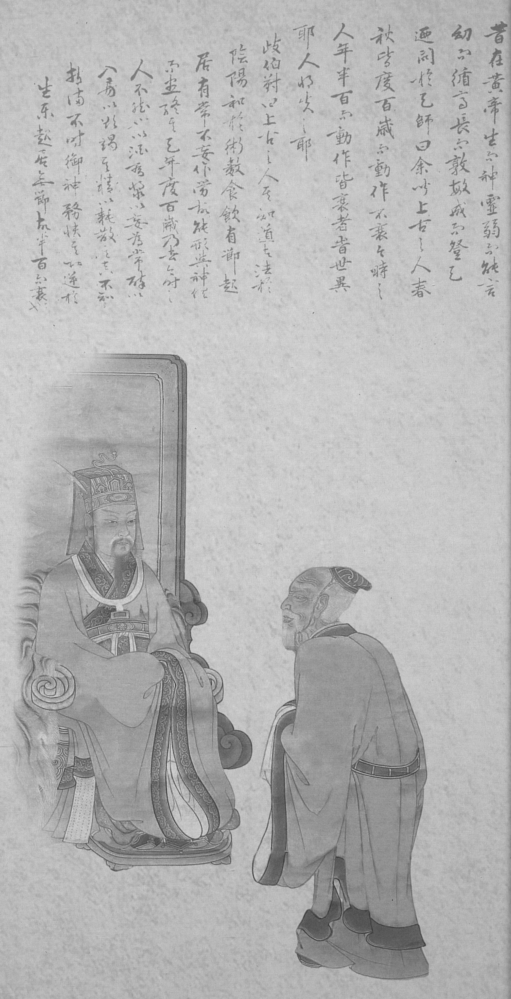

## 素問攷注（修訂版）

上

［日］森立之　撰

郭秀梅　［日］岡田研吉　校注

學苑出版社

<!-- PAGE_END -->

<!-- PAGE: 0002 -->

<!-- PRINTED: none -->

<!-- PAGE_END -->

<!-- PAGE: 0003 -->

<!-- PRINTED: none -->

## 素問攷注上（修訂版）

［日］森立之　撰

郭秀梅　［日］岡田研吉　校注

學苑出版社

<!-- PAGE_END -->

<!-- PAGE: 0004 -->

<!-- PRINTED: 1 -->

## 序一

森立之（一八〇七—一八八五），江戶後期日本傑出醫學文獻學家與考據學家，著述等身，佳作迭見，除《桂川詩集》《靈樞攷注》《扁鵲倉公傳攷注》亡佚外，存者尚有《素問攷注》《神農本草經攷注》《傷寒論攷注》《金匱要略攷注》《四時經攷注》《奇疾方攷注》《游相醫話》等。諸書多以『攷注』命名，極見學力深湛。

（一）清代學者將學問分爲三大類型：義理之學、詞章之學、考據之學。又謂義理之學從考據出者，則義理深雅淳厚；詞章之學從考據出者，則非浮泛輕艷之詞。則考據者，乃諸學之根源者也。清代自乾隆、嘉慶以降，文字、音韻、訓詁、考據、辨僞之學蔚然成風，一時學者幾乎無不談考據與訓詁。此風一開，遠及東瀛。日本學者尤其是江戶醫學界之考據派學者，莫不精研清代考據學開山顧炎武（一六一三—一六八二）《日知録》《音學五書》及其門徒江永（一六八一—一七六二）《古韻標準》《音學辨微》。江永之弟子爲戴震（一七二三—一七七七），戴氏爲清代皖派奠基人，在音韻、訓詁、考據三方面從理論與實踐上奠定了堅實基礎，他培養出一大批傑出第一流的文字音韻訓詁學家，如段玉裁（一七三五—一八一五）、王念孫（一七四四—一八三二）、孔廣森（一七五二—一七八六）等。段玉裁的《説文解字注》，王念孫的《廣雅疏證》《讀書雜志》，王念孫之子王引之（一七六六—一八三四）的《經傳釋詞》《經義述聞》諸書，皆爲江戶考據學者愛不釋手，森立之在《素問攷注》中大量引用段玉裁、王念孫、王引之、阮元（一七六四—一八四九）之成説，用以解詁釋難，排疑解紛。

<!-- PAGE_END -->

<!-- PAGE: 0005 -->

<!-- PRINTED: 2 -->

我們研究學習《素問攷注》時，首先應該得到啓發并獲得精神營養的，是沿着先賢的芳躅，讀他們已經讀過的書，掌握他們已經掌握的治學方法，這樣才能在新的時代，赶上先賢，超過先賢。

（二）在研究《素問攷注》時，宜研究考察森立之撰寫《素問攷注》的時代背景與攷注方法。此書始撰於一八六〇年正月初五（安政七年歲次庚申），撰畢於一八六四年（元治元年歲次甲子）十月十五日，共用五年時間。撰注此書之主要原因有三：（一）一八三七年（文政八年），森立之三十一歲，此年生活發生重大變故，他携妻將雛流浪他鄉，艱難險阻，困苦備嘗，行醫糊口，讀書自強，讀了大量清代文字音韻訓詁著作，作了一百餘卷讀書筆記，爲日後新生奠定堅實根基。一八四八年五月，『本藩遇赦，再來江戶居住』，結束了流浪生涯，於是整理舊稿，開始撰寫多種攷注。中國古代哲人孟子説過：『故天將降大任於是人也，必先苦其心志，勞其筋骨，餓其體膚，空乏其身，行拂亂其所爲，所以動心忍性，增益其所不能。』其森立之之謂乎？（二）當時他已在江戶躋壽館講授此書，以此稿爲講義，邊講邊修改。（三）最重要的原因是，他要利用發現不久的《太素》《醫心方》、宋版《千金》《外臺》、舊抄《明堂》一卷、眞本《玉篇》及全帙《新撰字鏡》等新材料，運用清代文字音韻訓詁考據學的新方法，『以解詁明理爲本旨』，撰寫一部與桂山《素問識》、茝庭《素問紹識》、喜多村直寬《素問札記》不同的著作。他的目的完全達到了。（參見《素問攷注》卷二〇第八一篇卷末跋文）

森立之撰寫《素問攷注》的核心方法是『解詁明理』。他説：『其讀經之法，一奉茝庭先生之口授，以解詁明理爲本旨。』何謂解詁，即解釋《素問》之文字、音韻、訓詁、句讀、校勘。語言明則醫理明。在文字上，他深曉《説文》，兼通俗字。俗字流行於三國至唐末五代（二二〇—九六一）期間，多用於抄寫藥方、醫書、賬簿等，而這個時期正是先秦兩漢醫書向下傳抄流行時期，俗體字可以任意增損和改變筆畫，有許多字與規範化漢字相距甚遠，所以《素問》《靈樞》《甲乙》《太素》中的許多可疑文字常與俗字有關。森立之在書中辨識解讀了許多俗字，其功至偉。日本珍藏許多中國古代手抄本文史哲醫古書，其中蘊藏大量俗字，若加收集分析，眞乃藏之名山不朽之盛業也。在音韻上，他通曉上古音與聲紐學，尤令人敬佩；在訓詁上，他熟悉《爾雅》《方言》《廣雅》《玉篇》及清代訓詁大師諸種訓詁巨著；在校勘上，他運用《甲乙》《太素》校正了《素問》不少訛字，實爲研治《素問》難得之佳作。

<!-- PAGE_END -->

<!-- PAGE: 0006 -->

<!-- PRINTED: 3 -->

《素問攷注》成就巨大，内容豐富，啓迪亦多。概括言之，以下四點尤爲突出：

第一，博取中國多種《素問》古注及日本江戶時期著名《素問》考據訓詁名著，審慎取舍，辨別是非，精思博考，斷以己意，網羅前訓，徵引群書，爲今後研治《素問》不可不讀之書。

第二，對當時發現不久的二十三卷本《太素》的原文與楊上善注，進行了十分詳細的校勘，爲今後校注《太素》必讀之作。

第三，以中國傳統語言學即文字音韻訓詁之學，整理研究考證中國古典醫籍，無論是江戶時代的學術史還是清代的學術史，都證明是完全正確的，森立之在這方面堪稱著名專家，因此成就十分突出。

第四，森立之具有堅忍不拔、鋼鉄般的意志與人格力量。十二年的艱苦磨難，不墜青雲之志，刻苦讀書，勤記筆記，終於給自己鑄造了一座不朽豐碑——《素問攷注》。

一九九八年一月一八日

於北京中醫藥大學

錢超塵

<!-- PAGE_END -->

<!-- PAGE: 0007 -->

<!-- PRINTED: none -->

<!-- PAGE_END -->

<!-- PAGE: 0008 -->

<!-- PRINTED: 1 -->

## 序

森枳園先生の謦咳にはむろん接したことはないが、先生は日頃、私が最も畏敬し、親愛し、私淑してやまぬ心の師である。その学識の深遠さは、私など到底及ぶべくもない。ただ、森先生の学問は深遠で自分などとても及ぶべくもないという事実を、現代においてつとに悟ったのは私かも知れない。そのことだけは内心誇りに思っている。「素問攷注」に序を書くなど、考えただけでも不遜で足がすくむ気がするが、序を需められ、あえて固辞し続けなかったのは、かくなる心情による。

本書の底本となった森先生自筆稿本の「素問攷注」は国立国会図書館の所蔵品である。私は昭和五十三年からしばしば同館に赴いて、所蔵の古医書類を複写するようになった。はじめは山田業広の著述に興味があったが、まもなく森先生の著に心を奪われた。以来今に至るまで私はいかに森先生の学恩に浴し、その著述に感化され続けてきたことか。手もとに残る当時の複写願書を見ると、昭和五十五年六月に「枳園叢攷」「枳園雑鈔」等全七冊を複写。同年十二月から翌年一月にかけて数度分けて「傷寒論攷注」全三十五冊を複写。これを読んで強い衝撃を受けた。正直いってそれまで目にしてきた古典解説研究書のほとんどが霞んで見えた。

「素問攷注」全三十九冊の複写を国立国会図書館に申し込んだのは、昭和五十六年三月三日のことである。なけなしの身銭をはたいて手にした大量の複写物は、私にとって何よりの宝物だった。のどの中央から丁寧に折り返し、付箋を原本どおりに貼付し、製本屋に出して上製本十冊に装幀した。厚さは四十センチメール近くにもなった。

<!-- PAGE_END -->

<!-- PAGE: 0009 -->

<!-- PRINTED: 2 -->

当時私は二、三名の同志と協力して、「太素」「甲乙経」などを含む「東洋医学善本叢書」の編刊作業に専念していた。「素問攷注」を見ると、「太素」をはじめ、幕末までに発見？整備された書誌考証学の成果が余すことなく発揮され、活用されているではないか。ただただ驚嘆し、敬服するのみであった。この凄さには、たとえ何度生を受けようと及ぶべくもない、と。

私はさかんに周囲に森先生の凄さを説いて回ったが、当時森先生の真価を理解しうる人はさほど多くはなかった。昭和五十九年一月に刊行された「漢方の臨床」三十周年記念号には拙論『考証学派の内経研究』を発表し、「素問攷注」に言及して次のように書いた。『筆者は数ある「素問」研究書のうち一書を限定されれば、迷わずこの書を採る。これほどのものが今日まで放置されているのは惜しむべきである』と。今もその信念はいささかも揺るがない。

私は森先生の菩提寺である池袋の洞雲寺に墓参を重ね、故玉川泰峉住職、矢数道明先生、大塚恭男先生ほかの御支援のもとに、昭和六十年十二月八日に同寺で森枳園百年忌祭を挙行した。私は『森枳園の遺業』と題して講演し、「素問攷注」「本草経攷注」「傷寒論攷注」の偉大さを力説したが、期待したほどの反応はなかった。

私は、幕末考証学は古典医書研究において卓抜した成果を収め、今日に至るも本家中国をはるかに凌駕する水準を究めたと断言してはばからぬものである。私が「素問攷注」に接し感銘を受けたのは二十歳代の終わりであった。いま知命の齢に近づきつつある。この間、鍼灸古典籍に関する研究熱はとみに盛んになった。その時運こそが本書の出版を生んだのである。まさに隔世の感がある。

<!-- PAGE_END -->

<!-- PAGE: 0010 -->

<!-- PRINTED: 3 -->

上述の経緯を想うとき、私は今般の「素問攷注」翻字出版の慶事を感涙をもって迎えないではおれない。前述のごとく、不遜は承知のうえ、序を固辞しえなかったゆえんである。本書の編刊作業に長い歳月を費やし、筆舌に尽くしがたい辛苦を惜しまれなかった日本内経医学会の同志の努力に、ここに限りない敬意を表する。金銭的にはいささかも報われないであろう。しかし、以後本書が日本はもとより本家中国をはじめ諸外国の研究者を大いに感化せしめ、その篤志に対し、歴史は金銭に代えがたい永遠の褒賞を与えるものと、固く信ずるものである。

願わくは、近い将来、気運の「本草経攷注」「傷寒論攷注」の翻字出版にまで及ばんことを。

平成九年十月三十一日

自称森枳園先生末流

不肖　小曽戸洋

<!-- PAGE_END -->

<!-- PAGE: 0011 -->

<!-- PRINTED: none -->

<!-- PAGE_END -->

<!-- PAGE: 0012 -->

<!-- PRINTED: 1 -->

## 「素問攷注」序補記

以上は今から四年九ヶ月前、日本内経医学会発行の翻字版「素問攷注」に序を求められて書いた拙文である。この出版によって「素問攷注」は日本の鍼灸古典研究者の間に普及し、森立之の業績は広く評価されるようになった。

この序文の末尾で私が希望を述べた「傷寒論攷注」も、その後、郭秀梅女史らの尽力により翻字、校点作業が進められ、昨年十月に中国の学苑出版社より刊行をみた。

二十余年前、森立之の業績の偉大さに心を打たれて以来、今日まで私淑し続けてきた私にとって、この現代における森立之再評価の気運は、まさに夢のごとく、嬉しく思われる。

いま、「素問攷注」がさらに校訂を重ね、しかも「四時経攷注」を付して、中国の学苑出版社より出版されるという。日本版に私とともに序を書かれた島田隆司先生は一昨年、惜しくも他界されたが、島田先生は天界にあって、森先生とともに、今回の中国版「素問攷注」の出版をいかばかりお慶びのことかを思う。

日本版「素問攷注」、そして中国版「素問攷注」の刊行に関与された諸先生方の御努力に、ここに満腔の敬意を表してやまない。

<!-- PAGE_END -->

<!-- PAGE: 0013 -->

<!-- PRINTED: 2 -->

本書が日本、中国の医学古典研究進展の新たな懸橋となることを確信しつつ。

平成十四年一月三十一日

小曽戸洋

<!-- PAGE_END -->

<!-- PAGE: 0014 -->

<!-- PRINTED: 1 -->

## 序二

當然，我無緣聆聽森枳園先生謦咳，但先生已成爲我學涯中最敬畏、最親愛的私淑之師，其深奧學識，我輩可閱而不可及。森先生學問之深厚，實有仰之彌高之感，今日我仍深信不疑，并以此私心自傲。爲《素問攷注》作序，實在因不遜而令我戰慄，而索序之時，所以未斷然回絕，亦是欣然接受的眞情表現。

本書底本，即森先生親筆稿本，現藏於國立國會圖書館。我自一九八八年起，時常赴該館複印各種古典醫籍。最初，對山田業廣先生著作產生了興趣，可是不久，這種傾慕之情被森先生的著作魅力所掠奪。而來至今，一直沐浴着森先生的學恩，爲其著作所感化着。翻閱當時複印醫籍申請書，一九八〇年六月複印《枳園叢攷》《枳園雜鈔》等全七冊。同年十二月至翌年一月，分數次複印《傷寒論攷注》全三十五冊。研讀這些内容後，使我受到強烈衝擊，率直地説，以前所參閱的古典研究書籍大多猶如雲霧了。

向國立國會圖書館申請複印《素問攷注》全三十九冊，是一九八一年三月三日的事了。那時，我將日常不多的零花錢節省下來複印大量資料，可想而知，對於我來説那是何等貴重之物。之後，我非常細心地將這些複印資料折疊，其中的附箋也完全照原本貼附，并送至製本屋裝幀成十冊，厚度大約有四十英寸。

當時我與二三名同仁合作，全力編集了包括《太素》《甲乙經》等在内的《東洋醫學善本叢書》。令人震驚和敬佩的是，《素問攷注》完全繼承、發揚、運用了《太素》等，以及幕末以前發現、完善的文獻考證學成果，其廣奧程度，即使天借數生之年，我輩亦難以實現。

<!-- PAGE_END -->

<!-- PAGE: 0015 -->

<!-- PRINTED: 2 -->

我曾極力向醫界同行宣揚森先生之偉業，但當時能眞正理解其價值的人并不多。一九八四年一月《漢方の臨床》三十周年紀念號上發表了拙論『考證學派の内經研究』，其中關於《素問攷注》，我寫了這樣一段話：『如果在衆多《素問》研究書中限定選擇一種的話，我將毫不猶豫地選擇此書。如此偉大的著作，至今仍未引起重視，實爲憾事。』時至今日，我的信念絲毫沒有動搖。

我曾多次參拜森先生的菩提寺，即位於池袋洞雲寺墓地，在已故玉川泰峉住職，及矢數道明先生、大塚恭男先生的大力支持下，一九八五年十二月八日在該寺舉行了森枳園百年祭祀儀式，我作了『森枳園の遺業』講演，極力褒揚《素問攷注》《本草經攷注》《傷寒論攷注》的學術成就，但反響卻令我頗感失望。

可以驕傲地説，幕末考證學在古典醫籍研究方面的卓越成果，遠遠超過了本家中國的研究水平。我自二十幾歲始深爲《素問攷注》所感銘，今已近知命之年。這期間，鍼灸古典醫籍研究熱潮蜂起，乘此東風本書即將上梓，油然而生隔世之感。

回想往事，我不由喜泪盈眶，以激動的心情企盼着《素問攷注》點校出版。正如前述，深知不遜而未固辭之因，亦在於此。

本書的編刊工作歷經了較長歲月，耐受了筆難盡言的辛苦，在此對日本内經學會的同仁深表敬意。此項工作雖無金錢的回報，可是隨其出版面世，使日本、中國及世界的研究者普受恩惠。我堅信，對其貢獻，歷史將給予金錢不可取代的永遠的、輝煌的獎賞。

<!-- PAGE_END -->

<!-- PAGE: 0016 -->

<!-- PRINTED: 3 -->

我奢望着不遠的將來，《本草經攷注》《傷寒論攷注》亦能點校出版。

一九九七年十月三十一日

自称森枳園先生末流

不肖　小曽戸洋

<!-- PAGE_END -->

<!-- PAGE: 0017 -->

<!-- PRINTED: none -->

<!-- PAGE_END -->

<!-- PAGE: 0018 -->

<!-- PRINTED: 1 -->

## 《素問攷注》序補記

以上是我四年零九個月前，應邀爲日本内經醫學會發行翻字版《素問攷注》時所寫的拙文。此書發行之後，使《素問攷注》在日本鍼灸古典研究者間得到普及與推廣，隨之，森立之的業積亦受到公允評價。序文末尾我曾表達希望《傷寒論攷注》早日出版，去年十月在郭秀梅女士等氏的努力下，已整理、點校由中國學苑出版社出版。

自二十餘年前，被森立之的偉大業績所感銘以來，私淑至今的我，對於現代再評價森立之的趨勢，完全如夢中之喜。

本次《素問攷注》將重訂再版，而且附録《四時經攷注》，由中國學苑出版社出版。與我共同爲日本版《素問攷注》作序的島田隆司先生，於前年因病不幸逝世。仙界的島田先生與森先生，一定爲中國版《素問攷注》的問世而感到無限喜悅。

在此，爲日本版《素問攷注》、中國版《素問攷注》的刊行而付出艱辛的諸位先生，深表滿腔敬意。

我堅信，本書的面世，將爲日本、中國醫學古典研究及交流架起新的橋梁。

平成十四年一月三十一日

小曽戸洋

（郭秀梅　譯）

<!-- PAGE_END -->

<!-- PAGE: 0019 -->

<!-- PRINTED: none -->

<!-- PAGE_END -->

<!-- PAGE: 0020 -->

<!-- PRINTED: 1 -->

## 序

現代日本の「素問」研究は第二次大戦前の矢数有道と戦後の丸山昌朗に始まる。明治の医制変革後の「内経」学の再興である。

矢数有道は日本の漢方家が「素問」を軽視する傾向に対して警鐘を鳴らし、昭和十年代に「漢方と漢薬」誌へ「素問」に関するたくさんの論説を執筆した。

昭和四十年春、丸山昌朗は「校勘和訓 黄帝素問」を著した。ガリ版刷りで、発行部数は三百部であった。そのテキストをもとにして、毎月一回、経絡治療研究会の例会で二時間ずつの「素問」講義をされた。日本では明治以降百年ぶりの「素問」講義であった。

こうして、途絶えていた「素問」研究に灯がついたのである。

日本の鍼灸は明治以降の漢方抑圧政策の中で、「難経」を中心にして生きる道を探し出して既に三十年を経てきていた。その中で、『もう一度「内経」に立ち戻って鍼灸医学を基礎から立て直すべきである』と主張する丸山昌朗が、その長くて困難な道を再構築するための第一歩が、「素問」講義なのであった。

残念ながら、矢数有道も丸山昌朗も森立之の「素問攷注」を見ることが出来なかった。江戸時代の末期に森立之という優れた「内経」研究家がいたことは医史学者の石原明から丸山昌朗に伝わってはいたが、その森立之が著わしていた「素問攷注」を見る機会は、まだ熟していなかったとしか言いいようがない。

<!-- PAGE_END -->

<!-- PAGE: 0021 -->

<!-- PRINTED: 2 -->

だから丸山昌朗は昭和四十年春に、大塚敬節所蔵の森枳園著「内経要字苑」を復刻して、その優れた業績の一端を世に問うたのみに終わってしまったのである。「内経要字苑」は森立之が「素問攷注」などを執筆するときに「素問」「霊枢」中の重要な用語の索引として作成していたものである。復刻された同書の巻末に『文久壬戌十二月十三日卒業枳園立之』（一八六二年）と記してある。この書は、「素問」「霊枢」中の要語を『九竅』から始まって『身体』『五蔵』など十六門分類している。『身体』門の中には皮膚から始まって皮、膚、皮毛、肌膚、肌皮など百一項目がある。それぞれの項目に「素問」第〇巻、「霊枢」〇篇にそれが何カ所出しているかを記してある。「霊枢」での所出が記してあることは、「内経要字苑」が作成された時には、未発見の森立之「霊枢攷注」が既に書き終わっていたと推測される。

矢数有道、丸山昌朗らの「素問」再興の情熱は、細い一本の流れから徐々に太くなり、いまようやく日本鍼灸界の一つの流れを形成して来た。

昭和五十九（一九八四）年春、井上雅文、岡田明三、左合昌美の諸氏と語り合って、『東洋医学の古典に真摯に取り組む場を作ろう』として『原塾』を創設した。井上雅文が「霊枢」を、小生が「素問」を毎週講義することになった。さて改めて「素問」の講義を始めるに当って、師丸山昌朗が残した「校勘和訓 黄帝素問」をもとにして新しいテキストを作るべく、その資料を数年前に井上雅文学兄が作っていたコピー本の森立之著「素問攷注」に求めた。初めて本格的に「素問攷注」に取り組むことになった。毎週の講義である。とにかく毎日毎日「素問攷注」を読まなければならない。癖の強い森立之の筆跡を追って、『旁光』が『膀胱』の正字だと分かるのに苦労したり、恩師である多紀元簡の論を『「素問識」之説非是』と論白するのに感心したりである。諸説を論破して『嬉々快快』としたりする森立之に傾倒した。論破するときに用いている諸説は一々原本を調べて引用している訳ではなく、恐らく暗記していたのであろう。

<!-- PAGE_END -->

<!-- PAGE: 0022 -->

<!-- PRINTED: 3 -->

小曽戸洋先生の本書に対する高い評価に動かされたか、オリエント出版社でこの「素問攷注」の自筆稿本を全四巻本として影印出版したのは一九八五年十二月である。

一九八七年五月に天津で開催された原塾との間で行われた第二回『日中内経学術交流会』の時に、同出版社の好意によって「素問攷注」全四巻と渋江抽斎「霊枢講義」全二巻を日本内経医学会から天津中医学院に贈呈した。日本の誇るべき「内経」研究の著作を現代中国の「内経」研究家のトップの一人である郭靄春氏に伝えたかったからである。郭靄春氏は既に「黄帝内経素問校注語訳」（一九八一、天津科学技術出版社出版）をまとめられていた。郭靄春氏はその後、主編された中医古籍整理叢書としての「素問校注」（一九九二年、人民衛生出版社出版）には随所に「素問攷注」での森立之の注を引用され、その優れた研究が現代中国を代表する「素問」の注釈書の内容を高めることになった。

森立之は幕末までの「内経」研究の最高の成果を総まとめした。明治十四年に清国から来日した楊守敬に『明治已来、洋説盛行し、国政已にして洋。医業に在りても亦然り。洋ならざれば則ち医に非らず。漢方医は老生則ち一生を限りと為す』と嘆いた森立之は百年後に必ず「素問」医学が復活することを信じていたのであろう。「素問」は鍼灸、湯液、気功を含めて、なお今に生きる中国系医学の大本である。それは日ごとにより正しく読まれなければならない。

矢数有道、丸山昌朗以来の「内経」再興の努力はついに一つの流れとなり、このたびの「素問攷注」を翻字出版する力にまでなった。日本内経医学会の荒川緑、小林健二、宮川浩也の三氏を中心とする多くの会員の努力によって、要語索引まで付されて上梓されることになったことを心から喜ぶ。これによって「素問」研究は必ずさらに広く深く進展する。そのことが世界の医学医療を一歩も二歩も発展させることを深く信じて、序とする次第である。

<!-- PAGE_END -->

<!-- PAGE: 0023 -->

<!-- PRINTED: 4 -->

一九九八年二月

島田隆司

【一九九八年に刊行された「翻字版素問攷注」（日本内経医学会）に、序文を為した前日本内経医学会会長の島田隆司先生は、二〇〇〇年八月に他界されました。そのリプリントが中国で発行されることに快諾し、その刊行を心待ちにしていました。本書をご霊前に捧げるものであります。門人 宮川浩也 二〇〇二年一月】

<!-- PAGE_END -->

<!-- PAGE: 0024 -->

<!-- PRINTED: 1 -->

## 序

現代日本對於《素問》的研究，始於第二次世界大戰前的矢數有道，以及戰後的丸山昌朗，明治醫制變革後的《内經》學再度興盛。

矢數有道先生，三十年代曾向《漢方と漢藥》雜誌投稿，撰寫多篇與《素問》相關的文章，為日本漢方家輕視《素問》的傾向敲響了警鐘。

一九六五年春，丸山昌朗先生撰著《校勘和訓黄帝素問》一書，謄寫版印刷，發行三百部。并以此為教材，以經絡治療研究會例會的形式，每月一次，每次講授兩小時。這樣的講習，是日本明治以降，時隔百年的《素問》研究活動。

如是，為處於黑暗中的《素問》研究，點亮了一盞明燈。

明治以後壓抑漢方政策中，日本鍼灸界以《難經》為中心，探索着生存之路，至今已歷經三十餘年。其間，丸山昌朗先生曾主張，再一次踏入《内經》領域，從根本上重建鍼灸醫學理論。在漫長而充滿困難的路上，為重新構築基礎，首先邁出講習《素問》的第一步。

遺憾的是，矢數有道、丸山昌朗未曾見過森立之的《素問攷注》。現代醫史學者石原明，曾向丸山昌朗介紹江戶末期有一位優秀的《内經》研究家，名叫森立之。可是，閲覽森立之《素問攷注》的機會尚未成熟，終未如願。因此，丸山昌朗於一九六五年春，將大塚敬節所藏森枳園著《内經要字苑》復刻，其優異業績初露端倪即隱匿。《内經要字苑》是森立之在撰著《素問攷注》之際，編纂《素問》《靈樞》中重要用語，類似索引形式。該書卷末記有『文久壬戌十二月十三日卒業 枳園立之』（一八六二年）。書中所收《素問》《靈樞》要語自『九竅』始，分為『身體』『五藏』等十六門。『身體』門中有皮膚及皮、膚、皮毛、肌膚、肌皮等一百零一項，并明記各個條目出自《素問》某卷，《靈樞》某篇，以及出現次數等。依據《靈樞字苑》的編成，可以推測編集《内經字苑》之時，至今下落不明的森立之所著《靈樞攷注》已經完成。

<!-- PAGE_END -->

<!-- PAGE: 0025 -->

<!-- PRINTED: 2 -->

矢數有道、丸山昌朗二氏振興《素問》的熱情，像一條細小溪水不斷流淌，漸漸寬泛，今天終成日本鍼灸界一支奔騰浪濤。

一九八四年春，與井上雅文、岡田明三、左合昌美諸氏相談，以『創設真摯研讀東洋醫學古典環境』為初衷，成立了『原塾』。每周由井上雅文講解《靈樞》，我負責講授《素問》。為重溫《素問》，在師丸山昌朗遺留的《校勘和訓 黄帝素問》基礎上，補充《素問攷注》内容，作為授課教材。該《素問攷注》是數年前的複印本，由井上雅文學兄提供。如是，首次眞正將《素問攷注》内容引進《内經》研究中。為了每周的講授，每天必須研讀《素問攷注》，時時被森立之具有個性的考證和其中辛勞所感動。例如，為解釋『旁光』即『膀胱』之正字而旁徵博引，并大膽否認恩師多紀元簡《素問識》所論之非。釋明一詞，森立之『嬉嬉快快』之情躍然紙上。今日讀此，我輩亦有同喜同樂之感。考證中大量引用諸家之説，如果是一一翻閲原本，大概不太可能，或許森立之早已暗記心中了。

小曾戸洋先生給予此書極高評價，并大力舉薦於同仁，一九八五年十二月東洋出版社影印出版《素問攷注》親筆稿本全四卷本。

<!-- PAGE_END -->

<!-- PAGE: 0026 -->

<!-- PRINTED: 3 -->

一九八七年五月在中國天津召開第二屆以『原塾』為代表的『日中内經學術交流會』時，承蒙東洋出版社盛情，將《素問攷注》全四卷及澀江抽齋《靈樞講義》全二卷，以日本内經醫學會名義，贈呈天津中醫學院。其實也是把值得日本驕傲的《内經》研究著作，謹呈於現代中國《内經》研究佼佼者郭靄春氏。郭靄春氏已編著《黄帝内經素問校注語譯》（一九八一年天津科學技術出版社出版）。其後，郭靄春氏在主編中醫古籍整理叢書中《素問校注》（一九九二年人民衛生出版社出版）時，引用《素問攷注》内容隨處可見，可以説，森立之精深卓越的考證，為現代中國《素問》研究作出了貢獻。

森立之可謂幕末以前《内經》研究優異成果集大成者，明治十四年與訪日清國楊守敬筆談時，森立之感嘆曰：『明治已來，洋説盛行，國政已洋，官報亦然，在醫業亦然。不洋則非醫，漢醫者老生則一生為限。』然而，森立之仍堅信百年之後《素問》醫學必將重放光芒。

《素問》中包含鍼灸、湯液、氣功等豊富内容，現在仍為中國傳統醫學之祖本，因此，非常有必要認眞、正確研讀。

矢數有道、丸山昌朗以來，振興《内經》的力量已形成流派，正是這一力量實現了《素問攷注》翻字出版。由日本内經醫學會荒川綠、小林健二、宮川浩也三氏牽頭，多數會員共同努力，《素問攷注》及『要語索引』即將上梓，欣喜不已。今後《素問》研究必將更廣泛、更深入展開，推進世界醫學醫療不斷發展。信於此而弁之為序。

一九九八年二月

島田隆司

<!-- PAGE_END -->

<!-- PAGE: 0027 -->

<!-- PRINTED: 4 -->

### 追記

一九九八年為《翻字版素問攷注》（日本内經醫學會）撰寫序文的前日本内經醫學會會長島田隆司先生，於二〇〇〇年八月因病逝世。生前曾允諾修訂此書在中國發行，九泉之下期待早日出版。本書亦為先生靈前貢奉之物。

門人 宮川浩也 二〇〇二年一月

（郭秀梅 譯）

<!-- PAGE_END -->

<!-- PAGE: 0028 -->

<!-- PRINTED: 1 -->

## 凡例

### 一、底本

《素問攷注》二〇〇四年在學苑出版社點校出版，由郭秀梅、岡田研吉點校，崔仲平審訂。此次修訂，底本採用日本國立國會圖書館藏（一九一函七五一號）森立之親筆稿本，原稿全二十卷三十九冊。本次出版以一九九八年日本内經醫學會句讀本（編者：荒川綠、小林健二、宮川浩也。協助者：左合昌美、島田隆司、東海林茂、高橋葉子、津曲奈穗子、林孝信、古谷円、山口秀敏、山本朝子、吉田和裕）、北里研究所東洋醫學總合研究所醫史學研究部（小曾戸洋、町泉壽郎）發行本，以及二〇〇四年學苑出版社點校本為基礎，參照森立之親筆稿本重新點校，訂正前兩版諸多訛誤，並盡量恢復作者原稿面貌。

### 二、構成

《素問攷注》二十卷。（《素問》原為二十四卷，闕運氣七篇及已亡佚二篇，共四卷。）此次點校，盡可能保留原書内容，不增不刪。但經文旁原標記小字，為保持經文完整性，予以刪除。

### 三、文字處理

1．原文前加『○』且用黑體字。採用通行規範正字，同時為便於表述版本校勘、字形考證等，保留異體字，如輒、輙，并、併，痒、癢等，一依原文。尤其所引《醫心方》等貴重資料，皆保留原稿字形。書名中異體字予以保留，如《攷注》等書名。

<!-- PAGE_END -->

<!-- PAGE: 0029 -->

<!-- PRINTED: 2 -->

2．原文中重文符號，如：『〃』『々』『ヽ』 等，一律逕改成對應文字。

3．原稿衍脫誤倒之處，隨文用圓括號標出，不另出校注。

4．難以判讀文字，一字用一『□』表示，字數難以判明之處，以『◇』表示。

### 四、標點符號

1．使用新式標點。

2．原稿用圓括號提示重點詞語，不影響閲讀理解，故保留。

3．刪除原稿所加圈點，以及韻腳字右側加△等符號。

### 五、行文格式

1．保留原稿二十卷體例，内容順序完全按照底本，即經文、校勘事項、諸家注釋、森立之及森約之案語。

2．原稿眉批有兩類：一類屬於補充正文内容，作者於需補入之處標記△或○符號，故一律按作者意圖補入正文，不另作説明。一類未作標記，係森立之、森約之父子眉批，將該類眉批排入正文，單獨成段，并加『（眉）』字表示。本書中森約之筆迹，用楷體字排版，以使區分森立之所撰内容。

3．原稿附箋，根據内容順序編入正文。

4．原稿見有言之未盡，或僅列條目而無下文情況，皆原樣保留。

5．圖表一律保留。線條、文字，依據原作邏輯分類，略加規範。難以規範之圖表，原本複印貼附。

6．作者於引録文字前面用『〔〕』標記書名、作者，大多為略稱，予以保留。作者於《素問攷注》卷二十對略稱詳加説明。

<!-- PAGE_END -->

<!-- PAGE: 0030 -->

<!-- PRINTED: 3 -->

### 六、數字、日期

1．作者用片假名及數字標記原文所在之處，為便於中國讀者閲讀，簡要説明如下：

ノ：之、的。ヲ、オ：表（ヲモテ）、書葉表面（正面）。ウ：裏（ウラ），書葉裏面（反面）。如：三ノ二二ヲ，即指第三卷二十二葉表面（正面）；五ノ一ウ，即指第五卷一葉裏面（反面）。

2．原稿多處標有寫作、句讀、講學日期，係研究森立之重要參考資料，予以保留。

### 七、日本語漢字音譯

本書使用漢字表述日本語讀音，例如『上氣』讀作『古美阿介留』之類，具有一定文獻價值，故原文保存，不加注釋。

### 八、索引

《素問攷注》卷二十末尾附録《素問攷注要義捷見》，收録本書重點解釋詞語，按卷次篇順排列。排成活字後，版頁改變，雖已失去檢索意義，仍保持原貌附於書後。又另依卷次順序新編《森立之攷注要語索引》。

郭秀梅　二〇二四年春

<!-- PAGE_END -->

<!-- PAGE: 0031 -->

<!-- PRINTED: none -->

<!-- PAGE_END -->

<!-- PAGE: 0032 -->

<!-- TOC_START -->

<!-- PRINTED: 1 -->

## 目录

- 上冊
- 素問攷注卷第一 …… 一
- 重廣補註黄帝内經素問序 …… 一
- 重廣補註黄帝内經素問卷第一 …… 五
- 上古天眞論篇第一 …… 七
- 四氣調神大論篇第二 …… 三六
- 生氣通天論篇第三 …… 六三
- 金匱眞言論篇第四 …… 一〇七
- 素問攷注卷第二 …… 一三一
- 重廣補注黄帝内經素問卷第二 …… 一三一
- 陰陽應象大論篇第五 …… 一三一
- 陰陽離合論篇第六 …… 一八八
- 陰陽別論篇第七 …… 二〇三
- 素問攷注卷第三 …… 二三六
- 重廣補注黄帝内經素問卷第三 …… 二三六
- 靈蘭祕典論篇第八 …… 二三六
- 六節藏象論篇第九 …… 二六六
- 五藏生成篇第十 …… 二九二
- 五藏別論篇第十一 …… 三二五
- 素問攷注卷第四 …… 三三九
- 重廣補注黄帝内經素問卷第四 …… 三三九
- 異法方宜論篇第十二 …… 三三九
- 移精變氣論篇第十三 …… 三五三
- 湯液醪醴論篇第十四 …… 三六四
- 玉版論要篇第十五 …… 三七五
- 診要經終論篇第十六 …… 三八四
- 素問攷注卷第五 …… 四〇四
- 重廣補注黄帝内經素問卷第五 …… 四〇四

<!-- TOC_PAGE: 0033 -->

<!-- PRINTED: 2 -->

- 脈要精微論第十七 …… 四〇四
- 平人氣象論篇第十八 …… 四四八
- 素問攷注卷第六 …… 四九一
- 重廣補注黄帝内經素問卷第六 …… 四九一
- 玉機眞藏論篇第十九 …… 四九一
- 三部九候論篇第二十 …… 五三二
- 素問攷注卷第七 …… 五五六
- 重廣補注黄帝内經素問卷第七 …… 五五六
- 經脈別論篇第二十一 …… 五五六
- 藏氣法時論篇第二十二 …… 五七一
- 宣明五氣篇第二十三 …… 六〇七
- 血氣形志篇第二十四 …… 六四二
- 素問攷注卷第八 …… 六五五
- 重廣補注黄帝内經素問卷第八 …… 六五五
- 寶命全形論第二十五 …… 六五五
- 八正神明論篇第二十六 …… 六八三
- 離合眞邪論篇第二十七 …… 七〇〇
- 通評虛實論篇第二十八 …… 七一七
- 太陰陽明論篇第二十九 …… 七四九
- 陽明脈解篇第三十 …… 七五七
- 素問攷注卷第九 …… 七六三
- 重廣補注黄帝内經素問卷第九 …… 七六三
- 熱論篇第三十一 …… 七六三
- 刺熱篇第三十二 …… 七九三
- 評熱病論篇第三十三 …… 八二二
- 逆調論篇第三十四 …… 八四三
- 下冊
- 素問攷注卷第十 …… 八五五
- 重廣補注黄帝内經素問卷第十 …… 八五五
- 瘧論篇第三十五 …… 八五五
- 刺瘧篇第三十六 …… 八八一
- 氣厥論篇第三十七 …… 九〇二
- 欬論篇第三十八 …… 九二一
- 素問攷注卷第十一 …… 九三三
- 重廣補注黄帝内經素問卷第十一 …… 九三三
- 舉痛論篇第三十九 …… 九三三

<!-- TOC_PAGE: 0034 -->

<!-- PRINTED: 3 -->

- 腹中論篇第四十 …… 九五四
- 刺腰痛篇第四十一 …… 九七五
- 素問攷注卷第十二 …… 一〇〇〇
- 重廣補注黄帝内經素問卷第十二 …… 一〇〇〇
- 風論篇第四十二 …… 一〇〇〇
- 痺論篇第四十三 …… 一〇二四
- 痿論篇第四十四 …… 一〇四六
- 厥論篇第四十五 …… 一〇六二
- 素問攷注卷第十三 …… 一〇八八
- 重廣補注黄帝内經素問卷第十三 …… 一〇八八
- 病能論篇第四十六 …… 一〇八八
- 奇病論篇第四十七 …… 一一〇五
- 大奇論篇第四十八 …… 一一二五
- 脈解篇第四十九 …… 一一五四
- 素問攷注卷第十四 …… 一一八〇
- 重廣補注黄帝内經素問卷第十四 …… 一一八〇
- 刺要論篇第五十 …… 一一八〇
- 刺齊論篇第五十一 …… 一一八四
- 刺禁論篇第五十二 …… 一一八六
- 刺志論篇第五十三 …… 一二〇七
- 鍼解篇第五十四 …… 一二一三
- 長刺節論篇第五十五 …… 一二二八
- 素問攷注卷第十五 …… 一二三八
- 重廣補注黄帝内經素問卷第十五 …… 一二三八
- 皮部論篇第五十六 …… 一二三八
- 經絡論篇第五十七 …… 一二五四
- 氣穴論篇第五十八 …… 一二五六
- 氣府論篇第五十九 …… 一二七四
- 素問攷注卷第十六 …… 一二九四
- 重廣補注黄帝内經素問卷第十六 …… 一二九四
- 骨空論篇第六十 …… 一二九四
- 水熱穴論篇第六十一 …… 一三四〇
- 素問攷注卷第十七 …… 一三六一
- 重廣補注黄帝内經素問卷第十七 …… 一三六一
- 調經論篇第六十二 …… 一三六一
- 素問攷注卷第十八 …… 一四〇三

<!-- TOC_PAGE: 0035 -->

<!-- PRINTED: 4 -->

- 重廣補注黄帝内經素問卷第十八 …… 一四〇三
- 繆刺論篇第六十三 …… 一四〇三
- 四時刺逆從論篇第六十四 …… 一四三三
- 標本病傳論篇第六十五 …… 一四五三
- 素問攷注卷第十九 …… 一四七三
- 重廣補注黄帝内經素問卷第二十三 …… 一四七三
- 著至教論篇第七十五 …… 一四七三
- 示從容論篇第七十六 …… 一四八六
- 疏五過論篇第七十七 …… 一五〇一
- 徵四失論篇第七十八 …… 一五一三
- 素問攷注卷第二十 …… 一五二〇
- 重廣補注黄帝内經素問卷第二十四 …… 一五二〇
- 陰陽類論篇第七十九 …… 一五二〇
- 方盛衰論篇第八十 …… 一五四二
- 解精微論篇第八十一 …… 一五五八
- 引用諸家目録 …… 一五七〇
- 素問攷注跋文別號録 …… 一五七一
- 素問攷注要義捷見 …… 一五七八
- 素問攷注採用諸家例式 …… 一五九一
- 《素問攷注》要語索引 …… 一五九三

<!-- TOC_END -->

<!-- PAGE_END -->

<!-- PAGE: 0036 -->

<!-- PRINTED: 1 -->

## 上冊

## 素問攷注卷第一

劉桂山先生有《素問識》，已上梓。茝庭先生有《素問紹識》，抄寫傳之，未出於人間。若合讀二書，則可謂始讀得《素問》也。今茲講此書於躋壽館，因改舊稿眼目，一倣皇侃《論語義疏》之體例，其義皆據王注，但王注略而不書，王注義不可據者，旁引他説。今以正文及前注，不論倭漢古今，所采用者皆爲大書，以拙考爲子注，以備他日之遺忘，併授兒約之云。

安政庚申正月初五夜三更燈下起業　森養竹立之

（眉）《素問》王序疏解，詳出我臧本和坊刻欄上，宜別寫成册，以載此卷上。

### 重廣補註黄帝内經素問序

古抄本無『重廣補註』四字，元板同。此是初刻宋板之傳來，而爲可從矣。然宋臣校正諸書，書名上每加幾多文字，太抵如此。《開寶本草》題云『重定』，《嘉祐本草》題云『補注』，《政和本草》題云『重修』，並可以徵也。但古抄本所據宋板，尚未加此四字，則爲北宋初刻可知矣。元板所據亦爲同種宋板，故古抄本往往與元板合，故此審言之耳。

（眉）《醫賸》卷上王氷章可參看。又《玄珠密語》序曰：『余即遇玄珠子，與我啓萌，故自號啓玄子也。謂啓問於玄珠子也。』

<!-- PAGE_END -->

<!-- PAGE: 0037 -->

<!-- PRINTED: 2 -->

（眉）宋沈作喆《寓簡》卷七作王砅，砅字從石從水。

（眉）宋本《素問》及王氷事件，詳出《琳琅書目》卷九，宜参看。

（眉）《集韻》十六蒸『砅，披冰切。水激山也。或作砰』。又四十七證『砅，蒲應切。水激石聲』。

（眉）《正字通》『韓愈詩：瓿墅輾砅砰』。

（眉）《文選·江賦》『砅巖鼓作』注：『砅，水激巖之聲也。』

（眉）方以智《通雅》卷十二曰：『王砅，唐太僕令，自號啓玄子。陳、晁皆作「砅」。《本草》《六書故》《月令廣義》皆引作「冰」。』

（眉）《皇朝類苑》卷五十九曰：『李陽氷深於篆隸，而名作冰，音凝。故参政王公堯臣但讀「氷」字曰：陽凝無義，唯陽氷有不治（當作治）之語。』

（眉）《文館詞林》四百五十七首有『東晉孫綽作庾冰碑銘，其序曰：君諱冰，字季堅』。

**班固《漢書·藝文志》曰：《黄帝内經》十八卷，《素問》即其經之九卷也。兼《靈樞》九卷，迺其數焉。**

《漢志》所録尚未有缺，《隋志》『《黄帝素問》九卷。注云：梁八卷』。又云『《黄帝素問》八卷。全元起注』。《舊唐志》『《黄帝素問》八卷』。《新唐志》『全元起注《黄帝素問》九卷』。『九卷』恐是『八卷』訛，全氏注本不可有九卷也。晉皇甫謐《甲乙經》序云『《素問》九卷，二九十八卷，即《内經》也。亦有所忘失』。『忘』即『亡』訛。因攷《素問》一經，魏晉已來非全卷，則《漢志》所云『十八卷』，亦未知果全本否，恐是據篇目録之歟？宋臣所云『猶《周官》無冬官，以《考工記》補之之類也』，此説可從矣。左氏《昭十二年傳》云『八索、九丘』，杜注云：『皆古書名。』而《釋文》『索，所白反。本又作素』。某氏《古文尚書》序云『八卦之説，謂之八索，求其義也』。《釋文》『索，所白反。求也。徐音素，本或作素』。竊謂古音『索』與『素』相通。《爾雅·釋草》『素華，軌鬷』。《釋文》『素，本又作索』，則『八索』即『八素』，『八素』爲本字，『八索』爲訛字。《左傳》一本誤作『八索』，某氏作僞書，據左氏誤本作『八索』，遂就字成説云『求其義也』。爾來注家皆從此，以『八索』爲之説，不知『八索』者即『八素』，而今之《素問》八卷也。然則全元起所據，即是上古傳來之古經，無可疑也。余別有《八素攷》，文繁故不詳録。

<!-- PAGE_END -->

<!-- PAGE: 0038 -->

<!-- PRINTED: 3 -->

（眉）龜鏡，《北史·長孫紹遠傳》『此數事者，照爛典章，揚搉而言，足爲龜鏡』。盧照鄰《五悲雜言》『思欲爲龜爲鏡，立德立言』。約之案：龜，神物也。鏡，鑑也。立之案：龜卜所以分吉凶，鏡面所以別醜美，故以爲摸擬法則之義也。

**或一篇重出，而別立二名。**

《離合真邪論》《新校正》云：『全元起本在第一卷，名「經合」，第二卷重出，名「真邪」。』

**或兩論併吞，而都爲一目。**

《血氣形志》篇《新校正》云：『全元起本此篇併在前篇｟《宣明五氣篇》｠，王氏分出爲別篇。』《經絡論》《新校正》云：『全元起本在《皮部論》末，王氏分篇。』

**或問答未已，別樹篇題。**

《骨空論》《新校正》云：『全元起本在第二卷，自灸寒熱之法以下，在第六卷《刺齊篇》末。』《四時刺逆從論》《新校正》云：『厥陰有餘至筋急目痛，全元起本在第六卷。春氣在經脈至篇末，全元起本在第一卷。』

<!-- PAGE_END -->

<!-- PAGE: 0039 -->

<!-- PRINTED: 4 -->

**或脱簡不書，而云世闕。**

王氏曰：『第七一卷，師氏藏之，今之奉行，惟八卷爾。』則所云『脱簡』者，謂第七一卷也。

**重《合經》而冠鍼經，**

全元起本《經合》《調經》二論在第一卷，是也。

**併《方宜》而爲《欬篇》，**

案：《異法方宜論》舊併合於《欬論》末歟？

**隔《虛實》而爲《逆從》，**

《四時刺逆從論》在第六卷，而『春氣在經脈』至篇末，在第一卷。

**合《經絡》而爲《論要》，**

柏軒伊澤信道曰：『絡，恐終誤。』蓋《玉版論要｟十五｠》與《診要經終｟十六｠》舊合併爲一篇歟？

**節《皮部》爲《經絡》，**

《經絡論》《新校正》云：『全元起本在《皮部論》末，王氏分篇。』

**退《至教》以先鍼。**

案：開卷第一，退治病至教，而先鍼法末技之謂歟？全元起本《平人氣象論》在第一卷，《上古天真論》在第九卷。

張介賓《類經附翼》二卷候氣辨疑篇曰：『鄭世子曰：光武以讖興，命解經從讖。漢儒遵時制，不得不然也。』

案：是王冰『昭彰聖旨，敷暢玄言』之義相符。

<!-- PAGE_END -->

<!-- PAGE: 0040 -->

<!-- PRINTED: 5 -->

朱墨

（眉）《魏略》『董遇，字季直。作老子訓注。又善《左氏傳》，更爲作《朱墨別異》』。《晉書·劉兆傳》『又爲《春秋左氏》解，名曰《全綜》。《公羊》《穀梁》解詁皆納經傳中，朱書以別之』。

### 重廣補註黃帝内經素問卷第一

古抄本作『重雕補註釋文黃帝内經素問卷之一』，元板作『新刊補註釋文黃帝内經素問卷之一』，以下每卷皆倣此。

《新校正》云：『按，王氏不解所以名素問之義，及素問之起於何代。按，《隋書·經籍志》始有素問之名，《甲乙經·序》晉皇甫謐之文已云《素問》論病精辨。王叔和，西晉人，撰《脈經》云：出《素問》《針經》。漢張仲景撰《傷寒卒病論集》云：撰用《素問》。是則《素問》之名著於《隋志》，上見於漢代也。自仲景已前，無文可見，莫得而知。據近世所存之書，則《素問》之名起漢世也。所以名《素問》之義，全元起有説云：素者，本也。問者，黃帝問岐伯也。方陳性情之源，五行之本，故曰素問。元起雖有此解，義未甚明。按，《乾鑿度》云：夫有形者生於無形，故有太易，有太初，有太始，有太素。太易者，未見氣也。太初者，氣之始也。太始者，形之始也。太素者，質之始也。氣形質具而痾瘵由是萌生，故黃帝問此太素質之始也。素問之名義或由此。』

案：蓋素者，素朴純一不雜之謂。《釋名·釋采帛》云『素，朴素也。已織則供用，不復加功飾也。又物不加飾皆目謂之素』，《呂覽·勿躬》《淮南·本經》注並云『素，樸也』可以徵矣。素女之素，亦此義，偁其德之純一不雜，名以素女也。岐黃問答之語，其意玄妙幽微，不可勝言，故偁曰素問。所云太素質之始也之『素』字，亦爲同義。而謂『黃帝問此太素質之始也』，則非矣。

<!-- PAGE_END -->

<!-- PAGE: 0041 -->

<!-- PRINTED: 6 -->

（眉）《廣雅·釋言》『傃，經也』。王念孫《疏證》『傃與素通。素、經，皆常也、法也』。宣十一年《左傳》云『不愆於素』。《士喪禮》『獻素』鄭注云『形法定爲素。素與索古同聲，故索亦訓爲法』。定四年《左傳》『疆以周索』杜注云『索，注也。（注當作法）』《正義》引《考工記·量器銘》『時文思索』，鄭注《考工記》云『言是文德之君，思求可以爲民立法者，而作此量』。《鄘風·定之方中》箋引《考工記》『索』作『素』。約之案：《禮·中庸》『君子素其位而行』。注：『素皆讀爲傃。』又『素隱行怪』注：『素讀如攻城攻其所傃之傃。』《爾雅·釋草》『素華，軌鬷』，《釋文》素又作索。蓋『素問』，問天人素常之理本也。又《廣雅·釋詁一》『祖，法也』。猶如《釋言》『傃，經也』同義。

《素問解題》云：『其不言問素而名素問者，猶屈原有《天問》，是倒置下字耳。』

又云：此書醫經之最古者，往聖遺言存焉。而晉皇甫謐已下歷代諸家，斷爲岐黃所自作，此殊不然也。蓋醫之言陰陽尚矣。莊子之書，謂疾爲陰陽之患。《左傳》醫和論六氣曰『陰淫寒疾，陽淫熱疾』，班固云『醫經者，原人血脈經絡骨髓陰陽表裏，以起百病之本，死生之分』，可以見也。而漢之時，凡説陰陽者，必係之於黃帝。《淮南子》曰『黃帝生陰陽』，劉向云『言陰陽五行，以爲黃帝之道』，《漢志》陰陽醫卜之書，冠『黃帝』二字者，凡十有餘家，此其證也。此經設爲黃帝岐伯之問答者，亦漢人所撰述，無疑矣。方今醫家或牽合衍贅，以爲三墳之一，或詆毀排斥，以爲贋僞之書，俱失焉。

案：陰陽者，醫理之本原，若不通陰陽，則醫理暗昧。所云陰陽五行者，實是上世之遺言，決非漢人所能撰述。蓋三代殘編僅免秦火，故至《漢志》爲之著録。猶神農之《本草》，全然傳存於漢之方術者流也。陶隱居序《本草經》云：『但軒轅以前，文字未傳，如六爻指垂，画象稼穡，即事成迹。至於藥性所主，當以識識相因，不爾何由得聞。至於桐、雷，乃著在於編簡，此書應與《素問》同類，但後人多更修飾之爾。

<!-- PAGE_END -->

<!-- PAGE: 0042 -->

<!-- PRINTED: 7 -->

秦皇所焚，醫方卜術不預，故猶得全録。』是也。

（眉）《續時還讀我書》曰：『余嘗讀諸子，其文辭最類《素問》者，莫如《管子》，蓋其書最古，而時世相近也。若夫淮南王書固似，而比《素問》則其先後果如何耶。』

（眉）案：此云『最古』，亦大概之言耳，若其究之，則《神農本草》爲最古，《黃帝内經》乃次之也。

（眉）海保元備論《史記》扁倉傳曰：『太史公書，唯扁倉二傳，稱爲難讀。蓋其所紀者，在當時不過爲醫家恒言，而後世駭異，以爲罕所聞焉。加之其文辭簡質，如璞未雕，蓋往往有以當時俗言行之者。譬之猶《周誥》《殷盤》，在當時不過告諭臣民，不必設爲艱深之辭。唯其文不加潤色，是以後世覺其爲佶屈聱牙耳。』

（眉）春臺《紫芝園漫筆》云：『醫道難明，醫書難讀。《素》《靈》《難經》，先秦古書也，非知古文辭者，不能讀也。藏府之玄奧，脈理之精微，病情之難得，治法之多端，苟非致思，不能入其肯綮。人命所懸，其猶可以小技輕之乎？世之業醫者，率不讀書，其能讀書者，多爲儒者流，而不屑爲醫。嗟夫！世之無良醫，不亦宜乎！』

#### 上古天真論篇第一

此篇《大素》二壽限『帝曰：人年老而無子者』至『今五藏皆衰』。

《新校正》云：『按，全元起注本在第九卷，王氏重次篇第，移冠篇首，今注逐篇，必具全元起本之卷第者，欲存《素問》舊第目，見今之篇次，皆王氏之所移也。』

〔識〕《易·繫辭》『上古穴居而野處』，又『上古結繩而治』。《漢書·藝文志》『世歷三古』，孟康曰『伏羲上古，文王中古，孔子下古』。《老子》云『其中有精，其精甚真』。《莊子·漁父》篇『真者，精誠之至也』。《荀子》『真精（當作「積」）力久』。《黃庭經》曰『積精累氣以爲真』。

<!-- PAGE_END -->

<!-- PAGE: 0043 -->

<!-- PRINTED: 8 -->

〔箚〕《經義述聞》云：古者上與前同義。《易》言上古謂前古也。《孟子》言上世謂前世也。《禮記》言扱上衽謂前衽也。｟《問喪》篇｠《呂氏春秋·安死》篇曰『自此以上者亡國，不可勝數』，高注：『上猶前也。』

案：『上古天真』四字以名篇者，王冰所作也，每篇題名皆然，以全元起本次序及《大素》篇目比校，則可自知矣。

（眉）上古，伏羲以前。後世，神農以後。今時，黃帝世。

（眉）案：本篇多有『上古』字，斥伏羲以前，則以神農以下爲後世也。爲今時者，黃帝時也。《易大傳》以包義偁古者，而別有『上古』字二見，知其上古者，斥伏羲以前也。而又曰『後世聖人』字多出，知神農以下，以爲後世也。是孔子之教言也。宜熟看《大傳》知之云。

**○昔在黃帝，生而神靈，**

案：初生之時，已有神靈，不凡之事也。《史記·五帝紀》云『高辛生而神靈，自言其名』之類是也。

**○弱而能言，**

案：《説文》『弱，橈也。上象橈曲。彡象毛氂橈弱也』，轉注爲嬰兒未有力之偁，與『二十曰弱』義自別矣。《韓詩外傳》云『三年腦合而後能言』是謂其常，此云『弱而能言』者，蓋謂在懷抱而能言，異於常人也。

**○幼而徇齊，**

《説文》『幼，少也』。《曲禮》『人生十年曰幼學』。《爾雅·釋言》『幼，稺也』。《儀禮·喪服傳》『子幼』注：『子幼謂年十五已下。』徇即侚俗字。《説文》『侚，疾也』。《廣雅·釋詁一》『侚齊，疾也』。《史記》作『侚齊』，《大戴禮》作『叡齊』，亦作『慧齊』。案：『侚』字，或作『徇』者，增畫之例也。

<!-- PAGE_END -->

<!-- PAGE: 0044 -->

<!-- PRINTED: 9 -->

**○長而敦敏，**

按：長者，謂廿一歲以上成長之期，與《曲禮》『三十曰壯』同義。敦敏者，謂敦厚而敏達也。凡敦厚者，多失於愚痴，敏達者，多陷於輕忽，今敦厚而敏達，所以拔出於凡人也。《論語·學而篇》『敏於事而慎於言』，朱注：『敏於事者，勉其所不足。』

**○成而登天。**

〔識〕『成』王注爲鼎之成，未允。馬云『《史記正義》以十五爲成，則不宜曰登天。若訓爲道之成，則登天亦或有之』。蓋從『昔在黃帝』至此，略記帝始末，爲小序，猶書序耳。張以『登天』爲升遐，《禮記·檀弓·告喪》曰『天王登遐』。《易·明夷》『初登於天』。《竹書紀年》曰『帝王之殁曰陟』。陟，昇也。謂昇天也。

蓋道家謂死爲登天，猶佛家謂死爲遷化之類耳。

〔紹〕以上六句，疑王氏所補，非古經之文。其文取之於《史記》《大戴禮》及《孔子家語》，改『聰明』作『登天』，冠以『昔在』二字，蓋摹仿《堯典》序。林億等專奉王氏，如此七句，既信爲古經之真，故置而不校也。

（眉）或曰登天者，即天子位也，自偁帝於天下也。天師者，帝王天子之師，故後之記者謂天師也。《書·金縢》『乃命於帝庭，敷佑四方，用能定爾子孫於下地；四方之民罔不祇畏』，傳云『汝元孫受命於天庭爲天子』，可知官爲天上，民間爲下地。

（眉）又《五運行論》首『黃帝坐明堂，請天師而問之曰』可以證也。《氣交變大論》首注曰：『聖人愍念蒼生，同居永壽，故屈身降志，請受於天師。』

<!-- PAGE_END -->

<!-- PAGE: 0045 -->

<!-- PRINTED: 10 -->

案：王冰在玄宗時，開元天寶間，玄宗尊崇道家。當此時也，天下文籍，皆以長生不死爲最上道術，故《素問》以此篇置卷首，懸以『昔在』云云數語，題以『上古天真』，勢不得不然而然者，非王偏僻好道家之一至於此也。自序所云『昭彰聖旨，敷暢玄言』，可以併考也。

**○迺問於天師曰：**

〔紹〕蓋王氏以此論置八十篇之上，併添其起語，而承以此一句，組織之痕自不可掩矣。顧全氏之舊，猶是不過『黃帝問曰』四字而已。小島春沂曰：『《遐年要抄》引《太素經》作「黃帝問於岐伯曰」七字，此足以爲確徵矣。』

《千金方》卷廿七載此下文，而此一句亦作『黃帝問於岐伯曰』七字。《太素》同。

《六節藏象》王注引《八素經序》云『天師對黃帝曰』云云。《莊子·徐無篇鬼》『黃帝遇小童，再拜稽首，稱天師而退』，注：『師夫天，然而去其過分，則大隗至也。』

（眉）《説文》『鳳』下『天老曰』云云，又見《韓詩外傳》，段玉裁注曰：『天老，黃帝臣。』《文選·養生論》善注引《養生經》『黃帝問天老曰』。

（眉）案：天師、天老之天，猶天民、天祿、天爵之天。天者，自然無上之謂也。

**○余聞上古之人，春秋皆度百歲，而動作不衰。今時之人，年｟古抄本『年』下有『至』字。《遐年》引《太素》，《千金》同。｠半百而動作皆衰者，時世異耶？人將｟《遐年》引《太素》作『將人』，《千金》同。｠失之耶｟《遐年》引《太素》『耶』作『也』，《千金》同。｠？**

（眉）《徵四失論》『智未及邪，將言以雜合耶』。

**○岐伯對曰：上古之人，其知道者，｟《遐年要抄》引《太素經》無『對』字。｠**

<!-- PAGE_END -->

<!-- PAGE: 0046 -->

<!-- PRINTED: 11 -->

〔識〕《漢·司馬相如傳》『詔岐伯使尚方』注：『張揖曰：岐伯者，黃帝太醫，屬使主方氣也。』又《藝文志》『大古有岐伯、俞柎』。

案：岐伯，蓋岐是山名，係以伯者，即尊偁也，與伯高、雷公同義。後世有五等之爵，以爲之高下。然其實古來所偁之尊號，但就其古言而爲高下之別耳。公侯伯子男，畢竟共是尊號，後世遂爲之等級也。《軒轅黃帝傳》云：『乃立明堂之議，以觀於賢也。時有仙伯出於岐山下，號岐伯。善説草木之藥性味，爲大醫。帝請方藥，帝乃修神農所嘗百藥味性，以理疾者，作内外經｟十オ｠。』

（眉）案：所云『内經』，今《素》《靈》，『外經』，今《本草經》也。

**○法於陰陽，｟《遐》引《大素》『於』作『則』，《千金》同。｠**

**○和於術數。**

〔馬〕法天地之陰陽，調人事之術數。術數所該甚廣，如呼吸按蹻，及《四氣調神論》養生、養長、養收、養藏之道，《生氣通天論》陰平陽祕，《陰陽應象大論》七損八益，《靈樞·本神》篇長生久視，本篇下文飲食起居之類。

〔識〕《廣雅》『數，術也』。《莊子·天道》『有術數存焉』。《釋文》引李注云『數，術也』。《史記》倉公傳『問善爲方數者』，《索隱》『數，音術數之數』。《抱朴子》云『夫僊人以藥物養身，以術數延命』。《繆刺論》末曰『此繆刺之數也』。《徵四失論》『治數之道，從容之葆』。

〔箚〕《漢·藝文志》有『術數略』，《四庫全書提要》云：『術數之奧，多在秦漢以後，要其旨，不出乎陰陽五行生剋制化耳。』

案：凡術法必有名目而筭得，故名曰數也。《呂覽·決勝》篇云『知先後遠近縱舍之數』，高注：『數，術也。』《湯液醪醴論》『今良工皆得其法，守其數』，並可以徵矣。蓋術數者，古來相傳之事，何爲起於秦漢，但以經典無術數之目，遂爲之疑也。醫經幸免秦火，故上古之遺言，全然存於今日，不可不尊崇也。清人之妄説，不足據也。術者，事也。數者，物也。人間事物有節限，節限即數也。

<!-- PAGE_END -->

<!-- PAGE: 0047 -->

<!-- PRINTED: 12 -->

（眉）《六元正紀論》曰『和其運，調其化，使上下合德，無相奪倫』。又曰『安其運氣，無使受邪』。

（眉）醫治有三，藥是數也，器與力，是術也。而術中有數，數中有術，相待爲用也。養生亦有三，曰食、曰服、曰力。食中有飲，服中有居有戰，力中有按矯，有服氣也。六字服氣法，見《醫林集要》卷十老人門、卷五虛損門。五禽戲法，見其卷五虛損門。道經六字訣，又見汪昂《醫方集解》附餘。

（眉）仲景治疫分六病及藥方，有味數、兩數、水數、煮服數，皆是數也。養生、衣服、飲食、男女之法，皆固有數。今人人朝食暮哺，夏葛冬裘，皆有數也。

**○食飲有節，｟《遐》引《大素》作『飲食有常節』，《千金》同。《新校正》引全元起本亦同。｠**

**○起居有常，｟《遐》引《大素》『常』下有『度』字，《新校正》引全元起本同。｠**

**○不妄作勞，｟《遐》引《大素》作『不妄不作』，《新校正》引全元起本同。｠**

案：此句專言房事，前文『起居有常』之詳解。

**○故能形與神俱，而盡終其天年，度百歲乃去。**

案：『盡終』二字連語，謂卒也。所云『盡終其天年』者，謂不夭橫也。《爾雅·釋詁》『卒，盡也。卒，終也』可參考。

**○今時之人｟則《遐》引《大素》｠不然也。以酒爲漿，以妄爲常，醉以入房，**

『以酒爲漿』者，『食飲有節』之反。『以妄爲常，醉以入房』者，『不妄作勞』之反。漿、常、房押韻。

<!-- PAGE_END -->

<!-- PAGE: 0048 -->

<!-- PRINTED: 13 -->

〔識〕吳云：『古人每食，必啜湯飲，謂之水漿。以酒爲漿，言其飲無節也。』簡按：《周禮》有漿人，《孟子》『簞食壺漿』，《漢·鮑宣傳》『漿酒藿肉』，張衡《思玄賦》『斟白水爲漿』，《孝子傳》『輂義漿以給過客』，皆其證也。

案：《説文》『漿，酢漿也。從水將省聲。古文作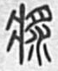（漿篆書）』。《周禮·酒正》『四飲，三曰漿』注：『漿，今之酨漿也。』《内則》注云：『漿，酢酨也。』《説文》又云『酨，酢漿也』。《釋名》『漿，將也。飲之寒温多少與體相將順也』。《和名抄》『漿，《四時食制經》云：春宜食漿甘水。漿，音即良反』。『豆久利美豆』，俗云『邇於毛比』。狩谷氏曰『按，豆久利美豆，造水也』。古謂當飲之水爲『毛比』，主水司訓『毛比止里乃司』是也。『毛比』本器名，《武烈紀影媛歌》云『柂摩暮比你瀰豆佐倍母理』，又《豐受宮儀式帳》云『御水四毛比』，則『毛比』盛水之器，轉謂盛飲器之水爲『毛比』，再轉雖不盛飲器，謂可飲之水爲『毛比』也。或云『於毛比』，又云『美毛比』，皆美稱，又尊稱也。『於毛比』見《赤染衛門集》，又《催馬樂》『飛鳥井，美毛比毛左牟之』是也。『邇於毛比』，煮水之義，謂煮水令沸，又令冷飲之也。立之案：《醫心方》廿九·飲水宜第九云：『崔禹錫《食經》云：「春宜食漿水，夏宜蜜水，秋宜食茗水，冬宜食白飲，是謂爲調水養性矣」。《養生要集》云：「凡煮水飲之，衆病無緣得生也」。』《毘尼摩得勒伽》第六云『云何酢漿淨，諸比丘病，問諸醫師，醫師言飲漿可得差』。乃至佛言應作酢漿，作法者，取米汁温水和之，放一處，酢已須者受用。若漿清澄無濁，以囊漉清淨如水。

（眉）《玉篇》｟下ノ七七ウ｠『酨，昨代、祖代二切。酢漿也，釋米汁也』。『酢，且故切。酸也，醶也。今音昨，爲酬酢字也』。

**○以欲竭其精，以耗散其真。**

<!-- PAGE_END -->

<!-- PAGE: 0049 -->

<!-- PRINTED: 14 -->

（眉）《遐年》引《大素》『耗』字傍有『好』字。

案：以下六句，共謂房室過度則亡身也。竊謂以縱所欲而不節，則精液自竭。精液自竭謂之耗，耗則真元之氣亦自散矣。王注是也。《經籍纂詁》曰『秏俗作耗』。《漢書》《荀子》皆作『秏』，不作『耗』也。

（付箋）《素書》｟十オ｠黃石公撰，宋·張商英注『悲莫悲於精散』：道之所生之謂一，純一之謂精。精之所發之謂神，其潛於無也，則無生無死，無先無後，無陰無陽，無動無靜。其舍於形也，則爲明，爲哲，爲智，爲識。血氣之品，無不稟受，正用之則聚而不散，邪用之則散而不聚。目淫於色，則精散於色矣。耳淫於聲，則精散於聲矣。口淫於味，則精散於味矣。鼻淫於臭，則精散於臭矣。散之不已，其能久乎。立之案：『精神』二字解得而切當矣。《素問》云『散真』，此云『精散』，其義則一。故録以存考。

明治丁丑五月十四日

**○不知持滿，不時御神。**

高世栻曰：『不知持滿之道以養身，不知隨時御神之法以養心。』

案：時御神者，所云『四氣調神』是也。

（眉）《史記·楚世家》云：『不若引兵而去以德齊，此持滿之術也。』

**○務快其心，逆於生樂，**

案：生樂者，謂飲食男女之樂也。是爲保生之至樂，故云生樂。王注云『養生之樂』，即其義。

**○起居｟屈《遐》引《大素》｠無節，**

應前文『食飲有節，起居有常』，而結於此一句也。

**○故半百而衰也。**

<!-- PAGE_END -->

<!-- PAGE: 0050 -->

<!-- PRINTED: 15 -->

此一句答『今時之人半百而動作皆衰』之問，而明於時世非異，人方失之也。《遐年要抄》引《太素》，至於此而止。

**○夫上古聖人之教下也，皆謂之。**

全元起本、《大素》、《千金》並作『上古聖人之教也下皆爲之』，宜從正。王冰本蓋王氏所改，而其教下之法以爲至病安從來也。一『皆』字遂叵通。爲、謂古通用。此所云聖人，謂君上也。與後條聖人、賢人義自別。

（眉）案：《著至教論》以不明病傷，爲『是世主學盡』，然則醫道之爲教，寔人主之大令也。

**○虛邪賊風，避之有時。**

案：邪者，入人形中之偁。風者，在天地間之名。故《金匱真言論》云『八風發邪，以爲經風。觸五藏，邪氣發病』可以徵矣。凡風寒暑濕飲食之類中於人者，皆謂之邪。《四十九難》所云『五邪』是也。諸邪之中，中風最爲之主，故多以風名之。《素》《靈》中或云風，或云邪，皆外來之總稱，而互相通用。夫天地間之風，無外於八風，而從其衝後來者爲虛風，爲虛邪。不論從其衝後來與否，中而賊害人者，名曰賊風、曰賊邪。畢竟虛邪賊風者，總稱外來不正之風而言也。王注似以虛邪賊風分爲二，而實不然。唯就『虛』『賊』二字上而爲之義解耳。自邪乘虛入，謂之虛邪，自竊害中和，謂之賊風也。豈有乘虛入之邪而不竊害中和，竊害中和之風而不乘虛入之理邪？馬蒔云：『王注指虛爲在人者，非。』此説淺見，不足據也。

（眉）《六元正紀論》注：『虛邪謂從衝後來之風也。』

（眉）《本草匯》卷五曰：『冬至避西風，立春避西南風，夏至避北風，立秋避東北風，春分避西風，立夏避西北風，秋分避東風，立冬避東南風。以上謂八風也。』

<!-- PAGE_END -->

<!-- PAGE: 0051 -->

<!-- PRINTED: 16 -->

**○恬惔虛無，真氣從之。精神内守，病安從來。**

古抄本惔作憺，元板同。宋本釋音亦同。

案：《説文》恬、憺俱訓安也，蓋疊韻成義。故玄應《音義》引《蒼頡》云『惔，恬也』。則單言則云恬、云惔，重言則云恬惔也。而憺之作惔，猶澹之作淡也。蓋『恬淡』爲正字，蒙恬字遂作恬惔耳。《老子》卅一章『恬淡』，《釋文》作『恬澹』，云『澹本亦作惔』可以徵矣。時、之、來三字押韻。以上六句，聖人教下之義例。而上二句謂凡所避在邪風，下四句謂避之之法唯在己也。

《説文》『惔，安也。讀若談。𠋴、倓或從剡』。『恬，從心，甜省聲』。《説文》『惔，憂也』。與此『惔』自別。

《陰陽應象大論》云：『是以爲無爲之事，樂恬憺之能，從欲快志於虛無之守，故壽命無窮，與天地終，此聖人之治身也。』

（眉）從來，又見《調經論》。

**○是以志閑而少欲，心安而不懼，形勞而不倦。**

案：『是以』下宜添『其民』二字而看，言依以上六句之教令修其身，則其民心志安閑，雖勞其形而不倦。是不知不識到於虛無之地也。

**○氣從以順，｟真氣從之之謂也。｠**

**○各從其欲，皆得所願。**

案：所欲非一，故曰各。無不得所願，故曰皆。

<!-- PAGE_END -->

<!-- PAGE: 0052 -->

<!-- PRINTED: 17 -->

**○故美其食，任其服，樂其俗，高下不相慕，**

《老子》八十章『使民復結繩而用之，甘其食，美其服，安其居，樂其俗。鄰國相望，鷄犬之聲相聞，民至老死，不相往來』與此文義相同。

**○其民故曰朴。**

《老子》五十七章『我無欲而民自朴』。又十九章、廿七章、廿八章共有『朴』字。

案：『朴』即『樸』之假借。《説文》『樸，木素也』，轉注爲凡質素字。『朴，木皮也』非此義。《抱朴子》亦借朴爲樸也。《淮南·本經訓》云『憺然無欲而民自樸』，全據《老子》文也。

《新校正》云：『別本云曰作日。』

案：《孝經》『以養父母日嚴』，僞古文『日』作『曰』。《儀禮·士喪禮》『與占曰某日從』注：『古文曰爲日。』《孟子·滕文公上》『放勳曰勞之來之』，《音義》『曰』作『日』，云，丁音馹，或作曰，誤。蓋漢人所書日字多作曰。韓敕碑、孔龢碑、魏受禪表皆然。其民日朴，言其民俗不流詐僞，故一日日歸於素朴也。與《大學》『誠日新』文例一同。或以爲《爾雅·釋詁》『粵、于、爰，曰也』之義，然『故曰』二字連綴不成語，非是也。食、服、俗、朴押韻。

案：日月之『日』作曰，云之『曰』者，見宋本《六節藏象》『紀化生之用也』王注中。

（眉）《老子》五十二章『見小曰明，守柔曰強』兩『曰』，河上公本或作『日』，《淮南子》作『日』。

**○是以嗜欲不能勞其目，淫邪不能惑其心。**

高世栻曰：『美其食，任其服，是以嗜欲不能勞其目。樂其俗，是以淫邪不能惑其心。』

<!-- PAGE_END -->

<!-- PAGE: 0053 -->

<!-- PRINTED: 18 -->

『是以』下亦當添『其民』二字而看。

**○愚智賢不肖，不懼於物，故合於道。**

高世栻曰：『高下不相慕，是以愚智賢不肖不懼於物。其民日朴，故合於養生自然之道。』

案：前文所云『知道者』，謂在位人。此云『合於道』者，謂非知道者，而自合同於道也。

《解精微論》『行治有賢不肖，未必能十全』注：『賢謂心明智遠，不肖謂擁造不法。』

（眉）《尚書大傳》『堯知丹朱之不肖』注：『肖，似也。』又《小爾雅》『不肖，不似也』。

**○所以能年皆度百歲而動作不衰者，以其德全不危也。**

案：皆，皆於上古之人也。其，其於上古之人也。遠冒於『余聞上古之人，春秋皆度百歲而動作不衰』句，而結於此也。

（眉）以上第一章。

**○帝曰：人年老而無子者，材力盡邪。將天數然也。**

（眉）《大素》卷二壽限。

《大素》卷二壽限篇『帝曰』作『黃帝問岐伯曰』六字，無『也』字。

案：《衛氣失常》篇『人年五十已上爲老』，與此同義。《曲禮》《説文》並云『七十曰老』，非此義也。

楊上善曰：『材力，攝養之力也。天數，天命之數也。』

案：天數者，即天癸之數。下文所云七七八八是也。

**○岐伯曰：女子七歲，腎氣盛，齒更髮長。**

《大素》『齒更』作『更齒』。

<!-- PAGE_END -->

<!-- PAGE: 0054 -->

<!-- PRINTED: 19 -->

〔楊〕腎主骨髮，故腎氣盛，更齒髮長。

（眉）以下男女年歷盛衰一節，宜參看《靈樞·天年》篇。

**○二七而天癸至，**

《甲乙經》『天癸』作『天水』，下同。下文王注云『男女有陰陽之質不同，天癸則精血之形亦異』。《陰陽應象大論》『調此二者』王注云『調，謂順天癸性，而治身之血氣精氣也』。據此則天癸者，至二七、二八之期，而男女構精之機自發動於内，是應天數，而腎水方滿，故曰天癸也。王氏以精血分男女，欲使人易知，而其實不以精血直爲天癸也。蓋謂至此期，則男女共腎氣方通，精液溢泄之時也。以上安政丁巳二月六日夜，茝庭先生在病牀所口授『天癸』之義是也。同月十四日先生捐館。噫，此語先生生前最後之遺言也，何可不記而傳乎。

**○任脈通，太衝脈盛，月事以時下，故有子。**

《新校正》云：『按，全元起注本及《大素》《甲乙經》俱作伏衝，下太衝同。』

今本《大素》亦作『伏衝』，今本《甲乙》作『太衝』，下同。

案：《骨空論》云『衝脈者，起於氣街，並少陰之經，俠齊上行，至胸中而散』。《甲乙》同，但『氣街』作『氣衝』。《脈經》云『衝脈者，起於關元，循腹裏，直上至咽喉中』，注：『一云衝脈者，起於氣衝，並陽明之經，夾臍上行，至胸中而散也。』廿八難云『衝脈者，起於氣衝，並足陽明之經，夾齊上行，至胸中而散也』。楊玄操注云『衝者，通也。言此脈下至於足，上至於頭，通受十二經之氣血，故曰衝焉』。虞庶注云『《素問》曰，衝脈起於氣街。《難經》曰，起於氣衝。又《鍼經》穴中兩存其名，衝街之義俱且通也』。立之謂：奇經八脈，任督帶蹻，並以衣服名之。維衝，並以脈形名之。維者，維絡於身之義，出於廿八難。衝者，衝通之謂也。衝脈本一而末兩行，有似街衢之形，故曰衝，又曰街。潛行於腹中，故曰伏衝。爲經脈之海，故曰太衝。衝脈之所起，其動應手，故曰氣街，又曰氣衝。氣即動氣之謂也。

<!-- PAGE_END -->

<!-- PAGE: 0055 -->

<!-- PRINTED: 20 -->

（眉）案：女之寫血，男之寫精，皆裂己以作他之天理。人有一於此，則忽成形壞衰憊之基，猶蝶交落粉，蓋天癸至者，人之終也，末也。即動物之天理，不得不然者也。

（眉）太衝脈，詳出《醫賸》卷上動氣條。蓋經絡二脈榦至腰分岐處，乃名衝脈而已。

（付箋）〔楊〕天癸，精氣也。任衝脈起於胞中，下極者也。今天癸至，故任脈通也。伏衝之脈，起於氣街，又天癸至，故衝脈盛也。二脈並營子胞，故月事來以有子也。

**○三七腎氣平均，故真牙生而長極。**

〔楊〕真牙，後牙也。長極，身長也。

〔張〕平均，充滿之謂。

〔識〕蓋謂真牙先生，至此而長極也。

案：《儀禮・既夕禮》『右齻左齻』注云：『齻，象齒堅。』《疏》云『右齻左齻，謂牙兩畔最長者。象生時齒堅也』。《釋文》『齻，丁千反』。《楚詞・大招》『靨輔奇牙，宜笑嫣只』。《淮南子》『奇牙出，靨酺搖』，高誘注：『將笑故好齒出也。』《説文》『𤘲，虎牙也』。 沈彤《釋骨》云『自齒左右轉勢微曲者，曰曲牙』，是云齻、云奇牙、云虎牙、云曲牙，皆同，而今俗呼絲截齒者是也。《素問》作『真牙』，古字之偶存者。此牙最主截斷，故名曰真牙，又曰虎牙，作『齻』爲俗字，以其不與諸齒同形，故名曰奇牙，又曰曲牙。作『𤘲』爲俗字。 王注云『真牙謂牙之最後生者』，楊上善曰『真牙，後牙也』，是指今俗呼奧齒者，而非古義。余別有『釋牙』一篇，詳具，今不繁引。

<!-- PAGE_END -->

<!-- PAGE: 0056 -->

<!-- PRINTED: 21 -->

**○四七筋骨堅，髮長極，身體盛壯。五七陽明脈衰，面始焦，髮始墮。**

〔楊〕身之筋骨體髮無不盛極。

《大素》焦作燋，墮作惰。《説文》『䩌，面焦枯小也』。 《玉篇》引《楚辭》云『顏色䩌顇』。 《漢・外戚傳》『嫶妍大息』。晉灼曰：『三輔謂幽愁面省瘦曰嫶冥，嫶妍，猶嫶冥也。』蓋䩌、嫶共俗字，而䩌爲面焦字，『嫶』連『妍』字加女傍者。 《素問》作『焦』，最爲長矣。《五藏生成》篇王注：『筋氣之堅結者。』

〔楊〕陽明脈起於面，行於頭，故陽明衰，面與髮始燋落。

**○六七三陽脈衰於上，面皆焦，髮始白。**

《大素》『焦』作『燋』，無『始』字。

〔楊〕三陽，少陽大陽陽明也。三陽脈俱在頭，故三陽衰，面燋髮白。

**○七七任脈虛，太衝脈衰少，天癸竭，地道不通，故形壞而無子也。**

〔楊〕任衝二脈，氣血俱少，精氣盡，子門閉，子宮壞，故無子。

天癸竭者，謂絶房中之念。地道不通者，謂月事不來也。案：『竭』即『渴』之假字。《説文》『渴，盡也』『竭，負舉也』。經典多用『竭』，爲竭盡字，皆『渴』之假借也。《周禮・地官草人》『凡糞種渴澤用鹿』，《疏》云：『渴故時停水，今乃渴也。』

（眉）案：女反用七七，是《易》著圓，七七四十九之數。男反用八八，是《易》卦方，八八六十四之數。相去十五之數，亦三候一氣，半月之數。

（眉）女曰形壞，男不曰壞，可味。

<!-- PAGE_END -->

<!-- PAGE: 0057 -->

<!-- PRINTED: 22 -->

**○丈夫八歲，腎氣實，髮長齒更。**

《大素》『夫』下有『年』字。

**○二八腎氣盛，天癸至，精氣溢寫，陰陽和，故能有子。三八腎氣平均，筋骨勁強，故真牙生而長極。四八筋骨隆盛，肌肉滿壯。**

《大素》無『壯』字，古抄本『壯』作『溢』。

（眉）案：於男子曰精氣溢寫，則女子一生不精氣溢寫，可知也。又於男子曰陰陽和，則平生男女之道，男倡女隨，而交合亦男行之女應之之義太明。

**○五八腎氣衰，髮墮齒槁。**

《大素》『墮』作『惰』，『槁』作『稾』。

齒槁者，謂齒色無光澤瘦小也。夫齒者骨餘，與爪髮同其質，故日夜增長無休止，但比爪髮則其生長甚遲緩，至四十歲則無復長之勢，故枯槁瘦小失色澤也。

**○六八陽氣衰竭於上，**｟《大素》無『竭』字，《甲乙》同，可從。｠**面焦，髮鬢頒白。**

《大素》『焦』作『燋』，『髮鬢』作『鬢髮』。

案：《説文》『頒，大頭也』非此義。『頒白』字宜作『斑』。斑者，駁也，《説文》作『辬』，云『駁文也』，《廣韻》『䰉，髮半白也』， 共同義。蓋班音字，皆自有駁義耳。

**○七八肝氣衰，筋不能動，天癸竭，精少，腎藏衰，形體皆極。**

案：筋不能動者，謂肝氣衰少，全身筋力自弱劣，不能自在運動也。俗呼曰四十手、五十手、長命痛，一臂或時不自由之類是也。然究其理，則此云『筋不能動』者，蓋專謂陰莖也。陰莖宗筋，固爲肝之所屬。

<!-- PAGE_END -->

<!-- PAGE: 0058 -->

<!-- PRINTED: 23 -->

故肝氣衰，則陰莖臨事而不勁強隆盛，非全不起動，但不能爲強盛之起動也。次句云『天癸竭，精少，腎氣衰』可以證矣。

〔紹〕推上下文，『天癸竭』云云四句，似宜移於八八下，恐是錯出。然前注無敢言及者，不能無疑。下文云男不過盡八八，女不過盡七七，而天地之精氣皆竭矣，可以證也。

《説文》『燕人謂勞曰極』。《方言》『極，疲也』。

案：《紹識》之説似是而非是，説具下文。

**○八八則齒髮去，腎者主水，受五藏六府之精而藏之，故五藏盛乃能寫。**

《大素》『主』作『生』，無『能』字，而至『皆衰』而止，『筋骨解墮』已下缺。

〔楊〕齒槀者，骨先衰，肉不附，故令齒枯也。

（眉）《靈・本神》篇曰：『五藏主藏精者也。』

（眉）汪昂《醫方集解・附餘》曰：『人身之血，百骸貫通，及慾事作，撮一身之血至於命門，化精以泄。』

（眉）案：精液不常在腎，腎雖云生水，當其入房之時，容受五藏六府中之精水而藏之，以送致睾中，能爲寫出也，猶水銃之得出入上下之引力而噴出，其水之機也。

**○今五藏皆衰，筋骨解墮，天癸盡矣。故髮鬢白，身體重，行步不正，而無子耳。**

『筋骨』以下，《大素》缺。古抄本『墮』作『憜』， 元板同。

案：『解憜』字，《説文》作『懈惰』，此作『解墮』者，古文通用，必竟義在音而不在字也。『墮』『惰』古多通用。《大戴禮・盛德》『小者偸墮』注：『墮，解墮。子張問入官墮怠者，時之所以後也。』枚乘《七發》『手足惰窳』。李善注引郭璞《方言注》曰：『墮，懈墮也。』

<!-- PAGE_END -->

<!-- PAGE: 0059 -->

<!-- PRINTED: 24 -->

案：前文『七八』謂肝腎二藏衰而天癸竭精少也。此則謂『八八』五藏皆衰而天癸盡也。前云天癸竭精少，後云天癸盡無子，宜細玩。蓋竭者雖訓盡，謂未全盡，但不足也。盡者，全盡而不有之謂也。精少、無子，其意可尋矣。

**○帝曰：有其年已老而有子者，何也？岐伯曰：此其天壽過度，氣脈常通，而腎氣有餘也。**

案：氣脈，未得詳解。蓋氣係於男，脈係於女。上文云『丈夫二八腎氣盛，精氣溢寫。五八腎氣衰，六八陽氣衰竭於上，七八肝氣衰。女子二七任脈通，太衝脈盛。五七陽明脈衰，六七三陽脈衰於上，七七任脈虛，太衝脈衰少』可以徵矣。言天壽過度，則腎氣有餘。故男則氣，女則脈，常通於身中而不止，故能有子也。

**○此雖有子，男不過盡八八，女不過盡七七，而天地之精氣皆竭矣。**

案：天氣係於男，地精係於女也。

〔識〕馬云：『此言年老而有子者，王註以爲所生之男女，其壽止於八八、七七之數者。非。』《韓氏醫通》云：『男八歲至六十四，女七歲至四十九，即大衍自然之數。』

〔紹〕《唐書・李叔明傳》曰：『傳云，女子十四有爲人母之道，四十九絶生育之道。男子十六有爲人父之道，六十四絶陽化之理。』

案：其天壽過度者，腎氣有餘。故其年已老而有子，是謂其變。若謂其常，則過八八、七七之數者，無有子耳。

<!-- PAGE_END -->

<!-- PAGE: 0060 -->

<!-- PRINTED: 25 -->

**○帝曰：夫道者，**

案：道者，猶云道人。《老子》七十七章『唯有道者』可以徵矣。即斥上文所云『上古之人，夫知道者』也。

**○年皆百數，能有子乎？岐伯曰：夫道者，能卻老而全形。**

案：卻老者，謂前文所云『面焦髮白』之反，而面不焦，髮不白也。全形身者，謂『形壞』『形體皆極』之反，而身體輕，行步正也。

**○身年雖壽，能生子也。**

案：『身年』不成語，『身』字宜屬上句而讀。所云『全形身』者，上文『形體皆極』『身體重』之反對。或曰『身』即『神』之假字，上文所云形與神俱之義。

自『帝曰人年老而無子者』至於此爲一章，王注云『道成之證如下章云』，以爲接下章，非是。

（眉）以上第二章。

**○黄帝曰：余聞上古有真人者，提挈天地，把握陰陽。**

《孟子・萬章上》曰：『故説詩者，不以文害辭，不以辭害志。以意逆志，是爲得之，如以辭而已矣。』

《莊子・大宗師》『挈天地』，宜參經文及《釋文》。

《孟子・萬章上》曰：『《雲漢》之詩曰：周餘黎民，靡有孑遺。信斯言也，是周無遺民也。』

〔識〕《淮南子》『提挈天地，而委萬物』，高誘注：『一手曰提。挈，舉也。』

案：一手曰握，兩手曰把，然則挈，謂兩手舉之歟？

張介賓《醫易》曰：『氣數可以挽回，天地可以反覆。醉造化於虛靈，弄壺中之日月。運陰陽於掌握，滴指上之陽春。』

<!-- PAGE_END -->

<!-- PAGE: 0061 -->

<!-- PRINTED: 26 -->

（眉）《孟子・盡心下》『孟子曰：盡信書則不如無書，吾於《武成》取二三策而已矣。仁人無敵於天下，以至仁伐至不仁，而何其血之流杵也』。

**○呼吸精氣，獨立守神，肌肉若一。**

〔張〕呼接於天，故通乎氣。吸接於地，故通乎精。有道獨存，故能獨立。神不外馳，故曰守神。神守於中，形全於外。身心皆合於道，故云肌肉若一。即首篇形與神俱之義。

《六微旨大論》末『真人』云云，經注可參。

《新校正》云：『全元起注本云：身肌宗一。《太素》同。楊上善云：真人身之肌體與太極同質，故云宗一。』

今考文義，作『宗一』似是。王本作『若一』，恐屬誤字。竊謂：呼吸精氣者，即吐納之謂。獨立守神者，上文所云『精神内守』之義。肌肉宗一者，『形與神俱』之義。言呼吸精氣，則其精氣周通於形體，而其神氣内守不動，則裏氣通於表，表氣達於裏，毫無空隙，故背肉與腹肉一串其氣，足肉與手肉一通其氣。故肉無非其肉，無處不通氣，而緻密混一，所云雖有賊邪不能害者也。《慧音・十八｟五ウ｠》《大乘大集地藏十輪經》卷一吸精氣下云：經文或有噏，虛急反。《説文》吸，内入息也。

（眉）《至真要大論》曰：『工巧神聖可得聞乎。』王注：『鍼曰工巧，藥曰神聖。』

（眉）案：一爲神，次爲聖，次爲巧，末爲工，與此四人次第正同。

**○故能壽敝天地，無有終時。**

《醫心》卷廿六首篇引《金匱録》云：『常服之，壽獘天地。』

<!-- PAGE_END -->

<!-- PAGE: 0062 -->

<!-- PRINTED: 27 -->

案：真人本無死生，故云無有終時也。張介賓以爲死而神猶存，非是。《釋名・釋喪制》『老死曰壽終。壽，久也。終，盡也。生已久遠，氣終盡也』。

（眉）案：自天令謂之命，自人受謂之壽。壽、受同音，謂一百二十歲也。言越之尚生活也。《玄珠密語・序》曰：『《陰符經》云，觀天之道，執天之行盡矣。此者是人能順天之五行六氣者，可盡天年一百二十歲矣。』

（眉）《匡謬正俗》八『年壽之字，北人讀作受音，南人則作授音』。

（眉）《周禮・疾醫》曰『死終』，注：『少者曰死，老者曰終。』《正義》『似不得壽終，然少曰死，老者則曰終。謂雖治不愈，似得壽終，故曰終也』。《禮・祭法》注：『命有三科，受命謂年壽也。』

**○此其道生。**

案：生猶成也。《論語》『本立而道生』，何晏注『基立而可大成也』，義同。乃是真人者，成道之人也。

**○中古之時，有至人者。**

《方盛衰論》『陰陽並交，至人之所行』。王注：『交，謂交通也。唯至人乃能調理使行也。』

〔識〕《莊子》云『不離於真，謂之至人』，又云『至人無己，神人無功，聖人無名』。郭注云：『無己故順物，順物而王矣。』《釋文》『王，于況反。本亦作至』。

《莊子·田子方》篇『伯昏無人曰，夫至人者上闚青天，下潛黃泉，揮斥八極，神氣不變』。

案：至人，謂全道之人也。至，即至極之義。王注云『全其至道』，楊上善云『積精全神，能至於德，故稱至人』，並非。

<!-- PAGE_END -->

<!-- PAGE: 0063 -->

<!-- PRINTED: 28 -->

**○淳德全道，和於陰陽，調於四時。**

言未能至於『真人提挈天地，把握陰陽』之地者也。後文『游行天地之間，視聽八遠之外』亦同。

〔張〕淳，厚也。

**○去世離俗，積精全神。**

《生氣通天論》云『聖人傳精神，服天氣，而通神明』。所云『積精』與『傳精』同理。此亦未能至於真人呼吸精氣，獨立守神者也。

《黄庭經》亦有『積精累氣以爲真』之文。

**○游行天地之間，視聽八遠之外。**

顧從德本『遠』作『達』。

『遠』訛『達』，今據古抄本、元板改正。

〔識〕《淮南・地形訓》云『九州之外，乃有八殥，亦方千里。八殥之外，廼有八紘，亦方千里』，注：『殥猶遠也。』

（眉）《希音》卷十之八頁下《漢書音義》云：『八埏，即地之八際也。』

（眉）《醫心方》卷廿三『遠近自在』訛作『達近自在』。｟廿二頁下六行｠

**○此蓋益其壽命而強者也，亦歸於真人。**

案：強，即勉強之義。志云『此蓋從修煉保固得來，亦能復完天真，而同歸大道』，可從。

**○其次有聖人者，**

案：聖人，謂順道者也。《莊子・招搖遊》｟（『招搖』當作『逍遙』）｠『聖人無名』。注：『聖人者，物得性之名耳。』

<!-- PAGE_END -->

<!-- PAGE: 0064 -->

<!-- PRINTED: 29 -->

**○處天地之和，從八風之理。**

言未至於『至人遊行天地之間，視聽八遠之外』者也。

案：『處』字非居處之義。《左氏・文十八年》傳『德以處事』注『處猶制也』，《後漢・陽球傳》注『處，斷也』乃此義。

**○適嗜欲於世俗之間，無恚嗔之心。**

此亦未至於『至人去世離俗』者也。

**○行不欲離於世，被服章。**

三字宜從宋臣説，删去。如吳、張等所説，則下句卻脫三字，亦未可知。不然則二句不對。竊謂此三字，或後人旁書，誤混正文者。王氏無解，可以見耳。

（眉）又案：古文對句中，往往有不對之文在其間，是亦古文之一體。然則此三字，蓋是非衍字而可歟？

**○舉不欲觀於俗，**

澀江籀齋曰：『觀，示也，顯也。顯示於俗，所以異於時衆也。不欲者，亦和光同塵之意。諸家解並非是。』

**○外不勞形於事，内無思想之患，**

前段云『嗜欲不能勞其目，淫邪不能惑其心』與此文義同。

**○以恬愉爲務，以自得爲功。形體不敝，精神不散。**

形不敝，神不散者，以恬愉自得爲之養也。此亦未至於『至人積精全神』者也。

<!-- PAGE_END -->

<!-- PAGE: 0065 -->

<!-- PRINTED: 30 -->

**○亦可以百數。**

應上文『年皆百數』。

**○其次有賢人者，**

賢人，蓋求道者也，唯取法則於天地日月耳。未至於『聖人順天地八風之和』也。

**○法則天地，象似日月。**

《淮南・氾論訓》『嫌疑肖象者』注：『肖象，似也。』《前漢・吳王濞傳》『不肖』注：『凡言不肖者，謂其鄙陋無所象似也。』又《刑法志》『夫人肖天地之類｟（肖當作宵，類當作貌。）｠』注：『庸忘｟（忘當作妄）｠之人謂之不肖，言其狀類｟（類當作貌）｠無所象似也。』此云『象似日月』者，即是『法則天地』之細目。《四氣調神論》所云『夜臥早起，無厭於日，與鷄俱興，必待日光』之類是也。

未能至於『聖人處天地之和』也。

**○辯列**｟古抄本『辯』作『辨』，『列』下有『宿』字。｠**星辰，逆從陰陽，分別四時。**

（眉）『列』下宋本一空字，《生氣通天》篇末注中亦有此一空字例，宋本《玉版論要》篇注中亦有此一欠字例，《調經論》注中亦有，《水熱穴論》注中亦有。

逆從猶逆順也。言未能至於『至人和於陰陽，調於四時』。彼言服用，此言學焉耳。《玉篇》日部『曆本作歷，古文作厤。象星辰，分節序四時之逆從也』。

**○將從上古，**

案：將從猶將順也。《孝經》『將順其美』明皇注：『將，行也。』

<!-- PAGE_END -->

<!-- PAGE: 0066 -->

<!-- PRINTED: 31 -->

**○合同於道，**

言修行之功，遂與上古知道之人相同耳。

**○亦可使益壽，而有極時。**

（眉）以上第三章止。

案：賢人亦可使益其壽，而比之至人聖人，則有所終極也。迢應上文『真人無有終時』。

案：成道者爲真人，全道者爲至人，順於道者爲聖人，求於道者爲賢人，宜如此分別而看。

此篇凡三章，『迺問岐伯曰』至『其德全不危也』爲一章，『帝曰人年老而無子者』至『年雖壽能生子也』爲一章，『黄帝曰余聞』至末爲一章。

庚申正月卅日書了　華佗巷人立之

第一補

成而登天｟六ヲ一｠

〔箚〕《史・五帝紀》『登天』作『聰明』，隔句押韻，若是『登天』則與韻不合矣。馮汝言《詩紀匡繆》云：『《素問》一書，通篇有韻。』

迺問於天師曰｟六ウ二｠

〔識〕按：黄帝稱天師，見《莊子・徐無鬼》。《韓詩外傳》及《説苑》云『黄帝即位，宇内和平。思見鳳凰之象，以召天老』，天老蓋天師耳。

《大素・耶傳》『黄帝問曰：余固不能數，故問於天師』，注：『天師，尊之号也。』《靈樞・百病始生》作『先師』。

<!-- PAGE_END -->

<!-- PAGE: 0067 -->

<!-- PRINTED: 32 -->

高世栻曰：『岐伯爲帝師，故史臣稱爲天師。』

高下不相慕｟十ヲ八｠

（眉）《大素・耶傳》篇『黄帝問曰：余固不能數，故問於天師』，注：『天師，尊之號也。』《靈樞・百病死生》『天師』作『先師』。

〔張〕高忘其貴，下安其分。兩無相慕，皆歸於朴。

天癸｟十一ヲ九｠

北越海津子亨著《詰道大素》下册曰『夫天癸者，天揆也。而則天數揆度也』。

〔識〕《管子》云：『人，水也。男女精氣合而水流形。』《家語・本命解文長》云：『男子八月而生齒，八歲而齔，二八十六歲而化。女子七月生齒，七歲而齔，二七十四而化。』又見《大戴禮・本命》《説苑・辨物》。《韓詩外傳》卷一文長云：『男子八歲而齠，十六而精化小通。女子七歲而齔，十四而精化小通。』

案：云化、云精化小通，並謂人道已通，精液溢泄之時也。

嚴氏《濟生續方》卷七遺精白濁評曰：『醫經曰：男子二八腎氣盛，天癸至。天癸者，精也。精者，身之本也。腎藏精，藏精者，不可傷云云。』

嚴氏以天癸即爲精，未可從矣。蓋天癸者，所以製精之氣機也。

（眉）案：癸者，非斥水也，斥其气機也。故謂天者自然之名，癸者，揆度也。言至二七、二八，而男女構精之氣機發動者，是自然之揆度也，故以其氣機呼名天癸也。《禮・月令》注『癸之言揆也』。《史・律書》『癸之爲言揆也』。《白虎通・五行》曰『癸者，揆度也』。《釋名・釋天》『癸，揆也。揆度而生，乃出土也』。《御覽》引崔靈恩《禮記義宗》『癸，揆也』。《廣雅・釋言》『癸，揆也』。《太玄・玄數》范注：

<!-- PAGE_END -->

<!-- PAGE: 0068 -->

<!-- PRINTED: 33 -->

『癸取其揆然向萌芽也。』《説文》『癸，冬時水土平可揆度也』。《易・彖下》『天下之大義也』，虞注：『坤主癸。』又《書・舜典》『納於百揆』傳，《書・孔序》『其歸一揆』，《釋文》《孟子・離婁下》『其揆一也』注，並曰：『揆，度也。』皆以證『天癸』字義可也。王注説天癸曰『天真之氣降，與之從事，故云天癸也』，此言太是，宜從。

（付箋）《中庸》『上律天時，下襲水土』。《圖解》云『水土合來是一地字，然不言地而言水土者，地之理盡於水土也』。立之案：此不言天水而言天癸者，所以使天水至於腎部者，天然之腎氣有自應而使然也。所謂天癸者，即天然自生之腎氣也。乃與不言地而言水土同一文例也。

丈夫｟十二ウ八｠

〔紹〕《説文》『周制，八寸爲尺，十尺爲丈，人長八尺，故曰丈夫』。

兒約之《周尺攷》云：『漢制八寸，正當周制一尺。所謂周制以八寸爲尺，十尺爲丈。人長八尺，故曰丈夫者。此許氏以漢制釋周制也。今定以周一尺爲曲尺六寸零八釐，則丈夫正當曲尺六尺零八分，此則見古人之與今人其長亦無大異也。』

人年老｟十一ヲ七｠

《醫心方》廿五小兒方例第一引《小品方》云：『黄帝曰：人年六歲以上爲小，十八以上爲少，廿以上爲壯，五十以上爲老也。其六歲以還者，經所不載，是以乳下嬰兒病難治者，皆無所承案也。』案：《病源》《千金》《外臺》『十八』作『十六』，『廿』作『卅』。

《大素》卷二攝生之二・壽限篇中出之，但《壽限》篇末缺，故不詳其終。

病安從來｟九ウ｠

<!-- PAGE_END -->

<!-- PAGE: 0069 -->

<!-- PRINTED: 34 -->

第十九云：『故曰別於陽者，知病從來。』

真牙｟十二ヲ｠

案：《全體新論》『貳牙』『顚牙』互誤。

《全體新論》云：『蓋人齒三十有二，齕齧咬噍， 各合其用。當中上下八齒名門牙，其旁上下四齒爲貳牙，再入爲顚牙｟上下左右，共八齒｠，其餘爲大牙｟共十二齒｠。』

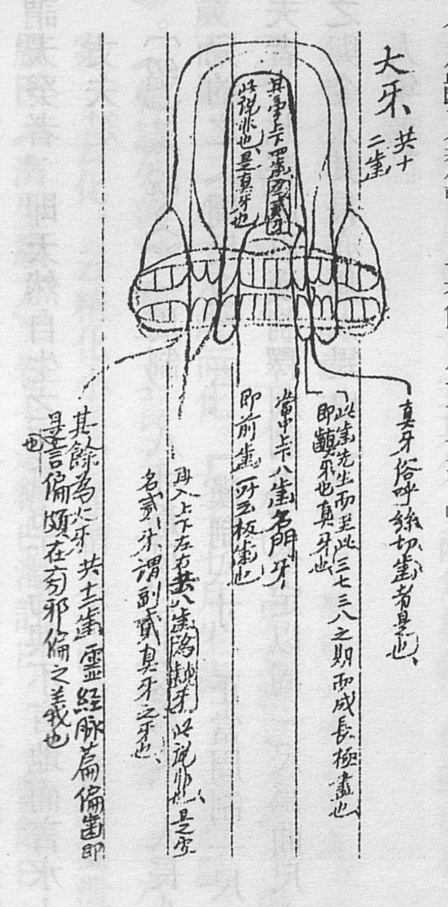

【圖】案語：

其旁上下四齒爲貳牙，此説非也，是真牙也。

真牙，俗呼絲切齒者是也。此齒先生而至此。三七三八之期，而成長極盡也，即齻牙也，真牙也。

當中上下八齒，名門牙，即前齒，所云板齒也。

再入上下左右共八齒，爲齻牙，此説非也，是宜名貳牙，謂副貳真牙之牙也。

其餘爲大牙共十二齒，《靈・經脈》篇『偏齒』即是也。言偏頗在旁邪偏之義也。

<!-- PAGE_END -->

<!-- PAGE: 0070 -->

<!-- PRINTED: 35 -->

不妄作勞｟八ヲ｠

《韓詩外傳》云：『人有六情云云，其身體四肢欲安而不作。』

《白虎通》云：『庶人職在耕桑，戮力勞役。飢即食，飽即作，故無數。』

《呂氏春秋》云：『勞者精神則散也。』｟《弘決外典抄》二卷十五葉背引｠

筋不能動｟十三ヲ｠

案：前文云『三八筋骨勁強，四八筋骨隆盛』，並謂腎氣盛，陰莖不萎弱也。此云七八筋不能動者，謂陰莖委弱，不能如意動作也，非云不動也。一『能』字，可細玩矣。與『八八筋骨解墮，天癸盡』大有分別也。《厥論》｟四十五｠云：『前陰者，宗筋之所聚』，《痿論》｟四十四｠云『思想無窮，所願不得，意淫於外，入房太甚，宗筋弛縱，發爲筋痿，及爲白淫｟九ウ｠』，又云『陽明者五藏六府之海，主閏宗筋，宗筋主束骨，而利機關也｟十ヲ｠』，又云『陰陽總宗筋之會，會於氣街，而陽明爲之長，皆屬於帶脈，而絡於督脈｟十ウ｠』，並可以徵矣。

天癸｟十一ウ｠

《本草綱目》｟五十二｠婦人月水｟宋嘉祐｠，月經｟《素問》｠，天癸｟《素問》｠。時珍曰：『女子，陰類也，以血爲主。其血上應太陰，下應海潮，月有盈虧，潮有朝夕，月事一月一行，與之相符，故謂之月水、月信、月經。經者，常也，有常軌也。天癸者，天一生水也。邪術家謂之紅鉛，謬名也。』

（眉）補，郭象注《莊子》云：『天者，自然之謂也。』鄭玄注《禮》云：『癸之言揆也，萬物懷任於下，揆然萌芽。』據此二説，天癸即男女慾竇始開之謂也。張云：『天癸言天一之陰氣也。』吳云：『癸，腎水也。是爲男精女血，天真所降也，故曰天癸。』

岐伯｟六ウ｠

<!-- PAGE_END -->

<!-- PAGE: 0071 -->

<!-- PRINTED: 36 -->

岐伯，見《史・封禪書・司馬相如傳》。《司馬相如傳集解》曰：『黄帝太醫。』

漿｟八ウ｠

《證類》五引《嘉祐》云：『漿水，味甘酸，微温，無毒，主調中。引氣宣和，強力通關，開胃止渴，霍亂洩痢，消宿食。宜作粥，薄暮啜之，解煩去睡，調理腑臟。粟米新熟，白花者佳。煎令醋，止噦嘔，白人膚體如繒帛。爲其常用，故人不齒其功。冰漿至冷，婦人懷姙，不可食之。《食譜》所忌也。』｟成化本廿一ヲ｠

庚申正月晦釘糊枳園

#### 四氣調神大論篇第二

此篇總皆《大素》卷二順養篇末引。

（眉）王氷引《月令》説，見《醫賸》卷上，宜参。

**○春三月，此謂發陳。**

〔楊〕陳，舊也。言春三月草木舊根舊子，皆發生也。

**○天地俱生，萬物以榮。**

〔楊〕天之父也，降之以德。地之母也，資之以氣。德之與氣俱能生也。物目｟（目恐自譌）｠德氣，英華開發也。

**○夜臥早起，**

《大素》『早』作『蚤』，《醫心方》廿七引同。

〔楊〕春之三月主膽，肝之府，足少陽用事。陰消陽息，故養陽者至夜即臥，順陰消也。『蚤』古『早』字。旦而起，順陽息也。

<!-- PAGE_END -->

<!-- PAGE: 0072 -->

<!-- PRINTED: 37 -->

**○廣步於庭。**

《病源》十五引《養生方》『廣』作『潤』。案：是避煬帝諱廣也。

**○被髮緩形，以使志生。**

《病源》『志』上有『春』字，『生』作『平』｟宋本｠，蓋同音而誤。

生、榮、庭、形、生爲韻。

〔楊〕廣步於庭，勞以使志也。被髮緩形，逸以使志也。勞逸處中和而生也，故其和者是以内攝生者也。

**○生而勿殺，予而勿奪，**

《醫心》『予』作『與』，《病源》同。

**○賞而勿罰。**

三句韻語。

**○此春氣之應，**

此下《大素》有『也』字，《醫心》《病源》同。

**○養生之道也。**

〔楊〕生與賞者順少陽也，煞奪罰者也逆少陽也，故順成和則外攝生也。内外和順，春之應也。斯之順者，爲身爲國，養生道也。

**○逆之｟《大素》無『之』字｠則傷肝，**

《大素》『傷』下有『於』字，《病源》同。

<!-- PAGE_END -->

<!-- PAGE: 0073 -->

<!-- PRINTED: 38 -->

**○夏爲寒變。**

《病源》『爲寒變』作『變爲寒』。《大素》作『夏爲寒爲變』。

（眉）據楊注則《大素》本文『變』下『爲』字誤衍耳。

（眉）案：年年春夏際多疫，秋夏際多瘧，秋冬際多泄，冬春際多厥，可以知也。

案：此四時爲病甚叵解。竊謂，《陰陽應象大論》云『冬傷於寒，春必温病。春傷於風，夏生飧泄。夏傷於暑，秋必痎瘧。秋傷於濕，冬生欬嗽』，此文又出《生氣通天論》，文少異，是辨風寒暑濕之於春夏秋冬，其病傳變不同也。《金匱真言論》所云東風生於春，病在肝俞，在頸項云云。故春氣者，病在頭云云。故春善病鼽衄云云者，是論四時之正氣，必中其部位之經俞也。共與此條自別。此則謂不依四時之氣調神，則本氣結屈，久而爲病也。其説如左。

案：寒變者，熱之謂，寒變則爲熱是也。夫逆夜臥早起之類諸養生之道，則失肝木柔和之令，故奉承夏長養之氣者，甚乏少。至夏心火用事，遂發爲寒變而成熱之病。蓋春夏宜養陽，若不養陽，則其傷在陽分，而肌表受邪也。《病源候論》卷九時氣病諸候曰『屬春時陽氣發於冬時，伏寒變爲温病也』，『寒變』二字之義，得之益明了。

〔楊〕肝氣在春，故晚臥早起，逸體急形，殺奪罰者，皆逆少陽也。逆即傷肝，夏爲傷寒熱病變也。春時内外傷者，奉夏生長之道不足也。案：此説可從。

《靈樞・論疾診尺》云：『四時之變，寒暑之勝，重陰必陽，重陽必陰。故陰主寒，陽主熱，故寒甚則熱，熱甚則寒，故曰寒生熱，熱生寒，此陰陽之變也。故曰：冬傷於寒，春生癉熱。春傷於風，夏生後泄腸澼。夏傷於暑，秋生痎瘧。秋傷於濕，冬生咳嗽，是謂四時之序也。』

<!-- PAGE_END -->

<!-- PAGE: 0074 -->

<!-- PRINTED: 39 -->

此與《陰陽應象大論》《生氣通天論》所説同。但云『冬傷於寒，春生癉熱』者，即寒變而爲熱之義。故今此載其全文，以資考鏡耳。

（眉）或曰内寒而諸變證頻見之謂，《病源》卷二十冷痰候曰：四支變青不能食飲，是其證也。

（眉）《傷寒例》云『三月四月，或有暴寒，其時陽氣尚弱，爲寒所折，病熱猶輕。五月六月，陽氣已盛，爲寒所折，病熱則重』，是亦寒變爲熱之義也。

**○奉長者少。**

《大素》『奉』下有『生』字，《病源》同。

〔楊〕肝氣在春，故晚臥形｟（『形』上恐脫『緩』）｠，晚起逸體急形。煞奪罰者，皆逆少陽也。故其爲身者逆即傷肝，夏爲傷寒熱病變也。其爲國也，霜雹｟切蒲角反｠風寒，災害變也。春時内外傷者，奉夏生長之道不足也。

**○夏三月，此謂蕃秀。**

《病源》『秀』作『莠』。

〔楊〕蕃，代｟（『代』恐『戊』譌）｠元反，茂也。夏三月，時萬物蕃滋茂秀增長者也。

**○天地氣交，萬物華實。**

《大素》『華』作『英』，《病源》同。

〔楊〕陰陽氣和，故物英華而盛實也。

**○夜臥早起，**

《醫心》『早』作『蚤』。《大素》作『晚臥蚤起』，可從改也。

蓋晚臥者，比於春時之夜臥則少晏也。何以知然？春之夜臥早起，楊注云『至夜即臥』。而此楊注云『夏之三月，陰虛陽盈，故養陽者，多起少臥也』，又云『早臥晚起，厭日生怒，皆逆太陽氣也』，則『早』『晚』二字，宜爲虛字而看，不然則至早臥晚起，遂不可解也。

<!-- PAGE_END -->

<!-- PAGE: 0075 -->

<!-- PRINTED: 40 -->

〔楊〕夏之三月主小腸，心之府，手太陽用事。陰虛陽盈，故養陽者多起少臥也。晚臥以順陰虛，早起以順陽盈實也。

**○無厭於日，**

《醫心》『無』作『毋』。

**○使志無怒，**

《醫心》『無』作『莫』。

〔楊〕日者爲陽，故不可厭之。怒者爲陰，故使志無怒之。

**○使華英成秀，**

《大素》無『華』字，《病源》、宋板同。《醫心》『華英』作『英華』。

〔楊〕使物華皆得秀長。

此與王注同義。今以前後文例考之。春云使志生，生而勿殺，予而勿奪云云，乃謂擴充其發生之志意，欲使凡天下物生而勿殺，予而勿奪也。夏之使志無怒，使華英成秀，秋之使志安寧，以緩秋刑，冬之使志若伏匿云云，去寒就温，並同。皆謂擴己之志，延及凡天下物也。

**○使氣得泄，**

《大素》『泄』作『洩』，下皆同，是避唐諱也。

〔楊〕使物華皆得秀長，使身開腠，氣得通洩也。

<!-- PAGE_END -->

<!-- PAGE: 0076 -->

<!-- PRINTED: 41 -->

**○若所愛在外，此夏氣之應。**

《大素》『應』下有『也』字，《醫心》同。

**○養長之道也。**

《大素》『長』作『生』，《醫心》同。案：作『生』，恐誤。

〔楊〕内者爲陰，外者爲陽，諸有所愛，皆欲在陽。此之行者，應太陽之氣，養生之道也。

**○逆之則傷心，秋爲痎瘧。**

《大素》『痎』作『㾬』。

案：痎瘧者，即瘧。《説文》『痎，二日一發瘧也』。説具於《瘧論》中。

案：春夏宜養陽，今逆夏氣養長之道，則心火中屈不能伸，至秋肺金用事，與向屈於中之心火相爭，故發爲寒熱休作疾也。

王注云『痎，痎瘦之瘧也』，是蓋以『痎』爲刻之義，非是也。

（眉）成注《傷寒論》卷二音釋『痎音皆，瘧也』。

**○奉收者少，｟《大素》『奉』上有『則』字｠冬至重病。**

〔楊〕奉秋收之道不足，得冬之氣，成熱中病重也。

〔識〕簡按：據前後文例，四字恐剩文。

此説可從。但此四字王楊二氏共有注解，則爲古來衍文可知也。

〔楊〕早臥晚起，厭日生怒。傷英不秀，壅氣在内，皆逆太陽氣也。故夏爲逆者，則傷乎心，秋爲㾬瘧。奉秋收之道不足，得冬之氣，成熱中病重也。

<!-- PAGE_END -->

<!-- PAGE: 0077 -->

<!-- PRINTED: 42 -->

**○秋三月，此謂容平。**

〔楊〕夏氣盛長，至秋也不盛不長，以結其實，故曰容平也。

《五行大義》卷四第十九篇引《録圖》云：『善則賢人任用，政頌平。』

〔高〕夏時盛極，秋氣舒緩，其時則從容而平定也。

〔識〕簡按：容，盛也。見《説文》，即盛受之義，非盛實之謂。王馬張並爲『容狀』之容，乃與發陳蕃秀閉藏自異旨。《聖濟經》注云『容而不迫，平而不偏，是謂容平』，此説似是。《五常政大論》以金平氣爲『審平』。《説苑》曰：『秋者天之平。』

案：《説文》『容，盛也』。『盛』字爲『宬』之假借，所以宬受也。『容平』者，謂容受而平均也。

**○天氣以急，地氣以明。**

（眉）楊上善曰：天氣急者，風清氣涼也。地氣明者，山川景淨也。

《月令・孟秋》『天地始肅，不可以贏』。

**○早臥早起，**

《大素》二『早』共作『蚤』，《醫心》同。

**○與鷄俱興，**

《大素》『與』作『与』，《醫心》同。《醫心》『俱』作『共』。

〔楊〕秋之三月，主肺藏，手太陰用事。陽消陰息，故養陰者，與鷄俱臥，順陰息也。與鷄俱起，順陽消也。

案：云『與鷄俱興』，而與鷄俱臥之意在焉，乃早臥早起之義。高世栻云『與鷄俱興者，鷄臥則臥，鷄起則起也』，暗合楊注。

<!-- PAGE_END -->

<!-- PAGE: 0078 -->

<!-- PRINTED: 43 -->

**○使志安寧，以緩秋刑。**

《大素》『刑』作『形』，《醫心》《病源》、宋板同。

〔楊〕春之緩者，緩於堅急，秋之緩者緩於滋盛，故寧志以緩形。

案：刑、形古多通用，楊氏泥春之緩形，而就形字爲説，叵從。此謂擴安寧之志意，而以緩縱凡天地秋氣殺伐之急緊刑法也。王注是。

（眉）再案：緩秋形者，言不乘秋气之肅殺，志意安寧以緩秋形。然與春之被髮緩形自不同，而『收斂神气，使秋气平』云云，是春秋之緩形分別之處，宜活看也。

**○收斂神氣，使秋氣平。**

〔楊〕夏日之時，神氣洪散，故收斂順秋之氣，使之和平也。

**○無外其志，**

《醫心》『無』作『毋』。

**○使肺氣清，**

《大素》『清』作『精』，《醫心》同。

平、明、寧、刑、平、清押韻，蓋承『容平』之『平』而起韻也。

〔楊〕攝志存陰，使肺氣之無雜，此應秋氣養陰之道也。

就『無雜』二字考之，則作『精』似是。然古『清』『精』多通用，而其義亦兩通。

<!-- PAGE_END -->

<!-- PAGE: 0079 -->

<!-- PRINTED: 44 -->

**○此秋氣之應。**｟《大素》此下有『也』字，《醫心方》《病源》同。｠

**○養收之道也。逆之則傷肺，冬爲飧泄，**｟《大素》作『湌洩』｠

〔楊〕《大素》卷三首『湌，水洗飯也。音孫。謂腸胃有風，水穀不化而出也』。

案：秋冬宜養陰，今逆秋氣則肺金不清，濕邪内入，故至冬腎水用事之時，而作飧泄食不化之證也。第十七云『久風爲飧泄』，可併考。

〔識〕《玉篇》『飧，水和飯也』。《釋名》『飧，散也。投水於中，自解散也』。《列子・説符》注：『飧，水澆飯也』。蓋水穀雜下，猶水和飯，故云飧泄也。

案：《説文》『飧，餔也』。『餔，申時食也』。《伐檀》正義引《説文》『飧，水澆飯也』。《釋文》引《字林》云『飧，水澆飯也』。《禮記・玉藻》疏『飧，謂用飲澆飯於器中也』。『飱』俗作『飧』『湌』『飡』，遂與『餐，呑也』之字混，不可不正也。《外臺》卅九引《甲乙》云『巨虛上廉，主湌泄出麋』，所云出麋，謂水穀雜下也。『飱』作『飧』，增画之例耳。

〔紹〕楊曰：『喰音孫，謂食不消，下洩如水和飯也。』《大素》卷二順養篇注。

**○奉藏者少。**

《大素》『奉』上有『則』字，『藏』作『養』。

〔楊〕晚臥晚起志不寧者，秋時以逆太陰氣。秋即傷肺，至冬飱洩，奉冬養之道少也之。

**○冬三月，此謂閉藏。**

《大素》『閉』上有『氣』字，《醫心》同。

《月令》『天氣上騰，地氣下降，天地不通，閉塞而成冬』。

<!-- PAGE_END -->

<!-- PAGE: 0080 -->

<!-- PRINTED: 45 -->

〔楊〕陰氣外閉，陽氣内藏。

**○水冰地坼**｟〔楊〕勅白反，分也。｠

《醫心》『冰』作『氷』。

**○無擾乎陽，**

《大素》『無』作『毋』，『乎』作『于』，《醫心》共同。

〔楊〕言居陰分，故毋擾陽。

《月令・孟冬》『水始冰，地始凍』，《仲冬》『冰益壯，地始坼』。

案：無擾乎陽，諸家皆從王注爲人事，特高世栻云『無擾乎陽，地氣固藏，不騰於天也』，於文當然。楊上善曰『言居陰分，故毋擾陽』，亦似非指人事，高説宜從。

**○早臥晚起，必待日光，**

《大素》『早』作『蚤』，《醫心》同。案：藏、陽、光韻語。

〔楊〕冬之三月，主腎藏足少陰用事，陽虛陰盈，故養陰者多臥少起。早臥順陽虛，晚起順陰盈也。

**○使志若伏若匿，**

《大素》無『若匿』之『若』，《醫心》《病源》同，今本蓋偶誤。

〔楊〕伏匿，靜也。臥盡陰分，使志靜也。

案：『伏匿』之急呼爲伏，伏匿者謂伏也。

**○若有私意，若已有得。**

《大素》『得』作『德』，《醫心》同。

<!-- PAGE_END -->

<!-- PAGE: 0081 -->

<!-- PRINTED: 46 -->

**○去寒就温，**

案：此四字不專斥人事，凡天地萬物，亦皆當如此，乃養陰之理也。四時使志云云下句，並同例。

〔楊〕言十一月陰去陽來，故養陰者，凡有私意，諸有所得，與陰俱去，順陽而來無相擾也。

**○無泄皮膚，**

《大素》『無泄』作『毋洩』。

**○使氣亟奪，**

《大素》作『使氣不極』，可從，押韻亦叶。《醫心》引作『使氣極』，恐脫『不』字也。

〔楊〕閉諸腠理，使氣不洩極也。斯之行者，應冬腎氣養藏之道也。

案：《月令・仲冬》『君子齋戒，處必掩身。身欲寧，去聲色，禁嗜慾，安形性，事欲靜，以待陰陽之所定』，《傷寒例》云『冬時嚴寒，萬類深藏，君子周密，不傷於寒』，《醫心方》廿七引《千金方》云『冬月天地閉，血氣藏。人不可勞作出汗，發泄陽氣，損人』，並與此同義。

**○此冬氣之應，**

《大素》『應』下有『也』字，《醫心》《病源》同。

**○養藏之道也。**

〔楊〕閉諸腠理，使氣不洩極也。斯之行者，應冬腎氣，養陰之道也。

**○逆之則傷腎，春爲痿厥，**

《病源》『痿』作『萎』。

（眉）依前例則此『痿厥』亦一病，蓋其藏府痿，故厥見於外也。今日平生冬春間，内熱逆上耳鳴目𦚣，肝鬱氣逆等，皆是痿厥。此四時病，皆所常有者也。

<!-- PAGE_END -->

<!-- PAGE: 0082 -->

<!-- PRINTED: 47 -->

**○奉生者少。**

《大素》作『則奉生少也』五字。

案：冬逆養藏之道，則陽氣耗奪，而腎水失運化之用。故至春肝木用事之時，筋絡不榮，遂爲痿厥之證也。

案：以上謂順四時之常氣，以調人神也。

（眉）以上第一章。

〔楊〕早起晚臥，不待日光，志氣外洩，冬爲逆者。傷腎痿厥，奉春養生之道少也，痿厥不能行也，一曰偏枯也，於危反也。

**○天氣清淨，**

《大素》『淨』作『靜』。案：《説文》『靜，宷也』。『瀞，無垢薉也』。蓋靜宷之轉注爲清靜。『瀞』字卻爲晚出俗篆。隸省作『淨』歟，抑亦『靜』字冒上『清』字而作『淨』者歟。

**○光明者也。**

案：清淨，謂天之蒼蒼。光明，謂日月星也。

（眉）《禮記・孔子間居》云『孔子曰：天有四時，春秋冬夏，風雨霜露，無非教也。地載神氣風霆，神氣風霆流形，庶物露生，無非教也。清明在身，氣志如神，嗜欲將至，有開必先，天降時雨，山川出雲』云云。

（眉）案：此亦人天一理之説，與本論同義，故録於此。

<!-- PAGE_END -->

<!-- PAGE: 0083 -->

<!-- PRINTED: 48 -->

〔楊〕天道之氣，清虛不可見，安靜不可爲，故得三光七耀光明者也。玄元皇帝曰『虛靜者天之明也』。

**○藏德不止，**

《新校正》引別本『止』一作『上』，《大素》亦作『上』，宜從改也。

**○故不下也。**

《大素》無『也』字。

〔楊〕天設日月，列星辰，張四時，調陰陽。日以曝之，夜以息之，風以乾之，雨露濡之。其生物也，莫見其所養而物長。其所煞也，莫見其所喪而物亡。此謂天道藏德不上，故不下者也。

案：王注本亦似作『不上』，別無『不止』之解，故知然。張介賓云『天德不露，故曰藏德。健運不息，故曰不止』，於理似稍通。至『不下』而不通也。

〔楊〕聖人象之，其起福也。不見其所以而福起，其除禍也。不見其所由而禍除，則聖人藏德不上，故不下也。玄元皇帝曰『上德不德，是以有德』，即其事也。

**○天明則日月不明，邪害空竅。**

〔楊〕君上情在於已，有私脩德，遂不爲德。玄元皇帝曰『下德不失德，是以無德』。君之無德，則令日月薄蝕，三光不明也。

《大素》『天明』作『上下』，『邪』作『耶』。

案：空竅即孔穴也。空音孔。

案：天明者，謂天不藏德也。與前文『光明』其義不同。天若不藏德，則日月不明。後文所云『雲霧不精，則上應白露不下云云』是也。當此時也，有邪氣傷人空竅者，即是賊邪也。楊上善曰『空竅謂三百六十五穴也。疵癘賊風入人空竅，傷害人也』，是也。

<!-- PAGE_END -->

<!-- PAGE: 0084 -->

<!-- PRINTED: 49 -->

〔楊〕空竅謂三百六十五穴也，君不脩德和陽氣者，則疵癘賊風入人空竅傷害人也。

**○陽氣者閉塞，地氣者冒明。**

《大素》無二『者』字，似是。『冒』訛『胃』，『閉』作『閇』。

〔楊〕陽氣失和，故令陰氣冒覆三光。

案：王注以爲人事，恐非。

**○雲霧不精，則上應白露不下。**

《大素》『霧』作『露』，『白』作『甘』，共訛。

案：精與晴通。蓋雲霧不晴，謂地氣冒明。白露不下，謂陽氣閉塞也。王注就『精』字爲説，非是。

**○交通不表，**

〔楊〕陰氣失和，致令雲露無潤澤之精，無德應天，遂使甘露不降，陰陽不和也。言曰甘露者，恐後代字誤也。

**○萬物命故不施，**

〔楊〕陰陽不得交通，則一中分命，無由布表，生於萬物，德澤不露，故曰不施也。

**○不施則名木多死。**

施、死押韻。

案：『故』字當移『表』字下而看，此亦古文一種之法耳。『施』字王注別無解，二張共以爲施化之義，可從。名木者，謂其實可食之諸木，云木則草在中。今桃李不實之年，五穀亦不豐，是天氣使之自然也。楊上善曰『謂名好草木不黄而落』，王注云『名，謂名果珍木』，共可以徵也。《氣交變大論》『歲土不及，名木蒼凋』。《五常政大論》『歲金太過，云名木不榮』。《六元正紀論》『名草上焦』。

<!-- PAGE_END -->

<!-- PAGE: 0085 -->

<!-- PRINTED: 50 -->

（眉）〔楊〕以『名木多死』以下，分爲八種。

（眉）《五常政論》『政暴變則名木不榮』。

**○惡氣不發，**｟《大素》無『不』字。｠**風雨不節，白露不下，**｟《大素》『白』作『甘』。｠**則菀稾不榮。**｟《大素》『稾』作『槁』，是。｠

案：《大素》作『惡氣發』，無『不』字，恐似是。蓋惡氣發者，謂天地否塞之際，必有傷害百物之氣發出也。楊上善曰『謂毒氣疵癘，流行於國』，亦惡氣之一端耳。『風雨不節，白露不下』與前文『雲霧不精，白露不下』同義。

立之案：『宛』與『薀』『鬱』聲義皆通，故《方言》『宛，蓄也』。『菀稾』與『名木』對偁，而專謂草穀也。『菀』即『宛』俗，加艸冠者，與紫菀字自別。《魏風》傳：『宛，辟貌。』《唐風》傳：『宛，死貌。』《淮南・淑真訓》『形苑而神壯』注：『苑，枯病也。』此『苑』即亦『宛』之假字，而變宀從艸者，並皆《説文》『宛，屈艸自覆』之轉注。而加艸者，菟蕕炳蓫積萇等之例耳。菀稾，謂枯死也。楊上善曰：『菀槁當宛槁。宛，痿死。槁，枯也。於阮反。陳根舊枝，死不榮茂。』此説可從。

（眉）『不發』，『丕發』之借字，即大發也。又案：『不』爲助字詞，即『不湣』『不診』之『不』，亦通。『不』字助字、實字連用者，見《家語・相魯第一》，與此文例反而相似。

（眉）《靈・衛氣失常》篇『搐積不行，苑蘊不得常所』。

（眉）《疏五過論》『五藏菀熟』王注：『菀，積也。熟，熱也。』

<!-- PAGE_END -->

<!-- PAGE: 0086 -->

<!-- PRINTED: 51 -->

《家語・禮運》『事大積焉而不苑』王肅注：『苑，滯積也。』

**○賊風數至，暴雨數起，天地四時不相保，與道相失，**｟《大素》『與』作『乃』。｠**則未央絶滅。**

至、起、失、滅爲韻。

案：賊風暴雨者，謂風雨不節也。與虛邪賊風之義自別。

澀江籀齋曰『《説文》：央，久也。《匡謬正俗》云：未央者，言其未中未久也』，可從。楊上善解未央爲久，誤。

〔楊〕盜夸君之德不施布，禍及昆蟲，災延草木，其有八種。一者名木多死，謂名好草木不黄而落。二者惡氣發，謂毒氣疵癘流行於國。三者風雨不節，謂風不時而起，雲不族而雨。四者甘露不下，謂和液無施。菀槁當爲宛槁。宛，痿死。槁，枯也。於阮反。陳根舊枝，死不榮茂。五者賊風數至，謂風從衝上來，破屋折木，先有虛者，被刻而死。六者暴雨數起，謂驟疾之雨，傷諸苗稼。七者天地四時不相保，謂陰陽乖繆，寒暑無節。八者失道，未央絶滅。未央者，久也。言盜夸之君絶滅方久也。

**○唯聖人從之，**｟《大素》『從』作『順』。｠**故身無奇病。**｟《大素》『病』作『疾』。｠**萬物不失，生氣不竭。**

疾、失、竭爲韻。

案：以上謂順四時之變氣，亦調其人神也。

〔楊〕唯聖人順天藏德不止，故有三德。一者身無奇疾，奇異邪氣不及於身也；二者萬物不失，澤及昆蟲，恩霑草木，各得生長也；三者生氣不竭。生氣，和氣也。和氣不竭，致令雲露精潤，甘露時降也。

案：《生氣通天論》云『蒼天之氣，清淨則志意治。順之則陽氣固，雖有賊邪，弗能害也。此因時之序』，此云聖人從之，正爲同義。

<!-- PAGE_END -->

<!-- PAGE: 0087 -->

<!-- PRINTED: 52 -->

（眉）『天氣清淨』至『生氣不竭』，《素問識》已爲錯文。渡邊奎輔謂：『《生氣通天論》之「陽氣者，若天與日」上移入之，則文理始順。』是亦一説。

（眉）以上第二章。

**○逆春氣，則少陽不生，｟《大素》『生』下有『而』。｠肝氣内變。**

〔楊〕少陽，足少陽膽府脈，爲外也。肝藏爲陰，在内也。故府氣不生，藏氣變也。

〔思聰〕（『思』疑作『志』）首論所奉者少，而所生之藏受病。此論四時之氣逆，而所主之藏氣亦自病焉。

案：内變者，謂肝氣不發生而内鬱爲變也。《外臺》卷十六引《刪繁》治肝勞實熱方中，有『氣逆上不下，胸中滿塞』及『脇下急，小便難』等文，又治肝勞虛熱方中，有『煩悶宛轉，熱氣胸裏炎炎』及『精神不守，氣逆上，胸熱炎炎不止』等語，並皆肝鬱内變之證。今驗之病人，每有如此證。蓋肝藏血，主魂，喜怒所係，肝氣逆上，則隨其虛實，内證百出也。唯箇一『變』字中，包括幾多證候來。

**○逆夏氣，則太陽不長，心氣内洞。**

《大素》『太』作『大』。

〔楊〕大陽，手大陽小腸府，脈在外也。心藏爲陰，居内也。故府氣不生，藏氣内洞，洞疾流洩也。

兒約之曰：洞即衝之假，與《靈樞》所云『洞心』同義。《靈樞·五味第六十三》云『辛走氣，多食令人洞心。黃帝曰：辛走氣，令人洞心。何也。少俞曰：辛入於胃，其氣走於上焦。上焦者，受氣而營諸陽者也。薑韭之氣薰之，營衛之氣不時受之，久留心下，故洞心。辛與氣俱行，故辛入而與汗俱出』，是與『内洞』同義。洞，蓋衝痛之義，洞心猶衝心也。《金匱真言論》云『仲夏善病脇胸』，王注云『心之脈循胸脇故也』可以徵矣。『衝』或作『憧』，《千金》卷十四·風虛驚悸第六補心湯條云『驚悸心中憧憧，胸滿不下食』，《外臺》卷十二·賁㹠氣方篇引《小品》奔㹠湯條云『遊氣歸上，上走時，若群㹠相逐，憧憧時氣來』，又引《小品》有『牡蠣賁㹠湯，療賁豚氣從少腹起憧胸，手足逆冷。方』並是『憧』與『衝』同音同義。又《醫心方》卷廿四·治無子法第一引《玉房祕訣》有『男陰同入』之語，同入亦謂衝入也。蓋此一『洞』字中，亦該衝突、疼痛、煩熱、動亂等之義。

<!-- PAGE_END -->

<!-- PAGE: 0088 -->

<!-- PRINTED: 53 -->

《刺要論》曰：『夏病心痛，冬病脹腰痛。』

（眉）《靈·根結》篇『倉廩無所輸膈洞，膈洞者，取之太陰』。《大素》卷十·經脈根結篇無二『膈洞』二字，且『膈』作『鬲』。楊注：『膈氣虛弱，洞洩無禁。』可知此亦夏時暑暍瀉痢之義，而鬲、而云洞洩，則其地大遠，故知《根結》篇亦鬲衝疼之義。

（眉）《尚書》『恫瘝乃身』。

案：與洞風、洞虛、洞泄、洞下之『洞』自別義。

（眉）《醫心》卷一·諸病不治證第二引《醫門方》云：『論曰：人急暴肥，而憒憒恫恫者，不出數十日死。』

（眉）惠苑《華嚴經音義》云『洞然』，注云：『洞，徒弄反。《韻圃》稱洞徹也，謂通徹火然之狀也。字或宜作烔。烔，音徒東。《韓詩傳》曰：烔謂燒草傳火焰盛也。』｟《慧音》廿三ノ一ヲ｠

**○逆秋氣，則太陰不收，肺氣焦滿。**｟《大素》『焦滿』作『燋漏』。｠

〔楊〕太陰，手大陰肺之脈也。腠理豪毛受耶，入於經絡，則脈不收襄，深入至藏，故肺氣燋漏。『燋，熱也。漏，洩也。

<!-- PAGE_END -->

<!-- PAGE: 0089 -->

<!-- PRINTED: 54 -->

案：燋，熱也，可從。漏，洩也，是楊氏就誤字爲説，非是。王注以焦爲上焦，亦非是。《新校正》云『《甲乙》《大素》作焦滿』，『滿』亦『漏』誤。又引全元起本作『進滿』，是自別本。但『進滿』『進』字活字，與『獨沈』正相對，其義可尋耳。然『進』字竟是訛字。

案：焦滿，即熱滿之謂，肺脹喘滿欬逆之證是也。《生氣通天論》第三所云『秋傷於濕，上逆而欬』，《陰陽應象》第五所云『秋傷於濕，冬生欬嗽』共可以爲徵也。

案：《風論》『心風之狀，多汗惡風，焦絶善怒』與此所云『焦滿』之『焦』同義，宜併考。

**○逆冬氣，則少陰不藏，腎氣獨沈。**

《大素》『獨沈』作『濁沈』，《新校正》引《太素》作『沈濁』，與今本不同，而與《外臺》引《刪繁》及《千金方》合。

《靈·邪氣藏府病形》曰：『腎脈微急爲沈厥，奔豚足不收，不得前後，微濇爲不月沈痔。』

〔識〕據上文『焦滿』，《甲乙》作『濁沈』爲是。

案：少陰不藏者，即冬不藏精之義。其弊也，遂令腎氣沈而不發，濁而不清。蓋腎主水，腎氣不足，則水道不利，爲淋瀝、白濁等證，是亦沈濁之一端耳。《千金》腎勞門有『治腎勞實熱，小腹脹滿，小便黃赤，末有餘瀝，數而少，莖中痛，陰囊生瘡，梔子湯。方』，《外臺》引《刪繁》同，可以徵也。

案：《千金》作『春足少陽，夏手太陽，秋手太陰，冬足少陰』。《外臺》引《刪繁》同，與楊上善説合。春夏依府經，秋冬依藏經，理宜然耳。《千金方》卷廿九五藏六府傍通條可併看。

（眉）《後漢書·班彪傳下》注：『濁沈者爲地。』

（眉）《説文》曰：『沈，一曰濁黕也。』

<!-- PAGE_END -->

<!-- PAGE: 0090 -->

<!-- PRINTED: 55 -->

（眉）《莊子·天下篇》曰：『以天下爲沈濁，不可與莊語。』

〔楊〕少陰，足少陰腎之脈也。少陰受耶，不藏能靜，深入至藏，故腎氣濁沈，不能營也。

**○夫四時陰陽者，萬物之根本也。**

《大素》『夫』作『失』，『萬』上有『失』字，無『本』字。《醫心方》廿七引『本』作『氣』。

案：《大素》似是。失者，謂前文逆四時也。『夫』爲改端之詞，不與前文接，非是。且與後文『故陰陽四時者，萬物之終始』云云相重複，則此宜接前文也。

〔楊〕陰陽四時，萬物之本也。人君違其本，故萬物失其根。

**○所以聖人春夏養陽，秋冬養陰，以從其根，**

《大素》『所』作『是』，『從』作『順』，《醫心》亦作『順』。《大素》『以順』之『以』重，恐是誤衍。

**○故與萬物沈浮於生長之門。**

根、門押韻。門者，天之一名；根者，地之一名。地上有四時陰陽復姤，今聖人則之耳。

〔楊〕聖人與萬物俱浮，即春夏養陽，與萬物俱沈，即秋冬養陰也。與萬物沈浮以爲養者，志在生長之門也。

《淮南子》：『人精神者，天之有也。骸骨者，地之有也。精氣入其門，而骸骨反其根。』案：門者，天空氣爲開發收閉之虛處，謂之門也。天者物之門居也，地者物之本根也。

（眉）《莊子·庚桑楚》篇『是謂天門』注：『天門者，萬物之都名也。謂之天門，猶云衆妙之門也。』

（眉）《列子·天瑞》：『精神者，天之分。骨骸者，地之分。屬天清而散，屬地濁而聚。精神離形，各歸其真，故謂之鬼。鬼，歸也，歸其真宅。黃帝曰：精神入其門，骨骸反其根，我尚何存。』

<!-- PAGE_END -->

<!-- PAGE: 0091 -->

<!-- PRINTED: 56 -->

**○逆其根，則伐其本，壞其真矣。**

《大素》無『矣』字。本、真押韻。

〔楊〕逆四時之根，則伐陰陽之本也，壞至真之道也。

**○故陰陽四時者，萬物之終始也，死生之本也。逆之則災害生，從之則苛疾不起。是謂得道。**

《大素》『從』作『順』，『苛』作『奇』，與上文符，可從。

**○道者，聖人行之，愚者佩之。**

〔楊〕聖人得道之言，行之於身，寶之於心府也。愚者得道之章，佩之於衣裳，寶之於名利也。

案：《太平御覽》七百二十引《修養雜訣氣銘》曰：云云，懷道君子，銘之佩之。元·李冶《敬齋古今黈》卷六云：『愚者佩之。佩，背也。古字通用。果能佩服於道，是亦聖人之徒也，安得謂之愚哉。』案：此説亦有一理。然佩是佩服之佩，愚者唯不知不識，在陰陽之間，不能得陰陽之道也。故或有逆之者，乃謂不能春夏養陽，秋冬養陰者也。

**○從陰陽則生，逆之則死，從之則治，逆之則亂，反順爲逆，是謂内格。**

《大素》二『從』共作『順』。逆、格爲韻。

（眉）〔楊〕生死在身，理亂在國。

（眉）〔楊〕不順四時之養身，内有開格之病也。

案：《説文》『格，木長貌』非此義，蓋是『閣』假借。《説文》『閣，所以止扉者』，《釋宮》同，轉注之爲扞格閉塞之義。

<!-- PAGE_END -->

<!-- PAGE: 0092 -->

<!-- PRINTED: 57 -->

**○是故聖人不治已病治未病，不治已亂治未亂，此之謂也。**

案：言上工不治已病治未病，猶人君不治已亂治未亂也。

**○夫病已成｟《大素》『成』下有『形』字，《醫家千文》引同。｠而後藥之，亂已成而後治之。**

《大素》『亂』下無『已』字，《醫家千文》引同。

案：是乃前文之反對。

**○譬猶渴而穿井，鬭而鑄錐，｟《大素》『錐』作『兵』。｠不亦晚乎。**

《大素》『不亦』作『亦不』，《醫家千文》引同。井、兵爲韻。

（眉）以上第三章止。

〔楊〕身病國亂，未有豪微而行道者，古之聖人也。病亂已微而散之者，賢人之道也。病亂已成而後理之者，衆人之失也。理之無益，故以穿井鑄兵無救之失，以譬之也。

案：本篇凡三章，自首至『奉生者少』爲一章，『天氣清淨』至『生氣不竭』爲一章，『逆春氣』至卷末爲一章。

《説苑》曰：『渴而穿井，臨難而後鑄兵，雖疾從而不及也。』見《雜言》篇。

（眉）《説苑》『從』爲從事之義。私案：恐『促』之訛。

劉晝曰：『臨渴而穿井，方饑而植禾。』見劉子《新論》卷十·言苑篇。

《晏子·雜上》：『譬之猶臨難而遽鑄兵，噎而遽掘井，雖速亦無及已。』《御覽》『噎』上有『臨』字。

《説苑·奉使》篇曰：『饑而求黍稷，渴而穿井者。』

《墨子·公孟》篇曰：『譬猶噎則穿井也，死而求醫也。』

<!-- PAGE_END -->

<!-- PAGE: 0093 -->

<!-- PRINTED: 58 -->

《新論》卷十·言苑篇『臨渴而穿井，方飢而植禾，雖疾無所及也』。劉子。

（眉）《晏子》《墨子》之『噎』，恐『渴』之音義，非飯窒之『噎』歟。又案：今飯窒者，亦呼飲救之，則飯窒之噎而可也。

庚申花朝書於齅楳屠蘇窗中　岐園老人實翁立之

庚申二月十九日雨中句讀

第二補

地氣者冒明｟六ヲ｠

《黃庭内景經》第三十四章『視聽幽冥』。『冥』趙子昂書本作『明』。

〔箚〕寬案：『冒明』疑是『冒瞑』，蓋明瞑古音相通，否則與閉塞義不干涉，當博考。

夏爲寒變｟一ヲ｠

《靈樞·瘨狂》廿二云『風逆云云。飢則煩，飽則善變』。又云『血變而止』，並吐嘔之義。《刺節真邪》曰『血變而止』。《氣交變論》『腹滿溏泄，腸鳴反下甚』。

《五行大義》卷三引《養生經》云：『苦走骨，多食之令人變。』

《靈樞·五味論》篇載此文作『令人變嘔』。然則單云『變』則謂吐也。『變』與『胃反』之『反』同義。所云寒變者，謂胃寒變嘔也。蓋春傷肝，則木氣不長，至夏心火不旺，心火不旺，則脾氣亦衰，所以爲寒嘔也。《陰陽應象論》云『春傷於風，夏生飧泄』，亦同義。《藏氣法時論》云『心病者，其變病』云云，王注以爲『嘔變』，《靈·口問第二十八》云『中氣不足，胃使爲之變』，並變吐之義。

（眉）《不可下》篇『嘔變反腸出，顛倒不得安』。《玉篇》『𡁈，孚願切。吐也』。《廣韻》去二十五願『㽹，芳萬切。吐㽹』。此二字同音同義。《傷寒論·太陽中》篇火逆章曰：『欲小便不得，反嘔，欲失溲。』

<!-- PAGE_END -->

<!-- PAGE: 0094 -->

<!-- PRINTED: 59 -->

（眉）《厥論》曰：『少陰厥逆，虛滿嘔變，下泄清，治主病者。』

春逆之傷肝，夏爲寒變；夏逆傷心，秋爲痎瘧；秋逆傷肺，冬爲飧泄；冬逆傷腎，春爲痿厥。

《醫心方》卷廿九·四時食禁第三引《養生要集》云：『高平王熙叔和曰：夏至迄秋分節，食肥膩餅臛之屬，此物與酒水蓏菓相妨，當時不必皆病。入秋節變，陽消陰息，氣總至，輒多諸暴卒病癘，由於此涉夏，取冷大過，飲食不節故也。而或人以病至之日，便謂是受病之始，不知其由來者漸也。』

案：當時不即病，至後日始發之義。詳《傷寒例》宜參。乃與瘧病間日平快同理耳，不足怪也。

天氣以急｟三ウ｠

〔馬〕天氣以燥而急，地氣以燥而明。

春夏養陽，秋冬養陰｟九オ｠

按：《令義解》注『《文選·西京賦》曰：夫民在陽則舒，在陰則慘。臣□曰《神農氏本草》曰：春夏爲陽，秋冬爲陰』。

王注月令言

宋·沈寓山作喆《寓簡》卷七曰：『王砅注《素問》，叙氣候，仲春有芍藥榮，季春有牡丹華，仲夏有木槿榮，仲秋有景天華，皆今月令歷書所無。又以桃始華，爲小桃華。王瓜生，爲赤箭生。苦菜秀，爲吴葵榮。戊寅元歷皆有之。』

王冰

和坊刻王注本本書、《新唐志》《宋志》《書録解題》原面、《崇文總目》《愛日書目》《文獻通考》二百二十二引陳氏一見作『王氷』。《甲乙》卷一注引『王氷曰』二見，毛晉本《新唐書·宰相世系表》作『王氷』。文見次條。

<!-- PAGE_END -->

<!-- PAGE: 0095 -->

<!-- PRINTED: 60 -->

《書·皐陶謨》『庶績其凝』孔傳：『凝，成也』，《釋文》馬云『定也』，《正義》引鄭注『凝，成也』。

《易·鼎卦象》『正位凝命』鄭注：『凝，成也。』

王冰

《通雅》十引《本草》，又引《六書故》，又引《月令廣義》，本書古抄本，本書宋本、正脈本，本書元板本，《四庫提要》，馬玄臺書。

《新唐書·宰相世系表》第十二中『汾州長史王滿，亦太原晉陽人云云』下曰：『冰，京兆府參軍。』嘉靖十年刊版紙如此，毛晉刊本作『氷』字。

王砅

《寓簡》七，《通雅》十，《通雅》引陳晁，《提要》引晁公武《讀書志》。

王砅

《崇文總目》錢侗注釋引一本，趙希弁《讀書後志》，《文獻通考》二百廿二引晁氏、陳氏，《古今僞書考》。

（眉）《説文》『仌，凍也』。鉉音『筆陵切』。隸俗作『氷』。《説文》『冰，水堅也。從仌從水』。鉉音『魚陵切』，又曰『今作筆陵切，以爲冰凍之冰』。又《説文》『凝，俗冰，從疑』。

（眉）案：啓明玄道而成正，故名冰，字啓玄。又《淮南·兵略》『典凝如冬』注：『凝，正也。』《文選·七命》『天凝地閉』注：『凝猶結也。』《五常政大論》『其候凝肅』注：『凝，寒也。』《文選·劉公幹詩》『凝寒』注：『凝，嚴也。』《左傳·僖五》注：『啓，立春立夏。』又《昭十七》疏：『立春立夏謂之啓。』宋本《素問·診要經終》『陰氣始冰』王注：『陰氣始凝。』可知冰即凝，字非仌俗。與《生氣通天論》（當作《四氣調神大論》篇）『水冰』自別，蓋仌俗作冰，於是『冰』復作『凝』，爲恐混也。

<!-- PAGE_END -->

<!-- PAGE: 0096 -->

<!-- PRINTED: 61 -->

素問｟一ノ四ウ｠

《夏醴谷》卷第二云：『醫説肇自黃帝，儒者多疑之。然余觀其書，古質簡素，而博大精深。洞乎陰陽，消息感應之理，又明乎萬物之性，蓋非周秦間人不能作也云云。然王弇州有言云：醫書至難讀，吾輩雖博通萬卷，猶不能深曉其意，況以責諸俗工與。蓋畏之也。』

王弇州言自『醫』至『與』二十六字，《續時還讀我書》引之，不出其出典。

《軒轅黃帝傳》云：『天降素女，以治人疾。帝問之，遂作素問也。』｟十オ注文｠

内洞｟二ノ七ウ｠

《詩·思齊》『神罔時恫』傳，又《爾雅·釋言》，又《廣雅·釋詁二》，又《國語·晉語》『神罔時恫』韋注，又《後漢·和帝紀》『朕寤寐恫矜』注，又《張衡傳》注，《文選·思元賦》『恫後辰』舊注，並曰：『恫，痛也。』《史·燕世家》『百姓怨恫』，《索隱》『恫，猶痛也』。《詩·桑柔》『哀恫中國』，《釋文》『恫，本作痌』，《箋》『恫，痛也』。《書·康誥》疏：『恫，聲類於痛。』《説文》『恫，痛也。一曰呻吟也』。《書·盤庚上》『乃奉其恫』傳，《釋文》，又《康誥》『恫瘝乃身』傳，又《呂覽·審分》『百官恫擾』注，並曰：『恫，痛也。』《初學記·菊》下引晉·潘尼《秋菊賦》曰『又蠲疾而弭洞』。洞字可崇。痌，見《玉篇》曰：『痌，痛也。敕公切。亦作恫。』

（眉）《匡謬正俗》『今痛而呻者，關中俗謂之呻恫，太原俗謂恫喚，云痛喚』。

<!-- PAGE_END -->

<!-- PAGE: 0097 -->

<!-- PRINTED: 62 -->

四時

柳河暾《中外新聞》第廿八号載西歐新聞紙所録，英人某魯國齊百利亞，及賓蘭土邊紀行抄文，記彼地氣候一條曰：『夏至後二三日以來，積雪始消融，大抵十日許而殘雪皆消解。乃過小暑，野生綠芽，土用前一兩日以來，草木開花。大暑後二三日，既結實。立秋前四五日，其實悉熟。立秋後未經十日，既草枯木落，乃復見雪。年年有一二日差，而大抵如此。一年三百六十五日内，廑五十五六日間，春夏秋三時忽過去，反之而冬時之長過三百餘日，其酷寒凍沍，固不待贅言也。』

案：由是考之，則雖極寒極熱之地，有人物生活之際，則其土有四時之氣候之理也，不亦妙哉。

王冰

《四庫提要》曰：『冰名見《新唐書·宰相世系表》，稱爲京兆府參軍。林億等引《人物志》，謂冰爲太僕令，未知孰是。然醫家皆稱王太僕，習讀億書也。』《舊唐書·韋抗傳》曰：『抗爲京畿按察使時，舉奉天尉梁昇卿，新豐尉王倕，金城尉王冰，華原尉王燾，爲判官及度支使。其後昇卿等皆名位通顯，時人以抗有知人之鑒。』

《四庫提要》曰：『王冰其名，晁公武《讀書志》作王砅，杜甫詩有《贈重表姪王砅詩》，亦復相合。然唐、宋《志》，皆作「冰」，而世傳宋槧本，亦作「冰」字。或公武因杜詩而誤歟。』

《天祿琳琅書目》曰：『按晁公武《讀書志》，陳振孫《書録解題》，俱稱王冰，自號啓玄子。陳氏又稱其寶應中官太僕令，而爲王冰之名載於《讀書志》及《文獻通考》者，並作「砅」，惟《宋史藝文志》仍作「冰」字。按《集韻》《韻會》諸書，砅並音砰，爲水擊出岩聲，與冰字音義迥別。據此，書作冰，則知晁馬二家之誤也。』

<!-- PAGE_END -->

<!-- PAGE: 0098 -->

<!-- PRINTED: 63 -->

《醫賸》有王冰説，宜記。

《醫籍考》曰：『按《郎官石柱題名》有金部員外郎王冰，是當時所自署，益知作冰爲正。』

一　長夏｟二ウ｠　漿｟八ウ｠　邪風｟九ウ｠　天癸｟十一ウ｠　真牙｟十二ヲ｠　焦｟十二ウ｠　解墮｟十三ウ｠　順｟十ヲ｠　術數｟七ヲ｠　竭盡｟十三ウ｠　不肖｟十八オ｠

二　寒變｟一ヲ｠　痎瘧｟二ウ｠　飧泄｟四ヲ｠　痿厥｟五ウ｠　菀稾｟六ウ｠　内洞｟七ウ｠　内變｟七ヲ｠　焦滿｟八ヲ｠　獨沈｟八ウ｠　内格｟九ウ｠

#### 生氣通天論篇第三

此通篇《大素》卷三調陰陽。

（眉）本篇自篇首，至『更傷五藏』，詳注見名古屋玄醫《醫學愚得》卷下，宜録。

**○黃帝曰**

《大素》作『黃帝問於岐伯曰』。

（眉）以下六節至『形乃困薄』文，是帝之誨言，與雷公七篇一同，他亦往往有焉。

**○夫自古通天者，生之本，**

《大素》『本』下有『也』字。

〔楊〕古，謂上古、中古者也。調陰陽，而攝其生，則通天之義。上古、中古人君攝生，莫不法於天地。故生同天地，長生久視。通天地者，生之本也。不言通地者，天爲尊也。

《四氣調神論》曰：『陰陽四時者，萬物之終始也，死生之本也。』

**○本於陰陽。**

〔楊〕本於天地陰陽之氣。

<!-- PAGE_END -->

<!-- PAGE: 0099 -->

<!-- PRINTED: 64 -->

**○天地之間，六合之内，其氣九州九竅。**

《周禮·疾醫》『九竅之變』注：『竅之變，謂開閉非常，陽竅七，陰竅二。』《正義》曰：『陽竅七者，在頭露見，故爲陽也。陰竅二者，在下不見，故爲陰。』

〔楊〕九州即是身外物也，九竅等身内物也。

案：九州，王注可從。《素問》有『九州』，《靈樞》有『十二經水』，猶《本草經》有禹餘粮、胡麻。《内經》即黃帝家之遺書，《本草》即神農家之遺書也。中有當時之傳聞遺事在，亦有後世之附言補綴在，其書成於周秦間，則不能無復周秦間語，何足怪哉。詳見於拙著《本草經攷注序》中。

又案：《外臺》卷十四｟三六ヲ｠引《録驗》有八風九州湯，以療風半身不隨。所云『九州』與此云『九州』同。言九州之氣，即爲八風，中此氣則爲痱不隨也。

（眉）案：凡地體上，諸四座海濱，土分中央八方，則九州九野也。不必係支那夏國耳。

（眉）《五常政論》『一州之氣，生化壽夭不同。高下之理，地勢使然也。地之小大，異也。小者小異，大者大異』。案：是即以四坐海濱爲一州也。四海是也。

（眉）天九野。野，宇也，大也。《楚辭·招魂》『其外曠宇些』注：『宇，野也。』

**○五藏十二節，皆通乎天氣。**

《大素》『乎』作『于』。

〔楊〕在天地四方上下之間，所生之物，即九州等也。九州，即是身外物也。九竅等物，身内物也。十二節者，謂人四支各有三大節也。謂九州等内外物，皆通天氣也。

《弘決》云：『大節十二，法十二月。』《外典抄》云：『十二大節，左右肩肘腕大節，左右髀樞膝踝大節，合十二。』｟卷三廿葉背｠

<!-- PAGE_END -->

<!-- PAGE: 0100 -->

<!-- PRINTED: 65 -->

**○其生五，其氣三。**

《太素》『五』作『在』。

《靈·通天》篇『天地之間，六合之内，不離於五，人亦應之，非徒一陰一陽而已也』。《陰陽二十五人》篇同，無末句。

〔楊〕謂天地間九州等物，其生皆在陰陽及和三氣。

《古今醫統》卷四十八：『《玉機》謂人稟中和之氣而生有三，元精、元氣、元神。』

《後漢書·襄楷傳》注引《太平經》曰：『元氣有三名，爲太陽、太陰、中和。形體有三名，爲天地人。』

《漢書·律暦志》：『太極元氣，函三爲一。』

案：王注云『三謂天氣、地氣、運氣也』。所云運氣者，蓋謂人生所運爲之氣。則與楊云『和氣』，《太平經》云『中和』，同理。

（眉）《老子》四十二章曰：『道生一，一生二，二生三，三生萬物。萬物負陰而抱陽，沖氣以爲和。』蓋一者造化大氣也，二者天地也，三者天氣、地氣、中和氣也。萬物者，天之曜光風雨，地之五行四嘼是也。

（眉）《中庸》『悠遠則博厚，博厚則高明，博厚所以載物也，高明所以覆物也，悠久所以成物也。博厚配地，高明配天，悠久無疆』。

（眉）《五行大義》卷三第二篇引《樂緯》云：『物以三成，以五立。』

（眉）《列子·天瑞》『清輕者上爲天，濁重者下爲地，沖和氣者爲人。故天地含精，萬物化生』。

<!-- PAGE_END -->

<!-- PAGE: 0101 -->

<!-- PRINTED: 66 -->

（眉）《易·彖》『乾道變化，各正性命，保合太和，乃利貞』，朱注：『太和，陰陽會合沖和之氣也。』《六十六難》『三焦主通行三氣，經歷於五藏六府』，虞注：『在天則三元五運相因而成，在人則三焦五藏相因而成也。《素問》曰其氣三，其生五，此之謂也。』

案：『其生五，其氣三』，宜據《大素》作『其生在其氣三』爲是。此一節總不言五行，專言天氣。但《六節藏象論》又有『其生五，其氣三』之文，蓋王氏據此改『在』作『五』歟。『其氣』二字，則與前文『其氣』應。

再案：分『生氣』二字，以爲『五三』亦未允。

**○數犯此者，則邪氣傷人，此壽命之本也。**

《大素》『數』上有『謂』字，無『命』字、『也』字。

案：上文云『皆通乎天氣』，此云『數犯此』，言自己之陽氣數數逆天氣也。『皆』字、『數』字，共可着眼矣。金窪公觀曰『此二句當移「壽命之本也」下』，此説非是。古文倒草，此例尤多。但云當以此二句移『壽命之本也』下而看，則可也。

《評熱病論》『病而留者，其壽可立而傾也』王注：『其人壽命立至傾危也。』

**○蒼天之氣清淨，則志意治。夫順之則陽氣固。**

《大素》『淨』作『清』，『順』上有『夫』字。

〔楊〕蒼，天色也。氣謂四時和氣者也。天之和氣，清而不濁，靜而不亂，能令人志意皆清靜也。

案：《莊子·招搖游》｟（『招搖』當作『逍遙』）｠云：『天之蒼蒼，其正色邪。』王注解爲春天，非是。

蘭軒先生曰：『經文猶云蒼天之氣清淨，順之則志意治而陽氣固也。此古經一種文法。』

<!-- PAGE_END -->

<!-- PAGE: 0102 -->

<!-- PRINTED: 67 -->

（眉）《至真要論》『夫陰陽之氣，清靜則生化治，動則苛疾起』，王注：『動謂變動常平之候，而爲災眚也。』然則，此『蒼天』以下十字，斥天气，『順之』以下六字，斥人行。蘭軒説誤矣。

**○雖有賊邪弗能害也，此因時之序。**

《大素》『序』下有『也』字。

〔楊〕人能順清靜和氣，則藏氣守其内，府氣固其外，則雖有八正虛風賊耶不能傷也。斯四因四序之和，自調攝也。

案：《上古天真論》云『虛邪賊風』，析言也，此云『賊邪』，渾言也。猶《本草經》省『泄利腸澼』，云『泄澼』，或云『腸泄』之例也。

〔張〕因時之序，如四氣調神之謂是也。

**○故聖人傳精神，**

《大素》『傳』作『搏』。

（眉）《靈樞·本藏》篇：『志意和則精神專直，魂魄不散，悔怒不起，五藏不受邪矣。』

**○服天氣而通神明，**

〔楊〕搏，附也，或有也。聖人令精神相附不失，有服清靜之氣，通神令清，通性令明，故得壽弊天地而不道反。

**○失之則内閉九竅，外壅肌肉，衛氣散解，**

尤怡《醫學讀書記》云：傳當作專，言精神專一，則清淨無擾，猶蒼天之氣也。老子所謂專氣致柔。太史公所謂精神專一，動合無形，贍足萬物。班氏所謂專精神以輔天年者。是也。若作傳，與義難通。王

<!-- PAGE_END -->

<!-- PAGE: 0103 -->

<!-- PRINTED: 68 -->

注：『精神可傳，惟聖人得道者乃能爾，予未知精神如何而傳也。』

庚申三月十四日書立之

案：尤氏此解可從。《大素》『傳』作『搏』，蓋即『摶』之訛。楊注『搏，附也』是就訛字而爲之説，而據《靈樞·本神》篇『兩精相搏謂之神』，又《決氣》篇『兩精｟當作神｠相搏，合｟當補而｠成形』等之説，非是。《左傳》『琴瑟之專壹』，《釋文》『專，本作摶』；《史記·始皇紀》『摶心揖志』，《索隱》曰『摶，古專字』，共可以徵矣。

又案：『專』一字，《説文》作『嫥』，經典假借用『專』、用『摶』。據此，則此『傳』字亦『嫥』之假字，而變女從人者，其音猶專，與『傳授』字，字原自別，猶《説文》『㑪』或作『嫉』之例耳。《徵四失論》云『精神不專，志意不理』，《靈樞·本神》篇云『志意和則精神專直，魂魄不散，悔怒不起也』俱與此同義。

（眉）〔吳〕服，佩服也。

（眉）《史記·天官書》『凡望雲氣，騎氣卑而布，卒氣摶』。如淳曰：『摶，專也。』又曰：『諸此雲見，以五色合占，而澤摶密。』

（眉）《論語·學而第一》『傳不習乎』鄭注：『魯讀傳爲專，今從古。』

（眉）《易·繫詞》『其靜也專』，《釋文》『專，陸作摶』。《史·田敬仲世家》『摶三國之兵』，徐廣曰『音專』，《索隱》曰『摶音團。徐亦通』。

（眉）『專精』字面出《解精微論》。

（眉）《漢書·禮樂志·安世房中歌》『專精厲意』。

<!-- PAGE_END -->

<!-- PAGE: 0104 -->

<!-- PRINTED: 69 -->

**○此謂自傷，氣之削也。**

〔楊〕陰氣失和則内閉九竅，令便不通，外壅肌肉，使腠理壅塞也。陽氣失和則腠理開解，衛氣發洩也。此之失者，皆是自失將攝，故令和氣銷削也。

案：此『傷』下以爲句逗，宜從，乃謂自傷而削氣也。王注之讀亦宜如此也。

（眉）『削，相藥反。除也。《切》息略反。減也』。《大素》旁注。

（眉）以上第一章。

**○陽氣者，若天與日，失其所，則折壽而不彰。**

《大素》『所』作『行』，『折』作『獨』，『章』作『彰』，無『則』字、『而』字。

【楷】案：作『行』爲是，則行、章、明押韻。

【楷】（經文『失其所』）以下人身之事，若地有此事則太遠長，若在天則益遠長，但天地亦物不得不有也。

【楷】案：『與』猶『有』也，言天中有日也。天之空暗中有日，故諸星諸物得照明也，得生活温養也。

【楷】（眉）《類經附翼》卷三大寶論曰：『天地之和者，惟此日也。萬物之生者，亦惟此日也。設無此日，則天地雖大，一寒質耳。豈非六合盡冰壺，乾坤皆地獄乎。可見天之大寶，只此一丸紅日。』

**○故天運當以日光明，是故陽因而上，衛外者也。**

《大素》『而上』作『上而』。

【楷】天體之氣，氣中之渣滓，皆運旋，皆轉丸，故曰天運也。則知天心陽日不動之義，而又活動微妙遠大，而非不運之義。

【楷】（經文『是故』）以下十字，人身之事，天陽日及地陽氣亦同理。

<!-- PAGE_END -->

<!-- PAGE: 0105 -->

<!-- PRINTED: 70 -->

〔楊〕人之陽氣，若天與日，不得相無也。如天不得無日，日失其行，則天不明也。故天之運動，要藉日行，天得光明也。人與陽氣不得相無，若三陽行於頭上，則人身不得章延壽命也。故身之生運，必待陽行身已上，故壽命章也。是以陽上於頭，衛於外也。

蘭軒先生曰：『《四氣調神》篇云天氣清淨光明者，謂天之德，而於人身則指元陽也，此篇云天運者，謂天之化，而於人身則指衛氣之用也。』

（眉）本篇下文曰：『陽者衛外而爲固也。』

（眉）案：諸暗球在四旁回旋，明陽之日在正中，照昷四達，猶人身正陽在中心，而氣水血肉回運軀殼也。

（眉）『天本暗黑，有日而明。天本寒凝，有日而温暖』之語，見《脚氣集》，宜因本書記其語。

（眉）約之案：日本爲天有焉，地亦天之一端耳，非日獨爲地而有之也。獨爲地而有者，即地心陽氣也。

**○因於寒，欲如運樞，起居如驚，神氣乃浮。**

《大素》『寒』下有『志』字，『運』作『連』。《新校正》云：『按全元起本作連樞。』

〔楊〕連，數也。樞，動也。和氣行身，因傷寒氣則志欲不定，數動不住，故起居如驚，神魄飛揚也之。

〔全〕陽氣定如連樞者，動繫也。

《子華子》曰：『流水之不腐，以其逝故也。户樞之不蠹，以其運故也。』

蘭軒先生曰：『乃是户樞不腐之意。馬云「心有所運而身不妄動」，解得而妙。』

樞、浮爲韻。

<!-- PAGE_END -->

<!-- PAGE: 0106 -->

<!-- PRINTED: 71 -->

案：『運樞』於義不允，作『連樞』及有『志』字爲長。蓋謂其志思念，陽氣在分内，通貫而不止，如樞機之不斜欹。其起居之際，如是有驚駭之事，則神元之氣遂乃浮散也。『君子周密，無擾乎陽，如有私意，無泄皮膚』之類是也。

**○因於暑，汗，煩則喘喝，靜則多言。**

〔張〕暑有陰陽二證，陽證因於中熱，陰證因於中寒。此節所言，言暑之陽者也。

《廣韻》廿八獮『歂，口氣引皃』。真本《明堂》卷一中府下曰『喘逆』，楊注：『喘，息疾也。』

〔楊〕喝，漢曷反。呵也。謂喘呵出氣聲也。

【楷】《靈·經脈》篇『肺，上氣喘渴』『汗者，陰氣也。故汗出即熱去，令熱汗出而煩擾也。若靜而不擾，則内熱狂言。如此者，雖汗猶熱，汗如沐浴，汗不作珠，故曰如散也』。

《靈·經脈》篇曰『腎足少陰也，是動則喝喝而喘，坐而欲起』。《五常政大論》『堅成之紀，其病喘喝，胸憑仰息』。

案：多言者，譫語之謂。《説文》『詹，多言也』。《熱論》音釋『譫，之閻切。多言也』。可以證矣。喝者，呼氣有聲也。喘者，吸氣有聲也。喘喝，又見第七篇中。

（眉）喝，哮也。謂水鷄聲也。

**○體若燔炭，汗出而散。**

《大素》『而』作『如』。案：汗、喘、言、炭、散押韻。

《大素》旁記：『燔，《切》附袁反。炙也。』

汗者，陰氣也。故汗出即熱去，令熱汗出而煩擾也。若靜而不擾，則内熱狂言。如此者雖汗，猶熱汗如沐浴，汗不作珠，故曰如散也。

<!-- PAGE_END -->

<!-- PAGE: 0107 -->

<!-- PRINTED: 72 -->

〔張〕此言暑之陰者也。

案：據前後文例，則汗出而散者，蓋謂汗出而陽氣浮散竭絶，非謂治法也。凡暑邪多侵脾胃，故甚則肌熱如火，大汗如雨，陽氣煎迫，津液枯涸。古方白虎加人參湯，後世清暑益氣湯，是其治也。

**○因於濕，首如裹，濕熱不攘。**

《大素》無『濕熱不』三字。

朱震亨《格致餘論》云：『濕者，土濁之氣。首爲諸陽之會，其位高而氣清，其體虚，濁氣熏蒸，清道不通。沈重而不爽利，似乎有物以蒙冒之。失而不治，濕鬱爲熱，熱留不去。大筋緛短者，熱傷血，不能養筋，故爲拘攣。小筋弛長者，濕傷筋，不能束骨，故爲痿弱。「因於濕，首如裹」各三字爲句，「濕熱不攘」以下各四字爲句，文正而意明。』

**○大筋緛短，小筋弛長。緛短爲拘，弛長爲痿。**

《大素》『緛』作『濡』，無『緛短爲拘』四字，『爲痿』上有『者』字。

〔楊〕如，而也。攘，除也。人有病熱，用水濕頭，而以物裹，人望除其熱，是則大筋得寒濕縮，小筋得熱緩長。弛，緩也。施爾反。筋之緩瘲，四支不收，故爲痿也之。

案：王楊二説，共以爲表熱病。反濕其首，及以濕物裹首，非是。今從朱氏章句，其義尤明了。

拘、痿二證，即是瘈瘲。

大筋，筋之幹。小筋，筋之枝。幹屈縮，則不得不小筋弛緩也。以縷繩爲此狀，真好矣。

〔志〕蓋大筋連於骨節之内，故鬱熱而緛短；小筋絡於骨肉之外，故因濕而弛長。

<!-- PAGE_END -->

<!-- PAGE: 0108 -->

<!-- PRINTED: 73 -->

案：《廣雅》『緛，縮也』。王引之曰：曹憲音而袞反。《説文》緛，衣戚也。戚讀與蹙同。《素問·生氣通天論》云：大筋緛短，小筋弛長。《史記·天官書》云：其已出三日而復有微入，入三日乃復盛出，是謂耎。《太元》耎云：陽氣能剛能柔，能作能休，見難而縮。范望注云：耎而自縮，故謂之耎。義與緛同。《考工記·弓人》『薄其帑則需』。鄭注云：需，謂不充滿。《釋文》需，人袞反。義亦與緛同。

（眉）《五常政大論》『其動緛戾拘緩』。王注云『緛，縮短也』。《六元正紀論》『厥陰所至爲緛戾』。本篇下文『大僂』注曰『筋絡拘緛』。本篇音釋『緛，音軟。縮也』。《五運行論》『在體爲筋』王注『繻縱卷舒，筋之用也』。

**○因於氣，爲腫，四維相代，陽氣乃竭。**

《大素》『於』作『陽』，『乃』作『而』。

〔高〕氣猶風也。《陰陽應象大論》云：『陽之氣以天地之疾風名之。』故不言風而言氣，因於氣爲腫者，風淫末疾，四肢腫也。四維相代，則陽氣乃竭。

〔楊〕因邪氣於分肉之間，衛氣壅遏不行，遂聚爲腫。四時之氣，各自維乎。今四氣相代，則衛之陽氣竭壅不行，故爲腫也之。

案：前文云『因於寒』『因於暑』『因於濕』，此云『因於氣』，氣者即風之謂。考風，本爲山川之氣，故或云風，或云氣，宜互偁耳。風毒又曰脚氣，中風又曰中氣，即其例也。此舉風寒暑濕之四因而言之，可得而解也。諸家以自氣爲説，非是。但《大素》作『因陽氣爲腫』。然據楊注云『因耶氣客在分肉之間，衛氣壅遏不行，遂聚爲腫』之文，則正文『陽』字不宜有，蓋連前後文，『於』字訛爲『陽』歟。不然則楊不可解以『耶氣』二字也。楊注云耶氣客在分肉之間，則亦以爲風也。高世栻所説與予説符，但『四維相代』未得其義。蓋謂相代者，非手則足，非右則左，更代腫起也，與『代指』之『代』同義。

<!-- PAGE_END -->

<!-- PAGE: 0109 -->

<!-- PRINTED: 74 -->

案：四維，見《氣交變大論》云『土不及，四維有埃雲潤澤之化，則春有鳴條鼓拆之政。四維發振拉飄騰之變，則秋有肅殺霪霖之復，其眚四維』，王注：『東南、東北、西南、西北方也。維，隅也。謂日在四隅月也。』又云『其藏脾，其病内舍心腹，外在肌肉四支』，王注：『四維中央，脾之主也。』據此，四維在乾坤則謂四隅，在人身則謂四支也。此云『四維相代』，亦當斥四支而言，必矣。王注以筋骨血肉解之，吳同。楊上善、張思｟當作『志』｠聰引朱濟公説，並以四時之氣釋之，非是。但滑、馬、張、李、志、高、尤，並以四肢解，可從。

《靈·邪氣藏府病形》曰：『微濇爲血溢維厥。』

（眉）以上第二章。

**○陽氣者，煩勞則張，精絶。**

〔張〕人以陽氣爲生，惟恐散失，若煩勞過度，則形氣弛張於外，精神竭絶於中。此説可從。

案：王注以『張』爲瞋脹，非是。

**○辟積於夏，使人煎厥。**

《大素》『煎』作『前』。

案：『陽氣』二字，受前條而起文，故以竭、絶、厥三字爲韻。

案：《説文》『襞，韏衣也』。《士冠禮》『皮弁服，素積』，注：『積猶辟也。以素爲裳，辟蹙其要中。』《子虚賦》『襞積褰縐』，張揖曰：『襞積，簡齰也。』此作『辟積』者，尚爲古字。詳見《本草經攷注·序録》中。

<!-- PAGE_END -->

<!-- PAGE: 0110 -->

<!-- PRINTED: 75 -->

〔楊〕辟，稗尺反。夏日□（或作『陽』）氣盛時，入房過多，則陽虚起，精絶辟積，生前厥之病也。辟積、辟疊，停廢之謂也。前厥，即前仆也。

王履《泝洄集》云：『陽氣者，人身和平之氣也。煩勞者，凡過於動作，皆是也。張，主也。謂亢極也。精，陰氣也。辟積，猶積疊，謂沸鬱也。夫充於身者，一氣而已。平則爲正，亢則爲邪。陽盛則陰衰，故精絶。水不制火，故亢火鬱積之甚。又當夏月火旺之時，故使人煩熱，若煎迫然而氣逆上也。』

尤怡《醫學讀書記》云：『煎厥，即熱厥也，火迫於下，氣逆於上，爲厥逆而熱煩也。』

《新校正》云：『按《脈解》云：所謂少氣善怒者，陽氣不治。陽氣不治，則陽氣不得出。肝氣當治而未得，故善怒。善怒者，名曰煎厥。』

案：善怒亦煎厥之一端，不可以煎厥爲善怒也。

庚申三月廿三日雨中書立之

**○目盲不可以視，耳閉不可以聽，潰潰乎若壞都，汩汩乎不可止。**

《大素》『汩汩乎，不可止』作『滑滑不止』。

視、都、止三字爲韻。

〔楊〕潰，胡對反。潰潰、滑滑，皆亂也。陽氣煩勞則精神血氣亂，若國都亡壞不可止也。一曰骨不正，則都大也。言非直精神血氣潰亂，四支十二大骨痿瘲不正也。

案：『潰潰』與『汩汩』爲雙聲，蓋汩滑通。《洪範》『汩陳其五行』。傳：『汩，亂也。』《周語》『滑夫二川之神』，韋注：『滑，亂也。』《荀子》正名注《成相》篇『吏謹將之無披滑』，注：『滑與汩同。』《莊子·齊物論》釋文：『滑，向本作汩。』《説文》『滑，利也』。轉注爲滑亂字，必竟義在音而不在字。與突兀、骨突等字同例。《説文》『𣶒，水流也』。《楚辭·九章》『浩浩沅湘，分流汩兮』。汩與𣶒同。

<!-- PAGE_END -->

<!-- PAGE: 0111 -->

<!-- PRINTED: 76 -->

『都』與『瀦』通。《禹貢》『大野既瀦』，傳：『所停曰瀦。』《史記·夏本紀》《瀦經注》｟疑作『水經注』｠並作『都』。

案：此文亦倒草法。言『潰潰汩汩乎，如壞都，不可止』也。

王履《泝洄集》云：『積水之奔散曰潰，都猶隄防也。汩汩水流而不止也。火炎氣逆，故目盲耳閉而無所用。此陽極欲絶，故其精敗神去，不可復生，若隄防之崩壞，而所儲之水奔散滂流，莫能以遏之矣。』

（眉）盲者，視之不明也，非眼破瞼合也。《醫經小學》卷四曰：『目盲見鬼，脱陰脱陽也。』

（眉）自隄防壞敗謂之潰，自畜水散流謂之汩。若壞都者，若都塘之壞也。不可止者，謂流水之不可止也。

（眉）本篇音釋『汩，古没切。煩悶不止也』是淈之或文俗字。《説文》『淈，水出皃』。鉉音『古忽切』，《廣韻》同。此音紐中，《廣韻》又收『汩』字也，古忽切，音皆有雜亂義也。

（眉）《説文》『汨羅，水字從日』與是全別。又『汩，治水也。從曰』。『𣶒，水流也。從日』。於筆同音，是此『汩汩』字之原本而本音者也。此變其音義而用其字也。雖然，此『汩汩』爲淈之隸變者，是也。凡世上汩亂字所通用，皆淈之隸也。故《爾雅·釋詁》『淈，治也』，郭注『淈，書序作汩，音同耳』，可以證也。《書》釋文『汩，音骨』。

尤怡《醫學讀書記》云：『言其精神散敗，若土之崩壞，若水之放，而不可復收之掩之也。』

**○陽氣者，大怒則形氣絶，而血菀於上，使人薄厥。**

《大素》無『者』字，『絶而』作『而絶』，『菀』作『宛』，『薄』作『前』。

<!-- PAGE_END -->

<!-- PAGE: 0112 -->

<!-- PRINTED: 77 -->

絶、厥爲韻。

案：『菀』字解，已見於《四氣調神》篇中，《大素》作『宛』，尚存古字。

〔楊〕陰并於陽，盛怒則衛氣壅絶。血之宛陳，上并於頭，使人有仆，故曰前厥。

案：《大素》作『前厥』，蓋冒前條而偶誤耳。

〔馬〕陽氣者，貴於清淨。若大怒而不清淨，則形氣經絡阻絶不通，而血積於心胸之間，其氣有升而無降，使人依薄於上，而厥逆矣。《奇病論》『岐伯曰：胞之絡脈絶』，亦阻絶之義，非斷絶之謂。

〔張〕《舉痛論》曰『怒則氣逆，甚則嘔血』，《邪氣藏府病形》篇曰『有所大怒，氣上而不下，積於脇下，則傷肝』，皆此謂也。

〔志〕形中之氣，絶其旋轉之機矣。

案：形氣，楊以衛氣解之。馬氏、志聰共斥表氣而言，似是。

案：薄厥者，謂血薄於上而四末厥逆也。此證乃狂瘨之漸也。凡氣血奔并迫於心肝，則發狂證。必竟小膽大肝，無膽以制肝，故成此證。猶國君雖無道，忠諫之徒出則不亡國，是膽能制肝之理也。

（眉）以上第三章。

**○有傷於筋縱，其若不容。**

縱、容爲韻。

案：縱宜屬上句而見。縱者，緩縱不隨之義也。容與頌、庸古通用。《莊子·胠篋》『容成氏』，《六韜·大明》作『庸成氏』。頌讀曰容，多見《漢書》注。《淮南·修務訓》『而不期於洪範商頌』。注：『頌或作容。』因考其若不容者，筋縱之分解，而謂其狀如此不成用也。諸注家皆失解。澀江籀齋以『容，受也，用也』解之，稍是。然『其若』二字失解。或曰『若即弱假借，謂其出弱不成用，乃韠曳之證也』。存考。

<!-- PAGE_END -->

<!-- PAGE: 0113 -->

<!-- PRINTED: 78 -->

〔楊〕陰并於陽，盛怒則衛氣壅絶，血之宛陳，上并於頭。使人有仆，故曰前厥。并傷於筋，故痿瘲也之。

案：《刺禁》篇｟十五｠云『刺脈無傷筋，筋傷則内動肝。肝動則春病熱而熱弛』，正與此同義。

**○汗出偏沮，使人偏枯。**

《大素》『汗出』作『而出汗』三字，『沮』作『阻』。

沮、枯爲韻。

〔楊〕阻，壞也。慈呂反。容，緩也。陽氣盛者，必傷筋痿緩。其若不緩，則冷汗偏出，壞身偏枯不隨之病也，或偏枯疼者也。

案：『陽氣者，煩勞則張』至『鬱乃痤』七節，並謂人將攝失宜，則陽氣不順，乃成大病也，若作『偏沮』，則不可以將攝失宜爲解，宜從《千金》作『袒』爲是也。《病源》卷一引《養生方》云『大汗勿偏脱衣，喜偏風，半身不隨』。《千金方》卷廿七道林養性第二云『凡大汗勿偏脱衣，喜得偏風，半身不遂』。《大素》作『偏阻』。全元起本作『偏恒』，並似訛字。楊云『阻，壞也』，馬云『一偏阻塞而無汗』，吳云『汗出而偏止』，李云『言此既偏出，彼即阻滯矣』，志聰、高氏並云『沮，濕也』，｟依王注｠以上諸説，並於事實則可，唯與前後文例不合，故不從。《素問識》已有此説，可併考矣。

本篇下文『筋脈沮弛』，王注：『沮，潤也。』音釋：『偏沮，子魚切。潤也。』

**○汗出見濕，乃生痤疿。**

《大素》『疿』作『疽』。

<!-- PAGE_END -->

<!-- PAGE: 0114 -->

<!-- PRINTED: 79 -->

〔楊〕若汗遍身見濕於風，即耶風客於肌肉，壅遏營衛，傷肉，以生痤疽也。痤，癰之類，然小也，俗謂之癤子。久壅陷骨者，爲痤疽也之。

〔馬〕人當汗出之時，玄府未閉，乃受水濕，則陽氣方泄。寒水制之，熱鬱皮内，濕邪凝結，遂爲痤疿。痤則較疿爲大，其形類癤。疿則較痤爲小，即所謂風癮是也。

〔張〕甚者爲痤，微者爲疿。痤，小癤也。疿，暑疹也。

案：《説文》『痤，小瘡也。一曰族累』，而無『疿』字。《病源》有夏日沸爛瘡候云：『盛夏之月，人膚腠開，易傷風熱，風熱毒氣搏於皮膚，則生沸瘡。其狀如湯之沸，世呼爲沸子也。』《玉篇》，『疿，熱生小瘡。』《廣韻》同。《和名抄》：『疿，阿世毛。《四聲字苑》云：疿音佛。熱時細瘡也。《醫心方》十七引《新録方》云：治夏月熱沸瘡。』蓋即小瘡，沸出於皮膚之義，宜以作沸爲正也。

《大素》作『痤疽』，乃與枯、虚爲押韻。楊云『痤，癰之類，然小也，俗謂之癤子。久壅陷骨者爲痤疽也』。《管子·法法》篇云『毋赦者，痤雎之礦石也』。雎即疽之假借。《淮南子》『潰小皰而發痤疽』。據此，則『痤疽』二字熟語，其義亦通矣。

（眉）《本草匯》卷六曰：『痤，小癤。』

（眉）《醫心》卷十五引《大素》『疿』亦作『疽』。注云：『痤，癰之類，然小也，俗謂之癤子。』

（眉）或曰『王注「寒水制之」之「寒」字，汗之音訛』。此言未允。

（眉）王注曰：『疿，風癮也。』是知汗瘡及癮疹，並以疿名也。

（眉）痤疿，アセモ。痤疽，子ブト。

<!-- PAGE_END -->

<!-- PAGE: 0115 -->

<!-- PRINTED: 80 -->

**○高梁之變，足生大丁，受如持虚。**

據《大素》則枯、疽、虚爲韻。

《大素》『丁』作『釘』。

〔楊〕膏梁血食之人，汗出見風，其變爲病，與布衣不同，多足生大釘腫。膏梁身虚，身濕受病如持虚器受物，言易得也。

〔王〕高，膏也。梁，粱也。

案：《通評虚實論》『肥貴人，則高梁之疾也』，王注：『高，膏也。梁，粱字也。』《腹中論》『不可服高梁。今禁高梁』，王注：『高，膏。梁，米也。』且又引《通評虚實論》文也。《説文》『粱，米名也。從米，梁省聲』。可知『梁』古，『粱』今字也。

《靈·根結》篇『膏梁菽藿之味』。

《國語·晉語》云：『夫膏梁之性，難正也。』韋昭云：『膏肉之肥者，粱食之精者，言食肥美者，率多驕放，其性難正也。』

案：常食嘉穀肥肉之人，皮厚肉密，血中生熱，遂必在足脛間生大丁。大丁，蓋古之俗呼，而實非丁瘡也。他書未見有大丁之名，恐是一種惡瘡生足部者，有名大丁也。今目擊高梁之人，往往發無名瘡腫在足脛間，如臁瘡痤癤之類是也。云『受如持虚』者，受，謂受病，王注云『受邪毒』，可從矣。《熱論》『一日巨陽受之，二日陽明受之』之『受』字，與此同義。其足受邪毒，如持虚器待之，言必生也。楊云『如持虚器受物』，馬云『如持空虚之器，以受彼物者』，共以『受』字爲譬喻，似讀爲如受持虚，不得其解也。

（眉）《史·龜策傳》『梁卵』，《索隱》曰『梁，米也。卵，鷄子也』，《正義》曰『以梁米、鷄卵』。右梁皆從木。

<!-- PAGE_END -->

<!-- PAGE: 0116 -->

<!-- PRINTED: 81 -->

此王注『不忍』以下十三字，上節之注之錯柬在此也。

王注所云『猶云梁，粱之訛。高，膏之訛也』乃『熟，熱也』之例。

（眉）案：足，多也，饒也。足生大丁，猶云善生大丁也。《唐詩選·五絶·於武陵勸酒作》曰『花發多風雨，人生足別離』，是猶云人生頻繁爲別離也。此説非是，宜刪。

（眉）明劉純《醫經小學》卷四引《内經》文，而此句作『饒生大丁』。

（眉）《史·李斯傳》『足以爲寒心』。《荊軻傳》『足爲寒心』。

**○勞汗當風，寒薄爲皶，鬱乃痤。**

《大素》無此十一字。

皶、痤爲韻。

《醫心方》卷四引《病源》云：『飼面者，面皮上有滓，如米粒者也。此由膚湊受於風耶，搏於津液，津液之氣，因虚作之也。亦言因傅胡粉，而皮膚虚者。粉氣入湊理，化生之也。』和名『以呂古於毛天』。又引《葛氏方》《范汪方》，共作『飼面』，今本《病源》作『嗣面』，王氷作『粉刺』，《千金》作『粉滓』，《外臺》卅二引蘇澄作『粉皶』，《和名抄》引《病源》亦作『飼面』，而訓『加須毛』。加須毛者，即『加須於毛』之略，謂滓面，今俗呼『曾婆加須』者是也。

案：『皶』字《説文》所無，《玉篇》『皻，皰也。今作□齇』，《廣韻》九·麻『皻，皰鼻』，並爲皻皰字。此所云皶者，尤爲可疑。若云『粉刺』『粉滓』，又云『粉皶』則可，似不可單云『皶』也。《大素》無此三句十一字，似是。因考此十一字，恐爲『汗出見濕，乃生痤疽』之傍記注語，遂誤混正文者，不然則如此類似二節，不宜有之。且『鬱乃痤』三字，殆不可通。可云『鬱乃爲痤』，不可云『鬱乃痤』，是爲不成語，全書無如此文例，宜從刪正也。

<!-- PAGE_END -->

<!-- PAGE: 0117 -->

<!-- PRINTED: 82 -->

（眉）立之案：此十一字，或是王冰所增加，王序所云『凡所加字，皆朱書使分者』是也。

（眉）刺，一瘡病名，有粉刺、皶刺等。

（眉）王注『米』字，斥粟米，非曰他米也。『瘦』字『廋』訛，『人焉廋哉』之『廋』也。

（眉）王注曰『按豆』未詳，蓋豌豆或偁歟。桂山説既有。

（眉）《通雅》卷四十四曰『豍豆，豌豆也。今人訛呼爲安豆』。安、按同通。

桂山《識》云：『王註按豆，即登豆，見《唐·六典》註。』

（眉）《外科正宗》卷二脱疽門·雌雄霹靂火方後曰：『作安豆大丸。』

（眉）以上第四章。

**○陽氣者，精則養神，柔則養筋。**

神、筋爲韻。

〔楊〕衛之精氣，晝行六府，夜行五藏。令五神清明，行四支及身，令筋柔弱也。

尤怡曰：『蓋陽之精，如日光明洞達，故養神。陽之柔，如春景和暢，故養筋。』

案：此謂陽氣之常，若夫失常度，則如下文所説也。陽氣無所不行，故云精。不爲怒張，故云柔也。

**○開闔不得，寒氣從之，乃生大僂。**

〔楊〕腠理有耶，開令耶出，則開爲得也。腠理無耶，閉令不開，即闔爲得也。今腠理開耶入，即便閉之，故不得也。寒耶入已，客於腰脊，以尻代踵，故曰大僂。僂，曲也。力矩反。

<!-- PAGE_END -->

<!-- PAGE: 0118 -->

<!-- PRINTED: 83 -->

〔高〕上文假汗出膏梁，以明陽氣從中出，而出於皮膚。此假開闔，以明陽氣由闔而開，由開而闔，不但從内以出外也。開闔者，内外之樞機。開則外出，闔則内入。今開闔不得，則大陽之寒氣從之。

《靈·厥病》篇『厥心痛，與背相控，善瘈如從後觸其心。傴僂者，腎心痛也』。

案：『開闔』本活字，隨處意異，此謂氣門之開闔也。《陰陽離合論》云『太陽爲開，陽明爲闔，少陽｟脱『爲』｠樞』，《老子》十章『天門開闔』河上公注『天門謂北極紫微宮，開闔謂終始五際也。治身天門，謂鼻孔。開謂喘息｟案：是出息｠，闔謂呼吸｟按：是入氣也。｠』，《孫子·九地》云『敵人開闔，必亟入之』，魏武注『敵有間隙，當急入之也』｟案：所云開闔，其意只在開字｠是也。凡陽氣所開闔之處，一有失其宜，則寒氣乘之。所云寒氣者，邪氣也。皮膚九竅，皆是開闔之處也。

案：『乃生』二字，宜細玩，乃是緩緩經久之詞。《周禮·小司寇》注：『乃，緩辭。』《公羊·宣八年》傳：『而者何。難也。曷爲或言而，或言乃。乃難乎而也。』生是生育、生長之謂。言寒氣從之，不必成大僂，其甚者毒入骨髓，漸久生成大僂也。與『乃生痤疿』『乃生癰腫』文例同，其不至於成僂者，爲諸證如下文。

案：大僂者，全體之筋脈緊急之所爲。《脈要精微論》所云『僂附』是也，亦沈固大病之一耳。

（眉）案：『開闔不得，寒氣從之』，乃與『恬淡虚無，真氣從之』一同文法，而其義相反對。

**○陷脈爲瘻，留連肉腠。**

《大素》『留』作『流』。

僂、瘻、腠爲韻。

〔楊〕寒耶久客不散，寒熱陷脈，以爲膿血，流連在肉腠之間，故爲瘻。

<!-- PAGE_END -->

<!-- PAGE: 0119 -->

<!-- PRINTED: 84 -->

案：凡爲孔之瘡，皆謂之瘻，或作漏。《説文》『婁，空也』。《弘决外典抄・説瘻》云『衆孔婁婁如空蜂是也』。説見《本草經攷注・序》中。

『肉腠』與後文『肉理』相對而成義。蓋腠理自有衛榮之分，此云『肉腠』者，即陽部衛分，後云『肉理』者，即陰部榮分。氣之所輻湊謂之腠，血之所循理謂之理。蓋毛孔之縱管謂之腠，血道之橫管謂之理也。後文云『營氣不從，逆於肉理』，此不云『衛氣』而只云『肉腠』，『肉腠』二字中含蓄衛氣，詳於彼而略於此，是古文簡省之常例耳。

**○俞氣化薄，傳爲善畏，及驚駭。**

《大素》『俞』作『輸』，『及』作『乃』，『驚』上有『爲』字。

〔楊〕輸者，各繫於藏，氣化薄則精靈不守，故善畏而好驚也。

〔張〕氣化内薄，則侵及藏府。

〔志〕經俞之氣化薄，則傳入於内，而干及藏神矣。

案：並『氣化』二字連讀，『薄』爲虛乏之義，宜從。

案：『俞』即『輸』字省文，《素問》作『俞』者，《大素》皆作『輸』。《靈樞》有本輸篇，《醫心方》引《黃帝明堂經》《扁鵲鍼灸經》共作『輸』，並可以徵矣。《醫心方》又引華他《鍼灸經》作『窬』。『窬』即『輸』之去車從穴者，而經穴所注之處，故從穴。與窬門字，字原自別，其音宜從《玉篇》『式朱反』。皇國古來爲音俞，非是。蓋以俞穴字，分輸泄字也。《醫心方》卷二・諸家取背輸法第二傍書云『乙俞』，即『音俞』之略假字。是古來讀爲音俞之徵也。第四有説，可併看。｟一ウ｠

案：俞氣，亦陽氣，而出於俞穴者也。化者，施化之化。言寒氣中身，若俞氣之化薄乏，則遂傳而及於藏，故爲善畏及驚駭之狀也。

<!-- PAGE_END -->

<!-- PAGE: 0120 -->

<!-- PRINTED: 85 -->

（眉）《著至教論》『并於陰，則上下無常，薄爲腸澼』，是以薄爲迫義。本篇上文曰『寒薄爲皶』。

（眉）王氏、高氏並以『化薄』爲寒邪入而我氣變化，内薄於心爲畏，薄於肝爲驚之義，非是。蓋此『畏』與『驚』皆流飲之爲致也。

（眉）《玉篇》『腧，式注切。五藏腧也』。本篇音釋『俞，音庶』。

**○營氣不從，逆於肉理，乃生癰腫。**

《大素》『從』作『順』。

從、腫爲韻。

〔楊〕脈肉營氣爲邪氣傷，不得循脈。陰陽相注，故逆於肉理，敗肉即生癰也。

案：前云俞氣，此云營氣。俞氣即衛氣。前云肉腠，即陽部衛分。此云肉理，陰部營分。營血衛氣之分別，宜如此也。

案：凡邪氣中人，必先入肉腠氣分，未能輒入肉理血分。但血從氣，氣若受邪，則血爲之逆，鬱結不通，漸漸或生癰腫也，如《傷寒論・厥陰》篇第七章云『後三日脈之，而脈數，其熱不罷者，此爲熱氣有餘，必發癰膿也』是也。

**○魄汗未盡，形弱而氣爍，穴俞以閉，發爲風瘧。**

《大素》『未』作『不』，『俞』作『輸』，『以』作『已』。

爍、瘧爲韻。

案：魄汗，王、楊、馬、張輩皆斥凡所出汗而言，非是。《淮南・修務訓》云『奉一爵酒，不知於色。

<!-- PAGE_END -->

<!-- PAGE: 0121 -->

<!-- PRINTED: 86 -->

挈一石之尊，則白汗交流』，《楚策》載此文，而鮑彪注云『白汗，不緣暑而汗也』。《陰陽別論》云『陰爭於内，陽擾於外，魄汗未藏，四逆而起，起則薰肺，令人喘鳴』，《經脈別論》云『一陰至厥陰之治也。真虛痟心，厥氣留薄，發爲白汗。調食和藥，治在下俞』，《金匱》『寒疝遶臍痛，若發則白汗出，手足厥逆。其脈沈緊者，大烏頭煎主之』，《病源》『歷節風之狀，短氣白汗出，歷節疼痛不可忍，屈伸不得』，並謂不緣暑而所出，痛苦勞動之汗，今俗『呼阿夫良阿勢』，又『比也阿勢』者是也。白、魄古多通用。蓋白之爲言迫也。陽氣不堪苦惱，迫切而出之汗，故名曰白汗。白汗出而不止，則陽氣漸亡，厥逆等證疊起。此云『未盡』，《陰陽別論》云『未藏』義，可以見矣。吳以爲陰汗，程林《金匱》注以爲冷汗，共是白汗之一端耳。

（眉）《千金》卷七・湯液第二篇四物附子湯方曰：『白汗出而短氣。』

（眉）《素・至真要論》『魄汗不藏，四逆而起』。

案：風瘧，《瘧論》無其目，唯云『痎瘧皆生於風』，又云『夫風之與瘧也，相似同類』，又云『瘧者，風寒之氣不常也』。《金匱真言論》云『秋善病風瘧』，又云『夏暑汗不出者，秋成風瘧』。《刺瘧》篇『風瘧，瘧發則汗出惡風』。據此，則有汗之瘧，名風瘧，即因於風者也。云『風瘧』則斥外邪之瘧，故《瘧論》無其目，他篇痎瘧、風瘧互偁之，而《病源・風瘧候》云『風者，陽氣也，陽主熱，先傷於風，故發熱而後寒慄』者，自是一種之風瘧，非古義也。

（眉）風瘧、風温，皆風者，其病之姓也，本因也。

案：有事而勞汗出，其汗未盡。故營血乏少，而形體虛弱，陽氣自煎迫燒爍。當此時寒氣從之，則穴俞鬱閉，遂爲風瘧。

案：『開闔不得，寒氣從之』已下，分爲五病。今竊分解之如左：若邪氣入結於筋絡，則生大僂。若邪中於汗後，則令穴俞閉塞，發爲風瘧。若邪氣中於俞氣之施化薄少之時，則直傳於藏而爲善畏、善驚之證。若邪入血分，逐脈而發於氣分則爲瘻。若邪入血分，壅經而發於血分則爲癰。如此分別而看，則其理尤眇矣。凡本書云風、云寒、云邪，不一定，皆謂外來之氣入傷害陽氣者也。陶隱居《本草序例》云『夫病所由來雖多端，而皆關於邪。邪者不正之目，謂非人身之常理。風寒暑濕饑飽勞逸，皆各是邪，非獨鬼氣疫癘者矣。人生氣中如魚在水，水濁則魚瘦，氣昏則人病。邪氣之傷人最爲深重，經絡既受此氣，傳入藏府，隨其虛實冷熱結以成病。病又相生，故流變遂廣。精神者本宅，身以爲用，身既受邪，精神亦亂。神既亂矣，則鬼靈斯入，鬼力漸強，神守稍弱，豈得不致於死乎』。可以徵也。今就病人考究之，凡成僂俯之證者，多皆因腎氣虛弱，肝氣獨亢，適逢風濕邪氣及饑飽勞逸，則遂爲此證者，往往有之。若乘表虛而邪氣入，入在募原者，發爲瘧疾。所云『穴俞已閉』者，謂邪在募原也。若邪乘虛而迫近心肝，則爲驚畏；若邪毒逐脈，發瘡於陽氣灌注處，謂之瘻；若邪毒壅經，發瘡於陰血澀滯處，謂之癰；皆以陽氣虛實與邪氣輕重，及所受之處不同，其所病各異，不可不究也。

<!-- PAGE_END -->

<!-- PAGE: 0122 -->

<!-- PRINTED: 87 -->

**○故風者百病之始也。**

〔楊〕魄，肺之神也。肺主皮毛腠理，人之汗者，皆是肺之魄神所營，因名魄汗。夏傷於暑，汗出不止，形之虛弱，氣之衰損，淫耶藏於腠理。腠理已閉，至秋得寒，内外相感，遂成風瘧而氣爍，故耶風者百病始。爍，式藥反。淫耶氣。

**○清靜則肉腠閉拒，雖有大風苛毒，弗之能害，此因時之序也。**

《大素》『拒』作『距』，『害』作『客』。

拒、序爲韻。據《大素》則毒、客亦爲韻。

<!-- PAGE_END -->

<!-- PAGE: 0123 -->

<!-- PRINTED: 88 -->

〔楊〕不爲躁動，毛腠閉距。八風不能傷者，順四時之序調養，故無病也。苛，害也，音何。

《骨空論》『風者，百病之始也』。《靈・五色》篇同。《風論》『風者，善行而數變，百病之長也』。《玉機真藏論》『風者，百病之長也』。

《風論》云：『故風者，百病之長也。至其變化乃爲他病也。』

案：本論前文云『蒼天之氣清淨，則志意治，順之則陽氣固，雖有賊邪弗能害也。此因時之序』，與此文義相同，蓋因時之序者，《上古天真》所云『虛邪賊風避之有時』，及《四氣調神》之義也。

案：『苛毒』之『苛』，恐『訶』假借。《説文》『訶，大言而怒也』，轉注爲凡大之義，乃與『大風』相對，爲毒風苛大之義。《方言》『苛，怒也。陳謂之苛』，《廣雅・釋詁》『訶，怒也』，是舉苛、訶古今二字也。王注《四氣調神》及《六元正氣｟（當作「紀」）｠大論》苛疾云『苛，重也』。《荀子・富國》『苛關市之征，以難其事』注『苛，暴也』，《詩・大序》『哀政刑之苛』《釋文》『苛，虐也』，並爲訶之借字。《周禮・閽人》注『則苛其出入』，《釋文》『苛，本又作呵』。《禮記・王制》『譏，苛察』，《釋文》『苛，本亦作呵』。『呵』即『訶』或字。《玉篇》『呵，責也。與訶同』，《廣韻》『訶，責也，怒也』『呵，上同』，又『苛，政煩也，怒也』，共可以徵矣。

案：肉腠閉拒者，謂陽氣充足脈外，而皮膚緻密也。

（眉）《六元正紀論》『暴過不生，苛疾不起』王注：『苛，重也。』《至真要論》注：『苛，重也。』又『苛疾』注『苛，重也。』

**○故病久則傳化，上下不并，良醫弗爲。**

《大素》『故』下有『人』字。

<!-- PAGE_END -->

<!-- PAGE: 0124 -->

<!-- PRINTED: 89 -->

〔志〕病久者，邪留而不去也。傳者，始傷皮毛，留而不去，則入於肌腠；留而不去，則入於經脈衝俞；留而不去，則入於募原藏府。化者，或化而爲寒，或化而爲熱，或化而爲燥結，或化而爲濕瀉。

〔識〕王充《論衡》云：『醫能治一病，謂之巧。能治百病，謂之良。故良醫服百病之方，治百人之疾。』

案：此唯云『病』者，冒前文之『風』，而謂外邪也。傳化者，謂邪氣之所傳，正氣之所化也。志聰説可從。

**○故陽畜積病死，而陽氣當隔。隔者當寫，不亟正治，粗乃敗之。**

《大素》『之』作『亡』，『粗』作『且』。

爲、治、之爲韻。

案：承前文『上下不并』，而説出陽氣之好通達，惡畜積來。『粗』字對『正』字而成語，謂粗工也。《素》《靈》中文例甚多。《大素》作『且乃敗亡』，則『亟』與『且』相對成語，謂急當爲治，而不急治引日則遂將敗亡也，與《素問》文異義同。

案：《陽明脈解》篇云『連藏則死，連經則生』，《太陰陽明論》云『陽者，天氣也，主外。陰者，地氣也，主内。故陽道｟（當補「實」）｠，陰道虛』並與此同理，宜併考。

〔楊〕故陽病畜積，不得傳化。有其死期者，陽脈當隔，脈有隔之時，當急寫之，不急療者，必當死也。隔，格也。亟，急也。

（眉）以上第五章。

<!-- PAGE_END -->

<!-- PAGE: 0125 -->

<!-- PRINTED: 90 -->

**○故陽氣者，一日而主外。**

〔楊〕夫陽者，生氣也，陰者，死氣也。故陽氣一日而主外，陰氣一夜而主内。

**○平旦人氣生，日中而陽氣隆，日西而陽氣已虛，氣門乃閉。**

《參同契・黃瑞節附録》引《朱子》曰：『一息之間，便有晦朔弦望。上弦者，氣之方息，自上而下也。下弦者，氣之方消，自下而上也。望者，氣之盈也。晦朔之間，日月之合乎上。』

案：呼終爲望，吸終爲晦朔。

〔楊〕一日分爲三時，平旦人氣始生，爲少陽也。日中人氣隆盛，爲太陽也。日西人氣始衰，爲虛陽也。陽氣衰也。

〔張〕晝則衛氣行於陽分，至日暮則陽氣之門閉，而行於陰分矣。

《六元正紀論》『氣門廼閉』，《新校正》云：『按王注《生氣通天論》氣門，玄府也。所以發泄經脈榮衛之氣，故謂之氣門。』

〔志〕春生夏長，秋收冬藏，是氣之常也，人亦應之。以一日分爲四時，朝則爲春，日中爲夏，日入爲秋，夜半爲冬。

案：此條謂陽氣常貴通達也。前文云『開闔』，此云『氣門』，其義互相發，宜活看矣。

（眉）人生有一生之開閉，一歲至三十，自三十一至六十也。有一年之開閉，春夏與秋冬也；有一月之開閉，上半與下半月也；有一日之開閉，晝夜也；有一息之開閉，呼吸也。

腠路、脈路、洫路、絡路、府路、俞路、皮膚理路、玄府路、分理路，以上皆氣門也。

<!-- PAGE_END -->

<!-- PAGE: 0126 -->

<!-- PRINTED: 91 -->

**○是故暮而收拒，無擾筋骨，無見霧露，反此三時，形乃困薄。**

《大素》『拒』作『距』，『無見』作『毋見』。

〔楊〕陽氣虛也，陰氣即開。陰氣開者，即申酉戌少陰生也。故暮須收距，無令外耶入皮毛也。亥子丑時，即至陰也。故至陰時無擾骨也。寅卯辰，即厥陰也。故厥陰時無擾於筋，見霧露也。陰衰見濕，因招寒濕病。

〔楊〕不順晝夜各三時氣以養生者，必爲病困迫於身。薄，迫也。

案：薄、迫古通用，後文『薄疾』同。

案：前文云『肉腠閉拒』，王注云『肉腠閉，陽氣拒』，此云『氣門乃閉』，云『暮而收拒』，閉拒分言，則知王注有據。

（眉）案：『無擾筋骨』『無見霧露』者，前句言内強力動作，傷陽氣。後句言外禦風寒，外部者也。

（眉）以上第六章。

**○岐伯曰：陰者，藏精而起亟也。陽者，衛外而爲固也。**

《大素》『而起亟』作『而極起者』四字，『固』下有『者』字。

起、固爲韻。

案：以下所云『陰陽』，謂身内陰陽，即血氣也。

蘭軒先生曰：『起亟即起極也。亟、極古書多通用，本書字多簡略。高梁草茲之類是也。』

本篇上文曰：『是故陽因而上，衛外者也。』

《陰陽應象大論》『陰在内，陽之守也。陽在外，陰之使也』。

<!-- PAGE_END -->

<!-- PAGE: 0127 -->

<!-- PRINTED: 92 -->

〔楊〕五藏藏精，陰極而陽起也。六府衛外，陽極而陰固也。故陰陽相得，不可偏勝也之。

案：陰在下在内也，陽在上在外也。起者，自内赴表也。亟，急，疾也。王注未允。上文既有亟訓急。

案：《素問》作『亟』，《大素》作『極』，已見《四氣調神》第二，即爲古今字可知也。此亦宜從《大素》作『極起』，乃與『爲固』一對成語。

（眉）人身只陰陽二性，運動養化者，陰也，知也，在内發也；覺觸知識者，陽也，仁也，在外入也。陰作形者，陽用氣者。

（眉）案：精陰藏腦，陽神居心，心動於外爲事，是陰之使也。腦安於内，藏畜萬事，是陰在内，陽之守也。《易・繫辭》曰『神以知來，知以藏往』，此之謂也。

（眉）《本草綱目》人精下引鮑景翔云：『神爲氣主，神動則氣隨。氣爲水母，氣聚則水生，故人之一身，貪心動則津生，哀心動則淚生，愧心動則汗生，慾心動則精生。』案：是即『起亟』之義，故王注曰『言在人之用也』，可從。

**○陰不勝其陽，則脈流薄疾，并乃狂。**

《大素》『則』下有『其』字。

陽、狂爲韻。

案：『并』即『併病』之『併』，而合併之義，謂陽氣盛實，并於陰血之分，則往往發狂。《調經論》云『血并於陰，氣并於陽，故爲驚狂』，又《病能論》云『帝曰：有病怒狂者，此病安生。岐伯曰：生於陽也。帝曰：陽何以使人狂。岐伯曰：陽氣者因暴折而難決，故善怒也。病名曰陽厥』，又《脈解》篇云『陽盡在上，而陰氣從下，下虛上實，故狂巔疾也』，又前文云『陽氣者，大怒則形氣絶而血菀於上，使人薄厥』，皆可徵亢陽厥陰爲狂之因矣。宜與《陽明脈解》篇併看。

<!-- PAGE_END -->

<!-- PAGE: 0128 -->

<!-- PRINTED: 93 -->

〔馬〕苟使營氣不足，衛氣有餘，是陰不勝其陽也，則脈氣之流行者，薄於急疾，｟薄爲依薄。疾爲急疾。｠甚則并而爲狂｟《宣明五氣篇》《靈樞・九鍼篇》皆曰邪入於陽則狂。｠正以陽氣有餘，故發之而爲熱證者如此。

案：『薄』與前文『薄厥』之『薄』同義。疾者，其血行速疾之謂也。竊謂陽氣有餘，陰氣不足。陽氣迫切於血分，故陰血乘之急速疾行。若其陰血陽氣迫切，則遂爲狂證也。『脈流』字面，非後世所能成，真是上世之遺文也。

**○陽不勝其陰，則五藏氣爭，九竅不通。**

案：前條云『聖人傳精神，服天氣而通神明，失之則内閉九竅，外壅肌肉，衛氣散解』，與此相符。

**○是以聖人陳陰陽，筋脈和同，骨髓堅固，氣血皆從。**

《大素》『固』作『同』，『從』作『順』。

同、從爲韻。

案：此謂陳布陰陽之道，法則天地之氣。則筋脈骨髓氣血，共皆柔順而堅固也。

案：《上古天真論》云『其知道者，法於陰陽』，又云『有至人和於陰陽，賢人逆從陰陽』，本篇云『通天者，本於陰陽』，共與此同文例也。

案：前文云『五藏』『九竅』，此云『筋脈』『骨髓』『氣血』，互文相詳明也。

**○如是則内外調和，邪不能害，耳目聰明，氣立如故。**

《大素》『内外』作『外内』，『害』作『客』。

〔張〕人受天地之氣以立命，故曰氣立。

<!-- PAGE_END -->

<!-- PAGE: 0129 -->

<!-- PRINTED: 94 -->

案：《説文》『立，住也。從大立一之上』。『大，籀文大。亦象人形』。因考『氣立』者，謂以氣獨立也。人人無病，長生端然而立身者，皆因陽氣之充滿也，此氣有所虧欠，則不能正立身，所云起居不安也。『氣立』二字宜如此解，諸注皆未明了，張介賓稍得解矣。

案：『内外』『耳目』，亦前文『氣血』之分解也。蓋耳目者，精神之外榮顯然者，五藏之虛於此可知耳。前條所云『目盲耳閉』，與此相反對。

（眉）以上第七章。

**○風客淫氣，精乃亡，邪傷肝也。**

案：風客淫氣，謂風邪客於身，而淫漬陽氣也。與《至真要大論》『風淫所勝』文例同。精乃亡，謂風邪傷陽氣，則陰精亦遂亡少也。邪傷肝，謂邪已入血分也。後三節『因而』二字，並冒於『風客淫氣』四字而説出也，與前文『開闔不得，寒氣從之』下四節並受上文同例。

（眉）一種精乃亡之甚者，則至邪傷肝之事也，故不精亡，則不邪傷肝也。『亡』下宜補『則』字看，與下文『大飲則』節同理。

（眉）《四時刺逆從》曰『反之則生亂氣，相淫病焉』，王注：『淫，不次也。』

**○因而飽食，筋脈橫解，腸澼爲痔。**

案：已有風邪傷肝，而飽食則脾土實，而乘肝木。故筋脈橫解，血液下流，在腸中襞積不通，遂爲痔疾，下血之證也。凡筋脈皆是縱理通行，今肝氣不順理而妄行，故筋脈中之血，橫散潰解，畜在腸中而漸下也。

案：腸澼者，謂腸中之氣襞積不通也。《太陰陽明》篇云『下爲飧泄，久爲腸澼』，《大奇論》云『腎脈小搏沈爲腸澼下血，心肝澼亦下血』。據此，則『腸澼』二字聯語，謂病機而非病名。此云『腸澼爲痔』，《通評虛實》云『腸澼便血，腸澼下白沫，腸澼下膿血』並非病名明矣。唯楊上善注《大素》云『澼，音僻。洩膿血也』，恐非古義。何以知然？《大素・陰陽雜説》云『陰陽虛，腸辟死』，楊注：『腸辟疊死。』《陰陽別論》載此文亦作『腸辟』，而《新校正》云『全元起本辟作澼』，共可徵古作『腸辟』，而楊注尚傳古義。王冰注《陰陽別論》云『腸開無禁』，是以開訓辟，非其訓也，不可從也。《靈・根結》篇『腸胃儡辟』，《大素》作『攝』，《甲乙》作『懾』，蓋『腸胃儡辟』者，謂腸中不舒暢而縮襞，雖云『腸胃』，實專指腸，猶『脾胃者倉廩之官』｟第八ノ七ヲ｠，專謂胃之例也。

<!-- PAGE_END -->

<!-- PAGE: 0130 -->

<!-- PRINTED: 95 -->

（眉）本篇上文曰『辟積於夏』。

**○因而大飲，則氣逆。**

《大素》『大』作『一』，『氣逆』作『逆氣』。

〔楊〕一者，大也。既已亡精傷肝，又因大飲則爲逆氣之病也。

案：一者，專一之義，故以訓大也。蓋作『一』者古文，今本《素問》作大飲者，恐是王氏所改，朱字之分歟。

案：大飲者，非專云酒，謂凡酒漿之屬也。既有風邪客於内，因而大飲，則其水留滯肺部，爲上氣欬逆也。氣逆，即上氣欬逆之略言。猶《本草經》省『腸澼泄利』云『腸泄』，又云『泄澼』之類耳。

案：『大飲』與『飽食』相對成文。

**○因而強力，腎氣乃傷，高骨乃壞。**

〔楊〕腎以藏精主骨，腎傷則大骨壞也。高，大也。

<!-- PAGE_END -->

<!-- PAGE: 0131 -->

<!-- PRINTED: 96 -->

案：王、馬、張、吳共以爲強力而入房，可從。乃與前文所云『陽氣者，煩勞則精絶』條同義，即謂風客而淫陽氣，則不可過食飲房三事也。飽、大、強三字字眼，可活看也。此節三截，首皆有『因』字，而述三慾也。《孟子》曰『飲食男女，人之大慾存焉』，與此同義。

案：高骨，猶云大骨，斥身中諸大骨而言也。

（眉）案：以上謂肝脾肺腎四藏受邪，只不云心者。若邪迫心，則必死無疑，故此不云心也。

（眉）以上第八章。

**○凡陰陽之要，陽密乃固**｟一身固安也。｠

《大素》『陽』作『陰』，『乃』作『陽』。

案：陽密乃固，謂陽氣閉密，則陰氣亦堅固也。蓋陰陽者，謂營衛二氣也。營血象地，衛氣象天。地氣不動，常從天氣而相成寒暑。營血不動，亦每從衛氣而周匝一身，故前段云『蒼天之氣清淨，則志意治，順之則陽氣固』，又云『陽氣者，若天與日。失其所，則折壽而不彰』，又云『陽氣者，精則養神，柔則養筋』，又云『陽氣者，一日而主外』，並專言陽氣而略陰氣，乃謂陰從陽而動，則攝養陽氣，則陰氣自和順也。

**○兩者不和，若春無秋，若冬無夏。**

《大素》『兩』上有『而』字，二『無』共作『无』字。

案：兩者不和，謂不陽密陰固也。春夏則爲陽，秋冬則爲陰，以譬陰陽二氣，必不可不和也。春無秋，謂陽盛陰衰；冬無夏，謂陰盛陽衰也。

（眉）《五運行論》曰：『上下相遘，寒暑相臨，氣相得則和，不相得則病。』

<!-- PAGE_END -->

<!-- PAGE: 0132 -->

<!-- PRINTED: 97 -->

**○因而和之，是謂聖度。**

固、和、夏、度爲韻。

案：《四氣調神》云『聖人春夏養陽，秋冬養陰』，又云『道者聖人行之』，本篇亦云『聖人陳陰陽』，此云『聖度』，並同義。

**○故陽強不能密，陰氣乃絶。**

《大素》無『陽』字、『密』字。

密、絶爲韻。

〔張〕強，亢也。孤陽獨用，不能固密，則陰氣耗而竭耗矣。《痺論》曰『陰氣者，靜則神藏，躁則消亡』。躁，即陽強不密之謂。

案：上文所云『陽氣者，煩勞則張，精絶』『陽氣者，大怒則形氣絶』『陰不勝其陽，則脈流薄疾』，並與此同義。《大素》『陽』『密』二字無，恐誤脱也。

**○陰平陽祕，精神乃治。**

祕、治爲韻。

案：《上古天真》所云『精神内守，精神不散』，本論所云『聖人傳精神』皆與此同義。

（眉）或曰以下四句，蓋上二句之注，誤入正文者。

**○陰陽離決，精氣乃絶。**

《大素》『陰平』至『乃絶』十六字無，但『陰陽』已下八字錯簡在後。

決、絶押韻。

<!-- PAGE_END -->

<!-- PAGE: 0133 -->

<!-- PRINTED: 98 -->

案：前文『陰平陽祕』之反對，即謂爲天地否之象。王注非是。上文所云『陽氣者，如天與日，失其所，則折壽不彰』『病久傳化，上下不并』，與此同義。凡『陰陽之要』至此，應接於『氣立如故』下而看，從此已下，又謂將攝失宜。

（眉）以上第九章。

**○因於露風，乃生寒熱。**

案：風邪侵肌表，則發惡寒發熱之證也，王注可從。露，是發露、暴露之義，王、張二氏爲得矣。馬、吳、志聰以爲霧露，非是。

**○是以春傷於風，邪氣留連，乃爲洞泄。**

《大素》『留』作『流』，『泄』作『洩』。

〔新〕按《陰陽應象大論》曰：『春傷於風，夏生飧泄。』

〔馬〕夫曰留連，則雖不言夏，而義已該矣。

（眉）此一節文又出《靈樞・論疾診尺》篇，有稍異。

（眉）《千金・十五熱痢第七》引《素問》文二句大異，可參。

**○夏傷於暑，秋爲痎瘧。**

痎瘧，已見《四氣調神》中。

**○秋傷於濕，上逆而欬，**

《大素》『濕』下有『氣』字。

<!-- PAGE_END -->

<!-- PAGE: 0134 -->

<!-- PRINTED: 99 -->

**○發爲痿厥。**

《大素》此下有『陰陽離決，精氣乃絶』八字，恐是錯簡。

**○冬傷於寒，春必温病。**

《大素》『必温病』作『乃病熱』。

案：温病，即熱病，《大素》作『病熱』，可以徵矣。《熱論》云『凡病傷寒而成温者，先夏至日者爲病温，後夏至日者爲病暑』，又云『夫熱病者，皆傷寒之類也』，皆謂寒變爲熱也。今就病人考之，凡發熱之證，多是外邪之所爲，則云熱病、云温病者，自發熱之證而言之。云傷寒、云中風者，自外感之因而言之也。

案：《陰陽應象》云『冬傷於寒，春必病温。春傷於風，夏生飧泄。夏傷於暑，秋必痎瘧。秋傷於濕，冬生欬嗽』，與此文少異，細玩之，則此云『邪氣留連，乃爲洞泄』而彼云『夏生飧泄』，此云『上逆而欬，發爲痿厥』，彼云『冬生咳嗽』，是互文見義，非有不同。二『生』字可著眼，生是積久漸生之意，與冬之寒至春爲温病，夏之暑病至秋則爲瘧自別。此以『發爲痿厥』之一句足之者，冬之欬嗽即輕證，冬之痿厥即重證，併舉輕重二證，以詳明之也。

案：『暑』『濕』『寒』三字下，並宜添『邪氣留連』四字而看，蓋前詳後略之文法也。

**○四時之氣，更傷五藏。**

《大素》『更』作『爭』，『藏』下有『也』字。

案：以上並謂四時之氣留連，互相傷害五藏之氣也，《金匱真言論》所云『觴｟（當作觸）｠五藏邪氣發病』者是也。

更，是更互、更番之更也。

<!-- PAGE_END -->

<!-- PAGE: 0135 -->

<!-- PRINTED: 100 -->

（眉）以上第十章。

**○陰之所生，本在五味，陰之五宮，傷在五味。**

《大素》無『所』字，『宮』作『官』，『傷』作『陽』。

〔楊〕五藏，陰之官也，謂眼耳鼻口舌等。五官之陽，本於五味者也。故五味内滋五藏，五官於是用強也。

（眉）案：因《太素》，則陰水之所生，其本元在五味。陰水所爲用之七竅五官，亦以陽氣爲其官職，官職因陽氣也。

案：《病源候論》卷十五・膀胱病候云『五穀五味之津液，悉歸於膀胱氣化，分入血脈，以成骨髓也。而津液之餘者，入胞則爲小便』即與此所云『陰之所生，本在五味』同理。

案：王氏以五宮爲五藏之別名，似是，但他書所未見，未能無疑也。

（眉）《黄庭經》以五藏及膽，稱之宮。

**○是故味過於酸，肝氣以津，脾氣乃絶。**

《大素》『脾』作『肺』。

案：津，潤也，出《禮記》鄭注，此義爲長。與後文『脾氣不濡』相反對，而文義一例。言食過於輸泄，爲陰之酸味，則肝氣以津潤。肝木惡燥而好濕，脾土惡濕而好燥，故肝木過滋潤，則其氣亦過於滋潤，脾經之氣，因遂絶轉輸之機，諸泄注等疾從茲蜂起矣。

**○味過於鹹，大骨氣勞，短肌，心氣抑。**

《大素》無『心』字。

<!-- PAGE_END -->

<!-- PAGE: 0136 -->

<!-- PRINTED: 101 -->

案：鹹味歸腎，味過於鹹，則腎氣勞極，令人短肌。短肌蓋古言。肌，謂肌肉也。『短肌』者，『長肌肉』｟出《本草經》｠之反言，而羸瘦之謂也。水剋火，故心氣被抑壅不得伸也。大骨，即高骨，謂腰髁骨也，即爲腎之部位。云『大骨氣勞』者，腎氣勞憊之謂也。大骨氣猶云腎氣，上文云『因而強力，腎氣乃傷，高骨乃壞』，其義方同。與《玉機真藏》『大骨枯藁，大肉陷下』不同。而沈彤《釋骨》云『按腰爲腎府，此大骨，當在腰間，即諸高骨也。説者專指命門穴上一節，爲高骨、大骨。未盡』，此説叵從。何者？欲本論『大骨』，與《玉機真藏》『大骨』混同，故爲如此新説。沈氏武斷往往有此類，爲叵輒從。

（眉）《淮南・脩務》『知者之所短』注：『短，缺。』《呂覽・先識》篇『此治世之所以短』注：『短，少。』考短肌者，肌肉缺少也，即瘦瘠之異言耳。

**○味過於甘，心氣喘滿，色黑，腎氣不衡。**

《大素》『甘』作『苦』，『衡』作『衛』。

案：土剋水，故味過甘，則腎氣不衡。腎氣不衡則心氣方盛，而爲炎上喘滿之象。

案：《大素》『甘』作『苦』，可從。言苦味大過，則心氣亢極，肺氣壅鬱，故爲喘、爲滿。火盛則水衰，故色黑而腎氣不衡。

（眉）《氣交變大論》『歲水不及，腎氣不衡』王注：『衡，平也。』

**○味過於苦，脾氣不濡，胃氣乃厚。**

《大素》『苦』作『甘』，無『不』字。

案：『脾』恐『肺』訛，若作『脾』，終身不可解。《大素》亦作『脾』，故王、楊共失解，今依前後例改。

<!-- PAGE_END -->

<!-- PAGE: 0137 -->

<!-- PRINTED: 102 -->

案：火剋金，故味過苦，則肺氣不濡潤，患燥熱。火生土，故胃氣遂成強厚。而不云脾而云胃者，凡味先入胃，故云胃則略脾也。

案：《大素》『苦』作『甘』，無『不』字，可從。言甘味大過，則脾氣豐滿而濡潤。五味但甘味雖太過，不與餘藏相抗，故令胃氣彌益頑厚，或至肌肉胕腫，筋脈𩍍曳之證也。此『不』字，亦是語助耳，説見《長刺節五十五》篇中。

**○味過於辛，筋脈沮弛，精神乃央。**

《大素》『沮』作『涅』，『央』作『英』。

案：金剋木，味過辛，故肺金來乘肝木，故筋脈沮弛，乃草木萎弱之象。精神者，所以榮養肌膚者也。今血脈沮弛，失達表之通路，故精神漸漸將灰燼。《小雅・小旻》毛傳『沮，潰也』。《廣雅・釋詁》『央，盡也』。《離騷》注同。

案：《千金方》卷廿九・五藏六腑變化傍通訣第四

五藏　腎｟水一｠　心｟火二｠　肝｟木三｠　肺｟金三｠　脾｟土五｠

五味　鹹　苦　酸　辛　甘

五宜｟子來扶母｠　酸　甘　苦　鹹　辛

五惡｟味之惡｠　甘　鹹　辛　苦　酸

據此圖，則一目瞭然，可得生剋之理矣。

案：以上五味過則傷五藏之理，有不可必以相生相剋論者，蓋是一種之古訣，自不可然而然者也。

<!-- PAGE_END -->

<!-- PAGE: 0138 -->

<!-- PRINTED: 103 -->

**○是故謹和五味，骨正筋柔，氣血以流，湊理以密。**

《大素》『味』下有『則』字，『湊』作『腠』。

柔、流爲韻。

案：骨正者，前文所云『骨髓堅固』而不『大骨氣勞，短肌』之謂也。筋柔者，前文所云『筋脈和同』而不『筋脈沮弛』之謂也。

案：湊理，此偶存古字。《新修本草》吴茱萸、麋脂條，共作『湊理』，詳見於《本草經攷注》吴茱萸條下。

**○如是則骨氣以精，謹道如法，長有天命。**

《大素》『骨氣』作『氣骨』。

精、命爲韻。

〔紹〕楊曰：『調五味各得其所者，則鹹能資骨，故骨正也。酸能資筋，故筋柔也。辛能資氣，故氣流也。苦能資血，故血流也。甘能資肉也，故腠理密也。』堅案：《呂覽・簡選》『欲其精也』注：『精，猶鋭利。』

案：正、柔、流、密之一等善好者，精也。

案：云『骨』則筋在中，云『氣』則血湊理在中，此二字總括前文而言耳。

案：《大素》作『氣骨』可從，《素問》恐誤倒。言陽氣之所至，骨節之所解，無不精細通利也，非謂骨中之氣也。

案：本論中專云陽氣，而單云『陽氣』者爲泛偁，其云『衞氣』『形氣』者，謂肌表之陽氣也。云『俞氣』者，謂俞穴之陽氣也。云『精氣』『神氣』者，謂自五藏所出真元精粹之陽氣也。其偁雖異，其實唯一陽氣，但因其部分而異其名耳。

<!-- PAGE_END -->

<!-- PAGE: 0139 -->

<!-- PRINTED: 104 -->

案：本論凡十章。自篇首至『氣之削也』爲一章，『陽氣者若天與日』至『陽氣乃竭』爲一章，『陽氣者煩勞則張』至『汨汨乎不可止』爲一章，『陽氣者大怒』至『鬱乃痤』爲一章，『陽氣者，精則養神』至『粗乃敗之』爲一章，『故陽氣者』至『形乃困薄』爲一章，『岐伯曰』至『氣立如故』爲一章，『風客淫氣』至『精氣乃絶』爲一章，『因於露風』至『更傷五藏』爲一章，『陰之所生』至末爲一章。

（眉）以上第十一章。

庚申閏三月十日書於誠之館醫黌中　森立之養竹子

第三補

因而飽食｟十六ウ｠

〔楊〕肝主於筋，亦生於血，肝既傷已，又因飽食，冥氣盛迫筋脈，解裂廣腸，漏洩膿血，名之爲痔也。

喘喝｟四ヲ｠

《靈・五亂》篇『亂於肺，則俛仰喘喝，接手以呼』。

又《本藏》篇『肺小則少飲，不病喘喝』。

又《刺節真邪論》『振埃者，陽氣大逆，上滿於胸中，憤䐜肩息。大氣逆上，喘喝坐伏，病惡埃煙』。

又《經脈》篇『主肺所生病者，欬上氣喘渴』。案：喘渴，即喘喝。《説文》『喝，㵣也。｟鍇本作『渴也』。｠從口曷聲』。

又《本神》篇『肺氣虛，則鼻塞不利少氣，實則喘喝胸盈仰息』。

<!-- PAGE_END -->

<!-- PAGE: 0140 -->

<!-- PRINTED: 105 -->

又《經脈》篇『腎欬唾則有血，喝喝而喘』。

案：《水熱穴論》『水病下爲胕腫大腹，上爲喘呼』所云喘呼，即喘喝也。喘呼，又見《素問・太陰陽明論》。

形氣｟七ウ｠

案：此形氣亦謂形與氣。形氣絶者，身體與正氣不相得。營衞氣血不相和諧，乃是絶也，謂氣血相懸絶也。下文云『血菀於上，使人薄厥』者，即其義也。本篇廿一葉面有説，是也。此説非是，宜刪去。

汗出偏沮｟八ウ｠

《水經注》云：『沮水，以其初出沮洳然，故曰沮水也。』《詩》『汾之沮汝』毛云：『汾，汾水也。沮汝，其漸汝者。』

肉腠｟十ウ｠

腠，水道也，水脈也。此類屬有一種物，名曰乳糜脈管，在胸腹左右二道百條爲群，自腸間吸收飲食消化之液汁，以上納兩乳囊也。

清凌廷堪《禮經釋例》『儀禮釋牲云：肉理謂之腠，又謂之奏。鄉飲酒記、鄉射記皆作腠。公食大夫禮作奏』。

喘滿｟廿ヲ｠

〔識〕《漢・石顯傳》『憂滿不食』注：『滿、懣同。』王注：『令人心悶。』蓋滿讀爲懣也。

腸澼｟十六ウ｠

《著至教論》『薄爲腸澼』王注：『便數赤白。』

<!-- PAGE_END -->

<!-- PAGE: 0141 -->

<!-- PRINTED: 106 -->

《外臺》卅九｟五十八ウ｠『四滿，胞中有血，腸澼泄切痛』。《醫心方》卷二｟廿七ウ｠引《明堂》，『泄』『痛』二字無。

肉腠｟十ウ｠

《史記・司馬相如傳》『躬腠胝無胈』，《集解》引徐廣《儀禮・鄉射義》『進腠』注，又《爾雅・釋獸》注『皮理腠蹙』《釋文》，又《爾雅・釋畜》《釋文》引《埤蒼》，並云：『腠，膚理也。』《文選・難蜀父老》『躬腠胝無胈』注引孟康云：『腠，腠理也。』《儀禮・鄉飲酒》《禮記》『進腠』注云：『腠，理也。』《史記・扁鵲傳》『君有疾在腠理』《正義》云：『腠，謂皮膚。』《後漢・郭玉傳》注云：『腠理，謂皮膚之間也。』希麟《音義》卷十引《考聲》云：『腠，皮膚内也。』

（眉）《皮部論》『腠理』王注：『腠理，皆謂皮空及文理也。』蓋豎管之謂腠，腠之見皮外者，云之玄府也。橫文之謂理，理通皮内外言之，蓋肉分謂之理。理間有二道，曰血、曰水。水道之謂腠，血道之謂脈，相對待也，所云營血衛气是也。

十二節｟一ウ｠

《靈樞・邪客篇第七十一》云：『歲有十二月，人有十二節』。

案：《説文》云：『體，總十二屬也。』所云十二屬，即十二節也。

煎厥｟六ウ｠

《醫心》卷九・治宿食不消篇引《病源論》，又卷十八・治螈蠶毒篇引《病源論》，並曰『煎寒壯熱』。又卷八・治足尰篇引陶氏『煎寒不決』者，並與此『煎厥』之『煎』同義。今本《病源》『煎』作『增』。

案：煎厥，即戰厥，謂振寒而厥逆也。古煎與戰、顫、振等字多通用。《廣韻》去・線『顫，四支寒動。音戰』。

<!-- PAGE_END -->

<!-- PAGE: 0142 -->

<!-- PRINTED: 107 -->

四維｟六ヲ｠

案：四維，即四肢，肢節係屬，以筋維絡之，故曰四維也。

#### 金匱真言論篇第四

此篇《大素》卷三・陰陽雜説，次前篇『長有天命』與《素問》合。

**○黄帝問曰：天有八風，經有五風，何謂。岐伯對曰：八風發邪，以爲經風，觸五藏，**

〔楊〕八風，八正耶風也。正月朔日有此八風，發爲耶氣，傷人者也。經風，八虛風也，謂五時八風。從虛鄉來，觸於五藏，舍之爲病也。

**○邪氣發病。**

《大素》『問』下有『於岐伯』三字，無『何謂岐伯對曰』六字，『邪發｟當作發邪｠』下有『氣』字，無『以爲』二字。

《歲露》篇『請藏之金匱，命曰三實』。

《靈・陰陽二十五人》篇『得而洩之，天將厭之。余願得而明之，金櫃藏之，不敢揚之』。

〔識〕《靈樞・九宮八風》篇有大弱風、謀風、剛風、折風、大剛風、凶風、嬰兒風、弱風。又《呂覽・節氣》有炎風｟一作條｠、滔風、薰風、巨風｟一作景｠、涼風、飂風、寒風。《白虎通》八風，亦與此異。

案：《上古天真論》云『順八風之理』。

案：經風，即肌表之邪，而『觸五藏，邪氣發病』者，謂邪氣乘虛而漸入裏也。

（眉）『以爲經風』四字，宜入『邪氣發病』下看。

〔張〕風自外入，則循經而觸於五藏，故發病也。

<!-- PAGE_END -->

<!-- PAGE: 0143 -->

<!-- PRINTED: 108 -->

案：風者，在天地間之名。邪者，入身體之稱。傷害正氣，故曰邪。邪即正之反。

**○所謂得四時之勝者。**

《大素》『勝』作『脈』。

〔楊〕謂得四時相勝之脈，以爲候。

**○春勝長夏，長夏勝冬，冬勝夏，夏勝秋，秋勝春，所謂四時之勝也。**

《大素》『謂』『四』間有『得』字。

〔楊〕謂天風、經風在身耶氣，行於寸口，有相勝之候。此春夏等字，所包括義廣矣。其詳出《藏氣法時論》，可參看，即此義也。

〔識〕簡按：三十二字，文義不順承，恐他篇錯簡。此一節又見《六節藏象論》王氏補文中。

**○東風生於春，病在肝，俞在頸項。**

《大素》『俞』作『輸』。

〔楊〕東風從春生已，與肝爲病者，肝之病氣，運致於頸項，頸項爲春也。

〔識〕吳云『輸同，五藏之氣至此，而轉輸傳送也』。簡按：經文俞、輸、腧通用。《玉篇》『腧，五藏腧也』。《史記》『五藏之輸』注：『經穴也。』項氏《家説》云：『腧象水之竇，即窬字也。』見《難經彙攷》。

案：『俞』字説，已見第三俞氣下，可併考。｟十一ウ｠

（眉）此俞字，非謂肝俞、腎俞等穴處，但是春宜刺上頭，冬宜刺下足之義。故謂其經穴春取頸項，冬取腰股也。

<!-- PAGE_END -->

<!-- PAGE: 0144 -->

<!-- PRINTED: 109 -->

（眉）言肩背，則兩手亦包在其中。言頸項，則包頭首也。言腰股，則包脚足也。然則頸項、胸脇、肩背、腰股之外，所遺唯腹。而腹宜補，不當寫發之地，故脾時不言腹，卻言在脊也。脊者，胸脇與肩背之間，即夏與秋之交之義也。

**○南風生於夏，病在心，俞在胸脇。**

《大素》『南』下有『方』字。

〔楊〕胸脇當心，故爲夏也。

**○西風生於秋，病在肺，俞在肩背。**

《大素》『西』下有『方』字。

〔楊〕肩背當肺，故爲秋也。

（眉）《金匱真言》下文『肺病在背』，王注：『以肺在胸中，背爲胸中之府也。』

**○北風生於冬，病在腎，俞在腰股。**

《大素》『北』下有『方』字。

〔楊〕腰股近腎，故爲冬也。

**○中央爲土，病在脾，俞在脊。**

《大素》『脊』下有『故精者身之本也』七字。

〔楊〕脊膂當脾，故爲仲夏也。土爲五穀之精，以長四藏，故爲身之本也。

案：《生氣通天論》云『蒼天之氣，清淨則志意治。順之則陽氣固，雖有賊邪，弗能害也。此因時之序』。據此，則謂以上並失時序者也。

<!-- PAGE_END -->

<!-- PAGE: 0145 -->

<!-- PRINTED: 110 -->

**○故春氣者，病在頭。**

〔楊〕在頭頸項。

**○夏氣者，病在藏。**

〔楊〕藏謂心腹。

〔志〕夏時陽氣發越在外，藏氣内虛，故風氣乘虛而内薄。

案：藏者，猶云裏，總稱心腹，與『肩背』相對之義，專謂胃也。

**○秋氣者，病在肩背。**

〔楊〕肩背爲秋氣也。

**○冬氣者，病在四支。**

〔楊〕冬爲痺厥，多在四支。

〔高〕支、肢同。餘篇倣此。

案：『四支』字《説文》作『胑』，『肢』，孟軻書作『枝』，而『支』即『枝』之古字，所云『其義在音而不在字』者也。不可謂古假『支』爲『肢』字。『支』字自是古之『胑』字，李唐遺卷悉作『支』。

案：以上並謂邪之著人，隨四時各有部位也。

**○故春善病鼽衄，**

《大素》『善』作『喜』。

〔楊〕傷寒，春病在頭，故喜鼽衄也。

<!-- PAGE_END -->

<!-- PAGE: 0146 -->

<!-- PRINTED: 111 -->

**○仲夏善病胸脇，長夏善病洞泄寒中，**

《大素》二『善』並作『喜』，『泄』作『洩』，無『長』字。而乙倒作『夏喜病洞洩寒中，仲夏喜病胸脇』。

〔楊〕傷風，夏病在藏，故喜病洞洩寒中者也。傷温，夏病在胸脇，故喜病胸脇。

隋・蕭吉《五行大義》卷二・論配支幹篇曰『其配人身，甲乙爲頭，丙丁爲胸脇，戊己爲心腹，庚辛爲股，壬癸爲手足』，與此篇病相合。

〔識〕簡按：《詩・鄘風》『女子善懷』，《箋》『善，猶多也』。『鼽』作『鼽』爲是。《説文》『鼽，病寒鼻窒也』。《釋名》『鼽，鼻塞曰鼽。鼽，久也。涕久不通，遂至窒塞也』。《禮・月令》『民多鼽嚏』，《呂覽》作『鼽窒』，高誘注：『鼽，齆鼻也。』《靈樞・經脈》篇『實則鼽塞，虛則鼽衄』，王氏乃爲洟之義，未詳所據。衄，《説文》『鼻出血也』。

王氏以『鼽』爲風邪出水涕病之名，以衄爲鼻孔出血病之名，並是。桂山氏言反誤。

《氣交變大論》『欬而鼽』王注：『鼽，鼻中水出也。』

案：鼽衄，謂前文病在頭也。胸脇洞泄，共謂在藏也。《大素》雖文異，其義相同。鼽者，今感冒風邪之鼻塞是耳。王注亦同義異言也。

（眉）《説文》十干字下，以甲爲頭，乙爲頸，丙爲肩，丁爲心，戊爲脇，己爲腹，庚爲齊，辛爲股，壬爲脛，癸爲足，亦與本篇之病相合。

**○秋善病風瘧，**

《大素》『善』作『喜』。

<!-- PAGE_END -->

<!-- PAGE: 0147 -->

<!-- PRINTED: 112 -->

〔楊〕仲夏傷暑者，秋喜風瘧也。

案：風瘧，猶云瘧疾、疫瘧、熱瘧也，謂病在肩背也。

**○冬善病痺厥，**

《大素》『善』作『喜』。

〔楊〕傷濕冬病，故爲痺厥。

案：痺厥，即四支之病，謂病在四支也。

**○故冬不按蹻，**

《大素》『蹻』作『矯』。

**○春不鼽衄，**

《大素》『鼽』上有『病』字。

〔識〕《史記・扁鵲傳》『鑱石橋引』，《索隱》云：『橋謂按摩之法』。《説苑》『子越扶形，子游矯摩』。《靈・病傳》篇『喬摩灸熨』。蓋蹻，九兆切，與矯通，橋喬並同。《易・説卦》『坎爲矯輮』，《疏》『使曲者直爲矯，使直者曲爲輮』。蓋蹻乃按摩矯揉之謂，王注似迂。《樓氏綱目》云：『按蹻二字非衍文，其上下必有脱簡，即冬不藏精者，春必温病之義也。』

（眉）『不按』爲按之訛，又『冬』字誤衍成一『不』字，不然則其不通，不可奈何。

（眉）案：『不』字古人語助，不按蹻者，按蹻也。此『不』字解，詳見《長刺節論第五十五篇》。王引之所謂『不』字即是。

案：據王注則以冬爲按蹻，爲無虛服補藥，而貴藥不中病之理相同，而冬禁按蹻，爲仲景白虎湯方後文同理。只冬時禁按蹻，未見他書。《醫心》卷廿七・道引第五引《養生要集》『甚寒甚暑，不可以導引』難爲此之證徵。

<!-- PAGE_END -->

<!-- PAGE: 0148 -->

<!-- PRINTED: 113 -->

（眉）《禮・緇衣・甫刑》曰『播刑之不迪』，鄭注云：『不，衍字耳。』今本《呂刑》亦無『不』字，此亦助語之『不』字也。

案：冬時按蹻，令血脈流通，則風邪無來侵之地。春不鼽衄者，血氣無凝滯之徵。春不病頸項者，外邪不來犯之謂也。

**○春不病頸項，**

〔楊〕夫冬傷寒氣在於腠理者，以冬強勇按矯，多勞困，腠理開，寒氣入客。今冬不作按矯，則無傷寒，至春不患熱病鼽衄，故春不病頸項者也。矯，几小反。強勇兒也。

案：上文云病在頭，此云病頸項，異文同義。蓋病頸項者，即春病温之義。

**○仲夏不病胸脇，**

〔楊〕春傷風時，多循於頭，入於府藏，故至夏日作飡洩寒中病也。所以春無傷風，即無夏飡洩之病，故至仲夏不病胸脇。

**○長夏不病洞泄寒中，**

《大素》作『夏不病洞泄寒中，仲夏不病胸脇』。

蓋病胸脇者，夏爲寒變之謂，寒變即嘔逆。見第二中。併長夏病洞泄而爲霍亂之證。

**○秋不病風瘧，**

《大素》此下有『秋不病肩背胸脇』七字，則與『春不病鼽衄，春不病頸項』文例相同。

<!-- PAGE_END -->

<!-- PAGE: 0149 -->

<!-- PRINTED: 114 -->

〔楊〕仲夏不傷暑於胸脇，至秋無瘧及肩背胸脇病也。

**○冬不病痺厥，飧泄而汗出也。**

《大素》『飧泄』作『飡洩』，無『也』字。

案：『冬不按蹻』一句，唯謂『春不鼽衄』『春不病頸項』也，下夏秋冬共必有爲諸證之漸耳，此唯舉冬而餘略之也。而王注云『此上五句，並爲冬不按蹻之所致也』，恐非是。再考冬行道引按蹻之法，則寒氣不來侵，故至春不病邪入頸項之病，又不病鼽衄之證。四時宜導引也，只舉冬，不云他三時者，乃與冬傷於寒者，至春變爲温病，至夏變爲暑病同文例。且《異法方宜》十二云『導引按蹻者，亦從中央出』亦是四時宜按引之徵也。

**○夫精者，身之本也。故藏於精者，春不病温。**

《大素》無『夫精者身之本也故』八字，『精』作『清』，『春』上有『至』字。

案：作『清』者蓋誤字，楊就誤字而爲之説，非是。

〔楊〕冬病痺厥，飡洩内虛，又因汗出，寒入藏於内，故至春病温，是爲冬傷於寒，春爲温病所由者也。

**○夏暑汗不出者，秋成風瘧，**

〔楊〕小寒入腠理，不得汗洩，至秋寒氣感而成瘧也。

案：此云冬夏二時而包括餘時也。言冬不藏精，春必病温，夏取風涼，則秋必病瘧也。『汗不出』三字，與『冬藏精』相爲反對，而夏不藏精之謂也。

**○此平人脈法也。**

《大素》『法』下有『地』字，恐『也』字之誤衍歟。

<!-- PAGE_END -->

<!-- PAGE: 0150 -->

<!-- PRINTED: 115 -->

〔楊〕平人之脈法，要須知風寒暑濕四氣爲本，然後候知弦勾毛沈四時脈也。地，即本也。

〔張〕以上二節，一言冬宜閉藏，一言夏宜疏泄，冬不藏精，則病温，夏不汗泄則病瘧。陰陽啓閉，時氣宜然。此舉冬夏言，則春秋在其中矣。凡四時之氣，順之則安，逆之則病，是即平人之脈法。脈法者，言經脈受邪之由然也。

案：脈，《倭名》『知乃美知』，即謂經脈血脈也。此所云脈法，即謂上文所云『俞在胸脇』『病在頭』之類也。

（眉）脈法，猶曰血脈常則也。

（眉）以上第一章。

**○故曰：陰中有陰，陽中有陽，平旦至日中，天之陽，陽中之陽也。日中至黄昏，天之陽，陽中之陰也。**

《大素》『故』作『岐伯』二字，無『黄』字。

〔楊〕子午已東，晝爲陽也。卯酉已北，夜爲陰。故平旦至日中，陽中之陽也。日中至昏，陽中之陰也。

**○合夜至鷄鳴，天之陰，陰中之陰也。鷄鳴至平旦，天之陰，陰中之陽也。**

〔楊〕子午已西，夜爲陰。卯酉已南，晝爲陽。故合夜至鷄鳴，陰中之陰也。鷄鳴至平旦，陰中之陽也。

案：是晝夜十二時法也，非古制甲乙十時法也。平旦爲卯，日中爲午，黄昏爲戌，合夜亦爲戌，鷄鳴爲丑。而卯至戌八時爲晝分，戌至卯六時爲夜分，是陽有餘而陰不足，天地自然之理也，後文所云『五藏爲陰，六府爲陽』亦同理。若以晝夜常度言之，則《靈樞・營衞生會》篇所云『平旦卯、日中午、日入酉、夜半子』，是晝夜各六時，平分之度也，與陰陽之理自別。從來注家未發明此理，故至合夜、鷄鳴二時，無有明解。今以實理推之，則如此。而黄昏、合夜共爲戌時，自晝分言之，故曰黄昏，自夜分言之，故曰合夜也。

<!-- PAGE_END -->

<!-- PAGE: 0151 -->

<!-- PRINTED: 116 -->

（眉）《天元紀大論》曰：『天有陰陽，地亦有陰陽，云云。』故陽中有陰，陰中有陽。』

（眉）《五常政大論》王注曰：『不明天地之氣，又昧陰陽之候，則以壽爲夭，以夭爲壽。雖盡上聖救生之道，畢經脈藥石之妙，猶未免世中之誣斥也。』噫！世或棄陰陽五行天地之學者，見此注，當愧死也。

（眉）《史記·歷書》《正義》曰：『自平明寅至鷄鳴丑，凡十二辰。辰盡丑，又至明朝寅，使一日一夜，故曰幽明。』

案：《醫心方》引《蝦蟇經》云：『平旦｟寅｠日出｟卯｠食時｟辰｠禺中｟巳｠日中｟午｠日昳｟未｠晡時｟申｠日入｟酉｠黄昏｟戌｠人定｟亥｠夜半｟子｠鷄鳴｟丑｠。』以上與本論同，故今據此以正。

楊注以子午卯酉解之，則似以合夜爲酉，以鷄鳴爲子，恐失解矣。

三善爲康《掌中歷·十二時》，亦與《醫心方》同。

（眉）《靈·營衛生會篇十八》云：『日中爲陽隴，日西而陽衰，日入陽盡而陰受氣矣。夜半而大會，萬民皆臥，命曰合陰。平旦陰盡而陽受氣，如是無已，與天地同紀。』

（眉）案：此亦云『日中、日入、夜半、平旦』，又云『夜半命曰合陰』。合陰，蓋亦與『合夜』同歟。

復案：此説非是。

**○故人亦應之。**

〔楊〕人同陰陽，故人亦有陽中之陽、陽中之陰、陰中之陰、陰中之陽也。

**○夫言人之陰陽，則外爲陽，内爲陰。**

〔楊〕皮毛膚肉，在外爲陽。筋骨藏府，在内爲陰。

<!-- PAGE_END -->

<!-- PAGE: 0152 -->

<!-- PRINTED: 117 -->

**○言人身之陰陽，則背爲陽，腹爲陰。**

《大素》『身之』乙，『藏』上有『五』字，無『府』字。

〔楊〕背在胸上近頭，故爲陽也。腹在胸下近腰，故爲陰也。

（眉）萬物抱陽背陰，故人亦以腹陰當陽，以背陽向陰也。而《醫賸》卷上有贅説，宜參。

**○言人身之藏府中陰陽，則藏爲陰，府爲陽，肝心脾肺腎，**

《大素》作『肺肝心脾腎』。

**○五藏皆爲陰，膽胃大腸小腸膀胱三焦。**

《大素》作『三焦膀胱』。

（眉）『三焦』之焦，猶焦螟之焦，細小之義。又猶焦僥之焦也。《説文》『𥼚，小也』。《呂覽·求人》篇『啁噍巢於林』注：『啁噍，小鳥也。』《玄音》一引《江賦》郭注曰：『沃焦，海所瀉源水注處也。』是以水府名三焦同理，可考。

**○六府皆爲陽，**

案：手足三陰經皆六藏也，手足三陽經皆六府也。《傷寒直格》曰：『合主表裏，足與足合，手與手合。陽爲府屬表，陰爲藏屬裏。』

〔楊〕就身之中，五藏藏於精神爲陰，六府貯於水穀陽也。

案：王注所曰『足三焦』者，斥足旁光經也。三焦經者，手少陽而不涉足部之脈也，不得曰『足三焦』也。

<!-- PAGE_END -->

<!-- PAGE: 0153 -->

<!-- PRINTED: 118 -->

**○所以欲知陰中之陰，陽中之陽者。**

《大素》『陽中』上有『而』字，無『者』字。

**○何也。爲冬病在陰，夏病在陽。春病在陰，秋病在陽。**

〔楊〕所以須知陰陽相在者，以其四時風寒暑濕在陰陽也。何者？冬之所患，欬嗽痺厥，得之秋日傷濕陰也。夏之所患，飡洩病者，得之春日傷風陽也。春之所患温病者，得之冬日傷寒陰也。秋之所患欬瘧病者，得之夏日傷暑陽也之。

**○皆視其所在，爲施鍼石也。**

〔楊〕視，瞻候也。宜以三部九候瞻知所在，然後命於鍼灸砭石湯藥導引。五五療方，施之不誤，使十全者也。

**○故背爲陽，陽中之陽心也。**

案：夏病在陽者，即謂陽中之陽，心也，《四氣調神》所云『春逆之則傷心』是也，前文所云『南風生於夏，病在心』。

**○背爲陽，陽中之陰肺也。**

案：秋病在陽者，即謂陽中之陰肺也，所云『秋逆之則傷肺』是也，前文所云『西風生於秋，病在肺』。

（眉）案：此二『背』字，猶胸也。半身上焦，名背，名匈也。半身中下焦，名腹也。腎肝倚背，而以在中焦以下，猶屬之於腹也。《金匱真言》王注：『背爲胸府。』《脈要精微》曰：『背者胸中之府。』

<!-- PAGE_END -->

<!-- PAGE: 0154 -->

<!-- PRINTED: 119 -->

**○腹爲陰，陰中之陰腎也。**

〔楊〕心肺在隔已上，又近背上，所以爲陽也。心以屬火，火爲太陽，故爲陽中之陽也。肺以屬金，金爲少陰，故爲陽中之陰也。

案：冬病在陰者，即謂陰中之陰，腎也，所云『冬逆之則傷腎』是也，前文所云『北風生於冬，病在腎』。

**○腹爲陰，陰中之陽肝也。**

〔楊〕腎肝居隔已下，又近下極，所以爲陰也。腎以屬水，水爲太陰，故爲陰中之陰也。肝以屬木，木爲少陽，故爲陰中之陽也之。

案：春病在陰者，即謂陰中之陽，肝也，所云『春逆之則傷肝』是也，前文所云『東風生於春，病在肝』。

**○腹爲陰，陰中之至陰脾也。**

〔楊〕脾居腹中，至陰之位，以資四藏，故爲陰中之陰。

案：前文所云『中央爲土，病在脾』。

**○此皆陰陽表裏内外雌雄。**

《大素》『内外雌雄』作『外内左右雌雄上下』八字。

**○相輸應也，故以應天之陰陽也。**

《黄帝宅經》上曰：『日月乾坤，寒暑雌雄，晝夜陰陽等。』

〔楊〕五藏六府，即表裏陰陽也。皮膚筋骨，即内外陰陽也。肝肺所主，即左右陰陽也。牝藏牡藏，即雌雄陰陽也。腰上腰下，即上下陰陽也。此五陰陽氣相輸會，故曰合於天也。

<!-- PAGE_END -->

<!-- PAGE: 0155 -->

<!-- PRINTED: 120 -->

案：陽中之陰陽，陰中之陰陽，出《靈樞·陰陽繫日月》。牡藏牝藏，出《靈·順氣一日分爲四時》。

（眉）《傷寒直格》曰：『合主表裏，足與足合，手與手合。』

（眉）《陰陽類論》曰：『雷公曰：不知陰陽，不知雌雄。』又《著至教論》曰：『此皆陰陽表裏上下雌雄，相輸應也。』《疏五過》曰：『聖人之治病也，必知天地陰陽，四時經紀，五藏六府，雌雄表裏，刺灸砭石，毒藥所主。』《方盛衰論》：『持雌失雄，棄陰附陽。不知并合，診故不明。』

（眉）表裏，詳見《陰陽應象》『六合』王注曰『諸陽經脈皆爲表，諸陰經脈皆爲裏』。

（眉）以上第二章。

**○帝曰：五藏應四時，各有收受乎。岐伯曰：有東方青色，入通於肝，開竅於目，藏精於肝。**

〔楊〕精，謂木精也，汁也。三合，藏之肝府膽中也之。

案：《大素》云『五藏主藏精者也，不可傷，傷則守失而陰虛，陰虛則無氣，無氣則死』與此同義。蓋精者，胃家穀氣之氣液，分配入五藏者也。

以下五行配當一節，宜參《陰陽應象》《五運行》《五常政論》《靈·五味》《五音五味》《順氣一日分爲（四時）》篇。

**○其病發驚駭，**

〔楊〕起怒亡魂，故驚駭也。

〔識〕其病發驚駭，據下文例，當云『故病有在頭也』『是以春氣在頭也』，當云『知病之在筋也』。

（眉）《至真要論》『甚則入肝，驚駭筋攣』。

<!-- PAGE_END -->

<!-- PAGE: 0156 -->

<!-- PRINTED: 121 -->

**○其味酸，**

《大素》『酸』作『辛』。

〔楊〕肝味正酸，而言辛者，於義不通。有云：金刻木爲妻，故肝有辛氣。

（眉）要之，此處文例，只刪除『其病發驚駭』五字一句，則前后全合方正。

**○其類草木，**

〔楊〕五行各別多類，故五行中各稱類也。草木類同別也。

**○其畜鷄，其穀麥，其應四時，上爲歲星。**

〔楊〕春當歲星。

**○是以春氣在頭也。**

〔楊〕頭爲身之初首，故春氣在也。

**○其音角，其數八。**

〔楊〕成數八。

**○是以知病之在筋也。其臭臊。**

〔楊〕是知筋位居春，故以病在筋也。

〔識〕又曰：是以知病之在筋也，推餘方之例，此八字係於錯出，當在上爲歲星之後。

**○南方赤色，入通於心，**

《大素》無『南方』二字。

〔楊〕火生於木，心又屬火，火色赤，故通心。

<!-- PAGE_END -->

<!-- PAGE: 0157 -->

<!-- PRINTED: 122 -->

**○開竅於耳。**

〔楊〕《九卷》云：心氣通舌，舌既非竅，通於耳。

**○藏精於心。**

〔楊〕心有七孔三毛，盛精汁三合。

**○故病在五藏。**

〔楊〕心爲五藏主，不得受於外邪，受外邪則五藏皆病也。

**○其味苦，**

《大素》此下有『酸』字。

〔楊〕酸爲苦母，并母言之，故有苦酸。

**○其類火，其畜羊，其穀黍，其應四時。**

《大素》此下有『其星』二字。

〔楊〕《九卷》云：黄黍味辛，苦味刻辛，仍金火相濟，故并言之。

**○上爲熒惑星，**

《大素》無『星』字，『惑』作『或』。

〔楊〕夏時上爲熒或。

**○是以知病之在脈也。**

《大素》無『是』字、『之』字。

〔楊〕脈位居夏，故病在脈。

<!-- PAGE_END -->

<!-- PAGE: 0158 -->

<!-- PRINTED: 123 -->

**○其音徵，其數七，其臭焦。**

《大素》『焦』作『燋』。

〔楊〕成數七也。

**○中央黄色，**

《大素》無『中央』二字。

**○入通於脾，**

《大素》此下有『胃』字。

〔楊〕五色皆自通藏，不言其府，此言府者，以胃爲四藏資糧，故兼言也。

**○開竅於口，藏精於脾，**

〔楊〕精脾中散膏半斤，主裹血温五藏也。

**○故病在舌本。**

《大素》『在』下有『於』字。

〔楊〕脾脈足太陰連舌本，故夏病在舌本也。

**○其味甘，其類土，其畜牛，其穀稷，其應四時，上爲鎮星，是以知晨星，是以知病之在骨也。**

《大素》『是以』作『故』一字，無『之』字。

**○其音宮，其數五，其臭香。**

〔楊〕脾肉在夏，故有病在肉，其數五，謂生數。

<!-- PAGE_END -->

<!-- PAGE: 0159 -->

<!-- PRINTED: 124 -->

**○西方，**

《大素》無此二字。

**○白色入通於肺，開竅於鼻，藏精於肺。**

〔楊〕精，肺液也。

**○故病在背。**

《大素》此下有『於』字。

〔楊〕肺爲陽中之陰，在背，故病在背。

**○其味辛，其類金，其畜馬，其穀稻。**

〔楊〕《九卷》云：粳米味甘，黍味辛，此中稻辛。

**○其應四時，上爲太白星，**

《大素》『太』作『大』。

〔楊〕秋時上爲太白星。

**○是以知病之在皮毛也。**

《大素》『是以』作『故』一字，無『之』字。

〔楊〕皮毛在秋，故病在皮毛也。

**○其音商，其數九，其臭腥。**

〔楊〕九爲成數。

**○北方，**

<!-- PAGE_END -->

<!-- PAGE: 0160 -->

<!-- PRINTED: 125 -->

《大素》無此二字。

**○黑色入通於腎，開竅於二陰。**

〔楊〕二陰，謂前後陰也。

**○藏精於腎。**

〔楊〕精，謂腎液也。

**○故病在谿，其味鹹，其類水，其畜彘，其穀豆。**

《大素》無『故』字，『谿』下有『谷』字，『彘』作『豕』。

〔楊〕肉之大會爲谷，小會爲谿，肉分之間，谿谷之會。腎間動氣爲原，氣在谿谷間，故冬病在也。

**○其應四時，上爲辰星，是以知病之在骨也。**

《大素》無『是』字、『之』字、『也』字。

〔楊〕骨氣在冬，故病在骨。

**○其音羽，其數六，其臭腐。**

〔楊〕六爲成數。

**○故善爲脈者，謹察五藏六府。**

《大素》『腐』下有『岐伯曰』三字，無『故』字。

**○一逆一從，**

《大素》無二『一』字，『從』作『順』。

（眉）案：他皆舉成數，特土舉生數者，生數亦於土，則與成數相同之理。五五爲十，亦是五耳。

<!-- PAGE_END -->

<!-- PAGE: 0161 -->

<!-- PRINTED: 126 -->

**○陰陽表裏，雌雄之紀。藏之心意，合心於精。**

《大素》『合心』作『合之』。

（眉）紀，經傳訓理也，法也、道也、事也。

**○非其人勿教，非其真勿授，**

《大素》『真』作『人』。

**○是謂得道。**

〔楊〕善候脈者，須察藏府之氣，有逆有順，陰陽表裏，雌雄綱紀，得之於心，合於至妙，然後教於人。教於人之道，觀人所能，妙知聲色之情，可使瞻聲察色，諸如是等，謂其人也。教，謂教童蒙也。授，謂授久學也。如是行者，可謂上合先聖人道也。

（眉）《月令正義》引古《尚書》説，脾木、肺火、心土、肝金、腎水，是就上下左右中之五位爲教，亦天理，醫人不可不知，蓋萬理萬通始知造化之大矣。以上第三章止。

案：本論五藏配當，與諸書不同，今就《千金》廿九卷·五藏六府變化傍通訣第四所録，撮抄於左，以備參看。

| 五藏 | 腎｟水一｠ | 心｟火二｠ | 肝｟木三｠ | 肺｟金四｠ | 脾｟土五｠ |
|---|---|---|---|---|---|
| 五竅 | 耳｟二陰｠ | 舌口 | 目 | 鼻 | 唇 |
| 五養 | 骨精 | 血脈 | 筋 | 皮毛｟氣｠ | 肉 |
| 五聲 | 羽｟四十八絲｠ | 徵｟五十四絲｠ | 角｟六十四絲｠ | 商｟七十二絲｠ | 宮｟八十一絲｠ |
| 五色 | 黑 | 赤 | 青 | 白 | 黄 |

<!-- PAGE_END -->

<!-- PAGE: 0162 -->

<!-- PRINTED: 127 -->

| 五味 | 鹹 | 苦 | 酸 | 辛 | 甘 |
|---|---|---|---|---|---|
| 五臭 | 腐 | 焦 | 羶臊 | 腥 | 香 |
| 五數 | 一六 | 二七 | 三八 | 四九 | 五十 |
| 五行 | 水 | 火 | 木 | 金 | 土 |
| 五時 | 冬 | 夏 | 春 | 秋 | 季夏 |
| 五畜 | 豕｟《外臺》云豕鼠｠ | 羊｟《外臺》云蛇馬｠ | 鷄｟《外臺》云虎兎｠ | 犬｟《外臺》云猴鷄｠ | 牛｟《外臺》云龍羊犬牛｠ |
| 五穀 | 大豆 | 麥 | 麻 | 稻｟黄黍｠ | 稷 |
| 其病 | 在谿 | 五藏 | 驚駭在頭 | 在背 | 舌本 |
| 其穀 |  | 黍 | 麥 |  |  |
| 其應 | 辰星 | 熒惑星 | 歲星 | 太白星 | 鎭星 |
| 其畜 |  |  |  | 馬 |  |
| 開竅 |  | 耳 |  |  | 口 |

右朱書爲本篇所記，特舉其異者耳。

此篇凡一章，首尾一串，就中自有三章。卷首至『此平人脈法也』爲一章，『故曰陰中有陽』至『故以應天之陰陽也』爲一章，『帝曰』至卷末爲一章。凡三章，考究其理，則遂歸一也。

### 重廣補註黄帝内經素問卷第一

素問攷注卷第一

萬延元庚申閏三月廿一日書於猗儺園中第四補

<!-- PAGE_END -->

<!-- PAGE: 0163 -->

<!-- PRINTED: 128 -->

長夏｟二ウ｠

〔考〕長夏字初見於此，謂夏之土用，長養萬物之義。《六節藏象論》次注：『所謂長夏者，六月也。土生於火，長在夏中，既長而王，故云長夏也。』案：凡《五常政大論七十》｟廿ノ十五ヲ｠注詳見於此。

案：此段四時之名，而示五行相剋之理也，相剋之理先明，而後四時之病各隨不勝而發之義可知也。

（眉）案：長夏，王説太不妥，考正二三爲春，四五爲夏，六七爲長夏，八九爲秋，十十一十二爲冬之理，日長之時，故謂長夏也。

春善病鼽衄云云｟二ウ｠

【楷】元·李冶《敬齋古今黈》卷六辯此節義云：『竊疑本經當云：冬不按蹻，春必鼽衄，或病頸項。春不按蹻，仲夏必病胸脇，長夏必病洞泄寒中。夏不按蹻，秋必風瘧。秋不按蹻，冬必痺厥。其「飧泄而汗出也」一句，飧字當析之爲「勿令」二字，如此則辭旨俱暢，可爲通論矣。大抵導引，四時皆可爲之，惟不得勞頓，至於汗出而已。苟勞頓至於汗出，則非徒無益，或反以致他疾。不獨於閉藏之時爲不可，雖春夏發生長育之時亦不可。王太僕不悟本經舛漏，堅主冬不按蹻，謂按蹻則四時俱病，蓋爲紙上所牽而肆爲臆説也。利害所繫甚重，予於是乎有辨。』

長夏善病洞泄寒中｟二ウ｠

《千金方》卷十五·下熱痢第七｟三ヲ｠云：『《素問》曰：春傷於風，夏爲膿血。凡下多滯下也。夏傷於風，秋必洞泄，秋多下水也。』

（眉）『凡下』之『下』，即『夏』之借字。宋板《三因方》『半夏』作『半下』，與此同例。

<!-- PAGE_END -->

<!-- PAGE: 0164 -->

<!-- PRINTED: 129 -->

案：是引經文而加釋語也，今本《素問》無此文，但《陰陽應象大論》云『春傷於風，夏生飧泄。夏傷於暑，秋必痎瘧』，亦與此所引不合。蓋膿血者，即滯下之謂也。只『夏傷於風，秋必洞泄』之文無考。本篇云『長夏善病洞泄寒中』者，其義頗相同，故今録於此以存考。此等恐《素問》逸篇之文耳。

故曰陰中有陰｟四ウ｠

案：四分晝夜，而有陰陽中陰陽之名。諸注並以子夜爲鷄鳴，以酉時爲合昏，然以子夜爲鷄鳴，理之所無，尤可疑矣。案：《易·復卦辭》曰『七日來復』，《臨卦辭》曰『至八月有凶』，是謂欲陽來，不欲陰來，故分日月言之也。推以考之，則平旦而日中，日中而合昏，爲卯至戌八時，惜陽之去也，自酉至戌尚爲黄昏也，合夜者，謂日全没入於地下之後，即是戌時也。然則自戌至卯六時，其間短者，亦是不欲陰而欲陽之義也。

又案：平旦，卯也。日中，午也。黄昏，戌也。合夜，亥也。鷄鳴，丑也。分於日夜則日八時也，夜五時也，陽饒陰乏，天氣陽，男之理也。分於朝莫，則朝六時也，莫八時也，陽薄陰厚，地物陰，女之理也。旦時侌易難了分，故並偁平旦也。莫時日分夜分明解離異，故分其言偁黄昏、合夜也。且秋肺在上極，冬腎在下極，上下相分，故分黄昏、合夜之二時也。

五藏生成數解

《尚書·洪範》《正義》云：『又萬物之本，有生於無，著生於微，及其成形，亦以微著爲漸。五行先後，亦以微著爲次。五行之體，水最微爲一，火漸著爲二，木形實爲三，金體固爲四，土質大爲五，亦是次之宜。大劉與顧氏皆以爲水火木金得土數而成。故水成數六，火成數七，木成數八，金成數九，土成數十，義亦然也。』

<!-- PAGE_END -->

<!-- PAGE: 0165 -->

<!-- PRINTED: 130 -->

《禮記·月令》『孟春之月』《正義》云：『所以一曰水者，又天地之内水體最微，故水爲始也。二曰火者，火比於水嚴厲著見，故次火也。三曰木者，木比火象有體質，故次木也。四曰金者，金比木其體堅剛，故次金也。五曰土者，載四行，又廣大，故次土也。』

又曰：『皇氏用先儒之義，以爲金木水火得土而成，以水數一，得土數五，故六也。火數二，得土數五，爲成數七。木數三，得土數五，爲成數八。又金數四，得土數五，爲成數九。云云』。

又曰：『水所以在北方者，從盛陰之氣，所以潤下者，下從陰也。火所以在南方者，從盛陽之氣，炎上者從陽也。木所以在東者，東是半陰半陽，曲直以陰陽，俱有體質尚柔，故可曲可直也。金所以在西方者，西方亦半陰半陽，但物既成就，體性堅剛，雖可改革，猶須火柔之。土所以在中者，以其包載四行，含養萬物，爲萬物之主，稼穡者，所以養萬物也。』

三

傳精｟二ウ｠

喘喝｟四ヲ｠

緛短｟五ヲ｠

辟積｟六ヲ｠

戰顫｟六ヲ｠

煎厥｟同｠

不｟廿オ｠

寒氣｟十ヲ｠

薄厥｟七ウ｠

若弱｟八ヲ｠

偏枯｟八ウ｠

痤痱｟同｠

大丁｟同｠

傳化｟十三ヲ｠

皵｟九ウ｠

大僂｟十ヲ｠

瘻漏婁｟十ウ｠

俞氣｟十一ヲ｠

粗且｟十三ウ｠

癰腫｟十一ヲ｠

魄汗｟十一ウ｠

風瘧｟同｠

訶呵苛毒｟十二ウ｠

寒熱｟十八ウ｠

腸澼｟十六ウ｠

大骨｟十九ウ｠

風者｟十二ウ｠

精｟廿一ヲ｠

滿懣｟廿ヲ｠

短肌｟十九ウ｠

奏腠理｟十ウ｠

喘滿｟廿ヲ｠

縱｟八ヲ｠

容用｟同｠

俞輸腧窬｟十一ヲ｠

四

四支｟二ヲ｠

鼽衄｟二ウ｠

雞鳴｟四ウ｠

精｟六ウ｠

按蹻｟三ヲ｠

不｟三ヲ｠

輸俞｟一ウ｠

雌雄｟六ヲ八ヲ｠

<!-- PAGE_END -->

<!-- PAGE: 0166 -->

<!-- PRINTED: 131 -->

## 素問攷注卷第二

### 重廣補注黄帝内經素問卷第二

#### 陰陽應象大論篇第五

《甲乙經》諸篇多題以『大論』二字，不必運氣七篇特有『大論』名也。

（眉）本篇全爲詳注，見名古屋玄醫《醫學愚得》，宜引記録。

《五運行論》篇首王注曰：『夫陰陽之道，事亦寥濶。嗚呼。遠哉。百姓日用而不知爾，故太上立言曰：吾言甚易知，甚易行。天下莫能知，莫能行也。』

（眉）《六元正紀論》注云：『天地陰陽，視而可見，何必思諸冥昧，演法推求，智極心勞而無所得邪。』

（眉）《至真要論》注曰：『要謂知陰陽所在也。知則用之不惑，不知則欲求其意。猶遶樹問枝，雖白首區區，尚未知所詣，況其旬月而可知乎。』

**○黄帝曰：陰陽者，天地之道也，萬物之綱紀，變化之父母，生殺之本始。**

案：綱紀者，猶所建立之筋骨柱梁也。綱，大道理事法也。紀，小道理事法也。紀，小索。綱，大索。猶機器之大小索也。天地萬物之神靈，精妙氣力，皆在侌易，即綱紀是也，神明是也。父母、本始共是同義，謂原本也。《書·大誓上》：『惟天地萬物父母。』『變化』見運氣七篇經注。『綱紀』見經傳者，宜參録。

<!-- PAGE_END -->

<!-- PAGE: 0167 -->

<!-- PRINTED: 132 -->

『綱紀』又出下文，宜參。《靈・營氣》篇：『是謂天地之紀。』

（眉）《金匱真言》曰：『謹察藏府之紀，一逆一從之紀，陰陽之紀，表裏之紀，雌雄之紀。』

**○神明之府也。**

紀與始爲韻，母與府爲韻。

以上之文，亦悉見本篇下文，宜參。

〔識〕《淮南・泰族訓》云：『其生物也，莫見其所養而物長。其殺物也，莫見其所喪而物亡。此之謂神明。』

案：侌易間有凡萬奇怪神妙，冥冥明了，昭昭事物也，皆起於侌易雜錯交接也。

《天元紀大論》曰：『夫五運陰陽者，天地之道也。萬物之綱紀，變化之父母，生殺之本始，神明之府也。可不通乎。故物生謂之化，物極謂之變。陰陽不測謂之神，神用無方謂之聖。夫變化之爲用也，在天爲玄，在人爲道，在地爲化。』｟十九ノ一ウ｠

（眉）《六微旨論》『器者生化之宇』王注：『受納神靈，故名器。』

（眉）陽神　引收力侌　申發力易　陰靈　感動力｟易｠　物重力｟侌｠

**○治病必求於本，故積陽爲天，積陰爲地。陰靜陽躁，陽生陰長，陽殺陰藏。**

《玄珠密語・序》曰：『聖人云：天生天殺，道之理也。』

《天元紀大論》云：『天以陽生陰長，地以陽殺陰藏。天有陰陽，地亦有陰陽。云云。故陽中有陰，陰中有陽。』｟十九ノ四ウ｠

《六元正紀大論》曰：『始生始長，始化始成。』

案：此以夏稱陰，以秋偁陽。與彼心爲少陰，肺爲陽藏同理。

<!-- PAGE_END -->

<!-- PAGE: 0168 -->

<!-- PRINTED: 133 -->

案：『治病必求於本』，應下文『病之逆從也』。

生長殺藏者，即生長收藏，收與殺爲同義。春陽温和謂之生，秋陽冷肅謂之殺。但上文云『生殺之本始』，則謂生陽殺陰。此云『陽生』『陽殺』，似語相齬齟而實不然。上文生殺，泛偁生長殺藏，此析言之而謂生長，自有陰陽殺藏，亦自有陰陽，乃與上文『生殺』合。且前文謂陰陽之生死，此云陰陽之四時，其義終自別矣。

（眉）《金匱真言》曰：『冬病春病在陰，夏病秋病在陽。』

【楷】（眉）約之案：陽生於冬，長於春，盛於夏，老於秋也。陰生於夏，長於秋，盛於冬，老於春也。此舉陽之二四，陰之一三，互略之也。《陰陽類論》『春三月之病，曰陽殺』王注：『以死於夏至陽氣殺物之時，故云陽殺也。』《傷寒直格》曰：『寅卯辰手三陽，天陽春也。巳午未手三陰，天陰夏也。申酉戌足三陽，地陽秋也。亥子丑足三陰，地陰冬也。』《直格》有詳圖，記於補遺。

**○陽化氣，陰成形。寒極生熱，熱極生寒。寒氣生濁，熱氣生清。**

案：寒氣者，謂陰氣營氣之屬。熱氣者，謂陽氣衛氣之屬。言水穀入於胃，其清氣炎上發腠理，其濁氣潤下走五藏。此寒熱二氣，謂本氣之寒熱陰陽，而疑似於外邪之偁，故王注云『言正氣也』可以徵也。

**○清氣在下，則生飧泄。濁氣在上，則生䐜脹。**

案：胃中調和，則陽氣循環於上，陰液走注於下，此其常也。若胃中不和，則精氣不得達上焦，故下流腸間，而生飧泄食不和之證，是陽氣不升，從寒化也；又陰液不得還下焦，則上畜胸中，而爲䐜脹之證，是陰液不降，從熱化也，乃天地否之象現焉。

『飧泄』已見弟二。

䐜脹，《説文》『䐜，起也。從肉真聲，昌真切』，與塡滿字音義共異。然其實，䐜起、塡滿元是一義。

<!-- PAGE_END -->

<!-- PAGE: 0169 -->

<!-- PRINTED: 134 -->

瞋、嗔二字亦同，但以其形異，其音亦異耳，猶『昌言｟《書・臯陶謨》｠』作『讜言｟《孟子・公孫丑上》趙注｠』之例耳。『脹』即『張』俗，施弓弦之字，轉注爲開張、腫張之義。成十年《左傳》『張如廁』注：『張，腹滿也。』《玉篇》引《左傳》『張』作『脹』。《玉篇》亦云：『脹，《字書》亦作痮。』《和名抄》引《字書》云『痮，腹滿也。亦作脹。訓波良不久流』。《急就篇》『寒氣泄注，腹臚脹』，顏注云『脹，謂腹鼓脹也』。玉煙堂本『脹』作『張』，是『張』爲正字，『脹』『痮』共爲俗體也。

（眉）真本《明堂》卷一尺澤下標記曰：『䐜，充人切。起也，引起也』。

**○此陰陽反作，病之逆從也。**

〔張〕作，爲也。此字承上文『治病必求其本』以下而言。如陰云長，陽云殺，寒生熱，熱生寒，清在下，濁在上，皆陰陽之反作，病之逆從也。順則爲從，反則爲逆，逆從雖殊，皆有其本，故必求其本而治之。

案：『反作』即佼遣之謂。『作』即錯之假借。《千金》作『反祚』，可以徵也。言一陰一陽，一逆一從，消息得宜，則無所病，今失其所，故生病也。此文自是一種倒草法，乃謂陰陽逆從反作爲之病也。《金匱真言論》『一逆一從，陰陽表裏，雌雄之紀』，《上古天真論》『逆從陰陽』共可以併考。

又案：反者，自彼至此之義，乃爲逆。作者，自此至彼之義，乃爲順。

（眉）病有逆，病有從。病以包天下萬病，病不出此二端之外。

（眉）作，精母。錯，清母。相近。故古借『作』字以爲『錯』義。

**○故清陽爲天，濁陰爲地。地氣上爲雲，天氣下爲雨。雨出地氣，雲出天氣。故清陽出上竅，濁陰出下竅。清陽發腠理，濁陰走五藏。清陽實四支，濁陰歸六府。水爲陰，火爲陽。**

閏三月廿一日夜書立之

《天元紀論》『天有陰陽，地亦有陰陽』王注：『天有陰，故能下降。地有陽，故能上騰，是以各有陰陽也。陰陽交泰，故化變由之成也。』

<!-- PAGE_END -->

<!-- PAGE: 0170 -->

<!-- PRINTED: 135 -->

《六微旨大論》『天氣下降，氣流於地。地氣上升，氣騰於天。故高下相（召），升降相因，而變作矣』。

案：以上陰陽，並以陽爲氣，以陰爲血之義也。

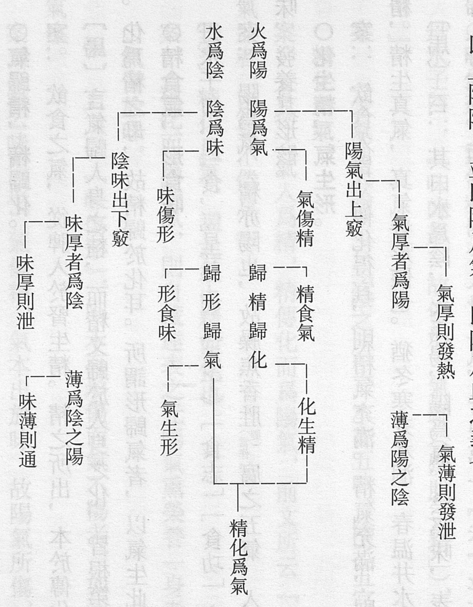

- 氣厚者爲陽 → 氣厚則發熱
- 薄爲陽之陰 → 氣薄則發泄
- 陽氣出上竅 → 氣厚者爲陽
- 陽爲氣 → 陽氣出上竅
- 陽爲氣 → 氣傷精
- 歸精歸化 → 精食氣
- 歸精歸化 → 化生精
- 化生精 → 精化爲氣　傷於味
- 火爲陽
- 水爲陰
- 陰爲味 → 陰味出下竅
- 陰爲味 → 味傷形
- 歸形歸氣 → 形食味
- 歸形歸氣 → 氣生形
- 歸形歸氣 → 精化爲氣　傷於味
- 陰味出下竅 → 味厚者爲陰
- 味厚者爲陰 → 味厚則泄
- 薄爲陰之陽 → 味薄則通

**○陽爲氣，陰爲味。**

案：以下飲食之氣味陰陽，經脾胃之消磨，則變爲氣血之謂也。

**○味歸形，形歸氣。**

<!-- PAGE_END -->

<!-- PAGE: 0171 -->

<!-- PRINTED: 136 -->

以上二句，『陰爲味』之注脚。

〔馬〕言味歸人身之形，而形又歸於人身之氣，皆根第一『味』字而言也。

案：一身所立因陽氣，故曰形歸氣。此『氣』即氣血之氣，非氣味之氣也。

**○氣歸精，精歸化。**

案：飲食之氣，從脾入於腎生精。精之所出，本於傳化。傳化之所生，亦因於五氣。如此解之則允當。

〔馬〕言氣歸人身之精，而精又歸於人身之化，皆根第一『氣』字而言也。所謂精歸化者，以化生此精也。化爲精之母，故精歸於化耳。所謂形歸氣者，以氣生此形也。氣爲形之父，故形歸於氣耳。｟指人身之氣言｠

**○精食氣，形食味。**

丹水子曰：『食，音寺。如《孟子》「食志」「食功」之「食」也。』

案：陽爲氣，精亦陽也，故臊焦香胜｟（當作腥）｠腐之五氣，入養其精氣。陰爲味，形亦爲陰，故酸苦甘辛鹹之五味，發養其形骸。

**○化生精，氣生形。**

案：飲食入胃，傳化得宜，則精氣充滿。精氣充滿，則陽氣舒暢，而能榮養其一身。所以是飲食傳化能生精，精生真氣，真氣養形骸也。猶冬寒井水涸，春温井水漲；傳化相得則滋潤，傳化相失則枯燥之理也。

〔馬〕云：其曰水爲陰，火爲陽，陽爲氣，陰爲味，表萬物之氣味所由成也。其曰味歸形，形歸氣，言味歸人身之形，而形又歸於人身之氣，皆根第一『味』字而言也。其曰氣歸精｟指萬物之氣言｠，精歸化，言氣歸人身之精，而精又歸於人身之化，皆根第一『氣』字而言也。其曰精食氣者，明上文氣歸精也。其曰形食味者，明上文味歸形也。其曰化生精者，明上文精歸化也。其曰氣生形者，明上文形歸氣也｟指人身之氣言｠。末四句，明上文中四句也。其曰陽爲氣，氣歸精，精食氣，三『氣』字，指萬物之氣也。其曰形歸氣，氣生形，二『氣』字，指人身自有之氣也。

<!-- PAGE_END -->

<!-- PAGE: 0172 -->

<!-- PRINTED: 137 -->

**○味傷形，氣傷精。**

丹水子曰：『味歸形，故傷形。氣歸（疑脫「精」），故傷精。木香、香附之類。久服者，必耗氣而傷腎也。』

案：《生氣通天論》云『陰之所生，本在五味。陰之五宮，傷在五味』與此同義，猶水能浮舟，又能覆舟也。

**○精化爲氣，**

案：食物之氣入爲精，精傳化而爲陽氣，前文所云『精食氣，化生精』之謂也。丹水子曰：『藏精而腎氣壯者，用氣不倦怠。』

〔張〕精化爲氣，謂元氣由精而化也。

案：精化而爲陽氣，則自藏達表之元陽氣熏榮養一身者，亦皆竟自味生來，乃所以成形之氣是也。

**○氣傷於味，**

〔張〕上文曰『味傷形』，則未有形傷而氣不傷者，如云『味過於酸，肝氣以津，脾胃乃絶』之類，是皆傷氣也。

案：雖云味傷形，氣傷精，氣本出於味，故陽氣所傷，亦竟歸味也。凡食物皆以味爲本之徵也。

**○陰味出下竅，陽氣出上竅。味厚者爲陰，薄爲陰之陽。氣厚者爲陽，薄爲陽之陰。味厚則泄，薄則通。氣薄則發泄，厚則發熱。**

案：出下竅者，尿屎，出上竅者，氣息是也。丹水子曰：『味厚者走下，故泄，大黄、地黄之類是也。

<!-- PAGE_END -->

<!-- PAGE: 0173 -->

<!-- PRINTED: 138 -->

味薄者滑利，故通，滑石、澤瀉之類是也。氣薄者浮表，故發散，麻黄、桂枝之類是也。氣厚者剛悍，故發熱，附子、乾薑之類是也』。

〔張〕陰味下行，故味厚者能泄於下。薄者能通利，陽氣上行，故氣薄者能泄於表，厚者能發熱也。

**○壯火之氣衰，少火之氣壯。**

丹水子曰：『少火、壯火，猶言少陽、太陽，自大寒至少｟（當作小）｠滿，陽和之節，天地之氣次弟壯，是少火之氣壯也。自小滿至大暑，炎暑大行，大暑後而天地之氣次弟衰，是壯火之氣衰也。人身亦應之，故人身氣衰者，雖用參朮補氣，不加桂附補火佐之，則不能起衰弱。人身陽火衰者，雖用桂附補火，不加參朮助之，則不能壯少火。是壯火養氣，氣養少火之謂也。上二句言陽氣興衰，下二句言人身陽氣應之而補之。』

〔張〕火，天地之陽氣也。天非此火不能生物，人非此火下不能有生，故萬物之生，皆由陽氣。但陽和之火則生物，亢烈之火反害物。故火太過則氣反衰，火和平則氣乃壯。壯火散氣，故云食氣，猶言火食此氣也。少火生氣，故云食火，猶言氣食此火也。此雖承氣味而言，然造化之道少則壯，壯則衰，自是如此，不特專言氣味者。

**○壯火食氣，氣食少火。壯火散氣，少火生氣。**

案：味厚則泄，氣厚則發熱，乃『壯火食氣』『壯火散氣』之謂也。味薄則通，氣薄則發泄，乃『氣食少火』『少火生氣』之謂也。

**○氣味辛甘發散爲陽，酸苦涌泄爲陰。**

案：甘爲味，發爲氣。辛爲味，散爲氣。酸爲味，泄爲氣。苦爲味，泄爲氣。蓋甘平發陽，謂葛根、甘草之類；辛温解散，謂桂枝、生薑之屬；苦寒涌吐，謂鹵鹹、瓜蒂之類；酸平滑泄，謂山茱萸、酸棗之屬也。劉任｟（當作信）｠甫《活人事證》以爲辛甘者，桂枝、甘草、乾薑、附子之類，酸苦者，苦參、苦青、葶藶、苦酒之類，未可也。

<!-- PAGE_END -->

<!-- PAGE: 0174 -->

<!-- PRINTED: 139 -->

**○陰勝則陽病，陽勝則陰病。**

稻葉通達曰：『陰勝則陽病，至濕勝則濡寫，應在重陽必陰之下。』

〔馬〕夫物之氣，大體爲陽。凡物之味，大體爲陰。然而氣主發散者，固爲陽。其味之辛甘者，亦爲陽。味主酸苦者，固爲陰。其氣之湧泄者，亦爲陰。正以氣之陽中有陰，味之陰中有陽也。故用酸苦湧泄之品，至於太過則陰勝矣。陰勝則吾人之陽分不能敵陰品，而陽分斯病也。用辛甘發散之品，至於太過則陽勝矣。陽勝則吾人之陰分不能敵陽品，而陰分斯病也。

**○陽勝則熱，陰勝則寒。**

〔新〕按：《甲乙經》作『陰病則熱，陽病則寒』，文異意同。

**○重寒則熱，重熱則寒。**

〔馬〕凡上文『寒熱』，俱主人身病體言。此二句與下文『重陰必陽，重陽必陰』二句相似。

目黑道琢曰：『重字，與《論疾診尺》篇重陰、重陽同。』

**○寒傷形，熱傷氣。**

〔馬〕凡天時物類之寒熱，皆能致吾人之病。故寒者能傷吾人之形，正以寒爲陰，而形亦屬陰。寒則氣收而形斯傷矣。｟本篇第二節云：陰成形。｠熱者能傷吾人之氣，正以熱爲陽，而氣亦屬陽。炅則氣散而氣斯病矣。｟弟二篇云：陽化氣。｠

**○氣傷痛，形傷腫。**

《大素》卷第三『傷腫』以下至『宜掣引之』載之，其前係於缺佚。

<!-- PAGE_END -->

<!-- PAGE: 0175 -->

<!-- PRINTED: 140 -->

〔楊〕既迫痛傷形，既便爲腫也。

〔馬〕夫惟熱之傷氣也，則氣之傷者，其痛生焉，所謂諸痛皆屬於火者是也。夫惟寒之傷形也，則形之傷者，其腫生焉，所謂寒則堅凝而腫斯作也。

**○故先痛而後腫者，氣傷形也。**

〔楊〕先耶傷衛氣致痛，後形腫者，謂衛氣傷及於形也。

**○先腫而後痛者，形傷氣也。**

〔楊〕耶先客於皮膚爲腫，而後壅衛氣爲痛者，謂形傷及於氣也。

〔馬〕然其爲腫爲痛，復有相因之機。先有是痛而後發腫者，蓋以氣先受傷而形亦受傷，謂之氣傷形也。先有是腫而後爲痛者，蓋以形先受傷而氣亦受傷，謂之形傷氣也。形非氣不充，氣非形不生，形氣相爲依附，而病之相因者又如此。

**○風勝則動，**

《大素》『動』字無。

案：以下五句，解五運六氣之言。

〔馬〕振掉，搖動之類。

〔識〕瘈瘲，搐搦之屬。

《至真要大論》云：『風淫所勝，平以辛涼，佐以苦甘。以甘緩之，以酸寫之。』又云：『諸風掉眩，皆屬於肝』『諸暴強直，皆屬於風。』

（眉）案：半分十二，雙合三三，又三合二個，二合三個，皆天理。而或忌六氣風寒暑濕燥火，不學之，何其昧愚也。

<!-- PAGE_END -->

<!-- PAGE: 0176 -->

<!-- PRINTED: 141 -->

（眉）夫天地之理，自一至十至百至千，其理皆合而共歸一理，故所以天地之爲天地也。若忌刺六氣者，不知所以天之爲天，地之爲地者。

**○熱勝則腫，**

《大素》無『熱勝則』三字。

〔馬〕凡癰腫之類，皆是也。上文言熱傷氣，氣傷痛，而此止言腫者，未有腫而不痛也。但此乃癰腫之腫，與上文形傷腫之腫有不同耳。彼所謂腫，乃寒氣之所傷者，即下文之所謂浮也。

案：前文及此『腫』字，並云『癰腫』，不與浮同。

〔楊〕耶風客於皮膚，則爲䐜腫也。

案：《大素》四字缺，楊氏直就缺文而爲之解説耳。

《至真要大論》云：『諸脹腹大，皆屬於熱。』又云：『諸病有聲，鼓之如鼓，皆屬於熱。』又云：『諸轉反戾，水液渾濁，皆屬於熱。』

**○燥勝則乾，**

〔楊〕耶風客於皮膚，則爲䐜腫也。耶熱燥於皮膚，則皮乾無汗。

《至真要大論》云：『諸熱瞀瘛，皆屬於火。諸逆衝上，皆屬於火。諸躁狂越，皆屬於火。』

**○寒勝則浮，**

《大素》『浮』作『胕』。

〔楊〕扶付反。檢義當腐，寒勝肉熱，肉當腐。

<!-- PAGE_END -->

<!-- PAGE: 0177 -->

<!-- PRINTED: 142 -->

『浮腫』字，又作胕。《呂氏春秋・情欲》『身盡府種，筋骨沈滯』，又《盡數》『氣鬱處腹，則爲張爲府』，並同義，詳見於《蘭軒遺稿》中。

（眉）《六元正紀論》中『胕腫』字數見王注『胕腫，謂肉泥，按之不起也』，《至真要論》注『胕，謂皮肉俱腫，按之陷下泥而不起也』。

**○濕勝則濡寫。**

《大素》無『寫』字。

〔楊〕陰濕氣盛則多汗也。

《六元正紀論》曰：『太陽司天之政，濡寫血溢。』

《六元正紀大論》云：『故風勝則動，熱勝則腫，燥勝則乾，寒勝則浮，濕勝則濡泄。甚則水閉胕腫，隨氣所在，以言其變耳。』王注云：『動，不寧也。浮，謂浮起，按之處見也。濡泄，水利也。胕腫肉泥，按之陷而不起也。水閉則逸於皮中也。』

案：運氣七篇王注與他所不同，或本篇中同字異訓，往往而有焉。蓋王氏所據七篇，本自有古注，王氏併經注而收入，故其文氣與他篇不相類似也。宜就而考究也。

（眉）《氣交變大論》：『歲水不及，民病濡泄。』

（眉）《至真要論》『寒入下焦，傳爲濡寫』注：『濡，謂水利也。』又曰：『甚則入腎竅，寫無度。』又曰：『太陰在泉，客勝則濕客下焦，發而濡寫。』

**○天有四時五行，**

〔楊〕天之用也。

<!-- PAGE_END -->

<!-- PAGE: 0178 -->

<!-- PRINTED: 143 -->

**○以生長收藏，**

行、藏爲韻。

〔楊〕四時之用。

**○以生寒暑燥濕風。**

《大素》無『風』字。

〔楊〕注云：『五行所生也，有本有風，謂具五者也。』

**○人有五藏，**

〔楊〕人之有也。

**○化五氣，**

《大素》『化』作『有』。

**○以生喜怒悲憂恐。**

《大素》無『生』字。

風、恐爲韻。

〔楊〕五氣，五藏氣也，喜怒等，心肺肝脾腎五志者。

案：本篇下文『悲』作『思』。詳釋下文。

《天元紀論》曰：『天有五行御五位，以生寒暑燥濕風。人有五藏化五氣，以生喜怒思憂恐。』

（眉）五氣者，魂魄志意神也。喜怒悲憂恐者，五情也。

**○故喜怒傷氣，**

<!-- PAGE_END -->

<!-- PAGE: 0179 -->

<!-- PRINTED: 144 -->

〔楊〕内傷者也。

**○寒暑傷形。**

〔楊〕外傷者也。

〔張〕喜怒傷内，故傷氣。寒暑傷外，故傷形。舉喜怒言，則悲憂恐同矣。舉寒暑言，則燥濕風同矣。

《靈樞・壽夭剛柔》云：『黄帝問於伯高曰：余聞形氣病之先後，外内之應，奈何。伯高答曰：風寒傷形，憂恐忿怒傷氣。氣傷藏，乃病藏。寒傷形，乃應形。風傷筋脈，筋脈乃應。此形氣外内之相應也。』

**○暴怒傷陰，暴喜傷陽。**

形、陽爲韻。

以下四句，亦見《素・疏五過論》王注，與此同意，蓋此收之者，亦王氏朱書加入之分耳。説詳見於七十七中。

《靈樞・行鍼》云：『多陽者多喜，多陰者多怒。』

**○厥氣上行，滿脈去形。**

『暴怒』以下十六字，《大素》無。

行、形爲韻。

〔張〕厥，逆也。言寒暑喜怒之氣暴逆於上，則陽獨實，故滿脈陽亢，則陰離故去形，此孤陽之象也。《脈經》曰『諸浮脈無根者死，有表無裏者死』，其斯之謂。

（眉）滿脈者，謂一身總脈也，總括多數之言也。《左傳・閔元》『萬，盈數也』，服注：『數從一至萬爲滿。』《六元正紀論》曰：『其病滿身重。』

<!-- PAGE_END -->

<!-- PAGE: 0180 -->

<!-- PRINTED: 145 -->

**○喜怒不節，寒暑過度，生乃不固。**

度、固爲韻。

〔楊〕内外傷己，生得堅固不道夭者，未之有也之。

**○故重陰必陽，重陽必陰。**

《大素》『喜怒不節』上有『故曰』二字，無『故』字。

〔張〕重者，重疊之義，謂當陰時而復感寒，陽時而復感熱，或以天之熱氣傷人陽分，天之寒氣傷人陰分，皆謂之重。蓋陰陽之道，同氣相求，故陽傷於陽，陰傷於陰，然而重陽必變爲陰證，重陰必變爲陽證。如以熱水沐浴身反涼，涼水沐浴身反熱，因小可以喻大。下文八句，即其徵驗。此與上文重寒則熱，寒極生熱義相上下，所當互求。

**○故曰：冬傷於寒，春必温病。**

《大素》『温病』作『病温』。

〔楊〕傷，過多也。冬寒，陰也。人於冬時，温衣熱食，腠理開發，多取寒涼以快其志者，寒入腠理，腠理遂閉，内行藏府，至春寒極變爲温病也。

**○春傷於風，夏生飧泄。**

《大素》『泄』作『洩』，『飧』作『飡』。

〔楊〕春風，陽也。春因腠理開發，風入腠閉，内行藏府腸胃之中，至夏飡洩也。飡，水洗飯也，音孫，謂腸胃水穀不化而出也。

**○夏傷於暑，秋必痎瘧。**

<!-- PAGE_END -->

<!-- PAGE: 0181 -->

<!-- PRINTED: 146 -->

《大素》『必痎』作『生㾬』。

〔楊〕夏因汗出，小寒入腠，藏之於内。至□（或作『秋』）氣發，腠理外閉，風氣内發，以成㾬瘧。㾬音皆。

（眉）此文經中屢出，古聖教訓，簡古木省，意味深長。二『必』下宜補『生』字看，二『生』上宜補『必』字看。

（眉）《廣韻》『必、畢同音，卑吉切』。案：必者，逆計後日之詞。

**○秋傷於濕，冬生欬嗽。**

〔楊〕秋多雨濕，人傷受濕。濕從上下，至冬寒并傷肺，故成欬嗽也。愷代反，又丘吏反，謂逆氣也。

案：此文經中重出甚多，《四氣調神》《生氣通天》《金匱真言》與此文少異，注家未得正解。竊謂冬時傷於寒之病，一旦雖施治而愈，忽逢春温之氣，肌表未全實，必發温熱之證，即『寒傷形』之義。又『春傷於風』者，風是陽邪，陽邪雖已愈，内損陽氣，適逢夏熱之氣，多傷動胃氣，故往往生飧泄之證，所云『熱傷氣』者也。又『夏傷於暑』，暑是熱邪，熱邪直着於藏，縱得全愈，大傷血脈。因逢秋濕之氣，濕熱傳入於血分，故作寒熱瘧疾。又『秋傷於濕』，濕爲冷邪，冷邪雖已解，肺氣或有一毫衰弱之處，不如未病已前，適逢冬寒迫於肌表，肌表亦爲肺之部分，故内生欬逆之變也。二『必』二『生』字，宜細翫。『必』是預知之詞，『生』是漸成之義也。《傷寒例》云『不即病者，寒毒藏於肌膚，至春變爲温病，至夏變爲暑病』之類，皆古來相傳之説，而其實皆謂前時有虧欠之氣，故當時爲某病也。凡古經所説，有不可依文得義者，得義而後，其文可始解耳。

（眉）《孟子・萬章上》曰：『故説詩者，不以文害辭，不以辭害志，以意逆志，是爲得之。如以辭而已矣。』

案：陽爲氣，陰爲味。以下作系圖如左，以便檢閲耳。

<!-- PAGE_END -->

<!-- PAGE: 0182 -->

<!-- PRINTED: 147 -->

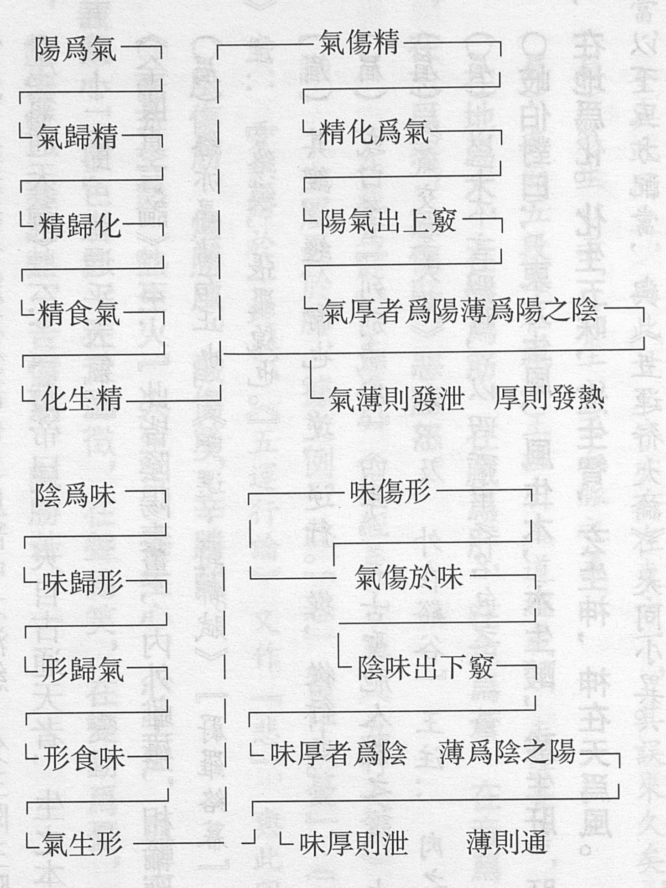

- 氣傷精 → 精化爲氣 → 陽氣出上竅 → 氣厚者爲陽薄爲陽之陰 → 氣薄則發泄　厚則發熱
- 味傷形 → 氣傷於味 → 陰味出下竅 → 味厚者爲陰　薄爲陰之陽 → 味厚則泄　薄則通
- 陽爲氣 → 氣歸精 → 精歸化 → 精食氣 → 化生精 → 氣傷精
- 陰爲味 → 味歸形 → 形歸氣 → 形食味 → 氣生形 → 味傷形

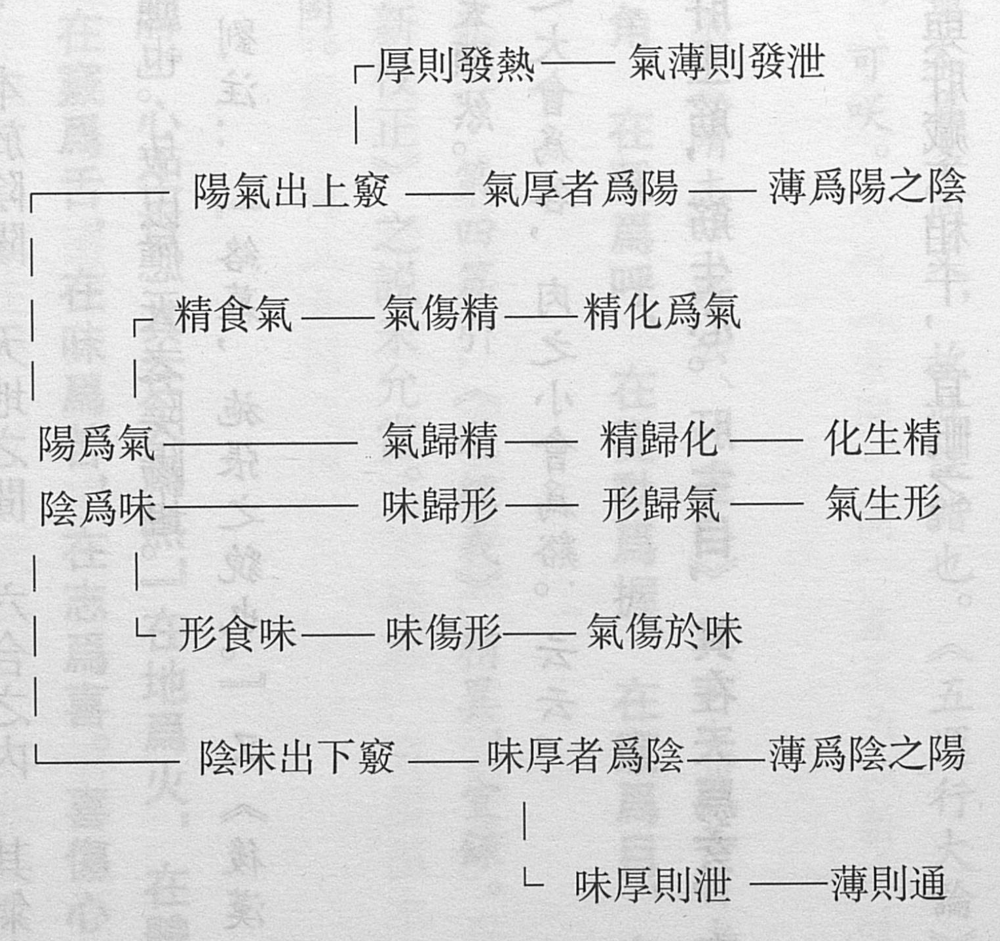

- 厚則發熱 → 氣薄則發泄
- 陽氣出上竅 → 厚則發熱
- 陽氣出上竅 → 氣厚者爲陽 → 薄爲陽之陰
- 精食氣 → 氣傷精 → 精化爲氣
- 陽爲氣 → 氣歸精 → 精歸化 → 化生精
- 陰爲味 → 味歸形 → 形歸氣 → 氣生形
- 形食味 → 味傷形 → 氣傷於味
- 陰味出下竅 → 味厚者爲陰 → 薄爲陰之陽
- 味厚者爲陰 → 味厚則泄 → 薄則通
- 陽爲氣 → 陽氣出上竅
- 陽爲氣 → 精食氣
- 陰爲味 → 形食味
- 陰爲味 → 陰味出下竅

（眉）以上第一章。

**○帝曰：余聞上古聖人，論理人形，列別藏府，端絡經脈，會通六合，各從其經。氣穴所發，各有處名，谿谷屬骨，皆有所起。分部逆從，各有條理。四時陰陽，盡有經紀。外内之應，皆有表裏，其信然乎。**

〔□〕端，正也。絡，聯絡之義。

《原病式》『端，揣音。次度也』。

<!-- PAGE_END -->

<!-- PAGE: 0183 -->

<!-- PRINTED: 148 -->

〔馬〕人有形體則論理之｟如《靈樞·骨度》《脈度》等篇｠，人有藏府則別列之｟如《靈樞·經水》《腸胃》《海論》等篇｠，人有經脈則端絡之｟如《靈樞·經脈》等篇｠，脈有六合則會通之｟如《靈樞·經別篇》有六合｠，使之各從其經。凡氣穴所發，各有其處，且有其名｟如本經有《氣穴論》｠。肉之大會爲谷，小會爲谿。凡谿谷屬骨，皆有所起｟如本經有《氣穴論》《氣府論》《骨空論》等篇｠，分部逆從，各有條理｟如本經有《皮部論》等篇｠，四時陰陽，人有經紀｟如本篇下節所云｠，外内之應，皆有表裏｟如本經《血氣形志論》有大陰與陽明爲表裏之謂｠。

〔志〕分部者，皮之分部也。皮部中之浮絡，分三陰三陽，有順有逆，各有條理也。

《生氣通天論》云：『黃帝曰：夫自古通天者，生之本，本於陰陽。天地之間，六合之内，其氣九州九竅五藏十二節，皆通乎天氣。』

《金匱真言論》云：『此皆陰陽表裏，内外雌雄，相輸應也。故以應天之陰陽也。』

（眉）絡亦尋緒而正也。《文選·蜀都賦》『罻羅絡幕』劉注：『絡幕，施張之貌也。』又《後漢·馬融傳》注：『絡縸，張羅貌也。』

（眉）其經，經，常也。逆，逆行。從，從行也。

（眉）或曰至『列別藏府』四字，而古聖肔人體之證，太顯然。

（眉）《氣交變大論》『水不及，外在谿谷』王注：『肉之大會爲谷，肉之小會爲谿。』云云。

（眉）以下不言四時，以四方中之名包之。

**○岐伯對曰：東方生風，風生木，木生酸，酸生肝，肝生筋，筋生心。肝主目，其在天爲玄，在人爲道，在地爲化。化生五味，道生智，玄生神，神在天爲風。**

以下五方配當，與《五運行大論》大同小異。

〔識〕據下文例，『在天』以下二十三字，係於衍文，且與肝藏不相干，宜刪之。

<!-- PAGE_END -->

<!-- PAGE: 0184 -->

<!-- PRINTED: 149 -->

案：此廿三字，全在《天元紀大論》。《天元紀大論》與本篇多同文，故此誤錯也。《五運行大論》五方配當，全與此同文，而此廿三字亦有在東方下，其誤來久矣，可咲。

（眉）筋生心者，筋生心之血脈之義。

（眉）本節五段每在藏下王注引《道經義》，未詳其書，恐《隋志》所云、《唐志》所云失載其目者與？

**○在地爲木，在體爲筋，在藏爲肝，在色爲蒼，在音爲角，在聲爲呼，在變動爲握，在竅爲目，在味爲酸，在志爲怒，怒傷肝，悲勝怒。**

（眉）『在藏爲肝』王注引《道經義》，與《五行大義》卷三·第四篇引《道經義》稍異，宜録。

〔識〕下文屬憂於肺，據文例，此『悲』當作『憂』，《新校正》之説未允當。

案：憂悲歸於一理也，《五運行論》又作『悲』，與此同。

**○風傷筋，燥勝風。酸傷筋，辛勝酸。**

**○南方生熱，熱生火，火生苦，苦生心，心生血，血生脾。心主舌，其在天爲熱，在地爲火，在體爲脈，在藏爲心，在色爲赤，在音爲徵，在聲爲笑，在變動爲憂，在竅爲舌，在味爲苦，在志爲喜。喜傷心，恐勝喜，熱傷氣，寒勝熱，苦傷氣，鹹勝苦。**

（眉）血生脾者，血生養肉之義。

（眉）前云血，後云脈，殊文而物一。故《新校正》引《太素》亦可證，《五運行論》亦前云血，後云脈，與此同文。

（眉）當云『熱傷血』，反曰『熱傷氣』，《五運行論》亦爾。當云『苦傷血』，反曰『苦傷氣』，《五運行論》亦爾。

<!-- PAGE_END -->

<!-- PAGE: 0185 -->

<!-- PRINTED: 150 -->

**○中央生濕，濕生土，土生甘，甘生脾，脾生肉，肉生肺。脾主口，其在天爲濕，在地爲土，在體爲肉，在藏爲脾，在色爲黃，在音爲宮，在聲爲歌，在變動爲噦，在竅爲口，在味爲甘，在志爲思。思傷脾，怒勝思，濕傷肉，風勝濕，甘傷肉，酸勝甘。**

『中央生濕』王注引《易義》，今未詳其何書之略稱。

（眉）『肉生肺』者，肉生皮毛之義。歌，永聲也。王注曰『嘆聲』，非。

**○西方生燥，燥生金，金生辛，辛生肺，肺生皮毛，皮毛生腎。肺主鼻，其在天爲燥，在地爲金，在體爲皮毛，在藏爲肺，在色爲白，在音爲商，在聲爲哭，在變動爲欬，在竅爲鼻，在味爲辛，在志爲憂。憂傷肺，喜勝憂，熱傷皮毛，寒勝熱，辛傷皮毛，苦勝辛。**

（眉）皮毛生腎者，皮毛養骨之義。

（眉）當从《大素》改｟（作『燥傷皮毛，熱勝燥』）｠，宋臣所引也。而《五運行論》與《素問》同。

**○北方生寒，寒生水，水生鹹，鹹生腎，腎生骨髓，骨髓生肝。腎主耳，其在天爲寒，在地爲水，在體爲骨，在藏爲腎，在色爲黑，在音爲羽，在聲爲呻，在變動爲慄，在竅爲耳，在味爲鹹，在志爲恐。恐傷腎，思勝恐，寒傷血，燥勝寒，鹹傷血，甘勝鹹。**

（眉）髓生肝者，髓生筋之義。

（眉）『在藏爲腎』，王注曰：『志營者，乃精行之義。』

（眉）或抄曰：耳竅之底，累卷如螺。

（眉）當从《大素》正｟（作『寒傷骨，濕勝寒，鹹傷骨』）｠，宋臣所引也。而《五運行論》亦與《素問》同。蓋王氏所傳本如此也。

案：今據本篇文作傍通如左。

<!-- PAGE_END -->

<!-- PAGE: 0186 -->

<!-- PRINTED: 151 -->

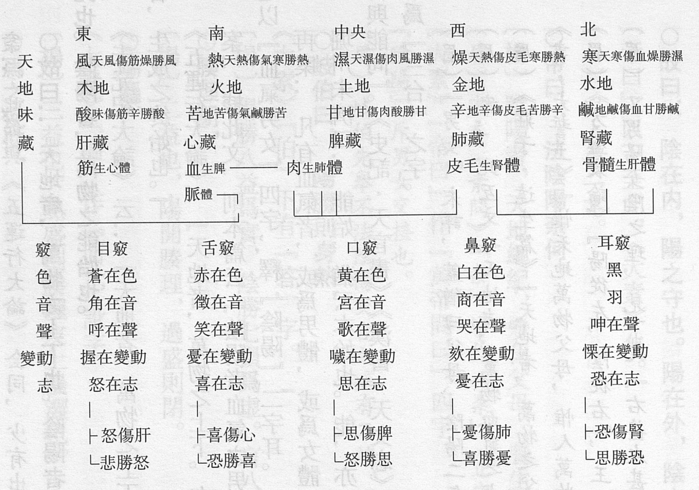

- 北
- 寒天寒傷血燥勝濕
- 水地
- 鹹地鹹傷血甘勝鹹
- 腎藏
- 骨髓生肝體
- 耳竅
- 黑
- 羽
- 呻在聲
- 慄在變動
- 恐在志 → 恐傷腎
- 恐在志 → 思勝恐
- 西
- 燥天熱傷皮毛寒勝熱
- 金地
- 辛地辛傷皮毛苦勝辛
- 肺藏
- 皮毛生腎體 → 骨髓生肝體
- 鼻竅
- 白在色
- 商在音
- 哭在聲
- 欬在變動
- 憂在志 → 憂傷肺
- 憂在志 → 喜勝憂
- 中央
- 濕天濕傷肉風勝濕
- 土地
- 甘地甘傷肉酸勝甘
- 脾藏
- 肉生肺體 → 皮毛生腎體
- 口竅
- 黃在色
- 宮在音
- 歌在聲
- 噦在變動
- 思在志 → 思傷脾
- 思在志 → 怒勝思
- 南
- 熱天熱傷氣寒勝熱
- 火地
- 苦地苦傷氣鹹勝苦
- 心藏
- 血生脾 → 肉生肺體
- 脈體
- 舌竅
- 赤在色
- 徵在音
- 笑在聲
- 憂在變動
- 喜在志 → 喜傷心
- 喜在志 → 恐勝喜
- 東
- 風天風傷筋燥勝風
- 木地
- 酸味傷筋辛勝酸
- 肝藏
- 筋生心體
- 目竅
- 蒼在色
- 角在音
- 呼在聲
- 握在變動
- 怒在志 → 怒傷肝
- 怒在志 → 悲勝怒
- 天
- 地
- 味
- 藏 → 脈體
- 竅
- 色
- 音
- 聲
- 變動
- 志

<!-- PAGE_END -->

<!-- PAGE: 0187 -->

<!-- PRINTED: 152 -->

案：此節與《五運行大論》全同，少有出入耳，宜參。

**○故曰：天地者，萬物之上下也。陰陽者，血氣之男女也。左右者，陰陽之道路也。水火者，陰陽之徵兆也。陰陽者，萬物之能始也。**

《天元紀大論》云：『天地者，萬物之上下也。左右者，陰陽之道路也。水火者，陰陽之徵兆也。金木者，生成之終始也。』

《五運行大論》：『天地者，萬物之上下。左右者，陰陽之道路。』

案：據此文，則本篇云『陰陽者血氣之男女也』九字，恐誤衍，蓋注文旁記之類，誤混正文者。唯不過以『血氣男女』四字，釋『陰陽』二字耳。

再案：凡有血氣者，或爲男體，或爲女體，並一血氣之作小異者也。

堀川未濟曰：能始，猶云本始也。能，亦始也。《爾雅·釋詁》『胎，始也』。《釋文》『胎，本作台。台與能同』。《史記·天官書》《漢書·天文志》『三台』作『三能』。《禮記·樂記》疏云：古時以今『能』字爲『三台』之字。

（眉）『男女』未詳，蓋猶曰父母、陰陽二氣者，生養血氣萬物之兩親也。

（眉）案：此互文『天地者，萬物血氣之上下也。陰陽者，萬物血氣之男女也』之義。

（眉）《莊子·達生篇》『天地者，萬物之父母也』。

《書·大誓上》『惟天地萬物父母，惟人萬物之靈』。

（眉）《方盛衰論》『陽從左，陰從右』，王注：『陽氣之多少，皆從左。陰氣之多少，皆從右。』

（眉）又男陽女陰之理，見下文『右甚左甚』下，宜參。

四月七日

<!-- PAGE_END -->

<!-- PAGE: 0188 -->

<!-- PRINTED: 153 -->

**○故曰：陰在内，陽之守也。陽在外，陰之使也。**

『帝曰』以下至此，《大素》無。

（眉）以上第二章。

**○帝曰：法陰陽奈何？**

〔楊〕陰陽者，天地綱紀，變化父母，養生之道。法之以成，故問之。

（眉）宋本《素問》『奈』皆作『柰』，正字，可尚。

《大素》『帝曰』作『黃帝問曰』四字。

『陰陽』斥男女交接也。

（眉）岐伯先舉不法陰陽交合之病有二端，以戒世俗。後待帝之再問，始示七損八益之術。

**○岐伯曰：陽勝則身熱，**

《大素》『伯』下有『答』字。

〔楊〕陽勝八益爲實，陰勝七損爲虛。言八益者，身熱，一益也。陰弱陽盛，故通身熱也。

**○腠理閉，**

〔楊〕二益也，陽開腠理，過盛則閉。

**○喘麤，**

《大素》『喘』作『而』，訛字。

〔楊〕三益也，熱盛則腠理皮上麤澀也。

**○爲之俛仰，**

<!-- PAGE_END -->

<!-- PAGE: 0189 -->

<!-- PRINTED: 154 -->

〔楊〕四益也，熱盛上下，故俛仰。

『俛仰』字，又見《評熱病卅三》｟九ウ｠中。

**○汗不出而熱，**

〔楊〕五益也，陰氣内絶，故汗不出，身仍熱。

**○齒乾，**

《大素》『齒乾』作『乾齒』。

〔楊〕六益也，熱盛至骨，故齒乾也。

**○以煩冤，**

《大素》『冤』作『悗』。

〔楊〕七益也，熱以亂神，故煩悶也。

**○腹滿死，**

〔楊〕八益也，熱盛胃中，故腹滿也。前已七益，復加腹滿，故致死。

**○能冬不能夏。**

〔楊〕以其内熱，故能冬之大寒，不能夏之小熱。

案：此蓋論自己陽氣陰氣之盛衰也。然在外感之病，亦爲此證。輕者麻黃湯、葛根湯所主，重者大青龍湯，其尤重者白虎、承氣之類，亦可撰用也。

**○陰勝則身寒，**

〔楊〕下言七損也。身寒，一損也，身苦寒。

<!-- PAGE_END -->

<!-- PAGE: 0190 -->

<!-- PRINTED: 155 -->

**○汗出，**

〔楊〕二損也，無陽禁腠，故汗出。

**○身常清，**

《大素》『清』作『凊』。

〔楊〕三損也，凊，冷也，身皮膚常冷也。

**○數慄，**

〔楊〕四損也，數數戰慄也。

**○而寒，**

〔楊〕五損也，戰而復寒也。

**○寒則厥，**

〔楊〕六損也，寒則手足逆冷也。

**○厥則腹滿死。**

〔楊〕七損也，前已六損，復加冷氣滿腹，冷氣滿腹故致死也。

**○能夏不能冬。**

〔楊〕寒人遇熱，故堪能也。

案：此證輕者，桂枝湯類，重者，四逆湯類之所主。其云能冬、能夏者，亦大概之言耳。前文所云『陰勝則陽病，陽勝則陰病。陽勝則熱，陰勝則寒』，與此同義，可併考。

**○此陰陽更勝之變，**

<!-- PAGE_END -->

<!-- PAGE: 0191 -->

<!-- PRINTED: 156 -->

《大素》『變』下有『也』字。

**○病之形能也。**

〔楊〕此是陰陽變極之理，亦是人之病所能也。

案：『恣態』字古只作『能』，與『才能』字形同，而音義皆異。《説文》：『態，意也。從心從能，或從人。作㑷。』玄應《一切經音義》二云：『態，古文作能』。因考『耐勝』字，古作『態』。形態字古作『能』，而耐、能二字互相通用。本書四十六有《病能論》，《風論》亦有『病能』字，《靈樞·陰陽二十五人篇》作『態』，云『其態又不合於衆者五』。《本草經》『耐老』，《新修本草》作『能老』，共可以爲徵矣。

**○帝曰：**

《大素》作『黃帝問曰』四字。

**○調此二者奈何？**

〔楊〕陰陽相勝，遂有七損八益，虛實不和，故謂調之。

案：此二者，受前文而言，斥身内之陰氣陽氣也。欲調和此二氣，則先明房中之祕術，而後氣血調和，無過不及之弊也。

**○岐伯曰：**

《大素》『伯』下有『答』字。

**○能知七損八益，則二者可調。**｟《大素》此下有『也』字｠

〔楊〕損者，損於身。益者，益於病者。人能修道察同，去損益之病，則陰陽氣和，無諸衰老，壽命無窮，與天地同極也。

<!-- PAGE_END -->

<!-- PAGE: 0192 -->

<!-- PRINTED: 157 -->

《醫心方》廿八『八益』第十六《玉房祕決》云：『素女曰：陰陽有七損八益，一益曰固精，令女側臥張股，男側臥其中，行二九數，數卒止。令男固精，又治女子漏血，日再行，十五日愈。二益曰安氣，令女正臥高枕，伸張兩肶，男跪其股間，刺之行三九數，數畢止。令人氣和，又治女門寒，日三行，廿日愈。三益曰利藏，令女人側臥，屈其兩股，男横臥卻刺之，行四九數，數畢止。令人氣和，又治女門寒，日四行，廿日愈。四益曰強骨，令女人側臥，屈左膝，伸其右肶，男伏刺之，行五九數，數畢止。令人開節調和，又治女閉血，日五行，十日愈。五益曰調脈，令女側臥，屈其右膝，申其左肶，男據地刺之，行六九數，數畢止。令人脈通利，又治女門辟，日六行，廿日愈。六益曰畜血，男正偃臥，令女戴尻跪其上，極内之，令女行七九數，數畢止。令人力強，又治女子月經不利，日七行，十日愈。七益曰益液，令女人正伏舉後，男上往行八九數，數畢止。令人骨塡。八益曰道體，令女正臥，屈其肶足，迫尻下，男以肶脇刺之，以行九九數，數畢止。令人骨實，又治女陰臭，日九行，九日愈。』

『七損』第十七《玉房祕決》云：『素女曰：一損謂絶氣，絶氣者，心意不欲而強用之，則汗泄氣少，令心熱目冥冥。治之法，令女正臥，男擔其兩股，深案之，令女自搖，女精出止，男勿得快。日九行，十日愈。二損謂溢精，溢精者，心意貪愛，陰陽未和而用之，精中道溢。又醉而交接，喘息氣亂則傷肺，令人欬逆上氣，消渴喜怒，或悲慘慘，口乾身熱，而難久立。治之法，令女人正臥，屈其兩膝俠男，男淺刺，内玉莖寸半，令女子自搖，女精出止，男勿得快。日九行，十日愈。三損謂奪脈，奪脈者，陰不堅而強用之，中道強寫，精氣竭，及飽食訖交接，傷脾，令人食不化，陰痿無精。治之法，令女人正臥，以脚鉤男子尻，男則據席内之，令女自搖，女精出止，男勿快。日九行，十日愈。四損謂氣泄，氣泄者，勞倦汗出，未乾而交接，令人腹熱脣燋。治之法，令男子正申臥，女跨其上向足，女據席淺内莖，令女自搖，精出止，男子勿快。

<!-- PAGE_END -->

<!-- PAGE: 0193 -->

<!-- PRINTED: 158 -->

日九行，十日愈。五損謂機開厥傷，機開厥傷者，適新大小便，身體未定，而強用之，則傷肝，及卒暴交會，遲疾不理，勞疲筋骨，令人目盳盳，癰疽並發，衆脈槁絶，久生偏枯，陰痿不起。治之法，令男子正臥，女跨其股踞前向，徐徐案内之，勿令女人自搖，女精出，男勿快。日九行，十日愈。六損謂百閉，百閉者，淫佚於女，自用不節，數交失度，竭其精氣，用力強寫，精盡不出，百病並生。消｟（當補『渴目冥冥，治之』）｠法，令男正臥，女跨其上，前伏據臍，令女内玉莖自搖，精出止，男勿快。日九行，十日愈。七損謂血竭，血竭者，力作疾行，勞因汗出，因以交合，俱已之時，偃臥推深没本，暴急劇病因發，連施不止，血枯氣竭，令人皮虛膚急，莖痛囊濕，精變爲血。治之法，令女正臥，高抗其尻，申張兩股，男跪其間，深刺，令女自搖，精出止，男勿快。日九行之，十日愈。』

案：七損八益，古來注家意見各出，皆出於臆斷，不足據。王注以爲房事，蓋有所受而言。今得《醫心方》，而千古疑義一時氷解。但其言猥雜，故王氏不詳録也。《玉房祕決》引『素女曰』，知是《素女經》文。《隋志》：玉房祕決十卷，玉房祕決八卷，新撰玉房祕決九卷。《舊唐志》：玉房祕録訣八卷，沖和子撰。《新志》：沖和子玉房祕訣十卷。張鼎《崇文總目》：黃帝玉房祕訣一卷。《隋志》：素女祕道經一卷，并玄女經，又素女方一卷。《見在書目》：素女問一卷。素女經一卷，又玄女經一卷｟五行家｠，又《舊唐志》兵書：黃帝問玄女法三卷。玄女撰。

案：古聖人能正心脩身，故遂至治天下，故黃帝堯舜氏，皆房事有法，飲食有節，而得壽。得壽而後得治天下之大之年月也。故《中庸》曰：『子曰：舜其大孝也與。大德必得其位，必得其祿，必得其名，必得其壽。』朱注：『舜，年百有十歲。』

（眉）《素·著至教論》『黃帝坐明堂，召雷公而問之曰：子知醫之道乎』，王注：『明堂，布政之宮也。八窻四闥，上圓下方，在國之南，故稱明堂。夫求民之瘼，恤民之隱，大聖之用心』，故召引雷公，問拯濟生靈之道也。』

<!-- PAGE_END -->

<!-- PAGE: 0194 -->

<!-- PRINTED: 159 -->

（眉）案：由是，則此房術亦古聖自驗，又施人之教，奈何自古其民之奉教者少也。

（眉）《疏五過論》：『聖人之術，爲萬民式，倫裁志意，必有法則，循經守數。按循醫事，爲萬民副。』

《新校正》引楊上善云：『副，助也。』

（眉）《天元紀論》『上以治民，下以治身。使百姓昭著，上下和親，德澤下流，子孫無憂，傳之後世，無有終時』。

（眉）《素問識》七損八益説，載日本人説，不知其説本於宋·王逵所著《蠡海集·人身部》也。王逵所言以《上古天真論》二七、七七、二八、八八爲七損八益，嗚乎，李唐以上之教亡於五季，而存於日本，宋人不能知之，可嘆也哉。

（眉）《漢·藝文》之房中八家百八十六卷。容成陰道二十六卷。務成子陰道三十六卷。堯舜陰道二十三卷。湯盤庚陰道二十卷。天老雜子陰道二十五卷。天一陰道二十四卷。黃帝三王養陽方二十卷。三家内房有子方十七卷。

**○不知用此，則早衰之節也。**

《大素》『早』作『蚤』，『衰』下更有『衰』字，無『也』字，『早衰』爲句，『衰之節』屬下句，似是。

〔楊〕人不修道，不去損□（或作『益』），則陰陽不調，是謂不道。不道，早衰也。

『用』字字眼，其爲人事也明矣。

<!-- PAGE_END -->

<!-- PAGE: 0195 -->

<!-- PRINTED: 160 -->

**○年四十，**

《大素》『四十』作『卌』一字。

**○而陰氣自半也，起居衰矣。**

〔楊〕始衰時節年卌也。六府爲陽氣，五藏爲陰氣。人年卌，五藏陰氣自半已衰，腠理始疏，榮華頹落，髮鬢頒白，行立之起，坐臥之居，日漸已衰也。

案：下壽八十，中壽八十，今四十者，其中半也。考《上古天真論》男始衰五八四十，女始衰五七三十五也。

**○年五十，體重，耳目不聰明矣。**

《千金》廿七引『岐伯曰：人年四十』至『此聖人之治身也』，『矣』作『也』。

**○年六十，陰痿，大氣衰。**

《大素》『大氣』作『氣大』。

**○九竅不利，下虛上實，涕泣俱出矣。**

《大素》無『矣』字。

案：『涕』即『洟』字，隷書多通用。《説文》『洟，鼻液也。從水夷聲｟他計切｠』『泣，無聲出涕曰泣，從水立聲｟他例切｠』，此云涕泣俱出，可知鼻水與目汁一時泄出也。《靈·口問篇》『人之哀而泣涕出者云云』亦以泣爲目汁，以涕爲鼻汁也。《素·解精微論》亦泣淚爲目，涕爲鼻。

**○故曰：知之則強，不知則老。故同出而名異耳。**

《大素》無『出』字、『而』字，『耳』作『耶』。《千金》廿七無『故同』之『故』，無『而』字、『耳』字。

<!-- PAGE_END -->

<!-- PAGE: 0196 -->

<!-- PRINTED: 161 -->

**○智者察同，愚者察異。**

（眉）智者能察合同道法之術，愚者悉誤察反戾道法之事。

**○愚者不足，智者有餘，有餘則耳目聰明，身體輕強，老者復壯，壯者益治。**

《大素》『強』下有『年』字，『老者』之『者』無，『治』作『理』。《千金》廿七同。

**○是以聖人爲無爲之事，樂恬憺之能。**

《大素》『憺』作『惔』。

**○從欲快志於虛無之守，**

《千金》廿七『於』作『得』，『恬憺之能』作『恬惔之味』，『從』作『縱』。

案：宜從《千金》『於』作『得』爲正也。

（眉）從、縱同，縱快者，謂黃帝御百二十女之類爾，而益有損無也。

**○故壽命无窮，與天地終。**

《大素》『无窮』之『无』作『無』，『與』作『与』。

**○此聖人之治身也。**

案：第一云『上古之人，其知道者。法於陰陽，和於術數。食飲有節，起居有常。不妄作勞，故能形與神俱，而盡終其天年，度百歲乃去』，又云『夫道者，能卻老而全形，身年雖壽能生子也』，又云『其次有聖人者，以恬愉爲務，以自得爲功。形體不敝，精神不散，亦可以百數』，並與本論同理，而專謂房内之事也。王注可從。

<!-- PAGE_END -->

<!-- PAGE: 0197 -->

<!-- PRINTED: 162 -->

又案：第一云『今時之人不然也，以酒爲漿，以妄爲常，醉以入房，以欲竭其精，以耗散其真，不知持滿，不時御神，務快其心，逆於生樂，起居無節，故半百而衰也』，與此云『智者察同，愚者察異』其義方同。

（眉）以上第三章。

**○天不足西北，故西北方陰也。**｟《大素》無『北』字｠**而人右耳目不如左明也。**｟《大素》無『也』字｠**地不滿東南，故東南**｟《大素》無『南』字｠**方陽也。而人左手足不如右強也。**｟《大素》無『而』字｠

〔識〕《淮南·天文訓》：『昔者共工與顓頊爭爲帝，怒而觸不周之山，天柱折，地維絶，天傾西北，故日月星辰移焉，地不滿東南，故水潦塵埃歸焉。』《河圖括地象》云：『西北爲天門，東南爲地户』，注：『天不足西北，是天門。地不滿東南，是地户。』

（眉）此義在今日病人之上，太襯實，非妄。詳見吳氏又可《瘟疫論》卷下·損復篇。此天地傾陷之義，見《列子·湯問篇》，又《素·五常政大論》《易·伏義八卦方位》『兌在東南，艮在西北』與此天傾地陷義全合。

（眉）《醫範提綱》卷三曰：『凡全身諸骨，大抵右重左輕，不啻骨爾。而諸部筋肉，亦皆右重厚，左輕薄也。』

案：世界全形，西北爲山陵，東南爲海水，自是自然之形勢。蓋不得不然而然者，古聖早已考究此理，故有此論也。《淮南》『共工怒而觸不周之山，天柱折，地維絶』之説，亦就地形而以故事傅會者，蓋人間所傳之古言，固非正史所載。猶皇國孝靈時，一夜忽突出富士山，其迹凹陷者，乃成近江琵琶湖也。是亦正史所不載，而民間傳來之古事。但上古雲氣未開，始見之時如忽然而生者，故有此言耳，決非後世之所想像也。

<!-- PAGE_END -->

<!-- PAGE: 0198 -->

<!-- PRINTED: 163 -->

（眉）案：一國上之論，則必滿世界之形勢，悉合於此説無異也。蓋世界謂我地球總括也。一國者，一州一域也，謂四座海濱之土，有大有小不一定也。日本一國也，八丈嶋一國也，四國九州各一國也。亞細亞、歐羅巴合而一國也，錫蘭嶋一國也，亞弗利加一國也，餘放｟（當作仿）｠此例，非以一邑一都一邦一縣一州｟九州之類｠一府爲一國者之謂也。雖然人居地上，必集暖開寒閉之土。故大抵一邑一府，亦殆合此義也。其四坐海濱之土者，天地自然所成之一國，非人割據而作名者。

（眉）案：《老子》『萬物抱陽反｟（當作負）｠陰』，故地南半球以北爲南，温地上土國之形，亦在南半球，則北開南閉也。去赤道下各數度既爾。

（眉）或曰：地丸圓無西東。曰：否。四坐海濱之土上，皆有四方東西之名，本起於是也。

**○帝曰：何以。岐伯曰：**

《大素》『帝曰』作『黃帝問曰』四字，『伯』下有『答』字。

**○東方陽也。陽者，**｟《大素》無此二字｠**其精并於上。**｟《大素》無『於』字｠

**○并於上，**｟《大素》無『并於上』三字｠

**○則上明而下虛，**

《大素》『則』作『故』。

**○故使耳目聰明，而手足不便也。**

《大素》『使』作『便』。

**○西方陰也。陰者，其精并於下，并於下，則下盛而上虛。故其耳目不聰明，而手足便也。**

《大素》『西方』以下三十二字無，蓋係缺脫。

<!-- PAGE_END -->

<!-- PAGE: 0199 -->

<!-- PRINTED: 164 -->

**○故俱感於邪，其在上則右甚。**

《大素》『上』下有『也』字。

**○在下則左甚，此天地陰陽所不能全也。**

《大素》無『也』字。

**○故邪居之。**

案：天地無全功，萬物無如意。小兒生下後呱泣者，已是不得意也耳。《列子・天瑞篇》『子列子曰：天地無全功，聖人無全能，萬物無全用』，注：『全，猶備也。』

〔楊〕東方是陽，陽氣上昇，故上實下虛，則人左箱上勝下劣也。西方是陰，陰氣下沈，故下實上虛，則人右葙下勝上劣也。

吳又可《瘟疫論》下卷・損復篇曰：『天傾西北，地陷東南，故男先傷右，女先傷左，及其復也，男先復左，女先復右，以素虧者易損，素實者易復也。』

〔高〕人身南面而立，左東右西，左者乃東方陽也。陽者其精并於上，并於上則上明而下虛，故使左耳目聰明，而左手足不便也。右者乃西方陰也，陰者其精并於下，并於下則下盛而上虛，故其右耳目不聰明，而右手足強便也。

（眉）案：若在南半球，面北爲正，故其説則東方陽，故人手足動用右強，西方陰，故人耳目靜用左明也。

（眉）『東方陽也，西方陰也』之解，楊注是，高注非。蓋日月星辰升於東，故爲陽，陽上出也，沈於西，故爲陰，陰下入也。

<!-- PAGE_END -->

<!-- PAGE: 0200 -->

<!-- PRINTED: 165 -->

**○故天有精，地有形。天有八紀，地有五里。**

《大素》『里』作『理』。

〔楊〕天有氣之精，成人耳目。地有質之形，成人手足。

（眉）蘭軒曰：『里作理者，膏粱作高粱，草滋作草茲之類。』《靈・經脈篇》『通里』，《千金方》心門作『通理』。

（眉）《六節藏象論》：『行有分紀，周有道理。』因考『行』謂日月運躔之道，『周』謂地表周韋也。理之五者，《周髀》所謂『七衡』，而熱地壹，正地二，寒地二是也。

（眉）下文曰『不法天之紀，不用地之理，則災害至矣』，可知理者，五行養萬類之理也。

（眉）又案：七衡五理，則地上風土各別其治之教也。

（眉）《六元正紀論》首曰：『通天之紀，從地之理，和其運，調其化。』

（眉）『八紀』王注，是謂春分、秋分、夏至、冬至、立春、立夏、立秋、立冬之八紀也。王注：『五里，里尻之義。下文理字，亦里尻義。』可从。井里之井，亦『里尻』之義，非性理之義。

**○故能爲萬物之父母。**

《大素》無『之』字。

**○清陽上天，濁陰歸地。是故天地之動靜，神明爲之綱紀。**

《大素》無『綱』字。

（眉）《氣交變大論》：『天地之動靜，神明爲之紀。陰陽之往復，寒暑彰其兆。』又《五運行論》同，『往復』作『升降』爲異。『綱紀』解，見本篇首所辨。

<!-- PAGE_END -->

<!-- PAGE: 0201 -->

<!-- PRINTED: 166 -->

**○故能以生長｟《大素》此下有『化成』二字｠收藏，**

**○終而復始，惟賢人上配天以養頭，下象地以養足，中傍人事以養五藏。**

《大素》『惟』作『唯』，『傍』作『象』。《五行大義》卷五・人配五行論中引《素問》云『夫人法天地，故聖人上以配天』，以下至『災禍去矣』。

案：《大素》作『生長化成收藏』。楊注云：『故能爲四時生長化成收藏，終始者也。』據此，則『化成』謂中央長夏也。

四月廿七日

**○天氣通於肺，地氣通於嗌，風氣通於肝。**

《五行大義》引『嗌』作『咽』。

〔楊〕咽中入食，以生五藏六府，故地氣通咽也。東方生風，風生木，木生酸，酸生肝，故風氣通肝也。

案：肺謂氣喉，嗌謂食咽也。

（眉）大氣，土，金，小氣。

（眉）昭十九年《穀梁傳》曰『嗌不容粒』。

**○雷氣通於心，**

《外臺》引《刪繁》作『風氣應於肝，雷氣動於心』。

〔楊〕心能覺動四支百體，故雷氣通心也。

**○谷氣通於脾，**

《大素》『谷』作『穀』。《甲乙》《千金》《五行大義》《刪繁》作『穀氣感於脾』。

<!-- PAGE_END -->

<!-- PAGE: 0202 -->

<!-- PRINTED: 167 -->

〔楊〕五穀滋味入脾，故穀氣通肝｟當作脾｠也。

案：穀者，草木果菜米食之總名也。穀，生也。

**○雨氣通於腎，**

《刪繁》『通』作『潤』。

〔楊〕雨者，水也。故雨氣通腎也。

《五行大義》卷五・論人配五行篇曰：『《淮南子》及《文子》並云：膽爲雲，肺爲氣，脾爲風，腎爲雨，肝爲電，與天相類，而心爲主。』

**○六經爲川，**

〔楊〕三陰三陽六經之脈，流諸血氣，以注腸胃，以爲川也。

**○腸胃爲海，**

〔楊〕夫海者，一則衆川歸之，二則利澤萬物，腸胃爲彼六經所歸，又滋百節，故爲海也。

（眉）案：衆川歸之者，經絡之血液滓澱流入腸中，而出屎尿二道也。

**○九竅爲水注之氣。**

《大素》『水注』二字重，《五行大義》引無『注之氣』三字，《刪繁》作『爲水注之於氣』。

〔楊〕聲色芳味如水，從外流於上之七竅，注入經川，溲後糟粕之水，從内出下二竅也。有本爲外注，理亦相似。

案：爲水與氣之注處之義。

〔識〕《外臺》引《刪繁論》作『水注之於氣』，義難通曉。按：《五行大義》引本經作『九竅爲水，法天之紀，用地之理，則災害去矣』。多十字，知古本如此。王馬諸家，見遺脱之文，故屬強解耳。

<!-- PAGE_END -->

<!-- PAGE: 0203 -->

<!-- PRINTED: 168 -->

**○法天之紀，用地之理，則災禍去矣。**

此十三字，今據《五行大義》補。

**○以天地爲之陰陽，**

《大素》『以』上有『水注之氣』四字。

〔楊〕聲色芳味之氣，從外入内有養，故以地爲陰也。糖粕溲後，從内出外得通，故以天爲陽之。『糖』恐『糟』訛。

案：聲色芳味之氣，從外入内有養，其氣液以流於上之七竅者爲陽，爲天氣也。糟粕溲後，從内出外，得通出下二竅者，爲陰，爲地形也。楊注恐錯誤。

再案：耳目鼻口之所以爲聲色芳味者，依陰血之滋潤，是地氣上騰之理也。二便之所以得通者，依陽氣之運化，是天氣下降之象也。楊注似是。

**○陽之汗，以天地之雨名之。**

〔楊〕陽發腠理出汗，同天地間雨，故汗名雨之。

（眉）案：地内爲陰地，地外即陽天也。於人身則身内爲地陰，身外爲天陽。故曰陽之汗，陽之氣也。

**○陽之氣，以天地之疾風名之。**

《大素》無『陽之』二字，無『名之』二字，無『疾』字。

〔楊〕前明人汗以天地之雨爲，則人之氣以天地之風名也。

案：以疾風譬之，則知陽之氣，斥口息肛屁言之。

<!-- PAGE_END -->

<!-- PAGE: 0204 -->

<!-- PRINTED: 169 -->

**○暴氣象雷，**

〔楊〕人身中氣上下有聲，故象雷也。

〔張〕天有雷霆火鬱之發也，人有剛暴怒氣之逆也，故語曰雷霆之怒。

案：楊注所云『上下有聲』者，蓋謂『上』爲嚏咳，『下』爲雷鳴矢氣也。張注據前文云『雷氣通於心』爲之説，故以爲怒氣也。未詳孰是。

**○逆氣象陽，**

《大素》『逆氣』作『氣逆』。

〔楊〕無陰之陽，即爲灾。故氣逆不和者，象於陽也。

〔張〕天地之氣升降，和則不逆矣。天不降，地不升，則陽亢於上，人之氣逆亦猶此也。

（眉）此一節皆爲病氣，非是。

（眉）案：陽者日輪也，在中而光温達於四旁，猶人身内陽氣逆行，達於四維四旁也。陽氣逆行，自下升上，故人天並安。

**○故治不法天之紀，不用地之理，則災害至矣。**

《大素》『災』作『灾』。

王注『地理』之理，爲里尻義，上文『五里』同義。故此《新校正》亦有言也，可從矣。非性理之理也。

〔楊〕爲家爲國之道，不依天之八紀地之五理，國有亡破之灾，身有夭喪｟《切》息郎反。亡也。｠之害也。

（眉）以上第四章。

<!-- PAGE_END -->

<!-- PAGE: 0205 -->

<!-- PRINTED: 170 -->

**○故邪風之至，疾如風雨。**

《大素》無『邪』字，『疾』作『傍』。

《著至教論》『病起疾風，至如礔礰。九竅皆塞，陽氣滂溢，乾嗌喉塞』。

〔楊〕風者，謂天之耶氣者也。耶氣至，觸身傍傷人體者，如暴風雨入人腠理，漸深爲病者也。

案：邪風者，虛邪賊風之略言。説詳具第一中。

（眉）案：邪氣在風雨中，風雨者人不能不蒙之邪氣，亦不能不被。唯古聖防捍之如風雨時以屋壁，故不中吾身也。

**○故善治者，治皮毛，其次治肌膚，其次治筋脈，其次治六府，其次治五藏。治五藏者，半死半生也。**

《大素》下『治』字無，『也』字無，『藏者』之『者』無。

〔楊〕善者，謂上工，善知聲色形脈之候，妙識本標，故療皮毛，能愈藏府之病，亦療藏府，能除皮毛之疾。故病在皮毛，療於皮毛。病在五藏，療於五藏。或病淺而療淺，或病深而療深，或病淺而療深，或病深而療淺，皆愈者，斯爲上智十全者也。今夫耶氣始入皮毛之淺，遂至五藏之深，上工療之，有十五死。五死五生者，以其陰陽兩感深重故也。

（眉）案：舉白膚黃肌，則赤肉亦包此中。

（眉）《史記・扁鵲傳》桓公病文本於此節，而開譌謬，譌謬即病入骨髓，而桓公未知是也。要之，桓公病亦疫邪，則不以辭害意，可也。

**○故天之邪氣，感則害人五藏。**

《大素》無『人』字。

<!-- PAGE_END -->

<!-- PAGE: 0206 -->

<!-- PRINTED: 171 -->

**○水穀之寒熱，感則害於六府。**

《大素》『熱』作『温』，無『於』字。

〔楊〕天地之間，資生萬味，謂水穀也。六府貯於水穀，節之失和，次害六府也。案：『次』恐『資』訛。

**○地之濕氣，感則害皮肉筋脈。**

〔楊〕腎爲水藏，主骨，又深，少濕未能即傷。餘之四藏所主皮肉筋脈在外，感即先傷，未至六府也之。

**○故善用鍼者，從陰引陽，從陽引陰。**

《大素》無『善』字。

〔楊〕肝藏足厥陰脈脈實，肝府膽足少陽脈虛，須寫厥陰以補少陽，即從陰引陽也。若少陽實，厥陰虛，須寫少陽以補厥陰，即從陽引陰也。餘例準此。

（眉）立之案：『脈實』之『脈』衍，『肝府膽』宜作『膽府』二字。

**○以右治左，以左治右，**

〔楊〕謂以繆刺，刺諸絡脈。謂以巨刺，刺謂經脈。案：『謂經』恐『諸經』訛。

**○以我知彼，**

《孟子・盡心上》：『孟子曰：萬物皆備於我矣，反身而誠，樂莫大焉。』

〔楊〕謂醫不病，能知病人。

**○以表知裏，**

案：以表之脈色聲言，知裏之藏府疾病也。

<!-- PAGE_END -->

<!-- PAGE: 0207 -->

<!-- PRINTED: 172 -->

〔楊〕或膽六府表脈，以知五藏裏。或膽聲色之表，能知藏府之裏也。案：二『膽』字共『瞻』訛。

〔楊〕寸口之脈，過五十動，然後一代，謂之過，不滿五十，謂之不及。見關格微，病得過失也。見微過而救人者，謂未病之病，療十十全，故無危殆。

（眉）案：見微疾，治用過大之法，故常先之而制彼，無病不愈也。

**○善診者，察色按脈，**

《大素》無『察色』二字。

案：以下具望聞問切四診也。

案：色者，面色。脈者，三部九候也。

〔楊〕善，謂上工善能診候，診候之要謂按脈。

**○先別陰陽，審清濁，而知部分，**

《大素》『分』字傍書『候』字。案：是問法。

〔楊〕按脈之道，先須識別五藏陰脈，六府陽脈，亦須審量榮氣爲濁，衛氣爲清，和兩手各有寸關尺三部之別也。案：『知』訛『和』。

案：『先別陰陽』一句，四診之總法也。『審』以下七字，望色也。『先別陰陽』四字，王注屬上文，似是。

（眉）『部分』之事，詳於《皮部論》《經絡論》。

**○視喘息，聽音聲，而知所苦。**

〔楊〕須看病人喘息遲疾麤細，聽病人五行音聲，即知五藏六府皮毛膚肉筋脈骨髓何者所苦，此謂聽聲而知者也之。

<!-- PAGE_END -->

<!-- PAGE: 0208 -->

<!-- PRINTED: 173 -->

案：此聞聲之法。視，占也，診也。

（眉）蘭軒曰：『萬類呼吸皆云之喘息，今邦俗以喘急家爲喘息家，大誤，可咲。』

**○觀權衡規矩，而知病所主。**

《大素》『主』作『在』。

〔楊〕面部□有五藏六府五行氣色。觀平｟疑作乎｠即知病在何藏府也。此謂察色而知也。案：是亦望色之法。

案：據楊注，則權謂兩頰權骨處，衡謂眉上橫平處，規蓋是顏之正中，矩蓋是額之兩角也。《説文》『頯，權也』，《戰國策》『眉目準頯權衡，犀角偃月』，《易・夬》『九三，壯於頄』王注云『面權也』，翟云『面顴，頰間骨也』。《靈樞・熱病論》云『熱病不可刺者有九，一曰汗不出，大顴發赤，噦者死』，《外臺》卷二引《九卷》云『黃帝曰：傷寒熱病死候有九，一曰汗不出，大灌發者死』，又《靈樞・五變篇》云『黃帝曰：何以候骨之小大，肉之堅脆，色之不一也。少俞答曰：顴骨者，骨之本也。顴大則骨大，顴小則骨小』，並以爲察色部位也。《説文》無『顴』字，則權、灌共爲古字也。

《靈樞・五變第四十六》云：『目堅固以深者，長衝直揚。』《甲乙》『衝』作『衡』。《王莽傳》『盱衡厲色，振揚武怒』注：『眉上曰衡。盱衡，舉目揚眉也。』又蔡邕《釋海》『揚衡含笑』注云：『衡，眉目之間也。』《文選・魏都賦》『盱衡而語』，李善注云：『眉上曰衡。』規，他書無考。然《方言》云『頟，湘江之間謂之巔』。《素問・氣府論》曰『額顱，髮際傍各三』，謂懸顱陽白頭維，巔顱並有圓義，則規之爲天庭，可知耳。《釋名》『鬢曲頭曰距。距，矩也。言其曲似矩也』，則矩爲額角之徵也，諸注家皆失解矣。蓋權者，塊團之圓也。規者，平坦之圓也。《傷寒論・序》『明堂闕庭』。所謂闕，衡也。庭，規也。

<!-- PAGE_END -->

<!-- PAGE: 0209 -->

<!-- PRINTED: 174 -->

（眉）《慧音》卷二十寶星經第四卷權下注云：『逵圓反，非本字，誤用也。正體從頁，作顴。《考聲》云：顴，面上頰骨也，眼下耳前是也。《古今正字》云：顴，䪼也，頯也。從頁雚聲。䪼，音準律反。頯，音逵。皆顴之異名也。』｟六ヲ｠

**○按尺寸，觀浮沈滑濇，而知病所生。**

《大素》『寸』下有『而』字。

案：是切法。

〔楊〕濇，所敕反。不滑也。人之兩手從關至魚九分爲寸也，從關至尺一寸爲尺也，尺寸終始一寸九分爲尺寸也。凡按脈也者，按寸口得五藏六府十二經脈之氣以知善惡，又按尺部得知善惡，依此大經竟無關部。關者尺寸分處，關自無地。依秦越人寸口爲陽，得地九分，尺部爲陰，得地一寸，尺寸終始一寸九分，亦無關地。華他云：尺寸關三部各有一寸，三部之地合有三寸。未知此言何所依據。王叔和、皇甫謐等各説不同，並有關地，既無依據，不可行用，但關部不得言無。然是尺寸處自無其地，脾脈在中，有病寄見尺寸兩間，至下脈經之中，具定是非也。按脈之道，先別陰陽清濁，知部分，以次察聲色，知病所苦所在，始按尺寸，觀浮沈等四時之脈，以識病源也。

案：浮沈滑濇者，表裏實虛，凡脈萬狀以之言悉矣。以上四『知』字，互文見意。

案：王冰之讀並注，非是。今據楊注爲定。

寸關尺諸説紛紛不一定，必竟皆一義，無不同，只其論別分寸，有不同耳。其説如左。

尺｟無名指下｠　關｟中指下｠　寸｟食指下｠

八分　三分　八分　華佗

<!-- PAGE_END -->

<!-- PAGE: 0210 -->

<!-- PRINTED: 175 -->

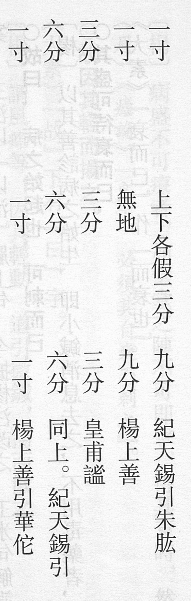

- 一寸　上下各假三分　九分　紀天錫引朱肱
- 一寸　無地　九分　楊上善
- 三分　三分　三分　皇甫謐
- 六分　六分　六分　同上。紀天錫引
- 一寸　一寸　一寸　楊上善引華佗

案：楊上善引華佗説云『未知此何所依據』，此説非是。竊謂華氏所云『三寸』，即謂楊上善所云『一寸九分』也。周尺三寸，正當今下三指之地。據此，則諸説雖異，皆是同理。蓋以氣口地成一寸九分者，同身寸之計也。成三寸者，周時尺竹之計，即與《經脈別論》言全合。

【楷】（眉）《弘決輔行紀》第八曰：『略明候法者，從魚至貫，名爲尺澤，即大母指後大橫文前，名之爲魚。大橫文後，名之爲貫。貫後三寸，名爲寸口。尺後寸前，名爲關陽。』《弘決外典抄》載此文，且注解曰：『《脈經要訣》云：三部脈者，謂寸爲上部近掌也。關爲中部，尺爲下部。三部脈，一部輒相去一寸，合共成三寸也。』

【楷】（眉）案：此曰『按尺寸』云云，《經脈別》曰『氣口成寸，以決死生』，《玉機真藏》『五藏各以其時，自爲而至於手太陰也』，以上三處，皆如今日唯以手三部，不用他八候之法，自上古相並驅，各傳來也。

圖（眉）詳定周尺三寸如此。

<!-- PAGE_END -->

<!-- PAGE: 0211 -->

<!-- PRINTED: 176 -->

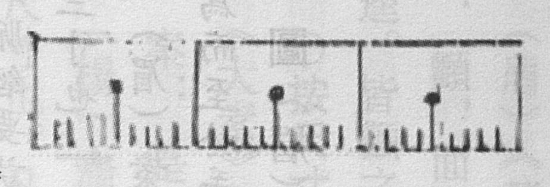

（眉）《經脈別論》王注曰：『三世脈法，皆以三寸爲寸關尺之分。』案：斥周尺之言。

（眉）今醫人診脈下三指，指間少隔空，正當周三寸。蓋古人亦如今人診樣耳。

**○以治無過，以診則不失矣。**

〔楊〕此以診候知病源已，然後命諸鍼艾湯藥等法療諸病者，必有祛疾服靈之福，定無夭年損傷之罪，以其善診則無失也。

案：王注以『以治』屬上句，今據楊注改之，王冰句解誤。

**○故曰：病之始起也，可刺而已，**

〔楊〕以其善診病之始生，即小鍼消息去之，不用毒藥者，此則其微易散者也。

**○其盛可待衰而已。**

《大素》『衰而已』作『而衰也』。

<!-- PAGE_END -->

<!-- PAGE: 0212 -->

<!-- PRINTED: 177 -->

〔楊〕病盛不可療者，如堂堂之陣不可即擊，待其衰時，然後療者，易得去之，如瘧病等也。

（眉）《瘧論》『良工，必須其自衰乃刺之』。

**○故因其輕而揚之，**

《大素》『故』下有『曰』字。

〔楊〕謂風痺等，因其輕動，道引微鍼，揚而散之。

（眉）以下三句，先注多爲湯藥治之義，大誤。今從楊注也。而敷衍之，則亦應藥治也。

**○因其重而減之，**

案：輕重者，病也。揚減者，鍼之汗吐下温清補也。

〔楊〕謂濕痺等，因其沉重，燔鍼按熨，漸減損也。

**○因其衰而彰之。**

案：彰，楊注爲大寫見血之義，可從。王注爲真氣旺血色彰，未允。凡治皆爾，奚特因病衰時而已哉。衰者，病勢衰之義，與前句『衰』字同義。

又案：王注全是與。

〔楊〕謂癲狂等，取其衰時，彰寫去之也。

**○形不足者，温之以氣。**

案：身之陰虛寒，補之以物品之陽熱。

〔楊〕謂寒瘦小氣之徒，補其陽氣也之。

案：王注以氣爲衛氣，非是。謂凡食藥二物，多氣者温形，多味者補精。前文所云『精食氣，形食味』者，謂其常也。無形之精常食氣，有形之血常食味，是也。此所説自異，而謂其變也。血虛者，氣入温表陽，則血亦隨實。氣虛者，味入補裏陰，則氣亦隨實。必竟氣味相須，血氣相生，無有分別。然至論其理，則不得不分別言之也。張介賓説爲是。

<!-- PAGE_END -->

<!-- PAGE: 0213 -->

<!-- PRINTED: 178 -->

（眉）以下二句，説藥食品物氣味，與本篇首節一意。蓋補篇首氣味一段之餘。

**○精不足者，補之以味。**

案：身之陽虛熱，補之以物品之陰寒。

〔楊〕五藏精液少者，以藥以食五種滋味而補養之。

〔張〕此正言彰之之法，而在於藥食之氣味也。以形精言，則形爲陽，精爲陰。以氣味言，則氣爲陽，味爲陰。陽者衛外而爲固也，陰者藏精而起亟也。故形不足者，陽之衰也，非氣不足以達表而温之。精不足者，陰之衰也，非味不足以實中而補之。陽性煖，故曰温。陰性靜，故曰補。愚按：本論有云，味歸形，形食味，氣歸精，精食氣，而此曰形不足者，温之以氣，精不足者，補之以味，義似相反，不知形以精而成，精以氣而化，氣以味而生，味以氣而行。故以陰陽言，則形與氣皆陽也，故可以温，味與精皆陰也，故可以補。以清濁言，則味與形皆濁也，故味歸形，氣與精皆清也，故氣歸精。然則氣不能外乎味，味亦不能外乎氣，雖氣味有陰陽清濁之分，而實則相須爲用者也。

**○其高者因而越之，**

案：上焦表外之病，以鍼汗吐之也。鍼則汗吐起也。『因』字字眼。

〔楊〕風熱實於頭胸，因寫越之。

〔馬〕謂吐之使上越也。

<!-- PAGE_END -->

<!-- PAGE: 0214 -->

<!-- PRINTED: 179 -->

〔張〕越，發揚也。謂升散之，吐湧之，可以治其上之表裏也。

《靈・五邪篇》曰：『邪在肺則病云云。取之缺盆中以越之。』

（眉）以下三句，又説鍼治，古來爲唯説藥治之義，非，而轉之則應藥治耳。

**○其下者引而竭之，**

案：下焦足腳水腫尿閉等，以鍼消導之也，用鍼則尿利也。引者，引之於遠也。竭者，竭盡其病也。

〔楊〕寒濕實於腰足，引寫竭之。

〔張〕竭，祛除也。謂滌蕩之疏利之，可以治其下之前後也。

**○中滿者寫之於内，**

案：中焦心腹滿實者，皆以鍼寫下之也。用鍼則大便下利通出也。

〔楊〕氣脹腸胃之中，可以寫之。

案：王注以内爲腹内，可從。腹内者，謂腸胃外下焦水血氣所壅閉之處。楊注非。説見於《傷寒攷注》當歸四逆下。｟廿七卷廿六ノ六｠

〔張〕『中滿』二字，最宜詳察。即痞滿大實堅之謂，故當寫之於内。若外見浮腫而脹，不在内者，非中滿也，妄行攻寫，必至爲害。此節之要，最在一『中』字。

**○其有邪者，漬形以爲汗。**

《大素》『漬形』作『清』一字。

（眉）此一句，説洗浴發汗法。仲景書云洗、云潠、云灌，皆此之漬法也，熏蒸，亦此之類耳。要之肌表之治也。

<!-- PAGE_END -->

<!-- PAGE: 0215 -->

<!-- PRINTED: 180 -->

〔張〕邪在肌表，故當漬形以爲汗。漬，浸也。言令其汗出如漬也。如許胤宗用黃芪防風湯數十斛，置於床下，以蒸汗，張苗燒地加桃葉於上，以蒸汗，或用藥煎湯浴洗之，皆漬形之法也。

案：邪深入肌肉，不漬形則不爲汗之理也。宜與後文併看。

《五常政大論》『西北之氣，散而寒之』，王注：『散，謂温浴使中外條達。』

又『氣寒氣涼，治以寒涼，行水漬之』，王注：『行水漬之，是湯浸漬也。』

《病源候論》傷寒候『夫傷寒者，起自風寒，入於腠理，與精氣交爭。榮衛否隔，周行不通，一日至二日，氣在孔竅皮膚之間，故病者頭痛惡寒，腰背強重。此邪氣在表，洗浴發汗即愈』。

案：《病源》所云『洗浴發汗』者，本篇所云『漬形爲汗』是也。

皇國古昔傳用此法，名曰『由由天』，見《榮花物語》及《狹衣》，詳具《蘭軒遺藁》中，今録其略於左。

《榮花物語·月宴》卷云：『九條殿奈也末之宇於保左禮天。御加勢奈止以比天。於保牟由由天奈止之天。九寸里幾古之女志天。寸久左世給不保止仁。云云。』

又《玉村菊》卷云：『大將殿日古呂御古古知奈也末之久於保左留。御風奈止仁也止天。御由由天世左世給保遠幾古之女之。云云。』

《狹衣》：『雪也介仁女之毛波禮天。奈也末之宇。於保左流連波。由天都久呂比奈止之天。云云。』

《外臺祕要》卷三：『許仁則論：陰陽傷寒者，則毒氣傷陰陽氣也。云云。宜先合煮桃柳等三物湯浴之。方　桃枝｟細切五斗｠　柳葉｟細切五斗｠　酢漿水｟一斗｠　右藥先以水一石，煮桃柳枝葉二物，取七斗汁去滓。内醋漿水攪，帶熱以浴，浴訖拭身體，令乾以粉摩之，勿觸風，則於密處刺頭眼後兩邊及舌下，血斷以鹽末厭刺處，則入被臥。』

<!-- PAGE_END -->

<!-- PAGE: 0216 -->

<!-- PRINTED: 181 -->

《聖惠方》治時氣二日，頭痛壯熱，水解散，方後云：『未服藥，先以熱湯淋浴，後便服此藥，衣蓋取汗。』

又治時氣二日，壯熱增寒，頭疼腰脊強，重柴胡散，方後：『以熱水淋浴，然後服此藥，衣覆取汗。』《神巧萬全方》云『先用暖水淋浴，後服皂莢燒末，薑汁密相和，須臾汗出愈』。《醫方類聚》引。

**○其在皮者，汗而發之。**

案：云『在皮』者，受前文『有邪者』而言，『汗而發之』者，謂温覆取微汗也。

案：是輕病，以鍼發汗法。

〔楊〕清，冷也。耶，腸胃寒熱病氣也。或入藏府，或在皮毛，皆用鍼藥以調汗而出之也。

〔張〕前言有邪者，兼經絡而言，言其深也。此言在皮者，言其淺也。均爲表證，故皆宜汗。

（眉）以下三句，又説鍼治，若運用則亦應於藥治也。先注直以此等句爲藥治之義者，誤。

**○其慓悍者，按而收之。**

《大素》『收』作『投』。

案：是以鍼補刺之法。

〔楊〕慓，芳照反。急疾也。悍，胡旦反。禁其氣急不散，以手按取，然後投鍼也。

案：慓悍者，其人陽弱，欲脱之證。

案：慓悍者，謂本氣之疾利也。按、收並是鍼法，蓋謂鍼後指按，令氣不散也。楊注以爲鍼法，可從。

**○其實者，散而寫之。**

<!-- PAGE_END -->

<!-- PAGE: 0217 -->

<!-- PRINTED: 182 -->

案：是以鍼寫刺之法。

〔楊〕諸有實者，皆散寫之。

案：散、寫共是鍼法，楊注可從。

**○審其陰陽，以別柔剛。**

案：陰病用柔治之義。

〔張〕形證有柔剛，脈色有柔剛，氣味尤有柔剛。柔者屬陰，剛者屬陽。知柔剛之化者，知陰陽之妙用矣，故必審而別之。

**○陽病治陰，陰病治陽。**

案：熱病益津，寒病補氣之謂。

〔楊〕夫物柔弱者，陽之徒也，剛強者，陰之徒也。陰經受耶，流入陽經爲病，是爲陰經爲本，陽經爲標，療其本者，療於陰經，即陽病療陰也。陽經受耶，準陰療陽也，即陰病療陽也。又陰陽二經，陰經若實，陽經必虛，陽經若實，陰經定虛。故陽虛病者，宜寫陰，陰實病者，宜補陽也。

**○定其血氣，各守其鄉。**

案：斷定病屬氣屬血，屬陽屬陰之別，守治其經穴府俞也。鄉亦里邑之謂，即斥穴處也。

〔張〕病之或在血分，或在氣分，當各察其處，而不可亂也。

**○血實宜決之，氣虛宜㸷引之。**

《大素》『㸷』作『掣』。

〔楊〕須定所病在氣在血，各守血氣病之別鄉，寫乃用鍼刺去實血，補乃用鍼引氣引皮補已。縱皮閉門，使氣不洩。掣，死曳反。引也。

<!-- PAGE_END -->

<!-- PAGE: 0218 -->

<!-- PRINTED: 183 -->

案：《甲乙》亦『㸷』作『掣』。考『㸷』即『掣』之訛字，非別自有『㸷』字從牛者也。傳寫之人手誤作牛耳，王氷之舊，蓋非從牛也。

案：決者，刺絡也，王注是矣。掣引者，工人以手掣引病人皮肉也，是爲闔掩其鍼竅也，詳見《離合真邪論》。蓋決法開鍼穴，故爲寫法，掣引法閉鍼穴，故爲補法。

（眉）以上第五章止。

庚申四月十五日寫了　立之若囪

第五補

氣味辛甘發散爲陽｟五ヲ｠

《至真要大論》『帝曰：五味陰陽之用何如？岐伯曰：辛甘發散爲陽，酸苦涌泄爲陰，鹹味涌泄爲陰，淡味滲泄爲陽。六者或收或散，或緩或急，或燥或潤，或耎或堅。以所利而行之，調其氣使其平也』。

見微得過｟廿五ヲ｠

案：謂見病之淺微者，而得治療過之也。王注所云『深明故也』，蓋亦此理。諸注家多以爲過失之義，恐非是。

肝在變動爲握，心爲憂，脾爲噦，肺爲欬，腎爲慄。

《金匱真言》『肝，其病發驚駭，是以知病之在筋也』。《五常政論》『其藏肝，其病支廢癰腫瘡瘍』。《管子·入國篇》『凡國都皆有掌養疾，聾盲、暗啞、跛躄、偏枯、握遞』注：『遞，著也。謂兩手相拱著而不申者，謂之握遞。』《史·司馬相如傳》《索隱》引孔文祥『握齪，局促也』，《漢書》作『握𪘏』，注：『握齪，局陿也』，又《酈生陸賈傳》《集解》引應劭：『握齱，急促之貌』。此王注『握，所以牽就也』。案：『就』即『蹴』之古字。《論語·鄉黨》『足蹜蹜如有循』。皇疏：『蹜蹜，猶蹴蹴也。』《文選·羽獵賦》注：『蹙蹵古字通。』《詩·江有汜》《箋》《釋文》『蹙本亦作蹴』。《禮·曲禮》『足蹙』，《釋文》『本又作足蹴』。《廣韻》：『蹴』『蹙』同音。蹴之爲就，猶蹙之作戚也。

<!-- PAGE_END -->

<!-- PAGE: 0219 -->

<!-- PRINTED: 184 -->

案：握即手脚掣曲牽屈之症，即今肝症，治宜抑肝舒筋也。要之，大凡口眼背腹之攣急斜咼，亦是握耳。《靈·終始》曰：『手屈而不伸者，其病在筋。』

案：『憂』即『嚘』。《玉篇》『嚘，於求切。老子曰：終日號而不嚘。嚘，氣逆也』。《廣韻》十八尤『歐嚘，歎也。歔，氣逆』。《老子》『終日號而不嗄』，《釋文》『一邁反，氣逆也。又於介反，而聲不嗄，當作噫』，林希逸曰『嗄，氣逆也』。｟約之案：從口夏聲也。｠《大玄經》夷『柔嬰兒於號，三日不嗄』，范注：『嗄，憂慕之聲也』。《釋文》『憂作嚘』曰『音憂，歎也』，又『嗄，所嫁切』。《説文》『欭，嚘也』『嚘，語未定兒』，段玉裁曰：『歐嚘爲雙聲。《王風》「中心如噎」傳曰：噎憂不能息也。噎憂即歐嚘之假借字。《鄭風》傳曰：不能息，憂不能息也。憂亦即嚘字。皆謂氣窒塞不利。』《真本玉篇》『歔，於牛反。《老子》終日於｟（疑作號）｠而不歔。野王案：歔，氣逆也。今並爲嚘字』，又曰『欭，於利反。《説文》嚘也。《聲類》不平也。野王案：嚘，氣逆也』。《方言》卷一『謾臺脅鬩，懼也。宋衛之間，凡怒而噎噫，謂之脅鬩』，郭注：『噎噫，謂憂也。』『噫，央媚反。』『央媚反』與欭音『於利反』同音也，郭注『憂』字亦即『嚘』字耳。《病源》卷一·風癔候『其狀奄忽不知人，喉裏噫噫然有聲，舌強不能言』。《集韻》十八·尤『嚘，通作歔』，又曰『欭歔，嘅也。一曰氣逆。《老子》終日號而不歔』。可知『憂』爲古字，『嚘』『歔』爲今字，『嗄』亦爲今字，並共同音，於牛反，或讀爲噫，音亦同。陸玄朗所言是也。而並噫之或偁。要之，噎室亦噫之同類，而共係胸中痰飲之事，故以爲心病。至噦則非必係淡飲，故不得爲心病也，是真胃脾之事也。《宣明五氣》及《靈·九鍼論》並曰『心爲噫』。《脈解篇》曰『所謂上走心爲噫者，陰盛而上走於陽明，陽明絡屬心，故曰上走心爲噫也』。《痺論》曰『心痺者，脈不通，煩則心下鼓，暴上氣而喘，嗌乾善噫，厥氣上則恐』。《刺禁論》『刺中心一日死，其動爲噫』。王注：『心在氣爲噫。』劉桂山曰：『握、噦、欬、慄，皆屬病，憂乃爲志，宜不曰變動，必是字誤，而文無可考，姑存俟後考』。是説未知憂之爲噫名故耳。王注此文曰『憂可以成務』。成務者，動作身體之謂，水食畜内，藏氣鬱滯，故發噫泄之。若動作則畜物舒散，故其噫逆止可知。此王注以憂爲噫也，必矣。又案：『於介反』之嗄，與『所嫁反』之嗄，原自別字。又中風『癔』字，或作『懿』，作『噎』，作『噫』，並與『欭』同音也。又《説文》口部所言『嚘，語未定皃』，與嚘欭義自別。或曰『憂，即嚘訛。俗噫字作嚘也』，此説未是。又案：《千金》卷十七肺勞第三半夏湯章曰『心腹冷，氣逆遊氣，胸脅氣滿，憂氣往來嘔逆』，此『憂』字亦噫義耳。《詩·桑柔》『如彼遡風，亦孔之僾』，《傳》『僾，唈也』，《釋文》『音愛』。日本後藤氏以僾訓噎。

<!-- PAGE_END -->

<!-- PAGE: 0220 -->

<!-- PRINTED: 185 -->

又案：《刺禁篇》五二云『刺中心一日死，其動爲噫』，亦心之變動爲噫之明徵矣。

又《説文》『䯉，咽中息不利也』，鉉音『烏八切』，亦『噎』之一名耳。又《莊子·大宗師》《釋文》『哇崔，一音於佳反，結也。言咽喉之氣結礙不通也』，亦是噫噎之或偁。又《庚桑楚篇》『兒子終日嗥而嗌不嗄，和之至也』，《釋文》『嗄，於邁反。本又作嚘。徐音憂』。

《大玄》疑『貞厲嚘鳴』注：『嚘，鳴歎也。』《集韻》引《蒼頡》：『嚘，歔也』。

案：『慄』出《靈·口問篇》。

肝在志爲怒，心爲喜，脾爲思，肺爲憂，腎爲恐。

<!-- PAGE_END -->

<!-- PAGE: 0221 -->

<!-- PRINTED: 186 -->

《宣明五氣》及《靈·九鍼論》並曰『五并精氣，并肝則憂，并心則喜，并肺則悲，并腎則恐，并脾則畏』。《五運大論》『肝其志爲怒，心爲喜，脾爲思，肺爲憂，腎爲恐』。

案：怒者必有憂，憂者必有怒氣，是一理也。畏者必有思念，思念者必有畏懼，故是亦一理也。憂者必爲悲，悲者必爲憂，故亦是一理也。

又案：本篇上文曰『人有五藏化五氣，以生喜怒悲憂恐』，是思亦與悲一理，思者必有悲，悲者必有思也。《天元紀大論》《新校正》以爲思悲互相成。

《天元紀大論》曰『人有五藏化五氣，以生喜怒思憂恐』，與此同。

《玉機真藏論》曰『憂恐悲喜怒，令不得以其次，故令人有大病矣』，與本篇上文同。

案：悲憂相通。《調經論》王注『悲，一爲憂』誤也。《新校正》云『《甲乙經》及《大素》并全元起注本，並作憂。皇甫士安云：心虛則悲，悲則憂』，可以證也。

《禮記·中庸》曰『喜怒哀樂』。

《靈·本神篇》『心怵惕思慮則傷神，脾愁憂而不解則傷意，肝悲哀動中則傷魂，肺喜樂無極則傷魄，腎盛怒而不止則傷志，恐懼而不解則傷精』。

案：此以相克，伐其藏者，思爲水，憂爲木，哀爲金，喜爲火，怒恐爲土。

陰陽者，天地之道也。｟一ヲ｠

《漢書藝文志》五行家三十一家，有『泰一陰陽二十三卷。黃帝陰陽二十五卷。黃帝諸子論陰陽二十五卷。諸王子論陰陽二十五卷。太元陰陽二十六卷。三典陰陽談論二十七卷。陰陽五行時令十九卷』。又云『五行者，五常之形氣也。《書》云：初一曰五行，次二曰羞用五事，言進用五事以順五行也。貌言視聽思，心失而五行之序亂，五星之變作，皆出於律曆之數而分爲一者也。其法亦起五德終始，推其極則無不至，而小數家因此以爲吉凶，而行於世，寖以相亂』。案：《素問》陰陽五行諸論，蓋《漢志》所云『黃帝陰陽』等書之遺言，僅存於此者也。夫人者，受陰陽五行之氣而相生成，所以不可須臾離於此氣也。此氣之過不足爲疾病，此氣之離合爲死生也。後世麤工以陰陽五行爲別論，且謂漢儒之所撰述，恐不然。神農黃帝之學，幸在於方技家，故得免秦火，而《漢志》録之。今之《内經》《本草》二書，即古經之全然傳存，無可疑者也。宜與卷第一篇題下併看。

<!-- PAGE_END -->

<!-- PAGE: 0222 -->

<!-- PRINTED: 187 -->

聲｟十二ヲ｠

案：天地造化氣徹入吾身，猶在網籠，在水中，而口鼻最多援吸而納於肺，乃及他藏矣。欲出聲則神上升，吹激肺膜内天氣，故真神與天氣交擊於肺内，作此音聲也，是與笛簫同理。《抱朴子》曰『人在氣中，氣在人中』是也。

壯火少氣｟五オ｠

《本草匯》卷五曰：『人之日用燒然屬君火，天之龍雷海火屬相火。相火在天出於龍雷海，在人具於下焦肝腎。相火皆本於地中陰氣，無時妄動，則陰受煎熬，而爲病死之漸。聽命道心而主靜，則陰得養而爲之運，故諸病多屬相火。』

　陽生陰長，陽殺陰藏｟一ウ｠

《傷寒直格》曰：藏府經絡配合。

寅三焦手少陽　卯大腸手陽明　辰小腸手太陽　手三陽　府　春

巳包絡手厥陰　午心手少陰　未肺手太陰　手三陰　藏　夏申膽足少陽　酉胃足陽明　戌旁胱足太陽　足三陽　府　秋

<!-- PAGE_END -->

<!-- PAGE: 0223 -->

<!-- PRINTED: 188 -->

亥肝足厥陰　子腎足少陰　丑脾足太陰　足三陰　藏　冬

又曰：『六氣有餘不足。孟少，仲平，季多也。《内經》以寅申巳亥四孟爲一陰一陽也，子午卯酉四仲爲二陰二陽也，辰戌丑未四季爲三陰三陽也。』

五　生長殺藏｟一ウ｠　寒氣熱氣｟二ヲ｠　䐜脹｟二ヲ｠　反作｟二ウ｠　壯火少火｟四ウ｠　氣味陰陽｟五ヲ｠　風寒暑濕燥熱｟七ヲ｠　冬傷於寒｟九ウ｠　谿谷｟十ウ｠　形能｟十四ウ｠　能始｟十四ヲ｠　俛仰｟十四ヲ｠　七損八益｟十五ヲ｠　涕泣倶出｟十八ウ｠　八紀五里｟廿ウ｠　權衡規矩｟廿六ヲ｠　尺寸今三部一件｟廿七ヲ｠　漬形爲汗｟卅ヲ｠　慓悍｟卅一ウ｠

#### 陰陽離合論篇第六

《大素》卷五陰陽合中，本篇全載之。

（眉）案：本篇古文錯雜難讀，其來之久，可思。

**○黃帝問曰：余聞天爲陽，地爲陰，日爲陽，月爲陰。大小月三百六十日，成一歲，人亦應之。**

《大素》無『問』字，無『大小月』三字，『十』下有『五』字。似是。斥太陽年，與《堯典》同。今有『大小月』言，則太陰年也。

**○今三陰三陽，不應陰陽，其故何也。**

《大素》『今』下有『聞』字。

《至真要論》『帝曰：願聞陰陽之三也，何謂？岐伯曰云云』。

〔楊〕三陰三陽之數各三，不應天地日月陰陽二數，何也？黃帝非不知之，欲自聞廣演陰陽變化無窮之數也。

<!-- PAGE_END -->

<!-- PAGE: 0224 -->

<!-- PRINTED: 189 -->

案：不應者，不合也。即曰明、曰厥是不合之處。

案：天大陽，人真氣應之。地大陰，人形質應之。日小陽，人陽氣應之。月小陰，人血水應之。故少之而大小二陰陽，與人相應。多之則三百有餘骨穴，亦應陰陽。今三陰三陽奇數，故疑其不應。

**○岐伯對曰：陰陽者，數之可十，推之可百，數之可千，推之可萬。萬之大不可勝數，然其要一也。**

《大素》『推之可百，數之可千』作『離之可百，散之可千』，『萬』作『万』，『勝數』下有『也』字。

〔楊〕言陰陽之□（或作『理』），大而無外，細入無間，豪末之形，並陰陽雕刻，故其數者不可勝數也。故陰中有陰，陽中有陽，陽中有陰，陰中有陽，然則混成同爲一氣，則要一也。

（眉）案：物雖多，合之爲一，雖少，離之爲兩，各以会昜之理也，故曰其要一也。

（眉）《五運行論》首『少陰、太陰、少陽、陽明、太陽、厥陰，不合陰陽，其故何也。岐伯曰：是明道也。此天地之陰陽也。夫數之可數者，人中之陰陽也。夫陰陽者，數之可十，推之可百，數之可千，推之可萬。天地陰陽者，不以數推，以象之謂也』。

《六元正紀論》曰：『數之可數者，請遂言之。』

（眉）《靈·陰陽系日月篇》『且夫陰陽者，有名而無形，故數之可十，離之可百，散之可千，推之可萬，此之謂也』。

**○天覆地載，萬物方生。**

《大素》『生』下有『也』字。

〔楊〕二儀合氣也。

案：方，正也。出《診要經終論》注，《三部九候論》注，《瘧論》注，《廣雅·釋詁一》，又《素·八正神明》注也。

<!-- PAGE_END -->

<!-- PAGE: 0225 -->

<!-- PRINTED: 190 -->

又《廣雅·釋詁一》『方，大也』，又『方，常也』『方，道也』，皆常詁，並此方生之義。

**○未出地者，命曰陰處，名曰陰中之陰。**

〔楊〕辨陰陽，所□（或作『謂』）雄雌者也。□（或作『人』）之與物，未生以前，合在陰中，則未出地也。未生爲陰，在陰之中，故爲陰中之陰之也。

鳥獸蟲魚，凡未生出者，亦是未出地之義也。

（眉）此以下五句，『曰陰中之陰，曰陰中之陽』者，但説萬物方生之義，故固不得有陽中之陰陽之言。蓋萬物皆陰，其造萬物之氣，唯陽也。故下文曰『陽予之正，陰爲之主』也。

**○則出地者，命曰陰中之陽。**

〔楊〕所生已生曰陽，初生未離於□（或作『地』），故曰陰中之陽也。

**○陽予之正，陰爲之主。**

案：人物懷胎，亦此之理。《陰陽應象》曰『陰陽者，萬物之綱紀』，王注：『滋生之用也，陽與之正氣以生，陰爲之主。持以立，故爲萬物之綱紀也。』《陰陽離合論》曰『陽與之正，陰爲之主』，則謂此也。

〔楊〕陽氣以爲人物生正，陰氣以爲人物養主也。

**○故生因春，長因夏，收因秋，藏因冬，失常則天地四塞。**

案：四塞，謂四方風氣不通也。言春不東風，夏不南風，則時氣閉塞也。

〔楊〕一氣離爲陰陽，以作生養之本，復分四時，遂爲生長收藏之用。終而復始，如環無端，謂之常也。若失其常，四時之施，壅塞不行也。

<!-- PAGE_END -->

<!-- PAGE: 0226 -->

<!-- PRINTED: 191 -->

《氣交變大論》『失常則天地四塞矣』王注云云，與此同。《至真要論》『是謂四塞』王注同焉。

（眉）案：『四』字義輕，只如謂天地間一般塞也。

（眉）《脈要》曰『春不沈，夏不弦，冬不濇，秋不數，是謂四塞』，王注：『天地四時之氣，閉塞而無所運行也。』右出《至真要論》。

**○陰陽之變，其在人者，亦數之可數。**

《大素》『可數』作『可散也』三字。

〔楊〕散，分也。陰陽之變，□（疑作偏）通内外，外物既爾，内身之變，亦可分爲衆，□（或作『不』）可勝數也。

（眉）《五運行大論》『夫數之可數者，人中之陰陽也。然所合，數之可得者也』。

**○帝曰：願聞三陰三陽之離合也。**

《大素》『帝』上有『黃』字，無『之』字。

〔楊〕別爲三陰三陽，推之可萬，故爲離也。唯一陰一陽，故爲合也。

案：離之爲三陰三陽，合之爲一陰一陽也。

**○岐伯曰：聖人南面而立，**

案：天下民亦從聖教而南面，不特聖人爲爾也。蓋人以腹侌抱天陽，以背陽當天侌也。

又案：家相地相家，皆以南面爲善。

〔楊〕古者，聖人欲法天地人三才形象，處於明堂，南面而立，以取法焉也。

**○前曰廣明，後曰太衝。太衝之地，名曰少陰。**

<!-- PAGE_END -->

<!-- PAGE: 0227 -->

<!-- PRINTED: 192 -->

〔楊〕聖人中身以上，陽明爲表，在前故曰廣明，太陰爲裏在後，故廣明下名曰太陰。衝脈在太陰之下，故稱後曰太衝。太衝脈下次有少陰，故曰少陰，爲地，以腎最居下故也。

案：以下三陰三陽一節，與《靈·根結篇》大同小異。

案：下文『名曰少陰』，王氷注曰：『藏位及經脈之次也。』此言千金千金可拜可拜。

（眉）案：以下舉足六經，不舉手六經，古文簡略，令人隅反也。

（眉）下文曰『中身而上，名曰廣明』，可知廣明，胸中鬲上之地之名。太衝者，經絡二大幹分岐之地，即腰部之名也。『前』字包『上』義，『後』字包『下』義。腰部，腎地，腎一名少陰，即足少陰也。

**○少陰之上，名曰太陽。**

案：上猶前也。太陽者，足太陽旁光。旁光府在腎藏之前，而腎居旁光之背也。《靈·衛氣第五十二》曰『足少陰之本，在内踝下上三寸中』，是斥湧泉穴，上猶前也，可證。

〔楊〕太陽即足太陽，是腎之府膀胱脈也。藏陰在内，府陽居外，故爲上者也。

**○太陽根起於至陰，結於命門，**

《大素》無『起』字。

《靈·衛氣篇》『足太陽之本，在跟以上五寸中，標在兩絡命門，命門者目也』。

〔楊〕至陰，是腎少陰脈也。是陰之極，陽生之處，故曰至陰。太陽接至陰而起，故曰根於至陰。上行胳項，聚於目也。結，聚也。

案：經脈所起始，故謂之根，又謂之本。經脈所終盡，故謂之結，又謂之標，與督脈所經脊呂命門穴自別。

<!-- PAGE_END -->

<!-- PAGE: 0228 -->

<!-- PRINTED: 193 -->

案：至陰，乃旁光經穴，在足小指外側。

案：上爲陽，下爲陰。下陰之極末，故名之至陰穴也。但《靈·衛氣篇》不以起於至陰，反爲起跟以上五寸中，乃今跗陽穴是也，在外踝上三寸。

（眉）《靈·根結篇》『太陽根於至陰，結於命門。命門者，目也』。

（眉）案：本篇下文但舉根起，不言結末處。蓋舉一於此而省下也。其詳見《靈·根結》及《衛氣篇》之意。其曰命門者，指睛明、攢竹二穴。命、明古通，門通穴也，乃知明穴之義。

**○名曰陰中之陽。**

案：上『陰』字，足陰之義。下『陽』字，陽經之義，六府之義。足爲陰，手爲陽，故言爾。與《金匱真言》『背爲陽，腹爲陰』之義固自別矣。

〔楊〕少陰水中而有此陽氣，故曰陰中之陽也。

**○中身而上，名曰廣明。廣明之下，名曰太陰。**

〔楊〕身中表之上，名曰廣明。脾藏足太陰脈，從足至舌下。太陰脈在廣明裏，故爲下也。廣明爲表，故爲上也。

案：廣明，匈一名，見於前句。匈鬲之下，脾居焉。太陰者，足太陰脾也。

**○太陰之前，名曰陽明，陽明根起於厲兌，**

《大素》『兌』作『充』，下有『結於顙大』四字。『大』字蟲蝕未詳，恐是『上』訛，楊注作『顙上』，故知然也。

案：脾在後，胃在前，故云也。陽明，足陽明胃一名也。厲兌，足大指次指之端。

<!-- PAGE_END -->

<!-- PAGE: 0229 -->

<!-- PRINTED: 194 -->

〔楊〕陽明脾府之脈，在太陰表前，從足指厲兌上行，聚於顙上額顱。顙，額也，蘇蕩反。

（眉）《靈·根結》曰：『陽明根於厲兌，結於顙大。顙大者，鉗耳也。』又《衛氣》曰：『足陽明之本，在厲兌。標在人迎，頰挾頏顙也。』

（眉）宋人《千金例》曰：『凡卷中用字，文多假借，鋭字作兌』。

（眉）案：兌即鋭古字，大凡穴名身名等用之，皆與鋭同字，兌端、兌骨，皆爾。《廣雅·釋詁四》『鑯，鋭也』，王念孫《疏證》曰『鋭兌古通用』。

案：《史》《漢·天文》卷中云『末兌』『兩頭兌』注言可參。

（眉）『鋭髮』作『兌髮』，見《醫心》卷二頭穴和扇下。

《難經·十五難》『脈來上大下兌』。

《難經·十五難》『上大下兌』，呂注、丁注『兌』字多有。

（眉）案：今觀經穴圖，足陽明經盡於目下承泣，而其餘末再升顙而散耳邊，故言歟。《繆刺論》『少陰鋭骨』，《大素》卷十作『兌骨』。

（眉）案：厲，利也，見《國策·秦策》注。又《史記·陳杞世家》《索隱》：『厲、利聲相近。』蓋指頭鋭利之處，故謂之厲兌。

（眉）《老子·五十二章》『塞其兌，開其兌』，《釋文》：『河上，兌作鋭。』《外臺》卷一崔氏方篇曰『外用生薑兌』，細注曰：『讀作鋭，下同。』

（眉）《莊子·馬蹄》《釋文》引李注：『鋭上方下曰珪。』《白虎通·瑞贄》篇云：『珪者兌上。』

**○名曰陰中之陽。**

<!-- PAGE_END -->

<!-- PAGE: 0230 -->

<!-- PRINTED: 195 -->

（眉）案：上『陰』字，足陰之義。下『陽』字，陽經之義，六府之義。

〔楊〕人腹爲陰，陽明從太陰而起，行於腹陰。上至於顙，故爲陰中陽。

**○厥陰之表，名曰少陽。少陽根起於竅陰，名曰陰中之少陽。**

《大素》『竅陰』下有『結於窻籠』四字。

案：足厥陰肝，足少陽膽也。膽爲肝府，故謂之表。表，陽也。

《靈·根結》曰：『少陽根於竅陰，結於窻籠。窻籠者，耳中也。』

〔楊〕厥陰之脈，起於足大指藂毛之上，循陰股，上注於肺，陰藏行内也。少陽肝府之脈，起足竅陰，上聚於耳，爲表陽府也。以少陽屬木，故爲陰中之少陽也。

《靈·衛氣》曰：『足少陽之本，在竅陰之間，標在窻籠之前。窻籠者，耳也。』

（眉）案：上『陰』字，足陰之義。下『少陽』字，此膽者，府而似藏者之義，故云少陽也。三焦亦同名義於手經云。

**○是故三陽之離合也，太陽爲開，陽明爲闔，少陽爲樞。**

《大素》『開』字，據注則原作『開』，偶誤爲『開』歟。

《荀子·臣道》『時關内之』注：『關當爲開。』

《日本紀》首曰『火瓊瓊杵尊闢天開披雲路』，旁訓『アマノイハクラ』，知『開』即『關』訛。

《靈·根結》曰：『太陽爲開，陽明爲闔，少陽爲樞。』

〔楊〕三陽離合爲開、闔、樞，以營於身也。夫爲門者，其有三義。一者門關，主禁者也。膀胱，足太陽脈，主禁津液及於毛孔，故爲開也。二者門闔，謂是門扉，主開閉也。胃足陽明脈，令真氣止息。復無留滯，故名爲闔也。三者門樞，主轉動者也。膽足少陽脈，主筋，綱維諸骨，令其轉動，故爲樞也。

<!-- PAGE_END -->

<!-- PAGE: 0231 -->

<!-- PRINTED: 196 -->

案：開闔，《新校正》引《九墟》《甲乙》作『關闔』，《大素》同，汪機《讀素問抄》亦同，蓋作『關』似是。

〔汪〕言太陽居表，在於人身如門之關，使榮衛流於外者周。陽明居裏，在於人身如門之闔，使榮衛守於内者固。少陽居中，在於人身如門之樞，轉動由之，使榮衛出入内外也常。三經干係如此。

（眉）開，門柱梁也。闔，扇扉也。樞，機轉也。可知樞在中間位之名。

《莊子·人間世》《釋文》引崔注：『開，門中也。』今尋門中開之形質，則以柱梁爲體之理。

案：『開闔』二字，亦散見諸書，今録於左。

《生氣通天論》云『開闔不得，寒氣從之』，王注：『開，謂皮腠發泄。闔，謂玄府閉封。』

《老子》第十章云『天門開闔』，河上公注『天門謂北極紫宮，開闔謂終始五際也。天門謂鼻孔，開謂喘息，闔謂呼吸』，王弼注『天門謂天下之所由從也，開闔治亂之際也，或開或闔，經通於天下，故曰天門開闔也』。《孫子·九地》十一『敵人開闔，必亟入之』，魏武注『敵有間隙，當急入之也。』蓋太陽經足旁光在背上部爲開，足陽明經胃起於足，至小腹爲闔，足少陽經膽起於足，遶腰爲樞。樞者，在中央，爲開闔之節者也。三陽經皆生於肝腎脾，陰藏，故曰陰中之陽也。

（眉）案：言開闔樞則離也，但言陽而止則合也。

（眉）《慧音》卷｟十六四ウ｠『關，古頑反。鄭注《周禮》云：關者，界上之門也。《説文》以木横持門戸也。《廣雅》：關，塞也』。又｟十九十ヲ｠《大方等大集菩薩念佛三昧經》第一卷：『樞闔，上，觸朱反。郭注《爾雅》謂門戸扉樞也。又謂門持樞者，以爲固也。《説文》戸樞也。下，含臘反。《爾雅》云：闔，謂之扉。即門扇也。鄭注《周禮》云：用木曰闔，用竹曰扇。《説文》闔猶閉也。』

<!-- PAGE_END -->

<!-- PAGE: 0232 -->

<!-- PRINTED: 197 -->

（眉）《五行大義》卷一引《詩緯推度災》云：『春則開也，冬則闔也。』｟九ヲ｠

**○三經者，不得相失也。搏而勿浮，命曰一陽。**

《大素》無『也』字，『浮』作『傅』，『搏』作『槫』。

〔楊〕唯有太陽開者，則真氣行止留滯，骨摇動也。唯有陽明闔者，則肉節敗，骨動摇也。唯有少陽樞者，則真氣行止留滯，肉節内敗也。相得各守所司，同爲一陽之道也。槫，相得也。傅，失所守也。

（眉）言右三陽經脈管總動處，無浮泛之脈見，則爲三經混一，無相失背違離可悦也。搏者，脈動之義。『勿浮』之言及『一』字並可玩。

**○帝曰：願聞三陰。岐伯曰：外者爲陽，内者爲陰。然則中爲陰，其衝在下，名曰太陰。太陰根起於隱白，名曰陰中之陰。**

《大素》無『帝曰』二字，『在下』下有『者』字，『白』下有『結於太倉』四字。

案：『外』謂六府也，『内』謂六藏也。『中爲陰』者，言六藏而居人身之正中者，爲陰之義，即斥脾藏也。『太陰』者，足太陰脾一名也。『衝』即上文『太衝』之略名，即經脈二幹各相分歧之處，正在脾之下也。衝、衝脈、太衝，並同物，非丹田之氣街、氣衝也。

〔楊〕衝在太陰之下，少陰脈上。足太陰脈，從隱白而出聚於太倉上，至舌本，是脾陰之脈行於腹陰，故曰陰中之陰也。

《靈·根結》曰：『太陰根於隱白，結於太倉。』

《靈·衛氣》曰：『足太陰之本，在中封前上四寸之中，標在背腧與舌本也。』

<!-- PAGE_END -->

<!-- PAGE: 0233 -->

<!-- PRINTED: 198 -->

案：中封前上四寸之中，斥三陰交穴，以是爲根起也。

〔張〕其衝在下，名曰太陰，以太陰居衝脈之上也。上文曰廣明之下名曰太陰，廣明以心爲言，衝脈並腎爲言。蓋心脾腎三藏，心在南，脾在中，腎在北也。凡此三陽三陰，皆首言衝脈者，以衝爲十二經脈之海，故先及之，以舉其綱領也。

（眉）案：三陽經，手足倶運其外表。三陰經，手足共運其内裏也。

案：陰中之陰者，上『陰』字，足陰之義，下『陰』字，六藏陰經之義。

（眉）案：大倉者，中脘一名。今檢脾經盡大包，而自大包而其餘裔至中脘地全終歟。《四十四難》『太倉下口爲幽門』，其義可見矣。

**○太陰之後，名曰少陰。少陰根起於湧泉，名曰陰中之少陰。**

《大素》『湧泉』下有『結於廉泉』四字，無『陰中之』三字。

案：太陰，足太陰脾。少陰，足少陰腎也。腎居脾後，藏居位爾。

〔楊〕腎脈足少陰，從足小指之下入湧泉，上行聚於廉泉，至於舌本也。

《靈·根結》曰：『少陰根於湧泉，結於廉泉。』

《靈·衛氣》曰：『足少陰之本，在内踝下上三寸中，標在背腧與舌下兩脈也。』

案：内踝下上三寸，亦斥踊泉穴耳。上，猶前也。

〔張〕脾下之後，腎之位也。故太陰之後，名曰少陰。

（眉）案：陰中之少陰者，上『陰』字，足陰之義，足爲陰手爲陽之義，下『少陰』字言腎，雖六藏，反似六府，故云爾。

<!-- PAGE_END -->

<!-- PAGE: 0234 -->

<!-- PRINTED: 199 -->

（眉）案：今檢足少陰盡胸俞府穴，而其餘末再升至結喉，上廉泉而散也歟。

**○少陰之前，名曰厥陰，厥陰根起於大敦。**

《大素》『大』作『太』，此下有『結於玉英』四字。

案：少陰，足少陰腎；厥陰，足厥陰肝也。肝在腎藏之前，故云爾。

〔楊〕肝脈，足厥陰，在少陰前，起於大指藂毛之上，入大敦，聚於玉英，上頭與督脈會於顛，注於肺中也。

《靈·根結》曰：『厥陰根於大敦，結於玉英，絡於膻中。』

《靈·衛氣》曰：『足厥陰之本，在行間上五寸所，標在背腧也。』

案：行間上五寸，蓋斥中封穴，以爲根起也。

（眉）案：今檢肝經盡期門，而其餘裔復上升至玉英之地，而全散也歟。玉英，即玉堂一名。

**○陰之絶陽，名曰陰之絶陰。**

〔楊〕無陽之陰，是陰必絶，故曰陰之絶陰。

〔張〕本篇所言，惟是足經陰陽，而不及手經者何也。觀上文云：天覆地載，萬物方生，未出地者，命曰陰處，名曰陰中之陰。則出地者，名曰陰中之陽。蓋言萬物之氣，皆自地而升也。而人之腰以上爲天，腰以下爲地，言足則通身上下經氣皆盡，而手在其中矣，故不必言手也。然足爲陰，故於三陽也，言陰中之陽，三陰也，言陰中之陰。然則手經亦有離合，其在陽經，當爲陽中之陽，其在陰經，當爲陽中之陰，可類推矣。

案：此張注極覈，若欲知手陽之三陰三陽，當覽《靈·根結篇》及《衛氣篇》云。

〔識〕《靈·繫日月篇》云：『兩陰交盡，故曰厥陰。』厥通作蹶。《漢·食貨志》『天下財産，何得不蹶』，師古注：『蹶，盡竭也。』又《晏氏春秋》云：『陰冰厥陽，冰厚五寸。』並爲王注之左證矣。徐刪『陰之絶陽』四字，似是。案：稿本云，考文例，四字疑衍。

<!-- PAGE_END -->

<!-- PAGE: 0235 -->

<!-- PRINTED: 200 -->

（眉）案：考上文之例，『陰之絶陽』四字，似贅疣，不然也。此厥陰爲陰陽之極盡，故別設如此之諸言。蓋陰之絶末而又移陽首之處，故曰陰之絶陽也。又其下句，考上文例，當曰『陰中之陰』，今反曰『陰之絶陰』者，亦以其絶末極終，故費一『絶』字明示之。即上『陰』字，足之義，下『絶陰』二字，絶末之陰經六藏之義。

**○是故三陰之離合也，太陰爲開，厥陰爲闔，少陰爲樞。**

足太陰脾經，起於足至兩脇下，爲開。足厥陰肝經，起於足至小腹，爲闔。足少陰腎經，起足心至於胸中，爲樞。

《靈·根結篇》曰：『太陰爲開，厥陰爲闔，少陰爲樞。』

〔楊〕三陽爲外門，三陰爲内門。内門亦有三者，一者門閞，主禁者也。脾藏足太陰脈，主禁水穀之氣，輸納於中不失，故爲閞也。二者門闔，主門閉者也。肝藏足厥陰脈，主守神氣出入通塞悲樂，故爲闔也。三者門樞，主動轉也。腎藏足少陰脈，主行津液，通諸經脈，故爲樞者也。

案：此楊注可從矣。但『門關主禁云云』非是。言太陰門關，主敷布水穀之精，而通達於肌肉皮表，故曰『太陰爲關』也。蓋在陽經則太陽爲關，在陰經則太陰爲關，其義無二。説詳見《皮部論》五六中。

**○三經者，不得相失也。搏而勿沈，名曰一陰。**

〔楊〕三陰，經脈也。三陰之脈，搏聚而不偏沉，故得三陰同一用也。

案：陰經脈諸動，則曰勿沈，曰一陰，並與上文陽經同意。

<!-- PAGE_END -->

<!-- PAGE: 0236 -->

<!-- PRINTED: 201 -->

**○陰陽𩅞𩅞，積傳爲一周。**

《大素》『𩅞𩅞積』作『鍾鍾也』。

〔楊〕鍾鍾，行不止住皃。營衛行三陰三陽之氣，相注不已，傳行周旋，一日一夜五十周也。

（眉）約之案：『𩅞』不成字，蓋是『鍾』字艸體誤化者，金旁艸書作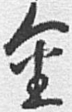，雩作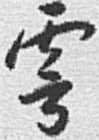，因相訛耳。《説文》『徸，相迹也』，段曰：『後迹與前迹相継也。』大凡天行地轉，水下火升，萬物諸氣之運行發出，皆有呼吸息動，是謂之活動。活動，即鍾鍾也。又《説文》『踵，追也。一曰往來皃』。蓋鍾古字，踵、徸並俗而正。

**○氣裏形表，而爲相成也。**

《大素》無『爲』字，『成』下有『者』字。

〔楊〕五藏之氣在裏，内營形也，六府之氣在表，外成形者也。

案：『𩅞𩅞』與『憧憧』同。《外臺》卷十二引《小品》『奔㹠湯，上走時，若群㹠相逐，憧憧時氣來』。《易·咸九四》『憧憧往來』，《釋文》：『憧憧，昌容反。馬云：行貌。王肅云：往來不絶貌。《廣雅》云：往來也。劉云：意未定也。徐又音童，又音鐘。京作憧。《字林》云：憧，遲也。丈家反。』氣裏，謂衛氣生裏。形表，謂營氣行表。形猶云血，血有形者也。氣亦行裏，形亦司表，即天氣下，地氣升，泰通之謂也。故曰爲相成也。

此篇首尾爲一章，專論三陰三陽之離合也。

（眉）本篇但一章止。

庚申四月廿五夜雨中燈下書於速讀書屋南廂華他公第六補

<!-- PAGE_END -->

<!-- PAGE: 0237 -->

<!-- PRINTED: 202 -->

｟八ヲ｠《説文》『憧，意不定也』。《鹽鐵論·刺復篇》云『心憧憧若涉大川，遭風而未薄』。《易林·咸之坤》云『心惡來怪，衝衝何懼』。

太陽爲開，陽明爲闔，少陽爲樞。｟四ウ｠

《靈樞·根結第五》云：『太陽爲開，陽明爲闔，少陽爲樞。故開折則肉節瀆，而暴病起矣。故暴病者，取之太陽，視有餘不足。瀆者，皮肉宛膲而弱也。闔折則氣無所止息，而痿疾起矣。故痿疾者，取之陽明，視有餘不足。無所止息者，真氣稽留，邪氣居之也。樞折，即骨繇而不安於地。故骨繇者，取之少陽，視有餘不足。骨繇者，節緩而不收也。所謂骨繇者，摇故也，當窮其本也。』

太陰爲開，厥陰爲闔，少陰爲樞。｟七ヲ｠

《靈樞·根結篇》云：『太陰爲開，厥陰爲闔，少陰爲樞。故開折則倉廩無所輸膈洞，膈洞者，取之太陰，視有餘不足。故開折者，氣不足而生病也。闔折即氣絶而喜悲，悲者取之厥陰，視有餘不足。樞折，則脈有所結而不通，不通者，取之少陰，視有餘不足。有結者皆取之不足。』｟三ノ十一オ｠

《靈·根結篇》曰：『折關敗樞開闔而走，陰陽大失，不可復取。』因是則關樞相對待，而非開闔相對則作關可也。或謂『作關則不對闔，故非是』，此言卻非。

（眉）《五藏生成篇》曰『十二俞』，《新校正》云『《大素》俞作關』，而今本《大素》作『開』，宋本《千金》卷廿八中『關』往往作『開』，《干禄字書》『開關，上俗下正』。

（眉）《掌中歷》卷上·國堺歷篇『関門』字作開、関、開、開、關等，此書三善爲康作。

<!-- PAGE_END -->

<!-- PAGE: 0238 -->

<!-- PRINTED: 203 -->

六　開闔｟五ヲ｠　𩅞｟七ウ｠　兌｟三ウ｠

#### 陰陽別論篇第七

《大素》卷三陰陽雜説中載全篇。

（眉）案：示諸陰陽之辨別。

**○黄帝問曰：**

《大素》作『黄帝問於岐伯曰』。

**○人有四經十二從，何謂。岐伯對曰：**

《大素》『從』作『順』，無『何謂』以下六字。

〔楊〕四經，謂四時經脈也。十二順，謂六陰爻六陽爻相順者也。

**○四經應四時，十二從應十二月，十二月應十二脈。**

《大素》『從』作『順』。

〔楊〕肝心肺腎四脈應四時之氣，十二爻應十二月，十二經脈也。

案：四經者，四時經常之動脈狀，即弦鉤毛石是也。十二從者，十二脈之一名，即十二經脈管道也。從之言縱，對絡脈之横而名焉。上曰十二從，下曰十二脈，非二物也。

案：下文『鼓一陽曰鉤』一節，即釋此四經之目。

〔馬〕十二從者，手有三陰三陽，足有三陰三陽，而十二經脈之行，相順而不悖也。

**○脈有陰陽，**

案：因下文『所謂』二字考之，陰斥五藏真藏之脈，陽斥胃脈。凡脈以胃氣爲本，此陽是也。

<!-- PAGE_END -->

<!-- PAGE: 0239 -->

<!-- PRINTED: 204 -->

〔楊〕十二經脈，六陰六陽。

**○知陽者知陰，知陰者知陽。**

案：當察知凡脈有胃陽加之否，若胃陽不加則只是真陰。

〔楊〕妙知人迎之變，即懸識氣口，於氣口之動，亦達人迎。

案：十二從諸説未明了，宜從馬張二氏説爲十二經也。蓋所云十二從者，與四經同是古言，即謂十二經脈也，以其義未明，發之問，故其答曰『十二從應十二月，十二月應十二脈』，乃辨明十二從即十二脈，而應十二月也。古文往往有如此文例，非複言也。

〔張〕十二從應十二月，手有三陰三陽，足有三陰三陽，以應十二月之氣，而在人則應十二經之脈也。所謂從者，即手之三陰從藏走手等義。

**○凡陽有五，五五二十五陽。**

《大素》『二十』作『廿』。

〔楊〕五藏之脈於五時見，隨一時中即有五脈。五脈見時，皆有胃氣，即陽有五也。五時脈見，即廿五陽數者也。

（眉）案：胃陽加見於五藏脈上，而通見四時四季上，故胃陽有五種之異，故又有二十五種之總狀也。

案：此下當入『凡陰有五，五五二十五陰』十字看，即真藏單陰而胃陽不加入者也。

**○所謂陰者，真藏也。見則爲敗，敗必死也。**

《大素》『也』作『其』，無下『也』字。

〔楊〕於五時中五藏脈見，各無胃氣，唯有真藏獨見，此爲陰也。

<!-- PAGE_END -->

<!-- PAGE: 0240 -->

<!-- PRINTED: 205 -->

**○所謂陽者，胃脘之陽也。**

《大素》『胃脘之陽也』作『胃胞之陰陽』。

〔楊〕胃胞之中苞裹五穀，其五藏爲粮，此則鍼｟（或作對）｠藏陰爲陽，故曰胃胞陰陽者也。

案：此注難解，所云五藏爲粮者，蓋謂五藏皆受胃陽之養，猶人之得粮生育也。『鍼』恐『深』字，同音假借，遂爲訛謬歟。謂五味即爲陰，陰氣深入五藏，發爲陽脈，故曰胃胞陰陽也。

再考『粮』字或是『羪』訛。『羪』即『養』字，尤爲易讀。

五月廿一日燈下

案：《素問》作『胃脘』，《大素》作『胃胞』，王注『一云胃胞之陽，非也』，蓋胃脘與胃胞，其義無二。胃脘者，謂胃氣。胃胞者，謂胃中也。《説文》『脘，胃府也』。此爲今字俗篆，蓋古作『管』，其上口爲上管，中央爲中管，下口爲下管，則作『胃管』爲正。胃管之字別作『脘』，猶輸穴之字別作『腧』，塡張之字作『脹』之例也。

（眉）《陰陽類論》『脘下空竅』。

**○別於陽者，知病處也。**

《大素》『處也』作『之處』。

〔楊〕陽，胃氣也。足陽明脈通於胃，是以妙別陽明胃氣，則諸脈受病所在並知之。

案：識別在胃陽上，則察百病所在之處。

**○別於陰者，知死生之期。**

案：處、期爲韻。

<!-- PAGE_END -->

<!-- PAGE: 0241 -->

<!-- PRINTED: 206 -->

〔楊〕妙別五藏之脈，即知死生有期。

案：識別在真陰上，則察死乎生乎之日限。

案：二句所以名《陰陽別論》在焉也。

《玉機真藏》第十九亦云『故曰別於陽者，知病從來。別於陰者，知死生之期』。來、期亦韻語。

**○三陽在頭，三陰在手，所謂一也。**

〔楊〕三陽行胃，人迎之脈在頭。三陰行大陰，寸口之脈在手也。陰陽上下動如引繩，故曰一也。

（眉）案：此十二字別義，似與前後文不屬突出。曰：不然。前後文述脈之胃陽真陰，而其陰陽之見處，主在三部九候。三部九候中之最主處，在寸口人迎，故此述之。三陽即人迎地一名，三陰即寸口地一名，言人迎者足太陽穴，太陽一名三陽也，寸口手太陰脈，太陰一名三陰也。人迎脈在頸，頸亦頭也。『一也』者，人迎寸口無有差異而相同狀。

**○別於陽者，知病忌時。**

〔楊〕善別胃脈，即和胃氣有無，禁忌在於四時。『知』訛『和』。

案：病忌時，詳見《藏氣法時論》。

（眉）案：陽，胃陽加於五藏脈上者，然則凡曰陽者，常脈之病脈也。曰陰者，死脈也。

**○別於陰者，知死生之期。**

案：時、期爲韻。

〔楊〕善別手太陰脈，即知真藏脈之有無死生之期。

案：前文云『別於陽者，知病處也。別於陰者，知死生之期』，此云『別於陽者，知病忌時』『別於陰者，知死生之期』，二義相同而自異，謂知病之所在，及病氣與時氣相忌避，並在善別知胃陽之脈也。蓋別於陽者，謂以常知變，別於陰者，謂以變知常也。凡人以胃氣爲本，其有胃陽之氣者乃生，無者即死之理也。蓋所云陽者，謂人迎趺陽，前文云『三陽在頭』，可以徵矣。所云陰者，謂寸口脈也，前文云『三陰在手』是也。楊注如此，宜從。

<!-- PAGE_END -->

<!-- PAGE: 0242 -->

<!-- PRINTED: 207 -->

**○謹熟陰陽，無與衆謀。**

〔楊〕謹能淳熟陰陽脈氣之道，決於心者，不復有疑，故不與衆人謀議也。

**○所謂陰陽者，去者爲陰，至者爲陽。靜者爲陰，動者爲陽。遲者爲陰，數者爲陽。**

《大素》『靜者』以下十六字，作『動者爲陽，靜爲陰，數者爲陽，遲者爲陰』十五字。

案：去脈者，微細虚芤也。至者，洪大實也。靜者，緩濇軟弱也。動者，緊滑疾弦也。

〔楊〕凡陰陽者，去靜與遲皆爲陰，至動與數皆爲陽。

案：前文所云『陰者真藏也，見則爲敗』『別於陰者，知死生之期』，即去者爲陰也。前文所云『陽者胃脘之陽也』『別於陽者，知病處，知病忌時』，並謂至者爲陽也。此説脈之陰陽最至者也。

（眉）案：去、靜、遲爲真藏脈，至、動、數爲胃陽加入之脈。

（眉）以上第一章。

**○凡持真脈之藏脈者，**

《大素》作『凡持真藏之脈者』。

（眉）案：真脈者，乃真陰之義，胃陽不加者。

**○肝至懸絶急，十八日死。**

<!-- PAGE_END -->

<!-- PAGE: 0243 -->

<!-- PRINTED: 208 -->

《大素》『急』以下五字作『九日死』三字，注云：『有本爲十八日。』

**○心至懸絶，九日死。肺至懸絶，十二日死。**

《大素》作『十日死』。

**○腎至懸絶，七日死。**

《大素》作『五日死』。

**○脾至懸絶，四日死。**

懸絶、懸小、懸濇，又見第廿八中，宜參。

〔楊〕得真藏脈者死，然死之期得五藏懸絶已去，各以其藏之氣，分晝日爲數。脈至即絶，久而不來，故曰懸絶。

案：日期，《大素》所言全似是。

案：此日期，王注以爲生成之數，蓋有所受而言乎。竊謂脾腎心三藏爲最要藏，故其死速，肺肝二藏，其死稍遲，與《刺禁論五十二》日期互相反，可併考。

（眉）案：《刺禁論》所言係以鍼傷藏府之死期，與此自別。

案：懸者，弦強緊急之義，與懸飲之懸同義，固非懸挂之謂也。絶者，甚也，非結代止絶之謂也。大凡脈名懸小、懸濇等，皆得此義明鬯，詳見《通評虚實廿八》中。蓋懸絶者，弦緊甚之義。『絶』字，虚字也。肝脈殊甚，故又出一『急』字，急，疾也。

**○曰二陽之病，發心脾，有不得隱曲，女子不月。其傳爲風消，其傳爲息賁者，死不治。**

《大素》『曰』上有『問』字，『脾』作『痺』，『賁』下有『三日者』三字，恐衍。

<!-- PAGE_END -->

<!-- PAGE: 0244 -->

<!-- PRINTED: 209 -->

案：以下諸病，皆人身固有之疾，非感外邪所成者也。

〔楊〕二陽者，陽明也。陽明，謂手陽明大腸脈也。足陽明，胃脈也。陽明所發心痺等病也。隱曲，大小便。風消，謂風熱病消骨肉也。息賁，賁隔也，爲隔息也。

《至真要論》『隱曲不利』。《禮記·少儀》『不窺密』注：『密，隱曲處也。』

案：《大素》作『心痺』，宜從。蓋『脾』亦『痺』字，古『麻痺』『痺閉』字，或假用『脾』，與脾胃字其原不同，猶越脾湯，《外臺》一云起脾湯，《外臺》引《甲乙》『大淵主脾逆』，《醫心方》引《黄帝明堂經》作『痺逆』之例，詳具於《越婢湯攷》中。

隱曲，王注後文云：『隱曲，便寫也。』楊注以爲大小便，其説相合，宜從。王氏見作『心脾』之本而爲之説，遂以『隱蔽委曲』爲之解，非是。蓋隱曲者，謂大小二腸之情狀也。不得隱曲，即謂不得大小便也。

案：陽明胃實之病，大便不通，則心下急，鬱鬱微煩之證見，得下劑則其證如失，女子月經不通之證，亦得下則通。蓋胃中閉塞則血道爲之不通，得一下則月事亦通。此證每每用桃人承氣、大黄牡丹湯類，其效如神。所謂一竅通諸竅皆通，大關通而百關盡通之義也。

案：其傳以下，謂其病傳化爲虚證也。風消，王楊二説，共爲風熱消瘦。蓋脾胃主肌肉，脾胃虚則肌肉消瘦也。息賁，即喘息賁逆之謂。脾胃失化則五藏不通，必發喘逆。凡死病最後多有喘證，此義也。

案：本篇所言三陰三陽，或名而冠一二三者，與《陰陽類論》相同合矣。而依彼篇王注諸言，則命其一二三者，其氣之多少也。至其次序，則與《傷寒論》欲解時之次序全同。

〔馬〕『賁』『奔』同。喘息上賁，痰嗽靡寧矣。此非肺積之息賁，乃喘息而賁。

<!-- PAGE_END -->

<!-- PAGE: 0245 -->

<!-- PRINTED: 210 -->

（眉）案：二陽之病，病名也。『發心脾』云云，皆其病證也。腸胃有病，災及心，及心則血亂，結爲不月，絡爲息賁也，皆於心肺胸上之病。

（眉）《至真要論》『隱曲之疾』注：『隱曲之疾，謂隱蔽委曲之處病也。』

（眉）案：隱幽曲事之義，謂大小便也，非屎尿之或名也。

（眉）《風論》『隱曲不利』王注：『隱曲者，謂隱蔽委曲之處也。腎藏精外應交接。』抽齋曰：『風消，蓋風痟。』

（眉）案：自己固有之熱，亦云之風，風者，熱義。王注爾。

（眉）《靈·陰陽繫日月篇》所言次序稍別，非如此之類也。

**○曰三陽爲病，發寒熱，下爲癰腫，及爲痿厥腨㾓。其傳爲索澤，其傳爲頹疝。**

《大素》『㾓』作『悁』。

（眉）案：太陽主表，故發惡寒，發熱及爲索澤。下體者，旁光腎部位，故陰足病起。下，謂腰脚也。

腨㾓，脚氣之屬。

〔楊〕三陽，大陽也，謂手大陽小腸脈也，足大陽膀胱脈也。大陽所發寒熱等病。悁，季綿反。憂患也。

索，奪也，憂恚不已。傳爲奪人色潤澤也。

案：《説文》『腨，腓腸也』。《一切經音義》引《文字集略》云『腨，脛之腹也』。《御覽》七百七十二引《説文》作『腨，腓脹也』，注云『腨，市衮切。腓，符非切。脹，直良切』，又引《東觀漢記》云『馬援爲隴西太守，擊羌，中矢，貫腓脹』。蓋『腓脹』與『腓腸』同，腓腸之急言爲方。方之爲言彭也，豐也。王注《至真要大論》云『腨，胻後軟肉處也』是也。『㾓』釋音『音淵，疼也』，《玉篇》『烏玄切。骨節疼』，《廣韻》同。《醫心方》卷六心痛第三引《録驗方》云『治人心痛，懊憹悁悶築築引兩乳，立或如刺』，又骨痛第廿四《刪繁方》云『凡骨虚者，㾓疼不安』，又髓病方第廿五《千金方》『治髓虚㾓惱不安』，又卷八脚氣形狀第二徐思恭論云『或微腫酷冷而悁疼』。《千金方》卷三惡露第五『蒲黄湯，治産後餘疾有積血不去手足悁疼』，又十七卷積氣第五奔氣湯下云『劇荏便悁欲死』，《外臺》十二雜療奔豚條引文同，但『荏』作『者』，似是。《外臺》卷七諸蟲心痛方有《必效》療蜎｟於沿切，作『蛸』，非｠心痛方，又心下懸急懊痛方有《古今録驗》療人心痛，懊憹悁悶築築引兩乳，立或如刺困極桂心湯方，寒疝積聚方，深師當歸丸下云『煩悁不得臥』，又引《古今録驗》烏頭續命丸條云『手足悁煩』，又卷三天行病發汗等方，《刪繁》鼈甲湯條云『天行三七日至四七日，勞㾓不歇，熱毒不止』，並悁㾓互通用，而『㾓』字《説文》所無，宜作悁爲正。《説文》『悁，忿也。一曰憂也』。《玉篇》云『籀文作𢞈』。因考悁憂、悁疼字，共是剈之義。剈，《説文》『挑取也』。《廣韻》云『曲翦』。《玉篇》云『挑也，剜也』。心痛、骨痛之情狀可以知也。蓋與刺痛有縱横之異，刺痛謂如錐刀所刺，直下疼痛也。㾓痛如横挑剜卻，今俗呼『惠倶留也宇仁伊多牟』者是也。《外臺》廿五卷膿血痢篇《刪繁》赤石脂湯章曰『煩痛㾓惱，或不出』。

<!-- PAGE_END -->

<!-- PAGE: 0246 -->

<!-- PRINTED: 211 -->

（眉）《列子·楊朱篇》『心㾓體煩』。

（眉）段本《説文》有『㾓』字，注云：『今俗謂㾓酸。』

索澤，即皮膚甲錯之義。蓋索澤古言，而索澤之急呼爲皵。《廣雅·釋言》『皵，𥅗也』。《爾雅·釋木》『棤，皵』，郭注：『謂木皮甲錯。』《西山經》『羬羊其脂可以已腊』，郭注云：『治體皴腊。』《集韻》『皵，又音錯』。《考工記·弓人》『老牛之角紾而昔』，鄭衆注云：『昔讀爲交錯之錯，謂牛角觕理錯也。』《北山經》『帶山有獸焉，其狀如馬，一角有錯』注云：『言角有甲錯』。案：甲錯之錯，《説文》『金涂也』，謂金上於不平之處，以金涂之，今俗呼爲象眼者是也。轉注爲凡不平之偁。『甲』恐『介』之假借。《説文》『介，畫也。從八從人。人各有介』，轉注爲凡有分界有畫文之介蟲之偁。《淮南・墜形訓》『介鱗者，夏食而冬蟄』，注：『介甲，龜鼈之屬』。《家語・執轡》『介鱗夏食而冬蟄』。注：『介，甲蟲也』。《本草經》云『龜甲，鼈甲，鱷魚甲』。《説文》『龜，舊也。外骨内肉者也，象足甲尾之形』。蓋介甲骨覈殼，與兀梗彊勁等，音義皆同，謂堅梗也。

<!-- PAGE_END -->

<!-- PAGE: 0247 -->

<!-- PRINTED: 212 -->

（眉）索，心母。錯，清母。《急就篇》有『𩌈𩍜』，因考『索澤』連語，王注未允。

（眉）又案：索、削同聲，索澤，爲削削脱肉消瘦也。

（眉）《示從容論》『形氣消索也』，王注：『形氣消散索盡也』。

頽疝，《釋名》『陰腫曰隤，氣下隤也』。《一切經音義》引『隤』作『頽』。蓋頽與隊大槌等音義皆同，謂下垂也。疝，《釋名》云『又曰疝，亦言詵也。詵詵引小腹急痛也』。是對前文云『心痛曰疝。疝，詵也。氣詵詵然上而痛也』而成文也。蓋疝之言籑也，攢也，在一處而痛也。與諸痛或在上下，或在左右而不定者不同也。

案：太陽實熱證，必發寒熱表證，其甚者在下部發瘡，以上易愈之證。若血氣鬱滯不能爲瘡者，便爲痿厥腨痟之證。其病傳變，遂至虛寒者，爲皮膚甲錯，而無表發之勢，故水血下流，或爲㿉疝也，乃爲難治矣。

**○曰一陽發病，少氣，善欬，善泄，其傳爲心掣，其傳爲隔。**

《大素》『少』作『小』，二『善』共作『喜』，『掣』作『瘛』。

〔楊〕一陽，小陽也，手少陽三膲脈也，足少陽膽脈也。少陽發少氣等病。隔，塞也。

心掣，諸説不一。吳云『心引而動也』，張云『心動不寧，若有所引，名曰心掣』，志云『心虛而掣痛』，《聖濟總録》云『心火胥應而不寧，其動若掣者，乃其證也』，馮兆張《錦囊祕録》云『古無怔忡之名，名曰心掣者是也』，並未得明解。竊謂心掣，即心懸，懸之言牽也，謂心下牽引爲痛，《金匱》所云懸飲之證是也。蓋少陽所病，正在胃上肺下，鬲膜之際。此際無飲，則不發爲少陽症，有飲故爲此諸證。《傷寒論》所云少陽證，與經文相合。蓋彼爲邪在少陽部位所發之證，此爲本氣澀滯所發之病，互有不同，然至發其證候則相同，何者。本氣不流通，則在此部而釀多少水飲，因發多少水飲諸證，畢竟水飲諸證，皆屬少陽證。此説余嘗在《傷寒論攷注》中辨之，故今此不細言矣。

<!-- PAGE_END -->

<!-- PAGE: 0248 -->

<!-- PRINTED: 213 -->

（眉）案：曰之病，曰爲病，曰發病，同義。

（眉）《列子・天瑞》隔字。

（眉）心懸，見第十九篇中。

（眉）此節所言，皆流飲所爲，其流起者，本於膽、三焦也。

案：少陽實熱，水飲留滯，故其發病少氣善欬，是爲水侵肺部之證。若胃陽有虛，則水飲下注，遂爲泄利，若胃陽不虛，則此水走注於尿道，爲小便快通也。其少陽氣化薄少，則其水飲留滯尤多，故發爲懸飲，其證飲後水流在脇下，欬唾引痛是也。《素問》謂之『心掣』，《金匱》謂之『懸飲』，一也。懸飲解，詳見於《蘭軒遺稿》中，今不贅於此矣。其尤甚者爲隔，隔者，隔塞不通之謂，《金匱》所云『支飲』是也。《氣厥論》『肝移寒於心，狂隔中。心移熱於肺，傳爲鬲消。膀胱移熱於小腸，鬲腸不便，上爲口糜』。此三病，流飲之事，與此相同矣。

（眉）真本《明堂》卷一・尺澤下曰『氣隔善歐煩急』，楊注：『氣隔，謂呼吸之時胸中氣障塞也。』

**○二陽一陰發病，主驚駭，背痛，善噫善欠，名曰風厥。**

<!-- PAGE_END -->

<!-- PAGE: 0249 -->

<!-- PRINTED: 214 -->

《大素》『主』作『生』，二『善』字共作『喜』。

〔楊〕二陽，陽明也。一陰，厥陰也，手厥陰心包脈也，足厥陰肝脈也。此二脈發驚駭等病風厥也。

〔張〕肝胃二經，皆生驚駭。如《金匱真言論》曰『東方通於肝，其病發驚駭』，《經脈篇》曰『足陽明病，聞木聲則惕然而驚』者是也。背痛者，手足陽明之筋皆夾脊也。

案：驚駭、背痛，共肝經實熱之證。《千金方》卷十一・肝藏脈論第一云『春脈如弦，春脈肝也。其氣來實而弦，此謂太過。病在外，其氣來不實而微，此謂不及。病在内，太過則令人善忘｟忘當作怒｠，忽忽眩冒而癲疾。不及則令人胸痛引背，兩脇胠滿』，又云『春三月主肝膽青筋牽病也。若府虛則爲陰邪所傷，腰背強急云云』，蓋背痛者，謂肩背急痛，肝經筋絡之病也。善噫、善欠共是胃氣之逆，肝胃二經所發病，故名曰風厥。風厥者，熱閉之謂也，肝胃熱而閉塞，故爲此諸證也，與《評熱病論》及《五變篇》所云『風厥』自別。

〔張〕《脈解篇》曰『所謂上走心爲噫者，陰盛而上走於陽明。陽明絡屬心，故曰上走心爲噫也』。欠，呵欠也，欠雖主於腎。《經脈篇》曰『足陽明病，爲數欠』，此又噫欠之在心包胃經也。

《評熱病論》第三十三云：『帝曰：有病身熱汗出煩滿，煩滿不爲汗解，此爲何病。岐伯曰：汗出而身熱者，風也。汗出而煩滿不解者，厥也，病名曰風厥。帝曰：願卒聞之。岐伯曰：巨陽主氣，故先受邪，少陰與其爲表裏也。得熱則上從之，從之則厥也。』

《靈樞・五變》第四十六云：『黃帝曰：人之善病風厥漉汗者｟《甲乙》『厥漉汗』作『灑灑汗出』四字｠，何以候之。少俞答曰：肉不堅，腠理疎，則善病風。』

《史記・倉公傳》云：『濟北王病，召臣意。診其脈，曰：風蹶胸滿，即爲藥酒，盡三石病已，得之汗出伏地。』

<!-- PAGE_END -->

<!-- PAGE: 0250 -->

<!-- PRINTED: 215 -->

（眉）案：大腸胃肝鬲膜所生病，皆係流飲。驚駭，背痛，皆是流飲證。風乃人身所有，而發之熱厥乃手足逆冷，並皆水流飲之證。王注以風爲肝熱，不爲外邪之熱，與前『風消』之『風』字相同，皆可以據也。

一陽　二陽　三陽

少陽｟手三焦足膽｠　陽明｟大腸胃｠　太陽｟小腸膀光｠

一陰　二陰　三陰

厥陰｟心包肝｠　少陰｟心腎｠　太陰｟肺脾｠

**○二陰一陽發病，善脹心滿，善氣。**

《大素》二『善』字共作『喜』。

『氣』字解，詳見《玉機真藏》第十九中。

〔楊〕二陰，少陰也。手少陰心脈也，入少陰腎脈，少陰少陽發喜脹等病。

案：『入』恐『足』訛，腎脈下恐脱『也』字，據前後文例而知然。

〔馬〕二陰者，腎經也。一陽者，膽經也。膽邪有餘，來侮脾土，故善脹。腎邪有餘，來乘心火，故心滿。膽氣有餘，故善氣。《宣明五氣論》云『膽爲怒』者是也。

《玉篇》『脹，《左氏傳》將食，脹，如廁。脹，痛也。字書亦作痮』。又曰『痮，滿也。又作脹』。

《靈・癲狂篇》『氣下泄，不治』。

〔志〕經云，腎氣實則脹，善氣者，太息也。心系急則氣道約，故太息以伸出之。

〔高〕二陰不能樞轉於内，一陽不能樞轉於外，故善脹。陰樞不轉則心滿，陽樞不轉則善氣。

<!-- PAGE_END -->

<!-- PAGE: 0251 -->

<!-- PRINTED: 216 -->

〔識〕《禮記》『勿氣』鄭注：『謂不鼻息也。』乃志聰之義爲得矣。

案：腎水不通，故善脹腫，心火内鬱，故心滿。加之膽氣有餘，則上爲氣息太盛，下爲轉矢氣泄也。

《欬論》第三十八云『小腸欬狀，欬而失氣，氣與欬俱失』，王注云『欬則小腸氣下奔，故失氣也』。

案：此所云脹、滿、氣，共爲飲結證。《通評虛實》廿八｟廿八ウ｠『氣滿發逆』與此同證，宜併考。

（眉）案：心腎三焦膽所爲病，皆是水流飲。脹者，身體水腫。

**○三陽三陰發病，爲偏枯痿易，四支不舉。**

〔楊〕三陽，太陽也。三陰，太陰也，手太陰肺脈也，足太陰脾脈也。太陰發偏枯等病也。

案：肺主皮毛，脾主肌肉，小腸主血，膀胱主骨。骨血皮肉同病，則爲偏枯不隨之證也。蓋偏枯者，半身瘦小之謂也。痿易者，半身軃弱之謂也。血脈不通，故爲偏枯。筋骨不利，故爲痿易。筋脈不通利，則皮肉失榮養，遂至四支不舉之甚也，並爲中風痱病之證也。

案：『二陽之病』至此諸病，皆本氣鬱結之所爲。然本氣不足，外邪乘之，令本氣鬱滯，亦爲此諸證，至其爲諸證無異耳。

（眉）案：太陽主表，旁胱主下體，脾主肉，肺主皮毛，又脾主四支，故病爾。

（眉）『易』字解，王注是。

又案：易，移易病處，或移左或移右也，即痿之移也。

（眉）以上第二章。

**○鼓一陽曰鉤，**

《大素》『鉤』下有『曰鼓』二字。據楊注，『曰鼓』二字，恐衍。

<!-- PAGE_END -->

<!-- PAGE: 0252 -->

<!-- PRINTED: 217 -->

〔楊〕一陽，少陽也。少陽脈至手太陰寸口，其脈鼓也。鼓，脈鼓動也。一陽之鼓曰鉤也。

〔馬〕此舉五藏之脈體言之也。一陽者，微陽也。指下鼓動一陽，而脈即來盛去衰者曰鉤，乃微鉤也，心之脈也。

〔張〕此舉五脈之體，以微盛分陰陽，非若上文言經次之陰陽也。鼓，有力也。一陽一陰，言陰陽之微也。

【楷】（眉）案：鼓者，脈動之謂也。夏脈，心脈爲鉤，蓋心爲少陰，夏則陽極陰兆，故極陽之脈也。一陽者，陽氣勢既極加太多也。脈之陽者，斥胃陽。陰者，斥真藏之陰。以下至『曰溜』一節，與前文判然自別義，勿混云。蓋於春夏胃陽多加，入於秋冬胃陽少加入也。

【楷】（眉）案：以下此一節，釋篇首四經之目也。

【楷】（眉）弦鉤毛石義，詳見《平人气象》《玉機真藏》中。

**○鼓一陰曰毛，**

《大素》無『鼓』字，蓋此『鼓』字誤入前文中，因又衍一『曰』字耳。

〔楊〕一陰，厥陰也。厥陰脈至之寸口曰毛，此陰脈不稱鼓也，有本一曰陰曰毛也之。

〔馬〕一陰者，微陰也。指下鼓動一陰，而脈來輕虛以浮者曰毛，乃微毛也，肺之脈也。

【楷】（眉）案：『鼓』與前同義，下亦放此。

【楷】（眉）秋肺脈，胃陽不多加而陰盛也，是應天氣而爾。一者，專也，同也，皆與前句同理。一者，不雜皆衆也。

**○鼓陽勝急曰絃，**

<!-- PAGE_END -->

<!-- PAGE: 0253 -->

<!-- PRINTED: 218 -->

《大素》『急』作『隱』，『絃』作『弦』。

〔楊〕脈鼓陽勝於隱曰弦。楊注：『隱當作陰，字形之訛也。』

〔馬〕鼓動陽脈，而其勢勝急，不至於太急者曰弦，乃微弦也，肝之脈也。

（眉）春肝弦脈亦應天氣。『勝』字義，楊注是。

**○鼓陽至而絶曰石，**

〔楊〕至者爲陽也，鼓陽至絶曰石也。

〔馬〕鼓動陽脈，而陽脈似絶曰石，乃微石也，腎之脈也。

（眉）冬腎石脈亦應天氣，而猶如也。陽至廑殆如無陽，是石脈也。

**○陰陽相過曰溜。**

《大素》『溜』作『彈』。

案：春弦夏鉤，胃陽過加，秋毛冬石，真陰過見，謂之流。流，平脈之名。

〔楊〕陰陽之脈，至寸口相擊曰彈也。

〔馬〕陰陽二脈，相過無能勝負，正平和之脈，其名曰溜，如水之緩流也，脾之脈也。此曰陰陽以脈體言。就其浮沈大小之間，以意而得之者也。溜作流。《靈樞・本輸篇》『溜於魚際』。其義主流。

案：篇首云『人有四經』，又云『凡持真脈之藏脈』，並與此互相發。此所云『絃鉤毛石』，即是四經，而其溜脈涉四經，非爲五脈也，是謂其常脈。所云『真脈之藏』，乃謂其變脈也。

案：『相過』之過，過不及之過也。言秋冬陰過多，春夏陽過多，謂之平脈，即流也。『相』字字眼，陰斥寸口，陽斥人迎。此六字一節，自是別義，不與前文相屬。《靈・禁服》曰『春夏人迎微大，秋冬寸口微大，如是者名曰平人』可證。

<!-- PAGE_END -->

<!-- PAGE: 0254 -->

<!-- PRINTED: 219 -->

（眉）案：相過，與《易・大過》疏曰『相過者，謂相過越之甚也』自別，蓋《素・玉版論要》『逆行一過』注：『過，謂遍也。』言此亦陰真與胃陽相遍至謂之流，即平脈調和者也。《爾雅・釋天》舉四時名，其後舉四時和之名一句，又舉四氣各名四句，其次有四氣和之名一句，並與此文例相同。

（眉）溜，《大素》作『彈』者，訛字耳。

又案：《漢・陸賈傳》注『過，至也』。《呂覽・異寶篇》『五員過於吳』注『過猶至也』。又《貴當篇》『狐援聞而蹶往過之』注『過猶見』。《國策・秦策》『臣不得復過矣』注『過，見也』。蓋脈動至見之義，與前文諸『至』字同義。此説亦通。要之，過，平聲，音古禾切。經過、過歷之義，即陰陽之動跳經歷於其處之謂。

（眉）以上第三章。

**○陰爭於内，陽擾於外，魄汗未藏，四逆而起，起則熏肺，使人喘鳴。**

《大素》『熏』作『動』，『鳴』作『喝』。

〔楊〕五藏爲陰，内耶陰氣以傷五藏，故曰爭内。六府爲陽，外耶陽氣以侵六府，故曰擾外，皮毛腠理也。肺魄所主，故汗出腠理，爲魄汗也。藏猶閉也，陰陽爭擾，汗出，腠理未閉，寒氣因入，四支逆冷，内傷於肺，故令喘喝。喝，喘聲，呼割反。切，古達反。

《素・至真要論》『少陰在泉，主勝則魄汗不藏，四逆而起』。

〔馬〕此節陰陽，謂營衛二氣也。言營衛二氣貴於和，不貴於偏勝，而和則陰陽之氣生，偏則陰陽之氣滅，所以經氣從是而絶也。陰氣者，營氣也，陰在内爲陽之守。陽氣者，衛氣也，陽在外爲陰之使。苟陰氣偏勝而爭於内，或陽氣偏勝而擾於外，則偏勝者爲剛而不能柔。

<!-- PAGE_END -->

<!-- PAGE: 0255 -->

<!-- PRINTED: 220 -->

案：營衛不和之至則魄汗出，魄汗出之極則陽氣漸亡，故四逆之證起。四逆之證起，則下冷上熱，熏灼肺部，遂成喘鳴之證矣。蓋魄汗出者不必死，出而未藏者遂至於死也。《生氣通天｟三｠》云『未盡』，與此云『未藏』其義相同。魄汗解詳見第三篇中。

《外臺》卷十四｟四五ヲ｠引深師云『療柔風體疼白汗出，石膏散云云』與此同理，宜併考。

喘喝，又見第三篇中。

（眉）案：此六句一節，與前後文自別義。陰者，藏府中所發固有之陰邪氣也。

（眉）案：而猶乃也。

（眉）以上第四章。

**○陰之所生，和本曰和。**

《大素》『曰和』作『曰味』，可從也，今《素問》誤矣。蓋『味』誤作『咊』，又誤作『和』也。

〔楊〕五藏所生和氣之本，曰五味也。案：『曰』猶『爲』也。

《生氣通天論》『陰之所生，本在五味。陰之五官，傷在五味』。

〔張〕陰者，五藏之真陰也。陰之所以生者，以藏氣和，藏氣之和，以陰陽之和也。不和則爲爭、爲擾、爲剛、爲淖，而病由興矣。

案：營衛陰陽之二氣，其本皆在五藏之真陰，故真陰和平，則無營衛爭擾之患。

（眉）以下至『經氣乃絶』一節。

**○是故剛與剛，陽氣破散，陰氣乃消亡。**

<!-- PAGE_END -->

<!-- PAGE: 0256 -->

<!-- PRINTED: 221 -->

《大素》『剛』作『㓻』。

〔楊〕㓻與㓻，陽盛也，陽盛必衰，故破散也。無陽之陰，必消亡也。

案：表裏共熱，謂之『剛與剛』也。『乃消亡』『乃絶』二『乃』字字眼。

〔張〕此言偏陽之爲害也。剛與剛，陽之極也。以火濟火，盛極必衰，故陽氣反爲之破散，陽氣散則陰氣不能獨存，亦必從而消亡，而陰陽俱絶矣。

**○淖則剛柔不和，經氣乃絶。**

〔楊〕淖，亂也，音濁。言陽散陰消，故罡柔不和，則十二經氣絶也。

〔張〕此言偏陰之害也。淖，謂寒濕妄行陰氣勝也。若陽剛陰柔皆失其和，經氣從而敗絶矣。

案：經氣者，謂肌表之陽氣。第三篇所云『衛氣』『形氣』是也。第三所云『陰平陽祕，精神乃治。陰陽離決，精氣乃絶』，與此文義相似。

〔吳〕淖，謂陰氣太過而潦淖也。

〔識〕《行鍼篇》：『血氣淖澤滑利。』《春秋繁露》：『夫物愈淖，而愈易變動搖蕩也。』《淮南・原道訓》『甚淖而滒』注：『滒亦淖也，饘粥多瀋者曰滒。』淖，《廣韻》『奴教切』。《説文》『泥也』。《一切經音義》引《字林》『濡甚曰淖』。吳、張爲陰氣有餘之義，爲是。

案：此淖字，楊注、《春秋繁露》《淮南》《説文》，共是其義，爲淖亂，與血氣淖澤自異。淖澤，詳見於第二十六中。

（眉）案：前述陽盛，此舉陰盛淖，吳注是矣。『淖，濁也』常詁。

（眉）以上第五章。

<!-- PAGE_END -->

<!-- PAGE: 0257 -->

<!-- PRINTED: 222 -->

**○死陰之屬，不過三日而死。生陽之屬，不過四日而死。**

《大素》作『不過四日而生』，甚可從。蓋死陰速死，而生陽亦不久而愈也。生謂病解，向必生也。

〔楊〕陰陽死生期也。

案：萬病以是律之，在今見之，則實證必相生之傳變也，虛證必相克之傳變也。

案：實而生謂之陽，虛而死之病謂之陰，下文倣此。

〔識〕馬、張依《新校正》之説，下『死』作『已』，是。

〔張〕此言藏氣相傳，死生有異也，死陰生陽義如下文。

（眉）以下至『辟陰死不治』一節。

**○所謂生陽死陰者，肝之心，謂之生陽。**

《大素》『所』上有『岐伯曰』三字。

〔楊〕木生火也。

案：五行皆此之理也。

〔張〕肝之心，自肝傳心也。以木生火，得其生氣，是謂生陽，不過四日而愈已。

**○心之肺，謂之死陰。**

〔楊〕火剋金也。

案：五行皆此之理也。

〔張〕心之肺，自心傳肺也。以火剋金，陰氣散亡，故曰死陰，不過三日而死。

**○肺之腎，謂之重陰。**

<!-- PAGE_END -->

<!-- PAGE: 0258 -->

<!-- PRINTED: 223 -->

〔楊〕少陰，重至陰也。

〔張〕肺，金也。腎，水也。雖曰母子，而金水俱病，故曰重陰，無陽之候也。

案：『肺』當『肝』字之訛也，《素問》《大素》皆不正也。肝之腎者，子乘母也，即相生之變也。若肺之腎，則與前『生陽』同義。可咲。蓋重陰者，陰病，虛病之重甚者。重，去聲。未至死陰之危也，故非死病也。『肺』作『肝』，則五行咸通之理，此句前注皆叵從。

**○腎之脾，謂之辟陰，死不治。**

案：五行皆此之理也。

〔楊〕辟，重疊，至陰大陰重也。

〔張〕辟，放辟也。土本制水，而水反侮脾。水無所畏，是謂辟陰，故死不治。

案：辟陰之辟，諸説紛紛不一。楊爲辟疊之義，與王注所云『辟併』同，謂陰水襞疊而侵伐脾土也。

（眉）案：是相克之變反也，尤大危之病。

（眉）辟，邪僻之辟，陰病之僻戾者。前注皆非。

（眉）以上第六章。

**○結陽者，腫四支。**

案：腫者，痤癤之總偁。

案：陽者，表也，氣也，軀殼之分也，與次『結陰』相對。

〔楊〕結，聚。

〔吳〕陽，手足六陽也，其脈行於四支之表。若有結邪，則四支脈氣壅塞滯，故腫。

<!-- PAGE_END -->

<!-- PAGE: 0259 -->

<!-- PRINTED: 224 -->

〔馬〕結者，氣血不疏暢也。

〔張〕此下言邪聚諸經之爲病也。陽，六陽也。結陽腫四支，四支爲諸陽之本也。

（眉）以下至『喉痺』一節，總説結之病。

**○結陰者，便血一升，再結二升，三結三升。**

〔楊〕二聚多至三升也。

案：陰者，裏也，血也，藏府之内也，與前『結陽』相對，是雜病下血、尿血之義。

〔馬〕凡手足陰經爲藏主裏，陰經結者必主便血。蓋營氣屬陰，營氣化血以奉生身。惟陰經既結，則血必瘀稸，而初結則一升，再結則二升，三結則三升，結以漸而加，則血以漸而多矣。

〔張〕陰，六陰也。陰主血，邪結陰分，則血受病，故當便血。其淺者便血一升，則結邪當解。若不解而再結，以邪盛也，故便血二升。若又不解，邪爲尤甚，故曰三結三升也。

案：凡邪結陽經肌膚之氣分，則血亦滯留而不通，所以爲腫脹也。邪結陰經絡脈之血分，則氣亦不相和諧，所以爲便血也。其云一升、二升、三升者，不過云邪結之輕重，蓋亦大概之言耳。《傷寒論》『少陰病，八九日，必便血』，又『或從口鼻出，或從目出』，又『下利便膿血』之類，並與此同理。

**○陰陽結斜，多陰少陽，曰石水，少腹腫。**

《大素》『斜』作『者針』二字。

案：陰血陽氣相結聚而爲鼓脹，則陰寒氣盛多，而陽暖氣衰少，故治以温潰。

〔楊〕少陰爲水，故『多』字誤耳也。

澀江全善曰：『馬玄臺謂斜、邪同，古通用，吳、張諸家並同此義。蓋借邪爲斜正之字，古書往往有之，未見以斜爲邪氣者。按：斜恐糾字之譌。《説文》糾，繩三合也，從糸丩。《後漢書》注：糾，纏結也。結糾，即結聚纏合之謂，於經文似覺穩帖。《説文》又云：丩，相糾繚也。一曰瓜瓠結丩起。結丩與結糾同。亦可以證也。』

<!-- PAGE_END -->

<!-- PAGE: 0260 -->

<!-- PRINTED: 225 -->

〔馬〕陰經陽經爲邪所結，陰氣多而陽氣少，即陰盛陽虛也，則陽不能入之陰，而内之所聚者爲石水，其少腹則必腫也。《大奇論》有『腎肝并沈爲石水』，《靈樞・邪氣藏府病形篇》有『腎脈微大爲石水，起臍以下至小腹腄腄然，上至胃脘。死，不治』，《水脹篇》黃帝有石水之問，而岐伯無答，想是有脱簡也。以愚論之，石者有形，水者有水與聲，蓋積聚之類也。

〔張〕石水者，沈堅在下，其證則少腹腫也。

《金匱要略》卷中・水氣第十四云：『石水，其脈自沈，外證腹滿不喘。』

案：石水，馬氏以爲積聚，恐非是，蓋後世所謂鼓脹是也。

**○二陽結，謂之消。**

《大素》『二』作『三』。

〔楊〕消渴，消中也。三陽，太陽。

〔馬〕二陽者，足陽明胃也。《陰陽類論》『黃帝曰：二陽者，陽明也』。胃中熱盛，津液枯涸，水穀即消，謂之曰消。按此篇止謂曰消，至《脈要精微論》有『癉成爲消中』，《奇病論》有『轉爲消渴』，《靈樞・邪氣藏府病形篇》、本經《通評虛實論》皆曰『消癉』，《氣厥論》有『肺消』『鬲消』，種種不同，其間各有所指。

案：《大素》作『三陽結』，楊注以爲太陽，可從。謂小腸膀胱熱結，則津液枯涸，爲消渴、消中之證也。

<!-- PAGE_END -->

<!-- PAGE: 0261 -->

<!-- PRINTED: 226 -->

**○三陽結，謂之隔。**

《大素》『三』作『二』。

〔楊〕便溲不通也。二陽，陽明也。

案：《大素》作『二陽』，可從。謂大腸胃熱結，則二便不通，爲隔塞之病也。此二條，今本《素問》『二』『三』字互誤，王氏就誤本爲説，爾後注家皆依之，遂不得明解。今據《大素》則其義了然，不費辨而明矣。

**○三陰結，謂之水。**

〔楊〕三陰，太陰。

〔馬〕三陰者，手太陰肺經、足太陰脾經也。肺爲邪結，則不能生腎水，而腎水虛弱泛溢四支。脾爲邪結，則不能勝水氣，而水氣汎溢，周身浮腫，故水證從是而作焉。

案：肺主皮，脾主肉。今肺脾二經爲邪結，則皮肉之氣不通，故爲肢體浮腫之證也。

**○一陰一陽結，謂之喉痺。**

〔楊〕厥陰、少陽也。

《病源候論》卷三十云：『喉痺者，喉裏腫塞痺痛，水漿不得入也。人陰陽之氣出於肺，循喉嚨而上下也。風毒客於喉間，氣結蘊積而生熱。吹喉腫塞而痺痛，脈沈者爲陰，浮者爲陽。若右手關上脈陰陽俱實者，是喉痺之候也。亦令人壯熱而惡寒，七八日不治則死。』｟《醫心方》卷五引『吹』作『故』｠

（眉）案：一陰，心主、肝。一陽，膽、三焦。肝鬲不利，故毒積喉咽。

<!-- PAGE_END -->

<!-- PAGE: 0262 -->

<!-- PRINTED: 227 -->

（眉）以上第七章。

**○陰搏陽別，謂之有子。**

《千金》『論曰：經云陰搏陽別謂之有子，此是血氣和調，陽施陰化也』。

《平人氣象》曰『婦人手少陰脈動甚者，姙子也』。

〔楊〕陰脈聚，陽脈不聚也。案：此解非。

〔吳〕此以下論脈也。

〔馬〕即《脈訣》所謂『尺脈不止，真胎婦者』是也。

〔張〕《腹中論》曰『何以知懷子之且生也。曰身有病而無邪脈也』。王氏《脈經》曰『尺中之脈，按之不絶，法姙娠也』。滑伯仁曰『三部脈浮沈正等，無他病而不月者，姙也』。在陰陽二字，以左右分陰陽，則左爲陽右爲陰。以寸尺分陰陽，則寸爲陽尺爲陰。以脈體分陰陽，則鼓搏沉實爲陽，虛弱浮澀爲陰。諸陽實者爲男，諸陰虛者爲女，庶爲一定之論。然猶察孕婦之強弱老少，及平日之偏左偏右，尺寸之素強素弱，斯足以盡其妙也。

〔識〕王註以陰陽爲尺寸，諸家皆從之。而〔高〕特云『言陰氣過盛，搏擊於内，不與陽和，似乎別出』，此不以脈候而解者，蓋以經文無脈字也。脈分尺寸，昉乎《難經》，而《靈》《素》所無，故以陰陽爲尺寸者，其無稽尤甚。然徵之後世，有與王註符。｟《儒門事親》｠王義雖與經旨相左，實不可廢焉。

案：經文『陰陽』謂陰經陽經也。陰經實，則搏擊無力，而與陽經不相和諧，故曰『陰搏陽別』。然陰陽二經如此，則其在寸口尺部，亦有力而搏擊可知耳。

（眉）以下至篇末，説脈處之動。『搏』字王注是，下同。『陽別』與陰其形別異也。然則別者，見平脈之謂也。

<!-- PAGE_END -->

<!-- PAGE: 0263 -->

<!-- PRINTED: 228 -->

（眉）案：陰經脈之所常診地，寸口、神門、五里、大衝、大谿、箕門等也，陽經脈之所常診地，額旁、巨髎、耳前動、合谷等也，並三部九候之處也。下文陰陽文，皆仿於此。

（眉）案：額旁即懸顱、懸釐、曲鬢之分。耳前動客主人、聽會、和𢨺之分。

（眉）《千金》曰：『診其手少陰脈動甚者，姙子也。少陰，心脈也。心主血脈。又腎名胞門、子户，尺中腎脈也。尺中之脈，按之不絶，法姙娠也。三部脈沈浮正等，按之無絶者，有娠也。』｟二ノ八オ｠

**○陰陽虚，腸辟死。**

《大素》無『死』字，據楊注則誤脱也。

〔楊〕陰陽府藏脈皆虚者，腸辟疊死。

案：陰陽二經共虚，則脾胃氣不化，腸内辟疊辟積，而失氣化、運化之機，故大便不收攝而洞泄，遂至死也。王注云『腸開勿禁』，於義則可，然以辟訓開，似未是。楊注云『腸辟疊死』，此義爲長。『腸辟』即『腸澼』之古字僅存者也。

**○陽加於陰，謂之汗。**

〔楊〕加，勝之也。

案：加，大也。『於』字字眼，仲景表虚證曰『營弱衛強』是也。

案：陽經盛，則其氣侵陰經，營衛擾動，所以爲汗也。若平人勞動，則汗出者，擾動陽氣，陽氣搏擊於陰血，故爲汗也。若邪在肌表，從來陽實人，其陽氣與邪氣分爭，亦搏擊陰血，故爲汗也。馬、張皆以陰陽爲脈，非是。王注可從矣。

<!-- PAGE_END -->

<!-- PAGE: 0264 -->

<!-- PRINTED: 229 -->

**○陰虚陽搏，謂之崩。**

〔楊〕崩，下血也。

案：陰經有虚而陽經壯實，則陽氣搏陰血，陰血不收攝，乘虚滑下，即血虚氣實之證也。則其脈亦浮大沈小，寸緊尺弱之類也。《千金方》卷四・崩中第三『小牛角鰓散，治帶下五賁。五賁之病，外實内虚。方』所云外實内虚，即謂氣實血虚，陽實陰虚也。諸家皆又以爲脈之陰陽，不可從。

**○三陰俱搏，二十日夜半死。**

《大素》『二十』作『卅』一字。誤矣，蓋當作『廿』也。

〔楊〕大陰，惣得三陰之氣。

案：三陰俱搏者，乃三陽不足。故獨脾肺二經之氣搏擊，蓋陽不足陰有餘者，雖死不速，故曰二十日也。

〔馬〕計其死期，當二十日夜半死。二十日者，天五生土，而地以十成之，其成數計十，地四生金，而天以九成之，其成數計九，據二經成數之餘，當死於二十日。而夜半死者，陰病死於陰也。

此節刻限圖，見於補遺。

（眉）案：手足二經，故曰俱也。三陰經，三陰藏府病之時見此搏，則其見日以來至十九日之夜半死之義。下皆仿此。夜半者，十九日之終也。脾數十，肺數九。水火木金土，水火木金土，水火木金土，水火木金土。

**○二陰俱搏，十三日夕時死。**

〔楊〕少陰，惣得二陰之氣。

<!-- PAGE_END -->

<!-- PAGE: 0265 -->

<!-- PRINTED: 230 -->

〔馬〕十三日者，地二生火，而天以七成之，其成數計七，天一生水，而地以六成之，其成數計六，七六十三故也。曰夕時者，少陰之時候也。

（眉）水火木金土，水火，心數七。水火木金土，水，腎數六。

**○一陰俱搏，十日平旦死。**

〔楊〕厥陰氣皆來聚，故曰俱也。

案：心主與肝二經之脈相搏，故曰俱也。楊説非是。

〔馬〕十日者，天三生木，而地以八成之。地二生火，而天以七成之，肝取生數，而心則成數，共十日也。此馬注大誤。

（眉）案：此例，陰用成數，陽用生數，固天理也。而心主不真藏，故反用生數，同於府陽也。

（眉）水火，心主數二。水火木金土。水火木，肝數八。

**○三陽俱搏且鼓，三日死。**

《大素》『鼓』作『皷』。

〔楊〕三陽之脈，聚而且皷。

案：搏者，浮擊工人指也。鼓者，動搖也。

〔馬〕三日者，天一生水，地二生火，計三日也。

案：陰經虚盡而太陽獨盛。《金匱》卷上第一所云『經云：厥陽獨行』蓋是也。無陰之陽，亢極尤甚，故搏而且鼓也，所以其死最速也。

（眉）水火，小腸數二。水，膀胱數一。

<!-- PAGE_END -->

<!-- PAGE: 0266 -->

<!-- PRINTED: 231 -->

**○三陰三陽俱搏，心腹滿發盡，不得隱曲，五日死。**

案：發盡，吳、志説並是，可從。

是太少厥之三陰，太少明之三陽，計六個俱，凡十二個病。而脈俱搏擊，是以中土生數爲期。

〔馬〕五日者，土中央之候。病經多，而死期速也。

案：心腎肝之虚熱，擾動脾肺二經，小腸膀胱亦隨失其氣化，故心腹張滿不得溲便，關格閉塞而死也。

**○二陽俱搏，其病温，死不治，不過十日死。**

《大素》『其』作『募』。

〔楊〕陽明之氣皆聚，則陽明募病，有本爲『募』也。

案：『有本爲募也』之『募』恐『暮』字誤。暮病温者，蓋謂日晡發熱也。

〔馬〕十日者，地四生金，天五生土，止九日，而十則九日之餘也。

案：心腎二經，少陰衰弱，則胃大腸之陽明經搏擊生熱，虚熱故死不治。若是心腎二經不衰，而陽明經所受之實熱邪盛，則《傷寒論》所云『陽明胃實證』是也。若是虚熱，則少陰證也。《傷寒論》少陰篇第十三條所云『少陰病，八九日，一身手足盡熱者，以熱在膀胱，必便血也』，此證與本論病温甚相似，宜參。

案：太陰脾肺，陽明胃大腸，表裏並死期稍緩遲，噫，古文謹嚴乎。

《新校正》曰：『詳此闕一陽搏。』今竊作之如左：『一陽俱搏，四日死。』

案：膽數三，三焦數一也。

（眉）案：死時熱甚發，故曰温死也。

（眉）水火木金，大腸數四。水火木金土，胃數五。

<!-- PAGE_END -->

<!-- PAGE: 0267 -->

<!-- PRINTED: 232 -->

（眉）案：陽死，不言時刻，是古文隅反之教也。可知三陽三日，日中死也。二陽九日，晩暮死也。一陽四日，朝死之義。

（眉）以上第八章止。

### 重廣補注黃帝内經素問卷第二

素問攷注卷第二

庚申五月廿一日未時書了　華他街公五禽道人立之

同日夜三更燈火下句讀一過立之

第七補

心脾

《病源》卷卅云：『心痺候，思慮煩多則損心。心虚故邪乘之，邪積而不去，則時害飲食，心裏愊愊如滿，蘊蘊而痛，是謂之心痺。診其脈沈而弦者，心痺之候也。』

索澤｟五ヲ｠

〔識〕樓英云：『索澤，即仲景所謂皮膚甲錯也。』

頽疝｟同｠

〔識〕馬云：『與癩同。』簡按：『癩』『㿉』同，本作『隤』。《詩・周南》『我馬虺隤』，《爾雅》作『虺頽』，《釋名》云：『陰腫曰隤，氣下隤也。』又曰：疝言詵也。詵詵然引小腹急痛也。乃《經脈篇》『㿉疝』，《脈解篇》『疝』，《五色篇》『㿉陰』並同。《一切經音義》云『丸頽，又作㿉。陰病也』，《原病式》云『癩疝，小腹控卵腫，急絞痛也』，朱震亨云『癩疝，其形陰囊腫縋如升如斗，不痒不痛』，是也。吳

<!-- PAGE_END -->

<!-- PAGE: 0268 -->

<!-- PRINTED: 233 -->

云：『頽，頑也。頽疝，腎丸大而不疼，頑然不害者也。』頽，墜也。今訓頑，未見所據。

金生水｟十二ウ｠

此理古人或有容疑者，可咲。夫我地球者一團石也，石即是金，金即是石。此團石中所含之水，上見爲海河井川，是其由尾閭復達山峰者，則知水者非金不得生也。沙石土木之類，誠球表膚淺之物，唯其自球心出來見者，磐與水之二耳。磐即是金，金者磐石之脂液精華也。

陰陽別篇時刻圖｟與仲景稍別｠

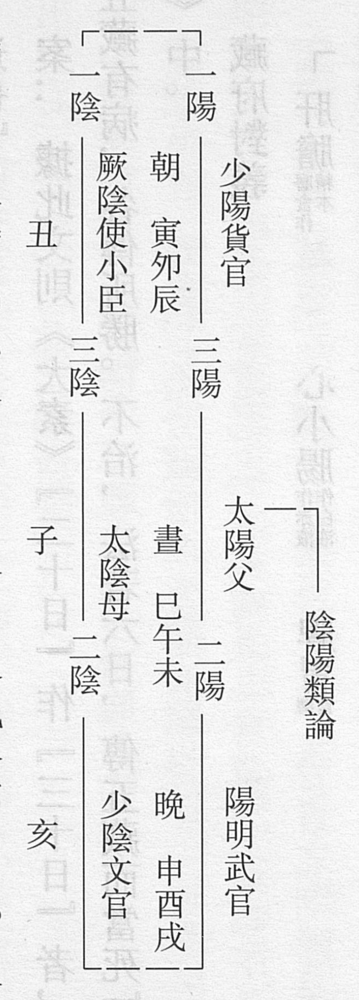

- 陰陽類論 → 太陽父
- 少陽貨官
- 陽明武官
- 一陽 → 三陽 → 二陽
- 一陽 → 一陰
- 二陽 → 二陰
- 朝　寅卯辰
- 晝　巳午未
- 晩　申酉戌
- 厥陰使小臣
- 太陰母
- 少陰文官
- 一陰 → 三陰 → 二陰
- 丑
- 子
- 亥

《天元紀論》『鬼臾區曰：陰陽之氣各有多少，故曰三陰三陽也』，王注：『隨其升降，分爲三別。』

《至真要論》『願聞陰陽之三也，何謂。岐伯曰：氣有多少，異用也』，王注：『太陰爲正陰，太陽爲正陽，次少者爲少陰，次少者爲少陽，又次爲陽明，又次爲厥陰，厥陰爲盡。義具《靈樞・繫日月論》中。』

《靈・陰陽繫日月論》曰『兩陽合於前，故曰陽明。兩陰交盡，故曰厥陰。兩火并合，故爲陽明』。《至真要論》『兩陰交盡，故曰幽。兩陽合明，故曰明。幽明之配寒暑之異也』。

案：《繫日月論》中『前』字，當爲晝義看。

《熱論》曰：一日巨陽、二日陽明、三日少昜、四日太会、五日少会、六日厥会。此序仲景所依。

<!-- PAGE_END -->

<!-- PAGE: 0269 -->

<!-- PRINTED: 234 -->

《血氣形志篇》曰：足太昜與少会爲表裏，少昜與厥会爲表裏，陽明與太会爲表裏，手太昜與少会爲表裏，少昜與厥会表裏，陽明與太会爲表裏。此序仲景疫部位序所依，此反對仲景所依。

《靈・經水篇》足太陽、少昜、昜明、太会、少会、厥会，手太昜、少昜、昜明、太会、少会、厥会，亦是仲景疫位序所依。

三陰俱搏二十日，夜半死。｟十八ヲ｠

《倉公傳》『齊中尉潘滿如病小腹痛云云，三十日死，三陰俱搏者如法。不俱搏者，決在急期。一搏一代者，近也』。

案：據此文則《大素》『二十日』作『三十日』者，可從。三十日之死期，其次序，《玉機真藏》所云『五藏有病，各傳所勝。不治，法若六日，傳五藏而當死』，蓋五六三十日引日而死也。説詳見於《倉公傳攷注》中。

藏府對義

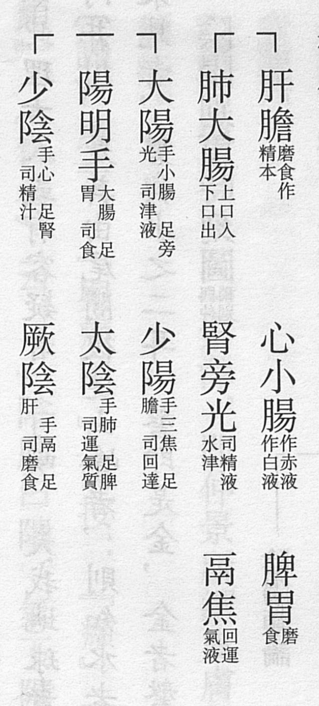

- 肝膽｟磨食作精本｠
- 心小腸｟作赤液作白液｠
- 脾胃｟磨食｠
- 肺大腸｟上口入下口出｠
- 腎旁光｟司精液水津｠
- 鬲焦｟回運氣液｠
- 大陽｟手小腸足旁光司津液｠
- 少陽｟手三焦足膽司回達｠
- 陽明手｟大腸足胃司食｠
- 太陰｟手肺足脾司運氣質｠
- 少陰｟手心足腎司精汁｠
- 厥陰｟手鬲足肝司磨食｠

曰少陽與厥陰爲表裏，曰肝與膽爲藏府表裏，並一事異詞耳。他皆仿此。本篇一陰之與一陽，三陰之與三陽，二陰之與二陽，亦即此藏府表裏稍義異耳。

<!-- PAGE_END -->

<!-- PAGE: 0270 -->

<!-- PRINTED: 235 -->

肺心鬲在上，故爲手經，脾肝腎在下，故爲足經。大腸小腸三焦職在於上，故爲手經，胃膽旁光性赴於下，故爲足經。

七

脈陰陽｟一ヲ｠

胃脘｟二ウ｠

心脾｟四ヲ｠

懸絶｟同｠

隱曲｟同、十九ヲ｠

風消｟同ウ｠

息賁｟同｠

索澤｟五ヲ｠

腨痟｟同｠

頽疝｟同｠

心掣｟六ヲ｠

隔｟同、十五ウ｠

風厥｟六ウ｠

善氣｟八ヲ｠

偏枯痿易｟八ウ｠

魄汗｟十ヲ｠

喘鳴｟同｠

淖｟十一ウ｠

結斜｟十四ヲ｠

石水｟同｠

消｟十五ヲ｠

水｟同ウ｠

喉痺｟十六ヲ｠

有子｟同ウ｠

脹辟｟十七ウ｠

汗｟同｠

崩｟十八ヲ｠

<!-- PAGE_END -->

<!-- PAGE: 0271 -->

<!-- PRINTED: 236 -->

## 素問攷注卷第三

### 重廣補注黃帝内經素問卷第三

#### 靈蘭祕典論篇第八

見存《大素》，此篇係所缺。

**○黃帝問曰：願聞十二藏之相使貴賤何如。**

〔馬〕十二藏者，不分藏府而皆謂之藏也。

《周禮・疾醫》《正義》『五藏謂氣之所藏』。此已下並據《月令・牲南首》而言。

〔張〕藏，藏也。六藏六府總爲十二，分言之則陽爲府，陰爲藏，合言之則皆可稱藏，猶言庫藏之藏，所以藏物者，如《宣明五氣篇》曰『心藏神，肺藏魄』之類是也。相使者，輔相臣使之謂。貴賤者，君臣上下之分。

〔識〕下篇有十一藏之稱，《周禮》有九藏，《莊子》有六藏，可見其無定名焉。

〔吳〕清者爲貴，濁者爲賤。

（眉）心君，腎小君，肝武官，肺文官，脾貨穀官，國家之官僚悉焉。

（眉）《書・盤庚下》曰：『今予其敷心腹腎腸，歷告爾百姓於朕志。』蓋腎藏志之義，而舉心腎之二君，則其餘可略。

<!-- PAGE_END -->

<!-- PAGE: 0272 -->

<!-- PRINTED: 237 -->

（眉）本篇每藏下宜記《難經》及《十四經發揮》所言藏府形狀位地等言。

（眉）本篇自『心者』至『乃制』文，名古屋玄醫爲詳注，在《愚得醫學》卷下，宜録。

**○岐伯對曰：悉乎哉問也。請遂言之。**

〔識〕王注《六節藏象》云：『遂，盡也。』『遂言』二字見《家語》。

**○心者，君主之官也。神明出焉。**

〔識〕《靈・邪客篇》云『心者五藏六府之大主，精神之所舍』。《荀子・解蔽篇》云『心者，形之君也，神明之主也。出令而無所受令』。《淮南子》云『夫心者，五藏之主也。所以制使四支，流行血氣』。《五行大義》引本經作『主守之官』，云『心爲主守之官，神明出者。火者南方陽，光暉人君之象。神爲身之君，如君南向以治，易以離爲火，居太陽之位。人君之象，人之運動，情性之作，莫不由心。故爲主守之官，神明所出也』。《説文》『官，吏事君也』。

《白虎通》『心，火之精也。色赤，心之爲言，任也，任於思也』。

《説文》『心，人心，土藏，在身之中。象形。博士説：以爲火藏』。

《釋名》『心，纖也。所識纖微，無物不貫也』。

案：心藏獨無和名，蓋『古古呂』即爲心藏之名。夫心者，神明之所出，故名曰『古古呂』。古古呂者，古留之義，爲與肝訓『歧毛』同義。《萬安方》心悸訓『古古呂歧衣』，又『幾毛歧衣』，亦可以爲徵矣。『幾毛』解，見肝下。

（眉）《孟子》曰：『耳目之官，不思而蔽於物。心之官則思，思則得之。』家大人曰：『天子王公亦有官事，事天治地也。』

<!-- PAGE_END -->

<!-- PAGE: 0273 -->

<!-- PRINTED: 238 -->

（眉）《管子》曰：『心之在體，君之位也。九竅之有職，官之分也。心處其道，九竅修理。』｟《御覽》三百七十六引｠

（眉）《文子》曰：『心者，形之主也。神者，心之寶也。』｟同上｠

（眉）《淮南子》曰：『夫心者，五藏之主也。所以制使四支，流行血氣，馳騁於是非之境，而出入於百事之門户者是也。』｟同上｠

【楷】（眉）『心藏位胸左，其上頭曰豐頂，下端曰尖尾，尖尾稍曲近胸，表面當左乳下，故左乳下虚里動即是』。出於澤田貞《傷寒論大意》。

【楷】（眉）《五運行大論》『在藏爲心』注：『心形如未敷蓮花，中有九空，以導引天真之氣，神之宇也。爲君主之官，神明出焉。』

【楷】（眉）家大人曰：『肺爲蓋，鬲爲輿。心主位中，播政於四方。肺葉下蒙，鬲幕外被，以包護心主胸中者，帝圻之地哉。』

（眉）《史・扁倉傳》《正義》曰：『心，纖也，所識纖微也。』

**○肺者，相傳之官，治節出焉。**

《白虎通》『肺，金之精也。色白，肺之爲言費也』。

《説文》『肺，金藏也』。

《釋名》『肺，勃也。言其氣勃鬱也』。

《五行大義》『肺爲相傳之官，治節出者，金能裁斷，相傳之任，明於治道，上下順教，皆有禮節，肺於五藏，亦治節所生』。

<!-- PAGE_END -->

<!-- PAGE: 0274 -->

<!-- PRINTED: 239 -->

又引《元命苞》云：『脾者，弁也。肺得之而大。肺義，肺所以義者何？肺金之精義者，能斷西方，殺成萬物，故肺象金，色白而有剛。』

又引《河圖》云：『義惠剛斷，肺之精。患憂憒勃則傷肺，肺傷則致欬逆失音。』

又云：『肺藏魄者，魄以相著爲名。肺爲少陰，陰性恬靜。金主殺，魄又主惡，故以藏之。』

又云：『管子曰：肺生革。《元命苞》云：肺生革者。肺，金也。金能裁斷，革亦限斷，故肺生之。』

《和名抄》：『肺，和名布久布久之。』｟《醫心方》同｠

案：肺爲五藏之上蓋，不宜萎，不宜張，常含氣勃鬱然，故名曰『布久布久之』。『布久布久之』者，謂如畜氣於皮囊中，推此移彼之狀也。今俗語呼『分久分久須留』者，即『布久布久之』之一轉語耳。

〔馬〕凡爲治之節度，從是而出焉。

〔張〕節，制也。《靈・五癃津液別》云：『五藏六府，心爲之主，肺爲之相。』

（眉）《史・扁倉傳》《正義》曰：『肺，孛也。言其氣孛，故短也，鬱也。』

（眉）《五運行論》『在藏爲肺』注：『肺之形似人肩，二布葉，數小葉，中有二千四空，行列以分布諸藏清濁之氣，主藏魄也。爲相傅之官，治節出焉。』

（眉）《素・陰陽類論》曰『上空志心』，《新校正》引楊上善云：『肺氣下入腎志，上入心神也。』是家説心腎之交，肺腎之通之徵。

**○肝者，將軍之官，謀慮出焉。**

《白虎通》『肝，木之精也。色青，肝之爲言扞也』。

《説文》『肝，木藏也』。

<!-- PAGE_END -->

<!-- PAGE: 0275 -->

<!-- PRINTED: 240 -->

《五運行論》『在藏爲肝』注：『肝有二布葉，一小葉，如木甲拆之象也。各有支絡，脈遊中，以宣發陽和之氣，魂之宮也。爲將軍之官，謀慮出焉。』

《靈・天年篇》曰：『肝氣始衰，肝葉始薄。』

《釋名》：『肝，幹也。於五行屬木，故其體狀有枝幹也。凡物以木爲幹也。』

《五行大義》引《元命苞》云：『脾者，弁也。肝得之而興。肝仁，肝所以仁者何。肝，木之精，仁者好生。東方者，陽也。萬物始生，故肝象木，色青而有柔。』

又引《素問》曰：『肝者，魂之所居。陰中之小陽，故通春氣』。

又引《河圖》云：『仁慈惠施者，肝之精。悲哀過度則傷肝，肝傷則令目視芒芒。』

又云：『肝者，爲將軍之官，謀慮出者。木性仁，仁者，必能深思遠慮。恒欲利安萬物，將軍爲行兵之主，必以謀慮爲先。故兵書曰：兵以仁舉，則無不從得之，以仁分則無不從悦。又曰：將無謀則士卒憂，將無慮則士卒去。故肝爲將軍，出謀慮也。』

又云：『肝藏魂者，魂以運動爲名。肝是少陽，陽性運動。木性仁，故魂亦主善，故藏於肝焉。』

《奇病論》四十七云：『肝者，中之將也。取決於膽。』

《靈樞・五癃津液別》云：『肝爲之將。』

又《師傳》云：『肝者主爲將。』

〔識〕《日知録》云：『《春秋傳・昭公二十八年》「豈將軍食之而有不足」《正義》曰：此以魏子將中軍，故謂之將軍。及六國以來，遂以將軍爲官名者，蓋其元起於此。』《管子・立政篇》：『將軍大夫，以朝官吏。』

<!-- PAGE_END -->

<!-- PAGE: 0276 -->

<!-- PRINTED: 241 -->

《和名抄》『肝，和名歧毛』。｟《醫心方》同｠

本居氏曰：『古總稱藏府爲歧毛，今俗呼肝膽皆爲歧毛，古名之遺者也。五藏六府各有和名，非古。至鳥獸藏府，今猶總呼歧毛。』

狩谷氏曰：《欽明紀》『刳肝斮趾，不厭其快。曝骨焚屍，不謂其酷』。是謂藏府爲肝，蓋古訓藏府爲『歧毛』，故以後世訓『歧毛』之肝字填之也。《推古紀》『汝肝稚之』。是以肝爲心。又古歌以肝向群肝，爲心之枕詞。今俗謂焦心爲『歧毛以留』，謂大膽云『歧毛不登之』，謂喪膽力云『岐毛都夫須』，皆可證本居氏之説也。

案：『歧毛』者，『古毛留』之義，在内不動之謂也。『古古呂』亦『古留』之義，與『歧毛』同訓。蓋肝心二藏主魂神，爲精神所在，故古昔肝心共有『歧毛』之訓也。

《周禮・疾醫》《正義》：『肺在上，心在肺下，肝在心下近右，其此三藏並在膈上。脾腎此二者，在膈下。』此説誤矣。

（眉）鄭玄《周禮・疾醫》注：『肝氣涼。』賈《疏》申其説謂：『肝在心下近右，其位當秋，故云肝氣涼。』

（眉）宋・王逵《蠡海集》『人身之肝位在於右，而脈診却見左手。脾位在於左，而脈診却見右手。此亦陰陽互藏其宅之義也』。

（眉）元・滑壽《十四經發揮》：『肝之爲藏，左三葉，右四葉，凡七葉。其治在左，其藏在右脅右腎之前，並胃著脊之第九椎。』宋・王惟一《銅人腧穴鍼灸圖經》首有臟圖，肝在右，脾在左。《萬病回春》一正面人圖，以肝膽置右，背面人圖，以肝膽置左，其差可咲。《醫學入門》卷一・藏府條分篇，肝連膈膜著右脅肋。李中梓《頤世微論》藏府圖，肝在右，脾在左，旁光前有胞。

<!-- PAGE_END -->

<!-- PAGE: 0277 -->

<!-- PRINTED: 242 -->

（眉）書林喬山堂劉龍田刻《圖註脈訣難經》第四十二難圖背面，以肝置右，以脾置左。

（眉）《頓醫抄》卷四十四圖藏府，肝在右，脾在左。蓋宋唐間之圖之傳入我者，可尚可據。

（眉）《史・扁倉傳》末《正義》曰：『肝者幹也，於五行爲木，其體狀有枝幹也。』

（眉）《靈・師傳篇》『肝者，主爲將，使之候外』。

（眉）約之案：藏府中内實無空者，肝脾膻中之三耳，同色同質也。

（眉）或曰肝金秋，肺春木，大非。蓋氣物皆自下升上，地氣四出者也。《易》卦自下而升也。在人，腎冬在下，次升爲肝春，又升爲心夏，又升爲肺秋，肺與腎通，復下爲腎冬，脾旺四季，故卑小在旁而助也。

（眉）《樂動聲儀》曰：『五藏肝仁，肝所以仁者何。肝，木之精也。仁者，好生東方者，陽也。萬物始生，故肝象木色而有枝葉。』｟《御覽》三百七十六引｠

**○膽者，中正之官，決斷出焉。**

《御覽》三百七十六引《黃帝素問》曰『膽者中心之官，斷決出焉』。

《三十五難》『膽者，清淨之府也』。｟《甲乙經》同｠

《靈樞・本輸篇》『膽者，中精之府』。｟《五行大義》引《河圖》、《和名抄》引《中黃子》同｠

《甲乙》卷一引《本輸》『中精』作『清淨』。

《後漢・馬融傳》注引《韓詩外傳》『膽者，積精之府也』。

《説文》『膽，連肝之府』。

案：膽之爲言澹也，乃謂水動也。膽汁活動，恒爲增減，猶水之動搖，故名曰膽歟。

<!-- PAGE_END -->

<!-- PAGE: 0278 -->

<!-- PRINTED: 243 -->

《五行大義》云『膽爲中精府者，肝通於目。目是精明之物，又精神之主，故曰爲中精府也』。

《和名抄》『膽，和名以』。｟《醫心方》同｠

案：以者，以留之義，謂射也。言脾家所運化五藏之精氣，上灌頭面，下注四肢。其純粹之氣入腎爲精液，其戟烈之氣從小腸之中滲泄而爲膽汁。此汁有餘，則能滲入胃中，而令食不滯。能滲入脈中，而令血不敗。故目之能視，耳之能聽，手之能握，足之能踏，能舉重，能登高，並皆膽汁滲入之餘力也。故脾胃調和，則腎水足而膽汁有餘。其滲入微眇血絡之間，其勢如射出，故名曰以也。

《靈・天年篇》『五十歲，膽汁始減，目始不明』。

〔張〕膽稟剛果之氣，故爲中正之官，而決斷所出。膽附於肝，相爲表裏。肝氣雖強，非膽不斷。肝膽相濟，勇敢乃成。故《奇病論》曰『肝者，中之將也，取決於膽』。

案：膽氣即肝氣，相成表裏。猶心包傳心氣，相成喜怒也。胃府下口小腸之分爲幽門，膽汁焦液共出於此，而亦分些入於此，以蒸釀水穀也。

（眉）方以智《通雅》卷五十一曰『十一臟取決於膽，膽具剛精，而以定恐用娠』。

（眉）案：中者，衷也，忠也。言衷之，正之，即決斷之義，蓋折衷議正之義。

（眉）《史・扁倉傳》《正義》曰『膽，敢也。言人有膽氣而能果敢也』。

**○膻中者，臣使之官，喜樂出焉。**

王氷音釋『膻，徒旱切』。

《靈・邪客篇》『故諸邪之在於心者，皆在於心之包絡。包絡者，心主之脈也』。三谷樸曰：『脈或膜之誤，然《釋名》脈膜同解，古或通用。』

<!-- PAGE_END -->

<!-- PAGE: 0279 -->

<!-- PRINTED: 244 -->

〔張〕膻中在上焦，亦名上氣海，爲宗氣所積之處，主奉行君相之令，而布施氣化，故爲臣使之官。《行鍼篇》曰『多陽者多喜，多陰者多怒，膻中爲二陽藏所居，故喜樂出焉』。按十二經表裏有心包絡，而無膻中。心包之位，正居膈上，爲心之護衛。《脹論》曰『膻中者，心主之宮城也』，正合心包臣使之義，意者其即指此歟。

《醫心方》卷十四·治卒死方第一篇《集驗》又方『灸亶中穴』。亶，圈發去聲讀。

《醫心方》卷九首篇引《小品方》『灸亶中穴五十壯』。亶，去聲圈發。中，上聲圈發。

案：曰喜樂，則外七情之屬，亦皆出焉耳。《白虎通》曰『三焦者，包絡府也』。所謂包絡，斥心主也。

〔李〕貼近君主，故稱臣使藏府之官，莫非王臣。此獨泛言臣，又言使者，使令之臣如内侍也。

《傷寒直格》曰：『包絡，一名命門。』

〔識〕薛雪云：『膻中，亦名上氣海，爲宗氣所積之處。心包絡，包爲膜，心君之宮室，絡爲膜外之巷術，心君之城府也。一爲密勿之地，一是畿甸之間，臣使之義著焉。膻中者，宮室外之城府也。』

《靈·海論》『膻中者，爲氣之海』。《大素》卷五『四海合載之』。楊注：『膻，胸中也。音檀。』

周揚俊《温熱暑疫全書》卷三·辨寒暑各異篇引張鳳逵曰『暑蒸毒從口鼻入者，直中心包經絡』，又曰『非專心主而別臟無傳入也』。

《體雅》云：『《肘後方》脚氣灸膻中五十壯，在胸前兩邊對乳匈厭骨解間，指按覺氣翕翕爾是也。《千金方》失欠頰車蹉，灸氣街二百壯，胸前喉下甲骨中，是亦名氣堂。｟《千金翼》『甲骨』作『寅骨』｠胤按：甲骨亦臆骨，而其穴恐是膻中。蓋膻中爲氣之海，故曰氣衝，又名氣堂者乎。』

《醫説》引《名醫録》曰：『蕭炳謂小兒初生，宜與韭根汁灌之，吐出惡血，長則無病。驗。韭能歸心氣，而去包中惡氣，治胸中也。是知心包亦單名呼包也。』

<!-- PAGE_END -->

<!-- PAGE: 0280 -->

<!-- PRINTED: 245 -->

（眉）案：膻中名出焉，而無包絡。可知包絡即古之膻中。以包絡心藏，故云心包絡，略云心包。即別清上濁下之鬲膜是也。鬲，隔也，膜故亦云之鬲膜，又謂之心主，即包絡一名。主者，居也。鬲上，心藏所居之宮故名。《禮·曲禮上》『居不主奥』《疏》：『主猶坐也。』《史·天官書》『太白主中國』《正義》：『主猶領也，入也。』是知與前文『心者君主之官也』之『主』字異義。匈中鬲内，七情所出，若鬲内多水，性情從變，是所以膻中之内喜樂出焉也。又臣使之謂也。

（眉）案：『膻中』或作『亶中』正字，而並濁音，讀上聲。膻之言達，達通四邊也。又塡也，氣滿鬲内也。又亶也，單也，其形展大也。中鬲内之義，又居上清下濁之中間之義。

（眉）石坂竿齋宗哲《醫源》曰『朱肱曰：心之下有膈膜，與脊脅周回相著，所謂膻中也。此説是也。上抱護心藏，下隔絶胸腹，抱護心藏者，其膜縱也。隔絶胸膜者，其膜横也。其系兩條如尾，下至腰椎者，謂之幕原。其縱護心藏者，後人因曰心包。其横隔絶胸腹者，因曰膈膜。今據《祕典論》，合縱横者，名曰膻中』。

（眉）此説發千古蘊昧，三谷笙州以心藏外薄包之透明膜爲心包，恐誤。蓋身中諸物，皆薄膜包之，奚唯取心膜別號心包乎。

（眉）《奇病論》曰『胞絡者繫於腎』，是胞門之絡，非心包也。

（眉）滑伯仁《十四經發揮》既與三谷笙洲同誤心包絡也。

（眉）《十四經發揮》有豎膜横膜之別，在心包經下。

**○脾胃者，倉廩之官，五味出焉。**

<!-- PAGE_END -->

<!-- PAGE: 0281 -->

<!-- PRINTED: 246 -->

《五行大義》引無『胃』字。

《五經大義》｟（『經』當作『行』）｠云：『脾爲倉廩之官，五味出者。萬物生則出土，死亦歸之。五穀之入，脾以受入，故五味之出，亦由於此也。』

又引《河圖》云『和厚篤信者，脾之精，縱逸貪嗜則傷脾，脾傷則畜積不化，致否結之疾』。

楊泉《物理論》『咽喉者，生之要孔』。《御覽·人事部》引《五運行大論》『在藏爲脾』，注：『形象馬蹄，内包胃脘，象土形也。經絡之氣，交歸於中，以營運真靈之氣，意之舍也。爲倉廩之官，化物出焉。』又曰『《白虎通》曰：脾之爲言并也，謂四氣并之也』。

《靈·本輸》曰『胃者，五穀之府』。

《史·扁倉傳》末《正義》曰：『凡人食入於口，而聚於胃中，穀熟傳入小腸也。』案：則知胃者，唯米囊不足復筭爲十二也。

〔識〕《荀子·富國篇》楊倞注：『穀藏曰倉，米藏曰廩。』《類經｟廿八ノ四四ヲ｠遺篇刺法論》云：『脾爲諫議之官，知周出焉。』《三因方》作『公正出焉』。『脾爲諫議大夫』出於《千金方》及胡悟《五藏圖説》。

《春秋元命苞》曰：『胃者，脾之府，主稟氣。胃者，穀之委，故脾稟氣也。』｟《御覽》三百七十六引｠

《史·扁倉傳》《正義》曰：『脾，裨也。在助氣主化穀。』案：『在』下恐『左』字誤脱。

〔張〕脾主運化，胃司受納，通主水穀，故皆爲倉廩之官。五味入胃，由脾布散，故曰五味出焉。

《史·扁倉傳》《正義》曰：『胃，圍也，言圍受食物也。』

《靈樞·師傳》云：『脾者主爲衛，使之迎粮。』

案：五味以舌知之，然舌之所知者，以脾氣通於舌也，故曰『五味出焉』也。此云脾胃而專指脾，連偁脾胃者，爲熟語，猶《靈樞·根結篇｟五｠》『腸胃偏辟』專謂腸之例耳。

<!-- PAGE_END -->

<!-- PAGE: 0282 -->

<!-- PRINTED: 247 -->

（眉）《四十二難》虞注：『胃爲倉廩之官也。』

（眉）《靈·師傳篇》『脾者主爲衛，使之迎糧』，又《腸胃篇》『胃紆曲屈伸之』。

（眉）《白虎通》曰『脾之爲言併也，所以併積氣』，又曰『脾所以信何。脾者，土之精，土尚任養，萬物無所私，信之至也。故脾象土，色黄，繫於舌』。｟《御覽》三百七十六引｠

（眉）案：胃是倉也，脾是廩也。訓詁可見。胃有倉名，其證不少。

（眉）案：五味之陰液出於脾，脾以是灌於四旁也。而其五味本者，出於胃中食也。故胃亦出食物五味，以與小腸也。

**○大腸者，傳道之官，變化出焉。**

《靈·本輸篇》曰『大腸屬上，小腸屬下』。

楊泉《物理論》『腸胃，五藏之府，陶冶之大化也』。｟《御覽·人事部》引｠

〔識〕《本輸篇》及《五行大義》引《河圖》『大腸爲傳道之府』。《韓詩外傳》『大腸者，轉輸之府也』。

《三十五難》『大腸傳瀉行道之府也』，馬云：『道、導同。』

《五行大義》云『大腸爲傳道之府者，肺通於鼻，鼻出入氣，大腸傳道五穀氣之道，故爲其府』。

《難經·卅五難》『大腸者，傳寫行道之府也』，《後漢書·馬融傳》注引《韓詩外傳》『大腸者，轉輸之府也』。《靈樞·本輸篇》『大腸者，傳道之府』。《五行大義》引《河圖》《甲乙經》同。《和名抄》引《中黄子》『大腸爲傳送之府』，《欬論》王注同。《醫方類聚》引《神巧萬全方》『大腸者，肺爲表裏，名傳送之府』，又引《五藏六府圖》『肺，呼吸之津，傳送之官』。

<!-- PAGE_END -->

<!-- PAGE: 0283 -->

<!-- PRINTED: 248 -->

（眉）案：變化斥屎，屎自大腸出肛而去，故曰變化出焉也。

（眉）《抱朴子》曰『欲得長生，腸中清，欲得不死，腸無屎』。｟《御覽》三百七十六引｠

（眉）《白虎通》曰『大腸小腸，心肺之府也，主禮義。禮義者有分理，亦大小相承受也』。｟右抱經堂本｠

案：大腸曰傳道，小腸曰受盛，精義入神也哉。《醫學入門》卷一藏府條分篇曰『大腸又名迴腸』。

《靈·腸胃篇》以大腸稱迴腸，以肛稱廣腸，《平人絶穀篇》亦同。

《史·扁倉傳》末《正義》曰『腸胃，凡長五丈八尺四寸』。《甲乙經》『腸胃凡長丈六尺四寸四分』。從口至腸而數之，此經從胃至腸而數之，故短也。又曰『腸，暢也。言通暢胃氣牽去穢也』，又曰『大腸，即迴腸也，其迴曲因以名之』。

《和名抄》『大腸，和名波良和太』。｟《醫心方》同｠

《醫心方》大腸，又訓『於保和多』。

案：『和多』者，『和多加末留』之略語，即爲盤屈之義。『波良和多』者，謂在腹内蟠屈也，蓋總稱大小二腸之名。《説文》『腸，大小腸也』，《釋名》『腸，暢也。通暢胃氣，去滓穢也』，《廣雅》『腸，詳也』並可徵。單云腸者，統大小二腸之名也。『於保和多』者，對小腸之訓『保曾和多』，又『古和多』之偁，謂大腸比小腸則稍闊大也。今俗呼『久曾布久呂』，蠻名『涅墜岐駄留牟』，譯爲厚腸。

（眉）《四十二難》楊注：『迴腸者，大腸也，受小腸之穀而傳入於廣腸焉。廣腸者，䐈腸也。一名肛門。』又曰：『大腸即迴腸也，以其迴曲因以名之。』《大素》卷十二·無名篇注：『迴腸，大腸也。』又卷十三·腸度篇注：『迴腸，太腸也。』

（眉）《史·扁倉傳》《正義》曰：『肛，釭也。言其處似車釭，故曰釭門。即廣腸之門，又名䐈也。』

<!-- PAGE_END -->

<!-- PAGE: 0284 -->

<!-- PRINTED: 249 -->

今本《四十二難》楊注文小異。

案：水穀入胃，猶未化，傳入小腸，則水穀變化，正如未漉之酒。又入大腸，則水滲出膀胱，穀物皆化爲屎，故曰變化。變化者，凡食物至此，則皆變化而爲屎，不存其本來之面目也。

案：二腸間闌門處有蟲腸，是長腸曼路之中去鬱氣之具。殆與子腸花穴常動，出入息氣一同。

**○小腸者，受盛之官，化物出焉。**

《三十五難》『小腸者，受盛之府也』。《靈樞·本輸》《五行大義》引《河圖》及《甲乙經》，《和名抄》引《中黄子》同。

《脈要精微論》曰『病名心疝，少腹當有形也。心爲牡藏，小腸爲之使，故曰少腹當有形也』，王注：『少腹，小腸也。』

《靈·經水篇》『内屬小腸而水道出焉』。

《舉痛論》『寒氣客於小腸』，王注：『小腸爲受盛之府，而傳下入迴腸。迴腸，廣腸也。爲傳導之府，物不得停留。』

《和名抄》『小腸，和名保曾和太』。｟《醫心方》同｠

《醫心方》『小腸，又名古和多』。

案：『和太』者，『和多加末留』之略言。『保曾和多』『古和多』共對『於保和多』大腸之名。今俗呼爲『古奈之布久呂』，蠻名『殿無念馱留牟』，譯爲薄腸。

案：小腸上口連胃，下口連大腸，其形圓長内空，正如竹筒。長二丈三尺許，比大腸則差細而薄，故名曰小腸，又薄腸。其中間左側有一小孔，大胡椒許，即會注膽焦二液之處。《難經·四十四難》所云『大倉下口爲幽門』，《脹論》云『胃者，大倉也』是也。膽焦二液，調和水穀爲幽妙之用，故曰幽門。膽焦二液，實水穀之所造釀，而此二液又能調和水穀，其用幽妙不可名也。

<!-- PAGE_END -->

<!-- PAGE: 0285 -->

<!-- PRINTED: 250 -->

案：化物者，謂屎尿二物也。『小腸化物出』云者，水穀混化而未分屎尿之謂也。『大腸變化出』云者，再化水穀混化之物，而爲尿爲屎之謂也。畢竟胃唯受水穀未能化，小腸化水穀未能分屎尿，大腸能分屎尿以分配二道也。所以脾胃云倉廩，小腸云受盛，大腸云傳道也。

（眉）案：化物，屎尿也。屎自小腸出去之大腸，尿亦自小腸出去之膀胱也。

**○腎者，作強之官，伎巧出焉。**

《白虎通》云：『腎，水之精也。色黑。』『腎之爲言賓也，以竅寫。』｟《五行大義》｠

《釋名》云：『腎，引也。腎屬水，主引水氣，灌注諸脈絡也。』

元·李治《古今黈》曰：『《内經》言腎者作強之官，技巧出焉。技雖不至於道，亦游於藝者之所貴，巧雖未至於神，亦妙萬物而爲言，不作強則何以得之。故知作強者，乃精力之謂。』

方以智《通雅》卷五十一引虞天民曰『兩腎總號爲命門』。

《史·扁倉傳》《正義》曰『腎，引也。腎屬水，主引水氣，灌注諸脈也』。

《説文》『腎，水藏也』。

《廣雅》『腎，堅也』。

《靈·師傳篇》『腎者主爲外，使之遠聽』。

《五行大義》云：『腎爲作強之官，伎巧出者。』水性是智，智必多能，故有伎巧，巧則自強不息也。

《八十一問》曰：『藏各有一，腎獨兩者何也。左者腎，右者命門。命門者，精神之所會也。《河圖》云：

<!-- PAGE_END -->

<!-- PAGE: 0286 -->

<!-- PRINTED: 251 -->

『腎與命門，並出尺部。此脈候也。問曰：前解云腎陰故雙，今言左腎右命門，此豈不自乖張乎。答曰：命門與腎，名異形同，水藏則體質不殊，故雙主陰數。爲名則左右兩別，故各有所主，猶如三焦、膀胱，俱是水府，不妨兩號。《老子經》及《素問》云：腎藏精者，精以精靈叡智爲稱，亦是精智氣。腎水智巧，故精藏焉。』

又引《河圖》云：『智辨謀略，腎之精，勞欲憤滿則傷腎，腎傷則喪精損命。』

《古今黈》云：『技雖不至於道，亦游於藝者之所貴。巧雖未至於神，亦妙萬物而爲言。不作強則何以得之。故知作強者，乃精力之謂。』

《和名抄》『腎，和名無良度』。｟《醫心方》｠

谷川氏曰：『無良度者，當聚處之義，言精氣所聚之處也。』

案：此説恐非。蓋『無良』與『毛禮』一音，『無良度』者，即『毛禮土』之義。五藏之精液從此處泄出，故名『無良度』。『無良度』者，謂泄處也。脾能運化穀氣，以爲五藏之精。腎能鳩集其有餘之精液，臨時而泄出，是脾腎互相成，水土互相濟之義也。

（眉）作強，王注是。作，作事，作人體之事也。強，勉強終身交合未止，即勉強之謂。

（眉）伎巧斥作人身之妙靈，即斥精液而言。

（眉）《白虎通》曰：『腎所以智者何。腎者，水之精。智者，進止無所疑惑，水亦進而不惑。北方水，故腎黑陰，故腎雙居。』｟《御覽》三百七十六引｠

（眉）方以智《通雅》卷五十一引虞天民曰『命門爲中棖』，方以智曰『兩腎之中棖，爲命門也』，又曰『命門爲兩腎之中棖，虞天民之定論也』。

<!-- PAGE_END -->

<!-- PAGE: 0287 -->

<!-- PRINTED: 252 -->

（眉）《靈·本輸》曰：『腎上連肺，故將兩藏。』

（眉）《五運行論》『在藏爲腎』注：『腎藏有二，形如豇豆相並，而曲附於膂筋，外有脂裹，裏白表黑，主藏精也。爲作強之官，伎巧出焉。』

（眉）案：交合時比於常時，則子腸花孔刺八筅，動扇尤甚也。

**○三焦者，決瀆之官，水道出焉。**

《金匱真言》王注引《正理論》『三焦者，主謁道諸氣，名爲使者也』。

《靈樞·本輸篇》：『三焦者，中瀆之府也。水道出焉，屬膀胱，是孤之府也，是六府之所與合者。』《甲乙》五藏六府陰陽表裏文同，但無『與』字。

《五行大義》引《河圖》云：『三焦孤立，爲内瀆之府。《甲乙》《素問》説同。』『三焦爲中瀆府者，五藏各合一府，三焦獨無所合，故曰孤立。五藏之中通上下行氣，故爲中瀆府也。』又云：『三焦膀胱並爲水之府，故以相配，戊癸所主也。脾配二府，餘四藏各配一府者，脾是土藏，土爲君道，君即陽也。陽數一，故藏不二也。三焦膀胱是水府，水爲臣道，臣即陰也。陰數偶，故府有二也。』

《白虎通》卷下·情性篇曰：『三焦者，包絡府也。故上焦若竅，中焦若編，下焦若瀆。』中焦形狀旨乎哉。

《三因方》曰：『三焦有形如膜，附於兩脊夾脊。』三焦形狀，詳出《欬論》王注。

《和名抄》引《中黄子》云：『三焦孤立，爲中瀆之府。』

又引『野王案：上中下謂之三膲也』。

案：《難經》《甲乙》配五藏，故無三焦。《後漢·馬融傳》注『《韓詩外傳》云何謂六府云云，喉咽者，量腸之府也』，而無三焦。所云喉咽者，謂上焦也。蓋腸中之虛實於此可知，故曰量腸也。

<!-- PAGE_END -->

<!-- PAGE: 0288 -->

<!-- PRINTED: 253 -->

案：三焦者，從小腸所滲出微眇之精液灌注之處也。下焦根起於大小腸，而其津液湊合聚會，悉入於幹中，而調熟和釀。與脾胃肝膽鬲膜二焦通氣，其清者上入肝膽爲血液，其濁者下注膀胱爲尿水也。中焦者，横著於胃府囊下，其末灌幽門，其本連於脾藏，全形如狗舌而長扁，末廣而本尖，其質如胭，其色淡黄，微帶灰紅，剝其外膜，則其中如泡沫之狀，《營衛生會篇》所云『中焦如漚』者是也。上焦者，並下焦府而起，經過横膈膜後面，而緣由脊呂左邊，上行左腹胸裏，接左肩下之絡脈｟即缺盆骨下脈｠。《營衛生會篇》所云『上焦如霧』，又云『上焦出於胃口，並咽以上，貫膈而布胸中』，《決氣篇》云『上焦開發，宣五穀味，熏膚充身澤毛，若霧露之溉，是謂氣』，《平人絶穀篇》云『胃受水穀，上焦泄氣，出其精微，慓悍滑疾』，《癰疽篇》云『腸胃受穀，上焦出氣，以温分肉，而養骨節，通腠理』是也。其全形細長如筋，自爲緩解急結之用，其質爲膜，管中有許多細瓣，主受下焦營氣，使氣液蒸達於衛分，會入於肩下絡血，漑注心肺二藏中，化成赤血也，《經》所云『上注於肺，乃化爲血』｟《營衛生會》｠是也。蓋中焦爲製營之府，下焦爲取營之府，上焦爲轉營之府，其爲物三，而其爲功一，故曰孤之府也。《經論》『中焦主論血，下焦主論水，上焦主論氣』，此之謂也。宋·蘇轍《龍川略志》第二有論三焦一條。徐遁説曰：『右腎下有脂膜如手大者，正與膀胱相對。有二白脈自其中出，夾脊而上貫腦，意此即導引家所謂夾脊䨥關者，而不悟脂如手大者之爲三焦也。』｟《百川學海》載之，全文在補中｠所云如手大者，是下焦，二白脈者，謂下焦與上焦之根管二也，而中焦之説缺焉不論，可疑耳。

《説文》『決，行流也』『瀆，溝也』。

案：『決瀆』二字，蓋古之熟語，乃爲流水之義，以其細管如筋故也。

案：三焦者，胃中之水穀自小腸所分滲微眇之氣液也。其實血也，汗也，津液也，涎唾也，小便也，共皆三焦之所主也，所云『上焦如霧，中焦如漚，下焦如瀆』是也。其爲病上焦汗出欬唾，中焦留飲霍亂，下焦便閉泄利也。其上焦在胃上，中焦在胃下，下焦在腸間。《靈樞·營衛生會篇》所云『上焦出於胃上口，中焦亦並胃中出上焦之後，下焦者別迴腸注於膀胱而滲入焉』可以徵矣。

<!-- PAGE_END -->

<!-- PAGE: 0289 -->

<!-- PRINTED: 254 -->

《和名抄》『三膲，和名美能和太』。｟《醫心方》同｠

案：『美能和太』者三腸之義，謂似腸之物而其名處有三也。蓋古人開剖究物之後所定之名，而非虛名也。

（眉）三焦有名無形之説，《金匱真言》王注引《正理論》出之。

案：上焦起腹，如何而上至肩胸也。曰：與食咽並行貫一穴也。故鬲幕有二穴，而經絡之貫穴小也，咽焦之貫穴大也。故《靈·營衛生會篇》曰『上焦出於胃上口，並咽以上貫膈而布胸中，走腋，循太陰之分而行云云』，聖教真乎哉。

（眉）《六十二難》丁注：『三焦者，臣使之官，位應相火，宣行君火命令。』

（眉）案：世工解肔時曰『脂肪者皆是上焦、下焦枝末羅絡膜上者也』。

（眉）《白虎通》曰『包絡之府』者，言心包絡爲藏，三焦爲府之義，即手厥陰，手少陽相對之義也。

（眉）《本草綱目》果部·胡桃下曰：『三焦，《靈·本藏論》已著其厚薄緩結之狀，而扁鵲《難經》不知原委體用之分，以右腎爲命門，謂三焦有名無形狀。而高陽生僞譔《脈訣》，承其謬説，以誤後人，至朱肱《南陽活人書》、陳言《三因方論》、戴起宗《脈訣刊誤》，始著説闢之，而知之者尚尠。』

**○膀胱者，州都之官，津液藏焉，氣化則能出矣。**

《卅五難》『膀胱者，津液之府也』。｟《靈樞·本輸篇》同｠《靈·經水篇》『内屬於膀胱，而通水道焉』。

<!-- PAGE_END -->

<!-- PAGE: 0290 -->

<!-- PRINTED: 255 -->

《後漢書·馬融傳》注引《韓詩外傳》云『旁光者，湊液之府也』。

《五行大義》云『膀胱爲津液之府者，腎是水藏，膀胱空虛受水。水清氣則爲津液，濁氣則爲涕唾，故以爲府』。

《説文》『脬，膀光也』。

《廣雅》『膀胱，謂之脬』。

《釋名》『胞，鞄也。鞄，空虛之言也。主以虛承水汋也。或曰膀胱，言其體短而横廣也』。

《淮南子·説林訓》『旁光不升俎』，高誘注：『旁光，胞也。』

《史·扁倉傳》《正義》曰『膀，横也。胱，廣也。體短而又名胞，胞虛空也，主以虛承水液』。

《廣韻》『脬，腹中水府也』。

案：脬又作胞，胞之緩言爲旁光。旁光疊韻與彷徨同，謂水府長短廣狹不定，其狀旁光然也。

《和名抄》『膀胱，和名由波利布久路』。｟《醫心方》同｠

案：由波利，謂尿也。尿常在脬中，故名，與胃名曰『久曾布久呂』同義。

〔箚〕驪恕公曰：『《檀弓》洿其宮而豬焉。鄭注：豬，都也。南方謂都爲豬也。』寛案：《周官》『稻人掌稼下地，以瀦畜水』。《爾雅》『水中可居者曰洲，小洲曰都』。蓋都豬瀦三字並通用，爲蓄水之地，與津液藏焉尤襯矣。

〔張〕膀胱有下口而無上口，津液之入者爲水，水之化者由氣有化，而入而後有出，是謂氣化則出矣。《營衛生會篇》云『水穀俱下而成下焦，濟泌別汁，循下焦而滲入膀胱』，正此謂也。然氣化之原居丹田之間，是名下氣海。天一元氣化生於此，元氣足則運化有常，水道自利，所以氣爲水母。知氣化能出之旨，則治水之道，思過半矣。

<!-- PAGE_END -->

<!-- PAGE: 0291 -->

<!-- PRINTED: 256 -->

《素·至真要大論》『淡味滲泄爲陽』注：『滲泄，小便也。言水液自迴腸泌別汁，滲入膀胱之中，自胞氣化之，而爲溺以泄出也。』

蕭京《軒岐救正論》云：『夫三焦既主相火，水道之出，無非稟氣以爲決也。不曰能出，而曰出焉，蓋氣本自化，不待化於氣而始能也。今津液主水，膀胱司水，水不自化而化於氣。此陰以陽爲用，未免少費工夫，故不曰出焉，而曰則能出矣。語意之次，又包許多妙用。』

案：『氣化則能出矣』，言氣不化則不能出尿，尿之出，全由於胃陽之氣化也。

（眉）案：膀胱之津者，尿也。其液者，交合時之腎精也。就中津在脬，液在胞也。

（眉）《外臺》卷十一·祠部李郎中篇論曰：『上蒸精氣，氣則下入骨髓，其次以爲脂膏，其次爲血肉也。其餘別爲小便，故小便色黄，血之餘也。』又曰：『由如乳母，穀氣上洩，皆爲乳汁。』今案：尿者，血滓與津滓、液滓也。乳亦液與津與血三合者也。

（眉）《春秋元命苞》曰『膀胱者，肺之府也。肺者斷決膀胱，亦常張有勢，故膀胱決難也』。

（眉）《素·欬論》『三焦欬』王注：『下焦者，別於回腸，注於膀胱。故水穀者，常并居於胃中，盛糟粕而俱下於大腸，泌別汁循下焦而滲入膀胱。尋此行化，乃與胃口懸遠。』

**○凡此十二官者，不得相失也。故主明則下安。以此養生則壽，歿世不殆，以爲天下則大昌。**

案：『六藏六府』言出《傷寒直格》。

案：心主一身之血氣，故心經有病則無有愈者。若大病而諸經雖病，其不犯心經者，無復不治者也。

<!-- PAGE_END -->

<!-- PAGE: 0292 -->

<!-- PRINTED: 257 -->

《全體新論·胎論》云『人具百體，心最先生，及終世之時，百體先死，心死最後。凡姙胎二十日，心已成模，初見一管，漸分兩房，又漸而成四房，上兩房有户相通。出世之後即閉塞，否則紫血混行，兒死而身藍矣』，並可以徵心爲君主之義也。

案：王注作『没世不殆』。據此，則王所見本正文『歿』字作『没』，今宋本蒙『殆』而誤歟，宜改作『没』也。

（眉）《列子·説符篇》『得時者昌，失時者亡』。《琱玉集》卷十二引《春秋後語》曰『得命者昌，失命者亡』。《靈・終始篇》『敬之者昌，慢之者亡』。

（眉）案：至三壽之境，没世間，其至於此之中間，幼弱壯強老，老至時不有危隍之大病。

**○主不明，則十二官危。使道閉塞而不通，形乃大傷。以此養生則殃，以爲天下者，其宗大危。戒之戒之。**

案：帝問十二官之相使，伯答引及於爲天下之昌危者，述正心誠意，修身齊家治國平天下之義。以欲使帝知養生之大道之意在焉。所云『上醫醫國』者，此之謂與。

〔識〕高云『宗祧旦危』，簡案：《説文》『宗，尊祖廟也』。《白虎通》云『宗者，何謂也。宗者，尊也。爲先祖主宗，人之所尊也』。

〔箚〕寛案：爲，治也。王注非。《漢·藝文志》『大古有岐伯、俞拊。中世有扁鵲、秦和。蓋論病以及國，原診以知政』。

（眉）案：『使』字，包輔傅相臣之義。

（眉）《至真要論》『察本與標，明知勝復，爲萬民式，天之道畢矣』，王注：『天地變化，尚可盡知。

<!-- PAGE_END -->

<!-- PAGE: 0293 -->

<!-- PRINTED: 258 -->

況一人之診，而云冥昧。得經之要，持法之宗，爲天下師。尚卑其道，萬民之式，豈曰大哉。』

**○至道在微，變化無窮，孰知其原。**

『至』『微』二字，承前文之字，而一句上首尾爲韻也。『變』『原』二字，二句上首尾亦爲韻。蓋亦古文之一體耳。

案：十二官不相失，其至極之道理。蓋在於至微至眇之上，故至於推求其變化之理，則無有究極。其本原皆是出於氣精神三之間，觀而不可見，聽而不可聞。必竟有者皆出於無，茫茫渺渺誰知其所原始也。

（眉）《素·徵四失論》『嗚呼。窈窈冥冥，熟知其道。道之大者，擬於天地，配於四海』。

**○窘乎哉。消者瞿瞿，孰知其要。**

『窘』字，亦承前句末『原』字而爲韻。『消』『要』二字亦在句之首尾爲韻耳。

『窘乎哉』出《靈·外揣》篇《本藏篇》《逆順肥瘦》《病傳》等篇，本書《氣穴論｟五八｠》亦有。

《新校正》云：『按：《太素》作肖者濯濯。』

案：據此考之，今本作『消』者，蓋冒『濯濯』之水旁而誤作者歟。若作『濯濯』，則蓋疎大而不精細之謂。即麤暴卓犖，果速不謹愼之貌也。濯，音棹。與『要』押韻。又《廣韻》三十四嘯『嬥嬈不仁』。

《氣交變大論》云『肖者瞿瞿，莫知其妙，閔閔之當，孰者爲良。妄行無徵，示畏侯王』。

〔箚〕肖、宵同。江淹《雜體詩》『宵人重恩光』，善曰：『《春秋孔演圖》曰：宵人之世，多飢寒。宋均曰：宵，猶小也。』《史·三王世家》『毋邇宵人』。

案：此説可從。肖者，蓋與宵人同，謂小人也。

〔識〕馬云：『《禮·檀弓》瞿瞿，若有求而弗得。註云：眼目速瞻之貌。』簡案：《東方未明篇》『狂

<!-- PAGE_END -->

<!-- PAGE: 0294 -->

<!-- PRINTED: 259 -->

夫瞿瞿』傳：『無守之貌。』《禮·玉藻》『視容瞿瞿』註：『驚遽不審貌。』

案：此三句，對前三句而成文，共謂至道之不可知也。窘者，窮迫之謂也。『窘乎哉』謂其尤窮迫也。『消者瞿瞿，孰知其要』謂淺學之小人開張耳目，而雖求其妙理，遂不可知其要也。『窘乎哉』斥小人窮困皃也。

**○閔閔之當，孰者爲良。**

『當』『良』爲韻。

（眉）《疏五過論》曰『黄帝曰：嗚呼。遠哉。閔閔乎，若視深淵，若迎浮雲。視深淵尚可測也，迎浮雲莫知其際』，王注：『嗚呼。遠哉。歎至道之不極也。閔閔乎，言妙用之不窮也』。

案：閔閔，猶泯泯也，其要密蔑不可見之義。王注『閔閔玄妙』，其義可從也。言閔閔之妙理，得其正當，至當之説者，唯練熟此道者，最爲精善也。

**○怳惚之數，生於毫氂。**

〔識〕《孫子算經》『蠶吐絲爲忽，十忽爲一絲，十絲爲一毫，十毫爲一氂』。

〔箚〕賈誼《新書》『數度之始，始於微細。有形之物，莫細於毫。是故立一毫，以爲度始。十毫爲髮，十髮爲氂，十氂爲分』。

案：『怳惚』者，『忽』之緩言，云『怳惚』、云『惚』，並同義，猶『旁光』與『胞』之例。言度量二件，皆生於人同身寸是也。『怳惚之數』者，言無形一氣之内，自有精神氣血營衛之分，其間不容髮。故曰生於毫氂。

**○毫氂之數，起於度量。**

<!-- PAGE_END -->

<!-- PAGE: 0295 -->

<!-- PRINTED: 260 -->

案：度、量共起於毫，一毫一氂一分一寸謂之度，一毫一氂一分一錢謂之量。量者，謂量輕重，即謂權量也。王注以爲『斗量』，恐非是。《説文》『量，稱輕重也。從重省，曏省聲』可以徵矣。

（眉）案：怳忽豪氂之數，起於度之量之之藝術，則天地人身微妙，亦以藝術則可察之譬也。

（眉）案：以尺以筭謂之度，以升以權謂之量。

**○千之萬之，可以益大。推之大之，其形乃制。**

案：其形乃制，諸家無明解。竊謂『怳惚之數生於豪氂』云云，是爲客文，至『其推大之則其形乃制』者，是謂主文。『其形乃制』者，謂『布指知寸，布手知尺，舒肘知尋』｟《大戴》王言｠『側手爲膚，按指爲寸』｟《公羊・僖公卅一年》注｠之類。其人之形體，乃爲之制度也。《説文》『尺』字下云『周制，寸尺咫尋常仞諸度量，皆以人之體爲法』可併考。王注稍似是，而未詳明。言人六尺之軀，元是一氣之生成而立者，故本於其始，則只是一滴水一陽氣耳，千萬之則至數皆在於身也。

（眉）案：千萬合推於怳忽豪氂，則成天地人之大形，可以制名制分也。若分析之爲一怳忽豪氂，則無見復有天地人之大。古人曰『數車無車』，此之謂也。推，推合也。

**○黃帝曰：善哉。余聞精光之道，大聖之業，而宣明大道，非齋戒擇吉日，不敢受也。**

〔志〕精，純粹也。光，光明也。

（眉）《抱朴子》卷四・金丹篇曰：『按：《黃帝九鼎神丹經》曰，黃帝以傳元子戒之曰此道至重，必以授賢，苟非其人，雖積玉如山，勿以此道告之也。受之者，以金人金魚投於東流水中，以爲約，唼血爲盟。』

**○黃帝乃擇吉日良兆，而藏靈蘭之室，以傳保焉。**

<!-- PAGE_END -->

<!-- PAGE: 0296 -->

<!-- PRINTED: 261 -->

案：吉日良兆，謂吉日而卜之得良兆也。言日之卜共吉而後始受臧之。

靈蘭之室，蓋謂八門十六户之室，明堂之異制也。明堂爲堂，堂與室不同，如明堂之制而爲別室歟。

『靈』即『櫺』之古字，『蘭』即『欄』之異構。靈蘭者，謂其室八門玲瓏光明也。『靈蘭』與『玲瓏』一音之轉耳。

〔箚〕保、寶古字通用。《吴越春秋》『君何寶之』注『寶當作保』，《留侯傳》注『葆與寶通』，《西南夷傳》『弘令犍，爲自葆就』《漢書》作『保就』，《史記》『九鼎保玉』，《魯世家》『無墜天之降葆命』，皆寶字。

《靈・刺節真邪篇》『請藏之靈蘭之室，不敢妄出也』，《大素》不知卷｟卷二十二｠五節刺篇載其文，楊注曰：『靈蘭之室，黃帝藏書之府，今之蘭臺。』《氣交變大論》云：『帝曰：善。所謂精光之論，大聖之業，宣明大道，通於無窮，究於無極也。余聞之，善言天者，必應於人，善言古者，必驗於今。善言氣者，必彰於物。善言應者，同天地之化，善言化言變者，通神明之理。非夫子，孰能言至道歟。迺擇良兆，而藏之靈室，每旦讀之，命曰氣交變。非齋戒不敢發，愼傳也』。王注云：『靈室，謂靈蘭室，黃帝之書府也。』

案：此注王氏有所受而言歟。以靈室爲靈蘭室，則靈與靈蘭爲一義可知也。云靈、云靈蘭，共謂零籠之室也。説見前。《廣韻》十五・青『閝，門上小窗』，｟出崔浩《女儀》｠與『靈』同音。

《靈樞・外揣篇》『請藏之靈蘭之室，弗敢使泄也』，《大素》卷十九・知要道篇載其文，楊注曰：『故請藏靈蘭室寶而重之。』

《氣穴論》五十八云：『藏之金匱，不敢復出，乃藏之金蘭之室，署曰氣穴所在。』

<!-- PAGE_END -->

<!-- PAGE: 0297 -->

<!-- PRINTED: 262 -->

案：金匱，謂以金爲之飾之匱也。金蘭，亦靈蘭，空處以金飾之也。曰靈蘭之室、曰金蘭之室、曰靈室，共爲同義。金即銅也，其證甚多。

《六元正紀大論》末曰『請藏之靈蘭之室，署曰六元正紀，非齋戒不敢示，愼傳也』。《漢書・宣帝紀》首曰『軨獵車』，李奇曰『蘭輿輕車也』。案：『軨獵』與『靈蘭』，音轉義同。

《文選・西京賦》『外有蘭臺金馬』，翰曰：『蘭臺，臺名，校書處也。』又《東京賦》『乃營三宮，布政頒常』，又曰『左制辟雍，右立靈臺』，《綜》曰『三宮、明堂、辟雍、靈臺』，又曰『言德陽殿東有辟雍，於西有靈臺。謂於其上班教令者曰明堂，大合樂射鄉者曰辟雍，司歷紀候節氣者曰靈臺也』。《玉臺新詠》卷七・梁武帝賦得當壚云『十五正團團，流光滿上蘭』。上蘭，蓋謂蘭上。蘭即欄古字。乃與靈蘭之蘭，同字同義也。

（眉）案：靈蘭之室，金蘭之室，又靈室，並是明堂之上名。古堂室通呼，但明堂傍臺名也。古臺、堂、室皆通言也。《毛詩・靈臺篇》毛傳：『神之精明者稱靈，四方而高曰臺。』《國語・楚語》『夫爲臺榭，將以教民利也』，韋注曰：『臺，所以望氛祥而備災害。』《呂覽・愼大篇》『賦鹿臺之錢』，注：『鹿臺，紂錢府。』《後漢・馬融傳上》注：『靈臺，望氣之臺也。』《詩・靈臺》《疏》引《禮記》『明堂位』盧注曰：『天子太廟上可以望氣，故謂之靈臺。』《荀子・彊國篇》注：『明堂，天子布政之宮。或曰明堂壇也。』《淮南子・本經訓》『古者明堂之制』注：『明堂，王者布政之堂。上圓下方，堂四出各有左右房，謂之個，凡十二所。王者月居其房，告朔朝曆，頒宣其令，謂之明堂。其中可以序昭穆，謂之太廟。其上可以望氛祥，書雲物，謂之靈臺。其外圓佀辟雍。』《蔡中郎集》三引《月令記》：『明堂者，所以明天氣統萬物。』

（眉）明堂之形制，詳見《著至教論》首王注。

<!-- PAGE_END -->

<!-- PAGE: 0298 -->

<!-- PRINTED: 263 -->

（眉）《大素》卷十一・氣穴篇載《素問・氣穴論》文，而楊注曰：『金蘭之室，藏書府也。』

庚申六月十八日晚間收筆　華他述人枳園生

同月十九日校讀一過時在於昌平橋直舍樓上炎熱如焚肉袒而書

第八補

腎

《五行大義》云：『《元命苞》云：脾者，弁也。腎得之以化腎智，腎所以爲智者何。腎水之精，智者進而不止，無所疑惑，水亦進而不惑。故腎象水色黑，水陰故腎雙。』又引《河圖》云：『肝心出左，脾肺出右，腎與命門並出尺部，此脈候也。』

三焦

《百川學海》蘇黃門《龍川略志》第二蘇轍著

醫術論三焦，彭山有隱者通古醫術，與世諸醫所用法不同，人莫之知。單驤從之學，盡得其術，遂以醫名於世。治平中予與驤遇廣都，論古今術同異，驤既言其略，復歎曰：古人論五藏六府，其説有謬者，而相承不察，今欲以告人，人誰信者。古説左腎，其府膀胱。右腎命門，其府三焦。丈夫以藏精，女子以繫包，故可以理主之。三焦當如膀胱，有形質可見。而王叔和言三焦有藏無形，不亦大謬乎。蓋三焦有形如膀胱，故可以藏有所繫。若其無形，尚何以藏繫哉。且其所以謂之三焦者，何也。三焦分布人體中，有上中下之異，方人心湛寂，慾念不起，則精氣散在三焦，榮華百骸，及其慾念一起，心火熾然，翕撮三焦精氣，入命門之府，輸寫而去，故號此府爲三焦耳。世承叔和之謬而不悟，可爲長太息也。予甚異其説，後爲齊州從事，有一舉子徐遁者，石守道之壻也。少嘗學醫於衛州，聞高敏之遺説，療病有精思。予爲道驤之言，遁喜曰：齊嘗大饑，群匃相臠割而食。有一人皮肉盡而骨脈全者，遁以學醫，故往觀其五臟，見右腎下有脂膜如手大者，正與膀胱相對。有二白脈自其中出，夾脊而上，貫腦。意此即導引家所謂夾脊䨥關者，而不悟脂膜如手大者之爲三焦也。單君之言，與所見懸合，可以正古人之謬矣。

<!-- PAGE_END -->

<!-- PAGE: 0299 -->

<!-- PRINTED: 264 -->

案：所云『右腎下有脂膜如手大』者，蓋是本人之左腎。徐遁以已所見言之，故曰『腎下』歟。或是右腎即左腎之誤歟。所云『如手大』者，謂下焦根起於小腸之處，數莖之膜管攢聚爲一大莖之狀也。所云『夾脊䨥關』者，恐夾脊隻管之義。蓋謂上焦夾脊兩傍，之其左傍從腸上行之隻管膜也。

（眉）《三因方》云：『三焦者，脂膜如手大，正與膀胱相對。有二白脈出於其中，夾脊而上貫胸云云。』

明堂｟十五ウ｠

《説文》每引《月令》皆偁『明堂月令』。《大戴禮・盛德篇》云『明堂月令』，盧辨注曰『於明堂之中，施十二月之令也』。《漢藝文志》録禮目曰『明堂陰陽三十三篇，古明堂之遺事』，又曰『明堂陰陽説五篇』。可知古黃帝在明堂，考究陰陽，作爲禮儀。故陰陽語，今見混在《大戴》《小戴記》中，本命篇之類，尤近於醫經云。

孫星衍輯本《尸子》曰：『夫黃帝曰合宮，有虞氏曰總章，殷人曰陽館，周人曰明堂。』

鬲膜五藏之一，尊比五藏，即膻中包絡異偁同物，是皆一考。

《診要經終論》『中鬲者，皆爲傷中，其病雖愈，不過一歲必死。刺避五藏者，知逆從也。所謂從者，鬲與脾腎之處，不知者反之』。王注：『五藏之氣，同主一年。鬲傷則五藏之氣，互相剋伐，故不過一歲必死。腎著於脊，脾藏居中，鬲連於脇際。知者爲順，不知者反傷其藏。』

《氣厥論》曰『心移熱於肺，傳爲鬲消』，王注：『心肺兩間，中有斜鬲膜，鬲膜下際，内連於橫鬲膜。

<!-- PAGE_END -->

<!-- PAGE: 0300 -->

<!-- PRINTED: 265 -->

故心熱入肺，久久傳化。内爲鬲熱，消渴而多飲也。』此王注言橫鬲幕外上，別有竪鬲膜而與相連者，全與石坂宗哲竿齋氏説相合，可從。又《靈・官能》曰『膈有上下』。

方以智《通雅》卷五十一曰：『《金匱真言》曰：五藏爲陰，六府爲陽，此止十一經耳，何以稱十二乎。手之厥陰果無屬乎。《靈蘭祕典》曰云云，此以膻中足十二藏之數，然則配手厥陰之經者，不在膻中歟。《靈樞》之叙經脈，雖有胞絡，而無膻中，然其曰動則喜笑不休，正與喜樂出焉之句相合。夫喜笑屬火之司，則知其與心應也。獨膻中稱臣使者，對君主之名也。由是言之，則心包絡即爲膻中，斷無可疑，而膻中以配心臟，尤有確據。乃《脈訣》竟不之及，則厥陰爲虛位乎。叛《内經》矣。』此説千古未發之祕。

《通雅》同卷又曰：『亶中者，心主之宮城也。』

（眉）《通雅》文全奪。李中梓《頤生微論・辨妄》篇中語。

杉本良仲温《樗園偶筆》曰：『《韓詩外傳》云：舜甑無膻。後世字書訓膻爲甑底竹簾，出《格知鏡原》。良案：甑之有竹簾，猶人身有膻中也。小竹駢列整整不紊，猶肋骨外護也。粗有襯著在於簾上，猶鬲膜遮隔濁氣也。水氣蒸騰以熟五穀，猶胃中精微之氣上輸於氣海也。是以韓詩借膻字爲甑底簾，後人不知其所以然，直訓膻爲甑底竹簾，果其説之是乎。亶頭當冠竹，而不可從肉也。』約之案：此説亦以膻中爲鬲膜有形之藏，千古美言，但語末卻有病耳。

約之案：脊十九椎下有胞肓穴，胞肓即肓膜，即心包。胞即包裹之謂，俗從肉者。《千金》卷三十此穴作『包肓』者婁見，益可以證也。包肓穴地，膜原所終極之處也。

張介賓《類經附翼》三卷十二・藏脈候部位論曰：『心包爲護心之膜，附於膈上。』

《奇病論》曰『病獨擅中』，亦與膻中名其事自別而義則一也。

<!-- PAGE_END -->

<!-- PAGE: 0301 -->

<!-- PRINTED: 266 -->

《千金》卷十八欬嗽第五末曰『上氣欬逆，灸亶中五十壯』，又卷廿九明堂三人圖第一篇胸部中央直下七穴篇第二曰『亶中在玉堂下一寸六分，橫直兩乳間，中庭在亶中下一寸六分陷中』。今本《甲乙》卷三第十四篇並作『膻中』。

《外臺》卷三十九明堂篇『亶中一名元兒，在玉堂下一寸六分，中庭在亶中下一寸六分陷者中』。

《醫心方》卷二第一篇『膻中一穴，一名元兒，在玉堂下一寸六分。中庭一穴，在膻中下一寸六分陷者中』。標記『膻，徒旱反。《説文》云：肉膻也』。

《慧音》卷四十三載《觀佛三昧海經》第二卷肺腴肝隔曰『腴，《蒼頡篇》咽喉也』『隔，障也。經文或從肉作膈。二字通用』。

案：鬲有豎横，橫即《左傳》之肓，豎即《左傳》之膏也。故杜注曰『心下曰膏』。

#### 六節藏象論篇第九

今本見存，《大素》本篇缺。

**○黃帝問曰：余聞天以六六之節，以成一歲，人以九九制會。**

案：天之氣數悉不離六，地之物數不離於九。《傷寒論》以六日爲一經。

案：制，割算也。會，合算也。節者，與制同義之字也。

案：據後文，『人』當作『地』。蓋九州各有九野，九野者，八方中央是也。合而爲九九八十一之數，故曰『以九九制會』也。或曰『計』字屬上句而讀。此云『制會計』，後文云『制會』，義同耳。『六六之節』詳見《六微旨大論》，宜參，曰『天道六六之節，盛衰何也。云云』。

《天元紀論》『鬼臾區曰：天以六爲節，地以五爲制』。《至真要論》『天地合氣，六節分而萬物化生矣』。

<!-- PAGE_END -->

<!-- PAGE: 0302 -->

<!-- PRINTED: 267 -->

（眉）《國語》卷三・周語下曰『天六地五，數之常也。經之以天，緯之以地』，韋注：『天有六氣，謂陰陽風雨晦明也。地有五行，金木水火土也。以天之六氣爲經，以地之五行爲緯而成之也。』

（眉）案：六者，三陰三陽，即《易》卦六爻之義。

**○計人亦有三百六十五節，以爲天地久矣，不知其所謂也。**

案：絡穴骨，並有三百六十五六之數。

案：天以地之六六之數成，地亦以九九之天數制，是所以陰陽互相爲也。人亦法天地之數，受天地之氣以生成，下文所云『其生五，其氣三』是也。言人即小天地，無有不法則天地者，而其所爲不得而知也。所謂，即所爲，古謂、爲通用。

**○岐伯對曰：昭乎哉問也。請遂言之。夫六六之節，九九制會者，所以正天之度。**

（眉）《至真要論》王注：『度者，日也。』

**○氣之數也。天度者，所以制日月之行也。氣數者，所以紀化生之用也。**

（眉）《六元正紀論》注：『氣數謂天地五運氣更用之正數也。』

**○天爲陽，地爲陰，日爲陽，月爲陰。行有分紀，周有道理。**

（眉）案：醫知日行有分紀者，治方循天也，知地周有道理者，異法方宜也。未允。

以下十三字，每日之日月行也。

**○日行一度，月行十三度而有奇焉。故大小月三百六十五日而成歲，積氣餘而盈閏矣。**

（眉）『大小』下、『六十五』下，並宜入『之』字看。而，乃也。『積』上入『故』字看。

<!-- PAGE_END -->

<!-- PAGE: 0303 -->

<!-- PRINTED: 268 -->

**○立端於始，表正於中，推餘於終，而天度畢矣。**

（眉）又曰端，十二節也。中，十二中也。

（眉）『正於中』下宜入『而月常後故』五字看。

**○帝曰：余已聞天度矣。願聞氣數，何以合之。岐伯曰：天以六六爲節，地以九九制會，天有十日，日六竟而周甲，甲六復而終歲，三百六十日法也。**

（眉）日數十，本是一日夜之制，因以爲一旬之數。

案：『三百六十日』亦大概之言，其實三百六十五日四分日之一也。若以大小月相爲消息，則三百五十四五日也。此以六六之數合之，故此舉其大數也。

（眉）太陽曆三百六十五日四分之一，大概之言，三百六十六日，三百六十五日，三百六十日。太陰曆三百五十四或五日。

**○夫自古通天者，生之本，本於陰陽。其氣九州九竅，皆通乎天氣，故其生五，其氣三。**

『夫自古』至此，已出《生氣通天》第三，彼『陽』下有『天地之間六合之内』八字，『九竅』下有『五藏十二節』五字，無『故』字。説已見第三篇中。

案：『其生五，其氣三』者，謂人受五行而生，然爲其生育也，因陰陽和之三氣而成也。

（眉）案：『者』下宜入『何也』二字，『陽』下宜入『也』一字看。據此文則天亦固九數也，則知地亦有六數也。

**○三而成天，三而成地，三而成人。三而三之，合則爲九。九分爲九野，九野爲九藏。**

三氣達天上而居，三氣入地内而居，三氣遊中而居，非天之三與地之三，人之三各別也。人者萬物之總名也，天有九野，地亦有九野也。

<!-- PAGE_END -->

<!-- PAGE: 0304 -->

<!-- PRINTED: 269 -->

案：在天地間則爲九野，其形之可見者也。在人則爲九藏，亦其形之可見者也。人爲小天地之最可徵者是也。九野，即九藏也。

（眉）案：天有九野，地亦有九野。凡四座海濱之土，分中央八方，則九野九州也。諸土皆一理，不必支那耳。

**○故形藏四。**

案：形藏四，蓋謂膽胃二腸脬也，膽｟一｠脬｟二｠三焦｟三｠腸胃｟四｠也。是六府中形之最可見者，故舉此四者謂之藏者，泛言藏府也。與第八所云十二藏之『藏』同義。三焦非無形，其形甚柔軟，故略之耳。蓋不言而在内，所以有名而無形之説起焉也。王注以爲頭目口胸之四，恐非是也。詳見於第二十中。

（眉）又案：形藏，謂膽脬三焦及腸胃，即六府之一名。仲景以大腸偁胃，亦此之義也。

**○神藏五，合爲九藏，以應之也。**

案：九藏在於人，九野在於地，故曰『以應之』也。

**○帝曰：余已聞六六九九之會也。夫子言積氣盈閏，願聞何謂氣，請夫子發蒙解惑焉。**

〔箚〕枚乘《七發》『發蒙解惑，不足以言也』，李善曰：『《素問》黃帝曰：發蒙解惑，未足以論也。』又應休璉《與從弟書》『曠如發蒙』，善曰：『《禮記》曰：照然如發蒙矣，如淳《漢書注》曰：以物蒙覆其頭而爲發去，其人欲之耳。』

**○岐伯曰：此上帝所祕，先師傳之也。帝曰：請遂聞之。岐伯曰：五日謂之候，三候謂之氣，六氣謂之時，四時謂之歲，而各從其主治焉。**

<!-- PAGE_END -->

<!-- PAGE: 0305 -->

<!-- PRINTED: 270 -->

（眉）二十四氣，即五行運氣也。

（眉）『主治』，王注是。此二字於醫家視以爲字眼。

**○五運相襲，而皆治之。終期之日，周而復始。時立氣布，如環無端，候亦同法。**

（眉）『候亦』之『候』，王注是。五日亦既有五行相配，上工必知焉。

**○故曰：不知年之所加，氣之盛衰，虛實之所起，不可以爲工矣。**

案：工，謂醫工，猶云師也。王注以爲『工於修養者』，蓋亦工之一端，而非通説也。『時立氣布云云』《新校正》説可從矣。

（眉）案：虛實者，年也，時也，月也，日也，時也，並因五行生克而爲虛實也。

《靈樞・九鍼十二原第一》云『妙乎哉。工獨有之』，《小鍼解》第三同，《甲乙》共『工』作『上』。

又《官鍼篇》曰『故用鍼者，不知年之所加。氣之盛衰，虛實之所起，不可以爲工也』。《大素》不知卷三刺篇，《甲乙》卷五第二篇並載此文。

又《小鍼解第三》云『上工知相其五色』。

又《邪氣藏府病形第四》云『黃帝問於岐伯曰：余聞之，見其色知其病，命曰明。按其脈知其病，命曰神。問其病知其處，命曰工。余願聞見而知之，按而得之，問而極之，爲之奈何。岐伯曰：夫色脈與尺之｟《甲乙》有『皮膚』二字｠相應也，如桴鼓影響之相應也，不得相失也。此亦本末根葉之出候也，故根死則葉枯矣，色脈形肉不得相失也。故知一則爲工，知二則爲神，知三則神且明矣』。

又云『善調脈者，不待於色，能參合而行之者，可以爲上工，上工十全九。行二者爲中工，中工十全七。行一者爲下工，下工十全六』。

<!-- PAGE_END -->

<!-- PAGE: 0306 -->

<!-- PRINTED: 271 -->

又《根結第五》云『故曰：上工平氣，中工亂脈｟《大素》《甲乙》共『脈』上有『經』字｠，下工絶氣危生』。

案：張仲景之明歲氣侌易也，以《傷寒例》知之。

劉守真《原病式》序曰：『不知年之所加，氣之興衰，虛實之所起，不可以爲工。由是觀之，則不明運氣而求醫無失者，鮮矣。』

慶應丙寅，岡西知常病疥，曰每至月郭盈則盛生，至其郭虛則病勢大衰。

（眉）《五常政大論》『故曰：不知年之所加，氣之同異，不足以言生化，此之謂也』。

（眉）《至真要大論》『所謂感邪而生病也，乘年之虛則邪甚也，失時之和亦邪甚也，遇月之空亦邪甚也』。王注：『年木不足，外有清邪。年火不足，外有寒邪。年土不足，外有風邪。年金不足，外有熱邪。年水不足，外有濕邪，是年之虛也。歲氣不足，外邪湊甚。』又注曰：『六氣臨統，與位氣相剋，感之而病，亦邪復甚也。』又曰：『謂上弦前，下弦後，月輪中空也。』

（眉）《參同契》上篇『月節有五六』，朱注：『月以五日爲一節，六節爲一周。』

《天元紀大論》首曰『論言五運相襲而皆治之，終期之日，周而復始，余已知之矣。云云』，王注：『論謂六節藏象論也。』

（眉）《五常政大論》『故治病者，必明天道地理，陰陽更勝，氣之先後，人之壽夭，生化之期，乃可以知人之形氣矣』，王注：『不明天地之氣，又昧陰陽之候，則以壽爲夭，以夭爲壽。雖盡上聖救生之道，畢經脈藥石之妙，猶未免世中之誣斥也。』

（眉）《陰陽應象論》『治不法天之紀，不用地之理，則災害至矣』。

**○帝曰：五運之始，如環無端，其太過不及何如。岐伯曰：五氣更立，各有所勝，盛虛之變，此其常也。帝曰：平氣何如。岐伯曰：無過者也。帝曰：太過不及奈何。岐伯曰：在經有也。**

<!-- PAGE_END -->

<!-- PAGE: 0307 -->

<!-- PRINTED: 272 -->

案：《玉機真藏第十九》，即《大素》卷十四四時脈形是也。具論四時之脈太過與不及，與本論合，則王注可從。《新校正》駁之，卻非是也。

《金匱要略》上第一云『師曰：寸口脈動者，因其王時而動。假令肝王色青，四時各隨其色，肝色青而反色白，非其時色脈，皆當病』。

又云『問曰：有未至而至，有至而不至，有至而不去，有至而太過。何謂也。師曰：冬至之後，甲子夜半少陽起，少陽之時陽始生，天得温和。以未得甲子，天因温和，此爲未至而至也。以得甲子而天未温和，此爲至而不至也。以得甲子而天大寒不解，此爲至而不去也。以得甲子而天温如盛夏五六月時，此爲至而太過也』。

案：《靈・衛氣篇》『陰陽相隨，外内相貫。如環無端。亭亭淳淳乎，孰能窮之』。又《邪氣藏府病形》曰『經絡之相貫，如環無端』。

（眉）案：太過不及、勝復盛衰虛實、平氣，詳見運氣七篇，宜考究云。

（眉）蓋天氣過不及，見《氣交變論》《五常政論》，人身之過不及，見《玉機真藏論》，故宜兩覽云。

（眉）《玉篇》『柰，那賴切。果名，又柰何也』。又大部『奈，奴太切。正作柰』。我家所藏古杪本《難經》第十三難、十五難等及其他，皆作『柰何』正字，通俗諸注本皆作『奈何』俗字。

**○帝曰：何謂所勝。岐伯曰：春勝長夏，長夏勝冬，冬勝夏，夏勝秋，秋勝春，所謂得五行時之勝，各以氣命其藏。**

（眉）案：此五時名中，包五藏名意。

<!-- PAGE_END -->

<!-- PAGE: 0308 -->

<!-- PRINTED: 273 -->

**○帝曰：何以知其勝。岐伯曰：求其至也，皆歸始春。未至而至，此謂太過，則薄所不勝，而乘所勝也，命曰氣淫。不分邪僻内生，工不能禁。至而不至，此謂不及，則所勝妄行，而所生受病，所不勝薄之也，命曰氣迫。所謂求其至者，氣至之時也。謹候其時，氣可與期。失時反候，五治不分，邪僻内生，工不能禁也。**

至、時、時、期爲韻，分、禁爲韻。

『所生受病』，譬如肝木氣少，不能制土，則火亦受病也。

（眉）工，猶巧也。

**○帝曰：有不襲乎。岐伯曰：蒼天之氣，不得無常也。氣之不襲，是謂非常，非常則變矣。帝曰：非常而變奈何。岐伯曰：變至則病，所勝則微，所不勝則甚，因而重感於邪則死矣。故非其時則微，當其時則甚也。**

〔張〕所勝則微，如木受土邪，土受水邪之類。我克者爲微邪也，所不勝則甚，如土受木邪，火受水邪之類。克我者爲賊邪也，賊邪既甚而復重感之，則不免於死矣，時氣藏氣皆然。邪不得令非其時也，故爲病微。邪氣得令當其時也，故爲病甚。所勝所不勝皆同。

**○帝曰：善。余聞氣合而有形，因變以正名。天地之運，陰陽之化，其於萬物，孰少孰多，可得聞乎。**

《新校正》云：『詳前岐伯曰：昭乎哉。問也。至此，全元起注本及《太素》並無，疑王氏之所補也。』

**○岐伯曰：悉哉問也。天至廣不可度，地至大不可量。大神靈問，請陳其方。**

案：廣，亦高也，可以尺度。度者，高低是也，可以權量。量者，土石是也。

『大神靈問』者，美黃帝所問，其最玄妙精粹也。所名『素問』，蓋亦與此同義。『請陳其方』，方，道也。王注恐非。

<!-- PAGE_END -->

<!-- PAGE: 0309 -->

<!-- PRINTED: 274 -->

又案：『大神靈問』猶云神靈大問，亦『頭項強痛』之同文例也。

（眉）度字、量字，互文見意。天無形之氣，故曰度也。地有形之質物，故曰量也。

**○草生五色，五色之變，不可勝視。草生五味，五味之美，不可勝極。**

色、極、視、味，各爲韻。草，謂統草木土石鳥獸而言也。本草之名所以起焉也。王注見解草爲物，是。

（眉）案：萬物最近而多，莫大於草，故偁艸。即《本草經》名義此相同。草之言雜也。勝，殫也，堪也。

**○嗜欲不同，各有所通。**

同、通爲韻。人獸蟲魚嗜欲各不同，而各内通五藏也。王注未悉。

（眉）通，利也，得也。言五類之舌，嗜欲不同，各有所得好也。

**○天食人以五氣，地食人以五味。**

食，音嗣，或作飤、飼。五氣者，五臭也。

《陰陽應象大論第五》云『陽爲氣，陰爲味』。

又云『天氣通於肺，地氣通於嗌』。

**○五氣入鼻，藏於心肺，上使五色脩明，音聲能彰。五味入口，藏於腸胃，味有所藏，以養五氣，氣和而生，津液相成，神乃自生。**

坊刻次注本『脩』作『修』。

味能收氣，故曰『有所藏』。

<!-- PAGE_END -->

<!-- PAGE: 0310 -->

<!-- PRINTED: 275 -->

《靈・小鍼解》『所以察其目者，五藏使五色循明，循明則聲章，聲章者則言聲與平生異也』。

案：五色脩明，謂目明。音聲能彰，謂耳聰也。脩明，蓋謂目能修收五色之明。能彰，謂耳能聽別音聲之彰也。

案：五氣入鼻，則香焦之氣，由喉而藏於心肺。心肺猶云腸胃，肺先受之，其氣傳入於心也，而後其微眇之氣以達五藏，上使耳目聰明，目辨明五色，耳彰別五音，並皆五氣之餘力使然也。

案：五味入口，則甘辛之味，經舌而藏於腸胃。五味各歸於五藏，故曰味有所藏。凡五味之歸於藏者，與五氣之歸於藏者，相和相養而後相成津液。津液以成精，精中自有神，生生之理盡於此。是知氣之陽者，直入於陰藏中，味之陰者，直入於陽府中，所以陰陽氣味，相成其用，氣味不分，味中自有氣也。

（眉）五色爲血，心之事也。五聲爲氣，肺之事也。面有五色，頭青，口赤，目白黑，而黃者地色也，肌色也。

（眉）又案：脩五色之不亂也，能音聲之無有嘶敗也。

（眉）《靈・終始篇》『音氣益彰，耳目聰明』。

**○帝曰：藏象何如。岐伯曰：心者，生之本，神之變也。**

〔識〕《新校正》云：『全元起本并《太素》作「神之處」，爲是。』《靈・本神篇》云：『生之來謂之精，兩精相搏謂之神。』《五行大義》云：『心藏神者，神以神明照了爲義，言心能明了萬事，是身之君象火。』《淮南子》云：『神者，心之寶也。』

《五行大義》引《道經義》云『神處心』，此與《素問》同。

又云『心爲火氣』。

<!-- PAGE_END -->

<!-- PAGE: 0311 -->

<!-- PRINTED: 276 -->

又引《素問》曰『心者生之本，神之所處，爲陽中之太陽，故通夏氣』。

案：據右二書，則今本《素問》作『變』爲誤字也。

《靈樞・九鍼十二原》曰『陽中之太陽，心也』。

（眉）案：此不言藏形，而説藏象。

《四十二難》紀注：『心爲牡藏，爲陽中之陽。』

**○其華在面，其充在血脈，爲陽中之太陽，通於夏氣。**

案：華，即光華，謂色澤。充，即充滿，謂藏氣所滿足也。第十云『其榮色也』，『榮』亦與『華』同。華榮，光榮之義也。

《五行大義》引《甲乙經》云『舌爲心之官，故心病舌卷短，顏赤』。

又云『《甲乙》以舌應心，道家以舌應脾，《管子》以心應下竅，《甲乙》以舌應心者。凡資身養命，莫過五味，辨耳識知，莫過乎心。五味之入，猶舌知之。萬事是非，猶心鑒之。心欲有限舌陳，舌必言之，故心應舌。道家以舌應脾者，脾者，陰也。《老子經》云：地飴人以五味，從口入藏於胃，舌之所納，則有津實。地體既是質實，品味皆地所産，故舌與地通也。《管子》心應下竅者，以心能分別善惡，故通下竅，除滓穢也。五藏候在五官，口舌二管共在一處，餘不共者。口是脾候，脾，土也。舌是心候，心，火也。共處者，土寄治於火郷也。舌在口内者，火於五行不常見也，須之則有，不用則隱，如舌在口内，開口即見，閉口則藏。又心爲身之主，貴故在内也。土王四季，故曰四合也。《甲乙》《素問》是診候之書，故從行實而辨。《道經》《管子》各以一家之趣』。

《靈・陰陽繫日月》曰『心爲陽中之太陽』。

<!-- PAGE_END -->

<!-- PAGE: 0312 -->

<!-- PRINTED: 277 -->

**○肺者，氣之本，魄之處也。其華在毛，其充在皮，爲陽中之太陰，通於秋氣。**

（『太陰』）當作『少陰』，《五行大義》引《素問》作『少陰』。

《新校正》云：『按：太陰，《甲乙經》并《太素》作「少陰」，當作「少陰」。肺在十二經雖爲太陰，然在陽分之中，當爲少陰也。』

《四十二難》紀注：『肺爲陽中之陰。』《靈・陰陽繫日月》曰：『肺爲陽中之少陰。』

〔識〕《十二原篇》云：『陽中之少陰，肺也。』《新校正》爲是。

（眉）《五行大義》卷三・論配五藏篇引《素問》曰：『肺者氣之本，魄之所處，陽中之少陰，故通秋氣。』

**○腎者，主蟄封藏之本，精之處也。其華在髮，其充在骨，爲陰中之少陰，通於冬氣。**

（『少陰』）當作『太陰』。

《本神篇》云：『生之來，謂之精。』

《四十二難》紀注：『腎爲牝藏，爲陰中之陰。』

《五行大義》云：『《老子經》及《素問》云：腎藏精者，精以精靈叡智爲稱，亦是精智氣，腎水智巧，故精藏焉。』

又引《素問》云：『腎者，主蟄封藏之本，精之所處。陰中之太陰，故通冬氣。』

案：主，即住之義。主蟄者，在内不動之謂。封藏者，收精臨用而出之謂。

又案：主，即注古字。五藏之寫者，唯獨腎而已。《荀子・宥坐》注：『主讀爲注。』《詩・大田》《釋文》：『主，本作注。』

<!-- PAGE_END -->

<!-- PAGE: 0313 -->

<!-- PRINTED: 278 -->

《新校正》云：『按：全元起本并《甲乙經》《太素》「少陰」作「太陰」，當作「太陰」。腎在十二經雖爲少陰，然在陰分之中，當爲太陰。』

〔識〕《十二原篇》云『陰中之太陰，腎也』。《繫日月篇》云『腎爲陰中之太陰』。《新校正》爲是。

（眉）又案：《廣雅・釋詁三》『主，守也』。

**○肝者，罷極之本，魂之居也。其華在爪，其充在筋，以生血氣。其味酸，其色蒼。**

〔馬〕肝主筋，故勞倦罷極，以肝爲本。

〔張〕人之運動由乎筋力，運動過勞，筋必罷極。

案：人身四體，日夜無不勞動。勞動者，必爲罷極，故謂肝血運動之形，以爲罷極之本也。『以生血氣』，所云『血氣』猶云血，血中有氣，氣中有血。肝經生血，血之所以生，得氣而增長，故不單云血，而云血氣也。『心』下云『其充在血脈』，血脈者，以肝所生之血，添之神氣而注脈絡中者也。肺下云『肺者氣之本』，是單主氣而不主血也，不可與此云『血氣』混合也。

〔識〕《本神篇》云『隨神往來者，謂之魂』。《左傳・昭七年》『子産曰：人生始化曰魄，既生魄。陽曰魂，用物精多則魂魄強，是以有精爽，至於神明』，杜注：『魄，形也。陽，神氣也。』孔穎達《正義》云：『人稟五常以生，感陰陽以靈，有身體之質，名之曰形。有噓吸之動，謂之爲氣。形氣合而爲用，知力以此而強，故得成爲人也。其初人之生也，始變化爲形，形之靈者，名之曰魄也，既生魄矣。魄内自有陽氣，氣之神者，名之曰魂。魂魄神靈之名，附形之靈爲魄，附氣之神爲魂也。附形之靈者，謂初生之時，耳目心識，手足運動，啼呼爲聲，此則魄之靈。附氣之神者，謂精神性識，漸有所知，此則附氣之神也。《孝經説》曰：魄，白也。魂，芸也。白，明白也。芸，芸動也。形有體質，取明白爲名。氣唯噓吸，取芸動爲義。』

<!-- PAGE_END -->

<!-- PAGE: 0314 -->

<!-- PRINTED: 279 -->

『蓋精亦神也，爽亦明也。精是神之未著，爽是明之未昭。』《關尹子》云：『魂藏肝，魄藏肺。』《五行大義》引《老子經》亦同。《韓詩外傳》云：『精藏腎，神藏心，魂藏肝，魄藏肺，志藏脾。』《説文》『魂，陽氣也』『魂，陰神也』，俱與本經之義相發焉。

《五行大義》｟三ノ二二ヲ｠云：『《老子經》及《素問》云：肝藏魂者，魂以運動爲名。肝是少陽，陽性運動，木性仁，故魂亦主善，故藏於肝焉。肺藏魄者，魄以相著爲名。肺爲少陰，陰性恬靜，金主殺，魄又主惡，故以藏之。五藏所主，乃以神精志魂魄五種，就陰陽論唯有二別，陽曰魂，陰曰魄。《河上公章句》云：五氣清微爲精神，聰明音聲。五性其鬼曰魂，魂者，雄也，主出入於鼻，與天通。五味濁辱爲形骸骨肉血脈。六情其鬼曰魄，魄者，雌也，出入於口，與地通。《家語》曰：宰我問孔子曰：聞鬼神之名，而不知其所謂。孔子曰：人生有氣。魂氣者，神之盛也。魄氣者，鬼之盛也。人生有死，死必歸土，此謂之鬼。魂氣歸乎天，此謂之神。合鬼與神而享之，教之至也。骨肉斃乎下，化爲野土。其氣發揚乎上，此神之著也。聖人因人物之情，而明命鬼神，以爲民則。燔燎羶薌，所以報氣也。薦黍稷，脩肺肝，加以鬱暢，所以報魄也。《漢書・五行志》云：人命終而形藏，精神散越。聖人爲之宗廟，以收魂氣。春秋祭祀，以脩孝道。《尸子》曰：鬼，歸也。古者謂死人爲歸人。《淮南子》曰：人精神者，天之有也。骸骨者，地之有也。精氣入其門，而骸骨反其根。又云：天氣爲魂，地氣爲魄。《禮記・郊特牲》云：凡祭愼諸此，魂氣歸乎天，形魄歸乎地，故祭求諸陰陽之義。故氣之清者曰神，即陽魂也。氣之濁者曰鬼，即陰魄也。延陵季子葬其子於贏｟（當作嬴）｠博之間，云：骨肉歸乎土命也，魂氣無不之。《越記》云：王問范子曰：寡人聞失其魂魄者死，得其魂魄者生也。物皆有之，將人乎。范蠡對曰：魄者，囊也。魂者，生氣之源。又云：魂者生氣之精，魄者死氣之舍。《韓詩》云：溱洧有二水，三月上巳，鄭國常於此水上，招魂續魄。《左傳・昭二十五年》宋公讌飲，使昭子叔右坐，語相泣樂。孔子曰：今君與子叔皆死乎。心之精爽是謂魂魄，魂魄去之，何以能久。此並明人身有魂魄二別。《老子經》云：魂藏肝，魄藏肺者，魂既屬天，天氣爲陽，陽主善，尚左居肝，在東方木位。魄既屬地，地氣爲陰，陰主惡，尚右。故居肺，在西方金位。《老子》云：吉事尚左，凶事尚右。亦云：五氣藏於心，五味藏於胃者，此論氣則是陽，以藏受之，心爲火藏，陽氣所處，味則是陰，以府受之，胃爲五穀之府，味之所處。心主精神，胃主受納，不乖魂魄陰陽之理。又云：魂有三，魄有七者，陽數奇，陰數偶。奇數始於一，一則元氣，魂雖是陽，非曰元始，一後次三，故魂數三。又云：因天地二氣合而生人，人又一氣，三材各一氣，故魂有三。陰數二，二亦陰之始，魄雖是陰，又非元始，次二後四，陰不孤立，必資於陽，就魂之三，合而成七。又一解云：魂在東方，取震數三，魄居西方，取兌數七，三魂七魄合而爲十，是應天五行地五行，兩五合爲十，共成人也。五是天五氣，地五味也。《春秋緯》云：人感十而生，故十月方生也。又云：有六魂者，此乃道家《三皇經》，以五藏神爲五魂，六府神爲六魄，此亦五行六氣之義也。魂魄人之本，既配府藏故釋之。《甲乙》云：魂｟（脫『屬』）｠精，魄屬神。』

<!-- PAGE_END -->

<!-- PAGE: 0315 -->

<!-- PRINTED: 280 -->

案：《説文》『魂，陽氣也』『魄，陰氣也』。《白虎通》『魂者，沄也。猶沄沄行不休也。魄者，迫也。猶迫迫然著於人也』。蓋耳目口鼻之所以分知聲色臭味者，共出於五藏之精，名之曰魄，喜怒憂思之所以不畏水火飢寒者，並出於五藏之神，名之曰魂。《靈樞・本神篇》云『生之來謂之精，兩精相搏謂之神，隨神往來者謂之魂，並精出入者謂之魄』，可以徵也。案：魂者，氣也。魄者，質也。一言而足矣。

《新校正》云：『「其味酸其色蒼」六字當去。按《太素》心，其味苦，其色赤；肺，其味辛，其色白；腎，其味鹹，其色黑。今惟肝脾二藏載其味其色。據《陰陽應象大論》已著色味詳矣，此不當出之。今更不添心肺腎三藏之色味，只去肝脾二藏之色味可矣。其注中所引《陰陽應象大論》文四十一字，亦當去之。』

<!-- PAGE_END -->

<!-- PAGE: 0316 -->

<!-- PRINTED: 281 -->

〔張〕按上文三藏皆不言色味，而肝脾二藏獨言之，意必脫簡也。五藏色味，載《五運行大論》及《陰陽應象大論》等篇。

【楷】（眉）前『心』下曰『血脈』，斥其質，此曰『血氣』，斥其氣。案：此及『脾』下有味色六字，其他宜反三隅知之意。宋人欲削六字，未允。

【楷】（眉）《四十二難》紀注：『肝爲陰中之陽。』

【楷】（眉）或抄曰：『魂魄猶如水中之鹽味，色中之膠質。』

【楷】《靈・本神篇》『德氣生精神魂魄，心意志思智慮』。蓋精腎，神心，魂肝，魄肺，心意脾，志思又腎，智慮又心。

【楷】（眉）《理學類編》卷五曰『魂者氣之神，魄者體之神』。

【楷】（眉）案：古來魂魄説多不明，今考魂出神，魄出於精。其神動爲八行七情，心氣志意材性，總謂之魂。魂者，神之動者之名也，其物一也。其精動，爲九竅皮肉筋骨毛脈藏府諸器之妙靈潤明，謂之魄。魄者，精之動者之名也，其物一也。因知神與魂，魄與精，是體用之別耳。故《中庸説約》云『疏：賀瑒曰性之與情，猶波之與水，靜時是水，動時是波，靜時是性，動時是情』。見《中庸》首書。

【楷】（眉）程復原《性理字訓》曰『口鼻呼吸，思慮謀畫，氣之神也，是之謂魂。耳目聰明，記憶辨別，精之靈也，是之爲魄』。《補註朱子》曰『燈似魂，鏡似魄，燈有光焰。物來便燒，可收可放。鏡雖照見物，然只在裏面，魂動魄靜，魂熱魄冷』。

【楷】（眉）《覺世二集》曰『一菴唐惟中曰：耳目口鼻四肢爲形，視聽言動持行爲氣，聰明睿知恭重爲神，所以運聰明睿知恭重爲魂，所以定視聽言動持行爲魄。魂屬陽，魄屬陰。孤陰易敝，有陽魂以載陰魄，然後能勝於用，常人只是魄來載魂，非魂之載魄也』。

<!-- PAGE_END -->

<!-- PAGE: 0317 -->

<!-- PRINTED: 282 -->

《五行大義》卷四・論情性篇引《河上公章句》云『五性之鬼曰魂爲雄，六情之鬼曰魄爲雌』。

**○此爲陽中之少陽｟當作『陰』｠，通於春氣。**

〔新〕按：全元起本并《甲乙經》《太素》作『陰中之少陽』，當作『陰中之少陽』。詳王氏引《金匱真言論》云『平旦至日中，天之陽，陽中之陽也』以爲證。則王意以爲『陽中之少陽』也。再詳上文『心藏爲陽中之太陽』，王氏以引『平旦至日中』之説爲證。今肝藏又引爲證，反不引『鷄鳴至平旦，天之陰，陰陽中之陽』爲證，則王注之失可見。當從全元起本及《甲乙經》《太素》作『陰中之少陽』爲得。

《靈・九鍼十二原》曰：『陰中之少陽肝也。』又《繫日月》曰：『肝爲陰中之少陽。』

《五行大義》卷三・論配藏府篇引《素問》曰：『肝者，魂之所居，陰中之小陽，故通春氣。』

**○脾胃大腸小腸三焦膀胱者，倉廩之本，營之居也，名曰器。能化糟粕，轉味而入出者也。**

《金匱真言》王注：『府謂六化府。』

《五藏別論》云：『夫胃大腸小腸三焦膀胱，此五者天氣之所生也。』

《靈・本輸第二》篇曰：『大腸小腸皆屬於胃。』

《五行大義》卷三・論配藏府篇引《素問》曰：『脾者倉廩之本，名曰興化，能化糟粕，轉味出入至陰之類，故通土氣。』

《本藏篇》云：『腎合三焦膀胱。』

又云：『密理厚皮者，三焦膀胱厚。麤理薄皮者，三焦膀胱薄。』

<!-- PAGE_END -->

<!-- PAGE: 0318 -->

<!-- PRINTED: 283 -->

《靈・本神篇》：『脾藏營，營舍意。』

《靈・繫日月》曰：『脾爲陰中之至陰。』

〔張〕此六者皆主盛受水穀，故同稱倉廩之本，營者水穀之精氣也。水穀貯於六府，故爲營之所居，而皆名曰器，凡所以化糟粕轉五味者，皆由乎此也。

案：此五府併膽爲六府，蓋五府之氣液得膽汁而始成，所云『轉味而入』者，謂三焦也，所云『出』者，謂前後二竅也。

脾胃，蓋古來之熟語，與前文同例，猶單言胃也。藏府相爲表裏，然心與小腸，肺與大腸，腎與旁光，其部位相隔絶，但其氣經相通，故云相爲表裏耳。肝與膽，脾與胃，則其部位相切迫如一，故云脾云胃云肝云膽，脾與胃一音，肝與膽一聲，真有以也，猶如夫婦兄弟陰陽男女之字例。

【楷】（眉）前文『腎』下曰『精之處也』。精者，腦髓汁。自宗脈傳諸處，及五藏六府等諸各液皆是。此所言『營』者，自原入焦而脾分配各處，腠管文理之津陽液陰，軀殼藏府各處脂液汁水是也。其本則自二腸滲出，而入原傳三焦者，而其半入肝肺心而成赤血者。

【楷】（眉）案：化，化作也。味，食味也。轉，各有運送也。各有入出之事者，胃自口受入而出送於小腸，小腸自胃受入而出送大腸，大腸自小腸受入而出送肛外也。膀胱受入於腸，而出送於尿穴也。三焦受入於腸，而出送於身體也。

**○其華在脣四白，其充在肌，其味甘，其色黃。**

案：肌色黃在肉上。

案：『其味』已下六字，宜從《新校正》説刪去也。

<!-- PAGE_END -->

<!-- PAGE: 0319 -->

<!-- PRINTED: 284 -->

又案：六字未可削，是令人隅反之意。詳見肝下，宜參看。

案：腸胃焦脬，皆承脾令，爲脾之臣，故今合説於脾下也。故『其華』以下唯舉脾事耳。

**○此至陰之類，通於土氣。**

《靈・九鍼十二原》曰『陰中之至陰，脾也』。

〔張〕脾以陰中之至陰而分王四季，故通於土氣。此雖若指脾爲言，而實總結六府者，皆倉廩之本，無非統於脾氣也，故曰此至陰之類。

案：陽中太陽爲心，陰中太陰爲腎，陽中少陰爲肺，陰中少陽爲肝，陰中至陰爲脾，則心肺二藏爲陽，腎肝脾三藏爲陰也。

（眉）至陰者，地之一名。

（眉）土氣，謂四季各十八日之氣也。

**○凡十一藏，取決於膽也。**

案：膽者，殆藏府之外也，故此所言『十二藏』之義。《參同契・鼎器歌》曰『膽理腦定升玄』。

案：總偁藏府，謂之『十一藏』也。藏府皆得膽汁之分配，而爲刺擊生動之質，故曰『取決於膽』也。此一句中，含苞膽汁許多之妙用在於此。

（眉）案：此十一藏之説，詳見桂山《識・靈蘭祕典論》『十二官』下，宜參。

（眉）《奇病論》曰『夫肝者，中之將也，取決於膽，咽爲之使』。《新校正》引《甲乙經》曰『膽者，中精之府，五藏取決於膽，咽爲之使』。

**○故人迎一盛，病在少陽，二盛病在太陽，三盛病在陽明，四盛已上爲格陽。**

<!-- PAGE_END -->

<!-- PAGE: 0320 -->

<!-- PRINTED: 285 -->

案：以上論藏象，從此已下，謂以人迎寸口知陰陽死生之候也。

《醫心方》卷二引《明堂經》云：『人迎二穴，一名天五會，在頸大脈動應手，俠結喉旁，禁不可灸，刺四分，主霍亂腸逆，頭痛胸滿，呼吸喘喝。』

《平脈法》云：『寸口脈浮而大，浮爲虛，大爲實。在尺爲關，在寸爲格，關則不得小便，格則吐逆。趺陽脈伏而濇，伏則吐逆，水穀不化，濇則食不得入，名曰關格。』

《靈樞・終始第九》云：『所謂平人者不病，不病者，脈口人迎應四時也，上下相應而俱往來也，六經之脈不結動也，本末之寒温之相守司也，｟《甲乙》此一句作『本末相遇，寒温相守司也』十字。｠形肉血氣，必相稱也，是謂平人。少氣者，脈口人迎俱少，而不稱尺寸也。如是者，則陰陽俱不足，補陽則陰竭，寫陰則陽脫，如是者可將以甘藥，不可飲以至劑。如此者弗灸，不已者，因而寫之，則五藏氣壞矣。人迎一盛，病在足少陽，一盛而躁，病在手少陽。人迎二盛，病在足太陽，二盛而躁，病在手太陽。人迎三盛，病在足陽明，三盛而躁，病在手陽明。人迎四盛，且大且數，名曰溢陽，溢陽爲外格。』

又《禁服第四十八》云：『寸口主中，人迎主外，兩者相應，俱往俱來，若引繩，大小齊等。春夏人迎微大，秋冬寸口微大，如是者名曰平人。人迎大一倍於寸口，病在足少陽，一倍而躁，在手少陽。人迎二倍，病在足太陽，二倍而躁，病在手太陽。人迎三倍，病在足陽明，三倍而躁，病在手陽明。盛則爲熱，虛則爲寒，緊則爲痛痺，代則乍甚乍間。盛則寫之，虛則補之。緊痛則取之分肉，代則取血絡，具飲藥。陷下則灸之，不盛不虛，則以經取之，名曰經刺。人迎四倍，且大且數，名曰溢陽，溢陽爲外格，死不治。必審按其本末，察其寒熱，以驗其藏府之病。』

（眉）案：一二三四之數，但是脈動搏擊多少大小之位等而已，下文曰『四倍以上』，即知一一倍二二倍三三倍四四倍之義。

<!-- PAGE_END -->

<!-- PAGE: 0321 -->

<!-- PRINTED: 286 -->

（眉）此三陰三陽病主説雜病，而傷寒亦此理歟。三陰三陽係藏府十二之或偁耳。格陽者，六府衛陽之氣格絶也。格陽、關陰，關格之類，一皆病名，或以爲脈名，非是。

**○寸口一盛，病在厥陰。二盛，病在少陰。三盛，病在太陰。四盛已上爲關陰。**

《靈樞・終始第九》云：『脈口一盛，病在足厥陰。一盛而躁，在手心主。脈口二盛，病在足少陰。二盛而躁，在手少陰。脈口三盛，病在足太陰。三盛而躁，在手太陰。脈口四盛，且大且數者，名曰溢陰。溢陰爲内關，内關不通，死不治。』

又《禁服第四十八》云：『寸口大於人迎一倍，病在足厥陰。一倍而躁，在手心主。寸口二倍，病在足少陰。二倍而躁，在手少陰。寸口三倍，病在足太陰。三倍而躁，在手太陰。盛則脹滿寒中食不化，虛則熱中出糜，少氣溺色變，緊則痛痺，代則乍痛乍止。盛則寫之，虛則補之。緊則先刺而後灸之，代則取血絡而後調之，陷下則徒灸之。陷下者，脈血結於中，中有著血，血寒故宜灸之。不盛不虛，以經取之。寸口四倍者，名曰内關。内關者，且大且數，死不治。必審其本末之寒温，以驗其藏府之病。』

（眉）關陰者，五藏營血之氣閉關也。《方言》十二、《呂覽・當務》注、《淮南・覽冥》注，並曰『關，閉也』。《史記・梁孝王世家》《索隱》云『關者，隔也』。《廣雅・釋詁三》『關，塞也』。

**○人迎與寸口俱盛，四倍已上爲關格。關格之脈贏，不能極於天地之精氣，則死矣。**

（眉）考王注及《新校正》言，則王氏原本『贏』作『羸』，而宋人《新校正》時改作『贏』耳。

（眉）案：作『羸』則屬下句讀之，言病人羸敗不能盡天地之期而死也。若作『贏』屬上句讀，則言關格各四倍之脈者，盈大盛滿之義也。後説是。

<!-- PAGE_END -->

<!-- PAGE: 0322 -->

<!-- PRINTED: 287 -->

《靈樞・終始第九》云：『人迎與太陰脈口俱盛四倍以上，命曰關格。關格者，與之短期。』

案：精，陰精也。氣，陽氣也。《易・繫》『精氣爲物』朱注曰：『陰精陽氣。』

案：因王注，則不能極盡所稟天地之精氣，壽命之數，而中道横夭之義。

〔張〕俱盛四倍已上，謂盛於平常之脈四倍也。物不可以過盛，盛極則敗。凡脈盛而至於關格者，以陰陽離絶，不能相營，故至羸敗極盡也，精氣失稟也，言不能盡其天年而夭折也。《脈度篇》曰：『邪在府，則陽脈不和，陽脈不和則氣留之，氣留之則陽氣盛矣。陽氣大盛，則陰不利，陰脈不利則血留之，血留之則陰氣盛矣。陰氣太盛，則陽氣不能榮也，故曰關。陽氣太盛，則陰氣不能榮也，故曰格。陰陽俱盛，不得相榮，故曰關格。關格者，不得盡期而死也。』夫所謂關格者，陰陽否絶，不相榮運，乖羸離散之候也。故人迎獨盛者，病在三陽之府也。寸口獨盛者，病在三陰之藏也。其於關格之證，則以陰陽偏盛之極，而或見於人迎，或見於氣口，皆孤陽之逆候，實真陰之敗竭也。故六府之陰脫者曰格陽，格陽者陽格於陰也。五藏之陰脫者曰關陰，關陰者陰拒乎陽也。藏府之陰俱脫，故云關格。然既曰陰陽關格，必其彼此否絶，似當陰陽對言，而余皆謂之陰脫者何也。正以脈盛之極爲無陰，無陰則無根，而孤陽浮露於外耳。凡犯此者，必至無疑。

〔識〕蓋關格，言表裏陰陽否絶之候。張氏仍馬註，發其餘義，尤爲明確。然《脈要精微論》曰『陰陽不相應，病名曰關格』，《史記・倉公》曰『切其脈，肝氣濁而靜，此内關之病也』，則謂之關格爲脈體，而非病名可耶。《張氏醫通》立關格門，辨馬張二家之誤尤詳，當參考。

〔紹〕琦曰『蓋關格雖有内外之不同，而總爲陰盛而病陽，外格則陽浮，内關則陽陷，非陽盛而關陰於外之説也。繹越人、仲景、《甲乙經》之義，則得之矣』。

案：『關格』二字，爲閉拒之義，或以爲脈體之名，或以爲病證之義，共可通矣。注家解『關格』皆不明此理，故其所説，亦皆不免爲關格之疾耳。

<!-- PAGE_END -->

<!-- PAGE: 0323 -->

<!-- PRINTED: 288 -->

庚申七夕前一夕書了　立之

第九補

營之居也｟十三ウ｠

《靈樞・營氣篇》云：『營氣之道，内穀爲寶。穀入於胃，氣傳之肺，流溢於中，布散於外。精專者，行於經隧，常營無已。』

《痺論》云：『營氣者，水穀之精氣也。』

《營衛生會篇》云：『營氣出於中焦。』

天以六六爲節｟一ウ｠

《天元紀大論六十》云：『鬼臾區曰：天以六爲節，地以五爲制。周天氣者，六期爲一備。終地紀者，五藏爲一周。』

一度｟一ウ｠

《史記・平準書》云『度四｟（脫『百』）｠萬石』，《索隱》引樂彥曰：『度，猶運也。』《淮南・兵略訓》云『詘伸不獲五度』，注：『五度，五行也。』案：一度，即一運。三百六十五度，即三百六十五運也。

制會｟一ヲ｠

清道光年間《數學啓蒙》金咸福跋曰：『詳算術，自加減乘除起，至開諸乘方對數而止，雖千變萬化，總之不出乎加減乘除之法。』

制，割算也。筭之除法。《禮・郊特牲》注『主人親制其肝』，《疏》曰：『制，割也。』又《月令》注『制肺及心肝爲俎』，《疏》曰：『制，謂裁割。』又《樂記》『治定制禮』，《疏》：『制，謂裁斷。』又《表記》『義者天下之制也』，《疏》：『制，謂裁制』。許愼《説文》『制，裁也』。《禮・王制》『制五刑』注：『制，斷也』。

<!-- PAGE_END -->

<!-- PAGE: 0324 -->

<!-- PRINTED: 289 -->

會，合算也。筭之乘法。《周禮・大宰》『歲終則令百官府各正其治，受其會』，注：『會，大計也。』又《天官・序官》『司會』注：『會，大計也。司會主天下之大計。』又《小宰》『要會』司農注：『要會，謂計最之簿書。月計曰要，歲計曰會。』《國語・周語》『月會』注：『會，計也。』《大戴禮・盛德》篇『司會均入』注：『會，計也。』《後漢書・靈思何皇后紀》注曰：『會計，謂總其數而算。』《管子・問》篇『出入死生之會』注：『會謂合其數。』《淮南子・本經訓》『財用殫於會賦』注：『會，計，計人口數，責其稅斂也。』

案：天用六六，地用九九，並會之制之之義，非但制會地而不制會天之謂也，故《禮・月令》《疏》曰『一會即一辰也』，《大玄・玄圖》注『會者，日月交會一終也』。又古來以十二辰次曰『日月會處』是也。故本篇下文曰『余已聞六六九九之會也』可以證矣。

立端於始，表正於中，推餘於終。｟一ウ｠

《正字通》曰：『曆法始中終皆舉之，先求日至以定曆元，履端於始也。參以昏星，舉正於中也。察日與天，會月與日，會之盈虛，齊以閏，歸餘於終也。』

《史記・曆書》曰：『先王之正時也，履端於始，舉正於中，歸邪於終。』《集解》曰：『邪音餘。韋昭曰：謂正歷，必先稱端始也，若十一月朔旦冬至也。又曰：氣在望中，則時日昏明皆正也。又曰：餘，餘分也。終，閏月也。中氣在晦，則後月閏在望，是其正中也。』

<!-- PAGE_END -->

<!-- PAGE: 0325 -->

<!-- PRINTED: 290 -->

此文之義，王厚齋《小學紺珠》以王氷注文，然則此從王注可也。

文元年《左傳》『先王之正時也，履端於始，舉正於中，歸餘於終。履端於始，序則不愆；舉正於中，民則不惑；歸餘於終，事則不悖』，杜注：『步歷之始，以爲術之端首，期之日三百六十有六日，日月之行，又有遲速，而必分爲十二月。舉中氣以正月，有餘日則歸之於終，積而爲閏，故言歸餘於終』，又曰：『斗建不失其次，寒暑不失其常，故無疑惑。』《正義》曰：『履，步也。謂推步歷之初始以爲術。歷之端首，舉月之正，半在於中，氣歸其餘，分置於終末，言於終末，乃置閏也。』又曰：『其有進退，以中氣定之，無中氣即閏月也。古歷十九年爲一章，章有七閏。』又曰：『大率三十二月則置閏。』又曰：『凡爲歷者，閏前之月，中氣在晦，閏後之月，中氣在朔。』又曰：『日月轉運於天，猶如人之行步，故推歷謂之步歷。步歷之始，以爲術之端首，謂歷之上元，必以日月全數爲始，於前更無餘分，以此日爲術之端首，故言履端於始也。期之日三百六十有六日，謂從冬至。至冬至必滿此數，乃周天也。』又曰：『日月之行有遲有速，日行遲，月行速，凡二十九日過半，月行及日，謂之一月。過半者，謂一日於歷法分爲九百四十分。月行及日必四百九十九分，是過半二十九分。今一歲氣周有三百六十五日，四分日之一，其十二月一周，唯三百五十四日，是少十一日四分日之一，未得氣周。』又曰：『劉炫云：則一歲爲十二月，猶有十一日有餘未得周也。分一周之日爲十二月，則每月常三十日餘，計月及日爲一月，則每月唯二十九日餘。前朔後朔相去二十九日餘，前氣後氣相去三十日餘，每月參差氣漸不正，但觀中氣所在，以爲此月之正。取中氣以正月，故言舉正於中也。月朔之與月節，每月剩一日有餘，所有餘日歸之於終。積成一月，則置之爲閏，故言歸餘於終。』又曰：『閏後之月，中氣在朔，則斗柄月初，已指所建之辰。閏前之月，中氣在晦，則斗柄月末方指所建之辰，故舉月之正在於中氣，則斗柄常不失其所指之次，如是乃得寒暑不失其常。』

<!-- PAGE_END -->

<!-- PAGE: 0326 -->

<!-- PRINTED: 291 -->

約之案：今觀仲景《傷寒例》廿四氣斗建指之圖，其指十二支方者，月之中氣也，指八幹四隅方者，月之節氣，節氣即初氣也，是演十二指爲廿四指者也。

十一藏｟十四ウ｠

又案：六藏六府合十二藏，故其十一藏取決於膽，膽者十一藏之外也。六藏六府之言，出劉完素《傷寒直格》，曰『脾一心二肝三肺四腎五兼包絡六爲六藏。包絡一名命門，胃一小腸二膽三大腸四膀胱五兼三焦六爲六府』。

《漢書・藝文志》曰『五藏六府痺十二病方』，蓋六藏六府故成十二也。

形藏神，藏合九藏｟二ヲ｠

《周禮・疾醫》『九藏之動』注：『正藏五，又有胃膀胱大腸小腸。』《正義》曰：『正藏五者，謂五藏肺心肝脾腎，並氣之所藏，故得正藏之稱。又有胃膀胱大腸小腸者，此乃六府中取此四者，以益五藏爲九藏也。六府以其受盛，故謂之爲府，亦有藏稱，故入九藏之數，然六府取此四者。案：《黃帝八十一難經》説胃爲水穀之府，小腸爲受盛之府，大腸爲行道之府，膀胱爲津液之府。氣之所生下氣象天，此其正府也，故入九藏。其餘膽者，清淨之府。三焦爲孤府，非正府，故不入九藏也。』

《莊子・齊物論》『百骸九竅六藏，賅而存焉』，《釋文》『今此云六藏，未見所出』，成玄英《疏》『六謂六府也，藏謂五藏』。森約之案：《素問》十二藏，今合并其藏府而偁六藏耳。《列子・仲尼篇》『七孔四支之所覺，心腹六藏之所知』，殷敬順《釋文》謂『腎有兩藏，其左爲腎，右爲命門，故言藏有六也』，亦恐非是。

《列子・湯問》『王諦料之，内則肝膽心肺脾腎腸胃，外則筋骨支節皮毛齒髮，皆假物也，而無不畢具者，合會復如初見。王試廢其心，則口不能言，廢其肝，則目不能視，廢其腎，則足不能步。穆王始悦而嘆

<!-- PAGE_END -->

<!-- PAGE: 0327 -->

<!-- PRINTED: 292 -->

曰：人之巧乃可與造化者同功乎』。案：造化巧與人巧，均以具也。知三代巧人，亦解剖人體而盡其藝。猶《靈樞・經水篇》言三代醫人解剖人體，而盡其術相同。又知《湯問》篇所言，即八藏之目也。

《列子・周穆王篇》云：『百骸六藏，悖而不凝，意迷精喪。』

又《黃帝篇》張注：『六藏七孔，四肢百節。』

《國語・鄭語》『五味、四支、六律、七體、八索、九紀、十數、千品、萬方、億事、兆物、經入姟極』韋注：『七體，七竅也。九紀，九藏也。正藏五，又有胃膀胱腸膽也。《周禮》曰：九藏之動。』

八　五藏｟和名攷一ウ｠　六府｟和名攷｠　其形乃制｟十五ウ｠　靈蘭之室｟十五ウ｠　閔閔｟十四ウ｠　孰者｟十四ウ｠　三焦｟十一ヲ｠　膀胱｟十二ヲ｠

九　謂爲｟一ヲ｠　九野｟二ヲ｠　形藏四｟二ヲ｠　發蒙解惑｟二ウ｠　先師｟三ヲ｠　工｟同｠　如環無端｟四ヲ｠　柰奈｟四ウ｠　微甚｟五ヲ｠　氣味｟六ヲ｠　大神靈問｟六ヲ｠　方｟六ヲ｠　五色修明音聲能彰｟六ウ｠　主蟄｟八ウ｠　罷極之本｟九ヲ｠　魂魄｟十二ウ｠　脾胃｟十四ヲ｠　關格｟十八ウ｠　取決於膽｟十四ウ｠

#### 五藏生成篇第十

《大素》卷十七・證候之一載『此五色之死也』至『鍼石緣而去之』，篇首係缺逸。又卷十五診候之二・色診脈載『診病之始』已下至篇末。

（眉）此説五藏所生而成作之脈證色病，故云『生成』，與五行生成之生成別義。

**○心之合脈也，其榮色也，其主腎也。**

古書凡單曰色者，皆面色也，故《説文》曰『色，面色也』。

〔馬〕火之所畏者惟水，則心之所主者，惟腎也。故曰其主腎也，猶君主乃下人所畏，故以主名之。下倣此。

<!-- PAGE_END -->

<!-- PAGE: 0328 -->

<!-- PRINTED: 293 -->

案：主，猶主當也。水火、火金、金木、木土、土水，俱爲相剋，而二物相主當者也。假令如水能滅火，而火亦能使水爲湯也，他皆類此矣。

（眉）榮者，藏氣之所灌注外見，故看其處之氣色，而卜其藏病也。主者，主尊之義，交互各有主彼而我受其制也，故克藏謂之主。主者，我畏彼之名。

**○肺之合皮也，其榮毛也，其主心也。**

**○肝之合筋也，其榮爪也，其主肺也。**

**○脾之合肉也，其榮脣也，其主肝也。**

**○腎之合骨也，其榮髮也，其主脾也。**

案：五藏配當，隨處不同，蓋異傳異聞，互皆有義。余別有《藏府配當攷》，宜参看矣。第九云『其華在面』，此云『其榮色也』，其義相同。榮，即華榮之義，謂色澤也。《爾雅》『木謂之華，草謂之榮』，乃其義相同耳。

案：齒者，包『腎，骨也』之中。考此以爪屬筋，不屬骨，實真妙也哉。

（眉）案：骨之柔韌者謂之筋，軟骨亦筋之大者，筋有液，骨有髓，不大異也。爪柔韌，非骨餘。齒堅覈，非筋餘也。爪生廿指，故《靈》有經筋篇，説筋係四支廿指之骨上，取之於大地。金，猶筋也。石，猶骨也。獸之蹄角煮能柔軟，知非骨屬，則筋屬爪物也。故脈管柔物也，筋管硬物也。人腕膕腋髀頸肘等見大硬管於皮上可捫循者，皆是筋也，非脈管也。筋是硬，故生力堪也。若脈管之柔軟，非生力之職也。且筋有大小，大乃結骨，小乃束肉，至其微筋則無數在肉中，是生力之者也。

**○是故多食鹹，則脈凝泣而變色。**

<!-- PAGE_END -->

<!-- PAGE: 0329 -->

<!-- PRINTED: 294 -->

是故，受前文之言，鹹即腎之味，與心之合相反對。後同。

〔識〕熊音『上兼陵反，結也。下音澀，不滑也』。馬云『泣，澀也』，吳同。《楊愼外集》云『《素問》脈泣則血虛』，又云『寒氣入經而稽遲，泣而不行』，又云『多食鹹則脈凝泣而變色。泣音義與澀同』。按：《説文》沴音麗，水不利也。沴與淚同。泣，亦水不利也。泣與澀同，亦可互證。

《靈・癰疽篇》音釋『泣，音澀』。

案：泣與澀、濇古音相同，非假泣爲澀也。本篇後文『凝於脈者爲泣』王注『泣謂血行不利』，《八正神明論》『人血凝泣而衛氣沈』王注『泣謂如水中居雪也』，《調經論》『寒則泣不能流』王注『泣謂如雪在水中，凝住而不行去也』，又《至真要論》『短而濇』王注『往來不利，是謂濇也』。《説文》『澀，不滑也』，又『濇，不滑也』。蓋泣之爲言住也，與澀、濇同音同義，其義在音而不在字也。第十四『榮泣』，《大素》作『營澀』。蓋『澀』俗作泣，與泣涕之泣字源自別。

**○多食苦，則皮槁而毛拔。**

**○多食辛，則筋急而爪枯。**

**○多食酸，則肉胝䐢而脣揭。**

〔識〕吳云『肉粗疎胝䐢，而脣掀揭也』。張云『胝，皮厚也。手足駢胝之謂』。《通雅》云『胝，皮肉生繭不仁也。䐢，脯也』。簡按：《巢源》有四支發胝候，《廣韻》『胼胝，皮上堅也』。䐢，《集韻》『仄遇切，皺也』。蓋胝䐢者，斂縮之義，肉在皮裏，肉之斂縮，不可得而見，脣爲肉之外候，以其掀揭，而知肉之斂縮，故言肉胝䐢而脣揭。若爲胼胝之類，則不通。

《荀子・子道》『手足胼胝』注：『胝，皮厚也。』

<!-- PAGE_END -->

<!-- PAGE: 0330 -->

<!-- PRINTED: 295 -->

《説文》『胝，腄也』。

案：『胝䐢』，蓋古之熟語。『胝䐢』，即爲『䐢』之緩言，與『胼胝』之『胝』不同。介賓云『胝，音支』，未詳據何書，或有所受而言歟。『支』與『皺』同爲照母，則胝䐢之爲䐢益明矣。而『縐』爲正字，『皺』『䐢』共爲俗字。《説文》『縐，絺之細也。一曰蹴也』，《玉篇》『皺，面皺也。皺，俗，側救切』，《廣韻》『䐢，字書云：䐢脯也』，並可以爲徵矣。

（眉）《説文》『縐，蹴也』。是『皺』文正字。《素》文元作『縐』，被上『胝』字，譌作『䐢』從肉歟。

（眉）《六元正紀論》『皴揭』王注：『身皮𪎍象。』

（眉）案：胝者，厚皮。胼胝字。䐢乃縐俗。揭，皮舉也。蓋多食酸，肝火上亢，肉脫爍消羸瘦，故皮無潤澤，生皺文。即皮厚麤而脣皮揭舉翻剝，皆是肝火上亢之候也。今人肝氣亢，人禁酸而其人反欲，乃此之義也。

（眉）所謂肉之斂縮則消瘦也。

**○多食甘，則骨痛而髮落，此五味之所傷也。故心欲苦，肺欲辛，肝欲酸，脾欲甘，腎欲鹹，此五味之所合也，五藏之氣。**

〔新〕按：全元起本云『此五味之合五藏之氣也』連上文。《太素》同。

〔識〕簡按：當從《太素》，『也』字移『氣』下。

**○故色見青如草茲者，死。**

〔識〕志云：『茲，蓐席也。草茲者，死草之色，青而帶白也。』簡按：《爾雅・釋器》『蓐，謂之茲』，郭注『《公羊傳》曰：屬負茲。茲者，蓐席也』。《史記・倉公傳》『望之殺然黃，察之如死青之茲』，俱可以確志聰之解耳。馬王諸家，以滋釋之，果然，則豈枯澤之色乎。並不可從。

<!-- PAGE_END -->

<!-- PAGE: 0331 -->

<!-- PRINTED: 296 -->

《荀子・正論》『琅玕龍茲』注：『龍茲，或曰即今龍鬚席。』又引徐廣：『茲者，藉席之名』。又曰：『茲與髭同。』又《史・周本紀》『封布茲』注：『徐廣曰：茲者，藉草之名。』

（眉）《奇病論》『白色黑色見』，王注：『色見，謂見於面部也。』《五常政大論》『天制色，地制形』。

**○黃如枳實者，死。黑如炲者，死。**

〔識〕《千金翼》『炲』下有『煤』字。《五行大義》作『水苔』，非。

案：據文例作『炲煤』者是。

（眉）案：枳實有毛不澤。此五死色，五行相克之義，故枯骨之色爲白而帶茶褐之義。

**○赤如衃血者，死，白如枯骨者，死。此五色之見死也。**

此五色已下《大素》見存，無『見』字。

**○青如翠羽者，生。**

〔紹〕先兄曰：『《説文》：翠，青羽雀也。出鬱林。從羽卒聲。』

**○赤如鷄冠者，生。黃如蟹腹者，生。**

案：蟹腹，淡黃光澤，故以比於生意之色澤也。與蟹黃不同，蟹黃者，蟹腹中之黃腦也。李時珍曰：『腹中之黃，應月盈虧。』宋・葛起《耕詩》『催破槿香爲蠏黃』所云蠏黃，亦謂腦也。《素問識》以蟹黃爲解，恐非是。

**○白如豕膏者，生。黑如烏羽者，生。**

<!-- PAGE_END -->

<!-- PAGE: 0332 -->

<!-- PRINTED: 297 -->

《大素》次弟青黑赤黃白。

**○此五色之見，生也。**

《大素》『之』字無，『見』下有『而』字，『生』下有『者』字。

**○生於心，如以縞裹朱。**

案：以下五『生』字上當入『病』字看，即是病時之各藏生色也。

〔馬〕此舉五藏所生之正色，而指其爲外榮也。縞，素練也。彼色之生於心者，如以縞裹朱，此赤之明潤者也。

〔識〕《脈經》『縞』作『綿』。《禹貢》『厥篚玄纖縞』，孔《傳》：『玄，黑繒。縞，白繒。纖，細也。』《小爾雅》『繒之精者曰縞』。《通雅》『縞』，《子虛賦》注：『縞，鮮支。今所謂素。砑，以石輾繒，色光澤也。』《詩・豳風》『我朱孔陽，爲公子裳』，《毛傳》『朱，深纁也』，孔氏《疏》『士冠禮裳註云：凡染絳，一入謂縓，再入謂之頳，三入謂之纁，朱則四入矣。朱色深於纁，故云朱深纁也』。志云：『榮色隱見於皮膚之間，有若縞裹者也。』

案：《爾雅・釋器第六》云『一染謂之縓，再染謂之頳，三染謂之纁』。

〔楊〕縞，工道反。白練。

〔箚〕《詩・鄭風》疏：《廣雅》云『縞，細繒也』。《戰國策》云『強弩之餘，不能穿魯縞』，然則縞是薄繒不染，故色白也。

**○生於肺，如以縞裹紅。**

案：《爾雅》『一染謂之縓』，郭注：『今之紅也。』蓋隔一重白練而見紅染之色，則潔白色中自抹出淡紅之色，生意勃勃在於此也。

<!-- PAGE_END -->

<!-- PAGE: 0333 -->

<!-- PRINTED: 298 -->

〔識〕《説文》『紅，帛赤白色』。《釋名》『紅，絳也。白色之似絳者』。

**○生於肝，如以縞裹紺。**

〔識〕《説文》『紺，帛深青揚赤色』。《釋名》『紺，含也。青而含赤色也』。簡按：王注『薄青』，不知何據。馬注本於《説文》。

案：《論語》『君子不以紺緅飾』，皇侃《疏》引鄭注云：『紺緅，元之類也。』《釋文》引《字林》云：『緅，青色也。』紺緅，皆深青色，而緅又深於紺。《疏》云：『《淮南子》曰：以涅染紺，則黑於涅。涅即黑色也。纁入黑汁則爲紺，更以紺入黑汁，則爲緅。紺緅相類，故連文云君子不以紺緅飾也。更以緅入黑汁則爲元，更以元入黑汁則爲緇，緇元相類，故禮家每以緇布衣爲元端也。』慧琳《經音》卷四｟五ウ｠『紺青，上音甘暗反，或作絟緤，音與上同。此皆馬鄭所用古字也』。又卷十二｟四ヲ｠引《考聲》云『色青而揚紫光曰紺』。又二十一｟十六ウ｠引《珠叢》曰『深青之色而伴赤色者，謂之紺也』。

案：以深青色隔一重縞，則其色淡青藍色也。欲與淡青綠分別，故曰紺也。

**○生於脾，如以縞裹栝樓實。**

《大素》無『實』字。

案：栝樓熟則黃色光澤，以縞隔之則淡黃光潤也。餘四藏以染色言之，脾獨以物言之者何。蓋脾之生色自淡黃光潤，不可以凡黃色比之，故特以栝樓比之也。以別病黃如橘色熏黃之類也，宜與前文『蟹黃』併考也。

或曰以脾下有栝樓，及《脈要精微論》赤欲如帛裹朱，云云，例之則此五色亦宜以物解之，不可以染色解之也。因考朱即丹沙，紅即紅玉。《説文》『玒，玉也』。蓋是紅玉之字。紺，即紺珠，即盧青石也。紫，即紫石，所謂紫石英也。並皆以光澤之石色比之，但脾以雌黃雄黃之類比之，則與病黃色相類似，故特取栝樓子以比之也。此説頗似有理，録以俟後考。

<!-- PAGE_END -->

<!-- PAGE: 0334 -->

<!-- PRINTED: 299 -->

**○生於腎，如以縞裹紫。**

《説文》『紫，帛青赤色也』。

案：紫色隔一縞，則其色隱隱紫紅，艶色可愛也。凡紫色，多青少赤則近黑，少青多赤則近紅。腎色黑，而此云紫者，腎之生色，其黑自光潤帶紫，所云血色也。肝紺亦與此同理。五藏色相，其部位皆在面部也。

桂山《醫賸》有紫字説，宜參。

《脈要精微論第十七》云：夫精明五色者，氣之華也。赤如白裹朱，不欲如赭。白欲如鵞羽，不欲如鹽。青欲如蒼璧之澤，不欲如藍。黃欲如羅裹雄黃，不欲如黃土。黑欲如重漆色，不欲如地蒼。五色精微象見矣，其壽不久也。

**○此五藏所生之外榮也。**

《大素》無『外』字。

**○色味當五藏。**

《大素》無『色』字，恐脫誤。

**○白當肺辛，赤當心苦，青當肝酸，黃當脾甘，黑當腎鹹，故白當皮，赤當脈，青當筋，黃當肉，黑當骨。**

<!-- PAGE_END -->

<!-- PAGE: 0335 -->

<!-- PRINTED: 300 -->

《大素》以白赤黃青黑爲次弟。

〔吳〕當，合也。張同。

〔志〕當，承也，値也。

案：白當肺辛，謂其色白合於肺，其味辛，亦合於肺也。古文簡略如此，後皆倣此。案：皮下有白膚，是肺之當也。肉上有黃肌，是脾之當也。肌在膚與肉間，厚二分許，真黃色。

**○諸脈者，皆屬於目。**

案：中焦所作之津液，即是脈血也。

《大惑論》云『五藏六府之精氣，皆上注於目，而爲之精』。

《口問篇》云『目者，宗脈之所聚也』。

案：目雖屬肝，然其實五藏六府之精華皆注於此，而所以釀成其精華者，獨脾胃之依。此云『諸脈者皆屬於目』者，蓋諸脈活動，皆脾胃之所爲也。

《解精微論》『夫心者，五藏之專精也。目者，其竅也。華色者，其榮也』。

**○諸髓者，皆屬於腦。**

《靈樞・海論》云『腦爲髓之海』。

案：腦髓共係於腎，腎中之精氣，上會頭腦中，其氣四散，而灌注於諸經。《説文》『囟，頭會匘蓋也』。恖字從心囟，云容也。蓋人之思念而銘之心、著之髓者，必瞑目而内視，則其臆記遂不失，是所以『恖』字從囟也。

**○諸筋者，皆屬於節。**

<!-- PAGE_END -->

<!-- PAGE: 0336 -->

<!-- PRINTED: 301 -->

《大素》『節』作『肝』。

案：『節』字宜從《大素》作『肝』，筋者肝之所主，不須論也，若作『節』，則言骨節之所以能運動者，筋爲之維持也。筋即肝之所養，則其義亦同耳。

**○諸血者，皆屬於心。**

《陰陽應象大論》云『心生血』。

《痿論》云『心主身之血脈』。

**○諸氣者，皆屬於肺。**

《調神論》云『肺藏氣』。｟《本神篇》同｠

《五味篇》云『其大氣之摶而不行者，積於胸中，命曰氣海，出於肺，循喉咽，故呼則出，吸則入』。

案：血氣筋脈髓五者，並皆順行一身而日夜不止，乃爲五藏氣液所爲，然其實悉是脾胃之所釀成也。其脾胃釀成之力最者爲脈，其脈動之衝擊最甚者爲目，共係於脾胃，併其髓腦之係於腎者，而五藏係屬在於此也。

**○此四支八谿之朝夕也。**

〔楊〕諸脈髓筋血氣等五屬，血氣皆於四支八谿朝夕往來。八谿，八脈也。

（眉）案：楊注『總是八谿四支之十二經脈，而一支有表外側之陽，裏内側之陰，故成八脈也。與肌肉谿谷之谿自別』。王注非是。

〔張〕四支者，兩手兩足也。八谿者，手有肘與腋，足有□與膕也。此四支之關節，故稱爲谿。朝夕者，言人之諸脈髓筋血氣無不由此出入，而朝夕運行不離也。《邪客》篇曰『人有八虛，皆機關之室，真氣之所過，血絡之所遊』即此之謂。一曰朝夕即潮汐之義，言人身血氣往來，如海潮之消長，早曰潮，晚曰汐者，亦通。

<!-- PAGE_END -->

<!-- PAGE: 0337 -->

<!-- PRINTED: 302 -->

〔識〕蓋谿者，筋骨罅隙之謂。王充《論衡》云『投一寸之鍼，布一丸之艾，於血脈之谿，篤病有瘳』。

〔紹〕《子華子》云『一人之身，爲骨凡三百有六十，精液之所朝夕也』。

《移精變氣論》云：『賊風數至，虛邪朝夕』。

案：『朝夕』即『潮汐』之古字，以血氣之往來比海水之潮汐也。

案：朝，進出也。夕，舍退也。故進潮謂之潮，退潮謂之汐。或曰『汐晚來進之潮』，非也。『朝夕』王注是。

**○故人臥，血歸於肝，肝受血而能視。**

〔識〕李氏《脾胃論》作『目受血而能視』。

案：云肝、云目，其義不二。

（眉）或曰肝受、眼受之訛，未是。

**○足受血而能步，掌受血而能握，指受血而能攝。**

《大素》『攝』作『捕』，訛。

〔楊〕人臥之時，肝足掌手指，四事皆受作，於四能有所用也。

案：以上五言『血』字，宜活看。目足掌指之用，固雖血之所爲，然血中得氣而成，氣中又有精液膽汁之泄出，以爲之收攝耳。

**○臥出而風吹之，血凝於膚者爲痺。**

<!-- PAGE_END -->

<!-- PAGE: 0338 -->

<!-- PRINTED: 303 -->

《大素》『凝於』作『涘而』。

〔識〕王注『癝』字，釋音『音頑』，《廣韻》『痺也』，《字彙》『手足麻痺也』。簡按：痺病所指極廣，故加癝字，明其麻痺之痺。後世頑麻、頑痺之頑，本是癝字，蓋依音同而稱之者。志云『《金匱要略》曰：血痺病從何得之。師曰：汗出臥，不時動搖，加被微風，遂得之。汗出者，言衛氣之虛於外也。臥則衛歸於陰，出則血行於外，加被風吹，則血凝於皮膚，而爲痺矣』。《要略》云『血痺，外證身體不仁，如風痺狀』。志以痺爲血痺，王則爲癝痺，義互相發焉。

**○凝於脈者，爲泣。**

《大素》『凝』作『涘』。

〔馬〕血凝於脈，當澀滯不通。

**○凝於足者，爲厥。**

《大素》『凝』作『涘』。

案：邪入血分而凝於膚者，爲膚痺，凝於脈者，爲脈泣，凝於足者，爲足厥也。膚，即肌膚之膚，謂營衛之分界之處也。脈者，謂肌内血脈流行之處也。足者，陽氣之所達，今邪入血分，令阻礙陽氣，不達於下，故爲足厥也。

案：凝於脈者，癰瘍也。凝於足者，脚氣濕痺也。

**○此三者，血行而不得反其空，故爲痺厥也。**

《大素》『空故』作『故空』。

《大素》『痺厥』作『厥痺』，無『也』字。『三』作『五』，訛。

<!-- PAGE_END -->

<!-- PAGE: 0339 -->

<!-- PRINTED: 304 -->

〔吳〕言痺厥而不言泣，痺可以兼泣也。

〔馬〕此三者，血行而不得反其空穴，故爲痺與厥者如此。不曰澀者，言痺厥皆血凝於脈也。泣音澀，空與孔同。

案：吳、馬二氏説未悉，蓋舉痺、厥之二證而略泣之一證也。考臥間表疎，覺後風邪入侵，臥間行於裏之血，欲來行於表，表適有風邪侵，阻其陽氣，血欲行而不行，不得反其空穴，故在膚則爲膚痺，在脈則爲脈泣，在足則爲足厥也。平人新起不能把握者，即痺厥之輕者也。

〔楊〕此諸五者，爲得寒耶入血凝澀，不得流入於空竅中，故聚爲足厥之病。有『三』無『五』，『五』當字謙之也。案：『謙』恐『誤』之訛字。

（眉）空，音孔，謂脈道管也。

**○人有大谷十二分，小谿三百五十四名，少十二兪。**

《大素》『少』作『小』，『兪』作『開』。

〔楊〕小曰谿，大曰谷，谿谷皆流水處也。故十二經脈名爲大谷，三百六十五絡名曰小谿。據前後體例，無五十四，手足十二大節，名十二關。此等谿谷關節，皆是氣之行止之處，故爲衛氣所留，耶氣所容，緣此鍼石行之，以去諸疾也。

《大素》標記云『今云三百五十四者，一歲之數也。以氣盈數加之，三百六十五耳』。

【楷】_約之案：氣盈每月增一日而作也。

〔張〕大谷者，言關節之最大者也。節之大者，無如四支，在手者肩肘腕，在足者髁膝腕，四支各有三節，是爲十二分。分，處也。按：此即上文八谿之義，夫既曰谿，何又曰谷。如《氣穴論》曰『肉之大會爲谷，小會爲谿，肉分之間，谿谷之會，以行榮衛，以會大氣』，是谿谷雖以大小言，而爲氣血之會則一，故可以互言也。上文單言之，故止云八谿。此節與下文小谿三百五十四名相對爲言，故云大谷也。諸注以大谷十二分，爲十二經脈之部分者，｟王、馬吳同｠皆非。小谿者，言通身骨節之交也。《小鍼解》曰『節之交三百六十五會者，絡脈之滲灌諸節者也』。十二兪，謂十二藏之兪，如肺兪、心兪之類是也。此除十二兪，皆通於藏氣者，不在小谿之列，則當爲三百五十三名。茲云五十四者，傳寫之誤也。

<!-- PAGE_END -->

<!-- PAGE: 0340 -->

<!-- PRINTED: 305 -->

案：張説並是，爲可從。然『十二兪』全元起本及《大素》作『十二關』，則不可強爲肺兪、心兪之類。竊謂此云『十二關』者，恐指十二經脈而言。《金匱》第一云『五藏病各有十八，合爲九十病。人又有六微，微有十八病，合爲一百八病，五勞七傷六極，婦人三十六病不在其中』，與此文例相同。此言『人有大谷十二分，小谿三百五十四名』，然十二兪不在其中也。蓋云十二經、云十二關、云十二兪，其實皆一也。自其分小絡謂之經，自其別通路謂之關，自其所注謂之兪。《靈樞・本輸篇》論十二經脈之所灌注，可徵十二經，又名十二輸也。《靈樞》諸篇宜併考耳。

小谿三百五十四，王注以來諸家皆以『四』爲『三』之誤，無復異論。然《大素》亦作『五十四』，則古來無作『三』之本也。因考小谿三百五十四，加大谷十二，而爲三百六十六也。説者或曰三百六十，或曰三百六十五者，或曰三百五十四，並皆本於曆數泛言之也。蓋三百六十六爲實事，謂之三百六十五者，泛偁以合一年之數也，至於骨節間之小數，則不可得而究盡也。三百六十六者，泛言三百六十五日四分日之一耳。

案：大谷十二經脈也。小谿三百六十五絡也。經謂之谷，大流之名也。谿謂之絡，小流之名也。與肌肉分間之谿谷自別義。王注是。

《靈樞・經脈第十》云：『黃帝曰：經脈十二者，伏行分肉之間，深而不見，其常見者，足太陰過於外踝之上，無所隱故也。諸脈之浮而常見者，皆絡脈也。六經絡，手陽明少陽之大絡起於五指間，上合肘中。飲酒者，衛氣先行皮膚，先充絡脈，絡脈先盛，故衛氣已平，營氣乃滿。而經脈大盛，脈之卒然動者，皆邪氣居之，留於本末，不動則熱，不堅則陷且空，不與衆同，是以知其何脈之動也。雷公曰：何以知經脈之與絡脈異也。黃帝曰：經脈者，常不可見也。其虛實也，以氣口知之，脈之見者，皆絡脈也。雷公曰：細子無以明其然也。黃帝曰：諸絡脈皆不能經大節之間，必行絶道而出入，復合於皮中，其會皆見於外。故諸刺絡脈者，必刺其結上。甚血者，雖無結，急取之，以寫其邪，而出其血，留之發爲痺也。』

<!-- PAGE_END -->

<!-- PAGE: 0341 -->

<!-- PRINTED: 306 -->

以上所説，經絡二脈分明。此後文云『衛氣之所留止，邪氣之所客，鍼石緣而去之』者，可徵皆云絡脈之所注，非云經脈也。

（眉）每年無閏，則日數三百五十三或四，四多三少。一年有閏，則日數三百八十四日，與《周易》三百八十四爻同合。慶應四戊辰年三百八十三日，四月有閏，而前四月後四月共小盡，故成八十三數。噫，歷術益明於世也。

（眉）案：三百五十四，天地常數。今和夏年年曆太氏三百五十四日，以其太陰年也。注家古來欲爲改『四』爲『三』，大誤，不堪歕飯，天地間未聞有三百五十三之數。

（眉）案：絡除六藏六府兪之十二小支，則正有三百五十四小支之義也。十二兪，亦絡脈之名也。若十二兪，非外邪時所刺穴，是係藏氣發處，故今不舉曰少之也。

**○此皆衛氣之所留止，邪氣之所客也。**

〔張〕凡此谿谷之會，本皆衛氣留止之所，若其爲病，則亦邪氣所客之處也。

《靈・小鍼解》云：『客者，邪氣也。在門者，邪循正氣之所出入也。』

<!-- PAGE_END -->

<!-- PAGE: 0342 -->

<!-- PRINTED: 307 -->

案：此云衛氣之所留止，則非經脈之分，益明矣。

案：衛氣者，身之陽氣也。《靈・禁服》『審察衛氣，爲百病母』，又《舉痛論》『百病生於氣』。

**○鍼石緣而去之。**

《大素》『石』作『之』，『之』作『也』。

〔張〕治以鍼石，必緣所在，取而去之。緣，因也。

案：《傷寒論》太陽上篇云『若欲作再經者，鍼足陽明，使經不傳則愈』，又云『太陽病，初服桂枝湯，反煩不解者。先刺風池、風府，卻與桂枝湯則愈』，並與此同義。

案：鍼、石各物解，見於第二十四中。

**○診病之始，五決爲紀。欲知其始，先建其母，所謂五決者，五脈也。**

《大素》『知』作『得』。

〔楊〕診五藏之脈，以知其病，故爲其母。母，本也。

（眉）案：其始，謂疾病之始也。母，王注非。母，本也，根也之義。楊注是。以五決爲母，可從。紀者，要也，法也。

**○是以頭痛巓疾，下虛上實，過在足少陰巨陽，甚則入腎。**

《大素》『巓』作『癲』。

《大素》無『足』字。

《本事》釣藤散之證也。

〔楊〕腎脈，足少陰，爲裏藏也。膀胱脈，足太陽脈，爲表府也。少陰在舌本以下，太陽在頭，故爲上也。少陰虛，太陽在頭，故爲上也。少陰虛，太陽實，故爲頭痛癲疾也。此之二脈盛則入藏也。《蘭軒遺藁》云：巔疾，謂顛仆之疾，即癲也。此疾本由上實下虛而成，王以爲上巔之疾者，非也。巔、癲同。《禮記·玉藻》『色容顛顛』，《釋文》『顛本作巔』。《楚辭·惜誦》『行不群，以巔越兮』，注：『巔，殞也。』是與《尚書》『顛越』之語同。凡『顛』作『巔』者，隷文耳。漢《北海相景君銘》漢安二年『巔倒剝推』，楊君《石門頌》建和二年『屈曲㳅巔』，《西狹頌》建寧四年『巔覆實隧』，可以爲證。

<!-- PAGE_END -->

<!-- PAGE: 0343 -->

<!-- PRINTED: 308 -->

案：《脈要精微論》《玉機真藏論》《宣明五氣篇》《奇病論》《脈解篇》《氣交變大論》《五常政大論》《方盛衰論》共作『巔疾』。《通評虛實論》《腹中論》及《靈樞·癲狂篇》並作『癲疾』，字異而義同，與《經脈篇》云『膀胱足太陽之脈，上額交巔』之『巔』，其字自別。詳見於《蘭軒遺稿》中。

過在足少陰巨陽者，謂有腎脈之太過不及也。《脈要精微論》云『乃可診有過之脈』，《新校正》云，按：《脈經》及《千金方》『有過之脈』作『過此』，非也。所云『有過』『過此』共有過不及而非平脈之謂也。『下虛』謂不及，『上實』謂太過。

下虛，謂脾腎虛也。上實，謂腎膀胱二經之邪實也。蓋因下虛之上實，則其實不久遂乘虛而入藏至於此，則其脈似實大而無根腳者是也。

（眉）是虛證之流飲也。

（眉）過在少陰巨陽，則表病也。過入腎者，其過甚，遂成裏病也。下例倣此。雖然，不言入肺、入脾、入心之三者何也。流飲之所以兆起，廑在肝腎之二，故雖他證流飲至其極，則只入腎與肝耳。過，猶病也，去聲，過失之字。過、不及，共謂之過也。《脈要精微》王注：『過，謂異於常候也。』考過者，變異也。《六節藏象論》曰『帝曰：平氣何如。岐伯曰：無過者也』，此過字可證可證。

<!-- PAGE_END -->

<!-- PAGE: 0344 -->

<!-- PRINTED: 309 -->

（眉）真本《明堂》卷一尺澤下曰『癲疾』，楊注：『癲者，顛也。顛者，頂也。謂彼陽氣盡集頭頂，下陰皆虛，下虛上實。邪陽相搏，遂爲顛仆，故曰癲疾。』因是則王氷每曰『上巔疾』者，皆是瘨癇顛仆之義。蓋陽集頭上，故冒昧不省，眼耳不了而卒死也。上巔者，病原也。顛仆者，病委也。

再案：『是以頭痛』云云，爲太陽病頭項強痛，下虛上實者，爲邪氣實於上，正氣虛於下。過在足少陰巨陽者，猶邪氣在足少陰巨陽，其脈必浮而緊數，是邪實之表脈也。或曰『過』即『邪』字，同音假借。未知然否。『甚則入腎者，本太陽不解，轉入少陽。｟五ノ十四ヲ｠』『太陽病不解，熱結膀胱。｟三ノ十六ウ七｠』『太陽隨經，瘀熱在裏。｟三ノ廿ウ八｠』『傷寒脈浮而緩，手足自温者，是爲繫在太陰。｟五ノ二ヲ｠』『太陽病初得時，發其汗，汗先出不徹，因轉屬陽明。｟五ノ一ウ｠』『病人脈陰陽俱緊，反汗出者，亡陽也。此屬少陰。｟六ノ二ウ｠』之類，並謂不辨陰陽二證，邪甚正虛者，其邪氣乘虛而入裏也。

**○徇蒙招尤，目冥耳聾，下實上虛，過在足少陽厥陰，甚則入肝。**

《大素》『徇』作『侚』。《大素》『冥』作『瞑』。

〔楊〕侚蒙，謂眩冒也。招尤，謂目招搖，頭動戰尤也。尤音宥。過者少陽脈虛，厥陰脈實也。

〔吳〕尤、斿同。招尤，搖動不定也。

〔張〕狥亦作巡，行視貌。蒙，茫昧也。

〔識〕滑云：『狥蒙招尤，當作眴蒙招搖。眴蒙，謂目瞬動而蒙昧，下文目冥是也。招搖，謂頭振掉而不定也。』｟《要旨》同｠簡按：《本事方》『招尤』作『招搖』。沈承之云『尤與搖同。狥蒙者，如以物蒙其首，招搖不定，皆暈之狀也』。志、高並云『狥、眴同。眴、眩古字通』。見揚雄《劇秦美新文》。蓋狥、眴同，眩也。尤、搖同。不必改字也。

<!-- PAGE_END -->

<!-- PAGE: 0345 -->

<!-- PRINTED: 310 -->

〔紹〕先兄曰：『《本事方》云：狥蒙者，如以物蒙其首，招搖不定。目眩耳聾，皆暈之狀也。故肝厥頭暈，腎厥頭痛。不同如此。』｟沈承之據於此。｠《莊子》『怵然有恂目之志』，《釋文》李頤又作眴，眩也。蓋狥蒙，即眩冒。又《檀弓》『人喜則斯猶猶』注：『猶當作搖。聲相近。』按：『《説文》柖，樹搖貌。搖，樹動也。』段注云：『《漢志·郊祀歌》體招搖若永望。注：招搖，申動之皃。按此招搖與招榣同。』又頁部曰『𩑣，顫也』，段注曰『按：玄應書兩引《説文》皆作𩑣，云謂掉動不定也』，蓋演《説文》語。《通俗文》云『四支寒動，謂之顫𩑣』，今按：玄應書又曰，戰𩑣，字體作顫，又作懺。同之見反。蓋上虛下實，故眩暈昏冒，身體振掉，不能自持，此恒見之證也。《説文》又有疣云『顫也』，《玉篇》『疣，尤咒切。頭搖也。與𩑣同』。據此，楊注似宜從。然尤既與搖同，且『招尤』連言，不必係頭目頭動故從頁，實非『招尤』本義也。如『顫』字，則本是頭動，假以爲身搖。

案：徇蒙，頭眩也。招尤，身戰也。蓋頭眩者必身戰，隨爲耳聾目冥之證，乃上虛下實，肝經氣虛於上，肝藏氣實於下也。久則經氣之虛，遂至於藏氣之虛也。竊謂肝氣内鬱，則上虛眩冒。是宿飲在膈而阻礙肝氣之上騰之所爲也。若一洗宿飲，則肝厥方通，而頭眩自愈也。《本事方》治肝厥有釣藤散『釣藤、陳皮、半夏、麥門冬、茯苓、茯神、人參、甘菊花、防風各半兩，甘草一分，石膏一兩，右爲麤末，每服四錢，水一盞半，生薑七片煎服』。又《千金方》卷十四·風眩第四引徐嗣伯曰『夫風眩之病，起於心氣不定，胸上蓄實，故有高風面熱之所爲也。痰熱相感而動風，風心相亂則悶瞀，故謂之風眩』。又署預湯主治有『心胸痰滿，頭目眩冒，如欲搖動』之文。《外臺》卷十五·風頭旋｟（當作『頭風旋』）｠門引《廣濟》秦艽飲子主治云『宜微吐痰』，又引《延年》有『療風淡氣，發即頭旋，嘔吐不食。防風飲方』。二書所用方藥，多有利痰驅飲之物，與《本事》釣藤散相類，則知風眩之因於飲，其來也久矣。《傷寒論》苓桂朮甘之『起則頭眩｟三ノ卅七｠』，真武湯之『心下悸，頭眩，身瞤動，振振欲擗地｟三ノ五五｠』之類，亦可以互證耳。

<!-- PAGE_END -->

<!-- PAGE: 0346 -->

<!-- PRINTED: 311 -->

《傷寒論·太陽中》｟四七｠『陽脈濇，陰脈弦』及下｟廿二｠『脈沈緊』，共爲小柴胡證。濇爲上虛脈，弦爲下實脈。

（眉）《玉篇》『眴，息勻切。狂也。又音縣』。

（眉）案：是逆上眩仆之流飲。

『徇蒙招尤』云云，爲少陽病，『目眩耳無聞，胸中滿而煩｟五ノ十二ウ｠』『傷寒，脈弦細，頭痛發熱者，屬少陽｟同上｠』之證。『下實上虛』者，所云下實，謂邪在半表裏。『脇下鞕滿，乾嘔不能食｟五ノ十四ヲ｠』之證。上虛者，謂陽氣虛於上，目冥耳聾之證。甚則入肝者，亦謂不論陰陽二證。邪甚正虛者，其邪乘虛而入裏也。『傷寒六七日，無大熱。其人躁煩者，此爲陽去入陰故也｟五ノ十四ヲ｠』。『傷寒三日，三陽爲盡，三陰當受邪｟同上｠』之類是也。

**○腹滿䐜脹，支鬲胠脇，下厥上冒，過在足太陰陽明。**

《大素》『鬲』作『高』，『胠脇』之『脇』無。

〔楊〕脾藏胃府，一經病也。

〔識〕簡按：支、技同。王注《六元正紀》『支痛』云『支，拄妨也』。諸注並非。《廣雅》『胠，脇也』。

〔紹〕先兄曰：『按：支鬲，鬲與隔同，支拄隔塞也。』

案：『䐜脹』已見第五｟二ヲ｠中。《説文》『胠，掖下也』。王念孫曰『《玉篇》胠，音去劫、邱慮、邱閭三切。胠亦脅也。語之轉耳』。『胠』解，詳見第十九中。

〔紹〕先兄曰：『冒，又作瞀。《莊子》予適有瞀病。李頤曰：瞀，風眩貌。司馬彪云：瞀讀爲眊。』

案：脾胃有蓄積，則必爲腹滿䐜脹，兩脇支痛。所云下厥者，胃氣閉塞，胃氣閉塞則陽氣厥。所云上冒者，胃氣閉塞而氣道不通。故上焦昏冒如以物冒覆之狀，與人每飽食則鬱冒欲睡之理同。《金匱》第十云『趺陽脈微弦，法當腹滿，不滿者必便難，兩胠疼痛，此虛寒從下上也。當以温藥服之』，又云『病腹滿發熱，十日脈浮而數，飲食如故。厚朴七物湯主之』，又云『脇下偏痛發熱，其脈緊弦，此寒也。以温藥下之，宜大黄附子湯』，並與此條合。《傷寒論》陽明篇有腹滿諸證，可併考。又太陽下篇｟四七｠『胸中有熱，胃中有邪氣，腹中痛，欲嘔吐，黄連湯』之證，亦此條證而不屬胃實者也。

<!-- PAGE_END -->

<!-- PAGE: 0347 -->

<!-- PRINTED: 312 -->

（眉）案：腹滿，水腫之流飲。

（眉）案：厥，四支逆冷也。冒，人事不省也。

『腹滿䐜脹』云云，爲陽明病，『腹滿而喘｟五ノ四ウ、同七ヲ｠』『陽明中風，脈弦浮大而短氣，腹都滿，脇下及心痛｟五ノ八ヲ｠』之證。『下厥上冒』者，『下厥』即『胃中燥煩實，大便難｟五ノ一ヲ｠』是也；上冒者，謂陽明病，『但頭眩，不惡寒｟五ノ三ヲ｠』『傷寒六七日，目中不了了，睛不和｟五ノ十二ヲ｠』之類。下厥者，必上冒，是其常也。蓋陽明證無所傳，但有陽證變而爲陰耳。故無『甚則入何』之文也。所謂『陽明居中，主土也。萬物所歸，無所復傳｟五ノ一ウ｠』可以徵耳。

**○欬逆上氣，厥在胸中，過在手陽明太陰。**

〔楊〕肺藏大腸府，二經病。

案：《本草經·序例》云『上氣欬逆』，此云『欬逆上氣』，蓋古之熟語。《説文》『欬，屰氣也』。《周禮·疾醫》『冬時有嗽上氣疾』鄭注：『嗽，欬也。上氣，逆喘也。』蓋上氣，謂逆也。故鄭以逆喘釋上氣。上氣，今俗呼『古美阿介留』者是也。『厥在胸中』者，謂胸中氣厥塞不通也。所以然者，肺部不利，水飲蓄滯，妨礙氣道之往來，故爲欬逆上氣也。胸中，即肺之部位也。《金匱》第七欬嗽上氣門云『欬而脈浮者，厚朴麻黄湯主之。肺脹欬而上氣，煩躁而喘，脈浮者，心下有水，小青龍加石膏湯主之』。所云浮脈，即肺經有邪之脈也。

<!-- PAGE_END -->

<!-- PAGE: 0348 -->

<!-- PRINTED: 313 -->

（眉）案：此欬味之流飲。

（眉）案：此厥，即匈中逆之上氣也，與前文『下厥』之『厥』自別。

『欬嗽上氣』云云，謂飲邪搏結之證也。太陽之喘欬，少陰真武、四逆、猪苓湯之欬，陽明之『欬咽痛｟五ノ三ヲ｠』『短氣腹滿而喘｟五ノ四ウ｠』『喘冒｟五ノ十ウ｠』，少陽之『胸中滿而煩｟五ノ十三ウ｠』，小柴胡湯或證之『欬｟三ノ十三ウ｠』，少陰之『欬而下利｟六ノ二ウ｠』『心中煩｟六ノ四ウ｠』『咽痛，胸滿，心煩｟六ノ五ウ｠』，厥陰之『乾嘔吐涎沫｟六ノ十六ヲ｠』『心中疼熱｟六ノ九ウ｠』『咽中痛｟六ノ十ウ｠』『邪結在胸中｟三ノ十三ウ｠』『病在胸中｟同上｠』，太陰之『胸下結鞕｟六ノ一ヲ｠』之類，並皆飲在肺部胸中，邪氣搏結於此，故爲此證。亦不分陰陽二證，凡有飲邪者爲此證也。

**○心煩頭痛，病在鬲中，過在手巨陽少陰。**

案：《傷寒論》第五『太陽之爲病，脈浮頭項強痛而惡寒。太陽病，脈陰陽俱緊者爲傷寒』，《傷寒例》云『尺寸俱浮者，太陽受病也。當一二日發，以其脈上連風府，故頭項痛，腰脊強。若兩感於寒者，一日太陽受之，即與少陰俱病，則頭痛口乾煩滿而渴』，並與此合。蓋太陽與少陰俱病者，其脈必浮緊，即爲太陽少陰太過之脈也。『鬲中』者，心之部位。『病在鬲中』者，應知水飲爲之邪藂，所以用桂芍生薑也。

（眉）案：此匈煩懊憹之流飲。鬲中者，匈内也。

第九云：『帝曰：五運之始，如環無端，其太過不及何如。岐伯曰：五氣更立，各有所勝，盛虛之變，此其常也。帝曰：平氣何如。岐伯曰：無過者也。帝曰：太過不及奈何。岐伯曰：在經有也。』

案：據此文，則應知『過』者，過不及之義。所云『無過』者，無過不及也。

『心煩頭痛』云云，謂飲熱相搏之證也，梔子湯類，瀉心湯類，陷胸湯類，青龍湯類，白虎湯，伏苓四逆之類證是也。以上五等，與仲景所説三陽三陰諸證悉相符。

<!-- PAGE_END -->

<!-- PAGE: 0349 -->

<!-- PRINTED: 314 -->

**○夫脈之小大滑濇浮沈，可以指別。**

《大素》『小』作『少』，『別』下有『也』字。

**○五藏之象，可以類推。五藏相音**｟《大素》『五藏』作『上醫』｠**，可以意識。**

案：推、識爲韻。

『相音』，諸説不一。蓋五藏之所發，其音不一，互相現出，故曰相音歟。王注如此。又案：『相』與『之』古音甚相近，『相音』或『之音』訛，則與『五藏之象』正相切對。

案：『相音』者，五藏所出，宜相視占診之音也。去聲讀焉。王注讀平聲，誤矣。《大素》作『上醫相音』，亦可以證其去聲也。『相，視也』，爲常詁。《周禮·大司徒》『以相民宅而知其利害』注：『相，占視也。』又《犬人》『凡相犬』注：『相謂視擇知其善惡。』又《考工記·矢人》『凡相笴』注：『相，猶擇也。』

**○五色微診，可以目察，能合脈色，可以萬全。**

察、全押韻。

案：『脈色』者，統脈象音色之四者而言也，與前文云『痺厥』而省泣同例。

案：微，精眇之謂。萬全，謂萬人之病人悉皆平愈也。《至真要論》末曰：『謹道如法，萬舉萬全。』《周禮·醫師》『十全爲上』注：『全，猶愈也』。

（眉）『脈色應見』，詳見《靈·邪氣藏府病形》。又曰『十全九，十全七，十全六』。

**○赤脈之至也，**

<!-- PAGE_END -->

<!-- PAGE: 0350 -->

<!-- PRINTED: 315 -->

案：赤脈，猶云心脈，舉色而係於脈者，兼明赤色心之所主也。『至』者，謂寸口九候脈至也，《難經》所云『一呼再至曰平』之義。

**○喘而堅。**

《平人氣象》曰『寸口脈沈而喘曰寒熱』。案：喘者，蠕義。《説文》『蝡，動也』。《集韻》『蝡或作蠕』。即常言蠉飛喘動字之喘也。以喘爲動，其證不皇枚舉。

（眉）所謂鉤脈。

案：『喘』恐與『緛』同，縮短之義。堅猶緊也。『喘而堅』云者，謂緊數實大之脈也。《金匱·寒疝宿食門第十》云『其脈數而緊乃弦，狀如弓弦，按之不移，脈數弦者，當下其寒。脈緊大而遲者，必心下堅。脈大而緊者，陽中有陰，可下之』與此合。又見第三中，又見第二十。

（眉）案：二『喘』字，一『彈』字，二『大』字並同，斥脈動搏擊之數大。喘者，動數之謂，喘之言扇也。今感冒等脈動疾大於平日，即是喘也。

**○診曰**｟《大素》『曰』作『之』｠**：有積氣在中，時害於食，名曰心痺。**

〔識〕鄭玄《易通卦驗》注云：『痺者，氣不達爲病。』王注蓋本於此。

案：以下五藏之痺，均是水飲諸變證也，而皆有外感之邪，以本文知焉。

案：『在中』未詳，以後文推之，則似指心中。然據《陰陽別論》『二陽之病發心脾｟《大素》作『痺』｠』之文，則中者謂胃中歟。蓋胃中有宿食，則其痛每在心中，而妨害飲食。其部位正在心中，故名曰心痺也。此論五積之部位，與《金匱》相同。但《金匱》分爲六等，今作傍通圖，以便檢校，如左。

案：『診曰』《大素》作『診之』，似是，後不曰『診之』者，省文也。

<!-- PAGE_END -->

<!-- PAGE: 0351 -->

<!-- PRINTED: 316 -->

（眉）案：前説以『中』爲心中，是。

（眉）此圖未允，當以胸中爲最上，以心中爲次二，仲景之言爾。胸中當肺，肺心之上近喉也。中當心中，謂心近鬲，肺之下也。

**○得之外疾，思慮而心虛，故邪從之。**

〔楊〕得之急疾，思慮外事，勞傷心虛，耶氣因襲，不從内傳，以爲痺也。

〔張〕外疾，外邪也。思慮心虛，故外邪從而居之矣。

案：思慮，心虛所因即積也。《金匱》云『積者，藏病也』是也。今人思慮過分之病，不發狂則爲積。爲積者何？慮氣鬱鬱不伸，適被淡飲阻隔，不能波及於心家，故幸不發狂而爲積也。在《傷寒論》則瓜蔕散、梔子諸湯所主是也。此唯舉病因之一端耳。凡邪着於上部，則必發此證也。

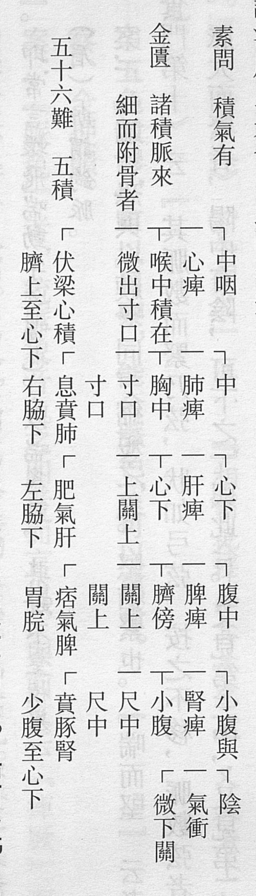

- 素問　積氣有　中〓　中　心下　腹中　小腹與　陰
- 心痺　肺痺　肝痺　脾痺　腎痺　氣衝
- 金匱　諸積脈來　喉中積在　胸中　心下　臍傍　小腹　微下關
- 細而附骨者　微出寸口　寸口　上關上　關上　尺中
- 寸口　關上　尺中
- 五十六難　五積　伏梁心積　息賁肺　肥氣肝　痞氣脾　賁豚腎
- 臍上至心下　右脇下　左脇下　胃脘　少腹至心下

**○白脈之至也，喘而浮。上虛下實，驚有積氣在胸中。喘而虛，名曰肺痺寒熱。**

〔楊〕肺脈，手太陰屬金也，色白，故曰白脈。白脈秋脈，秋脈如浮，其氣來輕虛以浮，來急去散，以爲平好。今雖得浮，然動如人喘，即知肺虛并心。心實故驚，肺虛故有積氣在於胸中，出氣多虛，名曰肺痺，亦以肺虛，故病寒熱也。

<!-- PAGE_END -->

<!-- PAGE: 0352 -->

<!-- PRINTED: 317 -->

案：『喘而浮』者，謂浮數脈也。『上虛』者，肺部表虛邪乘之也。『下實』者，胃氣充實也。蓋肺部有宿飲，邪住在於此。凡飲在胸中，迫近心家者，必有驚證。喘而氣出汗洩，故爲表虛，謂之喘而虛也。『寒熱』者，表有邪之謂。《金匱》血痺、短氣、吐血、瘀血、姙娠篇中，共有『無寒熱』之語，皆言無外邪，可以徵矣。『喘而虛』者，《傷寒論》麻黄青龍湯之類證也。『驚』者，柴胡龍蠣桂枝救逆湯之類證也。

（眉）所謂毛脈。

（眉）此二『喘』字義太別。

**○得之醉而使内也。**

《大素》無『也』字。

案：此表受邪之一端也，此證不必皆因於此也。下文同例倣於此。

再案：前文『喘而堅』『喘而浮』，二『喘』字並『彈』之假借歟。後文云『左右彈』，則此偶以同音而誤耳。

（眉）此説極是。

**○青脈之至也，長而左右彈，有積氣在心下支胠，名曰肝痺。**

案：『長』者，脈寸關尺齊等相動之謂也，『左右彈』即其義。小柴胡湯之『脇胸苦滿，脇下痞鞕，心下悸｟三ノ十三ウ｠』『脈弦細｟五ノ十三ウ｠』『脈沈緊｟五ノ十四ヲ｠』，即此證也。《醫心方》卷十｟九ウ｠引范汪方，治寒疝腹中痛，用小柴胡湯，《外臺》卷七｟四六ヲ｠治寒疝腹中痛，用柴胡桂枝湯，並皆寒濕爲之因也。

（眉）所謂弦脈。

（眉）《傷寒論》太陽中篇生薑瀉心湯方後，列五瀉心曰『并瀉肝法』，是知寫心下者，即寫肝藏之義。

<!-- PAGE_END -->

<!-- PAGE: 0353 -->

<!-- PRINTED: 318 -->

（眉）案：『長』者，往來之長也，短脈之反對。

**○得之寒濕，與疝同法，腰痛足清頭痛。**

案：《金匱》上｟七ウ｠『濕家病身疼發熱，面黄而喘，頭痛鼻塞而煩，其脈大，自能飲食，腹中和，無病。病在頭中寒濕，故鼻塞』。此所云『頭痛』正同，後世之肝厥頭痛是也。《厥陰病》｟六ノ十三ウ｠『手足厥冷，脈乍緊者，邪結在胸中，心下滿而煩，飢不能食者，病在胸中，當須吐之，宜瓜蔕散』。凡厥陰證之厥逆，並與此所云『足清』同理。又《金匱》中｟二ウ｠『腎著之病，其人身體重，腰中冷云云，身勞汗出，衣裏冷濕，久久得之，腰以下冷痛，腹重如帶五千錢。甘薑苓朮湯主之』。『清』字義詳見《藏氣法時》｟廿二｠。

**○黄脈之至也，大而虛，有積氣在腹中，有厥氣，名曰厥疝。女子同法。**

〔楊〕脾脈足太陰，屬土色黄，故曰黄脈。黄脈好者代而不見，惡者見時脈大而虛，即知積氣在腹中。腹中厥氣，名曰厥疝。男女同病。

《金匱》卷上｟四十二ヲ｠『腹痛，脈弦而緊。弦則衛氣不行，即惡寒。緊則不欲食，邪正相搏，即爲寒疝』。

又云『寒疝遶臍痛，苦發則白汗出，手足厥冷，其脈沈弦者，大烏頭煎主之』。｟《外臺》七ノ四四ウ、《千金》十六ノ廿ヲ｠

又云｟四十三ウ｠『其脈數而緊乃弦，狀如弓弦，按之不移。脈數弦者，當下其寒。脈緊大而遲者，必心下堅。脈大而緊者，陽中有陰，可下之』。

《傷寒論》可下篇有『宜大承氣湯』五字。《千金》作『凡寒脈沈弦，脈雙弦者，寒也。弦脈狀如張弓弦，按之不移。脈數弦者，當下其寒。脈雙弦而遲者，心下堅。脈大而緊者，陽中有陰，可下之｟十六ノ十七ウ｠』。

《傷寒論》陽明篇｟五ノ二ヲ｠『傷寒三日，陽明脈大』。

又云｟同ウ｠『陽明病，若中寒者，不能食，小便不利，手足濈然汗出，此欲作固瘕。必大便初鞕後溏，所以然者，以胃中冷，水穀不別故也』。所云『固瘕』與本論『厥疝』相類似。

<!-- PAGE_END -->

<!-- PAGE: 0354 -->

<!-- PRINTED: 319 -->

《金匱》下｟九ウ｠云『婦人之病，因虛積冷，結氣爲諸經水斷絶，云云，在中盤結，繞臍寒疝，或兩脇疼痛，與藏相連』。此論與『女子同法』同義。

【楷】（眉）所謂厥氣，上衝氣也。

【楷】（眉）本篇五痺，皆男女所共病，而此曰女子同病者何。曰女子，斥女子恒病疝瘕也。《説文》『瘕，女病也』是也。

【楷】（眉）法，謂療法也。『厥疝』者，上衝痛疝之義。此云厥疝，不云脾痺者，厥疝乃脾痺之或名，以其治法同女子疝瘕，故舉厥疝名者。古聖人令後世速悟治法之微意也。

**○得之疾使四支汗出當風。**

〔楊〕脾主四支，急役用力，四支汗出，受風所致。楊注『役』《説文》大篆。

案：表受邪則脾胃不和，飲食不消，乃爲傷食癖瘕之兆也。

**○黑脈之至也，上堅而大，有積氣在腹中與陰，名曰腎痺。**

〔楊〕腎脈，足少陰，屬水色黑，故曰黑脈。黑脈冬脈，冬脈如營，其氣來沈而搏，以爲平好。今黑脈至，上堅而大，即知有積氣在腹中及陰中，名曰腎痺。

案：腎痺，即腎積，奔㹠病是也。《移精》第十三云『八風五痺之病』者，亦非麻痺之義，閉塞爲病之謂也。

《金匱》上｟三十四ウ｠云：『奔豚病，從少腹起，上衝咽喉，發作欲死，復還止｟《玉函》『止』作『生』是｠，皆從驚恐得之。』《外臺》｟十二ノ四四ヲ｠引《小品》。《玉函》此下有『腎間有膿故也』六字。

<!-- PAGE_END -->

<!-- PAGE: 0355 -->

<!-- PRINTED: 320 -->

案：五積之名，殆胚胎於《靈樞·邪氣藏府病形篇》，雖本篇所論五積，其名雖異，蓋五痺與五積，其義則一。《五十六難》云：『肝之積名曰肥氣，在左脇下，如覆杯，有頭足，久不愈，令人發欬逆瘖瘧，連歲不已。心之積名曰伏梁，起齊上，大如臂，上至心下，久不愈，令人病煩心。脾之積名曰痞氣，在胃脘，覆大如盤，久不愈，令人四肢不收，發黄疸，飲食不爲肌膚。肺之積名曰息賁，在右脇下，覆大如杯，久不已，令人洒淅寒熱，喘欬發肺壅。腎之積名曰賁豚，發於少腹，上至心下，若豚狀，或上或下無時，久不已，令人喘逆骨痿少氣。』

（眉）所謂石脈。

**○得之沐浴清水而臥。**

〔楊〕得之因以冷水沐髮及洗浴而臥也。

案：今患疝人，下得冷必發，與此同理。沐水浴水，亦下冷之一端耳。蓋『沐浴清水』四字中，包括無量犯濕冷諸事也。清者，冷也。與前『足清』同義，非清濁之清也。楊以冷水釋之，是也。

（眉）其真沐浴清水者，夏月之事也。

**○凡相五色之奇脈，面黄目青，面黄目赤，**

**○面黄目白，面黄目黑者，皆不死也。**

《大素》『赤』下有『白』字，無『也』字。

〔楊〕相前五色異脈，先相於面五色者也。面得黄色，目之四色見於面者，以上爲本，故皆生之。

〔新〕按：《甲乙經》無『之奇脈』三字。

<!-- PAGE_END -->

<!-- PAGE: 0356 -->

<!-- PRINTED: 321 -->

〔識〕簡按：據《甲乙》，衍『之奇脈』三字。

【楷】案：『之奇脈』三字，當作『之異於常脈而不色脈相合者』十二字看。夫色脈合者，肝病色青脈弦，心病色赤脈鉤之類，是其常法也。今此死與不死二文，咸是色脈不相合者也。不相合，故危病篤疾也。雖然，其見色黄而不合則未必死，故曰不死也。黄者，蓋血色之常也。其危篤大病而見青赤黑者，是非血之正色，斷爲必死，故曰死也。其不舉面白者何也？蓋白即混於黄而同理，今於實際而爾，故此文舉黄則包白也。黄者，黄白之謂。又其不舉目黄者何也？蓋目黄非於死病時有焉，故不能曰目黄也。其目黄之人必在疸病，自是別理，非百病死期之候也。

**○面青目赤，**

〔楊〕肝病心乘，名曰實邪。

**○面赤目白，**

〔楊〕心病肺乘，名曰微邪。

**○面青目黑，**

〔楊〕肝病腎乘，名曰虛邪。

**○面黑目白，**

〔楊〕腎病肺乘，名曰虛耶之也。

**○面赤目青，**

《大素》『青』下有『者』字。

〔楊〕心病肝乘，名曰虛耶。

<!-- PAGE_END -->

<!-- PAGE: 0357 -->

<!-- PRINTED: 322 -->

**○皆死也。**

《大素》無『也』字。

〔楊〕此之五色，皆爲他剋，不得其時，不療皆死。但色難知，且依一義如此也。

萬延元年庚申七月十九日書了　節齋〔花押〕

第十補

翠羽｟三ヲ｠

〔箚〕《爾雅》『翠鷸』郭注：『似燕紺色』。宋玉《登徒子好色賦》『眉如翠羽』向曰：『如翡翠之羽』。

五色之見死也｟三ヲ｠

〔楊〕滋，青之惡色也。炲，音苔，謂草烟栖聚。炲，煤黑之惡色也。衃，凝惡之血也。枯骨，白之惡色也。

此五色之見生也｟三ウ｠

〔楊〕此五者皆病候，不死者色也。

指受血而能攝｟七ウ｠

〔識〕《説文》『攝，引持也』。《莊子·胠篋》云『必攝緘縢固扃鐍』，攝字之義與此同。張云：『按：血氣者，人之神也，而此數節皆但言血，而不言氣，何也？蓋氣屬陽而無形，血屬陰而有形，而人之形體，以陰而成。如《九鍼篇》曰：人之所以生成者，血脈也。《營衛生會篇》曰：血者，神氣也。《平人絶穀篇》曰：血脈和則精神乃居。故皆言血者，謂神依形生，用自體出也。』

<!-- PAGE_END -->

<!-- PAGE: 0358 -->

<!-- PRINTED: 323 -->

爲厥｟八ヲ｠

〔楊〕出不覆身也，臥不覆身，爲風所吹，寒風入腠，血寒凝聚，積膚爲痺，積脈血澀，積足爲厥。厥，逆也。

甚則入肝｟十四ヲ｠

〔楊〕手太陽上頭，故頭痛也。心藏小腸府二經病也。後之三脈，皆有入藏，略而不言也。

夫脈之小大｟十六ヲ｠

〔楊〕寸口六脈之形，指下得之，故曰指別。

五藏之象可以類推｟十六ヲ｠

〔楊〕皮肉筋脈骨等，五藏外形，故爲象也。五脈爲五象之類，推脈可以知也。

可以萬全｟十六ヲ｠

〔楊〕耳聽五音，目察五色，以合於脈。用此三種候人，病者所爲皆當，故得萬全也。

名曰心痺｟十六ウ｠

〔楊〕心脈手少陰，屬火色赤，故曰赤脈。赤脈夏脈，夏脈如鉤，其氣來盛去衰，以爲平好。今動如人喘又堅，故有積氣在胸中，滿悶妨食，名曰心痺。積者，陰氣。聚者，陽氣。積者，五藏所生。聚者，六府所成。積者，其始有常處。聚者，發無根本，無所留止也。

足清頭痛｟十八ヲ｠

〔楊〕得之因於寒濕足冷，而上以成其病。與疝病同。足厥陰脈，從足脩｟（當作『循』）｠少腹上頭，故腰足頭痛。

肉胝䐃｟二ヲ｠

<!-- PAGE_END -->

<!-- PAGE: 0359 -->

<!-- PRINTED: 324 -->

案：『胝䐃』之緩言爲瘦，又瘷肉。胝䐃者，謂肉瘦損縮小也。《廣韻》去聲四十九宥『瘦，瘦損。所祐切』『瘷，縮小。側救切』，與縐、䐃同音，可以徵矣。

黑如炲者死｟三ヲ｠

案：《説文》『炱，灰炱煤也』。段玉裁曰『《通俗文》積煙曰炱煤。《玉篇》云：炱煤，煙塵也。《廣韻》同』。據此，則『炲煤』二字熟語，出於漢人。蓋古只云炲、云煤。漢已後云炲煤歟。《風論》云『腎風其色炲』亦與此同理，宜併考。

【楷】長而左右彈｟十七ウ｠

【楷】案：『左右彈』者，或有左右兩彈病人，或有左彈病人，或有右彈病人之義。猶一二日、五六月、秦漢時、魯衛國之例，或爲一或爲兩，可通也。又所謂百年左右、三十左右之類同義，未一定之詞也。左，左手也。右，右手也。而此『左右彈』，即雙弦偏弦也。蓋或有偏弦，故出雙弦名。凡天下見弦脈人，未有不雙。雙，常事也。偏，其變也。故此亦主偏彈言焉。言『左右彈』，則包雙彈偏彈義也。此云『長而彈』者，即弦脈也耳。《金匱》痰飲篇『凡食少飲多，水停心下，甚者則悸，微者短氣，脈雙弦者，寒也。皆大下後喜虛，脈偏弦者飲也』。尤怡《金匱心典》曰『雙弦者，兩手皆弦，寒氣周體也。偏弦者，一手獨弦，飲氣偏注也』，劉桂山據焉，故又曰『案：徐彬《金匱論註》云有一手兩條脈亦曰雙弦，此乃元氣不壯之人，往往多見此脈，亦屬虛。適愚概温補中氣，兼化痰，應手而愈。此本於吴氏崑《脈語》云雙弦者，脈來如引二線也。爲肝實，爲痛。若單弦，只一線耳。然與經文雙弦義逓別』。朱光被《金櫃正義》亦曰『兩手皆見弦脈，設一手獨弦，明是病氣有偏著』，稻葉元熙曰『「脈雙弦者，寒也」二句是客，「脈偏弦者，飲也」句是主。主客對舉』，皆與桂山氏説合。今案：《傷寒論》可下篇『脈雙弦而遲者，必心下鞕。脈大而緊者，陽中有陰也。可下之，宜大承氣湯』，《脈經》卷六·脾經病證第五篇曰『寸口脈雙緊，即爲入。其氣不出，無表有裏，心下痞堅』，並是有雙弦雙緊，未舉偏弦偏緊。然則三部寸關尺皆並見二動，謂之雙歟。爾則『左右』非左右手之謂，而二動並伴，故偁之左右也歟。《脈經》云寸口者，總三部之名耳。要之雖兩條脈，亦或有一手人，或有兩手人耶。蓋毅斷之，則《傷寒論》《金匱》《脈經》等文，皆爲兩條義，此經『左右』亦爲兩條並伴義，全棄卻左右手説而後始明明也。又案：弦緊等皆肝病脈，故特見並雙兩條，無在他病他脈有此理者也。《脈經》卷四·平雜病脈第二曰『偏弦爲飲，雙弦則脇下拘急而痛，其人濇濇而惡寒』。《病源》卷廿·痰飲候『脈偏弦爲痰』。

<!-- PAGE_END -->

<!-- PAGE: 0360 -->

<!-- PRINTED: 325 -->

喘而虛｟十七ヲ｠

案：虛即噓之假借古字。『喘而虛』者，言喘息而其氣噓吸也。

腦｟六ヲ｠

凡人寤覺時，腦神氣分布四旁，爲知覺運動。然後腦神氣減少，因神氣潛衰歸於腦家，於是乎發寐眠。寐眠之中，心藏之血液上升，補作腦神氣充滿如元，則不能潛屈在腦家，而遊溢四布，於是亦爲覺寤，則爲知覺運動也。覺減寐作，相環無端，猶如晝日光照動營夜安，反之而補造日間照動之氣虛也。是言本於平田篤胤《靜岩室》下卷。

#### 五藏別論篇第十一

《大素》卷六·藏府之一藏府氣液載卷首至『故曰實而不滿』。又卷十四·診候之一人迎脈口診載『帝曰氣口』至卷末。

《大素》全存。

<!-- PAGE_END -->

<!-- PAGE: 0361 -->

<!-- PRINTED: 326 -->

案：五藏外又有諸藏，辨其物於此，故名，即五藏外別藏論之義。

**○黃帝問曰：余聞方士或以腦髓爲藏，或以腸胃爲藏，或以爲府。敢問更相反，皆自謂是。不知其道，願聞其説。**

《大素》『問』下有『於岐伯』三字。

《大素》此下有『或以爲府』四字。

〔楊〕方，道也，異道之士所説。藏府不同。腦、髓、骨、脈、膽及女子胞，此六或有説之爲藏，或有説之爲府。胃、大腸、小腸、三膲、膀胱，此五或有説之爲藏，或有説之爲府。所説藏府相反，何者爲真？

《千金方·自序》曰：『黃帝與方士雷公岐伯之倫。』

〔箚〕稻曰：『《史·封禪書》遣方士入海。』

《至真要大論》『余錫以方士，而方士用之云云』，又『而方士不能廢繩墨，而更其道也』。

案：方士猶云道士，謂方術之士。巫相醫卜之術，亦皆謂之方士也。《太平御覽》六百六十六引《太霄經》曰『人行大道，謂之道士。又云：從道爲事故稱也』，可以徵矣。蓋修養真服餌諸方，故謂之方士，若醫方亦其一端耳。即此云『方士』者，醫人之謂也。《廣韻》十陽『方，法術也』。

〔箚〕《脈要精微論》『夫五藏者，身之強也。頭者，精明之府云云』，寬案：藏府互文。此蓋以腦髓爲藏府者也。

案：此説不可從。王注云『腦髓爲藏，應在別經』，非是。又《脈要精微》云：『脈者，血之府也。』《海論》云：『腦爲髓之海。』

（眉）或以爲府者，以腦髓腸胃等，咸爲府名之謂也。楊注太是。故下文曰『此六者奇恒之府』，可證云爾。

<!-- PAGE_END -->

<!-- PAGE: 0362 -->

<!-- PRINTED: 327 -->

（眉）方士皆謂是，實是也。帝之疑者，愚也。藏府名各可相通用，勿拘也。

**○岐伯對曰：腦、髓、骨、脈、膽、女子胞，此六者，地氣之所生也。皆藏於陰，而象於地，故藏而不寫，名曰奇恒之府。**

《大素》無『對』字。

案：此云女子胞，則在男則爲精室，在女則爲子藏之義在焉，蓋謂男女共有此六者也。此説極是，精室即男胞也。

《大素》無『對』字。

〔楊〕胞，豹交反，生兒裹也。地主苞納收藏，腦髓等六法地之氣，陰藏不寫，故得名藏。以其聚，故亦名府。府，聚也。此亦非是常府，乃是奇恒之府，奇異恒常。

案。奇恒者，謂腦髓等六，並爲奇巧微眇之用，而日夜不息也。蓋奇爲奇巧，恒爲不斷，即以奇巧爲恒之義。諸注家皆以爲異常，恐非是。

腦髓骨皆並爲腎之所主，然爲其｟（『爲其』當乙）｠用也各異，故揭出於此也。蓋腦爲思慮之原，髓爲精液之源，骨爲爪牙之原，脈可以知死生吉凶，膽可以決善惡是非，女子胞者，即爲寫出有餘之血之處，其用亦多。凡此六者，其爲用也各不同，而與藏府自別，故名曰奇恒之府也。

各有形狀可見，故曰地氣之所生。並收藏精血，故曰皆藏於陰。常分配有餘之血精，以榮養一身。但其爲器也滿而不溢，無有過不及，故曰藏而不寫。是地氣上騰，無所不至之義也。

（眉）案：腦髓並水物，而藏魂魄志性，亦尚與骨膽脈胞均是箱匡府庫之具耳。此五者以水氣生活，故曰地氣之所生也，而象地也。此六者居幽奥之地，故曰藏於陰也。藏，隱匿也。陰，蔭幽也。

<!-- PAGE_END -->

<!-- PAGE: 0363 -->

<!-- PRINTED: 328 -->

（眉）《大奇論》『髓者以腦爲主』，王注曰：『全注：人先生於腦，緣有腦則有骨髓』。

（眉）《金匱玉函》總例篇第一章『天一生水，剛柔漸形，是以人之始生，先成其精，腦髓既足，筋骨斯成，皮堅毛長，神舍於心』。

（眉）案：腦髓骨脈胞之血液新陳相代，及膽之泄汁，皆不得云寫也。

（眉）案：『奇恒』二字，當作『以奇爲常』四字看。恒，即孟子曰『恒心』『恒産』之『恒』。

**○夫胃、大腸、小腸、三焦、膀胱此五者，｟《大素》無『此五』二字｠天氣之所生也。其氣象天，｟《大素》『天』上有『於』字｠故寫而不藏，此受五藏濁氣，名曰傳化之府，｟《大素》無『傳化之』三字｠此不能久留，輸寫者也。｟《大素》無『者也』二字｠**

〔楊〕天主輸洩風氣雨露，故此五者受於五藏糟粕之濁，去於天氣，輸寫不藏，故是恒府。唯有五者，以膽一種而不寫，割入奇府，是肝之表，故得名府也。

案：尿屎及汗唾之類，但出而不入，猶雨露霜雪之降而不升之類，故曰其氣象天。是天氣下降無所不通之義，曰『故寫而不藏』也。

（眉）《靈·小鍼解》曰：『水穀皆入於胃，其精氣上注於肺，濁溜於腸胃。』

（眉）案：『此五』者，以陽氣生活爲職，故曰天氣之所生也，曰其氣象天也。

（眉）《靈蘭祕典》曰：『大腸者，傳道之官，變化出焉。小腸者，化物出焉。』本篇下文曰：『六府傳化物而不藏。』

**○魄門亦爲五藏使，**

《大素》『魄門』二字屬於前句，恐非是。

〔楊〕并精出入之處，謂之魄門，此五之中三膲，亦能輸寫精氣於魄門也。此注以魄門爲魄，非是。

<!-- PAGE_END -->

<!-- PAGE: 0364 -->

<!-- PRINTED: 329 -->

〔識〕魄、粕通。《莊子·天道篇》『古人之糟魄已夫』，《音義》『司馬云：爛食曰魄。一云糟爛爲魄。本又作粕』。蓋肛門傳送糟粕，故名魄門。王注恐鑿矣。

〔張〕雖諸府糟粕，固由其寫，而藏氣升降，亦頼以調，故亦爲五藏使。

（眉）案：使，臣使也，在下給事之官也。

**○水穀不得久藏。**

〔楊〕五藏在内爲主，六府在外爲使，使之行於水穀也。

**○所謂五藏者，藏精氣｟《大素》『氣』作『神』｠而不寫也。｟《大素》『寫』下有『者』字｠故滿而不能實。**

〔楊〕精神遍於藏中不離，故不寫而滿也。雖滿常虛，故不實。

（眉）案：滿，氣滿也。實，物實也。

**○六府者，傳化物而不藏，故｟《大素》『傳化』以下七字無｠實而不能滿也。｟《大素》無『也』字｠所以然者，水穀入口，｟《大素》『穀』下有『之』字｠則胃實而腸虛，食下則腸實而胃虛，故曰實而不滿，滿而不實也。｟《大素》無『滿而』以下五字｠**

〔楊〕腸胃更滿，故爲實也。更虛，故不滿也。飲食未消，腸中未有糟粕，即胃實腸虛也。食消以下於腸，胃中未有食入，即腸實胃虛也。以其胃虛，故氣得上也。以其腸虛，故氣得下也。氣得上下，神氣宣通，長生久視。

（眉）然，如此也。然斥六府事也，非斥五藏之事也。腸主斥小腸。

（眉）案：『滿而不實也』上當入『五藏不然故』五字看，要之從《大素》刪此五字則太妥。

**○帝曰：氣口何以獨爲五藏主。**

《大素》『帝』上有『黃』字，『主』下有『氣』字。

<!-- PAGE_END -->

<!-- PAGE: 0365 -->

<!-- PRINTED: 330 -->

〔楊〕請候各候五藏之氣，何因氣口獨主五藏六府十二經脈等氣也。案：『請』恐『診』訛。

〔紹〕先兄曰：《經脈別論》《四時氣篇》作『氣口』，《五色篇》《終始篇》作『脈口』，《六節藏象論》《禁服篇》作『寸口』。

〔識〕《倉公傳》太陰之口，亦謂寸口。《經脈篇》曰：『經脈者，常不可見也。其虛實也，以氣口知之。』《經脈別論》曰：『權衡以平，氣口成寸，以決死生之分。』《難經·一難》曰：『十二經皆有動脈，獨取寸口，以決五藏六府死生吉凶之法，何謂也。然。寸口者，脈之大會，五藏六府之所終始，故取於寸口也。』

（眉）案：主，主脈也。《大素》作『主氣』，亦主脈氣之義。

（眉）氣口猶云氣穴。氣者，以其地藏氣注而發，故名焉。口者，氣穴空孔之地也。

（眉）曰五藏，則六府亦包中。故下文曰胃者云云。

**○岐伯曰：胃者水穀之海，六府之大源也。**

《大素》無『源』字，『海』下有『也』字。

〔識〕《靈·五味篇》云：『胃者，五藏六府之海也。』《玉版論》云：『胃者，水穀氣之海也』。

案：在大天地亦以海爲源，不必爲委而已。蓋海水百滲亦出山顛，而爲泉爲湖，以浸漑土地，亦與我腸胃同理。

《五行大義》卷三第四·論配藏府引《河圖》云：『脾合胃，胃爲五穀之府。爲五穀府者，脾通於口，口入五穀而胃受之，故爲其府。』

**○五味入口，藏於胃，以養五藏氣，氣口亦太陰也。**

<!-- PAGE_END -->

<!-- PAGE: 0366 -->

<!-- PRINTED: 331 -->

《大素》『五藏』之『藏』無。《大素》『太』作『大』。

〔馬〕五味入口，藏於胃，而得脾以爲之運化，致五藏之氣，無不籍之資養，則是脾者足太陰也，肺者手太陰也，其氣本相爲流通，而氣口亦手太陰耳。

案：藏於胃，則又傳藏肝脾腎，均是膈膜下也，與下文藏於心肺鬲膜上，文相反對。

〔張〕氣口屬肺手太陰也，布行胃氣則在於脾足太陰也。《經脈別論》曰：『飲入於胃，游溢精氣，上輸於脾，脾氣散精，上歸於肺。』然則胃氣必歸於脾，脾氣必歸於肺，而後行於藏府營衛。所以氣口雖爲手太陰，而實即足太陰之所歸，故曰『氣口亦太陰也』。

（眉）案：太陰，即脾一名。仲景太陰病，《素問》太陰病之義皆同。張介賓每曰『足經周身，大洽包手經之地』，實然。

**○是以五藏六府之氣味，皆出於胃，變見於氣口。**

〔楊〕胃爲水穀之海，六府之長，出五味以養藏府。血氣衛氣行手太陰脈，至於氣口。五藏六府善惡，皆是衛氣所將而來，會手太陰見於氣口，故曰變見也。

〔識〕吴云：『五藏六府之氣味，皆出於胃，薰蒸於肺。肺得諸藏府之氣，轉輸於經，故變見於寸口。』高云：『五藏六府之氣味，始則五味入口藏於胃，繼則脾氣轉輸氣味，皆出於胃，循經脈，而變見於氣口。』簡按：『出』字，全本作『入』，而王注亦云『穀入於胃』，然據吴、高注，意不必改『入』字，其義自明。

案：五藏六府之氣味，謂腎腐鹹，心焦苦，肝羶酸，肺腥辛，脾香甘之類。此氣味並皆胃之所榮養，故曰皆出於胃也，與前文『五味入口』之五味自不同。前謂口所食之五味，此謂藏府自分之氣味，乃爲胃之所養也。諸家皆失解，非是。

<!-- PAGE_END -->

<!-- PAGE: 0367 -->

<!-- PRINTED: 332 -->

**○故五氣入鼻，藏於心肺，心肺有病，而鼻爲之不利也。**

《大素》『氣』上有『藏』字。

《大素》『鼻』上有『於』字。

〔楊〕穀入於胃，以養五藏，上薰入鼻，藏於心肺。鼻中出入，鼻爲肺官，故心肺有病，鼻氣利也。

案：『利』上恐脫『不』字。

案：此與『五味入口藏於胃』相對成文，乃謂凡飲食其味入口，其氣入鼻。其氣，即氣味之氣也。鼻不利者，謂鼻閉塞不通，及不聞香臭之類，肺氣之不通於鼻也。

案：今感冒，即鼻不利，此之謂也。案：五氣，香臭臊腥羶也。《大素》作『五藏氣』，非是。

**○凡治病，｟《大素》『凡』上有『故曰』二字，『病』下有『者』字｠必察其下，｟《大素》『其』下有『上』字｠適其脈，｟《大素》『脈』下有『候』字｠觀其志意與其病也。｟《大素》『也』作『能』｠**

〔識〕吴云：『下，謂二便也。』張云：『適，測也。』簡按：當從《太素》，補『上』字、『候』字，其『病』下補『能』字。

（眉）案：適，測量也。志意，病時之志意，及其人平生之志意行狀也。其病，其病態也。

**○拘於鬼神者，不可與言至德。**

《大素》『拘』上有『乃』字。《大素》『與』作『無』，恐訛。《大素》『德』作『治』。

〔楊〕療病之要，必須上察人迎，下診寸口。適於脈候，又觀志意有無。無志意者，不可爲巫及説療疾。復觀其人病態，能可療以不。若人風寒暑濕爲病，乃情繫鬼神，斯亦不可與言也。案：『以不』即『與否』也。

〔紹〕堅案：適，猶調也。宜參《離合真邪論》。即《平人氣象論》平息以調之爲法之義。楊『志意』注，非是。蓋不言病者之苦喜厭欲耳。

<!-- PAGE_END -->

<!-- PAGE: 0368 -->

<!-- PRINTED: 333 -->

《靈樞·本藏篇》云：『志意者，所以御精神，收魂魄，適寒温，和喜怒者也。是故志意和，則精神專直，魂魄不散，悔怒不起，五藏不受邪矣。』

〔馬〕彼拘於鬼神者，專事祈禱，惑於渺茫，與言修身養性之至德，必不見信。

〔張〕信巫不信醫，一不治也。即此之謂。

（眉）至德、至巧者，醫道之至德至巧也。

**○惡於鍼石者，不可與言至巧。｟《大素》『鍼』作『鏡』，『鏡』即『鑱』訛｠病不許治者，｟《大素》『病』上有『治』字｠病必不治，｟《大素》作『病不必治也』五字｠治之無功矣。**

〔楊〕鏡，仕監反，鈹也。其病非鍼石不爲，而惡之者，縱岐黃無所施其功，其病可療，而不許療者，縱倉扁不可爲其功也。案：『鏡』即『鑱』訛。

（眉）病必不治，謂不至愈也。治之無功，謂雖愈驗無爲功績而賞也。無者，蔑如之義。

### 重廣補注黃帝内經素問卷第三

素問攷注卷第三

萬延元庚申八月六日雨中書了　源立之

第十一補

名曰奇恒之府｟一ウ｠

案：後文云『名曰傳化之府』，《大素》作『名曰府』，無『傳化之』三字。據此考之，奇恒者，腦、髓、骨、脈、膽、女子胞六者謂之奇，胃、大小腸、三焦、旁光五者謂之恒也。乃與《玉版論要十五》《病能論四十六》所云『奇恒』其義相合。《素問》本文『傳化之』三字，蓋王氏所增加之朱文之一乎。前説宜改。

<!-- PAGE_END -->

<!-- PAGE: 0369 -->

<!-- PRINTED: 334 -->

案：六藏六府外尚有廿六具。

屬藏職者十五

一鼻

二喉

三目

四腦　『腦』出本篇。《脈要精微》曰：『頭者，精明之府。』《海論》：『腦爲髓之海。』

五耳

六命門　一名頤，亦作『脠』『胰』。詳出《本草綱目》豕條、胡桃條，宜録。

七舌

八胞　『胞』出本篇。女胞，一名熟藏。

九爪

十睾胔　一名白腸。男謂睾，女爲胔。睾一名垂。胔一名生藏。《廣韻》五支：『胔，音疵。人子腸名。』又曰：『胔，音雌。小腸。』《脈經》卷九陰吹脫下篇曰：『白腸必挺核。』《甲乙》卷三腹第二行二十篇：『氣穴，一名胞門，一名子户。』

（眉）鉉本《説文》：『骴，或從肉。』考胔之言觜也，柴也，些也，細小之謂。又《説文》：『柴，一曰藏也。』蓋斥人子腸也。

十一膜

<!-- PAGE_END -->

<!-- PAGE: 0370 -->

<!-- PRINTED: 335 -->

十二骨　骨中藏髓也。『骨』出本篇。齒乃骨餘。

十三毛

十四脈　『脈』出本篇。又《脈要精微》：『脈者，血之府也。』

十五筋

屬府職者十一

一口

二咽

三蟲腸　《醫心方》卷二·第二篇引華佗《鍼灸經》『第十六椎，名裂結窌』。又引僧匡及徹公『結腸輸第十五節』所云『裂結』及『結腸』二名，似斥蟲腸。

四皮

五胭　《難經》謂之原，又謂之氣街、氣衝。又謂之原氣。《禮·郊特牲》『取膟膋』注：『膟膋，腸間脂也。』《説文》：『膟、膋同文。膫、膋同字。』又《説文》『脟，腸間肥也。一曰膫也』，並胭一名。

六膚

七膻　一名肛，一名魄門。出本篇。《太素》卷十三腸度篇注：『廣腸，白膻也。附脊，以受大腸糟粕。辟著脊也，謂白膻。』

（眉）《醫心方》卷二·第二篇引華他《鍼灸經》：『第廿二椎名盡腸窌。又云八遼窌。第廿三椎名下極窌。』所云『盡腸』『下極』並似斥肛腸。

八肉

<!-- PAGE_END -->

<!-- PAGE: 0371 -->

<!-- PRINTED: 336 -->

九莖牝　『莖』一名全，牝一名也。全出《老子》，也出《説文》也。

十宗脈

十一湊

此餘無有

案：子門，何故有上口乎？曰：子門上下口相通，引納藏府中天氣以養卵子，猶風通而動植育也。諺曰『欲求南風，須開北牖』，即此理也。

案：世人曰：女子皆齎卵子四十，左右各二十子，而雖多産之女亦不滿四十之數者，有粃惡之卵也。猶一樹之桃子、梅子，不悉皆生芽甲也，是天理耳。其全無産子者，瘕積塞子門上口下口，或上下兩口，而其卵漸枯腐，無函活氣也，猶桃梅實盛而斷其枝柯也。

案：娩産不自陰牝，而從背脇掖股産出者，蓋卵子自巢出子門，不適胞中，反自後花腸花門上口佚出他地者也。

汪昂《本草備要》云：『人之記性皆在腦中，小兒腦未滿，老人腦漸空，故皆健忘愚思。凡人追憶往事，必閉目上瞪而思索之，此即凝神於腦之意也。』此文平田篤胤《靜乃石屋》下卷引之，今無所考。《靜乃石屋》下卷又引《醫學原始》曰：『人之一身，五藏藏於身内，爲生長之具。五官居於身上，爲知覺之具。耳目口鼻聚於首，最顯最高，便與物接。耳目口鼻之所導入最近於腦，必以腦先受其象而覺之，而寄之而剖之而存之。故云心之記，正記於腦耳。』是文亦未見其原書，不知何人著書。恐汪機著《醫學原理》之誤歟。猶未究汪機言之乎否，姑俟後日探獲耳。

三谷樸《解體發蒙》卷四曰：『心藏神，腦藏精，心主發出神氣，腦主藏入精氣。譬欲視聽之者，即神之出也。既得視聽之者，即精之入也。』又曰：『晝覺時費神於外，發以爲事業。夜寐時畜精於内，收以爲逞寤時之用也。』

<!-- PAGE_END -->

<!-- PAGE: 0372 -->

<!-- PRINTED: 337 -->

（眉）《周易參同契》上篇曰：『三光陸沈，温養子珠。』

平田篤胤《靜乃岩屋》卷下曰：『凡人寤覺，則神發四布，故知覺營爲，故費耗精液神氣也。於是乎寤眠起矣。寐眠則神收潛腦，故神鎮氣收，而此中血液上升補釀腦精，以補寤時，既費乏竭者，復成全量，以供後時寤時之費用。故眠中其造釀已全補足，則神氣自欲發布而自然寤覺，總身活動不能止也。一動費一靜作，與天地晝費動，夜作靜同理。則人身之神與天日之出入，人身之精與地氣之發止，相同一理耳。』

《奇病論》王注引全注：『人先生於腦，緣有腦則有骨髓。』

（眉）《金匱玉函經》一卷總例篇：『頭者，身之元首，人神之所注，氣血精明三百六十五絡，皆歸於頭。頭者，諸陽之會也。』

案：十二經配六藏六府，外有四脈，亦四藏配焉。

督脈｟腦之經｠　任脈｟胞之經｠　帶脈｟命門之經｠　衝｟原之經｠

此餘有九道｟耳目鼻口舌喉咽陰膻｠　九器｟毛爪皮膜肉湊脈筋骨｠　以成一身也。

方士｟一ヲ｠

大凡藝術之道，謂之方。士大夫之治天下，治六藝，百工之爲百物，爲百事，皆是術也。術之常道法矩，謂之方也。《扁倉傳》諸出『方』字，及仲景自序『衆方』字，皆均同義。『方』字訓道者，經史諸子極多，皆士大夫之道之方字，非方伎之方字也，而與方伎之方同義同理，均是一藝術之道也。方又訓法，訓術，訓法術，訓道術，訓禮法者，經史子多出。

<!-- PAGE_END -->

<!-- PAGE: 0373 -->

<!-- PRINTED: 338 -->

《後漢·桓譚傳》『方士』注：『方士，有方術之士也。』是斥方伎人。而《禮記》經解『是故隆禮由禮謂之有方之士』注：『方，猶道也。』《荀子·禮論》『法禮足禮謂之有方之士』注：『方，猶道也。』是方士之字面既出，而義一也。

十　泣｟一ウ｠　胝腸｟二ウ｠　紺｟四ウ｠　腦｟六ヲ｠　痺厥｟八ウ｠　十二俞｟十ヲ｠　鍼石｟十一ヲ｠　巔疾｟十一ヲ｠　過在｟十二ヲ｠　徇蒙｟十二ウ｠　招尤｟同｠　胠｟十四ヲ｠　欬逆

上氣｟十四ウ｠　五藏相音｟十六ヲ｠　喘｟同｠　長脈｟十七ウ｠　五藏痺｟十九ウ｠　左右彈

十一　方士｟一ヲ｠　奇恒｟同ウ｠　魄門｟二ウ｠　氣口｟三ウ｠　五藏六府之氣味｟五ヲ｠

<!-- PAGE_END -->

<!-- PAGE: 0374 -->

<!-- PRINTED: 339 -->

## 素問攷注卷第四

### 重廣補注黃帝内經素問卷第四

#### 異法方宜論篇第十二

《大素》卷十九知方地，全載此篇。《醫心方》卷一治病大體第一引《大素經》亦同。

（眉）地上萬國，皆以此篇五方而同理一通，即山水寒熱都之五土耳，而或單或兼有之也。

（眉）方土寒熱異治見《醫賸》卷中，宜參。

**○黃帝問曰：醫之治病也，一病而治各不同，皆愈何也？岐伯對曰：地勢使然也。**

『對』字及『然也』之『也』無。

〔楊〕五方土地各異，人食其土，生病亦異，療方又別。聖人量病所宜，一病合以餘方療之，皆得愈者，大聖之巧。

（眉）案：天下萬國，大凡水旁之土，應此東方云云；山中之土，應此西方云云；北邊寒土，應此北方云云；南邊温土，應此南方云云也。且大凡大都會地，人民輻湊，正應此中央也。

**○故東方之域，天地之所始生也。｟《大素》『所』作『法』｠魚鹽之地，海濱｟《大素》作『濱海』｠傍水，其民食魚而嗜鹹，皆安其處，美其食。**

<!-- PAGE_END -->

<!-- PAGE: 0375 -->

<!-- PRINTED: 340 -->

《醫心方》引『皆安』以下七字無。

案：海濱傍水，猶云海水濱傍，與『頭項強痛』同文例。

【楷】案：地轉東，故日出東，所以萬物自東起，天地自東生物。

〔楊〕天地之法，東方爲春，萬物始生之方也。人生魚鹽之地，故安其處，美其食之也。

案：魚味非鹹，而海濱蟹甲草實之屬，皆多味鹹。且多以鹽調味，蓋所以嗜鹹也。與南方嗜酸食胕同例。

**○魚者使人熱中，鹽者勝血，**

〔紹〕《五藏生成篇》：『多食鹹，則脈凝泣而變色。』《宣明五氣篇》：『鹹走血，血病無多食鹹。』

**○故其民皆黑色疎理。**

案：與『南方緻理赤色』相反對。

〔楊〕魚性是熱，故食之令人熱中。鹽，水也。血者，火也。水以剋火，故勝血，而人色黑也。

**○故其病皆爲癰瘍。**

〔楊〕熱中疏理之人，多生癰瘍病也。瘍，養良反，瘡也。

案：今本邦相豆總房海濱之地，多疥癬小瘡臁瘡腳膝風之類，亦所以多食魚鹽也。癰瘍者，統言諸瘡也。

**○其治宜砭石，故砭石者亦從東方來。**

《太素》砭作𥐦。

〔楊〕𥐦鍼破癰已成，冷石熨其初起，此言東方疾異療。

<!-- PAGE_END -->

<!-- PAGE: 0376 -->

<!-- PRINTED: 341 -->

〔紹〕《大素》作『𥐦石』。堅按：『𥐦』是『砭』訛。《玉篇》『砭，甫廉切。刺也。以石刺病也。砭，同上』可以證焉。巳、乏同用，猶汜之與泛，犯之與犯。楊分砭石爲二。誤。且冷石未審其解。

《腹中論》『灸之則瘖，石之則狂』王注：『石，謂以石鍼開破之。』案：可知古未有鍼，但灸與石之二治耳。石之，猶鍼之也。以灸石對言知之。

案：冷石，即滑石一種，出於《本草》陶注，即今蠟石也。蓋以此石冷熨熱結凝血處，令散解。今以牡蠣黃丹末酢和塗，名曰解凝散之類是也。

案：砭石，即爲鈹鍼之所出，砭即石弩，古昔以自然石之砭決瘡瘍，其後倣此作鈹鍼鑱鍼。微鍼亦本是草尖木刺，倣此作微鍼。鍼之爲言刺也，纖也。應知微鍼之類，皆是從草尖木刺倣造也必矣。《古今醫統》云『石弩，即砭石別名』，可從。案：《説文》『砮石可以爲矢鏃。從石奴聲。《夏書》曰：梁州貢砮丹。《春秋國語》曰：肅愼氏貢楛矢石砮』。『砭，以石刺病也』。賈逵注曰『砮，矢鏃之石也』，不誤。玉裁曰：『按：砮，本石名。韋昭注石砮云：鏃也。以石爲之。乃少誤。』《漢書·地理志》上『厲砥砮丹』注：『砮，石名，可爲矢鏃。』

《東山經》『高氏之山，其下多箴石』，郭云：『可以爲砭鍼，治癰腫者。』所謂箴石即砭石，可以箴人病之石，故謂之箴石也。箴、鍼古今字。東山出此者，與《素問》『從東方來』之言相合。

（眉）案：以下五『亦』字，即所謂不一之辭。此佗諸物各自五方産出也。物産在上句。

（眉）慧《音》七十三載玄應《成實論音》曰：『古人以石爲鍼，今人以鐵，皆謂療病者也。』

（眉）《病能論》『宜石而寫之』王注：『石，砭石也。可以破大癰出膿，今以鈹鍼代之。』

（眉）元·齊德之《外科精義》卷上曰：『砭鎌法，夫上古制砭石大小者，隨病所宜也。《内經》謂鍼石，砭石，鑱鍼，其實一也。今時用鎌者，從《聖濟總録·丹毒論》。』

<!-- PAGE_END -->

<!-- PAGE: 0377 -->

<!-- PRINTED: 342 -->

（眉）田村藍水《物類品隲》卷二曰：『石弩，《古今醫統》曰：石弩即砭石之別名也。下野那須野産，上品。尾張三淵山産，中品。讚岐陶村産，下品。』

**○西方者，金玉之域，沙石之處，天地之所收引也。**

案：多沙石之地，必其陰有金玉，故曰『金玉之域，沙石之處』。沙中自有金氣，石中自含玉髓，自然之理也。今本邦甲州奥州諸山亦如此，而亦屬西方也。

案：收引，與東方之『始生』相反對。

**○其民陵居而多風，水土剛強，**

〔馬〕倚高陵以爲居，而耐受乎風。

【楷】案：山中之國，平地多磐巖，故曰『水土剛強』，且溪川急疾，故曰爾也。

〔志〕高平曰陸，大陸曰阜，大阜曰陵。出《爾雅·釋地》。

〔紹〕《後漢·西羌傳》注引『陵居』作『山居』，『民』作『人』。

《西羌傳》曰：『堪耐寒苦，同之禽獸。雖婦人産子，亦不避風雪。性堅剛勇猛，得西方金行之氣焉。』

（眉）下文北方曰『陵居』。

**○其民不衣而褐薦。**

作『疊篇』，『疊』字傍記云：『《切》徒物反。重也。《素問》作褐。』

〔識〕吳云：『薦，草裀也』。簡按：《詩·豳風》『無衣無褐，何以卒歲』注：『褐，毛布也。』《古今黈》云：『薦，席也。草亦得以言薦。』《莊子·齊物論》注：『麋鹿食薦。薦，即草也。』王注『細草』，蓋本《莊子》。

<!-- PAGE_END -->

<!-- PAGE: 0378 -->

<!-- PRINTED: 343 -->

〔紹〕《太素》『褐薦』作『疊篇』。楊曰：『不衣者，不以綿爲衣，而以疊篇其身。』堅按：『疊篇』俟考。

〔劄〕《大素》作『疊篇』。寛案：《後漢書·南蠻傳·哀牢夷傳》『知染采文繡，罽毲帛疊』注：《外國傳》曰『諸薄國女子，織作白疊花布』。《南史》『高昌國有草，實如繭，中絲如細纑，名曰白疊。安子國人取以爲布，甚輭而白，亦作白㲲』。《舊唐書》『婆利國有吉貝草，揖其花以爲布，麤者名古貝，細者名白㲲』。方勺《泊宅編》『南海蠻人，以木綿紡織爲布，布上出細字雜花尤工巧，名曰吉貝布。即古疊布也』。蓋所謂疊篇，以白疊布編身也。

案：褐薦，蓋謂以褐布不成裁縫，只如薦席，以纏繞其身也。疊篇，蓋亦同義。謂以全布疊重接綴以圈繞，猶西天袈裟之製耳。

（眉）《廣雅·釋器》：『毦㲍，罽也。』

（眉）《御覽》八百十九引《通俗文》：『細葛謂之毦翅。』

（眉）《廣韻》二·仙：『氈，席也。』《周禮》：『供其毳毛爲氈。』約之案：薦，即氊古字，諸注皆恐非。薦氈一聲之轉，共清音也。

（眉）《後漢書·西南夷哀牢夷傳》『有梧桐木華，績以爲布，幅廣五尺，絜白不受垢汙』注：『廣志曰：梧桐有白者，剽國有桐木，其華木白毳，取其毳淹漬，緝織以爲布也。』

**○其民華食｟作笮食｠而脂肥，**

《醫心方》『華食』作『笮食』。《大素》『笮』字傍記云：『《切》側陌反。』

<!-- PAGE_END -->

<!-- PAGE: 0379 -->

<!-- PRINTED: 344 -->

案：《素問》作『華食』恐訛。宜從《大素》作『笮食』。笮，即笮之異構。楊曰：『笮，詐白反。食物皆壓笮磨碎，不以完粒食之。』蓋謂西方山中多食木實果子堅鞕之物，不經壓笮磨碎，則不可食，故謂之笮食。西天木食之類是也。木實多油膩，故食之則令肥澤多脂也。

**○故邪不能傷其形體，其病生於内，**

案：西方人多房淫荒，故所以釋迦發起佛教，遂延及於天下也。

【楷】案：北寒國久不食肉，則人弱不堪寒。熱國過食肉類，必發惡病。故寒國專肉食，熱國主食穀菓菜蔬。

**○其治宜毒藥。**

第十四云：『毒藥攻其中，鑱石鍼艾治其外。』

〔識〕張云：『毒藥者，總括藥餌而言。凡能除病者，皆可稱爲毒藥。』汪機云：『藥，謂草木蟲魚禽獸之類，以能攻病，皆謂之毒。』簡按：《説文》：『毒，厚也。害人之艸，往往而生。』『藥，治病艸。從艸樂聲。』而《周禮·天官·醫師》『聚毒藥，以共醫事』鄭注：『毒，藥之辛苦者，藥之物恒多毒。』賈疏：『藥之辛苦，細辛、苦參，雖辛苦而無毒。但有毒者，多辛苦。藥中有毒者，巴豆、狼牙之類是也。藥中有無毒者，人參、芎藭之類是也。直言聚毒藥者，以毒爲主也。』以上皆與王注同。吳、志、高爲有毒之藥，誤矣。考《本草》藥物産於川蜀者極多，此從西方之一證。

〔劄〕褚人獲《堅瓠集》：『天下有九福，云云。蜀川藥福。』

案：《説文》所云『害人之艸』，即亦療病之草也。唯療病在於沈痾固疾，《本草經》下藥主治病是也。陶氏所云『凡天地間物，無不爲天地間用』者，此之謂也。

**○故毒藥者，亦從西方來。**｟無『故』字｠

<!-- PAGE_END -->

<!-- PAGE: 0380 -->

<!-- PRINTED: 345 -->

〔楊〕笮，詐白反。西方金，亦金玉之所出，故爲金玉之域也。西方爲秋，故爲萬物收引之方也。不衣者，不以綿爲衣，而以疊篇其身。食物皆壓笮磨碎，不以完粒食之。人多脂肥，腠理緻密，風寒暑濕外耶不傷，而爲飲食男女内耶生病，故宜用毒藥攻之。

**○北方者，天地所閉藏之域也。其地高陵居，風寒冰冽｟冰凍｠。**

案：北方比西方之其民，陵居而多風，水土剛強則最甚。『風寒冰冽』四字中寓水土之最剛強，多冰乏水之類，在此中也。如今此邦信州諏方湖，堅冰爲陸是也。

（眉）冰，蓋音凝，非仌冰字也。

**○其民樂野處而乳食，**

〔張〕野處乳食，北人之性，胡地至今猶然。

案：常居高陵地者，是西北地勢之論也。張注可從。此云『樂野處』者，秋冬春之間冰雪酷寒，不可高居，故於平野温暖向東南之地，造草廬以禦寒氣也。如今此邦蝦夷北邊秩接｟舍屋之名｠是也。

案：南方風氣柔弱，北方風氣剛勁，理《中庸》既述焉，宜參其朱注等。

**○藏寒生滿病。**｟無『滿』字｠

〔識〕張云：『地氣寒，乳性亦寒，故令人藏寒。藏寒多滯，故生脹滿等病。』簡按：藏寒不必生滿病。《甲乙》無『滿』字，爲是。

案：據王注，則《素問》舊本亦似無『滿』字。

**○其治宜灸焫，故灸焫者，亦從北方來。**｟無『故』字｠

〔楊〕北方爲冬，故爲萬物閉藏之方也。北方其地漸高，是陰中之陰，故風寒也。所樂之處既於寒，所美之食非温，故五藏寒而生病，宜以灸焫。焫，燒也。而悦反。有本『陳』爲『湖』，量北方無湖也。

<!-- PAGE_END -->

<!-- PAGE: 0381 -->

<!-- PRINTED: 346 -->

案：『陳』即『凍』訛。所云『凍湖』，信州諏方湖冰上，人馬通行之類。楊云『北方無湖』，恐非是也。

案：焫，爇俗字。《玉篇》：『爇，而悦切。燒也。焫，同上。』《廣韻》：『爇，燒也。如劣切。焫，上同。見《禮》。』

《至真要論》『少陽之復，枯燥燔爇』王注：『爇，音焫。』

成無己注《傷寒論》卷二·音釋曰：『爇，如劣切。』

玄應《音義》十二曰：『焫，古文爇同。』

（眉）希《音》三卷五頁曰：『爇，又作焫，同如雪反。韻英。放火也，亦燒也。』

（眉）《生氣通天論》『爲皶』王注：『大甚焫出之。』

（眉）慧《音》卷五十二之七頁上：『火焫，古文爇同。而悦反。《通俗文》燃火曰焫，亦燒也。』

（眉）《列子·周穆王篇》『燔焫』張注：『焫，如悦反。』

**○南方者，天地所長養，陽之所盛處也。其地下，水土弱，**

《醫心方》引『盛』下有『之』字，作『其地洼下』。《大素》『汚』字傍記作『洼，《切》爲瓜反。深也。又於佳反』。

〔識〕《家語》云：『堅土之人剛，弱土之人柔。』

**○霧露之所聚也。**

案：南方熱地氣上，所以霧露多聚也。

<!-- PAGE_END -->

<!-- PAGE: 0382 -->

<!-- PRINTED: 347 -->

〔紹〕梶原性全《萬安方》曰：『岐伯曰：南方其地下水土弱，霧露之所聚也，故瘴氣獨盛於廣南。』

**○其民嗜酸而食胕，**

〔張〕胕，腐也。物之腐者，如豉鮓麯醬之屬是也。

案：胕，即腐之異構。猶膚之作臚之例，但一或增畫，一或損畫耳。在五藏則腐爲腎味，南方土地汚下而炎熱，所以食胕也。

**○故其民皆緻理而赤色，其病攣痺。**

《醫心方》傍記『緻，直吏反。密也』。

案：攣痺，即緩風脚弱之證也。《千金方》卷七脚氣論云『考諸經方，往往有脚弱之論，而古人少有此疾，自永嘉南度，衣纓士人多有遭者云云。關西河北不識此疾，自聖唐開闢，六合無外，南極之地，襟帶是重，爪牙之寄，作鎭於彼，不習水土，往者皆遭云云。然此病發初得，先從脚起，因即脛腫，時人號爲脚氣』是也。然本論已有『南方病攣痺』之文，則非古少有之病也。

【楷】（眉）案：攣，脚气中風之類。痺，藏氣痞癖者，不必濕痺之痺也。本書《痺論》可參。

**○其治宜微鍼，故九鍼者，亦從南方來。**

〔識〕高云：『《靈樞·九鍼論》黄帝欲以微鍼通其經脈。微鍼，小鍼也。岐伯論小鍼，而及於九鍼，故曰九鍼者亦從南方來。』簡按：《九鍼十二原》『帝問：無用砭石，欲以微鍼通其經脈。而岐伯答以始於一終於九』，則微鍼即是九鍼，對砭石而言，非九鍼之外有微鍼。志云『微鍼者，其鋒微細，淺刺之鍼也』，恐非是。

〔楊〕南方爲夏，萬物養長陽盛之方也。陽中之陽，其地漸下，故水土弱，霧露之所聚也。汚下，濕也。

<!-- PAGE_END -->

<!-- PAGE: 0383 -->

<!-- PRINTED: 348 -->

胕，扶付反。義當腐。｟《醫心方》傍記引作『扶付反。義當爲腐』七字｠南方爲火，色赤，故人赤色也。以居下濕，多攣痺病，故宜用九鍼也。

（眉）案：《本草圖經》云：『鐵，今江南西蜀有爐冶處皆有之』。李時珍曰：『秦晉淮楚湖南閩廣諸山中皆産鐵，以廣鐵爲良。』據此，則九鍼斥鐵而言，云『九鍼亦從南方來』者，即爲鐵出於南方也。

**○中央者，其地平以濕，天地所以生萬物也｟色者｠衆。**

〔楊〕中國爲土，故其地平濕，中土之所生，物色多之。

**○其民食雜而不勞，故其民多痿厥｟瘚｠寒熱，其治宜導引按蹻｟撟｠，故導引按蹻｟撟｠者，亦從中央出也。**

〔楊〕撟，巨紹反。人之食雜，則寒温非理，故多得寒熱之病。不勞則血氣不通，故多得痿瘚之病。故導引按撟，則寒熱成和，血氣流通。此非但愈斯二病，萬病皆可用之。撟，又九紹反。舉平也。茝庭先生曰：據《説文》，『平』是『手』訛。

〔識〕《莊子》釋文，李氏云：『導氣令和，引體令柔。』

案：《病源候論》載《養生方》導引法，古導引諸法，蓋存於此。按蹻，已見第四中。

（眉）案：痿厥寒熱者，氣血凝滯之所爲。故以『導引按蹻』治之，宜令筋絡骨節氣血流通也。此法上古以來，中土所傳，《靈樞》往往論之，《病源候論》所引《養生方》導引法，蓋其遺方。

（眉）案：痿者，身體痿墮也。厥者，逆氣上衝也。

**○故聖人雜｟離｠合以治，各得其所宜。**

《醫心方》引『雜合』作『離合』，似是。案：離合者，砭石毒藥之類，各隨其方土所宜以治之。『離合』與『多少』等字同例，謂分離各別也。

（眉）案：兼學十數科之醫法，如孫真人者，即聖人雜合之謂也。

<!-- PAGE_END -->

<!-- PAGE: 0384 -->

<!-- PRINTED: 349 -->

**○故治所以異而病皆愈者，得病之情，知治之大體｟躰｠也。**

〔楊〕五方水土，生病不同，隨療各異。聖人即知一病爲衆藥所療，故以所宜爲工，得療病之大躰也之。

〔紹〕王以性懷釋之，恐非。志曰：『得病之情者，知病之因於天時，或因於地氣，或因於人之嗜欲，得病之因情也。』此解亦未允。蓋病之寒熱虛實，皆得謂之情，乃是言得所以爲癰瘍，爲病生於内，爲滿病，爲攣痺，爲痿厥寒熱之情也。『如余聞虛實，以決死生，願聞其情』。｟《玉機真藏論》｠『診病之道，觀人勇怯骨肉皮膚，能知其情，以爲診法也』。｟《經脈別論》｠『形之疾病，莫知其情』。｟《寶命全形論》｠『莫知其情，而見邪形也』。｟《八正神明論》｠『索之於經，慧然在前，按之不得，不知其情，故曰形』。｟同上｠『良工所失，不知其情』。｟《疏五過論》｠『愚醫治之，不知補寫，不知病情』。｟同上｠『正邪之中人也微，先見於色，不知於身。若有若無，若亡若存。有形無形，莫知其情』。｟《邪氣藏府病形篇》｠可以互證焉。

《千金方》曰：『風者，善行而數變，在人肌膚中，内不得泄，外不得散。因人動靜，乃變其性。』所謂性者，文異而意同。但次篇繫之病者，數問其情者，即性懷已。《方盛衰論》『追陰陽之變，章五中之情』，其義又異。

案：《千金》所云『變其性』者，即是謂病情也。變性，是爲情也。

案：西洋之學，盛行於清朝，延及皇國。近來醫家修其術者尤衆，蓋不辨《異法方宜》之義之甚者也。其在本邦，亦南海北陸地勢不同，故同病而異治，是其不得不然而然者也。今西洋者流，漫衍新奇，眩惑人目，以其異域之方法，施之本邦，固不知方宜之所爲，何足以巧拙爲之論説乎。但是右携竹策，左拈蠑螈，極口舉效，賣藥爲産之徒，而吮癰破疽之術，或是可施用，亦當在於別科，決非與醫流十三科爲列之比也。

萬延元年庚申仲秋初九書竟　枳園立之第十二補

<!-- PAGE_END -->

<!-- PAGE: 0385 -->

<!-- PRINTED: 350 -->

從中央出｟七ヲ｠

〔高〕四方會聚，故曰來。中央四布，故曰出。

東方之域｟一ヲ｠

《博物志》卷一云『五方人民，東方少陽，日月所出。山谷清，其人佼好。西方少陰，日月所入。其土窈冥，其人高鼻深目多毛。南方太陽，土下水淺，其人大口多傲。北方太陰，土平廣深，其人廣面縮頸。中央四析，風雨交，山谷峻，其人端正』。

又云『山居之民，多癭腫疾，由於飲泉之不流者，今荊南諸山郡東多此疾。瘇，由踐土之無鹵者，今江外諸山縣偏多此病也』。

《酉陽雜俎》卷第四境異云『東方之人，鼻大，竅通於目，筋力屬焉。南方之人，口大，竅通於耳。西方之人，面大，竅通於鼻。北方之人，竅通於陰，短頸。中央之人，竅通於口』。

魚者令人熱中｟一ウ｠

《博物志》云：『東南之人食水産，食水産者，龜蛇螺蛤以爲珍味，不覺其腥也』。

其民華食而脂肥｟三ウ｠

《博物志》『西北之人食陸畜，食陸畜者，狸兎鼠雀以爲珍味，不覺其膻也』。

灸焫｟五ウ｠

《靈·論痛篇》『焫』字多出。《甲乙》卷六·壽夭形診病候耐痛不耐痛大論第十一載其文，『焫』皆作『爇』。又《靈·病傳篇》『灸熨刺焫』，《甲乙》卷六第十篇載作『刺爇』。

<!-- PAGE_END -->

<!-- PAGE: 0386 -->

<!-- PRINTED: 351 -->

疊｟三ウ｠

慧《音》廿四之十一頁波毓，經中多作『育』字，或言劫貝，高昌名㲲也。《杜詩草堂集》卷三大雲寺贊公房第四首曰：『細軟青絲履，光明白㲲巾。』注：《南史》高昌國有草，實如繭，其中絲如細纑，名爲白㲲。國人取之，織以爲布。慧《音》卷六十四釋四分尼羯磨白㲲曰：『案：㲲者，西國木綿花如柳絮，彼國土俗皆抽撚，以紡爲縷，織以爲布，名之爲㲲。《説文》從毛疊聲。』又卷七十八第十二頁下曰：『《埤蒼》云：㲲，草花布也。疊音同上。宋·周去非《嶺外代答》卷六吉貝篇曰：吉貝木如低小桑枝，萼類芙蓉花之心，葉皆細，茸絮長半寸許，宛如柳，綿有黑子數十。南人取其茸絮，以鐵筋碾去其子，即以手握茸。就紡不煩，緝績以之爲布，最爲堅善。《唐史》以爲古貝，又以爲草屬，顧「古」「吉」字訛。草木物異，不知別有草生之古貝，非木生之吉貝耶。將微木似草，字畫以疑傳疑耶。南詔所織尤精好，白色者，朝霞也。國王服白㲲，王妻服朝霞。《唐史》所謂白㲲吉貝，朝霞吉貝是也。』

慧《音》廿七之十六頁曰：『㲲，《切韻》細毛布。今謂不然，別有㲲花，織以爲布。其毛所作諸褐罽，是。』又卷四之十三頁曰：『白㲲，西國草名也。其草花絮堪以爲布。』又卷廿九之九頁曰：『白㲲，西國草花絮撚以爲布，亦是彼國草名也。』又卷三十四之九頁曰：『白㲲。《埤蒼》云：㲲，細毛布也。《考聲》云：亦草花布也。《文字典説》從毛，疊聲，疊音同上。』又卷三十七之十四頁曰：『白㲲，西國草花布也。經作褻，非也，用別也。』又卷三十三之十七頁曰：『㲲者，西國木綿艸花如柳絮，彼國土俗皆抽撚以紡成縷，織以爲布，名之爲㲲。』又卷十四之十八頁曰：『白㲲，《考聲》云：毛布也。草花布也。從毛疊聲也。經文單作疊，非本字，器物也。』又卷三十五之二頁曰：『㲲，西國草花蘂也。如此國薊花蘃撚爲縷作布，或從糸作緤。本無此字，譯經者權制之，故無定體。』又卷四十一之十頁曰：『㲲花，西國草花絮也。如此國柳絮、薊花絮、蒲花絮相類細耎綿。』又卷四十之十四頁曰：『妙㲲，《考聲》云：毛布也。亦草花布也。經文作緤，非也。』又卷三十七之七頁曰：『白㲲。案：白㲲者，西國草花絮也。色白而細耎，撚以爲布也。經作褺，非也。』又卷三十之十四頁曰：『帛㲲。案：帛㲲，西國撚草花絮，織以爲布，其花如柳絮。』又卷六十八之一頁曰：『㲲絮。案：㲲絮者，西國木綿花絮也。如此土柳絮之類，今南方交阯亦有之。』又卷五十三之六頁曰：『㲲衣，西國草花布也。經作疊，亦通。』又卷六十四之十五頁曰：『細㲲。案：㲲，西國草花絮撚以爲布也。』又卷五十五之十二頁曰：『白㲲。《埤蒼》云：㲲，毛布也。《考聲》云：草花布也。古今正字。或從眾作𣯉。經文從糸作縶，非之。』又卷五十六之二十頁曰：『白㲲，古文毲同。毛布也。經文作縶。知立反。縶絆也。縶非字義也。』又卷五十二之二十五頁曰：『㲲，又作毲同。《字林》：㲲，毛布也。』

<!-- PAGE_END -->

<!-- PAGE: 0387 -->

<!-- PRINTED: 352 -->

玄《音》十三引《字林》：『㲲，毛布也。』又十一：『㲲，古文毲同。』又十九：『㲲，古文毲同。』

希《音》五之七頁曰：『㲲。《切韻》白㲲也。西域所尚也。經文從糸作緤，俗用字也。』又五之十五頁曰：『㲲。《切韻》細毛布也。又白㲲，巾㲲也。經文作緤，俗用，非。從毛疊，形聲字。』又慧《音》一百之三頁『白褺，正合作㲲。今傳本盡作縶，非也。詳其義例合是白㲲，應從衣作褺，於義亦失。今宜作㲲是也。』

疊

木綿　草綿　カナキン

氈

《説文》：『氈，撚毛也。』《周禮·掌皮》：『共其毳毛爲氈。』古多假『旃』字。

<!-- PAGE_END -->

<!-- PAGE: 0388 -->

<!-- PRINTED: 353 -->

氀

《説文》『以毳爲罽，色如虋』。

（眉）又卷四十之十三頁曰：『㲲。《埤蒼》云：㲲，毛布也。《字書》作𣯉。經本作緤，音先節反。非經義。』

#### 移精變氣論篇第十三

《大素》載全篇文。

**○黃帝問曰：余聞古之治病，惟其移精變氣，可祝由而已。今世治病，毒藥治其内，鍼石治其外，或愈或不愈。何也。**

《大素》（『祝』字）傍記『之六反』。

《大素》十九知祝由載篇首至『帝曰善』一章，全具。

〔楊〕上古之時有疾，但以祝爲去病所由，其病即已。今代之人，苦於鍼藥，而療病不愈者，爲是病有輕重，爲是方術不妙之。

《靈·賊風篇》『黃帝曰：其祝而已者，其故何也？岐伯曰：先巫者，因知百病之勝，先知其病之所從生者，可祝而已也』。

〔識〕吳云：『移易精神，變化藏氣。如悲勝怒，恐勝喜，怒勝思，喜勝悲，思勝恐，導引營衛，皆其事也。』高云：『導引之謂移，振作之謂變。』簡按：當從王注。

〔紹〕《説文》曰『𥛅，祝𥛅也』。鉉音『力救切』。段玉裁曰：『惠氏士奇曰：《素問》黃帝曰古之治病，可祝由而已。祝由，即祝𥛅也。已，止也。』玉裁按：《玉篇》曰，古文作袖。』｟案：惠言出《禮》説。｠此説或是。又《格致餘論》虛病痰病有似邪祟論曰：『或曰《外臺祕要》有禁呪一科，庸可廢乎。予曰：移精變氣，乃小術耳，可治小病。若内有虛邪，外有實邪，當用成大之法，自有成式，昭然可考。』按：《外臺祕要》無禁呪科，《千金翼方》《聖濟總録》等有之，蓋古祝由之法不傳，故朱氏有斯言。

<!-- PAGE_END -->

<!-- PAGE: 0389 -->

<!-- PRINTED: 354 -->

《聖濟總録》：『上古有祝由之法，移精變氣，推其病由而祝之，則病無不愈。今之書禁，即其遺文焉。』

案：『祝由』者，即祝之緩言。祝，古謂之祝由。猶巫謂之苗父，俞謂之俞附之例耳。《説文》作『祝𥛅』。𥛅，是祝由之字，爲俗篆。《素問》作『祝由』，尚存古字也。

【楷】（眉）案：移精變氣。精，精神也。氣，心氣也。此事於古今醫家日日常治法不相易也。若無此事，則宜功之術亦不功也。於士夫之治國家，亦有此法，不特在醫也。醫治之除疾，本在精神心氣之安旺，苟有一小危恇之心思，則凡治術不顯功者也。人間萬事只在精氣之旺不旺耳，精係腦藏舊識，故今移之使轉他也。氣係心發新知，故今變之使化他也。

【楷】（眉）《玉篇》『袖，恥霤切。古文𥛅』。『𥛅，除霤切。祝𥛅也。又力救切』。《廣韻》『𥛅，力救切，音霤。留祀，祝𥛅』。

（眉）案：祝由、祝𥛅、祝袖皆同義，而異言異音，即方言之別也，亦奚疑乎。且《廣韻》『祝，音呪，職救切。又音粥』，可知右件三名並疊韻熟言，先哲以祝由多爲祝其病由，亦誤。

**○岐伯對曰：往古人居禽獸之間，**

〔楊〕上古禽獸多而人少，人在禽獸之間，巢居以避禽獸，故稱有巢氏也。

**○動作以避寒，陰居以避暑。**

案：動作，謂野處。陰居，謂穴居。或曰動作謂遊野，陰居謂居蔭。《禮記》『夏則居橧巢』。《文選·序》曰『冬穴夏巢之時』。

<!-- PAGE_END -->

<!-- PAGE: 0390 -->

<!-- PRINTED: 355 -->

〔楊〕以躁勝寒，故動作以避寒。以靜勝熱，故陰居以避熱之。

**○内無眷慕之累，外無伸宦之形。**

《説文》『宦，吏事君也』。據此，全元起本『伸』作『史』者，『史』恐『吏』訛，乃『吏宦』二字熟語。『外無吏宦之形』者，謂外見無衣冠上下之異形也。｟周曰校本只作『吏』｠蓋『吏』一變作『史』，再變作『申』，三變作『伸』耳。

〔吳〕伸宦，求進於宦也。

〔張〕伸，屈伸之情。宦，利名之累。

（眉）案：眷，省顧也。慕，思戀也。

（眉）吏，史，申，伸。

**○此恬憺之世，邪不能深入也。故毒藥不能治其内，鍼石不能治其外，故可移精祝由而已。**

〔楊〕既爲恬惔之時，有性莫不恬惔自得。恬然自得，内無眷慕之情，惔然至樂，外亡申窪｟窨歟｠之役。申窪不役於軀，故外物不形。眷慕不勞於志，故内欲不累。内外恬惔然泰倫，縱外耶輕入，何所深哉。是以有病以祝爲由，移精變氣去之，無假於鍼藥也。

**○當今之世不然，憂患緣其内，苦形傷其外。**

〔楊〕眷慕起於心，則憂其内。申窪苦其形，則傷於外也。

案：憂患，熟語，而其義不同。憂，謂心上常思念。患，謂禍也，疾也。言觸時而生憂也，所以云内憂外患也，陷罪被罰則患也。

<!-- PAGE_END -->

<!-- PAGE: 0391 -->

<!-- PRINTED: 356 -->

（眉）案：緣，纏繞也。

（眉）案：動作反理而橫戾，故云苦形。

**○又失四時之從，逆寒暑之宜，賊風數至，虛邪朝夕。内至五藏骨髓，外傷空竅肌膚，所以小病必甚，大病必死，故祝由不能已也。帝曰：善。**

〔楊〕夏則涼風以適情，冬則求温以從欲。不領四時逆順之宜，不依冬夏寒暑之適。由是賊風至於腠理，虛邪朝夕，以傷體。虛耶傷體，内入藏而客髓。賊風開腠，外客肌以傷竅，所以微疾積而成大病也。加而致死，苦之鍼藥，尚不能愈，況祝由之輕，其可遣也。

**○余欲臨病人，觀死生，決嫌疑，欲知其要如日月光，可得聞乎。**

以下至篇末，《大素》十五色診脈載之。

〔楊〕聞決死生之要也。

案：決嫌疑，又見《禮記·曲禮》上，謂唯一不惑也。日月光，謂其最明了也。此語以足解明字。

**○岐伯曰：色脈者，上帝之所貴也，先師之所傳也。上古使僦貸季，理色脈而通神明，合之金木水火土，四時八風六合不離其常。**

〔識〕王《六節藏象》注引《八素經·序》云：『天師對黃帝曰：我於僦貸季理色脈，已三世矣。』羅泌《路史》云：『神農立方書，乃命僦貸季理色脈，對察和劑，以利天下。』

合之五行四時侌易八風六合者，即今《素》《靈》等，是當時所述之遺傳。

（眉）案：先師，先世之古師也。

（眉）案：鬼臾區與岐伯同黃帝時朋友也。若夫貸季迥古而神農時人。《天元紀論》『鬼臾區曰：臣積考《太始天元册》文』注：『自神農之世，鬼臾區十世祖始誦而行之。』所云十世祖，即斥貸季歟。

<!-- PAGE_END -->

<!-- PAGE: 0392 -->

<!-- PRINTED: 357 -->

**○變化相移，以觀其妙，以知其要。**

〔楊〕上帝，上古帝王者也。貸季，上古真者也。上帝使貸季調理人之色脈，令通神明，外合五行四時陰陽八風六合等物變化常道，深觀常道物理之妙，能知深妙色脈之用也。

**○欲知其要，則色脈是矣。**

〔楊〕安生未病之要，無加色脈，故爲要也。

案：『生』恐『知』訛，『加』恐『如』訛。

**○色以應日，脈以應月，常求其要，則其要也。**

〔楊〕形色外見爲陽，故應日也。脈血内見爲陰，故應月也。日應三百六十日也，月應十二月也，故知色脈以爲要也。

案：色以候陽氣，脈以候陰血，故曰以應日月也。

**○夫色脈之變化，以應四時之脈，此上帝之所貴，以合於神明也。所以遠死而近生。**

〔楊〕四時和氣爲勝，上代帝王，貴爲帝，道用合神明，以寶於生，所以遠死長生久視也。

（眉）案：色之變化應四時之脈，古文互略往往有爾。

**○生道以長，命曰聖王。**

〔楊〕上帝理色脈，通神明，合於常道，長生久視者，稱曰聖王也。

（眉）案：生道以長，則死道以止之義也。

**○中古之治病，至而治之，湯液十日，以去八風五痺之病。**

<!-- PAGE_END -->

<!-- PAGE: 0393 -->

<!-- PRINTED: 358 -->

下文有《湯液醪醴論》。

案：麥湯、蔗湯、鹽湯、茶湯之類，古謂之湯。白米粥、葛粉湯之類，謂之液，煎煉稠粘之湯是也。

〔楊〕未病之病至已，方服湯液，以其病微，故十日病除也。

案：《素·痺論》《靈·周痺篇》宜參。又《靈·血絡論》有痺説。

《靈·壽夭剛柔》『病在陽者命曰風，病在陰者命曰痺，病陰陽俱病命曰風痺』。

案：八風五痺者，猶云風痺。《金匱真言論》所云『八風發邪，以爲經風，觸五藏，邪氣發病』者是也。謂八方之風邪入深，則令五藏病痺也。

（眉）案：病至，謂邪至於身也。八風，謂外感邪气。五痺，謂五藏痞癖。風外因也，痺内因也。

**○十日不已，治以草蘇，草荄之枝，本末爲助，標本已得，邪氣乃服。**

〔楊〕荄，古來反。草根莖也。眇，亡紹反。藥草根丫，療病之要也。服湯液十日不已，可服藥草根莖枝藥，丸散醪醴，又得病本藥末，故耶氣皆伏也。

案：『丫』恐『莖』壞字。

案：草蘇，王注爲得。蘇即酥古字，謂藥煎汁也。草荄之枝，謂草荄根與草枝葉也。言十日之後，湯液不能治，則治以草蘇。草蘇者，即煎藥也。草蘇者，概草木而言也。其間根莖華實各異其功。本者，根也。末者，苗葉也。相共扶助而成治。標本，即本末。其草藥煎法，相用根苗，其法已得，則邪氣乃服。服者，佩服、屈服之義。服與伏同，謂邪氣乃退也。標本，隨處異義，而注家皆謂與第十四云『病爲｟（脱「本」）｠，工爲標。標本不得，邪氣不服』之義相爲反對，不得其解也。

又案：標本，謂病之標本。《標本病傳論》所云『有其在標而求之於標，有其在本而求之於本，有其在本而求之於標，有其在標而求之於本，故治有取標而得者，有取本而得者，有逆取而得者，有從取而得者。故知逆與從，正行無問。知標本者，萬舉萬當。不知標本，是謂妄行』是也。謂已診得病之標本而施治，則邪氣乃降服也。

<!-- PAGE_END -->

<!-- PAGE: 0394 -->

<!-- PRINTED: 359 -->

案：『酪酥』字，古又作『落蘇』，或作『洛蘇』。《金剛壽命陀羅尼念誦法》『搵蘇』。希鱗《音義》云：『按：經「搵蘇」字，合作酥。《切韻》酥，乳酪也。』又《蘇悉地羯羅經》卷下『攣酥杓』，慧琳《音義》云：『攣，音卷。以杓舀蘇也。舀，音姚小反。下常斫反。形聲字也。』《本草和名》引《拾遺》『茄子，一名落蘇』，《證類本草》茄子下引孟詵『落蘇平』，共可以徵矣。此云『草蘇』者，其煎汁濃稠如蘇也，與『鐵落｟白字｠，一名鐵液｟黑字｠』，陶云『鐵落，是染皂鐵漿』，《本草和名》引《藥訣》『鹵鹹，一名青牛落。｟《石藥爾雅》同｠』同義。

（眉）案：之，猶與也。王引之《經傳釋詞》可看。

（眉）《列子·周穆王篇》『累塊積蘇』張注：『蘇，樵也』。

（眉）明夏茂卿《茶董》下卷曰：『燉煌單道開，不畏寒暑，常服小石子。藥有松蜜薑桂茯苓之氣，時復飲茶蘇一二升而已。』

（眉）案：茶蘇，蓋今末茶點攪服者歟。

（眉）《本草》白字序例『藥有子母兄弟，根莖華實』，即此本末爲助之義。

**○暮世之治病也，則不然。治不本四時，不知日月，不審逆從，病形已成，乃欲微鍼治其外，湯液治其内。**

案：四時應前文『上古四時之脈』，日月對『色以應日，脈以應月』。楊注可從。

<!-- PAGE_END -->

<!-- PAGE: 0395 -->

<!-- PRINTED: 360 -->

〔楊〕前云上古、中古，黃帝之時即以爲暮代，下黃帝曰上古，中古當今之時，即其信也。療病者，療已病之病也。暮代療病，與古不同，凡有五別，一則不知根尋四時之療，二則不知色脈法於日月之異，三則不審病之逆順，四則不知病成未成，五則不知所行療方，故欲以微鍼湯液，去其已成之病也。

**○粗工兇兇，以爲可攻，故病未已，新病復起。**

兇，《切》許容反。惡勇也。

〔楊〕以微鍼小液攻已成之病，更加他病，不工而勇於事，故曰兇也。

案：粗與麤同。《靈樞》第一『麤守關，上守機，麤守形，上守神』。所云麤，謂麤工也。兇兇，一已果斷之皃。楊注是。

〔張〕兇兇，好自用而孟浪也。

〔箚〕東方朔答客難『小人之匈匈』，銑曰：『匈匈，喧頌貌。』

（眉）案：兇兇、傍徨、倉皇，遽遽也。

（眉）案：攻，攻擊烈療之義。

**○帝曰：願聞要道。岐伯曰：治之要極，無失色脈，用之不惑，治之大則。逆從到行，標本不得，亡神失國，去故就新，乃得真人。**

〔楊〕言失知色脈，不知損益也。

案：色脈以應四時日月，時時刻刻無有不新。能不失其要，謂之去故就新。王注非是。

（眉）案：寒病用熱爲逆，反之爲從。然逆從義太廣，尚是陰陽之例。

（眉）在一人上，則殺之亡其神魂也。在國家天下之上，則殺其明君哲將勇士賢人，則失其邦域，爲他國所奪土地也。

<!-- PAGE_END -->

<!-- PAGE: 0396 -->

<!-- PRINTED: 361 -->

**○黃帝曰：余聞其要於夫子矣。夫子言不離色脈，此余之所知也。岐伯曰：治之極於一。帝曰：何謂一。岐伯曰：一者因得之。帝曰：奈何。岐伯曰：閉户塞牖，繫之病者，數問其情，以從其意，得神者昌，失神者亡。帝曰：善。**

〔楊〕一得神也，得神謂問病得其意也。得其意者，加之鍼藥，去死得生，故曰昌也。

〔馬〕《靈樞·天年篇》云『失神者死，得神者生』，《師傳篇》『帝曰：守一勿失』『岐伯曰：生神之理』與此義同。

《靈·小鍼解》曰：『調氣在於終始，一者持心也。』

案：『治之極於一』者，謂精神專一，能考究病情病機病證與治法，切當不忒也。『得神者昌，失神者亡』，言保得精神者生，散失精神者死。斯之死生二件，只在於就病人精究望聞問切四診，而後深察其情意耳。『閉户塞牖，繫之病者』，謂閉耳塞目，一心診察，以心繫之病者之身上，非謂必閉塞户牖而後診得之也。言一心診察，不思他事也。家訣診法，所謂病人之皮膚與自己之手指相忘，而後可始得其診法矣。正與此所説合。

《靈·終始篇》曰：『深居靜處，占神往來，閉户塞牖，魂魄不散。專意一神，精氣之分，毋聞人聲，以收其精，必一其神，令志在鍼。』

此『一』字義，得《靈樞》益了了。

案：得神、失神之『神』，蓋爲病人、工人兩家之神可也。言工人善收專己神思，則病人之神思亦可得知之也。工人己神思不收專，則病人之神思亦不能得而失之也，必矣。

<!-- PAGE_END -->

<!-- PAGE: 0397 -->

<!-- PRINTED: 362 -->

案：『以從其意』四字，醫家之極祕至寶，只要其得病家之神而已。

（眉）案：閉户，謂禁目視之妄也。塞牖，謂禁耳聞之妄也。目者開閉，故謂之户。耳者常穿，故謂之牖也。

（眉）案：『繫之』之『之』字，斥工人之心也。其情其意，並斥病人之心也。

萬延元年八月既望書於作樂屠蘇之南窗下　信天翁源立之

第十三補

粗功兇兇｟六ヲ｠

案：《説文》『洶，涌也。從水匈聲』。《史記·司馬相如傳》『洶湧滂潰』，《索隱》引司馬彪曰：『洶湧，跳起貌。』《文選·高唐賦》『濞洶洶，其無聲兮』注：『洶洶，謂水波騰貌。』因此，則兇兇即與洶洶同義。《廣韻》『兇、洶同。許拱切』可以徵矣。此云兇兇。

標本｟五ヲ｠

案：標本已得，謂其治病先本四時，知日月，審逆從也。後文云『暮世之治病也則不然，治不本四時，不知日月，不審逆從』者，即謂標本不得也。

賊風數至虛邪朝夕｟二ウ｠

案：在天地間謂之賊風，入人身中謂虛邪。楊注可從。

草蘇｟五ヲ｠

《千金翼》卷十二第二云：『造草酥。方：杏仁壹斗，去皮尖兩人者，以水一斗，研絞取汁。麤肥地黃拾斤，熟擣，絞取汁壹斗。麻子壹斗，末之，以水壹斗，研絞取汁。右三味汁凡參斗，著麴壹斤，米叁斗，釀如常酒，味是正熟，出以瓮盛，即酥凝在下，每服取熱酒和之，令酥消盡服之，彌佳。』

<!-- PAGE_END -->

<!-- PAGE: 0398 -->

<!-- PRINTED: 363 -->

案：所云『草酥』即『草蘇』，蓋古云酥、云酪，並是以麴釀成。其浮於酒上者，謂之酥。後世所云『酴醾』是也。亦謂之酪一也。《御覽》八百五十八引《漢書》曰『王莽時飢，教民煮木爲酪，不可食，重爲煩擾』，注云：『受日木實爲酪也。或曰如今餌木屬。』又引《鄴中記》曰：『并州之俗，以冬至後百五日，介子推斷火冷食，作醴酪煮粳米，或大麥作之。又投大麥於其中，酪擣杏子人煮作之，又投大麥中。』又引孫楚《祠介子推祝文》曰：『棗飯一盤，醴酪二盂，清泉甘水，充君之厨。』又引范汪《祠制》曰：『仲夏薦杏酪。』

（眉）酪酒上之浮白，俗呼宇和須三。

（眉）今本《漢書》注云：『服虔曰：煮木實。或曰：如今餌木之屬也。如淳曰：作杏酪之屬也。師古曰：如説是也。』是酢酨之義耳。

兒約之曰：《禮·禮運》『昔者先王未有宮室，未有火化，飲其血，茹其毛。後聖有作，然後修火之利，以爲醴酪』注：『烝釀之也。酪，酢酨。』《釋文》『酪音洛。酢，七故反。酨，才再反。徐祖冀反』。又《雜記下》『功衰，食菜果，飲水漿，無鹽酪，不能食，食鹽酪可也』注：『酪，酢酨。』《釋文》『酪音洛。酢，七故反。酨，才代反』。《家語·問禮》『以爲醴酪』注：『酪，漿酢。』《廣雅·釋器》『酪，酨。䣼，漿也』。《傷寒論》桂枝湯方後所云『酒酪』，亦與此同。蓋仲景以前古書無乳酪，可有之理，但乳酪早已出於劉熙《釋名》。《漢·百官表上》如淳注，《太平御覽》八百五十八引《通俗文》，《説文新附》酉部，則佛書未來中國之前，兩漢際早已有乳酪，可知矣。但仲景書所説『酒酪』字，非乳酪也，必矣。此説似是。

《千金翼》亦有茯苓酥、杏人酥、地黃酒酥等方。並非乳酪之方，即是草酥之異方耳。

<!-- PAGE_END -->

<!-- PAGE: 0399 -->

<!-- PRINTED: 364 -->

十二　砭石｟二ヲ｠　褐薦｟三ヲ｠　笮食｟ウ同｠　毒藥｟四ヲ｠　灸焫｟五ウ｠　食胕｟六ヲ｠　導引｟七ヲ｠　病情｟七ウ｠

十三　祝由｟一ウ｠　伸官｟二ヲ｠　僦貸季｟三ウ｠　八風五痺｟四ウ｠　草蘇｟五ヲ｠　兇兇｟六ヲ｠　去故就新｟六ウ｠　酪酥｟補一ウ｠　家訣診法｟七オ｠

#### 湯液醪醴論篇第十四

《大素》全存。卷首至『病不愈也』。卷十九知古今『帝曰：夫病之始生也』至末卷十九知湯藥。

（眉）《示從容論》：『毒藥所宜，湯液滋味，具言其狀。』又曰：『當投毒藥刺灸砭石湯液，或已或不已。』以上二言，皆足以證湯液非煮藥汁也。

**○黃帝問曰：爲五穀湯液及醪醴，奈何。**

〔楊〕醪，汁滓酒。醴，宿酒也。此並擬以去病爲之奈何也。｟『滓』『澤』訛｠

〔紹〕堅按：湯液醪醴之異，今更據湯字考之，則湯液者，熱水爚米，而取其清汁者也。醪醴者，醞釀所成，濁而不沸者也。蓋其爲稻米之液則一，而其所以制造之法則不同也。邈古之品，固不知其詳，想大略爲然耳。元人《施圓端效方》載湯液方，姑録備考曰：『湯液方，治諸虛百損，氣血勞傷，因病久深，變生膈氣，腹脇刺痛，噎痞心胸，食結不消，噦逆嘔水，翻胃吐食，大便硬祕，形瘦體枯，以致難救者。｟趙信之｠黃米、糯米各三升，同醋煮粥，麴細末三斤，量寒温，和器内停，發過沈澄之時，又入餳稀六斤，等候再糟粕訖日，自然上清下澄，以成湯液。晝夜十二時辰停，分三度。度一服氣藥，膈氣丁沈，藥後停待一時，温服湯液一盞，液後又候一時，更喫白餳數塊。日夜長短品三服，飲液食餳，均九度。飲食湯液，造作煎烹，食藥相應，頤生養氣，而以樂天知命，實腹虛心，百日獲安，如故者衆。』

〔箚〕《周官·五齊》『一曰泛齊，二曰醴齊』，鄭云：『泛者，成而滓浮泛泛然，如今宜成醪矣。醴，猶體也。成而汁滓相將，如今甜酒也。』

<!-- PAGE_END -->

<!-- PAGE: 0400 -->

<!-- PRINTED: 365 -->

案：湯者，謂煮物清汁也，如桂枝湯、麻黃湯煮藥是也。液者，謂煎物濁汁也，如鱉甲煎、烏頭煎是也。要之湯液者，即謂煮煎二法也。醪者，《説文》：『汁滓酒也』。玄應《音義》十七引《蒼頡篇》云：『醪，謂有滓酒也。』《後漢書·樊儵傳》注：『醪，醇酒。汁滓相將也。』

《和名抄》云：『《漢語抄》云：濁醪，毛呂美。』蓋謂清酒之未泲者，其味甘辛相半也。醴者，《説文》：『酒一宿孰也。』《釋名》：『醴齊。醴，禮也。釀之一宿而成，禮有酒味而已也。』《周禮·酒正》注：『醴，猶體也。成而汁滓相將，如今恬酒矣。』《文選·南都賦》注引《韓詩》云：『醴甜而不泲也。』《呂覽·重己》注：『醴者，以蘖與黍相體，不以鞠也。』蓋謂一種之濁酒，但甘而不辛者，故呼甘泉，又曰醴泉，又曰酒泉，唯稱甘美已，非云有酒味也。今民間冬日所釀酴醾漉之類也。《列子·湯問篇》云『臭過蘭椒，味過醪醴』，亦謂蘭椒異其香，醪醴異其味也。《御覽》八百四十三引《世本》曰『儀狄始作酒醪，變五味，少康作秫酒』可徵已。泲謂之酒，未泲謂之醪也。秫酒，蓋甘酒，與醴其味相類歟。所云湯液，是漿之屬，醪醴，是酒之屬耳。轉注之，後世湯藥亦謂之湯液，藥酒之類亦謂之湯液也。皇甫謐《甲乙經·序》云『伊尹以亞聖之才，撰用《神農本草》，以爲湯液』，是斥湯藥爲湯液之濫觴也。

又案：《漢書藝文志·經方家》載《湯液經法》三十二卷，蓋是古醫方之僅存者，今之《傷寒論》中所載諸方，乃是湯液之遺方歟。不云『經方』而云『經法』者，其煎煮二方之水量多用少用，温服冷服，丸散酒飲服等，並皆有定法，故云爾。

（眉）《列子·湯問》『味過醪禮』。禮即醴之古字。

（眉）《千金》卷七·風毒脚氣門有湯液第二、諸散第三、酒醴第四、膏第五等數篇，及皇甫氏《甲乙》自序曰『伊尹爲湯液』，及《漢藝文志》『湯液經法三十二卷』之類，皆斥煮水藥汁，非《素問》所言湯液之義。

<!-- PAGE_END -->

<!-- PAGE: 0401 -->

<!-- PRINTED: 366 -->

**○岐伯對曰：必以稻米，炊之稻薪。稻米者完，稻薪者堅。帝曰：何以然。岐伯曰：此得天地之和，高下之宜。**

〔紹〕程瑤田《九穀考》曰：《説文》『稻，稌也。稌，稻也』。《周禮》曰『牛宜稌』。稬，沛國謂稻曰稬。案：稻稌，大名也。稬，儒也，其黏者也。｟《字林》『糯，黏稻也』｠粳之爲言硬也，不黏者也。｟《字林》『稉，稻不黏者』｠南方謂之秈。｟《廣雅》『秈，稉也』。《玉篇》『秈，稉稻也』｠七月之詩，十月穫稻。｟《月令》『季秋嘗稻』注云：『稻始熟也』｠爲此春酒，以介眉壽。《月令·仲冬》『乃命大酋，秫稻必齊』。《内則》《雜記》並有『稻醴』。《左傳》『進稻醴粱糗』。《内經》『黃帝問爲五穀湯液及醪醴。岐伯對曰：必以稻米，炊之稻薪，皆言釀稻爲酒醴』。是以稻爲黏者之名，黏者以釀也。穈黏｟句｠黍稷黏｟句｠秫，皆可以釀者也。《内則》『糝酏｟同餰｠用稻米』。《籩人職》『之餌餈』注：『亦以爲用稻米，皆取其黏耳』。先兄曰：『高云：湯液醪醴，五穀皆可爲之，而秋成之稻穀尤佳。志云：稻得春生夏長秋收冬藏之氣，具天地陰陽之和者也。』

〔紹〕稻薪，謂禾稈也。以供炊爨甚佳。

案：今相州田間，煮豆以豆稈炊之，云極易熟爛，蓋亦同類相制伏之理已。

（眉）案：稻者，稌粳之總名也。

案：煮物用其同體然之煮之，必柔熟調和，故今人烹豆用豆稈然之，亦此同義。曹植《七步詩》曰『煮豆燃豆萁』是也。完、緩音通。完，謂煮炊之米，完全緩熟飪治也。堅者，言不用他薪而用稻稈燃之，則釜米完緩柔軟，卻賢他薪也。堅、賢音義通。《管子·任法篇》注『堅謂尊勝』，《呂覽·貴信篇辯土篇》注『堅，好也』是也。

**○故能至完，伐取得時，故能至堅也。**

<!-- PAGE_END -->

<!-- PAGE: 0402 -->

<!-- PRINTED: 367 -->

〔楊〕稻米得天之和氣，又高下得所，故完。稻薪收伐得時，所以堅實。用炊以爲醪醴，可以療病者也。

**○帝曰：上古聖人作湯液醪醴，爲而不用，何也。岐伯曰：自古聖人之作湯液醪醴者，以爲備耳。**

案：岐伯此語答帝問文也，後文別説出上古、中古、當今三件來，非重複也。

**○夫上古作湯液，故爲而弗服也。**

〔楊〕伏羲以上名曰上古，伏羲以下名曰中古，黃帝之時稱曰當今。上古之時，呼吸與四時合氣，不爲嗜欲亂神，不爲憂患傷性，精神不越，志意不散，營衛行通，腠理緻密，神清性明，耶氣不入。雖作湯液醪醴，以爲備擬，不爲服用者也。

**○中古之世，道德稍衰，邪氣時至，服之萬全。**

〔楊〕上古行於道德，建德既衰，下至伏羲，故曰稍衰也。帝王德衰，不能以神化物，使疵癘不起。嗜欲情生，腠理開發，耶氣因入，以其病微，故服湯液醪醴。稍衰而猶淳，故因湯液，而萬病萬全。

**○帝曰：今之世不必已，何也。**

〔楊〕不定皆全，故曰不必已也。

**○岐伯曰：當今之世，必齊毒藥攻其中，鑱石鍼艾治其外也。帝曰：形弊血盡，而功不立者何。**

〔楊〕廣前問意。問意曰：『良藥可以養性，毒藥以療病。』｟案：『藥以』間恐脱『可』字。｠黃帝不能致德，耶氣入深，百姓疾甚，盡齊毒藥，以攻其内，鑱石鍼艾，以療其外，外則形弊，内則血氣盡，而病不愈。其意何也。

《靈樞》第一云：『鑱鍼，長一寸六分。｟今曲尺一寸｠頭大末鋭，去寫陽氣。』

案：石，即砭石。後世不用石，以鐵作形如砭石，名曰鑱鍼，謂微鍼也。毒藥解，已見第十二中。

（眉）方以智《通雅》卷五十一曰：『古之鍼砭，以人之氣補人。今恃藥餌，亦因病治病已耳。乃欲以六根七情，鑿削勞煎之體，求服食以縱嗜慾。故末世之病，變症益多，非古法所得而拘者。』

<!-- PAGE_END -->

<!-- PAGE: 0403 -->

<!-- PRINTED: 368 -->

**○岐伯曰：神不使也。帝曰：何謂神不使。**

〔楊〕人之神明有守，以營於身，即爲有使。

**○岐伯曰：鍼石｟者｠，道也。精神不進，志意不治，故病不可愈。**

〔楊〕鍼石道者，行鍼石者須有道也。有道者，神不馳越，志不異求，意不妄思，神清内使，雖有耶容，｟『容』恐『客』訛｠服之湯液醪醴，萬全之也。

案：據楊注則『石』下『者』字恐衍。

案：全本、《大素》文異而義同。

**○今精壞神去，榮｟作營，下同｠衛不可復收。**

〔楊〕今時五藏精壞，五神又去。營衛之氣去而不還，故病不愈。

**○何者。嗜欲無窮，而憂患不止，精氣㢮壞，榮泣衛除，故神去之，而病不愈也。**

案：泣解，具第十中。嗜，《大素》作『視』，即『嗜』之假借。《廣韻》嗜、視同，『常利反』。

〔楊〕以下釋精壞神去，營衛不行所由也。一則縱耳目於聲色，樂而不窮。二則招憂患於悲怨，苦而不休，天之道也。樂將未畢，衰已繼之。故精氣施壞，營澀衛除，神明去身，所以雖療不愈也。故無恒愚品，不可爲醫作巫醫，斯之謂也。案：『巫醫』之『醫』字恐衍。

**○帝曰：夫病之始生也，極微極精，**

〔高〕微，猶輕也。精，猶細也。

案：《廣雅》『精，小也』。《釋詁》精爲疏之反，故以爲小之義也。《大雅·小召傳》云『彼宜食疏，今反食精』可以徵矣。

<!-- PAGE_END -->

<!-- PAGE: 0404 -->

<!-- PRINTED: 369 -->

**○必先入結於皮膚，今良工皆稱曰病成，名曰逆，則鍼石不能治，良藥不能及也。今良工皆得其法，守其數。親戚兄弟遠近，音聲日聞於耳，五色日見於目，而病不愈者，亦何暇不早乎。**

〔楊〕精，謂有而虛不也。但有病在皮膚，微小精實。不無若不療者，定成大病，故良工稱爲病成。以其病者，精志眷慕於親戚，耳目晃樂於聲色。日久病成不可療之由，其不破於脆微也。

案：『晃』恐『翫』訛，爲『翫』之異構。

〔吳〕遠近，猶言親疎也。

〔高〕或疎而遠，或相親而近。其音聲可以日聞於耳，五色可以日見於目，而病至不愈者，亦何其閑暇之甚，而不早爲之計，以至病成而逆乎。

案：『亦何暇不早乎』，《大素》作『亦可謂不蚤乎』，《新校正》引別本作『亦何謂不早乎』，共皆謂早也。但作『暇』者，似不妥貼矣。

**○岐伯曰：病爲本，工爲標，標本不得，邪氣不服，此之謂也。**

得、服押韻。

〔楊〕若本無病，則亦無療方。故知有病爲本，然後設工。是則以病爲本，以工爲末也。標，末也。風寒暑濕所生之病，以爲本也。工之所用，鍼石湯藥，以爲標也。故病與工相契當者，無大而不愈。若工病不相符者，雖微而不遣，故曰不得，耶不服也。

**○帝曰：其有不從毫毛而生，五藏陽以竭也。**

〔楊〕有病不以風寒暑濕外邪襲於毫毛腠理，入而爲病，而五藏傷竭，此爲總言。

<!-- PAGE_END -->

<!-- PAGE: 0405 -->

<!-- PRINTED: 370 -->

案：前論外因，故此説内因也。《大素》、全本『陽』作『傷』可從。

**○津液充郭，**

〔楊〕腎傷竭也。廓，空也。

（眉）四一腎。

**○其魄獨居，**

〔楊〕心傷竭也。

（眉）三二心。

**○孤精於内，氣耗於外，**

〔楊〕雖有五藏之精，而外少吐納之氣。耗，少也。肺傷竭之也。

（眉）二三肺。

**○形不可與衣相保。**

〔楊〕皮膚不仁，不與衣相近，脾傷也竭。保，近也。

案：『也竭』恐誤倒。

（眉）一四脾。

**○此四極急而動中，是氣拒於内，而形施於外，治之奈何。**

〔楊〕此四候，即是五藏傷竭，病生於内，故曰動中。亟，數也。是爲五藏大氣數發，病生於内，病形施外，療之奈何也。

案：『施』即『㢮』字，與『弛』同。與前文『精氣㢮壞』之『㢮』同，爲㢮緩之義。謂五藏之氣拒閉於内，故其形體之氣爲弛緩於外，乃前文所云『孤精於内，氣耗於外，形不與衣相保』是也。《大素》無『可』字者，似是。

<!-- PAGE_END -->

<!-- PAGE: 0406 -->

<!-- PRINTED: 371 -->

案：亟、極古今字。第二『使氣亟奪』，《大素》作『使氣不極』，《醫心方》引作『使氣極』，可以徵矣。此云『四極』者，謂前文所云四藏｟腎心肺脾｠之傷竭也。極，即疲極、勞極之義。楊以爲亟數之義，非是。凡卒暴諸證，皆是四極之類也。蓋四藏氣既傷竭於内。傷竭者，非全盡之義，爲不足之義。但肝氣主全身之血脈，若四藏不足，則血脈凝滯而爲衣膚不仁之證。肝亦不得不受其傷，故楊注云『此四候，即是五藏傷竭』可以徵也。

（眉）腎心肺脾。

（眉）王注既以施爲弛張之義，則知今本作『施』者，傳寫之訛。

**○岐伯曰：平治於權衡，**

〔楊〕卒，終也。權衡，藏府陰陽二脈也。病從内起，終須調於藏府陰陽二脈使之知也。｟『知』恐『和』訛。｠

案：『平治權衡』者，謂令脈不平者令平也。楊以『卒』訓『終』，恐非。《漢書·杜欽傳》《集注》引鄭氏云：『卒，急也。』此以此義爲是，謂先第一調陰陽二脈也。

〔紹〕吳云：『平治之法，當如權衡，陰陽各得其平，勿令有輕重低昂也。』堅案：《鷄峰普濟方》云：『初和甫治水腫等方。《經》云：平治於權衡，謂察脈浮沈也。去遠陳莝，謂滌腸胃中腐敗也。開鬼門，謂發汗也。潔淨府，利小便也。脈浮如秤衡之在上即發汗。鬼門，汗空也。脈沈如秤槌之在下，即利小便。淨府，小腸也。』又《活人事證方》云：『脈浮如秤衡之在上即發汗。鬼門，汗空也。脈沈如秤槌之在下，則利小便。淨府，小腸也。』是劉信甫本於《鷄峯方》也。

<!-- PAGE_END -->

<!-- PAGE: 0407 -->

<!-- PRINTED: 372 -->

**○去宛陳，**

〔楊〕宛陳，惡血聚也。有惡血聚，刺去也。

**○莝微動｟中｠四極。**

案：（《大素》『極』作『函』）『函』即『亟』訛。

〔楊〕腎間動氣得和，則陰莖微動，四竭得生，故本標得耶氣服。

案：去宛陳，楊注以刺絡之義，蓋有所受而言也。（《大素》『莝』作『莖』）『莖』字古多作『莝』。 《素問》原本蓋如此。故王注云：全本作『草莝』。『莝』字亦『莖』字之再訛者，即草莖也。故王注解云：『猶如草莖之不可久留於身中也。』｟古抄本、元槧本並『草莖』之『莖』作『莝』。｠楊注以『莖』屬下句，謂『陰莖微動』，腎氣内復也。『中四亟』者，『中』恐『申』訛，『申』之訛『中』，其例多有。《戰國策・秦策》云『中期推琴』，《説苑》『中期』作『申旗』，隸變『中』或作『申』，草體申、中亦相混，故爲此訛耳。所云『申四亟』者，前文『四亟』之證，其氣拒於内者始申，而汗出濕衣被。所云『濕衣』者，汗出之徵也。作『温衣』者，恐訛。

**○温衣，繆刺其處，以復其形。**

〔楊〕繆，異也。衣肉不相保附，故曰繆處調之。既得腎氣動已，則衣肉相得，故曰復其形也。

案：繆處以復其形者，即申四亟而汗濕衣之效驗也。

（眉）四一脾。

**○開鬼門，**

〔楊〕五神通之者也。｟謂五藏之神氣，因汗而達肌表也。｠

〔識〕張云：『鬼門，汗空也。肺主皮毛，其藏魄，陰之屬也。故曰鬼門。』簡按：《通天論》『氣門乃

<!-- PAGE_END -->

<!-- PAGE: 0408 -->

<!-- PRINTED: 373 -->

閉』王注：『氣門，謂玄府。』蓋氣、鬼古通。

〔紹〕《玉機微義》云：『鬼門者，猶幽玄之謂，有毛竅而不見其開闔。』

案：鬼門，即玄府。《微義》之解可從。劉氏氣、鬼通用之説，叵輙從矣。

案：『鬼』字，《韻鏡》内轉第十合，在牙音清上聲，尾韻見母中。『氣』字，在内轉第九開，牙音次清去聲，未韻溪母中，其音相甚近。鬼門之爲氣門，亦可以徵矣。或曰鬼門即肌門，汗空是爲肌膚之門户，且肌鬼同爲牙音清第三等，但有平上之別耳。姑録以備考。

（眉）三二肺。

**○潔淨府。**

〔楊〕潔，清靜也。心之不濁亂。

古字『淨』作『靜』，已見第二中。楊注似以靜府爲心藏，蓋謂五藏之神氣，從内達表，汗出濕衣而精神爽快者，是心藏清潔了然之證也。王注以淨府爲膀胱者，以此條證爲水氣故也。但『淨府』二字，或爲心藏，或爲膀光，共未有明文，宜考。

〔識〕張云：『膀胱也。上無入孔，而下有出竅，滓穢所不能入，故曰淨府。』

〔紹〕《玉機微義》云：『淨府者，謂膀胱，内無入孔而外有出竅，爲清淨津液之府。』案：淨府解，乃張注所本。

（眉）二三心。

**○精以時，**

〔楊〕命門所藏之精既多，以時而有□。

<!-- PAGE_END -->

<!-- PAGE: 0409 -->

<!-- PRINTED: 374 -->

案：『精以時』者，謂腎氣已復也。凡人以腎氣爲本，五藏鬱結初散，則腎氣先復，故莖微動。而後汗出濕衣，是脾氣復也。而後鬼門開，是肺氣復也。而後潔淨府，是心氣復也。四藏氣已復，則肝氣固爲之進退，是五藏之氣共皆復之謂也。

（眉）一四腎。

**○服五湯已布，疎滌五藏。**

〔楊〕五湯，五味湯也。藥有五味，以合五行相剋相生，以爲補寫。五氣得有疏通，以循五藏之也。

案：此楊注以五味養五藏，即是神農家之妙理悉在於此也。

**○故精自生，形自盛，骨肉相保，巨氣乃平。帝曰善。**

〔楊〕腎間動氣，人之生命，故氣之和則精生。精生則形盛，形精既盛，則骨肉相親。於是大氣平和，是爲病形雖成，療之有驗。

案：此節謂治内虚之要眇也。王注以爲水腫一證，不足據也。此全據《大素》及楊注昉明了，宜從也。

〔馬〕巨氣，大氣也。即正氣也。

案：巨氣即謂全身之陽氣、元氣也。平者，成也，乃爲成就之義。

萬延庚申仲秋廿日淨書了　員丘　源立之

第十四補

津液充郭｟七ヲ｠

案：此當從《大素》改作『虚廓』。《素問》此條作『充郭』，恐訛。《靈樞》根結篇、上膈篇所云『腸胃充郭』，《五癃津液別論》所云『腸胃充郭』，並皆張大之義。因考此云『津液充郭』，亦津液失化，遂爲水脹，是爲腎藏傷竭之所作。亦通。今存兩説，以備後考云。

<!-- PAGE_END -->

<!-- PAGE: 0410 -->

<!-- PRINTED: 375 -->

開鬼門｟九ヲ｠

清何鎮《本草綱目類纂必讀》云：『開鬼門，發汗也。麻黄、羌活、防風、柴胡之屬。』

潔淨府｟九ウ｠

又云：『潔淨府，行小便也。澤瀉、蘇子、木通、葵子之屬。』

逐陳莝｟八ウ｠

又云：『逐陳莝，行大便也。大戟、甘遂、芫花、牽牛之屬。』

#### 玉版論要篇第十五

《大素》卷十五候診之二色診脈中，全篇文具。

【楷】（眉）『版』字本篇正文同，本篇篇目同。《玉機真藏論》中之文亦同字。宋本本篇『版』字，本卷目作『板』，本書惣目同。《太素》載本篇文，《玉機真藏》文等皆作『板』字。

**○黄帝問曰：余聞揆度奇恒，所指不同，用之奈何。岐伯對曰：揆度者，度病之淺深也。奇恒者，言奇病也。**

〔楊〕切求其病，得其處，知其淺深，故曰揆度也。奇者，有病不得以四時死，故曰奇也。恒者，有病以四時死，不失其常，故曰恒也。

《病能論》云：『揆度者，切度之也。奇恒者，言奇病也。所謂奇者，使奇病不得以四時死也。恒者，得以四時死也。所謂揆者，方切求之也，言切求其脈理也。度者，得其病處，以四時度之也。』《大素》卅經解同。

案：楊注，蓋據《病能論》也。《病能論》『奇恒者，言奇病也』。當從此《大素》之文而作『謂奇恒病也』。《大素》《素問》共脱一『恒』字歟。

<!-- PAGE_END -->

<!-- PAGE: 0411 -->

<!-- PRINTED: 376 -->

**○請言道之至數，五色脈變，揆度奇恒，道在於一。神轉不回，回則不轉，乃失其機。**

回、機、微、機爲韻。

〔楊〕數，理也。請言道其至理，其至理者，五色五脈之變。揆度奇恒之機，道在其一，謂之神轉。神轉者，神清鑒動之謂也。若鑒而不動則不通，物變故失機。

〔馬〕一者，何也。以人之有神也。｟吳、張同。｠回者，卻行而不能前也。《玉機真藏論》云：『帝曰：吾得脈之大要，天下至數，五色脈變，揆度奇恒，道在於一。神轉不迴，迴則不轉，乃失其機。至數之要，迫近以微，著之玉版，藏之藏府。每旦讀之，名曰玉機｟《大素》作『生機』。｠』

**○至數之要，迫近以微，著之玉版，命曰合玉機。**

〔楊〕神動物之理者，近於萬物機微之妙，故書玉板。命曰：合於養生之機也。

【楷】案：《靈・五亂篇》『允乎哉，道。明乎哉，論。請著之玉版，命曰治亂也』。又《玉版篇》『請著之玉版，以爲重寶，傳之後世，以爲刺禁，令民勿敢犯也』。

案：《大素》作『生機』。《玉機真藏論》與此同文而無『合』字。《大素》亦作『生機』。據此，則《素問》訛作『玉機』，王氷從誤字成説，遂名篇曰『玉機真藏』。其注云『著之玉版，故以爲名。言是玉版生氣之機』，牽強尤甚。宜從《大素》改作『生機』爲正也。

案：《説文》『書，箸也』。

又案：合生機者，言人生之氣機，以合天運之氣機也。

**○容色見，上下左右，各在其要。**

<!-- PAGE_END -->

<!-- PAGE: 0412 -->

<!-- PRINTED: 377 -->

〔楊〕人之五時正王色上，相乘色見，名曰客色。客色見面上下左右，各當正色所乘要處者，有病也。

案：容色，全本亦作『客色』。則王氏所據《素問》，『客』誤作『容』也。古書『客』『容』多互訛。

〔識〕簡按：『在，察也』。見《爾雅・釋詁》。

案：王注『察』字，亦似含此義。

〔紹〕容色，王以『他氣』注之，恐原本亦作『客色』也。

**○其色見淺者，湯液主治，十日已。其見深者，必齊主治，二十一日已。其見大深者，醪酒主治，百日已。色夭面脱，不治。**

〔楊〕五色各有二種，一者生色赤如鷄冠，二者死色赤如𨟷｟案：『𨟷』、『衃』訛，下同。｠ 血。其赤色輕淺，不如鷄冠，此有病也。其病最輕，故以湯液，十日得已。赤色復深，不如鷄冠，其病次輕，故以湯液廿一日方已。赤色大深，不如鷄冠，其病將重，故以藥醪，百日方差。赤色如𨟷血，其病必死。面兌赤色，皆不可療也。宛｟案：此『宛』即『兌』訛。｠尖小，謂面瘦無肉也。

〔識〕高云：『湯液者，五穀之湯液。十日已者，十干之天氣，周而病可已，即《移精變氣論》所謂「湯液十日，以去八風五痺之病」者是也。齊，合也。即《湯液醪醴論》所謂「必齊毒藥攻其中」者是也。二十日則十干再周，二十一日再周環復，其病可已。』馬云：『齊，後世作劑。』

案：十日、廿一日之期，古書往往有此文，是不得不然而然者。所云人天一理之循環，陽氣消息使之然也。《傷寒論・太陽上篇》云『太陽病，至七日以上自愈者，以行其經故也』，又云『風家表解而不了了者，十二日愈』，又《霍亂篇》云『便必鞕，十三日愈』，又《厥陰篇》云『本發熱六日，厥反九日，復發熱三日，并前六日，亦爲九日。與厥相應，故期之旦日夜半愈』，並皆與經旨合。吳又可曰：『凡疫邪交卸，近在一七，遠在二七，甚至三七。過此不愈者，因非其治，不爲壞證，即爲痼疾也。』｟《瘟疫論》卷上主客交｠此説在實詣，而亦與經旨合，是所以余云『人天一理，不得不然而然者也』。

<!-- PAGE_END -->

<!-- PAGE: 0413 -->

<!-- PRINTED: 378 -->

又案：《醫心方》卷三｟十ウ｠范汪方防風丸下云：『治風有十品，一曰入頭，二曰入肥膚，三曰入筋，四曰入脈，五曰入骨，六曰入心，七曰入肺，八曰入肝，九曰入脾，十曰入腎。』方後云：『服藥十三日，風當出去。』又《千金方》卷八｟十三ヲ｠常山太守馬灌酒下云：『服藥二十日力勢倍，六十日志氣充盈，八十日能夜書，百日致神明。』云十三日，云百日，並與此合。

案：面兌，楊注以爲尖小，即爲鋭字義，非是。蓋『兌』即『脱』之古字耳。面兌者，謂脱肉也。

案：醪酒，即謂藥酒，非醪醴之謂也。《千金》《外臺》《醫心方》等所載藥酒諸方即是也。

案：『主治』二字，以此爲古。蓋謂切當於病之藥，以爲之治也，故以爲主治也。桂枝湯主之，麻黄湯主之之類是也。

案：色夭，《説文》『夭，屈也』，隸俗作『殀』，並於兆切，上聲。《廣韻》『殀，歿也』。《左傳・昭四年》注：『短折爲夭。』《疏》：『夭札謂人死。』《玉機真藏論》『色夭不澤』注：『夭謂不明而惡。』《三部九候論》『五藏已敗，其色必夭，夭必死矣』注：『夭謂死色，異常之候也。』並與平聲，讀於喬切。妖、枖、祅字別。

又案：色夭，謂其色潔白清淨失血色而枯燥，與桃夭之『夭』其義不異，但專謂清白而不垢，非謂有色澤也。《靈・五色篇》云『審察澤夭，謂之良工』可以徵矣。《靈・癰疽篇》音釋『夭，音幺，色不明也』，是『夭』讀平聲也。故阮元《經籍籑詁》以夭色之惡入平聲，以夭折蚤死入去聲。

（眉）《玉機真藏論》『色夭不澤，謂之難已』。《靈・癰疽篇》『上之皮夭以堅』。《音釋》『夭，音幺，色不明也』。《靈・決氣篇》『液脱者，骨屬屈伸不利，色夭。血脱者，色白夭然不澤』。

<!-- PAGE_END -->

<!-- PAGE: 0414 -->

<!-- PRINTED: 379 -->

（眉）《靈・厥病篇》『厥心痛，色蒼蒼如死狀』。《靈・五禁篇》『淫而奪形身熱，色夭然白，及後下血衃，云云。四逆也』。《靈樞・血絡論》『陰陽俱脱，表裏相離，故脱色而蒼蒼然』。又《本神篇》『毛悴色夭』。

**○百日盡已，脈短氣絶，死。病温虚甚，死。**

〔楊〕色大深者，療經百日。然脈短氣來絶者亦死，病温脈短氣絶亦死也。

案：『病温』云云，楊注非是。《大素》『虚』作『最』，恐是字訛。病温者，即熱病，乃謂傷寒也。《熱論》所云『熱病者，皆傷寒之類也』是也。蓋傷寒爲邪熱之病，但其虚寒甚者，不爲陽證而爲陰證，故往往致死也。

**○色見上下左右，各在其要。**

案：此十字似重複，而實不然。已下説色相逆順，故此先提出其部位也。

**○上爲逆，下爲從。女子右爲逆，左爲從。男子左爲逆，右爲從。**

〔楊〕要色見生病之處，謂是色部上下左右也。上者部上，下者部下，左者部左，右者部右。凡相剋之色見者，見部上爲逆，部下爲順。見女子部右當要，故爲逆也。見女子部左非其要，故爲順也。見男子部左要處，故爲逆。見男子部右非其要處，故爲順也。

案：面部左右上下者，即第五所云『權衡規矩』也。所云上者，謂規矩之部位也。天庭爲規，額角爲矩也。下者，謂權衡也。權爲兩頰，衡爲眉上也。左右亦在此部位矩權之間耳。

**○易，重陽死，重陰死。**

<!-- PAGE_END -->

<!-- PAGE: 0415 -->

<!-- PRINTED: 380 -->

案：『易』王注以爲變易，其説不通。考『易』即『亦』字。《骨空論》六十『易髓無空』王注：『易，亦也。髓亦無孔也。』《論語・述而篇》『五十以學易』鄭注：『魯讀易爲亦，今從古。』《列子・黄帝篇》『二者亦知』張注：『亦當作易。』《釋文》：『亦本作易。』《素問・氣厥論》『謂之食亦』王注：『亦，易也。』是古亦、易互相通之徵也。

案：男子爲陽，色見於左。左亦爲陽，故曰『重陽』也。『重陰』同義。

**○陰陽反他，**

〔張〕『作』舊作『他』，誤也。《陰陽應象大論》曰『陰陽反作』者是。今改從之。『反作』如《四氣調神論》所謂『反順爲逆也』，逆則病生矣。

案：『反他』不可解。王注別無解。而《大素》亦作『他』，楊注亦別無注。則『作』字自草體訛作『他』字。宋臣所見《素問》，亦其誤同《大素》，故有此校語已。草書『他』作『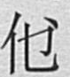』，『作』作『伇』，其體相似，故偶誤也。《易・繫辭》『坤作成物』，《釋文》：『作，虞姚本作化。』是亦『作』『化』相誤，其誤與『作』『他』相誤同也。

**○治在權衡相奪，奇恒事也，揆度事也。**

〔楊〕陰盛反陽爲病，陽盛反陰爲病，還用陰陽，權衡虚實，補寫相奪，此爲奇恒事也。直知陰陽反他，此爲揆度事也。

案：楊注以權衡爲陰陽虚實補寫，蓋陰陽反作，若陽盛爲病，其證熱實，故用寫藥。陰盛爲病，其證虚寒，故用補藥。此之爲奇恒事也。此所云『奇恒』與《病能論》『奇恒』不同，蓋以陽盛熱實爲恒，以陰盛虚寒爲奇。則在仲景書中，三陽是恒，三陰是奇。『奇恒』二字，隨處異義，而至於奇變恒常，奇逆恒順之理則同耳。

<!-- PAGE_END -->

<!-- PAGE: 0416 -->

<!-- PRINTED: 381 -->

『陰陽反作』四字，宜從《大素》補之。蓋揆度陰陽之反作，則虚實冷熱可察知。虚實冷熱察知，而後可施權衡相奪之治，奇恒事也。然則當云『陰陽反作，治在權衡相奪。治在權衡相奪，奇恒事也。陰陽反作，治在權衡相奪，揆度事也』。而『治在權衡相奪』六字不疊者，略文也。《素問》無下『陰陽反作』四字者，亦略文，而以『揆度事也』四字，釋前『陰陽反作』四字也。是與『頭項強痛』同例文法，可考究也。

或曰權衡相奪者，上吐下寫之義。衡爲上吐即是奇，權爲下寫即是恒。奪者，脱也。爲脱出、脱去之義。此説亦通。而與『治在』二字，甚相親切，亦可以備一説耳。

**○搏脈痺躄，寒熱之交。**

〔楊〕脈動之時，二脈相搏，附而動，不能相去者，此爲痺辟之病，是寒熱之氣相交搏。

案：搏脈者，其脈不專一而二脈相搏之謂也。凡痺躄之類，皆氣血受邪之所爲，有邪與正相爭，故寒熱相交而皮膚緩急也。《金匱》卷上中風篇云『寸口脈浮而緊，緊則爲寒，浮則爲虚，寒虚相搏，邪在皮膚。浮者血虚，絡脈空虚，賊邪不寫，或左或右，邪氣反緩，正氣即急』，又云『寸口脈遲而緩，遲則爲寒，緩則爲虚。榮緩則爲亡血，衛緩則爲中風』之類，可以徵也。

案：痺躄者，總偁中風脚弱之類也。第十所云『臥出而風吹之，血凝於膚者爲痺，凝於脈者爲泣，凝於足者爲厥』與此同義，可併考。

**○脈孤爲消氣，**

〔楊〕陰陽之脈各獨見爲孤，如足少陽脈氣獨見，無厥陰者，爲消癉也。

〔張〕脈孤者，孤陰孤陽也。孤陽者，洪大之極，陰氣必消。孤陰者，微弱之甚，陽氣必消。故脈孤爲消氣也。

<!-- PAGE_END -->

<!-- PAGE: 0417 -->

<!-- PRINTED: 382 -->

〔高〕脈者，氣血之先。脈孤則陽氣内損，故爲消氣。孤，謂弦鉤毛石少胃氣也。

案：消者，小也，謂肌肉瘦小也。蓋脾主肉，今脈孤立而無胃氣之扶助，所以肌肉漸消瘦也。

**○虚｟爲｠泄爲奪血，**

〔楊〕病洩利奪血者，其脈虚也。

案：經文脱『爲』字，殆不可讀。今得《大素》，其義了然可解。但張氏能分解得而妙，可謂能致思經文者也。

〔張〕脈虚兼泄者，必亡其陰。陰亡則血虚，故虚泄爲奪血也。

**○孤爲逆，虚爲從。**

〔楊〕陰陽各獨見，其時盛者爲逆。獨見虚者，氣易和，故爲順也。

〔高〕脈孤而無胃氣，則真元内脱，故爲逆。虚泄而少血液，則血可漸生，故爲從。

**○行奇恒之法，以太陰始。**

案：此受前起後之文，『搏脈』云云數句，並爲行奇恒之法，以太陰氣口之脈爲最初之診也。下文再説逆順死生出來。

**○行所不勝曰逆，逆則死。行所勝曰從，從則活。**

案：此特云死、云活，與他云『死生』不同，言其色脈之診行所勝則爲順，縱令有何等惡證，是不死，死中有活也。

〔楊〕太陰，肺手太陰脈主氣者也。欲行補寫權衡相奪之法，以太陰五行之氣以爲始也。行五行氣於不勝，被他乘剋，故爲逆死也。行於所勝，能剋於他，故爲順也。假令爲肝病以金療，即行所勝之。

<!-- PAGE_END -->

<!-- PAGE: 0418 -->

<!-- PRINTED: 383 -->

案：此節王注爲得，受前文而謂以脈察虚實之法也。楊注以爲療法，恐非是。

**○八風四時之勝，終而復始。**

〔楊〕八風剋勝，四時代勝，平爲終始也。

〔箚〕《史・封禪書》：『鬼臾區曰：得天之紀，終而復始。』又云：『十一月辛己，朔旦冬至，天子始郊，拜太一。其贊饗曰朔而又朔，終而復始。』

**○逆行一過，不復可數，論要畢矣。**

〔楊〕八風四時順行所勝也，若逆行一勝爲一過也。再過爲死，故不數也。假令肝病肺氣來乘爲一過，再過即死也，故不至於數也。此爲診要理極，故爲畢也。

案：此王注非是，宜從楊注。且『診要』作『論要』，亦王氏之妄改。以篇名爲『玉版論要』，故此改作『論要』，遂失經義，不可從。今據《大素》得正此誤，實皇國尊經之遺德，延及於今日，學者何可不拜於國恩乎。

庚申八月廿三日辰時寫訖於琅玕節下書屋　源立之

第十五補

道之至數｟一ウ｠

〔紹〕《管子》注：『數，理也。』《老子》注：『數，謂理數也。』

《舉痛論》三十九云：『如此則道不惑，而要數極，所謂明也。』楊注又云：『數，理也。』

各在其要｟二ウ｠

<!-- PAGE_END -->

<!-- PAGE: 0419 -->

<!-- PRINTED: 384 -->

案：郭璞《爾雅》注云：『《書》曰：在璿璣玉衡。《書正義》引舍人曰：在見物之察。《詩》在帝左右。《禮・文王世子》：必在視寒煖之節。《逸周書・大聚篇》王親在之。《箋》《注》並云：在，察也。』

揆度｟一ウ｠

〔箚〕《史・律書》：『癸之爲言揆也，言萬物揆度。』

#### 診要經終論篇第十六

《大素》佚。

**○黄帝問曰：診要何如。岐伯對曰：正月二月天氣始方，地氣始發，人氣在肝腹。**

案：《廣雅・釋詁》『方，始也』。方與旁、放同音同義。《書・堯典》『共工方鳩』，《史記・五帝紀》作『旁聚』，《説文》作『旁逑』；《書・益稷》『方施象刑惟明』，《新序・節士》『方』作『旁』；《書・甫刑》『庶僇方告無辜於上』，《論衡・變動》『方』作『旁』；《書・堯典》『方命圮族』，《漢書・傅喜傳》《王商傳》『方』作『放』，共可以徵也。乃與『地氣方發』之『發』字相對成語，又與『三月四月天氣正方，地氣定發』二『方』字相互爲文，可併考。

**○三月四月天氣正方，地氣定發，人氣在脾｟四支｠。**

案：至此二月，天地氣方發尤甚，故曰正定也。蓋天地之氣放發，則人氣閉藏在脾土。萬物華英，以土爲本，人氣發泄，以脾爲主也。

（眉）《太陰陽明論》曰：『脾者，土也，治中央，常以四時長四藏，各十八日寄治，不得獨主於時也。脾藏者，常著胃土之精也。土者生萬物，而法天地，故上下至頭足，不得主時也。』王注：『土氣於四時之中，各於季終寄王十八日，則五行之氣各王七十二日，以終一歲之日矣。外主四季，則在人内應於手足也。』

<!-- PAGE_END -->

<!-- PAGE: 0420 -->

<!-- PRINTED: 385 -->

（眉）因考五分一年，則春肝腹，夏心匈，秋肺背，冬腎要，四季脾四支頭，六分一年以配身六分，則正二肝腹，三四脾四支，五六心包頭，七八肺背，九十心匈，十一十二腎要。

**○五月六月天氣盛，地氣高，人氣在頭｟心包｠。**

案：炎熱之時，天氣下降者甚，地氣上騰者亦甚。頭爲諸陽之會，故以應之，然其實心脾二藏主領之也。

五六月人氣在頭者，即心包鬲膜之謂。鬲氣與頭相應，故頭眩者，胸鬲有水之證也。苓桂朮甘證『起則頭眩』是也。

（眉）案：五藏五府之外，只腦爲最，故此舉頭名。頭乃腦之或偁，三焦命門亦皆腦之支使，猶鬲是肝之屬也。脾屬也，心屬也。

**○七月八月，陰氣始殺，人氣在肺｟背｠。**

案：至此天氣漸不下降，地氣亦不上騰。故陰氣始生肅殺之機，此時炎熱中，時有涼風來至，故人不節飲食，則多病吐利。《月令》云『仲秋日夜分，殺氣浸盛，陽氣日衰，水始涸』是也。

**○九月十月陰氣始冰，地氣始閉，人氣在心｟匈｠。**

案：《月令・孟冬》『天氣上騰，地氣下降，天地不通，閉塞而成冬』是也。當此時，人之陽氣亦閉塞，故宜養心氣。心氣在内方盛，則冷氣無來侵，第二所云『春夏養陽，秋冬養陰』之義也。

案：冰、凝古今字。水凍之字，轉注爲凡凝結之義。

（眉）此二『冰』字，並當音凝，凝之或體。

**○十一月十二月冰復，地氣合，人氣在腎｟要｠。**

<!-- PAGE_END -->

<!-- PAGE: 0421 -->

<!-- PRINTED: 386 -->

案：冰復，即凝伏，謂陽氣凝伏於地中也。或曰冰復者，水冰重複之謂也。《呂氏・季冬紀》冰方盛，水澤復。高誘注：復亦盛也。復或作複，凍重累也。｟《月令》作『水澤腹堅』｠

〔吳〕合，閉而密也。

〔志〕地出之陽，復歸於地，而與陰合也。

〔琦〕按：本文言人氣所在，與《金匱真言》《四時刺逆從》諸義不同。三月四月之在脾，九月十月之在心，尤難曲解。姑依王義説之，以俟知者。此下與《四時刺逆從論》語相出入，然彼文爲得，蓋所傳異辭，不無錯入也。

（眉）《難經・七難》少陽｟鬲｠雨水正月中，陽明｟肺｠穀雨三月中，太陽｟心｠夏至五月中，太陰｟脾｠處暑七月中，少陰｟腎｠霜降九月中，厥陰｟肝｠冬至十一月中。

（眉）運氣七篇，厥陰｟肝｠大寒十二月中，少陰｟心｠春分二月中，少陽｟鬲｠小滿四月中，太陰｟脾｠大暑六月中，陽明｟肺｠秋分八月中，太陽｟腎｠小雪十月中。

（眉）《玉函經・總例篇》『陰陽九部，故頭背爲陽部，臂脚爲陽部，胸爲陰部，腹爲陰部』。案：是四分身四部也，若九分之爲九部，則頭一，左足一，左手一，右手一，右足一，匈一，腹一，背一，要一，右九部也。

**○故春刺散俞，及與分理，血出而止。**

《甲乙》卷五｟一オ｠引文同。

〔紹〕先兄曰：按，散俞對本輸而言，譬若太陽肺經，除少商、魚際、大淵、經渠、尺澤之外，共爲間散之穴，謂之散俞。《寒熱病篇》春取絡脈，夏取分腠，秋取氣口，冬取經輸。《四時氣篇》春取經，血脈分肉之間。甚者深刺之，間者淺刺之。夏取盛經孫絡，取分間，絶皮膚。秋取經俞，邪在府取之合。冬取井滎，必深取之。《水熱穴論》春者木始治，肝氣始生，肝氣急，其風疾，經脈常深，其氣少不能深入，故取絡脈分肉間。《終始篇》春氣在毛，夏氣在皮膚，秋氣在分肉，冬氣在筋骨云云。蓋春氣始生之際，邪氣入淺，故其刺亦不欲深，故刺間散之穴也。

<!-- PAGE_END -->

<!-- PAGE: 0422 -->

<!-- PRINTED: 387 -->

案：『及與』不成語，諸家不疑何也。蓋與、於古音通用。謂春刺散俞，不淺不深，方及於血脈分理也。凡肌表白肉刺而不見血之處，謂之肌膚，又曰肌肉。見血之處，謂之分肉，又曰分理，言衛榮血氣之相分之處也。後文云『冬刺俞竅於分理』義同。但彼略一『及』字耳。血出而止，謂鍼處纔見血則止也。是寫出肝血而達肌表，則表邪亦隨除去之理也。

**○甚者傳氣，間者環也。**

《甲乙》此八字無。

案：其病甚者，其鍼處血出之後不捫閉其穴，則邪氣自其穴所傳送於表也。謂之『甚者傳氣』也。其病微者，其鍼處血出之後，直捫閉其穴，則邪去而正氣循環於内也，謂之間者環也。蓋凡鍼法，一鍼後直捫閉其穴者爲定法，但其邪氣甚表氣實者，不在於此例也已。後文曰『見血』、曰『盡氣閉環』，與此互發。但比此則其邪尤甚，故曰見血、曰盡氣，與此曰血出、曰傳氣自異。其義宜互相發。

**○夏刺絡俞，見血而止，盡氣閉環，痛病必下。**

《甲乙》引『盡氣』以下八字無。

案：『盡氣』王注可從。謂夏宜刺絡見血而止，泄盡其邪氣也。而後捫閉其穴處，令陽氣循環也。痛病，猶疾痛也。凡在上部之病，刺絡後必下墜也。

<!-- PAGE_END -->

<!-- PAGE: 0423 -->

<!-- PRINTED: 388 -->

〔吳〕捫閉其穴，伺其經氣循環。一周於身，約二刻許。痛病必下，蓋夏氣在頭，刺之而下移也。

（眉）王『盡氣』謂出血而盡，鍼下取所病脈盛邪之氣也。

**○秋刺皮膚，循理，上下同法，神變而止。**

《甲乙》『神變而止』四字無。

案：秋人氣在肺，故刺皮膚甚淺，不至於血出之分也。理者，肉理也。循者，順也。其經脈之所通貫謂之理，順其理者，譬如在頭恖會前頂，百會後頂，在手曲池三里上廉下廉，以次刺之也。神者，神氣也。第三云『起居如驚，神氣乃浮』是也。神氣即衛氣，謂肌表之陽氣也。衛氣鬱滯者，循環流通而復常，謂之神變。神變者，言神氣變易於刺前也。

〔張〕循理，循分肉之理也。上言手經，下言足經，刺皆同法。秋氣在皮膚，邪猶未深。故但察其神氣變易，異於未刺之前，可止鍼矣。

**○冬刺俞竅於分理，甚者直下，間者散下。**

《甲乙》引止於此。

案：春夏用大鍼而出血，秋冬用小鍼而通氣。秋云皮膚、云上下，謂手足之陽分也。冬云俞竅，謂背俞諸穴。竅，猶穴也。此諸穴並皆大陽旁光經也，行補腎部之法也。

〔吳〕以指按之，散其表氣而後下鍼。

**○春夏秋冬，各有所刺，法其所在。**

〔馬〕正以法其人氣之所在，以爲刺耳。

案：以上謂常法，以下説逆其常法則爲病也。

<!-- PAGE_END -->

<!-- PAGE: 0424 -->

<!-- PRINTED: 389 -->

**○春刺夏分，脈亂氣微，入淫骨髓。**

（眉）《甲乙》五｟二オ｠引。

案：刺夏分者，謂刺絡俞見血也。

〔高〕春刺夏分，心氣妄傷。心合脈，故脈亂，脈亂則氣無所附，故氣微。脈亂氣微，邪反内入，故入淫骨髓。

〔紹〕簡按：以下四時刺逆從之變，猶是《月令》春行夏令等之災異，不過示禁戒於人耳。

**○病不能愈，令人不嗜食，又且少氣。**

〔高〕夫脈亂必令不嗜食。蓋食氣入胃，濁氣歸心，淫精於脈也。不但氣微，又且少氣。

**○春刺秋分，筋攣逆氣，環爲欬嗽。**

〔高〕春刺秋分，肺氣妄傷。筋攣，肝病也。筋攣逆氣，肝病而逆於肺也。

案：傷肺則肝盛，故筋攣之肝證，欬嗽之肺候交起也。刺秋分者，謂刺皮膚也。

**○病不愈，令人時驚，又且哭。**

《甲》『哭』作『笑』，注云『一作哭』。

〔張〕肝主驚，故時驚。肺主悲憂，故又且哭。

案：驚亦爲飲之所作，哭即爲肺所主。故病不愈，則至爲於此諸證也。

**○春刺冬分，邪氣著藏，令人脹。**

〔張〕冬應腎，腎傷則邪氣内侵而著藏，故令人脹。

案：『邪氣著藏』，《四時刺逆從論》作『血氣内著』，義同。著藏，謂付著藏匿也。脹者，心腹脹滿也。

<!-- PAGE_END -->

<!-- PAGE: 0425 -->

<!-- PRINTED: 390 -->

是誤刺背俞腎部之所爲也。

**○病不愈，又且欲言語。**

〔識〕志云：『肝主語，故欲言語也。』簡按：《宣明五氣論》曰『五氣所病，肝爲語』。

案：『言語』爲肝病，是腎病則肝亦病，即水生木之理。腎氣衰則肝氣自盛，所以欲言語也。譫，多言是也。

（眉）案：欲言語者，病發詀妄鄭聲者也。

**○夏刺春分，**

案：《四時刺逆從論》云：『夏刺經脈，血氣乃竭，令人解㑊。』據此，則云『病不愈』，與云『乃竭』其義不二。説詳《刺逆從》｟六四｠中。

**○病不愈，令人解憜。**

解憜，《新校正》引《刺逆從》作『解墮』。周本作『解㑊。』與今本《刺逆從論》合。古抄本亦作『憜』，則周氏直據今本而改者歟。『解憜』解已在於第一中。

案：夏刺經脈見血，則血氣往往衰竭，遂成筋力解墮之證耳。

**○夏刺秋分，**

案：《刺逆從論》作『夏刺肌肉，血氣内卻，令人恐』十一字，其義相同，説見於彼。

**○病不愈，令人心中欲無言，惕惕如人將捕之。**

〔吳〕肺主聲，刺秋分而傷肺，故欲無言惕恐也。恐爲腎志，肺金受傷，腎失其母，虛而自恐也。

案：夏不刺絡，而小鍼刺皮膚，則肺部皮膚之血氣鬱閉内卻。故爲不言善恐之證，是肺部氣不利，氣不利則血亦鬱，延及於肝，肝鬱尤極，遂爲惕惕似肝虛之證。

<!-- PAGE_END -->

<!-- PAGE: 0426 -->

<!-- PRINTED: 391 -->

**○夏刺冬分，**

案：此亦宜從《刺逆從論》，補『血氣上逆』四字而看。

**○病不愈，令人少氣，時欲怒。**

〔張〕夏傷其腎，則精虛不能化氣，故令人少氣。水虧則木失所養，而肝氣強急，故欲怒也。

案：夏刺背俞，則傷腎也。

**○秋刺春分，**

案：據《刺逆從論》，則此下宜補『血氣上逆』四字而看。

**○病不已，令人惕然欲有所爲，起而忘之。**

〔張〕傷肝氣也。心失其母，則神有不足，故令人惕然，且善忘也。

案：秋刺經脈，則徒動肝氣，肝氣内傷，心氣上逆，故爲善恐喜忘之證。

**○秋刺夏分，**

案：據《刺逆從論》，則此下宜補『氣不外行』四字。

**○病不已，令人益嗜臥，又且善㝱。**

《甲》此下有『謂立秋之後』五字。

案：秋宜淺行小鍼，而爲刺絡，則血外泄，陽氣内乏，故嗜臥善㝱。㝱：《説文》正字，隸書用『夢』者，古來之假字。如『堊』作『惡』，『嗜』作『耆』例。

**○秋刺冬分，**

<!-- PAGE_END -->

<!-- PAGE: 0427 -->

<!-- PRINTED: 392 -->

案：據《刺逆從論》，此下當有『血氣内散』四字。

**○病不已，令人洒洒時寒。**

案：秋宜刺皮膚，今誤刺背俞，則陽氣外泄，血氣内散，故戰寒也。

《靈・寒熱病篇》『振寒洒洒鼓頷』。又《邪氣藏府病形》曰『灑淅動形』。又《經脈》曰『胃動則病洒洒振寒』。

**○冬刺春分，**

案：據《刺逆從論》，此下當有『血氣皆脫，令人目不明』九字。

**○病不已，令人欲臥，不能眠，眠而有見。**

《甲》此下有『謂十二月中旬以前』八字。

〔張〕肝藏魂，肝氣受傷，則神魂散亂，故令人欲臥。不能眠，或眠而有見，謂怪異等物也。

案：冬不刺背俞補腎部，而刺經俞瀉肝部，故血氣皆脫也。

〔識〕馬云『而當作如』。簡按：而、如古通。如《詩・小雅》『垂帶而厲』，《箋》云：『而，如也。』《春秋》『星隕如雨』，是不必改字。

**○冬刺夏分，**

案：據《刺逆從論》，當有『内氣外泄』四字。

**○病不愈，氣上發爲諸痺。**

《刺逆從論》作『留爲大痺』。

案：此或作『愈』、或作『已』，蓋『已』即『以』字。『以』與『愈』古通用。《韻鏡》以、愈同在上聲第四等喉音清濁喻母。『病愈』字多作『病已』，宜通用也。

<!-- PAGE_END -->

<!-- PAGE: 0428 -->

<!-- PRINTED: 393 -->

案：氣上發者，《刺逆從論》所云『内氣外泄』之義。蓋冬宜養陰，而今刺絡亡陰血，故内氣外泄，失營衛之和，所以爲諸麻痺之證也。

**○冬刺秋分，**

案：據《刺逆從》，當有『陽氣竭絶』四字。

**○病不已，令人善渴。**

《甲乙》引至此。

案：冬宜養陰，而誤刺皮膚肌肉，則脾胃受傷。脾胃受傷，則陽氣竭絶，所以爲渴也。

**○凡刺胸腹者，必避五藏，中心者環死。**

案：環者，謂一周時也。

案：『環』解，王注爲是，蓋有所受而言已。《刺禁論》五十二云『刺中心一日死』，與此同義，乃一日一夜一周時之謂也。《刺禁》與《刺逆從》同，今斷以此爲定。

〔張〕按：《刺禁論》所言五藏死期，尤爲詳悉，但與本節稍有不同。此節止言四藏，獨不及肝，必脫簡耳。

**○中脾者五日死，**

《刺禁論》『五日』作『十日』，《刺逆從論》同，宜從改。《診要經終》作『五日』，全本、《甲乙》作『十五日』，共誤。

**○中腎者七日死，**

<!-- PAGE_END -->

<!-- PAGE: 0429 -->

<!-- PRINTED: 394 -->

《刺禁論》『七日』作『六日』，《刺逆從》同，宜從改。《診要經終》作『七日』，全本、《甲乙》作『三日』，共誤。

**○中肺者五日死，**

《刺禁論》『五日』作『三日』，《刺逆從》同，宜從。《診要》作『五日』誤，全本、《甲乙》作『三日』，亦可從。

案：以上五藏刺禁死日，心一日，肺三日，肝五日，共爲上部。且肝心爲牡藏，見《靈樞》四十四。雖肺爲牝藏，位於上部，而專主氣，爲五藏之上蓋，故此三藏傷者，死期在近也。腎六日，脾十日，共爲下部牝藏，所死期稍遠也。但脾之死期，最在遠者，脾能受穀而榮養，與他藏自異，譬如草木其根已截去，猶枝葉蓁蓁不早萎，蟲魚已去根骨，頭目潑潑，不速死也已。

案：此不云肝死者，係於闕文。宋臣説可從。

| | 心 | 肺 | 肝 | 腎 | 脾 |
|---|---|---|---|---|---|
| 《診要》 | 環 | 五 | 五 | 七 | 五 |
| 《刺禁》 | 一日 | 三 | 五 | 六 | 十 |
| 全本、《甲乙》 | 一 | 三 | 五 | 三 | 十五 |
| 《刺逆從》 | 一 | 三 | 五 | 六 | 十 |

**○中鬲者，皆爲傷中。其病雖愈，不過一歲必死。**

〔張〕鬲膜，前齊鳩尾，後齊十一椎。心肺居於鬲上，肝腎居於鬲下，脾居在下，近於鬲間。鬲者，所以鬲清濁，分上下，而限五藏也。五藏之氣分主四季，若傷其鬲，則藏氣陰陽相亂，是爲傷中，故不出一年死。

<!-- PAGE_END -->

<!-- PAGE: 0430 -->

<!-- PRINTED: 395 -->

案：『傷中』已見《本草經》麥門冬乾地黃他十一條，蓋中者，謂脾胃也。《傷寒論》所云理中、建中與此同義。竊謂誤刺鬲，則膜受傷，膈膜爲五藏運化之所係，六府輸寫亦受之佐。《瘧論》所云『膜原』是也。今俗呼『與古於宇末久』，又『末久於保祢』，蠻名『美通天留利不突』。若此處受傷，則脾胃受傷，脾胃受傷則五藏六府皆受傷，故當時雖無大患，五藏六府互相傷竭，不過一年而必死。其期不過一年者，五藏互相剋伐也。王注似是。

（眉）《至真要論》『胃鬲如寒』王注：『心下齊上胃之分。胃鬲，謂胃脘之上及大鬲之下，風寒氣生也』。

**○刺避五藏者，知逆從也。**

應前文『凡刺胸腹者，必避五藏』。

**○所謂從者，鬲與脾腎之處，不知者反之。**

〔張〕知而避之者爲從，不知者爲逆，是謂反也。

案：鬲雖係五藏，其下鬲膜接脾連腎之處爲最緊要，故以避此處，又再言之也。

**○刺胸腹者，必以布憿著之，乃從單布上刺。**

〔識〕馬云：『憿，當作𢅎，布巾也。』張、吳本作『𢅎』。高作『繳』。志云：『憿，定也，以布定著於胸腹。』滑云：『𢅎，如纏繳也。』簡按：字書𢅎，又作繳，音皎。《玉篇》『脛行縢也』。《集韻》『脛布也』。《本草》有繳脚布，李時珍云：『即裹脚布，古名行縢。』乃滑注似是。字書無『憿』字。志聰依王注『形定』之解，牽強。

<!-- PAGE_END -->

<!-- PAGE: 0431 -->

<!-- PRINTED: 396 -->

〔吳〕以布憿著之者，以胸腹近於五藏，遮風寒也。

〔馬〕從布上刺者，不欲深入也。

〔箚〕寛案：據從單布上刺語，『憿著』二字連讀。

古抄本《新校正》又作『撽』，下有『又憿，公了反，行縢也』八字。

案：《説文》『䌠，生絲縷也』。《廣雅》尺古四『䌠，纏也』。《漢書・司馬遷傳》『名家苛察繳繞』。注：『如淳曰：繳繞，猶纏繞也。』《玉篇》『𢅎，公了切。𢅎脛，行縢也』，《廣韻》上聲廿九篠曰『古了切。𢅎，行縢。𢅎，脛布也。繳，纏也。䘨，小袴』。並同音也。蓋繳字，《説文》本義則之若切，假爲『繳纏』字，則音變而爲古了切。猶『貍貓』字讀若『薶瘞』字，則音莫皆切。『兌卦』字讀爲『尖銳』字，則音以芮切之例也。又案：憿即𢅎之俗字，猶『帖』作『怗』，『帳』作『悵』之例。憿是憿幸之字。《説文》以下諸書又作徼、傲，與此義自別。《素問》𢅎字與《説文》繳字，其原蓋一也。《廣韻》𢅎、繳同音，可以徵也。《新校正》云：『又作撽。』撽亦繳之草體變易者，與《説文》『擊，旁擊也』字自別。

**○刺之不愈，復刺，刺鍼必肅。**

案：肅者，不言不語，不動身體，一心專誠。神力在鍼頭，則氣之至不至，可以知也。

**○刺腫搖鍼，**

案：腫，謂癰腫也。鍼，謂鈹鍼也。

**○經刺勿搖，**

案：經，謂經脈也。

**○此刺之道也。**

<!-- PAGE_END -->

<!-- PAGE: 0432 -->

<!-- PRINTED: 397 -->

『刺鍼』以下至此十七字，《甲乙》卷五｟十八オ｠鍼道第四有之，無異同。

《四時刺逆從論》云：『岐伯曰：春刺絡脈，血氣外溢，令人少氣。春刺肌肉，血氣環逆，令人上氣。春刺筋骨，血氣内著，令人腹脹。夏刺經脈，血氣乃竭，令人解㑊。夏刺肌肉，血氣内卻，令人善恐。夏刺筋骨，血氣上逆，令人善怒。秋刺經脈，血氣上逆，令人善忘。秋刺絡脈，氣不外行，令人臥不欲動。秋刺筋骨，血氣内散，令人寒慄。冬刺經脈，血氣皆脫，令人目不明。冬刺絡脈，内氣外泄，留爲大痺。冬刺肌肉，陽氣竭絶，令人善忘。凡此四時刺者，大逆之病，不可不從也。反之則生亂氣，相淫病焉。故刺不知四時之經，病之所生，以從爲逆。正氣内亂，與精相薄，必審九候。正氣不亂，精氣不轉。帝曰：善。刺五藏，中心一日死，其動爲噫。中肝五日死，其動爲語。中肺三日死，其動爲欬。中腎六日死，其動爲嚏欠。中脾十日死，其動爲呑。刺傷人五藏，必死。其動則依其藏之所變，候知其死也。』｟十八ノ八ウ｠

**○帝曰：願聞十二經脈之終奈何。岐伯曰：太陽之脈，其終也，戴眼反折瘈瘲，其色白。絶汗乃出，出則死矣。**

案：以下六經之終證，宜參《靈・終始篇》。

案：手太陽小腸經也，足太陽旁光經也。小腸屬心火，旁光屬腎水。蓋腎將盡，則目睛失神，面色白，絶汗出。絶汗者，脫汗也，陰汗也，心陰竭絶之汗也。反折瘈瘲者，旁光經係足背，小腸經係手肩，故爲此證。蓋水火共衰，則土木受傷之理也。

**○少陽終者，耳聾，百節皆縱，目睘絶系。絶系一日半死，其死也，色先青白，乃死矣。**

〔識〕馬云：『目睘者，猶俗云眼圈也。其所謂系者，即《大惑篇》之所謂系也。』吳睘作環，注云：『目環，轉旁視也。』高作寰，注云：『謂目之寰宇，與眼系相絶，不相維繫也。』簡按：睘，《音釋》『音瓊』。《説文》作『睘，目驚視也』。張、志並依王注，爲是。

<!-- PAGE_END -->

<!-- PAGE: 0433 -->

<!-- PRINTED: 398 -->

〔箚〕楊氏《難經注》『目睘』作『目環』，《靈・終始篇》作『目系絶，目系絶一日半則死矣』。寛案：據《靈樞》，睘字疑衍。

案：此説可。以余觀之，則『睘』即『系』之音通借字，而『睘』爲古字，下『系』字卻是後人旁書誤入於正文者歟。《説文》『睘，渠營切』，『系，胡計切』，其音相近，睘爲牙濁音，系爲喉濁音也。

〔高〕《刺禁論》云：『刺中膽者，一日半死。』色先青白者，日半之前，先見木受金刑之色，乃死矣。

案：手少陽三焦經也，足少陽膽經也。二經共入耳中，今二經之脈將盡，故爲耳聾。百節千筋，共膽汁滲入之餘力能爲之動作。今膽汁竭絶，故爲百節皆縱。目系絶者，亦膽汁肝血共竭之證也。色青白，亦見肝木之本色，而失心經之血色者也。

案：以下《終始篇》同文，宜參。

（眉）本篇《音釋》『睘，音瓊』。

**○陽明終者，口目動作，善驚妄言，色黃，其上下經盛不仁則終矣。**

〔張〕口目動作，牽引歪斜也。｟志、高並同。｠

案：王注：『目睒睒而鼓頷也。』《音釋》：『睒，音閃。』謂目眦閃動而口吻鼓動也。《説文》：『睒，暫視皃。失冉切。』

《陽明脈解篇》三十云：『足陽明之脈病，惡人與火，聞木音則惕然而驚。』又云：『妄言罵詈，不避親疎而歌。』

〔識〕吳云：『不知疼痛，若不仁愛其身者。』高云：『不仁者，身冷膚鞕。』馬云：『不知痛痒也。』

<!-- PAGE_END -->

<!-- PAGE: 0434 -->

<!-- PRINTED: 399 -->

簡按：王注《痺論》云：『不仁者，皮頑不知有無也。』《程氏遺書》云：『醫家以不認痛癢，謂之不仁，人以不知覺，不認義理爲不仁，譬最近。』馬注本於程子。

〔紹〕楊注《痺論》云：『仁者，親也，覺也。營衛及經絡之氣疏澀，不營皮膚□中，故皮膚不覺痛癢，名曰不仁。』堅案：成無己注《平脈法》云：『仁者，柔也。不仁者，言不柔和也。爲寒熱痛癢，俱不覺知者也。』又曰：『不仁，爲強直而無覺也。』趙大中《風科集驗名方》曰：『中風不仁者，蓋仁爲衆善之長，主温和慈順。今則四肢強直，不能舒卷，筋攣緊急，是由榮衛不通，故爲不仁也。』二氏以強直爲解，欠覈。

不仁解，詳見《血氣形志篇》《素問識》。不仁解，詳出此篇末補遺，宜參。

〔箚〕寛案：仁者，人也。麻木不知痛癢，不人肌也。｟原《頓醫抄》｠

案：上下經盛者，謂手足陽明經脈皆受邪而氣盛也，故爲不仁之證。今中風偏枯不仁之手足，俱其脈盛大，不麻之手足，其脈如常，可以徵矣。乃風淫末疾之義也。

案：手陽明大腸經也，足陽明胃經也。口目動作，善驚妄言，共金衰木盛之證，其色黃。上下經不仁者，胃虛邪實之證也。

（眉）《風論》『其肉有不仁也』王注：『不仁，謂㾪而不知寒熱痛癢。』

**○少陰終者，面黑，齒長而垢，腹脹閉，上下不通而終矣。**

案：手少陰心，足少陰腎也。蓋心腎二藏立身之本，此二經將盡之候，面黑齒垢，心氣將盡也；腹脹不通，腎氣將盡也。

〔吳〕腎開竅於二陰，故令閉，既脹且閉，則上不得食，下不得便。上下不通，心腎隔絶而終矣。

**○太陰終者，腹脹閉，不得息。善噫善嘔，嘔則逆，逆則面赤。不逆則上下不通，不通則面黑，皮毛焦而終矣。**

<!-- PAGE_END -->

<!-- PAGE: 0435 -->

<!-- PRINTED: 400 -->

《靈樞》厥陰在前，太陰在後。

（眉）《靈》後。

案：手太陰肺，足太陰脾也。腹脹噫嘔，脾氣將盡之候。不得息，面赤，肺氣將盡之狀也。其尤甚者，不嘔逆，脾氣衰敗，而上下氣不通，故面色塵黑，肺氣不養，故皮毛焦也。

〔張〕足太陰脈，入腹屬脾，故爲腹脹閉。手太陰脈，上鬲屬肺而主呼吸，故爲不得息，脹閉則升降難，不得息則氣道滯，故爲噫爲嘔。嘔則氣逆於上，故爲面赤。不逆則否塞於中，故爲上下不通，脾氣敗則無以制水，故黑色見於面。肺氣敗則治節不行，故皮毛焦而終矣。

案：噫、嘔同出於胃，而其狀不同。其氣逆欲吐之聲嘔嘔然謂之嘔，其氣逆不吐之聲噫噫然謂之噫。噫者，食不和之證。嘔者，飲不利之候也。

**○厥陰終者，中熱嗌乾，善溺心煩，甚則舌卷，卵上縮而終矣。**

（眉）《靈》前。

案：手厥陰心主，足厥陰肝也。中熱者，即熱中。謂胃中熱，中熱嗌乾，心煩舌卷，共是木衰火盛之候。心主竭盡，則心火益烈，故至於舌卷也。善溺者，肝氣衰弱，失收攝之化也。卵縮者，木氣竭盡，失滋潤之令也。

**○此十二經之所敗也。**

《靈》此八字無。

《靈樞・終始篇》九云：『大陽之脈，其終也，戴眼反折瘈瘲，其色白，絶皮乃絶汗，絶汗則終矣。少陽終者，耳聾，百節盡縱。目系絶，目系絶一日半則死矣。其死也，色青白乃死。陽明終者，口目動作，喜驚妄言，色黃，其上下之經盛而不行則終矣。少陰終者，面黑齒長面垢，腹脹閉塞，上下不通而終矣。厥陰終者，中熱嗌乾，喜溺心煩，甚則舌卷卵上縮而終矣。太陰終者，腹脹閉不得息，氣噫善嘔。嘔則逆，逆則面赤。不逆則上下不通，上下不通，則面黑皮毛燋而終矣。』

<!-- PAGE_END -->

<!-- PAGE: 0436 -->

<!-- PRINTED: 401 -->

### 重廣補注黃帝内經素問卷第四

## 素問攷注卷第四

萬延元年九月初六日曉窗燈下書　枳園翁立之

第十六補

甚者直下，間者散下。｟三ヲ｠

《靈樞》卷十五・五色篇四十九云：『雷公曰：以色言病之間甚，奈何。』

瘈瘲｟十ヲ｠

〔識〕熊音：『瘈，胡計反。瘲，子用反。』馬云：『反折瘈瘲，謂手足身體反張，而或急爲瘈，或緩爲瘲。』高云：『手足抽掣也。』簡按：瘈又作瘛。《玉機真藏論》曰：『筋脈相引而急，病名曰瘛。』王註：『筋脈受熱而自跳掣，故名曰瘛。』熊音『尺世反，瘈同』。《説文》『瘛，小兒瘛瘲病也』，又『瘛引縱曰瘛』。別作『痸』。《漢・藝文志》有『金創瘛瘲方』，王符《潛夫論》『掣縱』，皆與此同。《明理論》云：『瘈者，筋脈急也。瘲者，筋脈緩也。急者則引而縮，緩者縱而伸。或縮或伸，動而不止者，名曰瘈瘲。俗謂之搐者是也。』此説得之。

不仁｟十ウ｠

<!-- PAGE_END -->

<!-- PAGE: 0437 -->

<!-- PRINTED: 402 -->

此類相似，混誤者有之。今分別如左，名曰頑痺不仁辨。

【楷】文久二戌五月十九日撰　約之

【楷】一曰痹，俗字作痺。天下書多用『痺』。《素問》有《痺論》，《傷寒論・太陽中篇》曰：『病從腰以下必重而痺，名火逆也。』痺，閉塞之義。《説文》有痹、痺二篆，要同病一理。痺又謂之苛，出《素・逆調論》。又謂之頑，頑又作㾪。㾪，隸俗字也，醫書用『頑』甚多。《左氏・僖廿四年傳》《書・堯典傳》並曰『心不則德義之經爲頑』。是其義也。《玉篇》『㾪，渠軍切。痹也』，《廣韻》上平廿文『痹，渠云切。瘒也』。又廿七刪『癏，音頑。癏痺』。亦可證痹、瘒、痺三同字也。是即和名『志毘禮留』，又曰『毘利毘利須留』是也。古來往往混之於不仁者，誤。頑者，癡獃之義。自癡獃云㾪，自酸痺云苛，故《五常政論》曰『皮㾪肉苛』。

二曰不仁。《本經》『死肌』，後世麻木，並同曰麻，曰木，一聲之轉，同義。後世或別麻木爲二，以麻係之㾪痺者，非也。麻木字又見《甲乙》卷九第二篇。《痺論》王注、楊注，程氏《遺書》，吳、馬本篇注，喜多村説皆可從。古來往往混之於頑痺及痙痿等者，皆誤。是即和名『比登波達姪奈伊』是也。《醫學統旨》曰『麻爲木之微，木爲麻之甚』，大誤，鑿也。又曰『麻木，不仁之疾也』，大精切也。再案：麻之言微也，木之言冒也，知在音韻上自生大小之義，則《統旨》之言，固精確而非鑿。

【楷】三曰痙。大凡彊直鞕急之義，故有一身之痙，有一指之痙，有一尺之痙，有一寸之痙，要其爲痙鈞一也。古來以是往往混不仁頑痺等，大非。和名『加多志』，又曰『加多久古留』是也。

【楷】四曰痿。大凡萎弱柔耎之義，亦有大小廣狹，凡如痙也。古來以是往往混不仁頑痺等者誤。和名『奈會留』，又曰『具尼也利須留』，又曰『野和羅加』是也。《素問》有《痿論》也。

<!-- PAGE_END -->

<!-- PAGE: 0438 -->

<!-- PRINTED: 403 -->

五曰厥。大凡其地寒冷之義，亦有大小廣夾，凡如痙也。古來以是多混不仁痺痿等者，非也。《素問》有《厥論》，和名『比惠留』，又曰『通蔑多志』是也。

六曰不遂。古作不㒸。《説文》『㒸，從意也』。又謂之『不用』，出《素・逆調論》矣。和名『幾加奴』，又曰『宇護計奴』，又曰『波多羅加奴』是也。案：不仁者，體也。不遂者，用也。

十四　湯液醪醴｟二ヲ｠　鑱石｟四ウ｠　充郭｟七ヲ｠　四極｟七ウ｠　權衡｟八ヲ｠　宛陳｟八ウ｠　鬼門｟九ヲ｠　淨府｟九ウ｠　五湯｟十ヲ｠

十五　揆度｟一ヲ｠　奇恒｟同｠　數｟一ウ｠　主治｟二ウ｠　醪酒｟同｠　色夭｟三ウ｠　易亦｟四ウ｠　反化｟同｠　搏脈｟五ウ｠　痺躄｟同｠　爲消｟六ヲ｠

十六　始方｟一ヲ｠　與於｟二ウ｠　洒洒｟五ウ｠　愈已｟六ヲ｠　鬲｟七ヲ｠　傷中｟同ウ｠　憿𢅎｟八ヲ｠　瘈瘲｟十ヲ｠　不仁｟十ウ｠

<!-- PAGE_END -->

<!-- PAGE: 0439 -->

<!-- PRINTED: 404 -->

## 素問攷注卷第五

### 重廣補注黃帝内經素問卷第五

#### 脈要精微論第十七

《大素》卷首至『關格』及『心疝病成而變』二節並缺，餘皆存。

（眉）《至真要論》曰：脈要曰。云云。

（眉）《大素》十四・四時脈診。

（眉）《大素》一章至六章缺。

**○黃帝問曰：診法何如。岐伯對曰：診法常以平旦。**

《脈經》卷一・平脈早晏法第二載此文至『決死生之分』，而以上十八字，作『黃帝問曰：夫診法常以平旦，何也。岐伯對曰：平旦者』廿字。

**○陰氣未動，陽氣未散，飲食未進，經脈未盛，絡脈調勻｟《脈經》作『均』｠，氣血未亂，故乃可診有過之脈。**

《脈經》『有過之脈』作『過此非也』四字。

案：陰氣，謂營血。陽氣，謂衛氣。所云氣血未亂者，即謂陰氣未動，陽氣未散也。若飲食已進，則經脈漸盛，絡脈亦不調。故在平旦未飲食之時而常診之，則其過失非常之脈可得知也。《本草經》云『五藏未虛，六府未竭，血脈未亂，精神未散，服藥必活』與此文勢相同。

<!-- PAGE_END -->

<!-- PAGE: 0440 -->

<!-- PRINTED: 405 -->

〔張〕平旦者，陰陽之交也。陽主晝，陰主夜。陽主表，陰主裏。凡人身營衛之氣，一晝一夜五十周於身，晝則行於陽分，夜則行於陰分，迨至平旦，復皆會於寸口，故診法當於平旦初寤之時。

《靈樞・營衛生會篇》云：『平旦陰盡而陽受氣矣。日中爲陽隴，日西而陽衰，日入陽盡而陰受氣矣。夜半而大會，萬民皆臥，命曰合陰。平旦陰盡而陽受氣，如是無已，與天地同紀。』

〔張〕有過，言脈不得中而有過失也。

案：『過』字解，已見於第十中。

**○切脈動靜，**

〔識〕張云：『切者，以指按索之謂。切脈之動靜，診陰陽也。』簡按：望聞問三者，臨病人乃可知焉，唯脈非切近其體膚，不能診之，故謂之切脈。王以切近解之，爲是。楊玄操《難經》注：『切，按也。』

案：動者，謂浮數緊實急之類。靜者，謂沈遲緩虛弱之類也。

**○而視精明，**

〔馬〕按：王註以精明爲足太陽經之睛明穴，但此穴未足以觀人以此法，爲觀目則可也。由下文『所以視萬物，別黑白』等語觀之，則主目言爲正。蓋精明主神氣言，舍目亦無以見之。況末云『則精衰矣』，豈『精衰』之『精』，尚可以穴言乎。《孟子》曰『存乎人者，莫良於眸子。胸中正，則眸子瞭焉』者是也。

案：精睛古今字，謂黑睛也。明者，蓋謂皎白分明之義，蓋在白黑二睛之間，而觀其色澤，與面色併考則可也。《五藏生成篇》十所云『凡相五色之奇脈，面黃目青，面黃目赤』之類是也。《釋名》『童子，主謂其精明者也』，是以『精明』二字，專係於童子也。

<!-- PAGE_END -->

<!-- PAGE: 0441 -->

<!-- PRINTED: 406 -->

（眉）《靈・九鍼十二原》曰：『覩其色，察其目。』

**○察五色，觀五藏有餘不足。六府強弱，形之盛衰，以此參伍，決死生之分。**

〔識〕張云：以三相較，謂之參。以伍相類，謂之伍。蓋彼此反觀，異同互證，而必欲搜其隱微之謂。《易》曰：參伍以變，錯綜其數，通其變，即此謂也。｟出上《繫辭》｠滑云：『以色脈藏府形氣，參合比伍也。』簡按：《荀子》曰：『窺敵制勝，欲伍以參。』又曰：『參伍明謹施賞刑。』楊倞注云：『參伍，猶錯雜也。』

〔箚〕《三部九候論》『形氣相得者生，參伍不調者病』王注：『參謂參校，伍謂類伍。參校類伍而有不調也。』

案：《説文》『伍，相參伍也』。臣鍇曰：『二人相副謂之貳，三人相雜謂之參，五人相雜謂之伍，十人相雜謂之什，百人相雜謂之佰，義同此也。』『參伍』解又見二十中。

**○夫脈者，血之府也。**

《甲乙》四『血』下有『氣』字。

《生氣通天》曰『脈流薄疾』。

《靈・決氣篇》：『何謂血。岐伯曰：中焦受氣取汁，變化而赤，是謂血。何謂脈。岐伯曰：壅遏營氣，令無所避，是謂脈。』

〔李〕營行脈中，故爲血府。然行是血者，寔氣爲之司也。《逆順篇》云『脈之盛衰者，所以候血氣之虛實』，則知此舉一血而氣在其中，即下文氣治氣病，義益見矣。

案：脈者，收血之處。故曰血之府也。《和名抄》引野王案：『血，肉中赤汁也。脈，肉中血理也。』｟今本《玉篇》無此文｠而血訓知，脈訓知乃美知。《説文》『𧖴，血理分衺行體中者，或從肉作脈』。《玉篇》『脈，血理也。脉，同上』。

<!-- PAGE_END -->

<!-- PAGE: 0442 -->

<!-- PRINTED: 407 -->

《醫史・呂滄洲翁傳》云：『夫脈，血之波瀾也。』

《弘決輔行記》卷八曰：『脈者，血氣所行道也。』

《弘決外典抄》卷四引之且釋之曰：『脈者，盛雍血氣，日夜榮身，不令避散者也。血者，五穀精汁。』

（眉）董西園《醫級》曰：『脈者，血之府也。血充脈中，緣氣流行肢體百骸，無所不到，故爲氣血之先機。』

（眉）《吳文定公集・贈邵志可序》曰：『脈者，血之流派，氣使然也。』

（眉）何夢瑤《醫碥》曰：『脈之形體，長而圓，如以水貫葱葉中。脈之行動，如以氣鼓葱葉中之水，使之流動也。』

**○長則氣治，短則氣病，數則煩心，大則病進。**

案：氣者載血而行，故脈可以候氣之屈伸病平也。數者爲凡有熱之脈，故曰煩心也。大者爲洪盛之脈，故以病勢加進爲之説也。蓋長者，三指下純一均平之脈，不論浮沈遲數也。短者，濇澀不接續之脈，亦不論浮沈遲數也。乃往來流利之至謂之長，往來不流利之至謂之短也。

（眉）《甲乙》『治』作『和』，無『氣病』之『氣』。

**○上盛則氣高，下盛則氣脹。**

〔識〕簡按：諸家以『上』『下』爲寸尺之義，而《内經》有寸口之稱，無分三部而爲寸關尺之説。乃以《難經》以降之見讀斯經，並不可從。此言『上』『下』者，指上部下部之諸脈。詳見《三部九候論》。

氣高，全本作『氣鬲』。《史記・倉公傳》『氣鬲，使人煩懣，食不下，時嘔沫』。

<!-- PAGE_END -->

<!-- PAGE: 0443 -->

<!-- PRINTED: 408 -->

案：氣高，宜從全本作『氣鬲』爲是。

案：上盛者，謂氣口人迎其脈共盛大也。下盛者，謂跗陽大谿共盛大也。氣鬲者，謂心胸中氣壅閉，即是痰飲之類也。《金匱・痰飲篇十二》云『脈弦數有寒飲，脈沈而弦者，懸飲内痛』是也。氣脹者，謂腹中氣滿脹，即是宿食之類也。《金匱・宿食篇十》云『趺陽脈微弦，當腹滿』是也。

**○代則氣衰，細則氣少，**

〔馬〕脈來中止，不能自還者爲代。代則正氣已衰，故不能自還也。

〔張〕脈多變更不常者曰代，氣虛無主也。脈來微細，正氣不足也。

《史記・倉公傳》云：『故切之時，不平而代。不平者，血不居其處。代者，時參擊並至，乍躁乍大也。此兩絡脈絶，故死不治。』《正義》曰：『《素問》云：血氣易處曰不平，脈候動不定曰代。』

案：氣少者，正氣不足也。氣衰者，正氣大奪也。正氣奪故其脈代，殆將死之兆也。正氣不足者，其脈細，是唯難治，治不誤則宜治也。

**○濇則心痛。**

〔馬〕脈來如刀刮竹｟出虞庶｠，而往來甚難者曰濇，濇則心血不足，而有時作痛也。

〔張〕濇爲血少氣滯，故爲心痛。

**○渾渾革至如涌泉，病進而色弊，緜緜其去如弦絶，死。**

《脈經》卷一・第十三『革』下有『革』字，『色』作『危』，『弊緜緜』作『弊弊綽綽』，『絶』下有『者』字。《甲乙》卷四・經脈第一中作『渾渾革革至如涌泉，病進而色弊之綽綽，其去如弦絶者死』。

案：《甲乙》獨不誤，宜從改。『色弊』下『之』字必是古本之遺，其作『弊弊』者誤。《素問》無『之』字者，經後人刪去也。

<!-- PAGE_END -->

<!-- PAGE: 0444 -->

<!-- PRINTED: 409 -->

〔識〕《文選・七發》注：『渾渾，波相隨貌。』革，《集韻》：『音殛，急也。』

《禮記・檀弓下》云『若病革』，注：『革，急也。』《釋文》：『革，本作亟，居力反。』《檀弓上》『夫子之病革矣』，《釋文》：『紀力反。徐又音極，急也。』

案：渾渾革革者，其脈涌起有進無退之貌。蓋是虛陽上泛，真陰内竭，故病進雖似實證而色弊，内虛漸至也。『緜緜』宜從《脈經》《甲乙》作『綽綽』。綽綽，寬大皃。若雖綽綽寬大之脈似陽脈，忽然而去如弓弦之絶者，死脈也。

《三部九候論》『其應疾中手渾渾然者病』。《靈・逆順篇》『無刺渾渾之脈』。

〔紹〕《山海經》『東望泑澤，河水所潛也。其源渾渾泡泡』注：『渾渾泡泡，水濆涌之聲也。』

《説文》『渾，混流聲也。混，豐流也』。《方言二》『渾，盛也』。《廣雅・釋詁二》同。《荀子・富國篇》『財貨渾渾如泉源』，注：『渾渾，水流貌。』《廣雅・釋訓》『渾渾，大也』。《法言・問神篇》『渾渾若川』注：『渾渾，洪流也。』

**○夫精明五色者，氣之華也。**

〔張〕精明見於目，五色顯於面，皆五氣之精華也。《六節藏象論》曰『天食人以五氣，五氣入鼻藏於心肺。上使五色修明』，本篇首章曰『切脈動靜，而視請明，察五色』『以此參伍，決死生之分』，皆此之謂也。

《説文》：『色，顏氣也。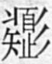，古文。』

**○赤欲如白裹朱，**

〔識〕宋本《脈經》『白』作『帛』。沈本《脈經》作『綿』。馬云：白，常作帛。諸本作『白』，非。

<!-- PAGE_END -->

<!-- PAGE: 0445 -->

<!-- PRINTED: 410 -->

〔箚〕《聖惠方》『白』作『帛』。《説文》：『帛，繒也。從巾白聲。』王引之曰：『帛與白，古字並通。』《玉藻》『大帛不緌』鄭注：『帛當爲白。』閔二年《左傳》『大帛之冠』，《雜記》注引作『大白』。《小雅・六月》『白旆央央』，孫炎《爾雅》注引作『帛旆英英』。子思之子名白，《漢書》孔光傳作『帛』。是白與帛通。

〔張〕白裹朱，隱然紅潤而不露也。

**○不欲如赭。**

〔張〕赭，代赭也，色赤而紫，此火色之善惡也。

《説文》：『赭，赤土也。』

**○白欲如鵞羽，不欲如鹽。**

〔張〕鵞羽白而明，鹽色白而暗，此金色之善惡也。

**○青欲如蒼璧之澤，不欲如藍。**

〔張〕蒼璧之澤，青而明潤，藍色青而沈晦，此木色之善惡也。

〔紹〕《周禮・大宗伯》『聽以蒼璧禮天』。

案：蒼璧，猶云蒼玉。蒼玉者，謂綠色之玉，所云碧玉也。

**○黃欲如羅裹雄黃，不欲如黃土。**

〔張〕羅裹雄黃，光澤而隱，黃土之色，沈滯無神，此土色之善惡也。

**○黑欲如重漆色，不欲如地蒼。**

〔張〕重漆之色，光彩而潤，地之蒼黑，枯脂如塵，此水色之善惡也。

<!-- PAGE_END -->

<!-- PAGE: 0446 -->

<!-- PRINTED: 411 -->

案：地蒼，《脈經》《甲乙》共作『炭』一字。『地蒼』二字未甚明，蓋謂土色之黑也。因考『蒼』恐『壤』假借，地壤即土壤，謂土之黑而無光也。

《脈經》卷五第四云：『青欲如蒼璧之澤，不欲如藍。赤欲帛裹朱，不欲如赭。白欲如鵞羽，不欲如鹽。黑欲如重漆，不欲如炭。黃欲羅裹雄黃，不欲如黃土。』

《甲乙》卷一五色第十五云：『夫精明五色者，氣之華也。赤欲如白裹朱，不欲如赭色也。白欲如白璧之澤｟一云鵞羽｠，不欲如堊｟一云鹽｠也。青欲如蒼璧之澤，不欲如藍也。黃欲如羅裹雄黃，不欲如黃土也。黑欲如重漆色，不欲如炭｟《素問》作地蒼｠也。五色精微象見，其壽不久也。』

**○五色精微象見矣，其壽不久也。**

〔張〕此皆五色精微之象也。凶兆既見，壽不遠矣。

案：精、微共皆訓小。五色中自有善惡二兆者，是其象尤精且微也。

**○夫精明者，所以視萬物，別白黑，審短長。以長爲短，以白爲黑，如是則精衰矣。**

〔張〕五藏六府之精氣，皆上注於目，而爲之精，故精聚則神全。若其顛倒錯亂，是精衰而神散矣，豈久安之兆哉。

案：精明五色之理，如以上所説也。《五藏生成》第十所云『五色微診，可以目察。能合脈色，可以萬全』，此之謂也。第十又説五色之生死，與此自異。

**○五藏者，中之守也。**

《甲乙》卷六壽夭形診十一『守』作『府』。

〔張〕五藏者，各有所藏。藏而勿失，則精神完固，故爲中之守也。

<!-- PAGE_END -->

<!-- PAGE: 0447 -->

<!-- PRINTED: 412 -->

**○中盛藏滿，氣勝傷恐者，聲如從室中言，是中氣之濕也。**

案：中者，謂胃中。藏者，謂肺藏。盛、滿共斥於水飲也。氣勝，謂短氣喘息。傷恐，未詳。恐，是謂驚恐、驚悸之證。凡水飲迫塞，則多發驚恐不安，多夢多魘等之證。傷恐，蓋謂此等證歟。言胃中水盛上逆滿肺部，則發喘驚之證。其聲不清亮，如從密室中言者，是從胃中出之氣音，與水飲之濕氣相合，故令聲音不清也。之，猶與也，見於《經傳釋詞》。以上謂肺病也。

《金匱》初篇曰：『語聲喑喑然不徹者，心膈間病。』

〔識〕吳云：『傷，悲傷。恐，懼也。傷爲肺志，恐爲腎志。蓋肺氣不利則悲，濕土刑腎則恐也。』張云：『傷恐者，腎受傷也。』志云：『恐爲腎志，如腎氣不藏，而反勝於中，則傷動其腎志矣。』簡按：推下文例，『者』字當在言下。

（眉）案：傷者，藏傷於飲也。

**○言而微，終日乃復言者，此奪氣也。**｟肝｠

〔志〕氣不接續也。《傷寒論》曰：『實則譫語，虛則鄭聲。鄭聲者，重語也。』

案：以上謂肝病也。蓋肝藏魂，魂若不定，則出言必微，又失思念，故終日之間復伸前言，淳淳如愚，是奪氣之候也。蓋奪氣則血亦亡，血亡者，肝氣自虛，是乃肝病也。

案：奪，脫同。

**○衣被不斂，言語善惡，不避親疎者，此神明之亂也。**

案：『衣被不斂』云云二句，畫出狂證情狀來尤奇，非古文不能如此也。神明之亂者，病係於心藏之證也。是爲心病也。

<!-- PAGE_END -->

<!-- PAGE: 0448 -->

<!-- PRINTED: 413 -->

**○倉廩不藏者，是門户不要也。**｟脾｠

〔張〕要，約束也。幽門｟胃下口｠、闌門｟大腸小腸之會｠、魄門，皆倉廩之門户。門户不能固，則腸胃不能藏，所以泄利不禁，脾藏之失守也。

案：以上謂脾病也，第八云『脾胃者倉廩之官，五味出焉』是也。『門户』對『倉廩』成文，蓋古文之約束不可拔者每如此。病爲下利也。

**○水泉不止者，是膀胱不藏也。**｟腎｠

案：此謂腎病也。云水泉者，亦是文之餘勢，與『倉廩』『門户』一同文法。病爲小便不禁之證也。

**○得守者生，失守者死。**

藏内之守，主内而言。

案：前文五藏之病不必死，若失其神氣之守，則必死也。

**○夫五藏者，身之強也。**

案：下文所云頭、背、腰、膝、骨五者並府也，而此云五藏者，統言則府亦偁藏，自有形可見，是之謂府，自有氣運動之謂藏。《五藏別論》十一云『方士或以腦髓爲藏』是之謂也。前文所云五藏，與此所云五藏，同名而異物。故彼云『身之中』，此云『身之強』，可互考。

**○頭者，精明之府，頭傾視深，精神將奪矣。**

案：頭中爲主者，唯是眼目，故以頭爲精明之府，言頭者收眼目之府庫也。故精神將奪，則目視不明，而頭低不正也。蓋頭者諸陽之會，爲五藏之精氣所聚之處也。

《靈・口問篇》：『上氣不足，頭爲之苦傾，目爲之眩。』

<!-- PAGE_END -->

<!-- PAGE: 0449 -->

<!-- PRINTED: 414 -->

〔吳〕視深，視下也。又目陷也。

〔張〕頭傾者，低垂不能舉也。視深者，目陷無光也。

（眉）因文例，則此『精明』乃與下句『精神』一物，未必單指眼目也。

（眉）《玉函經・例篇》：『頭者，身之元首，人神之所注。氣血精明，三百六十五絡，皆歸於頭。頭者，諸陽之會也。』

**○背者，胸中之府。背曲肩隨，府將壞矣。**

〔馬〕胸在前，背在後，而背懸五藏，實爲胸中之府。

〔張〕背乃藏俞所繫，故爲胸中之府。

案：背曲，謂龜背也。肩隨，謂嚲曳也。隨，猶垂也。樓氏《綱目》『隨』作『垂』，蓋同音通義耳。背曲肩隨者，府將壞之證也。蓋府者即藏也，五藏之氣將壞敗，則爲此狀。壞者，其氣失常道而乖戾也，與亡奪者不同。

（眉）府將壞者，胸中之藏將壞之略言。所謂胸中之藏，斥心肺二藏也。

**○腰者，腎之府。轉搖不能，腎將憊矣。**

〔吳〕『憊』與『敗』同，壞也。

案：腎藏在於腰中，故以腰爲腎之府也。腎氣將虛憊，則腰骨不能轉搖也。在腰云轉，文字下得而妙。

**○膝者，筋之府。屈伸不能，行則僂附，筋將憊矣。**

〔張〕筋雖主於肝，而維絡關節以立此身者，惟膝膕之筋爲最，故膝爲筋之府。

案：凡關節之屈伸，筋爲之維絡，屈伸之處無過於膝，故以膝爲筋之府也。筋若將衰憊，則膝先不能屈伸，行則僂俯。此與前文『曲背』相似，而背曲常曲也，與此唯將行則僂附不同。

<!-- PAGE_END -->

<!-- PAGE: 0450 -->

<!-- PRINTED: 415 -->

〔識〕簡按：馬『附』讀爲『俯』，爲是。《左傳・昭七年》『正考父一命而僂，再命而傴，三命而俯』杜注：『俯共於傴，傴共於僂。』又府同。《説文》『府，俛病也』。《廣雅》『府，短也』。

案：附即俯之假借。吳云『僂，曲其身也。附，不能自步，附物而行也』，是就字而爲説，非是。附與伏、俛同音同義。

**○骨者，髓之府，不能久立，行則振掉，骨將憊矣。**

（眉）《甲乙》『振掉』作『掉慄』。

案：髓在骨中，故以髓之所在爲骨也。骨將憊，據前後文例則當作『髓』。然髓若將憊，則當甚於此之證。此言髓漸不足，故骨亦將衰憊，故不能久立而行則振掉，是髓氣不盈之患及於骨不立也。凡人以氣正立，今氣不足，故不能久立，而振振動掉也。《生氣通天論》所云『氣立』者，此之謂也。｟第三｠若曰髓將憊，則至於失強而死之地之理也。此獨曰『骨』而不曰『髓』者，其意宜如此耳。

**○得強則生，失強則死。**

《甲乙》卷六十一引至於此。

藏外身上之事，故以強爲之主。強者，陽氣充滿之候也。

案：前文將奪、將壞、將憊等『將』字，並可著眼矣。將奪者，未全奪之謂也。此際五藏之氣未耗散，有強固不失守之機，則治之可活。若五藏之氣已耗散，失強固之機，則今雖未奪，漸將全奪之兆可見，故必死也。並皆此義。

**○岐伯曰：反四時者，有餘爲精，不足爲消。應太過不足爲精，應不足有餘爲消。陰陽不相應，病名曰關格。**

<!-- PAGE_END -->

<!-- PAGE: 0451 -->

<!-- PRINTED: 416 -->

〔識〕簡按：此一頃三十九字，與前後文不相順承，疑是他篇錯簡。且『精消』二字，其義不太明，姑從張注。

〔紹〕琦曰：『此他經脫文，不可強解。』堅案：此與原《識》意相協。

〔箚〕小島學古曰：『不足爲精云云，精消二字互誤，上文已云有餘爲精，不足爲消。可徵。』｟此説甚誤｠

案：此條宜在闕疑之例。張注亦不太明，故此不引用。

（眉）案：有餘、太過一事，並脈實大也。不足者，脈虛小也。精者，病盛甚也。消者，病輕微也。

『陰陽』以下十字別截一段。

**○帝曰：脈其四時動，奈何。知病之所在，奈何。知病之所變，奈何。知病乍在内，奈何。知病乍在外，奈何。請問此五者可得聞乎。**｟《甲乙》無『其』字｠

（眉）《大素》十四・四時脈診。

〔楊〕六謂六問，此中唯有五問，當是脫一問也。

**○岐伯曰：請言其與天運轉大也。**

〔楊〕量下答中文當有六，故爲六合也。人身合天，故請言人身與天合氣，轉運之道也。

〔箚〕寬案：《大素》似是。王注亦不及『大』字之義，疑王舊本『大』字所無。

**○萬物之外，六合之内，天地之變，陰陽之應。**

〔楊〕萬物各受一形，自萬物一形之外，從於六合苞裹之内，皆是天地爲其父母，變化而生，故萬物皆與天地之氣應而合也。

<!-- PAGE_END -->

<!-- PAGE: 0452 -->

<!-- PRINTED: 417 -->

（眉）萬物，軀船之外也。動靜，諸物内景之外也。即斥空虛之處也，六合之内斥地表。以上非云地内土中也。

**○彼春之暖，爲夏之暑，**

據《千金》廿九卷，五藏五情，則春好喜，夏怵慮。｟一作惠好也｠

《至真要大論》｟七四｠引《大要》文與本文同。

《至真要論》｟七十四｠『寒暑温涼，盛衰之用，其在四維。故陽之動，始於温，盛於暑。陰之動，始於清，盛於寒。春夏秋冬，各差其分。故《大要》曰：彼春之暖，爲夏之暑。彼秋之忿，爲冬之怒。云云』。

《老子》第四十五章『躁勝寒，靖勝熱』亦互文也。

〔楊〕春夏者，陰氣終始也。春之三月，陽氣之始，氣和日暖。夏之三月，陽盛暑熱，乃是春暖增長爲之也。

**○彼秋之忿｟急｠，爲冬之怒。**

據《傷寒例》則秋涼冬冽也。

案：暖與忿、暑與怒押韻，蓋有古言自如此者。

〔楊〕秋冬者，陰氣終始也。秋之三月，陰氣之始。風高氣切，故名爲急。冬之三月，陰氣嚴烈，乃是秋涼增長爲之也。

《傷寒例》引《陰陽大論》，以上四句全與本文同。依此則作『急』者似訛。春夏云天氣，秋冬云人氣，是互文成義也。

《醫心方》『急』多作『忿』（草體），遂訛『忿』者。

<!-- PAGE_END -->

<!-- PAGE: 0453 -->

<!-- PRINTED: 418 -->

（眉）約之案：此語互文見意。春暖喜，夏暑樂，秋涼忿，冬寒怒。忿即哀痛之義。

【楷】（眉）《五行大義》卷四論八卦八風篇引陽泉云：『春喜風也，夏樂風也，秋怒風也，冬哀風也』。又卷四論情性篇引翼奉云：『喜氣爲暖當春，怒氣爲晴當秋，樂氣爲陽當夏，哀氣爲陰當冬。此與《論衡》意合。』

**○四變之動，脈與之上下。**

案：馬云『上下者，浮沈也』，可從。楊注非是。王無解，則蓋亦當與馬同也。

〔楊〕暖暑爲急怒，是天之運四氣變動，人之經脈，與彼四氣上下變動亦不異也。春夏之脈，人迎大於寸口，故爲上也，寸口小於人迎，故爲下也。秋冬之脈，寸口大於人迎，故爲上也，人迎小於寸口，故爲下也。此乃盛衰爲上下也。此答初問也。

（眉）四變各差三十日之義，詳見《至真要論》，經注皆可參。

**○以春應中規，夏應中矩，**

〔楊〕春三月時，少陽氣用，萬物始生未正，故曰應規也。夏三月時，太陽之氣用，萬物長正，故曰應矩也。

**○秋應中衡，冬應中權。**

〔楊〕秋三月時，少陰之氣用，萬物長極，故曰應衡也。冬三月時，大陰之氣用，萬物歸根，故曰應權也。

**○是故冬至四十五日，陽氣微上，陰氣微下，**

〔楊〕冬至以後，陽氣漸長，故曰微上。陰氣漸降，故曰微下也。

<!-- PAGE_END -->

<!-- PAGE: 0454 -->

<!-- PRINTED: 419 -->

案：冬至後四十五日，立春正月節也。

**○夏至四十五日，陽氣微下，陰氣微上。**

〔楊〕夏至已後，陰氣漸長，故曰微上。陽氣漸降，故曰微下也。

案：夏至後四十五日，立秋七月節也。

**○陰陽有時，與脈爲期，期而相失，知脈所分。分之有期，故知死時。**

〔楊〕陰陽以有四時，四時與脈爲期，爲期在於四時，相得失處，即知四時之脈，分在四時之際。脈分四時有期，則死生之期可知。此答第二病所在也。

**○微妙在脈，不可不察。察之有紀，從陰陽始。**

〔楊〕欲知人之死生者，無勝察之妙，察脈繩紀，必以陰陽爲本也。

**○始之有經，從五行生。**

〔楊〕陰陽本始有十二經脈也，十二月經脈從五行生也。

**○生之有度，四時爲宜。**

〔楊〕五行生十二經脈，各有法度。脈從五行生，木生二經，是足厥陰、足少陽也；火生四經，手少陰、手大陽、手厥陰、手少陽也；土生二經，足大陰、足陽明也；金生二經，手大陰、手陽明也；水生二經，足少陰、足大陽也。此爲五行生十二經。脈法度者，春有二經，夏有四經，季夏有二經，秋有二經，冬有二經，故十二經脈以四時爲數也。

**○補寫勿失，與天地如一。得一之情，以知死生。**

〔楊〕於寸關尺三部之中，循十二經脈，得其弦鉤浮，營四時之氣而不失錯，與天地氣宜然爲一，如此即能了知死生之期也。

<!-- PAGE_END -->

<!-- PAGE: 0455 -->

<!-- PRINTED: 420 -->

案：夫『萬物之外』至此，答第一問『脈其四時動』也。

**○是故聲合五音，色合五行，脈合陰陽。**

案：此三句，答第二問『知病之所在』也。蓋聲色脈三者，相合而調勻，謂之平人。能究此理，則知病之所在也，猶指掌耳。

〔楊〕人之音聲合於五音，人之形色合於五行，人之脈氣合於陰陽。此答第三之病之所變也。

**○是知陰盛，則夢涉大水恐懼。陽盛，則夢大火燔灼。陰陽俱盛，則夢相殺毀傷。上盛則夢飛，下盛則夢墮。甚飽則夢予，甚飢則夢取。肝氣盛，則夢怒。肺氣盛，則夢哭。**

案：以上《靈樞》卷十三淫邪發夢第四十三所説岐伯之言，而此下有心氣、脾氣、腎氣盛云云文。此獨舉肝肺二氣者，此只主論陰陽二氣之盛衰，故不全載五藏也，非有缺文也。

（眉）恐懼者，涉水際之恐懼也。

**○短蟲多則夢聚衆，長蟲多則夢相擊毀傷。**

〔楊〕凡夢有三種：人有吉凶，先見於夢，此爲徵夢也。思想情深，因之見夢，此爲想夢也。因其所病，見之於夢，此爲病夢也。此十一種夢，皆病夢也。並因陰陽氣之盛衰，内有飢飽，肝肺｟（疑脱『氣』）｠盛，長短蟲多以爲夢也。此所以因傷致夢，即以夢爲診也。此爲夢診，可爲四答問之脱也。

〔新〕詳此二句，亦不當出此，應他經脱簡文也。

案：此二句《靈樞》不載，而此有之者，此專主陰陽言之。蓋短蟲即蟯蟲，蟯亦短小之義。《病源》云『形甚小，如今之蝸蟲狀』，又云『至細微，形如菜蟲』是也。長蟲者，《病源》云『長蟲，蚘蟲也。長一尺，動則吐清水出，則心痛，貫心則死』是也。據前文，則二蟲共是爲陰陽俱盛之候歟。

<!-- PAGE_END -->

<!-- PAGE: 0456 -->

<!-- PRINTED: 421 -->

案：五藏虚實之夢，見本書卷廿四《方盛衰論》第八十，可併考。以上蓋答第三問『知病之所變』也。

**○是故持脈有道，虚靜爲保。**

道、保爲韻。

〔楊〕持脈之道，虚心不念他事，凝神靜慮，以爲自保，方可得知脈之浮沈，氣之内外也。

《廣韻》上聲三十二晧『寶』『保』並同音『博抱切』。寶之作保，經典其證極多。《禮・檀弓下》『仁親以爲寶』注：『寶謂善道可守者。』《論語・陽貨》皇疏：『寶，猶道也。』《廣雅・釋詁三》：『寶，道也。』

**○春日浮，如魚之遊｟游｠在波｟皮｠。**

案：浮、游、皮爲韻。

案：宜從《大素》作『在皮』爲是。言春日之脈浮而如弓弦上出，如魚之游云者，亦謂魚口小出水上而行。『在皮』二字，據後文例，則宜在『春日』下。然此以浮、游、皮爲韻，不可改也。是即倒草法耳。

**○夏日在膚，泛泛｟沉沉｠乎萬物有餘。**

膚、乎、餘韻語。

〔楊〕春時陽氣始開，脈從骨髓流入經中，上至於皮，如魚游水，未能周散。夏時陽氣榮盛，脈從經溢入孫胳，膚肉之中，如水流溢，沉沉盛長，萬物亦然，茂盛有餘。此答第五病在於外也。

案：『泛』，《大素》作『沉』，『沉』即『汎』字，蓋『凡』有俗作『兀』者，此體再訛爲『冗』也。

**○秋日下膚，蟄蟲將去。冬日在骨，蟄蟲周密，君子居室。**

膚、去韻語。骨、密、室韻語。

<!-- PAGE_END -->

<!-- PAGE: 0457 -->

<!-- PRINTED: 422 -->

〔楊〕秋日陽氣從膚漸伏於内，故曰下虚膚｟『虚』字恐衍｠，蟄蟲趣煖入穴，故曰將去。是時陰氣從内出在皮膚，腠理將開也。冬日陽氣内伏，蟄蟲閉户周密，君子去堂居室。人之脈氣行骨，故持脈者深按得之。此答第六病乍在内也。

案：《傷寒例》云：『冬時嚴寒，萬類深藏。君子固密，則不傷於寒。』｟《外臺》『固』作『周』｠此『周密』二字係於蟄蟲，文勢不同。蓋『周密』二字，虚字活用尤廣，故人物共可用也。

**○故曰：知内者按而｟如｠紀之，知外者終而｟如｠始之。**

〔楊〕秋冬脈氣爲陰，在内，故按得綱紀。春夏脈氣爲陽，在外，故趣終得始也。春夏之脈爲秋冬脈終，即爲陽之始也。

**○此六者，持脈之大法。**

『帝曰脈其四時動』至此，《大素》卷十四・四時脈診載。以上蓋答第四五二問『病乍在内，病乍在外』也。

〔楊〕以爲診脈大法。

〔馬〕此春夏秋冬内外六者，乃持脈之大法也。張同。

案：馬、張二注説可從。高世栻云『内外按紀終始』，恐非是。

〔箚〕史載之《脈要精微解》云：『以經意考之，以四時之脈分表裏之淺深，而決之以内外之辨。且以春日浮，如魚之遊在波，則陽氣之萌，脈雖見而未出於膚；夏日在膚，泛泛乎萬物有餘，則脈已在膚矣；秋日下膚，蟄蟲將去，則秋陰氣之至，脈雖下膚，而未至於沈；冬日在骨，蟄蟲周密，則脈已沈矣。以是知内者，按而紀之，以明脈之在裏也，如秋日之下膚，冬日之在骨是也；知外者，終而始之，以明脈之在表也，如春日之浮，夏日之泛是也。然知内者，必曰按而紀之者，蓋脈之在内，非深按之無以得其實；知外必曰終而始之，則初按而病已見矣，故因其病，以推原其本。啓玄子乃以知内爲知脈，知外爲知色，殊非黄帝所謂持脈之大法也。』

<!-- PAGE_END -->

<!-- PAGE: 0458 -->

<!-- PRINTED: 423 -->

**○心脈搏堅而長，當病舌卷不能言。**

（眉）《大素》十五・五藏脈診。

《甲乙》四『搏』作『揣』，下同，無『當』字。

〔楊〕揣，動也。長謂寸口脈長一寸也。此爲心脈盛動堅，心脈上至舌下，故盛動堅，舌卷不能言。

〔紹〕堅按：《廣雅》『揣，動也』，出《釋詁》一。曹憲音喘。《廣雅・釋訓》『揣抗，搖捎也』。是喘動之義。《廣韻》『揣，又音丁果切。搖也』。王念孫曰：『或通作朵。頤初九，觀我朵頤，鄭注：朵，動也。京房作揣。』

〔張〕本篇五篇脈病，一曰搏堅而長，一曰耎而散，而其爲病多皆不足，何也。蓋搏堅而長者，邪勝乎正，是謂邪之所湊，其氣必虚也；耎而散者，本原不足，是謂正氣奪則虚也。一以有邪而致虚，一以無邪本虚。虚雖若一，而病本不同，所當辨也。

案：舌卷者，謂舌屈不伸也。《淮南・本經訓》『嬴縮卷舒』注：『卷，屈也。』又《原道訓》『與剛柔卷舒兮』注：『卷舒猶屈伸也。』並皆卷曲不伸之義也。中風往往有此證矣。『搏』與『揣』義相似，蓋所傳自有不同耳。張以爲邪實正虚之脈，可從。

（眉）《大奇論》音釋『揣，初委切』。

（眉）《靈・熱病篇》『脈口動喘而短者』史崧注：『一本短作弦』。《大素》廿五熱病説篇載之。楊注

<!-- PAGE_END -->

<!-- PAGE: 0459 -->

<!-- PRINTED: 424 -->

曰：『脈喘動。』

（眉）慧琳《經音》卷十五｟七ヲ｠『團，段巒反。《毛詩傳》曰：團，聚也。經文作揣。非也。音初纍反。甚乖經義』。又七十二『摶，徒官反。論文作揣，音初委反。測廣前人曰揣，江南行此音，又都果反。關中行此音，並非此義也』。又卷十六｟十七ウ｠『鹿𨄔，下舡耎反。《説文》𨄔𨄔，腳腸也，或作腨』。據此，則凡從『專』之字，俗或從『耑』也。然則經文『搏堅』，恐是本作『摶堅』歟。存疑。

（眉）又卷二十｟六ウ｠云：『《説文》腨，腓腸也。從肉耑聲。經本從專作膞。非也。或作〓𨄔，通。』

**○其耎而散者，當消環自已。**

《甲乙》《脈經》共『環』作『渴』，《甲乙》『當』作『病』。

〔楊〕動而堅者，病舌卷。耎而散者，病消渴。以有胃氣，故自已。由下少陰貫腎胳肺，繫舌本故之。

〔琦〕心液耗傷，故見消渴。俟心氣續復，津液得生，則自已也。｟志聰亦同此説｠

徐氏《要旨》云：『搏堅皆爲大過，耎而散皆爲不及，五藏各因大過不及而病也。』

案：《大素》作『消渴』，《甲乙》《脈經》同，宜從改。乃與外五藏皆云病合。耎即濡、軟等之古字。真本《玉篇》輭字下云：柔究反。《説文》：輭，轢也。野王案：今亦以爲柔𡰥之𡰥。《漢書》『軟弱不勝任』爲此字。𡰥在尸部，或爲耎字在大部，或爲耎字在耎部，或爲偄字在人部。

**○肺脈搏堅而長，當病唾血。**

《甲乙》無『當』字。

〔楊〕肺脈浮短，今動堅長，知血胳盛傷，故唾血也。

〔張〕肺脈搏堅而長，邪乘肺也。肺系連喉，故爲唾血。

<!-- PAGE_END -->

<!-- PAGE: 0460 -->

<!-- PRINTED: 425 -->

**○其耎而散者，當病灌汗，至今不復散發也。**

《甲乙》無『當』字、『也』字，『今』作『令』。

〔楊〕以肺氣虚，故脈耎散也。虚故腠理相遂，汗出如灌，至今不復也。

〔張〕若耎而散，則肺虚不斂，汗出如水，故云灌汗。灌汗多亡陽，故不可更爲發散也。

《脈經》卷六第七云：『肺脈搏堅而長，當病吐血。其濡而散者，當病漏汗｟漏一作灌｠。至今不復｟（疑脱『散』）｠發｟六字疑衍｠。』

案：『灌汗』，《脈經》作『漏汗』，則宜從。楊注『汗出如灌』爲是。王注以爲灌洗之義，恐非是。

又案：『至今不復』，後文『腎脈』下亦有此四字。蓋謂大汗如灌，至今尚不平復也。因考『散發』二字不可解，蓋是『散』｟上文｠字之傍注，誤混正文者，即『散，發也』之義也。《脈經》有『發』字無『散』字，恐脱耳。楊注不説散發之義，據此，則楊所據本文，或無『散發』二字歟。

**○肝脈搏堅而長，色不青，當病墜若搏，因血在脅下，令人喘逆。**

《甲乙》無『當』字。

〔楊〕肝脈耎而弦，今動堅而長，其色又不相應者，是人當有墜。有墜傷損，血在脇下，又令喜喘故也。

案：墜者，自高墮落也。搏者，觸物而傷身也。共爲損傷經脈，故令肝脈堅長也。血氣動擾，故令色不青而有血色也。敗血在脇下，則令人善喘，是與水飲在胸下同理。

案：以下此節中云色者，皆面色也，非其病處之色也。

（眉）案：或謂不青，青也。不，語助，猶《爾雅》『不漘』之『不』也。

**○其耎而散，色澤者，當病溢飲。溢飲者，渴暴多飲，而易入肌皮腸胃之外也。**

《甲乙》無『當』字，『暴』作『渴』。

<!-- PAGE_END -->

<!-- PAGE: 0461 -->

<!-- PRINTED: 426 -->

〔楊〕易音亦。若脈耎散，色又光澤者，當因大渴暴飲，水溢腸胃之外，易入肌皮之中，名曰溢飲之病也。

〔識〕滑云：『易，當作溢。』簡按：以理推之，宜云『肌皮之中，腸胃之外』，而肌皮即是腸胃之外，故云爾。《脈經》亦『易』作『溢』。

〔紹〕堅案：《廣韻》『易，變易』，又『始也，改也，奪也，轉也，伊昔切』。楊氏蓋爲轉義讀。先兄説亦相合，曰：易，移易之謂，言以其多飲，不滲入尿脬，移易入於肌胃｟（當作『皮』）｠腸胃之外。《甲乙經》易作溢，可證。又楊言『肌皮之中』者，與原《識》意合。

案：『易』即『亦』之假借，説見前第十五中。楊注云『音亦』則似爲『亦』之義。此云『溢飲』，前云『血在脅下』，可知飲、血共同爲水，肝主血脈，肝氣不足則血脈不利，爲飲爲水。《靈樞・邪氣藏府病形篇》云『肝脈大甚爲内癰，善嘔衄，濇甚爲溢飲』，可併考。

〔識〕張云：『肝木不足，脾濕勝之。濕在肌膚，故顔色光澤。』志云：『《金匱要略》云：夫病水人，面目鮮澤。蓋水溢於皮膚，故其色潤澤也。』

**○胃脈搏堅而長，其色赤，當病折髀。**

《甲乙》無『當』字。

〔楊〕胃脈耎弱，今動堅長，又他色來剋，故當病折髀，以足陽明脈行髀故也。

〔箚〕琦曰：『折髀、折腰，皆謂如折也。』

〔張〕胃脈搏堅，木乘土也。加之色赤，則陽明火盛，木火交熾，胃經必傷。

**○其耎而散者，當病食痺。**

<!-- PAGE_END -->

<!-- PAGE: 0462 -->

<!-- PRINTED: 427 -->

《甲乙》無『當』字，『痺』下有『痛髀』二字。

〔楊〕胃虚不消水穀，故食即胃中爲痺而痛。又脈行於膝，故病膝髕痛。髕，膝端骨也。

《脈經》卷六第六云：『胃脈搏堅而長，其色赤，當病折髀。其耎而散者，當病食痺髀痛。』

〔識〕《至真要大論》『甚則入脾，食痺而吐』王注：『食痺，謂食已心下痛，陰陰然不可名也，不可忍也，吐出乃止。此爲胃氣逆，而不下流也。』李仲梓《醫宗必讀》有治方，可并考。按：此後世所謂嘈雜之類。

案：王注『陰陰』，猶云温温，謂心下鬱閉不了了之狀也。

案：『食痺』，猶云食閉，謂食已胃氣閉塞，令心下痛也。王氷以爲『痺，痛也』，非是。『食痺』下《大素》有『髕痛』二字，《脈經》有『髀痛』二字，《靈樞・邪氣藏府病形篇》云『脾脈緩甚爲痿厥，微緩爲風痿』。據此，則作『髕痛』，似是。

**○脾脈搏堅而長，其色黄，當病少氣。**

《甲乙》無『當』字。

〔楊〕脾脈耎弱，今動堅長，雖得本色，以其陽虚，故病少氣。

〔張〕邪脈乘脾，脾氣必衰。脾虚無以生血，故本藏之色見於外。脾弱不能生肺，故爲少氣。

案：脾主肌肉，今脾氣弱，故血不活動而鬱於肌裏，故發黄也。發黄之理，其原雖係於脾虚，其證則血鬱結不利之所爲也。蘭軒先生已有此説。今考經文，無非此理者也。又案：脾脈當耎弱而堅長，是脾氣虚弱，四藏益盛，故爲發黄。他藏盛也，爲少氣脾弱也。

**○其耎而散，色不澤者，當病足䯒腫，若水狀也。**

<!-- PAGE_END -->

<!-- PAGE: 0463 -->

<!-- PRINTED: 428 -->

（眉）《甲乙》無『當』字、『也』字。

〔楊〕足太陰脈循胻，故脾虚，色不澤者，胻腫若水之狀也。

《説文》『胻，脛耑也』。

案：䯒即胻，俗字，乃爲脛前骨之字也。《廣韻》十二庚云『䯒，牛脊後骨』，自是別義。

〔志〕五藏元真之氣，脾所主也。濕熱太過，則色黄脈盛而少氣矣。其不及，當病足脛腫，脾氣虚，故足腫也。若水狀而非水病，故其色不澤。

《脈經》卷六第五云：『脾脈搏堅而長，其色黄。當病少氣，其耎而散，色不澤者，當病足骭腫若水狀。』

**○腎脈搏堅而長，其色黄而赤者，病折腰。**

〔楊〕腎脈沈石，今動堅長。黄色，賊邪及赤色，微邪來剋，故病腰痛，以足少陰脈營腰故也。

〔張〕邪脈干腎，腎氣必衰。其色黄赤，爲火土有餘，而腎水不足，故病腰如折也。

**○其耎而散者，當病少血，至今不復也。**

《甲乙》無『當』字、『也』字，『今』作『令』。

〔楊〕陰盛太陽氣虚，故少血得之在久，至今不復也。

〔張〕若其耎散，腎氣本虚。腎主水，以生化津液，今腎氣不化，故病少血。本原氣衰，故令不能遽復。

《脈經》卷六第九云：『腎脈搏堅而長，其色黄而赤，當病折腰。其耎而散者，當病少血。』

**○帝曰：診得心脈而急，此爲何病，病形何如。岐伯曰：病名心疝，少腹當有形也。**

（眉）九十二章《大素》無。

<!-- PAGE_END -->

<!-- PAGE: 0464 -->

<!-- PRINTED: 429 -->

〔識〕《聖濟總録》云：『夫藏病必傳於府，今心不受邪，病傳於府，故小腸受之，爲疝而痛，少腹當有形也。世之醫者，以疝爲寒濕之疾，不知心氣之厥，亦能爲疝。心疝者，當兼心氣以治之。』方具於九十四卷。《大奇論》云：『心脈搏滑急爲心疝。』《四時刺逆從論》云：『滑則病心風疝。』《邪氣藏府病形篇》云：『心疝，引臍小腹鳴。』

《靈樞・順氣一日分爲四時篇第四十四》云：『心爲牡藏，其色赤，其時夏，其日丙丁，其音徵，其味苦。』

（眉）案：衝心而痛，故云心疝也。

**○帝曰：何以言之。岐伯曰：心爲牡藏，小腸爲之使，故曰少腹當有形也。**

《脈經》卷六第三云『心脈急，名曰心疝。小腹當有形，其以心爲牡藏，小腸爲之使，故小腹當有形』。

〔張〕牡，陽也。心屬火，而居於鬲上，故曰牡藏。心與小腸爲表裏，故脈絡相通，而爲之使。小腸居於少腹，故少腹當有形也。

案：有形者，上文所云病形也。其證筋脈攣急作痛，故云有形也。

**○帝曰：診得胃脈，病形何如。岐伯曰：胃脈實則脹，虚則泄。**

〔張〕實爲邪有餘，故脹滿。虚爲正不足，故泄利。

案：胃脈實則脹者，謂宿食腹脹也。《金匱》第十云『病腹滿發熱十日，脈浮而數，飲食如故，厚朴七物湯主之』，又云『寸口脈浮而大，按之反濇，尺中亦微而濇，故知有宿食，大承氣湯主之。脈數而滑者，實也，此有宿食，下之愈』是也。

案：胃脈者，專言趺陽也。《金匱・下利篇》十七云『下利手足厥冷無脈者，灸之，不温。若脈不還，反微喘者死。少陰負趺陽者，爲順也』｟《傷寒論・厥陰篇》同｠是亦謂下利而趺陽脈虚也，可互參考。

<!-- PAGE_END -->

<!-- PAGE: 0465 -->

<!-- PRINTED: 430 -->

**○帝曰：病成而變，何謂。岐伯曰：風成爲寒熱。**

（眉）風，風邪也。下文同。

〔張〕成，言病之本。變，言病之標。標本不同，是謂之變。

〔識〕簡按：寒熱，蓋虚勞寒熱之謂，即後世所稱風勞。下文云『沈細數散者，寒熱也』，次篇云『寸口沈而喘曰寒熱』，及《靈樞》論疾診尺篇、寒熱病篇、風論等所論皆然。又喻昌《醫門法律》以以下五條爲胃風變證，各處一方，誤甚。

案。馬注亦『帝曰診得胃脈』以下與此相接爲一條，恐非是。

**○癉成爲消中，**

〔識〕馬云：『癉者，熱也。』吴云：『癉，熱邪也。積熱之久，善食而饑，名曰消中。』簡按：王注《奇病論》云：『癉，謂熱也。』此章冠『濕』字，非是。《漢書・嚴助傳》『南方暑濕，近夏癉熱』｟師古注：『癉，黄病也。』誤。｠王充《論衡》云『人形長七尺，形中有五常，有癉熱之病。深自剋責，猶不能愈』，又云『天地之有湛也，何以知不如人之有水病也。其有旱也，何以知不如有癉疾也』，《左傳》『荀偃癉疽』｟哀三年｠，《史記》『風癉』『肺消癉』，及本經『消癉』『癉瘧』之類，皆單爲熱之義。熊音：『癉，多滿反。俗作疸也。』尤誤。

（眉）癉，邪熱也。

（眉）真本《明堂》卷一天府下曰『欬上氣，不得息暴癉』，楊注：『脾風發癉，腹中熱，故癉即熱黄病者也。音丁幹反也。』

案：『癉熱』之字，古蓋作『單』，或『殫』，後加疒作『癉』，與『黄癉』字相混。『殫，盡也』，出《廣雅・釋詁一》、《漢書》集注、《後漢書》注、《吕覽》注、《淮南》注、《楚詞》注、《文選》注等，『單，盡也』，出《詩》天保箋、《左傳》注、《爾雅》注、《國語》中｟（當作『注』）｠、《漢書》注、《後漢書》注、《荀子》《莊子》《列子》《吕覽》注等，而《扁倉傳》『風癉客病｟（當作『脬』）｠』《正義》云：『癉，旱也。』《後漢書・南匈奴傳》注：『單與殫同。』《史記・春申君傳》『王之威亦單矣』，《集解》引徐廣曰：『單亦作殫。』可徵單、殫古多通用矣。竊謂癉熱者與發熱潮熱等之熱不同，謂津液煎迫殫盡之熱，虚熱勞熱之類也。王注《瘧論》云：『癉，熱也。極熱爲之也。』蓋『極熱』二字，解得『癉』字，尤明了。《説文》『殫，極盡也』，段玉裁云：『窮極而盡之也。』本經《奇病論》之『脾癉』『膽癉』，《通評虚實論》之『消癉』，《瘧論》之『癉瘧』，本篇之『癉成爲消中』皆同義。

<!-- PAGE_END -->

<!-- PAGE: 0466 -->

<!-- PRINTED: 431 -->

〔紹〕《淮南・説山訓》『嫁女於病消者，夫死則後難復處也』。《後漢・李迪傳》『素有消疾』注：『消，消中之病也。』

案：據此則云消、云消中，共指後世所謂勞瘵而言也。蓋消中之『中』與傷中之『中』同，統五内而謂之中也。五内有熱，而漸漸津液消爍脱肉，故云消，又云消中也。癉成爲消中者，言津液爲熱被煎迫，殫盡之至也，遂爲消中之病也。

《腹中論》云：『帝曰：夫子數言熱中、消中，不可服高梁，芳草、石藥。石藥發瘨，芳草發狂。夫熱中消中者，皆富貴人也。今禁高梁，是不合其心，禁芳草石藥，是病不愈。願聞其説。岐伯曰：夫芳草之氣美，石藥之氣悍，二者其氣急疾堅勁，故非緩心和人，不可以服此二者。何以然。岐伯曰：夫熱氣慓悍，藥氣亦然，二者相遇，恐内傷脾。脾者，土也，而惡木。服此藥者，至甲乙日更論。帝曰：善。』

**○厥成爲巓疾。**

<!-- PAGE_END -->

<!-- PAGE: 0467 -->

<!-- PRINTED: 432 -->

《千金》風癲門『巓』作『癲』。

〔識〕吴云：『巓、癲同，古通用。氣逆上而不已，則上實而下虚，故令忽然癲仆，今世所謂五癇也。』張云：『或爲疼痛，或爲眩仆，而成頂巓之疾也。一曰氣逆則神亂，而病癲狂者亦通。』簡按：楊玄操注《難經》云：『癲，顛也。發即僵仆倒地，故有癲蹶之言。』樓氏《綱目》云：『以其病在頭巓，故曰癲疾。是知癲癇之癲，厥成癲疾，眩冒癲疾之巓，一疾也。王太僕誤分癲爲二疾，獨孫真人始能一之。』樓以癲、巓爲一疾，固是，以巓爲頭巓之義，不可從。《五藏生成篇》『頭痛癲疾，下虚上實』，《奇病論》云『人生而有病巓病者』，《方盛衰論》『氣上不下，頭痛癲疾』，並是癲疾，當從吴注。

《蘭軒遺藁》云：『按：巓疾者，謂顛仆之疾，即癲也。此疾本由上實下虚而成。王以爲上巓之疾者，非也。巓、顛同。』《禮記・玉藻》『色容顛顛』，《釋文》：顛，又作巓。《楚辭・惜誦》『行不群以巓越兮』注：『巓，殞也。』是與《尚書》『顛越』之語同。凡『顛』作『巓』者，隷文耳。《漢北海相景君銘》｟漢安二年｠『巓倒剝摧』，《楊君石門頌》｟健和二年｠『屈曲㳅巓』，《西狹頌》｟建寧四年｠『巓覆實隧』可以爲證。

案：熹平三年《周憬功勳銘》作『發射其顛』，蓋隷變『顛』作『巓』，又變作『巔』，是與『顛』又作『㒹』｟見《廣韻》｠同理，與巓山頂之字自不相涉耳。

（眉）厥，四逆冷也，非也。巓疾者，鬱冒。冥仆者，未必瘨癇之瘨。厥者，大凡氣逆總名。

（眉）《蘭軒遺藁》云云，已見第十｟十一ウ｠中，此係於重出。

**○久風爲飧泄，**

〔張〕風從木化，久風不已，則脾土受傷，病爲飧泄而下利清穀也。

〔志〕風乃木邪，久則内干脾土而成飧泄矣。故曰春傷於風，邪氣留連，乃爲洞泄。

<!-- PAGE_END -->

<!-- PAGE: 0468 -->

<!-- PRINTED: 433 -->

案：飧泄解已見於第二篇中。

（眉）久風，風久義。

**○脈風成爲癘，**

《風論》王注引作『脈風盛爲厲』。

〔張〕風寒客於血脈，久而不去，則膚肉敗壞，其病爲癘。

《風論》云：『癘者，有榮氣熱胕，其氣不清，故使其鼻柱壞而色敗，皮膚瘍潰。風寒客於脈而不去，名曰癘風，或名曰寒熱。』

案：癘，《説文》『惡疾也。從疒蠆省聲』，《玉篇》『癘，力誓切。疫也。又音頼。惡病也』，《廣韻》『癩疾也』，《説文》『癘，惡瘡也』，今爲疫癘字。今考古無『癩』字，後世『疫厲』字亦作『癘』，故別作『癩』，以爲惡疾字也。

此癘斥身膚小瘡痦癗，不必惡疾之癘也。仲景《平脈篇》『風氣｟（脱『相』）｠搏，必成隱疹，久久爲痂癩』。

**○病之變化，不可勝數。**

〔張〕此舉風熱之邪，以見致病之概。其他變化百出，有不可數計者，亦猶此也。

《風論四十二》云：『故風者，百病之長也。至其變化乃爲他病也。』與此所云『變化』同義。

案：前文風、癉、厥、脈、風共云『成』，所云『成』者，即變化之義，爲漸漸成就某病也。飧泄獨云『久風』者，謂唯邪入胃而不去，久而爲飧泄也，與風成大不同。

**○帝曰：諸癰腫，筋攣骨痛，此皆安生。**

（眉）《大素》廿六癰疽。

<!-- PAGE_END -->

<!-- PAGE: 0469 -->

<!-- PRINTED: 434 -->

〔楊〕因於癰腫有此二病，故請所生。

案：《説文》『癰，腫也』『腫，癰也』。據此，則癰腫共謂氣血癰塞而腫起也。此云諸癰腫者，泛偁諸凡腫起之瘡而言也，筋攣骨痛，共成腫而未成膿之諸症也，皆氣血凝滯之所爲也。癰腫字已見第三篇中。《靈樞・癰疽篇》宜併考。

〔張〕此言諸病癰腫，而有兼筋攣骨痛者也。諸家以癰腫、筋攣、骨痛釋爲三證，殊失經意。觀下文曰『此寒氣之腫』，則其所問在腫義，可知矣。

**○岐伯曰：此寒氣之腫，八風之變也。**

〔張〕惟風寒之變在經，所以兼筋骨之痛。今有病大項風蝦蟇瘟之屬，或爲頭項咽喉之癰，或爲肢節肌肉之腫，正此類也。

案：寒氣之腫，八風之變者，謂風寒之變，爲之腫癰也。張注是。

**○帝曰：治之奈何。岐伯曰：此四時之病，以其勝治之愈也。**

『帝曰諸癰腫』至此，出《大素》廿六癰疽。

〔楊〕筋骨是陰，加以寒氣，故爲寒腫也。此乃四時八正虚風變所爲也。引其所勝，剋之則愈也。

〔張〕四時之病，即時氣也。治之以勝，如《至真要大論》曰『治諸勝復，寒者熱之，熱者寒之，温者清之，清者温之，散者收之，抑者散之，燥者潤之，急者緩之，堅者耎之，脆者堅之，衰者補之，強者寫之，各安其氣，必清必靜，則病氣衰去』，此之謂也。

**○帝曰：有故病五藏發動，因傷脈色，各何以知其久暴至之病乎。**

（眉）《大素》十五五藏脈診。

<!-- PAGE_END -->

<!-- PAGE: 0470 -->

<!-- PRINTED: 435 -->

以下至卷末，《大素》十五五藏脈診載之。

〔楊〕其病發於五藏有傷，其候五色，何以知其久病新暴之別。

〔馬〕此言徵之脈色，可以知有故病暴病之異也。故病者，即下文之所謂久病也。暴病者，即下文之所謂新病也。

**○岐伯曰：悉乎哉問也。徵其脈小，色不奪者，新病也。**

〔楊〕耶始入於五脈，故脈小，赤甚，傷於血氣，故部内五色不奪，是知新病。

〔馬〕小爲虚也。脈則一時之虚，所以謂之新病也。

**○徵其脈不奪，其色奪者，此久病也。**

〔楊〕脈爲其本，色爲標也。本受耶氣已，方受與標，故脈本色甚奪者，知是久病。

**○徵其脈與五色俱奪者，此久病也。**

〔楊〕内之五脈，外之五色，二俱奪者，知病已成在久。

**○徵其脈與五色俱不奪者，新病也。**

〔楊〕人之有病，五脈、五色二俱不奪者，其病未行血氣，故新病也。

**○肝與腎脈並至，其色蒼赤，當病毀傷不見血，已見血，濕若中水也。**

〔楊〕弦石俱至，而色見青赤，其人當病被擊内傷，其傷見色，故青赤者也。若被擊出血，血濕若居水中者，此爲候也。

案：見肝腎之脈，而見肝心之色者，擊傷不見血之候也。何者。但擊傷而不見血，則血鬱而攻骨，故見肝腎二脈，血鬱於内不外出，故見肝心二色也。若已見血，而其脈尚見肝腎並至之脈，且其色蒼赤者，是瘡口或受濕氣，或直中水氣，故肝腎共得水濕而見此脈也，即破傷風也。諸注家皆不明。王注可從。

<!-- PAGE_END -->

<!-- PAGE: 0471 -->

<!-- PRINTED: 436 -->

**○尺内兩傍，則季脅也。**

《靈·邪氣藏府病形》曰：『脈急者，尺之皮膚亦急。云云。凡此變者云云。』

〔楊〕從關至尺澤爲尺也。季脇之部，當在尺中央兩傍，不在尺外兩傍。季脇有病，當見此處。

《靈・邪客篇》：『持其尺，察其肉之堅脆大小滑濇寒温燥濕。』

**○尺外以候腎，尺裏以候腹中。**

〔楊〕自尺内兩中間，總候腹中。

**○附｟跗｠上，左外以候肝，内以候鬲；右外以候胃，内以候脾。上附上，右外以候肺，内以候胸中；左外以候心，内以候膻中。**

〔楊〕跗當爲膚，古通用字。故爲跗耳，當尺裏以上皮膚，以候胸中之病。

**○前以候前，後以候後。**

〔楊〕當此尺裏，跗前以候胸腹之前，跗後以候背後。

**○上竟上者，胸喉中事也。**

〔楊〕當尺裏，跗上皮膚，以候膈上也。一曰竟上，疑錯。

**○下竟下者，少腹腰股膝脛足中事也。**

〔楊〕當尺裏，膚上以下，以爲膈下之分，即腹中事。

**○麤大者，陰不足，陽有餘，爲熱中也。**

〔楊〕尺之皮膚文理麄爰者，是陰衰陽盛，熱氣薰膚，致使皮膚麄起，故爲熱中。

<!-- PAGE_END -->

<!-- PAGE: 0472 -->

<!-- PRINTED: 437 -->

〔識〕簡按：王注『尺内，謂尺澤之内也』，此即診尺膚之部位。《平人氣象論》云『尺濇脈滑』『尺寒脈細』，王注亦云『謂尺膚也』，《邪氣藏府病形篇》云『善調尺者，不待於寸』，又云：『夫色脈與尺之相應，如桴鼓影響之相應也』，《論疾診尺篇》云『尺膚澤』，又云『尺肉弱』，《十三難》云『脈數，尺之皮膚亦數。脈急，尺之皮膚亦急』，《史記・倉公傳》亦云『切其脈，循其尺』，仲景云『按寸不及尺』，皆其義也。而其所以謂之尺者，《説文》『尺，十寸也。人手卻十分動脈爲寸口，十寸爲尺，尺所以指尺，規榘事也。從尸從乙。乙，所識也。周制，寸尺咫尋常仞諸度量，皆以人之體爲法』。徐鍇曰：『《家語》曰：布指知尺，舒肱知尋。』｟《大戴禮》云：布指知寸，布手知尺，舒肱知尋。｠明是尺即謂臂内一尺之部分，而決非寸關尺之尺也。寸口分寸關尺三部，昉於《難經》。馬、張諸家，以寸關尺之尺釋之，與經旨差矣。今據王義考經文。圖左方。

案：今本《素問》經王冰手，則其所校改亦不少，乃自序所云『篇目墜缺，指事不明者，量其意趣，加字以昭其義。凡所加字，皆朱書其文。使今古必分，字不雜糅』是也。此篇『尺内兩傍』以下，與《大素》其文大不同，蓋王冰所加文字歟？抑亦古本《素問》與《大素》原有此不同歟？録以俟後考。

《素問識》所載王注配當圖如左。

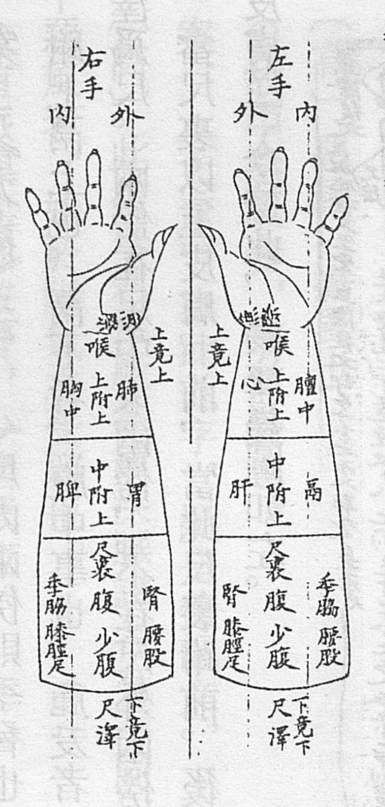

<!-- PAGE_END -->

<!-- PAGE: 0473 -->

<!-- PRINTED: 438 -->

案：《大素》云：『尺内兩傍則季脅也。尺外以候腎，尺裏以候腹中，跗上以候胸中，前候前，後候後，附上鬲上也。鬲下者，腹中事也。麄爰者，陰不足陽有餘爲熱中，跗之下也。』楊注云：『尺内，從關至尺澤爲尺。兩傍在尺中央兩傍，不在尺外兩傍。尺外，尺中兩傍之外。尺裏，自尺内兩中間。跗上，跗當爲膚，當尺裏以上皮膚。前，當此尺裏跗前。後，跗後。鬲下，當尺裏膚上以下，以爲膈下之分。跗之下，尺之皮膚。』今據此，楊注爲圖如左。

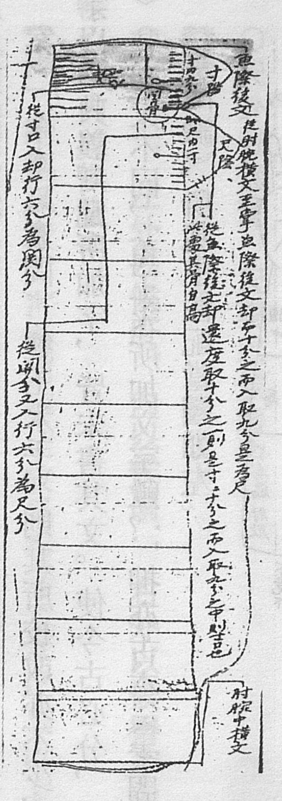

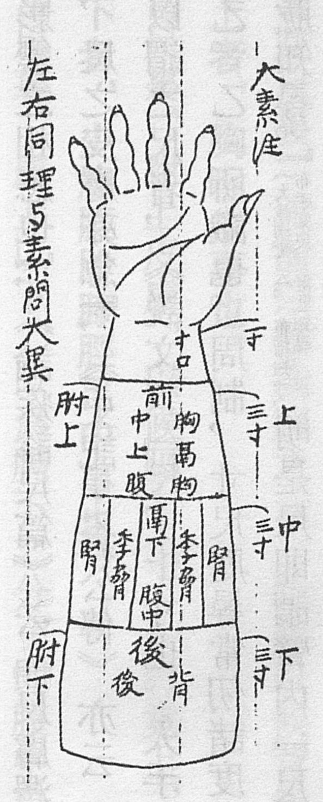

案：《大素》作『麄爰』者，謂尺膚理麄而色夭也。『夭解已見第十五中。

**○來疾去徐，上實下虛，爲厥巔疾。**

<!-- PAGE_END -->

<!-- PAGE: 0474 -->

<!-- PRINTED: 439 -->

《甲乙》四『巔』作『癲』。

〔楊〕來疾陽盛，故上實也。去徐陰虛，故下虛也。上實下虛，所以發癲疾也。

案：上文曰『厥成爲巔疾』，此曰『厥巔疾』，義同，謂厥逆及顛仆之疾也。高世栻曰『氣惟上逆，上而不下，故爲巔疾，猶言厥成爲巔疾也』，此説非是。

〔滑〕來者，自骨肉之分而出於皮膚之際，氣之升也。去者，自皮膚之際，而還於骨肉之分，氣之降也。｟《診家樞要》｠

〔馬〕其病當爲厥疾及巔疾焉。

〔吳〕爲厥逆癲仆之疾。

**○來徐去疾，上虛下實，爲惡風也。**

〔楊〕上虛受風，故惡風也。

〔志〕風爲陽邪，傷人陽氣，在於皮膚之間。風之惡厲者，從陽而直入於裏陰，是以去疾下實，陽虛陰盛，爲惡風也。

〔高〕惡風，癘風也。

**○故中惡風者，陽氣受也。**

案：《大素》無此九字，疑是傍記文，王氏以爲正文歟。一説『也』或『邪』訛。

〔高〕此復舉惡風厥熱巔疾脈證各有不同，以足上文未盡之義，惡厲之風，傷其經脈。必從表入，故申明中惡風者，始於陽氣之受邪也。

**○有脈俱沈細數者，少陰厥也。**

<!-- PAGE_END -->

<!-- PAGE: 0475 -->

<!-- PRINTED: 440 -->

〔楊〕沉細皆陰，故沉細數，少陰厥逆。

〔高〕厥有陰陽，申明有脈俱沈細而數者，非陽氣上逆之厥，爲少陰厥也。

案：手足少陰經之動脈，俱皆沈細數者爲厥也。此倒草法，與前文《大素》『麄爰者，陰不足陽有餘，爲熱中跗之下也』文例同。

**○沈細數散者，寒熱也。**

〔楊〕沈細，陰也。散爲陽，故病寒熱也。｟案：『散』上恐脫『數』字。｠

案：手足少陰脈俱沈細數而散者，非純陰脈，爲陰陽相半脈，故其病發寒熱也。高氏以爲與前『熱中』相對之寒熱，恐非是。

**○浮而散者，爲眴仆。**

〔楊〕胸，玄遍反。目捶。案：胸，眴訛。捶，搖訛。

〔高〕巔疾亦有陰陽，實則有餘，虛則不足。申明有脈浮而散者，非上實有餘之巔疾，爲裏虛不足之眴仆也。

**○諸浮不｟而｠躁者，皆在陽則爲熱，其有｟右｠躁者在｟左｠手。**

案：《大素》『而』『右』共誤字，『左』亦『在』字之衍。楊就誤本爲説，不可據也。

《甲乙》『浮』下有『而』字。

〔楊〕浮躁皆陽，故在陽則爲熱也。諸陽胳脈，左者胳右，右者胳左，故其右躁，而病本左手也。

案：諸浮者，統浮大、浮滑、浮緩之類而言也。云不躁者，唯浮而不緊數也。云在陽者，謂在表在府也。言諸浮不躁者，其病在表在府之候，其證必爲熱也。若其浮而帶躁動者，必先在手脈寸口而應也。手爲陽，躁亦爲陽，故躁之見，先在手也。

<!-- PAGE_END -->

<!-- PAGE: 0476 -->

<!-- PRINTED: 441 -->

**○諸細而沈者，皆在陰，則爲骨痛，其有靜者在足。**

〔楊〕細之與沈，皆是陰脈，主於骨痛。其脈沈細仍靜者，在足骨痛也。

案：沈對浮之名，當云沈而細，而今云細而沈者，互文見義也。在陰者，在裏在藏也。其爲病必骨痛。骨痛者，血寒之候也。靜者對躁之文，靜爲陰，足亦爲陰，故靜之見，先在足也。足脈，蓋謂趺陽也。對前文在手之寸口爲文也。

**○數動一代者，病在陽之脈也。洩及便膿血。**

（眉）《甲乙》無『洩及』以下十字。

〔楊〕三動已去稱數，數動一代息者，陽脈虛也，故數動一息，即是陰實陽虛，故溏洩便膿血也。

〔吳〕數，陽脈也。陰固於外，陽戰於内，則脈厥厥動搖，名曰動。五來一止，七來一止，不復增減，名曰代，是爲陽結。故病爲滑洩下利，又爲便膿血也。

〔志〕陽熱在經，故脈數動，熱傷血分，故便膿血，經血下洩，故一代也。

案：病在陽，謂病在府也。頻數鼓動之中時一代者，方是病在府之候。其證爲下洩及便膿血，膿血多寫，故爲此代脈也。

案：膿者，下白物也。血者，下赤物也。詳見於《傷寒述義》中。

**○諸過者，切之。濇者，陽氣有餘也。**

《甲乙》『濇』上有『其』字。

〔楊〕陽氣有餘稱過，陽過之脈，應浮而滑。更濇者，以其陽氣太盛，故極反成濇。

<!-- PAGE_END -->

<!-- PAGE: 0477 -->

<!-- PRINTED: 442 -->

案：過者，謂脈有過不及也。第十云『過在足少陰』，上文云『乃可診有過之脈』共同義。『切』字於上文已釋之。

〔吳〕過，脈失其常也。

**○滑者，陰氣有餘也。**

〔楊〕陰脈沈濇，今反滑者，以陰過極，反成滑。

案：陽氣有餘，陰氣有餘。楊注以爲『陽盛極，反成濇。陰過極，反成滑』，此説似是。兒約之曰：陰陽二字，恐互誤。

案：陽氣有餘，則陰血不足，謂乾血勞之類。此證當見浮滑脈，而反見濇脈者，陰血不足，澀滯之脈也。陰氣有餘，則陽氣不足，謂崩漏帶下之類。此證脈當沈濇，今反滑者，以陰血有餘，陽氣不足，陰陽二氣不相爭之脈也。

**○陽氣有餘，爲身熱無｟毋｠汗。**

《甲乙》『餘』下有『則』字。

〔楊〕陽盛有餘，極反爲陰，外閉腠理，故汗不出，其身熱也。

案：陽氣有餘，故身熱。陰氣不足，故無汗。表陽氣盛，所以爲熱也。裏陰血衰，所以無汗也。

**○陰氣有餘，爲多汗身寒。**

《甲乙》『餘』下有『則』字。

〔楊〕陰氣有餘，極反爲陽，外開腠理，故汗多出，其身寒也。

案：陰氣有餘，故身寒。陽氣不足，故多汗。裏陰血盛，所以爲寒也。表陽氣衰，所以多汗也。

<!-- PAGE_END -->

<!-- PAGE: 0478 -->

<!-- PRINTED: 443 -->

**○陰陽有餘，則無汗而寒。**

《甲乙》『則』下有『爲』字。

〔紹〕《大素》無此文。堅案：《大素》似是。

〔琦〕陽加於陰，謂之汗。氣行而血不充，故身熱無汗。其表實無汗，亦此義也。陽虛於外，故多汗。陰盛於内，故身寒。但滑脈爲陽，與多汗身寒之證不合。『陰陽有餘』二語，未詳其義，恐有譌語。

【楷】家大人曰：陰陽有餘，則無汗而寒，此文不削而可也。蓋陰陽兩俱有餘，則二氣平勻，無有偏差，則是指平人無病之身也。其無汗者，平人之常也。其寒者，身無熱而涼如常之謂。非寒冷異常之義，姑述以俟後考云。蓋承前文而指平人之身爲寒者也。

**○推而外之，内而不外，有心腹積也。推而内之，外而不内，身有熱也。**

《甲乙》『不外』下有『者』字，『身』作『者中』二字。

〔楊〕五藏爲内，陰也。六府爲外，陽也。用鍼之者，欲寫陰補陽，即推而外也，而内實難寫，即内而不外，故知心腹病積也；欲寫陽補陰，即推而内之也，而外實難寫，即外而不内，故知外有熱。

案：前文『來疾去徐』至『爲眴仆』，以脈形知疾病也，『諸浮不躁』至『身寒』，辨陰陽二脈也，『推而外之』已後，迢應『尺内兩傍云云』句，推臂筋脈而察病證之法也。王注可從。楊注以爲鍼法，而末句『按之至骨云云』，特以爲脈候，其説未明，爲難從矣。今就王注作圖如左。

<!-- PAGE_END -->

<!-- PAGE: 0479 -->

<!-- PRINTED: 444 -->

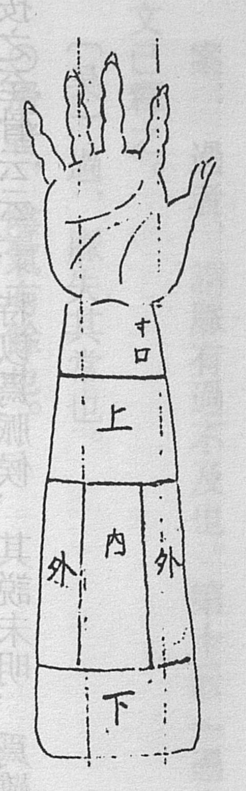

**○推而上之，上而不下，腰足清｟清｠也。推而下之，下而不上，頭項痛也。**

《甲乙》『上而不下』作『下而不上』，『下而不上』作『上而不下』。

〔楊〕上爲頭項，下爲腰足，推下向上，氣不能下，故知腰足冷也。推上向下，氣不能上，故知頭項痛也。

**○按之至骨，脈氣少者，腰脊痛而身｟寒｠有痺也。**

〔楊〕脈之沈細，按之至骨，少得其氣，即知有寒。腰脊爲痛，身寒痺也。

案：按之至骨者，亦就臂筋上按之之謂也。脈氣少者，前文所云『細沈爲骨痛，有靜者在足』之理也。

《大素》『身』下有『寒』字，宜從也。

案：以上謂内、外、上、下、深之五診法也。此五診法，張注以爲寸口脈動，以内外爲浮沈，以上下爲上部下部脈，以按之至骨爲沈陰勝也，以『推按』二字爲同義。《素問識》據此。然『推按』二字未得正解，内外上下亦未確。今姑從王義爲是。

案：本篇凡十五章，篇首至『決死生之分』爲一，『夫脈者』至『絶死』爲二，『夫精明』至『精衰矣』爲三，『五藏者』至『失守者死』爲四，『夫五藏』至『失強則死』爲五，『岐伯曰』至『名曰關格』爲六，『帝曰脈其四時動』至『持脈之大法也』爲七，『心脈搏堅』至『至今不復也』爲八，『帝曰診得心脈』至『虛則泄』爲九，『帝曰病成而變』至『不可勝數』爲十，『帝曰諸癰腫』至『治之愈也』爲十一，『帝曰有故病』至『濕若中水也』爲十二，『尺内兩傍』至『爲熱中也』爲十三，『來疾去徐』至『無汗而寒』爲十四，『推而外之』至篇末爲十五章也。

<!-- PAGE_END -->

<!-- PAGE: 0480 -->

<!-- PRINTED: 445 -->

萬延庚申小春朔夜雨中燈下書　五禽道人養竹子

第十七補

夫脈者血之府也｟三ヲ五ヲ｠

《脈經》云：『夫脈者，血之府也，長則氣治，短則氣病，數則煩心，大則病進，上盛則氣高，下盛則氣脹，代則氣衰，細則氣少，｟《大素》『細』作『滑』｠濇則心痛。渾渾革革，至如涌泉，病進而危。弊弊綽綽，其去如弦絶者，死。』｟卷一第十三｠

《甲乙經》云：『夫脈者，血氣之府也。長則氣和，短則病，數則煩心，大則病進，上盛則氣高，下盛則氣脹，代則氣衰，細則氣少，濇則心痛。渾渾革革，至如涌泉，病進而色弊之綽綽｟一本作綿綿｠，其去如弦絶者，死。』｟卷四經脈第一中｠

春應中規｟十二ヲ｠

〔識〕《淮南・時則訓》云：『制度陰陽，大制有六度。天爲繩，地爲準，春爲規，夏爲衡，秋爲矩，冬爲權。』雖與此章有不同者，而規矩權衡配四時，當時已有其説，不唯醫經也。

虛靜爲保｟十五ヲ｠

〔紹〕堅案：《素》《靈》中，道、寶押韻不一而足，如『病治之道，氣内爲寶』｟《疏五過論》｠『治數之道，從容之葆』｟《徵四失論》｠『持鍼之道，堅者爲寶』｟《九鍼十二原篇》｠『營氣之道，内穀爲寶』｟《營氣篇》｠『灸刺之道，何者爲寶』。｟《四時氣篇》『寶』原作定，今從《甲乙》｠『審知其道，是謂身寶』｟《五亂篇》｠是也。｟《廣韻》道、寶並在上聲，皓韻。｠琦曰『保，當作寶』，未確。

<!-- PAGE_END -->

<!-- PAGE: 0481 -->

<!-- PRINTED: 446 -->

心脈搏堅｟十七ウ｠

《脈經》卷六第二云：『心脈搏堅而長，當病舌卷不能言，其耎而散者，當病消渴自已。』

故曰｟十五ウ｠

〔劄〕魏了翁《經外雜抄》：『故曰者，必古有此語。』

至今不復散發也｟十八ウ｠

〔劄〕琦曰『至今』七字衍文。寬案：『散發』二字疑衍。

肝脈搏堅｟十九ウ｠

《脈經》卷六第一云：『肝脈搏堅而長，色不青，當病墜墮若搏。因血在脇下，令人喘逆。若耎而散，其色澤者，當病溢飲。謂溢飲者，渴暴多飲，而溢｟一作易｠入肌皮腸胃之外也。』

若水狀｟廿一ヲ｠

〔紹〕堅按：『若水狀』楊注：專係言脛腫。是。

眴仆｟三二ウ｠

〔紹〕案：楊注本於《説文》，然王謂頭眩者，於義爲順。先兄曰：《方言》朝鮮洌水之間，顛眴謂之眽眩。《史・屈原傳》『眴兮窈窕』徐廣云：『眴，眩也』。｟眴、眩古通用，既見原《識・五藏生成篇》『狗蒙』下。｠

氣衰　氣少｟四ヲ｠

麄大者｟廿九ウ｠

《靈樞・五色》｟四十九｠云：『雷公曰：以色言病之間甚，奈何。黃帝曰：其色麤以明，沈夭者爲甚』。｟據此文則作『麄夭』，以爲尺膚理麄色夭之義，益是不宜不據《大素》而改正也。｠

<!-- PAGE_END -->

<!-- PAGE: 0482 -->

<!-- PRINTED: 447 -->

諸浮不躁｟三二ウ｠

《總病論》卷一・三陰三陽傳病證云：『躁謂脈數，靜謂不數。用藥則同，若用鍼須取手與足之經也』。

案：此文發本經義，故今録於此矣。

推而上之｟三五ウ｠

《靈樞・刺節真邪》｟七十五｠云：『用鍼者，必先察其經絡之實虛，切而循之，按而彈之，視其應動者，乃後取之而下之。六經調者，謂之不病，雖病謂自已也。一經上實下虛而不通者，此必有橫絡，盛加於大經，令之不通。視而寫之，此所謂解結也。上寒下熱，先刺其項太陽，久留之。已刺，則熨項與肩胛令熱，下合乃止，此所謂推而上之者也。上熱下寒，視其虛脈而陷之於經絡者取之，氣下乃止，此所謂引而下之者也。大熱遍身，狂而妄見，妄聞妄言，視足陽明及大絡取之，虛者補之血，而實者寫之。因其偃臥，居其頭前，以兩手四指，挾按頸動脈，久持之，卷而切之，下至缺盆中而復止。如前熱去乃止，此所謂推而散之者也。』

白裹朱｟五ヲ｠

清洪頤煊《讀書叢録》云：《易》巽爲白。《正義》爲白，取其風吹去塵，故絜白也。頤煊案：白即帛字。《賁》『六五，束帛戔戔』，虞翻曰：『巽爲帛，爲繩。』是虞氏易作爲『帛』也。

癉｟廿三ヲ｠

《爾雅・釋詁》『癉，病也』。郝懿行《義疏》曰：『《釋文》引孫炎云：癉，疫病也。癉，又徒丹反。是癉有殫音，亦通作殫。《淮南・覽冥篇》云：斬艾百姓，殫盡大半。高注：殫，病也。』

《本草匯》卷五・消癉：『上消大渴多飲，中消善飢而瘦，下消燥渴，小便數如膏。』又曰：『中消因數食甘美所致，食㑊即消中。病胃熱，則消穀善飢。大腸熱，則消水善飢。』又曰：『消中皆屬熱，下消皆屬腎虛。』

<!-- PAGE_END -->

<!-- PAGE: 0483 -->

<!-- PRINTED: 448 -->

蟄蟲將去｟十五ウ｠

《左氏・昭十九年傳》『而去之』杜注云：『而藏之。』

《釋文》『去，起呂反。藏也。』裴松之注《魏志》云：『古人謂藏爲去。案：今關中猶有此言。』｟《左傳音義》｠孔穎達曰：『去即藏也。《字書》去作弆，羌莒反。謂掌物也。今關西仍呼爲弆，東人輕言爲去，音莒。』｟《左傳正義》｠

案：『去，藏也』。見《漢書・五行志》｟七下之上｠《蘇武傳》｟廿四｠《游俠傳》｟六十二｠師古注。段玉裁曰：『藏物必去此而藏彼，故其義亦爲攘卻。』｟《説文注》『祛』字下｠又曰：『廢之爲置，如徂之爲存，苦之爲快，亂之爲治，去之爲藏。』｟『廢』字注｠

十七　切脈｟一ウ｠　精明｟二ヲ｠　參伍｟二ウ｠　脈｟三ヲ｠　渾渾革革｟四ウ｠　白｟五ヲ｠　地蒼｟六ウ｠　水泉｟八ウ｠　五藏｟八ウ｠　保｟十四ウ｠　周密｟十五ウ｠　故曰｟十五ウ｠

揣｟十六ウ｠　舌卷｟十七ヲ｠　耎｟十七ウ｠　易｟十八ウ｠　食痺｟十九ウ｠　䯒｟廿ウ｠　心疝｟廿一ウ｠　癉｟廿三ヲ｠　消中｟廿三ヲ｠　巔｟廿四ウ｠　癘｟廿五ウ｠　癰腫｟廿六ヲ｠　跗膚｟廿八ウ｠　尺寸｟廿九ウ｠

眴｟三二ウ｠　暖忿｟十一ウ｠　灌汗｟十八オ｠

#### 平人氣象論篇第十八

《大素》全存。卷首至『浮大而短』，十五尺寸診；『夫平心脈』至卷末，十五五藏脈診。

（眉）吳云：『氣，脈氣，象脈形也。』

（眉）《甲乙》卷四經脈第一｟上｠具存。

**○黃帝問曰：平人何如。岐伯對曰：人一呼脈再動，一吸脈亦再動，呼吸定息，脈五動，閏以太息，命曰平人。平人者，不病也。常以不病｟《甲乙》有『之人以』三字｠調病人，醫不病，故爲病人平息，以調之爲法。**

《甲乙》無『爲法』二字。

<!-- PAGE_END -->

<!-- PAGE: 0484 -->

<!-- PRINTED: 449 -->

〔楊〕平人病法，先醫人自平，一呼脈再動，一吸脈再動，是毉不病調和脈也。然後數人之息，一呼脈再動，一吸脈再動，即是彼人不病者也。若彼人一呼脈一動，一吸脈一動等，名曰不及，皆有病也。故曰毉不病，爲病人平息者也。

〔識〕《調經論》云：『陰陽勻平，以充其形。九候如一，命曰平人。』《靈・終始篇》云：『所謂平人者不病，不病者，脈口人迎應四時也，上下相應而俱往來也，六經之脈不結動也，本末之寒温之相守司也，形肉血氣必相稱也。是謂平人。』

〔李〕一息四至，呼吸定息脈五動者，當其閏以大息之時也。｟馬、志、高並同｠

《靈・動輸篇》：『人一呼脈再動，一吸脈亦再動，呼吸不已，故動而不止。』

案：一息四動爲定息，其呼吸之間，每有一動息，是以爲定息五動也，乃與《難經》合，是倒草文法，謂閏以太息，故爲脈五動也。閏，餘也，與閏月之閏同義。定息之外別有息，故名以閏也。時時有此閏息，加此閏息而平均之，則成一息五動脈也。只就呼吸言之，則一息四動，併此閏息而平均之，則得五動，竟與《難經》所説合也。

案：本文與《大素》有異同，然其此理不異，蓋王氏所補朱字，剩有數字耳。

（眉）『呼吸定息，脈五動』下宜『者何也』三字入看。

（眉）地上春夏與秋冬爲一歲，猶人呼吸一息知百年即百息。今此論人息而用閏言太妙。

（眉）董西園《醫級》曰：『一息中得四至之半，乃爲和平之脈。』家大人曰：『此言太是。蓋閏之一息涉兩息者，故聖人下閏字而以一動別算焉，不曰正五動也，猶五歲再閏之例也。此則二息一閏，二息九動也。是所以活物之不定也』。

<!-- PAGE_END -->

<!-- PAGE: 0485 -->

<!-- PRINTED: 450 -->

**○人一呼脈一動，一吸脈一動，曰少氣。**

《甲乙》亦有『者』字。

〔楊〕呼吸皆一動，名曰不及，故知少氣。

〔識〕馬云：『《難經》｟十四難｠以爲離經脈，由正氣衰少，故脈如是也。』吳云：『是爲虛寒。』

案：少氣，諸家無明解，唯以爲陽氣衰少。竊謂不然。後文曰病温，曰病風，曰痺，並皆謂疾病，則此少氣，亦當爲病證而看。《靈・論疾診尺七十四》云『尺膚寒，其脈小者，泄少氣』可以徵矣。又第廿｟《素問》｠云『形盛脈細，少氣不足以息者危』，可併考。｟六ヲ｠

《病源》卷十三少氣候云：『此由藏氣不足故也。肺主氣而通呼吸，藏氣不足，則呼吸微弱，而少氣胸痛。少氣者，水在藏府。水者，陰氣。陰氣在内，故少氣。診右手寸口脈，陰實者，肺實也。若少氣，胸内滿彭彭，與髆相引，脈來濡者，虛少氣也。左手關上脈，陰陽俱虛者，足厥陰少陽俱虛也，病苦少氣不能言。右手關上脈，陰陽俱虛者，足太陰陽明俱虛也，病苦胃中如空狀，少氣不足以息，四逆寒。脈弱者，少氣皮膚寒。脈小者，少氣也。』｟六ウ｠

（眉）《靈・瘨狂篇》『少氣，身漯漯也。言吸吸也。云云。短氣，息短不屬』。

**○人一呼脈三動，一吸脈三動而躁，｟及｠尺熱曰病温，尺不熱，脈滑曰病風，脈濇曰痺。**

（『一吸脈三動』）五字《甲乙》無。（『脈濇曰痺』）四字《甲乙》無。

〔楊〕脈之三動，以是氣之有餘，又加躁疾，尺之皮膚復熱，即陽氣盛，故爲病温。病温先夏至日前發也，若後夏至日發者病暑也。一呼三動而躁，尺皮不熱，脈滑曰風，脈濇曰痺也。

〔馬〕一息六動，《脈訣》以爲數脈，《難經》亦以爲離經脈，是六至而躁，躁者動之甚也。王注以躁爲煩躁，按《靈樞・終始禁服》等篇有『一倍而躁』『二倍而躁』等語，則躁本言脈，不言病也。

<!-- PAGE_END -->

<!-- PAGE: 0486 -->

<!-- PRINTED: 451 -->

〔張〕躁者，急疾之謂。尺熱，言尺中近臂之處有熱者，必通身皆熱也。

案：病温，即温病，謂熱病傷寒是也。第三云『冬傷於寒，春必温病』，《大素》作『乃病熱』，第五亦載此文，而《大素》作『病温』，《熱論》云『夫熱病者，皆傷寒之類也』，又云『凡病傷寒而成温者，先夏至日爲病温，後夏至日者爲病暑』，皆謂風寒入肌表變爲熱也。凡發熱之證，多是外邪之所爲，則云熱病、云温病，是自證而名，云中風、云傷寒，是自因而名也。《傷寒論・太陽中篇廿二》云『脈浮而數者，可發汗，宜麻黃湯』，又四二云『發汗已，脈浮數煩渴者，五苓散主之』，與此所説合。

風者，偏風之類。痺者，濕痺之類。如《風論》《痺論》所説是也。

《靈樞・論疾診尺第七十四》云：『尺膚熱甚，脈盛躁者，病温也。其脈盛而滑者，病且出也。｟《甲乙》作『汗且出也』。《脈經》同｠尺膚滑而澤脂者，風也。尺膚濇者，風痺也。』

〔識〕簡按：《壽夭剛柔篇》云『病在陽者，命曰風病。在陰者，命曰痺』，此章與痺對言，亦謂偏風之屬。

〔張〕《脈法》曰：滑，不濇也，往來流利。濇，不滑也，如雨霑沙。滑爲血實氣壅，濇爲氣滯血少。

**○人一呼脈四動以上，曰死。**

〔楊〕四至陽氣獨盛，陰氣衰絶，故死。

《十四難》云：『一呼四至，一吸四至，病欲甚。一呼五至，一吸五至，其人當困。其有大小者，爲難治。一呼六至，一吸六至，爲死脈也。』又云：『一呼再至曰平，三至曰離經，四至曰奪精，五至曰死，六至曰命絶。』

<!-- PAGE_END -->

<!-- PAGE: 0487 -->

<!-- PRINTED: 452 -->

《脈經》卷四第五云：『扁鵲曰：脈再動爲一至，再至而緊即奪氣。脈三至者離經，三至而緊脫血。脈四至則奪精，四至而緊則奪形。脈五至者死，一呼而脈五動，人一息脈十一動，此氣浮濇經行，血氣竭盡，不守於中。五臟痿痟，精神散亡，脈五至而緊則死。』｟十七ヲ｠

**○脈絶不至曰死，**

〔楊〕以手按脈，一來即絶。更復不來，故死。

〔馬〕《脈訣》以九至爲死脈，十至爲歸墓脈，十一十二爲離魂脈，故皆謂之曰死脈也。此則自五至以上之太過者言之耳。若脈絶不至，則一呼一吸，脈絶不來，正氣衰盡，故亦謂之曰死脈也。此則自五至以下之不及者言之耳。

**○乍踈乍數曰死。**

後《三部九候論》曰：『中部乍踈乍數者，死。』又曰：『其脈乍踈乍數乍遲乍疾者，日乘四季死。』

〔楊〕乍疏曰陰，乍數曰陽，陰陽動亂不次，故曰死也。

〔高〕一呼脈四動以上，則太過之極，脈絶不至，則不及之極，乍疏乍數，則錯亂之極，故皆曰死。

**○平人之常氣稟於胃，胃者，平人之常氣也。人無胃氣曰逆，逆者死。**

《甲乙》卷四經脈第一｟上｠引至於此。

〔楊〕和平之人，五藏氣之常者，其氣各各稟承胃氣，一一之藏。若無胃氣，其脈獨見，爲逆，故致死。

**○春胃微弦曰平，**

《甲乙》｟四ノ四ウ｠引。

〔楊〕胃者，人迎胃脈者也。五藏之脈弦鉤代浮石，皆見於人迎胃脈之中。胃脈，即足陽明脈，主於水穀，爲五藏六府十二經脈之長。所以五藏之脈，欲見之時，皆以胃氣將至，人迎胃氣之狀柔弱是也。故人迎五脈見時，但弦鉤代石，各各自見，無柔弱者，即五藏各失胃氣，故脈獨見，獨見當死。春脈胃多弦少曰微，微曰平人。

<!-- PAGE_END -->

<!-- PAGE: 0488 -->

<!-- PRINTED: 453 -->

〔張〕胃氣之見於脈者，如《玉機真藏論》曰『脈弱以滑，是有胃氣』，《終始篇》曰『邪氣來也，緊而疾。穀氣來也，徐而和』，是皆胃氣之謂，大都脈代時，宜無太過無不及，自有一種雍容和緩之狀者，便是胃氣之脈。

（眉）案：胃微弦者，多胃少弦之謂。下句可反證。

**○弦多胃少曰肝病，**

〔楊〕弦多胃少，即肝少穀氣，故曰肝病也。

〔張〕弦多者，過於弦也。胃少者，少和緩也。是肝邪之勝，胃氣之衰，故爲肝病。

**○但弦無胃曰死。**

〔楊〕肝無穀氣，致令肝脈獨見，故死也。

〔張〕但有弦急，而無充和之氣者，是春時胃氣已絶，而肝之真藏見也，故曰死。

**○胃而有毛曰秋病，**

〔楊〕春胃見時，但得柔弱之氣，竟無有弦。然胃中有毛，即是肝時有肺氣來乘，以胃氣弦，故至秋有病。

〔張〕毛爲秋脈屬金，春時得之，是爲賊邪。以胃氣尚存，故至秋而後病。

（眉）案：秋病，肝爲秋肺所病之義。下文放此。高世栻所言『受剋』是也。

<!-- PAGE_END -->

<!-- PAGE: 0489 -->

<!-- PRINTED: 454 -->

**○毛甚曰今｟金｠病。**

〔楊〕春得毛脈，甚於胃氣，以金剋火，故曰金病之也。

〔張〕春脈毛甚，則木被金傷，故不必至秋，今即病矣。

案：《大素》『今』作『金』，蓋因音同而訛。楊就訛字而作説，非是。又案：本文及注《大素》皆作『金病』，然其義乃爲今病，音通自可知矣。

《脈經》卷三云：『春胃微絃曰平，絃多胃少曰肝病，但絃無胃曰死，有胃而毛曰秋病，毛甚曰今病。』

**○藏真散於肝，肝藏筋膜之氣也。**

《痿論》『肝主身之筋膜』，《新校正》云：『按全元起本云：膜者，人皮下肉上筋膜也。』

〔楊〕藏真者，真弦脈也。弦無胃氣曰散，弦脈不能自散，以其肝藏散無胃氣，所以藏真散於肝也。故肝藏神，藏於魂也。肝藏氣者，藏筋氣也。

**○夏胃微鉤｟勾｠平，**

〔楊〕夏脈人迎胃多鉤少，曰微鉤，微鉤曰平也。

**○鉤｟勾｠多胃少曰心病，**

〔楊〕心病食少，穀氣少，令脈至人迎鉤多胃少，故知心病也。

**○但鉤｟勾｠無胃曰死。**

〔楊〕心病害食，心無穀氣，致令鉤無胃氣，故死。

**○胃而有石曰冬病，**

〔楊〕心，火也。夏心王時遂得腎脈，雖有胃氣唯得石，冬時當以病水剋火。

<!-- PAGE_END -->

<!-- PAGE: 0490 -->

<!-- PRINTED: 455 -->

（眉）高世栻所言『受剋』是也。

**○石甚曰今病。**

〔楊〕夏有胃氣，雖得石脈，至秋致病。今夏得石脈甚，少胃氣，賊邪來剋，故曰今病。

**○藏真通｟痛｠於心，心藏血脈之氣也。**

〔楊〕心無胃氣，即心有痛病，致令藏真脈見人迎，故曰藏真痛於心也。故心藏神，藏於神氣也。心藏氣，藏血脈氣之也。

**○長夏胃微耎弱曰平，胃少弱多曰脾病，**

《甲乙》作『胃少耎弱多曰脾病』。

〔楊〕耎，而免反。柔也。長夏，六月也。脾行胃氣，以灌四藏，故四藏脈至於人迎，皆有胃氣，即四藏平和也。若脾病不得爲胃行氣至於人迎，即四藏之脈各無胃氣，故四藏有病也。問曰：長夏是脾用事，此言胃氣不言脾者，何也。答曰：脾爲其君，不可自見，是以於長夏時得胃氣者，即得脾氣。故於長夏胃氣見時，微有不足，名曰平好。若更至少腹虛弱者，即是脾病，致令胃氣少而虛弱也。

**○但代無胃曰死。**

〔楊〕人之一呼出心與肺，脈有二動，一吸入肝與腎，脈有二動。人呼吸已定息之時，脾受氣於胃，資與四藏，以爲呼吸，故當定息。脾受氣時，其脈不動，稱之曰代。代，息也。當代之時，胃氣當見，若脈代時無胃氣，則脾無穀氣，所以致死也。

〔張〕代，更代也。脾主四季，脈當隨時而更然，必欲皆兼和耎，方得脾脈之平。若四季相代，而但弦但鉤但毛但石，是但代無胃見真藏也，故曰死。

<!-- PAGE_END -->

<!-- PAGE: 0491 -->

<!-- PRINTED: 456 -->

〔高〕代，耎弱之極也。

案：代説，張注爲是。

**○耎弱有石曰冬病，**

〔楊〕長夏脾胃見時，中有腎脈，是爲微耶來乘。不已，至秋當病也。

石，《脈經》《新校正》引《甲乙》。

（眉）高世栻所言『乘侮』是也。

**○弱甚曰今病。**

〔新〕按：《甲乙經》『弱』作『石』，今本《甲乙》作『耎』，注云：『《素》作弱。』

〔馬〕弱當作石。張同。案：《脈經》作『石』，則此説可從。

〔張〕長夏石甚者，火土大衰，故不必至冬，今即病矣。

案：『弱』即『石』字，古音相通，故致此誤。猶『幼弱』之字，或作『若』之例也。『若學之輩』見《新撰字鏡·序》。《脈經》作『石』，宜從改。『石榴』或作『若留』，亦可以徵。石、若相通用。

《脈經》卷三云：『長夏胃微濡弱曰平，弱多胃少曰脾病，但弱無胃曰死，濡弱有石曰冬病，石甚曰今病。』

〔楊〕脾胃之脈虛弱，其穀氣微少，故即今病也。

**○藏真濡｟傳｠於脾，脾藏肌肉之氣也。**

〔楊〕脾藏真脈，謂之唯代之無胃氣。唯代之脈，從脾傳來至於人迎也。故脾藏藏神，藏於意也。脾藏氣，藏肌肉氣之也。

<!-- PAGE_END -->

<!-- PAGE: 0492 -->

<!-- PRINTED: 457 -->

〔吳〕濡，澤也。脾氣喜濡澤，長夏之時，脾土用事，故五藏真氣皆濡澤於脾。

**○秋胃微毛曰平，**

〔楊〕秋時人迎胃多毛少，曰平人也。

**○毛多胃少曰肺病，**

〔楊〕穀氣少也。

**○但毛無胃曰死。**

〔楊〕真藏見脈。

**○毛而有弦曰春病，**

〔楊〕肝來乘肺，是耶來乘不已，至春木王之時當病。

（眉）高世栻所言『乘侮』是也。

**○弦甚曰今病。**

〔楊〕有胃無毛，但有弦者，是木反剋金，故曰今病。

《脈經》卷三云：『秋胃微毛曰平，毛多胃少曰肺病，但毛無胃曰死。毛而有絃曰春病，絃甚曰今病。』

**○藏真高於肺，以行榮｟營｠衛陰陽也。**｟洩曰死｠

《甲乙》『以』作『肺』，可從。

〔楊〕藏真之脈見時，高於肺藏和平之氣。高，過也。肺爲陰也，無胃之氣既過肺之和氣，即是肺傷。肺主行營衛，肺既傷已，即是陰氣洩漏，故致死也。

**○冬胃微石曰平，**

<!-- PAGE_END -->

<!-- PAGE: 0493 -->

<!-- PRINTED: 458 -->

〔楊〕冬人迎脈，胃耎弱氣多，石脈微者，名曰平人。

**○石多胃曰腎病，**

《甲乙》作『胃少石多』。

〔楊〕腎少穀氣，故今耎弱氣少，堅石脈多，故知腎病。

**○但石無胃曰死。**

〔楊〕藏真脈見，故致死也。

**○石而有鉤｟句｠曰夏病，**

〔楊〕石脈，水也。鉤脈，火也。石脈見時有鉤見者，微耶來乘不已，至夏當病也。

（眉）高世栻所言『乘侮』是也。

**○鉤｟勾｠甚曰今病。**

〔楊〕雖有胃氣，鉤甚，所以今病也。

**○藏真下於腎，腎藏骨髓之氣也。**

〔楊〕腎爲五藏和氣之下，今腎無胃氣，乃過下於腎也。故腎藏藏神，藏於志也。腎藏藏氣，骨髓氣也。

自此以上，即是人迎胃脈，候五藏氣也。

《脈經》卷三云：『冬胃微石曰平，石多胃少曰腎病，但石無胃曰死。石而有鉤夏病，鉤甚曰今病。』｟凡人以水穀爲本，故人絶水穀則死，脈無胃氣亦死。所謂無胃氣者，但得真藏脈，不得胃氣也。所謂脈不得胃氣者，肝但弦，心但鉤，胃但弱，肺但毛，腎但石也。｠

弦脈小直

〔張〕弦者，端直以長，狀如弓弦有力也。然耎弱輕虛而滑，則弦中自有和意，肝藏主之。扁鵲曰：春脈弦者，肝東方木也。萬物始生，未有枝葉，故其脈之來，濡弱而長，故曰弦。

<!-- PAGE_END -->

<!-- PAGE: 0494 -->

<!-- PRINTED: 459 -->

案：弦者，往來俱直長而耎滑之謂也。

鉤脈大廣

〔張〕鉤者，舉指來盛去勢似衰，蓋脈盛於外而去則無力，陽之盛也，心藏主之。扁鵲曰：夏脈鉤者，心南方火也。萬物之所茂，垂枝布葉，皆下曲如鉤，故其脈之來疾去遲，故曰鉤。

案：鉤者，來大而去細，而往來共帶柔和之謂也。

毛脈浮輕

〔張〕毛者，脈來浮濇，類羽毛之輕虛也。扁鵲曰：秋脈毛者，肺西方金也。萬物之所終，草木華葉，皆秋而落，其枝獨在，若毫毛也，故其脈之來輕虛以浮，故曰毛。

案：毛者，往來俱輕浮，而不沈重之謂也。

石脈沈重

〔張〕石者，脈來沈實如石沈水之謂。扁鵲曰：冬脈石者，腎北方水也，萬物之所藏也。盛冬之時，水凝如石，故其脈之來沈濡而滑，故曰石。

案：石者，往來共沈重而不輕浮之謂也。

案：《藏真》云『散於肝』，云『通於心』，云『濡於脾』，云『高於肺』，云『下於腎』者，散謂肝氣散於筋膜也，通謂心氣通於血脈也，濡謂脾氣濡於肌肉也，高謂肺氣高上走於營衛也，下謂腎氣低下守於骨髓也。其下字各有照應，非偶然也。

（眉）四時脈之義，又見《玉機真藏論》首。

<!-- PAGE_END -->

<!-- PAGE: 0495 -->

<!-- PRINTED: 460 -->

（眉）案：春陽進，故脈強弦，弦者強也。夏陽盛，故脈浮，浮即鉤也。秋陽退，故脈弱，弱者毛也。冬陽衰，故脈沈，沈者石也。鉤浮與沈石相對，弦強與毛弱相對，即春秋相對，冬夏相反之理也。若不如此解，則四時脈應天地之氣之義，絶不能求之，不可奈何也。故知四時脈者，但是強弱浮沈之別耳。

（眉）《後漢書·陳寵傳》注：『鉤猶動也。』《莊子·徐無鬼》注：『鉤，反也。』

（眉）案：鉤、溝同音。知廣大義在焉。鉤、洪同聲。

**○胃之大絡，名曰虛里，貫鬲絡｟胳｠肺，出於左乳下，其動應衣。**

《甲乙》『衣』作『手』。

〔楊〕下診胃胳之脈。虛音墟。虛里，城邑居處也。此胃大胳，乃是五藏六府所稟居處，故曰虛里。其脈出左乳下，常有動以應衣也。

〔箚〕稻曰：與《經脈篇》脾之大絡名曰大包相對也。

〔識〕《甲乙》卷四｟五ウ｠『衣』作『手』，『脈』下有『之』字。沈氏《經絡全書》曰：『虛里，乳根穴分也，俗謂之氣根。顧英白曰：乳根二穴，左右皆有動氣，《經》何獨言左乳下？蓋舉其動之甚者耳，非左動而右不動也。其動應手，脈宗氣也。《素問》本無二義，馬玄臺因坊刻之誤，而謂應衣者，言病人肌肉瘦弱，其脈動甚而應衣也，亦通。始讀《素問》，則心竊疑之，至讀《甲乙經》，而疑遂釋然。』簡按：《五味篇》曰『大氣積於胸中，命曰氣海』，《邪客篇》曰『宗氣積於胸中』，皆此義也。《通雅》『宗、尊一字』。《孝經·宗祀》注『尊祀』，王云：『宗，尊也。』此乃古訓。『應衣』當從《甲乙》而作『應手』，若應衣則與下文何別。張云：『前言應衣者，言其微動似乎應衣，可驗虛里之胃氣。此言應衣者，言其大動，真有若與衣俱振者。』此臆度之見，不考《甲乙》之失耳。

<!-- PAGE_END -->

<!-- PAGE: 0496 -->

<!-- PRINTED: 461 -->

案：此説似是，然《大素》亦兩作『應衣』，楊注亦稍與張注同，且《甲乙》無後『應衣』之文，則不當輒據《甲乙》以改經文也。《大素》後文『應衣』作『應於衣』，亦應存考。

案：總身脈動，雖極微應手，未有不應手者。虛里者，大動之最，故云應衣。桂山説誤。

**○脈宗氣也。盛喘數絶者，則病在中。**

《甲乙》『脈』下有『之』字。

〔楊〕宗，尊也。此之大胳一身之中，血氣所尊，故曰宗氣。其脈動如人喘數而絶者，病在藏中也。

案：盛喘數絶者，謂虛里脈動甚於常也。喘者，緛之假借，縮短之義。盛喘，謂動盛而緊數也。｟『喘』字已見第十｠數絶即絶數。絶，甚也。謂甚數也。盛字，專指於實大而言。絶字，專指於緊數而言。病在中者，謂病在胃中也。第十云『赤脈之至也。喘而堅，診曰有積氣在中，時害於食，名曰心痺』，正與此同義，宜併考矣。虛里其動平穩爲常候，若短數者，爲胃實之候也，是脈之大過也。

〔馬〕《靈樞·邪客篇》《刺節真邪篇》皆曰宗氣，《五味篇》謂之大氣。

（眉）宗氣，見仲景《平脈篇》古注。

**○結而横，有積矣。**

〔楊〕此脈結者，腹中有積居也。積，陰病也。

〔識〕吳云：『脈來遲，時一止曰結。横，横格於指下也。言虛里之脈結而横，是胃中有積。』簡按：横，蓋謂其動横及於右邊。張註以結横不爲脈象，恐非。

案：結者，鬱結之義，前脈『喘數』之反對也。是脈之不及也。横者，桂山先生之説可從。後文云『寸口脈沈而横，曰脇下有積，腹中有横積痛』，是脈横者，中有横積之理，猶樹木有横枝者，必有横根之例耳。

<!-- PAGE_END -->

<!-- PAGE: 0497 -->

<!-- PRINTED: 462 -->

（眉）案：結脈，見仲景炙甘草湯章及其次章，次章曰『脈時一止復來者，名曰結云云』。又見《辨脈篇》及他諸書。

（眉）案：結代散亂不定等，總云之横。横，縱恣妄亂之義。

**○絶不至曰死。**

《甲乙》此下有『診得胃脈，則能食，虛則泄也』十一字。

〔馬〕此脈之不及也。

〔楊〕此虛里脈來已，更不復來，是胃氣絶，所以致死。

案：虛里，其實則心尾下尖之鼓動，在左乳下者，隨肺氣之呼吸，從心家所釀成之血，涌起之力，築動應於此也。所以釀成此血之原，全依胃中受飲食之精氣，熏上至肝心，而變爲血汁也。故此舉大原而云胃之大絡者，欲令知人血液皆飲食之所釀造之義也。

（眉）案：絶者，結代一等永止，乃後復來也，非全絶脈。前前句王注轉用於此，可也。

**○乳之下其動應衣，宗氣泄也。**

案：前文『絶不至』者，謂脈不及之惡候，此云『應衣』者，亦謂大過之惡候也。所云『宗氣泄』者，無胃氣之謂也，但動築高而無滑澤之義可見耳。

〔馬〕前曰動衣，不至於動之甚，可以驗宗氣之動。而此曰動衣，則動之甚而宗氣之泄也，故謂之曰死。乳下之動應衣者，予曾見其人病終不治。

**○欲知寸口｟脈｠太過與不及，寸口之脈中手短者，曰頭痛。**

<!-- PAGE_END -->

<!-- PAGE: 0498 -->

<!-- PRINTED: 463 -->

《甲乙》卷四無『不及』以上九字。

案：短者，蓋謂往來短小急數之脈。

〔楊〕上來診人迎法，以下診寸口法，故曰欲知診寸口之脈有病，唯有大過與不及也。口者，氣行處也。從關至魚一寸之處，有九分之位，是手太陰氣所行之處，故曰寸口。其脈之動不滿九分，故曰短也。短者，陽氣不足，故頭痛也。

〔高〕短則氣虛，不及於上，故頭痛，頭痛正虛於上也。

（眉）案：此長、短二脈斥雜病。

**○乳之下，其動應於衣，宗氣洩。**

〔楊〕乳下虛里之脈，若陽氣盛溢，其脈動以應衣，是爲宗氣洩溢者也。

案：此十一字，《大素》在於此者，亦恐錯簡，不與前後文相接連。《素問》在於前者，似是。蓋王冰撰録時采以入於前歟。《新校正》云『按全元起本無此十一字，《甲乙經》亦無』，然則《大素》獨有此十一字可知耳。

**○寸口脈中手長者，曰足脛痛。**

案：長者，蓋謂往來長大遲緩之脈。

〔楊〕寸口之脈，過九分以上曰長。長者，陽氣有餘，陰氣不足，故脛痛也。

〔高〕長則氣盛，太過於下，故足脛痛。足脛痛，邪實於下也。

**○喘數絶不至曰死。**

〔楊〕長而喘數，所以致死。

<!-- PAGE_END -->

<!-- PAGE: 0499 -->

<!-- PRINTED: 464 -->

案：前文十一字及此七字，共是錯簡，恐是前文『喘數』及『宗氣』之傍記標書之類，誤混正文者歟。《素問》無者，蓋王氏所刪去。

再案：此七字，恐是前文『絶不至曰死』之注解，蓋言云『絶不至』者，爲喘數之脈忽絶而不至之義，所謂結代之尤甚者也，故曰死。

**○寸口脈中手促上擊者，曰肩背痛。**

《甲乙》『擊』作『數』。

〔楊〕脈從下向上擊人手，如從下有物上擊人手，是陽氣盛。陽脈行於肩背，故知肩背痛也。

〔高〕促則内虛，不及於内。上擊則外實，太過於外，故肩背痛。肩背痛，内虛外實也。

案：以上三脈，以長短知上下之痛病，以促上擊知肩背陽部之痛病。《金匱》卷上云『清邪居上，濁邪居下』，又云『濕傷於下，霧傷於上』，《醫心方》卷八徐思恭論云『清濕襲虛，則病起於下。風雨襲虛，則病起於上。又身半已上風中之，身半已下濕中之。此蓋風濕之病也』。共可與此條併考。

**○寸口脈，沈而堅者，曰病在中。**

《甲乙》無『曰』字。

〔楊〕沉緊者，陰脈也。病在藏，故沈緊也。

〔高〕寸口脈沈而堅者，太過於内也，故病在中。

案：在中者，謂在胃中也。《傷寒論》陽明病脈沈緊，《金匱》宿食病『脈緊如轉索無常者，有宿食也』共可以爲徵矣。中者，内因則宿食，外因則胃家實也。

**○寸口脈浮而盛者，曰病在外。**

<!-- PAGE_END -->

<!-- PAGE: 0500 -->

<!-- PRINTED: 465 -->

《甲乙》無『曰』字。

〔楊〕浮盛，陽也。病在於府，故浮盛也。

〔高〕寸口脈浮而盛者，太過於外也，故病在外。

案：太陽病，脈浮緩、浮緊、洪大之類，皆爲病太過於外之陽證也。《金匱》風水有『脈浮而洪』之文。外者，内因則水與飲，外因則表邪。中謂胃中，外謂胃外也。

**○寸口脈沈而弱， 曰寒熱及疝瘕，少腹痛。**

〔楊〕沈，陰氣甚也。弱，陽氣虛也。陰盛陽虛，故有寒熱疝瘕病，少腹痛也。

〔高〕寸口脈沈而弱者，不及於内也，故爲寒熱及疝瘕而少腹痛。

案：寒熱者，謂凡惡寒發熱交作證也，瘧疾血瘕之類是也。《金匱》云『温瘧者，其脈如平』，謂無浮數之脈也。又婦人雜病第廿二云『婦人中風，發熱惡寒，經水適來，得七八日，熱除脈遲』，又云『婦人之病，因虛積冷云云』『少腹惡寒，或引腰脊云云』『久則羸瘦，脈虛多寒』，又云『寸口脈弦而大，弦則爲減，大則爲芤。減則爲寒，芤則爲虛。寒虛相搏，此名曰革。婦人則半産漏下』，共考脈狀，與此云『沈』『弱』，同有陽氣不足之意也。此條謂寒熱及疝瘕少腹痛，爲陽氣不足之證，故其脈不沈緊而沈弱也，與下文『寸口脈沈而喘，曰寒熱。脈急者，曰疝瘕少腹痛』自有虛實過不及之別也。王注非是。

沈而弱｟十五ウ｠

是水飲之寒熱症痛也

沈而喘｟十六オ｠脈急者｟十八ヲ｠

是血熱之疝瘕也

<!-- PAGE_END -->

<!-- PAGE: 0501 -->

<!-- PRINTED: 466 -->

**○寸口脈沈而横，曰脇下有積，腹中有横積痛。**

《甲乙》作『寸口脈緊而横堅者，曰脇下腹中有横積痛』。

〔楊〕其脈沉横而堅者，陰盛，故知胠下有積。積，陰病也。横，指下脈横也。胠，側箱助下穴處也。又其陰病，少腹中有横積也。

（眉）當作側箱肋下空處也。

〔高〕寸口脈沈而横者，太過於内也，故脇下有積而腹中亦有横積痛。

〔識〕《甲乙》『横』下有『堅』字，無『有積』二字。張云：『横，急數也。』志云：『横，横逆。言脈之形象，非謂病也。』簡按：横，謂寸口脈位，横斜於筋骨間。張、志恐非。

案：此證脇腹間有飲血而爲痛者，其痛不定，或在右或左，故其脈亦不定，其位或爲横斜也，專係血中筋絡之間，故其脈如此。

**○寸口脈沈而喘，曰寒熱。**

《大素》此九字出後，故楊注亦載於後。

〔識〕《甲乙》『沈』作『浮』，『喘』下有『者』字。

〔高〕寸口脈沈而喘者，或太過或不及，故但爲寒熱。寒熱之證，有有餘有不足也。

〔張〕喘，急促也。脈沈而喘，熱在内也。熱在内而爲寒熱，即諸禁鼓慄，皆屬於火之謂。

案：前文所云『寸口之脈，沈而弱，曰寒熱』者，是不及於内之寒熱，此云『脈沈而喘，曰寒熱』者，是太過於内之寒熱，以示寒熱之症，自有虛實二證，其脈不同耳。此高注非是。喘即緛短之義，已見第三、第十中。

<!-- PAGE_END -->

<!-- PAGE: 0502 -->

<!-- PRINTED: 467 -->

**○脈盛滑堅者，曰病｟甚｠在外。**

《甲乙》『脈』上有『寸口』二字。

〔楊〕寸口，陽也，滑亦陽也，堅爲陰也，陽盛陰少，故病曰甚，在六府也。

〔高〕脈盛滑堅，則陽氣太過，故曰病在外。

案：堅者，牢堅有力之義，或有堅緊互訛者，宜分別而解之也。如《傷寒論·太陽上》風濕之脈，陰陽俱浮，桂二麻一之脈洪大，《太陽中》大青龍之脈浮緊，第十九條『脈浮數者，法當汗出而愈』，《太陽下》大陷胸之脈浮而動數，小陷胸之脈浮滑之類是也。盛者，洪大之義。滑者，不濇之謂。

**○脈小實而堅者，病｟曰甚｠在内。**

《甲乙》『病』上有『曰』字，『脈』上有『寸口』二字。

〔楊〕小實爲陰，堅亦是陰，故病曰甚在五藏也。

〔高〕脈小實而堅，則陰氣太過，故曰病在内。

案：小者，盛之反。實者，滑之反。堅者，亦堅牢有力之義，而爲陽虛邪實之堅，少陰病之緊數之類是也。少陰之爲病脈微細，少陰病脈細沈數，少陰病脈緊，少陰病脈微細沈，通脈四逆之脈微欲絶，少陰下利脈微濇，並可以徵矣。前曰表陽，此謂裏陰也。

**○有胃氣而和者，病曰無他。**

〔楊〕寸口之脈雖小實堅，若有胃氣和之，雖病不至於困也。

**○脈小弱以濇，謂之久病。**

《甲乙》『濇』下有『者』字。

<!-- PAGE_END -->

<!-- PAGE: 0503 -->

<!-- PRINTED: 468 -->

〔楊〕小弱以濇，是陰陽虛弱，故是久病。

〔高〕脈小弱以濇，則氣血不及，故謂久病。

《金匱》第六云『男子脈浮弱而濇，爲無子，精氣清冷』，又第五云『盛人脈濇小，短氣自汗出，歷節疼不可屈伸，此皆飲酒汗出當風所致』，又第十二云『久欬數歲，其脈弱者可治』，並久病之謂也。

**○脈滑｟濇｠浮而｟大｠疾者，謂之新病。**

《甲乙》作『脈浮滑而實大者，謂之新病』，此下有『病甚有胃氣而和者，曰病無他』十二字。

〔楊〕濇爲陰也，浮大陽也。其脈雖濇，而浮流利，即知新病。

〔高〕脈滑浮而疾，則氣血太過，故謂新病。

《金匱》第七云『欬而浮者，厚朴麻黃湯主之。肺脹，脈浮大者，越婢加半夏湯主之。脈浮者，心下有水，小青龍加石膏湯主之』，第十云『寸口脈浮而大，按之反濇，尺中亦微而濇，故知有宿食，大承氣湯主之』，第十二云『脈浮而細滑，傷飲』，第十三云『脈浮，小便不利，微熱，消渴者，宜利小便，發汗，五苓散主之』，第十四云『脈浮而洪，風氣相擊，身體洪腫，汗出乃愈』，第十七云『下利脈遲而滑者，實也云云，宜大承氣湯，下利脈反滑者，當有所去，下乃愈，宜大承氣湯』。並皆新病之謂也。

**○脈急者，曰疝瘕，少腹痛。**

《大素》此九字在後。楊注同。《甲乙》『瘕』作『癩』。

〔高〕疝瘕少腹痛，有虛有實。上文寸口脈沈弱，病疝瘕少腹痛，乃正氣不足也。此脈急而曰疝瘕少腹痛，乃邪氣有餘也。

案：此云脈急者，亦謂沈而急也，與前文云『沈而弱』相對成文，而詳於彼，略於此也。《金匱》第十云『腹痛，脈弦而緊，弦則衛氣不行云云，即爲寒疝』，又『寒疝其脈沈緊者，大烏頭煎主之』，又云『脈數弦者，當下其寒』，並與此同義，爲邪氣有餘之證也。

<!-- PAGE_END -->

<!-- PAGE: 0504 -->

<!-- PRINTED: 469 -->

**○脈滑曰風，**

〔楊〕氣虛而行利，即是風府之候也。

〔高〕脈滑爲風者，風爲陽邪，善行數變，故脈滑也。

《金匱·中風第五》云：『趺陽脈浮而滑，滑則穀氣實，浮則汗自出。』

案：此文滑、濇，風、痺相對而言之，與風寒邪氣之風自別，蓋陽經受邪，則其脈滑利，陰經受邪，則其脈濇滯，所以爲風緩、爲頑痺也。

**○脈濇曰痺，**

〔楊〕濇，陰也。按之指下濇而不利，是寒濕之氣聚爲痺也。

〔高〕脈濇爲痺者，痺主閉拒，血氣凝滯，故脈濇也。

《金匱·血痺第六》云：『問曰：血痺病從何得之。師曰：夫尊榮人，骨弱肌膚盛重，因疲勞汗出，臥不時動搖，加被微風，遂得之。但以脈自微濇，在寸口關上小緊，宜鍼引陽氣，令脈和，緊去則愈。』又云：『血痺，陰陽俱微，寸口關上微，尺中小緊。外證身體不仁，如風痺狀。黃耆桂枝五物湯主之。』

**○緩而滑曰熱中。**

〔楊〕緩滑，陽也。指下如按緩繩而去來流利，是熱中候者。

〔馬〕脈來緩而滑者，緩爲脾脈有餘，滑爲胃火甚盛，故爲熱中。

〔高〕土氣内虛，陽熱過盛，故曰熱中。

<!-- PAGE_END -->

<!-- PAGE: 0505 -->

<!-- PRINTED: 470 -->

案：『熱中』已第十七中，又見四十二中。

**○盛而緊曰脹，**

〔楊〕寸口脈盛緊實者，是陰氣内積，故爲脹也。

〔馬〕盛則邪氣有餘，緊則中氣不舒，故曰脹。

〔高〕土氣有餘，邪氣内實，故曰脹也。

《靈樞·脹論第三十五》云：『黃帝曰：脈之應於寸口，如何而脹。岐伯曰：其脈大堅以濇者，脹也。』又云：『夫脹者，皆在於藏府之外，排藏府，而郭胸脇，脹皮膚，故命曰脹。』

**○脈從陰陽，病易已。**

〔楊〕人迎脈口，大小順四時者，雖病易愈也。

〔高〕脈從陰陽者，脈得四時之順也。順者，春弦夏鉤秋毛冬石也。

（眉）案：下句有四時文，則此二句王注是，楊、高注非。

**○脈逆陰陽｟者脫｠，難已。**

《甲乙》無以上十三字。

〔楊〕人迎寸口，大小不順四時，既逆陰陽，故病難已也。

〔高〕脈逆陰陽者，脈反四時也。反者，胃而有毛，胃而有石，毛而有弦，石而有鉤也。

〔馬〕此言脈當與病而相順也。人有陽病，或外感，或内傷，皆當見陽脈。人有陰病，外感則陰病當見陽脈，内傷則陰病當陰脈也。故脈順陰陽，則病易已，有等脈逆陰陽則病。外感者，陽病見陰脈，陰病見陰脈，内傷者，陽病見陰脈，陰病見陽脈，皆病之難已者也。

<!-- PAGE_END -->

<!-- PAGE: 0506 -->

<!-- PRINTED: 471 -->

案：馬注似是。

**○脈得四時之順，曰病無他。**

《甲乙》『脈』作『按寸口』三字。

〔馬〕此言脈當與時而相順也。春病得弦脈，夏病得鉤脈，秋病得毛脈，長夏得緩脈，冬病得石脈，則脈得四時之順，曰病無他。

**○脈反四時，及不間藏，曰難已。**

《甲乙》無『脈』字，『難已』作『死』一字。

〔楊〕春夏人迎小於寸口，秋冬寸口小於人迎，即知是脈反四時，故病難已也。

〔馬〕間藏者，如肝病乘土，當傳之於脾，乃不傳之於脾，而傳之於心，則間其所勝之藏，而傳之於所生之矣，《難經·五十三難》所謂『間藏者生』是也。及無間藏之脈，皆謂之難已耳。

**○脈急者曰疝瘕，少腹痛。**

〔楊〕按其脈如按弓弦，是陰氣積，故知疝瘕，少腹痛也。

**○寸口脈沈而喘，曰寒熱。**

〔楊〕沉，陰氣也。脈動如人喘者，是爲陽也，即知寒熱也。

**○臂多青脈，曰脫血。**

〔楊〕臂，尺地也。尺地胳脈青黑爲寒，即知脫血。以其陽虛，陰盛乘陽，故脈青之。

〔馬〕大凡筋脈之中皆血也。血多則赤，血少則青，故知脈青爲脫血之證耳。

<!-- PAGE_END -->

<!-- PAGE: 0507 -->

<!-- PRINTED: 472 -->

〔張〕血脫則氣去，氣去則寒凝，凝泣則青黑，故臂見青色。言臂則他可知矣，即診尺之義。

案：以下至『熱中』六條，並謂在尺膚之望切二法也。與以上論寸口正相對之文也。

**○尺脈緩濇，謂之解㑊。**

〔楊〕緩爲陽也，濇爲陰。以從關至尺取一寸，以爲尺部。尺部又陰，以陰氣多，懈惰安臥之也。

案：楊注以尺爲關尺之尺，恐非是。此所云尺脈者，謂尺膚部内之脈也，與第十七『尺内兩傍則季脇云云』合，可併考。楊注以『安臥』二字屬上句，高注同，似是。再案：依後文『尺濇脈滑』『尺寒脈細』等考之，則謂尺膚與脈口也。

**○安臥脈盛，謂之脫血。**

〔楊〕尺脈盛，謂陰氣盛，陽氣虛，故脫血也。

案：前文『脫血』謂望法，此條『脫血』謂脈法也。馬氏以前爲數脫，以此爲暴脫，似是。

【楷】（眉）《至真要論》注：不發汗以奪盛陽，則熱内淫於四支，而爲解㑊，不可名也。謂熱不甚，謂寒不甚，謂強不甚，謂弱不甚，不可以名言，故謂之解㑊，粗醫呼爲鬼氣惡病也。

**○尺濇脈滑，謂之多汗。**

〔楊〕尺之皮膚麁濇，尺之脈滑，是爲陽盛陰虛，故洩汗也。

〔張〕皮膚濇者，營血少也。尺脈滑者，陰火盛也。陽盛陰虛，故爲多汗。《陰陽別論》曰：『陽加於陰，謂之汗。』

**○尺寒脈細，謂之後泄。**

〔楊〕尺之皮膚冷，尺脈沉細，是爲内寒，故後洩也。

<!-- PAGE_END -->

<!-- PAGE: 0508 -->

<!-- PRINTED: 473 -->

〔張〕尺膚寒者，脾之陽衰，以脾主肌肉四支也。尺脈細者，腎之陽衰，以腎主二陰下部也。脾腎虛寒，故爲後泄。

**○脈尺麤常熱者，謂之熱中。**

〔楊〕脈之尺地皮膚麁，又常熱，是其熱中也。

〔張〕尺麤爲真陰不足，常熱爲陰火有餘，故謂之熱中也。

案：前文云『緩而滑曰熱中』，彼謂脈法，此謂診法也。

寛政四年壬子，鼇城公觀，後改姓名偁金窪七朗，所著有《素問考》五册。其説云：『脈尺麤常熱，當作脈麤尺常熱。』

（眉）金窪七朗説似是，然無脈狀云『麁』例。《脈要精微論》『麤大』，王注爲脈狀，而《大素》作『麁夭』，則與此『麁』字共斥皮膚麁錯也。然則此脈狀如何。曰以『常熱』文可推知之，蓋洪大耳。

**○肝見庚辛，死，**

〔馬〕此言真藏脈見者，各有相剋之死期也。庚辛者，金日也。肝之真藏脈見，而全無胃氣，則至庚辛日而死，以金剋木也。

**○心見壬癸死，脾見甲乙死，肺見丙丁死，腎見戊己死，是謂真藏見皆死。**

〔楊〕真藏各見被剋之時，故皆死也。

〔張〕此即《三部九候論》所謂『真藏脈見者勝死』之義。

**○頸脈動喘疾欬曰水。**

〔楊〕頸脈是胃諸脈人迎也。人迎常動，今有水病，故動疾，可見喘欬也。有本爲『腎脈動』也。

<!-- PAGE_END -->

<!-- PAGE: 0509 -->

<!-- PRINTED: 474 -->

案：《大素》作『疾喘』爲是，併言脈證也。動疾謂脈，喘欬謂證也。言有此脈證者，爲内有水飲之候也。

〔張〕水氣上逆，反侵陽明，則頸脈動。水溢於肺，則喘急而疾欬。

（眉）王注以疾爲欬之疾迅。

**○目裹微腫，如臥蠶起之狀曰水。**

案：《大素》無『蠶』字，可從。與《金匱》十四云『目下有臥蠶』自別。

〔楊〕目果，目上下瞼也。瞼之微腫，水之候。

（眉）《靈·水脹篇》：『水始起也。目窠上微腫，如新臥起之狀。』

《評熱論》云：『水者，陰也。目下亦陰也。腹者至陰之所居，故水在腹中者，必使目下腫也。』

**○足脛腫曰水。**

〔楊〕寒濕氣盛，故足脛腫，水之候也。

**○目黃者，曰黃疸也。**

〔楊〕三陽脈在目，故黃疸熱病，目爲黃也。多但反也。

**○溺黃赤安臥者，黃疸。**

〔楊〕腎及膀胱中熱，安臥不勞者，黃疸病候也。案：『不』恐『而』誤。

《靈樞·論疾診尺七十四》云：『身痛而色微黃，齒垢黃，爪甲上黃，黃疸也。安臥，小便黃赤。脈小而寒者，不嗜食。』

**○已食如飢者，胃疸也。**

<!-- PAGE_END -->

<!-- PAGE: 0510 -->

<!-- PRINTED: 475 -->

〔楊〕胃中熱消食，故已食飢，胃疸病。

〔識〕簡按：疸、癉同，即前篇所謂消中，後世所稱中消渴也。馬云穀疸，志云黃疸，並非。

案：王注以爲胃熱，則胃疸之爲胃癉，可知耳。癉通作疸，猶鱓或作䱇之例。《刺瘧論》三十六『旦病』，《大素》作『疸病』，注：『音旦。内熱病也。』癉熱解已見於十七中。

**○面腫曰風，**

〔識〕馬云：『水證有兼風者，其面發腫，蓋面爲諸陽之會。風屬陽，上先受之，故感於風者，面必先腫，不可誤以爲止於水也。《評熱論》《水熱穴論》《論疾診尺篇》皆名曰風水，王注以爲胃風者，非。及考《風論》胃風之狀，並無面腫之説。』簡按：《金匱要略》云『面目腫大有熱，名曰風水』，又云『腰以上腫，當發汗』。

**○足脛腫曰水，**

〔識〕吳云：『脾胃主濕，腎與膀胱主水，其脈皆行於足脛，故足脛腫者爲水。』簡按：《金匱要略》云：『腰以下腫，當利小便。』

案：『面腫曰風』『足腫曰水』者，《金匱》第一所云『清邪居上，濁邪居下』，此之謂也。

**○目黃者曰黃疸。**

〔張〕目者，宗脈之所聚也。諸經有熱則上薰於目，故黃疸者，其目必黃。

案：前文黃疸，謂勞疸虛證。此黃疸，謂穀疸實證也。黃疸證先見於目，後及一身也。

**○婦人手少陰脈動甚者，姙子也。**

<!-- PAGE_END -->

<!-- PAGE: 0511 -->

<!-- PRINTED: 476 -->

〔識〕張云：『心脈動甚者，血王而然。王啓玄云云，蓋指心經之脈，即神門穴也。其説甚善。』簡按：《論疾診尺》亦曰『女子手少陰脈動甚者姙子』，知是全本作『足少陰』者未爲得。王以『動』爲厥厥動搖之動脈，馬以姙子爲男子，皆誤。

〔楊〕手少陰脈，心經脈也。心脈主血，女人懷子，則曰血外閉不通，故手少陰脈内盛，所以動也。

**○脈有逆從四時，未有藏形。**

〔楊〕寸口人迎且逆且順，即四時未有真藏脈形。

〔識〕馬云：『未有正藏之脈相形，而他藏之脈反見。春夏脈宜浮大，今反沈細而瘦，秋冬脈宜沈細，今反浮大而肥，此即所謂逆四時也。《玉機真藏論》云：未有藏形，於春夏而脈沈濇，秋冬脈浮大，名曰逆四時，與此義同。』志云：『未有春弦夏鉤秋毛冬石之藏形。』簡按：吳、張爲真藏之脈形，非。

**○春夏而脈瘦，秋冬而脈浮大，命曰逆四時也。**

〔楊〕春夏人迎微大爲順，今反瘦小爲逆；秋冬人迎微小爲順，今反浮大爲逆也。

**○風熱而脈靜，泄而脫血脈實。**

〔楊〕脈盛者，風熱之病也。風熱之病虛，故多脫洩血脫也。

〔馬〕病由風熱，脈宜浮大而反沈靜，則陽病見陰脈也。泄利脫血二證，脈宜沈細而實大，則陰病見陽脈也。

案：楊注以『脈實』屬下句，似是。

**○病在中脈虛，**

〔楊〕是陽虛陰實，故病在五藏。

<!-- PAGE_END -->

<!-- PAGE: 0512 -->

<!-- PRINTED: 477 -->

**○病在外脈濇堅者，皆難治。**

〔楊〕陰虛陽實，故病在六府也。

〔馬〕病在中者，脈爲有力，則中氣方盛，今脈反虛；病在外者，脈宜浮虛，則表病易痊，今脈反濇堅，是皆難治之證。按《玉機真藏論篇》云『病熱脈靜，泄而脈大，脫血而脈實』，與本篇大義相同，病在中，脈實堅，病在外，脈不實堅者，皆難治，則稍異耳。

**○命曰反四時也。**

〔楊〕脈濇及堅二者，但陰無陽，故皆難療，名曰反四時之脈也。

〔識〕吳刪『四時』二字。馬云：『是皆難治之證，猶脈之反四時也。王注爲衍文，殊不知古人以彼形此，則未必非取譬之意。』｟『王注』當是《新校正》｠簡按：馬注似傅會。

案：『命曰』云云六字，宜移下文『腎不石也』下而看，蓋是倒草法，言『命曰反四時者，人以水穀爲本云云，腎不石也』。如此讀，則其意自妥。

**○人以水穀爲本，故人絶水穀則死。**

〔楊〕反四時之脈，無水穀之逆者，致死。

**○脈無胃氣亦死。所謂無胃氣者，但得真藏脈，不得胃氣也。所謂脈不得胃氣者，肝不弦，腎不石也。**

〔楊〕雖有水穀之氣，以藏有病無胃氣者，肝雖有弦，以無胃氣，不名平弦也；腎雖有石，以無胃氣，不名平石，故不免死也。

〔識〕張云：『人生所賴者水穀，故胃氣以水穀爲本，而五藏又以胃氣爲本，若脈無胃氣，而真藏之脈獨見者死，即前篇所謂但弦無胃，但石無胃之類是也。然但弦但石，雖爲真藏，若肝無氣則不弦，腎無氣則不石，亦由五藏不得胃氣而然，與真藏無胃者等耳。』志云：『弦鉤毛石，胃氣所生之真象也。真象見者，謂胃氣已絶，故死。然五藏之真象，乃胃府精氣之所生，精氣絶，則肝不弦，腎不石，而又帶鉤彈石之死脈見矣』。高云：『至春而肝不微弦，至冬而腎不微石也。』簡按：高仍王義，近是。謝縉翁及袁表校本《脈經》作『肝但弦，心但鉤，脾但弱，肺但毛，腎但石也』，未知據何本。案：《大素》下文有此文，可併考。

<!-- PAGE_END -->

<!-- PAGE: 0513 -->

<!-- PRINTED: 478 -->

（眉）王引之《經傳釋詞》以『不』爲發聲，於經典太多。今此『不弦』，弦也，『不石』，石也，亦宜爲發聲讀。《爾雅·釋丘篇》所言『不漘』，郭注：『不，發聲。』是也。

（眉）《玉機真藏》《新校正》引楊上善云：『於寸口診，微弦爲平和。微弦，謂二分胃氣、一分弦氣俱動爲微弦；三分並是弦而無胃氣，爲見真藏。餘四藏準此。』

**○太陽脈至，洪大以長。**｟「甲乙」四ノ六ウ｠

〔楊〕以手按人脈，鴻大以長者，是太陽脈也。即手足太陽小腸膀胱脈之狀也。

**○少陽脈至，乍數乍踈，乍短乍長。**

《甲乙》『長』上有『乍』字。

〔楊〕按之人，乍疏乍數，乍短乍長者，少陽脈也。即手足少陽三膲及膽脈之狀。｟案：「人」字恐衍。｠

**○陽明脈至，浮大而短。**

〔楊〕按之浮大而短者，陽明脈也。即手足陽明胃及大腸之候也。是爲三陽脈之形。

《七難》曰：『《經》言：少陽之至，乍小乍大，乍短乍長，陽明之至，浮大而短，太陽之至，洪大而長；太陰之至，緊大而長；少陰之至，緊細而微；厥陰之至，沈短而敦。此六者是平脈邪，將病脈邪。然：皆王脈也。其氣以何月各王幾日。然：冬至之後，甲子少陽王，復得甲子陽明王，復得甲子太陽王，復得甲子太陰王，復得甲子少陰王，復得甲子厥陰王。王各六十日，六六三百六十日，以成一歲，此三陽三陰之王時日大要也。』

<!-- PAGE_END -->

<!-- PAGE: 0514 -->

<!-- PRINTED: 479 -->

〔新〕詳無三陰脈，應古文闕也。

**○肝脈弦，心脈句，脾脈代，肺脈毛，腎脈石，是謂五藏脈。**

（眉）《甲》｟四ノ二ウ｠『句』作『鉤』，無『是謂五藏脈』五字。

〔楊〕肝心脾三脈，《素問》九卷上下更無別名，肺脈稱毛，又名浮；腎脈稱石，又名營，是五脈同異。若隨事比類，名乃衆多也。

**○夫平心脈來，累累如連珠，如循琅玕，曰心平。**

〔楊〕心脈，夏脈也。夏日萬物榮華，故其脈來累累如連珠，以手按之，如循琅玕之珠，以爲平和之脈也。而稱鉤者，曲也。連珠高下不如弦直，故曰鉤也。

〔識〕張云：『琅玕，《符瑞圖》曰：玉而有光者。《説文》曰：琅玕似珠。』簡按：《禹貢》『厥貢惟球琳琅玕』，孔傳：『琅玕，石而似珠。』《爾雅·釋地》『西北之美者，有崑崙虛之璆琳琅玕焉』，郭注：『琅玕，狀如珠也。《山海經》曰：崑崙山，有琅玕樹。』李時珍曰：『在山爲琅玕，在水爲珊瑚。』

案：李氏此説據《圖經》引《異魚圖》云『琅玕似珊瑚』之文而爲之説，非是。蓋《異魚》所云琅玕者，自是一種與珊瑚一類而青色者，今好事者以爲玩器呼青珊瑚者是也，非真琅玕也。

<!-- PAGE_END -->

<!-- PAGE: 0515 -->

<!-- PRINTED: 480 -->

案：《本草經》白字『青琅玕，一名石珠』，黑字云『一名青珠』。考『琅玕』之急呼爲藍，藍與綠亦一音平入之緩急耳，謂青綠色也。然則琅玕本是青玉之名，《本草》作『青琅玕』者，從人間俗呼。猶羖羊角、牡狗陰莖之類也。白居易《洗竹詩》云：『琅玕十餘束，青青復籊籊。』王貞白《洗竹詩》云：『有時記得三天事，自向琅玕節下書。』此竹皮青綠滑澤，與琅玕同之徵也。

〔箚〕稻曰：『如連珠，言其圓曲之狀，如琅玕，言其潤滑之意。』

**○夏以胃氣爲本，**

〔楊〕胃爲五藏資粮，故五時之脈，皆以胃氣爲本也。

**○病心脈來，喘喘連屬，其中微曲，曰心病。**

《甲乙》『病心脈來』四字無，『喘喘』作『累累』。

〔張〕喘喘，連屬急促相仍也。其中微曲，即鉤多胃少之義。

〔吳〕不能如循琅玕之滑利矣。

案：『喘喘』之『喘』，亦與『緛』同，縮短之義，已見第三、第十中。此云喘喘，比前心平脈之累累則稍爲短促，然未失胃氣，故尚喘喘連屬也。《舉痛論》卅九云『脈不通，則氣因之，故喘動應手矣』，與此同義。｟十一ノ二ウ｠又案：《三部九候》廿有『蠕蠕然』｟八ヲ｠，蓋與此『喘喘』同義，謂耎滑連屬也。

〔楊〕病心脈來動，如人喘息連屬，然指下微覺曲行，是爲心之病脈者也。

**○死心脈來，前曲後居，如操帶鉤，曰心死。**

〔楊〕心脈來時，按之指下覺初曲後直，如操捉帶鉤，前曲後直，曰心死脈。居，直也。｟呂廣《十五難》注云『後居謂之後直』。｠

<!-- PAGE_END -->

<!-- PAGE: 0516 -->

<!-- PRINTED: 481 -->

〔識〕吳本『居』作『倨』。簡按：丁德用注《十五難》云：『後居，倨而不動，勁有，故曰死也。』王注：居爲不動。蓋讀爲倨，故吳直改之。倨、踞同。《漢書》『高祖箕踞』，張耳傳作『箕倨』。踞，蹲也，故爲不動之義。

案：帶鉤者，前細而後大，與心藏平鉤脈相反對，謂脈狀浮之而微細，沈之而實大也。楊上善、呂廣共以爲『後直』對『前曲』字面而言之，非直立之謂也。

平鉤脈形如圖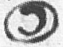，帶鉤脈形亦如圖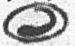，互相反也。

『鉤』字《大素》作『句』，古字耳。

**○平肺脈來，厭厭聶聶，如落榆莢，曰肺平。**

〔吳〕厭厭聶聶者，翩翻之狀，浮薄而流利也。

〔馬〕蓋厭厭聶聶者，恬靜之意。

〔紹〕《聖惠方》載《十四難》文作『𣚕𣚕欇欇』。考《廣韻》『𣚕，葉動皃。於葉切』。《説文》『欇，木葉搖白也。從木聶聲』。《爾雅》：楓，欇欇。《説文》：楓，楓木也。厚葉弱枝善搖，一名聶。

〔識〕如落榆莢，《十五難》『落』作『循』，『莢』作『葉』，《甲乙》同。馬云：『輕虛以浮之意。』張云：『輕浮和緩貌，即微毛之義也。』李時珍曰：『榆有數十種，莢榆，其木甚高大，未生葉時，枝條間先生榆莢，形狀似錢而小，色白成串，俗呼榆錢，後方生葉。』

案：本書作『如落榆莢』者，是，《十五難》《甲乙》所作共非是。此即謂毛脈來去，共輕浮而有胃氣之脈狀也。

<!-- PAGE_END -->

<!-- PAGE: 0517 -->

<!-- PRINTED: 482 -->

**○秋以胃氣爲本。**

〔楊〕厭，伊葉反。聶，尼獵反。厭厭聶聶，如人以手接已落榆莢，得之指下者，曰肺平脈也。

**○病肺脈來，不上不下，如循雞羽，曰肺病。**

〔楊〕按於毛脈，如人以摩循鷄翅之羽，得於心者，以爲肺之病脈也。

〔張〕不上不下，往來濇滯也。如循雞羽，輕浮而虛也。亦毛多胃少之義，故曰肺病。

**○死肺脈來，如物之浮，如風吹毛，曰肺死。**

〔楊〕脈之動也，如芥葉之浮於水，若輕毛而逐風移，如斯得者曰死脈者也。夫五色有形，目見爲易，五聲無形，耳知次難，五脈之動，非耳目所辨，斯最微妙。唯可取動指下，以譬喻亦之，得在於神，不可以事推之知也。

案：《説文》『勿，州里所建旗』，或作『𣃦』，今《周禮》作『物』。『浮』者，『披靡』之急呼，謂飄搖也。所云如旌旗之披靡者，輕輕應手而無根脚之謂也。蓋如物之浮，其來應手者也。如風之吹毛，其去無根者也。乃但毛無胃之義也。第十九所云『真肺脈至，大而虛，如以毛羽中人膚』，可以參考。

**○平肝脈來，耎弱招招，如揭長竿末梢，曰肝平。春以胃氣爲本。**

〔楊〕揭，奇哲反。高舉也。肝之弦脈，獨如琴瑟調品之弦，不緣不急，又如人高舉竹竿之梢，招招勁而且耎，此爲平也。『緣』恐『緩』訛。『劲』即『勁』字。據注文則正文『末梢』二字恐誤脫耳。或曰王氏據楊注補『末梢』二字歟？非是。

〔識〕馬云：『招，迢同。迢迢然，長竿末梢，最爲耎弱，揭之則似弦而甚和，所以謂之平也。』張云：

<!-- PAGE_END -->

<!-- PAGE: 0518 -->

<!-- PRINTED: 483 -->

『揭，高舉也。高揭長竿，梢必柔耎，即和緩弦長之義。招招，猶迢迢。』吳意同。志云：『以手相呼曰招。招招，乍伏之象。』高云：『柔和而起狀也。』簡按：《集韻》『迢迢，高貌』。義難叶。志注：本於《詩·邶風》『招招舟子』之疏，尤得其解。

案：如揭長竿末梢者，言柔和中自有裊娜之力，宜手下心中診察得之耳。

案：招招爲輕佻招翹之義，謂竹竿末梢之狀也。《説文》『柖，樹搖皃』，《廣韻》『𣬸㲖，毛皃』『𢁾，細絲』，共可參考。畢竟招招與招搖，無有異義也。

**○病肝脈來，盈實而滑，如循長竿，曰肝病。**

〔楊〕盈，滿實也。肝氣實滑如循長竿，少於胃氣，故肝有病也。

**○死肝脈來，急益勁，如新張弓弦，曰肝死。**

〔楊〕肝真藏脈來勁急，猶如新張琴瑟之弦，無有調弱，是無胃氣，故爲死候也。

《甲乙》《脈經》『急』下有『而』字。

**○平脾脈來，和柔相離，如雞踐地，曰脾平。**

〔楊〕按脾大脈和柔，胃氣也。相離中間空者，代也。如雞行踐地，跡中間空也。中間代者，善不見也。

〔張〕和柔，雍容不迫也。相離，勻淨分明也。如雞踐地，從容輕緩也。此即充和之氣，亦微耎弱之義，是爲脾之平脈。

案：離，非別離之離，宜爲附離之義而看。

**○長夏以胃氣爲本。**

<!-- PAGE_END -->

<!-- PAGE: 0519 -->

<!-- PRINTED: 484 -->

〔張〕耎而和也。

**○病脾脈來，實而盈數，如鷄舉足，曰脾病。**

〔楊〕實而盈數，如雞之舉足，爪聚中間不空，聚而惡見。比之無代，故是脾病也。

〔識〕張云：『實而盈數，強急不和也。如雞舉足，輕疾不緩也。前篇言弱多胃少，此言實而盈數，皆失中和之氣，故曰脾病。』汪機云：『雞踐地，形容其輕而緩也。如雞舉足，言如雞走之舉足，形容脈來實而數也。踐地與舉足不同，踐地是雞不驚而徐行也，舉足是被驚時疾行也。況實數與輕緩相反，彼此對看，尤見明白。《難經》以此爲心病。』志云：『雞足有四爪，踐地極和緩，形容脾土之灌溉四藏，雞舉足拳而收斂，不能灌漑於四藏也。』簡按：汪、志並鑿。

**○死脾脈來，銳堅如烏之喙，如鳥之距，如屋之漏，如水之流，曰脾死。**

《甲乙》『銳』作『兌』。

〔楊〕按脾脈來堅尖聚兌而不相離，上觸人指，如鳥喙，如流水之動，又如屋漏之渧人指，脾脈死候也。

案：銳堅者，無胃氣之狀也。脾應四時，不啻長夏，亦不啻四季土用，四時之中以有脾胃之氣爲之平調也。今無胃氣之脈，其在春則銳堅如烏喙者，但弦無胃也。其在夏則銳堅如鳥距，但鉤無胃也。其在秋則銳堅如水流，但毛無胃也。其在冬則銳堅如屋漏，但石無胃也。烏喙、鳥距，形容脈狀之銳堅。水流屋漏，形容脈之往來至去之銳且堅也。

**○平腎脈來，喘喘累累如鉤，按之而堅，曰腎平。**

〔楊〕旬，平也。手下堅實而平，此爲石脈之形，故爲平也。有本爲『揣揣果果』也。

<!-- PAGE_END -->

<!-- PAGE: 0520 -->

<!-- PRINTED: 485 -->

〔紹〕古『旬』『勻』多通用，故楊以旬爲均平之義，然於喘喘累累殊未襯切。仍考《大素》『旬』字即是『銞』字，如『鉤』蓋如『鈞』譌。《説文》『銞，古文。鈞，或從旬』。《淮南子・原道訓》『鈞旋轂轉』注：『鈞，陶人作瓦器法，下轉旋者。』《漢書・鄒陽傳》『獨化於陶鈞之上』，張晏曰：『陶家名模下圓轉者爲鈞。』其云如鈞即是此義，爲沈濡而滑之象，始與夏平脈有別。先兄曰：『汪云：喘喘累累如鉤，言其滑而濡也。按之而堅，濡滑有力也。』

案：喘喘猶冉冉、耎耎也，謂軟弱也。累累猶離離、連連，謂重疊也。言軟弱重疊之中，按之而堅有力如鈞也。云『如鈞按之而堅』者，倒草法也。

**○冬以胃氣爲本，**

〔張〕石而和也。

**○病腎脈來，如引葛，按之益堅，曰腎病。**

〔楊〕腎之病脈，按之如按引葛，逐指而下也。益堅，始終堅者，是爲腎平，初耎後堅，故是腎病之也。

案：《説文》『葛，蔓也』。云『如引葛』者，至堅之中自寓生意潤澤，與如奪索彈石自不同也。

**○死腎脈來，發如奪索，辟辟如彈石，曰腎死。**

〔楊〕腎之石脈，來指下如索，一頭繫之，彼頭控之，索奪而去，如以彈石。彈指辟辟之狀，是腎之死脈候之也。

案：奪與捺同。《廣韻》『捺，奴葛切。手按』。因此，則奪索者謂按索也。比腎病之引葛稍失潤澤，所以爲死也。又案：辟辟者，蓋辟之爲言拍也。於指下動拍甚劇，如彈石上，全無胃氣，故以爲腎死脈也。

<!-- PAGE_END -->

<!-- PAGE: 0521 -->

<!-- PRINTED: 486 -->

案：本篇凡九章，篇首至『逆者死』爲一，『春胃微弦』至『宗氣泄也』爲二，『欲知寸口』至『曰難已』爲三，『臂多青脈』至『謂之熱中』爲四，『肝見庚辛』至『皆死』爲五，『頸脈動喘』至『姙子也』爲六，『脈有逆從』至『命曰反四時也』爲七，『人以水穀爲本』至『浮大而短』爲八，『夫平心脈』至篇末爲九章。

萬延庚申十一月初七直燈下書畢

速讀翁源立之

第十八補

秋病｟五ウ｠

案：秋病，諸注家以爲至秋而病也。余謂不然。夫冬傷寒而春病，夏傷暑而秋爲瘧之類，其義可通。若隔一時，而春夏共不病，至秋而病之兆，已在春時之脈卜之，此理固不可有也。蓋所云秋病者，肺病之義，春木應則肝病，若金應而木衰，則反見肺病，名之曰秋病也。下同。

〔高〕春言胃而有毛，金刑木也。夏言胃而有石，水刑火也。長夏秋冬，一言耎弱有石，一言毛而有弦，一言石而有鉤，皆我勝者而反乘之。蓋勝我者刑之，由於本氣之虛。我勝者乘之，亦由本氣之虛也。春夏今病皆言受剋，長夏今病則言本虛，秋冬今病則言乘侮，以明受剋乘侮，皆因本氣之虛，錯綜其意，欲人彼此互推知其由也。

案：高説爲是，今從高説爲之圖表如左。

<!-- PAGE_END -->

<!-- PAGE: 0522 -->

<!-- PRINTED: 487 -->

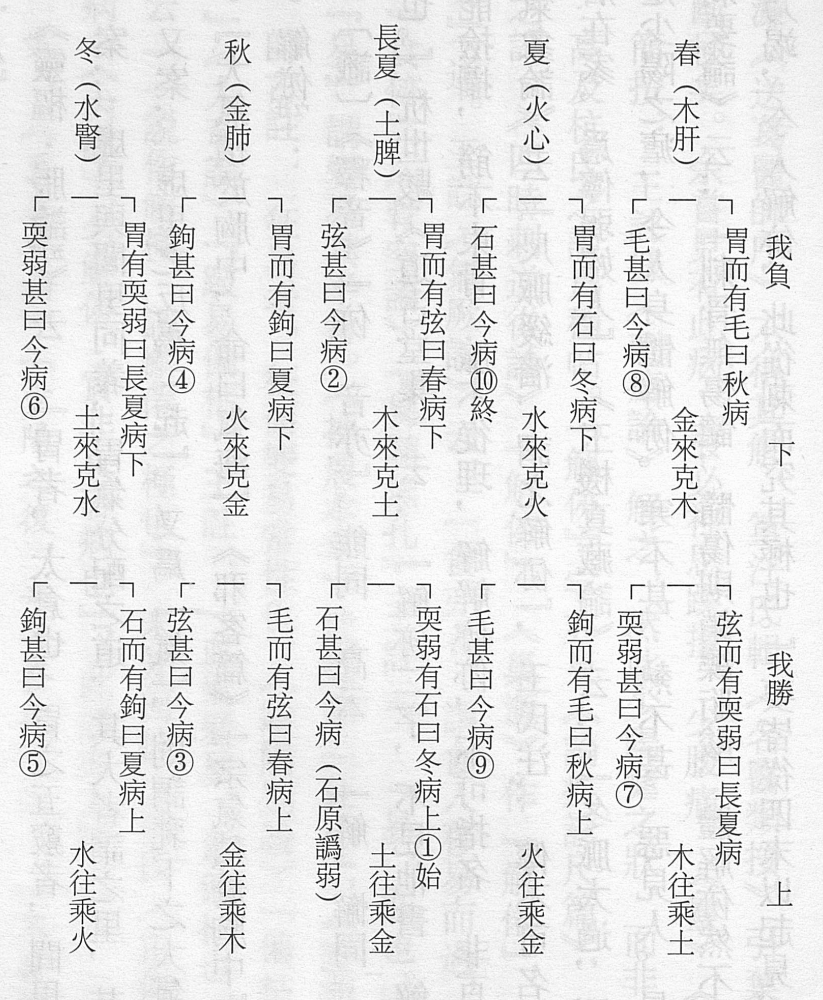

- 我負　下
- 我勝　上
- 春（木肝）→ 胃而有毛曰秋病
- 春（木肝）→ 毛甚曰今病⑧
- 金來克木
- 春（木肝）→ 弦而有耎弱曰長夏病
- 春（木肝）→ 耎弱甚曰今病⑦
- 木往乘土
- 夏（火心）→ 胃而有石曰冬病下
- 夏（火心）→ 石甚曰今病⑩終
- 水來克火
- 夏（火心）→ 鉤而有毛曰秋病上
- 夏（火心）→ 毛甚曰今病⑨
- 火往乘金
- 長夏（土脾）→ 胃而有弦曰春病下
- 長夏（土脾）→ 弦甚曰今病②
- 木來克土
- 長夏（土脾）→ 耎弱有石曰冬病上①始
- 長夏（土脾）→ 石甚曰今病（石原譌弱）
- 土往乘金
- 秋（金肺）→ 胃而有鉤曰夏病下
- 秋（金肺）→ 鉤甚曰今病④
- 火來克金
- 秋（金肺）→ 毛而有弦曰春病上
- 秋（金肺）→ 弦甚曰今病③
- 金往乘木
- 冬（水腎）→ 胃有耎弱曰長夏病下
- 冬（水腎）→ 耎弱甚曰今病⑥
- 土來克水
- 冬（水腎）→ 石而有鉤曰夏病上
- 冬（水腎）→ 鉤甚曰今病⑤
- 水往乘火

黑字爲原文，朱字爲補文，古文簡略，彼此互舉，今得此補文，而其義全然可解。高氏發明蓋如此耳。

今病｟六ヲ｠

案：今病者，肺金盛應而克肝木，乃肺肝共病。謂之今病者，謂在春時而病也。言肺病宜在秋時，而病是爲客文。然肺金盛應，則肝木亦病，故曰毛甚曰今病也。後四時皆仿此。

夏胃微鉤曰平｟七ヲ｠

<!-- PAGE_END -->

<!-- PAGE: 0523 -->

<!-- PRINTED: 488 -->

《脈經》卷三云：『夏胃微鉤曰平，鉤多胃少曰心病，但鉤無胃曰死。有胃而石曰冬病，石甚曰今病。』

虛里｟十一ウ｠

《莊子・徐無鬼》『至鄧之虛』《釋文》『虛，音墟。本又作墟。』宋・周去非《嶺外代答》卷六婆衫婆裙篇曰：『爲新婦服之一月，雖出入村落虛市，亦不釋之。』《文選・東方朔・畫贊》『墟墓徒存』，王逸少書本作『虛』。

《靈樞・脹論｟卅五｠》云：『胃者，太倉也。胃之五竅者，閭里門戶也。』

案：虛里與閭里同義，胃氣分配之道，其大者謂之里，其小者謂之門也。虛里，氣門可以徵也。

又案：虛里之反爲『起』，又爲『氣』，則謂乳下之大氣跳起者也。蓋虛里者，爲氣之古言也。《五味篇》『大氣積於胸中，命曰氣海』，《邪客篇》『宗氣積於胸中』，共可以徵矣。

解㑊｟廿一ウ｠

〔識〕《釋音》『㑊，音亦』。熊同。高云：『解、懈同。㑊音亦。餘篇解㑊同，猶懈怠。』志云：『懈，惰也。』杭世駿《道古堂集》云：『解㑊二字，不見他書。解即懈，㑊音亦。倦而支節不能振聳，憊而精氣不能撿攝，筋不束骨，脈不從理，解解㑊㑊，不可指名，非百病中有此一症也。』《内經》言此者凡五，《平人氣象論》云『尺脈緩濇，謂之解㑊』，王氏注：儜不可名。儜，困弱也。按：《宋書・明恭王皇后傳》『后在家，爲儜弱婦人』。《玉機真藏論》云：『冬脈太過，則令人解㑊，此從脈起見也。』《刺瘧論》云：『足少陽之瘧，令人身體解㑊。寒不甚，熱不甚，惡見人。見人心惕惕然，熱多汗出甚，此從瘧起見也。』《刺要論》云：『刺骨無傷髓，髓傷則銷鑠胻酸，體解㑊然不去矣。』《四時刺逆從論》云：『夏刺經脈，血氣乃竭，令人解㑊，此從刺而究其極也。』要皆從四末以起見，如經所言墮怠，小變其辭，而意較微眇爾。宋景濂《送葛醫師序》不得其解，篁江氏輯《名醫類按》引葉氏《録驗方》，以爲俗名發痧之證，別列一門，武斷極矣。余嘗見有此病，發必神思躁擾，少腹痛。《靈》《素》未嘗言及，與解㑊之義毫不干涉，殆大繆矣。簡按：王註據《刺瘧論》解之，然此少陽瘧之狀，而非解㑊之義。馬、吳、張並仍王註，皆不可從，但志、高及杭氏之説爲穩帖。『解㑊』字亦見《論疾診尺篇》，云：『尺肉弱者，解㑊也。』蓋解㑊即懈憻、懈倦之謂。《四時刺逆從論》『解㑊』，《巢源》作『解倦』，此可以證也。『㑊』即『亦』字，從人者，與『易』通。王註《氣厥論》云：『食亦者，謂食入移易而過，不生肌膚。亦，易也。』《甲乙》引《氣厥論》作『食㑊』。《骨空論》『易髓無孔』王註云：『易，亦也。』此可以證『㑊』『亦』同，而與『易』通也。而『易』謂變易其平常。《神農本草》蜣螂條『狂易』，《證類》音羊。誤。《漢書・外戚傳》云：素有狂易病。師古註：狂易者，狂而變易常性也。《陰陽別論》『偏枯痿易』王註：『易，謂變易常用，而痿弱無力也。』《大奇論》『跛易偏枯』王註：『血氣變易，爲偏枯也。』知是『解易』即『解惰』，變易平常之義矣。滑云『一説作解極，謂懈倦之極也』，未知何據。虞氏《正傳》云『解者，肌肉解散。㑊者，筋不束。俗呼砂病。《内經》名解㑊，實非真砂病也』，此説亦太誤。

<!-- PAGE_END -->

<!-- PAGE: 0524 -->

<!-- PRINTED: 489 -->

案：《至真要論》『少陽之復，辛苦發之』注：『不發汗以奪盛陽，則熱内淫於四支，而爲解㑊不可名也。謂熱不甚，謂寒不甚，謂強不甚，謂弱不甚，不可以名言，故謂之解㑊。粗醫呼爲鬼氣惡病也。久久不已，則骨熱髓涸齒乾，乃爲骨熱病也。發汗奪陽，故無留熱。』

如臥蠶起之狀｟廿三ウ｠

〔紹〕《大素》無『蠶』字。堅案：無者爲是。《水脹篇》『水始起也。目窠上微癰，如新臥起之狀。其頸脈動時欬，按其手足上窅而不起者，風水膚脹也』，俱可以證。王引《評熱病論》爲徵。然彼言目下微腫光亮，此言目上庬然虛浮，親驗病者，其候自異。王注謬。｟《金匱》風水有『如蠶新臥起狀』文，『蠶』字衍。又有『目下如臥蠶』語，即與《評熱病論》同義。｠

<!-- PAGE_END -->

<!-- PAGE: 0525 -->

<!-- PRINTED: 490 -->

藏真｟六ヲ｠

〔紹〕先兄曰：『按藏真，非真藏之真，即言五藏真元之氣，各應五時，而見脈象也。』

尺濇脈滑｟廿二ヲ｠

《靈樞・論疾診尺七十四》云：『尺膚滑，其淖澤者，風也。尺膚滑而澤脂者，風也。尺膚濇者，風痺也。』

案：此既是多汗，故皮膚不滑澤而麁濇也。《靈樞》所云『風痺』與此同理。其云『皮膚澤者風也』者，未經多汗之前，其膚如此。若經多汗，則爲麁澀也。其理則同耳。

乳之下云云｟十三ウ｠

再案：此十一字，《大素》在後文中，《甲乙》無，全元起本同。據此，則此十一字，恐是前文『其動應衣』下傍記，誤混本文者歟。或是前文『其動應衣』之義再釋之者歟。此例亦不少。言乳下虛里之動者，宗氣有餘之溢泄於此也。楊注亦似如此解，蓋言其常。諸注家皆以爲宗氣泄甚之義，以爲死候，非是。｟此説極是。｠

十八

平人｟一ヲ｠

少氣｟二ヲ｠

躁｟二ウ｠

病温同

代｟七ウ｠

藏真｟六ヲ、十一ウ｠

弦鉤毛石圖説｟十ウ｠

虛里｟十一ウ、十三ヲ、補ナ｠

解㑊｟廿一ウ｠

臥蠶｟廿三ヲ｠

胃

疸｟廿四ヲ｠

琅玕｟廿九ヲ｠

喘喘｟同ウ｠

帶鉤｟三十ヲ｠

榆葉｟卅ウ｠

物｟卅一ウ｠

招招｟卅二ヲ｠

旬｟卅四ヲ｠

葛｟卅四ウ｠

奪索｟卅五ヲ｠

<!-- PAGE_END -->

<!-- PAGE: 0526 -->

<!-- PRINTED: 491 -->

## 素問攷注卷第六

### 重廣補注黃帝内經素問卷第六

#### 玉機真藏論篇第十九

篇首至『名曰生機』｟十オ｠，《大素》十四・四時脈形｟廿ウ｠。『大骨枯槁』至『皆死不治也』｟同上｠，真藏脈形｟廿八ウ｠，『見真藏曰死』至『帝曰善』，同卷六藏府氣液｟廿九ウ｠，『凡治病』至『皆難治』，同十四・四時脈診。

〔箚〕寛案：篇内名曰『玉機』，又見《玉版論要篇》，而《太素》并作『生機』，注意亦然。此知『玉』字當作『生』。此篇内蓋論真藏與生機之異，其意太明。若作『玉機』，卻屬無謂矣。《尚書大傳》『機者，幾也，微也。其變幾微而所動者大，謂之璇璣』。

**○黃帝問曰：春脈如弦，何如而弦。岐伯對曰：春脈者肝也，東方木也，萬物之所以始生也。故其氣來耎弱輕虛而滑，端直以長，故曰弦。反此者病。**

〔楊〕凡人之身與天地陰陽四時之氣皆同，故内身外物雖殊，春氣俱發，肝氣春王。故春脈來比草木初出，其若琴弦之調品者，不大緩，不大急，不大虛，不大實，不濇不曲，肝氣亦然。濡潤柔弱軟小，浮虛輕滑端直，而尺部之上，長至一寸，故比之弦。軟，如遄反。

案：楊注以『弦』爲琴弦之義，蓋有所傳而言。則原當作『絃』。《大素》『輕』作『軟』，非是，恐誤。『軟』與『濡』爲同字同義。

<!-- PAGE_END -->

<!-- PAGE: 0527 -->

<!-- PRINTED: 492 -->

（眉）《大素》十四・四時脈形『黃帝問』至『名曰生機』。

（眉）案：弦鉤毛石四時脈，脈非三部九候脈之義。大凡一身血氣之形，皆爲弦鉤毛石也。『脈者血之府』出《脈要精微》中，是也。因考肝病必見弦脈，心病必見鉤浮脈，肺病必見毛弱脈，腎病必見沈石脈。因今病人六脈三部皆爾。

（眉）弦鉤毛石四脈形，詳見《平人氣象》中。

**○帝曰：何如而反。岐伯曰：其氣來實而強，此謂太過。病在外，其氣來不實而微。此謂不及，病在中。**

〔楊〕其春脈堅實勁直，名爲來實而強。此爲春脈少陽有餘，耶在膽府少陽，故曰在外。一曰而弦，疑非也。其春脈厥陰脈來，雖然不實而更微弱，此爲不足。耶在肝藏厥陰，故曰在中也。

**○帝曰：春脈太過與不及，其病皆何如。岐伯曰：太過則令人善忘忽忽，眩冒而巔疾。**

《千金》肝藏脈論載此文，『巔』作『癲』。

〔楊〕春脈大過，以耶在膽少陽，少陽之脈循胸裏，屬膽散之，上肝貫心，又桓角上頭，故喜忘忽忽，眩冒而癲也。

『桓角』恐『抵扃』訛。楊注以『喜忘』爲肝膽之證，然肝膽不足則當病喜忘，大過則當病善怒。『善忘』宜從《氣交變大論》作『善怒』。王注、《新校正》説共可從矣。蓋忽忽者，形容眩冒之狀。忽忽，又言恍忽。單言之曰忽，共爲蒙昧之義。《文選・高唐賦》『悠悠忽忽』李注：『忽忽，迷貌』，可以徵也。《氣交變大論》云：『甚則忽忽善怒，眩冒巔疾。』猶是云甚則善怒忽忽，眩冒巔疾，即倒草法。或曰『作善忘』，似是。何則？肝木脈大過必迫於心家，心火自衰，所以喜忘也。若肝木脈不及，則心火自盛，故爲善怒也。此説亦有一理，今姑録兩説，以俟考耳。所云太過者，即前文所云病在外也。後文『不及』即『病在中』之謂也。

<!-- PAGE_END -->

<!-- PAGE: 0528 -->

<!-- PRINTED: 493 -->

**○其不及，則令人胸痛引背，下則兩脇胠滿。帝曰：善。**

〔楊〕肝虛則胸痛引背，兩脇胠滿，皆肝藏病也。胠，去居反。腋下三寸以下，脅也。脇下至八間之外，胠也。

《五藏生成篇》十云『腹滿䐜脹，支鬲胠脇』，王注：『胠，謂脇上也。』｟案：『上』恐『下』字誤。｠又《氣府論》云：『足少陽脈氣所發者，掖下三寸，脇下至胠八間各一』，王注：『所以謂之八間者，自掖下三寸至季肋凡八肋骨。』又《刺瘧論》｟三十六｠云：『瘧脈滿大急，刺背俞，用中鍼傍五胠俞各一，適肥瘦，出其血也』，王注：『五胠俞，謂譩譆也。』

〔高〕胠，脇旁連背處也。五藏之俞在背兩行，兩行之外復有兩行，所謂胠也。

《説文》：『胳，掖下也。』『胠，掖下也。』玄應《音》卷五引《埤倉》云：『胳，肘後也。』《廣雅・釋親》『胳謂之腋。』又曰：『膀胠胉脅也。』

沈彤《釋骨》云：『在腋下而後乳三寸者曰胠，胠骨五，左曰左胠，右曰右胠。』

《傷寒直格》：『腋下曰脅，脅下骨爲肋，脅肋之下曰胠。』

《説文》段注曰：『兩厷迫於身者謂之亦，亦下謂之胳，又謂之胠，身之迫於兩厷者也。』又曰：『胳謂迫於厷者，胠謂迫於臂者。』

**○夏脈如鉤，何如而鉤。岐伯曰：夏脈者心也，南方火也，萬物之所以盛長也。故其氣來盛去衰，故曰鉤。反此者病。**

<!-- PAGE_END -->

<!-- PAGE: 0529 -->

<!-- PRINTED: 494 -->

〔楊〕夏陽氣盛，萬物不勝盛長，遂復垂下，故曰鉤也。夏脈從内起，上至於手，不勝其盛，迴而衰遲，故比之鉤也。

**○帝曰：何如而反。岐伯曰：其氣來盛去亦盛，此謂太過。病在外，其氣來不盛去反盛，此謂不及，病在中。**

〔楊〕來去俱盛，大陽氣盛也。邪在少陽大陽，故曰在外也。其來不盛，陽氣有衰，脈行衰遲，去反盛者，陰氣盛實，病在心藏也。故曰在中之。

**○帝曰：夏脈太過與不及，其病皆何如。岐伯曰：太過則令人身熱而膚痛，爲浸淫。**

〔楊〕腎主骨，水也。今大陽大盛，身熱乘腎，以爲微耶，故爲骨痛。浸淫者，滋長也。

〔志〕浸淫，膚受之瘡火熱盛也。

案：此前文所謂『病在外』之義，乃謂浸淫瘡也。『膚痛』，《大素》作『骨痛』，恐非是。肌表熱瘡，故爲膚痛也。或曰『此瘡膚上痛痒，不言而明矣。然則浸淫之瘡，固爲内因之證，必當有骨痛』，亦通。《浸淫考》別有成書，今不贅於此。

（眉）《氣交變大論》『身熱骨痛，而爲浸淫』。

**○其不及，則令人煩心。上見欬唾，下爲氣泄。帝曰：善。**

《欬論》曰：『小腸欬狀，欬而失氣，氣與欬俱失。』《靈・癲狂篇》骨癲疾、筋癲疾，並云『氣下泄不治』，脈癲疾亦同。《五癃津液別》曰『天寒衣薄，則爲溺與氣』，又曰『水下留於膀胱，則爲溺與氣』。

〔楊〕陽虛陰盛，故心煩也。心脈入心中，繫舌本。故上見噬，市滯反也。謂嚼唾也。氣謂廣腸洩氣也。

<!-- PAGE_END -->

<!-- PAGE: 0530 -->

<!-- PRINTED: 495 -->

案：不及者，即所云病在中是也。《脈解篇》『所謂得後與氣，則快然如衰云云』。《至真要論》同文無『所謂』二字。《靈・經脈篇》『脾動』下同。

（眉）《説郛》有《雜纂續》一卷，題曰『宋王君玉纂』，好笑部中曰『對客泄氣』。

**○秋脈如浮，何如而浮。岐伯曰：秋脈者肺也，西方金也，萬物之所以收成也。故其氣來輕虛以浮，來急去散，故曰浮。反此者病。**

〔楊〕秋時陽氣已衰，陰氣未大，其氣輕虛，其來以急，其去浮散，故曰如浮也。

〔琦〕金氣收降而脈浮者，承六陽盛長之後，陽氣微下，自皮膚而漸降，所謂秋日下膚，蟄蟲將去，與春夏之浮不同也。來急去散，即厭厭聶聶如落榆莢之義，非勁急散亂之謂。

（眉）如浮，『浮』即『孚』之假字，説在於補中｟一ウ｠。

**○帝曰：何如而反。岐伯曰：其氣來毛而中央堅，兩傍虛，此謂太過。病在外，其氣來毛而微，此謂不及，病在中。**

〔楊〕其脈來，如以手按毛，毛中央堅，此爲陽盛。病在大腸手陽明，故曰在外。如手按毛，毛中央微，肺氣衰微，故曰在中也。

〔識〕吳云：『中央堅，浮而中堅也。』張同。簡按：何氏《醫碥》云：『虛，猶散也。惟兩旁散而中央不散，與上所謂去散者異矣。』

〔紹〕琦曰：『中央堅兩傍虛，即如循雞羽也。』堅按：此據前篇王注。

**○帝曰：秋脈太過與不及，其病皆何如。岐伯曰：太過，則令人逆氣而背痛，慍慍然。**

〔楊〕府陽氣盛，則氣逆連背痛，温温然熱不甚也。

<!-- PAGE_END -->

<!-- PAGE: 0531 -->

<!-- PRINTED: 496 -->

案：慍慍，《脈經》亦作『温温』，可從。言肺脈太過，則肺主氣，故氣逆。背爲陽部，故背痛而熱，其熱之狀温温然也。是謂病在外，温温即熱也。楊以爲温和之温，故云『温温然，熱不甚也』，恐非是。

**○其不及則令人喘，呼吸少氣，而欬上氣見血，下聞病音。帝曰：善。**

〔楊〕肺氣不足，喘呼欬而上氣，唾而有血，下聞胸中喘呼氣聲也。

〔識〕張云：『下聞病音，謂喘息，則喉下有聲也。』志云：『虛氣下逆，則聞呻吟之病音。』吳『下』改『及』字。簡按：『下』字不穩，姑從張義。

王注云：『下聞病音，謂喘息，則肺中有聲也。』乃與楊、張同其説也。

〔箚〕《骨空論》『其上氣有音者，治其喉中央在缺盆中者』。

案：『下聞病音』對『欬上氣』而成文，因指喉中水雞聲，而謂『下聞病音』也，並是在中之病也。比於出口之欬聲，則喘息之音爲在下也。

**○冬脈如營，何如而營。岐伯曰：冬脈者，腎也，北方水也，萬物之所以合藏也。故其氣來沈以搏，故曰營。反此者病。**

〔楊〕營，聚也。謂萬物收藏歸根，氣亦得深搏骨，沉聚内營，故曰如營也。

案：『營』恐是『罌』之假借，猶營實之營，亦爲『罌』之借字也。《説文》『罌，缶也』『罃，備火長頸缾也』。蓋罌、罃本同字，後世遂爲二義，故許氏分出二字也。｟《説文》此例不一而足。｠此云『如營』與『如石』同義，瓦石同堅硬，故得互偁也。乃與弦鉤毛共爲物質，且在人家左右常用之器，以爲之譬喩耳。從來諸注家，或以爲營動之義｟楊、王｠，或以爲營壘之營｟吳、馬、張｠，並非是。

**○帝曰：何如而反。岐伯曰：其氣來如彈石者，此謂太過。病在外。**

<!-- PAGE_END -->

<!-- PAGE: 0532 -->

<!-- PRINTED: 497 -->

〔楊〕其脈如石，以爲平也。彈石謂令石脈上來彈手，如石擊手。如彈之以石，謂腎大陽氣有餘，病在膀胱大陽，故曰在外也。

《五藏生成》王注：『色黃者其脈代，色黑者其脈堅。』

**○其去如數者，此謂不及。病在中。**

〔楊〕腎氣不足，故其氣去，按之如按於毛，病在於腎，故曰在中。一曰如數也。

《大奇論》曰『脈至如數，使人暴驚』，又曰『脈至浮合，浮合如數，一息十至以上，是經氣予不足也』，又曰『脈至如火薪然』，又曰『脈至如散葉，如省客，如丸泥，如橫格，如弦縷，如交漆，如涌泉，如頹土之狀，如懸雍，如偃刀，如丸，如華』。是又云『如數』者，數，斥一器物，非頻數之義也歟。

案：『數』恐『愉』假字。《説文》『愉，正耑裂也』。《廣韻》『愉，裂繒』。平聲十・虞：山芻切。其脈氣來如彈石謂堅，其去如裂繒，謂軟也。乃與毛同義。諸家以爲緊數之數，故皆失其解。又《廣韻》去聲十・遇『數』『愉』同音，曰『愉，裁殘帛也』，亦可以證也。又《玉篇》『毹，山于切。〓、毹、氀同上』，《廣韻》『毹』『愉』同音，亦足以證也。

**○帝曰：冬脈太過與不及，其病皆何如。岐伯曰：太過，則令人解㑊，脊脈痛，而少氣不欲言。**

〔楊〕大過，腎（當作足）太陽盛。大陽之脈行頭背脚，故氣盛身解㑊也。解音懈，㑊相傳音亦，謂怠惰運動難也。大陽既盛，腎陰氣少氣，少氣故不欲言也。

案：解㑊、脊痛共是病在外也。少氣不欲言者，脊痛甚之至，遂致如此證也。蓋中風不隨之類，其脈洪大而有力者，與解㑊見彈石脈同理耳。

解㑊已見十八篇中。

<!-- PAGE_END -->

<!-- PAGE: 0533 -->

<!-- PRINTED: 498 -->

《大素》『脊脈痛』作『腹痛』者，誤脱『脊』字，而『脈』字又誤作『腹』歟。楊注云『背』不云『腹』，故知然也。

案：四時脈形，又見《平人氣象論》十八及《十五難》，其理皆同，宜併考。

**○其不及，則令人心懸如飢，䏚中清，脊中痛，少腹滿，小便變。帝曰：善。**

〔楊〕腎脈上入於心，故腎虛，心如懸狀，如病於飢。當脊中腎氣不足，故痛也。又小腹虛滿，小便變色也。

徐堅《初學記》卷二十引晉・束晳《貧家賦》曰：『心苦苦而飢懸。』

案：心懸，《大素》作『心如懸』，其義一也。懸與絃、弦等字同音通用。心懸者，謂心下絃癖。心如懸者，謂心下癖氣如弦亘起也。『痃癖』字，《病源》作『懸癖』，《醫心》引《通玄》作『絃癖』，可以徵矣。《病源》卷二十云：『懸癖者，謂癖氣在脇肋之間，弦亘而起，欬唾則引脇下懸痛，所以謂之懸癖。』《醫心》卷九第八云：『《通玄》云：絃癖之疾，亦不專於一。絃病者，肝之所生。癖病者，脾之所成。絃生於左，癖成於右。絃者如弓之絃，肝之所生。肝與膽爲清淨之府，不受外耶，故知自生病也。癖者，脾胃爲水穀之海，食不消，偏僻一邊，故名爲癖。令一絃癖同爲一疾，實亦難矣。』《神農本草經》上『白蒿，療心懸少食常飢』，與本條『心懸如飢』正同，謂心下懸引急痛也。蓋腎虛不能制水，故水停心下，爲留飲諸證也。與《金匱》所説『懸飲』其證稍同，但有虛實之別。虛證爲心懸，實證爲懸飲耳。《金匱》中第十二云：『飲後水流在脇下，欬唾引痛，謂之懸飲。懸飲者，十棗湯主之。』黑字云：『大棗，除煩悶心下懸。』是謂懸飲實證也。《金匱・心痛篇》『心中痞，諸逆，心懸痛，桂枝生薑枳實湯主之』，《外臺》卷七心下懸急懊痛門引仲景《傷寒論》作『心下懸痛，諸逆大虛者，桂心生薑枳實湯主之』。方後云范汪同。《肘後》載此方作『治心下牽急懊痛方』，《病源》卷十六心懸急懊痛候云『其痛懸急懊者，是邪迫於陽，氣不得宣暢，壅瘀生熱，故心如懸而急，煩懊痛也』，所云『如懸而急』，亦謂如弦而急也。又《千金》有心中｟《外臺》作『心下』｠痞，諸逆懸痛，桂心三物湯主之方，又養胎篇云『姙娠九月，卒得下痢，腹滿懸急』，又二月艾葉湯條云『心滿，臍下懸急』，《千金翼》養性服餌鎮心圓條云『心下懸急』，並皆弦急之義，謂心懸虛證也。詳具於釋『懸』中。

<!-- PAGE_END -->

<!-- PAGE: 0534 -->

<!-- PRINTED: 499 -->

案：䏚，《刺腰痛論》王注：『䏚，謂季脇下之空軟處也。』《釋音》『䏚，亡表切』｟ヒハラ、ヨワゴシ｠楊上善曰：『䏚，比沼反。胠空處也。』張介賓曰：『䏚，脇骨之秒，當兩腎之處。』高世栻曰：『䏚，脇骨之末肋稍處也。䏚、秒同音渺。』柳沜先生曰：『《禮・三年問｟（當作『深衣』）｠》帶下毋厭髀，上毋厭脇，當無骨者。是即䏚也。』

《千金》卷四帶下漏下篇曰：『心中懸虛。』

又案：第七云『一陽發病，爲心掣』。心掣，即心懸。説詳在於彼。｟六ヲ｠

《千金方》卷四・月水不通第二篇乾薑圓下曰『心下常苦懸痛』。《千金》卷之二・養胎篇第三半夏湯下『腹滿懸急』。《千金》十九第八篇『建中湯治腹中懸急而有絕傷』。

《靈樞》卷五・經脈篇第十云：『腎足少陰也，是動則心如懸若饑狀。』

又卷十一《師傳篇第廿九》云：『胃中熱則消穀，令人懸心善饑。』

《金匱・禽獸魚蟲禁忌篇》曰：『食犬肉不消，心下堅或腹脹，心急發熱。』

《素問》卷二十二・至真要大論曰：『太陰司天，陰痺者按之不得，腰脊頭項痛，時眩，大便難，陰氣不用，飢不欲食。欬唾則有血，心如懸，病本於腎。』

《外臺》卷七有心下懸急懊痛方篇。又卷十七腎氣不足篇曰：『深師療腎氣不足，心懸少氣方。』又卷十

<!-- PAGE_END -->

<!-- PAGE: 0535 -->

<!-- PRINTED: 500 -->

三傳屍方篇：『蘇遊論曰：或多忪悸，心懸乏氣。』

《本草》大棗黑字『心下縣』，《醫心方》食治卷引作『懸』。

〔識〕『小便變』下，《甲乙》有『黃赤』二字。張云：『變者，謂或黃、或赤，或爲遺淋、或爲癃閉之類，由腎水不足而然。』

（眉）《病能論》『故人不能懸其病也』王注：『故人不能懸其病處於空中也。』此『懸』字與『心懸』義全別。

（眉）《病源》卷廿懸飲候：『留注脇下，令脇間懸痛，咳唾引脇痛，故云懸飲。』

（眉）《金匱·五藏風寒篇》：『心中風者，翕翕發熱，不能起。心中饑，食即嘔吐。』

（眉）《千金》卷三十心病篇：『腎輸復留、大陵、雲門主心痛如懸。間使主心懸如飢。然谷主心如懸，少氣不足以息。』

（眉）《病源》卷廿癖結候：『此由飲水聚停不散，時有弦亘起在於脅下。』

（眉）《甲乙》卷九邪在心第五篇曰：『心痛善悲，厥逆，懸心如饑之狀，心譫譫而驚，大陵及間使主之。』又曰：『心如懸，哀而亂，善恐云云，多漾出，喘少氣，吸吸不足以息，然谷主之。』

（眉）《水經·河水注》引黃義仲《十三州記》：『縣，弦也。弦以貞直，言下體之居，隣民之位，不輕其誓，施繩用法，不曲如弦，弦聲近縣，故以取名。』

案：心懸之『心』，斥心下鬲部，與仲景寫心湯之『心』同，心下亦心部也。

（眉）沈金鰲《尊生書》曰：『痃者，懸也。懸於腹内，近臍左右，各有一條筋脈扛起。大者如臂、如筒，小者如指、如筆管、如弦云云。』

<!-- PAGE_END -->

<!-- PAGE: 0536 -->

<!-- PRINTED: 501 -->

（眉）《靈·經脈》曰：『脾太陰心下急痛。』

（眉）《千金》卷十七第二篇瀉肺散曰『心下弦急』。（眉）《傷寒論·不可汗篇》『心懊憹如飢』。《千金》建中湯『治腹中懸急』。｟十九ノ廿二オ｠

（眉）《太平御覽》三百四十七卷引《管公明別傳》曰：『心中懸痛，不得飲食。』《莊子·列禦寇》《釋文》引《三蒼》：『懁，急腹也。』《脈經》卷二第三篇：『心下拘急。』《玉篇》：『䏹，腹䏹也。』《廣韻》廿七銑：『臔，肉急。』《素·陰陽別》曰：『其傳爲心掣。』

**○帝曰：四時之序，逆從之變異也。然脾脈獨何主。**

〔楊〕四時四藏氣候，脈之逆順，弦鉤浮營，太過不及等，變異多端，已聞之矣。然四藏之脈於四時而王，未知脾脈獨主何時也。

**○岐伯曰：脾脈者，土也。孤藏以灌四傍者也。**

〔楊〕孤，尊獨也。五行之中，土獨爲尊，以王四季，脾爲土也。其味甘淡，爲酸苦辛鹹味，液滋灌四傍之藏，其脈在關中宮，獨四時不見，故不主時也。

**○帝曰：然則脾善惡，可得見之乎。岐伯曰：善者不可得見，惡者可見。**

〔楊〕善謂平和不病之脈也。弦鉤浮營四脈見時，皆爲脾胃之氣滋灌俱見，故四藏脈常得平和。然則脾脈以他爲善，自更無善也，故曰善者不可見也。惡者病脈也，脾受耶氣，脈見關中，診之得知，故曰可見也。

**○帝曰：惡者何如可見。岐伯曰：其來如水之流者，此謂太過，病在外。如鳥之喙者，此謂不及，病在中。**

〔楊〕當關指下有脈，如水之流動，即脾氣大過也。此陽氣病在胃足陽明，故曰在外。其脈來時如鳥喙指，此爲脾虛受病，故曰在中。百鳥距，如鳥距隱人指也。｟案：『百』恐『一曰』訛。｠

<!-- PAGE_END -->

<!-- PAGE: 0537 -->

<!-- PRINTED: 502 -->

〔識〕《新校正》云：『喙，別本作啄。』簡按：《難經》十五『脾者，中州也。其平和不可得見，衰乃見耳。來如雀之啄，如水之下漏，是脾之衰見也』。據《平人氣象論》『銳堅如烏之喙』，作『喙』爲是。

案：此與《平人氣象論》自不同，彼五藏共舉平、病、死三脈，此特舉病之過、不及脈。故此所云如水流者，脾氣尤盛，謂往來流利尤滑疾也，爲太過也。所云如鳥啄者，脾氣大衰，謂往來流利尤遲澀也，爲不及也。作『喙』恐非是。

**○帝曰：夫子言脾爲孤藏，中央土，以灌四傍，其太過與不及，其病皆何如。岐伯曰：太過則令人四支不舉。**

〔楊〕胃氣雖盛，脾病不爲行氣四支，故曰四支不舉也。

〔紹〕尤怡曰：《玉機真藏論》云『脾脈太過，則令人四支不舉，其不及則令人九竅不通』。《靈樞·本神篇》云『脾氣虛則四支不用，實則經溲不利』。蓋脾虛則營衛涸竭，不能行其氣於四肢，而爲之不舉。脾實則營衛遏絶，亦不能行其氣於四肢，而爲之不舉，九竅亦然。兩經言之者，所以窮其變也。

案：脾脈太過，如水之流，往來滑疾者，病在外，令人四支不舉，是謂風寒濕邪中於表痱痺之類，脾氣虛弱，故邪入侵也。《本神篇》所云『脾氣虛則四支不用』，與此一理。尤氏説非是。

**○其不及，則令人九竅不通，名曰重強。**

〔楊〕脾虛受病，不得行氣於九竅，不通也。不行氣於身，故身重而強也。巨兩反也。

案：脾脈不及，如鳥之啄，往來遲澀者，病在中，令人九竅不通，名曰重強，是謂大腹水腫之類。脾氣實滿，水道不通，《本神篇》所云『脾氣實，則腹脹，經溲不利』是也。重強，蓋謂身重體強也。『重強』二字乃形容水腫之義。又案：重強者，張之緩言，謂水脹也，《本神篇》所云腹脹是也。諸家説並非。

<!-- PAGE_END -->

<!-- PAGE: 0538 -->

<!-- PRINTED: 503 -->

**○帝瞿然而起，再拜而稽首曰：善。吾得脈之大要，天下至數。**

〔楊〕絃鉤浮營等脈，大過不及之理，名曰脈之太要。至數，至理也。

**○五色脈變，揆度奇恒，道在於一，神轉不迴，迴則不轉，乃失其機。至數之要，迫近以微。**

〔楊〕唯是血氣一脈，隨四時而變，故曰脈變，方欲切脈以求，謂之揆也。以四時度之，得其病變，謂之度也。有病不得以四時死者，曰奇也，得以四時死者，曰恒也。雖有此二種不同，道在一數。言一數者，謂之神轉，神轉謂是神動而營神，而營者不可動，曲而不動，則失神藏機。機，微也。故脈診至理，近機微也。

案：《大素》無『五色』二字，與《玉板論要篇》不同，似是。此不説五色，故知然。

**○著之玉版，藏之藏府，每旦讀之，名曰玉機。**

〔楊〕書而藏之，日日讀之，以爲攝生機要，故曰生機也。

案：『生機』説詳見第十五中。藏府，《大素》作『於府』，可從。

《説文》『府，文書藏也』。

**○五藏受氣於其所生，傳之於其所勝，氣舍於其所生，死於其所不勝。病之且死，必先傳行至其所不勝，病乃死。此言氣之逆行也，故死。**

〔張〕舍，留止也。

（眉）《甲乙》六·五藏傳病大論十。

**○肝受氣於心，傳之於脾，氣舍於腎，至肺而死。**

<!-- PAGE_END -->

<!-- PAGE: 0539 -->

<!-- PRINTED: 504 -->

〔張〕此詳言一藏之氣皆能遍及諸藏也。肝受氣於心，心者肝之子，受氣於其所生也。脾者肝之克，傳其所傳其所勝也。腎者肝之母，氣舍所生也。肺者肝之畏，死所不勝也。

**○心受氣於脾，傳之於肺，氣舍於肝，至腎而死。**

**○脾受氣於肺，傳之於腎，氣舍於心，至肝而死。**

**○肺受氣於腎，傳之於肝，氣舍於脾，至心而死。**

**○腎受氣於肝，傳之於心，氣舍於肺，至脾而死。此皆逆死也。**

〔張〕逆死之義如上文，下言順傳之序也。

**○一日一夜五分之，此所以占死生之早暮也。**

〔吳〕肝死於申酉，心死於亥子，脾死於寅卯，肺死於巳午，腎死於辰戌丑未，此一日一夜五分之，占死生之早暮也。

〔張〕五分者，朝主甲乙，晝主丙丁，四季土主戊己，晡主庚辛，夜主壬癸，此一日五行之次，而藏有不勝，即其死生之期也。｟案：馬氏已有此説。｠

案：據吳、馬二説爲圖如左。

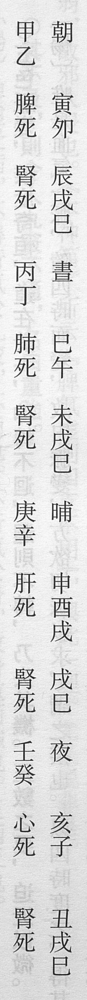

- 朝　寅卯　甲乙　脾死
- 辰　戊己　腎死
- 晝　巳午　丙丁　肺死
- 未　戊己　腎死
- 晡　申酉　庚辛　肝死
- 戌　戊己　腎死
- 夜　亥子　壬癸　心死
- 丑　戊己　腎死

（眉）《管子·四時篇》『五漫漫，六惛惛，孰知之哉』注：『五謂每時之政。』

**○黃帝曰：五藏相通，移皆有次。五藏有病，則各傳其所勝。**

案：此條即後條之冒頭，五藏相通，猶云五行相尅也。

<!-- PAGE_END -->

<!-- PAGE: 0540 -->

<!-- PRINTED: 505 -->

〔張〕傳其所勝者，如本篇下文云『風入於肺爲肺痺，弗治則肺傳之肝爲肝痺，弗治則肝傳之脾爲脾風，弗治則脾傳之腎曰疝瘕，弗治則腎傳之心曰瘛，弗治則心復反傳而行之肺，法當死者』是也。

（眉）《甲乙》八·五藏傳病發寒熱第一上。

**○不治，法三月，若六月，若三日，若六日，傳五藏而當死。**

〔張〕病不早治，必至相傳，遠則三月六月，近則三日六日，五藏傳遍，於法當死。所謂三六者，蓋天地之氣，以六爲節，如三陰三陽是爲六氣，六陰六陽是爲十二月，故五藏相傳之數，亦以三六爲盡。若三月而傳遍一氣一藏也，｟案：十五日爲一氣，五氣五藏傳遍而歸本藏，則方三月也。｠六月而傳遍一月一藏也。｟一月一藏，五月而傳遍，六月又歸本藏也。｠三日者，晝夜各一藏也。｟二日夜而四藏傳，三日盡五藏傳了，而至三日三夜，又再歸於本藏。｠六日者，一日一藏也。｟五日而五藏皆傳，而後歸於本藏也。｠藏惟五，而傳遍以六者，假令病始於肺一也，肺傳肝二也，肝傳脾三也，脾傳腎四也，腎傳心五也，心復傳肺六也，是謂六傳。六傳已盡，不可再傳，故《五十三難》曰：『一藏不再傷，七傳者死也。』又如以三陰三陽言三六之數，則三者陰陽之合數，六者陰陽之拆數。合者奇偶交其氣，拆者牝牡異其象也。觀《熱論》云『傷寒一日巨陽受之，二日陽明，三日少陽，四日太陰，五日少陰，六日厥陰』，亦六數也。至若日傳二經，病名兩感者，則三數也。啓玄子曰：『三月者，謂一藏之遷移。六月者，謂至其所勝之位。三日者，三陽之數，以合日也。六日者，謂兼三陰以數之爾。』是亦三六之義也。故有七日而病退得生者，以真元未至大傷，故六傳畢而經盡氣復乃得生也。《易》曰：『七日來復，天行也。』義無二焉。

**○是順傳所勝之次。**

《甲乙》此七字無。

〔張〕上文言逆者，言藏之氣，蓋五藏受克，其氣必逆，故曰逆行。此言順者，言病之傳，凡傳所勝，必循次序，故曰順傳。是順傳者，即氣之逆也。故五藏傳遍者當死。

<!-- PAGE_END -->

<!-- PAGE: 0541 -->

<!-- PRINTED: 506 -->

**○故曰：別於陽者，知病從來。別於陰者，知死生之期。**

〔張〕陽者，言表，謂外候也。陰者，言裏，謂藏氣也。凡邪中於身，必證形於外。察其外證，即可知病在何經，故別於陽者知病從來。病傷藏氣，必敗真陰，察其根本，即可知危在何日，故別於陰者知死生之期。此以表裏言陰陽也。如《陰陽別論》曰『所謂陰者，真藏也。見則爲敗，敗必死也。所謂陽者，胃脘之陽也。別於陽者，知病處也。別於陰者，知死生之期』，乃以脈言陰陽也。

《陰陽別論》七云：『所謂陰陽者，去者爲陰，至者爲陽。靜者爲陰，動者爲陽。遲者爲陰，數者爲陽。』

案：此『陰陽』二字，亦與此同義，乃謂至動數之脈，知邪之所從來，去靜遲之脈，知此中有死有生也。所云『別於陽云云』，謂『五藏相通』已下，『別於陰云云』，謂前文『五藏受氣於其所生』以下也。

**○言知至其所困而死。**

〔張〕至其所困而死，死於其所不勝也。凡年月日時，其候皆然。

案：此一句受前文『氣之逆行也故死』之文，而結於此矣。

**○是故風者百病之長也。**

〔識〕《風論》《骨空論》《靈·五色篇》《通天篇》｟《素·生氣通天篇》｠亦有此語。

案：《生氣通天論｟第三｠》云：『風者百病之始也』。《骨空論》《五色篇》同。此篇及《風論》作『百病之長也』。

**○今風寒客於人，使人毫毛畢直，皮膚閉而爲熱。**

<!-- PAGE_END -->

<!-- PAGE: 0542 -->

<!-- PRINTED: 507 -->

（眉）膚，人獸之通名，革唯獸皮之名，膚革二物二名。《靈·逆順肥瘦篇》曰『膚革堅固』，是借獸之皮名用於人皮耳。故《調經論》王注：『革，皮也。』

今案：毫毛畢直者，即謂玄府粟起也，是爲惡寒之候也。皮膚閉者，謂邪氣入肌中，與正氣相爭，此時皮膚腠理之氣被阻隔而不通，故爲熱也。《説文》『膚，皮也』。《釋名》『膚，布也。布在表也。皮，被也。被覆體也』。蓋皮膚肌肉從表而漸深入之名耳。今謂上皮、下膚、白肌、赤肉，則一言而足矣。

（眉）《傷寒論輯義》引《析骨分經》云：『白爲肌，赤爲肉。｟一ノ廿六ヲ｠』

**○當是之時，可汗而發也。**

即《傷寒論》所云太陽病用麻黃桂枝諸湯是也。《陰陽應象大論》云：『善治者，治皮毛。』

**○或痺不仁腫痛，當是之時，可湯熨及火灸刺而去之。**

《陰陽應象大論》云：『寒傷形，形傷腫，熱傷氣，氣傷痛。』

〔張〕邪在皮毛，不亟去之，則入於經絡，故或爲諸痺，或爲不仁，或爲腫痛，故當用湯熨灸刺之法，以去經絡之病。

〔馬〕不仁，痛痒不知也。

『不仁』與『痺』大異，詳見十六篇中，可參。

案：不仁者，即痺甚之謂，《本草經》所云『死肌』是也。即謂摸皮上不知覺，肉非其肉。是風濕之邪内入，血氣不榮於皮膚之所爲也。蓋云不仁，云死肌，共皆古言，而爲痺證之俗呼也。《金匱》云：『酒疸，皮膚爪之不仁。』不仁之義可尋耳。

（眉）《風論》『其肉有不仁』王注：『不仁，謂𭼓而不知寒熱痛癢。』

<!-- PAGE_END -->

<!-- PAGE: 0543 -->

<!-- PRINTED: 508 -->

案：火灸，恐是火炙譌訛，《病源》卷七云：『傷寒二日，陽明受之，肉熱鼻乾，不得眠，受病在皮膚之間，可摩膏火炙，發汗而愈。』又卷九云：『時病｟《外臺》作『時行病』｠一日在皮毛，當摩膏火炙愈。不解者二日在膚，可法鍼服解肌散，汗出愈。』共可以徵矣。《金匱》濕門可併考。湯熨，蓋謂以熱湯治布熨痛所也，洗浴發汗之類耳。

再案：痺者，謂皮膚肌肉之氣，爲邪痺閉也，與後文肺痺、肝痺同義。

（眉）真本《明堂》『少商，主手臂不仁』楊注：『仁，親也。病不覺之處，不與身親，故曰不仁。人數驚恐，筋脈不通，病生不仁。又人病久入深，營衛之行濇，經絡時疏不痛，皮膚不營，故爲不仁。』

**○弗治，病入舍於肺，名曰肺痺，發欬上氣。**

案：肌肉閉塞之邪，若不治則入舍肺部，名曰肺痺。何以知爲肺痺。發欬嗽上氣之證故知之也。蓋肺者，常隨呼吸相爲張縮者也，若邪入於肺，則妨礙呼吸之氣，故其氣上逆而發欬也。上氣者，謂其氣上逆不可止也。有但欬而不上氣者，其欬甚者兼上氣也。

**○弗治，肺即傳而行之肝，病名曰肝痺，一名曰厥。脇痛出食，當是之時，可按若刺耳。**

案：肝痺者，即少陽病也。邪在半表裏膈膜之際，迫近於肝藏，故名曰肝痺。厥者，厥逆之義。邪在心下，阻隔上下之氣，其氣逆行，故名曰厥。脇痛出食者，即小柴胡湯下所云『胸脇苦滿，心煩喜嘔』是也。出食，即吐食也。按，謂按摩。刺，謂鍼刺。共令心下之邪散解之術也。

**○弗治，肝傳之脾，病名曰脾風。**

案：風者，表熱之名，此爲邪入於脾之證。然有發熱發黃等之表熱證，故名曰脾風。因考前文肺痺、肝痺共是不表熱之證，故以痺閉名之，與脾風相對，則其義可知也。

<!-- PAGE_END -->

<!-- PAGE: 0544 -->

<!-- PRINTED: 509 -->

**○發癉，腹中熱，煩心，出黃，當此之時，可按可藥可浴。**

《甲乙》『烙』下注云『一本作浴』。

案：發癉，即發黃。疸、癉古通用。第十八胃疸即胃癉，可互相徵也。按、浴二法，蓋取於令邪氣表發歟，其法今所不可考也。癉解已見十七中。

腹中熱者，《金匱·黃疸篇》所云『一身盡發熱而黃，肚熱，熱在裏，當下之』是也。煩心者，同書所云『心中懊憹而熱，不能食，時欲吐，名曰酒疸』，又『酒黃疸，心中熱，足下熱』『酒疸，心中熱』『酒疸，心中如噉蒜虀狀』。出黃者，小便出黃水也。茵蔯蒿湯方後云『小便當利，尿如皂角汁狀，色正赤。一宿腹減，黃從小便去也』，消石礬石散方後云『病隨小便去，小便正黃，大便正黑，是候也』。

再案：《甲乙》『出』下有『汗』字。據此，則汗出黃者，謂黃汗也。前説非。

案：脾風者，穀疸之類也，亦茵蔯蒿湯之類。按、浴唯散表邪耳。

**○弗治，脾傳之腎，病名曰疝瘕。少腹寃熱而痛，出白。一名曰蠱，當此之時，可按可藥。**

案：此證古來注家以爲尋常疝瘕病，非是。今考此條並皆自外邪傳化而所爲，此所云疝瘕者，如《傷寒論》陽明篇所謂『欲作固瘕』者，而少陰四逆散之『或腹痛』，又四逆湯之『胸中實，膈上有寒飲』，通脈四逆之『或腹痛』之類是也。此邪乘腎家之虛而内入，邪與飲相搏，故爲如此癖實之證。所用藥不出於真武四逆之部中也。

《玉篇》『瘕，古鵶切。腸病也』。

〔紹〕《長刺節論》『病在少腹，腹痛不得大小便，病名曰疝，得之寒』。仲景有寒疝之稱，並足以知疝之因寒。今此云寃熱者，蓋是寒鬱爲熱，非疝之因熱矣。《巢源》瘕候云『瘕者，假也。謂虛假可動也』。蓋疝之結塊，乍聚乍散，故謂之疝瘕也。

<!-- PAGE_END -->

<!-- PAGE: 0545 -->

<!-- PRINTED: 510 -->

〔識〕吳云：『蠱者，蟲蝕陰血之名。蟲蝕陰血，令人多惑而志不定，名曰蠱惑。故女惑男，亦謂之蠱，言其害深入於陰也。此名曰蠱，其亦病邪深入，令人喪志之稱乎。』簡按：《左傳·昭元年》『醫和曰：疾不可爲也。是謂近女室，疾如蠱，非鬼非食，惑以喪志。又曰：女陽物而晦時，淫則生内熱惑蠱之疾。趙孟曰：何謂蠱。對曰：蠱，淫溺惑亂之所生也。於文，皿蟲爲蠱，穀之飛亦爲蠱。在《周易》女惑男，風落山，謂之蠱。皆同物也』。

【楷】案：《左傳》曰如者，醫謙避之詞，實即蠱也。蠱者，腎虛内熱也。晉君病如世人之蠱也之義也。

【楷】案：蠱音古，可知諸久病之名。音鼓，可知脹滿之名。音兇，可知雍蔽之名。右三音同音耳。

案：此以蠱爲疝之一名者，蠱即爲固之假借。《陽明篇》所云『固瘕』之固，而爲固著、堅固、辟固之義。《説文》『蠱，腹中蟲也。梟桀死之鬼亦爲蠱』。《史·封禪書》『蠱菑』，《索隱》引樂彥：『梟磔之鬼亦爲蠱』。《周禮》翦氏注云：『蠱，蠹之類。』《爾雅·釋器》『康謂之蠱』。《詩·鴇羽傳》疏『害器敗穀者，皆謂之蠱』。《史記·秦本紀》『以狗禦蠱』，《正義》：『蠱者，熱毒惡氣爲傷害人。』《禮·王制》疏：『蠱者，損壞之名。』蓋蠱者，原是爲腹中蟲之名，乃爲濕熱所生，轉注之，云凡内鬱内熱敗壞之物皆謂之蠱，與蠱毒之蠱自別。《金匱》所云『陰狐疝氣』之『狐』，亦『蠱』之借字歟。《靈·熱病篇》『男子如蠱，女子如怚』，怚，《甲乙》作阻，此亦非蠱毒之蠱歟。慧《音》十八｟四ウ｠《字林》云：『腹中蟲也，蟲癥病害人也。』

〔吳〕出白，白，淫濁也。〔張〕溲出白液也。並與王注同。

〔識〕簡按：《痿論》云『入房太甚，宗筋弛縱，發爲筋痿，及爲白淫』，此出白也。

案：『出白』二字未妥，對前文『出黃』二字，則似謂小便白濁。然有小腹寃熱證，而小便白濁者甚可疑。《甲乙》作『少腹煩寃而痛汗出』者，似是。因考本作『汗出』，此汗非黃而所云魄汗也。故王氏改作『出白』，與前文相比對歟，或別本有如此者。出黃、出白相對，言『黃汗』與『白汗』歟。

<!-- PAGE_END -->

<!-- PAGE: 0546 -->

<!-- PRINTED: 511 -->

《千金》卷十七·積氣第五篇曰：『治積年患氣，發作有時，心腹絞痛，忽然氣絶，腹中堅實，醫所不治，復謂是蠱方。』

（眉）蠱病多數，一蠱毒，二鼓脹，三梅核氣｟《聖惠》｠，四疝瘕｟《素問》｠，五蚘病｟《説文》《倉公傳》｠，六腎虛｟《左傳》｠，七鬼妖｟《史·封禪》《山海經》《説文》｠，八中惡｟《史記·秦本紀》｠，九昏狂｟《左傳》疏｠。

（眉）《聖惠》大黃散方下曰：『治咽喉中如有物妨悶，或在左或在右，名曰蠱。』蓋《靈·熱病篇》所言蠱即是歟。

《山海經·南山經》『青丘之山，不蠱』注：『不蠱，令人不逢妖邪之氣。或曰蠱，蠱毒。』

（眉）《左傳·昭元年》疏：『蠱者，心志惑亂之疾，若今昏狂失性，其疾名之爲蠱。』又曰：『蠱是失志之疾名。』又曰：『志性恍惚不自知者，其疾名爲蠱。』

**○弗治，腎傳之心，病筋脈相引而急，病名曰瘛。當此之時，可灸可藥。**

〔張〕腎邪克火，則傳於心，心主血脈，心病則血燥，血燥則筋脈相引而急，手足攣掣，病名曰瘛。｟案：此説依吳注。｠

案：此所云瘛者，即風引之證，而《金匱》所云中風，《痺論》所云『痺在於骨則重，在於脈則血凝而不流，在於筋則屈不伸，在於肉則不仁，在於皮則寒。故具此五者，則不痛也。凡痺之類，逢寒則蟲｟《甲乙》作『急』｠，逢熱則縱』是也。又謂之痱，乃半身不遂，左癱右縱之類。半身筋急，則半身筋縱，蓋左爲經脈，右爲絡脈，共心腎二藏之所榮養也。若邪氣乘虛，内入侵於心腎二藏，則爲半身不隨，或全身瘛引之證，即卒中風是也。多是腎虛火動而波及於心藏之病，故精神不了，便可灸可藥也。若是陽實掣引之證，則非可灸也。所謂火氣雖微内攻有力，不可不辨也。

<!-- PAGE_END -->

<!-- PAGE: 0547 -->

<!-- PRINTED: 512 -->

**○弗治，滿十日，法當死。**

案：此爲卒中之證，故以爲死不出於十日也。

（眉）卒中。

**○腎因傳之心，心即復反傳而行之肺，發寒熱，法當三歲死，此病之次也。**

（眉）痱病。

〔張〕若腎傳於心，未至即死，而邪未盡者，當復傳於肺，而金火交爭，金勝則寒，火勝則熱，故發寒熱。三歲死者，凡風邪傳遍五藏，本當即死。其不死者，以元氣未敗，勢猶在緩，故肺復受邪；再一歲，則肺病及肝；二歲，則肝病及脾；三歲，則脾病及腎三陰俱敗，故當死也。此即順傳所勝之次第也。

案：此謂中風緩慢之證，其死期在三歲也。今目檢中風病人，其不即死者，或三年而死，或五年、七年其期也，過於此者甚少，與此所説正合。此云『傳而行之肺發寒熱』者，謂病不内陷而外發，故其死不在於近而引年也。乃病入於藏即死，入於府則不即死也。

**○然其卒發者，不必治於傳，或其傳化有不以次。**

《甲乙》無『於傳或』三字，可從。謂其卒中風則不出十日而死，故曰不必治也。其傳化有不以次者，謂不以肺肝脾腎心之次，故下文曰。

**○不以次入者，**

《甲乙》無『不以次入』四字。

**○憂恐悲喜怒，令不得以其次，故令人有大病矣。**

<!-- PAGE_END -->

<!-- PAGE: 0548 -->

<!-- PRINTED: 513 -->

《甲乙》無『有』字。

〔張〕五志之發無常，隨觸而動，故生病亦不以其次。

**○因而喜大虛，則腎氣乘矣。**

《陰陽應象論》｟五｠云：『心在志爲喜，喜傷心，恐勝喜。』

案：人自有因縁而大喜，則令心氣大虛。心氣大虛則腎氣必來乘之，乃水克火之理也。邪氣乘此大虛之處，則失其傳化之常，故爲大病也。

**○怒則肝氣乘矣，悲則肺氣乘矣，**

〔志〕肝當作肺，肺當作肝，悲當作思。

案：此説可從，不然則不可解也。

又案：怒固爲肝志，然若大怒則并使脾氣弱｟木克土｠，故肝木反乘脾土。悲固肺之志，若大悲則反使肝氣衰｟金克木。｠，故肺金反乘肝木也。此二藏與他三藏不同相克者，五志之中，悲、怒最爲甚。甚者何。脾氣弱，故至於大怒，是爲肝氣乘之。肝氣弱，故至於大悲，是爲肺氣乘之也。

案：思爲脾志，脾土盛則能思，能思則令不至大怒。今脾土衰，故肝木盛而乘於脾土，故大怒。怒爲肝志，肝木盛則能怒，能怒則令不至大悲。今肝木衰，故金肺盛而乘於肝木，故大悲也。

第五云：『肝在志爲怒，怒傷肝，悲勝怒。肺在志爲憂，憂傷肺，喜勝憂。脾在志爲思，思傷脾，怒勝思。』

**○恐則脾氣乘矣，**

第五云：『腎在志爲恐，恐傷腎，思勝恐。』

<!-- PAGE_END -->

<!-- PAGE: 0549 -->

<!-- PRINTED: 514 -->

**○憂則心氣乘矣，**

第五云：『肺在志爲憂，憂傷肺，喜勝憂。』

**○此其常道也。**

案：因其五志而相乘尅者，雖反其傳化，亦謂之常道。蓋以變爲常，是亦天地之常道耳。然《甲乙》無『常』字爲可從。

**○故病有五，**

〔志〕五藏有五變。謂憂肺、恐腎、悲脾、喜心、怒肝也。

**○五五二十五變，**

〔志〕如喜大則腎氣乘心，心即傳之肺。肺傳之肝，肝傳之脾，脾傳之腎，是五藏傳化，亦各乘其所勝。

**○及其傳化，**

〔識〕趙府本、熊本『及』作『反』，吳同。

〔箚〕元板古抄本『及』作『反』，王意亦當然也。

案：傳化者，謂前文所云肺肝脾腎心之次也。此則所云傳化不以次者，故曰反其傳化也。

**○傳乘之名也。**

案：傳乘之名者，謂名之傳乘也，亦倒言之例耳。蓋唯其所不勝，因而乘，有不以相克之次者，故名曰傳乘也。怒悲二志，與喜恐憂不同，是所以名曰傳乘歟。

《甲乙經》卷八·五藏傳病發寒熱第一上云：『黃帝問曰：五藏相通移皆有次，五藏有病則各傳其所勝。不治，法三月若六月，若三日若六日，傳五藏而當死｟《素問》下有『順傳所勝之次』｠，故曰別於陽者，知病從來。別於陰者，知死生之期，言至其所困而死者也。是故風者，百病之長也。今風寒客於人，使人毫毛畢直，皮膚閉而爲熱，當是之時，可汗而發。或痺不仁腫痛，當是之時可湯熨及｟一本作『足』字｠火灸刺而去。弗治病入舍於肺，名曰肺痺，發欬上氣。弗治肺即傳而行之肝，病名曰肝痺，一名曰厥，脇痛出食，當是之時可按可刺。弗治肝傳之脾，病名曰脾風，發癉，腹中熱，煩心汗出，黃癉｟《素問》無『汗』『癉』二字｠，當此之時，可汗可藥可烙｟一本作『浴』｠。弗治脾傳之腎，病名曰疝瘕，少腹煩寃而痛，汗出｟《素問》作『出白』｠，一名曰蠱，當此之時，可按可藥。弗治腎傳之心，病筋脈相引而急，名之曰瘛，當此之時，可灸可藥。弗治十日法當死，腎傳之心。心即復反傳而之肺，發寒熱，法當三歲死，此病之次也。然其卒發者不必治，其傳化有不以次者，憂恐悲喜怒，令不得以其次，故令人有大病矣。因而喜大虛，則腎氣乘矣，怒則肝氣乘矣，悲則肺氣乘矣，恐則脾氣乘矣，憂則心氣乘矣，此其道也。故病有五，五五二十五變，及其傳化傳乘之名也。』

<!-- PAGE_END -->

<!-- PAGE: 0550 -->

<!-- PRINTED: 515 -->

**○大骨枯槁，大肉陷下。**

已下至『皆死不治也』，《大素》十四真藏脈形載之。

〔張〕大骨大肉，皆以通身而言。如肩脊腰膝皆大骨也，尺膚臀肉皆大肉也。肩垂項傾腰重膝敗者，大骨之枯槁也。尺膚既削，臀肉必枯，大肉之陷下也。

（眉）肺。

**○胸中氣滿，喘息不便，其氣動形。**

案：喘息不便，謂喘咳害息，不便於言語也。其氣動形者，即謂肩息也。

〔紹〕其氣動形，仲景所謂『呼吸動搖振振者，不治』，正此之謂也。

**○期六月死，真藏脈見，乃予之期日。**

<!-- PAGE_END -->

<!-- PAGE: 0551 -->

<!-- PRINTED: 516 -->

〔楊〕骨爲身幹，人之將死，肉不附骨，遂至大骨亦無潤澤，故曰枯槁，即骨先死也。身之小肉皆脫，乃至大肉亦陷，即肉先死也。肺氣虛少，耶氣盈胸，故喘息不安也。喘息氣急，肩膺皆動，故曰動形也。肺病次傳，至肺再傷，故六月死也。此乃不至七傳者也。有前病狀，真藏未見，期六月死。真藏脈見，即與死期，不至六月也。古本有作『正藏』，當是秦皇名正，故改爲『真』耳。真、正義同也。

（眉）《史記》『秦始皇帝，以秦昭王四十八年正月生於邯鄲，及生名爲政』，注：『徐廣曰：一作正。宋忠云：以正月旦生，故名正。』《索隱》曰：『系本作政。』《正義》曰：『正音政。周正建子之正也。後以始皇諱，故音征。』

（眉）立之案：是亦秦時不焚醫經之徵也。

第十八云：『肝見庚辛死，心見壬癸死，脾見甲乙死，肺見丙丁死，腎見戊己死，是謂真藏見皆死。』

第二十云：『真藏脈見者勝死。』

**○大骨枯槁，大肉陷下，胸中氣滿，喘息不便，内痛引肩項，期一月死。真藏見，乃予之期日。**

（眉）心。

〔楊〕内痛，謂是心内痛也。心府手大陽脈，從肩胳心，｟案：『胳』即『絡』俗譌。｠故内痛引肩項也。心不受痛｟案：『痛』恐『病』。｠，受病不離一月，故一月死。真藏脈見，即不至一月，可即與死期也。

案：《陰陽應象論》『中滿者，寫之於内』，王注：『内，謂腹内。』

案：楊注以『内痛』爲心内痛，可從矣。蓋『内痛』二字，隨處異義。《金匱》云：『脈沈而弦者，懸飲内痛。』所云内痛，乃謂胸脇内痛也。《外臺》深師朱雀湯有『輒引脇下痛』之文，可以徵也。

**○大骨枯槁，大肉陷下，胸中氣滿，喘息不便，内痛引肩項，身熱，脫肉破䐃，真藏見，十月之内死。**

<!-- PAGE_END -->

<!-- PAGE: 0552 -->

<!-- PRINTED: 517 -->

（眉）脾。

〔楊〕此内痛，即脾胃痛也。手少陽脈偏應三瞧，脾胃即中瞧也，上出缺盆上項，故脾胃中痛引肩項也。脾主身肉，故脾胃病，身熱脫肉破䐃者也。其隕反。前之病狀，真藏未見，十月已上而死，真藏脈見，十月内死。良以脾胃受於穀氣，故至十月而死也。

案：《至真要大論》『厥陰之復，少腹堅滿，裏急暴痛』王注：『裏，腹脇之内也。』

〔識〕《釋音》『䐃，音郡』。《集韻》『渠隕切，音窘』。馬云『䐃者，肉之分理也』。吳云『䐃，肘膝髀厭高起之處，病人爲陰火所灼，晝夜不安，其身轉側，多則䐃肉磨裂』。簡按：《靈・壽夭剛柔篇》云：『肉䐃堅而有分者肉堅。』王注似是。史崧《音釋》『腹中䐃脂』｟原出《玉篇》。｠高云：『肌腠曰肉，脂膏曰䐃』。《千金》卷二十九首篇『臂臑，在肘上七寸䐃肉端』。《甲乙》卷三第二十七篇『寸』訛『分』，『䐃』訛『膕』。《外臺》卷三十九明堂篇與《千金》同，《醫心方》卷二首篇亦與《千金》同。旁記曰『䐃肉謂分肉塊也。《玉篇》渠殞反。腸中䐃脂也。宋云：腸中脂也』。又『䐃』字旁訓曰『天乃與保呂』。

案：䐃《玉篇》『渠隕切。腹中䐃脂也』。《廣韻》上十六軫『䐃，渠殞切。腸中脂也』。古腸、腹多互誤，宜從《廣韻》作『腸中』爲是。考䐃是腸外滲泄之津液中之脂膏，而分爲三焦之神液也。故所以肉之爲肉者，皆是䐃脂之灌注滋養之多而所作，自外目之曰肉，在内則謂之䐃也。此肉云脫，䐃云破，古聖之稱呼確乎不動者也。肉之脫者，因䐃之破也。破者，破散之謂。䐃脂宜常盈滿而堅實，而破散不堅實，則其肉消脫也。《御覽》八百六十四引《通俗文》云『獸脂聚曰䐃』亦可以徵矣。

案：真藏見而後死期在十月之内，則真藏未見之前，其死未可期可知也。楊注可從，諸注皆欠明。《氣穴論》『内銷骨髓，外破大䐃』，《皮部論》『肉爍䐃破』，王注：『䐃者，肉之標。』

<!-- PAGE_END -->

<!-- PAGE: 0553 -->

<!-- PRINTED: 518 -->

（眉）《金匱・痰飲十二》云：『脈沈而弦者，懸飲内痛。』茝庭先生曰：『内痛，諸家無解。豈脇肋内有痛之謂乎。』｟《述義》｠

（眉）《氣穴論》曰：『内銷骨髓，外破大䐃。』

（眉）案：後世以破䐃爲久寢之眠瘡，以本篇之破䐃，亦爲眠瘡，未知何是否。｟トコスレ｠

（眉）《靈・終始篇》『秋氣在分肉，冬氣在筋骨』，《大素》卷無名卷三刺篇載之，楊注曰：『分肉謂䐃肉分間也。』據之，則䐃者，肉一片塊之名。上善所訓太核。今《大素》『䐃』訛『膕』，可正。

《字鏡集》䐃，訓『波良和多乃阿良』，蓋據《玉篇》真本，蓋阿良者，阿夫良之脫文歟。《字鏡集》云『ハラワタノアブラ』。《玉篇》旁訓『ハラノナカノアブラ』。

案：䐃者，三焦之所起，腸間蟠延之黄脂膜，是身中諸脂膏之大原，而皮下肉中脂膏，皆悉自腸間脂轉運溉注而成者，故肉脂腸脂，本是一物。《篇》《韻》所詁斥其脂本，《素》《靈》所言斥其脂標，故《皮部論》王注『䐃者，肉之標』是也。

（眉）腎。

**○大骨枯槁，大肉陷下，肩髓内消，動作益衰，真藏來見，期一歲死。見其真藏，乃予之期日。**

案：據楊注考之，正文作『真藏未見』無疑。《新校正》云『按全元起本及《甲乙經》真藏「未見」作「來見」，來當作未，字之誤也』，似來未二字互誤，可考。

〔楊〕腎府足大陽脈，循肩髆内，故腎病肩隨，内藏消瘦也。又兩肩垂下曰隨，腎間動氣，五藏六府十二經脈之原，故腎病，動運皆衰也。腎間動氣強大，故真藏脈未見者，腎氣未見者｟案：此五字，恐衍文。｠，腎氣未是甚衰，所以期至一年。腎氣衰甚，真藏即見，故與之死日之期也。

<!-- PAGE_END -->

<!-- PAGE: 0554 -->

<!-- PRINTED: 519 -->

真本《明堂》列缺下曰『肘臂肩背』，楊注：『肩，髆上者之也。』

案：楊注可從。《大素》作『肩隨』，不誤，《素問》作『肩髓』者，爲誤字。肩隨字已見第十七中，謂肩角不聳立而垂下也，乃爲嚲曳之證。内消者，與前文内痛同例，而謂腎部内氣液消竭也。腎内液消，故爲肩骨垂下之外證也，亦與前文『脫肉破䐃』同例。

案：『肩髓』非熟字，諸注臆解，皆叵從。

**○大骨枯槁，大肉陷下，胸中氣滿，腹内痛心中，不便肩項，身熱，破䐃脫肉，目匡陷，真藏見，目不見人，立死。其見人者，至其所不勝之時則死。**

（眉）肝。

真藏脈見，少陽脈絶，兩目精壞，目不見人，原氣皆盡，故即立死。真脈雖見，目猶見人，得至土時而死也。

案：此三十九字，《大素》誤爲注文，而上『真』字重，爲衍。

案：此條句讀古來誤，今正之。『腹内痛心中』爲句，謂腹内心中共痛，所謂倒草文法，與《傷寒論》『傷寒六七日中風』等同例也。『不便肩項』又爲一句，謂凡肩項諸骨關節處不自由，肝經筋脈失之滋榮也。『身熱』二字一句，如此讀則甚易解矣。肝主榮一身之血液，故以目爲肝候第一。若見真藏脈，唯在肝，則不急死。若真肝脈見，而兩目不見人，則爲立死之候也。此宜從《大素》，文義明白。

案：所不勝之時，王注以『時』爲四時之時，可從。《大素》作『土時』，恐是『王時』訛，而『王』上脫『金』字歟，乃與第十八云『肝見庚辛死』合。再案：『至土』二字，『金王』訛。

案：肝血煎迫則爲身熱，即津液枯竭之虛熱也。

<!-- PAGE_END -->

<!-- PAGE: 0555 -->

<!-- PRINTED: 520 -->

案：心藏云期一月死，肺藏云期六月死，腎藏云期一歲死，蓋心肺腎三藏，若有一點虛損處，則不免必死，故爲一月六月一歲爲之期也。至於肝脾二藏，雖有一點之虛，不可期死時月，以脾爲生育之原，肝爲動作之本故也。所以此二藏不云死期，正在於此歟。存考。

（眉）尸厥。

**○急虛身中卒至，五藏絶閉，脈道不通，氣不往來，譬於墮溺，不可爲期。**

〔楊〕四時虛邪，名曰經虛。八風從其虛之鄉來，令人暴病卒死，名急虛身，辟於隨溺。辟，卑夬反。除也。謂不得隨意溺也。如此急虛之病，亦有生者，故不可與爲死期也。

案：今據楊、王二氏之説考之。則急虛身中卒至者，謂急劇令人虛之邪氣，卒至於身内也。

絶閉之絶，與運絶、悶絶之絶同，謂五藏之氣皆絶止鬱閉而不通也，非斷絶、過絶之義也。《呂覽・權勳》『嗜酒甘而不能絶於口』注：『絶，止也。』《文選・鮑明遠還都道中詩》『絶目盡平原』。《後漢・吳良傳》『臣蒼榮寵絶矣』注：『絶，猶極也。』並可以徵矣。

脈道不通，氣不往來者，即五藏絶閉之所爲也。氣不往來者，謂呼吸之氣不往來也，《扁鵲傳》所云『尸厥』之病是也。

譬於墮溺，不可爲期者，謂其急卒絶閉與墜墮没溺不異，故雖脈息共絶，其鬱一開，則必有生路，不可與以死期已。楊注叵解。

**○其脈絶不來，若人一息五六至，其形肉不脫，真藏雖不見，猶死也。**

〔楊〕中於急虛，其脈絶而不來，有來一息，脈五六至，不待肉脫及真藏見，必當有死也。

〔新〕按人一息，脈五六至，何得爲死。必息字誤，息當作呼，乃是。

<!-- PAGE_END -->

<!-- PAGE: 0556 -->

<!-- PRINTED: 521 -->

案：十八云：『人一呼，脈四動以上曰死。』《十四難》云：『至之脈，一呼再至曰平，三至曰離經，四至曰奪精，五至曰死，六至曰命絶。』《脈經》卷四・第五引扁鵲曰：『脈再動爲一至，一呼而脈五動，人一息脈十一動，此氣浮濇經行，血氣竭盡，不守於中。五臟痿痟，精神散亡，脈五至而緊則死。』據此，則以脈再動爲一至者，蓋黄帝家之常語，扁鵲遵用之，則所云一息五六至者，謂一息脈十一動以上也。《新校正》以『息』爲『呼』之誤，諸家皆從之，何不究古經之如此其已甚耶。《十四難》所説乃以一動爲一至，與經文不同。然至於以『一呼六至曰命絶』，則與所云『一息五六至』相合，蓋以再動爲一至，以一動爲一至，古來自有二説也。如《新校正》以一呼五六至，以爲一動一至之説，則其説不異。

**○真肝脈至，中外急，如循刀刃責責然｟清清然｠，如按琴瑟弦，色青白不澤，毛折乃死。**

〔楊〕清，寒也。如以衣帶盛繩，引帶不引繩，即外急也，引繩不引帶，即内急也，繩帶具引，即内外急也。今真肝脈見，中外皆急，如人以手猶摩刀刃，中外堅急，令人洫泝寒也。又如以手按瑟，急弦不調耎者，此無胃氣，即真肝脈也。青爲肝色，白爲肺色，是肺乘肝也，故青不澤也。肺主於氣，氣爲身本，身之氣衰，即皮毛不榮，故毛折當死也。

〔新〕按楊上善云：『無餘物和雜，故名真也。五藏之氣，皆胃氣和之，不得獨用。如至剛不得獨用，獨用即折，和柔用之即固也。五藏之氣和於胃氣，即得長生，若真獨見必死。欲知五藏真見爲死，和胃爲生者，於寸口診即可知，見者如弦是肝脈也。微弦爲平和。微弦謂絃之少也，三分有一分爲微。二分胃氣與一分弦氣俱動爲微弦，三分並是弦而無胃氣，爲見真藏。餘四藏準此。』

《平人氣象論第十八》云：『死肝脈來，急益勁，如新張弓弦，曰肝死。』

案：中外急，謂浮沈共急勁也。責與脊、鰿音相近，而劒脊之脊，鰿魚之鰿，共爲連綿聳起之義，則責責然，爲刀刃聳起之形容字。所云如循刀刃責責然者，形容於浮而急之脈狀。如按瑟弦者，形容於沈而急之脈狀，是浮沈共急，與十八云『死肝脈來急益勁，如新張弓弦』相合矣。

<!-- PAGE_END -->

<!-- PAGE: 0557 -->

<!-- PRINTED: 522 -->

【楷】兒約之曰：責與策通。微眇細小之義。《説文》『策，馬箠也』。《方言》卷二、《廣雅・釋詁二》並云『策，小也』。《莊子・人間世》『鼓筴播精』《釋文》引司馬注：『小箕曰筴。』《方言》卷二『木細枝謂之策』，又卷三『凡草木刺人，北燕朝鮮之間謂之策』。《爾雅・釋魚》『蟦，小而橢』。《廣韻》『蟦，小貝』。並與責同音。又《廣韻》『嫧，健急皃。㥽，耿介』，並與策同音，共可以徵。録以存考。

色青白者，見肝木本色也。後四藏並同義。

毛折者，蓋謂毛髮屈曲不舒暢，血氣枯竭之所爲也。《廣雅・釋詁一》云『折，曲也』，《戰國策・西周策》『則周必折而入於韓』注『折，屈也』是也。又案：《漢書・叙傳下》『懷折亡嗣』注：『折謂夭也。』《禮記・祭法》『萬物死曰折』注：『折，棄敗之言也』。亦可併考，乃與毛悴同義。

**○真心脈至，堅而搏，如循薏苡子累累然，色赤黑不澤，毛折乃死。**

〔楊〕薏，於極反。芑義當苡，即十珠也。堅而揣者，譬人以手循摩薏苡之珠累累然，堅鉤無胃氣之柔，即真心脈也。赤爲心色，黑爲腎色，是腎乘心也，故赤不澤也。

案：『十珠』者『干珠』之譌，『干珠』即『𦼮珠』之古字也。

〔紹〕《大素》『搏』作『揣』，下『搏而絶』亦同。宜參《脈要精微論》。

〔識〕張云：『短實堅強，而非微鉤之本體。』《本草圖經》云：『薏苡，實青白色，形如珠子而稍長，故人呼爲薏苡珠子。小兒多以線穿如貫珠爲戲。』陶氏云：『交趾者最大，彼土呼爲𦼮珠。』

案：古稱薏苡者，不分粳糯二品，川穀亦得薏苡之偁也。《説文》『蔐：蔐苢。從艸啻聲』。又『䕾，艸也，從艸贛聲。一曰薏苢』。又㠯下云『賈侍中説，意㠯實也，象形』。《廣雅》『䕾，起實，啻㠯也』。據此，則作啻㠯者爲古字。《説文》㠯下作意者，亦啻之誤字，而艸部薏苢，則爲今字俗篆。《廣雅》所云『起實』即『㠯實』，『起』是爲『㠯』之俗訛字也。薏苡之急呼爲㠯，㠯則薏苡之正字，而其子之象形也。雷公曰『凡使勿用𥽇米，顆大無味。其𥽇米，時人呼爲粳𥽇是也』，陶隱居曰『交阯者子最大，彼土呼爲𦼮珠』｟《本草和名》引，作『贛珠』｠，《後漢書・馬援傳》云『南方薏苡實大』是也。因考䕾、𥽇、𦼮爲同字，而『起』亦與『幹』音相通，然則重言之曰薏苡，或單曰薏，或單曰苢，音轉曰起，又轉曰幹耳。

<!-- PAGE_END -->

<!-- PAGE: 0558 -->

<!-- PRINTED: 523 -->

又案：黑字云『重累者良』，此云累累，亦似指其子連綴之形。

（眉）頌壺『㠯』字作如此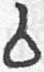。

**○真肺脈至，大而虛，如以毛羽中人膚，色白赤不澤，毛折乃死。**

〔楊〕其真肺脈，如毛羽擲來中人皮膚。大而浮虛者，毛無胃氣，即真肺脈也。赤爲心色，白爲肺色，是心乘肺，故白不澤也。

第十八云：『死肺脈來，如物之浮，如風吹毛，曰肺死。』

**○真腎脈至，搏而絶，如指彈石辟辟然，色黑黄不澤，毛折乃死。**

〔楊〕惴，初委反。動也。其真腎脈至，如石彈指辟打指者，營無胃氣，即真腎脈也。黄爲脾色，黑爲腎色，是脾乘腎，故黑不澤也。

案：楊注『辟』字恐『辟辟』訛。

第十八云：『死腎脈來，發如奪索，辟辟如彈石，曰腎死。』

案：『辟辟』解已見十八中。

<!-- PAGE_END -->

<!-- PAGE: 0559 -->

<!-- PRINTED: 524 -->

〔高〕辟辟然，硬而呆實，無胃氣也。

**○真脾脈至，弱而乍數乍踈，色黄青不澤，毛折乃死。**

〔楊〕真脾脈至，乍踈乍數也。踈謂動稀也，數謂連動。此無胃氣，即真脾脈也。青爲肝色，黄爲脾色，是肝乘脾，故黄不澤也。

**○諸真藏脈見者，皆死不治也。**

〔楊〕藏脈獨見，以無胃氣死，故不療也。

**○黄帝曰：見真藏曰死，何也。**

以下至『帝曰善』，《大素》卷六藏府氣液篇中載之。

〔楊〕無餘物和雜，故名真也。五藏之氣皆胃氣和之，不得獨用。如至剛不得獨用，獨用即折，和柔用之即固也。五藏之氣，和於胃氣，即得長生。若真獨見，無和胃氣，必死期也。欲知五藏真見爲死，和胃爲生者，見於寸口診手大陰，即可知之也。見者如絃，是肝脈也，微絃爲平好也。微絃謂絃之少也，三分有一分爲微，二分胃氣與一分絃氣俱動，爲微絃也。三分並是絃氣，竟無胃氣，爲見真藏也。見真藏死，其理至妙，請陳其理，故曰何也。

**○岐伯曰：五藏者，皆稟氣於胃，胃者五藏之本也。藏氣者，不能自致於手太陰，必因於胃氣，乃至於手太陰也。**

〔楊〕胃受水穀，變化精氣而資五藏，故五藏得至手大陰，寸口見於微絃也。

**○故五藏各以其時自爲，而至於手太陰也。**

〔楊〕五藏主於五時，至其時也。其藏有病之甚者，胃氣不與之居，不因胃氣，以呼吸之力獨自至於大陰，寸口見真絃也。

<!-- PAGE_END -->

<!-- PAGE: 0560 -->

<!-- PRINTED: 525 -->

【楷】是今日以三部診病，不用他八候之祖法在於此。經文詳見《經脈別》。

**○故邪氣勝者，精氣衰也。**

〔楊〕真藏脈絃不微，無胃氣者，則知肝病勝也。肺病耶勝，則胃穀精氣衰。

**○故病甚者，胃氣不能與之俱至於手太陰，故真藏之氣獨見。獨見者，病勝藏也，故曰死。帝曰：善。**

〔楊〕真見病甚，故致死也。

**○黄帝曰：凡治病，察其形氣色澤，脈之盛衰，病之新故，乃治之，無後其時。**

已下至『皆難治』｟三一ウ｠，《大素》十四・四時脈診。

〔楊〕形之肥瘦，氣之大小，色之澤夭，脈之盛衰，病之新故，凡療病者，以此五診診病，使當爲合其時，不當爲後其時也。

案：無後其時，謂有病宜早治也。楊以時爲四時之義，可從矣。言隨四時旺脈有胃氣者而治之，無後其時氣也。

**○形氣相得，謂之可治。**

〔楊〕形瘦氣大，形肥滿氣小，爲不相得。形肥氣大，形瘦氣小，相得也。

**○色澤以浮，謂之易已。**

〔楊〕其病人五色，浮輕潤澤，其病易已。

案：《大素》有『脈』字，最爲可從。言其色澤而其脈浮者，其病易已也。亦頭項強痛之文例耳。或曰脈字恐衍。楊注不説及脈字，似是。

<!-- PAGE_END -->

<!-- PAGE: 0561 -->

<!-- PRINTED: 526 -->

再案：《大素》『脈』字恐衍，於後文來。

**○脈從四時，謂之可治。**

〔楊〕四時王脈，皆有胃氣，無他來剋，故曰順時。

**○脈弱以滑，是有胃氣，命曰易治，取之以時。**

〔楊〕四時之脈，皆柔弱滑者，謂之胃氣。依此療病，曰合時也。

**○形氣相失，謂之難治。色夭不澤，謂之難已。脈實以堅，謂之益甚。脈逆四時，爲不可治。必察四難，而明告之。**

〔楊〕此之四診，趣之爲難，可明告病人。宜以變常設於療法，不得依常趣之以時也。

**○所謂逆四時者，春得肺脈，夏得腎脈，秋得心脈，冬得脾脈，其至皆懸絶沈濇者，命曰逆四時，未有藏形。**

〔楊〕四時皆得勝，來剋己之脈已，脈懸絶沉濇，失四時脈。雖未有病藏之形，不可療也。

〔高〕懸絶無根，或沈濇不起者，是無胃氣。

（眉）案：此節恐脫『四季得肝脈』五字，而王氷注『春來』上恐脫『四季來見也四季得肝脈』十字。

**○於春夏而脈沈濇，秋冬而脈浮大，名曰逆四時也。**

〔楊〕此脈反四時也。

**○病熱脈靜｟清｠，**

〔楊〕熱病脈須熱而躁也，今反寒而靜。清，寒也。

**○泄｟洩｠而脈大，**

<!-- PAGE_END -->

<!-- PAGE: 0562 -->

<!-- PRINTED: 527 -->

〔楊〕人之洩利，脈須小細，今反爲洪大也。

**○脫血而脈實，｟病在中｠**

〔楊〕人之脫血，脈須虛弱，今反強實，病在中也。

**○病在中脈實堅，｟病在外｠**

〔楊〕脫血脈實堅，病在外也。

**○病在外脈不實堅者，皆難治。｟名曰逆四時｠**

〔楊〕脫血而脈不實不堅，難療也。以上七診，皆逆四時也。

第十八云：『脈有逆從四時，未有藏形，春夏而脈瘦，秋冬而脈浮大，命曰逆四時也。風熱而脈靜，泄而脫血，脈實病在中，脈虛病在外，脈濇堅者，皆難治，命曰反四時也。』

〔張〕與上文《平人氣象論》者似乎相反，但上文云病在中脈虛，言内積之實者，脈不宜虛也。此云病在中脈實堅，言内傷之虛者，脈不宜堅實堅也。前云病在外濇堅，言外邪之盛者，不宜濇堅，以濇堅爲沈陰也。此言病在外脈不實堅，言外邪方熾者，不宜無力，以不實堅爲無陽也。四者之分，總皆正不勝邪之脈，故曰難治。詞若相反，理則實然。《新校正》以謂經誤，特未達其妙耳。

案：張説似可從，姑據於此矣。楊注以『病在中』『病在外』屬下句，非是。

**○黄帝曰：余聞虛實以決死生，願聞其情。**

案：情者，謂病情，後文所云『脈盛，皮熱，腹脹，前後不通，悶瞀』之類是也。蓋邪實正虛謂之病因，又謂之病源，即病性也。病證謂之病情，即出於性者也。

**○岐伯曰：五實死，五虛死。帝曰：願聞五實五虛。岐伯曰：脈盛，皮熱，腹脹，前後不通，悶瞀，此謂五實。**

<!-- PAGE_END -->

<!-- PAGE: 0563 -->

<!-- PRINTED: 528 -->

案：悶瞀，謂心中悶亂也。《楚詞・惜誦》『中悶瞀之忳忳』注，又《抽思》『煩寃瞀容』注並云『瞀，亂也』｟《後漢・韋彪傳》注，《宦者傳》注，《郭憲傳》注並同｠。《五常政大論》『其動鏗禁瞀厥』注：『瞀，悶也』。《音釋》『瞀音冒』。《氣交變大論》『民病肩背瞀重，鼽嚏血便注下』。注：『瞀，謂悶也。』《至真要大論》『諸熱瞀瘛皆屬於火』。《尚書大傳》『厥咎瞀』鄭氏注：『瞀與思心之咎同耳。故《子駿傳》曰：瞀眊，眊亂也。』《書・益稷》傳『昏瞀墊溺』疏：『瞀者，眩惑之意。』並可以徵矣。《傷寒論》大柴胡條云『鬱鬱微煩』，又《可吐篇》云『病胸上諸實，胸中鬱鬱而痛』，所云『鬱鬱』與『悶瞀』同。《靈・經脈篇》『肺動則交兩手而瞀』。《音釋》『瞀音務』。《左傳・襄十四年》『亦無瞢焉』注：『瞢，悶也。』

（眉）《傷寒直格》曰：『瞀音莫。眼黑也，昏也，言氣亂昏也。』

（眉）《千金》廿八｟十九オ｠

（眉）明傅仁宇允科纂輯《眼科審視瑤函》卷二云：八要者，表裏虛實寒熱邪正也。表者，病不在裏也。裏者，病不在表也。虛者，五虛也。實者，五實也。寒者，藏府積寒。熱者，藏府積熱也。邪者，外邪相干也。正者，藏府自病也。｟三オ｠

**○脈細，皮寒，氣少，泄利前後，飲食不入，此謂五虛。**

案：五實，似謂陽明胃實證。五虛，似謂少陰直中證也。五實雖邪氣盛實，正氣亦有與之交爭者，故爲熱實之證也。五虛雖真氣不足，其實邪氣尤盛，無有復與之交爭之正氣，故唯從寒化而不爲熱候，方爲陰寒證也。

**○帝曰：其時有生者，何也。**

<!-- PAGE_END -->

<!-- PAGE: 0564 -->

<!-- PRINTED: 529 -->

案：前文云『五實死，五虛死』，然有具此證，而或時有不死者，是以何不死，所以發問也。故下文曰：

**○岐伯曰：漿粥入胃，泄注止，則虛者活。**

案：漿粥，猶云水穀也。蓋水穀能入者，乃胃氣未衰也。故其泄利亦止，是虛證變實爲吉兆也。其藥則四逆輩所主也。

**○身汗，得後利，則實者活，此其候也。**

案：身汗者，謂表實汗解之證也。得後利者，謂裏實宜下之證也。三承氣之類，宜選用也。

【楷】立之案：此曰五實死，若夫表實大青龍證，固非死證。則此叵言太陽病等不死之輕證也。蓋五實者，悉是陽明證也。五虛者，少陰證也。曰然則身汗何謂也，曰是身汗用下劑後之愈候，必有自汗而解也。吳又可《瘟疫論》卷上内壅不汗篇曰『務宜承氣先通其裏，裏氣一通，不待發散。多有自能汗解』，下後脈浮篇曰『下後脈浮而數，原當汗解』，下後脈復沈篇『下後脈浮者，當得汗解』，並可以徵矣。且夫陽明大實熱證，延捱擔閣，必死無及，是所以此曰五實死也。近年戊午、己未、壬戌、癸亥流行暴瀉疫，與此五虛全合。故暴瀉疫亦漿粥安於胃，而泄注止則活也。

文久元年辛酉二月廿八夜書　今日改元於營中久世大和守殿被仰渡於帝鑑間巳中刻許也　立之

第十九補

如水之流｟八ウ｠

《十五難》虞庶注云：如水之漏，乃是脾脈太過。如雀之啄，是謂脾脈不及。太過則令人四支不舉。不及則令人九竅不通，故平和不可得見，衰乃見也。

<!-- PAGE_END -->

<!-- PAGE: 0565 -->

<!-- PRINTED: 530 -->

案：虞注似是。《十五難》所云『如水之下漏』，與此云『如水之流』同義，謂脾脈之太過。脾脈太過則脾氣虛，而邪氣入血絡之脈，故其證四支不舉也。脾脈不及則脾藏虛，而邪氣入胃府，故其證九竅不通也。

懸絶｟卅一ヲ｠

第七云：凡持真脈之藏脈者，肝至懸絶急十八日死，心至懸絶九日死，肺至懸絶十二日死，腎至懸絶七日死，脾至懸絶四日死。

〔楊〕脈至，即絶久而不來，故曰懸絶。

形氣｟卅ウ｠

〔紹〕《雞峰普濟方》有脈形氣逆順説，演本節之義，文繁不録，宜參閲。蓋此所謂氣者，即元陽之氣，元氣之盛衰，必徵之於脈，又徵之於氣息之靜躁，以與形貌之肥瘦剛脆互相表裏，而爲診察之緊要矣。且古書於病之繫於呼吸者，多命以氣。上文胸中氣滿，其氣動形，俱氣息之謂，而次篇形盛脈細，少氣不足以息者危，乃所謂形氣相失也。｟彼篇王注引證本節｠《金匱要略》有息搖肩者一條，並可以互證焉。

如浮｟四ヲ｠

《説文》段玉裁注：『笨，竹裏也。』下曰：『又有白如紙者。《吳都賦》注：謂之竹孚俞。』考《文選・吳都賦》『泉室潛織而卷綃，淵客忼慨而泣珠』劉淵林注：『綃者，竹孚俞也。』

案：浮即莩假借，或作孚、符，同義。《後漢書・章帝紀》注：『莩，葉裏白皮也。』《法言・修身篇》『轉莩曠沈』柳宗元注：『莩如葭莩之莩，目精之表也。』《漢書・中山靖王勝傳》『非有葭莩之親』注：『莩，葭裏之白皮也。』《詩・大田》箋『謂孚甲始生』，疏：『孚者，米外之粟皮。』《史記・律曆書》『言萬物部符甲而出也』，《索隱》曰：『符甲，猶孚甲也。』《淮南・俶真訓》『蘆苻之厚』注：『苻蘆之中白。苻讀麫麩之麩也。』

<!-- PAGE_END -->

<!-- PAGE: 0566 -->

<!-- PRINTED: 531 -->

四傍｟七ウ｠

案：四傍蓋謂四肢，脾氣能灌注他四藏，故四藏各得其和。楊云：『液灌四傍之藏。』可從。

迫近｟十ヲ｠

《天元紀大論》｟六十六｠云：『鬼臾區曰：至數之機，迫迮以微。』

䐃｟廿二ウ｠

《靈・本藏篇》『脾應肉，肉䐃堅大者胃厚，肉䐃麼者胃薄，肉䐃小而麼者胃不堅，肉䐃不稱身者胃下。胃下者，下管約不利。肉䐃不堅者胃緩，肉䐃無小裏累者胃急，肉䐃多少裏累者胃結。胃結者，上管約不利也』。又《師傳篇》云『黄帝曰：本藏以身形支節䐃肉，候五藏六府之小大焉』。又《五變篇》『膕肉不堅，而無分理者麤理』，《甲乙》卷十第一篇載作『䐃肉』。又《五變篇》曰『皮膚薄而其肉無䐃，其臂懦懦然，其地色殆然不與其天同色，汚然獨異，此其候也。然後臂薄者，其髓不滿，故善病寒熱也』。又《壽夭剛柔》曰『形充而大肉，䐃堅而有分者肉堅，肉堅則壽矣』，《音釋》『䐃堅，上渠永切，腹中䐃脂』。又《本神篇》『破䐃脫肉』。又《邪客篇》『地有聚邑，人有䐃肉』。《衛氣失常篇》『膕肉堅｟原注曰：一本云䐃肉。｠皮滿者肥，䐃肉不堅皮緩者膏，皮肉不相離者肉』。《五禁篇》『著痺不移，䐃肉破，身熱，脈偏絶，是三逆也』。《經水篇》『肉之堅脆及膕之大小』，《甲乙》作『䐃』。

今風寒客於人｟十四ヲ｠

《調經論》｟六十二｠云：『風雨之傷人也，先客於皮膚，傳入於孫脈，孫脈滿則傳入於絡脈，絡脈滿則輸於大經脈。血氣與邪并客於分腠之間，其脈堅大，故曰實。』｟十七ノ五ウ｠

<!-- PAGE_END -->

<!-- PAGE: 0567 -->

<!-- PRINTED: 532 -->

内消｟廿三ヲ｠

《病源》卷五云：『内消病者，不渴而小便多是也。由少服五石，石熱結於腎内也。熱之所作，所以服石之人小便利者，石性歸腎，腎得石則實，實則消水漿故利，利多不得潤養五藏，藏衰則生諸病。由腎盛之時不惜其氣，恣意快情，致使虛耗，石熱孤盛則作消利，故不渴而小便（當補『多』。）也。』｟六ヲ｠

責責然｟廿五ウ｠

【楷】《名醫類案》曰：『丹溪治一人，於六月投淵取魚，至秋深雨涼，半夜小腹痛甚，大汗，脈沈弦細實，重取如循刀責責然。與大承氣湯加桂二服，微利痛止，仍連日於申酉時復痛，堅硬不可近。每與前藥得微利，痛暫止。於前藥加桃仁泥，下紫黑血升餘，痛亦止。脈雖稍減，而責責然猶在。又以前藥加川附子，下大便五行，有紫黑血如破絮者二升而愈。』《醫學正傳》亦載此文同。

十九

- 胠｟二ヲ｠
- 浸淫｟三ウ｠
- 氣泄｟四ヲ｠
- 如浮｟四ヲ｠
- 手三部一件｟廿九ヲ｠
- 慍慍然｟五ウ｠
- 下聞病音｟同｠
- 如營｟六ヲ｠
- 如數｟同ウ｠
- 心懸｟又六ウ｠
- 懸弦
- 牽｟又六ウ｠
- 四傍｟七ウ｠
- 重強｟九ウ｠
- 皮膚｟十四ウ｠
- 不仁｟同｠
- 風者百病之長｟十四ヲ｠
- 肺痺｟十五ヲ｠
- 肝痺｟十五ヲ｠
- 脾風｟同｠
- 發癉｟十五ウ｠
- 蠱｟十六ヲ｠
- 出白｟十七ヲ｠
- 瘛｟同｠
- 真藏｟廿一ウ｠
- 膕｟廿二ウ｠
- 内消｟廿三ヲ｠
- 肩隨｟廿三ウ｠
- 急虛｟廿四ヲ｠
- 五六至｟廿五ヲ｠
- 責責然｟廿六ヲ｠
- 毛折｟同ウ｠
- 薏苡｟廿七ヲ｠
- 内痛｟廿二ヲ｠
- 氣泄｟四ヲ｠
- 瞀｟三十二ウ｠
- 形氣｟三十ヲ｠
- 疝瘕｟十五ウ｠
- 忽忽｟二ヲ｠
- 胗｟六ウノ七オ｠
- 湯熨火灸｟灸十四ウ｠
- 寸口手太陰｟廿九オ｠

#### 三部九候論篇第二十

〔新〕按全元起本在第一卷，篇名《決死生》。

**○黃帝問曰：余聞九鍼於夫子，衆多博大，不可勝數。余願聞要道，以屬子孫。**

〔志〕《離合真邪論》曰：『余聞九鍼九篇，夫子乃因而九之，九九八十一篇，余盡通其意矣。』蓋言先立鍼經八十一篇，論九鍼之道，然衆多博大，不可勝數，故願聞要道。

<!-- PAGE_END -->

<!-- PAGE: 0568 -->

<!-- PRINTED: 533 -->

〔張〕屬，付也。

案：屬即囑之義。《玉篇》『囑，止屬切。付囑也』。《廣韻》『囑，之欲切。託也』。

案：九鍼，詳見《靈樞》卷一·九鍼十二原第一。

**○傳之後世，著之骨髓，藏之肝肺，歃血而受，不敢妄泄。**

〔楊〕著，紀也。歃血，飲血而誓也。

〔識〕簡按：《左傳正義》云：『凡盟禮，殺牲歃血，告誓神明。若有背違，欲令神加殃咎，使如此牲也。』《禮·曲禮》疏：『割牲左耳，盛以珠盤。又取血，盛以玉敦，用血爲盟書，書成乃歃血讀書。』熊《音》：『歃，音霎。』

**○令合天道，**

〔新〕按全元起本云：『令合天地。』

案：作『天地』似是，乃地、始、紀爲韻語，行、陽、方爲韻語。

**○必有終始，**

《四氣調神論篇第二》云：『故陰陽四時者，萬物之終始也。』

第五云：『陰陽者，萬物之能始也。』

《天元紀大論》云：『金木者，生成之終始也。』

**○上應天光星辰歷紀，下副四時五行，貴賤更互。冬陰夏陽，以人應之奈何。願聞其方。**

《廣雅》『副，佐也，稱也』。

<!-- PAGE_END -->

<!-- PAGE: 0569 -->

<!-- PRINTED: 534 -->

第九云：『大神靈問，請陳其方。』

案：方，道也。詳見本篇。第十一云『不知其道，願聞其説』，文例相似，宜參。

**○岐伯對曰：妙乎哉問也。此天地之至數。帝曰：願聞天地之至數，合於人形血氣，通決死生，爲之奈何。**

案：天地之至數，合於人形血氣者，第一所云『其知道者，法於陰陽，和於術數』，及《四氣調神》《生氣通天》所説之類，不一而足矣。下文云九候，亦其一端耳。

**○岐伯曰：天地之至數，始於一終於九焉。一者天，二者地，三者人，因而三之，三三者九，以應九野。**

〔識〕吳云：『九州之分野。』張云：『即《洛書》九宮，《禹貢》九州之義。』簡按：《淮南·原道訓》『上通九天，下貫九野』高誘注云：『九天，八方中央也。九野亦如之。』又《天文訓》『天有九野，九千九百九十九隅，去地五億萬里』注云：『九野，九天之野也。』王注據《爾雅》，未允。

案：九野説，已見第九中。

**○故人有三部，部有三候，以決死生，以處百病，以調虛實而除邪疾。**

生、病爲韻。實、疾爲韻。

案：處，定也，斷也。《國語·晉語》『蚤處之』注：『處，定也。』《後漢書·陽球傳》注：『處，斷也。』《左氏·文十八年》傳『德以處事』注：『處，猶制也。』《漢書·谷永傳》『臣愚不能處也』注：『處，謂斷決也。』

《史·扁鵲倉公傳》『醫之所病』，《集解》引徐廣：『所病，猶療病也。』

<!-- PAGE_END -->

<!-- PAGE: 0570 -->

<!-- PRINTED: 535 -->

案：邪疾，非專謂風寒邪氣，凡妨害正氣者，皆謂之邪。見於陶氏《本草序例》、王氏《素問》注等。

**○帝曰：何謂三部。岐伯曰：有下部，有中部，有上部。部各有三候。三候者，有天，有地，有人也。必指而導之，乃以爲真。**

（眉）《千金》卷一診候四引文異意同。

〔識〕張云：『必受師之指授，庶得其真也。』高云：『必以指循切而按導之，乃爲部候之真。』簡按：張注似是。

案：據後文則高説似是。

**○上部天，兩額之動脈。**

案：自『上部天』至『足太陰也』，《大素》卷十四載之，而在篇末『五指留鍼』下。王冰原本蓋亦然。今此篇次第宋臣所改，不足據。其説如左文『太陰也』下所云。

〔楊〕上部之天，兩額足少陽、陽明二脈之動，候頭角氣。

（眉）案：以下三部九候脈地，王注是矣，楊注大異而非。

（眉）案：王注不言額旁之穴名，是繁多故也。即懸顱、懸氂、曲鬢地之分。

**○上部地，兩頰之動脈。**

〔楊〕上部之地，兩頰足陽明在大迎中動，候口齒氣。

**○上部人，耳前之動脈。**

〔楊〕上部之人，目後耳前，手大陽、手少陽、足少陽三脈在和𢨺中動，候耳目之氣也。

（眉）案：王注不言耳前動之穴名，繁多故也。即客主人聽會和髎之分。

<!-- PAGE_END -->

<!-- PAGE: 0571 -->

<!-- PRINTED: 536 -->

**○中部天，手太陰也。**

〔楊〕中部之天，手大陰脈。動在中府、天府、俠白、尺澤四處，以候肺氣。

（眉）肺。

**○中部地，手陽明也。**

〔楊〕中部之地，手陽明脈，檢經無動處。呂廣注《八十一難》云『動在口邊』。以爲候者，候大腸氣。

（眉）大腸。

**○中部人，手少陰也。**

〔楊〕中部之人，手少陰。動在極泉、少海二處，以候心氣也。

（眉）心。

**○下部天，足厥陰也。**

〔楊〕下部之天，足厥陰脈，動在曲骨、行間、衝門三處，以候肝氣。

（眉）肝。

（眉）王注：下部天，爲男五里，女大衝，並足厥陰肝經穴也。女避五里代以大衝，烏虖聖法仁哉。又《至真要論》有以衝陽、尺澤、太谿、天府、太衝、神門占死文，然則男亦以太衝可也。

（眉）腎。

**○下部地，足少陰也。**

案：此七字，今本《大素》全屬脫文。楊注有之，故知然矣。

〔楊〕下部之地，足少陰脈，動在大谿一處，以候腎氣。

<!-- PAGE_END -->

<!-- PAGE: 0572 -->

<!-- PRINTED: 537 -->

**○下部人，足太陰也。**

〔楊〕下部之人，足大陰脈，動在中府、箕門、五里、陰廣、衝門、雲門六處，以候脾氣。十二經脈，手心主無別心藏，不入九候。手大陽、手少陽、足大陽、足少陽、足陽明，此五皆是五藏表經，候藏知表，故不入越｟於越｠九候也。

（眉）脾。

〔新〕詳自上部天至此一段，舊在當篇之末，義不相接。此正論三部九候，宜處於斯。今依皇甫謐《甲乙經》編次例，自篇末移置此也。

**○故下部之天以候肝，**

足厥陰肝經。

案：據《大素》及王冰原本，則此文在前『有下部有中部有上部』之下，故此從前文以『下部云云』置於初，次以中部、上部也。

**○地以候腎，**

足少陰腎經。

**○人以候脾胃之氣。**

足太陰脾經。

案：脾脈在箕門之分，胃脈在足跗上，故此合言脾胃之氣也。

**○帝曰：中部之候奈何。**

案：『故下部之天』以下，亦受前文『乃以爲真』而云，故至此，改端起『帝曰』之文也。

<!-- PAGE_END -->

<!-- PAGE: 0573 -->

<!-- PRINTED: 538 -->

**○岐伯曰：亦有天，亦有地，亦有人。天以候肺，**

手太陰肺經。

**○地以候胸中之氣，**

手陽明大腸經。

**○人以候心。**

手少陰心經。

**○帝曰：上部以何候之。岐伯曰：亦有天，亦有地，亦有人。天以候頭角之氣，**

足少陽膽經，陽明大腸經｟楊注｠。今考足少陽、足大陽旁光經，旁光經皆在背部，候上部之氣也。

**○地以候口齒之氣，**

足陽明胃經｟同上｠。

**○人以候耳目之氣。**

手太陽小腸經，手少陽三焦經，足少陽膽經｟同上｠。今考手厥陰心包經與小腸經相合，而候上部也。

**○三部者，各有天，各有地，各有人。三而成天，三而成地，三而成人。三而三之，合則爲九。九分爲九野，九野爲九藏，故神藏五，形藏四，合爲九藏。**

已見第九篇中重出也。

〔識〕志云：『胃與大腸小腸膀胱，藏有形之物也。』高同。簡按：形藏四，諸家並仍王義，然頭角耳目口齒，理不宜謂之藏。考《周禮·天官疾醫職》云『參之以九藏之動』，鄭注：『正藏五，又有胃｟一｠膀胱｟二｠大腸｟三｠小腸｟四｠』。志注有所據，今從之。

<!-- PAGE_END -->

<!-- PAGE: 0574 -->

<!-- PRINTED: 539 -->

**○五藏已敗，其色必夭，夭必死矣。**

案：既論動脈之理，又説其面色，蓋色脈一理，故古人往往合論之。如《金匱》第一篇第七條所説，是其一端耳，不遑枚舉。

色夭解見十五中。

**○帝曰：以候奈何。岐伯曰：必先度其形之肥瘦，以調其氣之虛實。實則寫之，虛則補之。必先去其血脈，而後調之。無問其病，以平爲期。**

〔吳〕謂去其瘀血之在脈者。蓋瘀血壅塞脈道，必先去之，而後能調其氣之虛實也。

〔馬〕凡此病者，皆必有邪。必先去其脈中之結血，以去其邪，而後調其虛實，以行補寫。且無問其病之何如，惟補之寫之，而以平爲期可也。

案：此謂就平人之肥瘦，而鍼法有補寫二法也。實則寫之者，謂寫血之法也。虛則補之者，謂補氣之法也。寫血用大鍼，補氣用小鍼也。而嫌於補寫二法共用小鍼，故加『必先去其血脈而後調之』一句，示其寫法必用大鍼之法也。畢竟不過於氣血鬱滯之小疴，故唯行此法耳。今西洋醫流漫見沈疴固疾，亦行寫血法，其妄尤甚。唯取其一時之爽快，而拋卻起回之理矣。其拙劣固雖不足掛齒牙，然其不學昧理之甚，不知斃人幾千萬，則最可歎哉。

**○帝曰：決死生奈何。岐伯曰：形盛脈細，少氣不足以息者，危。**

少氣解已見十八中。

〔新〕按全元起本及《甲乙》《脈經》『危』作『死』，《千金》真本作『厄』。

**○形瘦脈大，胸中多氣者，死。**

<!-- PAGE_END -->

<!-- PAGE: 0575 -->

<!-- PRINTED: 540 -->

案：多氣者，喘急之謂也。《千金》『大』作『太』，『多氣』作『氣多』。

**○形氣相得者，生。**

以下至篇末，《大素》十四載之，而自此前缺卷。

〔楊〕形盛氣盛，形瘦氣細者，得生。三也。

案：據此文，則前二證爲死證二條歟。

**○參伍不調者，病。**

參伍解已見十七中。

〔楊〕謂其人形氣，有時相得，有不相得。參類品伍，不能調者，其人有病。四也。

案：《荀子·成相篇》『參伍明謹施賞刑』注：『參伍，猶錯雜也。』《穀梁·桓五年傳》注『蓋參譏之。』疏：『參者，交互之意。』

**○三部九候，皆相失者，死。**

《千金》引此。

〔楊〕三部九候，不得齊一，各各不同，相失故死。五也。

**○上下左右之脈，相應如參舂者，病甚。**

〔楊〕三部九候之脈，動若引繩，不可前後也。今三部在頭爲上，三部在足爲下，左手三部爲左，右手三部爲右。脈之相應，參動上下左右，更起更息，氣有去來如碓舂，不得齊一。又舂，其脈上下參動也。束恭反。所以病甚。六也。

**○上下左右相失，不可數者，死。**

<!-- PAGE_END -->

<!-- PAGE: 0576 -->

<!-- PRINTED: 541 -->

〔楊〕上下左右脈動各無次，不知數動脈不可得者，脈亂故死。七也。

**○中部之候，雖獨調，與衆藏相失者，死。**

〔楊〕肺心胸中以爲中部，診手太陰、手陽明、手少陰，呼吸三脈調和，與上下部諸藏之脈不相得者爲死。八也。

**○中部之候，相減者，死。**

〔楊〕中部手太陰、手陽明、手少陰三脈，動數一多一少，不相同者爲死。九也之。

**○目内陷者，死。**

〔楊〕五藏之精，皆在於目，故五藏敗者爲目先陷，爲死也。以上十候，決死生也之。

案：以上十候，爲一生三病六死。

**○帝曰：何以知病之所在。**

〔楊〕病之所在，在於死生，與決死生亦不易也。但決有多端，故復問也。

**○岐伯曰：察九候，獨小者病，獨大者病，獨疾者病，獨遲者病，獨熱者病，獨寒者病，獨陷下者病。**

〔楊〕以次復有一十八候，獨小大等即爲七也。九候之脈，上下左右，均調若一，故偏獨者爲病耳也。

（眉）十八候。

**○以左手足上，上去踝五寸按之。庶右手足當踝而彈之，其應過五寸以上，蠕蠕然者，不病。**

〔楊〕脈和調也。人當内踝之上，足太陰脈見，上行至内踝上八寸。交出厥陰之後，其脈行胃氣於五藏，故於踝上五寸，以左手按之，右手當踝彈之，左手下需調動，其人不病，爲候八也。需需，動不盛也。需，而勉反。

<!-- PAGE_END -->

<!-- PAGE: 0577 -->

<!-- PRINTED: 542 -->

案：據楊注，《大素》本文『需』下脫一『需』字可知也，宜作『需需然』，乃與注合。

案：言以左手就右足上，去内踝五寸之分而按之。又以右手當内踝上而彈之，則其脈自應。過五寸以上，不急不緩而蠕蠕然和調者，爲無病之平人常候也。

案：蠕，即蠕動之義。熊《音》：『而袞切。蟲行貌』是也。張云：『謂其耎滑而勻和也。』《大素》作『需』，『需』即『耎』之隸變，乃爲『蠕』之古字。《痿論》『蠕動』，《大素》作『濡動』｟四四十二ウ｠，可併考。又見《平人》十八『病心脈來喘喘』下｟廿九ウ｠。

**○其應疾中手渾渾然者，病。**

《脈要精微篇》『渾渾革至如涌泉』注：『渾渾，言脈氣濁亂也。』《瘧論》『無刺渾渾之脈』注：『渾渾，言無端緒也。』

〔楊〕彈之左手之下渾渾動而不調者，病。其候九也。

渾渾解已見第十七中。

**○中手徐徐然者，病。其應上不能至五寸｟者｠，彈之不應者，死。**

〔楊〕足太陰血氣微弱，彈之徐徐者有病，不至五寸，不應其手者爲死。十也。

案：據楊注，《大素》本文『五寸』下『者』字恐衍。

**○是以脫肉身不去者，死。**

〔楊〕去者，行也。脫肉羸瘦，身弱不能行者爲死。十一也。

據楊注，則《大素》本文『不』字誤脫。

〔識〕簡按：馬注《刺要論》『體解㑊然不去矣』，云不能行動而去也。張云『不能動搖來去也』，乃並仍王注。志云『邪留於身而不去者死也』，非。

<!-- PAGE_END -->

<!-- PAGE: 0578 -->

<!-- PRINTED: 543 -->

案：《呂覽·功名篇》『見利之聚無之去』，注：『去，移也。』《廣雅·釋詁一》：『去，行也。』此病人羸瘠甚不能移動身躬也。又《左氏·襄二十年傳》『武子去所』注：『去所，避席。』蓋此不能去所也。

**○中部乍疎乍數者死。**

〔楊〕中部，謂手太陰、手陽明、手少陰。乍有疎數，爲死。十二也。

案：中部之候皆在手中，而寸口之所係，診法之所最要也。故既曰『中部之候，雖獨調，與衆藏相失者死。中部之候，相減者死』。併此三言中部者，宜活看矣。

**○其脈代而鉤者，病在絡脈。**

〔楊〕中部之脈，手太陰秋脈也，手少陰夏脈也。秋脈王時，得於脾脈，土來乘金，名曰虛耶，故爲病也。夏脈王時，得脾脈者，土來乘火，名曰實耶，故爲病也。夏脈其病皆在胳脈，可刺去血爲病。十三也。

〔高〕代者，乍疎之象也。代而鉤者，乍數之象也。承上文乍疎乍數而言。若其脈代而鉤者，乃經絡内外不通，故病在絡脈，不死也。

案：高説可從。

**○九候之相應也。上下若一，不得相失。一候後則病，二候後則病甚，三候後則病危，所謂後者，應不俱也。察其府藏，以知死生之期。**

｟廿七ノ十一ヲ併見ルベシ｠一、失爲韻。

〔楊〕九候上下動脈，相應□若一，不得相失。忽然八候相應俱動，一候在後，即爲一失，故病。二候在後，不與七候俱動，即爲二失，故病甚也。三候在後，不與六候俱動，即爲三失，故病危也。三候在後爲病，宜各察之，是何藏之候。候之即知所候之藏，病有間甚死生之期。三候在後，爲病有三失。爲十六也。

<!-- PAGE_END -->

<!-- PAGE: 0579 -->

<!-- PRINTED: 544 -->

（眉）《離合真邪二十七》云：『真邪以合，波隴不起，候之奈何。岐伯曰：審捫循三部九候之盛虛而調之云云。』

**○必先知經脈，然後知病脈。**

〔吳〕經脈，經常不病之脈。病脈，府藏受病之脈。

**○真藏脈見者勝死。**

〔楊〕欲依九候察病，定須先知十二經脈及諸胳脈行所在，然後取於九候。候諸病，脈有真藏脈，無胃氣之柔，獨勝，必當有死。爲十七也。

**○足太陽氣絶者，其足不可屈伸，死必戴眼。**

〔楊〕足太陽脈，從目胳頭至足，故其脈絶，腳不屈申，戴目而死。爲十八也。

案：前文云『目内陷者死』，此云『死必戴眼』，後文云『戴眼者，太陽已絶』，是舉望法之最大者。加於決死生脈法之下，欲令人知陽絶戴眼，勿論脈候爲必死之兆也。

**○帝曰：冬陰夏陽奈何。**

〔楊〕九候之脈並沈細絶微爲陰也，然極於冬分，故曰冬陰。九候之脈盛躁喘數，故爲陽也。極於夏分，故曰夏陽。請陳其理也。

**○岐伯曰：九候之脈，皆沈細懸絶者爲陰，主冬，故以夜半死。**

〔楊〕深按得之曰沈，動猶引線曰細，來如斷繩故曰懸絶，九候之脈皆如此者，陰氣勝，陽氣外絶，陰氣獨行，有裏無表，死之於冬陰極時也。夜半死者，陰極也。此一診也之。

<!-- PAGE_END -->

<!-- PAGE: 0580 -->

<!-- PRINTED: 545 -->

（眉）案：懸絶詳見《陰陽別第七篇》及《通評虛實第廿八》中。

（眉）一診。

**○盛躁喘數者，爲陽主夏，故以日中死。**

（眉）二診。

〔楊〕其氣洪大曰盛，去來動疾曰躁，因喘數而疾故曰喘數。九候皆如此者，皆陽氣勝，陰氣内絶。陽氣獨，有表無裏，死之於夏陽極時也。日中死者，陽極時也。此爲二診。

案：據前文例，則『獨』下宜有『行』字。

**○是故寒熱病者，以平旦死。**

〔楊〕脾病寒熱，死於平旦。平旦，木也。木剋於土，故脾病至平旦死。此爲三診也。

（眉）三診。

**○熱中及熱病者，以日中死。**

〔楊〕肺中熱，傷寒熱病皆是陽病，故死於日中陽極時也。此爲四診也。

（眉）四診。

**○病風者，以日夕死。**

〔楊〕風爲肝病，酉爲金時。金剋於木，故日夕死。此爲五診也。

（眉）五診。

**○病水者，以夜半死。**

<!-- PAGE_END -->

<!-- PAGE: 0581 -->

<!-- PRINTED: 546 -->

〔楊〕水病，陰病也。夜半子時陰極死也。此爲六診。

（眉）六診。

**○其脈乍疎乍數，乍遲乍疾者，日乘四季死。**

〔楊〕脾者土也，王於四季平和時。脈在中宮，靜而不見，有病見時，乍疎乍數，故以日乘四季時死也。

（眉）七診。

案：其脈者，兼是故寒熱以下諸證而言也。言以上諸證而有此脈者，知是脾氣衰敗，故其死必在辰戌丑未土旺之時刻也。

案：『疎數』與『遲疾』其義相同，尤可疑矣。恐是八字中，何是四字衍文。楊注唯云乍疎乍數，不云乍遲乍疾。據此，則本文原無『乍遲乍疾』四字，後人旁書或誤混正文歟。或曰：『疎數者，謂脈動之多少。一息二三動謂之疎，一息六七動謂之數也。遲疾者，謂脈氣之往來。一息二三動亦謂之遲，一息六七動亦謂之疾。蓋疎數者，脈體也。遲疾者，脈勢也。是不可不重言，非衍文也。』亦似有理，因存兩説，以俟考耳。

**○形肉已脫，九候雖調，猶死。**

〔楊〕土爲肉也，肉爲身主，故脈雖調，肉脫故死。此爲七診也。

案：此與前文云『脫肉身不去者死』同義。

**○七診雖見，九候皆從者，不死。**

（眉）以上七診。

〔楊〕雖有七診死徵，九候之脈順四時者，謂之不死。

<!-- PAGE_END -->

<!-- PAGE: 0582 -->

<!-- PRINTED: 547 -->

〔識〕簡按：七診，諸家仍王義，爲前文獨小、獨大等之義，無復異論。而志云『七診，謂沈細懸絶盛躁喘數，寒熱熱中病風病水，土絶於四季也』，乃至下文『風氣之病，似七診之病』而窮矣。熊宗立《脈訣》云：『七診者，診宜平旦，一也。陰氣未動，二也。陽氣未散，三也。飲食未進，四也。經脈未盛，五也。絡脈調勻，六也。氣血未亂，七也。』張則謂：『此七者，焉得皆謂之診。總之平旦診法耳。後世遂爾謬傳，竟致失其本原矣。』

〔紹〕楊以爲沈細懸絶，此一診。盛躁喘數，此二診。寒熱病，此三診。熱中及熱病，此四診。風病，此五診。病水，此六診。形肉已脫，此七診。亦覺未允。

〔箚〕琦曰：『句義未詳，七診即在九候見之，使九候皆從，七診無由而見矣。』稻曰：『七診未詳，舊注以上節獨小獨大等，適有七，名曰七診。恐似未的切，但下文亦云七診之病，則古法別有七診之脈證也明矣。』

案：七診，諸家聚訟，共未得正解。今據楊注卻得一説，曰：『九候之脈皆沈細云云，故以日中死。』此先舉陰陽二證之死期，以示其大要耳。蓋九候皆見陰脈者，是陰之極，以應冬令，故夜半死。九候皆見陽脈者，是陽之極，以應夏令，故日中死。此二節先答『冬陰夏陽』之問也。竊謂爲陰是少陰病之類，爲陽是太陽病之類。《傷寒論》『病欲解時，少陰在子丑寅間，太陽在巳午未間』。據此，則死期亦當在此時也，必然之理也。以上二證，是爲一診二診。『寒熱病』《大素》無『病』字，似是，謂往來寒熱之證也。少陽厥陰之二證即是也。其愈期，少陽在寅卯辰，厥陰在丑寅卯，應知其死期，亦是在平旦之時也。是爲三診。熱中及熱病者，并舉内外二因胃熱之證而言。熱中爲内因胃熱證，熱病爲外因胃熱證，乃《熱論》所云『熱病者，皆傷寒之類也』是也。熱中，又見《風論》中，可併考。此爲四診。病風者，蓋如《風論》所説諸證是也。此爲五診。病水者，如《水熱穴論》所説是也。此爲六診。以上『寒熱』已下四病，並得其脈疎數不定者，皆無胃氣之證也。故並爲死病也。知此四病不在七診之數也。『形肉已脱』者，即前篇所云『大骨枯藁，大肉陷下』之類，而脾氣内絶之證。雖九候平調，未久而變可知，故預決死也。此爲七診。如此解之，則稍覺平穩，故録存後考。

<!-- PAGE_END -->

<!-- PAGE: 0583 -->

<!-- PRINTED: 548 -->

**○所言不死者，風氣之病，及經月之病，似七診之病而非也。故言不死。**

〔楊〕雖有七診死徵，九候之脈順四時者，謂之不死。

案：風氣者，即謂風也。在天地間謂之風，其入人物間謂之氣。《太平御覽》引《樂動聲儀》云：『風氣者，禮樂之使，萬物之首也。物靡不以風成熟，風順則歲美，風暴則歲惡。』《金匱》云『夫人稟五常，因風氣而生長』，《風論》云『風氣藏於皮膚之間』，又云『風氣與陽明入胃』，又云『風氣與太陽俱入行諸脈俞』，又云『風者百病之長也，至其變化乃爲他病也。無常方，然致有風氣也』，《痺論》云『風寒濕三氣雜至，合而爲痺也。其風氣勝者爲行痺』，並可以徵矣。所云風氣之病者，總括外感諸證傳變壞痼之病而言也。經月之病者，月閉帶下之謂也。《金匱》云：『婦人之病，因虛積冷，結氣爲諸云云，此皆帶下，非有鬼神，久則羸瘦，脈虛多寒。三十六病，千變萬端，審脈陰陽，虛實緊弦，行其鍼藥，治危得安。』蓋風血二證，往來寒熱，或羸瘦脱肉，或身體水腫，與前件七診之病相似而實非，是經府之病，而非藏病，故能不死也已。

**○若有七診之病，其脈候亦敗者，死矣。必發噦噫。**

〔楊〕言七診見脈順生者，謂風及氣并經脈間，有輕之病見微，似七診，非真七診，所以脈順得生。若有七診，其脈復敗，不可得生。五藏先壞，其人必發噦而死也。

案：此所云七診之病，即前文之陰一陽二寒熱三熱病四病風五病水六肉脱七是也。若有此證候，而其脈應不敗者，亦不死，其脈應敗者必死。所云脈候敗者，乍疎乍數之類耳。張以爲風氣經月，似七診之病，非是。

<!-- PAGE_END -->

<!-- PAGE: 0584 -->

<!-- PRINTED: 549 -->

〔紹〕張介賓《景岳全書》曰：『呃之大要，亦惟三者而已，則一曰寒呃，二曰熱呃，三曰虛脱之呃。』張錫駒《傷寒直解》曰：『呃有虛呃，有實呃，有敗呃。』此云噦噫，即所謂虛呃、敗呃也。

**○必審問其所始病，與今之所方病。**

〔楊〕候病之要，凡有四種，一者望色而知，謂之神也，二者聽聲而知，謂之明也，三者尋問而知，謂之工也，四者切脈而知，謂之巧也。此問有三：一問得病元始，謂問四時何時而得，飲食男女因何病等。二問所病，謂問寒熱痛熱痛癢諸苦等。三問方病，謂問今時病將作種種異也。

（眉）四診三問

**○而後各切循其脈，**

〔楊〕先問病之所由，然後切循其脈，以取其審。切，謂切割，以手按脈，分割吉凶。循，謂以手切脈，以心循歷脈動所由，故曰切循其脈也。

**○視其經絡浮沈，**

〔楊〕經，謂十二經并八奇經。絡，謂十五大胳及諸孫胳。切循之道，視其經脈浮沈，胳脈浮沈。沈者爲陰，浮者爲陽，以知病之寒温也。

**○以上下逆從循之，**

〔楊〕上謂上部，下謂下部。亦上謂咽之左右，下謂手之左右。寸口脈從藏起，下向四支者，名之爲順。脈從四支，上向藏者，稱之爲逆。

案：言以上下部位之浮沈，知其逆從。循之者，即上文所云『切循其脈』之義。

**○其脈疾者不病，其脈遲者病。**

<!-- PAGE_END -->

<!-- PAGE: 0585 -->

<!-- PRINTED: 550 -->

〔楊〕切循上下逆順之脈，疾行應數，謂之不病。上下有失，遲不應數，謂之病也。

**○脈不往來者，死。**

〔楊〕手之三陰爲往，三陽爲來。足之三陽爲往，三陰爲來。皆不往來，謂之死。

案：遲脈者，往來不利之甚者也。其尤甚者，脈一往而不來，一來而不往。纔不絶之脈，名之曰不往來也。

**○皮膚著者，死。**

〔楊〕人之氣和，皮肉相離，絶勁強相著者，死也。

案：膚者，肉也。蓋平人皮膚不問肥瘦，自有豐滿充實之氣，今無其氣之至，故羸瘦骨立，皮與膚之分界相附著而枯萎也。《國語・晉語》『底著滯淫』注：『著，附也。』《一切經音義》三引《字書》云：『著，相附著也。』今國俗目凡瘦小人，曰『唯存皮骨者』是也。

**○帝曰：其可治者奈何。**

〔楊〕前帝所言，多有死候，故問有病可療三者也。

案：『三』恐『之』誤。

**○岐伯曰：經病者，治其經。孫絡病者，治其孫絡血。**

〔楊〕以下言有可療病也。耶在經者，取其經。耶在孫胳，取孫胳也。

〔識〕《靈・脈度篇》云：『經脈爲裏，支而横者爲絡，絡之別者爲孫，盛而血者疾誅之。』簡按：《新校正》引《甲乙》絡者治其絡血，無二『孫』字，今《甲乙》無『血』字。

**○血病身有痛者，治其經絡。**

〔楊〕大經大胳共爲血病，身體痛者，經與大胳皆治之也。

<!-- PAGE_END -->

<!-- PAGE: 0586 -->

<!-- PRINTED: 551 -->

案：治孫絡者用大鍼，治經絡者用小鍼，不言而可知也。

**○其病者在奇邪，奇邪之脈則繆刺之。**

〔楊〕真，正也。當藏自受耶，病不從傳來，故曰正病。奇耶，謂是大經之上奇大胳也。宜行繆刺，左右平取也。

案：『平』恐『㸦』 誤，『㸦』即『互』之俗體。《廣韻》『互俗作㸦』。

〔識〕馬云：『其有奇邪者，不正之邪，適然所中者。』吳云：『奇邪，奇經之邪。』張云：『奇邪者，不入於經而病於絡也。邪客大絡，則左注右，右注左，其氣無常處，故常繆刺之。』簡按：馬『在』讀爲『有』。

案：『奇邪』即『欹斜』，古文假借耳。謂其病不於正經而横支之絡脈也。《大素》（『其病』）作『真病』者，似誤字。《周禮・宮正》『去其淫怠與其奇衺之民』注：『奇衺，譎觚非常。』又《内宰》『禁其奇衺』注：『奇衺，若今媚道。』《漢書・司馬相如傳上》集注：『邪讀爲斜。』並可以徵矣。《廣韻》九・麻云：『衺，不正也。似嗟切，斜。上同。』此説非是。

（眉）《禮・祭義》『合此五者，以治天下之禮也。雖有奇邪而不治者，則微矣』注：『微猶少也。』

（眉）案：是《禮》文，既以『奇邪』爲異惡之名。

（眉）再案：在奇邪者，言生於奇邪氣也。奇邪之脈，言有奇邪氣舍止之絡脈也。

（眉）《氣血論》｟（『血』當作『穴』）｠『岐伯曰：孫絡三百六十五穴會，亦以應一歲，以溢奇邪，以通榮衛』。

（眉）《繆刺論》『今邪客於皮毛，入舍於孫絡，留而不去，閉塞不通。不得入於經，流溢於大絡，而生奇病也』，王注：『病在血絡，是謂奇邪』。

<!-- PAGE_END -->

<!-- PAGE: 0587 -->

<!-- PRINTED: 552 -->

（眉）《靈樞》卷五經脈篇《音釋》曰：『邪與斜同。』

**○留瘦不移，節而刺之。**

〔楊〕留，久也。久瘦有病之人，不可頓刺，可節量刺之。

《通評虛實論第廿八》云：『外中風之病，故瘦留著也。』

案：此云『留瘦』，與《通評虛實》所云『瘦留』同義，『不移』與『著』同義。彼王注云：『外風中人，伏藏不去，則陽氣内受。爲熱外燔，肌肉消爍，故留薄肉分，消瘦而皮膚著於筋骨也。』宜併考。『瘦』即『廋』字，《玉篇》『廋，所留切。隱匿也，求也，索也，隈也。亦作搜』。可知『廋』之篆書爲『搜』也。《方言》卷三『廋，隱也』，郭注：『音搜。』

〔識〕吳改『瘦』作『廋』，注云：廋，《論語》『人焉廋哉』之廋，匿也。言病邪留匿而不移。簡按：《通評虛實論》『瘦留著』，滑改『瘦』作『廋』，吳亦從之，並似不穩。

〔紹〕琦亦以爲『廋』字之誤，曰：『留瘦，謂癥瘕之類，伏匿而不移動，當節減而去之。』堅按：《集韻》瘦、廋並『踈鳩切』，是知可相通用，不必改。

案：『瘦』即『廋』之俗體，增畫之例也。《醫心方》卷十｟十七背｠『䴵店』 作『𧻓痁』，卷十九｟廿二面｠『龐氏』作『𤼃氏』，共可以徵矣。《廣韻》上平五・支『痺，下也。又音婢』。此『痺』字即『庳』之增畫俗體也。

（眉）《莊子・則陽》釋文：『溲，本或作作｟（疑衍）｠廋，所求反。』

**○上實下虛，切而從之，索其結絡脈，刺出其血，以見通之。**

〔楊〕上實下虛，可循其經胳之脈。血之盛者，皆刺去其血，通而平之。

案：無『見』字，似是。或曰見，即見血之謂。第十六云『夏刺絡俞，見血而止』，第五云『因其衰而彰之』，見、彰共謂見血也。言摸索其結絡脈處而刺出血，血見則氣通而自平復也。

<!-- PAGE_END -->

<!-- PAGE: 0588 -->

<!-- PRINTED: 553 -->

**○瞳子高者，太陽不足。戴眼者，太陽已絶。此決死生之要，不可不察也。**

〔楊〕大陽之脈爲目上繩，故大陽脈足，則目本視也。其氣不足，急引其精，故瞳子高也。其脈若絶，瞼精痿下，故戴目也。此等皆是決生死之大要，不可不察也。

〔識〕張云：『瞳子高者，目上視也。戴眼者，上視之甚而定直不動也。』馬云：『此章｟二十五字｠爲第八節之脱簡。』吳直移之於前文『足太陽氣絶者云云』之後。

**○手指及手外踝上五指留鍼。**

〔楊〕前大陽不足及足大陽絶者，足大陽脈也。此療乃是手大陽脈者，以手之大陽，上下接於目之内眥，故取手之大陽，療目高戴也。取手小指端及手外踝上五寸小指之間也。

〔識〕馬云：『王注以爲錯簡者，是也。愚疑是第七節中手徐徐然下之脱簡。』簡按：此一句，吳以爲血實於上之治法，志、高並以爲刺手太陽而補足太陽之治，俱不可從。

案：楊注以爲『瞳子高者』，大陽不足之治法，蓋有所受而言，乃合『其可治者奈何』之問，而『手指』以下數字，宜置於『太陽不足』之下而看，亦是倒草一種法耳。

### 重廣補注黃帝内經素問卷第六

素問攷注卷第六

辛酉五月朔句讀一過了　立之

文久元年三月初五日晚收毫　枳園山人源立之

第二十補

<!-- PAGE_END -->

<!-- PAGE: 0589 -->

<!-- PRINTED: 554 -->

上實下虛｟十七ウ｠

〔紹〕先兄曰：《刺節真邪論》一經上實下虛而不通者，此必有横絡，盛加於大經，令之不通，視而寫之，此所謂解結也。

奇邪｟二十ヲ｠

《靈樞・血絡論第三十九》：『黃帝曰：願聞其奇邪而不在經者。岐伯曰：血絡是也。』

《靈・根結篇》：『奇邪離經，不可勝數。』

又《官能篇》：『用鍼之服，必有法則。上視天光，下司八正。以辟奇邪而觀百姓，審於虛實，無犯其邪。』

又《五變篇》曰：『奇邪淫溢，不可勝數。』

又《口問篇》『欠、噦、唏、振寒、噫、嚏、嚲、泣涕出、太息、涎下、耳中鳴、自齧舌，凡此十二邪者，皆奇邪之走空竅者也。』

《脈經》卷一第七篇引《脈法讚》云：『奇邪所舍如何。捕取審而知者。鍼入病愈。』（補｟一オ｠）

（眉）立之案：奇邪之語，有病氣義，不有脈絡義也。

當踝而彈之｟八ヲ｠

《靈樞・刺節真邪第七十五》云：『用鍼者，必先察其經絡之實虛，切而循之，按而彈之，視其應動者，乃後取之而下之。』

乍踈乍數｟九ヲ｠

<!-- PAGE_END -->

<!-- PAGE: 0590 -->

<!-- PRINTED: 555 -->

《靈樞・根結第五》云：『以知五藏之期，予之短期者，乍數乍疎也』。

懸絶喘數｟十一ヲ｠

案：懸絶者，謂結代不至。喘數者，謂動數連屬。『懸絶』與『喘數』共爲脈動之遲速之象。『喘』即『蝡』假借，説見於《舉痛論三十九》｟九ヲ｠中。

蠕蠕然｟八ヲ｠

案：《集韻》『蝡，或作蠕』。《説文》『蝡，動也。從蟲耎聲』。《一切經音義》十一引《字林》云：『蝡，蟲動也。』《史記・匈奴傳》《索隱》引《三蒼》云：『蠕蠕，動貌。』《荀子・勸學》『蝡而動』注：『蝡，微動也。』

廿　處百病｟二ウ｠　去其血脈｟五ウ｠　參伍｟六ウ｠　如參舂｟七ヲ｠　蠕需耎｟八ヲ｠　身不去｟九ヲ｠　風氣｟十三ヲ｠　奇邪｟十六ウ｠　留瘦｟十七ヲ｠　刺出其血｟十七ウ｠

懸絶｟十一ヲ｠

<!-- PAGE_END -->

<!-- PAGE: 0591 -->

<!-- PRINTED: 556 -->

## 素問攷注卷第七

### 重廣補注黃帝内經素問卷第七

#### 經脈別論篇第二十一

本篇今本《大素》闕逸。

〔新〕按全元起本在第四卷中。

**○黃帝問曰：人之居處動靜勇怯，脈亦爲之變乎。岐伯對曰：凡人之驚恐恚勞動靜，皆爲變也。**

〔張〕脈以經脈血氣統言之也。

〔志〕脈乃血氣之府，氣逆則喘，血液爲汗，故帝問脈，而伯答其喘汗焉。

**○是以夜行則喘出於腎，淫氣病肺。**

〔吳〕此下四條言喘，後五條言汗，氣血之分也。腎受氣於亥子，故夜行則勞骨損陰，喘出於腎。淫氣，氣有餘而偏勝爲患也。病肺，腎少陰之脈上入肺中，喘氣上逆，肺苦之也。

〔張〕此下四條言喘者，喘屬氣，病在陽也。腎者，至陰也。陰受氣於夜，夜行則勞骨傷陰，故喘出於腎。淫氣者，陰傷則陽勝，氣逆爲患也。肺腎爲母子之藏，而少陰之脈上入肺中，故喘出於腎，則病苦於肺。

案：淫，《説文》『淫，浸淫隨理也。一曰久雨爲淫』。《文選・演連珠》『貞於期者，時累不能淫』

<!-- PAGE_END -->

<!-- PAGE: 0592 -->

<!-- PRINTED: 557 -->

注：『淫，猶侵也。』《禮記・曲禮上》『毋淫視』疏：『淫，謂流移也。』《至真要大論》『上淫於下，所勝平之』，王注：『淫，謂行所不勝已者也。』第三云『風客淫氣，精乃亡，邪傷肝也』，乃與此云淫氣同義。

**○有所墮恐，喘出於肝，淫氣害脾。**

〔識〕簡按：恐爲腎志，王謂生於肝，未知何據，諸家亦欠詳。

〔紹〕『墮恐』二字似義不屬，且下有驚恐，此『恐』字疑譌。

案：驚駭爲肝之病，見第四中。蓋墜墮而驚駭者，内志必恐懼，乃爲大傷肝氣，所以發喘也。

〔張〕有所墮墜而恐者，傷筋損血，故喘出於肝。肝氣淫則害於脾，木乘土也。

**○有所驚恐，喘出於肺，淫氣傷心。**

案：驚恐雖屬於肝，其氣乃出肺，肺心共在膈上，其經絡二脈共相通，而互出入。故肺氣傷損，則其淫泆之氣又傷心也，與後文｟四オ｠所云『食氣入胃，濁氣歸心，淫精於脈，脈氣流經，經氣歸於肺』同理。

**○度水跌仆，喘出於腎與骨。**

案：度水且跌仆，蓋渡水則水氣浸淫傷腎，跌仆則傷骨，與前文｟一オ｠云『夜行則喘出於腎』同理。

〔張〕水氣通於腎，跌仆傷於骨，故喘出焉。

**○當是之時，勇者氣行則已，怯者則著而爲病也。**

案：精氣強壯者爲勇，神氣懦弱爲怯。氣行者，謂陽氣流通。著者，謂陽氣不流通。著即附著不伸之謂也。

**○故曰：診病之道，觀人勇怯，骨肉皮膚，能知其情，以爲診法也。**

案：骨肉皮膚，以知其勇怯之情狀也。骨硬肉肥者爲勇，骨軟肉瘦者爲怯。然至於其究變，有種種不同者，此唯云其常耳。

<!-- PAGE_END -->

<!-- PAGE: 0593 -->

<!-- PRINTED: 558 -->

**○故飲食飽甚，汗出於胃。**

案：凡汗出之理，無有不出於胃者，無有不過於肺者。桂枝湯方後之稀粥，五苓散方後之煖水之類，皆在温養胃氣令汗出也。凡人平素每飲食，必頭上鼻頭出汗者間有之，亦因脾胃之氣厚耳。此云胃不云肺者，言肺主皮膚，皮膚之汗必出於胃。出於胃者，即肺汗也。

**○驚而奪精，汗出於心。**

案：汗出必係於脾肺，然驚愕而所出之汗，乃出於心藏。張注云：『驚則神散，神散則奪其精氣，故汗出於心。』可從矣。

**○持重遠行，汗出於腎。**

〔張〕持重遠行則傷骨，腎主骨，故汗出於腎。

**○疾走恐懼，汗出於肝。**

〔張〕肝主筋而藏魂，疾走則傷筋，恐懼則傷魂，故汗出於肝。

**○搖體勞苦，汗出於脾。**

〔張〕搖體勞苦，則肌肉四支皆動，脾所主也，故汗出於脾。《本病論》曰：『醉飽行房，汗出於脾。』

〔識〕吳云：『搖體勞苦，用力勤作也。脾主四支，故汗出於脾。』高云：『傷脾主之肌肉，故汗出於脾，不言肺者，以汗皆出於肺主之皮膚也。』

**○故春秋冬夏四時，陰陽生病，起於過用，此爲常也。**

〔張〕五藏受氣，強弱各有常度，若勉強過用，必損其真，則病之所由起也。

<!-- PAGE_END -->

<!-- PAGE: 0594 -->

<!-- PRINTED: 559 -->

〔張〕喘者屬氣，病在陽也。汗者屬精，病在陰也。

案：陰陽生病者，前文所云喘爲陽病，汗爲陰病也。喘屬氣，汗屬血也。前文｟一オ｠云『凡人之驚恐恚勞動靜，皆爲變也』，此云『起於過用，此爲常也』，蓋云變、云常，其義相同。言人之驚恚動靜，皆能爲變者，起於過用，喘汗是也。乃爲變中之常，所云常變也。

（眉）《論語》｟（當作《孟子》）｠『仲尼不爲已甚者』。

**○食氣入胃，散精於肝，淫氣於筋。**

案：云食氣，則味亦在中。言食物之氣味共合而入胃，胃傳之腸，腸間滲出之精氣上入肺中，又下散肝中，其氣侵淫而養全身之白筋。《痿論》云『肝主身之筋膜』，《平人氣象論》云『肝藏筋膜之氣也』是也。白筋與赤脈各物，赤脈即下文所云『淫精於脈』者是也。

〔張〕精，食氣之精華也。肝主筋，故胃散穀氣於肝，則浸淫滋養於筋也。

案：精者，食氣上騰之精華微眇之氣也。此物入肝中變爲血，又變成膽汁，又散而榮養白筋，白筋實肝之所主也。如其赤血，則下文詳言之。

（眉）精之言清，清氣也，與下文『濁氣』相對。

（眉）此説筋中白液，次説脈中赤血，侌易了矣。

**○食氣入胃，濁氣歸心，淫精於脈。**

〔張〕濁，言食氣之厚者也，如《陰陽清濁篇》曰『受穀者濁，受氣者清』是也。心主血脈，故食氣歸心，則精氣浸淫於脈也。

案：濁氣者，猶是胃中釀成所上騰之氣，但是重濁，能入心室而爲赤血者也。故命曰濁氣，與前文精相對言。精之爲言清也。精者與前文所云『精』同，言濁氣歸心，釀成赤血。然別有微眇之精氣，助之鼓動，故其血之道路，如水之流，或爲激流，或爲回淵，謂之淫精於脈也。是心肝相合，而或爲白筋，或爲赤血。肺氣煽搖，令以活動，然其原皆在胃，而食氣是也。故人不食則死，能食則生，其理在於此矣。

<!-- PAGE_END -->

<!-- PAGE: 0595 -->

<!-- PRINTED: 560 -->

**○脈氣流經，經氣歸於肺，肺朝百脈。**

案：凡脈每動血爲之流運，故名曰脈氣。脈氣流行十二經中，日夜不休，故曰流經。流經故謂之經氣，此脈動運爲之氣。肺風煽簸，令之流動轉移，故曰經氣歸於肺，肺朝百脈也。

**○輸精於皮毛，**

案：隨肺氣呼吹，而微眇之精氣出入流行，故得令其微眇之精氣，輸泄於腠理皮毛之間也。

案：脈氣、經氣並斥營氣之分，皮毛斥衛氣之分。

**○毛脈合精，行氣於府。**

〔識〕吳『府』上增『玄』字，注云：『毛屬肺氣，脈屬心血，毛脈合其精，則行氣於玄府，是爲衛氣。玄府，腠理也。』志云：『血獨盛，則淡滲皮膚生毫毛。夫皮膚主氣，經脈主血。毛脈合精者，血氣相合也。六府爲陽，故先受氣。』高云：『皮毛百脈，合肺輸之精，而行氣於六府也。』簡按：馬、張仍王注以府爲膻中，其義雖詳備，以膻中爲府，經無明文，況下文云『留於四藏』。志、高之義似是，故姑從之。吳添『玄』字，『玄府，腠理也』，太誤。玄府，汗空也，與腠理自異。

案：府，志、高以爲六府。可從。或曰府即玄府，恐非是。蓋皮毛汗空及經絡二脈，共皆合併於肺藏微眇之精氣，而令其脈氣流行於六府。六府並皆脾胃之所滋養。此云府，專指胃府而言，乃謂全身肌肉膚腠之分也。又案：『府』與『膚』古音相通。此云『行氣於府』，『府』恐『膚』之假借。

<!-- PAGE_END -->

<!-- PAGE: 0596 -->

<!-- PRINTED: 561 -->

案：毛斥衛分，脈斥營分。

（眉）此二句到置則義了。蓋自胃焦之府，而行氣於表。表之皮毛，衛與脈營相合，其精氣之謂。

（眉）府斥胃焦，焦即脾藏耳。毛脈合精者，行氣於府故也。

（眉）又案：此府斥玄府，與次句府斥鬲者別。

**○府精神明，留於四臟，氣歸於權衡。**

古抄本『臟』作『藏』。

〔識〕高云：『六府之精合心藏之神明，留於肺肝脾腎四藏也。』馬云：『始行於手太陰肺經，通於心肝脾腎之四藏，而四藏之精，皆其所留是氣也。』李云：『留，當作流。』吳云：『四藏，形之四藏。一頭角，二耳目，三口齒，四胸中也。』簡按：吳注誤。吳云：『歸於權衡，言其平等而無低昂也。』高云：『權衡，秤物而得其平也。』｟（當補『志云：』）｠『言脈之浮沈出入，陰陽和平。』

（眉）此『府』與上文『府』字異義。又案：此『府』不與上文『府』字異，而王注是。

（眉）脾胃府藏精神明之本，而送留之於他四藏肝心肺腎也。

（眉）《醫心方》卷二・灸禁法第四篇陳延之云：『曹氏説神府者，人神之明堂也。此則鳩尾，一名龍頭是也。』

（眉）此府亦斥鬲膜，與本篇合矣。《寶命全形》『壞府』王注：『府謂胸也。』

案：府者胃府，受前文『府』字。精者肺精，亦受前文『精』字而結於此也。言胃府所主全身肌肉之分，肺精所簸全身血脈之氣，其流行不休之機巧，實是神明微眇不可言。此氣常流通於肝心脾腎之四藏，而無有休息，終而復始，無｟（當作『如』）｠環無端。此氣之強弱虛實，乃死生損益之所係，唯其診在於權衡。蓋權衡者，謂兩手氣口脈也。蓋浮沈以候内外，謂之權，寸尺以候上下，謂之衡也。故下文云：

<!-- PAGE_END -->

<!-- PAGE: 0597 -->

<!-- PRINTED: 562 -->

**○權衡以平，氣口成寸，以決死生。**

明、藏、衡、平、生押韻。

案：脈氣之所出入故曰氣口，口猶孔也。《釋名・釋形體》第八云『口，空也』可以徵矣。寸關尺三部其脈平均，謂之無病之平人，故曰權衡以平，氣口成寸。《一難》云：『獨取寸口，以決五藏六府死生吉凶之法，何謂也。然。寸口者，脈之大會，手太陰之脈動也。』又云：『寸口者，五藏六府之所終始，故法取於寸口也。』是今日用手三部，不用他八候之祖法，蓋亦在上古也。

（眉）浮沈中謂之權，寸關尺謂之衡。

（眉）氣口，今寸關尺三部也。三指下各成一寸，故此曰如此。蓋『成』上宜補一『各』字看。周代聖人作尺竹，以此三指下三寸作之，故與今所新造周尺三寸合矣。詳見《陰陽應象》『按尺寸云云』考注，宜參。

**○飲入於胃，遊溢精氣，上輸於脾，脾氣散精，上歸於肺。**

〔馬〕按『飲入於胃』以下，乃言飲而不言食。李東垣《脾胃論》，朱丹谿《纂要》書，不考上文爲食，乃改爲飲食入胃，則下輸膀胱，水精四布之義，大背矣。殊不知上文之食，含畜飲義，而下文之飲，必難以兼食也。何諸醫書皆宗李朱而不考經旨者，皆繆矣。

案：飲與食同入於胃，其精微之氣上輸於脾，脾氣散精，上歸於肺。言入胃之飲傳入於小腸，其精氣滲出，而入下焦中焦上焦。所云脾氣散精者，謂上焦之氣到肺部之義也。蓋飲食同入胃，其精氣上散之道路不能分別，但其下輸之形狀不同。食入大腸爲糞，飲入旁光爲尿，至於此始有分別也。但上文主食而言之，此主飲而成文。若上文『食』下添『飲』字，此『飲』下添『食』而看，則其義自明矣。

<!-- PAGE_END -->

<!-- PAGE: 0598 -->

<!-- PRINTED: 563 -->

（眉）《難經・三十一難》紀注：『故《素問》曰：飲入於胃，游溢精氣，上輸於脾，此指中焦也。脾胃散精，上歸於肺，此指上焦也。通調水道，下輸膀胱，此指下焦也。』

**○通調水道，下輸膀胱。**

案：通調水道者，謂上歸於肺之道路之理也，乃指三焦而言也。下輸膀胱者，其穢液下流，滲入旁光而爲尿汁也。

**○水精四布，五經並行。**

〔張〕水因氣生，氣爲水母。凡肺氣所及，則水精布焉。然水名雖一，而清濁有分。清者爲精，精如雨露。濁者爲水，水如江河。故精歸五藏，水歸膀胱，而五經並行矣。五經，五藏之經絡包。｟『包』恐『也』訛｠

案：水者，謂血汁也。精者，謂津液也。共被肺氣煽簸，散布於四肢，而五藏十二經脈分派，並行於身中也。

**○合於四時五臟｟古抄本作藏｠，陰陽揆度以爲常也。**

胱、行、藏、常爲韻。

案：十二經絡皆合於四時五藏，其脈氣見於寸口也。陰陽，謂寸尺浮沈也。揆度，謂切脈也。以此爲常道也。與前文『食氣下，氣口成寸，以決死生』相應爲文義。諸注家所説，並皆不可從。前文云『權衡以平』，此云『陰陽揆度』，其義相同也。

**○太陽藏獨至，厥喘虛氣逆，是陰不足陽有餘也。**

<!-- PAGE_END -->

<!-- PAGE: 0599 -->

<!-- PRINTED: 564 -->

（眉）三陽。

〔高〕三陽主六府，府能藏物，亦謂之藏。

〔琦〕太陽膀胱之經，謂之藏者，府亦得稱藏也。

〔吳〕獨見太陽脈象，下文象三陽而浮。是。

案：凡太陽經病，不分正邪二症，俱是脈浮也。

〔馬〕太陽者，足太陽膀胱經也。其脈獨至｟張仲景以爲尺寸脈浮｠，厥者氣逆，喘者難息，虛者不實。諸證上行，是腎經不足，膀胱經有餘也。蓋膀胱與腎爲表裏，而裏不足，則在表有餘之邪乘之。其表裏俱當寫，取之下俞。蓋下者足也，俞者膀胱經之俞穴束骨｟足小指外側本節後赤白肉際陷中，灸三壯，鍼三分，留三呼｠，腎經之俞穴太谿｟足内踝後跟骨上動脈陷中，鍼三分，留七呼，灸三壯｠。

案：『虛』字未妥貼，竊謂『喘虛』二字熟語，『虛』即『噓』古字。喘噓，謂喘息噓吸。《玉篇》『噓，香居切。吹噓。』《聲類》曰：『出氣急曰吹，緩曰噓』，《廣韻》『噓，朽居切。吹噓』並此義。此諸證雖屬旁光，然其實在肺部，所以旁光三焦之氣化熏蒸而上，至於肺部也。所謂陰不足陽有餘者，非謂陰虛陽實，乃旁光經陽熱尤盛，故見浮脈。遂令腎經之氣屈曲而不舒暢，此謂陰不足陽有餘也。不然則不應云『表裏當俱寫』也。若表裏俱寫，則腎旁光二經並舒暢而病愈，是凡陽熱之病無補法之理也。

**○表裏當俱寫，取之下俞。**

案：正文唯云『下俞』，而王注以爲足俞，蓋不止於一穴也。馬、張以後，據王注遂以爲束骨、太谿，其理亦宜然也。

**○陽明藏獨至，是陽氣重并也。當寫陽補陰，取之下俞。**

（眉）二陽。

<!-- PAGE_END -->

<!-- PAGE: 0600 -->

<!-- PRINTED: 565 -->

〔張〕陽明者，足陽明胃經也。陽明爲十二經脈之海，而行氣於三陽。若其獨至，則陽氣因邪而重并於本藏，故當寫胃之陽，補脾之陰，而取之下俞也。陽明之俞名陷谷，太陰之俞名太白。

〔馬〕陷谷，足大指次指外間陷中，灸三壯，鍼三分，留七呼。太白，足大指内側内踝前横骨下陷中，鍼三分，灸三壯。

案：陽明經不論正邪二證，陽熱盛則其脈必大浮長洪也。陽氣重并者，謂表裏共熱也，即胃熱之證也。是不可不寫。然胃熱甚則大亡津液，所以宜寫陽補陰也。蓋『陽氣重并』四字中，含蓄便祕諸證在焉。

**○少陽藏獨至，是厥氣也。蹻前卒大，取之下俞。**

（眉）一陽

〔馬〕少陽脈氣獨至，是足少陽之氣逆也。然足少陽之脈，下行抵絶骨之端，當外踝之前，循足跗。當寫膽經之俞穴臨泣，足次指本節後間陷中，去夾谿一寸五分，鍼二分，留五呼，灸三壯。

案：少陽膽經，常好通而惡閉，故其脈不浮不沈而滑利也。厥氣者，逆氣也。少陽經氣盛則逆氣不通，故爲趺上水腫也。『蹻』蓋『腳』之借字，陽蹻陰蹻之蹻亦同義。《廣韻》藥韻『腳』『蹻』同『居勺切』，可以徵矣。此云蹻前，即謂跗上也。跗上卒大，乃爲膽氣｟木｠有餘，而侵胃氣｟土｠之候也。諸注皆非是。

**○少陽獨至者，一陽之過也。**

（眉）一陽，膽。

〔張〕此釋獨至之義，爲一藏之太過。舉少陽而言，則太陽陽明之獨至者，其爲三陽二陽之太過可知矣。

一陽，少陽也。

案：一陽二陽三陽，見於《陰陽類論》七十九中。蓋據此文，則以上三陽俱皆太過之脈證，而本氣之所病，非邪氣之所加也。但若有邪氣加焉，而與正氣相爭，亦或同也已。馬、張等以本文爲邪氣所加，而引仲景『尺寸俱浮』『尺寸俱長』等文以證之，恐非是也。

<!-- PAGE_END -->

<!-- PAGE: 0601 -->

<!-- PRINTED: 566 -->

**○太陰藏搏者，用心省真，五脈氣少，胃氣不平，三陰也。**

（眉）三陰，脾。

〔張〕太陰者，足太陰脾經也。搏，堅強之謂，即下文所謂伏鼓也。太陰脾脈，本貴和緩，今見鼓搏，類乎真藏，若真藏果見，不可治也。故當用心省察其真。今太陰藏搏，即太陰之獨至，太陰獨至，則五藏之脈俱少，而胃氣亦不平矣，是爲三陰之太過也。

〔識〕《徵四失論》云：『診不中五脈。』吳云：『五藏皆受氣於脾，而後治。若胃氣不調於脾，則諸脈皆失其母，無以受氣，故氣少也。』

案：太陰藏搏者，後文所云『伏鼓』之脈是也，謂脾經之盛實也。蓋脾爲後天飲食之原，故脾脈不可不用心而省真。省真者，謂三省本真之脈而不譌誤也。若醫者不究此脾脈，則以死爲生，以凶爲吉之誤，見在於此矣。若脾氣盛，則四藏共被制而脈氣弱少，故曰五脈氣少。蓋脾養四藏，故偁曰五脈也。胃氣不平者，是謂胃實不調也，此四字中含有幾多諸胃實諸證也。『三陰也』三字，乃『太陰』二字之釋文也。

**○宜治其下俞，補陽寫陰。**

〔馬〕當補足陽明胃經之俞穴陷谷，寫足太陰脾經之俞穴太白。｟案：吳張並同。｠

**○一陽獨嘯，少陽厥也。**

（眉）一陽，膽。

〔識〕馬、張據《新校正》『一陽』作『二陰』，『少陽』作『少陰』。

<!-- PAGE_END -->

<!-- PAGE: 0602 -->

<!-- PRINTED: 567 -->

〔張〕一陽當作二陰，少陽當作少陰。詳此上明三陽，下明三陰。今此復言少陽，而不及少陰。《新校正》疑其誤者，是。蓋此前言太陰，後言厥陰。本節言氣歸於腎，末節復有二陰搏至之文。又按：全元起本亦云『爲少陰厥』，以四者合之，則其爲二陰少陰之誤無疑。

案：嘯，去聲，蕭，平聲，其音相通。蓋『獨嘯』即『獨蕭』，謂其脈獨至也。乃其脈獨自搏擊騷盛之義也。《醫心方》卷廿六·去三尸方第八篇引《大清經》曰『三蟲令人心煩蕭』，煩蕭即煩騷之義。《漢書·食貨志》『蕭然煩費矣』注：『蕭然猶騷然，勞動之貌。』《張湯傳》『北邊蕭然苦兵』注：『蕭然猶騷然擾動之貌。』共可以徵矣。馬、吳依王注，張云『獨嘯，獨熾之謂』，共失解矣。《説文》：『慅動，動也。』《爾雅·釋訓》：『慅慅，勞也。』《釋文》郭：『騷草蕭三音。』

**○陽并於上，四脈爭張，氣歸於腎，宜治其經絡，寫陽補陰。**

（眉）旁光。腎。

〔張〕少陰熱厥，而陽并於上，故心肝脾肺四脈爲之爭張，而其氣則歸於腎。宜治其表裏之經絡，而寫足太陽，補足少陰也。太陽經穴名崑崙，絡穴名飛陽，少陰經穴名復溜，絡穴名大鐘。｟張所説穴名，全據馬説｠

案：陽并於上者，旁光經實也，氣歸於腎者，腎氣虛也，乃爲上實下虛也。四脈爭張者，旁光經中心脾肝肺四脈在焉，故皆俱爭張也。

**○一陰至，厥陰之治也。**

（眉）一陰，肝。

〔張〕一陰者，足厥陰肝經也。至，即獨至之義。治，主也。

案：云『厥陰之治也』者，謂唯宜治肝也。與前文云『少陽獨至者，一陽之過也』，相對成文。彼云過，此云治，其義互相足，古文簡略往往有如此者也。

<!-- PAGE_END -->

<!-- PAGE: 0603 -->

<!-- PRINTED: 568 -->

**○真虛痟心，厥氣留薄，發爲白汗，調食和藥，治在下俞。**

（眉）肝。

〔張〕肝邪獨至，真氣必虛，木火相干，故心爲痟痛。厥氣，逆氣也。逆氣不散，則留薄於經。氣虛不固，則表爲白汗。調和藥食，欲其得宜。用鍼治之，乃在下俞，厥陰之俞名曰太衝。愚按：此篇何以知其皆言足經，蓋以『下俞』二字爲可知也。亦如《熱論篇》傷寒言足不言手之義，又如諸經皆言補寫，惟少陽一陰不言者，以少陽承三陽而言，一陰承三陰而言。因前貫後，義實相同，虛補實寫，皆可理會也。

案：真虛者，謂真元之氣虛少也。蓋肝木實則相干心火，所以爲真虛也。痟心者，謂心胸痛也。痟解已見第七篇『腨痟』下｟五ヲ｠。白汗即魄汗，已解於第三篇『魄汗未盡』下｟十一ウ｠。

《論衡·言毒篇》：『孔子見陽虎，卻行，白汗交流。』

案：肝在右脇下，胃之下口，小腸之上口，常受胃腸飲食之精氣，而生赤血白筋之藏也。故肝實有寫而無補，所以宜調和食藥也。蓋膽與肝相爲府藏，共不可不有餘之物也，故有寫而無補，所以少陽厥陰不云補瀉二法在於此也。

案：食藥並舉者，謂食宜立身，藥宜治病也。《金匱》云：『服食節其冷熱。』所云服食，即謂服藥食餌也。《千金方》引扁鵲曰『安身之本，必資於食。救疾之要，必馮於藥。不知食宜者，不足以存生也。不明藥忌者，不能以除病也。斯之二事，有靈所要。若忽而不學，誠可悲哉』，又曰『夫爲醫者，當洞視病源，知其所犯，以食治之。食療不愈，然後命藥。藥性剛烈，猶爲御兵』，又卷一·服餌第八云『凡餌湯藥，其粥食肉菜，皆須大熟，熟即易消，與藥相宜。若生則難消，復損藥力，仍須少食菜及硬物，於藥爲佳。亦少進鹽醋乃善，是以治病用藥，力唯在食治將息，得力太半，於藥有益。所以病者務在將息節慎，節慎之至，可以長生。豈惟愈病而已』，並可以併考也。

<!-- PAGE_END -->

<!-- PAGE: 0604 -->

<!-- PRINTED: 569 -->

（眉）《淮南·精神訓》『鹽汗交流，喘息薄喉』注：『白汗鹹如鹽，故曰鹽汗。』

**○帝曰：太陽藏何象。岐伯曰：象三陽而浮也。**

（眉）三陽。

〔張〕此下復明六經獨至之脈象也。太陽之象三陽者，陽行於表陽之極也，故脈浮於外。

《陰陽類論七十九》云：『三陽者，太陽爲經，三陽脈至手太陰。弦浮而不沈，決以度察以心，合之陰陽之論。』

案：三陽，即謂太陽也。太陽主表陽，故其脈浮也。傷寒太陽證是也。

**○帝曰：少陽藏何象。岐伯曰：象一陽也。一陽藏者，滑而不實也。**

（眉）一陽。

案：少陽爲表裏之中間，故其脈不浮不沈而滑也。傷寒少陽證是也。

〔馬〕少陽爲陽之裏陽之表，所謂半表半裏者是也。其藏爲陽之初生，故脈體滑而不實，象一陽爲初陽也。

〔張〕陽之微也，故雖滑不實。

**○帝曰：陽明藏何象。岐伯曰：象大浮也。**

〔馬〕陽明雖爲太陽之裏，而實爲少陽之表。比之滑而不實者，則大而浮矣，彷彿乎太陽之浮也。

案：大浮者，謂大而浮也。此中自寓長洪之意，爲胃實之證也。

<!-- PAGE_END -->

<!-- PAGE: 0605 -->

<!-- PRINTED: 570 -->

**○太陰藏搏，言伏鼓也。**

〔馬〕太陰則入於陰分，脈雖始伏，而實鼓擊於手，未全沈也。

〔張〕此即釋上文太陰藏搏之義。伏鼓者，沈伏而鼓擊，即堅搏之謂。仲景曰：『尺寸俱沈細者，太陰受病也。』

案：太陰脾經之實，其脈沈伏而鼓擊，乃謂沈細脈也。

**○二陰搏至，腎沈不浮也。**

（眉）二陰。

〔馬〕二陰雖相搏而至，然腎脈沈而不浮也。由是觀之，則厥陰爲沈之甚，又非二陰比矣。

〔張〕詳此明言二陰之脈，而前無二陰之至。前有一陰之至，而此無一陰之脈。信爲古經之脱簡，而上文一陽少陽之誤，即此節也。仲景曰：『尺寸俱沈者，少陰受病也。尺寸俱微緩者，厥陰受病也。』

案：此下當有『一陰搏至者沈而遲也』九字，蓋沈微、沈緊、沈遲，共爲厥陰之脈。

案：『腎沈』不成語，恐是『緊沈』譌。蓋陽明大浮之反以爲緊沈，其文義明白可尋也。

文久辛酉竹醉日書寫竟　枳園

翌十五日曉天燈下句讀了

第廿一補

喘出於腎淫氣病肺｟一ヲ｠

案：夜行則寒濕侵筋骨，蓋經絡絡脈其原出於腎，其二脈入於心出於肺。故寒濕侵筋骨，則所出於腎之經脈絡脈，皆受其傷而發喘。其腎部所受傷之氣，淫泆流移，波及於肺部也。與後文云『度水跌仆，喘出於腎與骨』，又云『持重遠行，汗出於腎』同理。

<!-- PAGE_END -->

<!-- PAGE: 0606 -->

<!-- PRINTED: 571 -->

喘出於肝淫氣害脾｟二ヲ｠

案：有所墜墮，則心志必恐懼。心肝二藏血氣傷損，故爲喘。蓋脾液注肝膽，故肝氣傷損，則脾亦受其害也。與後文『疾走恐懼，汗出於肝』同理。

淫氣｟一ヲ｠

〔箚〕《生氣通天論》『風客淫氣，精乃亡，邪傷肝也』，《新校正》引全元起云：『淫氣者，陰陽之亂氣。』又《痺論》『淫氣喘息，痺聚在肺』，王云：『淫氣，謂氣之妄行者。』

故春夏秋冬云云｟三ウ｠

〔箚〕琦曰：『是以君子春夏養陽，秋冬養陰，葆精神，和情性，慎起居，節飲食，懼其過用也。』

觀人勇怯｟二ヲ｠

〔紹〕勇怯之分，詳見《論勇篇》。蓋此節四句，實爲診處之要。病邪危劇，而偶得快了者，病邪輕易，而遽就困憊者，俱亦不可不由強弱壯懦之殊也。

能知其情｟同上｠

〔吳〕情，病之所由來也。

#### 藏氣法時論篇第二十二

『肝色青』以下至末，《大素》卷二·調食篇中引。

<!-- PAGE_END -->

<!-- PAGE: 0607 -->

<!-- PRINTED: 572 -->

**○黃帝問曰：合人形，以法四時五行而治，何如而從，何如而逆。得失之意，願聞其事。**

案：治者，後文所云主治也。言人之形氣，常法四時五行，而相王相主當而爲之治。從天氣則得生，逆天氣則失生也。志聰以爲救治之法，高世栻以爲診治，並非是。喜多村栲窻君已有此説，見補中。

（眉）火水木金土，是七曜序而除上之日月者。前氣後質也，前陽後陰也。土者物底，故置末也。

**○岐伯對曰：五行者，金木水火土也。**

〔識〕《白虎通》云：『五行言行者，言欲爲天行氣之義也。』《漢·藝文志》云：『五行者，五常之形氣也。』《釋名》云：『五行者，五氣也。於其方各施行也。』《尚書正義》云：『言五者，性異而味別，各爲人之用。《書》傳云：「水火者，百姓之所飲食也。金木者，百姓之所與作也。土者，萬物之所資生也。是爲人用。」五行，即五材也。《襄二十七年·左傳》云：「天生五材，民並用之。」言五者，各有材幹也。謂之行者，若在天則五氣流行，在地則世所行用也。』以上《正義》。

《靈·陰陽二十五人篇》『金木水火土』。《六元正紀論》曰：『金木水火土，運行之數。』

《五行大義》云：『五行爲萬物之先，形用資於造化。』｟一ノ七ヲ｠

又云：行言五者，明萬物雖多，數不過五。故在天爲五星，其神爲五帝。孔子曰：『昔丘聞諸老聃云：天有五行，木金水火土，其神謂之五帝，在地爲五方，其鎭爲五岳。』《物理論》云：『鎭之以五岳，在人爲五藏，其候五官。』《黃帝素問》云：『五藏候在五官，眼耳口鼻舌也。五行遞相負載，休王相生，生成萬物，運用不休，故云行也。』《春秋繁露》云：『天地之氣，列爲五行。夫五行者，行也。』云云。合之則地之六爲天一匹也，天七爲地二偶也，地八爲天三匹也，天九爲地四偶也，地十爲天五匹也。陰陽各有合，然後氣性相得施化行也。故四時之運，成於五行，土總四行，居時之季，以成之也。｟一ノ十九｠

<!-- PAGE_END -->

<!-- PAGE: 0608 -->

<!-- PRINTED: 573 -->

〔箚〕驪恕公曰：『經文舉五行之目，昉出於此。』

《六韜》卷三·龍韜五音二十八『五行之神，道之常也。金木水火土，各以其勝攻也。五行之道，天地自然。六甲之分，微妙之神』注曰：『兵家察五音，以佐勝之理。』《移精變氣》曰：『僦貸季理色脈，合之金木水火土四時。』

（眉）木火金水土，四時土用之序，出《家語》五帝廿四。蓋相生序而置土用於末者。木火土金水，是生序。水火金木土，是克序。金木水火土，用序是人用序，蓋相克序而置土用於末。水火木金土，體序是人用序，即一二三四五之序。

（眉）張介賓《圖翼》卷一·五行統論曰：『五行者，即陰陽之質，氣非質不立，質非氣不行。行也者，所以行陰陽之氣也。』《書·洪範》『初一曰五行』鄭注：『行者言順天行氣。』案：行者，運行流移之義，言天地萬物六合，無處有五行之不行歷者。

（眉）《禮·樂記》『合生氣之和，道五常之行』注：『五常，五行也。』釋文：『之行，下孟反。』《史·樂書》引此文，而正義：『行，故孟反。』案：是行事言行之行。

**○更貴更賤，以知死生，以決成敗。**

〔高〕貴者，木王於春，火王於夏。賤者，木敗於秋，火滅於冬。更貴更賤者，生化迭乘，寒暑往來也。

**○而定五藏之氣，間甚之時，死生之期也。**

〔張〕五行之道，當其王則爲貴，當其衰則爲賤。間甚，即輕重之謂。

案：氣即脈氣。下文作『定五藏之脈』，説見下。

<!-- PAGE_END -->

<!-- PAGE: 0609 -->

<!-- PRINTED: 574 -->

**○帝曰：願卒聞之。**

〔馬〕卒，盡也。按：《素問》《靈樞》言『愿卒聞之』者甚多，其義倣此。

**○岐伯曰：肝主春，足厥陰少陽主治。**

案：主治者，謂足厥陰經即肝藏所主，足少陽經即膽府所治也。下文倣之。

**○其日甲乙，肝苦急，急食甘以緩之。**

〔馬〕春之日有甲乙，乃肝氣之尤旺者，足厥陰肝者乙木也，足少陽膽者甲木也，正治其時。然肝脈主弦，最苦在急，急則肝病也。惟甘性緩，急宜食甘者以緩之。凡飲食藥物皆然。

案：天然肝事在甲乙，故人亦用甲乙治肝是可也。以下倣此。《禮·月令》有『春其日甲乙』等文，亦與此同理。而《禮》注家多不明解。

《玉機真藏論》『一日一夜五分之，此所以占死生之早暮也』。

案：肝主諸筋，肝盛則筋急，故凡食物多用甘味以緩之也。此蓋專謂食餌，非謂藥治。『食』字可味。所云甘者，臘蜜膠飴之類是也。

**○心主夏，手少陰太陽主治，其日丙丁。心苦緩，急食酸以收之。**

〔馬〕手少陰心者，丁火也，手太陽小腸者，丙火也。

案：心主諸血，心盛則火妄行，故血亦隨緩散失度，食治宜酸味。所云酸者，梅實苦酒之類是也。

**○脾主長夏，足太陰陽明主治，其日戊己。脾苦濕，急食苦以燥之。**

〔馬〕足太陰脾者，己土也。足陽明胃者，戊土也。

案：脾土主肌肉，而常欲燥不欲濕。今脾病苦濕，食治宜苦味。苦猶鹹也，古鹹苦互相通偁。《爾雅·釋言》『滷、矜、鹹，苦也』，郭注：『滷，苦地也。苦即大鹹。』邢疏云：『鹹殊極必苦，故以鹹爲苦也。』《淮南·墬形訓》『鍊苦生鹹』高注：『鍊猶治也。』《寶命全形論》『夫鹽之味鹹者』王注：『鹹，謂鹽之味苦，夫鹹爲苦而生。』《本草經》下品：『鹵鹹，味苦寒。』共可以徵矣。所云鹹苦，謂魚鹽之類也。《異法方宜》云『東方之域，其民食魚而嗜鹹。魚者令人熱中，鹽者勝血』，乃鹹味以燥之之謂也。蓋鹹味能解凝結，故有利水燥濕之效也。

<!-- PAGE_END -->

<!-- PAGE: 0610 -->

<!-- PRINTED: 575 -->

**○肺主秋，手太陰陽明主治。其日庚辛，肺苦氣上逆，急食苦以泄之。**

〔馬〕手太陰肺者，辛金也。手陽明大腸者，庚金也。

案：肺主息，今肺病，故其氣息上逆，乃爲淡飲之證也。所云苦者，謂芸荈之類也。

**○腎主冬，足少陰太陽主治。其日壬癸，腎苦燥，急食辛以潤之。**

〔馬〕足少陰腎者，癸水也。足太陽膀胱者，壬水也。

案：腎水主骨髓，今腎病骨節乾燥，乃爲火動之證也。所云辛者，謂葱薤之類也。蓋辛温能通氣，故令全身津液通達，以滋潤骨髓也。以上五藏病食治之法，其有『食』字者，猶《本草經》可食之物不云『久服』，而云『久食』之例也。古人所説，皆以爲藥治，加以相生相尅，故其説不得不窮。今就一『食』字爲之説，恐聖人復出，將不易吾言矣。

**○開腠理，致津液，通氣也。**

案：以上五藏病，用五味食治法則愈。蓋食味入胃，傳至腸中，其精粹之氣布散於上中下三焦，而無所不至。故此總括緩收燥泄潤五法，而結於此九字也。言五法共皆能爲開腠理，致津液，通氣也。諸注家以此九字專係於腎。滑壽曰『九字疑元是注文』，並非是。栲窻君已有此説，在補中。

<!-- PAGE_END -->

<!-- PAGE: 0611 -->

<!-- PRINTED: 576 -->

**○病在肝，愈於夏。夏不愈，甚於秋。秋不死，持於冬。起於春，禁當風。**

案：起，《説文》『能立也』。《釋名》『起，啓也。啓一舉體也』。此云起者，與起死之『起』同，謂回復也。乃與氣、機、舉、去等字同屬溪母也。

〔馬〕此以下五節，承上文而言五藏之病，可以於歲於日於時而決之。又當順其所欲之性，以行補寫之法也。試以肝經言之，凡在肝者，以肝性屬木，其病從春始也。至於夏屬火，則火能剋金，而金不能剋木，故肝病當愈於夏，所謂子制其鬼者是也｟餘愈同｠。若夏不愈當甚於秋，蓋甚則淪於死矣。乃金來剋木，所謂子休鬼復者是也｟餘甚同｠。設秋不死當持於冬，蓋冬屬水，水爲肝之母，母氣一旺，肝氣有資，故可與病氣相支而不甚耳。所謂鬼休而母養，故能相持於父母之鄉也｟餘持同｠。其冬雖與相持，其病復起於春，蓋肝氣之病，又當至春而起。所謂自得其位而起者是也｟餘起同｠。然吾之肝正屬厥陰木，而風氣必通於肝，故凡有肝病者，必禁當風以犯之也。斯則一歲之中，可以計其所愈、所甚、所持、所起者如此。

〔汪〕愚謂執持堅定也，猶言無加無減而平定也。

〔紹〕《巢源》『持』作『待』，以下並同。

（眉）一年。

**○肝病者，愈在丙丁。丙丁不愈，加於庚辛。庚辛不死，持於壬癸，起於甲乙。**

〔馬〕至於以日而計之者何如。肝病者愈於丙丁之日，以丙丁火旺。所制者金，而金不剋木，木病自愈也。設丙丁不愈，加於庚辛之日，加即甚之謂也。以庚辛金旺，必來剋木，而木病必甚也。設庚辛不死，持於壬癸之日，以壬癸水旺，必母來助子，而木病可支也。雖能支於水旺之日，而又必起於甲乙之日，以木病當復於本日也。

<!-- PAGE_END -->

<!-- PAGE: 0612 -->

<!-- PRINTED: 577 -->

（眉）一月。日。

**○肝病者，平旦慧，下晡甚，夜半靜。**

〔馬〕又至於以時而計之者何如。肝病者，平旦慧，以平旦應甲乙木，故病主慧。慧者，爽也。時王木亦王也。下晡甚，以下晡者，申酉時也，應在庚辛，故病主甚，金來剋木也。夜半靜，以夜半者，亥子時也，應在壬癸，故病主靜，水來乘｟疑作「生」｠木也。

（眉）一日。夜。

**○肝欲散，急食辛以散之。**

〔馬〕肝既有病，則治之者當順其性而治之，故肝之所苦在急，則其所欲在散。惟味之辛者主散，宜急食辛以散之。

案：肝病欲散其肝氣，故急食辛味之物而温散之。所謂辛者，云生薑、葱白、芥子之類也。

**○用辛補之，酸寫之。**

案：以上謂食治，此二句謂藥治也。蓋食與藥其理不異，故藥治亦用辛散補之，桂、昌蒲、木香、麝香之類是也。用酸收寫之者，營實、山朱臾、酸漿、郁核之類是也。云食、云辛散係於食治，云用、云補寫係於藥治，後四藏並倣此。

**○病在心，愈在長夏。長夏不愈，甚於冬。冬不死，持於春，起於夏，禁温食熱衣。**

**○心病者，愈在戊己。戊己不愈，加於壬癸。壬癸不死，持於甲乙，起於丙丁。**

**○心病者，日中慧。夜半甚，平旦靜。**

**○心欲耎，急食鹹以耎之，用鹹補之，甘寫之。**

<!-- PAGE_END -->

<!-- PAGE: 0613 -->

<!-- PRINTED: 578 -->

案：心病欲耎者，蓋心味苦，苦故自堅，所以欲耎也。若食鹹味之物，則耎堅之功令心火不亢，是心腎相濟之理，乃水克火之義也。所云鹹者，魚鹽之類是也。用鹹補之者，陽起石、牡蠣、決明、鰂骨之類是也。 甘寫之者，茯苓、地黃、 澤瀉、猪苓之類是也。

**○病在脾，愈在秋。秋不愈，甚於春。春不死，持於夏，起於長夏。禁温食飽食，濕地濡衣。**

〔識〕吳『温』作『濕』，註云：『濕食，水菓之類。』高同，云：『濕食，水濕之食也。』張云：『温，言非熱，防滯也。』簡按：二説未詳孰是。

〔紹〕琦曰：『飽食，中氣遲滯。濕地濡衣，則助濕。温食，疑當作冷食，生冷最傷脾也。』

〔箚〕寛案：『温食』二字疑衍。

案：温食，即熱食。蓋熱食非必所禁，飽食尤可禁，故曰温食飽食也。

**○脾病者，愈在庚辛。庚辛不愈，加於甲乙。甲乙不死，持於丙丁，起於戊己。**

**○脾病者，日昳慧，日出甚，下晡靜。**

**○脾欲緩，急食甘以緩之，用苦寫之，甘補之。**

案：食甘者，蜜飴之屬。用苦寫者，柴胡、大黃、芩連之屬。甘補者，甘草、大棗之屬是也。蓋脾與四藏不同，乃土旺四時之義，故甘緩之味宜之。若過濕則燥之，其不濕不燥之際，平和之時，常欲和緩耳。

**○病在肺，愈在冬。冬不愈，甚於夏。夏不死，持於長夏，起於秋。禁寒飲食寒衣。**

**○肺病者，愈在壬癸。壬癸不愈，加於丙丁。丙丁不死，持於戊己，起於庚辛。**

**○肺病者，下晡慧，日中甚，夜半靜。**

**○肺欲收，急食酸以收之，用酸補之，辛寫之。**

<!-- PAGE_END -->

<!-- PAGE: 0614 -->

<!-- PRINTED: 579 -->

案：食酸者，梅實苦酒之屬。用酸補者，酸棗、山朱臾、蓬累、五味之屬。辛寫者，石膏、亭歷、芫華、皂莢之屬是也。

**○病在腎，愈在春。春不愈，甚於長夏。長夏不死，持於秋，起於冬。禁犯焠㶼熱食温炙衣。**

〔識〕張云：『焠，音翠。㶼，音哀。焠㶼，燒爆之物也。』《韻會》：『焠，燒也。』《荀子·解蔽》註：『焠，灼也。』《廣韻》：『熱甚也。』

〔箚〕《博雅》：『㶼，爆也，爇也。』一曰熱甚。

案：焠㶼，蓋謂焠刺也。《靈樞·官鍼篇第七》云『九曰焠刺。焠刺者，燔鍼取痺氣也』｟據《甲乙》｠，又《壽夭剛柔篇第六》云『刺布衣者，以火焠之。刺大人者，以藥熨之』，又《經筋篇》『焠刺者，刺寒急也』。《素問》卷十七·調經論第六十二云：『燔鍼劫刺其下及與急者，病在骨，焠鍼藥熨』，王注：『燒鍼而劫刺之。焠鍼，火鍼也。』《説文》『焠，堅刀刃也。從火卒聲』。《廣韻》去聲十八·隊『焠，士内切。作刀鋻也』。《天官書》曰『火與水合爲焠』。《醫心方》卷二董暹曰『凡燒鍼之法，不可直用炭火燒，鍼澀傷人也。蠟燒爲上，不作黑色瘢也。烏麻麻子脂爲次，蔓菁荏子爲下。自外六畜脂併不可用也，皆傷人也』。據此，則燒鍼染蠟油之類者謂之焠也。《史記·刺客列傳》『以藥焠之』，《索隱》『焠，染也』可以徵矣。《玉篇》『㶼，烏來切。炫也，熱也』。《廣韻》上平十六·哈『㶼，烏開切。熱甚』。《廣雅·釋詁二》『㶼，爇也』，同三『㶼，熾也』。《廣雅·釋言》『㶼，烗也』。蓋『焠㶼』二字疊韻，恐是焠之緩言爲焠㶼，猶昌陽、椒聊之例也。本篇釋音：『焠，七内切。㶼，烏開切。』又案：『犯焠㶼』三字句，謂犯刺法也。諸注家不解『犯』字，以『焠㶼熱食』爲一，非是。

<!-- PAGE_END -->

<!-- PAGE: 0615 -->

<!-- PRINTED: 580 -->

**○腎病者，愈在甲乙。甲乙不愈，甚於戊己。戊己不死，持於庚辛，起於壬癸。**

〔紹〕志云：『在四藏曰加者，言所勝之氣加於我，而使病加之，是客勝也。在腎藏，曰甚於戊己，乃至其所不勝而甚，是主弱也。』

〔馬〕加，即甚之謂也。

案：此説可從，志説非是。

**○腎病者，夜半慧，四季甚，下晡靜。**

案：五藏病，各至已所生而愈，至彼所尅而甚，至彼所生而持，今作圖如左。

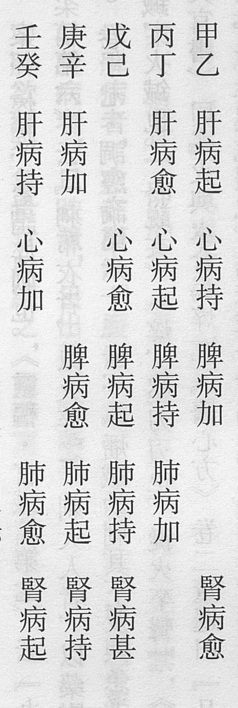

- 甲乙　肝病起　心病持　脾病加　腎病愈
- 丙丁　肝病愈　心病起　脾病持　肺病加
- 戊己　心病愈　脾病起　肺病持　腎病甚
- 庚辛　肝病加　脾病愈　肺病起　腎病持
- 壬癸　肝病持　心病加　肺病愈　腎病起

案：平旦日中下晡夜半，及四季圖如左。

平旦一名日出　日昳一名四季

<!-- PAGE_END -->

<!-- PAGE: 0616 -->

<!-- PRINTED: 581 -->

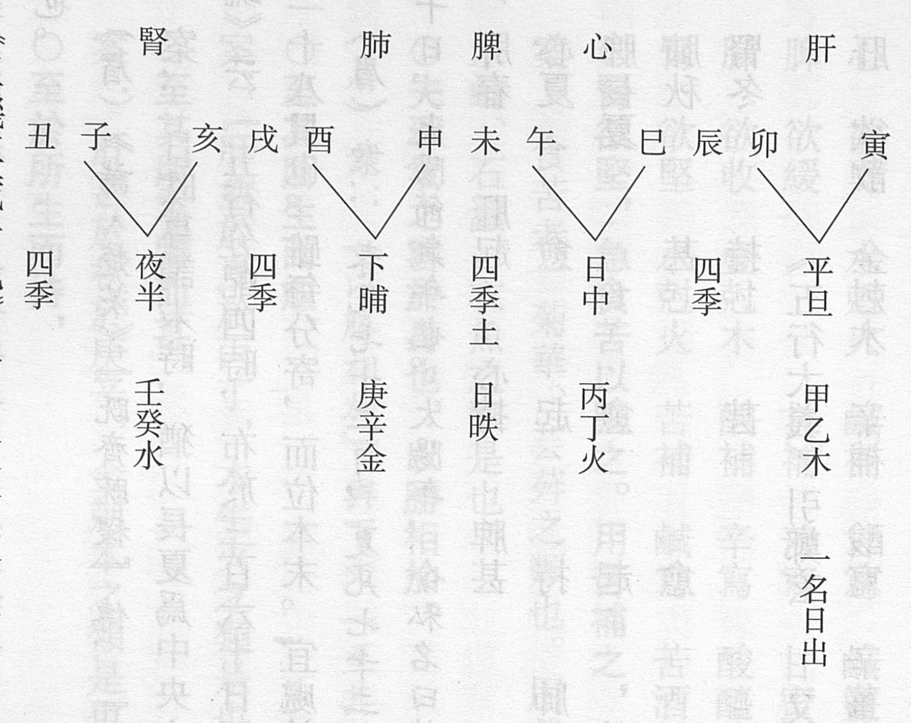

- 肝　寅　卯 → 平旦　甲乙木　一名日出
- 辰　四季
- 心　巳　午 → 日中　丙丁火
- 脾　未　四季土　日昳
- 肺　申　酉 → 下晡　庚辛金
- 戌　四季
- 腎　亥　子 → 夜半　壬癸水
- 丑　四季

《玉機真藏十九》一日一夜五分之，與此同義，宜併考。彼篇馬説宜看。

高云：『昳，昃也。日昳乃午後未分，土王之時。』《左傳・昭五年》注：『日昳爲臺。』疏：『日昳，謂蹉跌而下也。』

《靈・順氣一日分爲四時篇》曰：『以一日分爲四時，朝則爲春，日中爲夏，日入爲秋，夜半爲冬。』

<!-- PAGE_END -->

<!-- PAGE: 0617 -->

<!-- PRINTED: 582 -->

《史・天官書》『食至日昳爲稷，昳至餔爲黍』。《漢・天文志》『昳』作『跌』，『稷』作『疾』，『餔』作『晡』。

四季，土也。土，地也。《易》坤爲地，爲西南，是未方。未旺日昳，故所以本篇以土單爲日昳未時也。

又案：土爲中，一年之正中，爲夏秋之交，故土專居夏末，夏末即六月未月也，故又以一日之未時爲土之時也。

（眉）《詩・楚茨》『既齊既稷』傳：『稷，疾。』箋云：『稷之言即也。』

案：日昳專謂未時，猶以長夏爲中央土也。《禮・月令》『中央土』鄭注：『火休而盛德在土也。』《疏》云『五行分配四時，布於三百六十日間，以木配春，以火配夏，以金配秋，以水配冬，以土則每時輒寄一十八日也。雖每分寄，而位本末。宜處於季夏之末金火之間，故在此陳之也』是也。

（眉）案：春凡七十二日，夏凡七十二日，秋凡七十二日，冬凡七十二日，土用合七十二日，總計三百六十日，太陽節氣年也。太陽年，今私名曰節中年。太陰年，今私名曰朔望年。

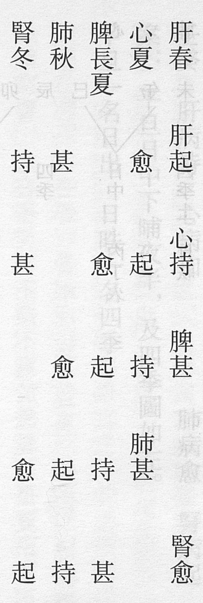

- 肝春　肝起　心持　脾甚　腎愈
- 心夏　愈　起　持　肺甚
- 脾長夏　愈　起　持　甚
- 肺秋　甚　愈　起　持
- 腎冬　持　甚　愈　起

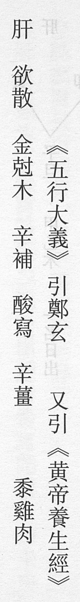

- 《五行大義》引鄭玄　又引《黃帝養生經》
- 肝　欲散　金尅木　辛補　酸寫　辛薑　黍雞肉

<!-- PAGE_END -->

<!-- PAGE: 0618 -->

<!-- PRINTED: 583 -->

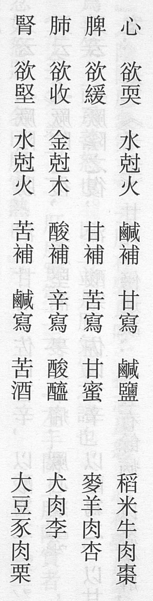

- 心　欲耎　水尅火　鹹補　甘寫　鹹鹽　稻米牛肉棗
- 脾　欲緩　甘補　苦寫　甘蜜　麥羊肉杏
- 肺　欲收　金尅木　酸補　辛寫　酸醯　犬肉李
- 腎　欲堅　水尅火　苦補　鹹寫　苦酒　大豆豕肉栗

**○腎欲堅，急食苦以堅之。用苦補之，鹹寫之。**

案：食苦者，菊華、芸荈之類也。用苦補者，枸杞、槐實、朮、遠志、天門冬之類是也。鹹寫者，朴消、水蛭、石蠶、衣魚之類是也。

**○夫邪氣之客於身也，以勝相加。**

（眉）案：『以勝相加』與下文『至其所不勝而甚』句同義。

**○至其所生而愈，**

案：肝愈於夏於丙丁，木生火之類是也。

**○至其所不勝而甚，**

案：肝甚於秋於庚辛，金剋木之類是也。

**○至於所生而持，**

案：肝持於冬於壬癸，水生木之類是也。

**○自得其位而起，**

案：肝起於春於甲乙，平旦慧是也。

**○必先定五藏之脈，乃可言間甚之時，死生之期也。**

<!-- PAGE_END -->

<!-- PAGE: 0619 -->

<!-- PRINTED: 584 -->

案：前文云『定五藏之氣』，此云『定五藏之脈』，互文而言。脈即氣，氣即脈，非有二義。《上古天真論》云『氣脈常通』，可併考。《八正神明論》曰『先見三部九候之氣』，又曰『診三部九候之病脈，處而治之』。

〔志〕邪氣者，風寒暑濕，外淫之邪也。以勝相加者，如肝病加於庚辛，心病加於壬癸，所勝之氣加臨，而病益重也。

《靈・口問篇》『夫百病之始生也，皆生於風雨寒暑，陰陽喜怒，飲食居處，大驚卒恐』。

〔馬〕此總結上文之爲病、爲愈、爲甚、爲持、爲起者，必當先定五藏之本脈而始知之也。如春脈弦，夏脈鉤，長夏脈代，秋脈毛，冬脈石。或有胃氣及無胃氣，則彼之生我剋我，我得而知，故凡爲愈者，我所生，持者，生乎我。其病爲間，而爲生之期，爲甚者，剋乎我，爲起者，得本位，其病爲甚，而爲死之期，可得而言之矣。若不定五藏之脈，則彼於我之相生相剋，胡從而知之哉。

**○肝病者，兩脇下痛引少腹，令人善怒。**

（眉）《甲乙》｟六ノ十九ヲ｠

《至真要大論篇第七十二》｟當作『七十四』｠云：『厥陰之勝，胠脇氣并，化而爲熱，小便黃赤，胃脘當心而痛，上支兩脇，腸鳴飧泄，少腹痛。』｟廿二ノ十一ヲ｠

又云：『厥陰之勝，治以甘清，佐以苦辛，以酸寫之。』｟廿二ノ十二ヲ｠

又云：『厥陰之復，少腹堅滿，裏急暴痛，厥心痛。』｟同ウ｠

又云：『厥陰之復，治以酸寒，佐以甘辛，以酸寫之，以甘緩之。』｟同十四ウ｠

案：怒，《千金》廿九・傍通訣：『五有餘病，以怒係肝，五不足病，以恐係於肝，在五咎，以狂係於肝。』《陰陽應象第五》云肝在聲爲呼，在志爲怒，心在聲爲笑，在志爲喜。』蓋肝氣有餘，則心氣不足，故不爲喜笑，而爲善怒也。以上並是肝氣實之證也。

<!-- PAGE_END -->

<!-- PAGE: 0620 -->

<!-- PRINTED: 585 -->

《千金方》卷十一・肝虛實第二云：『左手關上脈陰實者，足厥陰經也。病苦心下堅滿，常兩脅痛，息忿忿如怒狀，名曰肝實熱也。』｟九ヲ｠

**○虛則目䀮䀮無所見，耳無所聞，善恐，如人將捕之。**

《千金》卷十一云：『左手關上脈陰虛者，足厥陰經也。病苦脅下堅，寒熱，腹滿不欲飲食，腹脹悒悒不樂，婦人月經不利，腰腹痛，名曰肝虛寒也。』

案：䀮，《玉篇》『呼光切，目不明』。《廣韻》十一・唐同。又十一・唐云『䀮，莫郎切。目不明也』。《集韻》『或作𥉂』。考《説文》『㡃，設色之工，治絲練者。從巾巟聲。一曰㡃隔，讀若荒』，《廣韻》『㡃，蒙掩』，是本爲荒蒙字。與『詤，夢言』字同義。䀮䀮者，目視昏蒙不明之皃也。《千金》卷十一補肝散下云『目䀮䀮昏』可以徵矣。《醫心方》卷二『瞳子𢨺二穴，主青盲無所見，遠視𥆈𥆈』，後人加筆作𥉂，或作䀮，其音『呼光切』，其字作䀮爲正，以或從芒，誤讀『莫郎切』，其讀非是。以《爾雅・釋天》『大荒落』，《史記・曆書》作『大芒落』考之，則從芒亦尚，宜從荒音。本篇《釋音》『䀮，音荒』。《文選・思玄賦》注：『荒忽，幽昧貌。』

案：目䀮䀮，肝虛之候，耳無所聞，腎虛之候。腎爲木母，母衰則子亦弱，所以耳目共痺閉也。再案：目無所見是心虛，耳無所聞腎虛，蓋心腎共爲少陰經，而二氣不相交，則水飲内結爲此證耳。

《千金》十一云：『左手關上脈陰陽俱虛者，足厥陰與少陽經俱虛也。病如恍惚，尸厥不知人，妄見，少氣不能言，時時自驚，名曰肝膽俱虛也。』｟十一ウ｠

<!-- PAGE_END -->

<!-- PAGE: 0621 -->

<!-- PRINTED: 586 -->

（眉）《外臺》卷十二積聚方篇引《病源》『目茫茫』，程本作『䀮䀮』，《醫心方》卷二後項下作『目𥆈𥆈』，旁記『䀮，呼光反。目不明也』，天柱下亦作『𥆈』，亦旁記曰『䀮，呼光反。目不明也』。

（眉）《老子》十四章、廿一章『怳忽』字，傅奕本作『芒芴』，是『芒』亦音『荒』之證。《莊子・至樂篇》『芒乎芴乎』，《釋文》：『芒，本音荒。又呼晃反。芴音忽。』《荀子・富國》『芒軔僈楛』注：『芒，或讀爲荒。』《史記・三代世表》『帝芒』《索隱》：『芒，一作荒。』

（眉）三善爲康《掌中歷》卷上・歲時歷篇『五月節，芒種』或作『荒種』一見。

（眉）《難經・二十難》『脱陰者目盲』，丁曰：『盲猶荒也』。

（眉）《竹書紀年》『帝芒。芒，或曰帝荒』。

**○取其經厥陰與少陽。**

〔張〕此承上文虛實二節而言，虛者當補，實者當寫也。下倣此。

案：此謂微鍼也。蓋在經脈必用小鍼，爲常法也。

**○氣逆則頭痛，耳聾不聰，頰腫，取血者。**

〔張〕氣逆於上則上實，故頭痛耳聾頰腫。蓋肝脈與督脈會於巔下頰裏，膽脈入耳中，下加頰車也。

案：上文已謂肝虛實二證并鍼治，此謂肝氣上逆證并鍼法也。云『取血者』者，謂摸索其頸間結絡脈處，而刺出血也。所謂刺絡俞也，《診要經終十六》云：『夏刺絡俞，見血而止』是也。

〔紹〕《脈經》注云：『血者，謂有血之穴。』

（眉）案：耳聾在肝與肺，反不在於腎，妙哉。

**○心病者，胸中痛，脇支滿，脇下痛，膺背肩甲間痛，兩臂内痛。**

<!-- PAGE_END -->

<!-- PAGE: 0622 -->

<!-- PRINTED: 587 -->

《氣交變論》『胸中痛，脇支滿，脇痛，膺背肩胛間痛，兩臂内痛』。

《千金》十三云：『左手寸口人迎以前脈陰實者，手少陰心經也。病苦閉，大便不利，腹滿，四肢重，身熱，名曰心實熱也。』

《病源》云：『心氣盛爲神有餘，則病胸内痛，脇支滿，膺背髆髀間痛，兩臂内痛，善笑不休，是爲心氣之實也。則宜寫之。』｟《醫心方》卷六治心病方十一引｠

案：《和名抄》『《唐韻》云：胸，許容反。膺，於陵反。臆，於力反』，共訓曰『无祢』，蓋『无幾保祢』之義，即謂相向骨也。又脅，『《四聲字苑》云：脅，身傍脅肋間也』。訓曰『加太波良保祢』，旁腹骨之義也。又背下脊訓曰『世奈加』，蓋世者，『世末幾』之義。脊骨一道左右狹小，故謂之『世奈加』，即脊中之義也。轉注之，背亦謂之『世奈加』。見於《源氏物語》末摘花卷。又肩訓曰『加太』，即堅骨之義，與《釋名》『肩，堅也』同義。又『《四聲字苑》云：胛，肩之下也』，訓曰『加以加祢』。『加以加祢』猶云『加以乃祢』，即『加以乃保祢』之義。『加以』即『加太幾』之義。又臂，《廣雅》云『臂謂之肱』，《四聲字苑》云『肘，臂節也』，於肘下訓曰『比知』，蓋臂肱肘總謂之『比知』也。《醫心方》臂亦訓『比知』。《神代紀・雄略紀天武紀》臂，《齊明紀》手臂，皆訓『多多牟幾』，俗呼『宇天』。《説文》『臂，手上也』。《釋名》『臂，裨也。在旁曰裨也』是也。考『多多牟幾』，即『天天牟介』之義，謂手相向也。云『宇天者宇知天』之義，凡打擲物，臂先爲之用，故名也。

（眉）《至真要大論》『心脅痛不能反側』王注：『心脅痛，謂心之傍脇中痛也。』

（眉）《至真要大論》『兩脇裏急』王注曰：『脅謂兩乳之下及胠外也。』

（眉）《廣雅・釋器》『銃謂之銎』王氏《疏證》曰：『銎之言空也。其中空也。釭、銎聲相近。《六韜・軍用篇》方胸鋌矛千二百具，胸即銎字也。』

<!-- PAGE_END -->

<!-- PAGE: 0623 -->

<!-- PRINTED: 588 -->

**○虛則胸腹大，脇下與腰相引而痛。**

案：《和名抄》腰訓『古之』，蓋『古之』與『阿之』同義，『之』爲虛字。『古之』者，越超之義，腰骨實爲一身之機關，一切躋舉飛越之用，腰皆主之，故名『古之』。《釋名》云：『要，約也。在體之中，約結而小也。』要是身中之要處，轉爲肝要字，與『古之』之名其義甚同也。

**○取其經少陰太陽，舌下血者。**

〔張〕心主舌，故取舌下血，以寫其實。｟案：張説是。｠

〔馬〕當取手少陰之經穴靈道｟掌後一寸五分，鍼三分，灸三壯｠，手太陽之經穴陽谷｟手外側腕中鋭骨下陷中。鍼三分，留三呼，灸三壯｠，以心與小腸相爲表裏也。實則寫其有餘，虛則補其不足耳。其舌本下并出其血者，正以手少陰之脈從心系上俠咽喉，所以出舌下之血也。曰出血乃治有餘之證耳。

案：馬氏以舌下爲廉泉穴，恐非是。蓋隨舌下其有血者刺之，出血爲法耳。

《醫心》卷二引《黃帝明堂》云：『靈道，主悲恐，心痛相引，臂肘筋攣，瘖不能言。』『陽谷，主狂熱病，汗出，胸脇痛，耳鳴，齒痛，肩痛。』

**○其變病，刺郄中血者。**

〔馬〕又當取手少陰之郄，曰陰郄穴者，以出其血也。在掌後脈中，去腕半寸，當小指之後，鍼三分，灸七壯。

《甲乙經》｟三ノ卅ウ｠云：『手少陰郄，在掌後脈中，去腕五分，刺入三分，灸三壯。』《陰陽論》注云：當小指之後。

<!-- PAGE_END -->

<!-- PAGE: 0624 -->

<!-- PRINTED: 589 -->

案：王注以變病爲嘔變病者，似是。蓋有所受而言。《醫心方》卷二云｟十五ウ｠《甲乙》｟十五ヲ｠『陰郄二穴，主淒淒寒，欬吐血，逆氣驚心痛』可以徵矣。竊謂心肝二藏，主領一身之血脈，故其盛實者，或爲氣逆變吐之證，所以與餘三藏不同也。

《靈・口問篇》曰：『中氣不足，胃使爲之變，腸爲之苦鳴。』

《千金》十三・第一云：『凡心病之狀，胸内痛，脅支滿，兩脅下痛，膺背肩甲間痛，兩臂内痛。虛則胸腹大，脅下與腰背相引而痛，取其經手少陰、太陽舌下血者。其變病，刺郄中血者。』｟三ウ｠

《病源》云：『心氣不足，則胸腹相引痛，驚悸怳惚少顏色，舌本強，善憂悲，是爲心氣之虛也。則宜補之。』《醫心方》卷六・第十一引。｟十六ウ｠

（眉）《醫心方》｟二ノ十四オ｠：『郄門二穴，去椀五寸，刺入三分，灸三壯，主心痛。衄、噦、歐血、驚恐畏人，神氣不足。』手厥陰心主。

（眉）《外臺》｟三九ノ五四オ｠：『郄門，手心主郄，去腕五寸，灸五壯，主心痛。衄、噦、嘔血、驚恐畏人，神氣不足。』

**○脾病者，身重，善肌肉痿，足不收，行善瘈，腳下痛。**

《氣交變論》：『肌肉萎，足痿不收，行善瘈，腳下痛。飲發中滿，食減，四支不舉。』

〔識〕馬、吳據《新校正》『肌』作『飢』，是。善瘈，《甲乙》作『善瘈瘲』，張云：『瘈，手足掉掣也。』簡按：《玉機真藏論》云：『筋脈相引而急，病名曰瘛。』瘛、瘈同。《甲乙》添『瘲』字，似非是。

案：云瘈、云瘈瘲，其義相同。『瘈瘲』亦『瘈』之義，與多少、緩急等字同例。

案：腳下者，足跗内外踝邊及足心之總稱，與足下同。《甲乙・十陰受病發痺下》｟五ウ｠云『足下熱痛，不能久坐，濕痺不能行，三陰交主之』，《醫心》二卷・卅五葉面作『足下熱，脛疼不能久立，濕痺不能｟脫『行』｠』十四字。

<!-- PAGE_END -->

<!-- PAGE: 0625 -->

<!-- PRINTED: 590 -->

（眉）真本《明堂》卷一『瘛瘲』，楊注：『瘛，急牽。充曳反。瘲，緩不收。子用反。』

（眉）案：腳下，謂腳以下及足而痛，與足下斥蹠自別矣。

（眉）又案：《説文》『𨅰，乎加切。足所履也』。《廣韻》九・麻『𨅰，腳下』。然則腳下亦斥蹠也歟。且於《廣韻》『𩋥，履跟後帖』『蕸，荷葉』，並與『𨅰』同音，亦可以徵。足蹠，廣平之義也。

**○虛則腹滿腸鳴，飧泄食不化。**

飧泄解已見於第二中。

**○取其經太陰陽明少陰血者。**

〔馬〕當取足太陰之經穴商丘｟足内踝骨下微前陷中，鍼三分，灸三壯｠，足陽明之經穴解谿｟衝陽後一寸半，鍼五分，留三呼，灸三壯｠，足少陰之經穴復溜｟足内踝上二寸陷中，鍼三分，留七呼，灸五壯｠，以出其血耳。夫曰出血，則治前有餘之證而已，而虛則補之，又非可以出血治也。

案：足少陰者，腎經也。蓋脾土氣有餘，則其害必及於腎水，故於腎經刺出血，則脾病自愈。是猶齒痛，齒雖屬於腎，脾胃飽食有熱則作痛，亦在胃、旁光二經穴中，刺出血則自愈耳。乃脾腎相濟之義也。

（眉）《千金》｟十五上四ウ｠

《甲乙》卷九・第七云：『邪在脾胃，則病肌肉痛。陽氣有｟脫『餘』｠，陰氣不足，則熱中善饑。陽氣不足，陰氣有餘，則寒中腸鳴腹痛。陰陽俱有餘，若俱不足，則有寒有熱，皆調其三里。』｟九ヲ｠

《外臺》卷卅九｟卅七ウ｠三陰交下云：『病者身重苦飢，足痿不欲行，善掣腳下痛。虛則腹脹腹鳴溏洩，食飲不化，脾胃肌肉痛。此出《素問》。』

<!-- PAGE_END -->

<!-- PAGE: 0626 -->

<!-- PRINTED: 591 -->

《千金》十五上｟四ヲ｠云：『凡脾病之狀，必身重善飢，足痿不收｟《素問》作『善肌肉痿，足不收』。《甲乙》作『苦飢，肌肉痿，足不收』｠，行善瘈，腳下痛，虛則腹滿腸鳴，飧泄食不化，取其經足太陰、陽明、少陰血者。』

《病源論》云：『脾氣盛，爲形有餘，則病腹脹，溲不利。身重，口苦飢，足痿不收，行善掣，腳下痛，是爲脾氣之實也，則宜寫之。脾氣不足，則四支不用，後泄食不化，嘔逆腸鳴，是爲脾氣之虛也。宜補之。』｟《醫心方》六卷十七葉背引｠

**○肺病者，喘欬逆氣，肩背痛，汗出，尻陰股膝髀腨胻足皆痛。**

案：《靈・經脈》曰『膀胱動則髀不可以曲』，又曰『項背腰尻膕腨腳皆痛』。《六元正紀大論》『陽明所至，爲鼽，尻陰股膝髀腨胻足病』。《氣交變大論》『喘欬逆氣，肩背痛，尻陰股膝髀腨胻足皆痛』。

案：尻，《釋名》『尻，廖也。尻所在廖牢深也』。《呂氏春秋・觀表篇》『許鄙相朊』高誘注：『朊，後竅也。』朊即尻俗字。《和名抄》尻訓『之利』，是與臀同稱『之利』者，蓋『之岐遠利』之畧，是爲總稱。其尻今俗呼『之利乃阿奈』是也。乃尻、肛古今字，後世『肛』行，而『尻』廢矣。《醫心方》尻、肛同訓『之利』，亦可以爲徵也。陰，《釋名》『陰，蔭也。言所在蔭翳也』。《和名抄》云：『陰，今案：玉莖、玉門等通稱也。』《神代紀》陰，訓『保止』，蓋『保』者，『保乃加保乃久良岐』之保，則『保止』者，謂陰翳不明之處也，俗呼『加久之止古呂』是也。股，《釋名》云『股，固也。爲強固也』『髀，卑也。在下稱也』。《和名抄》引《唐韻》云『髀，股也』，今本《廣韻》同，依《説文》也，是統言也。其實髀謂股外髁骨以下，股謂髀内根肉之處也。順共訓『毛毛』，毛與美同音，猶曰『美美』。『美』者，謂肉也。兩肉相合，故曰『毛毛』。今俗呼『毛毛多夫』｟與『美美多夫』，同訓同義｠，亦謂多肉豐滿也。《新撰字鏡》髀、脞訓『毛毛』，股訓『宇豆毛毛』，『宇豆毛毛』即『宇知毛毛』也。膝，《釋名》『膝，伸也。可屈伸也』。《説文》『厀，脛頭節也』。順訓『比佐』，蓋比佐者，『比岐佐留』之義。前行者，足之所能爲，退行者，膝之所能爲也，故名。

<!-- PAGE_END -->

<!-- PAGE: 0627 -->

<!-- PRINTED: 592 -->

腨，《説文》『腨，腓腸也』。《易》『咸，六二，咸其腓』，鄭曰：『腓，膊腸也。』腨膊同字，猶專顓通用之例，不與『膊，切肉』字同。段玉裁曰：『諸書言膊腸，或言腓腸，謂脛骨後之肉也。腓之言肥，似中有腸者然，故曰腓腸。』立之謂：此説恐非。凡專耑二音之字，皆有美好肥滿之義，如『專，擅也，誠也，自是也。嫥，可愛之皃。膞，鳥胃也。篿，《説文》以判竹圜以盛穀也』｟《廣韻》二・仙｠『踹，腳跟。鱄，魚名美也』｟同上，上聲二十八・獮｠。之類是也。腸與暢、張等字同義，非腸胃之義。如『張，施也。餦餭餳也。漲，水大皃』｟《廣韻》十・陽｠之類同義。所云腓腸、腨腸共是古昔俗偁，即謂肥脹嫥張也。或單偁曰腨、曰腓也。《和名抄》腓訓『古无良』，義未詳。或曰『古毛留』之義，謂筋肉鍾聚於此也。一説，古者謂海參曰『古牟良』者，『末呂』之轉，蓋筋肉圜聚似海參之義，今俗呼『不久良波伎』。相州俗謂之鹽苞，蓋象形而名也。《古事記》雄略條『蝄咋御腕。御歌云：『多古牟良爾阿牟加岐都岐』。『多古牟良』謂臂肉手腓之義，今俗云腓筋之轉爲『古牟良加倍利』，亦古語之偶存者也。胻，《説文》『胻，脛耑也』，《廣韻》『胻，脛也』，《釋名》『脛，莖也。直而長似物莖也』，順訓『波岐』。《新撰字鏡》『踹踁脛蹺』四字，《靈異記》膞，《醫心方》胫、骭並同訓。蓋『波支』者，『波世由岐』之畧語，今俗呼『須祢』。『須祢』者，髓之古名，蓋『須保祢』之畧，骨中空隙似巢窠故名。脛骨中髓之最多處，故脛亦呼『須祢』歟。《書》所云『長涉之脛』，可併考也。蓋自其莖立謂之脛，自其行走謂之胻，字不同，脛耑之訓可從也。足，《釋名》『續也，言續脛也』，《説文》『人之足也，在體下』，順訓『阿之』。案：『阿之』者，『阿由末須』之義，謂令步也，與『古之』之『之』同義。『尻陰』以下八字，宜爲各一字句而讀也。

（眉）《至真要論》『腨如別』注：『腨，䯒後軟肉處也。』

<!-- PAGE_END -->

<!-- PAGE: 0628 -->

<!-- PRINTED: 593 -->

**○虛則少氣不能報息，耳聾，嗌乾。**

少氣已見十八中。｟二ヲ｠

〔張〕報，復也。不能報息，謂呼吸氣短，難於接續也。

《傷寒直格》曰：『不能報息，俗所云氣少不能接續也。』又曰：『嗌，音亦。氣系也。』

案：不能報息者，蓋謂有呼無吸。報息，謂吸息也，今俗呼片息者是也。張注非，王注可從。凡云不能息，皆謂不能報息也。

聾，《説文》『無聞也』，《釋名》云『聾，籠也。如在蒙籠之内，聽不察也』。順《抄》訓『美美之比』。《醫心方》耳聾，《新撰字鏡》聾同訓。《新撰字鏡》古本聲、𦗟並訓『祢祢志户』。案：『之比』者，『佐倍』之義，『佐倍岐留』之畧。盲訓『米之比』同義。嗌，《説文》『咽，嗌也』『嗌，咽也』，《釋名》『咽，咽物也。又謂之嗌，氣所流通阨要之處也』。順《抄》訓『能无度』，即呑處之義。今俗呼『能度』，從急言耳。

《至真要大論七十四》王注云：『嗌謂喉之下，接連胸中，肺兩葉之間者也。』｟廿二ノ十二ヲ｠

（眉）《玉篇》『膉，於亦切。脰肉也』。

（眉）案：嗌，氣道名，非食道名。

**○取其經太陰，足太陽之外，厥陰内血者。**

〔馬〕當取手太陰之經穴經渠｟寸口陷中，鍼二分，留三呼，禁灸｠，足太陽之外，足厥陰之内，即足少陰之脈也。亦取其經穴復溜，以出其血焉可也。｟復溜見前，脾病之下｠

〔識〕《甲乙》『内』下有『少陰』二字。張云：『外言前也，内言後也。』簡按：《甲乙》增『少陰』二字，義尤明白。

<!-- PAGE_END -->

<!-- PAGE: 0629 -->

<!-- PRINTED: 594 -->

《病源論》云：『肺氣盛爲氣有餘，則病喘欬上氣，髆背痛，汗出，尻陰股膝踹脛足皆痛，是爲肺氣之實也。則宜寫之。肺氣不足，則少氣不能報息，耳聾，嗌乾，是爲肺氣之虛也。則宜補之。』｟《醫心方》卷六十八葉背引｠

《千金》卷十七｟四ヲ｠云：『凡肺病之狀，必喘欬逆氣，肩息背痛，汗出，尻陰股膝攣髀腨胻足皆痛，虛則少氣不能報息，耳聾，嗌乾，取其經手太陰，足太陽之外，厥陰内，少陰血者。』

**○腎病者，腹大脛腫，喘欬，身重，寢汗出，憎風。**

〔張〕此腎經之實邪也。腎主五液，在心爲汗，而腎邪侮之，心氣内微，故爲寢汗。如《脈要精微論》曰『陰氣有餘，爲多汗身寒』，即此之謂。

〔志〕太陽之氣司表，而下出於膀胱。經氣逆則表氣虛，故寢汗出而惡風。

《氣交變論》『腹大脛腫，喘欬，寢汗出，憎風』。

《六元正紀大論》『太陽所至，爲寢汗痙』，王注：『寢汗謂睡中汗，發於胸嗌頸掖之間也。俗誤呼爲盜汗』。

案：寢汗爲正語，『盜汗』字昉見於《傷寒論》，蓋出於俗呼，詳見《盜汗考》。腹大脛腫，《本草經》所云『大腹水腫』也。『憎風』與『惡風』同，但惡之甚於惡風，故曰憎風。憎之言爲增，其忌惡尤甚也。王云『憎謂深惡之』，可從。

（眉）《玉篇》『寢，謂偃臥熟也』。｟慧《音》廿三ノ又十二ヲ｠

**○虛則胸中痛，大腹小腹痛，清厥意不樂。**

《氣交變大論》『民病腹痛，清厥意不樂，體重煩寃』，王注：『腹痛，謂大腹小腹痛也。清厥，謂足逆冷也。意不樂，如有隱憂也。』

<!-- PAGE_END -->

<!-- PAGE: 0630 -->

<!-- PRINTED: 595 -->

〔張〕足少陰脈從肺出，絡心注胸中。腎虛則心腎不交，故胸中痛。大腹小腹痛者，正以腎脈自下而上，至俞府而止也。腎藏精，精化氣，精虛則氣虛，故爲清冷厥逆。腎之神爲志，惟志不足，故意有不樂也。

《五藏生成篇》第十曰：『肝痺，腰痛，足清，頭痛。』

（眉）《列子・周穆王篇》：『視其前，則酒未清，肴未昲。』

（眉）《禮記・聘義》：『酒清，人渴而不敢飲也。肉乾，人飢而不敢食也。』

（眉）《六節藏象》｟當作《五藏生成》｠『足清』注：『清亦冷也。』《脈要精微》末『腰足清』，《至真要論》注：『清，薄寒也。』又曰：『清厥，手足冷也。』《靈・九鍼十二原》曰：『刺寒清者。』

案：大腹者，謂膈下至臍四傍之部位也，其地廣大，故曰大腹。小腹者，謂臍下一寸半，氣海石門以下至曲骨之地，比大腹則甚狹隘，故曰小腹也。《脈要精微》十七云『心疝，少腹當有形』，王注：『少腹，小腸也。』《氣交變大》云『歲金大過，民病脇下少腹痛』，王注：『少腹，謂臍下兩傍髎骨内也。』可從。《骨空論》王注：『少腹，臍下也。』亦大概言耳。《釋名》云『自臍以下曰水腹，水汋所聚也。又曰少腹。少，小也。比於臍以上爲小也』，亦謂臍下小腸之部位也。又《説文》：『腴，腹下肥也。』《禮・少儀》云『差｟當作『羞』｠濡魚者，冬右腴』，注云：『腴，腹下也。』《靈樞・衛氣失常篇》云：『膏者，多氣而皮縱緩，故能縱腹垂腴。』志聰曰：『腴者，臍下之少腹也。』然則，腴即小腹而臍下小腸之分是也。

**○取其經少陰，太陽血者。**

〔馬〕當取足少陰腎之經穴復溜｟見前｠，足太陽旁光之經穴崑崙｟足外踝後跟骨上陷中，鍼三分，留七呼，灸三壯｠。

《病源論》云：『腎氣盛爲志有餘，則病腹脹飡泄，體腫，喘欬，汗出，面目黑，小便黃，是爲腎氣之實也，則宜寫之。腎氣不足，則厥陽背冷，胸内痛，耳鳴苦聾，是爲腎氣之虛也，則宜補之。』｟《醫心》卷六十九葉背引｠

<!-- PAGE_END -->

<!-- PAGE: 0631 -->

<!-- PRINTED: 596 -->

《千金》卷十九｟四ヲ｠云：『凡腎病之狀，必腹大脛腫痛，喘欬，身重，寢汗出，憎風，虛即胸中痛，大腹小腹痛，清厥，意不樂，取其經足少陰，太陽血者。』

《氣交變大論》六十九云：『歲木太過，甚則忽忽善怒，眩冒巓疾｟廿ノ二ヲ｠。歲火太過，甚則胸中痛，脇支滿，脇痛，膺背肩胛間痛，兩臂内痛｟二ウ｠。歲土太過，甚則肌肉萎，足痿不收，行善瘈，腳下痛，飲發中滿，食減，四支不舉｟三ヲ｠。歲金太過，甚則喘欬逆氣，肩背痛，尻陰股膝髀腨䯒足皆病｟四ヲ｠。歲水太過，甚則腹大脛腫，喘欬，寢汗出，憎風。』｟四ウ｠

**○肝色青，宜食甘，粳米，牛肉，棗，葵，皆甘。**

『肝色青』至篇末，《大素》卷二·調食篇中收之。

《藏氣法時論》曰：『肝苦急，急食甘以緩之。』｟二ウ｠

〔楊〕肝者，木也。甘者，土也。宜食甘者，木剋於土，以所剋資肝也。

**○心色赤，宜食酸。小豆，犬肉，李，韭，皆酸。**

《藏氣法時論》曰：『心苦緩，急食酸以收之。』｟二ウ｠

〔楊〕心者，火也。酸者，木也。木生心也，以母資子也。

**○肺色白，宜食苦。麥，羊肉，杏，薤，皆苦。**

《大素》『肺色白』三句在『脾色黃』三句之下。

（眉）《大素》後。

《藏氣法時論》曰：『肺苦氣上逆，急食苦以泄之。』｟三ウ｠

<!-- PAGE_END -->

<!-- PAGE: 0632 -->

<!-- PRINTED: 597 -->

〔楊〕肺者，金也。苦者，火也。火剋於金也。以能剋爲資也。

**○脾色黃，宜食鹹。大豆，豕肉，栗，藿，皆鹹。**

（眉）《大素》前。

《藏氣法時論》曰：『脾苦濕，急食苦以燥之。』｟三ヲ｠

〔楊〕脾者，土也。鹹者，水也。土剋於水，水味鹹也。故食鹹以資於脾也。

**○腎色黑，宜食辛。黃黍，雞肉，桃，葱，皆辛。**

《藏氣法時論》曰：『腎苦燥，急食辛以潤之。』｟三ウ｠

〔楊〕腎者，水也。辛者，金也。金生於水，以母資子。

《五行大義》卷三『《春秋潜潭巴》云：「五味生五藏者，鹹生肝，酸生心，苦生脾，甘生肺，辛生腎。」《養生經》云：「肝色青，宜食鹹。稻米，牛肉，棗。心色赤，宜食酢。犬肉，李。肺色白，宜食甘。麥，羊肉，杏。脾色黃，宜食苦。大豆，豕肉，栗。腎色黑，宜食辛。黍，雞宍。」此五食皆以所生，能養其子也』。｟十二ヲ｠『酢犬』間恐脫『麻』字。

《靈樞·五味篇》五十六『五味各走其所喜』。

穀味　酸先走肝　苦先走心　甘先走脾　辛先走肺　鹹先走腎

五穀　麻酸　麥苦　甘秔米　辛黃黍　鹹大豆

五菓　李酸　杏苦　棗甘　桃辛　栗鹹

五畜　犬酸　羊苦　牛甘　雞辛　猪鹹

五菜　韭酸　薤苦　葵甘　葱辛　藿鹹

五色　青酸　赤苦　黃甘　白辛　黑鹹

<!-- PAGE_END -->

<!-- PAGE: 0633 -->

<!-- PRINTED: 598 -->

肝病宜食　心病宜食　脾病宜食　肺病宜食　腎病宜食

麻犬肉李韭　麥羊肉杏薤　秔米飯牛肉棗葵　黃黍藿肉桃葱　大豆黃卷猪肉栗藿

肝病禁辛　心病禁鹹　脾病禁酸　肺病禁苦　腎病禁甘

肝色青宜食甘　心色青宜食酸　脾色黃宜食鹹　肺色白宜食苦　腎色黑宜食辛

秔米飯牛肉　犬肉麻李　大豆豕肉　麥羊肉　黃黍藿肉

棗葵皆甘　韭皆酸　栗藿皆鹹　杏薤皆苦　桃葱皆辛

甘　酸　鹹　苦　辛

粳米　小豆　大豆　麥　黃黍

粳米　黑字：味甘，苦平，無毒。

小豆　黑字云：赤小豆味甘酸，平温，無毒。《藥性論》云：使，味甘。陳士良云：微寒。

大豆　黃卷白字云：味甘，平。黑字云：生大豆味甘，平。

麥　黑字云：鹹温，微寒，無毒。小麥，甘，微寒，無毒。種麥同。

黃黍　黑字云：黍味甘，温，無毒。

牛肉　犬肉　豕肉　羊肉　雞肉

牛肉　味甘，平，無毒。｟黑字｠

犬肉　味甘酸，温。｟黑｠日云：暖，無毒。

豕肉　黑字：猳豕肉，味酸，冷。凡猪肉味苦。

<!-- PAGE_END -->

<!-- PAGE: 0634 -->

<!-- PRINTED: 599 -->

羊肉　黑字云：味甘，大熱，無毒。孟詵云：温。

雞肉　黑字：白雄雞肉，味酸，微温。烏雄雞肉微温。

棗　李　栗杏　桃

棗　白字：大棗味甘，平。黑字無。

李　黑字：李實味苦。日云：李温，無毒。

栗　黑字：味鹹，温，無毒。

杏　白字：杏核，味甘，温，大熱。黑字：苦，冷利，有毒。實味酸。孟云：杏熱。日云：杏熱，有毒。

桃　白字：桃核味苦，平。黑字：甘，無毒。孟詵云：温。日云：桃熱，微毒。

葵　韭　藿　薤　葱

葵　白字：冬葵子，味甘，寒。黑字：無毒，心傷人。陶云：至滑利。《藥性論》：臣，滑平。孟詵云：冷。《圖經》云：苗葉作菜，茹更甘美，大抵性滑利。

韭　黑字：味辛，微酸，温，無毒。歸心。日云：熱。

藿　唐本注云：赤小豆。《別録》云：葉名藿，止小便數，去煩熱。日云：葉食之明目。

薤　白字：薤味辛。黑字：苦温，無毒。歸骨。《圖經》云：薤雖辛，而不葷五藏。

葱　白字：葱實味辛，温。黑字：無毒。葱白平，葱汁平，温，歸目。

**○辛散，酸收，甘緩，苦堅，鹹耎。**

〔楊〕肝酸性收，欲得散者，養辛以散。肺辛性散，欲得收者，食酸以收之。脾甘性緩，欲得緩者，食甘以緩之。心苦性堅，欲得濡者，食鹹以濡也。腎鹹性濡，欲得堅者，食苦以竪之。

<!-- PAGE_END -->

<!-- PAGE: 0635 -->

<!-- PRINTED: 600 -->

**○毒藥攻邪，**

〔楊〕前總言五味有攝養之功，今説毒藥攻耶之要。耶謂風寒暑濕外耶者也。毒藥具有五味，故次言之。

《周禮》鄭玄注：『五藥，艸木蟲石穀也。』

《靈·九鍼十二原》：『勿使被毒藥，無用砭石。』

〔識〕鄭玄註《周禮》云：『毒藥，藥之辛苦者，藥之物恒多毒。孟子《書》曰：若藥不瞑眩，厥疾不瘳。』賈公彥云：『藥之無毒，亦聚之。但藥物多毒，故曰毒藥。直言聚毒藥者，以毒爲主。』王應電云：『毒藥，得天地之偏氣，寒熱之性過甚者也。人身有不和之氣，須以偏勝之物攻之，乃得其平。』

案：前文説食物之五味，此謂藥物之偏性攻邪，亦以五味爲之補寫也。

毒藥，又見《寶命全形》第二十五中。

（眉）《五常政論》末經文及王注説，上品、中品、下品諸藥皆毒，太詳。其《新校正》引此篇之此文。

（眉）《周禮·醫師》『掌醫之政令，聚毒藥，以共醫事』。

**○五穀爲養，**

〔楊〕五穀五味，爲養生之主也。

北山友松子《醫案》卷上曰：『《藏氣法時論》有曰：五穀爲養者，養生氣也。五菓爲助者，助其養也。五畜爲益者，益精血也。五菜爲充者，實藏府也。』

**○五果爲助，**

〔楊〕五菓五味，助穀之資。

<!-- PAGE_END -->

<!-- PAGE: 0636 -->

<!-- PRINTED: 601 -->

**○五畜爲益，**

〔楊〕五畜五味，益穀之資。

**○五菜爲充，**

〔楊〕五菜五味，埤穀之資。

〔吳〕充實於藏府也。

揚雄《方言》卷十三：『充，養也。』《廣雅》同。

案：五穀爲養，謂養五藏之精。五畜爲益，謂益五府之氣。後文云『養精益氣』，可以併考矣。五菓爲助，謂爲五穀之助也。五菜爲充，謂爲五畜之充也。充，當也。牛與葵、猪與藿之類，相當爲之合和也。言穀肉果菜之食，能爲服藥之扶助也。下文云『合而服之』，謂受『毒藥攻邪』之句，而食氣與食味相合，而服之良藥，則得養精益氣之功也。是藥食同功之理。而胃氣爲本，若不食，則遂不治之義，亦在於此矣。

（眉）《本草綱目》菜部小序曰：『李時珍曰：凡草木之可茹者，謂之菜。韭薤葵葱藿五菜也。』

**○氣味合而服之，以補精益氣。**

〔楊〕穀之氣味入身，養人五精，益人五氣也。

**○此五者，有辛酸甘苦鹹，各有所利，或散或收，或緩或急，或堅或耎。**

〔楊〕五味各有所利，利五藏也。散收緩堅濡等調五藏也。

〔識〕簡按：『或急』二字，王不釋其義，諸家亦然。考前文無物性急者，疑是衍文。高特註云：『或急者，肝苦急也。兼言或急，則心或苦緩，脾或苦濕，腎或苦燥，肺或苦氣上逆，皆在其中。』此説傅會，不可從。

<!-- PAGE_END -->

<!-- PAGE: 0637 -->

<!-- PRINTED: 602 -->

〔紹〕《太素》無『或急』二字，是足以確原《識》説。

（眉）王注『或急』之『急』作『泄』讀，泄蓋急義。要之王氏依《至真要論》加此二字，《大素》無者，太是。

**○四時五藏病，隨五味所宜也。**

〔楊〕於四時中，五藏有所宜，五味所宜。

辛酉七月九日晡時書了　竹仙源立之

第二十二補

五行｟一ヲ｠

《史記·曆書》『是時獨有鄒衍明於五德之傳』，《正義》曰：『五德，五行也。』同《曆書》曰『蓋聞昔者，黃帝定清濁，起五部』，《集解》：『應劭曰：五部金木水火土也。孟康曰：五部，五行也。』《禮·月令》『孟春之月，其數八』，《正義》云：『五行，謂金木水火土。』

金木水火土｟一ヲ｠案：先金次木次水次火次土，此次第未詳。蓋人間以所貴重者爲先，故先金次木也。有金而後，伐木而爲林，有水而後，待火而爲用，以上四物，並土中所生，是所以金木水火土爲之次也。

腎欲堅｟九ヲ｠

〔張〕腎主閉藏，氣貴周密，故腎欲堅，宜食苦以堅之也。

〔高〕腎病則水汎，故腎欲堅。苦爲火味，故能堅也。

肝欲散｟五ウ｠

<!-- PAGE_END -->

<!-- PAGE: 0638 -->

<!-- PRINTED: 603 -->

《陰陽應象第五》云：『風傷筋，燥勝風，酸傷筋，辛勝酸。』

心欲耎｟六ヲ｠

第五云：『熱傷氣，寒勝熱，苦傷氣，鹹勝苦。』

脾欲緩｟七ヲ｠

第五云：『濕傷肉，風勝濕，甘傷肉，酸勝甘。』

肺欲收同

第五云：『熱傷皮毛，寒勝熱。辛傷皮毛，苦勝辛。』

腎欲堅｟九ヲ｠

第五云：『寒傷血，燥勝寒，鹹傷血，甘勝鹹。』

案：以上自與本論異，宜通考。

少腹｟十ヲ｠

〔箚〕《釋名》：『自臍以下曰少腹。少，小也。比於臍以上爲小也。』

案：《釋名》又曰：『自臍以下曰水腹，水汋所聚也。』《和名抄》訓『古能加美』。考古、介古通音，『古能加美』即『介乃加美』，謂陰毛上也。今俗呼『保加美』，即『保止加美』之義。男女陰，古謂之『保止』，乃謂陰上也。又呼『之多波良』。

《脈要精微十七》『少腹當有形也』｟五ノ五ウ｠王注：『少腹，小腸也。』又《氣交變大（論）六十九》｟廿ノ三ウ｠王注云：『少腹，謂齊下兩傍髎骨内也。』

膺｟十ウ｠

<!-- PAGE_END -->

<!-- PAGE: 0639 -->

<!-- PRINTED: 604 -->

《腹中論四十》云『有病膺腫頸痛胸滿腹脹』，王注：『膺，胸傍也。頸，項前也。胸，膺間也。』

案：據此王注考之，則膺，即壅起之義。胸前兩傍乳間高起之處，名之曰膺也。《釋名》：『膺，壅也。氣所壅塞也。』｟《一切經音義》引：『膺，壅塞也。謂氣至壅塞也。』｠

粳米｟十八ウ｠

黑字下品：『粳米，味甘苦，辛，無毒。主益氣止煩止洩。』陶云：『此即今常所食米，但有白赤小大異族四五種，猶同一類也。』

《醫心方》：『《拾遺》云：凡米熱食則熱，冷食則冷。假以火氣，體自温平。《七卷食經》云：味甘，微寒。止寒熱，利大腸。腤玄子張云：性寒。擁諸經絡氣，使人四支不收，昏昏饒睡，發風動氣，不可多食。』｟三十ノ八ヲ｠

《本草和名》：『粳米，楊玄操：音古行反。俗秔字也。和名宇留之祢。』

葵｟十八ウ｠

《醫心方》葵菜：『《本草》云：味甘，寒，無毒。葉爲百菜主。陶注云：以秋種，經冬至春作子，謂之冬葵。至滑利。崔禹云：食之補肝膽氣，明目。｟三十ノ卅九ウ｠和名阿夫比。』

案：今俗呼夫由阿布比，又加牟阿夫比者，是也。

棗｟十八ウ｠

《醫心方》乾棗：『《本草》云：味甘，平，無毒。養脾平胃氣。孟詵云：養脾氣。｟三十ノ十二ウ｠奈都女。』

韭｟十八ウ｠

《本和》云『和名古美良』。｟今俗呼『仁良』｠麥｟十八ウ｠

<!-- PAGE_END -->

<!-- PAGE: 0640 -->

<!-- PRINTED: 605 -->

黑字云『小麥，養肝氣』。和名『己牟支』。

杏同

《醫心方》：『崔禹云：味酸，大熱，有毒。和名加良毛毛。』

大豆同

《醫心方》：『崔禹云：黃卷，味苦甘，温。和名末女。』

栗同

《醫心方》：『《本草》云：厚腸胃，補腎氣。陶注云：有人患腳弱，往栗樹下，食數升，便能起行，此是補腎之義。和名久利。』

藿｟十八ウ｠

〔識〕《説文》：『藿，尗之少也。』《儀·公食大夫禮》注：『藿，豆葉也。』

案：藿者，小豆葉之名也。小豆苗葉可食，大豆葉不可食。小豆類中角豆苗葉可渫食，味甘美，田舍間和飯食之，名曰岐婆飯，其以利益人得此名。今俗飯後以豉汁和白湯飲之，名曰道三湯，與妓婆飯古今相成切對，故拈出於此耳。

黃黍｟十九ヲ｠

〔識〕張云：『即糯小米，北方謂之黃米。』簡按：《本草》有丹黍，無黃黍。《齊民要術》引郭義恭《廣志》云『有濕屯黃黍』，蓋此謂黍中之黃者。《金匱真言論》以黍爲心之穀者，乃丹黍耳。《農政全書》云『古所謂黍，今亦稱黍，或稱黃米』，即與張所指同。

<!-- PAGE_END -->

<!-- PAGE: 0641 -->

<!-- PRINTED: 606 -->

案：《禮·内則》『飯黍，稷，稻，粱，白黍，黃粱』，鄭氏注：『黍，黃黍也。』《本草和名》『黍米，和名岐美』。案：『岐美』者，黃實之謂，可證黃黍即黍米，白黍、丹黍別是一種耳。

桃同

《醫心方》：『崔禹云：益面色，養肝氣。和名毛毛。』｟三十ノ十四ヲ｠

葱同

《醫心方》：『《七卷經》云：味辛，温，不可食，傷人心氣。和名紀。』｟三十ノ四九ヲ｠

案：『食』上恐脫『多』字。

黑字：『其莖葱白，平，歸目，除肝邪氣。』

法四時五行而治｟一ヲ｠

〔箚〕寬案：據下文，治，即主治也。

開腠理致津液通氣也｟四ヲ｠

〔箚〕寬案：此三句，蓋總結上文之辭。五味治五藏，皆是所以開腠理，致津液，而通其氣也。前注以爲於腎一病發之，殆欠妥。

氣味合而服之以補精益氣｟廿一ウ｠

案：氣以益陽氣，味以補陰精。與《陰陽應象第五》所云『氣歸精，味歸形』自別。

厥陰與少陽｟十一ヲ｠

〔馬〕當取足厥陰肝之經穴中封｟足内踝骨前一寸，筋裏宛宛中，鍼四分，留七呼，灸七壯｠，足少陽膽之經穴陽輔｟足外踝上四寸，輔骨前絶骨端三分，去秔坵墟七寸，鍼三分，留七呼，灸三壯｠。

<!-- PAGE_END -->

<!-- PAGE: 0642 -->

<!-- PRINTED: 607 -->

更貴更賤｟二ヲ｠

《靈樞·九鍼論》｟（當作『歲露論』）｠：『黃帝曰：虛邪之風，其所傷貴賤何如。候之奈何。少師答曰：正月朔日，太一居天留之宮，其日西北風，不雨，人多死矣云云。』

臂｟十一ウ｠

《説文》『厷，臂上也』『肱，厷或從肉』『臂，手上也』。段玉裁曰：『此皆析言之，「亦」下云：人之臂亦，渾言之也。渾言則厷臂互偁，厷與臂之節曰肘。《深衣》注云：肘當臂中爲節，臂骨上下各尺二寸，按上謂厷，下謂臂也。』

胠｟十一ウ｠【楷】

《説文》『胠，亦下也』『胳，亦下也』。段玉裁曰：『兩厷迫於身者，謂之亦，亦下謂之胳。又謂之胠，身之迫於兩厷者也。』又曰：『胳謂迫於厷者，胠謂迫於臂者。』案：迫於臂者，謂掖下近於䏚腰之地，可知胠即季脅一名也。胳下爲胠也。

廿一　淫氣｟一ヲ｠　氣筋｟三ウ｠　精脈｟四ヲ｠　府｟四ウ｠　氣口｟五ウ｠　喘虛｟七ヲ｠　蹻前｟八ヲ｠　獨嘯｟九ウ｠　白汗｟十ウ｠　調食和藥｟十ウ｠

廿二　五行｟一ヲ｠　卒聞｟二ヲ｠　苦鹹｟三ヲ｠　焠㶼｟七ウ｠　少腹｟十ヲ｠　䀮䀮｟十ウ｠　取血者｟十一ヲ｠　膺脇背肩甲臂｟十二ヲ｠　腰胸｟同上｠　變病｟十二ウ｠　瘈｟十三ウ｠　腳｟下同｠　尻陰股膝髀腨胻足｟十五ヲ｠　聾嗌｟同ウ｠　寢汗｟十六ウ｠　憎風｟同｠　大腹小腹｟十七ヲ｠　粳米｟十六ウ｠　棗葵｟同｠　藿｟同｠　黃黍｟十九ヲ｠　葱｟同｠

毒藥｟廿ウ｠　清｟十七ヲ｠

#### 宣明五氣篇第二十三

《大素》僅存五病五邪五脈應象，其餘皆係缺文。

〔箚〕驪恕公曰：此篇與《九鍼》論文大抵相同。

<!-- PAGE_END -->

<!-- PAGE: 0643 -->

<!-- PRINTED: 608 -->

**○五味所入，酸入肝，辛入肺，苦入心，鹹入腎，甘入脾，是謂五入。**

〔識〕馬云：此與《靈樞·九鍼論》同，但彼多『淡入胃』一句。簡按：《周禮·疾醫職》｟（當作『食醫職』）｠云『凡和，春多酸，夏多苦，秋多辛，冬多鹹，調以滑甘』與此同義。

案：『淡入胃』一句，尤字眼，凡食入胃，五味並各入五藏。自餘淡泊一味，剩在胃中，傳送二腸，則爲糞也。

《至真要大論》云：『夫五味入胃，各歸所喜攻。酸先入肝，苦先入心，甘先入脾，辛先入肺，鹹先入腎，久而增氣，物化之常也。氣增而久，夭之由也。』｟廿二ノ三十ウ｠

案：所引《至真要論》文末二句，戒常日藥餌成害之弊也。

《五行大義》卷三·論配氣味篇引《黃帝養生經》云：『酸入肝，辛入肺，苦入心，甘入脾，鹹入腎。』

**○五氣所病，**

〔志〕五藏氣逆而爲病。

案：篇名五氣即取於此也。

**○心爲噫，**

〔馬〕按：《靈樞·口問篇》岐伯曰『寒氣客於胃，厥逆從下上散，復出於胃，故爲噫』，則是噫出於胃。《三部九候論》《靈樞·九鍼論》皆曰心爲噫，與此篇同。然則以爲出於胃耶，出於心耶。又嘗考《脈解篇》『所謂上走心爲噫者，陰盛而上走於陽明。陽明絡屬心，故曰上走心爲噫也』。由此觀之，則知噫屬心，而足陽明胃經之絡，又屬於心，故胃有寒，亦能噫也。經典之旨，豈非二而一者耶。

《至真要論》『太陽司天，寒淫所勝，善噫』，王注：『心氣爲噫，故善噫。』

<!-- PAGE_END -->

<!-- PAGE: 0644 -->

<!-- PRINTED: 609 -->

《甲乙經》卷一·精神五藏篇第一曰：『肝在氣爲語，心爲呑，脾爲噫，肺爲欬，腎爲欠。』

〔張〕按：《九鍼論》曰『心爲噫』，《刺禁論》曰『刺中心一日死，其動爲噫』，《痺論》曰『心痺者，嗌乾善噫』，是皆言噫出於心也。然《診要經終論》曰『太陰終者，善噫善嘔』，《脈解篇》曰『太陰所謂上走心爲噫者，陰盛而上走於陽明。陽明絡屬心，故曰上走心爲噫也』，《口問篇》曰『寒氣客於胃，厥逆從下上散，復出於胃，故爲噫』。由此觀之，是心脾胃三藏皆有是證，蓋由火土之鬱，而氣有不得舒伸，故爲此證。

〔識〕張云：『噫，噯氣也。遍考本經，絶無噯氣一證，而惟言噫者，蓋即此也。』簡按：《説文》『飽食息也』，《禮·内則》『不敢噦噫』是也。噫，烏界切，音隘。若『於希切，音衣』則爲痛嘆聲，與此異義。噯，《字彙》『於蓋切，音愛。噯氣也』。蓋『噯』即『噫』俗字。高云『噫，微噯也』，非。

案：噫酢方第十五在《醫心方》卷第（九）中，傍記云：『噫，於熙反。飽出氣也。酢，倉故反。醬醋，《説文》作酢。』而『噫酢』二字訓『古古呂也介』，蓋今俗呼『牟祢也介』者是也。與噫氣不同。噫氣今俗呼『乎久比』者是也。《醫心方》卷二｟十五ウ｠『大淵』下『噫』傍訓『於久比』。蓋『乎久比』者，謂噫氣之聲，如云『乎久比』也。蓋心火不和，則脾土自濕，故氣逆爲噫也。

（眉）案：噫爲鬲膜之病，鬲膜心主乃心之部屬，故曰心爲噫也。仲景書以飲邪并結證方爲寫心湯，亦即同義。

**○肺爲欬，**

（眉）金

案：《醫心方》卷九引《病源論》云『欬嗽者，肺感於寒，微者則成欬嗽也』，旁訓云『之波不岐』。

<!-- PAGE_END -->

<!-- PAGE: 0645 -->

<!-- PRINTED: 610 -->

《和名抄》欬𠻳，《新撰字鏡》『欬』字、『嗽』字並同訓。又『之波不岐也美』見《源氏物語·夕顏卷》，今俗呼『世岐』。《釋名》『欬，刻也。氣奔至出入不平調，若刻物也』。《説文》『欬，屰氣也』。案：『之波夫岐』者，『之』，謂水氣也。『之久禮』｟雨□｠、『之都久』｟雫｠、『之女留』『之止留』『之夫岐』之類是也。『波』，是語助，『夫岐』，謂吹也。爲吹出水氣之義也。《萬葉集》卷九有『水長鳥』，訓『之奈加止利』，説者謂息長鳥也，卷二作『四長鳥』，爲假借字。蓋肺金不調，則腎水自滿，故水逆爲欬也。

**○肝爲語，**

〔識〕志云：『肝氣欲達則爲語，《診要經終論》曰：春刺冬分，邪氣著藏，病不愈。又且欲言語，此言春令之肝氣不舒故也。』高云：『病氣在肝，則爲語。語，多言也。』簡按：標曰『五氣所病』，則王、馬、吳、張之解並誤。

《六元正紀大論》『少陰所至，爲語笑』。

案：欲言語者，所云『譫多言』是也。今肝氣鬱屈不伸之證，必爲多言妄語，乃爲肝木鬱，則心火不能安，遂令魂魄不定，故爲妄言也。

（眉）木

（眉）案：肝火亢而狂逆之人，今皆多言也。婦人最多言也，俗曰肝氣也，以抑肝爲主治也。

**○脾爲呑，**

（眉）土

案：脾氣不調，則胃中食不化，故食已而吐之也。

《千金》卷三十不能食病篇『章門主苦呑而聞食臭』。蓋聞食臭者，呑酢時發食臭也。

<!-- PAGE_END -->

<!-- PAGE: 0646 -->

<!-- PRINTED: 611 -->

案：呑即涒假字，《説文》『涒，食已而復吐之。從水君聲｟他昆切｠』是爲吐食之字，與含呑字其義相異，蓋以其音同借用之耳。歷世學者，不知爲別字，漫爲曲説，並不可從。至龔廷賢則云『呑酸與吐酸不同，呑酸水刺心也，吐酸者，吐出酸水也』，其妄斷可嗤。然其實不修文字之學之弊，遂至於此耳。

（眉）《史記·天官書》『涒灘歲』，《索隱》曰：『李巡曰：涒灘，物吐秀傾垂之貌。』又《歷書正義》引孫炎注於《爾雅》云：『涒灘，萬物吐秀傾垂之貌也。』

（眉）龔廷賢別呑酸與吐酸，既見明方隅《醫林繩墨》。《回春》本於此矣。

**○腎爲欠，爲嚏，**

（眉）水

案：腎水氣鬱，則脾土不伸，故爲欠。平人飽食困倦後爲欠，婦人血證爲欠，亦皆水血留淡之所爲，爲嚏亦同理耳。

〔識〕志云：『《靈樞》曰：陽者主上，陰者主下。陽引而上，陰引而下。陰陽相引，故數欠。當寫足少陰，補足太陽｟《口問篇》｠。蓋少陰之氣在下，病則反逆於上，而欲引於下。欲引於下則欠，反逆於上則嚏。蓋腎絡上通於肺也。』簡按：《九鍼論》無『爲嚏』二字此疑衍文。

案：嚏與欠，其理相類，但有陰陽。蓋當如志聰所説耳，不得以《靈樞》無『爲嚏』二字斷爲衍文也。

《靈·口問》曰：『腎主爲欠。』

《説文》：『欠，張口氣悟也。象氣從人上出之形。』

案：《醫心方》卷二『欠』訓『阿久比』，今猶如此。蓋『阿久比』者，欠聲之皃也，言其出聲如云『阿久比』也，猶噫聲之如云『於久比』之例也。

<!-- PAGE_END -->

<!-- PAGE: 0647 -->

<!-- PRINTED: 612 -->

案：腎氣通於肺，故爲嚏也。《醫心方》卷二攢竹下『善嚏』訓『古乃牟天波奈比留』，蓋『波奈』者，涕汁也。『比留』者，射出也，與『久曾比留』之『比留』同義。『比留』即『夫留』，《萬葉集》零、落共訓『夫留』，如雪落、雨零是也。今俗呼『久佐女』，又『久都佐女』，並謂噴嚏之聲也。

**○胃爲氣逆，爲噦，爲恐。**

案：此諸證爲『脾爲呑』之類證，並是脾胃不調之所爲也。

（眉）土一

〔馬〕蓋胃爲水穀之海，故胃氣不和則氣逆。按，《靈樞·口問篇》『岐伯曰：穀入於胃，胃氣上注於肺。今有故寒氣與穀氣俱還入於胃，新故相亂，真邪相攻，氣并相逆，復出於胃，故爲噦』。

〔張〕恐，腎之志也。胃屬土，腎屬水，土邪傷腎則爲恐，故皆涉於胃也。

《靈·口問》曰：『肺主爲噦。』案：『肺』恐『脾』誤。

〔識〕簡按：『爲恐』，諸注未晰。《九鍼論》無此二字，疑是衍文。

案：氣逆與噦非爲二病也，謂氣逆而爲噦也。《靈樞·九鍼論》作『胃爲氣逆噦』，可以徵矣。或曰氣逆者，謂嘔吐之類，與噦自爲二病，亦通。

**○大腸小腸爲泄，**

（眉）火三。

案：此爲『心爲噫』之類證，蓋心火氣鬱，則小腸之氣化衰，故水穀不分，爲泄利也。

〔張〕大腸爲傳導之府，小腸爲受盛之府，小腸之清濁不分，則大腸之傳導不固，故爲泄利。

《集驗方》論曰：『泄凡有五種，各不同。胃泄者，飲水不化，色黃，言所食飲之物皆完出不消也。脾泄者，腹脹滿，泄注，食即歐逆，言下利，猶如注水不可禁止也。大腸泄者，食已窘，便白色，腸鳴切痛，食訖即欲利，言痛如刀切其腸也。小腸泄者，而便膿血少腹痛也。小腸處在腹，故令少腹痛。大瘕泄者，裏急後重，數至而不能便，莖中痛也。瘕者，結也，小腹有結而復下利者是也。』

<!-- PAGE_END -->

<!-- PAGE: 0648 -->

<!-- PRINTED: 613 -->

《醫心方》卷十一·治泄利方第卅引。『泄利』傍訓云『多禮久曾』。《釋名》云：『泄利，言其出漏泄而利也。』

**○下焦溢爲水，**

（眉）金四

案：此爲『肺爲欬』之類證，蓋肺金氣鬱，則腎水不通行，上爲欬逆，下爲水氣。爲水氣者，下焦失氣化之所爲也。

〔馬〕下焦者，即《靈樞·營衛生會篇》上中下之下焦也。按《營衛生會篇》：『岐伯曰：下焦者，別迴腸注於膀胱而滲入焉。故水穀者，常并居於胃中成糟粕，而俱下於大腸而成下焦，滲而俱下，濟泌別汁，循下焦而滲入膀胱。』故《難經·三十一難》曰：『下焦者，在臍下，當膀胱上口，主分別滲泄，主出而不納，以傳導也。』又《三十五難》曰：『膀胱者，爲黑腸下焦所治也。』今下焦之氣室而不寫，故溢而爲水病。

〔識〕高云：『下焦病不能決瀆，則汎溢而爲水。』簡按：《靈蘭祕典論》云：『三焦者，決瀆之官，水道出焉。』此以下焦與胃大腸小腸膀胱膽並稱，則下焦，即《靈蘭祕典論》之三焦，而爲六府之一。彼此互考，乃知六府之三焦，專指下焦而言也。

案：下焦者，爲三焦之原。蓋下焦之氣熏蒸，至於上二焦，化成微妙之精液。今下焦失氣化，故不能上熏蒸二焦，所以溢爲水也。

<!-- PAGE_END -->

<!-- PAGE: 0649 -->

<!-- PRINTED: 614 -->

**○膀胱不利爲癃，不約爲遺溺。**

（眉）水二

案：此腎爲欠之類證，蓋腎氣不和，故膀胱亦病，若熱則爲癃，寒則爲遺溺也。

〔馬〕《靈蘭祕典論》云：『膀胱者，州都之官，津液藏焉，氣化則能出矣。』今曰不利則爲癃，癃者水道不通之病。不約則爲遺溺，遺溺者溺不止也。

〔張〕《本輸篇》曰：『三焦者，太陽之別也。並太陽之正，入絡膀胱，約下焦。實則閉癃，虛則遺溺。』蓋三焦爲中瀆之府，水道之所由出，故三焦亦屬膀胱也。

〔識〕《三因方》云：『淋，古謂之癃，名稱不同也。癃者，罷也。淋者，滴也。今名雖俗，於義爲得。』簡按：淋爲小便病，始見《六元正紀大論》，癃乃溺閉之通稱。馬注爲得。

案：《説文》『癃，罷病也』，是爲『罷癃』之字。蓋『罷癃』之癃，與勞羸劣嬾爲同音同義，與『五癃』字字原自別。又《説文》『痳，疝病。從疒林聲』，而次之以痔字，是爲『痳瀝』之字。《釋名》云『痳，懍也。小便難，懍懍然也』，玄應《藏音》引《説文》作『痳，小便病』，又引《聲類》云『小便數也』。因考所云疝病，非『心痛曰疝』之疝，而『小便』二字之急言，於《韻鏡》『小便』二字之反爲仙字。疝病者，猶云小便病耳。考《説文》《釋名》作痳者，晚世之俗篆，而淋字之去水從疒者，蓋後漢殤帝以後之字也。本書及《農經》作『癃』者，即淋難之古字。隆與淋一音，故避殤帝諱隆，改隆慮縣爲林慮縣也。五癃之癃，與瀧連瀝落同音同義，謂連歷澀難不快利也。蓋古曰癃，或曰淋，方言自異耳，非有新古也。或曰『淋』是殤帝已後文，『癃』是殤帝以前字，恐不然。《本草》白字，石龍子｟中｠、石蠶｟下｠條並云：『治五癃，破石淋。』『氣癃』出車前條，『石癃』見班苗下，『石淋』字又見石膽馬刀下。據此，則癃淋互書者，非出於同時。蓋白字中自有新古相雜，其方土俗言，亦東西相隔絶，所以有此異同也。古書往往有此例，不可不活看也。《素問》無『淋』字，《六元正紀大論》始有『淋』字，亦此例耳。《廣韻》瀧下云『瀧涷，沾漬』，《説文》『瀧，雨瀧瀧皃』，《廣韻》又云『躘蹱，小兒行皃』，又云『巃嵸，山皃』，又云『曨曈，欲明之皃』，又云『籠藂，取魚器』，共皆緻密澀滯不快利之義，可尋也。

<!-- PAGE_END -->

<!-- PAGE: 0650 -->

<!-- PRINTED: 615 -->

又案：𤸇，俗字，殆不爲形也。《説文》作『癃』，古抄本、元板、周本並皆作『癃』。

《病源》卷十四·諸淋候云：『諸淋者，由腎虛而膀胱熱故也。膀胱與腎爲表裏，俱主水。水入小腸，下於胞，行於陰，爲溲便也。腎氣通於陰，陰津液下流之道也。若飲食不節，喜怒不時，虛實不調，則府藏不和，致腎虛而膀胱熱也。膀胱津液之府，熱則津液内溢，而流於睾。水道不通，水不上不下，停積於胞。腎虛則小便數，膀胱熱則水下澀。數而且澀，則淋瀝不宣，故謂之爲淋。其狀小便出少起數，小腹弦急，痛引於齊。』

《病源》卷十四·遺尿候云：『遺尿者，此由膀胱虛冷，不能約於水故也。膀胱爲足太陽，腎爲足少陰，二經爲表裏。腎主水，腎氣下通於陰，小便者，水液之餘也。膀胱爲津液之府，府既虛冷，陽氣衰弱，不能約於水，故令遺尿也。』

案：《説文》『約，纏束也。從糸勺聲』。蓋九竅之通塞，陽氣在内，爲之約束，故口不妄出㵪，目不妄流泣，二便之不妄通亦然。猶竹筒入水，以指塞上口，則水不寫下，放指則水皆流出之理。故治療以温經爲主也。淋與遺尿，自有寒熱之不同，如《病源》所説是也。

**○膽爲怒，**

<!-- PAGE_END -->

<!-- PAGE: 0651 -->

<!-- PRINTED: 616 -->

（眉）木五

案：此肝爲語之類證，蓋肝木氣鬱，則心火不伸，膽氣益弩張，所以爲忿怒也。

〔張〕怒爲肝志，而膽亦然者，肝膽相爲表裏，其氣皆剛，而肝取決於膽也。

**○是謂五病。**

〔馬〕其曰大腸、小腸、胃、膽、膀胱者，府病同藏，藏病府亦病也。

〔識〕志云：『謂病五藏五行之氣，而六府亦配合於五行。』簡按：《九鍼論》云：『五藏氣，心火主噫，肺金主欬，肝木主語，脾土主呑，腎水主欠。六府氣，膽木爲怒，胃土爲氣逆噦，大腸小腸火爲泄，膀胱水不約爲遺溺，下焦金溢爲水。』茲舉六府之病，而言五病者，蓋以大腸小腸俱爲泄歟。

案：所云五病，《九鍼論》謂之五藏氣，六府氣。因考皆是本氣不調爲之諸證也。其藏府配當，蓋如此，今爲圖載於左。

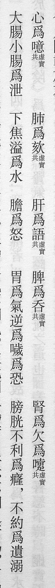

- 心爲噫｟虛實共｠
- 肺爲欬｟虛實共｠
- 肝爲語｟虛實共｠
- 脾爲呑｟虛實共｠
- 腎爲欠爲嚏｟虛實共｠
- 大腸小腸爲泄
- 下焦溢爲水
- 膽爲怒
- 胃爲氣逆爲噦爲恐
- 膀胱不利爲癃，不約爲遺溺

案：下焦云溢，膀胱云不利不約，共謂本氣不調也。依此則二腸膽胃共亦不調之所爲，可知也。

（眉）大小腸與旁光宜倒置，相克之順正合。

**○五精所并，**

〔識〕吳云：『五精，五藏之精氣也。并，合而入之也。五藏精氣，各藏其藏則不病，若合而并於一藏，則邪氣實之，各顯其志。』張云：『并，聚也。』高云：『藏虛而精氣并之也。精者，陰精。氣者，陽氣。』簡按：精氣乃水穀之精氣，不必分陰陽矣。

<!-- PAGE_END -->

<!-- PAGE: 0652 -->

<!-- PRINTED: 617 -->

案：五精，即五藏之精氣，下文所云精氣是也。謂其一藏之精氣，乘虛而合并一藏也。諸注家所説皆不妥。

**○精氣并於心則喜，**

水剋火。

案：此皆以相尅爲次，則此所云精氣，謂腎之精氣也。言腎之精氣合并於心藏則喜，《十六難》所云『心脈外證喜笑』是也。

**○并於肺則悲，**

火剋金。

案：心精氣與肺精合并則悲，《十六難》所云『得肺脈，外證悲愁不樂欲哭』是也。

**○并於肝則憂，**

金剋木。

案：肺精來并合於肝精則憂，《十六難》云『得肝脈，外證善潔善怒』，蓋怒在外者，内必有憂也。此謂内證也。

**○并於脾則畏，**

木剋土。

案：肝脾二精氣相并則畏，《十六難》云『得脾脈，外證善噫善思』，蓋思慮在於内，則外必有畏懼之狀也。終始畏念，是爲脾病。

**○并於腎則恐，**

<!-- PAGE_END -->

<!-- PAGE: 0653 -->

<!-- PRINTED: 618 -->

土剋水。

案：脾腎二精氣相并則恐，《十六難》云『得腎脈，外證喜恐欠』，蓋腎志爲恐，忽暴驚恐，是爲腎病。

**○是謂五并，虛而相并者也。**

《靈樞·九鍼論》云：『五并，精氣并肝則憂，并心則喜，并肺則悲，并腎則恐，并脾則畏，是謂五精之氣并於藏也。』

案：此宜與肝心脾肺腎相次，今次肝心肺腎脾，非其次也。

**○五藏所惡，心惡熱，肺惡寒，肝惡風，脾惡濕，腎惡燥，是謂五惡。**

《靈樞·九鍼論》：『五惡，肝惡風，心惡熱，肺惡寒，腎惡燥，脾惡濕，此五藏氣所惡者也。』

〔紹〕此不拘相剋之次序，又不必以天之五氣，蓋亦專就五藏之本性而言。藏病之理，實不外乎此。熱寒濕三者，俱兼内外因而言，風以外因言，燥以内因言。且熱風濕，俱本藏主氣，而其太過卻足以爲病矣。王釋心肺脾，似未盡。

案：《紹識》説是，可從矣。然以余觀之，則兼内外因而言，恐未然也。竊謂五惡者，謂五藏病各所禁也。《藏氣法時》所云五藏之禁正相合，云：『病在肝，禁當風。病在心，禁温衣熱食。病在脾，禁温食飽食濕地濡衣。病在肺，禁寒食寒衣。病在腎，禁犯焠㶼熱食炙衣。』禁與惡其義不二。是以經解經，不須多辨耳。或曰心病惡用凡熱藥，肺病惡用凡寒藥，肝病惡用風藥，脾病惡用濕藥，腎病惡用燥藥。此説恐非是。

**○五藏化液，**

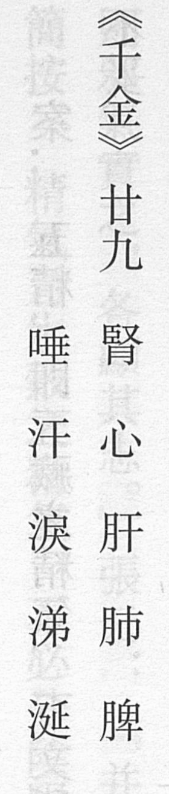

- 《千金》廿九
- 腎
- 心
- 肝
- 肺
- 脾
- 唾
- 汗
- 淚
- 涕
- 涎

<!-- PAGE_END -->

<!-- PAGE: 0654 -->

<!-- PRINTED: 619 -->

〔馬〕此言五藏各有其液也。飲食入胃，其精微之氣，有所化而爲液者。

**○心爲汗，**

〔識〕吳云：『心主血，汗者血之餘，故汗爲心液。』簡按：《營衛生會篇》云：『奪血者無汗，奪汗者無血。』《三因方》謂傷寒衄者爲紅汗，其意同焉。

案：多汗亡陽，亦汗爲心液之明徵也。

**○肺爲涕，**

〔識〕簡按：諸字書以『涕』爲目泣，而醫家特爲鼻液，考《説文》『洟又作䶏，鼻液也』，蓋䶏涕通用。《玉篇》『䶏，他計切。鼻䶏』。《禮·内則》『不敢唾涕』，《釋文》『本又作洟』。

《蘭軒遺稿》鮧魚下云：按《五經文字》自目曰涕，自鼻曰洟，今人多以涕爲鼻洟，誤矣。然則，夷弟通用，元屬唐人之譌謬。但《易》釋文『明夷，夷於左股』：子夏本『夷』作『睇』，京作『眱』；渙『匪夷所思』：荀本『夷』作『弟』，則唐以前亦誤，蓋夷弟篆體已近似，而隸變轉訛耳。

**○肝爲淚，**

案：淚字《説文》所無，蓋涕之俗字。《説文》『涕，泣也』。鉉音『他禮切』『泣，無聲出涕曰泣』『洟，鼻液也』。鉉音『他計切』。《玉篇》『洟，弋之、他計二切。鼻液也。古爲鼽』，又『涕，恥禮切。目汁出曰涕』，又『淚，力季切。涕，淚也。𭰝同，上俗』。《廣韻》至韻『淚，力遂切。涕淚。俗作𭰝』，薺韻『涕，他禮切。目汁』，霽韻『涕，他計切。涕淚』，又『洟，鼻洟。戾，輜車』，共『他計切』。《集韻》『戾，他計切。輜車旁推戶也。蓋弟戾二字，古音相同，而涕字以目汁爲正訓，涕淚爲俗呼。二字連用，與稱秤、蘇甦等字同例。竊謂：涕淚者，涕之緩言，後以涕洟二字易混易誤，專以淚爲目汁字，音力遂切，以分『淚，郎計切。疾流兒』。《淮南子》『水淚破舟』｟《集韻》｠之字，蓋淚之爲言累也，連也。以取於泣出流下之義。《醫方類聚》｟五｠引《五藏六府圖》云『淚，類也。因類而出，故曰淚也』，是就『力遂切』而爲説也。只《易·萃卦》『齎咨涕洟』，《禮記·檀弓上》『垂涕洟』，共鼻目二汁字連用，不誤，正與《説文》合。是古文之僅存於今日者也。

<!-- PAGE_END -->

<!-- PAGE: 0655 -->

<!-- PRINTED: 620 -->

案：《和名抄》云『涕淚，體類二音。奈美太』。《新撰字鏡》汕訓『奈牟太』，《仁德紀》國依媛歌作『那瀰多』，《萬葉集》作『那美多』，谷川氏曰『奈美多，蓋泣水垂之義』。則知『奈牟多』者，美牟同音之轉，猶『宇末』『牟末』｟馬｠，『宇女』『牟女』｟梅｠之例耳。

《禮·檀弓上》《釋文》『涕洟，上他計反，下音夷。自目曰涕，自鼻曰洟』。

**○脾爲涎，**

〔識〕吳、張並云：『涎出於口，脾之竅也。』簡按：《證治準繩》損傷門云『兩臉涎囊』，知是涎出於口也。

案：《醫心方》卷二廉泉下｟八ウ｠『涎』傍訓『與多利』。《新撰字鏡》『唌』訓『豆波志留』。今俗呼『與多禮』，一音之轉也。蓋『與者與曾』之畧，謂口外垂下也。『豆波志留』者，謂津走也。津液訓『都』，猶血乳共訓『知』之例。『都知』其音相通，乃『都都久』『都止夫』之義也。

《靈·口問》曰：『飲食者皆入於胃，胃中有熱則蟲動，蟲動則胃緩，胃緩則廉泉開，故涎下。』《甲乙》卷十二引『涎』作『㵪』。

《説文》『㳄，慕欲口液也。從欠從水，或從侃作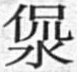。籒文作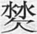』。《玉篇》『㳄，徐仙切。亦作涎𣵿』。

《廣韻》：㳄，口液也。夕連切。涎，上同。

《甲乙》卷七·六經受病第一下『腹脹，内腫㵪，太谿主之』注文曰：『音涎。』卷九第二篇亦同。

<!-- PAGE_END -->

<!-- PAGE: 0656 -->

<!-- PRINTED: 621 -->

（眉）零本《明堂》肺經魚際下曰：『數唾羨下。』楊注曰：『涎下。』

（眉）『豆波』，唾也。『志留』，汁也。

**○腎爲唾，**

〔識〕吳云：『唾出於廉泉二竅，二竅挾舌本。少陰腎脈循喉嚨，挾舌本，故唾爲腎液。』高云：『《靈樞·根結篇》云：少陰根於涌泉，結於廉泉。廉泉，舌下竅也。是腎爲水藏，從下而上。液雖有五，腎實主之，是以五液皆鹹。鹹，水味也。』

《説文》『唾，口液也。从口垂聲。湯臥切。涶，唾或從水』。

案：《和名抄》引《考聲切韻》云『唾，湯臥反。口中津也』，訓『都波歧』。《新撰字鏡》液訓『豆波支』。蓋『豆波支』者，津吐也。豆解已見於前條『涎』下。

**○是謂五液。**

《靈樞·九鍼論》『五液，心主汗，肝主泣，肺主涕，腎主唾，脾主涎，此五液所出也』。

**○五味所禁，辛走氣，氣病無多食辛。**

犬稻桃葱。

案：少食則可，宜禁多食耳。下文同。氣病，肺病也。

**○鹹走血，血病無多食鹹。**

豕、大豆、栗、藿。

血病，心病也。

<!-- PAGE_END -->

<!-- PAGE: 0657 -->

<!-- PRINTED: 622 -->

**○苦走骨，骨病無多食苦。**

麥、羊、杏、薤。

案：骨病，腎病也。

**○甘走肉，肉病無多食甘。**

牛、稷、棗、葵。

案：肉病，脾病也。

**○酸走筋，筋病無多食酸。**

鷄、麻、李、韭。

案：筋病，肝病也。

**○是謂五禁，無令多食。**

《黄帝養生經》云：『病在筋無食酸，病在氣無食辛，病在骨無食鹹，病在血無食苦，病在宍無食甘。口嗜而飲食之不可多也，必自賊也，故名五賊。』

《靈樞·九鍼論》云：『五裁，病在筋無食酸，病在氣無食辛，病在骨無食鹹，病在血無食苦，病在肉無食甘。口嗜而欲食之，不可多矣，必自裁也。命曰五裁。』

《靈樞·五味論》云：『黄帝問於少俞曰：五味入於口也，各有所走，各有所病。酸走筋，多食之令人癃。鹹走血，多食之令人渴。辛走氣，多食之令人洞心。苦走骨，多食之令人變嘔。甘走肉，多食之令人悗心。余知其然也，不知其何由，願聞其故。少俞答曰：酸入於胃，其氣濇以收上之兩焦，弗能出入也。不出即留於胃中，胃中和温，則下注膀胱。膀胱之胞薄以懦，得酸則縮綣，約而不通，水道不行，故癃。陰者，積筋之所終也，故酸入而走筋矣。鹹入於胃，其氣上走中焦，注於脈，則血氣走之。血與鹹相得則凝，凝則胃中汁注之，注之則胃中竭，竭則咽路焦，故舌本乾而善渴。血脈者，中焦之道也，故鹹入而走血矣。辛入於胃，其氣走於上焦。上焦者，受氣而營諸陽者也。薑韭之氣薰之，營衛之氣不時受之，久留心下，故洞心。辛與氣俱行，故辛入而與汗俱出。苦入於胃，五穀之氣，皆不能勝苦，苦入下脘，三焦之道皆閉而不通，故變嘔。齒者，骨之所終也，故苦入而走骨，故入而復出，知其走骨也。甘入於胃，其氣弱小，不能上至於上焦，而與穀留於胃中者，令人柔潤者也。胃柔則緩，緩則蟲動，蟲動則令人悗心，其氣外通於肉，故甘走肉。』

<!-- PAGE_END -->

<!-- PAGE: 0658 -->

<!-- PRINTED: 623 -->

《五行大義》卷三引《養生經》云：『五味之入口也，各有所走，各有所病。酸走筋，多食之令人癃。鹹走血，多食之令人渴。辛走氣，多食之令人洞心。苦走骨，多食之令人變。甘走皮，多食之令人惡心。辛散，酸收，甘緩，苦堅，鹹濡。五穀爲養，五菓爲助，五畜爲益。氣味合而服之，隨四時五藏所宜也。』

又引《河圖》云：『人食無極鹹，使腎氣盛心氣虛，令人發狂，喜衄吐血，心神不定。無極辛，使肺氣盛肝氣衰，令人懦怯悲愁，目盲髮白。無極甘，使脾氣盛，腎氣衰，令人癡淫泄精，腰背痛，利膿血。無極苦，使心氣盛，肺氣衰，令人果敢輕死，欬逆胸滿。無極酸，使肝氣盛，脾氣衰，令人穀不消化，喑聾癥固。此五藏相制剋之義。』其理自別。

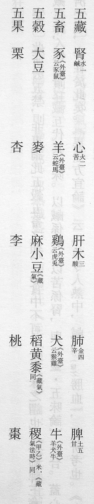

- 五藏
- 腎｟水一鹹｠
- 心｟火二苦｠
- 肝｟木三酸｠
- 肺｟金四辛｠
- 脾｟土五甘｠
- 五畜
- 豕｟《外臺》云豕鼠｠
- 羊｟《外臺》云蛇馬｠
- 鷄｟《外臺》云虎兎｠
- 犬｟《外臺》云猴雞｠
- 牛｟《外臺》羊犬牛｠
- 五穀
- 大豆
- 麥
- 麻小豆｟《藏氣》｠
- 稻黄黍｟《藏氣》同｠
- 稷｟《甲乙》米，《藏氣法時》同｠
- 五果
- 栗
- 杏
- 李
- 桃
- 棗

<!-- PAGE_END -->

<!-- PAGE: 0659 -->

<!-- PRINTED: 624 -->

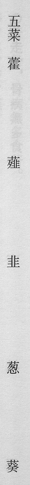

- 五菜
- 藿
- 薤
- 韭
- 葱
- 葵

案：此所云五禁，非專謂此五穀五畜之類，凡食中不可多食某味之謂也。肝肺脾三藏共謂不可多食，其本藏之味，但心腎二藏互代其本味。以鹹係心，以苦係腎，與《靈·五味論》正合。蓋心腎互代者，即水火相濟之理，妙在於此矣。《異法方宜論》云『魚令人熱中，鹹｟（當作『鹽』）｠勝血』，可併考也。《九鍼論》所云五裁，共謂本藏之味，與此其理自別。

**○五病所發，**

已下至『是謂五亂』，《大素》卷廿七耶傳篇載之。

〔馬〕此言五藏之病，各有所發也。

**○陰病發於骨，**

〔志〕腎爲陰藏，在體爲骨，故腎陰之病，而發於骨。

案：陰病發於骨者，蓋腰痛痿躄之類是也。腎爲陰藏，故曰陰病也。《標本病傳論》云『腎病少腹腰脊痛䯒痠』，《靈樞·經脈篇》云『足少陰氣絶則骨枯』並可以徵矣。《素·脈解篇》云：『少陰所謂腰痛者，少陰者腎也。』《痿論》：『腎氣熱，則腰脊不舉，骨枯而髓減，發爲骨痿。』

**○陽病發於血，**

〔吳〕血生於心，而主夏令，故陽病發於血。

案：陽病發於血者，蓋發狂癰疔之類是也。心爲陽藏，故曰陽病也。《經脈篇》云：『手少陰氣絶則脈不通，脈不通則血不流。』《痿論》：『心氣熱，則下脈厥而上，上則下脈虛，虛則生脈痿。樞折挈，脛縱而不任地也。』

<!-- PAGE_END -->

<!-- PAGE: 0660 -->

<!-- PRINTED: 625 -->

**○陰病發於肉，**

〔張〕肉屬脾，脾者陰中之至陰也。

案：陰病發於肉者，蓋麻痺水腫之類也。《痿論》：『脾氣熱，則胃乾而渴，肌肉不仁，發爲肉痿。』

**○陽病發於冬，**

案：陽病發於冬者，肺病欬嗽是也。蓋肺主皮毛，冬寒中皮毛，則發寒熱欬逆。《陰陽應象大論》云：『秋傷於濕，冬生欬嗽。』《痿論》：『肺熱葉焦，則皮毛虛弱，急薄著則生痿躄也。』

**○陰病發於夏，**

案：陰病發於夏者，肝病霍亂轉筋類是也。《應象大論》云：『春傷於風，夏生飧泄。』蓋春傷於風，則肝木受傷，至夏心火不旺，故爲飧泄不化之證。《痿論》：『肝氣熱，則膽泄口苦筋膜乾。筋膜乾則筋急而攣，發爲筋痿。』

**○是謂五發。**

〔楊〕陰之爲病，發骨疼等。陽之爲病，發於血痺等。五味爲病，發於氣不調等。冬陽在内，故病發冬，夏陽在外，故病發夏也。

**○五邪所亂，**

〔志〕言正氣爲邪氣所亂。

**○邪入於陽則狂，**

〔張〕邪入陽分，則爲陽邪。邪熱熾盛，故病爲狂。《生氣通天論》曰：『陰不勝其陽，則脈流薄疾，并乃狂。』

<!-- PAGE_END -->

<!-- PAGE: 0661 -->

<!-- PRINTED: 626 -->

案：邪迫入於心藏，則爲狂證，心主神性故也。

**○邪入於陰則痺，**

案：邪迫入於肝藏，則爲痺證，肝主筋血故也。

〔張〕邪入陰分，則爲陰邪。陰盛則血脈凝濇不通，故病爲痺。《壽夭剛柔篇》曰：『病在陰，命曰痺。』

《九鍼論》曰：『邪入於陰，則爲血痺。』

**○搏陽則爲巔疾，**

〔張〕搏，擊也。巔，癲也。邪搏於陽，則陽氣受傷，故爲癲疾。上文言邪入於陽則狂者，邪助其陽，陽之實也。此言搏陽明爲癲疾者，邪伐其陽，陽之虛也。故有爲狂爲癲之異。《九鍼論》曰『邪入於陽，轉則爲癲疾』，言轉入陰分故爲癲也。

真本《明堂》卷一列缺下曰『癇驚』，楊注：『小兒癲病之也。限間反。』

案：巔疾即蹎仆疾，解已見《五藏生成第十》中。癲癇與狂走，二病相類而有陰陽之分。故《廿難》云『重陽者狂，重陰者癲』，《五十九難》云『狂癲之病，何以別之。然：狂之始發，少臥而不飢，自高賢，自辨智也。自貴倨，妄笑歌樂，妄行不休是也。癲疾始發，意不樂，直視僵仆，其脈三部陰陽俱盛是也』｟此因《靈·癲狂第廿二》而其文自有少異｠。但癲疾而狂走者間有之。《厥論》所云『陽明之厥，則癲疾欲走呼，腹滿不得臥，面赤而熱，妄見而妄言』，《甲乙經》十一·陽厥大驚發狂癇第二云『癲疾，怒欲殺人，身柱主之。癲疾發如狂走者，面皮厚敦不治，長強主之』，其他《脈解篇》所云狂巔疾之類。凡狂癲連稱者，不必分狂與癲，蓋謂癲疾而加狂證者也。《甲乙經》又云『暴病厥癲疾狂，久逆之所生也。五藏不平，六府閉塞之所生也』，是謂癲狂二證其因相同，但有陰陽之別也。

<!-- PAGE_END -->

<!-- PAGE: 0662 -->

<!-- PRINTED: 627 -->

《脈經·辨脈陰陽大法》云：『陰附陽則狂，陽附陰則癲。』

《范汪祕方》：『邪入於陽，轉則爲癲。』《御覽》

《病源》云：『風癲者，由血氣虛，邪入於陰經故也。人有血氣少，則心虛而精神離散，魂魄妄行，因爲風邪所傷，故邪入於陰，則爲癲疾。』

《莊子》：『流脈並作驚怖，陽氣獨上，則爲癲病。』｟《御覽》｠案：此文，今本《莊子》無考。

案：又有以狂爲癲者，《腹中論》『石藥發癲，芳草發狂』王注：『多喜曰癲，多怒曰狂。』《急就章》顔師古注：『顛疾，性理顛倒失常，亦謂之狂，獝妄動作也。』《神異經》『西方有人，飲食被髮，東走。其婦追之不止，怒亦被髮，名曰狂，一名顛，一名狷，一名風。此人夫妻與天俱生，狂走東西，沒晝夜』｟《御覽》引｠。『祖臺之議錢耿殺妻事曰：尋建康獄，竟囚錢耿癲疾，發作毆殺妻，了無他變。故荒病之人，不蒙哀矜之施，無知之禮，加以大辟之刑，｟（當補『懼』）｠非古原心定罪之義』｟《御覽》引｠。是癲疾亦發狂證者或有之。癲狂互通稱。《唐書·張旭傳》之『張顛』，《茶録》陸羽嗜茶，人曰『茶顛』之類，並皆謂狂也。

案：邪入於腎部則蹎仆，所以主精主志也。《五藏生成篇》『頭痛巔疾，下虛上實，過在足少陰巨陽，甚則入腎』，《脈要精微》十七云『厥成爲巔疾』，又云『來疾去徐，上實下虛，爲厥巔疾』，《脈解篇》四十九云『所謂甚則狂巔疾者，陽盡在上，陰氣從下，下虛上實，故狂巔疾也』，《方盛衰論》八十云『氣上不下，頭痛巔疾』，並皆上實下虛之義。蓋邪入陰分腎中而爲厥，下虛是也。其邪勢搏擊心肝部分，因爲癲仆，上實是也。此疾雖似屬心肝二病，然其實則邪在腎部也，乃上實下虛之謂也。

**○搏陰則爲瘖，**

〔識〕唐·慧琳《藏經音義》云：『瘖，寂然而無聲。瘂者，有聲而無説，舌不轉也。』

<!-- PAGE_END -->

<!-- PAGE: 0663 -->

<!-- PRINTED: 628 -->

《本草匯》卷五曰：『舌瘖，邪入陰則瘖，舌不轉運，痰涎乘虛，閉塞舌本之脈道而瘖。中風熱則舌縱不語，中風寒則舌強不語。』又曰：『喉瘖，喉中聲嘶，疎泄肺壅，開結痰。』

《説文》『瘖，不能言也。從疒音聲』。

〔吳〕瘖，瘂也。蓋太陰脾脈，挾咽連舌本散舌下。少陰腎脈，循喉嚨，挾舌本。厥陰肝脈，循喉嚨之後，邪正相搏於此三陰之脈，則喉嚨閉塞，舌本不利，令失音而瘂。又肺爲太陰，而主氣，故肺病令人聲瘖。《傳》曰：『言者心之聲。』故驚氣入心，令人失聲，皆搏陰爲瘖之意也。

案：邪入肺部陽分，擊搏而入肝脾，則爲瘖也。《五行大義》引《管子》云『肺發爲口』，又引《太平經》又一説云『肺爲口』，又引《天文志》云『肺爲言』，並是肺主言聲之説也。

**○陽入之陰則靜，陰出之陽則怒。**

〔識〕簡按：孫奕《示兒編》云：『之字訓變。《左傳》遇觀之否，言觀變爲否也。』蓋陽病在外則躁，若入而變陰則靜。下文『出之陽』意同，王訓『之』爲『往』，似未妥。

案：此二『陰』字，共指脾也。蓋陽入之陰則靜者，言肝木之陽邪來剋脾土，則陽證變陰，陽熱變陰寒，故云靜也。陰入｟當作『出』｠之陽則怒者，言脾土之陰邪内盛，出侵於肝木之陽分，則發喜怒｟從《大素》『則怒』作『病喜怒』｠之證。所以脾主意，肝主怒也。乃木克土，土克水，土生金，金生水之理也。蓋脾與四藏不同，邪之來至，往來不定，因胃氣消長，故爲此靜躁之二證也。古來注家解此章，未得定説，今竊以私見説之，以備後日遺忘耳。

**○是謂五亂。**

《靈樞·九鍼論》云：『五邪，邪入於陽則爲狂，邪入於陰則爲血痺。邪入於陽，轉則爲巔疾。邪入於陰，轉則爲瘖。陽入之於陰，病靜。陰出之於陽，病喜怒。』

<!-- PAGE_END -->

<!-- PAGE: 0664 -->

<!-- PRINTED: 629 -->

〔楊〕熱氣入於陽脈，重陽，故爲狂病。寒耶入陰脈，重陰，故爲血痺。陽耶入於陽脈，聚爲癲疾。陽耶入於陰脈，聚爲瘖不能言。陽耶入陰者，則爲病好靜。陰耶出之於陽，陽動，故多生喜怒也。

**○五邪所見，**

『五邪』至『死不治』，《大素》十四·四時脈診載之。

〔馬〕此言五藏之邪，有所見之脈也。

〔張〕五味互勝，病勝藏也，故曰五邪。

**○春得秋脈，**

〔馬〕金剋木也。

**○夏得冬脈，**

〔馬〕水剋火也。

**○長夏得春脈，**

〔馬〕木剋土也。

**○秋得夏脈，**

〔馬〕火剋金也。

**○冬得長夏脈，**

〔馬〕土剋水也。

**○名曰陰出之陽，病善怒不治，**

案：陰出之陽者，譬春宜得弦脈而得毛脈，而卻宜沈伏之脈見，故曰陰出之陽。四時皆同例。

<!-- PAGE_END -->

<!-- PAGE: 0665 -->

<!-- PRINTED: 630 -->

〔張〕陰盛陽衰，土敗木賊，故病當善怒，不可治也。

案：土係於四藏，四藏衰則脾土必受傷。五藏所病，脾必不得不受傷。土受傷，則肝木亢極，所以善怒也，而爲不治。

**○是謂五邪，皆同命死不治。**

〔吳〕此又決言其同，是死證也。

〔志〕此言上文之所謂不治者，謂五脈皆爲邪勝也。如五藏之氣爲邪所勝，見四時相剋之脈，皆爲死不治矣。

〔箚〕《玉機真藏論》：『所謂逆四時者，春得肺脈，夏得腎脈，秋得心脈，冬得脾脈，命曰逆四時。』

〔楊〕春得秋脈，夏得冬脈，皆賊耶來乘也。秋得春脈，冬得夏脈，雖是微邪來乘，以秋冬得之陰出之陽，交爭者不療也。

**○五藏所藏，**

案：五藏藏此五神，所以名曰五藏也，故曰五藏所藏也。《千金》卷廿九·五藏旁通第四以此爲五神。

**○心藏神，**

《六節藏象》第九云：『心者生之本，神之變也。其華在面，其充在血脈，爲陽中之太陽，通於夏氣。』

《調經論》曰：『心藏神，肺藏氣，肝藏血，脾藏肉，腎藏志，而此成形。』

案：此曰神者，長育丈軀之氣也。

《素·解精微論》：『火之精爲神。』

《靈·平人絶穀篇》：『神者，水穀之精氣也。』

<!-- PAGE_END -->

<!-- PAGE: 0666 -->

<!-- PRINTED: 631 -->

又《本神篇》：『心藏脈，脈舍神。』

古抄本《老子經》河上公注第三章標記曰：『五神，魂魄神精志也。』此説未允。

《素·陰陽應象論》『玄生神』王注：『玄冥之内，神處其中，故曰玄生神。』

又《天元紀大論》『玄生神』王注：『玄遠幽深，故生神也。神之爲用，觸遇玄通，契物化成，無不應也。』

《説文》：『神，天神，引出萬物者也。』

《廣韻》：『神，靈也。』

《大戴禮·曾子·天圓》：『陽之精氣曰神。』

《易·説卦傳》：『神也者，妙萬物而爲言者。』｟《大玄·玄告》注同。又一見同意。｠

《易·繫辭傳上》：『陰陽不測之謂神。』

《論衡·論死篇》：『陽氣導而生，故謂之神。』

《後漢書·李固傳》：『氣之清者爲神。』

〔張〕精氣之靈明也。《本神篇》曰：『兩精相搏謂之神。』

〔吳〕情之所主謂之神。

案：精神一而爲二，蓋男女構精，兩精相搏，中生一氣，謂之神。神者，無形之靈氣也。氣中已生物，謂之精，氣血筋骨皮肉隨成，其原只是一氣塊耳。以上先天精神之謂也，後天精神亦同理。飲食入胃，其精微之氣入藏於心謂之神，神中自有精，精五藏各有之，臨用皆輸泄於腎竅，以上後天精神之謂也。

（眉）《四十二難》虞注：『神者，精氣之化成也。』

<!-- PAGE_END -->

<!-- PAGE: 0667 -->

<!-- PRINTED: 632 -->

**○肺藏魄，**

〔吳〕並精而出入者，謂之魄。｟出於《本神篇》之文｠

《六節藏象論》云：『肺者，氣之本，魄之處也。其華在毛，其充在皮，爲陽中之太陰，通於秋氣。』

《靈·本神篇》：『肺藏氣，氣舍魄。』

又《天年篇》：『人八十歲，肺氣衰。魄離，故言善悞。』

《玉篇》：『魄，人之精爽也。』《越絶書·外傳枕中》云：『魄者，生氣之源也。』《白虎通·情性》云：『魄者白也。』《古微書》引《孝經援神契》云：『魄，白也。白，明白也。』

案：《説文》：『魄，陰神也。』又云：『情，人之陰氣有欲者。』《廣韻》：『情，靜也。』蓋情者人之所嗜欲，飲食男女，是情之最大者也。此情在内而靜寂，然隨氣自由往來，故魄情共係於肺氣，情者出於性者也。性者，肝血之所生，譬耳目之能視能聞謂之性，即魂之所主。耳之惡聽惡聲，目之惡視惡物，謂之情，即魄之所主也。

（眉）案：此曰魄者，情也。儒家云氣者，此之魄也。

（眉）《四十二難》虞注：『魂者，神氣之輔弼也。魄者，精氣之匡輔也。專意不移者志。』又紀注：『魂乃神明之輔弼也。魄乃精氣之匡佐也。』

**○肝藏魂，**

〔吳〕隨神而往來者，謂之魂。｟《本神篇》文｠

《六節藏象論》云：『肝者，罷極之本，魂之居也。其華在爪，其充在筋，以生血氣，其味酸，其色蒼，此爲陽中之少陽，通於春氣。』

<!-- PAGE_END -->

<!-- PAGE: 0668 -->

<!-- PRINTED: 633 -->

案：魂魄解見《六節藏象》第九中，及《本草經攷注》丹沙下。

楊愼《丹鉛續録》卷二曰：『情與性，魄與魂也。』又曰：『魂魄，性情也。魂能知來，魄能藏往。』

《靈·本神篇》：『肝藏血，血舍魂。』

《説文》：『魂，陽氣也。』

《關尹子》曰：『魂晝寓目，魄夜舍肝，寓目能見，舍肝能夢。』

《玉篇》：『魂，陽游氣也。人始生化曰魂。』

案：魂者，人之陽氣無形者，又謂之性。《説文》：『性，人之陽氣性善者也。』《玉篇》：『性，命也。質也。』《廣韻》：『性，性行也。』蓋血陰中游出之陽氣之曰魂，即性也。性者，自天所得。有性急者，有性緩者，有性智者，有性愚者，不可變易者是也。自性出者謂之情，變易自在動搖者也。是陽氣中所生之陰氣，入内而不動，觸事而動搖自在者是也。

〔張〕神氣之佐輔也。《本神篇》曰：『隨神往來者謂之魂。』

（眉）案：此曰魂者，性與氣之二也。

**○脾藏意，**

《大學》首書引《教秦總録》云：『身之主宰爲心，心之發動爲意，心之靈覺爲知。』《海蠡編》云：『心猶水也，意猶氷也。水體常流，而一結爲氷，則失其常流之性矣。』

〔吳〕心之憶念謂之意。

〔張〕心｟當作『神』｠有所注者也。《本神篇》曰：『心有所憶謂之意。』

案：意係之於脾者，蓋脾者四藏之共所受養者也。喜心怒肝憂肺恐腎並爲脾之所思｟脾｠意｟脾｠也。

<!-- PAGE_END -->

<!-- PAGE: 0669 -->

<!-- PRINTED: 634 -->

《靈·本神篇》：『心有所憶謂之意。』

又曰：『脾藏營，營舍意。』

又《本藏篇》：『志意者，所以御精神，收魂魄，適寒温，和喜怒者也。志意和則精神專直，魂魄不散，悔怒不起，五藏不受邪矣。』

《説文》『意，志也。從心，察言而知意也。從心從音｟鍇本作『音聲』｠』。

《玉篇》『意，志也，思也』。

《廣韻》『意，志也』。

《金匱玉函經·總例篇》『經曰：東方筋膜魂，南方血脈神，西方皮毛魄，北方骨髓志，中央肌肉智』。

（眉）案：此曰意者，意與心之二也。

（眉）案：今人眠中爲譫言夢見者，魂也。被囓蚤蝨爲搔爬，遇温揭被者，意也。

**○腎藏志，**

〔吳〕專意不移謂之志。

〔張〕意有專一者也。《本神篇》曰：『意之所存謂之志。』

《六節藏象論》云：『腎者主蟄，封藏之本，精之處也。其華在髮，其充在骨，爲陰中之少陰，通於冬氣。』

《解精微論》『水之精爲志，志者骨之主也』。

《靈·本神篇》『意之所存謂之志』。

又曰：『腎藏精，精舍志。』《甲乙》卷一·第一篇作『精舍氣』。案：志、精一聲之轉。

<!-- PAGE_END -->

<!-- PAGE: 0670 -->

<!-- PRINTED: 635 -->

又《本藏篇》『志意者，所以御精神，收魂魄，適寒温，和喜怒者也。志意和則精神專直，魂魄不散，悔怒不起，五藏不受邪矣』。

《説文》『志，意也』。

《玉篇》『志，意也』。

《廣韻》『志，意慕也』。

案：意者，觸而動，不一定，故係之於脾。志者，出於意而一定者也，故屬於腎。腎，水也。水無所不至，其志專一者，則出於腎藏也。

再案：據《解精微》及《本神》言，則志者，腦中藏先事往事之名。志者，寘止積藏之義。志、精同聲，記誌鏤銘著刻之謂。《易·系》『知以藏往』是也。腦髓腎一府也。

（眉）案：此曰志者，心之之｟疑衍｠志與腦藏之志也。

**○是謂五藏所藏，**

《靈·九鍼論》『五藏，心藏神，肺藏魄，肝藏魂，脾藏意，腎藏精志也』。

〔新〕按：楊上善云『腎有二枚，左爲腎藏志，右爲命門藏精也』。

**○五藏所主，**

《舉痛論》篇首王注：『假七神五藏而運用之。』所謂七神斥精志一，神心二，魂性三，魄情四，意氣五也。就中別分出作七，則精志一，神心氣二，魂三，魄四，意五，性六，精七也。《醫心方》卷廿五小兒初與乳方篇《産經》云『夫五情善惡，七神所稟，無非乳湩而生化者也』，所謂七神亦同矣。所謂五情者，喜樂愛欲一也，怒惡二也，悲哀三也，恐驚懼四也，憂思五也。

<!-- PAGE_END -->

<!-- PAGE: 0671 -->

<!-- PRINTED: 636 -->

〔吳〕謂之主者，存亡以之，治亂以之，各有所主，以爲依歸也。

〔志〕五藏在内，而各有所主之外合。

**○心主脈，**

〔張〕心主血脈，應火之動，而運行周身也。

**○肺主皮，**

〔張〕肺主皮毛，應金之堅，而保障全體，捍禦諸邪也。

**○肝主筋，**

〔張〕肝主筋膜，應木之柔，而聯絡關節也。

**○脾主肉，**

〔張〕脾主肌肉，應土之厚，而畜養萬物也。

**○腎主骨，**

〔張〕腎主骨髓，應水石之沈固，爲立身之幹，爲萬化之原也。

**○是謂五主。**

《靈樞·九鍼論》：『五主，心主脈，肺主皮，肝主筋，脾主肌，腎主骨。』

《痿論第四十四》云：『肺主身之皮毛，心主身之血脈，肝主身之筋膜，脾主身之肌肉，腎主身之骨髓。』

**○五勞所傷，**

〔識〕志云：『勞，謂太過也。上古之民，｟當補『形』｠勞而不倦。』｟《上古天真論》文｠簡按：勞，《説文》『劇也。從力熒省。熒，火燒冖，用力者勞。魯刀切』。《爾雅·釋詁》『勞，勤也』。

<!-- PAGE_END -->

<!-- PAGE: 0672 -->

<!-- PRINTED: 637 -->

**○久視傷血，**

〔張〕久視則勞神，故傷血。《營衛生會篇》曰：『血者，神氣也。』

〔識〕簡按：《五藏生成篇》云：『諸脈者，皆屬於目。』久視傷血者，傷血脈也。

**○久臥傷氣，**

〔張〕久臥則陽氣不伸，故傷氣。

**○久坐傷肉，**

〔張〕久坐則血脈滯於四體，故傷肉。

**○久立傷骨，**

〔志〕久立則傷腰腎膝脛，故傷骨。

**○久行傷筋，**

〔志〕行走罷極，則傷筋。

**○是謂五勞所傷。**

《靈樞·九鍼論》『五勞，久視傷血，久臥傷氣，久坐傷肉，久立傷骨，久行傷筋，此五久勞所病也』。

**○五脈應象，**

以下至『五藏之脈』，《大素》十五·五藏脈診載之。

〔志〕五藏之脈，以應四時五行之象。

**○肝脈絃，**

<!-- PAGE_END -->

<!-- PAGE: 0673 -->

<!-- PRINTED: 638 -->

周本作『弦』，與《大素》合。

〔志〕象木體之條達也。

**○心脈鉤，**

〔志〕象火炎盛而秒，則環轉如鉤。

**○脾脈代，**

〔志〕象四時之更代也。

〔張〕代，更代也。脾脈和耎，分王四季。如春當和耎而兼弦，夏當和耎而兼鉤，秋當和耎而兼毛，冬當和耎而兼石，隨時相代，故曰代。此非中止之謂。

**○肺脈毛，腎脈石，**

（脱文，今據顧本補。）

**○是謂五藏之脈。**

案：四時脈象，詳見《平人氣象》第十八。五藏脈，見《玉機真藏》第十九中。

辛酉八月十三日早晨書　枳園生立之

廿三補

肺藏魄｟廿一ヲ｠

〔張〕精氣之質地也。《本神篇》曰：『並精而出入者，爲之魄。』

呑｟三ウ｠

明方隅《醫林繩墨》曰：『呑酸者，胃口酸水攻激於上，以致咽嗌之間，不及吐出而嚥下，酸水刺心，有若呑酸之狀也。吐酸者，吐出酸者之水，皆由胃氣不行，脾氣不運，飲食痰涎津液俱化爲水，鬱而少久以成酸也。』龔氏《萬病回春》本乎此，而其説同也。

<!-- PAGE_END -->

<!-- PAGE: 0674 -->

<!-- PRINTED: 639 -->

神｟廿オ｠

《酉陽雜俎》卷二曰：『五藏九宮十二室，四支五體三焦九竅，百八十機關，三百六十骨節，三萬六千神，隨其所而居之。魂以精爲根，魄以目爲户，三魂可拘，七魄可制。』

案：九宮，九藏也。十二室，亦十二藏。五體，亦四支與首躳也。三焦，首胸手與背腹與腰脚也。神者，即洋言神經，即髓腦心血所灌注以覺知者，其派別分布無數，姑且舉稱三萬六千也耳。

魂｟廿一ウ｠

『天氣爲魂』。《漢書·楊王孫傳》《集注》，又《淮南·主術》

『死氣爲魂』。《太玄》中『巔靈，氣形反』注

『人之精氣曰魂』。《御覽》五百四十九引《禮記外傳》

『魂者，芸也』。《白虎通·情性》

『魂，芸也。芸，芸動也』。《古微書》引《孝經援神契》

『魂猶傳傳也。行不休也』。《白虎通·情性》

『魂者，橐也』。《越絶書·枕中》

『魂，人之陽精也。陽精爲魂，陰精爲魄』。《呂覽·禁塞》『費神傷魂』注

『魂者，精氣也』。《論衡·紀妖》

『魂者，陽之精也』。《楚辭·大招》『魂魄歸來』注

<!-- PAGE_END -->

<!-- PAGE: 0675 -->

<!-- PRINTED: 640 -->

『魂者，身之精也』。《楚辭·招魂》『魂魄離散』注

『魂，神也』。《詩》『出其東門』釋文引《韓詩》

『魂，人陽神也』。《淮南·説山》『魄問於魂』注

『魂，陽神』。《淮南·精神》『其魂不騰』注

『情性之神曰魂魄』。《洪範·五行傳》『時則有下人伐上之痾』注

『心之精爽，是謂魂魄』。《後漢·左雄傳》注。又《賈子》禮容語下

『人生始化曰魄，既生魄，陽曰魂』。《左氏·昭七年傳》

『魂，陽物，謂乾神也』。《易·繫辭上》『遊魂爲變』虞注

『神爲魂』。《大戴禮·曾子天圓》『陽之精氣曰神』注

魂｟廿一ウ｠

《説文》『魂，陽氣也』。

『精氣爲魂』。《太玄·玄數》『俯魂』注

『精氣爲魂』。《周禮·夏采》注『復謂始死招魂復魄』疏

『出入之氣謂之魂』。《儀禮·士喪禮》『復魂』疏

『人之歔吹出入之氣爲魂』。《周禮·大宗伯》注『魂氣歸於天』疏

『魂主死氣之舍也』。《越絶書·外傳枕中》

『附氣之神爲魂也』。《左氏·昭七年傳》『魄陽曰魂』疏

『魂魄，神靈之名』。《左氏·昭七年傳》『魄陽曰魂』疏

<!-- PAGE_END -->

<!-- PAGE: 0676 -->

<!-- PRINTED: 641 -->

『物本爲魂』。《廣雅·釋天》曹憲音引《詩緯》

魄｟廿一ヲ｠

『地氣爲魄』。《淮南·主術》

『魄者，白也』。《白虎通·情性》

『魄，形也』。《左氏·昭七年》傳『人生始化曰魄』注，《大玄》『視陰成魄』注

『魄，形也』。《國語·晉語》『其魄兆於民矣』注

『魄者，陰之形也』。《楚辭·大招隱》『無遠遥只』注

『形體謂之魄』。《御覽》五百四十九引成伯璵《禮記外傳》

『死氣爲魂，其形爲魄』。《大玄》中『巔靈，氣形反』注

『形氣爲魄』。《文選》陸士衡《贈從兄詩》注引《老子》鍾會注，《弔魏武帝文》注

『魄者，生氣之源也』。《越絶書·外傳枕中》

『魄者，性之決也』。《楚辭·招魂》『魂魄離散，汝筮予之』注

『魄，意之精也』。《國語·晉語》

『魄者，萬物之精體而未變者也』。《大玄·玄告》『隱魄榮也』注

『心之精爽，是謂魂魄』。《賈子·禮容》語下

『耳目之聰明爲魄』。《禮記·祭義》『魄也者，鬼之盛也』注

『靈爲魄』。《大戴禮·曾子天圓》『陰之精氣曰靈』注

『魄陰神』。《淮南·精神》『其魄不抑』注

<!-- PAGE_END -->

<!-- PAGE: 0677 -->

<!-- PRINTED: 642 -->

『魄也者，鬼之盛也』。《禮記·祭義》

『人生始化曰魄』。《左氏·昭七年傳》

『魄，白也。白，明白也』。《古微書》引《孝經援神契》

『魄者，猶迫然著人也』。《白虎通·情性》

『魄，陰神也』。《説文》

『附形之靈爲魄』。《左氏·昭七年傳》『魄陽曰魂』疏

『魄，人陰神也』。《淮南·説山》『魄問於魂曰』注

『陰精爲魄』。《呂覽·禁塞》『費神傷魄』注

『魄，體也』。《禮記·祭義》疏

『耳目聰明爲魄』。《周禮·大宗伯》注『形魄歸於地』疏，《夏采》注『謂始死招魂復魄』疏

『耳目聰明謂之魄』。《儀禮·士喪禮》注『復魄』疏

#### 血氣形志篇第二十四

《大素》全存。

**○夫人之常數，太陽常多血少氣，少陽常少血多氣，陽明常多氣多血，少陰常少血多氣，厥陰常多血少氣，太陰常多氣少血。此天之常數。**

（眉）《靈·五音五味第六十五》

〔楊〕此言刺三陰三陽，出血出氣，差別所以也。

〔吳〕諸經之血氣多少，乃天之常數然也。故用鍼之道，常寫其多。大凡外疾，當分其經之氣血多少而爲補寫也。

<!-- PAGE_END -->

<!-- PAGE: 0678 -->

<!-- PRINTED: 643 -->

〔馬〕按《靈樞·五音五味篇》謂『少陰常多血少氣，厥陰常多氣少血』，《九鍼篇》謂『太陰常多血少氣』，與此不同，須知《靈樞》多誤，當以此節爲正。觀末節出血氣之多少，正與此節照應，豈得爲訛。

〔馬〕此雖人之常數，實天有陰陽太少所生，故曰此亦天之常數也。

〔志〕夫氣爲陽，血爲陰。府爲陽，藏爲陰。藏府陰陽，雌雄相合，而氣血之多少，即有常數。如太陽多血少氣，則少陰少血多氣，少陽少血多氣，則厥陰多血少氣。陽有餘則陰不足，陰有餘則陽不足，此天地盈虛之常數也。惟陽明則氣血皆多，蓋血氣皆生於陽明也。

案：志説是。然此節《素問》有誤，故獨論陽明之多血氣，而不及於太陰。《大素》作『太陰多血氣』，則與陽明相合，是脾、胃、肺、大腸共爲生氣血之根源，不待辨而自明矣。

今據《大素》爲圖如左。

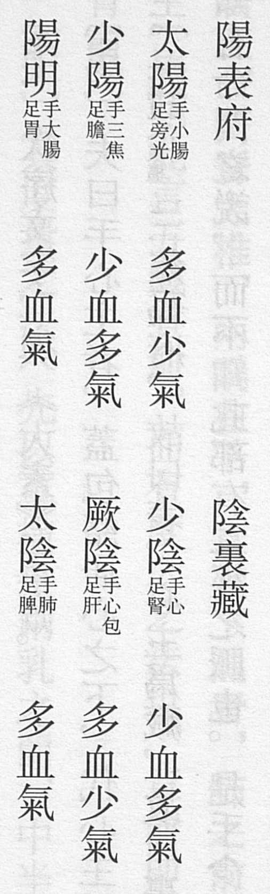

- 陽表府
- 太陽｟手小腸足旁光｠　多血少氣
- 少陽｟手三焦足膽｠　少血多氣
- 陽明｟手大腸足胃｠　多血氣
- 陰裏藏
- 少陰｟手心足腎｠　少血多氣
- 厥陰｟手心包足肝｠　多血少氣
- 太陰｟手肺足脾｠　多血氣

**○足太陽與少陰爲表裏，少陽與厥陰爲表裏，足陽明與太陰爲表裏，是爲足陰陽也。手太陽與少陰爲表裏，少陽與心主爲表裏，陽明與太陰爲表裏，是爲手之陰陽也。**

〔楊〕今知手足陰陽所在。

案：此八字，蓋楊上善所解注文，王冰采以爲本文，所云自序朱書之文歟。録俟後考耳。

<!-- PAGE_END -->

<!-- PAGE: 0679 -->

<!-- PRINTED: 644 -->

《靈樞・九鍼論》云：『陽明多血多氣，太陽多血少氣，少陽多氣少血，太陰多血少氣，厥陰多血少氣，少陰多氣少血。故曰刺陽明出血氣，刺太陽出血惡氣，刺少陽出氣惡血，刺太陰出血惡氣，刺厥陰出血惡氣，刺少陰出氣惡血也。足陽明太陰爲表裏，少陽厥陰爲表裏，太陽少陰爲表裏，是謂足之陰陽也。手陽明太陰爲表裏，少陽心主爲表裏，太陽少陰爲表裏，是謂手之陰陽也。』

案：次序文字，與《大素》正合。

〔馬〕夫曰手心主者，蓋包絡居心之下，代心主以行事。心不受邪，而治病者亦治手心主，故即稱之曰心主。｟大義見《靈樞・邪客篇》｠三焦爲府，故曰表。心主爲藏，故曰裏，其脈則共見於右手尺部。惜乎。後世之人不能知此，但知有命門之説，而不知此部有二經之脈也。是手少陽與心主爲表裏者如此。

〔馬〕按《靈樞・經脈篇》言十二經經脈之行，其於肺經則曰屬肺絡大腸，大腸經則曰屬大腸絡肺云云。凡本經則曰屬，而與爲表裏者則曰絡，其相須有如此者，宜乎其爲表裏也。

（眉）案：凡曰三陰三陽之表裏，乃四肢十二經脈管道徑，表裏相反對也。一身總有表裏陰陽，陽經脈絡在陽地，陰經脈絡在陰地，相反對，故不得不曰陰陽表裏也。

（眉）今外科劊殺術，及金創人治法等，遇動脈則血迸激奔飛，則以艸棉絲括結脈口。若遇絡脈則血徒流出，不括結，不施出血治，大甚而止。案：所云動脈，即陰經血往道也。所云絡脈，即陽經血歸道也。今俗偁絡脈者誤。故今外科工人於切陽經脈，則不大畏，以切爲常，廑以手指押，及傅止血末藥即止，是陽經而血歸路故也。故大凡陽經之血出流，與陰經其方向相反也。

**○今知手足陰陽所苦，**

案：《大素》此八字，分書注文，『苦』作『在』，説見於前。

<!-- PAGE_END -->

<!-- PAGE: 0680 -->

<!-- PRINTED: 645 -->

**○凡治病，必先去其血，乃去其所苦，伺之所欲。然後寫有餘，補不足。**

〔楊〕凡療病法，諸有痛苦由其血者，血聚之處，先刺去之。刺去血已，伺候其人情之所欲，得其虛實，然後行其補寫法之也。

案：馬氏云『肝欲散，心欲耎』之類，吳云『如風寒暑濕燥火，病人有惡之者，有欲之者，伺察其所欲，則知其病在何經矣』，諸注皆如此，以爲服藥之義，非是。宜從楊注爲刺法。

案：凡治病，不論何病，其實者，必先去其有血者，其無可取血之證者不可去血，但乃以小鍼，刺寫去其所苦之氣，是爲寫有餘之法。又伺候其人所欲，覺快通之處，刺以補其氣，是爲補不足之法也。

案：其、之古通用，詳見於《經傳釋詞》卷九中。《詩・采綠》云：『之子於狩，言韔其弓，之子於釣，言綸之繩。』是之、其互通用，文勢與此一串。

**○欲知背俞，先度其兩乳間，中折之，更以他草度，去半已，即以兩隅相拄也。乃舉以度其背，令其一隅居上，齊脊大椎，兩隅在下，當其下隅者，肺之俞也。**

〔馬〕此言五藏有俞，而有度之之法也。背俞即下文五藏俞也，屬足太陽膀胱經，以其在背，故總名之曰背俞。

〔張〕其度量之法，先以草橫量兩乳之間，中半摺折之，又別以一草比前草而去其半，取齊中折之數。乃竪立長草，橫置短草於下，兩頭相拄，象△三隅。乃舉此草以量其背，令一隅居上，齊脊中之大椎，其在下兩隅，當三椎之間，即肺俞穴也。

案：王注『四分去一』之説，與本文不同，蓋欲爲背二行，故有此説。其實則三行也。

案：齊脊大椎者，謂齊於大椎骨頭也，非謂骨下也。『拄』，《大素》作『柱』，正字，可從。本篇《音釋》亦作『柱』，從木，云『知庾切』。《廣韻》上聲八語｟（當作『九麌』）｠『拄，從旁指，知庾切』。是爲『支拄』字，而其實『柱楹』字轉爲支柱之義，不可別作『拄』，則『拄』爲『柱』俗字也。

<!-- PAGE_END -->

<!-- PAGE: 0681 -->

<!-- PRINTED: 646 -->

俞、輸字，説見於《生氣通天第三》中。

『隅』《大素》作『禺』，亦爲古字。『禺』字有廉禺之義，『日在巳曰禺中』是也。《説文》『隅，陬也』。一曰廉也。是爲廉禺之俗字也。

**○復下一度，心之俞也。復下一度，左角肝之俞也，右角脾之俞也。復下一度，腎之俞也。是謂五藏之俞，灸刺之度也。**

〔楊〕以上言量背輸法也。經不同者，但人七尺五寸之軀，雖小法於天地，無一經不盡也。故天地造化，數乃無窮，人之輸穴之分，何可同哉。昔神農氏録天地間金石草木三百六十五種，法三百六十五日，濟時所用，其不録者或有人識用，或無人識者，蓋亦多矣。次黃帝取人身體三百六十五穴，亦法三百六十五日。身體之上，移於分寸，左右差異，取病之輸，實亦不少。至如扁鵲《灸經》，取穴及名字，即大有不同。近代秦承祖《明堂》，曹子氏《灸經》等，所承別本，處所及名，亦皆有異，而除痾遺疾，又復不少，正可以智量之，適病爲用，不可全言非也。而并爲非者，不知大方之論，所以此之量法聖人設教有異，未足恠之也。

案：此五藏俞穴法，蓋古來一種別傳之法，故不與《靈樞・背俞篇》所説『五藏俞』合也，古來注家王氏已來，以爲背二行，非是。此所云五藏俞，即背三行也。肺俞爲魄戶，心俞爲神堂，肝脾二俞爲膈關，腎俞爲魂門也。今試度兩乳間，如本文取之，則兩禺正當三行。其圖如左：

<!-- PAGE_END -->

<!-- PAGE: 0682 -->

<!-- PRINTED: 647 -->

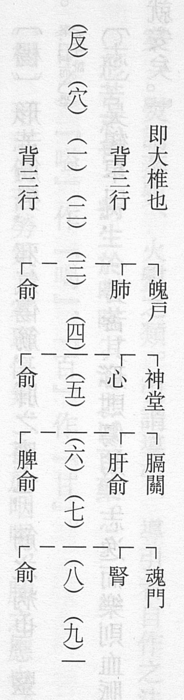

- 即大椎也
- 魄戶
- 神堂
- 膈關
- 魂門
- 背三行
- 肺
- 心
- 肝俞
- 腎
- （反）（穴）（一）（二）（三）（四）（五）（六）（七）（八）（九）
- 背三行
- 俞
- 俞
- 脾俞
- 俞

案：右肝左脾，宜從《大素》，乃醫者所度之左右，即病人之左右也。今本《素問》互誤。｟（《大素》「左」作「右」，「右」作「左」）｠

**○形樂志苦，病生於脈，治之以灸刺。**

（眉）以下《太素》卷十九知形志所宜篇。

〔楊〕形，身之皃也。志，心之志也。心以主脈，以其心勞，邪氣傷脈，心之應也。故以灸刺補寫脈病也。

〔張〕形樂者，身無勞也。志苦者，心多慮也。心主脈，深思過慮則脈病矣。脈病者，當治經絡，故當隨其宜而灸刺之。

〔志〕君子勞心，小人勞力。形樂志苦，形樂志樂，貴人也。形苦志樂，形苦志苦，常人也。《金匱要略》曰：『血痺病，從何得之。師曰：夫尊榮人，骨弱肌膚盛，重困｟《金匱》「困」作「因」，恐志聰妄改｠疲勞，汗出，臥不時動搖，加被微風，遂得之。宜鍼引陽氣，令脈緊去則愈。』蓋形樂則肌膚盛，肌膚盛則陽氣留於陰也久。陽不在表則邪直傷於陰，志苦則傷神，神傷則血脈虛而邪氣易入，故病生於脈也。宜灸以啓留陷之陽，宜刺以去血脈之痺。

案：病生於脈者，血痺之類是也。楊張共以爲心病，叵從。

**○形樂志樂，病生於肉，治之以鍼石。**

<!-- PAGE_END -->

<!-- PAGE: 0683 -->

<!-- PRINTED: 648 -->

〔楊〕形志俱逸，則耶氣客肉，脾之應也。多發癰腫，故以碒鍼及石熨調之也。《山海經》曰：『高氏之山，其上多玉，有石可以爲砭鍼，堪以破癰腫者也。』

〔吳〕形樂則無筋骨之勞，志樂則無血脈之滯，但過於膏粱而已。膏粱之變，能生癰腫，故病生於肉，宜治之以鍼石，決其大膿也。

〔張〕形樂者逸，志樂者閑，飽食終日，無所運用，多傷於脾，脾主肌肉，故病生焉。肉病者，或爲衛氣留，或爲膿血聚，故當用鍼石以取之。石，砭石也。

案：鍼、石各物，謂鈹鍼與砭石也。《病源》每引《養生方》云『其湯熨鍼石，別有正方，補養宣導，今附於後』與此所云鍼石同。馬注云：『宜以石爲鍼而刺之。』非是。鍼石，見第十中。砭石，見第十二中。病生於肉者，謂癰腫之類也。

（眉）袁文《甕牖閒評》云：『余嘗問人藥石之義，答者多不同。夫藥固無可疑者，若石則砭石也。昔王僧孺多識故事，侍郎金允超間訪以砭石。對曰：古者以石爲鍼，初不用鐵也。是知砭石可以刺病，人有病患，有用藥者，有用砭石者，此所以謂之藥石。』

（眉）《説苑・建本篇》『銳金石，雜草藥，以攻疾』。

**○形苦志樂，病生於筋，治之以熨引。**

〔楊〕形苦筋勞，邪氣傷筋，肝之應也，筋之病也。毉而急，故以熨引調其筋病也。藥布熨之，使其調也。｟案：「而」恐「耎」訛。｠

〔志〕吳鶴皐曰：『勞苦其形則傷筋，志逸而樂則血脈未嘗受病，故治之以熨烙導引，使血脈榮養於筋則就安矣。』

<!-- PAGE_END -->

<!-- PAGE: 0684 -->

<!-- PRINTED: 649 -->

案：熨謂蒸熨、火熨之類。引謂導引，導引者自作之法也。

**○形苦志苦，病生於咽嗌，治之以百藥。**

《甲乙》『嗌』作『喝』，『百』作『甘』。

〔楊〕形志俱苦勞氣，客耶傷氣，在於咽喝，肺之應也。喝，肺喘聲也，有本作『渴』。故療之湯液丸散藥之也。

〔張〕形苦志苦，必多憂思。憂則傷肺，思則傷脾，脾肺氣傷，則虛而不行，氣必滯矣。脾肺之脈，上循咽嗌，故病生於咽嗌。如人之悲憂過度，則喉嚨哽咽，食飲難進，思慮過度，則上焦否隔，咽中核塞，即其徵也。《通評虛實論》曰『隔則閉絶，上下不通，則暴憂之病也』，亦此之謂。

案：咽，非咽喉之義，爲『噎』之或字。《廣韻》十六・屑『噎，食塞，又作咽。烏結切』『咽，哽咽』同音，可以徵矣。『嗌』與『喝』同字，爲噎塞聲破之義，不與咽嗌｟喉中｠之字相涉。《方言》卷六『廝、嗌，噎也。楚曰廝，秦晉或曰嗌，又曰噎』，郭注：『嗌，惡介反。皆謂咽痛也。噎音翳。』《玉篇》『喝，乙芥切。嘶聲也。磕同上。磕，噎也』。《廣韻》『喝』音作『於犗切』，收在十七夬中。依此則《大素》及今本《甲乙》作『咽喝』者，是也。『喝』即『嗌』之正字。《説文》『喝，㵐也』，是爲咽胸間乾燥噎塞而聲嘶之義。《經脈篇》『喘渴』之字，《甲乙》作『喘喝』，蓋『渴』爲古字，《説文》『㵐也』之『㵐』字即是。《新校正》引《甲乙》作『困竭』，今本《甲乙》注同，共爲誤字。蓋形志俱苦之人，津液必乏少。血氣必澀滯，故咽膈不利之諸證起，非是。灸刺熨引之所能治，所以用百藥也。百藥，總稱凡可服用藥物，玉石草木蟲獸也。《大素》無『百』字，只作『藥』，楊注以爲湯液丸散藥，可從。但《靈樞・九鍼論》作『甘』『藥』，『甘』亦『百』之訛字，古『甘白』二字多通用，甘瓜作白瓜，甘草、白藥之誤之類是也。玄應《音義》卷二，《大般涅槃經》一卷下曰：『哽噎，經文多作咽，咽非字體也。』《本草》白字『螻蛄，下哽噎』，《御覽》九百四十八引作『下哽咽』。《至真要論》『厥陰之勝，鬲咽不通』，王注：『鬲咽謂食飲入而復出也。』《外臺》卷六・噫醋方七首篇引《延年》『醋咽』字二見。

<!-- PAGE_END -->

<!-- PAGE: 0685 -->

<!-- PRINTED: 650 -->

《靈樞・邪氣藏府病形篇》云『諸小者，陰陽形氣俱不足，勿取以鍼而調以甘藥也』，又《終始篇》云『少氣者，脈口人迎俱少，而不稱尺寸也。如是者，則陰陽俱不足，補陽則陰竭，寫陰則陽脫。如是者，可將以甘藥，不可飲以至劑。如此者，弗灸。不已者，因而寫之，則五藏氣壞矣』，並爲氣血不足之病人，蓋氣血不足者，不宜鍼灸。唯當用甘平無毒之藥，補脾肺二氣，則氣血之不足自復，而爲有餘。是上中二藥，養命養性益氣補虛之劑，即所謂甘藥。而《五常政大論》所云『無毒治病，十去其九』是也，與此本文自別矣。

（眉）真本《明堂》少商主治曰『喉中硍硍』，注：『硍，下墾反。謂咽中氣塞也。』旁記：『《切韻》：康很反。《玉篇》：枯很反。』

（眉）案：硍、喝聲至近。

（眉）《醫心方》卷廿九・合食禁第十一引《養生要集》『嘶咽』，又引注曰：『嘶者，聲敗也。咽者，氣塞咽也。』《説文》『嗢，咽也』。《靈・邪氣藏府病形》『胃病，膈咽不通』。

**○形數驚恐，經絡不通，病生於不仁，治之以按摩醪藥。**

《甲乙》『藥』作『醴』。

〔楊〕驚恐主腎，形多驚懼，耶客筋脈，筋脈不通，腎之應也。病生筋脈皮膚之間，爲痺不仁，故以按摩醪醴。

案：形數與形苦自異，謂勞動頻數也。《邪氣藏府病形篇》所云『有所用力舉重，若入房過度，汗出浴水則傷腎』｟《靈・百病始生》同｠是也。或曰：形數專謂房室過度，『數』即『作』之假借。《靈蘭祕典》所云『腎作強之官』，《上古天真》所云『動作不衰，不妄作勞』，此等『作』字並同義，而斥房事也。亦通。驚恐者，亦與志苦自別，謂心志驚懼。『腎藏志』《宣明五氣》。故不別云『志』也。

<!-- PAGE_END -->

<!-- PAGE: 0686 -->

<!-- PRINTED: 651 -->

案：不仁者，謂中風頑痺之類也。今腎虛之人多發此病，蓋因筋脈不通之所爲。按摩者，謂醫者按之摩之，令血脈循環之法也。與導引之自作自異。醪藥，謂藥酒也。《玉版論要》所云『其色見淺者，湯液主治，十日已。其見大深者，醪酒主治，百日已』是也。

〔識〕簡按：不仁，即《神農本經》『死肌』。

〔張〕醪藥，藥酒也。

〔箚〕《後漢書・班超傳》『頭髮無黑，兩手不仁』注：『不仁，猶不遂也。』

案：不仁解，已見《診要經終十六》中。

**○是謂五形志也。**

〔楊〕五形，言陳其所宜也。

〔馬〕按：《疏五過論》有云『凡欲診病者，必問飲食居處，暴樂暴苦，始樂後苦等義』，與此意同。

《靈樞・九鍼論》：『形樂志苦，病生於脈，治之以灸刺。形苦志樂，病生於筋，治之以熨引。形樂志樂，病生於肉，治之以鍼石。形苦志苦，病生於咽嗌，治之以甘藥。形數驚恐，筋脈不通，病生於不仁，治之以按摩醪藥，是謂形。』

（眉）《甲乙》六逆順病本末方宜形志大論第二。

〔志〕謂大人、布衣有此五者之形志。

<!-- PAGE_END -->

<!-- PAGE: 0687 -->

<!-- PRINTED: 652 -->

**○刺陽明，出血氣。**

〔楊〕手陽明大腸脈，足陽明胃脈也。二脈上下連注，其氣最強，故此二脈盛者，刺之血氣俱寫。

前文云『陽明常多氣多血』。

**○刺太陽，出血惡氣。**

《大素》『太』作『大』。

〔楊〕手大陽小腸脈也，足太陽膀胱脈也。二脈上下連注，津液最多，故二脈盛者，刺之寫血，耶客之者，寫去惡氣也。

前文云『太陽常多血少氣』。

**○刺少陽，出氣惡血。**

〔楊〕手少陽三膲脈也，足少陽膽脈也。二脈上下連注，其最多｟案：「其」下恐脫「氣」字。｠，故此二脈盛者，刺之寫氣。耶客之者，寫去血惡之也。

前文云『少陽常少血多氣』。

**○刺太陰，出氣惡血。**

〔楊〕手太陰肺脈也，足太陰脾脈也。此二太陰與二陽明雖爲表裏，其血氣俱盛，故並寫血氣也。

前文云『太陰常多氣少血』。｟（《大素》『氣少血』）｠作血氣。

案：此宜從《大素》爲正，説見於前文中。

**○刺少陰，出氣惡血。**

〔楊〕手少陰心脈也，足少陰腎脈也。與二大陽以爲表裏，二大陽既血多氣少，亦陰陽相反，二陰氣多血少，是以二少陰盛寫於氣也。耶客之者，寫去惡血者也。

<!-- PAGE_END -->

<!-- PAGE: 0688 -->

<!-- PRINTED: 653 -->

前文云『少陰常少血多氣』。

**○刺厥陰，出血惡氣也。**

〔楊〕手厥陰心包胳脈也，足厥陰肝脈也。與二少陽以爲表裏，二陽氣多血少，陰陽相反，故二陰血多氣少，是以二厥陰盛以寫血也。耶客之者，寫去惡氣。

前文云『厥陰常多血少氣』。

〔吳〕出者，由其天數之多。惡者，由其天數之少也。

〔張〕此明三陰三陽血氣各有多少，而刺者之出血出氣，當知其約也。手足陽明多血多氣，故刺之者出其血氣。手足太陽多血少氣，故刺之者但可出其血，而惡出其氣。總而計之，則太陽、厥陰均當出血惡氣，少陽、少陰、太陰均當出氣惡血，唯陽明可出氣出血，正與首節義相合。

〔志〕此氣血之常數，鍼刺之常法也。《鍼經》曰：『刺榮者出血，刺衛者出氣。』按：《靈樞・經水篇》曰：『十二經之多血少氣，與其少血多氣，與其皆多血氣，與其皆少血氣，皆有大數。其治以鍼艾，各調經氣，固其常有合。』足陽明，五藏六府之海也。其脈大血多，氣盛熱壯，刺此者不深弗散，不留不寫也。足陽明刺深六分留十呼，足太陽深五分留七呼，足少陽深四分留五呼，足太陰深三分留四呼，足少陰深二分留三呼，足厥陰深一分留二呼。手之陰陽其受氣之道近，其氣之來疾，其刺深者，皆無過二分，其留皆無過一呼，其少長大小肥瘦，以心撩之。命曰法天之常，灸之亦然。灸而過此者，得惡火則骨枯脈濇，刺而過此者則脫氣。

案：據此，云『陽明深六分，太陰深三分』之言，則宜從馬説，以此篇所云『太陰多氣少血，太陰出氣惡血』爲正。然則，太陰脾經專主氣，故與陽明不同也。《大素》與《素問》二説互異，而共有理。故今存兩説，以存疑。

<!-- PAGE_END -->

<!-- PAGE: 0689 -->

<!-- PRINTED: 654 -->

### 重廣補注黃帝内經素問卷第七

## 素問攷注卷第七

文久辛酉八月廿五日書於華他巷速讀室東廂　立之

第二十四補

咽喝｟七ヲ｠

《山海經》中次七經『堵山其上有木焉，名曰天楄。方莖而葵狀，服者不噎』，郭注：『食不噎也。』

《千金》卷十六・噎塞第六篇『治哽咽方』云云。

廿三　噫｟二ウ｠　欬｟三ヲ｠　語｟同｠　呑｟同ウ｠　欠｟同｠　嚏｟同｠　噦｟四ヲ｠　癃｟六ヲ｠　涕｟十ヲ｠　淚｟十ウ｠　唾｟十一ウ｠　巓疾｟十六ウ｠　瘖｟十七ウ｠　精神｟廿一ヲ｠　魄｟廿一ウ｠

魂｟廿二ヲ｠　意｟同ウ｠　志｟廿三ヲ｠

廿四　其之｟三ウ｠　拄柱｟四ウ｠　五藏俞｟五ヲ｠　鍼石｟六ウ｠　咽嗌｟七ヲ｠　百藥｟同｠　不仁｟八ヲ｠　醪藥｟同｠

<!-- PAGE_END -->

<!-- PAGE: 0690 -->

<!-- PRINTED: 655 -->

## 素問攷注卷第八

### 重廣補注黃帝内經素問卷第八

#### 寶命全形論第二十五

《太素》全存。

**○黃帝問曰：天覆地載，萬物悉備，莫貴於人。人以天地之氣生，四時之法成。**

『黃帝』至篇末，《大素》十九知鍼石載之。『四』字上省一『以』字，是亦古文之一體耳。

案：此『生』『成』二字，即謂五行生成之義，蓋人以天地之氣生，故有五藏。五藏以四時之法成者，應四時之氣而修養一身。所云《生氣通天》《藏氣法時》《四氣調神》之理也。五行生成，詳見於《五行大義》卷一第二論中。天地之氣，謂陰陽二氣也。四時，即謂五行也。法，則四時之氣之謂也。

《五行大義》卷一第二論五行及生成數云：『孔子曰：昔丘聞諸老聃云，天有五行木金水火土，其神謂之五帝，在地爲五方，其鎭爲五岳。《物理論》云：鎭之以五岳，在人爲五藏，其候五官。《黃帝素問》云：五藏候在五官，眼耳口鼻舌也。五行遞相負載，休王相生，生成萬物，運用不休，故云行也。』

案：此文今本《素問》無考，蓋《素問》古注之文。《靈樞・五閱五使篇》云『五官者，五藏之閲也』，又云『以官何候。岐伯曰：以候五藏』，可併考。注家以『生』『成』二字爲泛言，恐非是。

<!-- PAGE_END -->

<!-- PAGE: 0691 -->

<!-- PRINTED: 656 -->

**○君王衆庶，盡欲全形。形之疾病，莫知其情。留淫日深，著於骨髓。心私慮之，余欲鍼除其疾病，爲之奈何。**

案：情，謂病情。詳見《異法方宜第十二》中。

〔楊〕天地之間，人最爲貴，人君衆庶，莫不寶身。然不知病之脆微，留連骨髓，故請療之方也。

**○岐伯對曰：夫鹽之味鹹者，其氣令器津泄。**

（眉）腎水

〔張〕鹽味鹹，水之化也。其性浸淫透物，久在器中，則津液外泄而器無固者，喻言人之腎氣有損，則二陰不守也。

**○絃絶者，其音嘶敗。**

（眉）肺氣

〔張〕凡琴瑟之絃將損絶者，音必嘶敗。喻言人之肺氣有損，則聲音不清也。嘶音西，破聲曰嘶。

**○木敷者，其葉發。**

（眉）肝血

〔張〕敷，内潰也。發，飄墮也。木敷於外者，凋殘之兆也。喻言人之肝脾已損，則色夭肉枯也。按：《大素》云『木陳者，其葉落』，於義尤切。

案：《史記・扁鵲傳》『破陰絶陽之色已廢』，徐廣曰：『一作發。』

**○病深者，其聲噦。**

（眉）脾

<!-- PAGE_END -->

<!-- PAGE: 0692 -->

<!-- PRINTED: 657 -->

案：以上三句，以譬喻示腎肺肝之證，而至此一句，始云病深者，蓋以一實結成三虛之文法，前三句共宜添『病深』二字而看也。

〔張〕噦，呃逆也。按：《口問篇》曰『噦，出於胃』，又曰『肺主爲噦』。夫胃爲五藏之本，肺爲主氣之藏。今以上文三證，而復加聲噦者，肺虧胃竭，病必危矣。噦，於決切。

〔楊〕言欲識病微者，須知其候。鹽之在於器中，津洩於外，見津而知鹽之存鹹也。聲嘶知琴瑟之弦將絶，葉落知陳木之已蠹，舉此三物衰壞之徵，以比聲噦識病深之候也。

案：以上其氣、其音、其葉、其聲之四證，即爲四藏之病。而其氣云云爲腎虛遺尿、遺屎之候。其音嘶，爲肺虛聲破之候，《金匱》云『語聲喑喑然不徹者，心膈間病』是也。（《大素》）其葉落，爲肝虛失榮無血色之候。其聲噦，爲脾虛氣逆之候也。脾爲五藏之本，五藏有虛乏則必發噦，所以云病深者也。但不説心虛之候者，蓋心虛虧損則即死，不遑云證候也。張氏説可從矣。但『木敷』云云爲肝脾之病，『病深者』爲胃病，非是。

**○人有此三者，是謂壞府。**

案：『三』字恐『四』訛，籀文『四』作『亖』，故隸變多『三』『亖』二字致訛，不遑枚舉。《儀禮・覲禮》『四享』注：『四當爲三，古書作三四，或皆積畫，此篇又多四字，字相似，由此誤也。』又《聘禮》注云『朝貢禮純四只』，鄭志答趙商問：『四當爲三。』又《周禮・内宰職》注『天子巡守，禮制幣丈八尺純四咫』，鄭志答趙商問亦云：『四當爲三。』又《左傳》『是四國者，專足畏也』，劉炫謂：『四當爲三。』皆由古字積畫之故。《大戴禮・公冠篇》『公冠四加玄冕』注：『四當爲三，字之誤。』《穀梁・定十五年》傳『滕子來會葬』疏：『四當爲三，古者四三皆積畫，字爲誤耳。』皇國傳來弘安二年寫本《古文孝經》四海、四國字並作『亖』，可以徵也。此一『三』字，古來難讀之處，故楊王以後諸注家，皆爲之曲説也。今以『三』爲『亖』字之誤，則文義了然，可得而讀矣。《五藏生成篇》『此三者血行』，《大素》十七卷末作『此五者血行』，楊注曰：『有三無五，五當字誤之也。』此即『三』字爲譌謬之證也。楊上善又云『四月爲胎』，即爲三月訛。見《奇病論》四七中。｟十八ウ｠

<!-- PAGE_END -->

<!-- PAGE: 0693 -->

<!-- PRINTED: 658 -->

案：府，泛偁藏府而言也。府已偁藏，則藏亦宜偁府也。今肝脾肺腎之得傷者，並可謂壞府也。《萬葉集》亦亖シ字多用，以爲志之假字。又書重二並二，共以訓志，是亦古昔『四』字皆作『亖』之徵也。

（眉）《五藏生成篇》曰『小谿三百五十四名』，王注：『當三百五十三名，傳寫行書，誤以三爲四也。』

**○毒藥無治，短鍼無取，此皆絶皮傷肉，血氣爭黑。**

〔楊〕人有聲噦同三譬者，謂是府壞之候也。府者，中府，謂五藏也。壞者則聲歲｟案：歲即噦訛也。｠。中府壞者，病之深也。其病既深，故鍼藥不能取也。以其皮肉血氣各不相得故之也。

〔張〕中府既壞，則毒藥不能治其内，短鍼不能取其外，病不可爲。而強施鍼藥，徒致絶皮傷肉以敗其形，血氣爭黑以變其色，此皆因循已久，不爲早治，故無濟也。《官能篇》曰『上工之取氣，乃救其萌芽。下工守其已成，因敗其形』，正此之謂。

案：血氣爭黑，宜從《大素》作『血氣爭異』，楊注云『血氣各不相得』是也。滑氏曰：『爭黑，當作爭異。』其説與《大素》暗合，不亦奇乎。張注全是也，但『爭黑』二字解，難從耳。

短鍼即小鍼，謂毫鍼也。比餘八鍼則短小故名耳。

**○帝曰：余念其痛，心爲之亂惑反甚，其病不可更代，百姓聞之，以爲殘賊，爲之奈何。**

〔楊〕余念微病淫留至深，衆庶不知逐著骨髓。｟案：「逐」即「遂」訛。｠余痛其心，反甚於病，不能去已，故曰不可更代。

<!-- PAGE_END -->

<!-- PAGE: 0694 -->

<!-- PRINTED: 659 -->

百姓聞此積微成大壞府之言，不莫以爲殘賊之深，欲知爲之，奈何也。

案：其痛者，謂百姓疾病痛苦尤多也。《大素》『痛』作『病』，義不異。心爲之亂惑反甚者，言帝心爲之悶亂迷惑，日月日月反甚也。其病不可更代者，言帝心將欲代民病而患之，然其病遂不可更代也。是帝念民病之至，切至於此。而百姓聞之，以爲殘賊，下民醫治其病奈何之乎。聞之者，謂聞病深不可治之言也。爲，治也。謂醫治也。『更代』二字，諸注失解，今不從。

**○岐伯曰：夫人生於地，懸命於天，天地合氣，命之曰人。**

〔張〕形以地成，故生於地。命唯天賦，故懸於天。天，陽也。地，陰也。陰精陽氣，合而成人，故人位乎中，而爲三才之一。

案：人，謂之人者，人之爲言神也，真也，任也，兒也。凡在天地中活物有神氣者，謂之人，其義在音而不在字，在木實中含蓄生氣之物，亦謂之人，爲同義。

《靈・玉版篇》『人者，天地之鎭也』。

**○人能應四時者，天地爲之父母。**

〔楊〕天與之氣，地與之形，二氣合之爲人也。故形從地主，命從天與，是以人應四時，天地以爲父母也。

《陰陽別論第七》云：『四經應四時，十二從應十二月。』

《陰陽應象大論第五》云：『陰陽者，天地之道也，萬物之綱紀，變化之父母，生殺之本始，神明之府也。』

《生氣通天論第三》云：『夫自古通天者，生之本，本於陰陽。天地之間，六合之内，其氣九州九竅，五藏十二節，皆通乎天氣。』

<!-- PAGE_END -->

<!-- PAGE: 0695 -->

<!-- PRINTED: 660 -->

《四氣調神篇第二》云：『故陰陽四時者，萬物之終始也。死生之本也。逆之則災害生，從之則苛疾不起，是謂得道。』

《上古天真論第一》云：『真人提挈天地，把握陰陽。至人和於陰陽，調於四時。聖人處天地之和，從八風之理。賢人逆從陰陽，分別四時。』

**○知萬物者，謂之天子。**

〔楊〕天地所貴者人，人之所歸者聖，唯聖荷物，故號曰天子也。

〔吳〕知周萬物，則能參天地，贊化育，是天之子也。

〔馬〕天子者，正天之所子也。

案：以天地爲父母，則可號曰天子也。

（眉）案：知，主也。猶知事、報知之知也。《大素》作『荷主』，其義不二。

**○天有陰陽，人有十二節。**

《靈·邪客篇》『辰有十二，人有十指莖垂以應之。天有陰陽，人有夫妻，歲有十二月，人有十二節』。

又《通天篇》『人有陰陽，何謂陰人，何謂陽人』。又《陰陽二十五人篇》曰『余聞陰陽之人』。

《靈·經別篇》『合之十二月，十二辰，十二節，十二經水，十二時，十二經脈者』。

〔楊〕此言天子所知，凡有二合四能，天有十二時，分爲陰陽。子午之左爲陽，子午之右爲陰。人之左手六大節爲陽，右手六大節爲陰，此爲一合也。

**○天有寒暑，人有虛實。**

<!-- PAGE_END -->

<!-- PAGE: 0696 -->

<!-- PRINTED: 661 -->

《靈·邪客篇》『天有冬夏，人有寒熱。天有晝夜，人有臥起』。

〔楊〕十二爻｟案：『爻』恐『月』訛｠寒暑之氣，十一月陽氣漸急息，陰氣漸消。至四月陽氣在盈，陰氣正虛。至五月陰氣漸息，陽氣漸消。至十月陰氣在盈，陽氣正虛。陰陽即爲寒暑者也，盈虛以爲虛實者也。人亦如之，消息盈虛，有虛有實，爲二合之也。

**○能經天地陰陽之化者，不失四時。**

〔楊〕天地合氣，命之曰人。故能知天地陰陽變化，理與四時合契，此一能也。

案：《大素》傍記云『經，治也』，可從。蓋能經治天地陰陽之化者，所云『提挈天地，把握陰陽』者也。如此之人，何失四時之應之有也。

（眉）一能

**○知十二節之理者，聖智不能欺也。**

〔楊〕知人陰陽十二節氣與十二時同，循之而動，不可得失，雖有聖智，不可加也。欺，加也。此二能也。

案：『欺』與『加』字音位置於《韻鏡》正同，蓋古音通用，假『欺』爲『加』也。

（眉）二能

**○能存八動之變，五勝更立。**

（眉）三能

〔楊〕八動，八節之氣也。八節之氣合金木水火土五行之氣，更廢更立，血氣亦然。此三能也。

（眉）八節，四立二分二至也。

<!-- PAGE_END -->

<!-- PAGE: 0697 -->

<!-- PRINTED: 662 -->

〔識〕《漢·律曆志》孟康注『五勝』云：『五行相勝。』

案：《廣韻》『存，察也』，原出《爾雅·釋詁》。《禮運》『處其所存』，《大傳》『五曰存愛』，鄭注並云：『存，察也。』

**○能達虛實之數者，獨出獨入，呿吟，至微，秋毫在目。**

案：前文二句，此三句，短長不整，亦是古文之一體，而立、目二字押韻。

〔楊〕能達寒暑之氣，虛實相移者，則壽弊天地，能獨出死地，獨入長生。其言也，呿吟至真微妙之道。其智也，目察秋豪深細之理。此四能也。呿音去，即露齒出氣之。

案：數者，術數之義，説已見第一中。獨，謂與人異也。出入，謂呼吸也。呿，呼；吟，吸也。言能達知寒暑虛實之至數，則呼吸出入無有虧隙，不與衆人同。如此則神氣内滿，而邪氣不入，故秋毫之極細至微，亦在目中能察知也。吟、目句，獨、目首尾爲韻，後文云『虛實呿吟』，可併看。

〔識〕熊音『呿，丘加反。張口也』。簡按：《通雅》云『吟即噤，閉口也。古吟唫噤通用』。《呂覽·重言篇》『君呿而不唫』高誘注：『呿開，唫閉。』《史·淮陰侯傳》『雖有舜禹之智，吟而不言』注：『吟，巨蔭反。音噤。』

第一云『呼吸精氣，獨立守神』。

（眉）四能

**○帝曰：人生有形，不離陰陽。**

〔楊〕萬物負陰抱陽，冲氣以爲和，萬物盡然。三氣而生，故人之形不離陰陽也。

**○天地合氣，別爲九野，分爲四時，月有小大，日有短長，萬物並至，不可勝量，虛實呿吟，敢問其方。**

<!-- PAGE_END -->

<!-- PAGE: 0698 -->

<!-- PRINTED: 663 -->

〔楊〕從道生一，謂之朴也。一分爲二，謂天地也。從二生三，謂陰陽和氣也。從三以生萬物，分爲九野四時日月，乃至萬物，一一諸物，皆爲陰陽氣之所至，故所至處不可勝量，不可量物，並有虛虛實實之談，請言其道。方，道也。

〔識〕志云：『以呿吟之至微，而知其虛實也。』簡按：蓋雖萬物並至，不可勝量，然要之不過虛實開閉之理，故問其方。

案：前文四能，其最後能達虛實之數者，出入呿吟，以此爲至要之理。故此撮『虛實呿吟』四字以開問語，下文答語，即虛實呿吟之至理也。九野，詳見於第九中。古『分』『別』二字一音，唯有平入之異，故爲此二語，因有此二字也。後世以『分』與『別』裂，自爲二義，此九野云別，四時云分是也。其實『分』『別』同音同義。《説文》『分，別也』，可以徵矣。

**○岐伯曰：木得金而伐，火得水而滅，土得木而達，金得火而缺，水得土而絶，萬物盡然，不可勝竭。**

〔楊〕言陰陽相分，五行相剋，還復相資，如金以剋木，水以剋火，土以剋水，始土剋水，得水通易，餘四時皆然。並以所剋爲資，萬物皆爾也。

〔識〕簡按：達，王訓通，然與伐、滅、缺、絶義相乖，諸家不解，可疑。

《左傳·成十年》『攻之不可，達之不及，藥不至焉，不可爲也』杜注：『達，鍼。』

案：此所説並是五行相剋之理，當然而然者。雖云伐、滅、缺、絶，非云正絶滅也。言木得金伐而木反茂盛，火得水滅而火反長，然土得木，土反不裂，金得火，金反成形，水得土，水反能流，並盛者得剋反不亢，得其宜者也。《大素》無『金』『水』二句，『滅』作『減』，『木』作『水』，然尋求其意，與《素問》不異，楊注云『並以所剋爲資』，此説可從。又案：達與伐、滅、缺、絶同意。《周禮·小宰》『小事則專達』，《釋文》引干注：『達，決也。』《淮南·脩務》『蹠達膝』注：『達，穿也。』是其義也。

<!-- PAGE_END -->

<!-- PAGE: 0699 -->

<!-- PRINTED: 664 -->

（眉）《刺熱篇》王注：『金剋木，水滅火，木伐土，火爍金，土刑水』。全與此合。

（眉）《六元正紀論》末曰『木鬱達之，火鬱發之，土鬱奪之，金鬱泄之，水鬱折之，然調其氣』，王注太詳可參，實今日逐邪除病之五因悉焉。

（眉）《千金翼》卷卅·禁狗鼠第十九篇『咒曰：東方木爲折，南方火爲滅，西方金爲缺，北方水爲竭，中央土爲絶』。又同卷咒童子令説鬼姓字第廿二篇曰『符主東方木折，南方火滅，西方金缺，北方水竭，中央土裂』。

**○故鍼有懸布天下者五，**

〔楊〕故鍼等利人之道，凡有五利也。

〔張〕懸布天下，言示人之廣也。五義如下文。

案：用鍼之至道有五，可以縣繫而頒布者也。

**○黔首共餘食，莫知之也。**

案：《新校正》云『《太素》作飲食』，今楊注亦作『飲食』，則正文『餘食』恐亦『飲食』之訛耳。

〔楊〕黔，黑也。渠廉反。人之首黑，故名黔首也。飲食，服用也。黔首服用此道，然不能得其意也。

《新校正》引『首服』間有『共』字。

〔吳〕黔首，黑髮之民。餘食，猶言備食。

〔張〕黔首，黎民也。共，皆也。餘食，猶食之棄餘，皆不相顧也。

〔志〕共、供同，黔首，黎民也。懸布天下者，先立鍼經以示人，而百姓止可力田以供租稅，有餘粟以供養，其於治鍼之道，莫之知也。

<!-- PAGE_END -->

<!-- PAGE: 0700 -->

<!-- PRINTED: 665 -->

〔識〕楊愼《丹鉛總録》云：『李斯刻石頌秦曰：黔首康定。太史公因此語，遂於《秦紀》謂秦更民曰黔首。朱子注《孟子》亦曰：周言黎民，猶秦言黔首，蓋因太史公之語也。然《祭義》《内經》實先秦出，黔首之稱，恐不自秦始也。』

（眉）地表上人民黑毛髮之土太少，蓋夏邊之諸土耳，所以斥夏氓偁黔首也。天子在上平觀夏夷也。

案：醫經本草不經秦火，故秦時之俗呼，往往有焉。羽涅、蝙蝠、蚱蟬、牡厲之類，皆傳秦語，則此黔首，亦用秦語，正爲同例。此經嘗經秦人之手，故有此偁，不得謂此偁秦前早已有之也。《祭義釋文》『黔，其廉反。徐又其嚴反。黑也。黑首謂民也。秦謂民爲黔首』。

**○一曰治神，**

（眉）以下逐句漸字多名文也。

〔楊〕存生之道，知此五者，以爲攝養，可得長生也。魂神意魄志，以神爲主，故皆名神。欲爲鍼者，先須理神也。故人無哀悲動中，則魂不傷，肝得無病，秋無難也。無怵惕思慮則神不傷，心得無病，冬無難也。無愁憂不解則意不傷，脾得無病，春無難也。無喜樂不極則魄不傷，肺得無病，夏無難也。無盛怒者則志不傷，腎得無病，季夏無難也。是以五過不起於心，則神清性明，五神各安其藏，則壽延遐筭，此則鍼布理神之旨也，乃是崆峒廣成子之道也。

〔馬〕蓋人有是形，必有是神。吾當平日豫全此神，｟《上古天真論》云：積精全神｠使神氣既充，然後可用鍼以治人也。

〔張〕醫必以神，乃見無形，病必以神，血氣乃行，故鍼以治神爲首務。《湯液醪醴論》曰『形弊血盡而功不立者，神不使也』，正此之謂。

<!-- PAGE_END -->

<!-- PAGE: 0701 -->

<!-- PRINTED: 666 -->

〔志〕神在秋毫，屬意病者，神屬勿去，知病存亡。｟案：《九鍼十二原》文｠

**○二曰知養身，**

〔楊〕飲食男女，節之以限，風寒暑濕，攝之以時。有單豹嚴穴之害，即内養身也。實怒慈以愛人，和塵勞而不迹。有殊張毅高門之傷，即外養身也。内外之養周備，則不求生而久生，無期壽而壽長也。此則鍼布養身之極也。

《新校正》引『嚴穴』作『外凋』，『怒慈』作『慈恕』，三『養身』之『身』字，共作『形』。案：『單豹外凋之害』『張毅高門之傷』，共見《莊子·達生篇》。

〔馬〕蓋人有是身，不可不善養之。吾當平日豫養己身，使吾身卻疾，然後可因己以治人也。《陰陽應象大論》曰：『以我知彼，用之不殆。』

〔張〕不知養身，置鍼於無用之地，鍼家不可不知，如《終始篇》云『新刺勿内，已刺勿醉，已刺勿怒，已刺勿勞。已刺勿飽，已刺勿飢，已刺勿渴』之類皆是也。案：此注所云『以我知彼』也。

〔志〕以身之虛，而逢天之虛，兩虛相感，其氣至骨。入則傷五藏，故當知日之寒温，月之虛盛，四時氣之浮沈，而調之於身，工候救之，勿能傷也。｟此采用《八正神明廿六》中語，以爲注解也。｠

案：治神，謂精神内守也。養身，謂病何從來也。蓋在内治精氣神氣，則長生久視，在外養一身四體，則邪氣不侵之謂也。

**○三曰知毒藥爲真，**

〔楊〕藥有三種，上藥養神，中藥養性，下藥療病，此經宗旨。養神養性，唯去怵惕之慮，嗜欲之勞，其生自壽，不必假於鍼藥者也。有病生中，無出毒藥以爲真惡｟案：『惡』恐『要』訛｠，故須知之。

<!-- PAGE_END -->

<!-- PAGE: 0702 -->

<!-- PRINTED: 667 -->

《示從容論》：『毒藥所宜，湯液滋味。』又曰：『當投毒藥，刺灸砭石湯液。』

〔馬〕蓋毒藥攻病，氣味異宜，吾當平日皆真知之，然後可用之不謬也。

〔張〕治病之道，鍼藥各有所宜，若真知非藥不可，而妄用鍼者必反害之。如《邪氣藏府病形篇》曰『諸小者，陰陽形氣俱不足，勿取以鍼而調以甘藥也』，《根結篇》曰『形氣不足，病氣不足，此陰陽氣俱不足也。不可刺之』。此即《病傳論》所謂『守一勿失，萬物畢者』之義。

〔志〕毒藥，所以攻邪者也，如知之不真，用之不當，則反傷其正氣矣，故帝曰『余欲弗使被毒藥，欲以微鍼，通其經脈，調其血氣』。案：『帝曰云云』出《九鍼十二原》中。

案：能知毒藥之治病爲真妙，則鍼刺之手術，自至玄微之境，是謂宜鍼宜藥之疾病，診之察之不失其理也。毒藥解已見第十二中。

〔紹〕《大素》『藥』字複，非是。

**○四曰制砭石小大，**

〔楊〕東方濱海水，傍人食鹽魚，多病癰腫，故制砭石大小用破癰也。

〔吳〕砭石小大，各有所宜，故酌而制之。

案：此説以『制』爲制定之義，不爲制作之義，可從也。

〔馬〕蓋砭石爲鍼，可以治疾。吾當平日預制此鍼，小大得宜，庶不至於臨時之乏用也。

〔張〕古者以砭石爲鍼，用爲外治之法。自黃帝始造九鍼以代石，故不曰九鍼而曰砭石。然制有小大，必隨病所宜，各隨其用也。

〔志〕上古之世，未有冶鑄，以砭石爲鍼，制有大小，隨病所宜。黃帝始造九鍼，以代鑱石。經曰『小之則無内，大之則無外』。蓋治外者，制小其鍼，治内者，制其大也。

<!-- PAGE_END -->

<!-- PAGE: 0703 -->

<!-- PRINTED: 668 -->

案：此説可從。但治外者宜用大鍼，治内者用小鍼，是爲常論。此所云小大者，在砭石上，而自有大小之制之義也。

案：砭石小大者，九鍼中除毫鍼、員鍼、鍉鍼外，鑱鍼、鋒鍼、鈹鍼、員利鍼、長鍼、大鍼，六鍼各有大小，是外治之所用。如内治微鍼，則鍼工專業，前文所云治神養身，並用微鍼之要訣也。砭石解，已見第十二中。

《靈·九鍼論七十八》云：『此九鍼大小長短法也。』

**○五曰知府藏血氣之診。**

〔楊〕輸爲三百六十五而者也。｟案：『而』字恐『穴』訛。｠藏謂五藏血氣，診謂經絡諸脈診候之也。

〔吳〕府藏血氣多少，天數不同，所當知者。而病邪在府在藏，在血在氣，尤不可不知其診。

〔馬〕蓋人之府藏，有虛有實，其血氣有多有少，如前篇之謂。吾當平日預知診法，凡虛補實寫，出血出氣，惡血惡氣之義，無不知之，庶不至於冥行也。

〔張〕不知府藏則陰陽表裏不明，不知血氣則經絡虛實不辨，皆不足以言鍼。

〔紹〕《大素》『府』作『輸』，非是。｟案：此宜從王注。｠

**○五法俱立，各有所先。**

〔楊〕此五法各有所長，故用之各有所先也。

〔馬〕是五法既立，各有所先，即本文謂『治神』先於『養身』之謂。則用鍼之方，正有合於五行之妙矣。

<!-- PAGE_END -->

<!-- PAGE: 0704 -->

<!-- PRINTED: 669 -->

〔張〕鍼治未施，法應預立，五者之用，當知所先。

案：五法之中各有所先者，言治神之中，亦隨五藏應四時，各有所先也。養身之中亦同理，毒藥治病，鍼石小大，亦各有所宜。府藏血氣之診，亦隨時知多少虛實，畢竟不可以口筆傳，所云『靜意視義』｟廿五ノ十九オ｠是也。

**○今末世之刺也，虛者實之，滿者泄之，此皆衆工所共知也。**

〔楊〕粗工守形，實者寫之，虛者補之，斯乃衆人所知，不以爲貴也。

〔張〕言淺近易知也。

**○若夫法天則地，隨應而動，和之者若響，隨之者若影。**

案：《大素》『和』作『知』，爲訛字。

〔楊〕刺虛實之道，法天地以應萬物，若響應聲，如影隨形，得其妙，得其機，應虛實而行補寫也。

案：『若夫』以下謂上古精工之刺法也。

《天元紀論》『如鼓之應桴，響之應聲也』。

**○道無鬼神，獨來獨往。**

〔楊〕應天地之動者，謂之道也。有道之者其鬼不神，故與道往來，無假於鬼神也。

〔吳〕法天則地，則非末世衆工之刺矣。隨應而動，言其效也。若響若影，效之捷也。道無鬼神，言其道足以補化工，無復鬼神之能事矣。來者爲神，往者爲鬼，夫既道無鬼神，則往來者獨惟我耳。

〔馬〕無鬼無神，如有鬼神。如有鬼神，獨往獨來。此乃用鍼之法，可謂至神，實非衆人所能知也。下節乃詳言之。

〔識〕簡按：《莊子》云『獨往獨來，謂之獨有』。蓋『獨有』刺之真者也。

<!-- PAGE_END -->

<!-- PAGE: 0705 -->

<!-- PRINTED: 670 -->

案：往來，謂虛實也。獨者，工獨有之也。《靈樞·九鍼十二原第一》云『知其往來，要與之期，麤之闇乎。妙哉。工獨有之』與此同義，諸注皆失解，詳見下文『可玩往來』下。

**○帝曰：願聞其道。岐伯曰：凡刺之真，必先治神。五藏已定，九候已備，後乃存鍼。**

〔楊〕凡得鍼真意者，必先自理五神。五神既理，五藏血氣安定，九候已備於心，乃可存心鍼道，補寫虛實。

〔吳〕真，要也。治神，專其精神也。先定五藏之脈，備察九候之診，得其大過不及之差，然後存意於用鍼之法。

〔馬〕上曰治神者，平日之功，而此曰治神者，臨鍼之法。蓋惟神氣既肅，而後可以專心用鍼也。病人五藏，吾乃定之，或虛或實，無不明也。病人之脈，吾能診之，九候所在，無不周也。夫然後存心於鍼而用之，然猶未敢輕用其鍼也。

〔張〕此以病者之神爲言。神者，正氣也，得神者昌，失神者亡，故刺之真要，必先以正氣爲主，再定五藏之屬，悉九候之診，得其虛實所在，然後存意於鍼而用之。

案：馬以治神爲醫師之事，與古注合。獨，張以爲病者之神，共未是。蓋醫者先治自己精神，不令之散亂，而後病者之正氣可得而察知也。然則此所云治神者，謂治己正氣併治病者正氣，治病者正氣，然後已定五藏之脈。五藏之脈已定，然後九候之診已備，於是乎可始下鍼於其部位也。以前文所云『一曰治神』『五曰知府藏血氣之診』二句，總括而出於此也。《藏氣法時論廿二》云『必先定五藏之脈，乃可言間甚之時，死生之期也』，《三部九候論二十》云『故人有三部，部有三候，以決死生，以處百病，以調虛實，而除邪疾』，《靈·官能篇》云『用鍼之要，無忘其神』，共可以徵矣。

<!-- PAGE_END -->

<!-- PAGE: 0706 -->

<!-- PRINTED: 671 -->

**○衆脈不見，衆凶弗聞，外内相得，無以形先。**

〔楊〕病人衆病脈候不見於内，諸病聲候不聞於外，内外相得爲真，不唯形之善惡爲候也。

〔吳〕衆脈不見，無真藏死脈也。衆凶不聞，無五藏絶敗也。外證内脈相得，非徒以察形而已，故曰無以形先。

〔識〕汪機云：『不可徒觀其外形，而遺其内氣之相得否。』

〔馬〕方其始焉，衆脈不見，衆凶弗聞之時，必察形氣相得之何如，或形盛氣衰，或氣盛形衰，或形氣俱衰俱盛，莫不知之。《玉機真藏》云：『形氣相得，謂之易治。形氣相失，謂之難治。』切不可以吾形之盛衰寒温，而料病人之形氣，使之強同於己也。然猶未敢輕用其鍼也。

〔志〕蓋言上守神，麤守形。｟出《靈樞·九鍼十二原第一》｠

案：衆脈不見者，云脈則色亦在中，一『見』字上含畜色字來。《金匱》第一篇第七條『師曰：寸口脈動』條，色脈互發，與此同文例。衆凶不聞者，統言氣息聲音也。《金匱》第一篇第四、五、六三條所説可併看，云見非色脈而何，云聞非聲息而何。内外，謂形外氣内也。《靈樞·根結第五》云『用鍼之要，合形與氣，使神内藏，故曰上工平氣，中工亂脈，下工絶氣，危生』與此同理。無以形先者，《老子》曰『聖人爲腹不爲目』，此之謂也。

**○可玩｟杬｠往來，乃施於人。**

〔楊〕杬，五骨反。動知也。光内外相得之理，動而往來，乃可施人也。

〔紹〕《大素》經注非是，杬當机。知字疑。

《靈樞·九鍼十二原第一》云：『其來不可逢，其往不可追。知機之道者，不可掛以髮。不知機道，叩之不發。知其往來，要與之期，麤之闇乎。妙哉，工獨有之。往者爲逆，來者爲順，明知逆順，正行無問。逆而奪之，惡得無虛。追而濟之，惡得無實。迎之隨之，以意和之，鍼道畢矣。』

<!-- PAGE_END -->

<!-- PAGE: 0707 -->

<!-- PRINTED: 672 -->

又《小鍼解》云：『其來不可逢者，氣盛不可補也。其往不可追者，氣虛不可寫也。不可掛以髮者，言氣易失也。扣之不發者，言不知補寫之意也。血氣已盡，而氣不下也。知其往來者，知氣之逆順盛虛也。要與之期者，知氣之可取之時也。麤之闇者，冥冥不知氣之微密也。妙哉工獨有之者，盡知鍼意也。往者爲逆者，言氣之虛而小。小者，逆也。來者，爲順者，言形氣之平。平者，順也。明知逆順正行無問者，言知所取之處也。迎而奪之者，寫也。追而濟之者，補也。』

案：據《靈樞》文，則『可玩往來』者，謂知氣之逆順盛虛也。乃與上文『獨往獨來』同義，諸注皆失解，不可從也。

**○人有虛實，五虛勿近，五實勿遠。**

〔楊〕五謂皮肉脈筋骨也。此五皆虛，勿近寫之，此五皆實，勿遠而不寫。

〔馬〕人有五虛，五藏皆當至於既實，而後可以去鍼。人有五實，五藏皆當於既虛，而後可以去鍼。但五虛勿可以近速，恐實邪之尚留。五實勿可以遲遠，恐正虛之難復。

案：馬説與楊注同，可從。五虛、五實，謂五藏之虛實，楊注非是。遠近者，謂遲速也。《九鍼》第一云『刺之微，在速遲』，《小鍼解》云『徐疾之意也。知氣之虛實，用鍼之徐疾也』，言五藏之氣虛者，鍼之勿用近速之刺法。五藏之氣實者，鍼之勿用遠遲之刺法。五藏必有虛實，刺法必有補寫也。吳云『五藏天真已虛，戒人勿近。五邪相乘而實，戒人勿遠』，張、志、高皆同此説，以爲五虛不用刺法之義，大與經文左，不可從也。

<!-- PAGE_END -->

<!-- PAGE: 0708 -->

<!-- PRINTED: 673 -->

**○至其當發，間不容瞚。**

〔楊〕至其氣至機發，不容於眴目也。容於眴目即失機，不得虛實之中。眴音舜也。

〔馬〕至其已虛已實，可以發鍼之際，則所間特止瞬息耳。按：《玉機真藏論》亦有五虛五實，但此就鍼法而言。此法必皆熟玩於心，夫然後可以施鍼也。

〔識〕張云：『發，出鍼也。瞚、瞬同。言鍼有期，或遲或速，在氣機之頃，不可以瞬息誤也。』簡按：《説文》『瞚，開闔目數搖也』，徐鉉曰：『今俗別作瞬，非是。舒問切。』《史·扁鵲傳》『目眩然而不瞚』，《集韻》《韻會》並音舜，《釋音》：『瞚，音寅。』可疑。｟案：元板『音寅』作『音舜』，古抄本無『瞚音寅』三字。｠《甲乙》作『睻』，《説文》『大目也』。《大素》作『眴』，《説文》『目動也』。並難通。

案：瞬、眴、睻俱是瞚俗字，以音借用，非『大目』『目動』之轉注也。蓋瞬之爲言迅也，目眥開闔甚迅疾，故名曰瞬也。

**○手動若務，鍼耀而勻。**

〔楊〕手轉鍼時，專心一務。

〔吳〕動，用鍼也。務，專一也。耀，鍼形光淨也。勻，《甲乙》皆同也。

〔馬〕及將施鍼之時，手動用鍼，若專於事務，而不敢貳。目耀其鍼，自有上中下等，而極其勻。斯時也，入鍼淺深，各隨經絡矣。｟《靈樞·經水篇》｠

〔張〕動，用鍼也。務，專其務而心無二也。耀，清潔也。勻，舉措從容也。

〔高〕勻，圓活也。手動若務者，以手按穴，似專一而不移。鍼耀而勻者，行鍼之時，復光耀而圓活也。

《列子·湯問第五》『用心專，動手均也』。

<!-- PAGE_END -->

<!-- PAGE: 0709 -->

<!-- PRINTED: 674 -->

《史記·賈誼傳》『搖增翮』，徐廣曰：『一云莢增。』

真本《明堂》『列缺，主搖時寒熱』，楊注旁記曰：『音曜。』案：遥鬲時而發寒熱也。

案：手動若務者，謂左手指頭探其穴處，指頭動搖而專務一心，使其穴不誤也。『若』讀如『而』，與下文『而勻』正合，如此例古文往往而有。

鍼耀而勻者，謂鍼入之際，容與從容，從呼隨吸而刺入，其入自有常例，淺深皆勻平如其法也。《經水論》所云『刺足陽明深六分，留十呼。足太陽深五分，留七呼』之類是也。耀與搖、容與裕、延引治等一音，謂下鍼之勢，漸漸抵至，容與延引，而不可迅速也，謂右手下鍼也。《靈樞·官能篇七十三》云『遥大其穴，氣出乃疾』，《大素》十九·知官能載此文，『遥』作『搖』。據此，則『耀』即爲『搖』之借字、古字可知也。言手動則鍼搖，手務則鍼勻。動搖爲寫，務鍼爲補也。《診要經終論》『刺鍼必肅』王注：『肅謂靜肅，所以候氣之存亡。』《論》又曰『刺腫搖鍼，經刺勿搖』，王注：『以出大膿血故，經氣不欲泄故。』可知此『耀』即『搖』假字，『勻』即肅之義。蓋『耀』與『勻』兩法而刺之道畢也。搖平聲音，若讀之爲去聲，則即『耀』字音耳，全一音也。

（眉）《調經論》『寫實者，外門不閉，以出其疾。搖大其道，如利其路，是謂大寫』是亦可證矣。

案：據《大素》，則其義不同。鍼耀而眴者，言鍼拔去之際，鍼正光耀而此時目始能眴，對於前文云『至其當發間不容瞚』而成文，至此而始瞚也。乃手動若務者，謂左手按摸鍼空之務也。

（眉）《靈·官鍼篇》『八曰短刺，稍搖而深之，致鍼骨，所以上下摩骨也』。

**○靜意視義，觀適之變。**

〔楊〕可以靜意，無勞於衆物也。視其義利，觀其通當，知氣之行變動者也。

<!-- PAGE_END -->

<!-- PAGE: 0710 -->

<!-- PRINTED: 675 -->

〔吳〕靜己之意，視鍼之義。適，鍼氣所至也。變，形氣改易也。

〔張〕適，至也。變，虛實之變也。觀之以靜，察變之道也。

〔志〕適，至也。靜己之意，視鍼之義，以觀氣至之變。

〔箚〕寬案：據楊注，觀察其適意與變動也。驪恕公曰：『《中庸》云：義者，宜也。適讀爲敵。王、吳並非是。』亦一説。

〔識〕簡按《離合真邪》二十七云：『用鍼無義，反爲氣賊。』

案：言靜穩自己之心意，而視察虛實補寫之微義，則其血氣之調適與變動之二件，可得而觀諦也。楊注似是。

**○是謂冥冥，莫知其形。**

《徵四失論》『嗚呼。窈窈冥冥，熟知其道』。

〔楊〕此機微者，乃是窈冥衆妙之道，淺識不知也。

《八正神明論第廿六》云『觀其冥冥者，言形氣榮衛之不形於外，而工獨知之，以日之寒温，月之虛盛，四時氣之浮沈，參伍相合而調之。工常先見之，然而不形於外，故曰觀於冥冥焉』。又云『然而不形見於外，故俱不能見也。視之無形，嘗之無味，故謂冥冥，若神髣髴』。

**○見其烏烏，見其稷稷。**

〔楊〕烏烏稷稷，鳳皇雌雄聲也。鳳皇群雜而飛，雌雄相和不見其雜。有觀鳳者，別其聲殊，辨其形異，故曰不離。譬善用鍼者，妙見鍼下，氣之虛實，了然不亂也。

〔吳〕烏烏，言其氣之襲鍼如烏合也。稷稷，言其鍼之卓立如樹禾也。從是而見其經氣飛騰，有莫知其所以然者，蓋言其道費而隱者有如此。｟馬、張、志並皆從此説｠

<!-- PAGE_END -->

<!-- PAGE: 0711 -->

<!-- PRINTED: 676 -->

〔箚〕恕公曰：『按：烏烏，即烏也。猶《毛詩》燕燕於飛，即燕也。』

案：烏烏、稷稷，王注可從，諸注皆失解矣。蓋烏烏者，即後文所云『伏如横弩』是也。言鍼下有氣至烏烏然，微動未發起也。烏烏猶盱盱也，煴煴也，蝹蝹也。揚雄《劇秦美新》云『權輿天地未祛，睢睢盱盱』，元氣未判，謂之睢盱。太朴未雕，亦謂之睢盱。王延壽《魯靈光殿賦》『鴻荒朴略，厥狀睢盱』，張載注云：『睢盱，質朴之形。』《廣雅》云：『睢睢盱盱，元氣也。』班固《典引》云『太極之元，兩儀始分，烟烟煴煴』，蔡邕注：『烟烟煴煴，陰陽和一，相扶貌也。』《廣雅》又云：『烟烟、煴煴，元氣也。』又云：『蜿蜿、蝹蝹，動也。』張衡《西京賦》云：『海鱗變而成龍，狀蜿蜿以煴煴。』蓋單言曰盱、曰煴、曰蝹，重言曰盱盱、煴煴、蝹蝹，又曰睢盱、烟煴、蜿蝹，並一音之緩急耳。稷稷者，後文所云『起如發機』是也。言鍼下氣應其貌稷稷然，嚴利而有力勢也。稷稷與畟畟同，《爾雅》『畟畟，耜也』，郭注：『言嚴利。』《説文》云：『畟，治稼畟畟進也』。《詩·良耜》傳：『畟畟猶測測也。』《箋》云：『測測以利善之耜。』《正義》引舍人曰：『畟畟，耜入地之貌。』《爾雅·釋文》：『畟字或作稷。』可以徵也。《史·天官書》『食至日昳爲稷』，《漢·天文志》『昳』作『跌』，『稷』作『疾』，疾蓋稷穀方言歟。

（眉）《莊子·則陽》『稯稯』釋文：『字亦作總。李云：聚皃。本又作稷，一本作稷。初力反。』

**○從見其飛，不知其誰。**

〔張〕從見其飛，言氣之或往或來如鳥之飛也。然此皆無中之有，莫測其孰爲之主，故曰不知其誰。

案：飛是散飛之義，菲微之義，言其氣之來，其始也烏烏柔順混一，其盛也稷稷嚴利，其衰也漸漸散飛而微弱，其往來盛衰之氣形不可名狀，故曰不知其誰也。《玉篇》『誰，是推切。何也，不知其名也』。

<!-- PAGE_END -->

<!-- PAGE: 0712 -->

<!-- PRINTED: 677 -->

**○伏如横弩，起如發機。**

案：馬、張等皆以爲鍼之起伏出入之義，本於吳注，非是。王注以爲血氣之伏起，可從。即前文所云烏烏者，伏如横弩之謂。稷稷者，起如發機之謂。

〔楊〕如横弩者，比其智達妙術也。起如機者，比行之得中之。

〔識〕劉熙《釋名》云：『弩，怒也。其柄曰臂，似人臂也。鉤弦者曰牙，似齒牙也。牙外曰郭，爲牙之規廓也。下曰懸刀，其形然也。合名之曰機，言機之巧也，亦言如門户之樞機，開闔有節也。』《古史考》云『黄帝作弩』。簡按：杜思敬《卦萃方》引經文作『彉弩』。《孫子·兵勢篇》『勢如彉弩』。《説文》『彉，弩滿也』。知是横、彉通用。吳云：『横，不正也。』誤。

案：弩滿字，《説文》作『彉』，其實作『横』，爲古字。經文僅存古。《説文》『彉』字爲近俗篆文，亦真牙、齻牙之例也。

〔箚〕《唐太宗李衛公問對》『勢如彉弩，節如發機』。

**○帝曰：何如而虚。何如而實。岐伯曰：刺虚者須其實，刺實者須其虚。**

〔楊〕虚爲病者，補之須實。實爲病者，寫之須虚也。

〔馬〕凡刺病人之虚者，必待其實，即《鍼解論》之所謂『陽氣隆至，鍼下熱，乃去鍼也』。凡刺病人之實者，必待其虚，即《鍼解論》之所謂『留鍼，陰氣隆至，去鍼也』。

〔箚〕寛案：『帝曰何如而虚』以下，結前段虚實之義。

**○經氣已至，愼守勿失。**

〔楊〕得氣補寫終時，愼之勿使過與不及也。

<!-- PAGE_END -->

<!-- PAGE: 0713 -->

<!-- PRINTED: 678 -->

〔馬〕正以待其各經之氣已至，或虚或實，然後去鍼，此乃愼守其法而勿失，即《鍼解論》之所謂『勿變更也』。

**○深淺在志，**

〔楊〕志，記也。計鍼下深淺可記之，不得有有失深淺，有失更增其病，故須記。

〔馬〕病之或淺或深，在吾志以運之，即《鍼解論》之所謂『知病之内外也』。

**○遠近若一，**

〔楊〕使之得中，不可過與不及，故曰若一也。

〔馬〕氣來或遠或近，正與病之深淺而合一，即《鍼解論》之所謂『深淺其候等也』。

**○如臨深淵，手如握虎，神無營於衆物。**

〔楊〕行鍼專務，設二喻以比之：一如臨深淵，更營異物，必有顛墜之禍；亦如握虎，不堅定，招自傷之害。故行鍼調氣，不可不用心也。

〔馬〕用鍼之際，始終愼守。如臨深淵，心不敢墜。如握虎然，手不敢肆。自始時治神以迄於今，其神專一凝靜，無敢營營於衆物，即《鍼解論》之所謂『靜志以觀病人，無左右視也』。斯則用鍼之法，無有不全，始可乘其已虚已實而出鍼矣。吁，觀伯之所言，其叮嚀之意切矣。惜乎，萬世而下能知此道者誰歟。

《鍼解篇第五十四》云：『刺實須其虚者，留鍼，陰氣隆至，乃去鍼也。刺虚須其實者，陽氣隆至，鍼下熱，乃去鍼也。經氣已至，愼守勿失者，勿變更也。深淺在志者，知病之内外也。近遠如一者，深淺其候等也。如臨深淵者，不敢墮也。手如握虎者，欲其壯也。神無營於衆物者，靜志觀病人，無左右視也。』

（眉）《四氣調神篇》末注曰：『備禦虚邪，事符握虎，噬而後藥，雖悔何爲。』

<!-- PAGE_END -->

<!-- PAGE: 0714 -->

<!-- PRINTED: 679 -->

案：全篇一章，專説用鍼之心術妙理也，所以《大素》入『知鍼石篇』中耳。

文久辛酉重陽燈下雨中書於七絶精廬南廂　五禽翁立之

第二十五補

天覆地載｟一ヲ｠

《陰陽離合論第六》云：『天覆地載，萬物方生。』

五勝｟六ウ｠

〔箚〕《漢·藝文志》『陰陽者，順時而發，隨斗擊，因五勝』，師古曰：『五勝，五行相勝也。』

一曰治神｟九ウ｠

《靈樞·九鍼十二原第一》：『黄帝曰：余哀其不給，而屬有疾病，余欲勿使被毒藥，無用砭石，欲以微鍼，通其經脈，調其血氣，營其逆順出入之會，令可傳於後世，必明爲之法。』

案：所云毒藥、砭石、微鍼、血氣，與此所説合。此所云治神、養身、知府藏血氣之診，此三事並係於微鍼。毒藥、砭石二件，乃所不能微鍼治之者也。舉此五件，則療治百病之方法，盡在於此也。

至其當發｟十七ウ｠

《靈·小鍼解》云：『不可掛以髮者，言氣易失也。叩之不發者，言不知補寫之意也。血氣已盡，而氣不下也。』

案：此『發』字正同義，言其穴俞之中，神機發動之時，務行補寫，其間不容瞚也。張注以『發』爲出鍼，恐非是，宜從楊注爲正也。

《離合真邪第二十七》云：『不可挂以髮者，待邪之至時，而發鍼寫矣。若先若後者，血氣已盡，其病不可下。故曰知其可取，如發機，不知其取，如扣椎。故曰知機道者，不可挂以髮，不知機者，扣之不發。此之謂也。』

<!-- PAGE_END -->

<!-- PAGE: 0715 -->

<!-- PRINTED: 680 -->

知毒藥爲真｟十二ヲ｠

《金匱玉函經·總例篇》：『自非究明醫術，素識明堂流注者，則身中榮俞，尚不能知其所在，安能用鍼藥以治疾哉。今列次第，以示後賢，使得傳之萬世。』又曰：『表鍼内藥與之令服，可謂千金之藥内消無價之病。』又曰：『表鍼内藥，隨宜用之，消息將之，與天同心，百年永安，終無横殀。此要略説之，非賢勿傳。』

手如握虎｟廿二ウ｠

葉紹翁《四朝聞見録》丙集首有『虎符説』一篇，此書在《知不足齋叢書》第四集中也。

《史記・信陵君傳》『則得虎符奪晉鄙軍』。

李白《塞下曲詩》『將軍分虎竹，戰士臥龍沙』。出《唐詩選》卷三

案：『握虎』二字，於義不通。虎固非可握持之物，因考虎即琥之古字。握虎者，謂持發兵之瑞玉符，爲謹嚴之極也。《説文》『琥，發兵瑞玉，爲虎文。從王從虎，虎亦聲。《春秋傳》曰：賜子家雙琥』是《昭三十二年·左傳》文也。《廣韻》『琥，發兵符，有虎文』。《周禮·大宗伯》『以白琥禮西方』注：『琥，猛象秋嚴。』又《小行人》『琥以繡，璜以黼』注：『子男於諸侯則享以琥。』《禮器》『琥璜爵』釋文『琥，本作虎』是琥古作虎之徵也。但以琥爲發兵符，《説文》述之，經典無考，如《大宗伯》以白琥配西方也，《小行人》《禮器》共非發兵之義。然漢與郡國守相爲銅虎符。銅虎符從第一至第五，國家當發兵遣使者至郡國合符，符合及聽受之。蓋發兵玉符，雖不見於經典，以《説文》有『琥』字，《漢書》有銅虎符考之，則古用玉符，漢代之以銅符，而猶存虎文可知也。虎文亦與虎賁同理，取於勇猛之義。所云握琥之人，猶如蘇武握節之心，實謹嚴不怠之至也。只是《素問》『握虎』二字，可以徵於古用發兵玉符之説也。醫之治病，彷彿於兵道，於鍼法尤爲然，故往往以兵理爲譬喻。此篇前文所云『横弩發機』，與此所云『握虎』，自相爲照應，非偶然也。清人錢獻之藏漢銅虎符二箇，皆爲虎形，見阮元《款識》卷十。

<!-- PAGE_END -->

<!-- PAGE: 0716 -->

<!-- PRINTED: 681 -->

（眉）《説文》『卩，瑞信也。使山邦者用虎卩』。薛氏《款識》卷十七末有『周琥』，銘云『午十三』，薛氏釋曰：『蓋珪璋璧琮琥璜之六器，以象天地四方。漢用虎符發兵，雖以銅爲之，其原疑出於此。文曰午十三者，亦兵符之次第。午字蓋以日辰爲琥，或以午與五同，發兵遣將，蓄威以持此器，虎形則然。魯昭公疾，賜子家子雙琥一璞，而爲二物，是亦可以爲符矣。』

絃絶｟二ヲ｠

案：絶者，即斷絶之義。蓋琴瑟之絃有數條，若一條斷絶，則餘絃皆爲之其音破敗，故曰『絃絶者，其音嘶敗也』。

嘶敗｟二ヲ｠

慧《音》十九｟十ウ｠『嘶破，又作廝。同先奚反。《蒼頡篇》云：廝，病也，言微也。東齊謂聲散曰廝。《古今正字》從口斯聲，又作𧭉』。又卷十｟二ウ｠『嘶喝，又作𧭉蓋。同先奚反。下又作嗌，嗑。同乙介反。《方言》廝、嗌，噎。楚曰廝，秦晉或曰嗌。《埤蒼》嘶，聲散也。《説文》嘶，悲聲。《廣雅》聲之幽』。

《方言》卷六云『秦晉聲變曰廝，器破而殊其音，亦謂之廝』。

《靈樞·玉版篇第六十》云：『音嘶色脱，是五逆也。』

《傷寒論》卷七·不可發汗篇曰：『厥，脈緊，不可發汗，發汗則聲亂咽嘶，舌萎，聲不得前。』

<!-- PAGE_END -->

<!-- PAGE: 0717 -->

<!-- PRINTED: 682 -->

手動若務鍼耀而勻｟十八ヲ｠

耀與摇、愮通，療治之謂。言手動務而以鍼療治調勻於人身也。《方言》卷十『愮、療治也。江湘郊會謂醫治之曰愮』，郭注：『俗云厭愮病，音曜。』《廣雅·釋詁三》『摇，療治也』，王念孫《疏證》曰：『愮與摇通，摇療之同訓爲治，猶遥遼之同訓爲遠，燿燎之同訓爲照，聲相近，故義相同也。』王念孫《讀書雜志》云：『《漢書·五行志》鸜鵒之巢，遠哉摇摇。師古曰：摇摇不安之貌。念孫案：以摇摇爲不安貌，則與遠字義不相屬，師古説非也。摇摇即遠貌，遠哉摇摇，猶言殆哉岌岌耳。《漢書考異》曰：《春秋傳》作遥遥。《説文》無遥字，當從《漢志》。』

（眉）鶴陵片倉元周以三稜鍼刺附骨疽及鶴膝風曰：『刺法直拔則膿凝不出，以鍼左右前後四摇動之際，漸拔則膿迸出。』詳於《時還讀我書》下

手如握虎｟廿二ウ｠

《夢溪筆談》卷廿五曰：古之節，如今之虎符，其用則有圭璋龍虎之别，皆櫝將之英蕩是也。漢人所持節，乃古之旄也。予在漢東，得一玉琥，美玉而微紅，酣酣如醉肌，温潤明潔。或云即玫瑰也。古人有以爲幣者，《春官》『白琥禮西方』是也，有以爲貨者，《左傳》『加以玉琥二』是也，有以爲瑞節者，『山國用虎節』是也。或曰『握虎』即『握固』之借。『握固』出《老子》第五十五章握固法，詳見《醫心方》卷廿七用氣第四篇引《大清經》，又導引第五篇引《養生要集》，宜參。又用氣第四篇亦引《養生要集》載《服氣經》『瞑目握固』，注云：『握固者，如嬰兒之捲手。』宜參看也。《千金》卷廿七房中補益第八曰『凡欲施瀉者，當閉口張目閉氣，握固兩手，左右上下，縮鼻取氣』。

三四相訛｟三ヲ｠

<!-- PAGE_END -->

<!-- PAGE: 0718 -->

<!-- PRINTED: 683 -->

《家語》『顔淵少孔子三十歲』，毛西河《稽求篇》，全謝山《經史問答》並有改『三』作『四』説，太是。太田錦城《九經談》亦有焉，尾張山本格安《獻暄録》亦有之曰『古文作四作三，傳寫誤損一畫，三當作四，乃合』。

#### 八正神明論篇第二十六

**○黄帝問曰：用鍼之服，必有法則焉。今何法何則。岐伯對曰：法天則地，合以天光。**

〔楊〕服，事也。光，謂三光。

〔識〕簡按：《詩·大雅》『昭哉嗣服』《毛傳》：『服，事也。』王注本此。《官能篇》云：『用鍼之服，必有法則。上視天光，下司八正，以避虚｟（當作『辟奇』）｠邪，而觀百姓，審於虚實，無犯其邪。』

案：《爾雅·釋詁》『服，事也』，郝懿行曰：『《詩》云：曾是在服。毛傳：服，服政事也。《詩》内服字，毛訓事者，止此一處。它如寤寐思服、共武之服、昭哉嗣服、我言惟服、《亦服爾耕，鄭箋並云：服，事也。又如《曲禮》云：孝子不服闇，《祭統》云：纂乃祖服，鄭注並云：服，事也。』

案：《識》引：『《毛傳》：服，事也。』『毛傳』二字宜改作『鄭箋』，偶誤耳。

**○帝曰：願卒聞之。岐伯曰：凡刺之法，必候日月星辰，四時八正之氣，氣定乃刺之。**

〔楊〕定者，候得天地正氣日定，定乃刺之。案：『日』恐『〃』訛，宜作『候得天地正氣定，氣定乃刺之』。

〔識〕馬云：『八正者，八節之正氣也。四立二分二至曰八正。』《史記·律書》云『律歷，天所以通五行八正之氣』，注：『八正謂八節之氣，以應八方之風。』

**○是故天温日明，則人血淖液，而衛氣浮，故血易寫，氣易行。天寒日陰，則人血凝泣，而衛氣沈。**

<!-- PAGE_END -->

<!-- PAGE: 0719 -->

<!-- PRINTED: 684 -->

〔楊〕淖，大卓反。濡甚也。謂血濡甚通液也。衛氣行於脈外，故隨寒温而邪浮沈滑澀。泣音澀之。

〔紹〕堅案：《爾雅·釋言》釋文引《字林》云：『淖，濡甚也。』此楊所本。又《廣雅》『淖，濕也』。《離合真邪論》『暑則氣淖澤』。《經絡論五十七》『熱多則淖澤』王注：『淖，濕也。澤，潤液也。謂微濕潤也。』《行鍼篇》『陰陽和調，而血氣淖澤滑利』。蓋淖液、淖澤，其義相同，宜參《陰陽別論》。

案：《陰陽別論》『淖』字，與此自異。《靈·刺節真邪七十五》｟廿一ノ九ヲ｠云『汗大泄，皮淖澤』，又《決氣三十》｟十一ノ三ウ｠云『穀入氣滿，淖澤注於骨』，可併看。

案：淖液即淖澤，同音相通用。蓋淖液之急呼爲澤，謂滋潤也。楊以液爲津液之義，非是。與《陰陽別論》七『淖則剛柔不和』義自別。

案：凝泣，《大素》作『涘泣』，可從。《説文》『涘，水涯也』。《玉篇》同。《廣韻》『水岸涯也』，非此義。蓋涘泣者，謂澀也。『涘泣』之急呼爲澀，猶『淖液』之急呼爲澤，是古訓緩急之例也。《紹識》以爲涘凝異構者，恐非是。

案：吳此下補『凝則難寫沈則難行』八字，九達同，非是。無而有之義，詳前略後之文例耳。

**○月始生，則血氣始精，衛氣始行。**

〔楊〕血氣者，經脈及胳中血氣者也。衛氣者，謂是脈外循經行氣也。精者，謂月初血氣隨月新生，故曰精也。但衛氣常行，而言始行者，亦隨月生，稱曰始行也。

案：精即鋭利之義，見於第三中。

**○月郭滿，則血氣實，肌肉堅。**

〔楊〕脈中血氣及肉，皆隨盛堅也。

<!-- PAGE_END -->

<!-- PAGE: 0720 -->

<!-- PRINTED: 685 -->

〔馬〕月之四圍爲郭，猶城郭之郭。

《靈樞·歲露篇》云：『少師曰：人與天地相參也，與日月相應也。故月滿則海水西盛，人血氣積，肌肉充，皮膚緻，毛髮堅，腠理郄，煙垢著。當是之時，雖遇賊風，其入淺不深。』

**○月郭空，則肌肉減，經絡虚，衛氣去，形獨居。是以因天時，而調血氣也。**

〔楊〕經脈之内，陰氣隨月皆虚，經絡之外，衛之陽氣亦隨月虚，故稱爲去，非無衛氣也。形獨居者，血氣與衛雖去，形骸恒在，故曰獨居，故謂血氣在於時也。

《靈樞·歲露篇》云：『至其月郭空，則海水東盛，人氣血虚，其衛氣去，形獨居，肌肉減，皮膚縱，腠理開，毛髮殘，膲理薄，煙垢落。當是之時，遇賊風則其入深，其病人也卒暴。』

《至真要大論》『遇月之空，亦邪甚也』王注：『謂上弦前，下弦後，月輪中空也。』

**○是以天寒無刺，天温無疑。**

〔楊〕天温血氣淖澤，故可刺之不須疑也。

**○月生無寫，月滿無補。**

〔楊〕月生血氣始精，微弱刺之虚，虚故不可寫。月滿人氣皆盛，刺之實，實故不可補也。

**○月郭空無治，是謂得時而調之。**

〔楊〕無療者，療之亂經，故無療也。是謂得時法也。

案：無治者，謂補寫共不可也。

**○因天之序，盛虚之時，移光定位，正立而待之。**

〔楊〕正立待之，伺其氣也。

<!-- PAGE_END -->

<!-- PAGE: 0721 -->

<!-- PRINTED: 686 -->

案：天之序者，謂四時生長收藏之序，第三所云『此因時之序』是也。盛虚之時者，謂四時温熱涼寒之異也，『四氣調神』是也。移光定位者，謂日月光移，則人亦隨之，定其坐位，『八風九宮』｟（當作『九宮八風』）｠是也。下文云『星辰八正云云』，先起端於此也。

案：今人治蚘蟲，在月初投藥，月初則蟲首向上，故能殺之。月末則蟲首向下，故藥無功云，蓋亦是人應月魄之理也。

〔張〕日月之光移，則歲時之位定。

（眉）《六微旨大論》曰『故曰：因天之序，盛衰之時，移光定位，正立而待之。此之謂也』，王注曰：『移光謂日移光，定位謂面南觀氣，正立觀歲，數氣之至，則氣可待之也。』

**○故日月生而寫，是謂藏虚。**

〔楊〕月生藏之血氣精微，故刺之重虚也。｟（《大素》『日』作『曰』）｠

〔識〕張云：『日當作曰。』吳、志、高並作『曰』。簡按：《移精變氣》王注引此文作『故曰』，知是作『日』者，傳抄之訛。

案：虚虚之弊，直令藏虚，故曰藏虚。全元起本『藏』作『減』者，恐『藏』之訛。宋臣云『當作減』，未深考耳。

**○月滿而補，血氣揚溢，絡有留血，命曰重實。**

〔楊〕揚溢，盛也。月滿刺之，經溢流血，故曰重實也。

〔張〕藏虚，虚其虚也。重實，實其實也。

〔志〕重，平聲。月滿則血氣充溢於形身之外，若重補之則絡有留血，是謂重實也。

<!-- PAGE_END -->

<!-- PAGE: 0722 -->

<!-- PRINTED: 687 -->

**○月郭空而治，是謂亂經。**

〔吳〕亂經，紊亂經氣也。

案：亂經之義，下文五句即是。

**○陰陽相錯，真邪不別，沈以留止，外虚内亂，淫邪乃起。**

〔楊〕月郭空者，天光盡也。肌肉并經絡及衛氣陰陽皆虚，真耶氣交錯，相似不能別，無刺之，則耶氣沉留，胳脈外虚，經脈内亂，於是淫耶得起也。

案：陰者，謂營魂藏也。陽者，謂衛魄府也。真邪不別者，即陰陽營衛二氣相交錯之謂也。二氣交錯則害真氣，害真氣者即謂邪也，非謂外邪也。其害真之邪氣沈在血中，令血留止，外絡空虚，内經擾亂，而淫邪乃起也。其邪氣有淫於府，有淫於藏，是之謂亂經也。『淫邪』字見《靈樞》。

《靈樞·淫邪發夢第四十三》云：『黄帝曰：願聞淫邪泮衍奈何。岐伯曰：正邪從外襲内，而未有定舍，反淫於藏，不得定處，與榮衛俱行，而與魂魄飛揚，使人臥不得安而喜夢。氣淫於府，則有餘於外，不足於内。氣淫於藏，則有餘於内，不足於外。』

案：《靈樞》所云『淫邪』與此同義。所云『正邪』者，張曰：『凡陰陽勞逸之感於外，聲色嗜欲之動於内，但有干於身心者，皆謂之正邪，亦無非從外襲内者也。』與此鍼而亂經之邪正相同。所云榮衛、魂魄、藏府並陰陽之謂也，宜併考也。

〔吳〕陰陽相錯，真邪不別，乃亂經之實，沈以留止，邪氣沈著，留止不去也。外虚其經，内亂藏志，未有淫邪不起者也。

**○帝曰：星辰八正何候。岐伯曰：星辰者，所以制日月之行也。**

<!-- PAGE_END -->

<!-- PAGE: 0723 -->

<!-- PRINTED: 688 -->

〔楊〕日月所行者，以廿八宿爲制度也。

〔吳〕星謂二十八宿。辰，躔度之次也。制，裁度也。所以裁度日月之行，次於某宿某度也。蓋二十八宿經於天，晝夜異象，四時異見。人身營衛，晝行於陽，夜行於陰。日月之行，或以主晝，或以主夜，其象同也。日月有躔度，營衛有氣舍，故用鍼者，知日月之行度，則能候營衛之氣舍而取之矣。

《靈樞·衛氣行第七十六》云：『岐伯曰：歲有十二月，日有十二辰。子午爲經，卯酉爲緯，天周二十八宿，而一面七星，四七二十八星，房昴爲緯，虚張爲經，是故房至畢爲陽，昴至心爲陰。陽主晝，陰主夜，故衛氣之行，一日一夜，五十周於身。晝日行於陽二十五周，夜行於陰二十五周，周於五藏。』

**○八正者，所以候八風之虚邪，以時至者也。**

《靈樞·刺節真邪七十六》｟（當作『七十五』）｠云：『真氣者，所受於天，與穀氣并而充身也。正氣者，正風也。從一方來，非實風，又非虚風也。邪氣者，虚風之賊傷人也，其中人也深，不能自去。正風者，其中人也淺，合而自去，其氣來柔弱，不能勝真氣，故自去。虚邪之中人也，洒淅動形，起毫毛而發腠理，其入深。』

又《九宮八風七十七》云：『風從其所居之鄉來，爲實風，主生長養萬物。從其衝後來，爲虚風，傷人者也。主殺主害者，謹候虚風而避之。故聖人日避虚邪之道，如避矢石，然邪弗能害，此之謂也。』

案：自在於天地間謂之風，自入於人身中謂之邪，故經文云實風、云正風、正氣皆同。云虚風、云虚邪、云邪氣皆同。蓋氣者無形之偁，天地間之風無形，故又謂之氣。人身中之真陽亦無形，故又謂之氣。因其處異其義，不可不活看也。

**○四時者，所以分春秋冬夏之氣所在，以時調之也。**

〔楊〕以八方正位，候八種虚邪之風也。四時者，分陰陽之氣爲四時，以調血氣之也。

<!-- PAGE_END -->

<!-- PAGE: 0724 -->

<!-- PRINTED: 689 -->

〔吳〕所在，如正月二月人氣在肝，三月四月人氣在脾，五月六月人氣在頭，七月八月人氣在肺，九月十月人氣在心，十一月十二月人氣在腎。出《診要經終第十六》。經中言氣之所在，不能盡同，此其一也。

〔識〕張取王、吳兩説。

案：《四氣調神論》所説乃此義。

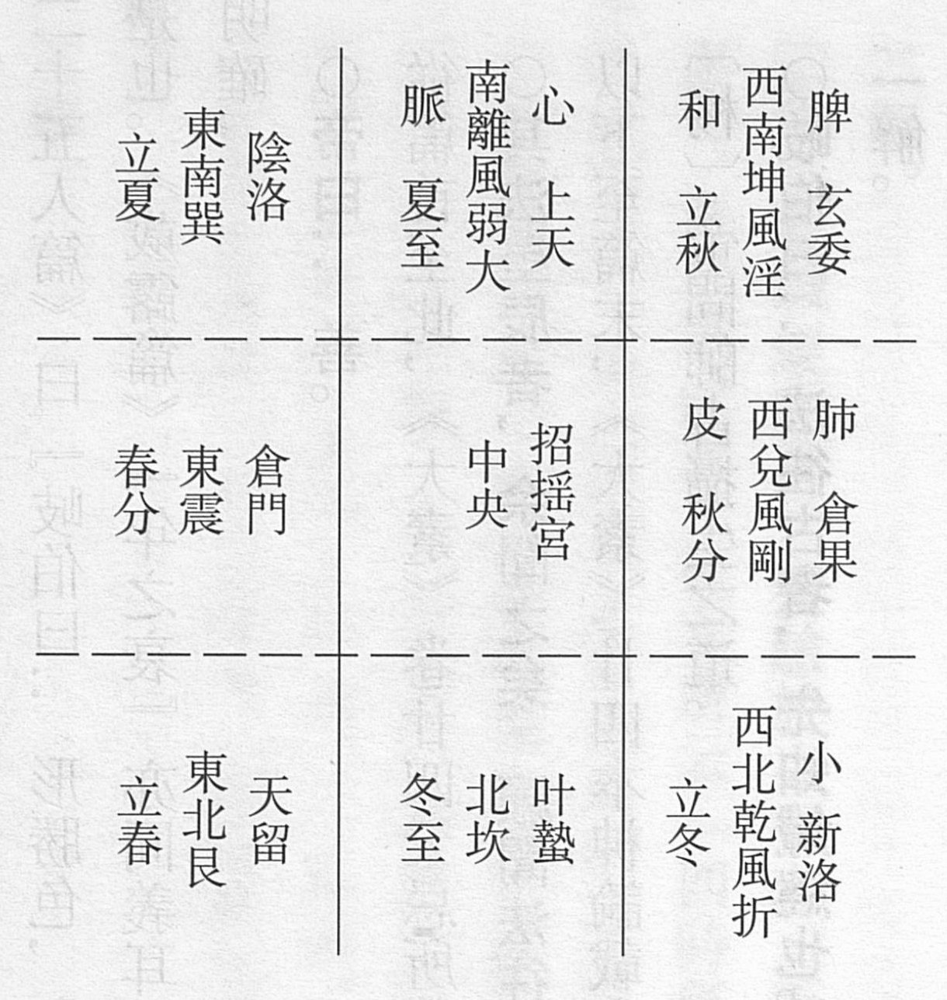

- 脾　玄委　西南坤風淫　和　立秋
- 肺　倉果　西兌風剛　皮　秋分
- 小　新洛　西北乾風折　立冬
- 心　上天　南離風弱大　脈　夏至
- 招摇宮　中央
- 叶蟄　北坎　冬至
- 陰洛　東南巽　立夏
- 倉門　東震　春分
- 天留　東北艮　立春

**○八正之虚邪，而避之勿犯也。**

〔張〕四時之氣所在云云，此皆氣在人身也。至於天氣所在，則八正之風隨時而至者是也。人身之氣宜調於内，天氣｟（疑作『地』）｠之氣宜調於外，故聖人日避虚邪之道，如避矢石然。蓋恐因外而傷其内也。

**○以身之虚，而逢天之虚，兩虚相感，其氣至骨，入則傷五藏。工候救之，弗能傷也。故曰天忌，不可不知也。**

<!-- PAGE_END -->

<!-- PAGE: 0725 -->

<!-- PRINTED: 690 -->

〔楊〕形血氣年加皆虚，故曰身虚。身虚與虚耶相感爲病入深，故至於骨傷五藏也。法天候之以禁，故曰天忌也。

〔紹〕堅案：《官鍼篇》曰『故用鍼者，不知年之所加，氣之盛衰，虚實之所起，不可以爲工也』。《陰陽二十五人篇》曰『岐伯曰：形勝色，色勝形者，至其勝時年加，感則病行，失則憂矣云云』。楊所言，此即是也。《歲露篇》『年之衰』亦同義耳。注《靈樞》者，以『年加』爲五運加臨之謂，先兄嘗辨其謬，極爲明確。

**○帝曰：善。**

從篇首至此，《大素》卷廿四天忌所載。

**○其法星辰者，余聞之矣。願聞法往古者。**

以下至篇末，《大素》廿四本神論載之。

〔楊〕帝問師古攝生之道。

**○岐伯曰：法往古者，先知鍼經也。**

一解。

〔楊〕往古伏羲氏始畫八卦，造書契，即可制鍼經攝生救病之道。

〔馬〕此亦歷解鍼經之辭也。《鍼經》者，即《靈樞》也。第一篇《九鍼十二原》中有『先立鍼經』一語，後世皇甫士安易《靈樞》以《鍼經》之名，故王冰釋《素問》，宋成無己釋《傷寒論》宗之，及各醫籍皆然。

<!-- PAGE_END -->

<!-- PAGE: 0726 -->

<!-- PRINTED: 691 -->

〔識〕簡按：以下歷解《官能篇》第三節之語，凡九釋，頗似《韓非·解老篇》。蓋古注釋之文如此。

案：經中自解經文，古多有此例。《春秋》經傳，《本草》白黑，《靈樞·小鍼解》《素問·脈解》《鍼解》之類是也。此九釋亦其例耳。

**○驗於來今者，先知日之寒温，月之虚盛，以候氣之浮沈而調之於身，觀其立有驗也。**

二解。

〔楊〕制鍼經之旨，獲驗於來今者，先知寒温盛虚，以候脈氣浮沈，次用鍼調之，以取其驗之也。

案：氣之浮沈者，後文所云『四時氣之浮沈』是也。蓋春夏之日爲温，春夏之氣爲浮，秋冬之日爲寒，秋冬之氣爲沈，加之以月之盈虚而調之身。察其脈色則病之虚實成敗觀而可驗也。

**○觀其冥冥者，言形氣榮衛之不形於外，而工獨知之。**

〔楊〕形之肥瘦，血氣盛衰，營衛之行，不見於外，故曰冥冥也。

《示從容論》『窈冥』王注：『窈冥，謂不可見者，則形氣榮衛也。』

**○以日之寒温，月之虚盛，四時氣之浮沈，參伍相合而調之。工常先見之，然而不形於外，故曰觀於冥冥焉。**

三解。

〔楊〕以下解觀也，工人以神得彼形氣營衛之妙，不可知事。參伍相合調之，符合外不知，故曰觀冥冥之。

案：冥冥，已見第二十五中。參伍，已見第十七中。

**○通於無窮者，可以傳於後世也。**

<!-- PAGE_END -->

<!-- PAGE: 0727 -->

<!-- PRINTED: 692 -->

〔楊〕無窮者，謂氣血之妙也。有通之者，可傳之於萬代；不通之者，以煞生人，故不能傳之。

**○是故工之所以異也。然而不形見於外，故俱不能見也。**

〔楊〕良工觀於冥冥，所知衆妙，俱不可知之。

**○視之無形，嘗之無味，故謂冥冥，若神髣髴。**

四解。

〔楊〕冥冥之道，非直目之不可得見，亦非舌所得之味，若能以神髣髴，是可得也。此道猶是黃帝之玄珠，内象通之於髣髴之。｟案：『直』恐『真』訛。｠

〔張〕通於無窮者，無方無體也，故可傳於萬世。其所以異於人者，以人俱不能見，而我獨見之，明察秋毫，在於若無若有之際，故謂冥冥若神髣髴。

**○虛邪者，八正之虛邪氣也。**

五解。

案：前文所云『八風之虛邪』是也。

**○正邪者，身形若用力，汗出，腠理開，逢虛風，其中人也微。故莫知其情，莫見其形。**

六解。

〔楊〕胃中無穀曰飢，飢反汗出，虛因腠理開，虛風得入，虛風入時難知，故曰冥冥也。案：『難知』釋『微』也，『冥冥』釋『莫知其情，莫見其形』也。

案：其中人也微，『微』字爲微邪之義。《調經論》所云『血氣未并，五藏安定，邪客於形，洒淅起於毫毛，未入於經絡也，故命曰神之微』，又云『刺微』，又云『皮膚微病』，又云『血氣未并，五藏安定，肌肉蠕動，命曰微風』，『微』字並指微邪而言，與此同義，宜併考。《金匱》所云『六微』，與此同義。

<!-- PAGE_END -->

<!-- PAGE: 0728 -->

<!-- PRINTED: 693 -->

《五運行大論》六十七云：『五氣更立，各有所先，非其位則邪，當其位則正。帝曰：病之生｟疑脫『之』｠變何如。岐伯曰：氣相得則微，不相得則甚。』

案：『邪』『正』二字及『微』字與此同義。

**○上工救其萌牙，必先見三部九候之氣，盡調不敗而救之，**

七解。

〔楊〕萌芽未病之病，病之微也。先知三部九候調之，即療其微，故不敗也之。

案：『萌』與『微』爲一音，義亦相通。言病之初萌，未深入，名爲微病也。

**○故曰上工。下工救其已成，救其已敗。救其已成者，言不知三部九候之相失，因病而敗之也。**

八解。

〔楊〕疾者，言其速也。

《離合真邪論二十七》云：『不知三部者，陰陽不別，天地不分，地以候地，天以候天，人以候人，調之中府，以定三部，故曰刺不知三部九候。病脈之處，雖有大過且至，工不能禁也。誅罰無過，命曰大惑，反亂大經，真不可復，用實爲虛，以邪爲真，用鍼無義，反爲氣賊。奪人正氣，以從爲逆，榮衛散亂，真氣已失，邪獨内著，絕人長命，予人夭殃。不知三部九候，故不能久長。因不知合之四時五行，因加相勝，釋邪攻正，絕人長命。』

（眉）古抄本無『救其已敗』四字。

**○知其所在者，知診三部九候之病脈處而治之，故曰守其門户焉，莫知其情而見邪形也。**

<!-- PAGE_END -->

<!-- PAGE: 0729 -->

<!-- PRINTED: 694 -->

九解。

〔楊〕但察三部九候，得其病脈，見其耶形，即便療之，以守其門，更不須問其情者也。

案：對前文云『故莫知其情，莫見其形』而成文。此言不莫知其病情之委曲，而見其病邪之形狀乎，可爲得見也。

《離合真邪》二十七云：『然真邪以合，波隴不起，候之奈何。岐伯曰：審捫循三部九候之盛虛而調之，察其左右上下相失及相減者，審其病藏以期之。』

〔張〕知其所在者，知病脈之處也。三部九候，即病脈由行出入之所，故曰門户。情有不可知，而｟當補『形』｠有可見者在乎此，得其形則情可察矣。

**○帝曰：余聞補寫，未得其意。岐伯曰：寫必用方。方者，以氣方盛也，以月方滿也，以日方温也，以身方定也，以息方吸而内鍼。**

〔楊〕方，正也。氣正盛時，月正滿日，時正温時，｟案：『日時』恐誤倒。｠身正乃安時，息正吸時，此之五正，是内鍼時也。

〔馬〕此亦解《鍼經》之義也。伯言《鍼經》有『寫必用方，補必用圓』之語，然以意論之，正以當寫之時，以氣方盛，月方滿，日方温，身方定，以息方吸而納鍼。乃復候其方吸而轉鍼，乃復候其方呼而徐徐出鍼。惟其語中有此方字，故曰寫必用方。

案：當此五方時，息吸而納鍼，息呼而引鍼，是補寫之法也。蓋補寫共宜在五方時也。據馬注，則古鍼經云『寫必用方，補必用員』，岐伯解此『方』字，以五方之義，亦有一理也。此説暗與楊注符，姑從之爲妥。

**○乃復候其方，吸而轉鍼。**

<!-- PAGE_END -->

<!-- PAGE: 0730 -->

<!-- PRINTED: 695 -->

〔楊〕此之一正，是乃轉鍼時也。

**○乃復候其方，呼而徐引鍼，故曰寫必用方，其氣而行焉。**

〔楊〕此之一正，是出鍼時也。寫用七法，即耶氣行出也。

**○補必用員，員者行也，行者移也，刺必中其榮，復以吸**

〔楊〕員之與方，行鍼齊實也。行補之法，刺中營氣，留鍼補也。因吸出鍼，移氣使氣實之也。

**○排鍼也。故員與方，非鍼也。**

〔楊〕員之與方，行鍼之法，皆推排鍼爲補寫之。

〔馬〕其曰補必用圓，圓者正以物之圓者，可行可移，其刺必中其營，復以吸而排鍼，故名曰補必用圓。

〔張〕員者，員活也。行者，行其氣。移者，導其滯。凡正氣不足，則營衛不行，血氣留滯，故必用員以行之補之。榮，血脈也。

〔吳〕排謂經氣既至，則内其鍼，如排擁而入也。

〔志〕排，推也。候其吸而推運其鍼。

**○故養神者，必知形之肥瘦，榮衛血氣之盛衰。血氣者，人之神，不可不謹養。**

〔楊〕養神之道，一者須知形之肥瘦，二者須知營衛二氣所行得失，三者須知經胳血有盛衰。知此三者調之，神自養矣。

〔張〕形者，神之體。神者，形之用。無神則形不可活，無形則神無以生，故形之肥瘦，營衛血氣之盛衰，皆人神之所賴也。故欲養神者，不可不謹養其形。

《靈樞·決氣第三十》云：『黃帝曰：余聞人有精氣津液血脈，余意以爲一氣耳。今乃辨爲六名，余不知其所以然。岐伯曰：兩神相搏，合而成形。常先身生，是謂精。上焦開發，宣五穀味，熏膚充身澤毛，若霧露之漑，是謂氣。腠理發泄，汗出溱溱，是謂津。穀入氣滿，淖澤注於骨，骨屬屈伸洩澤，補益腦髓，皮膚潤澤，是謂液。中焦受氣取汁，變化而赤，是謂血。壅遏營氣，令無所避，是謂脈。』

<!-- PAGE_END -->

<!-- PAGE: 0731 -->

<!-- PRINTED: 696 -->

案：此所云血氣者人之神，得《決氣篇》六氣之辨而始明白。

《靈樞·官能篇第七十三》云：『用鍼之服，必有法則。上視天光，下司八正，以辟奇邪，而觀百姓。審於虛實，無犯其邪，是得天之露，遇歲之虛，救而不勝｟弗勝｠，反受其殃，故曰必知天忌。乃｟迺，下同｠言鍼意，法於往古，驗於來今，觀於窈冥，通於無窮。麤粗之所不見，良工之所貴，莫知其形，若神髣髴。邪氣之中人也，洒淅｟洫泝｠動形，止｟正｠邪之中人也微，先見於色，不知於其身。若在若無，若亡若存，有形無形，莫知其情。是故上工之取氣也，乃救其萌芽。下工守其已成，因敗其形。是故工之用鍼也，知氣之所在，而守其門户，明於調氣，補寫所在，徐｟除｠疾之意。所取之處，寫必用員，切而轉之，其氣乃行，疾而｟入｠徐出，邪氣乃出。伸而迎之，遙｟搖｠大其穴，氣出乃疾。補必用方，外引其皮，令當其門。左引其樞，右推其膚，微旋而徐推之，必端以正，安以靜，堅心無解，欲微以留，氣下而疾出之。推其皮，蓋其外門，真氣乃存，用鍼之要，無忘其神｟養神｠。』

《大素》十九知官能載此文，校異如此。

（眉）《邪氣藏府病形第四》『邪氣』作『虛邪』，『止』作『正』，無『其』字，『在』作『有』。

案：此篇九解，全爲《官能篇》之注解。但『寫必用方，補必用員』，宜從《官能篇》作『寫必用員，補必用方』。《素問》及《大素》『以氣方盛也，以月方滿也云云』有五『方』字，因遂互誤歟，抑亦別傳有如此者歟，今不可考究也。

案：『方者』下恐有脫字，據下文『員者行也，行者移也』之例，則似當作『方者正也，正者直也』。

<!-- PAGE_END -->

<!-- PAGE: 0732 -->

<!-- PRINTED: 697 -->

姑録存疑。

案：『寫必用方』宜作『補必用方』，下文同。『補必用員』宜作『寫必用員』。當氣方盛，月方滿，日方温，身方定，息方吸之時也，當始行補鍼法也。下文云『候其方吸而轉鍼，候其方呼而徐引鍼』，是非補法而何乎。

【楷】《靈·官能篇》文，《大素》卷十九·知官能篇載之，其楊注曰：『員謂之規，法天而動，寫氣者也。方謂之矩，法地而靜，補氣者也。樞謂鍼動也，寫必用方，補必用員。彼出《素問》，此是《九卷》，方員之法，神明之中，調氣變不同，故示世人也。』『示世人』三字，原作『尓世六』，今改正。

【楷】又案：依楊上善此言，則蓋《素問》者九卷，《九卷》者九卷，張仲景以來爲分别如此，而楊氏特以己意合二書，錯雜昆糅以作三十卷書，復自注之，新號爲《大素》者歟。《漢·藝文志》陰陽家『《黃帝泰素》二十篇，六國時韓諸公子所作』，上善依是而用《大素》名歟。要之二十篇中之言，亦恐在今《大素》中耳。

**○帝曰：妙乎哉論也。**

〔楊〕妙者，言得其神之精秘者之也。

**○合人形於陰陽四時，虛實之應，冥冥之期，其非夫子，孰能通之。**

〔楊〕言微妙之辭。以人形合於陰陽，一也。合於四時，二也。合於虛實，三也。合於冥冥，四也。非夫子窮微極妙之通，熟能爲此論之也。

『孰』字俗譌多作『熟』，亦是增畫之例也。楊氏就『熟』字而爲之解，非是。然因此注文，而古來『孰』作『熟』，可知耳。

〔張〕形可見，神不可見。《易》曰：『形乃謂之器，利用出入，民咸用之，謂之神。』

<!-- PAGE_END -->

<!-- PAGE: 0733 -->

<!-- PRINTED: 698 -->

案：人身之氣，合陰陽四時之氣者也。其人天之氣互有虛實，其應否微妙冥冥難察，唯岐伯能通此妙理也。

案：《大素》（『合』上）有『辭』字，似是。辭者，謂上古《鍼經》，岐黃已前之文辭。前文所云『法往古驗來今』之類也。或曰辭字宜屬上句而讀，妙乎哉論也。辭者，即謂妙哉。論辭。論辭者，論是岐伯之辨論，辭是古經之文辭，謂辨論辭文也。亦通。

『虛實之應，冥冥期』。《大素》如此，古文往往有此例。

**○然夫子數言形與神，何謂形，何謂神。願卒聞之。**

〔楊〕知形爲麁，知神爲細，麁細莫辨，故須問之者。

**○岐伯曰：請言形，形乎形，目冥冥。**

〔楊〕形乎形者，言唯知病之形與形，不見其妙，故曰冥冥也。

案：形乎形，猶云形乎形乎，言下工唯知其病形，而不知其真神。家訣所云『探病氣中之道氣，探道氣中之病氣』者，乃此理也。

（眉）家訣者，森家之祕訣，而松岡意齋鍼術之妙言，詳見於《意仲玄奧》中。

〔張〕形乎形，見乎外也。目冥冥，見粗者不見其精也。

**○問其所病，索之於經，慧然在前。**

〔楊〕言粗無知問病所以診索經脈，何能知其病之在前。

〔張〕所病有因，可問而知，所在有經，可索而察，則似乎慧然在前矣。

**○按之不得，不知其情，故曰形。**

<!-- PAGE_END -->

<!-- PAGE: 0734 -->

<!-- PRINTED: 699 -->

〔楊〕按人迎寸口，不知病情，故但知形之。

〔張〕然仍按之不得者，在見其形而不知其情耳。形者，迹也。

**○帝曰：何謂神。岐伯曰：請言神，神乎神，耳不聞，目明心開而志先。**

〔楊〕能知心神之妙，故曰神於神也。神知則既非耳目所得，唯是心眼開於志意之先耳。

〔張〕神乎神，二而一也。耳不聞，聽於無聲也。目著明，心藏神，心竇開則志慧出而神明見。

**○慧然獨悟，口弗能言，俱視獨見。**

〔楊〕神得内明，言名之所不能及也。衆麁俱見，而工獨見。

〔張〕口弗能言，妙不可以言傳也。故與衆俱視，惟吾獨見。

**○適若昏，昭然獨明，若風吹雲，故曰神。**

〔楊〕適將若在昏中，昭然獨明。又解起惑除，若風吹雲，如斯得者，因謂之神也。

案：《大素》正文作『昬』者，蓋避庿諱，猶『泄之』作『洩之』例耳。

〔張〕觀於冥冥，適若昏也。無所見而見之，昭然明也。若風吹雲，宇宙清而光明見也。豁然了悟，人則在心，至哉莫測，故謂之神。

《靈·九鍼十二原》曰：『刺之要，氣至而有效。效之信，若風之吹雲，明乎若見蒼天，刺之道畢矣。』

《甲乙》引『明乎若見蒼天』六字作『昭然於天』四字。

**○三部九候爲之原，九鍼之論不必存也。**

〔楊〕三部九候，爲神得之原。九鍼之論，麁而易行，故不必存之也。

〔張〕以三部九候爲之本原，則神悟可得矣。九鍼之論，特具其形迹耳。既得其神，奚藉於迹。雖不存之，亦無不可。

<!-- PAGE_END -->

<!-- PAGE: 0735 -->

<!-- PRINTED: 700 -->

文久紀元九月念六燈下書了時在更生室之南廂　活翁立之

第二十六補

寫必用方｟十三ウ｠

《離合真邪論第廿七》云：『吸則内鍼，無令氣忤，靜以久留，無令邪布，吸則轉鍼，以得氣爲故。候呼引鍼，呼盡乃去，大氣皆出，故命曰寫。』

正邪者｟十オ｠

《靈樞·邪氣藏府病形第四》《大素》廿七耶中云：『諸陽之會，皆在於面。中人也，方乘虛時，及新用力，若熱飲食，汗出腠理開而中於邪。』

補必用員｟十三ウ｠

《離合真邪》云：『必先捫而循之，切而散，推而按，彈而怒之，抓而下之，通而取之，外引其門，以閉其神，呼盡内鍼，靜以久留，以氣至爲故。如待所貴，不知日暮。其氣以｟脫『至』｠，適而自護。候吸引鍼，氣不得出，各在其處。推闔其門，令神氣存。大氣留止，故命曰補。』

#### 離合真邪論篇第二十七

《大素》廿四真耶補寫全載。

**○黃帝問曰：余聞九鍼九篇，夫子乃因而九之，九九八十一篇，余盡通其意矣。**

〔楊〕八十一篇者，此經之類，所知之書篇數也。

**○經言氣之盛衰，左右傾移，以上調下，以左調右，有餘不足，補寫於榮輸，余知之矣。**

<!-- PAGE_END -->

<!-- PAGE: 0736 -->

<!-- PRINTED: 701 -->

〔楊〕言前所知書中義也。

**○此皆榮衛之傾移，虛實之所生，非邪氣從外入於經也。**

〔吳〕言是榮衛之氣，偏勝傾移，一虛一實之所生，非八風邪氣外入之病也。

**○余願聞邪氣之在經也。其病人何如，取之奈何。**

〔楊〕言前八十一篇所説之義，與余請與異者，經所説唯道十二經脈，營衛二氣，互相傾移。虛實所生，不言外耶入經爲病，故今請之。

**○岐伯對曰：夫聖人之起度數，必應於天地。**

〔楊〕起於人身法度，以應天地之也。

**○故天有宿度，地有經水，人有經脈。**

〔識〕簡按：王解經水｟《素問識》『水』作『字』｠恐非，蓋經是經緯之經。

案：宿度，乃謂十二月與經水十二經脈十二相合，經蓋經常之義。《管子·地圖篇》『名山通谷經川』注：『經川，謂常川也。』乃與此同義。

（眉）《説文》『巠，水脈也』『永，長也。象水巠理之長』。『巠』古『經』今借。地水、人水，皆其諸道脈名巠經。大川逐水，脈理流天然者，謂之巠水，即《爾雅·釋水》所言『四瀆者，發原注海者也』。是巠水之義，《靈·經水篇》之川十二皆是也。若夫人作溝渠，雖極大至深者，非天然水脈道，不得謂經水也。

（眉）《靈·海論》曰：『人亦有四海十二經水，經水者皆注於海，海有東西南北，命曰四海。』

**○天地温和，則經水安靜。天寒地凍，則經水凝泣。天暑地熱，則經水沸溢。卒風暴起，則經水波涌而隴起。**

<!-- PAGE_END -->

<!-- PAGE: 0737 -->

<!-- PRINTED: 702 -->

〔楊〕言天地陰陽氣之度數之也。

案：沸溢者，即沸也。沸之緩言爲沸溢也。暑氣之時，河水不冷而熱沸也。《説文》『沸，畢沸濫泉。從水弗聲』。鉉音『分勿切。又方未切』。《玉篇》『沸，方味切。泉涌出皃』『溢，弋質切。盈也，器滿也，餘也』。《説文》又云『涫，濤也。涾，涫溢也。今河朔方言謂沸溢爲涾，從水沓聲』。鉉音『徒合切』。據此，則『沸溢』爲熟語，而謂沸出也。畢沸亦沸之緩言，與『沸溢』爲同義。

卒風暴起者，忽然吹出之風，謂之卒風也。暴起者，謂其勢猛烈也。《説文》『曓，疾有所趣也』。《穀梁·宣二年傳》『而暴彈之』范甯注：『暴，殘暴。』

〔識〕馬、吳、張並云隴、隆同。簡按：隴、壟同，《劉向傳》『丘隴』，《項羽紀》『隴畝』，俱可證。

《通雅》云：『《内經》言夜半陰隴，而日中陽隴，而脈｟當補「行」｠應之，猶言擁起爲隴，而過此漸平迆也。』案：言波浪涌搖如隴畝高起也。或曰『而』讀爲『如』，似是。然不讀爲『如』亦通，蓋隴起，即謂如隴起之義也。

（眉）沸者，水流之滑利也。溢亦同義，不必溢漲之義。

**○夫邪之入於脈也，寒則血凝泣，暑則氣淖澤。**

〔楊〕言人之自，應寒暑度數。

案：《大素》（『凝』作『涘』）涘泣之急言爲澀，『泣』即『澀』俗字，解已見第十中。淖澤之急言爲澤，見第二十六中。云『天温日明，則人血淖澤而衛氣浮，故血易寫，氣易行。天寒日陰，則人血涘泣而衛氣沈』，乃與此同理。但彼謂隨暑寒異氣血之滑澀，其常也，此則謂邪之入脈中，隨寒暑異其氣血之滑澀，非云常也。

<!-- PAGE_END -->

<!-- PAGE: 0738 -->

<!-- PRINTED: 703 -->

淖澤即淖液，見廿六｟一ウ｠中。

**○虛邪因而入客，亦如經水之得風也。**

〔楊〕因暑之時，腠理開發，耶得入也。耶入脈變如風動水者也。

**○經之動脈，其至也，亦時隴起。**

〔楊〕十二經之動脈，至於動處動也。耶氣至時，亦皆有彼瀧。彼瀧者，耶風動正氣。｟案：彼瀧即波隴訛。｠

**○其行於脈中循循然。**

〔楊〕牛忿反，輑，車前横木，脩車行也。耶脩脈行曰輑，有本作『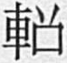』，非之也。

案：『脩』即『循』字俗構，與『脩身』字全別，此二字隸常混書。『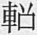』即『軺』字，作『軺』者，『輑』之訛體，故上善以爲非。隸書『君』『召』相侶故誤。

〔識〕循循，吳從王所引一本作『輴輴』。馬云：『似有次序之意，不必作輴輴。』音椿。考字書，義難叶。《論語》『循循然善誘人』，何注：『次序貌。』《刺腰痛篇》『腰痛如以鍼刺其皮中循循然』。

案：《大素》（『然』下）『輑』字不可解，據王云『一本作輴輴』，則『循』字之異體誤作『輑』，混入於正文者，楊氏就誤本漫爲注語歟。

**○其至寸口中手也，時大時小，大則邪至，小則平。**

〔楊〕耶氣循營氣至於寸口，故太陰脈大，無耶則太陰脈平和，故曰小也。

**○其行無常處，在陰與陽，不可爲度。**

〔楊〕尺脈爲陰，寸口爲陽。今耶入變亂而難知，故不可爲度也。

<!-- PAGE_END -->

<!-- PAGE: 0739 -->

<!-- PRINTED: 704 -->

案：陰陽，恐是謂營衛也。凡邪入於表，營衛之行爲之阻隔，故脈狀異常。前文所云『經之動脈』，亦謂營衛也。

**○從而察之，三部九候。卒然逢之，早遏其路，吸則内鍼，無令氣忤。**

〔楊〕審察循三部九候，於九候之中，卒然逢之，知病處所，即於可刺之穴，以指按之，令得遏。因病人吸氣内鍼，無人耶氣能逆忤之也。｟案：『人』恐『令』訛。｠

早遏其路者，《調經論》所云『搖大其道，如利其路』是也。

**○靜以久留，無令邪布，吸轉鍼，以得氣爲故。候呼引鍼，呼盡乃去，大氣皆出，故命曰寫。**

〔楊〕靜留鍼於穴中持之，勿令耶氣散布餘處。因病人吸氣轉鍼，待耶氣至數皆盡已，徐引出鍼，耶之大氣皆盡，因名爲寫之也。

《靈·病傳篇》『正氣横傾，淫邪泮衍，血脈傳溜，大氣入藏，腹痛下淫，可以致死，不可以致生』，亦謂邪氣爲大氣也。

《素・熱論》曰：『大氣皆去，病日已矣。』

〔張〕轉，搓轉也。謂之催氣，所謂轉鍼者，搓轉其鍼如搓線之狀，慢慢轉之，勿令太緊。寫左則左轉，寫右則右轉，故曰撚鍼向外寫之方，撚鍼向内補之訣也。

〔識〕吳云：『故，常法也。』高云：『欲以得氣，爲復其故。』今從吳義。

〔紹〕先兄曰：『《呂覽·本生篇》云：天子之動也，以全天爲故者也。注：故，事也。』

案：『爲故』字面，《長刺節論》數見，又《至真要大論》屢見，王注曰：『爲除病之故。』

案：《廣雅·釋詁》『蠱、故，事也』。王念孫曰：『《序卦傳》云：蠱者，事也。蠱之言故也。《周官·小行人》云：周知天下之故。蠱故同聲，故皆訓爲事也。』

<!-- PAGE_END -->

<!-- PAGE: 0740 -->

<!-- PRINTED: 705 -->

〔識〕高云：『大氣，鍼下所聚之氣也。』簡按：王注『大邪之氣』，注下文則云『大經之氣』，何其言之不一。當從高注。

案：大氣，王注爲大邪之氣，與楊注合，可從。下文之『大氣留止』四字，《大素》無，則恐王氏所補歟。若從無者，則爲大邪之氣可知也。又見《熱論》卅一｟十八ウ｠中。

（眉）補法之刺，寫法之刺，《調經論》詳述，宜參。

**○帝曰：不足者，補之奈何。岐伯曰：必先捫而循之。**

〔楊〕先上下捫摸，知病之所在。一。

**○切而散之，**

〔楊〕以指揣切，令耶不聚。二。

**○推而按之，**

〔楊〕推而令動，以手堅按。三。

**○彈而怒之，**

〔楊〕以指彈之，使其瞋起。四也。

**○抓而下之，**

〔楊〕以手搔摩，令其瞋氣得下，一曰搯｟徒勞反｠彈，已搯令下之。五也。

〔識〕馬云：『謂以左手之爪甲，掐其正穴，而右手方下鍼也。』《七十八難》『抓』作『爪』，張云：『抓、爪同。』簡按：《後漢·趙壹傳》『鍼石運乎手爪』太子賢注云：『古者以砭石爲鍼，凡鍼之法，右手象天，左手法地，彈而怒之，搔而下之，此運手爪也。』蓋取此篇，但『抓』作『搔』。

<!-- PAGE_END -->

<!-- PAGE: 0741 -->

<!-- PRINTED: 706 -->

案：《後漢書》注作『搔』，與《大素》合，其爲古本可知也。《難經》作『爪』爲古字，可從。『抓』『搔』共爲俗字，而古書多相通用，絕無作『爪』者。《廣雅》『抓，搔也』。《説文》『搔，括也』。《玉篇》『抓，抓痒也』。《文選·枚乘諫吳王書》『夫十圍之木，始生如蘖，足可搔而絕』，李善注引《莊子·逸篇》云『豫章初生，可抓而絕』。

（眉）《莊子·徐無鬼》『攫抓』釋文：『抓，本又作搔。素報反。』

**○通而取之，**

〔楊〕切按搔而氣得通已，然後取之。六也。

〔識〕《甲乙》『取』作『散』。吳云：『通達其處，然後取定其穴。』張云：『下鍼之後，必候氣以取其疾。』

案：取謂取穴也。楊、吳共是。

**○外引其門，以閉其神。**

〔楊〕疾出鍼已，引皮閉門，使神氣不出。神氣，正氣。七也。鍼之先後有此七法也。

**○呼盡内鍼，**

〔楊〕一呼一内，故曰呼盡内鍼，至分寸處也之。

**○靜以久留，以氣至爲故，如待所貴，不知日暮。**

〔楊〕伺氣如待情之所貴之者，以得爲期之。

**○其氣以至，適而自護。**

<!-- PAGE_END -->

<!-- PAGE: 0742 -->

<!-- PRINTED: 707 -->

〔楊〕其正氣已至適，人自當愛護，勿令洩也。

**○候吸引鍼，氣不得出。各在其處，推闔其門，令神氣存，大氣留止，故命曰補。**

〔楊〕候病人吸氣，疾引其鍼，即不得使正氣洩，令各在其所虛之處，速閉其門，因名曰補。寫必吸入呼出，欲洩其耶氣也。補必呼入吸出，欲閉其正氣不令出也。

《七十八難》云：『知爲鍼者信其左，不知爲鍼者信其右。當刺之時，必先以左手厭按所鍼滎俞之處，彈而努之，爪而下之。其氣之來如動脈之狀，順鍼而刺之。得氣因推而内之，是謂補，動而伸之，是謂瀉。不得氣，乃與男外女内不得氣，是謂十死不治也。』

《靈樞·官能篇七十三》云：『工之用鍼也，知氣之所在，而守其門户，明於調氣，補寫所在，徐疾之意，所取之處。寫必用員，切而轉之，其氣乃行。疾而徐出，邪氣乃出，伸而迎之，遙大其穴，氣出乃疾。補必用方，外引其皮，令當其門，左引其樞，右推其膚，微旋而徐推之，必端以正，安以靜，堅心無解，欲微以留，氣下而疾出之，推其皮，蓋其外門，真氣乃存。用鍼之要，無忘其神。』

寫〔馬〕按：《熱論》有云『大氣皆去』，亦是大邪之氣也。《調經論》曰：『寫實者，氣盛乃内鍼，鍼與氣俱納，以開其門，如利其户。鍼與氣俱出，精氣不傷，邪氣乃下，外門不閉，以出其疾，搖大其道，如利其路，是謂大寫。必切而出，大氣乃屈。』

《靈樞·九鍼十二原第一》云：『寫曰必持内之，放而出之，排陽得鍼，邪氣得泄，按而引鍼，是謂内温，血不得散，氣不得出也。』

補〔馬〕《寶命全形篇》曰『經氣已至，愼守勿失』，《鍼解論》亦云然。《調經論》曰：『補虛奈何。岐伯曰：持鍼勿置，以定其意，候呼納鍼，氣出鍼入，鍼空四塞，精無從去，方實而疾出鍼，氣入鍼出，熱不得還，閉塞其門，邪氣布散，精氣乃得存。動氣候時，近氣不失，遠氣乃來，是謂追之。』《九鍼十二原》云：『補曰隨之，隨之意若妄之。若行若按，若蚊虻止，如留如還，去如弦絶，令左屬右，其氣故止。外門已閉，中氣乃實，必無留血，急取誅之。』

<!-- PAGE_END -->

<!-- PAGE: 0743 -->

<!-- PRINTED: 708 -->

**○帝曰：候氣奈何。**

案：氣者，鍼下所至之氣，可候而知者也。下文所云真氣、經氣、大氣之類，此舉而但言氣耳。

**○岐伯曰：夫邪去絡入於經也，舍於血脈之中，其寒温未相得，如涌波之起也，時來時去，故不常在。故曰方其來也，必按而止之，止而取之，無逢其衝而寫之。**

〔楊〕外耶入身，先至皮毛胳中，留而不洩，出胳入經。其入經也，與經中血氣共合。耶之寒温，未與正氣相得，遂波涌而起，去來不常居也。故候逢之，按使止而不動，然後以鍼刺之，不得刺其盛衝，寫法比之不擊逢逢之陳。

《太素》『波』作『被』，訛字。楊注作『波涌』，可以徵矣。

案：蓋邪氣去絡入於經之際，雖與血脈相合，不論天寒天温之邪，尚未與正氣相和。故二氣相得，如波之得風，去來不定。故方其來時也，必以手指按定，其來路中，其氣漸定而取之穴，使邪泄，不得刺其氣之來正衝激之時也。楊注是。此二『來』字及下句『來』字，共謂經氣之來至，乃與前文所云『經之動脈，其至也，亦時隴起，其行於脈中循循然』及『三部九候，卒然逢之，早遏其路』互相發也。若誤逢其衝而寫之，則後文所云『候邪不審，大氣已過，寫之則真氣脱，脱則不復，邪氣復至，而病益蓄，故曰其往不可追，此之謂也』可以併考矣。

逢其衝者，即前文所云『其行脈中循循然』是也。

<!-- PAGE_END -->

<!-- PAGE: 0744 -->

<!-- PRINTED: 709 -->

**○真氣者，經氣也。經氣太虛，故曰其來不可逢，此之謂也。**

〔楊〕經氣者，謂十二經脈正氣者也。正氣大虛，與耶俱至，宜按取耶氣刺之，不可逢而刺也。

**○故曰：候邪不審，大氣已過，寫之則真氣脱，脱則不復，邪氣復至，而病益蓄，故曰其往不可追，此之謂也。**

〔楊〕候耶大氣不審，按之不著，刺之則脱真氣，耶氣更至，病益蓄聚，故曰耶氣往而不可追也。

案：既脱之真氣不可復生，故曰往而不可追也。楊以爲耶氣往而不可追，恐非是。大氣已過者，謂邪氣來至之期已過也。邪正相搏，則其氣必大，故曰大氣也。

**○不可挂以髮者，待邪之至時，而發鍼寫矣。若先若後者，血氣已盡，其病不可下。**

〔張〕發鍼寫者，施寫法也。欲寫其邪，在氣至之頃。不可挂以髮者，言絲毫之不可失也。若先若後者，先之則邪未至，後之則大氣已過，徒有伐盡其血氣，而病不可下。下者，降服之謂。

**○故曰知其可取如發機，不知其取如扣椎。故曰知機道者，不可挂以髮，不知機者，扣之不發，此之謂也。**

〔楊〕以毛髮挂機，發速而往，言氣至智者發鍼，亦爾不失時之也。

〔馬〕案：《靈樞·小鍼解篇》云『其來不可逢者，氣盛不可補也。其往不可追者，氣虛不可寫也。不可挂以髮者，言氣有易失也。扣之不發者，言不知補寫之意也。血氣已盡，而氣不下也』，但此篇之辭，專主寫言，而《靈樞》則兼補寫而言，故其辭同而意則小異耳。

《靈樞·小鍼解第三》云：『察後與先，若亡若存者，言氣之虛實補寫之先後也。察其氣之已下，與常存也。』

<!-- PAGE_END -->

<!-- PAGE: 0745 -->

<!-- PRINTED: 710 -->

〔張〕機，弩機也。椎，木椎也。知而取之，必隨撥而應，如發機之易，不知而攻之，則頑鈍莫入，如扣椎之難也。

**○帝曰：補寫奈何。岐伯曰：此攻邪也。疾出以去盛血，而復其真氣。**

案：『疾出以去盛血』者，第十六云『春刺散俞，及與分理，血出而止』，與此同理，可併看｟二ヲ｠。

〔楊〕虛亦是耶，故補亦稱攻也。寫熱之法，不可久留，疾出其鍼，去其盛血，復其真氣者之也。

〔馬〕帝又以邪氣當寫，真氣當補，則寫者不可以爲補，補者不可以爲寫，故又以補寫奈何爲問。伯言：此法正所以攻邪也。疾出其鍼，以去盛血，而復其真氣，則寫中有補矣。

**○此邪新客，溶溶未有定處也。推之則前，引之則止，逆而刺之，温血也。刺出其血，其病痛立已。帝曰：善。**

〔楊〕定處，積爲疾也。温，熱也。耶之新入，未有定處。有熱血，刺去之，痛愈。

案：刺出其血，即前文所云『疾出去其盛血』之義。刺出其血，已見於第二十｟十七ウ｠中。取血者，見於第廿二中，可併考。

〔識〕《釋音》『溶，音容』，張云『流動貌』。簡按：《説文》『水盛也』。

〔吳〕逆，迎也。温血，毒血也。毒血既去，其病立除。

〔張〕邪之新客於人者，其淺在絡，未有定處。凡取絡者，必取其血，刺出温血，邪必隨之而去矣，故病可立已。温血，熱血也。

**○然真邪以合，波隴不起，候之奈何。**

〔楊〕前言真邪未合，有波隴起，未知真耶已起，其氣何如也。

<!-- PAGE_END -->

<!-- PAGE: 0746 -->

<!-- PRINTED: 711 -->

〔張〕真邪以合，邪正初相犯也。波隴不起，病形未見也。察此不真，最易惑亂。

**○岐伯曰：審捫循三部九候之盛虛而調之。**

〔張〕但審察三部九候之脈，則盛虛可得，而調治可施矣。

**○察其左右上下相失及相減者，審其病藏以期之。**

案：據第二十云『形氣相得者生，三五不調者病，三部九候皆相失者死云云』之言，則此云『期之』，謂期之死生也。楊注可從矣。第廿亦云『察其府藏，以知死生之期』，與此同義。府，《大素》作『病』，與此合。

〔楊〕察其左右，謂察三部九候左右兩箱，頭及手足上下，其脈有相失及相減，以之審於五藏之病，與之死生之期也。

**○不知三部者，陰陽不別，天地不分。**

〔楊〕不知天爲陽也，地爲陰也，人爲陰陽也，故曰不別氣也。不分者，不分形之也。

〔張〕陰陽不別，則不知藏府逆順。天地不分，則不知升降浮沈。

案：『陰陽』之二字廣大無邊，隨處而異義，不可一途而説也。此陰陽言氣，天地言形。陰陽言脈氣，天地言證候也。

**○地以候地，天以候天，人以候人，調之中府，以定三部。**

〔楊〕足厥陰天，足少陰地，足太陰人，以候肝腎脾胃三種地也。手太陰天，手陽明地，手少陰人，以候肺胸心三種人也。兩額動脈之天，兩頰動脈之地，耳前動脈之人，以候頭角口齒耳目三種天也。中府，五藏也。欲調五藏之氣，取定天地人三部九候之也。

<!-- PAGE_END -->

<!-- PAGE: 0747 -->

<!-- PRINTED: 712 -->

案：詳出於《三部九候論》，是乃謂分別陰陽天地也。

〔識〕吳云：『中府，胃也。土主中宮，故曰中府。調之中府者，言三部九候，皆以冲和胃氣調息之。』張云：『中府，藏氣也。凡三部九候脈證，皆以藏氣爲主，氣順則吉，氣逆則凶，故調之中府。』志、高仍吳注。

案：張説與楊同，可從。《三部九候論》所謂『中部候肺心，下部候肝脾腎』是也。

（眉）中府，胃也。言診凡脈皆参合胃氣有無多少，以決病平死生也。詳出《平人氣象》《玉機真藏》。

**○故曰：刺不知三部九候，病脈之處，雖有大過且至，工不能禁也。**

案：前云『不知三部』，此云『不知三部九候病脈之處』，乃詳此而畧於彼，爲古文之一體耳。

〔吳〕大過，大邪爲過也。

案：大過者，前文所云『大氣已過』也。且至者，前文所云『邪氣復至』也。志以爲『歲運之氣至』，恐非是。

**○誅罰無過，命曰大惑。**

案：徒傷正氣，而邪氣不去，故曰誅罰無過也。不知三部而行鍼者，謂之大惑也。

〔楊〕病脈之處，即是無候經胳耶之居脈，以不知病脈，則雖有死過之麄至，工之醫永不能禁也。誅罰生人，不知無過，稱曰大惑。不知三部九候，大或罪有六種也。｟『大或』恐『大惑』訛。｠

**○反亂大經，真不可復。**

〔楊〕亂經損真，罪之一也。

《舉痛論·第三十九》云：『寒氣客於小腸膜原之間，絡血之中，血泣不得注於大經，血氣稽留不得行，故宿昔而成積矣。』

<!-- PAGE_END -->

<!-- PAGE: 0748 -->

<!-- PRINTED: 713 -->

案：大經者，即經脈也。言經脈錯亂則内害五藏，遂令真元氣不復也必矣，故曰真不可復也。

**○用實爲虛，以邪爲真。**

〔楊〕妄解虛實，罪之二也。

案：以實爲虛者，謂邪實尤甚，陽厥似陰。以邪爲真者，謂以邪盛誤爲陽氣盛實也。

**○用鍼無義，反爲氣賊，奪人正氣。**

〔楊〕義，理也。用鍼不知正理，反爲氣賊，傷人正氣，罪之三也。

案：奪人正氣，以從爲逆，乃爲氣賊之義也。

**○以從爲逆，榮衛散亂。**

〔楊〕鍼道爲順，錯行爲逆，妄刺營衛，故令其亂，罪之四也。

**○真氣已失，邪獨内著。**

案：此三句，説以從爲逆也。

〔楊〕亡正得耶，罪之五也。

**○絶人長命，予人夭殃。**

案：前文云『誅罰無過』，至此爲結文也。

〔楊〕鍼煞生人，罪之六。

**○不知三部九候，故不能久長。**

案：已下六句，『絶人長命』之注腳分解，楊注可從。

<!-- PAGE_END -->

<!-- PAGE: 0749 -->

<!-- PRINTED: 714 -->

〔楊〕絶人長命又有三。不知三部九候，所以絶人長命，一也之。

**○因不知合之四時五行，**

〔楊〕不知以身命合四時五行，絶人長命，二也。

**○因加相勝，釋邪攻正，絶人長命。**

案：釋，舍也。

〔楊〕愚醫不知年加之禁，反攻正氣，故絶人長命，三也。長命者，盡壽也。

案：相勝者，《六節藏象論》九云『五氣更立，各有所勝』，又云『春勝長夏，長夏勝冬，冬勝夏，夏勝秋，秋勝春』是也，宜併考。言『不知三部九候』『不知合之四時五行』，且加『相勝』，此三件足能絶人長命也。

**○邪之新客來也，未有定處，推之則前，引之則止，逢而寫之，其病立已。**

〔楊〕言知三部九候，取之必效之。

案：此逢者，前文云『卒然逢之』之『逢』之義，言逢邪而早寫之，則其病立已。《傷寒論·太陽上篇》第廿五章云『太陽病，初服桂枝湯，反煩不解者，先刺風池風府，卻與桂枝湯則愈』，又九章云『太陽病，頭痛至七日以上自愈者，以行其經盡故也。若欲作再經者，鍼足陽明，使經不傳則愈』，並與此同理。

案：琦以此六句廿六字爲衍文，非是。據《大素》則『真邪以合』上有『黄帝問於岐伯曰』七字爲別條，然則前文『此邪新客云云』自爲別條，雖似爲重出，竟不與此相妨也。

案：此篇首尾一貫爲一章。

辛酉十月五日達磨忌日頓悟自述五十五年猶若童，守愚養拙未見功，一朝豁解生成理，二九維文悉貫通。

<!-- PAGE_END -->

<!-- PAGE: 0750 -->

<!-- PRINTED: 715 -->

再醒翁立之書〔花押〕

文久辛酉十月朔丙辰午時書於恐泥書屋南箱槭溪山人磊齋　立之

第二十七補

捫而循之｟四ウ｠

〔識〕《通雅》云：『捫摸二字，古無摸字，即捫也。』

彈而怒之｟五ヲ｠

〔識〕張云：『以指彈其穴，欲其意有所注，則氣必隨之，故脈絡䐜滿如怒起也。』簡按：《七十八難》『怒』作『努』。『怒』『努』通用，《莊子·逍遥游》『怒而飛』，《外物篇》『草木怒生』，《後漢》第五倫傳『鮮車怒馬』，皆努同。

從而察之｟三ウ｠

案：此句宜屬上而讀。三部九候，乃謂全身。全身中卒然逢邪風之氣，則在其部中而候之。早早遏絶其經路，不令及一身藏府，其鍼法即寫法是也。如《傷寒論·太陽上篇八》『鍼足陽明，使經不傳則愈』，正與此同理。

温血也｟十ウ｠

《靈·九鍼十二原第一》云：『寫曰云云，按而引鍼，是謂内温，血不得散，氣不得出也。』全文出前。｟七ヲ｠

案：所云『内温』與『温血』同義，謂留血也。留血，見《九鍼十二原》補法下，蓋温與煴、藴同，謂鬱結也。

<!-- PAGE_END -->

<!-- PAGE: 0751 -->

<!-- PRINTED: 716 -->

相失　相減｟十一ヲ｠

《三部九候論》第二十云：『形氣相得者生，參伍不調者病，三部九候皆相失者死。』

案：所云『參伍不調』者，此所云『相減』之謂也。

又云：『中部之候，雖獨調，與衆藏相失者死，中部之候相減者死。』

補寫｟六ヲ｠

《調經論第六十二》云：『帝曰：血氣以并，病形以成，陰陽相傾，補寫奈何。岐伯曰：寫實者，氣盛乃内鍼，鍼與氣俱内，以開其門，如利其户，鍼與氣俱出，精氣不傷，邪氣乃下。外門不閉，以出其疾，搖大其道，如利其路，是謂大寫。必切而出，大氣乃屈。帝曰：補虛奈何。岐伯曰：持鍼勿置，以定其意。候呼内鍼，氣出鍼入。鍼空四塞，精無從去，方實而疾出鍼，氣入鍼出，熱不得還，閉塞其門，邪氣布散，精氣乃得存。動氣候時，近氣不失，遠氣乃來，是謂追之。』｟十七ノ六ウ｠

推之則前引之則止｟十ウ｠

案：推之者，前文云『推而按之』，引之者，『外引其門，以閉其神』也。推、引共謂補法也。言邪新客之際，不可行補鍼，若逆而補刺之，則薀蓄其血，邪不能出也。温血與《靈樞·九鍼十二原》所云『内温』同義，乃謂血不得散，氣不得出也。

廿五　生成｟一ヲ｠　嘶敗｟二ヲ｠　三三｟三ヲ｠　人｟四ウ｠　存｟六ウ｠　呿吟｟同｠　五勝｟六ウ｠　懸布｟八ウ｠　黔首｟八ウ｠　毒藥｟十一ヲ｠　砭石｟十二ヲ｠　瞚｟十七ウ｠　鍼耀｟十八ウ｠　烏烏｟廿ヲ｠　稷稷｟同｠　横彉｟廿一ヲ｠　飛｟廿ウ｠　握虎｟廿二ウ｠

廿六　服｟一ヲ｠　涘泣｟一ウ｠　淖液｟同｠　陰陽真邪｟四ウ｠　淫邪｟同｠　八正｟六ヲ｠　虛邪｟六ヲ｠　天忌｟七ウ｠　往古｟八ヲ｠　鍼經｟同｠　氣之浮沈｟八ウ｠　微｟十ヲ｠　寫方補員｟十二ヲ、十三ウ｠　排鍼｟十四ヲ｠　神氣｟同ウ｠　形神｟十六ウ｠

<!-- PAGE_END -->

<!-- PAGE: 0752 -->

<!-- PRINTED: 717 -->

廿七　九鍼九篇九九八十一篇｟一ヲ｠　經言｟同｠　沸溢｟二ヲ｠　循循然｟三ヲ｠　軺｟同｠　故｟四ウ｠　大氣｟同、又九ヲ｠　捫｟同｠　抓搔｟五ヲ｠　補寫｟六ウ｠　機｟十ヲ｠　椎｟同｠　溶溶｟十ウ｠　中府｟十二ウ｠　大經｟同｠　温血｟補ノ一ウ｠　脈陰陽｟三ウ｠　淖澤｟二ウ｠

#### 通評虛實論篇第二十八

**○黄帝問曰：何謂虛實。岐伯對曰：邪氣盛則實，精氣奪則虛。**

正邪之虛實。

〔張〕邪氣有微甚，故邪盛則實。正氣有強弱，故精脱則虛。奪，失也。愚按：邪氣盛則實，精氣奪則虛。二句爲病治之大綱，其辭似顯，其氣甚微，最當詳辨，而辨之有最難者何也。蓋實言邪氣，實宜寫也，虛言正氣，虛宜補也。凡邪正相薄而爲病，則邪實正虛，皆可言也。故主寫者，則曰邪盛，則實當寫也，主補者，則曰精奪，則虛當補也。各執一句，茫無確見，藉口文飾，孰得言非，是以至精之訓，反釀莫大之害。不知理之所在，有必不可移易者，奈時醫不能察耳。余請析此爲四。曰孰緩孰急，其有其無也。所謂緩急者，察虛實之緩急也。無虛者急在邪氣，去之不速，留則生變也。多虛者急在正氣，培之不早，臨期無濟也。微虛微實者，亦治其實，可一掃而除也。甚虛甚實者，所畏在虛，但固守根本以先爲己之不可勝，則邪無不退也。二虛一實者，兼其實，開其一面也。二實一虛者，兼其虛，防生不測也。總之實而物補，固必增邪，猶可解救，其禍小，虛而誤攻，真氣忽去，莫可挽回，其禍大。此虛實之緩急，不可不察也。所謂有無者，察邪氣之有無也。凡風寒暑濕火燥，皆能爲邪。邪之在表在裏，在府在藏，必有所居，求得其本，則直取之。此所謂有，有則邪之實也。若無六氣之邪，而病出三陰，則惟情慾以傷内，勞倦以傷外，非邪似邪，非實似實，此所謂無，無則病在元氣也。不明虛實有無之義，必至以逆爲從，以標作本，絶人長命，損德多矣，可不懼且慎哉。

<!-- PAGE_END -->

<!-- PAGE: 0753 -->

<!-- PRINTED: 718 -->

〔識〕簡按：邪氣之客於人身，其始必乘精氣之虛而入。已入而精氣旺，與邪氣俱盛則爲實，如傷寒胃家實證是也。若夫及邪入而客，精氣不能與之相抗，爲邪氣所奪則爲虛，如傷寒直中證是也。馬云：『邪氣盛者外感也，正氣虛者内傷也。』此説不可從。

案：凡邪氣入人身中，其正氣旺者，邪與正相抗，故邪氣盛也，是爲實證。所云陽證、熱證，三陽病是也。其邪氣入人身中，其精氣缺奪者，不能邪正相抗，邪氣雖盛，不爲熱也，是爲虛證。所云陰症、寒症，三陰病是也。此云虛實，專謂虛寒、實熱二證也。與後文虛實，其義自異。

〔李〕盛則實者，邪氣方張，名爲實證。奪則虛者，亡精失血，用力勞神，名爲内奪。汗之下之，吐之清之，名爲外奪。氣怯神疲，名爲虛證。

（眉）《醫碥》曰：『實者，邪氣實而正氣不虛，可任攻。虛者，正氣自虛而邪氣自實，補正仍須治邪。若邪亦不實，但補正則邪自退。』

**○帝曰：虛實何如。**

案：此所云虛實，專謂一身之虛實，不加外邪者也，故岐伯答以藏虛也。不別云藏實者，蓋五藏平和不虛者，乃爲實，故只答以虛也。

**○岐伯曰：氣虛者，肺虛也。氣逆者，足寒也。**

〔張〕肺主氣，故氣虛者，即肺虛也。氣逆不行，則無以及於四支。陽虛於下，故足寒也。

〔琦〕『者也』二字衍。又曰：此明五藏之虛實，從肺起例也。肺主氣，肺虛故氣虛，氣逆足寒，肺虛之證也。肺宜清降，虛則治節不行，故上則喘逆，而下則足寒。濁陰不降，則清陽不升也。

<!-- PAGE_END -->

<!-- PAGE: 0754 -->

<!-- PRINTED: 719 -->

**○非其時則生，當其時則死。**

〔張〕以肺虛而遇秋冬，非相賊之時，故生。若當春則金木不和，病必甚。當夏則金虛受克，病必死也。一曰肺王於秋，當秋而氣虛，金衰甚也，故死。於義亦通。

**○餘藏皆如此。**

五藏之虛實。

〔馬〕餘藏虛者，其生死亦如此而已。夫帝問虛實，而伯先以虛爲對，未及於實也。

案：此答以藏虛者，平藏乃爲實，不別爲病也。若其實爲病者，則爲重實，見下文。馬氏曰『未及於實也』，未可。

**○帝曰：何謂重實。**

〔吳〕重，平聲。後同。證脈皆實，是重實也。

〔紹〕高曰：『重實者，言人身大熱之病，氣盛而熱，脈盛而滿。陰陽血氣皆實，是謂重實。』堅案：高注似是。

案：凡五藏本氣實，則爲無病平人。若胃陽亢極，則血氣共實，爲重實之證，其證如下文。高注可從，吳無注，馬、志共爲邪熱，非是。

**○岐伯曰：所謂重實者，言大熱病。氣熱脈滿，是謂重實。**

表裏之實。

案：大熱病者，總稱人身陽熱之病也。氣脈一而爲二，分言之則氣陽而脈陰也。氣謂精氣，脈謂血脈也。蓋血滿脈中，則精氣盛壯而爲大熱也。『氣熱脈滿』四字，爲大熱病之脈症也。氣則用而脈則體也。《上古天真第一》云『氣脈常通，而腎氣有餘也』，《經脈別論第廿一》云『脈氣流經，經氣歸於肺，肺朝百脈，輸精於皮毛，毛脈合精，行氣於府』，《脈要精微第十七》云『夫脈者，血之府也。長則氣治，短則氣病，數則煩心，大則病進。上盛則氣高，下盛則氣脹。代則氣衰，細則氣少』，並可以徵於氣脈相體用也。第十九云『脈盛，皮熱，腹脹，前後不通，悶瞀，此謂五實』。

<!-- PAGE_END -->

<!-- PAGE: 0755 -->

<!-- PRINTED: 720 -->

**○帝曰：經絡俱實何如。何以治之。岐伯曰：經絡皆實，是寸脈急而尺緩也。皆當治之。**

〔馬〕經者，十二經也。絡者，十五絡也。

案：經絡皆實者，血氣有餘也，故其脈寸口急而尺膚則緩也。蓋寸脈急者，内診經之脈也。經血充滿，故見急數脈也。尺膚脈緩者，外診絡之脈也。經血已充滿則絡脈被遏而不快通，故不得寸脈與尺膚共急，只在皮膚則緩脈也。《靈樞·邪氣藏府病形第四》云『脈急者，脈｟（當作「尺」）｠之皮膚亦急。脈緩者，尺之皮膚亦緩』，又《論疾診尺第七十四》云『審其尺之緩急小大滑濇，肉之堅脆，而病形定矣』，並云其常，此云其變也，不可以彼律於此也。

〔識〕簡按：王云『脈急，謂脈口也』，而不解『尺緩』之義，諸家俱爲尺中之脈，非也。《論疾診尺篇》云：『審尺之緩急小大滑濇。』《邪氣藏府病形篇》云：『脈緩者，尺之皮膚亦緩。』尺緩，即尺膚緩縱之謂。此節以脈口診經，以尺膚診絡，蓋經爲陰爲裏，乃脈道也，故以脈口診之，絡爲陽爲浮而淺，故以尺膚診之，義爲明晰。馬以經與寸爲陽，以絡與尺爲陰，此本於後世寸陽尺陰之説者，與經旨相畔。張則云『本節之義，重在經絡，不在尺寸』，俱不知尺是尺膚之謂也。下文『脈口寒而尺寒』『尺熱滿，脈口寒濇』，義並同。吳『尺緩』改作『尺脈緊』，尤誤。

**○故曰：滑則從，濇則逆也。**

<!-- PAGE_END -->

<!-- PAGE: 0756 -->

<!-- PRINTED: 721 -->

〔吳〕言有重實之病，脈滑利者爲順，濇者逆也。

〔志〕滑主氣血皆盛，故爲從。濇主血氣皆少，故爲逆。

案：據後文云『實而滑則生，實而逆則死』之文，則此云『逆從』猶云『死生』歟。又《靈樞·根結篇》云『血之清濁，氣之滑濇，脈之長短，血之多少，經絡之數云云』，可併考。

**○夫虛實者，皆從其物類始，故五藏骨肉滑利，可以長久也。**

脈之虛實。

〔馬〕大凡物類有虛實，必滑澤則生，枯濇則死，非特脈爲然也。故五藏骨肉滑利，所以其脈亦滑，可以長久而生也。若五藏濇滯，則其脈亦濇，必不能長久而死矣。何以異於物類也哉。

〔高〕物猶形也。類猶合也。物類者，五藏在内，皮肉脈筋骨有形在外，而合於五藏也。始，先見也。夫虛實者，皆從其有形之外合，以先見也。

案：此重明非脈實必生，脈虛必死之理。蓋脈之虛實緩急陰陽寒熱，其狀雖不同，但其五藏骨肉滑利者，其脈亦自帶滑利。滑利者，有胃氣之謂也。

〔識〕吳刪『故曰』二字。簡按：以下止『可以長久也』三十一字，疑是錯簡，若移於下文『滑則生濇則死也』之下，則文理順接焉。

**○帝曰：絡氣不足，經氣有餘何如。岐伯曰：絡氣不足，經氣有餘者，脈口熱而尺寒也。秋冬爲逆，春夏爲從，治主病者。**

以下至『刺陰灸陽』，《大素》卷卅經胳虛實載之。

〔楊〕胳虛經實，何以得知。胳爲陽也，經爲陰也。寸爲陽也、外也，尺爲陰也、内也。秋冬，陰也，春夏，陽也。胳氣不足，陽氣虛也。經氣有餘，陰氣盛也，於秋冬時，診寸口得緩脈，尺之皮膚寒爲逆，春夏緩脈，尺之皮膚寒爲順。緩脈熱也，以秋冬陽氣在内，陰氣在外，春夏陰氣在内，陽氣在外故也。於尺寸在内時寒熱，取經胳虛實也。

<!-- PAGE_END -->

<!-- PAGE: 0757 -->

<!-- PRINTED: 722 -->

〔紹〕堅按：楊以脈口熱爲緩脈，非是。又尺膚寒，見《論疾診尺篇》。

〔識〕志云：『寒熱者，尺寸之膚寒熱，而應於經絡也。絡脈外連皮膚，爲陽主外，經脈内連藏府，爲陰主内。經云：榮出中焦，衛出下焦，衛氣先行皮膚，先充絡脈，絡脈先盛，衛氣已平，營氣乃滿，而經脈大盛。經脈之虛實也，以氣口知之，故以尺膚候絡，而以寸候經。』高云：『經氣有餘，則脈口膚熱，絡氣不足而尺膚寒也。以寸膚候經，以尺膚候絡。』簡按：『脈口熱』，依下文『寒濇』而推之，謂脈滑也。志、高以『尺』爲尺膚，極是，然以『脈口』爲寸膚者，經文中無明證。

《調經論第六十二》云：『百病之生，皆有虛實。今夫子乃言有餘有五，不足亦有五，何以生之乎。岐伯曰：皆生於五藏也。夫心藏神，肺藏氣，肝藏血，脾藏肉，腎藏志，而此成形。志意通，内連骨髓而成身形五藏。五藏之道，皆出於經隧，以行血氣，血氣不和，百病乃變化而生，是故守經隧焉。』

經脈，《靈樞·經脈篇第十》云：『凡刺之理，經脈爲始，營其所行，制其度量，内次五藏，外別六府。』又云：『經脈者，所以能決死生，處百病，調虛實，不可不通。』又云：『經脈十二者，伏行分肉之間，深而不見，其常見者，足太陰過於外踝之上，無所隱故也。』又云：『故衛氣已平，營氣乃滿，而經脈大盛。脈之卒然動者，皆邪氣居之，留於本末。不動則熱，不堅則陷且空，不與衆同，是以知其何脈之動也。』又云：『經脈者，常不可見也，其虛實也，以氣口知之。』又《脈度篇第十七》云：『經脈爲裏。』又云：『當數者爲經。』

<!-- PAGE_END -->

<!-- PAGE: 0758 -->

<!-- PRINTED: 723 -->

絡脈，《靈樞·經脈篇》云：『諸脈之浮而常見者，皆絡脈也。六經絡手陽明少陽之大絡，起於五指間，上合肘中。飲酒者，衛氣先行皮膚，先充絡脈。絡脈先盛，故衛氣已平，營氣乃滿，而經脈大盛。』又云：『脈之見者，皆絡脈也。諸絡脈皆不能經大節之間，必行絶道而出，入復合於皮中。其會皆見於外，故諸刺絡脈者，必刺其結上，甚血者雖無結，急取之，以寫其邪，而出其血，留之發爲痺也。』又《脈度篇》云：『支而横者爲絡，絡之別者爲孫。盛而血者，疾誅之。盛者寫之，虛者飲藥以補之。』又云：『其不當數者爲絡也。』

〔張〕治主病者，即下文灸刺之義。

案：下文云『經滿絡虛，刺陰灸陽』，乃與此云『絡氣不足，經氣有餘』合。

案：經有餘，陽氣走於表，故寸口熱而滑，是在秋冬爲逆，春夏爲順。言秋冬陽氣在内，而今陽氣浮表，是爲逆，春夏陽氣在外，而今陽氣浮表，是爲從。絡不足則陰血不滿於表，故尺膚寒而濇，是亦在秋冬爲逆，春夏爲順。言秋冬陰氣在外，而今陰氣不營於外，是爲逆，春夏陰氣在内，而今陰氣不營於表，是爲從。

**○帝曰：經虛絡滿何如。岐伯曰：經虛絡滿者，尺熱滿，脈口寒濇也。此春夏死秋冬生也。**

〔楊〕滿，盛也。經虛胳盛，春夏診得尺之皮膚熱盛，寸口得急脈爲逆，故死。秋冬得尺熱脈急，故生。脈急多寒，脈緩多熱之也。

〔紹〕堅按：楊以寒濇爲急義，亦誤。又『尺膚熱』見《論疾診尺篇》。又《邪氣藏府病形篇》『脈大者，尺之皮膚亦賁而起』。尺滿蓋即是也。

案：此條即前條反對，經虛絡滿者，即經不足絡有餘也。尺熱滿者，尺膚熱滑豐滿也。脈口寒濇者，寸口寒而脈澀滯也。所以春夏死，秋冬生。其義亦與前條反對，宜併看。

<!-- PAGE_END -->

<!-- PAGE: 0759 -->

<!-- PRINTED: 724 -->

**○帝曰：治此者奈何。岐伯曰：絡滿經虛，灸陰刺陽，經滿絡虛，刺陰灸陽。**

經絡之虛實。

〔楊〕經虛陰虛，故灸陰。胳滿陽滿，故刺陽也。經滿陰滿，故刺陰，胳虛陽虛，故灸陽之也。

案：絡氣有餘，故淺刺表陽，以行寫法。經氣不足，故温陰血以灸焫補法。經脈有餘，故深刺泄氣，以行寫法，絡脈不足，故温陽氣，亦以灸焫補之也。蓋經深而絡淺，而經爲動脈，絡爲血脈，相爲表裏，而不相離。《靈樞·邪氣藏府病形篇》云『經絡之相貫，如環無端』，是之謂也。

**○帝曰：何謂重虛。岐伯曰：脈氣上虛尺虛，是謂重虛。**

〔識〕簡按：當從《新校正》，下文歷舉脈虛氣虛尺虛之狀，明是脫誤。張、志、高仍舊文釋之，義卻晦矣。

案：脈氣上虛者，脈謂寸口，氣謂言語呼吸之氣，言脈氣俱在上部而虛。尺虛者，尺膚寒濇，其證行步恇然，乃爲下部之虛也。如此解則甚允當，不必從《甲乙》而改也。

**○帝曰：何以治之。岐伯曰：所謂氣虛者，言無常也。尺虛者，行步恇然。脈虛者，不象陰也。如此者，滑則生，濇則死也。**

表裏之虛。

〔馬〕氣虛者，真氣不足也，故脈動無常。尺虛者，腎氣不足也，故行步恇然。脈虛者，手太陰寸口所見之脈，按之不應手也。如此三虛，是謂重虛。若帶滑利則生，否則濇滯而死矣。

〔張〕氣虛即上虛，氣虛於上，故言亂無常，如《脈要精微論》曰：『言而微，終日乃復言者，此奪氣也。』尺虛者下虛，故行步恇然怯弱也。氣口獨爲五藏主，脈之要會也。五藏爲陰，藏虛則脈虛。脈虛者，陰虧之象，故曰不象陰也。

<!-- PAGE_END -->

<!-- PAGE: 0760 -->

<!-- PRINTED: 725 -->

〔識〕志云：『言無常者，宗氣虛而語言無接續也。』簡按：本於楊上善。尺虛謂尺膚脆弱。《論疾診尺篇》云『尺肉弱者，解㑊安臥』，乃與『行步恇然』同義，諸家以『尺』爲寸關尺之尺，誤。《説文》『恇，怯也』。

〔紹〕《邪氣藏府病形篇》『脈小者，尺之皮膚亦減而少氣』。

**○帝曰：寒氣暴上，脈滿而實，何如。**

〔紹〕《脈經·診百病死生決》曰『寒氣上攻，脈實而順。滑則生，實而逆澀則死』，其注引《太素》與本文同。蓋寒氣暴上，恐衝疝之類。

**○岐伯曰：實而滑則生，實而逆則死。**

裏之寒實。

〔新〕詳王氏以逆爲濇，大非。古文簡略，辭多互文。上言滑而下言逆，舉滑則從可知，言逆則濇可見，非謂逆爲濇也。

案：王注云『逆謂濇也』，是亦謂本文曰逆者，即爲濇之義也。必｟當作『畢』｠竟與《新校正》所説同。

案：前條已説五藏經絡虛實，此説寒疝脈實亦有虛實也。

案：寒氣，即謂寒疝也。《金匱》卷上寒疝第十云『腹中寒氣雷鳴切痛云云。附子粳米湯主之。寒氣厥逆，赤丸主之』與此同義。蓋云氣、云疝俱是上衝衝逆之義，顏師古注《急就篇》云『疝，腹中氣疾上下引也』，王冰注《大奇論》云『疝者寒氣結聚之所爲也』，並可以併考也。

<!-- PAGE_END -->

<!-- PAGE: 0761 -->

<!-- PRINTED: 726 -->

《金匱·寒疝》第十云：『其脈數而緊乃弦，狀如弓弦，按之不移。脈數弦者，當下其寒。脈緊大而遲者，必心下堅。脈大而緊者，陽中有陰，可下之。』案：是並爲滑實之脈，乃與本文合。

〔識〕張云：『邪盛者脈當實，實而兼滑，得陽脈也，故生。若見陰脈爲逆，故死。按：《玉機真藏論》云脈弱以滑，是有胃氣，命曰易治。脈逆四時，爲不可治。』

**○帝曰：脈實滿，手足寒，頭熱，何如。岐伯曰：春秋則生，冬夏則死。**

頭熱足寒，上實下虛。

〔吳〕春秋者，陰陽升降之時，二氣未有定位，人有此證爲應時也，故生。夏則純陽，冬則純陰，證脈相失爲逆時也，故死。

〔志〕腎主生氣之原，膀胱爲太陽之府。脈實滿者，少陰之寒氣充於外也。手足寒者，少陰之生氣虛於内也。頭熱者，太陽之氣發越於上也。腎與膀胱，陰陽並交，咸主生氣，若盛於外，則反虛於内矣。春時陽氣微上，陰氣微下，秋時陰氣微上，陽氣微下，陰陽二氣，交相資生，故主生。冬時陰氣盡出於外，夏時陽氣盡虛於内，故主死。言陰陽之根氣，不可虛脫者也。王芳候曰：『少陰之氣，上與陽明相合，化生營衛，行於脈中。若真陰之氣，直溢於脈，則反虛其根矣。』

案：此證爲本氣所病，上實下虛之義。馬、張以爲邪實正虛，非是。

表之虛熱。

**○脈浮而濇，濇而身有熱者死。**

〔新〕按《甲乙經》移續於此，舊在後『帝曰形度骨度脈度筋度何以知其度也』下，對問義不相類。王氏頗知其錯簡，而不知皇甫士安嘗移附此也。今去後條，移從於此。｟案：『從』恐『徙』訛。｠

<!-- PAGE_END -->

<!-- PAGE: 0762 -->

<!-- PRINTED: 727 -->

〔識〕馬云：『此前後無問答之語，疑爲錯簡歟。』簡按：據《新校正》注，其爲錯簡無疑焉。

〔紹〕此十一字，《太素》卷卅身度，在『帝曰形度云云』之下，與王氏舊本同。

案：此條必｟當作『畢』｠竟似錯簡，宋臣據《甲乙》移於此，杜撰尤甚，不可從。

〔志〕脈浮而濇，陰越於外而虛於内也。濇而身熱，陽脫於内而弛於外也。此復言陰陽之根氣脫者，皆爲死證，非但冬夏死而春秋可生。

案：雖固屬於錯簡，在其義則爲表實裏虛之脫症，今姑從志聰之説。

〔楊〕形骨筋等有病，於身節度，可診脈而知。故脈浮而濇者，身必有熱，身熱脈浮濇者死也。

**○帝曰：其形盡滿，何如。岐伯曰：其形盡滿者，脈急大堅，尺濇而不應也。如是者，故從則生，逆則死。帝曰：何謂從則生，逆則死。岐伯曰：所謂從者，手足温也。所謂逆者，手足寒也。**

水腫之虛實。

〔馬〕此言陽病者，當得陽脈陽證也。身形盡滿，乃陽病也。脈口之脈急大而堅，是陽脈也。宜尺部則濇，而不相應耳。然必手足温者，是陽證也，故有是脈，有是證，則爲從而生。否則脈雖急大堅，而手足反寒，是謂逆而死也。

〔張〕此正言陽實陰虛之候也。陽有餘，故其形盡滿，脈當急大而堅。陰不足，故當尺濇而不應也。四支爲諸陽之本，故陽邪盛者，手足當温爲順。若手足寒冷，則以邪盛於外，氣虛於内，正不勝邪，所以爲逆。

〔志〕形謂皮膚肌腠，蓋經脈之内有有形之血，是以無形之氣乘之。肌腠之間，主無形之氣，是以有形之水乘之，而爲腫脹也。

〔識〕簡按：王、吳以形爲頭角耳目口齒胸中之形藏，非也。又按：尺膚濇，與脈急大堅，不相應也。

<!-- PAGE_END -->

<!-- PAGE: 0763 -->

<!-- PRINTED: 728 -->

《邪氣藏府病形篇》云：『色脈與尺之相應也，如桴鼓影響之相應也。』

〔紹〕《脈經》注引《太素》『其形盡滿者』作『舉形盡滿者』。堅案：此可以徵王注之非。《脈經》注引《太素》『尺濇』作『尺滿』。

案：以上九章，一論正邪之虛實，二論五藏之虛實，三論表裏之實，四論經絡之虛實，五論表裏之虛，六論裏之寒實，七論頭熱足寒，八論表之虛熱，九論水腫之虛實，其條理整然如此。但古經文簡而義奧，且往往有錯簡，恐非舊次。則唯當斟酌其義，而供活用也。此是自家古經之讀法也。

案：此云滿，謂腫氣也，蓋古言耳，所謂張滿腫滿之義。《説文》『腫，癰也』，腫是癰腫之字，爲本義，轉注而全身之水氣亦偁腫。此不言腫而言滿，乃古言古義也，可以徵矣。逆者，手足寒也。是厥逆之義。

**○帝曰：乳子而病熱，脈懸小者，何如。岐伯曰：手足温則生，寒則死。**

〔紹〕琦曰：『懸當爲弦，聲之誤也。産後氣血空虛，病熱而得弦細之脈。弦爲寒鬱，細爲氣少。是亦陽病見陰脈也。足温木氣尚存，足寒脾陽已絶。』堅按：《脈經》曰『診婦人新生乳子，因得熱病，其脈懸小，四肢温者生，寒清者死』，又《説文》『人及鳥生子曰乳，獸曰産』，蓋指湩爲乳，非其本義。據此，琦説爲是，其『懸』字併下文『懸絶』『懸絶』恐『懸濇』之誤。『懸小』，改爲『弦』者，不可從。

案：乳即産也。乳子者，謂産出兒子，乃産後病人也。《金匱》卷下婦人産後第二十一云：『婦人乳中虛云云，竹皮大丸主之』，《脈經》『乳』作『産』，可以徵矣。

案：懸小，未詳，宜從琦説爲『弦小』，蓋産後弦細爲血實之脈。《金匱》云：『産後七八日，無太陽證，少腹堅痛，此惡露不盡。不大便，煩躁發熱，切脈微實，再倍，發熱，日晡時煩躁者，不食，食則譫語。至夜則愈，宜大承氣湯主之。』｟《脈經》《千金翼》作『趺陽脈微實，再倍』｠所云『微實』與『弦細』相同，懸、弦通用，已詳見第十九中。

<!-- PAGE_END -->

<!-- PAGE: 0764 -->

<!-- PRINTED: 729 -->

**○帝曰：乳子中風，熱喘鳴肩息者，脈何如。岐伯曰：喘鳴肩息者，脈實大也。緩則生，急則死。**

〔紹〕琦曰：『産後中風，發熱而喘鳴肩息者，邪客中上二焦，氣道不利，故喘息有音，搖肩以伸其氣也。肩息之證，邪實者可治，故得實大之脈，然必有舒緩之象，則胃氣猶存，且合中風之症。若得弦急，爲陰盛於内而陽絶於外，故主死也。』堅按：《脈經》曰：『診婦人生産，因中風傷寒熱病，喘鳴而肩息。脈實大浮緩者生，小急者死。』

案：《金匱》『産後風續之數十日不解，頭微痛，惡寒時時有熱，心下悶，乾嘔，汗出，雖久陽旦證續在耳，可與陽旦湯。産後中風，發熱面正赤，喘而頭痛，竹葉湯主之』並與經文相合。

前條論非外感之血熱，此條專論外感之熱證，示産後必有此二證，乃與《金匱》所説合。

（眉）李唐遺卷《明堂經》卷一『中府』下曰『肩息』，楊注：『肩息謂息而肩動也。』

**○帝曰：腸澼便血，何如。岐伯曰：身熱則死，寒則生。**

〔識〕吳云：『腸澼，滯下也。利而不利之謂。便血，赤利也。』馬云：『腸澼者，大小腸有所辟積而生諸證，故腸澼爲總名。有等俗名腸風下血，有糞前來者爲近血，糞後來者爲遠血。今茲腸澼便血，凡下血皆是。』志云：『腸澼者，邪僻積於腸間，而爲便利也。經言陽絡傷則血外溢，血外溢則衄血，陰絡傷則血内溢，血内溢則便血。腸胃之絡傷，則血溢於腸外。腸外有寒汁沫，與血相搏，則合并凝聚而積成矣。是以腸澼便血者，陰絡之血溢也。腸澼下白沫者，腸外之寒汁沫也。腸澼下膿血者，汁沫與血相搏，并合而下者也。夫便血，陰泄於内也，發熱，腸脱於外也。本經曰：陰陽虛，腸澼死。此陰陽血氣之相離也。』張云：『腸澼一證，即今之所謂痢疾也。自仲景而後，又謂之滯下。』按：滯下之稱，范汪諸方已載之，見於《外臺祕要》。仲景書無考，張言恐杜撰。

<!-- PAGE_END -->

<!-- PAGE: 0765 -->

<!-- PRINTED: 730 -->

〔吳〕身熱則血敗而孤陽獨存，故死。寒則榮氣未絶，故生。

〔張〕身熱者陽勝陰敗，故死。寒則營氣未傷，故生。

〔識〕簡按：《病源候論》血痢門，舉此二句，知巢氏以腸澼便血爲血痢也。

案：身熱者，爲表熱，表熱而便血，是爲虛陽上泛之裏寒無疑也。身寒者，爲虛陽未上，胃陽未脫，故曰身熱則死，寒則生也。

**○帝曰：腸澼下白沫，何如。岐伯曰：脈沈則生，脈浮則死。**

〔吳〕此論白利也。白爲氣爲金，故病屬於大腸，沈則陰氣無傷，浮則無陰而虛陽外達耳。此死生之判也。

〔識〕高云：『腸澼下白沫，寒汁下洩。脈沈則血氣内守，故生。脈浮則血氣外馳，故死。』簡按：《病源候論》云：『痢色白，食不消，謂之寒中也。診其脈，沈則生，浮則死。』知巢氏以下白沫，爲寒痢也。

案：脈浮與前條身熱互相發，此脈浮爲陽虛上泛，虛浮之脈也。前條身熱，宜添此浮脈而看，此脈沈亦宜添身寒而看也。

**○帝曰：腸澼下膿血，何如。岐伯曰：脈懸絶則死，滑大則生。**

〔吳〕膿血，赤白並下也。懸絶，搏而無胃氣也，故死。滑爲陰血，大爲陽氣，氣血兩存，故生。

〔識〕高云：『其脈懸絶，則内脫，生陽不升，故死。脈滑大，則陰陽和合，血氣充盛，故生。』簡按：《病源候論》膿血痢門引此二句，知巢氏以下膿血爲膿血痢也。

〔紹〕膿血即腸垢與血俱下之謂，不是真膿。《巢源》赤白痢候曰『重者，狀如膿涕，而血交之』，婦人帶利候曰『其狀白膿如涕，而有血雜』，俱可以徵。

<!-- PAGE_END -->

<!-- PAGE: 0766 -->

<!-- PRINTED: 731 -->

（眉）《陰陽別論》曰『懸絶云云』五見，與此同義。

案：前二條，以表裏二證，脈決死生，此但以脈決死生。懸絶者，結代之尤甚者，即爲死脈。已見於第七中。言雖膿血俱下，其脈滑大者，氣血未虛，故生，若脈懸絶而後又見者，氣血殆盡必死也。先云便血，謂單清血也，次云下白沫，謂單下腸垢也，此云下膿血，謂赤白兼下也。

（眉）又案：本篇云懸絶。絶，甚也。懸，緊弦彊急之義，與懸飲同意。而上文懸小，次文之懸濇，《陰陽別》之懸絶，《大奇論》之懸鉤浮，皆一同義。並懸字義重，絶字虛字也。

（眉）懸絶，又見《三部九候》中。

《莊子·逍遥遊》郭注：『夫年知不相及，若此之懸也。』

**○帝曰：腸澼之屬，身不熱，脈不懸絶，何如。岐伯曰：滑大者曰生，懸濇者曰死，以藏期之。**

〔識〕高云：『上文言身熱則死，又言脈懸絶則死。帝承上文之意而言，身不熱，脈不懸絶，何如。』簡按：《病源候論》以『身不熱』以下二十四字，載水穀痢門。

〔紹〕《脈經·診百病死生訣》無『身不熱』之『不』字。

〔馬〕其死以藏期之，所謂肝見庚辛死，心見壬癸死，肺見丙丁死，腎見戊己死，脾見甲乙死者是也。是據王注也。

此真藏脈見之死期，見於第十八中。志聰以爲《陰陽別論第七》所云『肝至懸絶十八日死云云』之義，非是。此答『不懸絶』之問，不可謂懸絶之死期也，其爲真藏之死期也必矣。

案：懸濇，未詳。吳云：『懸濇，異常濇也。』馬云：『今屢治此疾，亦有滑大而生，沈小而死者，其懸濇之謂邪。』高云：『懸絶之漸也。』志云：『絶無陽明之胃氣，而真藏孤懸也。』高、志二説並未是。竊謂『懸濇』爲『滑大』之反對，滑大爲有胃氣之脈，則懸濇者爲無胃氣之候。懸，即往來不接續之義。濇，即搏擊不滑利之謂。隨其四時之脈，而見真藏之脈，則與之死期，故曰以藏期之也。再考，懸濇即弦濇，蓋弦而濇者，無胃氣之脈也。

<!-- PAGE_END -->

<!-- PAGE: 0767 -->

<!-- PRINTED: 732 -->

（眉）案：《脈經》卷四第一篇曰『關上脈澀而堅』，第二篇曰『澀而緊，痺病』，並此之『懸濇』同義。

（眉）《玉機真藏》曰：『其至皆懸絶沈濇。』

**○帝曰：癲疾何如。岐伯曰：脈搏大滑，久自已，脈小堅急，死不治。**

〔吳〕搏，過於有力也。此爲肝實，大爲氣有餘，滑爲血有餘，故久自已。若脈來小而堅急，則肝之真藏脈也，全失冲和而無胃氣，故死不治。

〔紹〕《脈經》與《新校正》引巢元方同，『小牢急』作『小堅急』。

案：癲疾爲陰病，故得陽脈則不死，故曰脈搏大滑自已。癲疾之義，已見於第十第廿三中。

**○帝曰：癲疾之脈，虛實何如。岐伯曰：虛則可治，實則死。**

案：脈虛實，諸家皆失解矣。考此『虛實』乃浮沈之謂也。瘨疾已爲陰血之疾，故其脈帶虛滑浮緩者殆可治，是爲血脈調和之候也。若其脈急實沈堅者，失陽氣之和合，爲無胃氣之候，故死也。似與前條相反，然前條以脈之小大決死生，此條以脈之浮沈爲虛實，其義不同，至其無胃氣者死則一也。滑大虛浮，共有胃氣之謂，堅小沈實，共無胃氣之脈也。諸家與前條同論之，故其義不通也。志云『蓋癲乃血實之病，故宜氣盛而不宜血實也』，稍爲得其意矣。

**○帝曰：消癉虛實何如。岐伯曰：脈實大，病久可治。脈懸小堅，病久不可治。**

<!-- PAGE_END -->

<!-- PAGE: 0768 -->

<!-- PRINTED: 733 -->

〔吳〕消癉，消中而熱，善飲善食也。

〔張〕消癉者，三消之總稱，謂内熱消中而肌膚消瘦也。

《脈要精微論第十七》云：『癉成爲消中。』

《靈樞·五變篇第四十六》云：『黄帝曰：人之善病消癉者，何以候之。少俞答曰：五藏皆柔弱者，善病消癉。黄帝曰：何以知五藏之柔弱也。少俞答曰：夫柔弱者，必有剛強。剛強多怒，柔者易傷也。黄帝曰：何以候柔弱之與剛強。少俞答曰：此人薄皮膚，而目堅固以深者，長衝直揚，其心剛，剛則多怒。怒則氣上逆，胸中畜積，血氣逆留，臗皮充肌，血脈不行，轉而爲熱，熱則消肌膚，故爲消癉。此言其人暴剛而肌肉弱者也。』

〔志〕上節論五藏之外實，此論五藏之内虛。《靈樞·病形篇》第四『五藏之脈微小爲消癉』。朱永年曰：『癲癉之病，皆曰久者。蓋癲因久實，癉因久虛之所致也。』

案：此説似是。第十七云『癉成爲消中，厥成爲巓疾』，與此癲、癉並舉同例，蓋四末寒厥之人，上實下虛，遂爲癲疾。五藏癉熱之人，内煩外瘦，因爲消癉，各有虛實死生之分也。

案：消癉，即後世之勞瘵，説已見於十七中。此云『脈實大，病久可治。脈懸小堅，病久不可治』，所云『懸小堅』者，似指細數之脈。且《邪氣藏府病形篇四》五藏各以脈微小爲消癉，則爲其五内燥熱之病可治也。詳見於《消癉攷》中，文繁不録。

〔識〕滑云：『經言：實大病久可治，注意謂久病血氣衰，脈不當實，以爲不可治。又巢氏曰：脈數大者生，細小浮者死。又云：沈小者生，實牢大者死。前後所論，甚相矛盾。可見脈難盡憑，必須參之以症，方可以決其死生也。』徐云：『脈當微弱者生，茲爲實大者可治，似相反也。愚謂當時傳刻者之誤耳。』

<!-- PAGE_END -->

<!-- PAGE: 0769 -->

<!-- PRINTED: 734 -->

吳云：『脈實大則真氣未漓，雖久可治。脈懸小堅，則胃氣已絶，病久則死。』志云：『消癉，五藏之精液虛於内也。癲，乃陰實於外，故虛則可治。癉，乃精虛於内，故實者可治。』簡按：徐本於王義，吳、志雖似允當，竟不如徐之診病有所徵也。

案：『懸小』『懸濇』之『懸』，並與『懸絶』之『懸』其義相同，蓋其往來不急促謂之懸，懸猶幽遠也，即指結代而言也。此脈形小堅，而其來懸遠不次，故曰懸小堅也。

**○帝曰：形度、骨度、脈度、筋度，何以知其度也。**

案：《大素》卅身度此下有『曰脈浮而濇，濇者而身有熱者死也』十四字，已見於前文中。

〔馬〕《方盛衰論》八十云：『診有十度，脈度、藏度、肉度、筋度、俞度。』又按：《靈樞》有『骨度』『脈度』篇名，而又有『經筋』篇名，至於形度則無之。今帝以爲問，而下文無答語，乃他篇之錯簡也。

案：形度，恐是謂經俞穴處之度，及肉之肥瘦堅脆之度也。所云肉度、俞度，乃爲形度也。又案：《靈樞·陰陽廿五人》《壽夭剛柔》《逆順肥瘦》《論勇》四篇所説，並皆形度也。

〔箚〕恕公曰：『據馬注考之，帝曰云云十六字，疑是《方盛衰論》錯簡。』稻葉通達曰：『脈浮而濇云云十一字，舊在於此，宋臣據《甲乙》移於前文『冬夏則死』下，然本是錯簡文，今不知何是也。』

**○帝曰：春亟治經絡，夏亟治經俞，秋亟治六府，冬則閉塞。閉塞者，用藥而少鍼石也。所謂少鍼石者，非癰疽之謂也。癰疽不得頃時回。**

案：『問曰』至『繆脈各二』，《大素》第卅順時載之。

〔楊〕春夏秋三時，極意行鍼。冬時有癰疽得極，餘寒等病，皆悉不得，故不用精其也。｟案：『精其』二字未詳，恐誤脫。｠春時陽氣在於皮膚，故取胳脈也。夏氣在於十二經之五輸，故取輸也。秋氣在於六府諸輸，故取之也。冬氣在於骨髓，腠理閉塞，血脈凝澀，不可於鍼與砭石。但得飲湯服藥，癰疽以是熱病，故得用鍼石也。以癰疽暴病，不□項間失時不行鍼石之也。｟案：空缺恐是『得』字。（郭注仁和寺原抄卷子本《黄帝内經太素》『精其』作『稱甚』）｠

<!-- PAGE_END -->

<!-- PAGE: 0770 -->

<!-- PRINTED: 735 -->

案：亟、極蓋古今通用，已見《四氣調神》第二中，又《生氣通天第三》云『不亟正治，粗乃敗之』，並可併考。

〔識〕志、高並云『帝曰』當作『岐伯曰』。簡按：上文『帝曰形度』以下十六字，王既謂錯簡也，志、高則以『春亟』以下爲上文答語，故改『岐伯曰』，不可從。亟，王訓急，音棘，諸家並同，恐非是。蓋《孟子》『亟問亟餽鼎肉』之『亟』，音唭，頻數也。

〔馬〕春時治病，治其各經之絡穴，夏則治其各經之俞穴。

〔志〕治六府者，取之於合也。胃合於三里，大腸合入於巨虛上廉，小腸合入於巨虛下廉，三焦合入於委陽，膀胱合入於委中央，膽合入於陽陵泉。蓋五藏合於六府，六府外合於原俞。秋氣降收，漸入於内，故宜取其合，以治六府也。

〔張〕冬寒陽氣閉塞，脈不易行，故當用藥，而少施鍼石，此用鍼之大法也。

〔識〕吳云：『不得頃時遲回。』簡按：回，讀猶俳佪低佪之回，遲緩之義，吳注爲得矣。俳佪，謂踟跦不進也。低佪，紆衍貌。《史記·孔子贊》『低佪留之，不能去』。《甲乙》無『時』字。

**○癰不知所，按之不應手，乍來乍已，刺手太陰傍三痏，與纓脈各二。**

〔楊〕有因癰生不痛不知，不得其定，按之不應其手，乍來似有，乍去若無者，此是肺氣所爲，取手太陰脈，有主此病輸，傍三刺之，及纓脈足陽明之輸，主此病者，二取之。

〔識〕馬：『痏，音賄。』張云：『刺瘢曰痏。三痏，三刺也。』志云：『痏者，皮膚腫起之象。鍼眼微腫如小瘡，故曰痏也。』簡按：《説文》『痏，疻痏也』。志説未見所據。

<!-- PAGE_END -->

<!-- PAGE: 0771 -->

<!-- PRINTED: 736 -->

〔馬〕刺瘡曰痏，三痏者三次也。刺三次，則有刺瘡者三。

〔箚〕《寒熱病篇》云：『人迎，足陽明也。在嬰筋之前。』

〔紹〕先兄曰：『吳云：傍，經之側處也。不言其經者，約而言之，不必拘其經也。蓋乍來乍已者，皆氣病而血未病也。故以寫氣，氣寫而癰腫去矣。』堅按：血未病，可疑。

〔馬〕其曰纓脈各二者，亦以胃經之穴，如人迎水穴，在結喉旁一寸五分，則是。結纓之所，故曰纓脈，各二者，左右各二也。

案：嬰、纓古今字。《大素》正文作『嬰胳』，楊注作『纓脈』，可考。

**○掖癰大熱，刺足少陽五，刺而熱不止，刺手心主三，刺手太陰經絡者，大骨之會各三。**

《大素》卷卅刺腋癰數。

〔楊〕足少陽下胸胳肝，屬膽，循脇裏，在掖下，故掖脅之間有癰大熱，可刺足少陽脈。所主之穴五取之。熱而不已，刺手心主脈，其脈循胸下腋三寸，上抵掖，故掖癰三取之。又取手太陰經胳各三，大骨之會者，手太陰脈循臂内上骨下廉，即爲經絡會處也之。

〔識〕《甲乙》『掖』作『腋』。馬云：『掖、腋同。』簡按：《癰疽篇》：『發於腋下，赤堅者名曰米疽。』《劉涓子鬼遺方》云：『内疚疽，發兩腋下及臂，并兩手掌中。』後世外科書，謂之腋發。

〔紹〕腋，俗字，《説文》所無。

〔馬〕腋下生癰，其體大熱，當刺足少陽膽經之穴五痏，宜是膽經之淵液穴也。腋下三寸宛宛中，舉臂得之，鍼三分，禁灸。若刺之而熱不止，當刺手厥陰心包絡經，即手心主之穴三痏，宜是天池穴也｟腋下三寸，乳後一寸，鍼二分，灸三壯｠。又刺手太陰肺經之經穴經渠｟寸口陷中，鍼三分，禁灸｠，絡穴列缺｟去腕側上一寸半，鍼二分，灸三壯｠，及大骨之會各三痏，當是手太陽小腸經之肩貞穴也｟在曲脾（當作『胛』）下，兩骨解間，肩髃後陷中，鍼三分，灸三壯｠

<!-- PAGE_END -->

<!-- PAGE: 0772 -->

<!-- PRINTED: 737 -->

**○暴癰筋緛，隨分而痛，魄汗不盡，胞氣不足，治在經俞。**

《大素》卷卅經輸所療。

〔楊〕筋濡者，謂筋濕也。隨分痛者，隨分肉間痛也。魄汗者，肺汗也。胞氣不足者，謂膀胱之胞氣不足也。此之五病，可取十二經輸療主病者之也。

〔識〕簡按：志云：『暴癰者，言毒氣更深，爲毒凶暴。』誤也。今從王注。緛，《説文》：『衣戚也。』《廣雅》：『縮也。』熊音：『如衰反，縮也』。王注：『緛急，即縮急也。』《甲乙》作『濡』。馬云『軟同』，吳云『筋柔緛也』，並誤。吳云：『陰汗不盡者，是陰胞之氣不足，太陽失衛，故汗不止也。』簡按：胞脬同，所謂陰胞，蓋指膀胱。高爲血海，非也。

〔張〕治在經俞，隨癰所在，以治各經之俞穴，如手太陰之俞太淵之類是也。

〔識〕簡按：馬以列缺爲肺經之俞，誤也。《甲乙》『經』上有『其』字。

案：《大素》作『隨外分而痛』，而楊注不解『外』字，蓋『分』字草體『兮』如此，遂訛作『外』，衍一字歟。『緛短』字解，已見於《生氣通天》第三中。

**○腹暴滿，按之不下，取手太陽經絡者，胃之募也。少陰俞，去脊椎三寸傍五，用員利鍼。**

案：《大素》卷卅刺腹滿數。

（眉）《太素》卅。

〔楊〕足太陽與足少陰，以爲表裏。足少陰上行貫肝膈，發腹諸穴，故腹暴滿，故取太陽經胳。經脈胳脈人之盛募之氣，腹滿亦取足少陰之輸，俠脊相去三寸輸傍，五取之用員利鍼。募，有本爲幕也。

<!-- PAGE_END -->

<!-- PAGE: 0773 -->

<!-- PRINTED: 738 -->

〔馬〕此言治腹暴滿之法也。凡腹中暴滿，按之不下，取手太陽經之絡穴支正｟在手腕後五寸，鍼三分，灸三壯｠，胃之募曰中脘是也｟臍上四寸。｠又取足少陰曰腎俞穴者，去脊十四椎間，左右各開一寸五分，共爲三寸，刺之五痏｟此穴本屬足太陽膀胱經，然曰足少陰者，以腎爲足少陰也｠，當用圓利鍼以刺之，即《靈樞·九鍼論》之第六鍼也。

〔識〕高云：『腹中卒暴而滿，太陰脾土病也。按之不下，既滿且硬，不應指而下也。』宋本作『手太陽』。簡按：王注太陽爲手太陽也。知『手』字是後人所添。志、高從宋本，誤。王引《中誥圖經》文，與《甲乙》全同。『胃之募也』此四字，《甲乙》無，蓋是衍文。《六十七難》云：『五藏募皆在陰。』滑壽注：『在腹爲陰，則謂之募。在背爲陽，則謂之俞。募猶募結之募，言經氣之聚於此也。』簡按：募之義未詳，《瘧論》『募原』，全本、《大素》作『膜原』，《舉痛論》亦有『膜原』文，《扁鵲傳》『揲荒爪幕』，或謂『募』即『幕』訛，五藏六府幕系之所纏，吳·呂廣撰《幕腧經》，見《甲乙》注中。《太陰陽明論》云『脾與胃以膜相連耳』，林注云『《太素》作以募相逆』，明是『募』乃『膜』之訛。李時珍《奇經八脈考》釋音『募，與膜同』。

〔張〕少陰俞，即腎俞也。腎爲胃關，故亦當取之。

案：募，即幕之訛字，猶飾或作飭之例。説詳具於《瘧論》三十五中。

《靈樞·九鍼十二原第一》云：『六曰員利鍼，長一寸六分｟今曲尺｠，大如氂，且員且鋭，中身微大，以取暴氣｟《甲乙》作『暴痺』。｠又《九鍼論七十八》云：『員利鍼，取法於氂鍼，微大其末，反小其身，令可深内也。長一寸六分，主取癰痺者也。』

<!-- PAGE_END -->

<!-- PAGE: 0774 -->

<!-- PRINTED: 739 -->

又《官鍼篇第七》云：『病痺氣暴發者，取以員利鍼』。

**○霍亂，刺俞傍五，足陽明及上傍三。**

《大素》卷卅刺霍亂數。

〔楊〕霍亂刺主療霍亂輸傍，可五取之，及足陽明下脈與上有療霍亂輸傍，可三取之也。

〔馬〕此言治霍亂之法，凡霍亂者，刺上節腎俞之傍，即志室穴也。刺之五痏｟十四椎兩旁相去脊中各三寸，共六寸，鍼五分，灸七壯｠，又取足陽明曰胃倉穴｟十二椎下兩旁相去脊中各三寸，共六寸，鍼三分，灸七壯｠，及上有意舍穴，各三痏。｟十一椎下兩旁相去脊中各三寸，鍼三分，灸三壯。此二穴亦屬足太陽膀胱經。然曰足陽明，以其爲胃穴也。｠

〔識〕吳云：『謂背俞兩傍，去脊中行，三寸之穴，各五痏。』簡按：王諸家並爲少陰俞傍志室，此承上文『少陰俞』而言，然考之《甲乙·氣亂於腸胃發霍亂吐下篇》首節載『霍亂刺俞傍五云云』，不知士晏以『俞』爲何俞，可疑。又案：足陽明，王爲胃俞｟在十三椎下兩傍各一寸半｠，張仍此，馬則爲胃倉｟即胃俞傍一寸五分｠。上傍三，王爲腎俞之上，故云『胃俞｟當作『倉』｠穴』，馬、張爲胃倉之上，故云『胃｟當作『意』｠舍穴』，十一椎下兩傍相去各三寸，吳及志、高不指言穴名，未詳孰是。

《病源候論》云：『霍亂者，由人温涼不調，陰陽清濁二氣，有相干亂之時。其亂在於腸胃之間者，因遇飲食而變，發則心腹絞痛。其有先心痛者，先吐；先腹痛者，則先痢；心腹並痛者，則吐痢俱發。霍亂言其病揮霍之間，便致撩亂也。』

〔識〕《文選·文賦》『紛紜揮霍』，李善注：『揮霍，疾貌。』

案：《霍亂考》有蘭軒先生成書，見於《蘭軒遺攷》中，文繁不録。『俞傍』宜從吳注爲五藏六府俞｟一寸半｠之傍｟三寸｠，自四椎至廿椎之間隨所取之也。假令上吐則宜在上部而刺之，膏肓至陽綱六穴，下利則宜在下部而刺之，意舍至胞肓五穴也。蓋於一處刺五次也。『足陽明』謂胃俞｟十二椎下左右各一寸半｠，『上傍』謂意舍｟十一椎下左右各三寸｠也。亦一處三刺。

<!-- PAGE_END -->

<!-- PAGE: 0775 -->

<!-- PRINTED: 740 -->

**○刺癇驚脈五，鍼手太陰各五，刺經太陽五，刺手少陰經絡傍者一，足陽明一，上踝五寸，刺三鍼。**

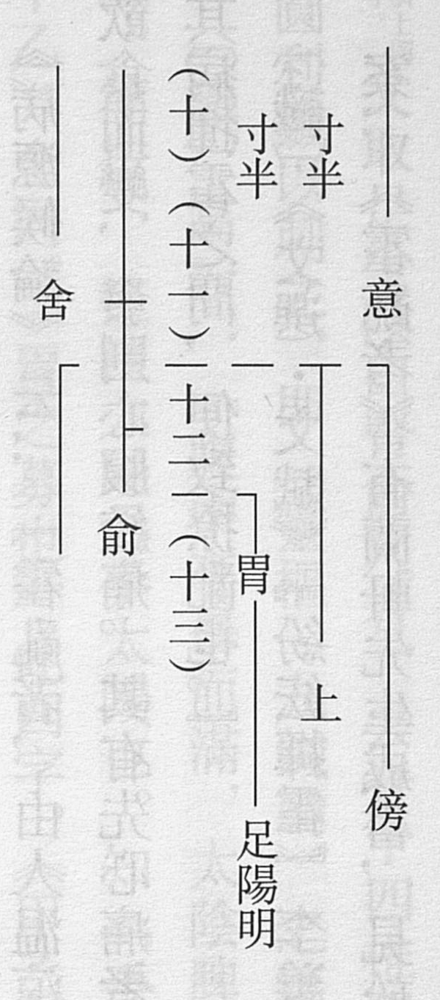

- 意 → 傍
- 寸半
- 寸半
- 上
- 胃 → 足陽明
- (十)(十一)十二(十三)
- 舍
- 俞

《大素》卷卅刺癇驚數。

〔楊〕刺癇驚脈，凡有五別。手太陰五取之，又足太陽輸穴五取之，又手少陽經胳傍一寸取之，又足陽明傍去一寸，上踝五寸三鍼之。

〔識〕簡按：癇驚，似言驚癇。而考《大奇論》云『二陰急爲癇厥，二陽急爲驚』，乃知爲二疾。又按：《玉篇》『癇，小兒病也』。《甲乙》作『驚癇』，載小兒雜病中。王符《潛夫論》云『哺乳太多，則必掣縱而生癇病』，《巢源》云『癇者，小兒病也。十歲以上爲癲，十歲以下爲癇』，徐嗣伯云『大人曰癲，小兒曰癇』，又《巢源》《千金》小兒門有三種癇，曰食癇、驚癇、風癇，可以證焉。《隋書》『許智藏診秦孝王疾曰：疾已入心，即當發癇』。此專稱大人，而古書大率爲小兒病，詳《病名考》。癇是後世所謂驚風，《聖惠方》論辨之詳矣。｟板本誤脫，今據原抄本。｠

〔識〕脈五，吳云：『下文其五也。』各家並同。王爲陽陵泉，非也。『鍼手太陰』，《甲乙》作『手足太陰』，馬、張並云『刺經渠穴』，吳、志、高不指爲某穴，下三經同。簡按：不指爲某穴者，似是。『刺經太陽』，馬、吳、張『經』下絕句。吳云：『凡言其經，而不及其穴者。本經皆可取，不必拘其穴也。』馬云：『刺手太陽小腸經穴，各五痏，當是其經穴陽谷也。』高據王注，直改『經』作『足』。簡按：吳近是，然太陽不言手足，當從王義。馬以『經』爲經穴之經，故云『陽谷』。『刺手少陰經絡傍者』，《甲乙》作『手足少陰』。吳云：『著某經傍者，非經非穴，取其孫絡也。』馬云：『刺手少陰心經絡穴通里，然謂之絡傍，則是手太陽小腸經支正穴也。』張云：『手少陰之經穴靈臺也，在絡穴通里之傍，故曰絡傍。』『上踝五寸』，馬云：『即足少陰腎經築賓穴也。』簡按：張、志、高並仍王注。此寫木實也。如刺腎經則乖理。

<!-- PAGE_END -->

<!-- PAGE: 0776 -->

<!-- PRINTED: 741 -->

案：手太陰各五者，蓋謂尺澤也。見存《黃帝明堂經》云：『尺澤爲合水也，在肘中約上動脈，刺入三分，留三呼，灸三壯，主癲疾。』《外臺》卷卅九引《甲乙》此下有『嘔沫』二字。

『刺經太陽五』者，宜從王注爲承山穴也。然『經』字未允。《外臺》卅引《甲乙》云：『膀胱行於崑崙，崑崙者火也。在足外踝後跟骨上陷者中，足太陽脈之所行也，爲經。』所云『經太陽』，蓋此之謂也。崑崙主寒熱，癲疾。《醫心方》卷二引《黃帝明堂》，《外臺》卅引《甲乙》文同。

『手少陰經絡傍者一』，宜從《大素》作『手少陽經胳者傍一寸』。所云『手少陽經傍一寸』者，即手陽明大腸經也。蓋謂偏歷穴也。《醫心方》卷二引《明堂》『偏歷二穴，在捥後三寸，刺入三分，留七呼，灸三壯，主癲疾』。

『足陽明一』，亦宜從《大素》作『足陽明一寸』，亦謂足陽明經絡傍者一寸也，是前詳後略之文法，而謂足少陽經也，蓋與足陽明經相並而上行，其間寸許耳。《外臺》卅九引《甲乙》云：『外丘，足少陽郄，少陽所生，在外踝上七寸，主癲疾。』《醫心方》卷二引《明堂》云：『刺入三分，灸三壯。』

『上踝五寸』，外踝上五寸，爲光明穴，足少陽膽經也，内踝上五寸，爲蠡溝，足厥陰肝經也，共不主癲驚。然肝膽二經，理不可不治癇，故外踝上七寸外丘穴，外踝上七寸斜屬三陽分肉間陽交穴，共主癲疾。又直耳上入髮際四分，爲本神穴，當目上眥直入髮際五分，爲臨泣穴，共主小兒驚癇，則可以徵也。

<!-- PAGE_END -->

<!-- PAGE: 0777 -->

<!-- PRINTED: 742 -->

『刺三鍼』者，謂以上三穴，共刺三次也。

案：『刺癇驚脈五』者，謂刺癇驚之法，其動脈之地有五所也。《千金》卷廿九用鍼略例第五云：『每鍼常須看脈，脈好乃下鍼，脈惡勿亂下鍼也。』所云『看脈』者，謂審視下鍼地之脈色也。又《千金》卷五上驚癇第三云『灸兩耳後完骨上青脈，亦可以鍼刺令血出』，又卷廿九伏人明堂圖，伏人耳後六穴遠近法第四云『瘈脈，在耳本雞足青脈，不灸』，又卷卅頭病第一云『瘈脈，主風頭耳後痛』，《醫心方》卷二引《明堂》云『瘛脈，主小兒癇瘛瘲』。共可以徵矣。

『各五』者，謂左右各五刺也。後文云『刺經太陽五』『刺三鍼』，共亦左右各也。詳前而略後之文耳。

**○凡治消癉，**

案：『消癉』説見前十七葉面。『癉』字解已見第十七｟廿三ウ｠中。

**○仆擊，**

〔識〕張云『暴仆如擊也』，樓氏《綱目》云『其卒然仆倒，經稱爲擊仆。世又稱卒中風』是也。簡按：《九宮八風篇》云：『其有三虛，而偏中於邪風，則爲擊仆偏枯矣。』樓説爲長。吳云『暴仆，爲物所傷也』，志云『癲癇之外實也』，屬臆解。

**○偏枯，**

案：『偏枯』已見第三、第七中，可併考。

**○痿厥，**

<!-- PAGE_END -->

<!-- PAGE: 0778 -->

<!-- PRINTED: 743 -->

案：仆擊，謂卒中風證。偏枯，謂正中風證。痿厥，謂類中風證也。

**○氣滿發逆，**

〔識〕吳云：『氣滿，氣急而粗也。發逆，發爲上逆也。』志云：『濁氣之在中也。』

〔琦〕氣滿發逆，即喘逆也。

案：氣滿，謂飲結。發逆，謂欬逆也。高梁釀成痰飲者即是。《陰陽別論》七云：『二陰一陽發病，善脹心滿善氣。』二陰者，足少陰腎、手少陰心經也。一陽者，足少陽膽，手少陽三焦經也。言心腎不交，則膽汁及三焦之氣化不施，於是乎留飲之病結於心胸間，故其證善脹，心滿，善氣，共飲結之所爲也。此所云『氣滿發逆』爲同證也，可併考。

**○肥貴人，則高梁之疾也。**

案：言肥滿及尊貴人，往往病前件諸症者，常食膏粱之所爲也。《金匱・血痺第六》云『血痺病云云，夫尊榮人骨弱肌膚盛重』，宜併考。或曰肥貴之急言爲肥，與賁胖防彭等字爲同音同義。未知可否，録俟併考耳。『高梁』已見第三中。

案：肥貴膏梁之人所生病，自氣滿而漸爲大病，至消癉耳。

〔楊〕此之六種，是肥貴人膏梁所發之病。

**○隔塞閉絶，上下不通，則暴憂之病也。**

〔楊〕此之四種，因暴愁憂所生之病。膈塞，膈中塞也。閉謂七竅閉也，謂噫與下使之氣即上下之也。｟案：『使』恐『便』訛。｠

〔識〕趙府本『塞』作『則』，熊、張同，誤也。《風論》云：『食飲不下，鬲塞不通。』《本神篇》云：

<!-- PAGE_END -->

<!-- PAGE: 0779 -->

<!-- PRINTED: 744 -->

『愁憂者，氣閉塞而不行。』吳云：『若隔而閉絶上下，水穀不得通利，則暴憂之所爲也。』

案：楊注似是。鬲塞，即胸膈中塞也。閉絶者，閉即鬱閉，絶即悶絶運絶之絶，言鬱悶氣絶也。上下不通者，亦詳謂閉塞之義也。言上絶通咽喉之氣，下絶通二便之氣也。今暴憂之人，忽爲鬱閉悶絶，俗通偁爲積，即是此證也。或曰：憂，蓋本作『夏』。『夏』即『下』之借字，暴下之後，必爲鬲塞諸證，與下後痞鞕同情。《病源》卷廿二霍亂候引《養生方》云：『七月食蜜，令人暴下，發霍亂』。《醫心方》卷廿九引《養生要集》載此文，『暴下』作『暴夏』，可以徵矣。

（眉）《倉公傳》第二案『齊王中子諸嬰兒小子病氣鬲病，病使人煩懣食不下時嘔沫，病得之少憂數忔食飲云云』，乃與此所云『暴憂之病』同證也。

**○暴厥而聾，偏塞閉不通，内氣暴薄也。不從内，外中風之病，故瘦留著也。**

〔楊〕暴厥耳聾偏塞也。内氣暴滿薄，不從於内，中風病也。以脾氣停癰，不順於内，故瘦留著之也。

案：楊注與《素問》本文，其文義相同。因考王氏次注時，從楊注折衷作本文者，序所云『凡所加字皆朱書其文』者，蓋是也。『瘦』字解已見於第廿｟十七ヲ｠中。楊氏此以『瘦留著』爲解者，蓋以第廿云『留瘦不移』之文注於此歟。王注全用楊注此文可知也。

〔吳〕暴厥，暴氣上逆也。聾，耳聾。言此者由内氣暴薄所爲。薄，雷風相薄之薄，擊盪之稱也。

〔滑〕『瘦』當作『廋』，如『人焉廋哉』之廋。廋，匿也。廋匿住著不之去也。

案：王氏以後諸注，並以『不從内』已下爲別條，恐非是。楊注以爲一條，可從。言卒暴氣逆而爲耳聾，其聾或左或右一偏塞閉而不通者，是蓋痰飲結於氣道，而内氣暴薄之所爲也。此證或有不從内而外中風寒邪氣之所爲者，是即邪氣直入於内，廋留付著之故也。即爲少陽耳聾之證，是亦邪氣結於飲中之所爲。雖分内外二因，竟是不出於飲結之爲宗兆耳。或曰『故，事也。言外中風寒之病，内與飲相結聚爲事，而廋留著也。』

<!-- PAGE_END -->

<!-- PAGE: 0780 -->

<!-- PRINTED: 745 -->

**○蹠跛，寒風濕之病也。**

〔識〕馬云：『蹠，音隻。跖同。《孟子》鷄鳴而起章，盜跖從庶，陳仲子廉士章從石，義同也。楚人謂跳曰蹠。跛，音波。《易》曰：跛能履。又音避。《國語》云：丘無跛。』吳云：『足前點步，謂之蹠。一足偏引，謂之跛。』張云：『足不可行，謂之蹠。』志云：『蹠，足也。跛，行不正而偏費也。』高云：『蹠，踐履也。跛，不正也。』簡按：蹠、跖通，《説文》『跖，足下也』。又作𨂂。蹠跛，乃《漢書》𨂂盭之義｟《賈誼傳》『病非徒瘇也。又苦𨂂盭』。注：𨂂，脚掌也。盭，戾也。｠故王注云：『足跛而不可履也』。志仍此。方氏《通雅》以『𨂂盭』爲『瘛瘲』，太疎。

〔紹〕琦曰：『仆擊，如擊而仆也。氣滿發逆，即喘逆也。在肥貴人，則爲膏粱所致。蓋甘肥之過，中氣緩滯，肺胃壅遏，鬱生痰熱，故見諸症。』堅按：此段，一則肥貴人高梁之疾，蓋得之逸樂，一則得之暴憂，蓋是貧苦勞役之人，兩相對言。一則内因之病，一則外因之病，亦兩相對言。如蹠跛亦屬外因。

〔楊〕風濕之氣，生於蹠跛痺病。蹠，之石反。跛，有本爲跂也。

〔志〕徐公遐曰：『蹠跛爲風寒濕之病者，乃反結邪氣在上，清氣在下之義。知蹠跛之有風邪，則知偏枯之亦有濕邪矣。』

〔箚〕《呂覽》『齊王之食鷄也，必食其距｟（當作『跖』）｠數千而｟（脫『後』）｠足』注：『跖，鷄足踵。讀如捃摭之摭。』蹠、跖同。

案：蹠跛者，謂行步不正也。此證多屬風痺腳弱之類。故曰『寒風濕之病也』。《説文》『蹠，楚人謂跳躍曰蹠』即此義也。《痺論》所云風寒濕三氣與此合。

<!-- PAGE_END -->

<!-- PAGE: 0781 -->

<!-- PRINTED: 746 -->

**○黃帝曰：黃疸，暴痛，癲疾，厥，狂，久逆之所生也。**

《大素》卅久逆生病。

〔楊〕此之五病，氣之久逆所生。

〔馬〕言病有所由生者，皆從内而生也。足之三陽，從頭走足。足之三陰，從足走腹。然各經脈氣，久逆於上，而不下行，則怫積於上中二焦，故爲黃疸，爲暴病，爲癲疾，爲厥，爲狂，諸證所由生也。

〔張〕此以氣逆之久，而陰陽營衛有所不調，然後成此諸證，皆非一朝所致也。

『黃疸』已見《玉機真藏十九》｟十五ウ｠中，爲濕熱内鬱於血分之證。『暴痛』亦氣血不相和合之所生。蓋此二證營衛之氣久逆之所爲，爲表證也。癲、厥、狂之三證，共五藏之氣久逆之所生，爲裏證也。『癲疾』已見《五藏生成第十》｟十一ウ｠中，又《脈要精微第十七》｟廿四ウ｠中；『厥』見《五藏生成第十》｟八ヲ｠，又十七｟廿四ウ｠中；『狂』已見《生氣通天第三》｟十五ヲ｠中，宜併考。

〔紹〕琦曰：『陰不升陽不降，則爲逆。其在脾胃，則濕淫爲黃疸。其在經脈，則爲暴卒而痛。若在上焦，則癲疾厥狂。皆氣逆之所致也。』

〔志〕黃疸者，濕熱内鬱而色病見於外也。暴痛者，五藏之氣不平，卒然而爲痛也。癲疾厥狂，陰陽偏勝之爲病也。此皆陰陽五行之氣，久逆不和之所生也。

**○五藏不平，六府閉塞之所生也。**

《大素》卅・六府生病。

〔楊〕六府受穀氣，傳五藏，故六府閉塞，藏不平也。

<!-- PAGE_END -->

<!-- PAGE: 0782 -->

<!-- PRINTED: 747 -->

〔馬〕六府者，傳化物而不藏，故實而不能滿。五藏者，藏精氣而不寫，故滿而不能實。五藏本與六府相爲表裏，今飲食失宜，吐利過節，以致六府不能傳其化物，而六府閉塞，則五藏亦不和平，各病自生也。

**○頭痛耳鳴，九竅不利，腸胃之所生也。**

《大素》卅・腸胃生病。

〔楊〕腸胃之脈在頭，在於七竅，故腸胃不利，頭竅病也。

〔馬〕大腸爲傳導之府，小腸爲受盛之府，胃爲倉廩之府。今腸胃否塞，則升降出入，脈道阻滯，故爲頭痛，爲耳鳴，爲九竅不利，諸證所由生也。

案：『黃疸』以下三條，並内因之病，而皆以胃氣爲之主也。蓋經脈之氣，久逆於内者，因六府之閉塞。六府閉塞亦起於腸胃之不和。『腸胃』二字專指大小二便而言，以上諸證皆以二便閉塞爲本也。故此諸證不至於大虛之際，宜用下劑而攻之，是古來之要方妙術。仲景穀疸用茵陳蒿湯，酒疸用梔子大黃湯，黃疸用大黃消石湯，中惡心痛用走馬湯，痛而閉者用厚朴三物湯，心下滿痛用大柴胡湯，治瘨癇用風引湯，卒死用備急丸，傷寒發狂及如狂共用抵當湯，並皆治氣血久逆之方。但頭痛、耳鳴，二證自非外感，必是腸胃之不和也。凡腸胃不和，則九竅不利，九竅不利，則必有頭痛耳鳴之證。此二證是在其上部而先病者也，故舉此二證而包括諸上部證也。

文久二年壬戌正月十六日書於辟古齋東廂　玄齋居士森立之

第二十八補

邪氣盛則實精氣奪則虛｟一ヲ｠《調經論六十二》云：『風雨之傷人也，先客於皮膚，傳入於孫脈，孫脈滿則傳入於絡脈，絡脈滿則輸於大經脈。血氣與邪并客於分腠之間，其脈堅大，故曰實。實者外堅充滿，不可按之，按之則痛。寒濕之中人也，皮膚不收，肌肉堅緊，榮血泣，衛氣去，故曰虛。虛者聶辟氣不足，按之則氣足以温之，故快然而不痛。』｟案：與此所云虛實同理，宜併考。｠

<!-- PAGE_END -->

<!-- PAGE: 0783 -->

<!-- PRINTED: 748 -->

病久可治｟十七ヲ｠

〔箚〕古抄本『可知』上有『不』字，無『脈懸小云云』九字。寛案：古抄本太是，宜從。蓋王不釋『脈懸小云云』之義，知舊本無此數字，以下有錯簡，故文不全也。｟此説非是，宜刪去。｠

暴癰｟廿二ヲ｠

案：暴癰者，謂卒暴皮膚腫起也，非癰腫瘡瘤之謂也。考《説文》『癰，腫也』，『腫，癰也』。由此則癰、腫共爲皮膚腫起之義，轉注爲四枝浮腫之義也。此云暴癰，乃爲本義。魄汗不盡者，謂痛苦之汗也。此汗不盡者，亦膀胱所主，表陽之不足也。其治宜在經俞，補經脈之不足也。

何謂虛實｟一ヲ｠

《四十八難》曰：『人有三虛三實，何謂也。然：有脈之虛實，有病之虛實，有診之虛實也。脈之虛實者，濡者爲虛，緊牢者爲實。病之虛實者，出者爲虛，入者爲實，言者爲虛，不言者爲實，緩者爲虛，急者爲實。診之虛實者，濡者爲虛，牢者爲實，癢者爲虛，痛者爲實。外痛内快爲外實内虛，内痛外快爲内實外虛，故曰虛實也。』

皆從其物類始｟五ヲ｠

<!-- PAGE_END -->

<!-- PAGE: 0784 -->

<!-- PRINTED: 749 -->

案：諸注未明了，蓋是四時五藏法則之理。若五藏不法四時，則人身中始有虛實之兆，其自外邪得者是也。若飲食傷脾胃，房室傷腎氣，亦虛實之證起，其自内因來者是也。故曰『皆從其物類始』也。

五藏不平｟卅一ウ｠

《卅七難》曰：『五藏不和，則九竅不通。六府不和，則留結爲癰。』

消癉｟十七ヲ廿八ヲ｠

《大素》卷六五藏命分云『心脆則喜病消癉熱中』，楊注云：『五藏柔脆，神亦柔脆，故藏柔脆人，血脈不行，轉而爲熱，消肌膚，故曰消癉熱中也。音丹，熱中，胃中熱故也。』

隔塞｟廿九ヲ｠

《千金》卷十七積氣第五七氣湯下云：『或飲食爲膈氣。』又五膈丸下云：『治憂膈，氣膈，食膈，飲膈，勞膈五病，同藥服，以憂恚思慮食飲得之。』｟十七ヲウ｠

暴厥｟廿九ウ｠

#### 太陰陽明論篇第二十九

○黃帝問曰：太陰陽明爲表裏，脾胃脈也。生病而異者，何也。

《大素》卷六藏府氣液全載。

〔楊〕足太陰足陽明脾胃二脈，諸經之海，生病受益，以爲根本，故別舉爲問也。

**○岐伯對曰：陰陽異位，更虛更實，更逆更從，或從内，或從外，所從不同，故病異名也。**

〔楊〕大陰爲陰，陽明爲陽，即異位也。春夏陽明實，大陰爲虛，秋冬大陰爲實，陽明爲虛，即更虛實也。春夏大陰爲逆，陽明爲順，秋冬陽明爲逆，大陰爲順也。手三陰從内向外也，手三陽從外向内也。足之三陰從内向外，足之三陽從外向内也。十二經脈陰陽，六種不同，生病固亦多也。｟案：『明實』間恐脫『爲』字。｠

<!-- PAGE_END -->

<!-- PAGE: 0785 -->

<!-- PRINTED: 750 -->

案：陰陽表裏圖如左｟據楊注｠

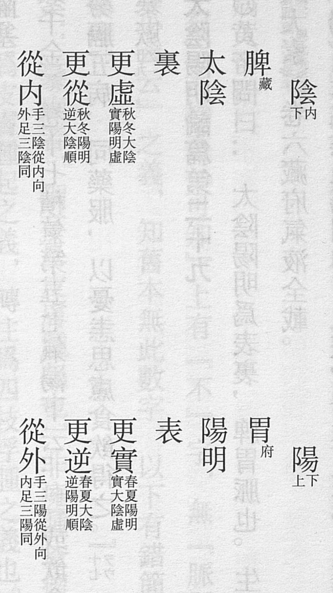

- 陰｟内下｠
- 陽｟下上｠
- 脾｟藏｠
- 胃｟府｠
- 太陰
- 陽明
- 裏
- 表
- 更虛｟秋冬大陰實陽明虛｠
- 更實｟春夏陽明實大陰虛｠
- 更從｟秋冬陽明逆大陰順｠
- 更逆｟春夏大陰逆陽明順｠
- 從内｟手三陰從内向外足三陰同｠
- 從外｟手三陽從外向内足三陽同｠

**○帝曰：願聞其異狀也。**

〔楊〕問其病異。

**○岐伯曰：陽者天氣也，主外。陰者地氣也，主内。故陽道實，陰道虛。**

〔楊〕陽爲天氣主外，故陽道實也。陰爲地氣主内，故陰道虛也。

〔紹〕朱丹溪陽有餘陰不足論，根據於此。

〔志〕陽剛陰柔，故陽道常實，陰道常虛。《繫辭》曰：『陰陽之義配日月。』《白虎通》曰：『日之爲言實也，常滿有節。月之爲言闕也，有滿有闕也。所以有闕者何。歸功於日也。』

案：無形之陽氣養有形陰質，故常實。有形之陰質受無形陽氣，故常虛。人身之氣血者，陽氣常實於外，陰血常虛於内，虛故陽氣乘其虛，以滋養陰血，實故陰血受其實，而含畜陽氣。所以氣常實，形常虛也。自無空隙謂之實，自不閉塞謂之虛也。

<!-- PAGE_END -->

<!-- PAGE: 0786 -->

<!-- PRINTED: 751 -->

（眉）此節自『陽者』至『陰道虛』文，名古屋玄醫詳注，見《醫學愚得》卷下，宜參。

**○故犯賊風虛邪者，陽受之。食飲不節，起居不時者，陰受之。**

〔楊〕風寒暑濕虛耶外入腠理，則六陽之脈受之，飲食男女不節，即六陰受之。

〔張〕賊風虛邪，外傷也，故陽受之而入府。飲食起居，内傷也，故陰受之而入藏。

〔識〕徐云：『此言賊風虛邪，陽受之入六府。飲食起居，陰受之入五藏。與《陰陽應象論》「天之邪氣害人五藏，水穀寒熱害人六府」兩説相反，其理安在。此謂虛邪外傷有餘，飲食内傷不足，二者之傷，互有所受，不可執一而言傷也。』

〔紹〕琦曰：『府陽藏陰，各從其類。按：《陰陽應象論》云：「天之邪氣，感則害人五藏。水穀之寒熱，感則害人六府」。與此正相反，而義實相成。以形氣言，邪氣無形，故入藏。水穀有形，故入府。以表裏言，府陽主外，故賊風虛邪從外而受。藏陰主内，故食飲不節，從内而受。實則府藏皆當有之，蓋内外之邪，病情萬變，非一端可盡，故廣陳其義耳』。

案：賊風虛邪來犯表陽者，因於表陽有虛也。食飲不節，起居不時者，亦因於裏陰有虛也。凡邪氣有虛則入，無虛不能入。表虛者入爲陽熱證，裏虛者入爲陰寒證，理之當然也。此云陽受之，亦兼六府自有所虛而看，云陰受之，亦帶風邪乘虛而入五藏而看，如此看過則互見其義。所云互文見義，意在於言外也。

**○陽受之，則入六府。陰受之，則入五藏。**

〔楊〕六陽受於外耶，傳入六府。六陰受於内耶，傳入五藏也。

<!-- PAGE_END -->

<!-- PAGE: 0787 -->

<!-- PRINTED: 752 -->

（眉）案：然則上文曰『陽道實，陰道虛』者，陽病實，陰病虛之義也。

**○入六府，則身熱不時臥，上爲喘呼。**

〔楊〕六府陽氣在外，故身熱也。陽盛晝眠不得至夜，故不時臥也。陽氣盛於上，故上爲喘呼也。

〔紹〕張曰：『不時臥，不能以時臥也。陽邪在表在上，故爲身熱不臥喘呼。』琦曰：『不時臥，謂臥不以時，即不得臥也。』

案：是風邪入陽府，爲三陽證之謂也。不時臥，謂常臥也，即平臥不得起坐之義。諸注皆未了。

**○入五藏，則䐜滿閉塞，下爲飧泄，久爲腸澼。**

〔楊〕陰耶在中，實則䐜脹腸滿，閉塞不通，虛則下利腸澼。｟案：『腸滿』恐『腹滿』訛。｠

〔張〕陰邪在裏在下，故爲䐜滿飧泄腸澼。

案：楊、張並云『陰邪』，是謂飲食之邪歟，抑謂内傷外感直中陰邪歟。未詳。蓋『䐜滿閉塞』爲陽明胃實之類也，治宜攻下。若中虛之人則爲飧泄腸澼，是乃少陰下利清穀之類也，治宜温補。凡脾胃腎旁光有虛，則五藏共帶虛。此云『入五藏』，亦專指脾腎而言耳。

案：飧泄，已解於《四氣調神第二》中。腸澼，已見於《生氣通天第三》中。䐜滿，字已見《陰陽應象第五》中。

（眉）案：『久』字字眼，凡下利甚而速則死，若不甚之，證而荏冉不止，則必變滯下之痢，與前日之虛痢異其狀也可知。腸澼者，赤白痢之古名也。

**○故喉主天氣，咽主地氣。**

〔楊〕肺爲天也，喉出肺中之氣呼吸，故主天。脾爲地，咽出脾胃噫氣，故主地。

<!-- PAGE_END -->

<!-- PAGE: 0788 -->

<!-- PRINTED: 753 -->

真本《明堂》卷一天府｟（當作『中府』）｠下曰『喉痺』，楊注：『咽者，通飲食也。喉者，通氣路也。《蒼頡》喉，咽也。與此不同云云。』

〔吳〕喉嚨爲肺系，受氣於鼻，故納無形之天氣。咽爲胃系，受氣於口，納有形之地氣。

〔琦〕此義又與《陰陽應象大論》同。

案：第五云：『故清陽爲天，濁陰爲地。地氣上爲雲，天氣下爲雨。雨出地氣，雲出天氣。故清陽出上竅，濁陰出下竅。清陽發腠理，濁陰走五藏。清陽實四支，濁陰歸六府。水爲陰，火爲陽。』

**○故陽受風氣，陰受濕氣。**

〔楊〕風從上下，故陽受之。濕從下上，故陰受之。

〔吳〕風，陽氣也，故陽受之。濕，陰氣也，故陰受之。《易》曰『同氣相求』是也。

《金匱要略・藏府經絡前後病第一》云：『清邪居上，濁邪居下。大邪中表，小邪中裏。槃飥之邪，從口入者，宿食也。五邪中人，各有法度。風中於前，寒中於暮。濕傷於下，霧傷於上。風令脈急，霧傷皮腠，濕流關節，食傷脾胃。極寒傷經，極熱傷絡。』

**○故陰氣從足上行至頭，而下行循臂至指端。陽氣從手上行至頭，而下行至足。**

〔楊〕足三陽脈，從足至頭。足｟案：『足』恐『從』訛。｠頭下胸，橫出掖下，循臂至指端，爲手三陰脈也。變爲手三陽脈，從手指端上行至頭，下行至足，爲足三陽。陰陽相注，如環無端。｟案：『爲足三陽』恐『爲足三陰』之訛。｠

〔張〕《逆順肥瘦篇》曰『手之三陰，從藏走手。手之三陽，從手走頭。足之三陽，從頭走足。足之三陰，從足走腹』即此之謂。蓋陰氣在下，下者必升。陽氣在上，上者必降。脾陰胃陽，氣皆然也。

**○故曰：陽病者，上行極而下。陰病者，下行極而上。**

<!-- PAGE_END -->

<!-- PAGE: 0789 -->

<!-- PRINTED: 754 -->

〔張〕陽病極則及於下，陰病極則及於上，極則變也。非惟上下，表裏亦然。

〔志〕此言邪隨氣轉也。人之陰陽出入，隨時升降。是以陽病在上者，久而隨氣下行，陰病在下者，久而隨氣上逆。此節用八『故』字，爲陰陽異位故也。

案：三陽表熱證，乘虛而爲三陰裏寒證，頭痛發熱變爲下利之類，皆是『陽病者上行極而下』者也。三陰裏寒證，虛回陽復，則爲三陽表熱證而解之類，皆是『陰病者下行極而上』者也。

**○故傷於風者，上先受之，傷於濕者，下先受之。**

〔楊〕陽病者，三陰之脈上行至頭極已，爲陽受風熱已下行也。陰病者，三陽之脈下行至足極已，爲陰受寒濕已上行。故傷風上先受之，傷濕下先受也。

〔張〕陽受風氣，故上先受之。陰受濕氣，故下先受之。然上非無濕，下非無風，但受有先後耳。曰先受之，則後者可知矣。

〔識〕簡按：《百病始生篇》云：『清濕襲虛，則病起於下。風雨襲虛，則病起於上。』《辨脈篇》云：『清邪中於上焦，濁邪中於下焦。』正其義也。

**○帝曰：脾病而四支不用，何也。**

〔楊〕五藏皆連四支，何因脾病獨四支不用也。

**○岐伯曰：四支皆稟氣於胃，而不得｟侄｠至經。**

案：｟（《大素》『至經』作『侄至』）｠『侄』即『徑』俗字，《新校正》引《大素》作『徑至』，可以徵耳。《廣韻》去四十六・徑云：『徑，直也。』乃此字也。《説文》『稟，賜穀也。從亩從禾。筆錦切』。《廣韻》『稟，供穀。又與也』。

<!-- PAGE_END -->

<!-- PAGE: 0790 -->

<!-- PRINTED: 755 -->

〔馬〕胃氣不能自至於四支之各經，必因於脾氣之所運，則胃中水穀之氣化爲精微之氣者，乃得至於四支也。

**○必因於脾，乃得稟也。**

〔志〕胃爲陽土，脾屬陰土，暢於四支，坤之德也。

**○今脾病，不能爲胃行其津液。四支不得稟水穀氣，氣日以衰，脈道不利，筋骨肌肉，皆無氣以生，故不用焉。**

〔楊〕土王四季，四季皆有土也。脾長四藏，四藏皆有脾也。何者。四支百體稟氣於胃，胃以水穀津液資四支之用。資四支之時，胃氣不能侄到四支。要因於脾，得水穀津液營衛之氣，營於四支，四支稟承，方得用也。若其脾病脈道不通，則筋骨肌肉無氣以生，故不用也。

〔識〕簡按：至經，從《大素》作『徑至』爲勝。

**○帝曰：脾不主時，何也。岐伯曰：脾者土也，治中央，常以四時長四藏，各十八日寄治，不得獨主於時也。**

〔馬〕長，掌同，主也。

〔張〕惟脾屬土，而蓄養萬物，故位居中央，寄王四時各一十八日，爲四藏之長而不得獨主於時也。

**○脾藏者，常著胃，土之精也。**

〔楊〕四藏之本，皆爲土也。十八日用，故曰寄也。著，澄略反，在也。脾藏在土之精妙也。

**○土者，生萬物而法天地，故上下至頭足，不得主時也。**

〔楊〕土，萬物之質，法於天地，與萬物爲質，故身與頭手足爲體身，不別主時。

<!-- PAGE_END -->

<!-- PAGE: 0791 -->

<!-- PRINTED: 756 -->

〔張〕脾胃相爲表裏，脾常依附於胃，以膜連著，而爲之行其精液。然脾胃皆屬乎土，所以生成萬物，故曰法天地也。土爲萬物之本，脾胃爲藏府之本，故上至頭，下至足，無所不及，又豈得獨主一時而已哉。《平人氣象論》曰：『人無胃氣曰逆，逆者死，脈無胃氣亦死。』此所以四時五藏，皆不可一日無土氣也。

**○帝曰：脾與胃，以膜相連耳，而能爲之行其津液，何也。**

〔楊〕脾陰胃陽，脾内胃外，其位各別，故相逆也。其別異，何能爲胃行津液也。一曰相連，脾胃表裏陰陽，募既相假，故曰相連也。

**○岐伯曰：足太陰者，三陰也。其脈貫胃屬脾絡嗌，故太陰爲之行氣於三陰。**

〔楊〕嗌，於赤反。咽也。足太陰脈，貫胃屬脾，上行胳嗌，其氣強盛，能行三陰之脈，故太陰脈得三陰名也。

〔吳〕爲之，爲胃也。三陰，太少厥也。脾爲胃行氣於三陰，運陽明之氣入於諸陰也。

**○陽明者表也，五藏六府之海也，亦爲之行氣於三陽。藏府各因其經，而受氣於陽明，故爲胃行其津液。四支不得稟水穀氣，日以益衰，陰道不利，筋骨肌肉，無氣以生，故不用焉。**

〔楊〕陽明爲陰陽藏府之海，五藏六府各因十二經脈，受氣於陽明，故經脈得爲胃行津液之氣，四支稟承，四支得氣也。經脈不通陽明，則陰脈不通，筋骨脈肉無氣以主也。

〔吳〕表，陽明爲太陰之表也。爲之，爲脾也。行氣於三陽，運太陰之氣入於諸陽也。

〔紹〕『四支不得稟水穀氣』此下二十八字，與上文複，正是衍文。

案：脾太陰能行三陰之氣，手寸口動脈是也。胃陽明能行三陽氣，足跗陽動脈是也。蓋胃氣爲性命之本，故此重言曰『四支不得稟水穀氣，日以益衰，陰道不利，筋骨肌肉無氣以生，故不用焉』，恐非衍文也。

<!-- PAGE_END -->

<!-- PAGE: 0792 -->

<!-- PRINTED: 757 -->

案：全元起本前篇《通評虛實》與此篇同在四卷，因考前篇總論虛實，此篇總論陰陽也。蓋人身陰陽之本爲脾｟陰｠胃｟陽｠，又藏爲陰，府爲陽，藏府之本亦在於脾胃也。此篇專論脾胃陰陽，引及五藏六府，頭足之理，甚明了，古聖之祕旨全存於此耳。

文久二年壬戌二月初八日書於無不愈園朝暉明淨處　虛心子立之

第二十九補

入六府｟三ウ｠

《卅七難》曰：『邪在六府，則陽脈不和。陽脈不和，則氣留之。氣留之，則陽脈盛矣。』又曰：『經言：氣獨行於五藏，不營於六府者何也。然：氣之所行也，如水之流，不得息也。故陰脈營於五藏，陽脈營於六府，如環之無端，莫知其紀，終而復始，其不覆溢。人氣内温於藏府，外濡於腠理。』

入五藏｟三ウ｠

《卅七難》曰：『邪在五藏，則陰脈不和。陰脈不和，則血留之。血留之，則陰脈盛矣。』

四支不用｟六ヲ｠

〔馬〕《靈樞·經脈篇》有手指足指不用等語，皆言手足之指不能舉用也。

#### 陽明脈解篇第三十

〔紹〕『篇』字上脫『論』字。

案：此一篇，唯説瘟疫傷寒之胃實熱陽明裏證一病人了耳，無佗事也，故非謂失心風之狂而陽明病承氣證中之狂也，古來注家皆誤其見云。

**○黃帝問曰：足陽明之脈病，惡人與火，聞木音則惕然而驚，鐘鼓不爲動。聞木音而驚，何也。願聞其故。**

<!-- PAGE_END -->

<!-- PAGE: 0793 -->

<!-- PRINTED: 758 -->

〔吳〕脈，經也，兼表裏而言。

案：《傷寒·陽明篇》『若劇者，發則不識人，惕而不安』。《本草匯》卷四曰『正陽陽明病，其證目眴眴不得眠，畏人聲，畏木聲，畏火，狂亂』。

〔張〕本篇之義，大略皆出《靈樞·經脈篇》。

案：此專説相剋之理，與前篇義自異，王注以爲問其異，恐非是。

《説文》『惕，敬也』。

**○岐伯對曰：陽明者，胃脈也。胃者，土也。故聞木音而驚者，土惡木也。**

〔楊〕十二經脈，而別解陽明者，胃受水穀，以資藏府。其氣強大，氣和爲益之大，受耶爲病之甚，故別解之。

**○帝曰：善。其惡火何也。岐伯曰：陽明主肉，其脈血氣盛。**

〔吳〕多氣多血故也。

**○邪客之則熱，熱甚則惡火。帝曰：其惡人何也。岐伯曰：陽明厥，則喘而悗，悗｟悗悗｠則惡人。**

〔楊〕悗，武槃反。此經中爲悶字。｟案：《大素》『如』字傍訓云『辭也』。｠

〔吳〕悗，烏貫切。悗，熱鬱於内，而不自安也。

〔識〕《釋音》『悗，烏貫切』。《甲乙》『悗』作『悶』。簡按：《集韻》『悗、慍、宛、惌同音鬱，心所鬱積也』，即與王注符，若『烏貫切』，則爲駭恨驚嘆之義。志云『驚恐貌』，高云『驚顧也』，並乖經旨。

案：張氏亦曰『悗，憂驚也』。非是。馬云：『喘而悗熱，悗熱則煩悗，故惡人煩擾也。』似是。

<!-- PAGE_END -->

<!-- PAGE: 0794 -->

<!-- PRINTED: 759 -->

案：冤、宛同音。《廣韻》廿二·元共『於元切』，又廿六·桓『悗，母官切。惑也』。《説文》『懣，煩也。從心從滿。莫困切』。『悶，懣也。從心門聲。莫困切』。蓋悗與門、滿等字爲同音，而爲蒙昧瞢滿之義，與宛、温其音不同。但『宛』或作『冤』，故《廣韻》共爲『於元切』歟。遠志一名棘蒬，陸氏《爾雅音義》引《本草》如此作，與《説文》《爾雅》合，而《千金翼》《證類本草》『蒬』作『菀』，《本草和名》作『苑』，《太平御覽》作『宛』，是宛、冤通用之徵也。但煩悶字不宜作『冤』『宛』，宜作『悗』也。此云『喘而悗』，悗即胸中喘懣不快之謂。《大素》作『悗』，《甲乙》作『悶』，共可從也。《傷寒論·陽明篇》｟卅四條｠云：『直視讝語，喘滿者死。』《金匱·欬篇》云：『膈間支飲，其人喘滿云云。木防己湯主之。』又云：『胸滿者，用桂苓五味甘草湯去桂加乾薑細辛，以治其欬滿。』以上『滿』字，並是悶之假借字，説詳具於《金匱攷注》中。張本『喘而悗』下句，可從矣。

案：陽明厥者，胃氣不和失運化之謂。此證必喘悶而惡人，就中自有死｟虛｠生｟實｠二證。如下文所説，蓋胃氣不和，則必心胸釀飲，所云『喘悗惡人，痰鬱默默』之證也。

（眉）宜與《脈解篇》併考。

（眉）《靈樞》史崧《音》卷四『悗亂，悶音』。卷之九『悗，音悶』。卷十二『悗，音悶』。

（眉）《呂氏春秋·重己篇》『胃充則中大鞔』注：『鞔讀曰懣。』

（眉）《調經論》『心煩悗善怒』。

（眉）《説文》『宛，屈草自覆也。於阮切。惌｟（『宛』）｠或從心』。

（眉）又『冤，屈也。於袁切』。《玉篇》『不理也，枉曲也，煩冤思念也』。隸俗作『寃』，添一点者誤。又作『〓』、作『冤』，並誤。

<!-- PAGE_END -->

<!-- PAGE: 0795 -->

<!-- PRINTED: 760 -->

（眉）《説文》『夗，轉臥也。於阮切』。與宛同音。

**○帝曰：或喘而死者，或喘而生者，何也。岐伯曰：厥逆，連藏則死，連經則生。**

〔楊〕連藏病深，故死。連經病淺，故生。

〔吳〕逆氣連於經脈，則未至大傷，故生。連於五藏，則傷其真矣，故死。

〔馬〕此承上文言陽明厥則喘，而因明其有生死之異也。

〔志〕連謂藏府經絡之相連也。蓋手太陰之脈還循胃，陽明之絡通於心，如熱邪厥逆於上，干於心肺之經，而爲喘悗者生，干於心肺之藏則死矣。

〔紹〕《金匱》卒厥條，其義相發。

《金匱》上第一云：『問曰：寸脈沈大而滑，沈則爲實，滑則爲氣。實氣相搏，血氣入藏即死，入府即愈，此爲卒厥。何謂也。師曰：唇口青身冷，爲入藏即死。如身和汗自出，爲入府即愈。』又云：『問曰：脈脫入藏即死，入府即愈，何謂也。師曰：非爲一病，百病皆然。譬如浸淫瘡，從口起流向四肢者可治，從四肢流來入口者不可治，病在外者可治，入裏者即死。』

案：問以喘，答以厥逆者，蓋内爲喘，外爲厥逆，其喘與厥逆共連經之府病則不死，若喘與厥逆共正虛之藏病則必死也。

**○帝曰：善。病甚則棄衣而走，登高而歌，或至不食數日，踰垣上屋，所上之處，皆非其素所能也。病反能者，何也。**

《傷寒論·陽明篇》：『若劇者，發則不識人。』

《靈樞·經脈篇》云：『胃足陽明也。是動則病洒洒振寒，善呻數欠，顏黑，病至則惡人與火，聞木聲則惕然而驚，心欲動，獨閉戶塞牖而處，甚則欲上高而歌，棄衣而走。』

<!-- PAGE_END -->

<!-- PAGE: 0796 -->

<!-- PRINTED: 761 -->

案：『病至』與『病甚』同，謂陽明經邪實也。至即至極之義，乃動、至、甚三字謂次第病甚也。但此云『或至』，非此義也。

**○岐伯曰：四支者，諸陽之本也。陽盛則四支實，實則能登高也。**

〔識〕《甲乙》『陽盛』作『邪盛』。

〔吳〕實，陽邪實也。

〔張〕凡癲狂傷寒家多有此證，陽受氣於四末，故四支爲諸陽之本，陽邪剛盛，故步履變常也。

**○帝曰：其棄衣而走者，何也。岐伯曰：熱盛於身，故棄衣欲走也。帝曰：其妄言罵詈，不避親疏而歌者，何也。岐伯曰：陽盛則使人妄言罵詈，不避親疏，而不欲食。不欲食，故妄走也。**

〔楊〕素，先也。其人非是先有此能，因陽明病故也。手足陽明之脈盛實，好爲登涉，以其熱悶所以棄衣也。

〔吳〕棄衣，裸盡其衣也。陽盛，陽邪盛也。陽邪既盛，則入心爲言，入肝爲呼爲罵詈，入脾爲歌。

〔張〕陽明爲多氣多血之經，而陽邪實之，陽之極也。陽氣者靜則神藏，躁則消亡。故神明亂而病如是。

〔紹〕《太素》無『妄言罵詈不避親疏而不欲食』十二字，爲是。『妄走』作『妄言』，同。先兄曰：張子和治狂人，本於經旨，用調胃承氣湯治驗，宜參。

〔識〕《韻會》：『正斥曰罵，旁及曰詈。』《一切經音義》云：『詈，亦罵也。今解惡言及之曰罵，誹謗呪詛曰詈』。

案：此篇一章，説陽明熱實邪盛之病，而其邪實者即爲正氣之虛，其正虛不甚而邪盛者爲陽實之證，宜用承氣之類也。其正虛甚者，一旦雖有邪盛之證，遂至於虛脫而死，必然之理也。此篇似專論陽實，然此中自寓虛極亦有此證之意而在言外也。『連藏則死』『連經則生』二句，其義通串於前後，而示有虛實二證之義耳。

<!-- PAGE_END -->

<!-- PAGE: 0797 -->

<!-- PRINTED: 762 -->

案：『病甚』已下數證並屬狂證，傷寒内因諸狂證與此同理，宜活看也。

案：此狂證係之於胃，不係心家，可知瘟疫之派證之狂而非失心之狂者也。古來讀本篇皆誤。

### 重廣補注黃帝内經素問卷第八

## 素問攷注卷第八

文元第二暦二月十三日燈下書於琅玕軒

春雨寂寂暖律稍回，蓋二旬來旱天渴望之滴聲也。𬣐堂

第三十補

棄衣而走｟三ヲ｠

案：此諸證，並是邪熱與陽氣相抗爭之所爲，猶飲酒大醉人改易其精神，恰如狂人，罵詈奔走，或至不食數日者然也。是無他，胃氣盛溢，則引及於五藏，肝心尤先被漂搖，爲之蒙昧，故爲發狂諸證也。

廿八　大熱病｟三ウ｠　氣脈｟同｠　滑從生濇逆死｟五ヲ｠　經絡｟七ヲ｠　灸刺｟八ウ｠　恇然｟九ヲ｠　寒氣｟九ウ｠　滿｟十一ウ｠　逆｟同｠　乳子｟十二ウ｠　懸小｟十二ウ｠

病熱｟同｠　喘鳴肩息｟十三ヲ｠　懸絶｟十五ヲ｠　懸濇｟十六ヲ｠　消癉｟十八ヲ、又廿八ヲ｠　閉塞者用藥｟十九ヲ｠　魄汗｟廿二ヲ｠　募幕｟廿三ウ｠　霍亂｟廿四ウ｠　氣滿發逆｟廿八ウ｠

肥貴人高梁｟廿八ウ｠　暴憂之病｟廿九ヲ｠　瘦留著｟廿九ウ｠　蹠跛｟卅ヲ｠　腸澼｟十四ヲ｠

廿九　喘呼｟三ウ｠　飧泄腸澼｟同｠　䐜滿｟同｠　喉主天氣咽主地氣｟四ヲ｠　稟氣｟六ヲ｠　脾胃｟七ウ｠

三十　惕然｟一ヲ｠　惡火｟同ウ｠　惡人｟同｠　惋悗｟同｠　喘生死｟二ヲ｠　厥逆生死｟二ウ｠　不食｟三ヲ｠　四支諸陽之本｟同｠　妄言｟同ウ｠

<!-- PAGE_END -->

<!-- PAGE: 0798 -->

<!-- PRINTED: 763 -->

## 素問攷注卷第九

### 重廣補注黃帝内經素問卷第九

#### 熱論篇第三十一

案：篇目亦王冰所作，而此云『熱論』，猶云『熱病論』也，單云『熱』似不通，《大素》題曰『熱病決』，可從耳。

**○黃帝問曰：今夫熱病者，皆傷寒之類也。**

〔楊〕夫傷寒者，人於冬時，温室温衣，熱飲熱食，腠理開發，快意受寒，腠理因閉，寒居其□，□□□□□寒極爲熱。三陰三陽之脈，五藏六府受熱爲病，名曰熱病。斯之熱病，本因受寒傷多，亦爲寒氣所傷，故曰冬傷於寒，春爲温病也。其病夏至前發者名爲病温，夏至後發者名爲病暑也。

案：《大素》卷第廿五·熱病決，《甲乙》卷七·六經受病，《病源候論》卷七·傷寒，《傷寒論》卷二·傷寒例，《外臺祕要》卷一·傷寒，共引此文，互有異同。

案：凡邪氣入於肌肉，必與血氣相搏，故發熱，下文所云『人之傷於寒也則爲病熱』是也。此總括風寒暑濕，故云皆傷寒之類也。『皆』字、『類』字並可著眼，蓋發熱之病，其因非一，故曰皆。中於人之邪，不啻風寒，故曰傷寒之類也。即是外感總稱之傷寒也。

<!-- PAGE_END -->

<!-- PAGE: 0799 -->

<!-- PRINTED: 764 -->

《傷寒論》卷第二傷寒例云：『凡傷寒之病，多從風寒得之，始表中風寒，入裏則不消矣。未有温覆而當不消散者。』

又云：『凡傷於寒，則爲病熱，熱雖甚不死。若兩感於寒而病者，必死。』

又云：『冬時嚴寒，萬類深藏，君子固密，則不傷於寒。觴冒之者，乃名傷寒耳。其傷於四時之氣，皆能爲病。以傷寒爲毒者，以其最成殺厲之氣也。中而即病者，名曰傷寒。不即病者，寒毒藏於肌膚，至春變爲温病，至夏變爲暑病。暑病者，熱極重於温也。是以辛苦之人，春夏多温熱病者，皆由冬時觴｟（當作『傷』）｠寒所致，□非時行之氣也。』

〔識〕張云：『傷寒者，中陰寒殺厲之氣也。寒盛於冬，中而即病者，是爲傷寒。其不即病者，至春則名爲温病，至夏則名爲暑病。然有四時不正之氣，隨感隨發者，亦曰傷寒。寒邪束於肌表，則玄府閉，陽氣不散越，乃鬱而爲熱。故凡係外感發熱者，皆傷寒之類。』馬云：『《水熱穴論》帝問：人傷於寒而傳爲熱，何也？岐伯曰：夫寒盛則生熱也。又此處王注，以《傷寒論》中「至夏變爲熱病」之熱病強解，甚非。蓋未有傷於寒而不成熱者也，非但至夏之熱病爲然也。』簡按：王引《傷寒例》文，暑病作熱病。《五十八難》云：『傷寒有幾，其脈有變否。然：傷寒有五，有中風，有傷寒，有濕温，有熱病，有温病，其所苦各不同。』知是中風、傷寒、濕温、熱病、温病，古總稱之傷寒，則王注不可廢。

案：夏之暑熱病，春之風温病，共可名爲傷寒也。傷寒猶云傷邪也。

**○或愈，**

案：陽證，汗下之類是也。

**○或死，**

<!-- PAGE_END -->

<!-- PAGE: 0800 -->

<!-- PRINTED: 765 -->

案：陰證，温經回陽，其治不及者致死也。

**○其死皆以六七日之間。**

〔楊〕陰陽二經同感，三日而遍藏府。營衛不通，復得三日。故極後三日，所以六七日間死也。

案：是真陰直中之證，而元氣虛邪氣實，故温經回陽之劑投之不及者也。下文所云『其兩感於寒而病者，必不免於死』，又云『三日則少陽與厥陰俱病，則耳聾囊縮而厥，水漿不入，不知人，六日死』，可以證矣。

**○其愈皆以十日以上者，何也。不知其解，願聞其故。**

〔楊〕其不至藏府兩感於寒者，至第七日即太陽病衰，至九日三陽病衰，至十日太陰病衰，至十二日三陰三陽等病皆衰，故曰其愈皆十日以上，其理未通，故請聞之也。

案：下文所云『其不兩感於寒者云云。十二日厥陰病衰，囊縱少腹微下，大氣皆去，病日已矣』是也。

**○岐伯對曰：巨陽者，諸陽之屬也。**

〔楊〕巨，大也。一陽爲紀，少陽也。二陽爲衛，陽明也。三陽爲父，太陽也。故足大陽者，二陽屬之，故曰諸陽之屬也。

〔吳〕巨陽，太陽。言其統攝諸陽，爲諸陽之所宗屬也。

〔志〕屬，會也。謂太陽爲諸陽之會。

《五藏生成第十》云：『所謂五決者云云，過在足少陰巨陽。』又云：『過在手巨陽少陰。』｟《甲乙》『巨陽』並作『太陽』｠

**○其脈連於風府，故爲諸陽主氣也。**

〔馬〕其脈自睛明而始，上連於督脈經之風府穴。自頭項至背至足，凡一身手足陽經皆屬於此，故穴有一百二十六，真爲諸陽經主氣也。凡五藏六府之穴，無非此經所屬。

<!-- PAGE_END -->

<!-- PAGE: 0801 -->

<!-- PRINTED: 766 -->

《醫心方》卷二引《黃帝明堂經》云：『風府一穴，一名舌本，在項後入髮際一寸大筋内宛中起肉，刺入四分，留三呼，不可灸。主頭痛項急，不得喘息，目眩，舌急難言，喉嗌痛，足不仁，狂走欲自煞，目反妄見。』

《傷寒論》卷三·太陽上篇云：『太陽病，初服桂枝湯，反煩不解者，先刺風池風府，卻與桂枝湯則愈。』

**○人之傷於寒也，則爲病熱，熱雖甚不死。**

案：謂表熱證也。與前文所云『熱病者皆傷寒之類也』相應。

〔汪〕此句對上『其愈皆以十日以上』句。

**○其兩感於寒而病者，必不免於死。**

〔汪〕此句對上『其死皆以六七日之間』句。

案：謂表裏證也，非謂兩感必死也。兩感之證至於陰寒證，則必死矣。後文云『三陰三陽，五藏六府皆受病，榮衛不行，五藏不通，則死』，可併考。

〔楊〕足太陽脈，直者從顛入胳腦，還出別下項，其風府在項入髮際一寸，則太陽之氣連風府也。諸陽者，督脈、陽維脈也。督脈，陽脈之海。陽維，維諸陽脈。惣會風府，屬於太陽。故足太陽脈，爲諸陽主氣，所以人之此脈傷於寒者，極爲熱病者也。先發於陽，後發於陰，雖熱甚不死。陰陽兩氣時感者，不免死也。

宋李知先《傷寒活人書括》，舉兩感證及仲景治有先後條曰：『半陰陽者，言病一半屬陽，一半屬陰也。』

<!-- PAGE_END -->

<!-- PAGE: 0802 -->

<!-- PRINTED: 767 -->

（眉）《至真要論》『所謂感邪而生病也』王注：『外有其氣而内惡之，中外不喜，因而遂病，是謂感也。』

**○帝曰：願聞其狀。岐伯曰：傷寒一日，巨陽受之，故頭項痛腰脊強。**

〔楊〕寒之傷多極□□｟（疑爲『爲病』）｠者，初病發日，必是太陽受熱之爲病，故曰一日太陽受之，所以一日陽明少陽不受熱者，以其太陽主熱，又傷寒熱加，故太陽先病也。頭項腰脊，並是足太陽脈所行之處，故皆痛也。｟（《大素》『強』作『皆痛』）｠

《皮部論第五十六》云：『是故百病之始生也，必先於皮毛，邪中之則腠理開，開則入客於絡脈，留而不去，傳入於經，留而不去，傳入於府，廩於腸胃。邪之始入於皮也，泝然起毫毛，開腠理。其入於絡也，則絡脈盛色變。其入客於經也，則感虛乃陷下。其留於筋骨之間，寒多則筋攣骨痛，熱多則筋弛骨消，肉爍䐃破，毛直而敗。』

《靈樞·經脈篇第十》云：『膀胱足太陽之脈，其直者，從巔入絡腦，還出別下項，循肩髆内，挾脊抵腰中，入循膂絡腎，屬膀胱。是動則病，衝頭痛，目似脫，項如拔，脊痛，腰似折。』

《傷寒論》云：『太陽之爲病，脈浮，頭項強痛而惡寒。』

又云：『太陽病，項背強几几，葛根湯主之。』

又云：『太陽病，頭痛發熱，身疼腰痛，骨節疼痛，麻黃湯主之。』

〔識〕簡按：吳『巨陽受之』下，補『以其脈經頭項循腰脊』九字，不可從。

案：雖無此九字，然有此九字之義在於此也。蓋太陽爲大表，故凡邪氣無不經此而入者，是所以不加此九字也。

<!-- PAGE_END -->

<!-- PAGE: 0803 -->

<!-- PRINTED: 768 -->

**○二日陽明受之，陽明主肉，其脈俠鼻絡於目，故身熱目疼而鼻乾，不得臥也。**

〔楊〕陽明二陽，故次受病，脾之太陰主肌，胃之陽明主肉，其脈從鼻胳目内眥，下行入腹至足。手陽明下屬太□｟（疑爲『陽』）｠，上俠鼻孔，故病身熱鼻乾不得臥也。

《經脈篇》云：『胃足陽明之脈，起於鼻之交頞中，旁納太陽之脈，下循鼻外，入上齒中。是動則病，洒洒振寒，氣盛則身以前皆熱。』

又云：『大腸手陽明之脈，上挾鼻孔，是主津液所生病者，目黃口乾鼽衄。』

《傷寒論》卷二·太陽上篇云：『太陽中風，陽浮而陰弱。陽浮熱自發，陰弱者汗自出，嗇嗇惡寒，淅淅惡風，翕翕發熱，鼻鳴乾嘔者，桂枝湯主之。』

又卷三·太陽中篇云：『太陽中風，脈浮緊，發熱惡寒，身疼痛。不汗出而煩躁者，大青龍湯主之。』

案：太陽一日邪入腠理，必有憎寒。二日入肉中，故身熱目疼者，謂眉稜骨痛，即是頭痛之一等深者也。鼻乾之一等甚者，或爲鼻鳴也。不得臥者，所云煩躁之一等甚者也。

**○三日少陽受之，少陽主膽，其脈循脅絡於耳，故胸脅痛而耳聾。**

〔楊〕肝足厥陰主筋，三膲手少陽與膀胱合，膀胱腎府，表裏皆主骨。足少陽起目兌眥，入胳耳中，下循胸脅，下至於足。手少陽偏屬三膲，從耳後入耳中，故病耳聾胸脅痛也。

《經脈篇》云：『三焦手少陽之脈，其支者，從膻中上出缺盆，上項，繫耳後，直上出耳上角，以屈下頰，至䪼。是動則病耳聾渾渾焞焞。膽足少陽之脈，起於目銳眥，上抵頭角，下耳後，其直者從缺盆下腋，循胸過季脇下，合髀厭中。是動則病心脇痛，不能轉側，是主骨所生病者，胸脇肋髀及諸節皆痛。』

《傷寒論》卷第五少陽篇第九云：『少陽中風，兩耳無所聞，目赤，胸中滿而煩者，不可吐下，吐下則悸而驚。』又卷第三太陽中篇第六云：『太陽病十日以去，脈浮細而嗜臥者，外已解也。設胸滿脇痛者，與小柴胡湯。脈但浮者，與麻黃湯。』

<!-- PAGE_END -->

<!-- PAGE: 0804 -->

<!-- PRINTED: 769 -->

〔識〕《新校正》引全元起、《太素》《甲乙》並作『少陽主骨』。簡按：《病源》亦作『主骨』，只《外臺》｟卷一八葉｠作『膽』。《外臺》引本篇文云『出第九卷中』。考《新校正》，此篇全本在第五卷，蓋王氏改骨作膽，而宋人依以改《外臺》也。且《靈·經脈篇》云『膽主骨』，如陽明，不云主胃，而云主肉，則理宜於少陽亦云主骨。蓋太陽主皮膚，陽明主肉，少陽主骨，從外而内，殆是半表半裏之部分，故改膽作骨，於義爲長。張云：『邪在少陽者，三陽已盡，將入太陰，故爲半表半裏之經。其經脈出耳前後，下循胸脇，故爲脇痛耳聾等證。仲景曰：傷寒脈弦細，頭痛發熱者，屬少陽。少陽之病，口苦咽乾目眩也。又曰：太陽病不解，轉入少陽者，脇下鞕滿，乾嘔不能食，往來寒熱。蓋邪在陰則寒，邪在陽則熱，邪在表則無嘔滿等證，邪在裏則胸滿乾嘔吐不能食。故成無已曰：少陽之邪，在半表半裏之間。』

案：云膽、云骨，非有二義。蓋骨節筋脈之間，三焦水液之道路，即是少陽半表半裏之處也。

**○三陽經絡，皆受其病，而未入於藏者，故可汗而已。**

〔楊〕三經，三陽經也。熱在三陽經中，未滿三日，未至於府，當以鍼藥發汗而已。三經之病，三日外至府，可以湯藥洩而去。

《傷寒論》卷二·傷寒例云：『尺寸俱浮者，太陽受病也。當一二日發，以其脈上連風府，故頭項痛，腰脊強。尺寸俱長者，陽明受病也。當二三日發，以其脈夾鼻絡於目，故身熱目疼鼻乾，不得臥。尺寸俱弦者，少陽受病也。當三四日發，以其脈循脅絡於耳，故胸脅痛而耳聾。此三經皆受病，未入於府者，可汗而已。』

<!-- PAGE_END -->

<!-- PAGE: 0805 -->

<!-- PRINTED: 770 -->

案：作『三經』，作『未入於府』，共與《大素》《甲乙》合，蓋仲景所據古本《素問》如此作也。然藏府互通稱，散在本書諸篇中，則『藏』字亦宜爲『府』而看也。

《傷寒論》卷五少陽篇第九云：『傷寒三日三陽爲盡，三陰當受邪。其人反能食而不嘔，此爲三陰不受邪也。』

又云：『傷寒三日，少陽脈大｟（當作『小』）｠者，欲已也。』

又《陽明篇第八》云：『陽明中風，口苦咽乾，腹滿微喘，發熱惡寒，脈浮而緊，若下之則腹滿小便難也。』

又云：『陽明病，若能食名中風，不能食名中寒。』

又《少陽篇第九》云：『少陽中風，兩耳無所聞，目赤，胸中滿而煩者，不可吐下，吐下則悸而驚。』

案：仲景所云三陽中風，並與本篇所説合，宜併考。

《外臺》卷一｟三ヲ｠華他曰：『夫傷寒始得，一日在皮膚，當摩膏火炙即愈。若不解者，至二日在膚，可法鍼。服解肌散發汗，汗出即愈。若不解者，至三日在肌，復一發汗則愈。若不解者止，勿復發汗也。』

案：『一發汗』者，謂專一發汗，不復用法鍼也。

《病源》卷七云：『傷寒一日，太陽受病。太陽者，膀胱之經也。｟《醫心方》十四ノ四十四ヲ、《外臺》『膀胱』作『小腸』｠爲三陽之首，｟此五字《醫心》無｠故先受病。其脈絡於腰脊，主於頭項，｟《醫心》『主』作『至』｠故得病一日，而頭項背膊腰脊病也。｟《外臺》『病』作『痛』、《醫心》同。《醫心》無『背膊』二字｠傷寒二日，陽明受病，陽明｟者外｠胃之經也。主於肌肉，其脈絡鼻入目，故得病二日，肉熱鼻乾不得眠也。諸陽在表，表始受病，在皮膚之間，可摩膏火炙，發汗而愈。傷寒三日，少陽受病。少陽者膽之經也，其脈循於脇上於頸耳，故得病三日，胸脇熱而耳聾也。三陽經絡，始相傳病，未入於藏，故皆可汗而解。』

<!-- PAGE_END -->

<!-- PAGE: 0806 -->

<!-- PRINTED: 771 -->

〔新〕按全元起本『藏』作『府』，元起注云：『傷寒之病，始入於皮膚之腠理，漸勝於諸陽，而未入府，故須發其寒熱而散之。』《太素》亦作『府』。

〔識〕簡按：據《新校正》，全本、《太素》『藏』作『府』，《甲乙》《傷寒例》同。只《外臺》作『藏』，恐是亦宋人所校改也。考下文『未滿三日者，可汗而已。其滿三日者，可泄而已』，此言邪在三陽之表者，可發汗，在三陰之藏者，可下之。若推仲景之例，則當作『府』。然本經治法，表裏只有汗下二法，故王改府作藏，義甚明顯。而東垣李氏云『藏非謂五藏之藏，乃是藏物之藏』｟出《此事難治》（『治』當作『知』）｠，三陽，王氏演而作《熱論》『藏』字説｟出《傷寒綱目》｠，並屬強解。志云：『藏者，裏也，陰也。言三陽之經絡，皆受三陽邪熱之病，然在形身之外，而未入於裏陰，可發汗而解也。』此解爲勝。

案：藏府互稱，《靈蘭祕典論》｟第八｠之『十二藏』，《六節藏象論》｟第九｠之『九藏』及『形藏四』，《三部九候論》｟二十｠之『九藏』，共皆謂府爲藏也。《傷寒論》『藏無他病』｟太陽中廿四｠『藏府相連』｟同六十九｠『藏結』｟同下一二｠之類，可併考。

案：『未入於藏』，謂未入於府也。未入於府者，謂未入於胃也。桂麻葛根柴胡諸湯所宜酌用也。清汪琥《傷寒論辯證廣註》卷一纂註《内經·熱論》云：『已，止也。言病熱之勢衰也。』

**○四日太陰受之，太陰脈布胃中，絡於嗌，故腹滿而嗌乾。**

〔楊〕一陰獨決，厥陰也。二陰爲雌，少陰也。三陰爲母，太陰也。太故先受熱，太陰脈從足入腹，屬脾胳胃鬲，俠咽，連舌本。手太陰起於中膲，下胳太腸，故腹滿嗌乾也。

《經脈篇》云：『肺手太陰之脈，起於中焦，下絡大腸，還循胃口，上膈，屬肺。是動則病肺脹滿膨膨，而喘欬，缺盆中痛。脾足太陰之脈，入腹屬脾絡胃，上膈挾咽，連舌本散舌下。是動則病舌本強，腹脹。』

<!-- PAGE_END -->

<!-- PAGE: 0807 -->

<!-- PRINTED: 772 -->

《傷寒論》卷五云：『陽明中風，口苦咽乾，腹滿微喘，發熱惡寒，脈浮而緊，若下之則腹滿小便難也。』

又云：『傷寒吐後，腹脹滿者，與調胃承氣湯。』

又云：『發汗不解，腹滿痛者，急下之，宜大承氣湯。』

又云：『腹滿不減，減不足言，當下之，宜大承氣湯。』

《玉函經》云：『傷寒腹滿，按之不痛者爲虛，痛者爲實，當下之。舌黃未下者，下之黃自去，宜大承氣湯。』

《傷寒論》卷五・少陽篇第九云：『傷寒三日，三陽爲盡，三陰當受邪，其人反能食而不嘔，此爲三陰不受邪也。』

又云：『傷寒三日，少陽脈小者，欲已也。』

案：此所云『太陰』者，仲景所云『陽明病』，而胃家實證是也，與仲景所云『太陰病』自別，故下文云『其未滿三日者可汗而已，其滿三日者可泄而已』可以徵矣。《傷寒論・陽明篇》云：『問曰：陽明病外證云何。答曰：身熱汗自出，不惡寒，反惡熱也。問曰：病有得之一日，不發熱而惡寒者何也。答曰：雖得之一日，惡寒｟《千金翼》作『二日惡寒』｠將自罷，即自汗出而惡熱也。問曰：惡寒何故自罷。答曰：陽明居中，主土也。萬物所歸，無所復傳，始雖惡寒，二日自止，此爲陽明病也。』依此云『無所復傳』之文，則次條五日六日共爲陽明病也。凡本經專主經絡而言之，故六經與仲景不同，至其日期病證，相同如合符節。從來學者不明此理，漫以二經之説爲各自區別，或呼爲《素問》家，或呼爲仲景家，何不究之如此其甚耶。今合考二經本文，始得通二經之恉，不亦愉乎。

<!-- PAGE_END -->

<!-- PAGE: 0808 -->

<!-- PRINTED: 773 -->

**○五日少陰受之，少陰脈貫腎絡於肺，繫舌本，故口燥舌乾而渴。**

〔楊〕足少陰，直者從腎上貫肝膈入肺中，循喉嚨，俠舌本，故口熱舌乾而渴也。

《傷寒論》卷五云：『陽明病，口燥，但欲嗽水不欲嚥者，此必衄。』

又云：『陽明病，脈浮而緊，咽燥口苦云云，若渴欲飲水，口乾舌燥者，白虎加人參湯主之。若脈浮發熱，渴欲飲水，小便不利者，猪苓湯主之。』

又云：『陽明病，汗出多而渴者，不可與猪苓湯。以汗多胃中燥，猪苓湯復利其小便故也。』

又云：『病人不惡寒而渴者，此轉屬陽明也』。

案：陽明病，口燥舌乾而渴，其舌胎白者，爲白虎證。若加舌黃譫語，則承氣之所主當也。

**○六日厥陰受之，厥陰脈，循陰器而絡於肝，故煩滿而囊縮。**

〔楊〕足厥陰脈，環陰器抵於少腹，俠胃屬肝胳膽，故煩滿囊縮也。

《經脈篇》云：『肝足厥陰之脈，循股陰入毛中，過陰器抵小腹，挾胃屬肝絡膽，上貫膈布脇肋。是動則病，丈夫㿉疝，是肝所生病者，胸滿，狐疝。』

《傷寒論》卷五云：『少陽陽明者，發汗利小便已，胃中燥煩實，大便難。』是也。

又云：『陽明病，不吐不下，心煩者，可與調胃承氣湯。』

又云：『病人不大便五六日，繞臍痛，煩躁發作有時者，此有燥屎，故使不大便也。』

又云：『大下後六七日，不大便，煩不解，腹滿痛者，此有燥屎也。』

又云：『得病二三日脈弱，無太陽柴胡證，煩躁心下鞕，至四五日雖能食，以小承氣湯。少少｟（脫『與』）｠微和之，令小安云云。』

<!-- PAGE_END -->

<!-- PAGE: 0809 -->

<!-- PRINTED: 774 -->

又云：『陽明病，發熱汗多者，急下之，宜大承氣湯。』

又云：『發汗不解，腹滿痛者，急下之，宜大承氣湯。』

案：以上仲景所説諸症，並與本文所云『煩滿』合，但『囊縮』一證，《陽明篇》中無所考，蓋邪入厥陰肝經，則血液爲熏灼，一身筋絡爲之掣引，故或作囊縮之證歟。

案：《太陽下篇》｟一四｠云：『病脇下素有痞，連在臍傍，痛引少腹入陰筋者，此名藏結，死。』此一證僅似囊縮之證，蓋宿疾有疝積之人，或作此證，或有非死證者，本文『囊縮』或是此類，而邪著筋脈之至極者，必成囊縮，理之當然者也。明吳勉學《彙聚單方》中有治驗，可以爲徵者，今舉文於左矣。

吳勉學《彙聚單方》：『余治一少年，腹痛，目不見人，陰莖縮入，喊聲徹天。醫方灸臍愈痛，欲得附子理中湯。余偶過其門，諸親友邀入。余曰：非陰症也。主人曰：晚於他處有失，已審侍兒矣。余曰：陰症聲低少，止呻吟耳。今高厲有力，非也。脈之伏而數且弦，肝爲甚。外腎爲筋之會，肝主筋，肝火盛也。肝脈遶陰莖，肝開竅於目，故目不明。用承氣湯，一服立止，知有結糞在下故也。凡痛須審察寒熱虛實，諸症皆然。久腹痛，多有積，宜消之。』

《傷寒論》卷二傷寒例第三云：『尺寸俱浮者，太陽受病也。當一二日發，以其脈上連風府，故頭項痛腰脊強。』

又云：『尺寸俱長者，陽明受病也。當二三日發，以其脈夾鼻絡於目，故身熱目疼，鼻乾不得臥。』

又云：『尺寸俱弦者，少陽受病也。當三四日發，以其脈循脅絡於耳，故胸脅痛而耳聾。此三經皆受病，未入於府者，可汗而已。』

又云：『尺寸俱沈細者，太陰受病也。當四五日發，以其脈布胃中絡於嗌，故腹滿而嗌乾。』

<!-- PAGE_END -->

<!-- PAGE: 0810 -->

<!-- PRINTED: 775 -->

又云：『尺寸俱沈者，少陰受病也。當五六日發，以其脈貫腎絡於肺繫舌本，故口燥舌乾而渴。』

又云：『尺寸俱微緩者，厥陰受病也。當六七日發，以其脈循陰器絡於肝，故煩滿而囊縮。此三經皆受病，已入於府，可下而已。』

案：《例》全據《素問》而文少異，蓋仲景所見《素問》文如此，與今本自不同。但『尺寸俱浮』等語，宜从《例》文而補足。後文黃帝問曰『其脈應與其病形何如』，而本篇不説脈，故知宜从以彼補此也。

案：《太陽上篇》云：『傷寒一日，太陽受之，脈若靜者爲不傳，頗欲吐，若燥煩脈數急者爲傳也。傷寒二三日，陽明少陽證不見者，爲不傳也。』又《少陽篇》云：『傷寒三日，三陽爲盡，三陰當受邪。其人反能食而不嘔，此爲三陰不受邪也。』蓋所云『三陰受邪』者，本經所云『四日太陰受之，五日少陰受之，六日厥陰受之』之謂也。雖有寒熱虛實之分，共爲陽明之部位，而胃家裏證是也。

〔識〕簡按：滿、懣同。《説文》『懣，煩也』。蓋煩懣，乃煩悶也。｟詳見《生氣通天論》『喘滿』注｠繆氏《傷寒撮要》云：『婦人亦有囊縮可辨，但其乳頭縮者，即是也。』李氏《入門》云：『在女子，則陰戶急痛，引小腹。』吳『囊縮』下補『三陰經絡者皆受病已入於府可下而已』十六字。此推三陽之例，則經文似脫此等十餘字。

案：《傷寒例》唯有此十餘字，蓋古本有，今本《素問》《大素》共脫歟。録俟考。

案：《干祿字書》『懣滿，上俗下正。憒滿字亦懣，音亡本反』。

《外臺》卷一引華佗曰：『夫傷寒始得，一日在皮，當摩膏火炙即愈。若不解者，至二日在膚，可法鍼，服解肌散發汗，汗出即愈。若不解者，至三日在肌，復一發汗則愈。若不解者，止，勿復發汗也。至四日在胸，宜服藜蘆丸，微吐則愈。若病困，藜蘆丸不能吐者，服小豆瓜蔕散，吐之則愈。視病尚未醒醒者，復一法鍼之。｟藜蘆丸，近用損人，不録之。瓜蔕散在卷末雜療中。《范汪方》二味者是也｠五日在腹，六日入胃，入胃則可下也。若熱毒在胃外，未入於胃，而先下之者，其熱乘虛便入胃，則爛胃也。然熱入胃，病要當須復下去之，不得留於胃中也。胃若實熱致此爲病，三死一生，此輩皆多不愈，胃虛熱入爛胃也。其熱微者赤斑出，劇者黑斑出。赤斑出者五死一生，黑斑出者十死一生。但論人有強弱，病有難易，攻效｟程本作『功效』，《千金》作『得效』｠相倍耳。｟（當補『病者』）｠過日不以時下之，熱不得泄，亦胃爛斑出矣。』

<!-- PAGE_END -->

<!-- PAGE: 0811 -->

<!-- PRINTED: 776 -->

又卷三引《病源》云：『然得時行病，一日在皮毛，當摩膏火炙愈。不解者二日在膚，可法鍼，服解肌散，汗出愈。不解三日，復發汗，若大汗則愈。不解者，止，勿復發汗也。四日在胸，服藜蘆丸，微吐之愈。若病固，服藜蘆丸，不吐者，服赤小豆瓜蔕散，吐之即愈，視病者尚未了了。復一法鍼之，當解。不愈者，六日熱已入胃，乃與利湯下之愈，百無不如意，但當諦視節度與病耳。若食不消，病亦與時行病俱發熱頭痛，食病當速下之，時行病當待六七日下之。時行病始得，一日在皮，二日在膚，三日在肌，四日在胸，五日入胃，入胃乃可下也。熱在胃外而下之，則熱乘虛便入胃，然病要當復下去之，不得留於胃中也。胃若實熱，致此爲病，三死一生，此輩皆多不愈。胃虛，熱入爛胃也。其熱微者，赤斑出，劇者黑斑出。赤斑出者，五死一生。黑斑出者，十死一生。但論人有彊弱，病有難易，攻效相倍耳。病者過日不以時下之，熱不得泄，亦胃爛斑出矣。』

案：今本《病源》有誤，故今據《外臺》所引。

案：一日至三日，太陽病桂麻青龍之類所主是也。『四日在胸』，少陽病而邪在半表半裏之位，柴胡諸湯，陷胸、瀉心梔子湯之類所主是也。其兼飲最多，而其邪在胸上者，或用吐劑也。藜蘆丸瓜蔕散之類可選用也。『五日在腹，六日在胃』者，大柴胡、三承氣之類所主是也。其下之最早者，其邪熱乘虛，便入胃而爛胃也。然其人不至大虛，尚須下之而去邪也。若胃虛而邪氣實爲熱者，三死一生。此證赤斑出者，五死一生。黑斑出者，十死一生。以上並爲陰證，三陰病篇中死生諸證是也。其赤黑二斑，《金匱》所云陰毒、陽毒之屬也。

<!-- PAGE_END -->

<!-- PAGE: 0812 -->

<!-- PRINTED: 777 -->

案：後世論傷寒，雖有汗牛書，不如此數語親切著明，真元化之遺言哉。

内藤希哲曰：『此篇三陰病，皆仲景所述陽明病也。但以其内實之微甚邪之所在，分三陰耳。皆當下之。』

案：希哲此説尤爲卓見，《素問識》原稿亦從之。兒約之曰：本文所云太陰受之者太陽陽明，少陰受之者少陽陽明，厥陰受之者正陽陽明是也。

**○三陰三陽，五藏六府皆受病，榮衛不行，五藏不通，則死矣。**

〔張〕兩經或三經齊病不傳者爲合病，一經先病未盡，又過一經之傳者爲併病。所以有太陽陽明合病，有太陽少陽合病，有少陽陽明合病，有三陽合病。三陽若與三陰合病，即是兩感，所以三陰無合併例也。

〔紹〕堅按：此下承以其不兩感於寒者云云，則三陰三陽六句，蓋指兩感而言。王意爲然。

案：此即謂兩感於寒者，其死在六七日間，表裏邪實難治之證也。汪琥曰：『所謂其死皆以六七日之間者此也。』

《傷寒論》卷六云：『少陰病，惡寒身踡而利，手足逆冷者不治。』｟十六｠

又云：『少陰病，吐利躁煩四逆者死。』｟十七｠

又云：『少陰病，下利止而頭眩，時時自冒者死。』｟十八｠

又云：『少陰病，四逆惡寒而身踡，脈不至不煩而躁者死。』｟十九｠

又云：『少陰病，六七日息高者死。』｟二十｠

又云：『少陰病，脈微細沈，但欲臥，汗出不煩，自欲吐，至五六日自利復煩躁，不得臥寐者死。』｟以上少陰篇｠

<!-- PAGE_END -->

<!-- PAGE: 0813 -->

<!-- PRINTED: 778 -->

又云：『傷寒六七日，脈微手足厥冷，煩躁，灸厥陰，厥不還者死。』｟十八｠

又云：『傷寒發熱下利，厥逆躁不得臥者死。』｟十九｠

又云：『傷寒發熱下利至甚，厥不止者死。』｟二十｠

又云：『傷寒六七日不利，便發熱而利，其人汗出不止者死，有陰無陽故也。』｟廿一｠

又云：『傷寒五六日，不結胸，腹濡脈虛，復厥者不可下。此亡血，下之死。』｟廿二｠

又云：『發熱而厥，七日下利者，爲難治。』｟廿三以上厥陰篇｠

案：以上並與本文同理，而後文所云『兩感於寒者云云，水漿不入，不知人，六日死。帝曰：五藏已傷，六府不通，榮衛不行，如是之後，三日乃死，何也。岐伯曰：陽明者十二經脈之長也。其血氣盛，故不知人三日，其氣乃盡，故死矣』即與此同。

案：藏受病則營不行，爲三陰證。府受病則衛不行，爲三陽證。

**○其不兩感於寒者，七日巨陽病衰，頭痛少愈。八日陽明病衰，身熱少愈。九日少陽病衰，耳聾微聞。**

〔楊〕如此兩感，三陰三陽藏府皆病，營衛閉塞，故至後三日則死。不兩病者，至第七日太陽病衰，至第九日少陽病衰也。

《傷寒例》『七日』上有『更不傳經不加異氣者』九字。

**○十日太陰病衰，腹減如故，則思飲食。**

〔楊〕太陰脾主穀氣，故病愈腹減，思飲食。

**○十一日少陰病衰，渴止不滿，舌乾已而嚏。**

〔楊〕足少陰脈，入肺俠舌本，故病愈渴止，舌乾已也。欬者肺氣通也。

<!-- PAGE_END -->

<!-- PAGE: 0814 -->

<!-- PRINTED: 779 -->

案：嚏，《大素》作『欬』，楊注云：『欬者肺氣通也。』蓋平人噴嚏者，肺氣有所塞閉而忽通之聲也。故此時或乘虛而邪氣突入，邪入之後十一日發嚏者，是亦邪氣去而肺氣通之徵也。欬嗽亦同理，邪侵肺部則爲欬，爲表證。今裏邪去而見表證，是陰變爲陽，故至此而欬者，肺氣通於内，達於表之徵，爲美候也。即今疫後邪去而欬存數日者，往往有之，乃此類耳。

汪琥曰：『少陰脈絡於肺，嚏者肺熱得泄，陰陽和暢也。』

**○十二日厥陰病衰，囊縱，少腹微下。**

〔楊〕厥陰之脈，病大氣已去，故囊漸下也。

案：『病』下恐脫『愈』字。｟（《大素》《病源》『衰』作『愈』）｠『縱』作『從』者似是。

**○大氣皆去，病日已矣。**

《傷寒例》『病日已矣』作『病人精神爽慧也』七字。

〔楊〕至十二日大熱之氣皆去，故所苦日瘳矣。

汪琥曰：『大氣謂大熱之邪氣也。』

案：今驗之疫邪病人，欲愈之兆，必頭痛先去，身熱隨除，耳聾微聞，腹滿漸減而思飲食，爾後渴止而嚏，至此邪氣總皆除去，並無與本文不合者，學者宜於是活看。汪琥曰：『所謂其愈，皆在十日以上者此也。所謂熱雖甚不死者，亦此也。』

案：『大氣』王注《離合真邪》廿七云『大氣，謂大邪之氣錯亂陰陽者也』是也。

案：『囊縱』《大素》作『囊從』，《病源》同。從、縱古今字。言向所縮之陰囊，至此縱軟漸自少腹微下也。

<!-- PAGE_END -->

<!-- PAGE: 0815 -->

<!-- PRINTED: 780 -->

〔識〕《調經論》｟十七ノ七ヲ｠云：『寫實者，開其門而出，大氣乃屈。』王注：『大氣，謂大邪氣也。』《五色篇》云：『大氣入藏府者，不病而卒死。』簡按：俱謂大邪之氣。

**○帝曰：治之奈何。岐伯曰：治之各通其藏脈，病衰已矣。**

〔楊〕量其熱病在何藏之脈，知其所在，即於脈以行補寫之法，病衰矣。

案：各通其藏脈，蓋通脈者，謂桂麻諸湯發汗劑。通藏者，謂大小承氣泄下劑也。藏猶府也，與『藏結』之『藏』同義。

**○其未滿三日者，可汗而已。**

案：桂麻青龍諸湯是也。

**○其滿三日者，可泄而已。**

〔楊〕未滿三日，熱在三陽之脈，皮肉之間，故可汗而已也。三日以外，熱入藏府之中，可服湯藥洩而去也。

案：大小承氣諸湯是也。

**○帝曰：熱病已愈，時有所遺者何也。岐伯曰：諸遺者，熱甚而強食之，故有所遺也。若此者，皆病已衰而熱有所藏，因其穀氣相薄，兩熱相合，故有所遺也。**

〔楊〕強，多也。遺，餘也。大氣雖去，猶有殘熱在藏府之内外。因多食，以穀氣熱與故熱□相薄，重發熱病，名曰餘熱病也。

汪琥曰：『謂熱未盡去，尚有遺留於藏府間也。所藏者，即所遺之熱也。』

〔識〕簡按：遺是《禮・樂記》『遺音』『遺味』之遺，鄭玄注：『遺猶餘也。』蓋與此同義。童氏《活人指掌辨疑》云：『遺字註解多不同，《活人書》注謂便不禁也。或云：遺，亡也。其人必利不禁也。此皆非是。余謂遺者，如以物遺人之遺，即司馬公所謂積德以遺後人之遺是也。言當少愈之時，邪氣未盡去，胃氣未盡復。肉食者，其後復病。多食者，其後遺病，將痊而不得痊矣。』

<!-- PAGE_END -->

<!-- PAGE: 0816 -->

<!-- PRINTED: 781 -->

〔識〕仲景云：『病人脈已解，而日暮微煩者，以病新差，人強與穀，脾胃氣尚弱，不能消穀，故令微煩，損穀則愈。』又曰：『吐利發汗，脈平小煩者，以新差不勝穀氣故也。』

**○帝曰：善。治遺奈何。岐伯曰：視其虛實，調其逆從，可使必已矣。**

〔楊〕逆者難已，順者易已。陰虛補之，陽實寫之，必使其愈，以爲工也。

汪琥曰：『逆者正治，謂以寒治熱也。從者反治，謂以熱治熱也。』

〔張〕食滯於中者病之實，脾弱不能運者病之虛。實則寫之，虛則補之，虛實不失，則逆從可調，病必已矣。

**○帝曰：病熱當何禁之。岐伯曰：病熱少愈，食肉則復，多食則遺，此其禁也。**

〔楊〕肉熱過穀，故少食則復。穀熱少肉，故多食爲遺也。

《傷寒論》卷七云：『大病差後勞復者，枳實梔子湯主之。若有宿食者，内大黃如博碁子五六枚。』案：勞復實證之治是也。

《玉函經》卷四云：『病後勞復發熱者，麥門冬湯主之。』案：勞復虛證之治是也。

案：食肉則復者，即食復也。多食則遺，亦爲食復之類。然復與遺其義不同，前證復起者謂之復，發熱荏苒不去者謂之遺。《傷寒論・差後勞復篇第十四》云：『傷寒差以後更發熱者，小柴胡湯主之。脈浮者以汗解之，脈沈實者以下解之。』蓋是遺證之治例也。

<!-- PAGE_END -->

<!-- PAGE: 0817 -->

<!-- PRINTED: 782 -->

〔張〕復者，病復作，遺則延久也。

〔汪〕復，謂熱病復發如故。遺，謂初時熱病不能盡去，蓋遺病熱輕，而病復熱重也。

《外臺》卷三引許仁則云：『凡天行病差後，準常合漸健能行履，遂過限不堪起動，體氣虛羸，每覺頭痛脣口乾，乍寒乍熱，發作有時。或雖能行動運轉，然每作時節有前狀者，名天行後不了了。』

《醫心方》卷十四引《醫門方》云：『温病差後，當靜臥，勿早起自梳頭澡洗，但非體勞，亦不可多言語用心使患，此皆令勞復。』

**○帝曰：其病兩感於寒者，其脈應與其病形何如。**

〔楊〕足太陽足少陰，表裏共傷於寒，故曰兩感。冬日兩感於寒以爲病者，脈之應手及病成形，其事何如也。

**○岐伯曰：兩感於寒者，病一日則巨陽與少陰俱病，則頭痛口乾而煩滿。**

〔楊〕冬感寒時，陰陽共感，至其發時，還同時發也。故至春發，一日則太陽少陰俱病也。足太陽上頭，故頭痛也。手少陰上俠咽，足少陰俠舌本，手太陽胳心循咽，故令口乾。手少陰赴於心中，足少陰胳心，手太陽胳心，故令煩滿。

《傷寒論》卷五云：『陽明中風，口苦，咽乾，腹滿，微喘，發熱惡寒，脈浮而緊。若下之，則腹滿小便難也。』｟十二｠

又卷三云：『太陽與陽明合病者，必自下利，葛根湯主之。』｟二｠

又云：『太陽與陽明合病，不下利，但嘔者，葛根加半夏湯主之。』｟三｠

又云：『太陽與陽明合病，喘而胸滿者，不可下，宜麻黃湯。』｟六｠

<!-- PAGE_END -->

<!-- PAGE: 0818 -->

<!-- PRINTED: 783 -->

案：巨陽與少陰俱病者，即太陽陽明合病是也。《陽明篇》云：『太陽陽明者，脾約是也。』｟一六五、六六、六七｠麻子仁丸證即是。據此，帝問脈之言，則宜從《傷寒例》補『其脈俱浮』四字，後皆同。

**○二日則陽明與太陰俱病，則腹滿，身熱，不欲食，譫言。**

〔楊〕譫，諸閻反。多言也。手陽明屬大腸，足陽明屬胃，足太陰屬脾胳胃，手太陰胳大腸循胃，故令腸滿身熱，不食多言也。

《傷寒論》卷五云：『三陽合病，腹滿，身重，難以轉側，口不仁，面垢，讝語，遺尿。發汗則讝語，下之則額上生汗，手足逆冷。若自汗出者，白虎湯主之。』｟四三｠

又云：『二陽併病，太陽證罷。但發潮熱，手足漐漐汗出，大便難而讝語者，下之則愈，宜大承氣湯。』｟四四｠

案：陽明與太陰俱病者，《陽明篇》所云『正陽陽明者，胃家實是也』，三承氣證也。《厥陰》｟廿九｠『病人手足厥冷，脈乍緊者，邪結在胸中，心中滿而煩，飢不能食者，病在胸中，當須吐之，宜瓜蔕散』與此『兩感一日煩滿，二日不欲食』合。

**○三日則少陽與厥陰俱病，則耳聾，囊縮而厥，水漿不入，不知人。**

〔楊〕手足少陽皆入耳中，故令耳聾。足厥陰環陰器，足少陽繞毛際，手少陽歷三膲，故令囊縮厥也。手少陽布膻中，足少陽下胸中，足厥陰循喉嚨後，手厥陰赴胸中屬心已，故令漿水不下，不知人也。

案：厥已下宜屬下句而讀，楊注句讀，恐非是。

案：少陽與厥陰俱病者，《陽明篇》所云『少陽陽明者，發汗，利小便已。胃中燥煩實，大便難是也』，大柴胡湯｟中七七｠，柴胡加芒消湯｟中七八｠證是也。

案：《厥陰篇》云『下利後更煩，按之心下濡者，爲虛煩也。宜梔子豉湯』｟四七｠『嘔而發熱者，小柴胡湯主之』｟五一｠並與少陽部位正同，可考。

<!-- PAGE_END -->

<!-- PAGE: 0819 -->

<!-- PRINTED: 784 -->

案：仲景所云少陽病者，爲陽熱證，而其部位在半表半裏之處，宿飲爲之邪藪，陽證而表候少，其證甚近似陰證，但有熱證而無寒證耳。所云厥陰病者，爲陰寒證，而其部位亦在半表裏，亦宿飲爲之邪藪。陰證而熱候多，其證甚近似陽證，但寒熱併見耳。因考少陽厥陰部位方同，但爲熱候者，謂之少陽，爲寒候者，謂之厥陰。蓋胃實則宿飲不冷滯，故爲熱而不爲寒，胃虛則宿飲爲冷滯，故爲寒而不爲熱也。

案：少陽病者，邪停在脇下，所謂不表不裏，膈膜之間，藏府之外是也。蓋此地非邪氣可留止之處，但其有飲者，令邪留於此，則飲爲之邪藪也。故小柴胡湯以爲主對之方，柴胡半夏生薑專散飲寒，人參甘草大棗兼助胃氣，只黃芩一味爲清熱之味。此方以驅飲爲主，與半夏瀉心湯其方意方相同，其病證『口苦咽乾』『胸中滿而煩』『脇下鞕滿，乾嘔不能食』『胸脇苦滿，默默不欲飲食，心煩喜嘔。或胸中煩而不嘔，或渴，或腹中痛，或脇下痞鞕，或心下悸，小便不利，或不渴，或欬』之類，並皆飲中有邪之證候也。其厥陰病者，亦邪在脇下宿飲之中，但胃寒故有厥逆證也。烏梅丸之細辛乾薑桂附蜀椒，當歸四逆之細辛通草，麻黃升麻湯之麻石知麥薑芩，並驅飲之意在焉。其病證『消渴，氣上撞心，心中疼煩，飢而不欲食』『厥而嘔，胸脇煩滿』『其人内有久寒』｟廿六｠『邪結在胸中，心下滿而煩，飢不能食者，病在胸中，宜瓜蔕散』｟廿九｠『傷寒厥而心下悸，宜先治水，當服茯苓甘草湯，卻治其厥。不爾，水漬入胃，必作利也』｟三十｠，並皆飲中有邪之證，而與少陽其部位政同也。

《活人書》卷五云：『兩感者，表裏俱病也。太陽與少陰爲表裏，陽明與太陰爲表裏，少陰與厥陰爲表裏，陰陽雙傳，藏府俱病，此爲難治，六日而死矣。故一日太陽與少陰俱病云云，仲景無治法，但云兩感病俱作，治有先後，發表攻裏，本自不同。尋至三卷中言，傷寒下之後，復下利不止，身疼痛者，當急救裏，宜四逆湯。復身體疼痛，清便自調者，急當救表，宜桂枝湯。遂以意尋比，倣傚治兩感有先後，宜先救裏。若陽氣内正，即可醫也。内才正，急當救表，蓋内尤爲急，才温内則急救表，亦不可緩也。』

<!-- PAGE_END -->

<!-- PAGE: 0820 -->

<!-- PRINTED: 785 -->

案：朱肱所説尤是。然以余觀之，則兩感不必止此一章。凡邪入裏，未有不經表者故虛，深者不得不表裏俱病。表裏俱病中有寒熱虛實之異，矧陽明太陰部位一同，少陽厥陰其位亦同，但中氣與邪抗者，即發陽證。不與邪抗者，忽變陰證。傳變不常者，亦在其人之強弱耳。故『發汗後惡寒者，虛故也。芍藥甘草附子湯主之』『不惡寒，但熱者，實也。當和其胃氣，宜小承氣湯』｟中卅八｠小青龍湯方後云『若噎者，去麻黃加附子一枚炮』｟中十｠，太陰之『大實痛，桂枝加大黃主之』｟七｠少陰之『四逆』有宜四逆散者｟卅九｠，要之陰陽二證，因人而變，不可膠柱也。芍甘附子湯｟中三八｠，茯苓四逆湯｟中三九｠，此二條已屬少陰，故以急救裏爲主。附子瀉心湯｟下廿九｠證，此誤下後熱鬱心下，熱鬱心下者，必飲爲之媒而表陽虛，故用附子，是亦少陰之類證也。其他太陰病之桂枝加大黃湯｟七｠，少陰病之麻黃附子細辛湯｟廿二｠，厥陰病之煩嘔｟十三｠，及『嘿嘿不欲食』｟十四｠『邪結胸中』｟廿九｠之類，以上並是兩感之證，兩感之證不必爲死證，但厥冷而水漿不入，不知人者，至於死也。

《傷寒論》卷五陽明篇云：『夫實則讝語，虛則鄭聲。鄭聲者，重語也。直視讝語，喘滿者死。下利者｟（當補『亦』）｠死。』

又云：『發汗多，若重發汗者，亡其陽，讝語，脈短者死，脈自和者不死。』

又卷六少陰篇云：『少陰病，惡寒身踡而利，手足逆冷者不治。』

又云：『少陰病，吐利躁煩四逆者死。』

又云：『少陰病，下利止而頭眩，時時自冒者死。』

又云：『少陰病，四逆惡寒而身踡，脈不至，不煩而躁者死。』

<!-- PAGE_END -->

<!-- PAGE: 0821 -->

<!-- PRINTED: 786 -->

又云：『少陰病，六七日，息高者死。』

又云：『少陰病，脈微細沈，但欲臥，汗出不煩，自欲吐。至五六日自利，復煩躁不得臥寐者死。』

又《厥陰篇》云：『傷寒六七日，脈微，手足厥冷，煩躁，灸厥陰，厥不還者死。』｟十八｠

又云：『傷寒發熱，下利，厥逆，躁不得臥者死。』｟十九｠

又云：『傷寒六七日不利，便發熱而利，其人汗出不止者死，有陰無陽故也。』｟廿一｠

又云：『傷寒五六日，不結胸，腹濡，脈虛，復厥者，不可下。此亡血，下之死。』｟廿二｠

又云：『傷寒發熱，下利至甚，厥不止者死。』｟廿｠

又云：『傷寒下利，日十餘行，脈反實者死。』｟四一｠

案：以上死證數條，宜與本文併考。

**○六日死。**

〔楊〕三陰三陽俱病，氣分更經，三日皆極，故六日死也。

案：前文云『其死皆以六七日之間』，又云『其兩感於寒而病者，必不免於死』，又云『三陰三陽，五藏六府，皆受病，榮衛不行，五藏不通則死矣』，與此同意。

案：《太陽上篇》云『病有發熱惡寒者，發於陽也。無熱惡寒者，發於陰也。發於陽，七日愈。發於陰，六日愈。以陽數七，陰數六故也』，與本文同義。但『六日愈』之文未審，恐是六日死之誤，然則與本文政符，録以俟後考。

**○帝曰：五藏已傷，六府不通，榮衛不行，如是之後，三日乃死，何也。**

〔楊〕氣分極者，藏傷府塞，營衛停壅，後三日死，其故何也。

<!-- PAGE_END -->

<!-- PAGE: 0822 -->

<!-- PRINTED: 787 -->

案：『如是之後三日』者，謂『三日少陽與厥陰俱病』之後三日，乃爲六日也，死之期。《傷寒例》作『若三陰三陽，五藏六府皆受病，則榮衛不行，藏府不通則死矣』，可併考。

**○岐伯曰：陽明者，十二經脈之長也。其血氣盛，故不知人三日，其氣乃盡，故死矣。**

〔楊〕胃脈足陽明主穀，血氣強盛，十二經脈之主，餘經雖極，此氣未窮，雖｟（當補『不』）｠知人，其氣未盡，故更得三日方死也。

案：三陰證共係於胃家，而胃氣者總括全身而不止者也。故邪雖侵胃家忽爾不致死，以胃氣不盡也。至其不知人三日，則胃氣漸盡，故致死也。如此活看，則千古經文亦切當於今日矣。前文所云『其死皆以六七日之間』者，與此相符。

**○凡病傷寒而成温者，先夏至日者爲病温，後夏至日者爲病暑，暑當與汗皆出，勿止。**

《大素》卅・温暑病載此文｟（但《大素》『爲病暑』以下作『病者，當與汗皆出勿止所謂玄府者汗空』）｠《甲乙》七熱病上與《大素》同，只『汗空』作『汗孔』也。但『暑』字重，不作『病者』，與《素問》合。

〔楊〕冬傷於寒輕者，夏至以前發於温病。冬傷於寒甚者，夏至以後發於暑□□□熱氣與汗俱出者，此爲熱去勿□□□汗之空名玄府者，謂腠理也。

〔識〕《生氣通天論》云：『冬傷於寒，春必病温。』《金匱真言論》云：『夫精者，身之本也。故冬藏於精者，春不病温。』仲景曰：『太陽病，發熱而渴，不惡寒者爲温病。』

《陰陽應象論》｟五｠云：『冬傷於寒，春必温病。夏傷於暑，秋必痎瘧。』

案：此文經中散在諸篇，其義注家皆未得解，拙考詳見《陰陽應象》第五中。

〔識〕簡按：與，予也。《玉函經・總例》云：『仲景曰：不須汗而強與汗之者，奪其津液，又須汗而不與汗之者，使諸毛孔閉塞。』

<!-- PAGE_END -->

<!-- PAGE: 0823 -->

<!-- PRINTED: 788 -->

〔紹〕琦曰：『當與汗』八字有脫誤。堅按：温不云汗，暑時｟當作『特』｠與汗，其理難晰。琦説似是。

案：《大素》作『病者當與汗皆出勿止』，似是。《經傳釋詞》云：『與猶以也。《易·繫辭傳》曰：是故可與酬酢，可與祐神矣。言可以酬酢，可以祐神也。《中庸》曰：可與入德矣。言可以入德也。《論語·陽貨篇》曰：鄙夫可與事君也與哉。言不可以事君也。《史記·袁盎傳》曰：妾主豈可與同坐哉。言不可以同坐也。』並文勢與此同。言凡外邪之病者，當以汗之證，並皆出而勿止之也。《素問》作『暑』，恐字誤。蓋前文言，凡得寒邪而後爲熱之病人，春名曰温病，夏名曰暑病之義也。『病者』以下九字，蓋亦一條，而『病者』上恐脫『凡』字歟，抑前文『凡』字又冒此文而足歟。存疑。

再案：『病者』亦斥上文温暑二病而言，共爲入於肌表之邪，故宜以汗解也。『皆』字皆於温暑二病也。《傷寒論》所云『温病』『中暍』共皆自風寒來之證，故宜汗解，其義正與此合。

〔新〕按：凡病傷寒已下，全元起本在《奇病論》中，王氏移於此。

案：此篇黃帝問以『兩感於寒者，其脈應與病形』，而岐伯所答唯論病形，不云脈狀，蓋係缺文。今據《傷寒例》載此文，而每首舉脈狀，恐是仲景所見《素問》尚有此全文歟。他古經遺文歟。宜據以補本經之缺，故今録全文於左，以資考鏡矣。

《傷寒論》卷第二傷寒例云：『凡傷於寒，則爲病熱，熱雖甚不死。若兩感於寒而病者，必死。尺寸俱浮者，太陽受病也，當一二日發，以其脈上連風府，故頭項痛，腰脊強。尺寸俱長者，陽明受病也，當二三日發，以其脈夾鼻絡於目，故身熱，目疼，鼻乾，不得臥。尺寸俱弦者，少陽受病也，當三四日發，以其脈循脅絡於耳，故胸脅痛而耳聾。此三經皆受病，未入於府者，可汗而已。尺寸俱沈細者，太陰受病也，當四五日發，以其脈布胃中，絡於嗌，故腹滿而嗌乾。尺寸俱沈者，少陰受病也，當五六日發，以其脈貫腎，絡於肺，繫舌本，故口燥舌乾而渴。尺寸俱微緩者，厥陰受病也，當六七日發，以其脈循陰器絡於肝，故煩滿而囊縮。此三經皆受病，已入於府，可下而已。若感兩｟當作『兩感』｠於寒者，一日太陽受之，即與少陰俱病，則頭痛，口乾，煩滿而渴。二日陽明受之，即與太陰俱病，則腹滿身熱，不欲食，讝語。三日少陽受之，即與厥陰俱病，則耳聾囊縮而厥，水漿不入，不知人者，六日死。若三陰三陽，五藏六府皆受病，則榮衛不行，藏府不通，則死矣。其不兩感於寒，更不傳經，不加異氣者，至七日太陽病衰，頭痛少愈也。八日陽明病衰，身熱少歇也。九日少陽病衰，耳聾微聞也。十日太陰病衰，腹減如故，則思飲食。十一日少陰病衰，渴止舌乾，已而嚏也。十二日厥陰病衰，囊縱，少腹微下，大氣皆去，病人精神爽慧也。若過十三日以上不間，寸尺陷者，大危。』

<!-- PAGE_END -->

<!-- PAGE: 0824 -->

<!-- PRINTED: 789 -->

本篇凡二章，前一章設問答，以明凡邪氣入人身中，必有表裏二證，汗下二法，虛死實生之義，并食復之理，無復餘蘊矣。仲師所論六經諸證，皆與此經文符。自序所云『撰用《素問》《九卷》』者不誣也。後一章『凡病』已下五句，又明雖有温病暑病之分，凡自肌膚入之邪，皆宜汗解之理，其義與前條不二，故王氏采用以爲此篇也。

文久二年壬戌孟夏初三日午時書於問津館中　華他術人養竹翁立之

卅一補

渴止不滿｟十六ヲ｠

〔識〕《甲乙》《傷寒例》并無『不滿』二字。簡按：上文不言腹滿，此必衍文。

案：厥陰煩滿之證，十日猶有至十一日，渴止而不煩滿，勢宜然也。滿即悶之義，如此看過則可解，不必爲衍文。

<!-- PAGE_END -->

<!-- PAGE: 0825 -->

<!-- PRINTED: 790 -->

而嚏｟十八ヲ｠

〔識〕《口問篇》云：『陽氣和則嚏。』

十二日｟十八ヲ｠

案：《傷寒論》卷三：『太陽病，頭痛七日以上自愈者，以行其經盡故也。若欲作再經者，鍼足陽明，使經不傳則愈。』｟九｠『風家表解不了了者十二日愈。』｟十｠『太陽病，過經十餘日。』｟七七｠『傷寒十三日不解。』｟八七｠『傷寒十三日過經。』｟九七｠『太陽病，過經十餘日。』｟九九｠『太陽病，以火熏之，不得汗，其人必躁。到經不解，必清血，名爲火邪。』｟九八｠又卷七云：『傷寒，其脈微濇者，本是霍亂，今是傷寒，卻四五日至陰經上。轉入陰必利，本嘔下利者，不可治也。欲似大便，而反失氣，仍不利者，此屬陽明也。便必鞕，十三日愈。所以然者，經盡故也。下利後，當便鞕，鞕則能食者愈，今反不能食，到後經中，頗能食。復過一經能食，過之一日當愈。不愈者，不屬陽明也。』並與本經合，蓋一經者六日也，至七日爲『再經』也，又謂之『到經』，又謂『到後經中』，至十三日謂之『過經』，過經不解者屬壞病也。

囊縮｟十三ヲ｠

周揚俊《温熱暑疫全書》卷二陰毒發斑篇曰：『雖盛夏宜附子理中湯，甚至莖與囊俱縮，脈沈細而遲，或伏而不出，急用葱餅於臍上熨之，隨用附子散，或人參三白湯合四逆湯云云。手足不和暖者，不治。』

囊縱｟十六ヲ｠

《外臺》卅九引《甲乙》足少陰腎人下云：『大赫，主陰上縮。橫骨，主陰下縱。』｟五九ヲ｠

案：據此文，則此云陰縱，亦對前文陰縮而言之。蓋陰縮陰縱共爲少陰腎經之病證，隨筋之寒熱而爲之縮縱耳，乃陰縱而自少腹微下之義歟。『從』即『縱』之古字。

<!-- PAGE_END -->

<!-- PAGE: 0826 -->

<!-- PRINTED: 791 -->

水漿不入｟廿二ウ｠

《刺志論》｟五十三｠云：『脈大血少者，脈有風氣，水漿不入，此之謂也。』案：宜與本論併考。

熱病｟一ヲ｠

案：本論不云惡寒者，外感必先有惡寒，而後發熱，發熱而後爲其外邪太陽證，可知也。《傷寒論》云『太陽之爲病，脈浮，頭項強痛而惡寒』，是舉外感初起，必有脈證如此者而言也。蓋仲景書多論醫家之祕訣，《素問》經常論疾病之條理，故其義宜互相發明。或以爲各説者，非是。《傷寒論》又云：『太陽病，或已發熱，或未發熱，必惡寒。』已、未、必，三字宜著眼，是亦最初必定有惡寒之明徵。又云：『太陽病，發熱而渴，不惡寒者，爲温病。』是必最初有些少惡寒而後發熱，爾後不惡寒者，非初無惡寒而直爲發熱之義，是必不可有之理，宜活看經文而得其意也。他如『癉瘧』『温瘧』亦與此同理，非最初無少少惡寒也。

太陰少陰厥陰

《本草匯》卷四曰：『三陰治法總要。三陰病其證有二，一者病發於三陽，不時解表，以致邪熱傳入於裏。雖云陰分病屬於熱糞結，宜下。腹滿不可按，宜下。有燥糞協熱下利，宜下。腹痛下利，宜芍藥黃芩炙甘草以和之。如便膿血，即加滑石黃連佐以升麻乾葛。如邪雖入裏，糞猶未結，宜清其熱。渴者，用白虎湯竹葉石膏湯。不渴或心下痞者，宜黃連黃芩芍藥枳殼麥冬栝樓輩以清之。』

熱論｟一ヲ｠

清汪琥曰：『《内經·熱論》一篇，乃傷寒之根本也。張仲景著《傷寒論》，其六經傳變，即從此篇之文而推廣之。故凡治傷寒者，必先明究《内經·熱論》，後讀仲景《傷寒》，庶幾學有源流，心有主宰。因不揣固陋爲之解，冀有志於斯道者，一展卷而知所宗焉。』右《傷寒辯註》卷一纂註内經熱論中文。

<!-- PAGE_END -->

<!-- PAGE: 0827 -->

<!-- PRINTED: 792 -->

囊縮｟十三ヲ｠

明吳綬《傷寒蘊要》曰：『扁鵲曰病舌捲囊縮者死。孫真人謂陰陽易病，卵縮入腹，則舌吐出者死。凡囊縮有熱極而縮者，亦有冷極而縮者，要在詳辨治之。凡熱極者有可下，冷極者宜急温之。大抵下之，宜大承氣湯，温之，宜附子四逆加吳茱萸湯也。并艾灸關元氣海，葱熨等法救之。』

清張璐《傷寒緒論》曰：『傷寒傳至厥陰，邪熱内伏，陽氣不得外通，所以經脈縮急，反有似乎陰寒之狀，以肝主諸筋故也。故凡舌卷囊縮，從三陽熱證，傳至厥陰而見此證者，乃肝氣燔灼，木受火困，而不得舒緩，爲熱極危殆之候，男子則囊縮，婦人則乳頭縮也。若始病無熱，便厥冷無脈，而見此證，乃厥陰虛寒。内則經脈失養，而引急不能舒。外則肢體蜷曲，而下部不温，乃肝氣垂絶之候。』

清程國彭《醫學心悟》曰：『問曰：舌蜷囊縮，何以是傳經厥陰症。答曰：肝主周身之筋，熱邪内灼則津液枯，不能榮養於筋，故舌蜷而囊縮，宜急下之。又問曰：直中症，亦舌蜷囊縮何也。答曰：直中於寒，陽氣衰微而斂縮，此冬令萬物閉藏之象。今内熱消爍，此夏令津液乾枯之象。然直中症，脈必沈遲，或見下利清穀，口鼻氣冷諸寒症。邪傳厥陰，必煩滿消渴之極，或脣焦口燥，身如枯柴，形情大不相同，且直中症，舌雖短縮而潤澤。邪傳厥陰，則舌斂束如荔枝，必然焦燥，毫無津液。』

右《緒論》《心悟》二説，並本明陳長卿《傷寒五法》加詳。彼云：『熱主舒，寒主斂，定理也。直中陰盛陽衰，陽衰則不能温其下，故囊縮。』

《本草匯》卷六傷寒病機略厥陰病篇曰：『少腹滿，囊縮，脈沈短者，厥陰宜下。按之痛，肢厥者，膀胱冷結，少腹滿，小便利者畜血，不利者畜飲。從心至少腹滿爲結胸。』又曰：『厥陰煩滿，囊縮，脈浮者宜汗，脈短者宜下，脈緩者宜和。』又曰：『煩厥，囊縮，厥逆，爪青，大小利，發熱引飲宜下。大小利，不熱不渴宜温。』

<!-- PAGE_END -->

<!-- PAGE: 0828 -->

<!-- PRINTED: 793 -->

#### 刺熱篇第三十二

〔新〕按：全元起本在第五卷。

案：《大素》廿五·五藏熱病全載。

**○肝熱病者，小便先黃，腹痛，多臥，身熱。**

〔張〕按前篇悉言傷寒，此篇名刺熱者，蓋即所以治傷寒也。但前篇分傷寒之六經，此篇詳傷寒之五藏，正彼此相爲發明耳。

〔識〕志云：『先者，謂先有此内因之熱，而先見此證也。肝主疎泄，故小便赤黃。』倪朱龍曰：『先者，謂先有此内熱之證，未與外熱交爭也。』簡按：據下文四藏之例，『先』字當在『小便』上。《評熱病論》云：『小便黃者，小腹中有熱也。』

案：『小便先黃』猶云『先小便黃』，然文勢宜云『小便先黃』，不得云『先小便黃』也。既見小便出而後知其黃色耳。

案：『肝熱病云云』即是陽明胃實之證也。《傷寒論》不云『溺色黃』，只《陽明篇》云『陽明中風云云，若下之，則腹滿小便難也』｟二十｠『陽明病，脈遲云云，必小便難』｟九十｠，所云『小便難』乃爲小便黃色澀難也。此云腹痛者，謂腹滿痛也。蓋腹滿者，自覺之證。腹痛者，醫診而知之也。陽明篇｟二六｠所云『大下後，六七日不大便，煩不解，腹滿痛者，此有燥屎也。所以然者，本有宿食故也。』《金匱》上·腹滿篇第十云『病者腹滿，按之不痛爲虛，痛者爲實，可下之』，又云『按之心下滿痛者，此爲實也。當下之，宜大柴胡湯』並宜併考。多臥者，《陽明篇》云『陽明病，脈遲。雖汗出，不惡寒者，其身必重』｟二三｠『三陽合病，腹滿，身重難以轉側』｟四三｠，所云『身重難轉側』者，即與『多臥』同義。

<!-- PAGE_END -->

<!-- PAGE: 0829 -->

<!-- PRINTED: 794 -->

身熱者，『不惡寒，反惡熱』｟四條｠『始雖惡寒，二日自止』｟六｠之類是也。太陰之『腹痛』｟一｠，少陰之『欲寐』｟一條、二條、｠及外熱｟七、十四、十三、廿二｠亦與此同義。

**○熱爭則狂言及驚，脇滿痛，手足躁，不得安臥。**

〔楊〕肝脈足厥陰環陰器，故熱小便黃也。上行俠胃，故身熱多臥，臥不安也。肝動語言也，故熱爭狂言及驚也。其脈屬肝胳膽，故脅痛也。肝脈出足上，連手厥陰，今熱，故手足躁也。

《大素》傍記云：『爭，側莖反。力競也。又去聲。』

案：《廣韻》『爭，競也，引也』。蓋爭之言合也。謂表熱與裏熱合爭也。若肝經受邪，則其熱遂波及於肝藏，所以云熱爭也。狂言及驚，脇滿痛是裏證，手足躁，不得安臥是表證也。《傷寒論》所云『正邪分爭』｟中六九｠即此義。

狂言，即譫語也。凡血中有邪熱，則必譫語。胃家實熱引及於血分者，婦人中風熱入血室者，抵當湯之『身黃如狂者』｟中百一｠，瓦熨背之『發讝語者』｟中八五｠之類並是也。又少陰四條，厥陰四十六條之讝語，陽明卅四條之『實則讝語，虛則鄭聲』，共可併考。

驚者，心肝二藏之虛候，而血中之熱波及於二藏，則必發驚駭也。風温之『若被火者，微發黃色，劇則如驚癇，時瘈瘲』｟上六｠『太陽傷寒者，加温鍼必驚』｟中九五｠『傷寒脈浮，醫以火迫劫之，亡陽必驚狂，臥起不安』｟中八七｠並血熱内入之驚也。『傷寒八九日，下之，胸滿煩驚』｟中八二｠『少陽中風，吐下則悸而驚』｟二｠，是下後宿飲在心胸，胸中羈邪，邪熱迫心肝，因爲驚也。蓋血與飲同爲水物，故邪熱與飲血併，則浸漬於内藏之勢尤速，故藏氣素弱者，忽發驚駭也。《生氣通天第三》｟十一ヲ｠云『俞氣化薄，傳爲善畏，及｟當補『爲』｠驚駭』是也。

<!-- PAGE_END -->

<!-- PAGE: 0830 -->

<!-- PRINTED: 795 -->

脇滿痛者，小柴胡湯之『胸脅苦滿，脇下痞鞕』｟中六八｠『陽明中風，脈弦浮大云云，脇下及心痛』｟陽明五三｠『厥陰之氣上撞心，心中疼熱』『邪結在胸中，心中滿而煩』｟厥廿九｠之類是也。並飲邪結在胸中之證也。蓋少陽厥陰部位無二，但有虛實之分耳。詳具《熱論三十一》中｟廿三ヲ｠。

手足躁，不得安臥者，即謂煩躁也。《陽明篇》『病人不大便五六日，繞臍痛，煩躁，發作有時者，此有燥屎，故使不大便也』｟十六｠『得病二三日，脈弱，無太陽柴胡證，煩躁，心下堅』｟一七｠《少陽篇》『傷寒六七日，無大熱，其人躁煩者，此爲陽去入陰故也』｟六｠並是胃實之煩躁，與本文合。又『少陰病，吐利躁煩，四逆者死』｟六十｠『少陰病，至五六日，自利復煩躁，不得臥寐者死』｟二十｠『心中煩，不得臥』｟廿四｠吳茱萸湯之『煩躁欲死』共同。

《傷寒論》卷三云：『傷寒腹滿，讝語。寸口脈浮而緊，此肝乘脾也，名曰縱。刺期門。傷寒發熱，嗇嗇惡寒，大渴欲飲水。其腹必滿，自汗出，小便利，其病欲解，此肝乘肺也，名曰橫。刺期門。』｟中八三四｠

案：此主肝而言之，與本論肝熱病彷彿，故今附於此，以備參考。

**○庚辛甚，甲乙大汗，氣逆則庚辛死。**

〔楊〕金以剋木，故庚辛甚也。甲乙木王，故大汗也。餘四放此。加氣逆者，則庚辛死也。

案：氣逆者，肝氣不順也。蓋肝藏衰，則肝氣不順，故至庚辛木氣受剋之日而死也。古義相生相剋，皆與此同理。《金匱》第一治肝補脾章可併考。

**○刺｟手｠足厥陰少陽，其逆則頭痛員員，脈引衝頭也。**

〔楊〕足厥陰、足少陽，表裏行藏府之氣，故刺之也。厥陰上額，與督脈會於顛，故頭痛員員，脈引衝頭。員，都耕反。頭切痛也。

<!-- PAGE_END -->

<!-- PAGE: 0831 -->

<!-- PRINTED: 796 -->

楊注只説足，則本文『手』字恐誤衍。｟《大素》『刺』下有『手』字｠

〔識〕《甲乙》員員作貢貢。馬云：『靡定也。』張同。吳云：『小痛貌。』志云：『周轉也。』《通雅》云：『頭痛員員，正謂暈，故今人言頭懸。』簡按：考文義，志注近是。

（眉）《至真要大論》『民病飲積心痛，病衝頭痛』，王注：『衝頭痛，謂腦後眉間痛也』。

案：《大素》作『𧶠𧶠』可從。《素問》作『員員』，《甲乙》作『貢貢』，共爲訛字。但『貞』作『𧶠』，此體不見於他字書。然『怨』作『𢘸』，『柏』作『栢』之類，俗字增畫之例，不一而足，則『貞』之作『𧶠』，蓋亦此例，不可疑也。頭痛之貌字，宜在於知母，謂其痛狀如椿也。中椿錘拄鎭碪，並爲同位字。《太陽中篇》｟五八｠所云『大便已，頭卓然而痛』，『卓』與『貞』爲同聲同義。《靈樞·厥病廿四》云『厥頭痛貞貞』，《甲乙》作『員員』，《大素》｟廿六｠厥頭痛作『𧶠𧶠』，楊云：『𧶠，竹耕反。𧶠𧶠，頭痛甚皃。』亦可以徵矣。

又案：王注云：『員員，謂似急也。』因考王所據亦作『貞貞』，故以『似急』訓之，恐非『員員』之訓也。蓋宋板時諱廟諱，改『貞』作『員』歟。抑亦當時誤本已作『員』歟。如王氏之舊，則決不作『員員』也。又《弘決外典抄》卷一第二｟廿二ヲ｠『貞』作『頁』，恐又『𧶠』之缺横点一畫者，非『頁』字也。

案：後文『腎熱病』下云『其逆則項痛員員澹澹然』，宜併看。蓋腎與肝，膽與旁光，其脈並皆會於頭項，而肝膽主血絡而會頭，腎旁光主液筋而會項，故血與液盡於内，則必發頭項痛不可忍之證，與太陽病之頭痛項強，其苦惱有霄壤之別，所以『貞貞澹澹』以形容之也。夫赤脈包血，肝之所生，白筋包液，腎之所生。此獨云『脈引衝頭』，可知肝之主血脈，又可知腎之主液筋也，共虛陽上衝之象。『少陰病，下厥上竭』之類也。｟五十｠『少陰病，下利止而頭眩，時時自冒者死』｟七十｠，亦與此證相類。

<!-- PAGE_END -->

<!-- PAGE: 0832 -->

<!-- PRINTED: 797 -->

（眉）《靈·厥病篇》音釋『貞貞，都耕切』。

**○心熱病者，先不樂，數日乃熱。**

〔馬〕心熱病者，其始先不樂數日，蓋邪氣入於經絡，則神不安，故不樂也。然後身乃發熱。

**○熱爭則卒心痛，煩悶，善嘔，頭痛，面赤，無汗。**

〔楊〕心主喜樂，熱病將發，故不樂。數日乃熱，手少陰脈起心中，俠咽係目系，手大陽至目内外眥，故熱甚心痛，煩悗喜歐，頭痛面赤無汗也。

案：《熱論》所云『巨陽與少陰俱病』是也。『心熱病云云』是少陰病也。悉與仲景所説合，其説如左。

『先不樂』者，『少陰之爲病，脈微細，但欲寐』是也。

『數日乃熱』者，『少陰病，八九日，一身手足盡熱者，以熱在膀胱，必便血也』｟十四｠『少陰病，吐利，手足不逆冷，反發熱者不死』｟十三｠『少陰病，始得之，反發熱，脈沈者，麻黃細辛附子湯主之』｟廿二｠是陰證初發，往往不自知覺，鬱鬱不樂，數日後發邪熱之證者，經文與《傷寒論》正相符。

『卒心痛，煩悶，善嘔』爲裏證。『頭痛，面赤，無汗』爲表證。

『卒心痛』者，『少陰病，自利清水，色純青，心下必痛，口乾燥者，可下之，宜大承氣湯｟四二｠。』

『煩悶善嘔』者，『少陰病，欲吐不吐，心煩』｟二｠『雖煩下利，必自愈』｟七｠『時自煩，欲去衣被者，可治｟九｠。』『心中煩，不得臥』｟廿三｠『煩躁欲死者，吳茱萸湯主之｟廿九｠』真武湯之『或嘔』｟卅六｠，通脈四逆之『或乾嘔』｟卅七｠『下利六七日，欬而嘔渴，心煩，不得眠者，猪苓湯主之』｟三九｠『飲食入口則吐，心中温温欲吐，復不能吐云云，若膈上有寒飲，乾嘔者不可吐也，當温之，宜四逆湯｟四四｠。』

『頭痛』者，太陽與少陰俱病之頭痛，乃與桂麻證之頭痛同。

<!-- PAGE_END -->

<!-- PAGE: 0833 -->

<!-- PRINTED: 798 -->

『面赤』者，桂麻各半湯之『面色反有熱色者，未欲解也』｟上二十四｠『二陽併病云云，設面色緣緣正赤者，陽氣怫鬱在表』｟中十八｠通脈四逆之『其人面色赤』｟少陰卅七｠『陽明病，面合色赤，不可攻之｟陽明三十｠』共是表熱之候也。『無汗』者，麻黃湯之無汗｟中五｠，少陰篇之反汗出者亡陽也。此屬少陰｟三｠，以強責少陰汗｟四｠，麻黃附子甘草湯微發汗｟廿二｠，是少陰病以無汗爲善候，以表陽未脫也。與麻黃湯之無汗，其表實之理則一也。若少陰病汗出者爲惡候，『少陰病，脈微細沈，但欲臥，汗出不煩，自欲吐，至五六日自利復煩躁，不得臥寐者死』｟十二｠『少陰病，下利，脈微濇，嘔而汗出，必數更衣，反少者，當温其上灸之』｟四五｠是爲陽脫之汗，與桂枝湯之汗出，其表虛之理則一也。又『陽明病，反無汗，而小便利，二三日嘔而欬，手足厥者，必苦頭痛』｟廿一｠之條，已是屬陰證，宜考。

**○壬癸甚，丙丁大汗，氣逆則壬癸死，刺手少陰太陽。**

〔楊〕手少陰太陽，此心藏府表裏脈也。

**○脾熱病者，先頭重，頰痛，煩心，顏青，欲嘔，身熱。**

案：脾熱病者，仲景所云『風濕相搏』之證也。

『頭重』者，《金匱》上第一｟十三｠所云『清邪居上，霧傷於上，霧傷皮腠』之義，是風邪中自帶濕氣者。《醫心方》卷八『徐思恭論云：清濕襲虛，則病起於下，風雨襲虛，則病起於上。又身半已上者風中之，身半已下者濕中之，此蓋風濕之病也』是也。《傷寒論》卷二濕病篇第四云：『濕家病，頭痛鼻塞，病在頭中寒濕，故鼻塞。』

頰痛，《大素》作『顏痛』，似是。蓋濕邪之頭痛不在兩額，而多在顏之中央，故云顏痛也。且後文云『兩頷痛』，則頰痛之部位，亦甚切近，故知宜從《大素》作『顏痛』。

<!-- PAGE_END -->

<!-- PAGE: 0834 -->

<!-- PRINTED: 799 -->

『煩心』者，風濕中於上，則心胸間必蓄水飲，飲中有邪，故爲心煩也。『濕家，鼻塞而煩』｟第四｠『濕家，其人但頭汗出云云，以丹田有熱，胸中有寒，渴欲得水而不能飲，口燥煩也』｟同上｠，又《少陰》二條、廿四條、卅一條、四十條有『心煩』。

顏青，《大素》此二字無，似是。只《太陽下》｟廿七｠有『太陽病，汗下後，面色青黃，膚瞤者難治』條，可考。

『欲嘔』者，胸中有飲之證。與小柴胡之『心煩喜嘔』｟中六八｠，大柴胡之『嘔不止，心下急，鬱鬱微煩』｟中七七｠之類是也。又『乾嘔吐涎沫，頭痛者，吳茱萸湯主之』｟厥陰五十｠亦此類證也。

『身熱』者，『濕家之爲病，一身盡疼發熱』｟第四｠『濕家病，身上疼痛發熱』｟同上｠是也。又陽明病之『惡熱』｟五｠，調胃承氣之『不吐不下心煩』｟卅一｠共與本文相類，而宿飲水濕爲之媒之證也。少陰七條、十三條、十四條、廿二條有外熱證。

〔識〕吳云：『脾病而肝乘之，故見青色。』簡按：《靈·五色篇》曰：『庭者，顏也。』王注下文云：『顏，額也。』《方言》云：『東齊謂之顙，汝潁淮泗之間謂之顏。』

案：《靈·經筋篇》云：『足太陽之筋，上頭下顏。』《春秋元命苞》云：『在天｟當補『爲文昌在人』｠爲顏顙，太一之謂也。顏之言氣畔也。陽立於五，故顏博五寸。』｟《御覽》引｠

**○熱爭則腰痛，不可用俛仰，腹滿泄，兩頷痛。**

〔楊〕脾府之陽明脈，循髮際至額顱，故頭重顏痛，一曰頰，足陽明亦循頰也。及兩頷痛，足太陰脈注心中，故心煩也。足陽明下循喉嚨，下膈屬脾，胳胃主肌，故欲歐，身熱腹滿洩也。足陽明之正，入腹裏屬胃，故腰痛不用也。

<!-- PAGE_END -->

<!-- PAGE: 0835 -->

<!-- PRINTED: 800 -->

（眉）《至真要論》『頷腫』，王注曰：『頷，頰車前牙之下也。』

案：腰痛不用俛仰者，『太陽病，關節疼痛而煩，此名濕痺』｟第四｠『濕家之爲病，一身盡痛』｟同｠，甘草附子湯之『風濕相搏，骨節疼煩，掣痛不得屈伸，近之則痛劇』｟下四九｠，陽明卅二條之『身重』，少陰附子湯之『身體痛，骨節痛』｟廿五｠，真武湯之『四肢沈重』｟卅六｠，厥陰四逆之『身體疼痛』｟四四｠共與此同。

腹滿者，陽明七十四條之『腹滿痛』，太陰一條之『腹滿』是也。

泄者，太陰一條之『自利』，少陰二條、七條、九條、卅六條、卅七條、四十條之『自利』是也。

兩頷痛者，後世所云『發頤風』是也。蓋亦胃熱之所爲耳。

頷，《大素》作『頜』。《説文》『頜，顄也。胡感切』『顄，頤也。胡男切』『頷，面黃也』。非此義。『頜』即『頷』之正字。

**○甲乙甚，戊己大汗，氣逆則甲乙死，刺足太陰陽明。**

《甲乙經》卷七·六經受病傷寒熱病第一｟下｠云：『熱病先頭重額痛，煩悶身熱，熱爭則腰痛不可以俛仰，胸滿兩頷痛，甚善泄，饑不欲食，善噫，熱中足清，腹脹食不化，善嘔，泄有膿血。若嘔無所出，先取三里，後取太白、章門主之。』

《醫心》卷二引《明堂經》云『三里｟足陽明胃府｠主腹中寒，脹滿，熱汗不出，善歐』『太白｟足太陰脾脈｠主熱病，先頭重頰煩悶，腰痛腹滿兩頷痛，逆氣大便難』『章門，脾募也。｟足少陽膽府｠主腹中腸鳴食不化，脇痛口乾，胸滿喘息，心痛腰痛，身黃，四肢解惰』。

案：《甲乙》所傳三里、太白、章門三處，必是古來相傳之訣，可以補本論之遺也。

**○肺熱病者，先淅然厥起毫毛，惡風寒，舌上黃，身熱。**

<!-- PAGE_END -->

<!-- PAGE: 0836 -->

<!-- PRINTED: 801 -->

案：肺熱病者，太陽病是也。

『先淅然厥起毫毛，惡風寒』者，如『太陽之爲病，惡寒』｟一｠『太陽病，或已發熱，或未發熱，必惡寒』｟二｠『病有發熱惡寒者，發於陽也。無熱惡寒者，發於陰也』｟八｠，桂枝湯之『嗇嗇惡寒，淅淅惡風』｟十三｠是也。

『舌上黃』者，即是太陰肺經受邪者，而仲景所云陽明病是也。《金匱》上·腹滿第十云：『舌黃未下者，下之黃自去。』

『身熱』者，即太陽表證之發熱也。然舌黃之身熱，邪已入胃之候，而爲陽明之潮熱惡熱，此併言表裏二證也。

**○熱爭則喘欬，痛走胸膺背，不得大息，頭痛不堪，汗出而寒。**

〔楊〕肺主毛，腠内熱，泝然起毛惡風也。肺熱上熏，故舌上黃也。肺主行氣於身，故身熱也。肺以主欬，在於胸中，故熱爭喘欬，痺走胸膺，此爲熱痺。痛行胸中，不得大息也。肺熱衝頭，以肺脈不至，故頭痛不甚也。有本爲堪，言氣衝甚，故頭痛甚也。冷汗雖出，無發熱也。

『喘欬』共爲邪侵肺部之候，如桂枝加厚朴杏子湯｟上廿中十三｠，麻黃湯｟中五｠，小青龍｟中十｠，麻杏甘石｟中十三｠之喘是也。如陽明中風之『微喘』｟二十｠，陽明病麻黃湯之『喘』｟六五｠，是裏證變表證之際所發，與太陽之『喘』其機正同。

欬者，小青龍湯｟中十｠，小柴胡｟中六八｠之欬是也。

『痛走胸膺背』者，麻黃湯之『身疼，腰痛，骨節疼痛』｟中五｠，大青龍之『身不疼，但重，乍有輕時』｟中九｠之類歟。然究此二條，不止中焦胸背之部位，似與此自異。因考《大素》作『痺走胸膺背不得大息』者可從。蓋謂心胸間痰飲與邪熱相抗之證，如梔子豉湯之『反覆顛倒，心中懊憹』｟中四七｠『煩熱胸中窒』｟中四九｠『身熱不去，心中結痛』｟中五十｠，小柴胡之『胸脇苦滿，胸中煩，脇下痞鞕，心中悸』｟中六八｠『脇下滿痛』｟中七一｠，調胃承氣之『胸中痛』｟中九九｠，大陷胸之『膈内拒痛』｟下七｠，柴胡桂薑湯之『胸脇滿，微結』｟下廿一｠，半夏瀉心之『但滿而不痛者，此爲痞』｟下廿三｠，十棗湯之『心下痞鞕滿，引脇下痛』｟下廿六｠，旋復代赭湯、桂枝人參湯｟下卅七｠之『心下痞鞕』｟下卅五｠，瓜蒂散之『胸中痞鞕，氣上衝喉咽不得息，此爲胸有寒也』｟下四十｠之類並是也。

<!-- PAGE_END -->

<!-- PAGE: 0837 -->

<!-- PRINTED: 802 -->

『頭痛不堪，汗出而寒』者，如桂枝湯之『頭痛，發熱，汗出，惡風』｟上十四｠是也。蓋『喘欬，痛走胸膺背，不得大息』爲裏證，『頭痛不堪，汗出而寒』爲表證也。

〔識〕淅然，《甲乙》作『悽悽然』。熊音：『淅，音昔。寒驚貌。』高云：『淅然，如水灑身之意。』簡按：淅，《廣韻》『淅米也』。灑水之義，正取於此。

案：『淅然』猶云『淅淅然』，不過於形容皮膚惡風寒之狀也。或作敕色、瘮瘵、振泝、赤色、嗇嗇，並同義。與淅米之字，字原自別，《識》説恐非是。

〔紹〕《太素》無『厥』字。堅案：王不注『厥』字，恐原本無之。

〔識〕簡按：王注腹中論云：『膺，胸傍也。頸，項前也。胸，膺間也。』張亦云：『膺，胸之兩傍高處也。』而《説文》云：『膺，胸也。』考《史·趙世家》云：『大膺，大胸，修下而馮。』知是胸膺有別。《説文》疎矣。

案：《釋名》『胸，猶啌也。啌氣所衝也』『膺，壅也。氣所壅塞也』。蓋心下中央空虛之處，總稱曰胸，其左右肋骨擁蔽之處謂之膺也。真本《新撰字鏡》卷一云『膺，於凝反。乳上骨也。當也。親也』，《靈樞·經筋篇》云『足少陽之筋，其直者走腋前廉，繫於膺乳』，可以徵也。又玄應《藏音》四引《蒼頡》云：

<!-- PAGE_END -->

<!-- PAGE: 0838 -->

<!-- PRINTED: 803 -->

『膺，乳上骨也。』扁鵲《人鏡經》云：『胸兩傍高起處爲膺。』張介賓取此義也。

**○丙丁甚，庚辛大汗，氣逆則丙丁死。刺手太陰陽明，出血如大豆，立已。**

〔楊〕肺熱之病，取肺大腸表裏輸穴，出血如豆，言其少也。恐洩氣虛，故不多也。

《醫心方》卷二引《明堂經》云：『魚際二穴，在手大指本節後内側散脈，刺入二分，留三呼，灸三壯。主虛熱，惡風，舌上黃，身熱，頭痛。』｟手太陰肺｠

《外臺》卷卅九引《甲乙》云：『魚際主虛極，洒洒毛起，惡風寒。舌上黃，身熱，欬嗽喘，痺走胸背，不得息，頭痛甚，汗不出，寒厥。』

案：據此文，則《大素》作『頭痛不甚汗出而寒』者，蓋『不甚』原作『甚不』，偶誤倒作『不甚』歟。存疑。

《醫心方》卷二引《明堂經》云：不容二穴，在幽門傍各一寸五分，刺入五分，灸五壯。案：《外臺》云：『去任脈二寸，直四肋端，相去四寸，足陽明脈氣所發。』主肩息脅下痛，心痛與背相引，不可欬，欬則引腎痛。案：《外臺》引《甲乙》無『欬則』二字。｟足陽明胃｠

《傷寒論》卷二云：『太陽病頭痛，至七日以上自愈者，以行其經盡故也。若欲作再經者，鍼足陽明，使經不傳則愈。』｟九上｠

又云：『太陽病初服桂枝湯，反煩不解者，先刺風池風府，卻與桂枝湯則愈。』｟上廿三｠又卷四云：『太陽少陽併病，心下鞕，頸項強而眩者，當刺大椎肺俞肝俞。』｟下四五｠

案：『如大豆出血而立已』者，刺其盛者令邪泄之意。蓋刺風池、風府之義，亦與此同耳。云『如豆出』者，以別於諸藏小鍼，唯泄氣者也。楊注似是。

<!-- PAGE_END -->

<!-- PAGE: 0839 -->

<!-- PRINTED: 804 -->

**○腎熱病者，先腰痛䯒痠，苦渴數飲，身熱。**

案：楊注不解『食』，則本文『食』字《大素》偶衍歟。｟（《大素》『飲』下有『食』字）｠

『腰痛䯒痠』者，麻黃湯之『腰痛骨節疼痛』｟中五｠『骨節煩疼』｟可汗十三｠，皆『汗出不徹』｟中十八｠之證，『宜汗解之』｟中廿｠。

『䯒』解已見第廿二中。

痠，《廣韻》廿六・桓云：『痠，素官切。痠疼。』《集韻》『痠，痛也』。乃爲痠𤺊之義。而痠爲酸之俗字。《本草經》木蝱條作『酸慚』，《金匱》作『酸削』，爲古字。詳見《本草經攷注》中品慈石、木蝱下。

《釋名》云：『酸，遜也。遜遁在後也。言腳疼力少，行遁在後，以遜遁者也。』《刺要》五十作『䯒酸』，可併考。

『苦渴數飲』者，蓋汗後胃燥之證，但有宿飲，發汗之後，骨節煩疼雖止，膈間尚有飲，故爲『苦渴數飲』之證也。五苓散之『太陽病，發汗後，大汗出，胃中乾，煩躁不得眠。欲得飲水者，少少與｟（當補『飲』）｠之，令胃氣和則愈』｟中四一｠，白虎加人參之『傷寒若吐若下，後七八日不解，熱結在裏。表裏俱熱，時時惡風，大渴，舌上乾燥而煩，欲飲水數升』｟下四二｠並與此同義。表邪漸入裏，表裏共熱之證是也。

**○熱爭，則項痛而強，䯒寒且疼，足下熱，不欲言。**

（顧從德本『疼』作『痠』。）

案：『項痛而強，䯒寒而疼』者，太陽病『頭痛項強』｟上一｠『骨節疼痛』｟中五｠『兩脛拘急』｟上三一｠之類，而表熱入漸深，侵至骨節之證，上熱下冷是也。

<!-- PAGE_END -->

<!-- PAGE: 0840 -->

<!-- PRINTED: 805 -->

『足下熱』者，不爲陰證可知。甘草乾薑湯之『厥愈足温』｟上卅｠『太陽二日，燒瓦熨背云云，足下惡風，大便鞕云云，大便已，頭卓然而痛，其人足心必熱，穀氣下流故也』｟中八五｠『傷寒四五日，身熱惡風，頸項強，脇下滿，手足温而渴者，小柴胡湯主之』｟中七二｠『傷寒脈浮而緩，手足自温者，是爲繫在太陰』｟陽明十太陰六｠並是爲表熱入裏，不爲陰寒之候。

『不欲言』者，少陽之『默默不欲飲食』｟中六八｠，少陰之『但欲寐』｟一｠『五六日自利而渴者，屬少陰也。虛故引水自救』｟二｠之類是也。蓋少陽之『飲結嘿嘿』，與少陰之『心煩欲寐』其機相同，共飲結所爲，但有虛實之分耳。此條太陽之變，或爲少陽陽明之證，或爲少陰之證之意在焉，可活看矣。

**○其逆則項痛員員澹澹然。**

〔楊〕腎足少陰脈，上腨内，出膕内廉，貫脊屬腎胳膀胱。上貫肝膈，入肺中，循喉嚨俠舌本，故熱病先腰痛胻痠，苦渴數飲也。足太陽脈，別項，本支行背，合有四道，以下合膕貫腨，至足小指外側，故身熱項強痛，而足胻寒且痠也。足少陰起於足心，故足下熱也。從肺出胳心，故熱不欲言也。澹，徒濫反。動也。謂不安動也。

〔紹〕案：安動，疑安靜。

〔識〕簡按：《説文》『澹，水搖也』。王注『不定』，義同。馬云『無意味』，張云『精神短少』，非是。

《甲乙》無此三字。

案：『貞貞澹澹』｟（《太素》『員員』作『貞貞』）｠《病源》作『淖澹』，並同義，惡寒之形容。或云濇濇淅淅，或云赤色，或敕色之例也。即是項痛尤甚之形容字也。

<!-- PAGE_END -->

<!-- PAGE: 0841 -->

<!-- PRINTED: 806 -->

**○戊己甚，壬癸大汗，氣逆則戊己死，刺足少陰太陽。諸汗者，至其所勝日，汗出也。**

《甲乙經》卷七・六經受病傷寒熱病第一｟上｠云：『肝熱病者，小便先黃，腹痛多臥身熱，熱爭則狂言及驚胸中｟《素問》無『胸中』二字｠脇滿痛，手足燥，不得安臥。庚辛甚，甲乙大汗，氣逆則庚辛死，刺足厥陰少陽，其逆則頭疼貢貢｟《素問》作『員』字｠脈引衝頭痛也。』

『心熱病者，先不樂，數日乃熱，熱爭則心煩悶｟《素》又有『卒心痛』三字｠，善嘔頭痛，面赤無汗。壬癸甚，丙丁大汗，氣逆則壬癸死，刺手少陰太陽』。

『脾熱病者，先頭重頰痛，煩心｟《素》下有『顏青』二字｠，欲嘔，身熱，熱爭則腰痛不可用俛仰，腹滿泄，兩頷｟一本作額｠痛。甲乙甚，戊己大汗，氣逆則甲乙死，刺足太陰陽明』。

『肺熱病者，先悽悽然，厥起皮毛惡風寒，舌上黃身熱，熱爭則喘咳，痛走胸膺背，不得大息，頭痛不甚｟《素》作堪｠，汗出而寒。丙丁甚，庚辛大汗，氣逆則丙丁死，刺手太陰陽明，出血如大豆，立已』。

『腎熱病者，先腰痛胻痠，苦渴數飲，身熱，熱爭則項痛而強，胻寒且痠，足下熱，不欲言，其逆則項痛員員｟《素問》下有『澹澹』二字｠然。戊己甚，壬癸大汗，氣逆則戊己死，刺足少陰太陽。諸當汗者，至其所勝日汗甚』。

〔識〕《甲乙》『諸』下有『當』字，『出』作『甚』。高云：『此衍文也。下文云：諸當汗者，至其所勝日，汗大出也。誤重於此。』簡按：今從高説而存下文。

案：此數字，《大素》在於後而此無，《甲乙》在於此而後無，《素問》前後共有，其文少異，蓋此謂『肝熱病，甲乙大汗』『心熱病，丙丁大汗』之類，自然所出之汗也。後文謂凡用發汗鍼藥，亦至其王日，則汗大出也。如此看過，則非複文也。馬注已言之，與愚説符，因於後文出之。

<!-- PAGE_END -->

<!-- PAGE: 0842 -->

<!-- PRINTED: 807 -->

**○肝熱病者，左頰先赤。心熱病者，顏先赤。脾熱病者，鼻先赤。肺熱病者，右頰先赤。腎熱病者，頤先赤。病雖未發，見赤色者刺之，名曰治未病。**

〔楊〕次言熱病色候也。五藏部中赤色見者，即五藏熱病之徵。熱病已有，未成未發，斯乃名爲未病之病，宜急取之。

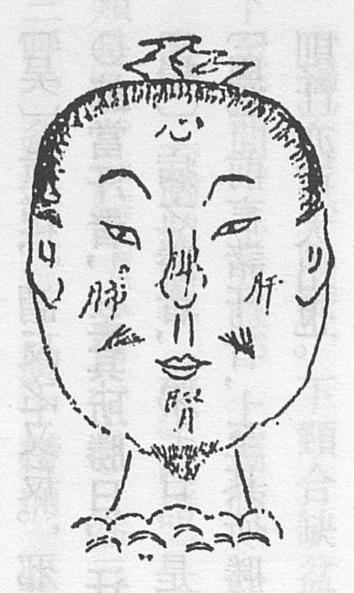

**○熱病從部所起者，至期而已。**

〔楊〕部所者，色部所也。假令赤色從肝部起，刺之順者，相傳還至肝部本位，病已也。

〔馬〕此又即熱病，而決其病已之期，即上文汗愈之日之義也。

〔張〕此下言諸熱病并刺治之法也。從部所起者，至期而已，謂如肝色先見於左頰，至甲乙日，即當汗解之類是也。餘藏義同。

案：張注似是。蓋五藏熱病共用鍼法，若在太陽表證之初發用之，則一汗而解。前文五藏共云『大汗』，是即愈之期也。其在最初，察知熱病之法，以面色爲候，是古昔察色之遺法耳，又名望法。

**○其刺之反者，三周而已。**

〔吳〕六經傳盡爲一周。

<!-- PAGE_END -->

<!-- PAGE: 0843 -->

<!-- PRINTED: 808 -->

〔馬〕當三遇所勝日而病始已。

〔張〕反謂寫虛補實也。病而反治，其病必甚，其愈反遲。三周者，謂三遇所勝之日而後已。

〔高〕三周，三日也。

〔志〕按：『伯高曰：風寒傷形，憂恐忿怒傷氣。氣傷藏，乃病藏。寒傷形，乃應形，此形氣外内之相應也。帝曰：刺之奈何？伯高答曰：病九日者，三刺而已』。三刺者，三周也。九日者，病久而外内交爭也。

〔識〕簡按：考王注，凡六刻，蓋二刻一周，故爲六刻。此甚速，當從張注。

**○重逆則死。**

〔楊〕刺之不順其氣，傳之三周而已。若刺之更反，死矣。

〔吳〕重逆，謂反之又反。邪益深而正益敝，宜其死也。

**○諸當汗者，至其所勝日，汗大出也。**

〔楊〕病之勝者，第七日，是病所勝也。又如肝病至甲乙日，是病之勝日也。

〔馬〕前言諸汗者，至其所勝日汗出，指各藏自汗之日而言，此言凡用鍼以發汗者，亦至所勝之日而刺之，則汗亦可大出也。

**○諸治熱病，以飲之寒水，乃刺之，必寒衣之，居止寒處，身寒而止也。**

〔楊〕諸病熱病，以寒療之，凡有四別。一飲寒水使其内寒，二刺於穴令其脈寒，三以寒衣使其外寒，四以寒居其體寒，以四寒之，令身内外皆寒，故熱病止也。

案：此條諸注皆失解矣。竊謂熱病非啻忌熱藥，一切熱物禁之，非漫爲寒衣寒食寒處之義也。『飲寒水』者，與用白虎湯之理同，折熾熱令汗出也。『刺之』者，亦漏熱氣於輸穴令汗出之義。『必寒衣之』者，必禁暖衣之謂也。『居止寒處』者，不可居陽日火爐邊之謂也。如此而後行鍼刺，則身熱去而身涼寒，至此止鍼法也。『身寒而止』者，謂身熱除去而止鍼也。楊注可從。

<!-- PAGE_END -->

<!-- PAGE: 0844 -->

<!-- PRINTED: 809 -->

**○熱病先胸脇痛，手足躁，刺足少陽，補足太陰。病甚者，爲五十九刺。**

〔楊〕足少陽脈，下頸合缺盆，下胸中貫膈胳肝屬膽，循脅裏過季脅，下外輔骨之前，下抵絶骨，循足跗下至指間。手太陰，上屬肺，從肺出腋下。故胸脅病手足躁，刺此二脈也。

案：『胸脇痛』爲少陽證，『手足躁』爲陽明證，小柴胡之『脇下滿痛』｟中七｠，小承氣之『煩躁心下堅』｟七一｠之類是也。｟前『肝熱病』下宜併看｠《醫心方》卷二引《明堂經》云『俠谿二穴，在足小指次指岐骨本節前陷者中，刺入三分，留三呼，灸三壯，主胸中榰滿，寒如風吹之狀。竅陰二穴，在足小指次指之端去爪甲如韮葉，刺入一分，留三呼，灸三壯，主脇痛欬逆汗出，並足小腸膽府』，又云『期門二穴，肝募也。在第二肋端，不容旁各一寸五分，上直兩乳，去巨闕各三寸五分，舉臂取之，刺入四分，灸五壯。主息犇脅下，氣上下胸中有熱。足太陰脾』，《傷寒論》卷四『婦人中風，發熱惡寒，經水適來云云。胸脅下滿如結胸狀云云，當刺期門，隨其實而取之』，《外臺》卅九引《甲乙》肺人下云『魚際主痺走胸背不得息云云，肺心痛，大淵主心痛欬逆煩悶不得臥』，並與本文合。

據王注，則『足少陽』爲丘墟｟足外果下如前陷者中｠。《新校正》從《大素》作『手太陰』，爲是，以《靈樞》爲證。

《水熱穴論第六十｟（當爲『六十一』）｠》云：『帝曰：夫子言治熱病五十九俞，余論其意，未能領別其處，願聞其處，因聞其意。岐伯曰：頭上五行，行五者，以越諸陽之熱逆也。大杼、膺俞、缺盆、背俞此八者，以寫胸中之熱也。氣街、三里、巨虛、上下廉，此八者，以寫胃中之熱也。雲門、髃骨、委中、髓空，此八者，以寫四支之熱也。五藏俞傍五，此十者，以寫五藏之熱也。凡此五十九穴者，皆熱之左右也。帝曰：人傷於寒，而傳爲熱何也？岐伯曰：夫寒盛則生熱也。』

<!-- PAGE_END -->

<!-- PAGE: 0845 -->

<!-- PRINTED: 810 -->

案：《氣穴論》『熱俞五十九穴』。｟十五七ヲ｠

**○熱病始手臂痛者，刺手陽明太陰，而汗出止。**

〔楊〕手陽明行於手表，太陰行在手裏，故手臂痛。刺此陰陽表裏二脈取汗也。

《醫心方》卷二引《明堂經》云：『列缺，主掌中熱，肘臂肩背寒。』

《外臺》卅九引《甲乙》云：『列缺，主熱病，先手臂痛，身熱瘈瘲。』

『商陽，主臂瘈引，肩痛引缺盆』。《外臺》卅九引《甲乙》

『商陽，主臂瘈引，肩背痛』。《醫心方》卷二引《甲乙經》

**○熱病始於頭首者，刺項太陽，而汗出。**

（顧從德本『汗出』下有『止』字。）

〔楊〕項太陽者，足太陽從顛入腦，還出俠項以下俠脊，故熱病始頭首，刺此太陽輸穴出汗也。

《醫心方》卷二引《明堂》云：『天柱，主熱病汗不出，眩頭痛重。』

《外臺》三十九引《甲乙經》云：『天柱，主頭痛項先痛，腰脊爲應，眩頭痛重。』

案：王注以『項太陽』爲天柱，蓋有所受而言歟。然大杼｟一椎下兩旁一寸半｠、風門｟二椎下兩旁一寸半｠，共皆主頭項痛，風池、風府亦在此邊，則熱病初起之頭項痛，皆可刺此處也。《傷寒論》云『太陽病，初服桂枝湯，反煩不解者，當先刺風池風府，卻與桂枝湯則愈』｟上廿五｠與此同理。蓋取於風邪所入之處刺之，使陽氣滿溢，則邪隨汗而解之意耳。志聰直引《傷寒論》刺風池風府，以爲本文之義，則非是。

<!-- PAGE_END -->

<!-- PAGE: 0846 -->

<!-- PRINTED: 811 -->

**○熱病始於足脛者，刺足陽明，而汗出止。**

〔新〕按：此條《素問》本無，《太素》亦無，今按《甲乙經》添入。

案：今本《甲乙》無『熱病始手臂痛』至『刺足陽明而汗出止』四十七字，與宋臣所見本似有不同，録存考。

『熱病始於足脛』者，後文所云『身重骨痛』，而麻黃湯之證『骨節疼痛』是也。此邪入漸深，着在筋脈，故刺陽明經，則汗出而愈也。《傷寒論》云『太陽病，頭痛至七日以上自愈者，以行其經盡故也。若欲作再經者，鍼足陽明，使經不傳則愈』，恐與此同理。蓋邪之著人，各異其證，其始爲寒熱頭痛者，此其常候，而爲太陽表證。然因其邪之輕重與其人之虛實，或有『先胸痛躁煩』者，或有『先手臂痛』者；或有『始於頭首』者，或有『始於足脛』者，或有『先身重骨痛』者，或有『先眩冒而熱』者，如此所説是也。隨其證而異其治，只在於醫之手段耳。

〔吳〕不言孔穴而混言其經者，取穴不泥於一，但在其經酌之可也。汗出止者，經氣和也。

〔張〕按《寒熱病篇》曰：『足陽明可汗出，當是内庭陷谷二穴。』

案：《醫心方》卷二引《明堂》云：『内庭二穴，在足大指次指外間陷者中，刺入三分，留廿呼，灸三壯。主四厥手足悶者，久持之厥熱脛痛。』｟（《外臺》引《甲乙》『久』上有『使大』二字，『厥熱』作『逆冷』）｠《醫心方》二引《明堂》云：『陷谷二穴，主熱病。』

**○熱病先身重骨痛，耳聾好瞑，刺足少陰，病甚，爲五十九刺。**

（眉）宋本《素問》作『瞑』，誤字。｟（《大素》作『瞑』）｠

〔楊〕足少陽脈，起目兌眥，胳身骨節，入耳中，故熱病先身重，耳聾好瞑，所以此脈之輸穴者也。有本爲足少陰也。

<!-- PAGE_END -->

<!-- PAGE: 0847 -->

<!-- PRINTED: 812 -->

〔吳〕少陰腎主骨，身重骨痛，腎熱而骨痿也。耳者腎之竅，病故耳聾。仲景云『少陰之爲病，但欲寐也』，即好瞑之謂，故刺少陰。

案：『身重骨痛』者，太陽麻黃證是也。『耳聾』者，『少陽中風，兩耳無所聞』｟二｠是也。『好瞑』者，瞑猶眩也，『少陽之爲病目眩』是也。麻黃證之『發煩，目瞑』｟中十六｠，即爲目眩也。『足少陰』宜從《大素》作『足少陽』。少陰腎經，亦有『治熱病云云』之證之效，今引兩説於左。

案：『五十九刺』，又見《氣穴論五十八》《水熱穴論六十一》。

《醫心方》卷二引《明堂》云：『湧泉二穴｟足少陰腎｠，主熱病者先腰脛痠。』

《外臺》卷卅九引《甲乙》云：『湧泉，主頭項痛眼眩。』

又：『太谿，主熱病汗不出，默默嗜臥。』

案：《傷寒論》『少陰病，吐利，脈不至者，灸少陰七壯』，即指太谿穴而言也。《明堂》云『灸三壯』，此云『七壯』，可知寒厥尤甚也。

又『束骨，主身痛，頭痛，身熱痛，肌肉動，耳聾』。以上足少陰腎經也。

又『竅陰，主煩熱，汗不出，手胑轉筋，臂内廉痛，不可及頭，耳聾鳴』。

又『俠谿，主熱病，汗不出，頭眩，耳鳴聾。胸中痛，不可反側，痛無常處』。以上足少陽膽經也。

**○熱病先眩冒而熱，胸脇滿，刺足少陰少陽，太陽之脈。**

〔楊〕足太陽起目内眥，上額交顛入腦。足少陽起目兌眥，下胸循脅裏。足少陰從腎上貫肝膈入肺中，故眩冒熱，胸脅滿，刺此三脈者也。

<!-- PAGE_END -->

<!-- PAGE: 0848 -->

<!-- PRINTED: 813 -->

案：『太陽之脈』四字，宜從王注屬下句，楊付前句，非是。

《外臺》卷卅九引《甲乙》云：『湧泉，主眼眩，脅下支滿。』｟足少陰腎，足心｠

又云：『竅陰，主煩熱。』｟足少陽膽，足小指次指之端，去爪甲如韭葉｠

又云：『俠谿，主寒熱，頭眩，胸中痛。』｟同，足小指次指岐骨間本節前陷者中｠

又云：『臨泣，主胸中滿，頭眩，脅下支滿身熱。』｟同，足小指次指間，本節後去俠谿一寸半｠

《醫心方》卷二引《明堂》云：『俠谿，主胸中榰滿。』

《外臺》又云：『通谷，主寒熱，頭眩。』｟足太陽旁光，足小指外側本節前陷者中｠

又云：『付陽，主風頭重眩。』｟足太陽膀光，外踝上三寸，太陽前少陽後筋骨間｠

又云：『承筋，主頭眩痛。』｟同，在踹中央陷者中，太陽脈氣所發｠

又云：『神堂，主胸腹滿。』｟同，五椎下各三寸｠

又云：『魂門，主胸脇脹滿。』｟同，九椎下各三寸｠

案：『眩冒』者，《太陽下篇｟（當作『中篇』）｠》卅七苓桂朮甘湯之『起則頭眩』，少陰病｟十七｠『下利止而頭眩，時時自冒者死』之類，並爲汗下後津液虛乏之證。此刺腎經，蓋取於使津液順還之意也。其有熱者，宜施其刺法也。若無熱則爲陰證，少陰之死證是也。太陽病｟三五｠之真武湯之『頭眩』亦『仍發熱』，可併考也。少陽病｟四｠之『脇下鞕滿』，太陽中｟六八｠小柴胡之『胸脅苦滿』，並爲太陽少陽之證也。

以上自『熱病先胸脅痛』至此，並在邪氣感入之初發而刺之之法也。

**○色榮顴骨熱病也。**

〔楊〕赤色榮顴，此之三脈皆生於骨，故此三脈爲病，有赤色榮顴者，骨熱病也。

<!-- PAGE_END -->

<!-- PAGE: 0849 -->

<!-- PRINTED: 814 -->

〔張〕此下言兩感之脈色死期也。榮，發見也。太陽之脈起於目内眥，太陽之筋下結於頄，故太陽熱病者，赤色當榮於顴骨。

〔吳〕榮，華采之稱，赤色是也。

案：『太陽之脈』者，《傷寒例》所云『尺寸俱浮者，太陽受病也』是也。言脈浮而赤色見於兩顴者，爲太陽表熱病也。與前文『先赤』部位自異矣。所云『骨熱病』者，太陽旁光經之邪熱，内與腎藏之本熱相應，而於其部位顴骨上見赤色，故名曰骨熱病。骨熱病，猶云腎熱病，謂足少陰腎經受邪，即太陽表熱證也。如麻黃湯之『骨節疼痛』，即爲骨熱病也。

**○榮未交曰，今且得汗，待時而已。**

〔楊〕赤色未夭之日，且得汗者，至勝時病自得已也。

〔識〕簡按：榮即上文『榮顴骨』之榮。交，《甲乙》作夭，下文同，今從之。

案：『榮未夭日』，言其赤色未變刮白之時也。當此時若得汗，則雖即不愈，至壬癸日而病自愈，乃太陽汗解之理，與此方同。

夭者，謂失光澤也。『夭』字説詳見於《玉版論要十五》中。

『曰』即『日』字，唐人所書日月之日字，皆作曰，故往往『日』『曰』互相混誤，不遑枚舉。此宜從楊注以『日』下爲句，下文同。

**○與厥陰脈爭見者，死。期不過三日，其熱病内連腎，少陽之脈色也。**

〔楊〕足太陽，水也。足厥陰，木也。水以生木，木盛水衰，故太陽水色見時，有木爭見者水死。以其熱病内連於腎，腎爲熱傷，其數至三日故死也。

<!-- PAGE_END -->

<!-- PAGE: 0850 -->

<!-- PRINTED: 815 -->

〔新〕詳或者欲改『腎』作『鼻』。按：《甲乙經》《太素》並作腎，本舊無『少陽之脈色也』六字，乃王氏所添，王注非，當從上善之義。

〔識〕｟（『少陽之脈色也』）｠簡按：馬據《新校正》爲衍文，今從之。

案：『厥陰脈』者，《傷寒例》所云『尺寸俱微緩者，厥陰受病也』是也。若見此脈而其兩顴赤色者，即前篇所云兩感傷寒而少陽與厥陰俱病，云六日死者，與此云『期不過三日』合，『其熱病氣内連腎』者，謂表裏俱病也。

〔志〕按此節與《玉機真藏論》之所謂傳化，有不以次入者，憂恐悲喜怒，令不得以其次，故令人有大病之義相同。蓋表陽之邪，始病太陽，六氣相傳，移皆有次，不以次入者，因五志内傷，而五藏内熱。太陽之脈與厥陰脈爭見者，是太陽之熱與肝熱相交矣。蓋太陽爲陽之始，厥陰爲陰之終，舉太陽與厥陰交爭，是表陽之邪不以次入，而與五藏之熱，隨所乘傳。陽脈與陰脈爭見者，皆爲死證，故不必備言五藏也。當知表陽之熱，先氣而經，經而藏，五藏之熱，亦先從氣而經，内而外也。外内之熱，交出於陽分者生，重逆於陰藏者死。首節論内熱與外熱交爭，此論外熱與内熱交爭。

**○少陽之脈，色榮頰前，熱病也。**

〔新〕按《甲乙經》《太素》『前』字作『筋』。

案：今本《甲乙》作『前』字，與宋臣所見不同。蓋今本作『前』，其誤與《素問》同耳。『前』字或作『剃』，『筋』字或作『𮅀』，又作『荕』，字體相似而誤也。

『榮頰』者，謂顴下口傍之處也。『頰前』二字不成語，當從《大素》作『筋熱病』，則與骨熱病相對而言也。『筋熱病』者，謂足少陽膽經受邪，肝筋亦受傷，故名曰筋熱病。筋熱病，猶云肝熱病也，乃太陽少陽合病併病之類也。

<!-- PAGE_END -->

<!-- PAGE: 0851 -->

<!-- PRINTED: 816 -->

**○榮未交曰，今且得汗，待時而已。與少陰脈爭見者，死期不過三日。**

〔楊〕足少陽，膽脈也。足少陽部在頰，赤色榮之，即知筋熱病也。當榮時且得汗者，至其木時病自已也。少陽爲木，少陰爲水，少陽脈見之時，少陰爭見者，是母勝子，故肝木死也。

〔新〕詳或者欲改少陰作厥陰。按：《甲乙經》《大素》作少陰。楊上善云：『少陽爲木，少陰爲水。少陽色見之時，有少陰爭見者，是母勝子，故木死。』王作此注亦非。舊本及《甲乙經》《太素》並無『｟（脫『死』）｠期不過三日』六字，此是王氏成足此文也。

〔識〕『死期不過三日』，《甲乙》作『其死不過三日』。簡按：《新校正》爲王氏所足成，非也。

案：今本《甲乙》亦與宋臣所見不同，則不得以今本《甲乙》格定宋臣説也。

案：得汗而解之理，與前文同。凡外邪之病皆得汗而解，是爲常例。前文所云五藏熱病，並大汗出是也。《傷寒例》云：『尺寸俱沈者，少陰受病也。』今見此脈而兩頰赤色者，知是表裏俱病之證，而爲陰證死候也。《傷寒論・太陽中篇》『二陽併病，設面色緣緣正赤者，陽氣怫鬱在表，當解之熏之』｟八十｠，又少陰病『其人面色赤，通脈四逆湯主之』｟七三｠，又《厥陰篇》『下利，脈沈而遲，其人面少赤，身有微熱，下利清穀者，必鬱冒汗出而解，病人必微熱。所以然者，其面戴陽，下虛故也』｟十四｠，共可以併考。

**○熱病氣穴，三椎下間，主胸中熱。**

〔楊〕《明堂》及《九卷》背五藏輸，並以第三椎爲肺輸，第五椎爲心輸，第七椎爲膈輸，第九椎爲肝輸，第十一椎爲脾輸，第十四椎爲腎輸，皆兩箱取之。當中第三椎以上無療藏熱，故五藏輸及候五藏熱，並第三椎以下數之，第三椎以上與頰車相當，候遠。第三椎下間，肺輸中間，可以寫熱也。

<!-- PAGE_END -->

<!-- PAGE: 0852 -->

<!-- PRINTED: 817 -->

〔高〕熱病氣穴，猶言熱病刺法。

〔馬〕三椎下間名身柱，四椎下間無穴，五椎下間名神道，六椎下間名靈臺，七椎下間名至陽。

〔識〕氣穴即孔穴，義具於《氣穴論》。

案：《大素》無『熱病氣穴』四字，《甲乙》有之。據此，則此四字，王氏依《甲乙》加入者歟。蓋是一種之古刺法，而主治五藏熱者也。其圖如左。

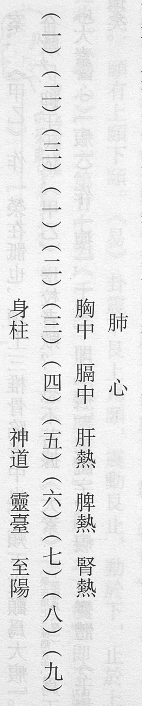

- 肺　心
- 胸中　膈中　肝熱　脾熱　腎熱
- （一）（二）（三）（一）（二）（三）（四）（五）（六）（七）（八）（九）
- 身柱　神道　靈臺　至陽

『胸中熱』者，謂肺熱，爲上部之最者也。故於第三椎下間刺之，以泄肺部之熱也。《太陽下》『太陽與少陽併病，如結胸，心下痞鞕，當刺大椎第一間肺俞、肝俞』｟十六、四六｠，與此『三椎下間』，其法相類，宜併考。

〔志〕胸中膈上，乃心肺之宮城，主胸中熱者，寫肺熱也，膈中熱者，寫心熱也。不曰心肺，而曰胸中膈中者，意言熱在氣分，而不干於藏真也。

**○四椎下間，主鬲中熱。**

案：『鬲中熱』者，即心熱也。『四椎下間』無穴名，非穴處。此特刺之者，自是古昔一種之刺法，僅存於今日者也。

**○五椎下間，主肝熱。六椎下間，主脾熱。七椎下間，主腎熱。**

〔楊〕四椎下間，計次當心，心不受邪，故乘言膈也。次第椎之下間，各主一藏之熱不同，《明堂》通取五藏之輸者也。

<!-- PAGE_END -->

<!-- PAGE: 0853 -->

<!-- PRINTED: 818 -->

**○榮在骶也，項上三椎陷者中也，頰下逆顴，爲大瘕。**

〔楊〕從肺輸以上，三椎在項，故曰項上三椎，即大椎上陷者中也。當頰下迎椎，故曰逆椎。逆，迎也。是爲頰下當椎前有色見者，腹有大瘦病者也。

案：『榮在骶也』四字，諸説皆窮矣，故《識》云『簡按：此一句難通，諸注並不允』，可謂卓見矣。

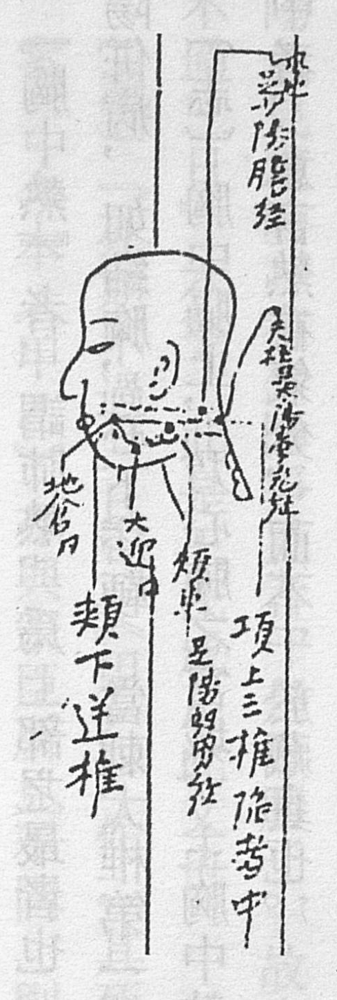

案：《甲乙》作『榮在骶也，項上三椎骨陷者中也，頰下逆顴爲大瘕』。則王冰所依《素問》與《甲乙》合歟？抑王氏依《甲乙》增校者歟？恐不若據《大素》｟（『榮在項上三椎陷者中，頰下逆椎爲大瘦』）｠爲正也。《大素》（『瘕』）作『瘦』，『瘦』即『瘕』之訛字，『瘕』之變體。《干祿字書》『假假，上俗下正』可以徵矣。

案：大瘕者，謂瘕積之大者也。《陽明篇》所云『欲作固瘕』｟四十｠之類是也。蓋少陰｟七三｠、厥陰｟十四｠之『面赤』與此同義，皆爲胃中虛冷宿飲爲瘕癖之證。故其部位在於地倉、大迎、頰車之邊，共爲足陽明胃經也。風池爲足少陽膽經，天柱爲足太陽旁光經也。即小腹部位也。《靈樞・五色篇》云『方上者，胃也。中央者，大腸也。挾大腸者，腎也。當腎者，臍也。面王以上者，小腸也。面王以下者，膀胱子處也』，是亦謂顴骨以下爲臍之部位也。

<!-- PAGE_END -->

<!-- PAGE: 0854 -->

<!-- PRINTED: 819 -->

**○下牙車，爲腹滿。**

〔楊〕下牙車色見者，腹滿病也。

《釋名》云：『頤，養也。動於下，止於上。上下咀物以養人也。或曰輔車，言其骨強，所以輔持口也。或曰牙車，牙所載也。或曰頷車。頷，含也。口含物之車也。或曰頰車，亦所以載物也。或曰鼸車，鼸鼠之食積於頰，人食似之，故取名也。凡繫於車，皆取在下載上物也。』

案：頤有上頤下頤。《易》卦震下艮上爲頤，震動艮止，動於下，止於上也。此所云『下牙車』，即下頤是也。《醫心》十六第廿七引《千金》用『牡䐗頷髓』，所云『下頷』即下頤也。

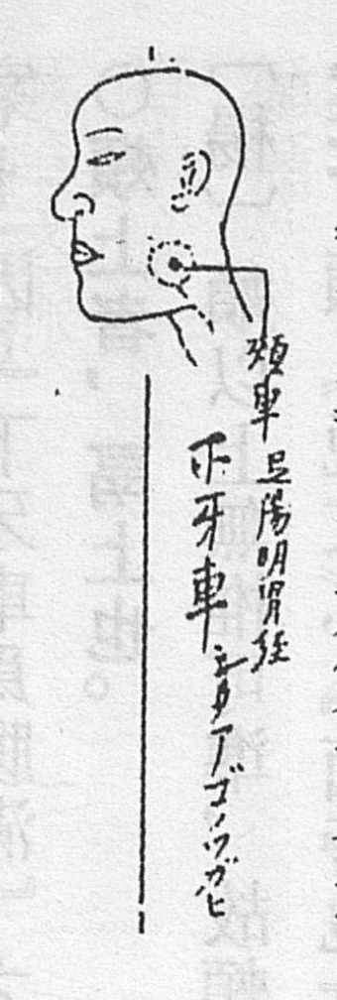

**○顴後，爲脇痛。**

〔楊〕太椎左右箱爲椎後，有色見者，脅痛也。

案：據注作『脅痛』，則（《大素》）本文作『骨痛』，爲誤字可知也。

案：顴後，蓋謂顴骨下向後之處，下關穴之邊也。乃爲頰車之上。｟《素問》本文如此｠

《大素》｟（『觀』）｠作『椎』，爲『權』之誤字。

案：據《素問》則如下圖。

<!-- PAGE_END -->

<!-- PAGE: 0855 -->

<!-- PRINTED: 820 -->

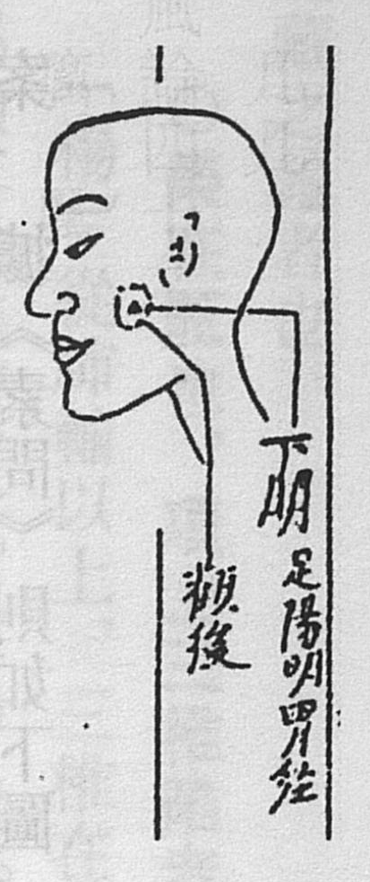

案：據《大素》則如下圖。

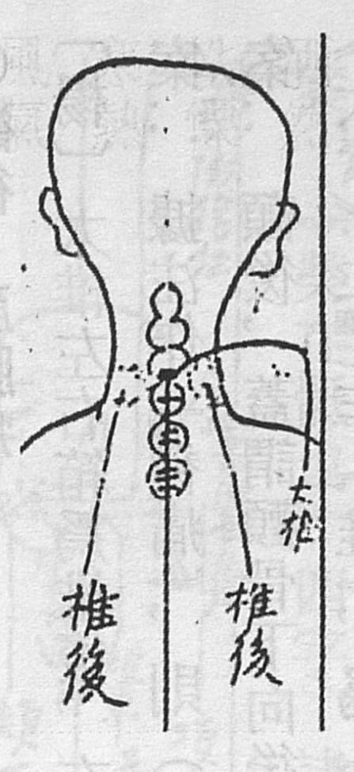

案：因『下牙車爲腹滿』之文推求之，則作『顴後』爲是。

**○頰上者，鬲上也。**

〔楊〕頰以上無椎可準，故頰以上有色者，主膈上也。

案：頰《説文》『面旁也』。《釋名》『頰，夾也。面旁稱也。亦取挾斂食物也』。顴下爲頰，頰上爲顴也。蓋顴骨之下旁，爲候鬲上之地也。

案：鬲上者，謂胸中也。

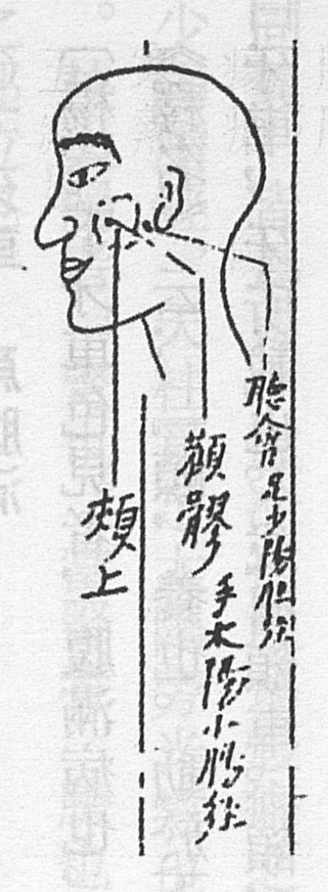

<!-- PAGE_END -->

<!-- PAGE: 0856 -->

<!-- PRINTED: 821 -->

文久二年四月廿七日未時書於達鬱堂中

時鵑聲喧喧微風半面晴色可愛

岐路亡羊子𦳝軒　立之

第卅二補

大瘕｟廿一ヲ｠

〔馬〕色見於頰之下，而又逆顴而上行，乃大瘕泄之疾也。《難經》亦有大瘕泄。

案：本文無『泄』字，而馬以爲大瘕泄，似未允。然無單名大瘕之病，則此『大瘕』乃宜爲大瘕而無泄之義歟？録俟後考耳。

《五十七難》云：『有大瘕泄，名曰後重』。又云：『大瘕泄者，裏急後重，數至圊而不能便，莖中痛。』《玉篇》：『瘕，公遐、公詐二切。久病也，腹中病也。《説文》本音遐。』

逆顴｟廿一ヲ｠

案：《素問》作『顴』，恐『椎』本作『顀』，再訛作『顴』歟。《廣韻》六・脂云『顀，項顀』，即爲脊椎字。

<!-- PAGE_END -->

<!-- PAGE: 0857 -->

<!-- PRINTED: 822 -->

筋熱病｟十九ヲ｠

案：《傷寒論・太陽下》『太陽少陽併病，頭項強痛，脈弦』｟六十｠，又『心下鞕，頸項強而眩者，當刺大椎、肺俞、肝俞，慎勿下之』｟五四｠，柴桂湯之『支節煩疼』｟二十｠，共爲筋熱病之證。《史記・倉公傳》『潘滿如案曰：如前止』，徐廣曰：『前，一作筋也』。

三一　藏府｟八ヲ｠　囊縮｟十二ヲ｠　日期脈證｟十三ヲ｠　噓欬｟十八ヲ｠　藏脈｟十八ウ｠　遺｟十九ヲ｠　復｟廿ヲ｠　滿懣｟十四ヲ｠

三二　小便黃｟一ヲ｠　多臥｟同｠　狂言｟一ウ｠　驚｟同｠　手足躁｟同｠　員員𧴨𧴨｟三ヲ｠　先不樂｟三ウ｠　面赤｟同｠　顏｟五ヲ｠　舌上黃｟六ヲ｠　䯒痠｟八ウ｠　不欲言｟同｠　澹澹｟九ウ｠　三周｟十一ウ｠　寒衣寒水寒處｟十二ウ｠　熱病始於頭首｟十四ウ｠　骨痛｟十五ウ｠　五十九刺｟十五ウ｠　甲乙宋本｟十五オ｠　眩冒｟十六ヲ｠　色榮｟十七ヲ｠　夭｟同ウ｠　前筋｟十九ヲ｠　氣穴｟廿ヲ｠　大瘕｟廿一ウ｠　下牙車｟同｠

#### 評熱病論篇第三十三

〔新〕按：全元起本在第五卷。

案：《大素》廿五熱病説，同廿九風水論全載。卷首至『傷肺則死』，出熱病説中。

**○黃帝問曰：有病温者，汗出輒復熱，而脈躁疾，不爲汗衰，狂言不能食，病名爲何？岐伯對曰：病名陰陽交，交者死也。**

〔楊〕汗者，陰液也。熱者，陽盛氣也。陽盛則無汗，汗出則熱衰。今出而熱不衰者，是陽耶盛，其復陰起，兩者相交，故名陰陽交也。

〔識〕滑云：『交，謂交錯也。』張云：『以陽邪交入陰分，則陰氣不守，故曰陰陽交。』汪昂云：『按《五運行大論》云：尺寸反者死，陰陽交者死。蓋言脈也。』簡按：《倉公傳》云『《脈法》曰：熱病陰陽交者死』即是。

<!-- PAGE_END -->

<!-- PAGE: 0858 -->

<!-- PRINTED: 823 -->

〔馬〕按：《靈樞》第二十三熱病篇云：『熱病已得汗出，而脈尚躁，喘且復熱，勿刺膚，喘甚者死。』又曰：『熱病已得汗，而脈尚躁盛，此陰脈之極也，死。』《傷寒論・厥陰篇》云：『傷寒發熱，下利，厥逆，｟（當補『躁』）｠不得臥者死。』｟九十｠又云：『傷寒發熱，下利至甚，厥不止者，死。』｟十二｠又云：『傷寒六七日不利，便發熱而利，其人汗出不止者死，有陰無陽故也。』｟廿一｠

案：以上並與本論符，謂邪盛正虛者必死也。『陰陽交』者，『交』是交代之交，言陽熱之邪内入尤深，陰血之汗外泄太甚，故名曰『陰陽交』也。《倉公傳》以脈言之，然其理則一也。

**○帝曰：願聞其説。**

〔楊〕請説陰陽交爭死之由。

**○岐伯曰：人所以汗出者，皆生於穀，穀生於精。今邪氣交爭於骨肉，而得汗者，是邪卻而精勝也。**

《史記・倉公傳》云：『齊中御府長信病，臣意入診其脈，告曰：熱病氣也。然暑汗脈少衰，不死。曰：此病得之，當浴流水而寒甚已則熱。信曰：唯然。往冬時爲王使於楚，至莒縣陽周水，而莒橋梁頗壞，信則擥車轅，未欲渡也。馬驚即墮，信身入水中幾死。吏即來救信，出之水中，衣盡濡。有間而身寒，已熱如火，至今不可以見寒。臣意即爲之液湯火齊逐熱，一飲汗盡，再飲熱去，三飲病已。即使服藥出入二十日，身無病者。所以知信之病者，切其脈時并陰。《脈法》曰：熱病陰陽交者死，切之不交并陰。并陰者，脈順清而愈，其熱雖未盡猶活也。腎氣有時間濁，在太陰脈口而希，是水氣也。腎固主水，故以此知之。未治一時，即轉爲寒熱。』

<!-- PAGE_END -->

<!-- PAGE: 0859 -->

<!-- PRINTED: 824 -->

案：『并陰』者，謂脈不躁疾而安靜，不浮數而沈實也。『順清』即順靜，謂其脈和平而不躁疾也。『間濁』猶云混濁，『間』『混』同爲見母，蓋古音通用。

**○精勝，則當能食而不復熱。復熱者，邪氣也。汗者，精氣也。今汗出而輒復熱者，是邪勝也。**

〔楊〕精者，穀之精，液謂之汗也。傷寒耶氣謂之熱也。今耶氣與精氣交爭於骨肉之間，精勝則耶卻，邪勝則精消，令雖汗出而復熱者，是耶戰勝精，故致死也。

**○不能食者，精無俾也。病而留者，其壽可立而傾也。**

（眉）一死。

〔楊〕熱耶既勝則精液無，精液無者唯有熱也。癉，熱也。其熱留而不去者，五藏六府盡，可傷之能食也。

〔識〕汪機云：『愚謂：穀氣化爲精，今不能食，則精無所俾益。』高云：『俾，補益也。』簡按：俾，《爾雅・釋詁》云：『使也。』《説文》云：『益也。』王本於《爾雅》，高原於《説文》，並通。

案：『病而留者』，《甲乙》作『熱而留者』，義政同。蓋云病、云熱，共謂邪氣也。言其邪氣留連者，其壽命可立至傾絶也。

此條《大素》多訛字，楊氏亦就誤字而爲之説，不甚明了。今從《素問》《甲乙》二經。（《大素》作『不能食者精毋精毋癉也而留者其盡可立而傷也』）

**○且夫熱論曰：汗出而脈尚躁盛者，死。**

（眉）二死。

<!-- PAGE_END -->

<!-- PAGE: 0860 -->

<!-- PRINTED: 825 -->

《靈樞》卷九・熱病第二十三云：『熱病已得汗，而脈尚躁盛，此陰脈之極也，死。其得汗而｟（當補『脈』）｠靜者生。熱病者，脈尚盛躁，而不得汗者，此陽脈之極也，死。脈盛躁，得汗靜者生。』

案：本文所引《熱論》，蓋古經之篇名，而爲今《靈樞・熱病篇》所記即是。《甲乙》無『是熱論曰』四字。

**○今脈不與汗相應，此不勝其病也。其死明矣。**

〔楊〕夫汗出則可脈靜，今汗出脈猶躁盛，是爲耶勝明，定知定矣也。

案：下『定』恐『死』字訛。

**○狂言者是失志，失志者死。**

（眉）三死。

〔楊〕志者，記也。腎之神也。腎間動氣，人之生命，動氣衰矣，則神志去之，故死也。

《千金方》卷廿九・五藏變化傍通訣第四云：

五神　腎｟水一｠　心｟火二｠　肝｟木三｠　肺｟金四｠　脾｟土五｠

五神　志｟精｠　神｟性又作脈神｠　血｟魂｠　氣｟魄｠　意｟智又作營意｠

《五行大義》引河上公注《老子》且云與《素問》同：

五神　精　神　魂　魄　志

案：狂言者，謂言之狂亂無常，所云譫言妄語是也。蓋神志失守之所爲也。『狂言者是失志』也，是古之訓詁釋義之遺文也已。

**○今見三死不見一生，雖愈必死也。**

<!-- PAGE_END -->

<!-- PAGE: 0861 -->

<!-- PRINTED: 826 -->

案：《大素》『今』作『命』，偶誤耳。

〔楊〕汗出而熱不□死有三候。一不能食，二猶脈躁，三者失志。汗出而熱，有此三死之候，未見一生之狀，雖差必死。又有三分之死，未見一分之生也。

〔識〕三死，馬云：『汗後輒復熱，不能食者，一死。汗後脈尚躁盛者，二死。汗後反狂言失志者，三死。』簡按：王以不勝其病爲二死，考上文，此乃謂汗出而脈尚躁盛之證，故今從馬義。志云：『病而留者，一死也。胃氣絶者，一死也。腎氣絶者，一死也。』『胃氣絶，腎氣絶』上文所不言，此注非也。

案：楊注三死可從，馬與楊義稍同，可謂善讀經者也。

案：自卷首至此，見《玉函經》卷六第廿八及《脈經》卷七。因考是仲景遺篇僅存於此者，而自序所云『撰用素問九卷』者是也。

**○帝曰：有病身熱汗出煩滿，煩滿不爲汗解，此爲何病？**

（原文『帝』下有『問於岐伯』四字，是《大素》文，故刪去。）

〔楊〕身熱煩滿，當爲汗解，今不解，故問。

**○岐伯曰：汗出而身熱者，風也。汗出而煩滿不解者，厥也。病名曰風厥。**

〔楊〕風熱開於腠理爲汗，非精氣爲汗，故身熱不解，名爲風也。煩心滿悶不解，名厥病也。有風有厥，名曰風厥也

〔識〕張云：『按：風厥之義不一，如本篇者，言太陽少陰病也。其在《陰陽別論》者，云「二陽一陰發病，名曰風厥」，言胃與肝也。在《五變篇》者，曰「人之善病風厥漉汗者，肉不堅腠理疎也」。』高云：『承上文汗出復熱之死證，復舉汗出煩滿之病以問之。風爲陽邪，性主開發。凡汗出而身發熱者，風也。汗乃陰液，外出於陽。今汗出而心煩胸滿不解者，乃陰竭陽虛，不相交濟，是爲厥也。此因風致汗，因汗致厥，病名曰風厥。』簡按：《倉公傳》云『風蹶胸滿，過入其陽，陽氣盡而陰氣入，陰氣入張則寒氣上，而熱氣下，故胸滿汗出』，與此少異。

<!-- PAGE_END -->

<!-- PAGE: 0862 -->

<!-- PRINTED: 827 -->

案：汗出身熱，係於表邪，故謂之風。『汗出而煩滿不解』者，表邪解而裏熱不解，身熱而四枝｟（當作『肢』）｠厥冷，故謂之厥。故名曰風厥也。『太陽病，發汗，遂漏不止云云，桂枝加附子湯主之』｟上廿二｠，又『甘草乾薑湯』｟上卅｠，又『芍藥甘草附子湯』｟中三八｠『茯苓四逆湯』｟中三九｠『桂枝加芍藥生薑人參新加湯』｟中三二｠之證，並『風厥』之類證也。

**○帝曰：願卒聞之。岐伯曰：巨陽主氣，故先受邪，少陰與其爲表裏也。得熱則上從之，從之則厥也。**

〔楊〕腎間動氣，足太陽所主，足太陽與足少陰表裏，故太陽先受耶氣，循脈而上於頭，得熱則足太陽上者從之受熱，即爲上熱下寒，以爲厥逆汗出不解，煩滿之病也。

案：『巨陽主氣，故先受邪』者，謂風也。『少陰與其爲表裏云云』謂厥也，正與前文相應也。『得熱則上從之』者，乃謂煩滿不解。煩滿不解，則爲厥逆也。

**○帝曰：治之奈何？岐伯曰：表裏刺之，飲之服湯。**

〔楊〕可刺陰陽表裏之脈，以攻其外，飲之湯液，以療其内，此爲療風厥之法也。

〔識〕張云：即《脈度篇》所謂『虛者飲藥以補之』之意。簡按：藥湯，古單謂之湯。《華他傳》『爲湯下之，果下男形』是也。志云『以助水津之汗』，似爲白湯之謂，誤也。

案：《大素》作『飲之湯』，無『服』字，似是。《甲乙》亦有『服』字，則服湯自成語，説具於補中。

《甲乙經》卷之七・六經受邪發傷寒熱病第一中云：『曰病身熱汗出而煩滿不解者何也。曰：汗出而身熱者，風也，汗出而煩滿不解者，厥也，病名曰風厥。太陽爲諸陽主氣，故先受邪。少陰其表裏也，得熱則上從，上從則厥，治之表裏刺之，飲之服湯。』

<!-- PAGE_END -->

<!-- PAGE: 0863 -->

<!-- PRINTED: 828 -->

**○帝曰：勞風爲病何如？**

《甲乙》十一動作失度。《千金》八論雜風狀。

**○岐伯曰：勞風，法在肺下。**

風邪入肺下，與飲相併，荏苒不解，所以名曰勞風也。

〔識〕張云：『因勞傷風也。』王氏曰：『勞，謂腎勞也。』此固一説，第勞之爲病，所涉者多，恐不止於腎經耳。馬云：『細玩此節之辭，似爲醫籍中之勞證。』簡按：此一時勞而受風之證，未見勞證欬出青黃涕而愈者，則馬注難憑。《病源》風熱候云：『膚腠虛，則風熱之氣，先傷皮毛，乃入肺也。其狀使人惡風寒戰，目欲脫，涕唾出，候｟（當補『之』）｠三日内，及五日内不精明者是也。七八日微有青黃膿涕，如彈丸大，從口鼻内出爲善也。若不出則傷肺，變欬嗽唾膿血也。』｟案：《千金》卷八所載與《病源》稍同，文在後。｠即本節勞風也。本節勞風，《張氏醫通》詳論之，文繁不録，當參看出欬嗽門。葉文齡《醫學統旨》云『勞風，即痙｟（《醫學統旨》及《素問識》引作『痓』，下同）｠之屬。強上者，似角弓反張也。冥視者，目開不見物也。凡痙病皆同不識人，或反視斜視也。治法當與痙同』，又王好古《醫壘元戎》以此證爲肺痿，並誤也。方具於《聖濟總録》十三卷。

〔紹〕《醫學讀書記》曰：『此可悟傷風不解成癆之故，勞風者，既勞而又受風也。勞則火起於上，而風又乘之，風火相搏，氣湊於上，故云法在肺下也。肺主氣而司呼吸，風熱在肺，其液必結，其氣必壅，是以俯仰皆不順利，故曰當救俯仰也。救俯仰者，即利肺氣散邪氣之謂乎。然邪氣之散與否，在乎正氣之盛與衰。若陽氣王，而精氣引者三日，次五日，又次七日，則青黃之涕從欬而出，出則風熱俱去，而肺無恙矣。設不出，則風火留積肺中，而肺傷。肺傷則喘欬聲嘶，漸及五藏，而虛勞之病成矣。今人治勞，日用滋養而不少益者，非以邪氣未出之故歟。而久留之邪，補之固無益，清之亦不解，虛勞病之所以難治也。』堅按：王注曰『從勞風生』，又曰『故腎勞風生』，《陰陽別論》『風消』注曰『胃病深久，傳入於脾，故爲風熱以消削』，又『風厥』注曰『夫肝氣爲風，腎氣陵逆，既風又厥，故名風厥』，《奇病論》『息積』注曰『灸之則火熱内爍，氣化爲風』，又『腎風』注曰『勞氣薄寒，故化爲風』，並謂内生之風，非外來之風邪。此是王氏之剏説，而其實淵源於《四時刺逆從篇》狐疝風及肺脾心腎風疝之目。

<!-- PAGE_END -->

<!-- PAGE: 0864 -->

<!-- PRINTED: 829 -->

案：肺經脈起心之右室，又入於兩葉，肺絡脈出於兩葉歸於心之左室。蓋肺上爲咽喉，肺下者謂兩葉包裹心包膜之處也。經絡二脈共其原出於腎，故腎氣勞，則其病在肺下也。三椎下二行爲肺俞，四椎下爲厥陰俞，五椎下爲心俞，則肺下者，謂四椎以下也。

〔識〕吳云：『其受邪由於肺下，蓋四椎五椎六椎之間也。』張同。馬云：『其治法在於肺下。』高云：『肺下，心也。煩勞則傷心，故勞風之病，法在肺下。』簡按：此説難憑，當從吳注。｟據抄本｠

**○其爲病也，使人強上冥視，**

《甲乙》『冥』作『瞑』。

〔識〕簡按：《脈解篇》云『所謂強上引背者，陽氣大上而爭，故強上也』，王注：『強上，謂頭｟（當作『頸』）｠項禁強也。』乃與此注同。馬、志從此。吳、張依楊義，恐非也。今《千金》作『弦上而目眩』｟案：宋本《千金》作『彊上而目脫』，與《病源》合。｠蓋『冥視』即目眩之謂。｟案：『冥』即『瞑』之古字，『冥視』者，謂其所視瞑眩也，與頭眩、目眩同義。｠

**○唾出若涕，**

〔識〕吳云：『肺中津液，爲風熱蒸灼稠粘，故唾出若鼻中之涕。肺主皮毛，肺既受傷，則藏真之氣，不足以充皮毛，故惡風而振寒也。』《張氏醫通》云：『唾出若涕者，痰飲上溢之徵也。』簡按：古無『痰』字，此云『唾出如涕』，謂吐粘痰也。

<!-- PAGE_END -->

<!-- PAGE: 0865 -->

<!-- PRINTED: 830 -->

**○惡風而振寒，此爲勞風之病。**

（《大素》『使人強上冥視』下有『晚』字，『勞風』作『勞中』。）

〔楊〕勞中得風爲病，名曰勞中，亦曰勞風。肺下，病居處也。強上，好仰也。冥視晚，晚，遲也，謂合眼遲視不見也。唾若涕者，唾如膿也。不用見風，見風即便振寒，此爲勞中之病狀也。

案：《大素》『晚』字恐衍，楊就『晚』字爲説，似非是。『勞中』『勞風』元一音，『中』恐『風』之訛音壞字。

**○帝曰：治之奈何？岐伯曰：以救俛仰。**

〔楊〕此病多爲俛仰，故救之。

〔吳〕蓋肺下有風熱膹脹，俛與仰皆不利，故必救其俛仰，能俛仰則肺下治矣。

案：《陰陽應象第五》云『陽勝則身熱腠理閉，喘麤爲之俛仰』，與此『俛仰』同義，可知『俛仰』二字，指喘而言矣。

〔馬〕其治之之法，止有救俛仰一句，當爲鍼法及導引之法。但其法不傳，不敢強爲之附。

〔張〕風之微甚，證在俛仰之間也，故當先救之。然救此者，必先温肺，温肺則風散，風散則俛仰安矣。若温散不愈，鬱久成熱，然後可以清解，温清失宜，病必延甚。

〔紹〕琦曰｟（此二字恐衍）｠以救俛仰，琦曰：『謂通利氣道，使呼吸得達。』堅按：此證項強目眩，起居不便，且欬者橫臥必甚。然則，豈是扶持鍼藥，俱使其就安之謂乎？

<!-- PAGE_END -->

<!-- PAGE: 0866 -->

<!-- PRINTED: 831 -->

案：此説似是，治法但宜通利心胸痰飲，利痰即是『救俛仰』之義也。

**○巨陽引精者三日，中年者五日，不精者七日。**

〔識〕吳云：『巨陽與少陰腎爲表裏，腎者精之府。精，陰體也，不能自行，必巨陽之氣引之，乃能施泄，故曰巨陽引精。是爲少壯人也，水足以濟火，故三日可愈。中年者，精雖未竭，比之少壯則弱矣，故五日可愈。老年之人，天癸竭矣，故云不精。不精者，真陰衰敗，｟（當補『水』）｠不足以濟火，故治之七日始愈。』張云：『風邪之病肺者，必由足太陽膀胱經風門、肺俞等穴，内入於藏。太陽者，水之府，三陽之表也。故當引精上行，則風從欬散。若巨陽氣盛，引精速者，應在三日。中年精衰者，應在五日。衰年不精者，應在七日。當欬出青痰涕而愈，如下文者是即引精之謂。』《張氏醫通》引下句云『治此證者，當急使巨陽之上引』，恐非。

案：此三句，言凡外邪之病，少年早愈，壯年次之，老年又次之之有次第也。巨陽引精者，謂十四五歲至三十歲也。中年者，謂三十歲至五十歲也。不精者，謂五十以上也。考『精』者，謂精氣也，《陰陽應象｟五｠》所云『氣歸精，精歸化。精食氣，形食味。化生精，氣生形，味傷形，氣傷精，精化爲氣』是也。凡精氣充滿者，邪不能入，若有邪來侵，亦不能深入。精氣少衰者，邪入稍深。精氣甚乏者，邪入漸深。是所以邪之中人，隨其人中氣虛實，而其愈亦有遲速也。蓋不精者，非無精，謂精氣之不足也，人之不可無者精也，故云不精，而不云無精也。猶人之不可無者仁也，故云不仁，而不云無仁也。古人下字自有法，是不可必不然而然者也。

**○欬出青黃涕，其狀如膿，大如彈丸，從口中若鼻中出。**

案：從口出者爲痰沫，自鼻出者爲洟汁。

〔識〕張璐云：『大如彈丸者，乃久已支塞肺竅之結痰，見邪畜之盛也。』《千金》中『出』下有『爲善』二字。王注：『蓄門，即喉屋上通鼻之竅門也。』出《靈・營氣篇》，《新校正》失考。

<!-- PAGE_END -->

<!-- PAGE: 0867 -->

<!-- PRINTED: 832 -->

案：欬出涕痰者，是邪從痰而出也，其理與汗吐下三法相同。今有外邪未愈，痰嗽引日者，雖久久不起，無有死者，乃勞風之類耳。

**○不出則傷肺，傷肺則死也。**

〔楊〕以鍼引巨陽精者三日，俛仰即愈。引陽明精者五日，少陽不精引之七日，方有青黃濁涕，從鼻口中出，其病得愈。若不出者，上傷於肺，不免死也。

〔張〕欬涕不出者，即今人所謂乾欬嗽也。甚至金水虧竭，虛勞之候，故死。

〔識〕太冲云：『古無痰名，特見《素問》一條。全言痰者，但無痰字耳。』因引此一項，可謂卓見矣。｟抄本｠

案：不吐出痰水之欬謂之乾欬，即勞嗽也。亢陽涸陰，遂爲死證也。今驗之病人，疫後欬嗽失治而爲勞者，往往有之，此之謂也。

《甲乙》卷十一動作失度第七云：『曰：勞風爲病何如？曰：勞風法在肺下，其爲病也。使人強上而瞑視，唾出若涕，惡風而振寒，此爲勞風之病也。曰：治之奈何？曰：以救俛仰。太陽引精者三日，中年者五日，不精者七日，欬出青黃涕，其狀如膿，大如彈丸，從口中若鼻空出，不出則傷肺，傷肺則死矣。』

《千金》卷第八論雜風狀第一云：『勞風之爲病，法在肺下，使人彊上而目脫，唾出若涕，惡風而振寒，候之三日及五日中不精明者是也。柒捌日微有青黃膿涕如彈丸大，從口鼻出爲善，若不出則傷肺。』

**○帝曰：有病腎風者，面胕痝然，壅害於言，可刺不？**

〔楊〕胕，扶付反。義當腐也。𤼃，普江反。腎氣損腐，令面𤼃然起壅也，而言無聲，故曰害言，此爲腎風之狀，可刺以不也。案：『刺以』恐誤倒。｟（《大素》『痝』作『𤼃』）｠

<!-- PAGE_END -->

<!-- PAGE: 0868 -->

<!-- PRINTED: 833 -->

〔識〕簡按：當與《奇病論》及《風論》參考。

《奇病論四十七》云：『帝曰：有病痝然如有水狀，切其脈大緊，身無痛者，形不瘦，不能食，食少，名爲何病？岐伯曰：病生在腎，名爲腎風，腎風而不能食，善驚，驚已心氣痿者死。帝曰：善。』《風論四十二》云：『以冬壬癸中於邪者，爲腎風。腎風之狀，多汗惡風，面痝然浮腫，脊痛不能正立，其色炲，隱曲不利，診在肌上，其色黑。』

〔識〕吳云：『胕，腫也。』張云：『胕，浮腫也。痝然，失色貌。』志、高並云『腫貌』。簡按：《山海經》『竹山有草焉，其名曰黃雚，浴之已疥，又可以已胕』，郭璞注云：『胕，腫也。』可以證吳、張之言矣。馬及志則云：『胕者，足面也。』蓋以其與『趺』通也。而《水熱穴論》云『上下溢於皮膚，故爲胕腫』，則豈足趺之義乎？高則云『皮裏肉外曰胕』，此因誤讀《水熱穴論》『行於皮膚｟（當作『裏』）｠，傳爲胕腫』之文，俱不可從。王注《奇病論》則云『痝然，謂面目浮起而色雜也』，與此注少異。又注《風論》『面痝然浮腫』，乃與本篇同。《廣韻》《集韻》並『痝，莫江切，音尨。病困，一曰病酒』，並與此不相涉。因疑『痝』即『龐』，『龐』又作『庬』。《奇病論》『痝然』，馬本作『龐』，而考《説文》『庬，石大貌。从厂尨聲。一曰厚也』，《玉篇》『大也』，知是痝然即庬然，爲腫大貌，其從疒者，乃痎痱之類。張注非也。

〔紹〕先兄曰：『《周語》「敦庬純固」注：庬，大也。』

蘭軒先生曰：胕與浮同。《評熱病論》『面胕痝然』，《水熱穴論》『胕腫者，聚水生病也』，《風論》『痝然浮腫』，《金匱・水氣篇》『皮水外證胕腫』，《千金》載此文作『浮腫』，《病源》欬嗽上氣候『面目胕腫』，《外臺》引作『浮腫』，《脈經・第八》『上氣面浮腫肩息』，《千金・欬嗽篇》作『胕腫』，共可以爲證矣。凡字从『孚』者或作『付』，古書往往有之。《詩・漢廣》毛傳：『方，泭也。』《釋文》『泭』又作『桴』，或作『柎』，並同。《書・高宗肜日》『天既孚命』，《史記・殷本紀》作『附命』。《禮・投壺》『若是者浮』，鄭注：浮或爲符之類是也。｟《蘭軒遺稿》上｠

<!-- PAGE_END -->

<!-- PAGE: 0869 -->

<!-- PRINTED: 834 -->

案：『庬』之作『痝』者，俗體增畫令字形茂美之例也。與『店』作『痁』，『龐』作『𤼃』，『庳』作『痺』同。詳見於《三部九候第二十八》｟十七ウ｠可併考。

〔識〕吳云：『面胕痝然壅者，腎風併於上，而令壅塞也。故害於言。』張云：『壅，重濁不清也。病風則腎脈不利，故壅害於言語。』簡按：王、吳以『壅』字接上句，張則屬下句，志、高並仍此，今從張義。

案：『壅害』二字連讀屬下句，然、言二字押韻，似是。但楊注亦以『壅』屬上句而讀，則王氏亦取楊説歟。蓋壅者出不快也，害者有聲不成言也。

**○岐伯曰：虛不當刺，不當刺而刺，後五日其氣必至。**

《大素》『虛』字重。

〔楊〕如此狀者，腎風之狀。腎之重虛之風，不可刺也。刺之至其水數滿日，其病氣當至也。除刺之日，後取五日，合有六日，水成數也。

〔張〕後五日者，藏氣一周，而復至其所傷之藏，病氣因而甚矣。

〔志〕《平脈篇》曰：『腎氣微，少精血，奔氣促迫，上入胸膈。』謂精氣虛，則水邪之氣反上逆矣。五日者，言風邪亦始病太陽，五日則病及少陰，而動其氣矣。

案：此條謂腎虛不可刺之理也。

如楊注則除刺之日而後五日，其氣必至之謂也。刺之，必刺足少陰腎經也。其圖如左。

<!-- PAGE_END -->

<!-- PAGE: 0870 -->

<!-- PRINTED: 835 -->

- 刺之二日除之
- 後五日
- 〓
- 三
- 四
- 五
- 一腎水一
- 二心火二
- 三肝木三
- 四肺金四
- 五脾土五
- 六腎水六｟第六日水之成數也｠
- 足少陰
- 手少陰
- 足厥陰
- 手太陰
- 足太陰
- 足少陰

如志聰注，則謂太陽之邪宜在旁光經，而其虛深者，其邪直入腎經者也。蓋以刺之之日，爲少陰病始發之日也。其圖如左。

- 刺之二日｟少陰病｠
- 一太陽受之
- 二陽明受之
- 三少陽受之
- 四太陰受之
- 五少陰受之
- 因風而動腎藏之水

案：楊注似是，王注雖未詳言之，其意恐與楊同耳。

**○帝曰：其至何如？岐伯曰：至必少氣時熱，時熱從胸背上至頭，汗出手熱，口乾苦渴，小便黃，目下腫，腹中鳴，身重難以行，月事不來，煩而不能食，不能正偃，正偃則欬。病名曰風水，論在刺法中。**

〔楊〕腎風病氣至者，凡有八候：一者少氣，二時熱，三從胸至頭汗出，四手熱，五口乾，六苦渴，七不能正偃，謂不得仰臥，作臥即欬。｟案：『作』上恐脫『人』字，『作臥』恐『仰臥』訛。｠有此八候，候是腎風水病也。

案：『候是』恐爲『便是』訛。或曰一『候』字衍，非是。

〔馬〕當邪氣復至之時，必少氣，必時熱，必熱從胸背上至頭皆汗出，必手熱，必口乾苦渴，必小便黃，必目下腫，必腹中鳴，必身重難以行，必月事不來，必煩而不能食，必不能正臥，正臥則欬。此固腎風之病，而其名又曰風水也。

〔張〕此節諸釋俱如下文，惟熱從胸背上至頭及手熱等。義未之及，或脫簡也。此病以腎陰不足而復刺之，則重傷真陰，乃成是病。蓋腎與膀胱爲表裏，腎經自足上注胸中，膀胱經自頭項下行肩背，陰虛則陽勝，故熱從肩背上至頭而汗出也。手心主之脈入掌中，腎水不足則心火有餘，故又爲手熱。

<!-- PAGE_END -->

<!-- PAGE: 0871 -->

<!-- PRINTED: 836 -->

《病能論》『不得偃臥』王注：『謂不得仰臥也。』

〔識〕馬本『汗出』『手熱』各二字句，『口乾苦渴』四字句。張本『汗出手熱』『口乾苦渴』各四字句，高同。志『汗出』以下各二字一句。吳本與原本同。簡按：張本爲是。苦渴，蓋謂口苦而渴，下文云『口苦舌乾』。

〔識〕張云：『腎主水，風在腎經，即名風水。』志云：『病名風水者，因風而動其水也。』高云：『此腎風之病，腎受風邪，風行水渙，故病名曰風水。』馬云：『風水之證，又見《水熱穴論》《奇病論》《論疾診尺篇》。』簡按：本篇所謂『風水』者，乃因腎風誤刺而變之稱，猶《傷寒論》『温病發汗身灼熱者名風温』，與《水熱穴論》等所論稍異。

《水熱穴論》云：『腎汗出，逢於風，傳爲胕腫，本之腎，名曰風水。』《金匱要略》云：『風水，其脈自浮，外證骨節疼痛，惡風。』又云：『寸口脈沈滑者，中有水氣，面目腫大有熱，名曰風水。』

〔紹〕風水，琦曰：『水病肺腎爲主，而實本於脾。蓋腎爲水藏，以類相從，故凡水責之腎。肺主治節，氣虛不化，亦令積水。然苟中土氣實，升降不失，則水無從生，故水病悉由脾虛不能制水也。』

此説可從，凡外邪有水氣欬喘者，皆因於脾腎之虛，故其治以除水寒飲結爲主，仲景柴胡承氣諸湯即此義，詳具注於下。

**○帝曰：願聞其説。岐伯曰：邪之所湊，其氣必虛。**

〔紹〕此非邪湊則氣虛之謂，言氣所虛處，邪必湊之，故下文承以『陰虛者，陽必湊之』，蓋此語足以盡邪氣傷人之理矣。

<!-- PAGE_END -->

<!-- PAGE: 0872 -->

<!-- PRINTED: 837 -->

〔識〕《説文》『湊，水上人所會也』。《玉篇》『競進也』。

**○陰虛者，陽必湊之。**

〔馬〕凡邪之所輳於陽經者，其陽經之氣必虛，邪之所輳於陰經者，其陰經之氣必虛。今腎虛者，陰虛也。陰虛，則陽邪輳之。

案：以上四句，言邪之所入，本氣必虛。陰血虛，則陽氣與邪相抗而爲熱也。

**○故少氣時熱而汗出也。小便黃者，少腹中有熱也。**

〔楊〕耶湊虛，腎氣虛也。腎氣既虛，則陽氣并□，故中有熱小便黃也之。

〔志〕風邪傷腎，精氣必虛，陰虛則陽往乘之，故時時發熱。腎爲生氣之源，故少氣也。陽加於陰則汗出，濕熱上蒸，故從胸背而直上於頭。熱在下焦，故小便黃也。倪冲之曰：『太陽與少陰標本相合，風邪傷腎，始病太陽，甚則入腎。令腎熱上蒸，亦隨太陽之氣而上，故從胸背而上至於頭。』

案：少氣時熱，從胸背上至頭汗出，及小便黃者，是爲陽明胃實證。『汗出也』，『也』字恐衍。『少腹中有熱』者，即胃中有熱之謂也。仲景所云『陽明病，脈遲，雖汗出，不惡寒者，其身必重，短氣腹滿而喘，有潮熱者，此｟當補『外』｠欲解，可攻裏也。手足濈然汗出者，此大便已鞕也。大承氣湯主之』｟卅二｠是也。《素問》所云『少陰者腎經也』，即爲仲景所云『陽明證』。《素問》唯以部位言之，不分陰陽二證也。究此理而考其文，則《内經》《傷寒論》竟爲一義，不究此理而讀之，則終身無有得經義者。是我一家之解經法也。

**○不能正偃者，胃中不和也。正偃則欬甚，上迫肺也。**

〔楊〕腎有虛風，即胃中不和，仰臥氣上迫肺，故欬也。

<!-- PAGE_END -->

<!-- PAGE: 0873 -->

<!-- PRINTED: 838 -->

〔識〕《病能篇》云：『人之不得偃臥者，何也。岐伯曰：肺者，藏之蓋也。肺氣盛則脈大，脈大則不得偃臥也。』

案：欬爲肺病，而其實爲胃病，爲『胃中不和』之所作也。《欬論》云『此皆聚於胃，關於肺，使人多涕唾而面浮腫氣逆也』，可以徵矣。

此所云『欬』者，《傷寒論》小柴胡湯條『或欬者，去人參大棗生薑，加五味子半升，乾薑二兩』，及小青龍湯條『心下有水氣，發熱而欬』之類是也。凡痰飲留滯於胸中者，皆因胃中不和。若胃中和平則決無釀飲之理。是《欬論》所云『此皆聚於胃，關於肺』之理，爲千古不朽之言也。

**○諸有水氣者，微腫先見於目下也。帝曰：何以言？岐伯曰：水者，陰也，目下亦陰也。腹者，至陰之所居，故水在腹者，必使目下腫也。**

〔楊〕水與目下及腹皆陰，故水在腹，即目下腫也。

〔志〕太陰者，至陰也。水邪上乘於腹，始傷胃□，而漸及於脾，故微腫先見於目下，脾主約束也。

《金匱》卷中·水氣第十四云：『夫水病人目下有臥蠶，面目鮮澤，脈伏，其人消渴，病水腹大，小便不利，其脈沈絶者，可下之。』

《靈樞》卷廿一·論疾診尺第七十四云：『視人之目窠上，微癰如新臥起狀，其頸脈動，時欬，按其手足上，窅而不起者，風水膚脹也。』

《金匱》卷中·欬嗽第十二云：『欬逆倚息，氣短不得臥，其形如腫，謂之支飲。』

案：目下，爲胃經，蓋胃中不和，則水道不利，故爲水腫。其目下有微腫者，爲知腹内有水氣之候也。

至陰者，謂脾腎也。

<!-- PAGE_END -->

<!-- PAGE: 0874 -->

<!-- PRINTED: 839 -->

**○真氣上逆，故口苦舌乾，臥不得正偃，正偃則欬出清水也。**

〔楊〕以水在腹，故真氣上逆，口苦舌乾。正偃則欬，欬則吐清水也。

案：水中有邪，則津液不潤上部，唯是真陽之氣爲上逆，故口苦舌乾也。五苓散之『煩渴』｟中四二｠，小柴胡湯之『或渴或欬』｟中六八｠，少陽病之『口苦咽乾』｟一｠是也。

欬而吐出清水者，即是水飲之所爲，而非粘痰也，與前條『勞風在肺下』之『唾出若涕』不同。

《傷寒論》卷三·太陽中篇云：『脈浮數者，法當汗出而愈云云。須表裏實，津液自和，便自汗出愈。』｟十九｠又卷五·陽明篇云：『可與小柴胡湯。上焦得通，津液得下，胃氣因和，身濈然汗出而解。』｟五二｠因此，則上焦不通，津液不得下，故爲『口苦舌乾』，用小柴胡湯。上焦得通，津液得下，則口苦咽乾之證無復有也。

**○諸水病者，故不得臥。臥則驚，驚則欬甚也。**

〔楊〕又諸水病仰臥，驚則欬甚，復爲候也。

〔高〕臥則驚，水氣凌心也。

案：『諸水病者』，謂不論傷寒雜病，其水在腹也。若仰臥則其水迫於心家，故爲驚也。『驚則欬甚』者，今欬嗽病人晝日了了，夜臥發欬，不得臥不能眠者，往往有之，皆此類也。

《太陽中篇》柴胡加龍骨牡蠣湯之『胸滿煩驚』｟八二｠，桂枝去勺藥加蜀漆牡蠣龍骨救逆湯之『亡陽必驚狂』｟八七｠，『太陽傷寒者，加温鍼必驚也』｟九五｠，並皆水飲擾動，上迫於心肝，故發驚證也。

**○腹中鳴者，病本於胃也。薄脾則煩不能食。食不下者，胃脘隔也。**

〔楊〕月事不來之病，由於胃氣不和，故氣薄於肝，煩不能食，致使胃管隔塞，腹中無食，故腹鳴也。

案：『腹中鳴者』，即腸鳴也。腸中水穀之分利，失其常度，故爲腸鳴也。蓋腸中不和者，是因於胃中不和，故曰病本於胃也。《太陽下篇》生薑瀉心湯之『腹中雷鳴』｟三十一｠，甘草瀉心湯之『腹中雷鳴』｟卅二｠，《平脈法》『趺陽脈緊而浮，浮緊相搏，腸鳴而轉，轉即氣動，膈氣乃下』｟三十｠，《金匱》｟上｠附子粳米湯之『腹中寒氣，雷鳴切痛』｟第十｠，《痰飲第十二》云『其人素盛今瘦，水走腸間，瀝瀝有聲，謂之痰飲』，《水氣第十四》云『榮衛不利，則腹滿脇鳴相逐，氣轉膀胱』，並腸鳴、腹鳴爲一之徵也。

<!-- PAGE_END -->

<!-- PAGE: 0875 -->

<!-- PRINTED: 840 -->

『薄脾』《大素》作『薄肝』，可從。『薄肝則煩』四字一句，蓋水飲迫肝則必發煩，若迫脾不必發煩，若迫於脾及於肝，則害於心家，故爲煩也。志聰引倪冲之曰：『按經旨水邪止乘於胃，其薄脾干肺迫心，乃胃氣之轉乘，非水邪直至於心下。蓋腎者胃之關也，水出於關，則邪留在胃，故曰病本於胃。』此説似是。

『不能食者』，不食也。謂不能欲食也。『食不下者』，吐出也。謂食不入於胃中也。『不能食』及『食不下』，共是因胃管中之氣隔塞而不利，不欲收入於胃中也。

『胃管』解已見於《陰陽別論》第七中。

『不能食者』，小柴胡之『不能食』｟七一｠，『食不下者』，小柴胡之『嘿嘿不欲飲食，心煩，喜嘔』｟六八｠是也。

**○身重難以行者，胃脈在足也。**

〔楊〕胃脈，足陽明在足，今胃氣不和，氣下於足，遂令身重，足不得行也。

〔張〕胃主肌肉，其脈行於足，水氣居肉中，故身重不能行。

案：『身重難以行』者，太陽病，柴胡加龍蠣之『一身盡重，不可轉側』｟中八二｠『陽明病，脈遲，雖汗出，不惡寒者，其身必重』｟卅二｠『三陽合病，腹滿身重，難以轉側』｟明四十三｠，並皆胃熱兼飲之證也。

以上所説，言和胃則飲除，飲除則腎虛，復而邪去之理也。但宜服藥而愈，不宜鍼刺也，故曰『虛不可刺，不可刺而刺，其氣必至』。『至』以下並謂誤刺後之證候也。

<!-- PAGE_END -->

<!-- PAGE: 0876 -->

<!-- PRINTED: 841 -->

**○月事不來者，胞脈閉也。胞脈者，屬心而絡於胞中。今氣上迫肺，心氣不得下通，故月事不來也。帝曰：善。**

〔楊〕胞者，任衝之脈，起於胞中，爲經胳海，故曰胞脈也。膀胱之胞與女子子門之間，起此衝脈，上至咽喉，先過心肺。但肺與心共相繫屬，今胞脈□耶閉塞，下則溢於胞，氣上則迫於肺，氣不得下，故月事不來也。

〔馬〕愚觀月事不來，似爲婦人而論，然男子之腎風，諸證俱同，惟此一證則有異耳。

〔張〕胞即子宮，相火之所在也。心主血脈，君火之所居也。陽氣上下交通，故胞脈屬心，而絡於胞中，以通月事。今氣上迫肺，則陰邪遏絶陽道，心氣不得下行，故胞脈閉而月事斷矣。凡如上文者，皆虛不當刺之病，可見誤刺之害爲不小也。

〔志〕中焦之汁，流溢於腎而爲精，奉心化赤而爲血，血之液爲汗。此節首論風傷腎藏之精，末結不能奉心化赤，蓋此篇評論陽熱之邪，惟藉陰精汗液以制勝。前章論穀精之汗，不能勝邪者死。此言腎藏之精，爲風邪所傷，而又不得心氣下通以化赤，是風邪亦不得從汗解矣。再按：榮氣之道，納穀爲寶。穀入於胃，乃傳之肺，流溢於中，布散於外，專精者榮於經隧，常榮無已，是血乃中焦水穀之汁，而行於經脈，滲於皮膚，有二道焉。夫中焦受氣取汁，變化而赤，此專精而行於經隧之血也。流溢於中，布散於外者，是流溢於胞中，布散於皮膚之血也。胞脈屬心，得心氣下通而爲血。衝脈、任脈皆起於胞中，上循背裏，爲經絡之海。其浮而外者，循腹右上行，會於咽喉，別而絡唇口，血氣盛則充膚熱肉。血獨盛則淡滲皮膚，生毫毛。男子至唇口而長髭鬚，女子至胸中而下爲月事。是血之液爲汗者，乃滲於皮膚之血，非經脈之血也，故舉女子之月事以申明之。氣上迫肺者，真氣上逆，口苦舌乾，驚則欬甚，是心氣上炎而不下通也。

<!-- PAGE_END -->

<!-- PAGE: 0877 -->

<!-- PRINTED: 842 -->

案：『胞脈閉』者，即經閉也。言邪氣經誤刺而入血中，則其氣液與邪熱上奔而不下達，故爲『月事不來』之證也。《太陽下篇》｟十八｠云：『婦人中風七八日，續得寒熱，發作有時。經水適斷者，此爲熱入血室，其血必結，故使如瘧狀，發作有時，小柴胡湯主之。』言婦人得中風證，經水適斷者，至七八日，續得寒熱如瘧狀，此爲熱入血室，其血必結於胞内，故令適斷也，正與本論相符，可以互相發耳。胞脈解，出於《腹中論第四十》中。

《傷寒論》不可下篇『胞中當虛』。

文久二壬戌年五月十六日書於榮軒

牧羊齋養竹源立之

第三十三補

強上瞑視｟八ウ｠

案：強上者，葛根湯『項背強几几｟中二｠』，瞑視者，苓桂朮甘湯之『起則頭眩｟中卅七｠』之類是也。

唾出如涕｟九ヲ｠

案：『唾出如涕』者，麻黃湯之『喘』｟中五｠，小青龍之『欬喘』｟中十、中十一、中十三｠之類是也。

月水不來者胞脈閉也｟廿ヲ｠

《金匱》卷下·婦人雜病第廿二云：『婦人之病，因虛積冷，結氣爲諸。經水斷絶，至有歷年。血寒積結胞門，寒傷經絡，凝堅在上，嘔吐涎唾，久成肺癰。形體損分，在中盤結，繞臍寒疝，或兩脇疼痛。與藏相連，或結熱中，痛在關元。脈數無瘡，肌若魚鱗。時著男子，非止女身。在下未多，經候不勻，令陰掣痛，少腹惡寒。或引腰脊，下根氣街，氣衝急痛，膝脛疼煩，奄忽眩冒，狀如厥癲。或有憂慘，悲傷多嗔。此皆帶下，非有鬼神。久則羸瘦，脈虛多寒。三十六病，千變萬端。審脈陰陽，虛實緊弦。行其鍼藥，治危得安。其雖同病，脈各異源。子當辯記，勿謂不然。』

<!-- PAGE_END -->

<!-- PAGE: 0878 -->

<!-- PRINTED: 843 -->

汗出而脈尚躁盛者死｟三ウ｠

《傷寒論》卷六厥陰篇第十二云：『傷寒下利，日十餘行，脈反實者，死。』｟四一｠

案：『汗出』與『下利』，至於液脫則其理同，是正虛邪實之極也。

服湯｟六ヲ｠

案：『服』即服藥之服，所云『服湯』者，謂宜服之湯藥也。凡云服食者，謂服藥與食物也。《隋志》載神仙服食諸方，可以徵矣。

案：『表裏刺之，飲之服湯』者，謂表者刺，裏者飲之服湯也。是古文之法也。蓋凡病在表者，鍼刺以治之，在裏者，湯藥以治之，一定之法也。

#### 逆調論篇第三十四

〔高〕調，調和也。逆調，逆其寒熱水火榮衛之氣不調和也。寒熱逆調則爲煩爲痺，水火逆調則爲肉爍爲攣節，榮衛逆調則爲肉苛，藏氣逆調則爲息喘也。

**○黃帝問曰：人身非常温也，非常熱也，爲之熱而煩滿者，何也？**

〔吳〕此言肌表不常温熱也。

〔張〕非素所有，故曰非常。

〔志〕此論上下陰陽之不和也。非常温者，謂非常有温熱之病在表也。非常熱者，謂非常有五藏之熱在裏也。爲之者，乃陽熱之氣爲之也。

<!-- PAGE_END -->

<!-- PAGE: 0879 -->

<!-- PRINTED: 844 -->

案：此分言『温』『熱』二字而明了。『常温』者，謂春温病。『常熱』者，謂夏熱病。《傷寒例》所云『不即病者，寒毒藏於肌膚，至春變爲温病，至夏變爲暑病。暑病者，熱極重於温也。是以辛苦之人，春夏多温熱病者，皆由冬時觸寒所致，非時行之氣也』是也。蓋人身所病之熱氣，非常例外感之温病與熱病，而爲煩熱悶亂者，是自己陰氣少而陽氣勝之病，謂『消癉』｟廿八｠『消中』｟十七｠之類，後世所勞熱骨蒸也。

**○岐伯對曰：陰氣少而陽氣勝，故熱而煩滿也。**

以上《大素》卅熱煩。

〔楊〕身體發熱，而苦熱而煩，是爲陽勝故也。

〔志〕火爲陽而居上，水爲陰而居下，陰氣少而陽氣勝，故熱而煩滿於上也。

案：據後文則亦宜添『熱從中生』句而看也。蓋人身陰陽二氣無有多少，謂之無病平人。今陰氣少而陽氣多，則亢陽盛於上，而真血奪於下，所以爲熱煩也。

**○帝曰：人身非衣寒也，中非有寒氣也，寒從中生者何？**

〔馬〕人身非衣服之本寒，非寒氣之在中，而身寒從中生者，是人必多痺氣也。

〔志〕身非衣寒，表無寒也。中非有寒氣，裏無寒也。寒從中生者，謂寒從陰中而生也。

〔琦〕中非有寒氣，『中』字疑誤。

案：人身非衣服之薄少而爲粟肌，又肌膚之中非有風寒邪氣而爲寒慄，但其寒冷從肌骨中而生者，是爲内因之寒證也。

**○岐伯曰：是人多痺氣也。陽氣少，陰氣多，故身寒如從水中出。**

以上《大素》三十身寒。

<!-- PAGE_END -->

<!-- PAGE: 0880 -->

<!-- PRINTED: 845 -->

〔楊〕外衣不單，内不覺寒，而身冷如從水中出，内多寒氣故也。

〔馬〕按：此曰痺氣者，即《靈樞·壽夭剛柔篇》之所謂寒痺也。

〔吳〕痺氣者，氣不流暢而痺著也。

〔志〕痺氣者，氣閉也。陽氣少而陰氣多者，因是人多痺氣故也。病在陰者名曰痺，寒濕之氣閉於裏陰，則火熱不得下交於陰，而陰氣盛則陽氣少衰。陰寒之氣過多，故身寒如從水中出。蓋熱出於陽火，故煩，寒出於陰水，故如從水中出，此上下水火陰陽之不和也。

〔識〕《聖濟總録》云：『夫陽虛生外寒，陰盛生内寒。人身陰陽偏勝，則自生寒熱，不必外傷於邪氣也。痺氣内寒者，以氣痺而血不能運，陽虛而陰自勝也。故血凝泣而脈不通，其證身寒如從水中出也。方出於二十卷中』。

案：『多痺氣』者，《傷寒論·厥陰篇》云『凡厥者，陰陽氣不相順接，便爲厥。厥者，手足逆冷者是也』｟十二｠又云『傷寒脈微而厥，至七八日膚冷，其人躁，無暫安時者，此爲藏厥，非蚘厥也』｟十三｠，並可以與此條互發矣。但此條泛言人身之寒熱二證，不專斥手足之寒熱，然手足之寒熱亦於理無二耳。必竟寒疝固冷宿飲之所爲，而多痺氣者是也。『痺氣』猶云氣痺也。

**○帝曰：人有四支熱，逢風寒，如炙如火者何也？**

〔識〕吳云：『如炙，自苦其熱，如薰炙也。如火，人探其熱如探火也。』簡按：當從《太素》之文，下文同。

**○岐伯曰：是人者，陰氣虛，陽氣盛。四支者，陽也。兩陽相得，而陰氣虛少。少水不能滅盛火，而陽獨治。獨治者，不能生長也，獨勝而止耳。**

<!-- PAGE_END -->

<!-- PAGE: 0881 -->

<!-- PRINTED: 846 -->

〔馬〕按：此節當爲内傷兼外感者歟。四肢屬陽，風亦屬陽，一逢風寒，兩陽相得。

〔張〕四肢者，諸陽之本也。風者，陽氣也。以四肢之熱而逢風於外，是謂兩陽相得。況乎陰氣衰少，則水不勝火，故病爲陽獨治。治猶王也。陽獨治者，孤陽也。故不能生長，而止能爲熱耳。

〔識〕不能生長。簡按：《穀梁傳》云『獨陰不生，獨陽不長』，正此之義也。

**○逢風而如炙如火者，是人當肉爍也。**

以上《大素》卅肉爍。

〔楊〕人有四支先熱，若逢風寒，更如火炙。是人陰虛陽盛，以其四支是陽，陽氣更盛四支，二陽合而獨盛，消爍肌肉，不能生長，故曰肉爍之。

案：『太陽病中風，以火劫發汗。邪風被火熱，血氣流溢，失其常度。兩陽相熏灼，其身發黃。陽盛則欲衄，陰虛小便難。陰陽俱虛竭，身體則枯燥』｟中八六｠，又云『微數之脈，慎不可灸。因火爲邪，則爲煩逆。追虛逐實，血散脈中。火氣雖微，内攻有力。焦骨傷筋，血難復也』｟中九一｠，《金匱》上·瘧病第四云『師曰：陰氣孤絶，陽氣獨發，則熱而少氣，煩寃，手足熱而欲嘔，名曰癉瘧。若但熱不寒者，邪氣内藏於心，外舍分肉之間，令人消鑠脫肉』，並與本條同理，宜併考。問云『逢風寒』，答云『逢風』，是亦詳於彼略於此之古文法耳。

**○帝曰：人有身寒，湯火不能熱，厚衣不能温，然不凍慄，是爲何病？**

〔楊〕人身體冷而覺寒，其病難知，故須問也。

**○岐伯曰：是人者，素腎氣勝，以水爲事。太陽氣衰，腎脂枯不長。一水不能勝兩火，腎者水也，而生於骨，腎不生，則髓不能滿，故寒甚至骨也。**

<!-- PAGE_END -->

<!-- PAGE: 0882 -->

<!-- PRINTED: 847 -->

〔楊〕素，先也。其人腎氣先勝，足太陽腎府又衰。腎脂枯竭，不能潤長，以其一腎藏府之水，與心肝二陽同在一身，爲陽所擊。一水不勝二陽，故反爲寒，至於骨髓，衣火不能温也。

〔識〕志云：『腎氣勝者，腎水之氣勝也。以水爲事者，膀胱之水勝也。謂其人水寒之氣偏勝。』簡按：馬張仍王注，爲縱欲之義，考文義恐不然。

〔紹〕琦曰：『以水爲事，涉水游泳之類。恃其腎氣之勝，而冒涉寒水，水氣通於腎，腎得水寒，則腎中陽衰。太陽之氣周於一身，賴腎中陽氣爲之遊行。腎氣衰，則太陽之氣亦衰。腎主骨髓，而髓之生長，惟恃乎氣。寒濕在内，反消真精，腎氣既衰，則脂枯不長。《痿論》亦有以水爲事之文，指濕言也。』

〔識〕高云：『是人有寒者，平素腎氣勝。腎氣勝，則以水爲事，故太陽陽氣衰。太陽陽氣衰，則爲孤陰。孤陰不長，故腎脂枯不長。』高云：『「一水不能勝兩火」七字在下，誤重於此，衍文也。』簡按：此前注所未發，今從此。

案：『太陽氣衰』者，謂手太陽小腸經、足太陽旁光經氣衰也。蓋小腸、旁光之水，其精粹者，入而生腎水。今太陽氣衰，故腎藏之脂液乾枯，而不生長。故骨中之髓亦不能滿足而不足，故肌肉寒而至骨也。

**○所以不能凍慄者，肝一陽也，心二陽也，腎孤藏也。一水不能勝二火，故不能凍慄。病名曰骨痺，是人當攣節也。**

〔楊〕雖寒至骨，二陽猶勝，故不覺寒慄，遂爲骨痺之病，是人當爲骨節拘攣也。一本『攣』爲『變』，人有此病必節操變改也。

〔識〕高云：『寒甚至骨，宜凍慄矣。所以不能凍慄者，腎水生肝木，肝爲陰中之陽，故肝一陽也。少陰合心火，心爲陽中之陽，故心二陽也。腎爲陰中之陰，故腎孤藏也。一陽二陽，火也。孤藏，水也。今一水不能勝二火，故雖寒甚至骨，而不能凍慄也。寒在於骨，病名曰骨痺。骨痺者，骨節拘攣，是人當攣節也。

<!-- PAGE_END -->

<!-- PAGE: 0883 -->

<!-- PRINTED: 848 -->

此言水火逆調，而獨陽不生，則爲肉爍，孤陰不長，則爲攣節也。』簡按：諸家不知前文『一水不能勝兩火』七字衍文，以陽盛陰虛爲解，故文理乖違，不能貫通。得高注而義始顯。

〔紹〕琦曰：『不能凍慄，「能」字衍，下同。孤藏，猶言一水。』又曰：『寒入骨髓，骨病而筋亦縮，爲攣節，病名骨痺，因乎寒濕也。』堅案：此段琦説稍奇，姑存備考。

案：此腎虛火動之證，故不凍慄而筋攣也。幸有二火之用事，故真陰不脫。若真陰脫則必死矣。與前條『肉爍』相爲表裏也。

案：『攣節』者，謂拘攣骨節也。即筋脈拘攣也。蓋骨節無痛痒，其付著骨節間之筋絡失榮養，故攣引骨節之證生矣。

**○帝曰：人之肉苛者，雖近衣絮，猶尚苛也。是謂何疾？岐伯曰：榮氣虛，衛氣實也。榮氣虛則不仁，衛氣虛則不用，榮衛俱虛，則不仁且不用，肉如故也。人身與志不相有，曰死。**

以上《大素》廿八痺論。

〔識〕吳云：『苛，胡歌切。麻木不仁也。』張云：『頑木沈重之謂。』簡按：王注𭼓重，考𭼓、頑同音。《廣韻》『𭼓痺，五還切』。知是王氏以『苛』爲頑麻之義。《説文》『苛，小草也』。蓋麻痺者，病在皮上，尤細瑣者，故取義於苛細。《曲禮》｟當作『内則』｠『疾痛苛癢』可以見耳。志云『苛，虐也。謂近絮而苛虐如故也』，不可從。

〔紹〕源順《和名抄》引《玉篇》云：『苛，小草生刺也。』

〔箚〕《聖濟總録》『夫血爲榮，氣爲衛。氣血均得流通，則肌肉無不仁之疾。及榮氣虛，衛氣實，則血脈凝澀，肉雖如故，而其證𭼓重爲苛也』。寛案：帝以肉苛爲問，而伯以不仁且不用答之，蓋肉苛則不仁也。琦曰：『榮氣爲虛則不仁，衛氣虛則不用。此廣陳之，非言肉苛一證。』稻曰：『「人身與志不相有曰死」九字衍文。』

<!-- PAGE_END -->

<!-- PAGE: 0884 -->

<!-- PRINTED: 849 -->

〔識〕『營氣虛，衛氣實也』。馬云：『營氣者，陰氣也，運於内，爲陽之守，故其氣虛。衛氣者，陽氣也，運於外，爲陰之使，故其氣實。』《太陰陽明論》曰：『陽道實，陰道虛。』此即本節之義。張云：『衛氣實者，言肌肉本無恙也。』簡按：下文云『營氣虛則不仁，衛氣虛則不用。營衛俱虛則不仁且不用』，則此七字不相冒，恐是衍文，前注似牽強。

〔識〕張云：『不仁，不知痛痒寒熱也。不用，不能舉動也。』簡按：『肉苛』與『不仁』自有分，以肉苛而頑麻，故不知痛痒而不仁也。吳云『不仁，麻木頑痺也』，誤。馬云『不仁者，果核中有仁，惟肉無所知，則若有不能如仁有生意矣』，鑿亦甚。

案：『不仁』已見《診要經終第十六》《玉機真藏第十九》《血氣形志第廿四》中，詳解於彼。再案：不仁者，仁與柔靭腝任冉等字其聲相同，營衛不相和，其肉不柔靭之謂也。成無己注《平脈法》云：『仁者，柔也。不仁者，言不柔和也。』此説爲可從矣。但不柔和則言強直也，是亦不仁之一端，非通論也。楊注云『仁，親也』，此依《説文》，似是。肌肉不知覺，不親和，謂之不仁也。

〔識〕簡按，『肉如故也』，《甲乙》作『肉如｟當作『加』｠苛也』。馬云：『其肉未必有減於昔也。』張云：『肌肉如故，言肌肉本無恙也。』高云：『肉苛如故也。』簡按：答語無『苛』字，當從《甲乙》之文。

案：『死』者，《本草經》所云『死肌』之謂。而『人身與志不相有』者，即謂死肌也。肉非其肉，不知覺痛痒抓把者，乃爲『人身與志不相有』也。《素問識》原抄引吳注説同。｟文具於下補中｠

案：『苛』恐介、芥、礙之同音通用，謂肉如有所阻隔而不知覺也。其前文云『肉苛』，此云『肉如苛』，與云『心懸』、云『心如懸』，云『常飢』、云『如飢』同文例。説詳見於《本草經攷注》上藥白蒿下，宜併考矣。《廣韻》｟當作『集韻』｠上聲三十三·哿云：『苛，急也。』此義稍近。

〔楊〕苛音何，有本爲苛，皆不仁之甚也。故雖衣絮温覆，猶尚不仁者，謂之苛也。故知以衣絮温覆，即知覺者，爲不仁也。營虛衛實，氣至覺知，故猶仁也。若營實衛虛者，肉不仁也。若營衛俱虛，則不仁之甚，故肉同苛。如，同也。所以身肉不仁甚者，與神不能相得，遂致死也。

<!-- PAGE_END -->

<!-- PAGE: 0885 -->

<!-- PRINTED: 850 -->

（眉）《至真要論》『筋肉拘苛』，即筋拘肉苛之謂。《五常政論》『皮𭼓肉苛』。

（眉）案：『不用』恐是『不痛』之壞字，『痛』字下從『用』，且音甚近似，因致此誤訛歟。《痺論》已云『不痛不仁者，病久入深，榮衛之行濇，經絡時疏』，此云『榮氣虛則不仁，衛氣虛則不用』，文義一串，且『不用』二字，他醫經書中無有此文例，則爲『不痛』誤，益明矣。

**○帝曰：人有逆氣不得臥，而息有音者，有不得臥，而息無音者，有起居如故，而息有音者，有得臥行而喘者，有不得臥不能行而喘者，有不得臥，臥而喘者。皆何藏使然？願聞其故。**

〔楊〕此五皆是人之起居臥之與喘，不安之病。皆由藏内不和，故請示也。

〔吳〕問此六者各以何藏使然。

案：吳就六『者』字分爲六段也。楊以爲五段者，蓋以『不得臥而息有音者』與『不得臥而息無音者』合之，故爲五也。

〔馬〕此言人有逆氣諸證，有關於胃者，有關於肺者，有關於腎者之不同也。按：《病能論》有人有臥而有所不安者之義，可參看，義與此異。

案：此所謂『逆氣』者，乃謂水飲之逆氣也。其部位自有不同，如下文所説即是。先云逆氣，後不云者，蓋古文簡略之法耳。

**○岐伯曰：不得臥而息有音者，是陽明之逆也。足三陽者下行，今逆而上行，故息有音也。**

〔張〕足之三陽其氣皆下行，足之三陰其氣皆上行，亦天氣下降，地氣上升之義。故陽明上行者爲逆，逆則氣連於肺，而息有聲，此胃氣之不降也。

<!-- PAGE_END -->

<!-- PAGE: 0886 -->

<!-- PRINTED: 851 -->

〔志〕一呼一吸曰息，息有音者，呼吸有聲，氣逆之所致也。

案：息有聲者，謂喘息也。胃氣逆行則喘，故不得臥也。

**○陽明者，胃脈也。胃者，六府之海，其氣亦下行。陽明逆，不得從其道，故不得臥也。**

《靈樞·動輸篇第六十二》云：『胃爲五藏六府之海，其清氣上注於肺。肺氣從太陰而行之，其行也以息往來。故人一呼脈再動，一吸脈亦再動。呼吸不已，故動而不止。』

案：陽明胃經之氣宜下行，今逆而上行，不得從其道，則胸間必生飲爲喘，故不得平臥。不得平臥者，乃倚息之謂也，《金匱》中云『欬逆倚息，短氣不得臥，其形如腫，謂之支飲』是也。

**○下經曰：胃不和則臥不安。此之謂也。**

〔識〕按：倉公受脈書上下經於陽慶，見《史記》，蓋此其書也。

案：古書往往有上下經，《周易》上下經，《本草經》上中下經等是也。《病能論》云：『上經者，言氣之通天也。下經者，言病之變化也。』《疏五過論》云：『上經、下經，揆度、陰陽、奇恒五中，決以明堂，審於終始，可以橫行。』據此，則《病能論》所云『下經』與此合。《大素》作『上經』，恐誤。《倉公傳》所云『脈書上下經』，亦不與此合，以充本文則非是。又案：《痿論》亦三引『下經』，宜併考也。

〔張〕不安，反覆不寧之謂。今人有過於飽食，或病脹滿者，臥必不安，此皆胃氣不和之故。按：上文所問不得臥而息無音者，義亦同此，故不復答。

案：息無音者，謂但無喘鳴也。胸中飲逆依然而有，故不得臥也。

<!-- PAGE_END -->

<!-- PAGE: 0887 -->

<!-- PRINTED: 852 -->

〔志〕蓋陽明之津液，隨氣而下注於腎。如陽明逆，不得從其道，而腎之水氣反上客於陽明，是以胃不和而臥不安也。

案：飽食脹滿，津液上逆，共爲飲之所爲。二張氏其説尤是，但以少『飲』之一字爲憾耳。

**○夫起居如故而息有音者，此肺之絡脈逆也。絡脈不得隨經上下，故留經而不行，絡脈之病人也微，故起居如故，而息有音也。**

案：《大素》｟作『音事者』｠『事』字，傍訓誤混於本文者歟。

〔楊〕夫胳脈循脈經上下而行，胳脈受耶，注留於經，病人也甚。故居起不安，息亦有聲。今胳脈氣逆，不循於經，其病也微。所以起居如故，息有音之也。

〔張〕病不在胃，亦不在藏，故起居如故。氣逆於肺之絡脈者，病淺而微，故但爲息有音耳。上文所問有得臥行而喘者，義亦類此，故不復答。

案：問云『喘』，答云『息有音』，互相發耳。

案：『起居如故』者，乃得臥行之謂。所云『得臥行而喘』者，桂枝加厚朴杏子湯及麻黄湯之喘是也。

案：『留經而不行』者，謂若邪流注於經脈之中，則令人不能行步也，乃謂起居不如故也。『行』字應於問中『得臥行』之『行』字，而『臥』字自含蓄在中也。蓋絡脈與經脈其行道自別，故云『絡脈不得隨經上下』，是言其常也。『留經而不行』者，謂逆氣留經脈中，而令不行步也。

**○夫不得臥，臥而喘者，是水氣之客也。夫水者，循津液而流也。腎者，水藏，主津液。津液主臥與喘也。帝曰：善。**

<!-- PAGE_END -->

<!-- PAGE: 0888 -->

<!-- PRINTED: 853 -->

〔楊〕腎爲水藏，主於耳中津液。今有水氣客於津液，循之而流津液，主臥，主喘，故津液受耶，不能得臥，臥即喘之也。｟案：『耳』恐『身』訛。｠

〔張〕水病者，其本在腎，其末在肺，故爲不得臥。臥則喘者，標本俱病也。上文所問有不得臥不能行而喘者，義類此節，故不復答。

案：『水氣之客』，據前後文例考之，則『客』恐『逆』之誤，蓋古音相近而字誤歟。所云『水氣』者，即飲之謂。此條冒頭曰『逆氣』，『逆氣』者即水飲。水飲、逆氣自有肺胃腎之別，其輕爲邪傷肺之喘，其稍重者爲胃逆之喘，其最重者爲腎氣逆之喘，而『不得臥』者，水氣尤甚也。不能行亦含畜在中，是古文簡易，前後互相足其義也。

### 重廣補注黄帝内經素問卷第九

素問攷注卷第九

文久二壬戌年十月十七夜三更燈下書寫了　萩亭主人立之

第三十四補

非常温也｟ウ｠

〔紹〕琦曰：『非逢温暑之時，而生煩滿。是即所謂能冬不能夏者。』

〔馬〕據第三節，以並此節，則此節似非外感也。當爲内傷耳。｟案：此説可從。｠

陰氣少而陽氣勝｟一ウ｠

〔馬〕陰氣者，諸陰經之氣及營氣也。陽氣者，諸陽經之氣及衛氣也。

<!-- PAGE_END -->

<!-- PAGE: 0889 -->

<!-- PRINTED: 854 -->

曰死｟八ウ｠

〔識〕諸家皆爲死生之死，吳獨云：『人雖猶存，夭其生理矣。死其一肢一肉，是爲死之徒也。』按：此吳以死爲《神農本經》所謂死肌之死者，極妙。而《甲乙》作『三十日死』，則不可輒從。｟原抄本｠

故息有音也｟九ヲ｠

〔楊〕陽明爲三陽之長，故氣下行順，而息調失和，上行逆而有音，此解息有音也。

此之謂也｟九ウ｠

〔楊〕陽明循道逆行，息便有音。今不依者道逆行，故不得臥。上經前所説經之也。

案：『者』字恐衍，或曰循字訛。

骨痺｟六ウ｠

案：『骨痺』者，謂腎氣痺閉也。爲寒入於骨髓者，非也。《生氣通天論第三》所云『大骨氣勞』，亦謂腎氣勞憊也。而『骨痺』爲病名，『攣節』爲病證，言關節拘攣之證，名之曰骨痺病也。

三三　陰陽交｟二ヲ｠　汗生於穀｟二ヲ｠　汗者精氣也｟三ヲ｠　無俾｟三ヲ｠　狂言｟四ヲ｠　風厥｟五ヲ｠　湯｟六ウ｠　勞風｟七ヲ｠　肺下｟八ウ｠　強上｟八ウ｠　冥視｟同｠

唾出若涕｟九ヲ｠　俛仰｟九ウ｠　精｟十ウ｠　欬出青黄涕｟十一ヲ｠　腎風｟十二ヲ｠　胕｟同｠　痝然｟同｠　壅害於言｟十二ヲ｠　風水｟十五ヲ｠　小便黄｟十七ヲ｠　不能正偃｟同ウ｠

目下腫｟十八ヲ｠　欬出清水｟十八ウ｠　口苦舌乾｟同｠　臥則驚驚則欬甚｟十九ヲ｠　腹中鳴｟十九ヲ｠　薄肝則煩｟同｠　不能食食不下｟同｠　身重｟十九ウ｠　月事不來｟廿ヲ｠　胞脈閉｟同｠

三四　熱煩｟一ウ｠　痺氣｟二ヲ｠　肉爍｟三ウ｠　陰氣陽氣｟一ウ、三ヲ｠　陽氣衛｟一ウ、三ヲ｠　骨痺｟五ウ｠　攣節｟同｠　肉苛｟六ウ｠　曰死｟同｠　不仁｟同｠　不用｟同｠

息有音｟八ウ｠　喘｟同｠　逆氣｟同｠　下經｟九ウ｠　榮氣衛氣｟六ウ｠　客逆｟十一ヲ｠

<!-- PAGE_END -->

<!-- PAGE: 0890 -->

<!-- PRINTED: none -->

<!-- PAGE_END -->

<!-- PAGE: 0891 -->

<!-- PRINTED: none -->

素問攷注（修訂版）

下

［日］森立之　撰　郭秀梅　［日］岡田研吉　校注

學苑出版社

<!-- PAGE_END -->

<!-- PAGE: 0892 -->

<!-- PRINTED: none -->

<!-- PAGE_END -->

<!-- PAGE: 0893 -->

<!-- PRINTED: none -->

## 素問攷注下（修訂版）

［日］森立之　撰

郭秀梅　［日］岡田研吉　校注

學苑出版社

<!-- PAGE_END -->

<!-- PAGE: 0894 -->

<!-- PRINTED: none -->

<!-- PAGE_END -->

<!-- PAGE: 0895 -->

<!-- PRINTED: 855 -->

## 下冊

## 素問攷注卷第十

### 重廣補注黄帝内經素問卷第十

#### 瘧論篇第三十五

（眉）《書・金縢》『某遘厲虐疾』，《傳》：『厲，危虐暴也。』案：厲即疫。虐即虎。案：二病本一邪，廑見異耳。

（眉）《醫心方》卷十四『虎』多作『虐』，古正字。

**○黄帝問曰：夫痎瘧，皆生於風，其蓄作有時者何也？**

〔楊〕㾬者，有云二日一發名㾬瘧。此經但夏傷於暑至秋爲病。或云㾬瘧，或但云瘧，不必以日發間日以定㾬也。俱應四時，其形有異，以爲㾬耳。因腠理開發，風入不洩，藏蓄合於四時，而發日之辰又異，其故何也？

〔識〕《甲乙》《千金》無『痎』字。馬云：『痎，音皆。後世從㾬，誤也。痎瘧者，瘧之總稱也。王注以爲老瘧，不必然。痎㾬｟疑作『瘧』｠皆生於風，則皆之一字，凡寒瘧、温瘧、癉瘧，不分每日、間日、三日，皆可稱爲痎瘧也。』簡按：《廣雅》云：『痎，痁瘧也。』《説文》云：『痎，二日一發瘧也。』蓋瘧多二日一發者，因爲之總稱耳。王以爲老瘧者，其説蓋出於張文仲，｟《外臺》獺肝等八味方，傳屍病，亦名痎瘧、遁注、骨蒸、伏連、殗殜，是。｠而其原因誤讀《五十六難》云『痎逆㾬瘧，連歲不已』爾。吳云：『痎，亦瘧也。夜病者謂之痎，晝病者謂之瘧。方言書夜市謂之痎市，本乎此也。』方言書未知何等書。閲《青箱雜記》《豫章漫録》《五雜組》等云：『蜀有痎市，而間日一集，如痎瘧之一發，則其俗又以冷熱發歇爲市喩也。夜市之説，無所考。張云：『痎，皆也。瘧，殘虐之謂。瘧證雖多，皆謂之虐，故曰痎瘧。』李云：『凡秋瘧皆名痎，即其皆生於風。皆字，知諸瘧之通稱也。』｟《醫宗必讀》不載秋瘧之説，則云凡瘧皆名痎，昔人之解非。｠志與吳同，而解《生氣通天論》則云『陰瘧也』。高云：『痎，陰瘧也。瘧，陽瘧也。』以上數説，俱無稽之言，不可從。孔穎達《左傳正義》云『痎是小瘧，痁是大瘧』，亦非本經之義。畜作，《歲露篇》作『稸』。馬云：『蓋稸即積之義，故其傍皆從禾，不發之謂畜，發時之謂作。』

<!-- PAGE_END -->

<!-- PAGE: 0896 -->

<!-- PRINTED: 856 -->

《真本明堂》卷一列缺下楊注曰：『以時發者虎也，不以時發者寒熱也。』所謂寒熱者，斥疫疾，則此楊言千古之妙説昌讜也。

〔紹〕先兄曰：『《聖濟總録》云：痎瘧者，以瘧發該時，或日作，或間日迺作也，寒温癉瘧，動皆該時，故《内經》統謂之痎瘧。此説非。又《左傳》疥字，據舊説，亦即痎字。』｟《昭二十年・左傳》『齊侯疥，遂痁』，杜注：『痁，瘧也。』陸粲附注：疥，舊音戒。梁元帝音該，字當作痎，兩日一發之瘧也。後學之徒，僉以疥字爲誤。案：傳例因事曰遂，若痎已是瘧疾，何爲復言遂痁乎。顔之推曰：《説文》痎：二日一發之瘧。痁有熱瘧也。齊侯之病，本是一發，後漸加重，遂頻日熱發也。今北方猶呼痎瘧音皆，而世間傳本多以痎爲疥，俗儒就爲通云病疥令人惡寒，變而成瘧，此臆説也。疥癬小疾，寧有轉作瘧乎。今案：孔疏引梁人袁狎之説，亦謂疥當痎。｠

案：『痎瘧皆生於風』者，言外邪入固著於募原，故能爲諸瘧，非別有一種之瘧邪也。吳又可《温疫論》云瘧與疫彷彿，但疫傳於胃，瘧則不傳胃，一言而足矣。蓋素不有疫邪、瘧邪之二種，其年其月一般流行之風邪，或爲瘧證，或爲疫證，或初瘧而後疫，或初疫而後瘧，其證不常。自其不傳胃而爲寒熱休作症，名之曰瘧。自其傳胃之後爲潮熱譫語，名之曰疫也。此云皆生於風者，不朽之金言耳。

（眉）《六元正紀論》『民病寒熱』王注：『寒熱瘧也。』又曰：『瘧寒之疾。』

（眉）《真本明堂》『列缺』下楊注：惣論瘧有十二狀也。又『大淵』下楊注：『虎，害也，惡也。謂此病之惡能害於人，故曰瘧也。』

<!-- PAGE_END -->

<!-- PAGE: 0897 -->

<!-- PRINTED: 857 -->

**○岐伯對曰：瘧之始發也，先起於毫毛，伸欠乃作，寒慄鼓頷，腰脊俱痛。寒去則内外皆熱，頭痛如破，渴欲冷飲。**

〔楊〕寒瘧發狀，凡有七別：一起豪毛，謂毛立，二爲伸欠，三爲寒慄，四腰脊痛，五内外熱，六頭痛甚，七渴飲水，寒瘧之狀，有斯七別也。

〔識〕張云：『伸者，伸其四體，邪動於經也。欠，呵欠也。陰陽爭引而然。』簡按：《曲禮》『侍坐於君子，君子欠伸，撰杖屨，視日蚤莫』，鄭注：『以君子有倦意也。』《前漢・翼奉傳》『體病則欠伸動於貌』，馬云：『伸當作呻，呻爲腎之聲。』誤也。此論瘧之形狀，專指寒瘧。

案：此説瘧發之狀甚詳。鼓頷者，寒慄之尤甚也。蓋先爲惡寒，次爲噤栗，後爲鼓頷。有惡寒而未噤栗者，有噤栗而未鼓頷者，未有鼓頷而不惡寒噤栗者也。寒謂憎寒，慄謂悚慄栗列也。

案：此云内外皆熱者，外謂皮膚也，内謂肌肉筋骨也，非謂腸胃藏内也。後文云『熱氣盛，藏於皮膚之内，腸胃之外，此榮氣之所舍也』可以徵矣。

**○帝曰：何氣使然，願聞其道。**

〔楊〕請問寒瘧發之所以也。

案：何氣使然者，言以上諸證邪在何處，動搖何氣而使然邪，願聞其病之道理也。

**○岐伯曰：陰陽上下交爭，虚實更作，陰陽相移也。**

案：此三句及次二句，説寒戰發熱之理也。《評熱病論》三十三所云『邪之所湊，其氣必虚，陰虚者陽必湊之』與此同義。蓋陽爲衛、爲氣、爲熱，陰爲營、爲血、爲寒。今在募原之邪乘虚而表發，當是時也，寒熱交作爲瘧證也。陽氣下降，陰氣上升，爲泰象者爲平人。今陰氣下而不升，陽氣上而不下，則作天地否象，是因飢餓失度，勞力過房之類有所虧損而然也。乘其虚也，募原之邪沸起而達肌表，其有所虧損，故陰陽上下交爭，爲惡寒之狀。其正氣虚之處，邪氣因乘之，故曰虚實更作，陰陽相移。所云『陰虚陽必湊之』，是謂正氣虚則邪氣湊之也。『陰陽上下交爭』，謂寒戰之理。『虚實更作，陰陽相移』，説發熱之理也。《温疫論》説此理甚審，今舉其文於左矣。

<!-- PAGE_END -->

<!-- PAGE: 0898 -->

<!-- PRINTED: 858 -->

《温疫論》云：『感之淺者，邪不勝正，未能頓發。或遇飢飽勞力，憂思氣怒，正氣被傷，邪氣始得張溢，榮衛運行之機乃爲之阻，吾身之陽氣因而屈曲，故爲熱。其始也，格陽於内，不及於表，故先凜凜惡寒，甚則四肢厥逆，陽氣漸積，鬱極而通，則厥回而中外皆熱。至是，但熱而不惡寒者，因其陽氣之通也。此際應有汗。』

**○陽并於陰，則陰實而陽虚。陽明虚，則寒慄鼓頷也。**

〔紹〕琦曰：『陽并於陰，陰出之陽也。陽爲陰并，故陽虚而惡寒。王注謂陽氣入於陰分，非也。』堅按：楊注下文曰『三陽俱并於陰，則三陽皆虚，虚爲陰乘，故外寒』，琦意與此合。

案：衛陽之氣，被營陰并，則陽明胃經之表氣虚，而寒邪乘之，故寒慄鼓頷也。

**○巨陽虚，則腰背頭項痛。**

〔志〕邪與衛氣内薄，則三陽之氣同併於陰矣。併於陰則陰實於内，而陽虚於外。陽明之氣主肌肉，而經脈交於頷下，是以寒慄鼓頷。太陽之氣主表而上升於頭，其經脈上會於腦，出於項，下循背膂，故腰背頭項俱痛。馬蒔曰：『陽氣陷則陰氣勝，經云：病痛者陰也。』｟案：『經云』出《靈樞・終始篇》。｠

**○三陽俱虚，則陰氣勝。陰氣勝，則骨寒而痛。**

<!-- PAGE_END -->

<!-- PAGE: 0899 -->

<!-- PRINTED: 859 -->

〔張〕三陽者兼陽明少陽而言，陰勝則陽氣不行，血脈凝滯，故骨寒而痛。

**○寒生於内，故中外皆寒。**

〔張〕表裏陰邪皆勝也。

案：内者與裏同，謂胃中也。蓋胃主肌肉，胃中寒則營衛俱寒。此云中者，謂營分募原之地也。中與内其義自異，可活者矣。《氣交變大論》云『中熱』，王注：『中熱謂胸心之中也。』《温疫論》云：『蓋發汗之理，自内由中以達表。』共可以徵矣。《傷寒論》三陰篇所説即是也。

〔楊〕寒氣藏於腸胃之外，皮膚之内，舍於營氣。至於春時。陰陽交爭，更勝更衰，故虚實相移也。三陽俱并於陰，則三陽皆虚。虚爲陰乘，故外寒。陰氣強盛，盛故内寒，内外俱寒，湯火不能温也。

**○陽盛則外熱，陰虚則内熱，外内皆熱，則喘而渴，故欲冷飲也。**

〔楊〕陰極則陽盛，陽盛則外熱。陰極則陰虚，陰虚則陽乘，故内熱。外内俱熱，甚於慄｟案：恐『熛』訛。｠炭，冰水不能涼，故渴而欲飲也。

〔張〕此邪自陰分而復并於陽分，并於陽則陽勝。陽勝則外内皆熱，而喘渴喜冷。

案：此謂寒變爲熱之理也。蓋裏之陽氣盛，則邪氣被陽氣排而爲熱，是衛陽外泄之熱也。當是時也，營陰氣虚，乘其虚，邪熱入裏爲内熱。内熱者，所云裏熱，熱波及於胃口也。外表内裏皆熱，故外熱爲喘，内熱爲渴也。

（眉）《陰陽應象論五》云『中滿者寫之於内』，王注：『内謂腹内。』蓋言心胸中滿脹者，寫之於胃内也。《金匱・腹滿第十》云『按之心下滿痛者，此爲實也。當下之，宜大柴胡湯』可以證矣。

**○此皆得之夏傷於暑，熱氣盛，藏於皮膚之内，腸胃之外，此榮氣之所舍也。**

<!-- PAGE_END -->

<!-- PAGE: 0900 -->

<!-- PRINTED: 860 -->

〔張〕暑傷於夏，其時則熱盛，其邪則風寒也。如上文曰『痎瘧皆生於風』，《金匱真言論》曰『夏暑汗不出者，秋成風瘧』，其義可知。風寒在表，必鬱而爲熱。其藏於皮膚之内，腸胃之外，蓋即經脈間耳。榮行脈中，故曰此榮氣之所舍也。

〔李〕夏暑汗出，何病之有？或悽愴水寒，或乘風納涼，是熱大盛，不能發越，邪氣以營爲舍矣。

〔楊〕此言其日作所由也。皮膚之内，腸胃之外，脈中營氣，是耶之舍也。

〔紹〕堅按：楊注是。邪在營分者，其氣淺，故日作。邪在募原者，其氣深，故間日。琦以爲瘧邪多在營分者誤。

案：營分有邪者，必爲寒熱之證。小柴胡之『往來寒熱』，柴胡桂枝湯之『發熱微惡寒』，桂二麻一之『形似瘧，一日再發』，桂二越一之『熱多寒少』，桂麻各半之『如瘧狀，一日二三度發』之類，皆邪在營分者也，『婦人中風，發熱惡寒，經水適來，熱入血室』之證亦同。

**○此令人汗空疎，腠理開。**

〔吳〕『此』字指暑氣言，蓋陽氣主疏泄萬物故也。

〔李〕此明風邪易客也。

〔張〕暑氣能開肌表也。

案：汗空，蓋謂毛孔也。毛孔疏通，則腠理開張，此際邪氣入舍於營分之謂也。《大素》作『汗出空疎』，全元起本、《甲乙》共同，其義無異。

**○因得秋氣，汗出遇風，及得之以浴，水氣舍於皮膚之内，與衛氣并居。衛氣者，晝日行於陽，夜行於陰。此氣得陽而外出，得陰而内薄，内外相薄，是以日作。**

<!-- PAGE_END -->

<!-- PAGE: 0901 -->

<!-- PRINTED: 861 -->

〔楊〕耶舍營氣之中，令人汗出，開其腠理，因得秋氣，復藏皮膚之内，與衛氣居。衛晝行於陽，夜行於陰，耶氣與衛俱行，以日日而作也。

案：據楊注，則本文『夜行於陰』四字似缺文。

〔張〕暑邪内伏者，陰邪也。秋氣水氣，亦陰氣也。新邪與衛氣并居，則内合伏暑，故陰陽相薄，而瘧作矣。按：傷暑爲瘧，何謂陰邪？蓋陽暑傷氣，其證多汗，感而即發，邪不能留。其留藏不去者，惟陰暑耳，以其無汗也。故凡患瘧者，必因於盛暑之時，貪涼取快，不避風寒。或浴以涼水，或澡於河流，或過食生冷。壯者邪不能居，未必致病，怯者畜於營衛，則所不免。但外感於寒者多爲瘧，内傷於寒者多爲痢。使能慎此二者，則瘧痢何由來也？

〔識〕諸注『浴』下句，志、高『浴水氣』連讀，非是。汪云：『從夏傷於暑，至此衛氣并居，原所以致瘧之故也。』

〔高〕瘧之發也，必衛氣應乃作。此衛氣得日陽而外出，得夜陰而内薄，内外相薄，遇邪則發，是以日作。

案：『衛氣者』至『内薄』，謂衛氣常行也。今暑邪伏在營分，而秋濕方侵衛分，是以内舍於營之邪，與外并於衛之邪，『内外相薄，是以日作』也。張注可從。

**○帝曰：其間日而作者，何也？岐伯曰：其氣之舍深，内薄於陰，陽氣獨發，陰邪内著，陰與陽爭，不得出，是以間日而作也。**

〔楊〕其耶氣因衛入内，内薄於陰，共陽交爭，□□□□不得日日與衛外出之陽，故間日而作也。

〔吳〕邪正不相値，故間日而作。

<!-- PAGE_END -->

<!-- PAGE: 0902 -->

<!-- PRINTED: 862 -->

〔李〕邪之所居者，深入於藏，是内薄於陰分矣。陽氣獨發者，衛陽之行猶故也。而邪之薄於陰者，遲而難出，故間日而作。

案：『其氣』謂邪氣也。『内薄於陰』謂募原也。蓋募原蟠踞之邪，不容易發泄，雖當營陰與衛陽相爭之期，自己之陽氣獨發，瘧之陰邪内著，故不得每日發出，待其營陰之氣盈滿，排出瘧邪，而後發瘧證，故間日而作也。

**○帝曰：善。其作日晏，與其日早者，何氣使然？岐伯曰：邪氣客於風府，循膂而下。**

〔識〕張云：『膂，吕同。脊骨曰吕，象形也。一曰夾脊兩傍之肉曰膂。下者，下行至尾骶也。』簡按：《説文》『吕，脊骨也』。《廣雅》『膂，肉也』。前説本於《説文》，後説及王、馬注原於《廣雅》。據循膂而下語，其爲脊骨者，於義爲當。

案：『循膂而下』即是募原之地也。所云『作』者，謂寒慄發作也。今俗呼『乎古利』者，即『作』字之訓也。《和名抄》云：『瘧病，俗云衣夜美。一云和良波夜美。』所云『衣夜美』與疫同訓，瘧亦疫邪，故名。『衣夜美』者，役病，爲民皆病之義。『和良波也美』者，童病之訓。《東觀記》云『壯士不病瘧』，劉孝標注《世説》云『俗傳行瘧鬼小，多不病巨人』，並小兒多病之證也。其説詳見於《蘭軒遺藁》中。

**○衛氣一日一夜，大會於風府，其明日日下一節，故其作也晏。**

《病源》『大』上有『常』字。

案：此謂寒慄發作之時刻，一日日漸遲之理也。

〔張〕衛氣每至明旦，則出於足太陽之睛明穴，而大會於風府，此一日一夜衛氣周行之常度也。若邪氣客於風府，必循膂而下，其氣漸深，則日下一節。自陽就陰，其會漸遲，故其作漸晏也。

<!-- PAGE_END -->

<!-- PAGE: 0903 -->

<!-- PRINTED: 863 -->

**○此先客於脊背也，每至於風府則腠理開，腠理開則邪氣入，邪氣入則病作，以此日作稍益晏也。**

〔張〕此先客於脊背，言初感之伏邪也。每至於風府則腠理開，言衛氣邪氣之會也。會則病作，晏則因邪之日下也。

案：以上謂日作之瘧，其發作一日日時刻遲退也。故此有『日作』二字，而結於『帝曰其作日晏』已下之文也。

**○其出於風府，日下一節，二十五日，下至骶骨，二十六日，入於脊内，注於伏膂之脈。**

〔張〕項骨三節，脊骨二十一節，共二十四節。邪氣自風府日下一節，故於二十五日，下至尾骶，復自後而前，故於二十六日入於脊内，以注伏膂之脈。按《歲露篇》曰：『入脊内，注於伏衝之脈。』蓋衝脈之循背者，伏行脊膂之間，故又曰伏膂也。

案：上自風府，下至尾骶，以廿五日爲是，不得除項三節而數之也。

〔楊〕因衛氣從風府日下，故作也晏，晚也。骶，丁禮反，尾窮骨也。

案：今聞之於病瘧者，有惡寒自大椎邊起者，有自六七椎邊起者，有自腰髎薦骨邊起者。

**○其氣上行，九日出於缺盆之中。其氣日高，故作日益早也。**

〔楊〕耶與衛氣下廿一椎，日日作晚。至廿二日，耶與衛氣注於督脈上行，氣上高行，故其作也早。

〔識〕吳云：『氣上行，無關節之窒，故九日出於缺盆。』簡按：缺盆，非陽明經之缺盆。《骨度篇》云『結喉以下至缺盆中，長四寸。缺盆以下至𩩲骭，長九寸』，《骨空論》云『治其喉中央，在缺盆中者』，《本輸篇》云『缺盆之中任脈也，名曰天突』，俱非胃經之缺盆，乃指任脈天突穴而言，諸家不注者，何哉？

〔張〕邪在伏膂之脈，循脊而上，無關節之窒，故九日而出缺盆。其氣日高，則自陰就陽，其邪日退，故作漸蚤也。

<!-- PAGE_END -->

<!-- PAGE: 0904 -->

<!-- PRINTED: 864 -->

**○其間日發者，由邪氣内薄於五藏，横連募原也。其道遠，其氣深，其行遲，不能與衛氣俱行，不得皆出，故間日乃作也。**

《甲乙》『皆』作『偕』，與《大素》合。案：皆、偕古多通用。

〔楊〕偕，俱也。募原，五藏皆有募原。其耶氣内著五藏之中，横連五藏募原之輸，不能與衛氣日夜俱行，陰陽隔日一至，故間日作也。

案：此重明間日發之義也。高以此四十四字，移前『帝曰其間日而作者何也』之答語，置『其氣之舍云云』之上，云：此段舊本在『故作日益早』之下，今改正於此。此説佀是而非是，古文往往有此例，且《大素》《病源》並與《素問》本文同，則高説叵從。

〔識〕簡按：《舉痛論》及全本、《太素》《巢源》作『膜原』。《舉痛論》王注云『膜，謂鬲間之膜。原，謂鬲肓之原』。義未太明。此云『鬲募之原系』乃覺勝於彼注。蓋膜本取義於帷幕之幕，膜間薄皮，遮隔濁氣者，猶幕之在上，故謂之幕，因从肉作『膜』。其作『募』者，『幕』之訛爾。《太陽陽明論》『脾與胃以膜相連爾』，《大素》『膜』作『募』，知是募、幕互誤。熊、張並『音暮』。張云：『諸經募原之氣，内連五藏，邪在陰分，故道遠行遲。』志云：『募原者，横連藏府之膏膜，即《金匱》所謂皮膚藏府之文理，乃衛氣遊行之腠理也。』二家之説，並不允當，姑從王義。當與《舉痛論》『小腸膜原』注參看。

〔紹〕《邪客篇》『募筋』，《太素》作『幕筋』，而楊注則曰『幕當爲膜，亦幕覆也』。蓋其改『幕』作『膜』者，未必是。然足以發《原識》之意，先教諭別有《募原攷》｟在《醫賸》後｠，學者當參看。『横連』二字，諸家無解。蓋膈募横遮，故邪之客，亦横連其位也。

<!-- PAGE_END -->

<!-- PAGE: 0905 -->

<!-- PRINTED: 865 -->

案：『募』即『幕』之俗字。『幕』即『膜』之正字。《釋名》『膜，幕也。幕絡一體也』可以徵矣。《説文》『募，廣求也。莫故切』字自別。考膜原者，即膈膜之原系也。其全形如荷葉，前附𩩲骭，連肋骨。後著季肋，其末作兩叉，下屬腰脊椎骨，前高而昂，後漸低，上載心肺二藏，而下横覆肝脾腎三藏，其後屬脊骨之處，謂之募原，王注所云『鬲肓之原』是也。已詳見於《通評虚實第廿八》中。

案：膜原所伏之邪，雖從衛氣之行會而爲戰汗，以其道遠，其氣深，其行遲，其邪氣不得皆出，餘邪又聚，間日而作也。必竟瘧邪者皆是飲中結實之邪，故其入深而其發不速也。但不入於胃，故唯白苔而能食耳。

（眉）唐人俗字『力』作『ㄌ』，『男勑』是也。『幕』訛作『募』者，『幕』一訛作『』，二訛成『募』，與《説文》『募，廣求也。莫故切』字，字原自別。

**○帝曰：夫子言，衛氣每至於風府，腠理乃發。發則邪氣入，入則病作。今衛氣日下一節，其氣之發也，不當風府，其日作者奈何？**

〔楊〕項髮際上風府之空，衛氣之行，日日而至。若下廿一節，覆上方會風府，日作則不相當，通之奈何也。

〔張〕上文云邪氣客於風府，而與衛氣日下一節，是衛氣之與風府日相遠矣，又何所會，而病日作也？故致疑爲問。

**○岐伯曰：此邪氣客於頭項，循膂而下者也。故虚實不同，邪中異所，則不得當其風府也。故邪中於頭項者，氣至頭項而病。中於背者，氣至背而病。中於腰脊者，氣至腰脊而病。中於手足者，氣至手足而病。衛氣之所在，與邪氣相合，則病作。故風無常府，衛氣之所發，必開其腠理，邪氣之所合，則其府也。帝曰：善。**

<!-- PAGE_END -->

<!-- PAGE: 0906 -->

<!-- PRINTED: 866 -->

〔楊〕無常府者，言衛氣發於腠理，耶氣舍之，即高同風府，不必常以項髮際上以爲府也。故衛氣發腠理，耶舍之處，其病日作也。

〔識〕『此邪氣』已下八十八字，《外臺》有，此疑古注文。

〔箚〕寬案：『此邪氣』以下八十八字，《大素》所無，疑王氏補文。蓋帝以不當風府爲問，而伯以風無常府答之，似文義順承。｟此説可從｠

〔張〕凡邪氣客於頭項，則必循膂而下，此其常也。然邪之所中，亦但隨虛實而異其處，不必盡當風府也。然則所謂日下者，惟邪氣耳。衛氣周環，豈有日下之理？但氣至而會，其病乃作，則邪氣、衛氣均爲日下一節矣。氣至者，衛氣之至也。至與邪合，然後病作，故其畜作則遲蚤有時。府者所以聚物，故凡風之所居，即爲風府。衛氣之至，與邪相合，則腠理開，開則邪復｟（當補『入』）｠之，故無論乎上下左右，｟（脫『皆可中邪，凡邪所中之處亦』）｠皆可稱爲風府，故曰風無常府也。

〔馬〕凡物之所聚，皆可以言府也，非風府之府也。

案：凡瘧之作，多自風府｟項上｠起寒戰，是其常也。前文所説甚詳，至其變也，又有自餘處起寒戰者，故此詳論之也。所云其氣之發也，不當風府，其日作者，言邪氣之發寒戰也。不在於風府而在餘處，其日日發作者或有之，故疑問之。伯答以風無常府云云，言其發寒戰，不專在風府，邪之所在，衛氣之所發，隨處有之也。

**○夫風之與瘧也，相似同類，而風獨常在，瘧得有時而休者，何也？**

〔楊〕因腠理開，風入藏内，至時而發，名之爲瘧。然則風之與瘧，異名同類。其瘧日有休時，風府常在未愈，其意何也？

<!-- PAGE_END -->

<!-- PAGE: 0907 -->

<!-- PRINTED: 867 -->

〔張〕此『風』字，指風證爲言。風之與瘧，皆因於風。本爲相似同類，然風則無休，瘧有時止，故當知所辨也。

**○岐伯曰：風氣留其處，故常在。瘧氣隨經絡，沈以内薄，故衛氣應乃作。**

〔楊〕經脈停留之處，衛氣過之。經脈與衛氣相順，故經脈内薄停處，衛氣亦留。衛氣與風留處發動爲瘧，所以其風常在，瘧有休作也。

〔張〕風氣留其處，著而不移者也。瘧氣隨經絡，流變不一者也。沈以内薄，言其深也，即上文薄於五藏，橫連募原之謂，故必因衛氣之應而作也。

案：此又重明瘧有休作，與諸邪不同之理也。

以上《大素》卷廿五瘧解。

**○帝曰：瘧先寒而後熱者，何也？岐伯曰：夏傷於大暑，其汗大出，腠理開發，因遇夏氣淒滄之水寒，藏於腠理皮膚之中，秋傷於風，則病成矣。**

（眉）《千》｟十ノ廿二ヲ｠

〔識〕水寒，滑云：『水，一作小。』馬云：『當作小寒。』吳本作『小寒』。張云：『淒滄之水寒，謂浴水乘涼之類也。因暑受寒，則腠理閉，汗不出，寒邪先伏於皮膚之中，得清秋之氣，而風襲於外，則病發矣。』志云：『風寒曰淒，水寒曰滄。』簡按：淒滄不必分風水。《靈・師傳篇》云：『寒無淒滄，暑無出汗。』

〔紹〕《大素》『水寒』作『小寒寒迫之』，《外臺》引《病源》同。堅案：上文『夏傷於暑熱氣盛云云』與此稍異。《大素》『病成』作『病盛』，《病源》同。｟《外臺》引作『病成』｠

<!-- PAGE_END -->

<!-- PAGE: 0908 -->

<!-- PRINTED: 868 -->

〔識〕《生氣通天論》云：『夏傷於暑，秋爲痎瘧。』《金匱真言論》云：『秋善病風瘧。』《陰陽應象大論》云：『夏傷於暑，秋必痎瘧。』｟《靈・論疾診尺篇》同｠《周禮・疾醫職》：『秋時有瘧寒疾。』《左傳・定四年》：『荀寅曰：水潦方降，疾瘧方起。』

案：《大素》作『小寒』，可從，作『病盛』叵從，蓋成、盛古多通用。

**○夫寒者陰氣也，風者陽氣也。先傷於寒，而後傷於風，故先寒而後熱也，病以時作，名曰寒瘧。**

〔識〕張云：『先受陰邪，後受陽邪，故先寒後熱，人之患瘧者，多屬此證。』簡按：上文云『瘧之始發也，先起於毫毛，伸欠乃作，寒慄鼓頷，腰脊俱痛，寒去則内外皆熱』，此乃瘧之正證也。李云『温瘧癉瘧，皆非真瘧也』，知是寒瘧，特真瘧耳。

案：先傷於寒而後傷於風者，不過於説先寒後熱之理，非必謂寒氣中而爲寒證，風氣中而爲熱證也。唯是伏藏之寒邪在中不發，逢秋之風邪，相應而作瘧疾耳。吾故曰：『凡古經之文，有不可依文而得義者，得義而後，其文可始得解也。』第五、十葉面

（眉）《真本明堂》卷一『列缺』楊注引用前文『夏傷於大暑』以下，文有稍異同，而無『病以時作，名曰寒瘧』二句。

（眉）《真本明堂》『列缺』下楊注：『瘧有三種，寒瘧一，温瘧二，癉瘧三。先寒而後熱者寒瘧，先熱而後寒者温瘧，直熱不寒者癉瘧也。』

**○帝曰：先熱而後寒者，何也？岐伯曰：此先傷於風，而後傷於寒，故先熱而後寒也，亦以時作，名曰温瘧。**

案：温瘧一證，古來無明解。今就病人熟考之，未見先熱後寒證。《金匱》云：『温瘧者，其脈如平，身無寒但熱，骨節疼煩，時嘔，白虎加桂枝湯主之。』《千金》｟十一（當作『十』）ノ廿四ヲ｠云：『有温瘧者，其脈平，無寒時，病六七日，但見熱也。其候骨節疼煩，時嘔，朝發暮解，暮發朝解，名温瘧。白虎加桂湯主之。』《外臺》｟五ノ十六ヲ｠引《千金》云：『有温瘧者，其脈如平人。無寒時熱，其候骨節疼煩，時嘔，朝發暮解，暮發朝解，皆白虎加桂心湯主之。』《醫心方》｟十四ノ三二ウ｠引《通玄》云：『温瘧者，吸吸發熱而少寒，心㥃面赤，發自於心方云云。』《病源》｟十一ノ四ヲ｠云：『夫病瘧六七日，但見熱者，温瘧矣。』據以上諸説通考之，則温瘧者，即是多熱少寒之證，而始終有熱。其發也間日或日日，至其期而發少寒慄，爾後但熱而不寒，此證時有之，白虎之所主當也。始終有熱，故曰先熱後寒，非如正瘧之寒熱然也。余多年存疑於經文，一朝發明如此，尚俟識者之正耳。餘詳見於《本草經攷注》序録下。

<!-- PAGE_END -->

<!-- PAGE: 0909 -->

<!-- PRINTED: 869 -->

**○其但熱而不寒者，陰氣先絶，陽氣獨發，則少氣煩冤，手足熱而欲嘔，名曰癉瘧。**

〔楊〕此二種瘧，略示所由，廣解在下。

〔識〕志云：『癉，單也。謂單發於陽，而病熱也。』《聖濟總録》云：『單陽爲癉。』萬氏《育嬰家祕》云：『經中只言癉，俗稱爲疸。癉者，單也，謂單陽而無陰也。』簡按：癉爲單陽之義，在癉瘧則可，至脾癉｟《奇病》｠、膽癉｟同上｠、消癉｟《通評虛實》《靈・五變》｠，及『癉成爲消中』｟《脈要精微》｠等，則不通焉。王注爲熱，最爲明確。蓋癉乃燀之從疒者。燀，《説文》『炊也』，《廣韻》『火起貌｟二・仙尺延切｠』，《國語・周語》『火無炎燀』。癉之爲熱，其在於此耶。

案：瘧者，本是寒熱休作病之名，轉注之，多熱少寒之證謂之温瘧，但熱而不寒之證亦謂癉瘧，但發熱有常期，故得名瘧耳。

案：『癉』即『殫』字，消鑠脱肉之謂也。諸注失解。『癉』字解已見《脈要精微十七》《玉機真藏十九》中。癉瘧證，本篇篇末詳論之，可併看矣。

<!-- PAGE_END -->

<!-- PAGE: 0910 -->

<!-- PRINTED: 870 -->

**○帝曰：夫經言有餘者寫之，不足者補之。今熱爲有餘，寒爲不足。**

案：『經言』未詳出何書，《靈樞・逆順五十五》云：『脈之盛衰者，所以候血氣之虛實有餘不足也。刺之大約者，必明知病之可刺，與其未可刺，與其已不可刺也。』文異而義同。又《脹論第三十五》云『明知逆順，鍼數不失。寫虛補實，神去其室』，又云『必審其胗，當寫則寫，當補則補，如鼓應桴』，亦同義。

**○夫瘧者之寒，湯火不能温也。及其熱，冰水不能寒也。此皆有餘不足之類。當此之時，良工不能止，必須其自衰乃刺之，其故何也，願聞其説。岐伯曰：經言無刺熇熇之熱，無刺渾渾之脈，無刺漉漉之汗，故爲其病逆，未可治也。**

〔楊〕此言病發盛時，不可取也。

《靈樞・逆順篇第五十五》云：『刺法曰：無刺熇熇之熱，無刺漉漉之汗，無刺渾渾之脈，無刺病與脈相逆者。』

〔張〕熇熇之勢，熱正盛也，不可刺之，蓋避其來鋭之謂。渾渾之脈，陰陽虛實未定也。不得其真，恐有所誤，故未可刺。漉漉，汗大出也。其時邪正未分，故不可刺。於此三者而刺，是逆其病氣也。

〔紹〕熇熇之熱，先兄曰：《易》家人九三『家人嗃嗃』，鄭玄曰：『嗃嗃，苦熱之意。』《釋文》、劉表章句作『熇熇』。

〔箚〕《詩・大雅》『多將熇熇，不可救藥』，《傳》：『熇熇然熾盛也。』《疏》：『熇熇，是氣熱之盛。故爲氣｟（當作『熾』）｠盛也。』

案：《説文》『熇，火熱也』。《醫心》引《大素》楊上善曰：『熇，呼篤反。熱熾盛也。』旁記引《玉篇》：『許酷反，熾也，燒也。』｟一ノ八オ｠

<!-- PAGE_END -->

<!-- PAGE: 0911 -->

<!-- PRINTED: 871 -->

〔識〕馬云：『無刺渾渾之脈，脈以邪盛而亂也。』張云：『陰陽虛實未定也。』簡按：渾渾，與《脈要精微論》『渾渾』同義，謂脈盛也。《七發》注：『渾渾，波相隨貌。』

〔箚〕《荀子・富國篇》『渾渾如泉源』注：『渾渾，水流貌。』

案：岐伯先引古經文，而證凡病勢盛者不可刺之理，次述瘧之初起，亦不可刺之義也。

**○夫瘧之始發也，陽氣并於陰，當是之時，陽虛而陰盛，外無氣，故先寒慄也。**

〔張〕此陰有餘，陽不足也。衛氣并於陰分則表虛，故曰外無氣。

案：此亦重明寒慄之理也。説見前｟三葉背｠『陰陽相移』下。蓋外無陽氣，故寒栗。

**○陰氣逆極，則復出之陽，陽與陰復并於外，則陰虛而陽實，故先熱而渴。**

〔張〕氣極於裏則復出於外，陰虛陽實，故病熱而渴。

〔識〕吳改『先』作『後』。簡按：今驗先熱而汗出，尋而發渴，乃作『先』者是。

案：此亦重説熱渴之理也。言『陰與陽并於外』，故爲熱，『陰虛而陽實』，故爲渴也。

**○夫瘧氣者，并於陽則陽勝，并於陰則陰勝。陰勝則寒，陽勝則熱。**

〔張〕此瘧證或寒或熱之故也。

案：此亦重并論寒熱之理。

**○瘧者，風寒之氣不常也。病極則復。**

〔張〕或陰或陽，瘧本不常，有先寒後熱者，陰極則復於陽也，有先熱後寒者，陽極則復於陰也。

案：後説少有病。以余觀之，則先熱後寒，非此義。説見前『温瘧』下｟十四ウ｠。

〔識〕王以『至』字連下句，吳、張同。馬、志、高並據《甲乙》，全本、《太素》接上句。汪昂云：

<!-- PAGE_END -->

<!-- PAGE: 0912 -->

<!-- PRINTED: 872 -->

『至字，有連上句讀者，言寒熱復至。今從王氏。』

**○至病之發也，如火之熱，如風雨，不可當也。**

〔張〕其暴如此，故名爲瘧。

**○故經言曰：方其盛時必毀，因其衰也，事必大昌，此之謂也。**

〔楊〕此言取其衰時有益者也。

〔張〕病邪方盛之時，真氣正衰，輒加以刺，必致毀傷，故當因其衰止而後取之，則邪氣去而事大昌矣。此即上文須其自衰乃刺之謂。

《靈樞・逆順篇第五十五》云：『故曰：方其盛也，勿敢毀傷，刺其已衰，事必大昌。』

案：『經言』，謂古經有此言也。『曰』者，古經文中冠『曰』字，故全引之也。《靈樞》冠『故曰』二字，可以徵。蓋或是此文脫『故』字歟？存考。

案：此宜從《靈樞》，乃傷、昌二字押韻。《大素》作『勿敢必毀』，言勿敢刺，必毀真氣，則二『必』字其義正同。若從《素問》本文，則張注爲允。

〔箚〕楊氏《直指方》：『大抵瘧之初得三數日間，如火燎原，不可向邇。波濤洶湧，未易回瀾。當俟其稍定而圖之。經所謂其盛者，可待衰而已。』

**○瘧之未發也，陰未并陽，陽未并陰，因而調之，真氣得安，邪氣乃亡。故工不能治其已發，爲其氣逆也。**

〔楊〕此言取其未病之病，未盛之時也。

〔張〕邪氣正發，乃陰陽氣逆之時，故不可以強治。

<!-- PAGE_END -->

<!-- PAGE: 0913 -->

<!-- PRINTED: 873 -->

〔識〕馬云：『按後人用藥，必當在瘧氣未發之前，方有爲效。不但用鍼爲然，若瘧發而用藥，則寒藥助寒，熱藥助熱，反無益而增其病勢矣。此義當與《靈樞・逆順篇》參看。』簡按：上文云病逆，此云氣逆，其義則一也。祝茹穹《心醫集》云『瘧疾每日如期而至，名曰瘧信，此當原症發散，未可直攻，未可截也。或前或後，此正氣漸旺，邪將不容，名曰邪衰，方可截之』，正本節之理也。

**○帝曰：善。攻之奈何？早晏何如？**

〔楊〕晏，晚也。療瘧之要，取之早晚何如也？

案：工、攻古今字，｟（《大素》『工』作『攻』）｠『奈何』與『何如』相似而少異，其意言以鍼攻之，其術『奈何』，其施術之早晏在於何時也，『何如』也。

**○岐伯曰：瘧之且發也，陰陽之且移也，必從四末始也。**

〔志〕且者，未定之辭。言瘧之將發，陰陽之將移，必從四末始。

**○陽已傷，陰從之，故先其時，堅束其處，令邪氣不得入，陰氣不得出，審候見之，在孫絡盛堅而血者，皆取之。此真往而｟取｠未得并者也。**

〔楊〕此言療之在早，不在晚也。夫瘧之作也，必内陰外陽，相入相并相移乃作。四支爲陽，藏府爲陰。瘧之將作，陽從四支而入，陰從藏府而出，二氣交爭，陰勝爲寒，陽勝爲熱。療之二氣未并之前，以繩堅束四支病所來處，使二氣不得相通，必耶見孫胳，皆刺去血，此爲要道也。陽以傷者，陽虛也。陰從者，陰并也。

〔張〕陰陽且移，必從四末始者，以十二經井原之氣，皆本於四支也。故凡瘧之將發，則四支先有寒意，此即其候。故治之者，當於先時未發之頃，堅束其處，謂四關之上也，使邪氣不得流行，乃察其孫絡之堅盛者，皆取之。今北人多行此法，砭出其血，謂之放寒，其義即此。故可令真氣自爲往來，而邪則無能并也。

<!-- PAGE_END -->

<!-- PAGE: 0914 -->

<!-- PRINTED: 874 -->

〔吳〕堅束其處，謂臑上也。取血之法，今北人行之。

〔識〕志云：『堅束其四末，令邪在此經者，不得入於彼經，彼經之經氣，不得出而并於此經。』簡按：志注爲允當。《千金》載此文，『故先』以下四十三字，作『故氣未并，先其時一食頃，用細左索，堅束其手足十指，令邪氣不得入，陰氣不得出，過時乃解』，此亦自一法。

〔識〕『真往』，《大素》作『直往』，似是。

〔紹〕《大素》『真』作『直』，『而』下有『取』字，是。｟《新校正》特舉『直往』｠琦曰：『所謂迎而奪之。』

**○帝曰：瘧不發，其應何如？**

〔楊〕瘧病有休有作，其應何氣也？

**○岐伯曰：瘧氣者，必更盛更虛，當｟隨｠氣之所在也。病在陽則熱而脈躁，在陰則寒而脈靜。**

〔張〕瘧不發，謂其未作時也。欲察其應，當求氣之所在。故但於證之寒熱、脈之躁靜，可辨其病之陰陽也。

**○極則陰陽俱衰，衛氣相離，故病得休。衛氣集，則復病也。**

〔楊〕瘧氣不與衛氣聚，故得休止。若瘧氣居衛，與衛氣聚者，則其病復作。故病不發者，不與陰陽相應故也。

〔張〕瘧之或在陰或在陽，陰陽盛極，氣必俱衰，故與衛氣相離，而病得休止。及衛氣再至，則邪正分爭，病復作矣。

**○帝曰：時有間二日，或至數日發，或渴或不渴，其故何也？**

<!-- PAGE_END -->

<!-- PAGE: 0915 -->

<!-- PRINTED: 875 -->

〔楊〕夫瘧之作，遲數不同，或不間日，謂一日一發也，或有間，隔日而發也，或間二日、三日一發也，或至數日一發，四日以去有一發也。諸間二日以去温瘧，人多不識，不以爲瘧，宜審察之，以行補寫也。《本草匯》卷五曰：『瘧寒熱，日作者邪客淺，間作者邪客深。』

**○岐伯曰：其間日者，邪氣與衛氣客於六府，而有時相失，不能相得，故休數日乃作也。**

〔楊〕瘧氣衛氣俱行，行至六府，穀氣有時盛衰，致今二氣相失，數日乃得一集，集時即發，故至數日乃作也。｟案：『今』恐『令』誤。｠

〔張〕客猶言會也。邪在六府，則氣遠會希，故間二日，或休數日乃作也。

〔志〕六府者，謂六府之募原也。六府之膜原者，連於腸胃之脂膜也。相失者，不與衛氣相遇也。蓋六府之募原，其道更遠，氣有所不到，故有時相失，不能相得其邪，故或間二日，或數日乃作也。倪仲之｟（當作倪沖之）｠曰：『藏之膜原而間日發者，乃胸中之膈膜其道近，六府之膜原更下而遠，故有間二日，或至於數日也。』

案：此所云『六府』，志聰斷爲『六府膜原』，可從。《舉痛論》所云『小腸膜原』，《靈樞・官能篇》云『膈有上下，知其氣所在』。所云『上膈』爲橫隔膜，則『下膈』則爲小腸膜原可知也。因考瘧邪之氣在於營分者爲日作，在五藏膜原者爲間日發，在六府膜原者爲間數日發也。小腸募原説，具於《舉痛論》中。

（眉）《舉痛論》『寒氣客於腸胃之間，膜原之下』王注：『膜謂鬲間之膜，原謂鬲肓之原。』可證此云『六府』者，即謂鬲之原系也。

**○瘧者，陰陽更勝也。或甚或不甚，故或渴或不渴。**

〔楊〕陰勝寒甚不渴，陽勝熱甚故渴也。

案：前説不發之理，次説日發間日發之理，此亦説渴與不渴之理。前文未了之義，反復丁寧，説盡至於此也。

<!-- PAGE_END -->

<!-- PAGE: 0916 -->

<!-- PRINTED: 876 -->

**○帝曰：論言夏傷於暑，秋必病瘧。**

案：此云『論言』，《生氣通天論》｟三｠爲岐伯語，而冠以『是以』二字，《陰陽應象大論》爲黄帝言，而冠以『故曰』二字。據此考之，則此是傳聞之古論，而不與古經之文同歟。蓋黄帝家書已有經書、論書二件，故或云『經言』，或云『論言』，其所出自異耳。或曰古經中自有論，非別有論書也。理或然矣。馬、吳、張共曰論即《生氣通天》及《陰陽應象》二論。此説非是。蓋二論共王冰所名，非古有此名，經文『論』字自是別義可知也。

**○今瘧不必應者，何也？**

〔楊〕夏傷於暑，秋必㾬瘧。今瘧之發，不必要在秋時皆發，其故何也？

**○岐伯曰：此應四時者也。其病異形者，反四時也。**

〔楊〕或夏傷於暑，或冬傷於寒，以爲瘧者，至其發時，皆應四時，但病形異耳也。

〔志〕伯言夏傷於暑，秋必病瘧者，此應四時者也。應四時者，隨四時陰陽之氣，升降出入而爲病也。其病異形者，反四時也。反四時者，非留畜之邪，乃感四時之氣而爲病也。

**○其以秋病者，寒甚。以冬病者，寒不甚。以春病者，惡風。以夏病者，多汗。**

〔楊〕䛩，於路反。畏䛩也。言同傷寒暑，俱以四時爲瘧也。秋三月時，陰氣得勝，故熱少寒甚也。冬三月時，陽生陰衰，故熱多寒少也。春三月時風盛，故惡風也。夏三月時温熱盛，故多汗也。

〔志〕秋時陽氣下降，天氣新涼，故感秋涼之氣而爲病者寒甚。冬時陽氣伏藏於内，即受時行之寒，得陽氣以化熱，故寒不甚。春時陽氣始出，天氣尚寒，故惡風。夏時陽氣外泄，腠理空疎，故多汗。此隨感四時之邪，而即爲病瘧也。倪沖之曰『春傷於風，故惡風。夏傷於暑，故多汗。秋傷於濕，故寒甚。冬傷於寒，則爲病熱。故寒不甚』，蓋言風寒暑濕之邪，在四時而皆能病瘧也。

<!-- PAGE_END -->

<!-- PAGE: 0917 -->

<!-- PRINTED: 877 -->

案：此言瘧不必秋時，四時皆有也。

**○帝曰：夫病温瘧與寒瘧，而皆安舍，舍於何藏？**

〔楊〕問寒温二瘧所居之藏也。

（眉）《千》｟十ノ廿二ウ｠。

**○岐伯曰：温瘧者，得之冬中於風寒，氣藏於骨髓之中。**

〔張〕風雖陽邪，其氣則寒，故風寒可以並言。

案：《傷寒論・傷寒例》云『不即病者，寒毒藏於肌膚｟《病源》《千金》並作『肌骨』｠，至春變爲温病，至夏變爲暑病』與此文義同。蓋與傷寒與瘧均是風寒，其所入之處亦同，但其發泄之證，或爲瘧證，或爲傷寒，至此自異其名耳。其或爲傷寒，或爲瘧者，依其人陽氣之虛實，與其邪毒氣之厚薄而異之也。蓋其爲瘧證者，其人有宿飲，故邪不能入於胃中，在營分募原水血之中，而爲寒熱休作證也。

**○至春則陽氣大發，邪氣不能自出，因遇大暑，腦髓爍，肌肉消，腠理發泄。或有所用力，邪氣與汗皆出，此病藏於腎，其氣先從内出之於外也。如是者，陰虛而陽盛，陽盛則熱矣。衰則氣復反入，入則陽虛，陽虛則寒矣，故先熱而後寒，名曰温瘧。**

〔楊〕此言温瘧所舍之藏，謂冬三月時，因腠理開得大寒。氣深入至於骨髓，藏於腎中，至春陽氣雖發，亦不能出，在内銷於腦髓，銷澤脈肉，發洩腠理，有因用力汗出，其寒氣從内與汗俱出，是則陰虛。陰虛陽乘，内盛爲熱，故先熱也。熱極復衰，反入於内，外陽復虛，陽虛陰乘爲寒，所以後寒，故曰温瘧也。

〔馬〕其寒氣藏於骨髓之中，正以腎主骨也。此病始時何所舍藏，實藏之於腎也。正以腎主於冬，冬時藏邪。由風府下行於伏膂之脈，故曰腎藏之也。又復上行出缺盆之中，則從内而出之外矣。如是者始而陰出之陽，則陰虛而陽盛，陽盛則熱矣。既而陽氣逆極，則氣復反入，則陽虛，陽虛則寒矣。故先熱而後寒，病名曰温瘧也。由此觀之，則温瘧之所舍者腎耳。

<!-- PAGE_END -->

<!-- PAGE: 0918 -->

<!-- PRINTED: 878 -->

案：『藏骨髓中』，馬注以爲腎藏部分伏膂之脈，可從。諸注以爲腎主骨，故邪氣藏於骨髓中者，非是。蓋邪氣無藏入於髓中之理，只是其邪深藏，故曰『氣藏於骨髓之中』。《傷寒論》所云『骨節疼痛』與此同理。骨節非知覺痛痒之物，唯是纏繞骨節之筋絡生疼痛，即熱入血分之證耳。

案：此陰陽亦謂營衛也，與上文陰陽同義。再明隨營衛運行之機，發寒熱之理也。諸注不可從。『先熱後寒』，説具於前｟十四葉背｠。

**○帝曰：癉瘧何如？岐伯曰：癉瘧者，肺素有熱，氣盛於身，厥逆上衝，中氣實而不外泄。因有所用力，腠理開，風寒舍於皮膚之内，分肉之間而發，發則陽氣盛，陽氣盛而不衰則病矣。其氣不及於陰，故但熱而不寒。**

〔張〕肺素有熱者，陽盛氣實之人也，故邪中於外，亦但在陽分，而不及於陰，則但熱不寒也。

〔楊〕癉，熱也。素，先也。人之肺中，先有熱氣，發於内熱，内熱盛而不衰，以成癉瘧之病也。

**○氣内藏於心，而外舍於分肉之間，令人消爍脱肉，故命曰癉瘧。帝曰：善。**

〔楊〕爲寒氣所發，熱氣不反之陰，故但熱不寒。神引寒氣藏心，而舍分肉之間，故能銷鑠脱肉，令人瘦瘠。然則無寒獨熱，故曰癉瘧也。

〔張〕氣藏於心，陽之藏也。熱在肌肉之間，令人消爍。然則癉瘧之所舍者，在肺心兩經耳。

〔箚〕寬案：消爍、｟（《大素》作）｠銷鑠通用。《史・鄒陽傳》『衆口鑠金，積毀銷骨也』。《太素》『爍』作『鑠』，《金匱・瘧病篇》同。

<!-- PAGE_END -->

<!-- PAGE: 0919 -->

<!-- PRINTED: 879 -->

案：此亦重明癉瘧之理也。蓋『肺素有熱，氣盛於身』者，是痰熱也。『厥逆上衝中氣實而不外泄』者，痰中挾邪結實不通，因發四逆證，與四逆散證同。《大素》無『衝』字，似是。『上中氣實』者，謂胸上鬲中飲邪結實不通也。此『中』字與前文所云『中外』之『中』同義。｟五ヲ｠『因有所用力，腠理開』，則囊舍皮膚分肉之間之邪氣至此而發。『發則陽氣盛，陽氣盛而不衰則病』者，乃衛陽之氣與邪氣共盛而爲熱也。『其氣不及於陰』者，言其邪氣入淺，不及募原之陰分也。故但發熱而不發寒，然其發熱有常期，故得名瘧。云『氣内藏於心』者，謂其邪氣迫在鬲膜上心藏之部位也。非在心藏中之謂也。蓋邪迫於心家，則邪火尤熾盛，外舍分肉之間。其熱盛，故令人消爍脱肉，消爍脱肉則津血殫盡，故名曰癉瘧也。

〔箚〕寬案：此篇曰『此』，曰『此氣』，曰『其氣』，皆指瘧而言也。

案：今通考本篇文，寒瘧多發於秋，温瘧多發於夏，共邪在募原也。癉瘧唯不入於募原，在鬲膜之邪也。故專從熱化而消爍脱肉，亦温瘧之類證也。蓋以《傷寒例》之則『温瘧』猶温病，『癉瘧』猶風温也。今以《金匱》治温瘧用白虎加桂湯推之，則癉瘧亦在白虎湯之例也。《千金》載仲景治瘧諸方，癉瘧、温瘧併舉，而主以白虎加桂湯，亦可以徵也。

文久壬戌小春廿四酉下刻燈下收毫於問津館此日磐溪大槻翁應君命移於仙臺賦此詩以別

勿言分手隔天涯，

自有飛鴻報月花。

若比蕃夷通信邈，

<!-- PAGE_END -->

<!-- PAGE: 0920 -->

<!-- PRINTED: 880 -->

一千里外是隣家。

牧羊齋主森立之

第三十五補

夫寒者陰氣也｟十四ヲ｠

〔楊〕夏遇小寒，藏於腠理皮膚之中，至秋復傷於風，先遇於寒，故先寒也，後傷於風，故後熱，此爲寒瘧也。

伏膂之脈｟九ウ｠

〔馬〕蓋腎脈循腰内後廉，貫脊屬腎。其直行者，從腎上貫肝鬲入肺中，以其貫脊循膂伏行，故謂之伏膂之脈也。

鼓頷｟頷二ウ｠

案：『頷』《大素》作『領』，爲正字，可從。《説文》『領，顄也』『顄，頤也』是也。『頷，面黄也』自別義。

命曰癉瘧｟廿六ヲ｠

《千金》十云：『夫瘧之且發也，陰陽之且移也，必從四末始也。陽已傷，陰從之，故氣未并。先其時一食頃，用細左索緊束其手足十指，令邪氣不得入，陰氣不得出，過時乃解。』｟廿三ヲ｠

案：此一條接於前文『命曰癉瘧』之下，疑亦是古經之遺文，故録於此備考。

此病藏於腎｟廿四ウ｠

案：腎者，水藏。飲血亦水，邪在水中，因爲瘧，故以爲『此病藏於腎』也。

<!-- PAGE_END -->

<!-- PAGE: 0921 -->

<!-- PRINTED: 881 -->

《示從容論》云『脾胞膀胱』，所云脾者，斥三焦也。此云腎者，亦與此同義，總三焦旁光募原而言之也。

#### 刺瘧篇第三十六

**○黄帝曰：瘧而不渴，間日而作，奈何？岐伯曰：瘧而不渴，間日而作，刺足太陽。渴而間日作，刺足少陽。温瘧者，汗不出，爲五十九刺。**

〔楊〕足太陽在陰主水，故不渴，間日發也。足少陽在陽，故渴而間日作也。此二皆寒瘧也。温瘧，傷寒所爲，故汗不出，以五十九刺。

案：此三條，《素問》在本篇末，《大素》廿五・十二瘧篇首出此，故今提出此，以備參考。如其考注，於篇末述之耳。

**○足太陽之瘧，令人腰痛頭重，寒從背起，先寒後熱，熇熇暍暍然。熱止汗出，難已。刺郄中出血。**

〔楊〕足太陽脈，從頭下背下腰，邪客之，故寒從背起。《明堂》『足太陽合，委中，療經瘧狀』與此同也。

《外臺》卅九《甲乙經》『委中，在膕中央動脈，主腰痛，俠脊至頭，沈沈然頭痛。寒從背起，先寒從熱，渴不止，汗乃出』。

今本《甲乙》『沈沈』作『几几』，『頭痛』作『頭重』，無『從』字。

案：《甲乙》此文，據《醫心方》卷二及皇國傳本古抄卷子本《明堂經》考之，則全是《明堂經》文也，今此楊注所謂《明堂》『委中療經瘧狀』者，正與此合，而《外臺》所引蓋是古本面目，宜引徵也。

案：據《新校正》則全本、《甲乙》、巢元方並與《大素》同，而與《明堂》合，乃知今本《素問》恐是王冰所改。今本《病源》『渴止』作『渴而熱止』，《外臺》引《病源》與《素問》同，不與《新校正》所引合，尤可疑矣。

<!-- PAGE_END -->

<!-- PAGE: 0922 -->

<!-- PRINTED: 882 -->

案：沈沈猶貞貞，古音貞、沈相通。

〔馬〕郄中者，即委中穴，係本經也，在膕中央約紋中動脈，刺五分，留七呼，灸三壯。王注又以爲金門者，未的。

**○足少陽之瘧，令人身體解㑊，寒不甚，熱不甚，惡見人，見人心惕惕然，熱多汗出甚，刺足少陽。**

〔楊〕足少陽脈，羈終身之支節，故此脈病，身體解㑊。足少陽與厥陰合，故寒熱俱不甚，惡見人也。若熱多，即汗出甚也。可取足少陽風池、丘虛等穴也。

案：『解㑊』説，已見《平人氣象》十八、《玉機真藏》十九中，古來只爲懈倦之義，而『㑊』未有明説。張云『㑊，跡也。形跡困倦也』，尤非。《刺要論》五十云『刺骨無傷髓，髓傷則銷鑠胻酸，體解㑊然不去』，王注：『解㑊謂強不強，弱不弱，熱不熱，寒不寒，解解㑊㑊然，不可名之也。』此注説得甚分明。而此王注云『如下句』，何其疏也。因考《刺要論》注『解㑊』之義，必是采用古注者，故與餘處不同歟。且據《刺要論》云『解㑊然』考之，則『解㑊』二字爲熟語可知也。蓋『解㑊』之急言爲『𠊬』，《説文》『𠊬，徼𠊬受屈也』，又云『𢞏，勞也』，段玉裁曰『𢞏與𠊬音義皆同，本一字耳』，又云『《史記·匈奴傳》《漢書·趙充國傳》皆云徼極，與徼𠊬音異義同』，此説是也。《廣雅·釋詁》『𠊬，極也』『𢞏，勞也』，王念孫曰：『𠊬者，《趙策》云「恐太后玉體之有所卻也」，《史記·趙世家》「卻」作「苦」。司馬相如《子虛賦》「徼谻受詘」。郭璞注云：「谻，疲極也」。《上林賦》「與其窮極倦谻」郭注云：「窮極倦谻，疲憊者也」。《方言》「谻，倦也」。《説文》「𠊬，徼𠊬受屈也」。「𢞏，勞也」，並字異而義同。』窮、極、倦、谻，一聲之轉也。又案：《説文》丮部『谻，相踦谻也』。《繫傳》云『𠊬，困劇也』。竊謂𠊬與倦、極音義皆同，其義在於聲音也。緩言之曰徼𠊬，徼𠊬與解㑊亦一聲。其曰倦谻、曰踦谻、曰困劇，共一聲之轉而爲𠊬之義。而《史記集解》引徐廣曰『谻音劇』，引郭璞曰『谻，疲極也。詘，盡也。言獸有倦游者，則徼而取之』，《索隱》引司馬彪云『徼，遮也。谻，倦也。謂遮其倦者』，是就字而爲説，不可從也。今考究『解㑊』二字之義，遂知古人注解之非，不亦奇乎。《至真要大論》王注有『解㑊』説，宜參。《説文》『怾，惰也』，段注曰：『醫經「解㑊」之「㑊」當作此字。』

<!-- PAGE_END -->

<!-- PAGE: 0923 -->

<!-- PRINTED: 883 -->

案：俠谿在足小指次指歧骨間本節前陷者中，丘墟在足外廉踝下如前陷者中，風池在顳顬後髮陷者中，並爲足少陽膽經，皆主瘖瘧。見於《甲乙經》。

**○足陽明之瘧，令人先寒洒淅，洒淅寒甚，久乃熱，熱去汗出，喜見日月光火氣，乃快然。刺足陽明跗上。**

〔楊〕足陽明兩陽合明，故汗出去，喜見日月光明，見之快心也。足跗上，足陽明脈行也。

案：《千金》卅云：『衝陽，主瘧先寒洗淅甚，久而熱，熱去汗出。』｟三四ヲ｠《醫心方》卷二：『衝陽二穴，主瘧令人寒。』《外臺》引《甲乙》云：『衝陽，主皮先寒。』｟三十九ノ四一ヲ｠據《千金》及《醫心》『皮』恐『瘧』訛，今本《甲乙》無考。

案：『洒淅』與『洒洒』『洗洗』『赤色』同，皆形容憎寒戰栗之狀也。説見《本草經攷注》上品·阿膠條下。《大素》『淅』作『沂』，『沂』即『泝』俗字。『洒洒』已見《診要經終》十六中，《刺要篇》五十云『泝泝然寒慄』，《甲乙》作『淅然寒慄』。

<!-- PAGE_END -->

<!-- PAGE: 0924 -->

<!-- PRINTED: 884 -->

案：脾土惡濕而喜燥，故『喜見日月光火氣，乃快然』也。

**○足太陰之瘧，令人不樂，好大息，不嗜食，多寒熱汗出。病至則善嘔，嘔已乃衰，即取之。**

〔楊〕足太陰脈，從胃別上膈，注心中，故瘧令人不樂，好大息也。脾胃主食，故脾脈病不嗜食，其脈入腹，屬脾胳胃，上膈俠咽，故病將極喜歐。歐已乃衰時，即宜取之也。

案：王注云：『即取之井俞及公孫。』《外臺》引《甲乙》云：『公孫，主瘧，不嗜食，多寒熱汗出。』《醫心》卷二引《明堂》作『主寒熱，汗出，不嗜食，多寒』。《千金》卷三十熱病第五云：『凡好太息，不嗜食，多寒熱，汗出。病至則喜歐，歐已乃衰，即取公孫及井輸。』｟三二ウ｠王冰所據蓋與《千金》合，其云『井俞』者，井者，隱白，俞者，太白是也。

**○足少陰之瘧，令人嘔吐甚，多寒熱，熱多寒少，欲閉户牖而處，其病難已。**

〔楊〕足少陰脈，貫肝膈入肺中，從肺出胳心，注胸中，故足少陰瘧，令人吐歐。甚則寒熱俱多於餘經瘧，其足少陰爲陽乘之，故熱多寒少，以其腎陰脈傷，故欲閉户而處，病難已也。

案：此不言刺者，蓋以其病難已故耳。王注云『太鐘太谿悉主之』，是據《甲乙》。《甲乙》作『其病難已，取太谿』。《外臺》卅九云：『太谿，主瘧，欬逆心悶不得臥，嘔甚，熱多寒少，欲閉户而處。』｟五五ウ｠

〔張〕腎病則陰虛，陰虛故熱多寒少。病在陰者喜靜，故欲閉户牖而處。

〔識〕其『病難已』下，《甲乙》有『取太谿』三字。依上文例，當有此三字。張云：『腎爲至陰之藏，而邪居之，故病深難已。』

**○足厥陰之瘧，令人腰痛，少腹滿，小便不利，如癃狀非癃也。數便，意恐懼，氣不足，腹中悒悒，刺足厥陰。**

<!-- PAGE_END -->

<!-- PAGE: 0925 -->

<!-- PRINTED: 885 -->

〔楊〕足厥陰環陰器抵少腹，故腰痛少腹滿，小便不利如癃。癃，淋也，小便不利如淋也。其脈屬肝胳膽，膽爲足厥陰府，故膽傷恐懼，氣不足，腸中邑邑也。可刺足厥陰五輸中封等穴也。

案：《千金》卷三十瘧病下云：『中封，主色蒼蒼然，太息振寒。』《外臺》同。

案：王冰云：『太衝主之。』案：《外臺》三十九卷云：『太衝，主腰痛少腹滿，小便不利如癃狀，羸瘦，意恐懼，（當補『氣』）不足，腸中邑邑。』《醫心》引《明堂》云：『大衝，主腰痛少腹滿，小便不利，腸中邑邑。』

案：楊注云，中封等穴，則不專指中封，而太衝亦兼言耳。

案：『腹中悒悒』宜從《大素》作『腸中邑邑』，乃與《明堂》《甲乙》合。《本草經》中品『桔梗治腹滿腸鳴幽幽』『丹參治心腹邪氣腸鳴幽幽如走水』，蓋幽幽、邑邑音義共同。邑與泱、汪、欸、啞等字其聲正通。邑邑者，謂水走腸間之皃也，與漉漉相似而自異。漉漉者，其聲大可聞，邑邑者，其聲小，雖有不可聽，如囊中盛水狀不轉移也。乃憂悒、鬱悒等之義，亦出於此也。

〔識〕汪昂云：『按：傷寒言足經，而不及手經。本篇論瘧，亦言足而不及手經，本不傳（當補「手」）乎。抑足經可以該手經也。篇後言府瘧，僅胃府，而不及他府，又豈以胃爲六府之長乎。』｟《此事難知》載李杲治足六經瘧方，當并考。｠

案：此唯説足六經之瘧者，蓋瘧邪多入營分陰經中，其入陽經氣分者甚少，故先説足六經之瘧也，自餘肺心二瘧，後文説之，即是肺心二經之瘧，其熱邪迫於二藏之部位者，故刺手太陰陽明及手少陰，亦是至少，不常有之證耳。

（眉）《真本明堂》卷一『天（當作『中』）府』下曰『胸中滿色色然』，楊注：『色色惡寒狀，有本作邑邑。』

<!-- PAGE_END -->

<!-- PAGE: 0926 -->

<!-- PRINTED: 886 -->

（眉）《千金》卷三十脹滿篇『章門主腸鳴盈盈然』，又《水腫篇》『大敦主臍腹邑邑』。

（眉）《慧音》卷十七『悒悒，音立反。與邑同』。王注《楚辭》云：悒，又憎歎息也。《蒼頡篇》云：不舒之皃也。《説文》『不安也。從心邑聲也』。

**○肺瘧者，令人心寒。寒甚熱，熱間善驚，如有所見者，刺手太陰陽明。**

《千金》｟十ノ廿八ウ｠

〔楊〕以上言經病爲瘧，以下言藏病瘧，肺以逼心故肺病。心寒喜驚，妄有所見，宜取肺之藏府表裏之脈也。

〔張〕此下言五藏瘧刺，而并及於胃也。肺者心之蓋也。以寒邪而乘所不勝，故肺瘧者令人心寒。寒甚復熱，而心氣受傷，故善驚如有所見。當刺其表裏二經，以寫陽明之實，補太陰之虛也。

案：心寒者，心煩之反，謂心中竦竦栗栗生寒戰也。即爲肺之部位，而爲肺之證候。注家或爲『心氣不足』｟馬志｠者，非是也。

案：肺熱引及於心家，故善驚如有所見也，是飲中有熱之候。志云『心者神之舍也。神精亂而不轉，卒然見非常物』，非是也。

**○心瘧者，令人煩心。甚欲得清水，反寒多，不甚熱，刺手少陰。**

案：《甲乙》以下有『是謂神門』四字，《千金翼》同《千金》｟十ノ廿八ヲ｠。

〔楊〕心中煩熱，故欲得冷水及欲得寒，以其是陽，得寒發熱，故欲得寒多也。其寒不甚，其熱甚也。心經手少陰受病，遂令心煩，非心受病。又心有神，不可多受耶氣，非脈不受耶也，故令煩心。療在手少陰少海之穴也。

<!-- PAGE_END -->

<!-- PAGE: 0927 -->

<!-- PRINTED: 887 -->

案：『煩心』與『心煩』同，謂心中煩熱悶亂也。《外臺》引《甲乙》云：『神門，主瘧，心煩，甚欲得冷水，寒則欲處熱。』｟卅九ノ四八ヲ｠據此，則王注是也。

〔張〕瘧邪在心，故煩心甚，欲得水以解也。心本陽藏，爲邪所居，則陽虛陰盛，故反寒多而不甚熱。

案：瘧邪在心，此説非是。若謂『瘧邪入於心經』則可。

**○肝瘧者，令人色蒼蒼然，太息，其狀若死者，刺足厥陰見血。**

《千金》｟十ノ廿八ヲ｠

〔楊〕肝瘧病甚，則正色見，故倉倉然也。倉，青也。病甚氣奔，故大息出之，可取肝之經胳，見血得愈也。

案：此所説五藏瘧，與《風論》五藏風，《痺論》五藏痺，《金匱》五藏中風，其義皆同，即謂邪氣迫近於五藏之部位，非謂邪入藏中也。與前文所云『足太陽之瘧』，邪在經者不同，《風論》｟四二ノ八ウ｠云『風中五藏六府之俞，亦爲藏府之風』可以徵矣。

案：｟（《大素》作）｠『倉』即『蒼』之古字。《説文》『蒼，艸色也』，本謂青白綠色也，轉注之凡青白、青黑、青黃、青赤之色，並皆謂之蒼也。

案：中封穴，《千金》卷三十云：『主色蒼蒼然，太息振寒。』｟三三ウ｠《外臺》卅九引《甲乙》云：『主色蒼蒼然，太息如將死狀，振寒。』｟二七ウ｠足厥陰肝經凡十一穴｟各二｠，而無一治瘧之文，故王氏以當之歟。

**○脾瘧者，令人寒，腹中痛，熱則腸中鳴，鳴已汗出，刺足太陰。**

《千金》｟十ノ廿八ヲ｠

〔楊〕脾脈足太陰脈，屬脾胳胃連腸，以穀氣盛，故寒疾腹痛腸鳴，可取脾之經脈大都、公孫、商丘等穴也。

<!-- PAGE_END -->

<!-- PAGE: 0928 -->

<!-- PRINTED: 888 -->

〔張〕脾以至陰之藏，而瘧邪居之，故令人寒。脾脈自股入腹，故爲腹中痛。寒已而熱則脾氣行，故腸中鳴。鳴已則陽氣外達，故汗出而解也。

案：水濕氣入迫於脾，則戰寒腹痛，脾氣漸運，則寒去熱來，至此則腹痛止而腸鳴起，爲腸鳴者，水濕氣發泄之徵也，故當汗出。當是時也，小便亦當通利，蓋一時之勢也。

案：商丘，《外臺》卅九引《甲乙》云：『主瘧寒，腸中痛，已汗出。』｟三七ヲ｠《千金》三十云：『商丘主痎瘧熱。』｟三四ヲ｠《醫心》二云：『主瘧寒腹中痛。』｟三十七ヲ｠

**○腎瘧者，令人洒洒然，腰脊痛宛轉，大便難，目眴眴然，手足寒，刺足太陽少陰。**

《千金》｟十ノ廿八ウ｠

〔楊〕詢，請也。謂有詢請，舉目求之。詢詢｟傍記云：《切》相倫反｠，舉目視專也。洒，音洗。謂惡寒也。腎脈貫脊，屬腎胳膀胱，故腰脊痛宛轉，大便難也。其脈從腎上貫肝膈，肝脈入目，故詢詢然。又或爲眩，腎府膀胱足太陽脈起目内眥，故令目眩也。足少陰太陽上連手之少陰太陽，故手足寒也。取此腎之藏府二脈也。

案：『洒洒』已見《診要經終》十六中。《本草經》作『洗洗』同義，《甲乙》作『悽悽』亦同。

〔張〕洒洒，寒慄貌。腎脈貫脊屬腎，開竅於二陰。故腰脊之痛苦於宛轉，而大便難也。眴眴然，眩動貌，目視不明，水之虧也。手足寒，陰之厥也。

案：宛轉，熟語雙聲，謂腰脊痛之狀宛轉然也。言身體屈申不自由，故作宛轉之貌也。《外臺》十六引《刪繁》有『煩悶宛轉』文｟二ヲ｠，可併考。

案：《説文》『旬，目搖也。從目勻省聲。或作眴』。《廣韻》『眴，許縣切。目動』。《大素》作『詢』，亦『眴』之假借歟。楊注就字爲説，非是。

<!-- PAGE_END -->

<!-- PAGE: 0929 -->

<!-- PRINTED: 889 -->

〔馬〕王注以膀胱經之委中，腎經之大鐘主之。

『委中』已見前｟一ウ｠。『大鐘』，《外臺》引《甲乙》云：『悽悽腰脊痛宛轉，目循然。』｟三十九ノ五十六ヲ｠《千金》云：『主多寒少熱。』｟三十ノ卅三ウ｠

（眉）《甲乙》卷九·第八篇『腰脊痛宛轉，目循循，大鐘主之』。

（眉）《千金》卷十九·補腎第八『人三湯治少腹急痛，宛轉欲死』。

**○胃瘧者，令人且病也。善飢而不能食，食而支滿腹大，刺足陽明太陰橫脈出血。**

《千金》｟十ノ廿九ヲ｠

〔楊〕疸，音旦，内熱病也。胃受飲食，飲食非理，致有寒熱，故胃有瘧也。胃脈足陽明，屬胃胳脾，故胃中熱，善飢不能食，腹搘滿也。足陽明大胳，即大橫脈也。

〔張〕府有六，而此獨言胃者，以胃爲六府之長也。邪在陽明則胃病及脾，故善飢不能食，而支滿腹大也。當兼刺陽明之表裏。王氏曰：『厲兌、解谿、三里主之。足陽明者，取此三穴。足太陰刺其橫脈出血，謂足内踝前斜過大脈，則太陰之經。』蓋即商丘也。

案：厲兌，《外臺》引《甲乙》云：『主瘧，不嗜食，腹寒脹滿。』｟卅九ノ四十ウ｠『解谿，瘧瘈瘲驚。』｟四一ヲ｠『三里，主陽厥悽悽而寒。少腹堅，消中，小便不利，善噫聞食臭，胃氣不足，熱中消穀善飢。』｟四二ヲ｠『商丘，瘧寒，腸中痛，已汗出，腹滿嚮嚮不便。』｟三七ヲ｠《千金》云：『厲兌，主瘧，不嗜食，惡寒。』｟三十ノ三四ウ｠『三里，主痎瘧，少氣。』『商丘，主痎瘧熱。』｟三四ヲ｠

案：《大素》（『旦病』）作『疸病』。楊注以爲『内熱病』，蓋是以『疸』爲消癉之字也。然則《素問》『旦』字『疸』之古字，而爲『癉』之假借歟。旦、單通用，其例甚多。《莊子·馬蹄》『澶漫爲樂』，《釋文》：『澶，本又作儃。崔本作但，音燀。』又鱣魚之字或作『䱇』。此『癉』作『疸』，亦同義，與黃疸字自別。《甲乙》『三里』下『主陽厥，消中，熱中』者，此所云『旦病』之謂，蓋胃熱煎迫内熱諸證是也。『癉』解已見《脈要精微第十七》中。《千金》十｟二九ヲ｠載此文，亦作『旦病』，與《素問》合。

<!-- PAGE_END -->

<!-- PAGE: 0930 -->

<!-- PRINTED: 890 -->

案：『太陰橫脈』，王注以爲足内踝前斜過大脈，張注以爲商丘，共可從。楊注以爲陽明大胳，非是。蓋大陰脾經行腹部之外，下足皆直行，但至足内踝前而橫行，宜於是刺出血，不可餘處也。

**○瘧發身方熱，刺跗上動脈，開其空，出其血，立寒。**

〔楊〕以前諸瘧中，温瘧將欲熱時，可刺足跗上動脈。動脈即衝脈，爲五藏六府之海，故刺之以療十二瘧也。開空者，搖大其穴，熱去立寒也，或寒衰方熱也。

〔馬〕刺跗上之動脈，當是衝陽穴也。蓋足陽明胃經者，乃五藏六府之長也。故取其穴以刺之，足跗上五寸動脈，鍼三分，留十呼，灸三壯。按《鍼灸聚英》即衝陽穴，下載《刺禁論》云『刺足跗上大脈，血出不止死』，則衝陽無疑也。

案：衝陽主瘧，已解於前文｟三ヲ｠中。

案：『開其空』，楊以爲搖大其穴，似是。《靈樞·官能七十三》云：『遙大其穴，氣出乃疾。』《大素》十九知官能載此文『遙』作『搖』。《素問·調經論六十二》云：『寫實者云云，外門不閉，以出其疾，搖大其道，如利其道，是謂大寫。』王注：『言欲開其穴而泄其氣也。』是釋『搖大』二字以『開』一字，與此楊注正相合矣。

（眉）空音孔。

<!-- PAGE_END -->

<!-- PAGE: 0931 -->

<!-- PRINTED: 891 -->

**○瘧方欲寒，刺手陽明太陰，足陽明太陰。**

〔楊〕以前諸瘧之中，寒瘧可刺手足陽明太陰，手陽明脈商陽、三間、合谷、陽谿、遍歷、温留、五里等。足陽明神庭、開明、天樞、解谿、衝陽、陷谷、厲兌等。手太陰列缺、太泉、少商。足太陰大都、公孫、商丘等穴。或熱衰方寒也。

案：據楊注手陽明之商陽、三間、合谷、陽谿、偏歷、温留、五里，足陽明之神庭｟督脈足太陽陽明之會｠、天樞、解谿、衝陽、厲兌，手太陰之列缺、太泉｟即太淵｠、少商，足太陰之大都公孫、商丘。並爲主瘧之穴｟《外臺》引《甲乙經》｠，但陷谷無主瘧之文。開明一穴未詳何處，存疑。

案：楊以前條爲温瘧，以此條爲寒瘧，可從。前云『發身方熱』者，謂寒去熱來之時也。此云『瘧方欲寒』，謂未發戰栗之前也。應知温瘧雖云先熱後寒，最初非無寒，有少寒後方發熱也。『發、方』『方欲』字可着眼而看矣。

以上自篇首至此，《大素》卷廿五·十二瘧載之。

**○瘧脈滿大急，刺背俞，用中鍼，傍伍胠俞各一，適肥瘦出其血也。**

以下至『失時也』，《大素》卷卅刺瘧節度載之。

〔楊〕滿，盛也。脈大，多氣少血也。急，多寒也。瘧病寸口脈盛，氣多血少而寒，可取背輸。有療瘧者，用中鍼刺輸傍五取，及胠輸兩脅下胠中之輸。有療瘧者，左右各一取之。取之適於肥瘦，出血多少。傍，左右葙之也。

〔張〕滿大急，陽邪之實也。背爲諸陽所出，故當刺之，即五胠俞也。胠者，脇也，一曰旁開也。《水熱穴論》曰『五藏俞傍五，以寫五藏之熱』，即此謂也。蓋此五者，乃五藏俞傍之穴，以其傍開近脇，故曰傍五胠俞，即魄户、神堂、魂門、意舍、志室也，皆足太陽經穴。適肥瘦出血者，謂瘦者淺之少出血，肥者深之多出血也。

<!-- PAGE_END -->

<!-- PAGE: 0932 -->

<!-- PRINTED: 892 -->

此説似是。但此五俞不主瘧，則王注以背俞爲大杼，以五胠俞爲譩譆，共主瘧，似可從。馬云『自附分魄户、膏肓、神堂、數至、噫嘻爲第五，故曰五胠俞』，是亦一説。然此只在太陽俞上，適肥瘦而刺出血，不必主瘧耳。

又案：張注可從，王注以背俞爲大杼，非是。蓋『刺背俞，用中鍼，適肥瘦出其血』是爲本文。『傍五胠俞各一』者，『背俞』之注脚也，古文往往有此例，自相爲經傳也。

案：中鍼者，謂鈹鍼也。在九鍼之第五等，故曰中鍼。《大素》於後文曰『第五鍼』，楊注以爲鈚鍼，可以徵矣。

案：『傍伍』宜（從《大素》）作『傍五』，『伍』連『傍』字而衍人旁者也。古抄本作『五』，元板同。

**○瘧脈小實急，灸脛少陰，刺指井。**

〔楊〕脈小者，血氣皆少。瘧病診得寸口之脈血氣皆少，而實而多寒，可灸足少陰療瘧之輸，并指有療瘧之井也。

（眉）案：『并』下恐脱『刺』字。

案：『復溜，主瘧熱，少氣，足胻寒，不能自温』｟《外臺》《甲乙》｠引。『至陰，瘖瘧寒熱』｟同上。｠。故灸足少陰腎經之復留，而鍼足太陽膀胱經之至陰，扶助正氣驅散邪氣也。

〔高〕先灸後刺，助正散邪之法也。

<!-- PAGE_END -->

<!-- PAGE: 0933 -->

<!-- PRINTED: 893 -->

〔張〕脈小實急，陰邪勝也。

**○瘧脈滿大急，刺背俞，用五胠俞背俞各一，適行至於血也。**

案：據《大素》則『胠俞各一』四字，爲『背俞』二字注脚也。（《大素》）『用第五鍼，適行至於血也』，乃爲本文。（《大素》無下『背俞』二字。）

〔楊〕第五鈚鍼，以取大膿，今用刺瘧背輸，可適行至血出而已之也。

〔識〕簡按：志、高以爲申明前義，非也。今從《新校正》刪廿二字。

案：此一條《大素》有之。《新校正》於後文云：『詳從前瘧脈滿大至此，全元起本在第四卷中，王氏移續於此也。』據此，則此條全本亦載可知也。然則古來此條重複在此，但其文小異。前云中鍼，此云第五鍼。前云傍五胠俞，此云胠俞。前云適肥瘦出其血，此云適行至於血也。其文義互相發，不可輒刪去也。如此文例甚多，文中自相爲經傳也。

**○瘧脈緩大虛，便宜用藥，不宜用鍼。**

〔楊〕脈緩者多熱，瘧病診寸口脈，得多熱多氣少血虛者，可用藥。用藥者，取所宜之藥以補也。

〔志〕脈緩大虛，血氣兩虛也。

〔張〕鍼有寫而無補，故脈虛者不宜用鍼。《脈度篇》曰『盛者寫之，虛者飲藥以補之』，即此之謂。

**○凡治瘧，先發如食頃，乃可以治，過之則失時也。**

〔楊〕此療瘧時節也。

〔高〕過其食頃之時，則爲失時。失時而治，治無益也。

案：此於未發前用鍼者，即截瘧之意也，《金匱》蜀漆散方後云『未發前以漿水服』是也。餘藥非此例也。治凡瘧者，或不拘時服，不可膠柱此文也。鍼藥雖異，其意正同。

<!-- PAGE_END -->

<!-- PAGE: 0934 -->

<!-- PRINTED: 894 -->

**○瘧不渴，間日而作，取足陽明，渴而日作，取手陽明。**

〔楊〕瘧不渴取足陽明，渴取手陽明，皆取所主輸之。

案：此一條《大素》有，《素問》無，今據《大素》補於此。《靈·雜病篇》文同。

案：此論不渴間日瘧，與渴而日作瘧，其治不同也。與此篇末所云『渴不渴間日』瘧少異，非重複也。與前『瘧脈滿大急』條同例，宜存而不論矣。足陽明爲胃經，厲兌、衝陽之屬是也，專主寒瘧。手陽明爲大腸經，三間、合谷之類是也，專主温瘧。

自『瘧脈滿大』至此，《大素》卅刺瘧節度載之。

**○諸瘧而脈不見，刺十指間出血，血去必已。先視身之赤如小豆者，盡取之。**

《千金》｟十ノ廿九ウ｠

〔楊〕十二種瘧，各有胳脈見者，依刺去之。若胳不見，足陰陽脈，刺足十指間，手陰陽脈不見，刺手十指間，皆去血必已。又諸瘧將衰，身上有如赤小豆結起者，皆刺去也。

〔紹〕楊以脈爲胳脈，難從。《儒門事親》曰：『會陳下有病瘧二年不愈者，止服温熱之劑，漸至衰羸，命予藥之。余見其羸，亦不敢便投寒涼之劑，乃取《内經·刺瘧論》詳之。曰：諸瘧不已，刺十指間出血。正當發時，余刺其十指出血，血止而寒熱立止，咸駭其神。』《醫學讀書記》曰：『凡諸瘧而脈不見，刺十指間出血，血出必已。必初病脈不出者，多是氣血壅遏所致，無用張皇。遽投温補，亦致敗事。』

案：此云脈不見，熱厥之尤甚者也。故用指間鍼法。若是虛證無脈者，非此例也。身中發赤，亦是熱厥之證也。

<!-- PAGE_END -->

<!-- PAGE: 0935 -->

<!-- PRINTED: 895 -->

〔張〕脈不見者，邪盛氣逆而脈伏也。故當刺十指之血，以寫其實。

**○十二瘧者，其發各不同時。察其病形，以知其何脈之病也。先其發時如食頃而刺之。**

〔楊〕此言通療十二種瘧，並於瘧未發先一食之頃，刺之必已也。

〔張〕十二瘧者，如前之六經六藏也。其發不同。故當因其形證，而察屬何經之病。

（眉）案：《外臺》及《醫心方》等十二瘧，宜參。

**○一刺則衰，二刺則知，三刺則已。**

〔楊〕一刺病衰，病人未覺有愈。二刺知愈，其病未盡。三刺病氣都盡也。

〔張〕一刺之病氣雖衰，猶未覺也，故必再刺，始知其效。三刺而後病可已。

**○不已，刺舌下兩脈出血。不已，刺郄中盛經出血，又刺項已下俠脊者，必已。舌下兩脈者，廉泉也。**

〔楊〕如前刺之不已，可變法刺。凡有三刺，一刺舌下足少陰脈，任脈廉泉之穴。二刺膕内委中，檢無郄中，或可刺於膕内郄穴，委中之中，足太陽盛經出血。三刺項下俠脊足太陽太杼、譩譆等穴。

〔識〕《甲乙》泉下有『穴』字。簡按：諸家爲任脈之廉泉，非也。任脈廉泉只一穴，不宜言兩脈，此言足少陰廉泉也。《氣府論》云『足少陰舌下各一』，王注：『足少陰舌下二穴，在人迎前陷中動脈前，是曰舌本左右二也。』《根結篇》云：『少陰根於湧泉，結於廉泉。』可以互證。

案：廉泉，《明堂》云：『一穴，一名本池。在頤下結喉上舌本，刺入二分留三呼，灸三壯。主舌本腫，難以語言。舌瘲，涎唾自出，欬逆上氣，喘嘔沫，齒噤。』｟《醫心》二ノ八ウ｠《千金》卷廿九明堂三人圖正面部中行『廉泉，在頷下結喉上舌本』。｟二ウ一｠《外臺》卷卅九引《甲乙》云：『陰維任脈之會。』｟餘與《醫心》同。六十二ヲ｠據此，則足少陰腎經之廉泉，奇經陰維之廉泉共同處，而爲中行一穴。但《素問》刺瘧論、氣府論以爲左右二穴，不與餘處合，與《明堂》異。蓋經脈熱盛者，與郄中俠背同在左右刺之，是爲臨時之要法，非廉泉之穴有二所之謂也。

<!-- PAGE_END -->

<!-- PAGE: 0936 -->

<!-- PRINTED: 896 -->

**○刺瘧者，必先問其病之所先發者，先刺之。**

〔楊〕先問者，問其瘧發之先，欲療其始，同而知之也。｟案：『同』恐『問』訛。｠

**○先頭痛及重者，先刺頭上。**

〔楊〕先取督脈神庭、上星、囟會、百會等穴。｟案：此四穴皆主瘧，見《甲乙》。｠

**○及兩額、兩眉間出血。**

〔楊〕兩頷眉間取胳出血。｟（《大素》『額』作『頷』）｠

案：王注以爲懸顱、攢竹等穴，然兩額眉間，《甲乙》中無主瘧穴，蓋與上星、神庭等同在督脈上中行取之也。楊不正言穴處者，似是。

**○先項背痛者，先刺之。**

〔楊〕先起項及背者，先刺項及背療瘧之處也。

案：王注項爲風池、風府，背爲大杼、神道，考《甲乙》共主瘧，但風府無主瘧文。

**○先腰脊痛者，先刺郄中出血。**

〔楊〕刺委中之郄也。

案：《醫心》卷二引《明堂》『委中，主腰痛俠脊至頭』。｟三十ヲ｠《外臺》卷卅九｟六六ヲ｠引《甲乙》同。

（眉）《靈·本輸第二篇》云：『委中，膕中央，委而取之。』

**○先手臂痛者，先刺手少陰陽明十指間。**

<!-- PAGE_END -->

<!-- PAGE: 0937 -->

<!-- PRINTED: 897 -->

〔楊〕手表裏陰陽之脈，十指之間也。

〔識〕張云：『手少陰陽明，皆以井穴爲言。又刺十指間者，各隨其所病之經也，亦取井穴。』志云：『謂十指間之少衝商陽也。』高同。簡按：據《新校正》作手陰陽，似是。然下文云『足陽明十指間』，則志説爲是。

案：少衝，《外臺》卷卅九引《甲乙》云：『一名經始，在手小指内廉之端，去爪甲如韭葉。主乍寒乍熱，手捲不伸，掌痛引肘腋。』｟四七ウ｠爲手少陰心脈之所出也。『商陽，一名絶陽。在手大指次指内側，去爪甲角如韭葉。右取左，左取右，主臂瘈引肩痛引缺盆，手陽明大腸脈之所出也』。｟二三ヲ｠

案：十指間刺之者，專治手臂痛之法也，其穴處必在少衝、商陽二所也。《大素》作『陰陽』，與《素問》作『手少陰陽明』，文雖異義同耳。

**○先足脛痠痛者，先刺足陽明十指間出血。**

〔楊〕足陽明爲三陽之長，故刺足十指間出血，皆稱足陽明也。

〔志〕十指間之厲兌也。

案：厲兌，已前文『胃瘧』下解之，宜併看。｟八ヲ｠是陽明胃脈之所出，在足大指次指之端，去爪甲如韭葉。《外臺》引《甲乙》云：『主前仆，足脛寒。』｟四十ウ｠

**○風瘧，瘧發則汗出惡風，刺三陽經背俞之血者。**

〔楊〕此風瘧狀也。風瘧候手足三陽經之背輸，有瘧□穴處取之。

案：足太陽旁光經至陰、通谷、束骨、京骨並主痎瘧，手太陽小腸經少澤、前谷、後谿、腕骨並主痎瘧。王注以爲太陽，似是。

<!-- PAGE_END -->

<!-- PAGE: 0938 -->

<!-- PRINTED: 898 -->

**○骭痠痛甚，按之不可，名曰胕髓病。以鑱鍼鍼絶骨，出血，立已。**

〔識〕張云：『其邪深伏，故名曰胕髓病。』吳本『胕』作『附』，高同，注云：『按之不可，痛在骨也。髓藏於骨，故名曰附髓病。』志云：『胕，足面也。』倪仲宣云：『足胕乃陽明之部分，此風木之邪，賊傷胃土，故名曰胕髓病。』簡按：訓胕爲跗，太誤。痛在於䯒，安得謂之跗。

案：『胕』即『附』之从肉者，猶『絡』作『胳』，『診』作『胗』之例。絶骨在外踝上，足少陽膽經脈氣之所行，蓋骭痠爲膽汁失運化之證，故刺此出血，則血得運化而立已之理也。絶骨諸説如左。

〔識〕簡按：王以絶骨爲陽輔，張以爲懸鍾。考《甲乙》『陽輔，在足外踝上四寸，輔骨前，絶骨端，如前二｟（當作『三』）｠分』『懸鍾，在足踝上三寸』，而按經中無懸鍾穴，如陽輔，則見《本輸篇》，當從王注。｟《本輸篇》云：陽輔，外踝之上，輔骨之前，及絶骨之端也。｠又考《四十五難》『髓會絶骨』，今邪伏而附於髓，故鍼髓會之絶骨，以祛其邪也。

《外臺》卷十九脚氣門引蘇恭云：『絶骨二穴，在足外踝上，骨絶頭陷中。又云一夫是也。』｟三五ヲ｠『陽輔二穴，在絶骨前半寸少下是也。徐云：《明堂》無絶骨名，有陽輔二穴，在膝蓋下外側三寸傍廉骨，當小指兩筋間是也。《黃帝三部鍼灸經》丙卷，陽輔二穴在足外踝上四寸，輔骨端前三分，與此不同。』｟同｠

《千金》卷廿九《明堂》三人圖第一足少陽膽經十五穴遠近法第四云：『懸鍾，一名絶骨，在外踝上三寸動者中，足三陽絡。陽輔，在外踝上，輔骨前絶骨端，如前三分許，去丘墟七寸。』｟十三ウ｠

又卷卅孔穴主對法四肢第三脚病下云『陽輔，主髀樞膝骨痺不仁』｟廿三ウ｠，四肢病下云『絶骨，主四肢不舉』｟廿五ヲ｠，又卷七脚氣門云『絶骨穴，在脚外踝上一夫，亦云四寸，是』｟六ヲ｠。

《千金翼》卷廿六・取孔穴法第一足少陽膽經十五穴第二十八云：『懸鍾，一名絶骨。在外踝上三寸動者中。』｟十五ヲ｠『陽輔，在足外踝上，輔骨前絶骨端。如前三分許，去丘墟七寸。』｟十五ウ｠《外臺》卅九引《甲乙》云：『懸鍾，足三陽大絡，在外踝上三寸動者中，按之陽明脈絶，乃取之。』｟卅ヲ｠『陽輔，在足外踝上四寸，輔骨前絶骨端，如前三分許，去丘墟七寸，足少陽脈之所行也。爲經。』｟廿九ヲ｠《難經》｟四十五難｠云『髓會絶骨』，丁謂曰：『絶骨，是骨名也。其穴在外踝上四寸，陽輔穴是也。』虞庶曰：『絶骨乃陽輔穴也。』

<!-- PAGE_END -->

<!-- PAGE: 0939 -->

<!-- PRINTED: 899 -->

案：以上諸説絶骨不一，今據《千金》及《翼》云『懸鐘，一名絶骨』爲正。《難經》注家以爲陽輔，非是。然外踝上三四寸之地，泛稱而言耳。

**○身體小痛，刺至陰，諸陰之井，無出血，間日一刺。**

〔楊〕人足胻痠痛，按之不可，名曰胕髓之病，可以鑱鍼。鑱出血也。五藏諸陰之井起於木，宜取勿出血也。有本『髓』爲『體』。

〔識〕『刺至陰』三字衍，當依《甲乙》刪之。

〔紹〕《甲乙》『刺』字有。《原識》『三』字當作『二』。

〔志〕蓋井穴乃經氣之交，故邪在陽之氣分者，宜寫出其血，病在陰之經，而宜取陰之井者，可間日一刺，則邪氣自泄，不（疑衍）不必至於出血，以泄真陰之氣。

**○瘧不渴，間日而作，刺足太陽。**

〔張〕不渴者，内無邪，邪在表耳。故當刺足太陽。

**○渴而間日作，刺足少陽。**

〔張〕渴則邪在表裏之間，故當刺足少陽。《雜病篇》曰『瘧不渴，間日而作，取足陽明。渴而日作，取手陽明』，與此不同。

<!-- PAGE_END -->

<!-- PAGE: 0940 -->

<!-- PRINTED: 900 -->

〔紹〕刺足陽明，見存《太素》同於本文，與《新校正》引異。《甲乙》曰：『《九卷》云：取足陽明。《素問》刺太陰。』刺足少陽，《太素》亦同於本文。《甲乙》引《九卷》與《新校正》引同。

**○温瘧汗不出，爲五十九刺。**

案：温瘧之邪，其入甚深，故熱而不汗出，與《傷寒論》所云『温病』相類，故爲五十九刺而漸解之耳。『五十九刺』見《刺熱論卅二》《水熱穴論六十》｟（當爲『六十二』）｠中。

自諸瘧至此，《大素》廿五・十二瘧載之。

文久壬戌十二月初五日燈下收毫於師義不師古齋中　竹嶼老人森立之

第三十六補

肺瘧｟五ヲ｠

案：列缺，《外臺》引《甲乙》云：『主瘧甚熱驚癇如有見者。』｟卅九ノ廿一ウ｠《醫心》引《明堂》云：『列缺主瘧寒甚熱癇驚。』｟二ノ十四ウ｠據此，則本文『間』字恐是『癇』之古字，謂兩目上視間善驚者，即謂癇而驚也。

胃瘧｟八ウ｠

〔紹〕堅按：《千金方》｟十ノ廿九ヲ｠曰：『五藏並有瘧候，六府則無，獨胃府有之。』《三因方》曰：『病者寒熱，善飢而不能食，食已支滿，腹急疞痛，病以日行，名曰胃瘧。六腑無瘧，唯胃有者，蓋飲食飢飽，所傷胃氣而成，世謂之食瘧。或因諸瘧，飲食不節，變爲此證。』《景岳全書》曰：『《三因》所云胃瘧，既云飲食，則明是内傷。且先因於瘧，而後滯於食者有之，未有不因外邪，而單有食瘧者也。』

温瘧汗不出｟十七ウ｠

案：本篇凡五章，第一章爲足六經之瘧證刺法，第二章爲五藏及胃瘧之刺法，第三章爲温寒瘧之刺法，第四章以瘧脈辨刺法，第五章明截瘧之刺法，因證各異之義。

<!-- PAGE_END -->

<!-- PAGE: 0941 -->

<!-- PRINTED: 901 -->

刺瘧者｟十四ヲ｠

《千金》卷十｟廿九ヲ｠云：『凡灸瘧者，必先問其病之所先發者，先灸之。從頭項發者，於未發前預灸大椎尖頭，漸灸過時止。從腰脊發者，灸腎輸百壯。從手臂發者，灸三間。瘧灸上星及大椎，至發時令滿百壯。灸艾炷如黍米粒，俗人不解取穴，務大炷也。覺小異，即灸百會七壯。若後更發，又七壯。極難愈者，不過三灸。以足踏地，以線圍足一匝，中折從大椎向百會，灸線頭三七壯，炷如小豆，又灸風池二穴三壯。一切瘧無問遠近，正仰臥，以線量兩乳間，中屈從乳向下，灸度頭隨年壯，男左女右。五藏一切諸瘧，灸尺澤七壯，穴在肘中約上動脈是也。』

案：以上論灸瘧法，與此刺瘧法文法相似，蓋古經九卷有刺瘧、灸瘧二法。今《素問》只有刺瘧而無灸瘧，則真人所載是古經灸瘧法之遺文歟。今抄出於此，以備後考。

諸瘧而脈不見｟十一ウ｠

《千金》十｟廿九ウ｠云：『瘧，刺足少陰，血出愈。』

案：『諸瘧而脈不見』條後，《千金》有此八字一條，蓋亦古經之遺文。

腎瘧｟七ヲ｠

《千金》十｟卅ヲ｠云：『瘧多汗腰痛不能俛仰，目如脫，項如拔，崑崙主之。穴在足外踝後跟骨上陷中，灸三壯。』《外臺》卅九引《甲乙》同。《醫心》二｟三六ウ｠引《明堂》云『刺入五分，留十呼』爲『足太陽旁光脈』。

又云：『瘧實則腰背痛，虚則鼽衄，飛揚主之。穴在外踝上七寸，灸七壯。』《醫心》二｟三五ヲ｠引《明堂》云『刺入三分，留十呼』爲『足太陽旁光脈』。

<!-- PAGE_END -->

<!-- PAGE: 0942 -->

<!-- PRINTED: 902 -->

十二瘧｟十二ウ｠

案：此云『十二瘧，察其病形，以知何脈之病』，則知前文六藏瘧，亦是經脈之病，非入於藏府中之謂也。

三五　痎瘧｟一ヲ｠　鼓頷｟二ウ｠　頷｟同｠　内外｟同｠　陰｟營｠陽｟衞三ウ｠　内中外｟五ヲ｠　汗空｟六ウ｠　作｟八ウ｠　募幕｟十一ウ｠　成盛｟十四ヲ｠　温瘧｟十四ウ｠　癉瘧｟十五ウ｠　熇熇渾渾漉漉｟十六ウ｠　六府募原｟廿二ヲ｠　論言｟廿二ウ｠　藏骨髓中｟廿五ウ｠　消爍｟廿六ヲ｠　募原｟十ウ｠

三六　解㑊｟二ヲ｠　洒淅｟二ウ｠　浥浥｟四ヲ｠　心寒｟五ヲ｠　煩心｟五ウ｠　五藏瘧｟六ヲ｠　眴眴｟七ウ｠　旦疸｟七ウ｠　中鍼｟十ヲ｠　第五鍼｟十ウ｠　胕髓病｟十五ヲ｠　絶骨｟十六ヲ｠　閒癇｟五ヲ｠

#### 氣厥論篇第三十七

《大素》全存，出卷廿六寒熱相移下。

〔新〕按：全元起本在第九卷，與《厥論》相併。

（眉）《至真要論》『厥心痛』注：『氣厥，謂氣衝胸脅而凌及心也。胃受逆氣而上攻心痛也。』

**○黃帝問曰：五藏六府，寒熱相移者何？岐伯曰：腎移寒於肝，癰腫少氣。**

〔楊〕五藏病傳，凡有五耶，謂虚實賊微正等。耶從後來名虚耶，從前來名實耶，從所不勝來名微耶，從勝處來名賊耶，邪從自起名曰正耶。腎移寒於脾，此從不勝來也。謂腎藏得寒，傳與脾藏，致令脾氣不行於身，故發爲癰腫。寒傷穀，故爲少氣也。

〔新〕按：全元起本云『腎移寒於脾』，元起注云：『腎傷於寒而傳於脾，脾主肉，寒生於肉則結爲堅。堅化爲膿，故爲癰也。血傷氣少，故曰少氣。』《甲乙》亦作『移寒於脾』，王因誤本，遂解爲肝，亦智者之一失也。

<!-- PAGE_END -->

<!-- PAGE: 0943 -->

<!-- PRINTED: 903 -->

〔志〕『肝』當作『脾』，脾主肌肉，寒氣化熱，則腐肉而爲癰膿，脾統攝元真之氣。脾藏受邪，故少氣也。

案：吳以癰腫爲水腫之義，張一説亦從之。《素問識》據此以駁王説，今不從。蓋癰疽者，脾腎二藏，胃膀二府之所關，説已詳於《靈樞・癰疽篇》中。

《靈樞》卷廿四癰疽八十一云：『腸胃受穀，上焦出氣，以温分肉，而養骨節，通腠理｟脾胃主肌肉｠，津液和調，變化而赤爲血｟腎膀光爲氣血之原｠。』

又云：『寒邪客於經絡之中｟肌肉｠，則血泣。血泣則不通，不通則衞氣歸之，不得復反｟氣血｠，故癰腫。』

案：『癰腫』已見第三｟十一ヲ｠第十七｟廿六ヲ｠中，宜併考。馬、志、高並據王注，可從。此云『移寒』，與《癰疽篇》云『寒邪客於經絡之中』，政爲同義。

**○脾移寒於肝，癰腫筋攣。**

〔楊〕脾得寒氣，傳與肝藏，名曰微耶。以脾將寒氣與肝，氣癰遏不通，故爲癰腫。肝以主筋，故肝病筋攣者也。

〔志〕肝主血，寒則血凝泣。經曰：『榮氣不行，乃發爲癰。』肝主筋，故筋攣也。

**○肝移寒於心，狂隔中。**

〔楊〕肝得寒氣，傳與心藏，名曰虚耶。肝將寒氣與心，心得寒氣，熱盛神亂，故狂。鬲也，心氣不通也。｟『鬲也』恐『鬲中』訛｠

《靈樞・邪氣藏府病形》第四云：『脾脈微急，爲膈中。食飲入而還出，後沃沫。』又上膈｟六十八｠云：『氣爲上膈｟《甲》『上膈』｠者，食飲入而還出。』又云：『蟲爲下膈，下膈者，食晬時乃出。』

<!-- PAGE_END -->

<!-- PAGE: 0944 -->

<!-- PRINTED: 904 -->

〔志〕肝爲陽藏，而木火主氣，陽并於陽，故狂。心居膈上，肝處膈下，母子之氣，上下相通，肝邪上移於心，留於心下，故爲隔中。蓋言藏不受邪，五藏之寒熱相移，留薄於藏外而干藏氣，不傷藏真者也。倪冲之曰：『治五藏者，半死半生。蓋病藏氣者生，傷藏真者死。』

案：寒邪在膈幕上下者，宿飲爲之藪也。蓋飲邪迫於心則爲狂，不迫於心則爲膈塞不通，食飲吐逆之證，是飲邪在上爲狂，在下爲隔中也。

**○心移寒於肺，肺消。肺消者，飲一溲二，死不治。**

〔楊〕心得寒氣，傳與肺者，名曰賊邪。心□寒氣與肺，肺得寒發熱，肺燋爲渴，名曰肺消。飲一升溲一升可療，飲一升溲二升，肺已傷甚，故死也。｟據前注文例，則『心』下恐是『將』字｠

〔張〕心與肺二陽藏也。心移寒於肺者，君火之衰耳。心火不足，則不能温養肺金。肺氣不温，則不能行化津液，故飲雖一而溲則倍之。夫肺者，水之母也。水去多，則肺氣從而索矣，故曰肺消。門户失守，本元日竭，故死不能治。按：王氏注曰『心受諸寒，寒氣不消，乃移於肺。寒隨心火，内爍金精，金受火邪，故中消也』。愚謂火爍於内者，又安得飲一而溲二，此注似爲未妥。

案：肺消者，謂肺部乾燥引水之證。楊注可從，張注似有理。然肺寒引水，理之所無，恐不然。《病源》渴利候云：『渴利者，隨飲小便故也。腎虚人不得傳制水液，故隨飲小便。』所云『渴利』與『肺消』同。此證部位雖在心肺，其實因於腎虚不能制水，上熱下冷爲渴而利之證也。消者，引水而消利之名，《病源》五内消候云『腎得石則實，實則消水漿，故利』，又云『石熱孤盛，則作消利。故不渴而小便』是也。『消中』見第十七、第四十中，『内消』見十九中，可併考。

**○肺移寒於腎，爲涌水。涌水者，按腹不堅。水氣客於大腸，疾行則鳴濯濯，如囊裹漿，水之病也。**

<!-- PAGE_END -->

<!-- PAGE: 0945 -->

<!-- PRINTED: 905 -->

〔楊〕肺得寒氣，傳與腎藏，名曰虚耶。肺將寒氣與腎，腎得涌水，大腸盛水，裹於腹中，如帛囊漿壺，以肺寒飲爲病，故療於肺也。

〔張〕涌水者，水自下而上，如泉之涌也。水者，陰氣也，其本在腎，其末在肺。肺移寒於腎，則陽氣不化於下。陽氣不化，則水泛爲邪，而客於大腸，以大腸爲肺之合也。但按腹不堅，而腸中濯濯有聲者，即是其候。

《靈樞・邪氣藏府病形第四》云：『大腸病者，腸中切痛而鳴濯濯。』

又《四時氣十九》云：『腹中常鳴，氣上衝胸，喘不能久立，邪在大腸。』

又《百病始生六十六》云：『往來移行腸胃之間，水湊滲注灌，濯濯有音。』

〔箚〕寬案：濯濯，蓋水聲也。《詩・靈臺》『麀鹿濯濯』，《廣雅》『濯濯，肥也』，與此異矣。

案：濯濯爲水聲，無可疑。然無明證可據，則難輒從矣。竊謂『濯濯』與『澹澹』音義皆同，乃水動皃也。《靈樞・邪氣藏府病形第四》云『心下澹澹』，《經脈篇第十》云『心中憺憺大動』，《至真要大論》『太陽司天，寒淫所勝，病心澹澹大動』，並可併考。《廣韻》四・覺云『𩆸，直角切。大雨𩆸𩆸』亦同義。《大素》廿七邪傳，楊注云：『濯濯，水聲也。』｟廿五ヲ｠

案：此云『移寒』者，『寒』字宜爲寒飲而看，蓋寒飲移動者，邪氣爲之導也。然邪氣在飲中不爲熱化而爲寒化，故以寒爲名也。乃與後文云『移熱』相對作文也。

案：《金匱》卷中・痰飲第十二云：『水走腸間，瀝瀝有聲，謂之痰飲。』《醫心方》卷九・淡飲第七引《病源》載此文，『瀝瀝』作『漉漉』，傍記云『漉，盧谷反。水下皃』，又云『其爲病也，胸脇脹滿，水穀不消，結在兩肋，水入腸胃，動作有聲』，乃與此所説合。或曰：涌水者，吐水也。涌即爲涌吐之義。

<!-- PAGE_END -->

<!-- PAGE: 0946 -->

<!-- PRINTED: 906 -->

案：『如囊裹漿』似不成語，囊固非可裹漿之物，宜據《大素》作『如裹壺』。楊云：『如帛裹漿壺。』蓋王據楊注代『壺』以『漿』字，足以『囊』字，遂爲不可解之文。今本《素問》往往有此例。唯有《大素》見存，而得正其誤，不亦愉乎？

（眉）《真本明堂》『少商，主寒濯濯寒熱』，蓋謂水飲寧停皃也。而楊注曰『濯，洗也。言寒如水洗之甚，故重言之』，是以寒爲惡寒之義，則與下句『寒熱』複，恐非是。

**○脾移熱於肝，則爲驚衄。**

〔楊〕脾受熱氣，傳之與肝，名曰微耶。脾將熱氣與脾，脾血怒盛傷，爲驚怖衄血也。『與脾』『脾血』之二『脾』字爲『肝』字訛。

案：移熱者，謂邪熱移動也。此所云五藏亦謂部位，非其藏受熱之謂也。蓋邪熱在脾者，所云陽明病也。《傷寒論・陽明篇》云『病有得之一日，不發熱而惡寒者何也。答曰：雖得之一日，惡寒將自罷，即自汗出而惡熱也』｟五｠，『問曰：惡寒何故自罷。答曰：陽明居中，主土也。萬物所歸，無所復傳。始雖惡寒，二日自止。此爲陽明病也』｟六｠乃與此所云脾熱同義。胃中受邪者，肌肉必熱，是爲脾經之邪熱也。先於此有太陽表熱之證，則必惡寒。至此不惡寒，故移熱之條以脾爲始也。云『移熱於肝』者，邪熱波及於血分也，故爲驚爲衄。《陽明篇》云『脈浮發熱，口乾鼻燥，能食者則衄』｟四九｠。又云『陽明病，口燥但欲漱水，不欲嚥者，此必衄』｟廿六｠。又《太陽中篇》云『太陽病，脈浮緊，發熱身無汗，自衄者愈』｟十七｠，又云『傷寒脈浮緊，不發汗，因致衄者，麻黃湯主之』｟廿五｠，又云『傷寒不大便六七日，頭痛有熱者，與承氣湯。其小便清者，知不在裏仍在表也，當須發汗。若頭痛者必衄，宜桂枝湯』｟廿六｠，又云『衄家不可發汗，汗出必額上陷，脈急緊，直視不能眴，不得眠』｟五八｠，並謂邪熱波及於血分也。一自太陽發熱，一自陽明發熱，共邪熱入肝經血分，故爲衄也。《傷寒論》卷三太陽中云『傷寒八九日下之，胸滿煩驚，小便不利，譫語，一身盡重不可轉側者，柴胡加龍骨牡蠣湯主之』｟八二｠，又云『太陽傷寒者，加温鍼必驚也』｟九五｠，又云『傷寒脈浮，醫以火迫劫之。亡陽必驚狂，臥起不安者，桂枝去芍藥加蜀漆牡蠣龍骨救逆湯主之』｟八七｠，又上篇云『太陽病，發熱而渴，不惡寒者，爲温病云云。若被火者，微發黃色，劇則如驚癇時瘈瘲』｟六｠，並皆太陽經誤治之後發驚，乃爲邪侵血分之證也。若温病一證則爲二陽併病之屬，表裏俱熱，邪入血分尤速。以上諸症悉與本論相合，可併考矣。

<!-- PAGE_END -->

<!-- PAGE: 0947 -->

<!-- PRINTED: 907 -->

**○肝移熱於心則死。**

〔楊〕肝受熱氣與心，名曰虚耶。肝將熱氣與心，心中有神，不受外耶，故令受耶即死也。

〔張〕心本屬火，而肝以風熱移之，木火相燔，犯及君主，故當死也。

案：肝經之邪熱，引及於心經，則雖現多般惡證，不至於死。若二經之邪熱引及於心家，則必死，是正虚邪實之最甚者也。《太陽上篇》『太陽病，風温，再逆促命期』｟六｠，《陽明篇》『直視譫語，喘滿者死，下利者亦死』｟卅四｠，『發汗多，若重發汗者，亡其陽，譫語，脈短者死，脈自和者不死』｟卅五｠，『傷寒若吐若下後不解，不大便五六日，上至十餘日。日晡所發潮熱不惡寒，獨語如見鬼狀。若劇者，發則不識人，循衣摸牀，惕而不安，微喘直視，脈弦者生，濇者死』｟卅六｠，『少陰病，惡寒，身蜷而利，手足逆冷者不治』『少陰病，吐利，躁煩，四逆者死』『少陰病，下利止而頭眩，時時自冒者死』『少陰病，四逆，惡寒而身蜷，脈不至，不煩而躁者死』『少陰病，六七日，息高者死』『少陰病，脈微細沈，但欲臥，汗出不煩，自欲吐，至五六日自利，復煩躁，不得臥寐者死』｟十五至二十｠，並皆正虚邪實，邪及於心家之證，爲必死，與本文正合。

**○心移熱於肺，傳爲鬲消。**

〔楊〕心受熱氣，傳之與肺，名曰賊耶。心將熱氣與肺，肺得熱氣，膈熱消飲多渴，故曰膈消也。消飲多渴，故曰膈消也。

<!-- PAGE_END -->

<!-- PAGE: 0948 -->

<!-- PRINTED: 908 -->

〔張〕肺屬金，其化本燥，心復以熱移之，則燥愈甚，而傳爲鬲消。鬲消者，鬲上焦煩，飲水多而善消也。按：上文言肺消者，因於寒。此言鬲消者，因於熱。可見消有陰陽二證，不可不辨。

案：消者，消渴也。或單曰消、曰渴，又謂之消渴。消者，消爍，謂引水漿也。渴者，渴盡，亦謂飲水而渴盡也。《陰陽別論第七》云『二陽結謂之消』，《大素》作『三陽』，楊云：『三陽，太陽。』可從。言太陽小腸膀胱經中有邪而結飲者，引水尤甚，名曰消也。《奇病論》有『消渴』，可併考。説見第七中。

案：心移熱於肺，則爲欬爲喘也必矣。若水飲得邪熱相搏結而不散，則傳爲鬲消煩渴之證也。傳者，傳變之義，謂不即爲此證也。『太陽病，若脈浮，微熱，消渴者，五苓散主之』｟中四一｠，『發汗已，脈浮數，煩渴者，五苓散主之』｟中四二｠，『傷寒，若吐若下，後七八日不解，熱結在裏，表裏俱熱，時時惡風，大渴，舌上乾燥而煩，欲飲水數升者，白虎加人參湯主之』｟下四二｠，並此所云『鬲消』之類也。蓋心肺二經之邪熱，必引而及於二腸及胃中，故爲此證也。『鬲膜』説，王注爲是。

**○肺移熱於腎，傳爲柔痓。**

〔楊〕肺受熱氣，傳之與腎，名曰虚耶。肺將熱氣與腎，腎得熱氣，名曰素痓之病。素痓，強直不得迴轉。

案：肺經之邪熱，移於腎經者，亦所可必然也。《靈樞・本輸第二》所云『少陰屬腎，腎上連肺，故將兩藏』是也。蓋肺腎二經之邪熱，煎爍津液，故筋脈攣急，所以發痓也。《金匱・痓病篇》所説剛柔二痓，並與本文合，皆邪熱入筋脈之證也。剛痓表證，用葛根湯，柔痓表證，用栝栝蔞桂枝湯，不論剛柔二痓，其證急劇者，用大承氣湯，其治並在於去邪熱滋陰血，與本文相合。

<!-- PAGE_END -->

<!-- PAGE: 0949 -->

<!-- PRINTED: 909 -->

案：『柔痓』爲誤字，宜從《大素》作『素痓』。素者，強直堅硬之謂，未練之絲之名。未練糸不柔軟，故轉注爲強梗之義也。或曰：『素，是塐之古字。《廣韻》去聲十一暮「塐，捏土容」。出《古今奇字》。』又云：『塑，塑像也。出《周公夢書》，共爲素之今字也。』亦通。蓋『素痓』者剛柔二痓之總稱，單曰『痓』，又曰『素痓』，是古昔之俗名耳。『傳』字與前條同，爲漸成之義。｟（『痓』及『痙』之略字，難分明，宜參見《素問識》本篇及《厥論》按語。）｠

〔張〕肺主氣，腎主骨。肺腎皆熱，則真陰日消，故傳爲柔痓。

（眉）『痓』字見此《音釋》及《傷寒論》『痓』字，《厥論》『痓』字，《博雅》『痓』字，《山海經・大荒南經》『痓』字。

**○腎移熱於脾，傳爲虚腸澼，死不可治。**

〔楊〕腎受熱氣，傳之與肺，名微耶。腎將熱氣與脾，脾主水穀，故脾得熱氣，令腸中水穀消竭，所以腸虚辟疊不通而死。

〔張〕腎移熱於脾者，陰火上炎也。邪熱在下，真陰必虧，故傳爲虚損。腎本水藏，而挾熱侮脾，故爲腸澼。下利膿血，陰虚反克，則水土俱敗，故死不治也。

〔馬〕小腸大腸皆有澼積，如《通評虚實論》所謂或便血，或下白沫，或下膿血者是也。此則土絶水竭，死不可治。

案：腸澼自有虚實，實者不死，虚者死。此所説脾腎俱虚，邪熱内盛，故名曰虚腸澼。《傷寒論・厥陰篇》云『傷寒發熱，下利，厥逆，躁不得臥者死』｟十九｠，『傷寒發熱，下利至甚，厥不止者死』｟廿｠，『傷寒六七日不利，便發熱而利，其人汗出不止者死，有陰無陽故也』｟廿一｠並虚腸澼之類也。第七云『陰陽虚腸辟死』，正與此同義。『腸澼』解詳見第三｟十六ウ｠中，又見《通評虚實廿八》《太陰陽明論廿九》《著至教論七十五》中，可併考。《大奇論四十八》云『腎脈小搏沈，爲腸澼下血，血温身熱者死』，又云『其身熱者死，熱見七日死』，《通評虚實論廿八》云『腸澼便血，身熱則死，腸澼下白沫。脈浮則死，腸澼下膿血，脈懸絶則死』，並與《厥陰篇》所云死證合，而本文『虚腸澼』即是也。

<!-- PAGE_END -->

<!-- PAGE: 0950 -->

<!-- PRINTED: 910 -->

**○胞移熱於膀胱，則癃溺血。**

〔楊〕胞，女子胞也。女子胞中有熱，傳與膀胱尾胞。尾脬得熱，故爲淋病尾血也。

〔吳〕胞，陰胞也。在男則爲精室，在女則爲血室。膀胱者，便溺所注之胞也。言陰胞移熱於膀胱，則小便不利，名之曰癃。又甚則爲溺血。

〔馬〕王安道曰：『膀胱固爲津液之府，又有胞，居膀胱之中。』《靈樞・五味篇》曰：『膀胱之胞，薄以懦。』《類纂》曰：『膀胱者胞之室，今胞中熱極，乃移熱於膀胱，則爲癃爲溺血。癃者，小便不通也。』

《宣明五氣論》曰：『膀胱不利爲癃。』蓋熱極則胞與膀胱皆脹，而溺不得出也。溺血者，血隨溺下也。

〔張〕膀胱俗名謂之溲胞。命門火盛，則胞宮移熱於膀胱，故小便不利爲癃，甚則爲溺血。

〔志〕膀胱者，胞之室也。衝任起於胞中，爲經血之海。胞移熱於膀胱，是經血之邪移於膀胱，故溺血。熱則水道燥涸，故癃閉也。

案：胞者，精室也。在膀胱之後，相分粘著左右。左右下口入尿管内，其全形則小薄膜囊，而紆迴疊積如魚胞狀，其質嫩脆如凝脂，《五味篇》所云『薄以懦』是也。女子則無精室而有子藏，在子宮兩傍，《五藏別論》所云『女子胞』是也。云『女子胞』則在女子則爲子藏，在男子則爲精室之義在焉耳。

《痺論》｟第四十三｠云：『胞痺者，少腹膀胱按之内痛，若沃以湯，澀於小便，上爲清涕。』｟十二ノ五ウ｠

《大奇論》第四十八云：『脈至如弦縷，是胞精予不足也。病善言，下霜而死。不言可治。』｟十三ノ九ヲ｠《示從容論》第七十六云：『五藏六府，膽｟（當補『胃』）｠大小腸脾胞膀胱，腦髓涕唾，哭泣悲哀，水所從行，此皆人之所生，治之過失。』｟廿三ノ三ヲ｠

<!-- PAGE_END -->

<!-- PAGE: 0951 -->

<!-- PRINTED: 911 -->

案：脾胞者，即胞也。單言曰胞，重言曰脾胞，又曰『胞䐈』｟《淫邪發夢》｠。蓋脾之言裨也，言此物能裨益膀胱故名。『胞䐈』之䐈，即『殖』俗字，《説文》『殖，脂膏久殖也』，鉉音『常職切』是也，即貨殖、繁殖之字。《周禮・弓人》《釋文》引《字林》『䐈，膏敗也』，《考工記・弓人》注『䐈，亦黏也』，疏『若今人頭髮有脂膏者，謂之䐈』，《廣韻》『埴，黏土。𡊺，古文』，並與『殖』同音，亦可以類證也。如夫『䐈脯』『䐈腸』，並音直，非此義也。

再案：『脾胞』之脾，即爲三焦。説詳見於《示從容》｟七六｠中。

（眉）《千金》卷三十大小便病篇：『承扶，主陰胞有寒，小便不利。』又：『關元、湧泉，主胞轉。』

（眉）《千金翼》卷三十禁邪病第十五篇云：『先取淨水，以器盛之，十呪曰：大腸通膀胱，蕩滌五藏入胞囊，脾腎太倉，耳目皆明云云。』

《通評虚實論第二十八》云：『暴癰筋緛，隨分而痛。魄汗不盡，胞氣不足，治在經俞。』｟八ノ十五ウ｠

《靈樞・淫邪發夢第四十三》云：『厥氣客於胞䐈，則夢洩便。』｟十三ノ十五ヲ｠

《真本千金》卷一診候第四引《淫邪發夢篇》文無『䐈』字。

《病源》卷十四諸淋候云：『諸淋者，由腎虚而膀胱熱故也。膀胱與腎爲表裏，俱主水。水入小腸下於胞，行於陰爲溲便也。腎氣通於陰，陰津液下流之道也。若飲食不節，喜怒不時，虚實不調，則府藏不和，致腎虚而膀胱熱也。膀胱津液之府，熱則津液内溢，而流於睾。水道不通，水不上不下，停積於胞。腎虚則小便數，膀胱熱則水下澀，數而且澀，則淋瀝不宣，故謂之爲淋。其狀小便出少起數，小腹弦急，痛引於齊。』｟十四ノ四ウ｠又血淋候云：『血淋者，是熱淋之甚者，則尿血謂之血淋。心主血，血之行身，通遍經絡，循環府藏。勞甚者，散失其常經，溢滲入胞，而成血淋也。』｟十四ノ六ウ｠

<!-- PAGE_END -->

<!-- PAGE: 0952 -->

<!-- PRINTED: 912 -->

又云：『小便利多者，由膀胱虚寒胞滑故也。』｟十四ノ六ウ｠

又尿牀候云：『膀胱，足太陽也。爲腎之府，腎爲足少陰，爲藏，與膀胱合，俱主水。凡人之陰陽，日入而陽氣盡，則陰受氣。至夜半陰陽大會，氣交則臥睡。小便者，水液之餘也。從膀胱入於胞，爲小便。夜臥則陽氣衰伏，不能制於陰，所以陰氣獨發，水下不禁，故於眠睡而不覺尿出也。』｟十四ノ八ヲ｠

又云：『胞轉者，由是胞屈辟，小便不通，名爲胞轉。』

案：邪熱入下焦胞内則爲淋，或至於尿血也。《傷寒論・太陽中篇》云：『淋家不可發汗，發汗必便血。』又《少陰篇》云：『少陰病，八九日，一身手足盡熱者，以熱在膀胱，必便血也。』｟十三｠又《厥陰篇》云：『傷寒熱少微厥，指頭寒，嘿嘿不欲食，煩躁，數日小便利。色白者，此熱除也。欲得食，其病爲愈。若厥而嘔，胸脇煩滿者，其後必便血。』｟十四｠以上並與本論之理同。

《金匱》中云：『熱在下焦者，則尿血。』｟三ウ｠

案：胞之言苞也。在旁光之下口尿管之上，包裹旁光者也。與心包之包同義，與膀光之胞不同。旁光一名脬，又謂之胞，胞即爲旁光之急言。旁光者，闊大旁光然之義也。『旁光』解已見第八｟十二ヲ｠中。

**○膀胱移熱於小腸，鬲腸不便，上爲口麋。**

〔楊〕隔，塞也。傍胱，水也。小腸，火也。是賊邪來乘，故小腸中塞，不得大便，熱上衝，口中爛，名曰口靡，爛也。亡□反。｟『亡』下恐『彼』字｠『傍』即『膀』訛。

<!-- PAGE_END -->

<!-- PAGE: 0953 -->

<!-- PRINTED: 913 -->

案：隔腸者，謂氣隔塞於腸中，不得大便也。楊注可從。

〔紹〕堅案：《大素》『麋』作『靡』，靡蓋㸏省，《説文》『㸏，爛也』。

案：靡、麋共爲假字，㸏爲正字。然以余觀之，則『糜，糁也』｟《説文》｠之字，轉注爲『靡爛』之字。㸏即『靡爛』之字，爲後世之俗篆，雖已見《説文》，不可以爲正字也。此是吾家所發明小學讀法之例耳。

〔馬〕膀胱之上口，上連於小腸。今膀胱之熱移之，是水能勝火也。故小腸本受盛之官，化物所出。今火熱薰蒸，其腸隔塞，而熱燥不下，不得二便。且熱上出於口，亦爲口瘡而糜爛，蓋七竅在上，口通腸胃，其病如此耳。

案：《傷寒論・太陽中篇》云『太陽病中風，以火劫發汗，邪風被火熱。血氣流溢，失其常度。兩陽相熏灼，其身發黃。陽盛則欲衄，陰虚小便難。陰陽俱虚竭，身體則枯燥。但頭汗出，劑頸而還。腹滿微喘，口乾咽爛，或不大便。久則譫語，甚者至噦。手足躁擾，捻衣摸牀。小便利者，其人可治』｟八六｠。《厥陰篇》云『傷寒一二日至四五日厥者，必發熱。前熱者後必厥，厥深者熱亦深，厥微者熱亦微。厥應下之，而反發汗者，必口傷爛赤』｟十｠。並與本文同理。

《傷寒論》卷一辨脈法第一云｟卅一｠『上焦怫鬱，藏氣相熏，口爛食齗也』亦與此同義。

**○小腸移熱於大腸，爲虙瘕，爲沈。**

〔楊〕小腸得熱，傳與大腸，名曰賊耶。小腸將熱氣與大腸爲病，名曰密疝。大腸得熱，密澀沉而不通，故得密沈之名也。

《大素》（『虙瘕』）作『密疝』，與『伏瘕』同義。楊注不了。

〔張〕小腸之熱下行，則移於大腸。熱結不散，則或氣或血，留聚於曲折之處，是爲虙瘕。虙瘕者，謂其隱伏祕匿，深沉不易取也。

<!-- PAGE_END -->

<!-- PAGE: 0954 -->

<!-- PRINTED: 914 -->

〔識〕簡按：《顏氏家訓》曰『宓、伏、虙，古來通字』。瘕，詳於《大奇論》注。

〔識〕爲沈，馬云：『伏瘕，則沈其中也。』吳云：『爲隱伏祕匿之瘕，極其痛苦奔注，如火之灼，痛止則如不病之平人，爲患深沈，不易求也。』張同。志云：『沈，痔也。《邪氣藏府篇》曰：腎脈微濇爲沈痔。曰沈者，抑上古之省文，或簡脱耶。諸家註釋，皆以沈爲伏瘕沈滯。按：經文用二「爲」字，是係二證，不可併作一證論。』高本『沈』下有『痔』字，注云：『痔字簡脱，今補。火熱下行而爲沈痔。』簡按：據二『爲』字，志、高似是。汪昂云『沈，疝字之誤』，非也。《儒門事親》云：『夫婦人月事沈滯，數月不行，肌肉不減。《内經》曰是名爲瘕、爲沈也。沈者，月事沈滯不行也。急宜服桃仁承氣湯加當歸，大作劑料服，不過三服立愈。』

〔紹〕堅案：王注『瘕，一作疝』者，蓋指《大素》也。琦曰『沈，當作癥』，是臆説。

〔箚〕《陰陽類論》『九竅皆沈』王注：『九竅沈滯而不通利也。』稻曰：『按：沈字下恐有脱文。沈厥、沈痔之例。』

案：伏瘕者，邪熱入腸，宿飲伏結而爲瘕聚也。爲沈者，瘕聚一旦雖愈，其宿飲瘀血不盡。作『沈疴』者，謂之沈也。沈者，沈固不愈之謂也。《玉篇》『瘎，是箴切。腹病也。疣，同上』。《廣韻》廿一侵『瘎，氏任切。腹内故病。疣，上同』。《方言》三『瘼，病也。秦曰湛』郭注：『音諶。』《集韻》廿一侵『瘎、疣、湛』同音。云：『《方言》秦晉之間謂病曰瘎，或從冘』。『瘎、疣』二字共與『諶』同音。猶『湛、沈』同字二文也。《素問》作『沈』，《方言》作『湛』，並存古字，尤可崇也。今男子宿飲，婦人瘀血所爲之病，時時發爲痛，忽然如失，總名之曰積聚者，蓋古單曰沈也。《傷寒論·陽明篇》云：『陽明病，若中寒者，不能食，小便不利，手足濈然汗出，此欲作固瘕。必大便初鞕後溏，所以然者，以胃中冷，水穀不別故也。』四十又《太陽下篇》云：『病脇下素有痞，連在臍傍，痛引少腹，入陰筋者，此名藏結，死。』一四是證亦邪熱迫於宿飲中，爲陰證也。其證與本文相類，故今録於此云。

<!-- PAGE_END -->

<!-- PAGE: 0955 -->

<!-- PRINTED: 915 -->

又案：『沈』者，或與『湫』同字。《辨脈法》云：『陰陽俱厥，脾氣孤弱，五液注下。下焦不盍，清便下重，令便數難。齊築湫痛，命將難全。』｟卅一｠《説文》『湫，腹中有水氣也』，乃爲飲痛之字。余別有《湫字考》，文繁故不載於此。

（眉）本篇《音釋》『虙音復』。

（眉）《説文》『虙』下，段注詳辨『虙』『宓』二字，未是。

（眉）《大素》『密』亦伏音也。

（眉）《説文》『虙，虎皃。從虍必聲。房六切』。《説文》『宓，安也。從宀必聲。美畢切』。二字明白，俗踈誤。

（眉）案：《氣府論》《新校正》曰：『按：《甲乙經》伏骨作宓骨。』『宓』蓋『虙』誤。《漢書·古今人表》『宓羲氏』師古曰：『宓音伏，字本作虙，其音同耳。』

（眉）《靈·邪氣藏府病形》曰：『腎脈微急爲沈厥。』《難經·十八難》曰：『人病有沈滯久積聚，可切脈而知之耶。』

（眉）《顏氏家訓》卷六·書證篇有『虙』字説可參，且引孟康《漢書注》『虙，今伏羲字也』。《漢書》中『虙戲』『虙羲』多出，注皆謂『虙與伏同』。《詩》陳譜疏『虙戲即伏羲，字異音義同也』。《禮·明堂位》注『承宓羲者』，《釋文》『本又作虙』。《漢書·百官公卿表上》集注『宓字本作虙，轉寫者訛謬耳』。

<!-- PAGE_END -->

<!-- PAGE: 0956 -->

<!-- PRINTED: 916 -->

《史記·三皇本紀》『宓犧氏』自注曰『按：宓音伏』。《家語》七十二第子解『密（當作『宓』）不齊，字子賤』，是亦伏字耳。

（眉）高野山古抄本《五行大義》卷五第廿一論五帝篇曰：『庖犧，後世音謬，謂之伏羲。或云蜜義，一号雄黃氏。』

（眉）《五經文字》虍部曰：『虙音伏，古作伏羲字。』《論語》釋文：『宓犧，或作虙。』又云：『宓，子賤，姓虙。文字譌舛，轉而爲宓，故濟南伏生稱子賤之後是也。』

**○大腸移熱於胃，善食而瘦入，謂之食亦。**

〔楊〕大腸得熱，傳與胃者，名曰虛耶。大腸將熱與胃，胃得熱氣，實盛消食，故喜飢多食。以其熱盛，食入於胃，不作肌肉，故瘦。『亦』義當易也，言胃中熱，故入胃之食變易消无，不爲肌肉，故瘦。｟『消无』恐『消亡』訛｠

〔識〕《甲乙》『瘦』作『溲』，非也。『亦』作『㑊』，『入』作『又』，在『㑊』字下。簡按：亦，易也。即跛易、瘻易、狂易之易。雖善食而不肥，與平常變易，故曰食易。張云：『雖食亦病而瘦，所以謂之食亦。』高同。此訓爲助字之亦，乃非名病之義。《千金方》云：『食多身瘦名曰食晦，先取脾俞，後取季脇｟（當作『肋』）｠。』蓋晦，不見之義，即食㑊也。樓氏《綱目》云：『食㑊者，謂食移易而過，不生肌膚，亦易飢也。東垣云：善食而瘦者，胃伏火邪於氣分，則能食，脾虛則肌肉削也。』

案：此條宜從《大素》（『謂』作『胃』），蓋入胃之食亦，故又謂之食亦，本是病證，遂爲病名也。次條『食亦』即是病名，而其證乃與此同。故只云病名，而不説病證也。

案：《傷寒論·陽明篇》云『脈浮，發熱，口乾鼻燥，能食者則衄』九四，又云『得病二三日脈弱，無太陽柴胡證，煩躁，心下鞕。至四五日雖能食，以小承氣湯，少少與微和之，令小安』｟七一｠，又《少陽篇》云『傷寒三日，三陽爲盡，三陰當受邪，其人反能食而不嘔，此爲三陰不受邪也』。七又《陽明篇》云：『病人無表裏證，發熱七八日，雖脈浮數者可下之。假令已下，脈數不解，合熱則消穀喜飢』七七，並是陽明病，善食之徵也。本文云『大腸移熱於胃』者，亦是陽明之類證，而仲景所説以上四證，並是非胃實之正證。蓋邪熱在陽明胃經之義也。何以知然。《少陽篇》云：『傷寒三日，三陽爲盡，三陰當受邪，其人反能食而不嘔，此爲三陰不受邪。』所云『三陰受邪』者，是陽明病，云『三日陽明爲盡』者，太陽證也。蓋邪熱波及於胃中則反能食，然邪熱所消之食，則不爲肌膚。若失下至於燥屎已成，則爲不食也。

<!-- PAGE_END -->

<!-- PAGE: 0957 -->

<!-- PRINTED: 917 -->

（眉）《脾胃論》云：『有善食而瘦者，胃伏火邪於氣分，則能食。脾虛則肌肉削，即食㑊也。叔和云：多食亦肌虛。此之謂也。』

（眉）《千金方》卷十六·脹滿第七篇曰：『腹中氣脹，引脊痛，食飲多，身羸瘦，名曰食晦。』《甲乙》引之『晦』作『㑊』。又《千金》卷三十婦人病篇極末曰：『小兒食晦。』

（眉）《閑窗括異志》及《（續）醫説》引史載之及清垣赤道人《吹影編》並説『食掛亦、食亦之類』，詳見《時還讀我書》卷下。

**○胃移熱於膽，亦曰食亦。**

〔楊〕胃得熱氣，傳之與膽，從不勝來，名曰微耶。胃將熱氣與膽，膽得於胃穀之熱氣，令膽氣消易，仍名食易。

案：胃受食，膽液滲入，能消化食物。今胃膽有邪熱，則食雖能入，不能傳化其氣液，故但食而瘦。亦與前條爲同證，故不再言之。但云『名曰食亦』｟（《大素》『亦曰』作『名曰』）｠，前條『食亦』爲病證，此條取此二字，以爲病名，是古文簡易，詳彼略此之例耳。

<!-- PAGE_END -->

<!-- PAGE: 0958 -->

<!-- PRINTED: 918 -->

**○膽移熱於腦，則辛頞鼻淵。鼻淵者，濁涕下不止也。傳爲衄衊瞑目，故得之氣厥也。**

〔楊〕（《太素》『頞』作『煩』，『淵』作『淟』，『衊』作『䁾』）淟，他典反。垢濁也。䁾，亡結反。目眵也。腦髓屬腎，膽得熱氣，傳之與腦，從前而來，名曰實耶。膽將熱氣與腦，腦得膽之熱氣，鼻煩辛酸，流於濁涕，久下不止，傳爲鼽衄眵瞑也。瞑，開目難也。此膽傳之病，並因逆熱氣之所致也。

〔識〕吳云：『腦受其熱，故令頞中辛辣，鼻液如淵之流，無止息也。』簡按：《玉篇》『頞，鼻莖也』。《釋名》『頞，鞍也。偃折如鞍也』。《圖翼》云：『頞，音遏。鼻梁亦名下極，即山根也。』沈子祿云：『俗呼爲鼻根。』頞，或作齃。｟蹙頞，見《史·蔡澤傳》｠高云『兩頞辛痠，兩傍曰頞』，非也。《千金方》云：『夫鼻洞者，濁下不止，傳爲鼽瞢瞑目，故得之氣厥。』蓋鼻洞者，鼻液洞下不止之義，即鼻淵也。《張氏醫通》云：『鼻淵鼻鼽，當分寒熱，若涕膿而臭者爲淵，屬熱，清涼之藥散之。若涕清而不臭者，屬虛寒，辛温之劑調之。』

〔紹〕《大素》作『鼻淟』。堅案：鼻淟之名，與證相協，然蓋是避唐太祖諱而所改也。《大素》『淵掖』作『泉掖』，『清冷淵』作『清冷泉』，是其證。

案：『鼻淵』《千金》作『鼻洞』，《大素》作『鼻淟』，共其名義了然。唯『鼻淵』之義未明，因考『鼻淟』，自是古名。《大素》舊來如此作，恐非避廟諱也。考《玉篇》『淟，他殄切。涊，乃殄切。淟、涊，垢濁也』是也。『淵』即衍、羨、涎等之借字。《廣韻》卅三線『（當補「涎」），涵涎水流』。

〔識〕《甲乙》『衊』作『瞸』。《釋音》『衊，莫結切』。《廣韻》『瞸，目赤也』。簡按：王註『汙血』，見《説文》。吳云『鼻中出血，謂之衄衊，盛者爲衄，微者爲衊』，未詳所據。《聖濟總録》云『在鼻爲衄，在汗空爲衊』，此誤讀王注，以汙爲汗也，太踈。

〔紹〕《太素》『衊』作『瞜』。堅案：『瞜』字，據楊注，係『瞸』字之譌。《千金》作『鼽瞢』，此由『瞜』字而更轉譌者。

<!-- PAGE_END -->

<!-- PAGE: 0959 -->

<!-- PRINTED: 919 -->

案：『瞜』蓋『䁾』訛。《本草和名》『菥冥子，一名蔑菥』。『蔑』作『甍』瓦換戈，可以證也。

〔識〕故得之氣厥也。簡按：王以降諸家，以爲結總一篇之義，然涌水癃溺血虙瘕食亦，恐不得之氣厥，乃謂辛頞鼻淵衄衊瞑目而已。全本併此篇於《厥論》，其名篇以『氣厥』者，王所改定，知此非總結之文也。

〔紹〕《太素》『氣厥』倒。楊曰：『此膽傳之病，並因逆熱氣之所致也。』堅案：楊注與《原識》意符。

案：上七竅之爲用，皆分賦膽汁微眇之氣之所作。今膽中之熱氣逆於上，則鼻目出濁汁，或爲衄血，或爲目暗也。『膽』解已見第八｟五ウ｠中。

〔箚〕《廣雅》『淟，濁也』。又《一切經音義》引《字林》『垢，濁也』。此與楊注合。『淵』字唐人避諱改爲『泉』，見《廿二史箚記》。若是避諱則當爲『鼻泉』，不可作『鼻淟』。

（眉）《至真要論》『少陰之復，甚則入肺，欬而鼻淵』。

（眉）案：王注『衊謂汗血也』，所謂汗血即肌衄，此説非是。王注曰『衄出汙血也，衊謂汙血也』，則知王氷用『汚』字釋『衊』也，以『衄衊』二字釋鼻血一病之説也。

（眉）《六元正紀論》『少陰所至，爲悲妄衄衊』，王注：『衊，汚血亦脂也。』

文久壬戌十二月十七日夜燈下書　選軒老人森立之第三十七補

<!-- PAGE_END -->

<!-- PAGE: 0960 -->

<!-- PRINTED: 920 -->

肺消

〔紹〕琦曰：『肺藏受寒，脾陽亦敗，飲入於胃，不復消化精微，而直輸水府。上則相火鑠金，下則膀胱寒滑，風水竭力衝決，是以飲一而溲二也。是其上熱下寒，中焦濕滯。《金匱》男子消渴，飲一斗，溺亦一斗，腎氣丸主之。所以温腎而滋水。此飲一溲二，由於心氣之敗。君火衰熄，而相火燔炎。樞軸不運，五藏精液，輸泄無餘，藏神已敗，故不治。《陰陽別論》曰心之肺，謂之死陰是也。』《醫學讀書記》曰：『肺居上焦，而司氣化。肺熱則不肅，不肅則水不下。肺寒則氣不化，不化則水不布，不特所飲之水直趨而下。且并身中所有之津，盡從下趨之勢，有降無升，生氣乃息，故曰飲一溲二死不治。』

虙密｟十ヲ｠

梁《玉繩人表攷》『太昊帝宓羲氏』下曰：『虙羲，始見《管子·封禪篇》，又見《左傳·昭十七》孔疏，又《易·系》釋文：虙，服也。』又曰：『宓乃虙之省，與伏字同。故一部《漢書·如人表》《公卿表》《律歷》《藝文志》《揚雄傳》並作宓。隋·顏之推《家訓·書證篇》引魏·張揖、孟康云：宓，今伏。他若鄭注《周禮·太卜》《禮·月令》《明堂位》及《風俗通·聲音卷》亦作宓。』更徵之《韓子·難言》《史記·弟子傳》，以『虙子賤』爲『宓子賤』。《藝文志》有『宓子』即『子賤』，《淮南·俶真》《史·司馬相如傳》以『虙妃』爲『宓妃』，師古注《漢書》俱音『宓爲伏』，獨於《公卿表》言『宓字繆』。《月令》疏亦云『宓誤』，蓋本《家訓》。虙誤作宓之説，似欠考，而又有誤作『密』者，緣宓本音密，遂轉譌爲密。羅氏《國名紀》云：『傳誤作密。』《釋文》於《月令》《明堂位》宓字首音密，舛矣。然其譌已久。《家訓》辨宓犧氏有『俗復加山』之語。《晉書》『李密』，晉常璩《華陽國志》作『李宓』，《三國·蜀志》『秦宓』，《後漢書·方術·董扶傳》作『秦密』，二名以本音相同通用。《淮南秦｟（當作『泰』）｠族》竟以『虙子賤』作『密子賤』。路史叙伏羲後有密氏，《通志·氏族略四》謂宓轉爲密，後之人以別族，均不足據。

<!-- PAGE_END -->

<!-- PAGE: 0961 -->

<!-- PRINTED: 921 -->

食亦｟十一ウ｠

《本草衍義》云：『有小兒病虛滑，食略化。大便日十餘次，四肢柴瘦，腹大，食訖又饑。此疾正是大腸移熱於胃，善食而瘦。又謂之食㑊者，時五六月間，脈洪大，按之則絶。今六脈既單洪，則夏之氣獨然，按之絶則無胃氣也。經曰：夏脈洪，洪多胃氣少曰病，但洪無胃氣曰死。夏以胃氣爲本，治療失於過時，後不逾旬果卒。』｟序例下第四條｠

案：《甲乙經》卷九七云：『腹中氣脹引脊痛，食飲而身羸瘦，名曰食㑊。先取脾俞，後取季脇。』《千金》十六·脹滿灸法載此文，『而』作『多』，『食㑊』作『食晦』。『食晦』即『食亦』之一名，蓋俗稱耳。《甲乙》卷十二·小兒雜病第十一云：『小兒食晦，頭痛，譩譆主之。』｟（《千金》卷三十小兒病第九文同）｠蘭軒先生曰：『食晦者，蓋食自消盡而不生肌肉也。《釋名》晦，月盡之名也。晦，灰也。火死爲灰，月光盡似之也。又《文選·江淹雜體王徵君詩》『寂歷百草晦』注：『凡草木華實榮茂謂之明，枝葉彫傷謂之晦。』《續醫説》卷三引史載之名曰食掛一證。考食掛，亦食晦之語言譌轉者。蓋以史載之之諳記妄言爲之書，故以食晦誤爲食掛耳。

#### 欬論篇第三十八

《大素》廿九·欬論全載。

〔新〕按：全元起本在第九卷。

**○黃帝問曰：肺之令人欬，何也？岐伯對曰：五藏六府，皆令人欬，非獨肺也。**

〔楊〕五藏六府皆以肺傳與之，稱欬爲肺欬，然藏府皆有欬也。

<!-- PAGE_END -->

<!-- PAGE: 0962 -->

<!-- PRINTED: 922 -->

〔吳〕此二句一篇之大旨。

〔志〕肺主氣，而位居尊高，受百脈之朝會。是欬雖肺證，而五藏六府之邪，皆上歸於肺而爲欬。

〔識〕吳云：『有聲之謂欬，連聲之謂嗽，不言嗽者，省文也。』《儒門事親》云：『嗽與欬一證也。後人或以嗽爲陽，欬爲陰，亦無考據。且《内經·欬論》一篇，純説欬也，其中無嗽字。由是言之，欬即嗽也，嗽即欬也。《陰陽應象大論》云：秋傷於濕，冬生欬嗽。又《五藏生成篇》云：欬嗽上氣。又《診要經終論》云：春刺秋分，環爲欬嗽。又《示從容篇》云：欬嗽煩寃者，腎氣之逆也。《素問》惟以四處連言欬嗽，其餘篇中止言欬，不言嗽，乃知欬嗽一證也。』簡按：《釋名》『欬，刻也。氣奔至出入不平調，若刻物也』『嗽，促也。用力急促也』。吳意正與此符矣。劉完素云『欬謂無痰而有聲，嗽謂無聲而有痰』｟（《保命集》）｠，李湯卿則辨之云：『無考據。』｟（《心印紺珠》）｠太是。

〔紹〕先兄曰：『《醫宗必讀》云：此言欬而不言嗽者，省文也。如秋傷於濕見於二篇，一篇只有欬字，一篇兼有嗽字，則知此篇舉欬，而嗽字在其中。』

案：《説文》『欬，屰氣也』『欶，吮也』『吮，欶也』。因此，則欬出氣有聲也，欶引氣有聲也。『欬』字解見於《本草經攷注》序録中。

**○帝曰：願聞其狀。岐伯曰：皮毛者，肺之合也。皮毛先受邪氣，邪氣以從其合也。**

〔張〕邪氣，風寒也。皮毛先受之，則入於肺，所以從其合也。

**○其寒飲食入胃，從肺脈上至於肺，則肺寒。肺寒則外内合邪，因而客之，則爲肺欬。**

〔楊〕肺合皮毛，故皮毛受於寒耶，内合於肺。人肺脈手太陰，起胃中膲，下胳太腸，還循胃口上隔□肺。寒飲寒食入胃，寒氣循肺脈上入肺中，與外寒耶相合，肺以惡寒，遂發肺欬之病也。

<!-- PAGE_END -->

<!-- PAGE: 0963 -->

<!-- PRINTED: 923 -->

〔識〕《邪氣藏府病形篇》云：『形寒寒飲則傷肺，以其兩寒相感，中外皆傷，故氣逆而上行。』汪昂云：『皮毛受寒，爲外傷寒。凔寒飲冷，爲内傷寒。今人惟知外傷寒，而不知有内傷寒，訛爲陰症者是也。不讀《内經》，焉能知此。』

案：仲景所云三陰證，皆是宿飲之所爲。其四逆無熱諸證，悉因内有寒飲而成，非指藏寒無熱證而言。故薑附之類，一散飲寒，則厥復脈出，陰症變爲陽症也。其真陰直中者，三陰篇中所云死證是也。蓋胃寒宿飲人，受耶風則不能爲陽熱證，而爲陰寒證，謂之陰症也。汪昂所説即此理，是先得吾意者也。

**○五藏各以其時受病，非其時，各傳以與之。**

〔楊〕五藏各以王時傷寒，肺先受之，傳爲五藏之欬。非其時者，又因他藏受寒，傳來與之。故肺欬之病，傳與餘藏，稱五藏欬之也。

〔志〕次論五藏之邪上歸於肺，而亦爲欬也。乘春則肝先受邪，乘夏則心先受邪，乘秋則肺先受邪，是五藏各以所主之時而受病。如非其秋時，則五藏之邪，各傳與之肺而爲欬也。

案：肺主皮毛，蓋外邪無有不經皮毛者，故他四藏雖受邪，無不傷肺者，故曰非其時各傳以與之也。

**○人與天地相參，故五藏各以時感於寒則受病，微則爲欬，甚者爲泄爲痛。**

（顧從德顧本『以』下有『治』字。）

〔楊〕各以時者，五藏各以王時也。感於寒者，感傷寒也。感傷寒病有輕有重，輕者爲欬，重者以爲洩利及痛痺也。

〔識〕吳云：『上文言外内合邪，故爲病亦兼内外。欬，外證也。泄，裏證也。寒在表則身痛，寒在裏則腹痛，是兼乎内外者也。』

<!-- PAGE_END -->

<!-- PAGE: 0964 -->

<!-- PRINTED: 924 -->

（眉）者猶則也。｟（《大素》『者』作『則』）｠王引之説可參。

**○黃帝曰：五藏之欬奈何？岐伯曰：五藏之久欬乃移於府。**

〔楊〕以下言肺欬相傳，爲藏府欬也。五藏之欬，近者未虛，久者傳爲六府欬也。

**○乘秋則肺先受邪，乘春則肝先受之，乘夏則心先受之，乘至陰則脾先受之，乘冬則腎先受之。**

〔楊〕肺以惡寒，肺先受寒。乘春肝王之時，肝受即爲肝欬。若肺先受寒，乘於至陰，即爲脾欬。若肺先受寒，乘冬即爲腎欬。

〔識〕簡按：據《新校正》、全本、《太素》無此｟（『乘秋則』）｠三字。然下文有乘春、乘夏等語，則全本、《太素》係於脱遺，馬以下諸本並有之。

〔吳〕此所謂五藏各以其時受病也，曰先受之則次便及乎肺而爲欬矣。

〔紹〕堅按：據楊注，《太素》『肝先受之』之『先』字，亦併芟去，於例相叶。

案：依《素問》則五『先』字有而義通，不必據《大素》改，乃於義無二也。

〔識〕高云：『脾爲陰中之至陰，寄王四時，乘至陰，即其王時也。』簡按：《痺論》『以至陰遇此者，爲肌痺』王注云：『至陰，謂戊己月，及土寄｟（當補『王』）｠月也。』

**○帝曰：何以異之？**

〔楊〕以下言問答五藏欬狀之也。

**○岐伯曰：肺欬之狀，欬而喘息有音，甚則唾血。**

〔楊〕言肺欬狀也之。

〔識〕《病源》『音』下有『聲』字。

<!-- PAGE_END -->

<!-- PAGE: 0965 -->

<!-- PRINTED: 925 -->

〔張〕肺主氣而司呼吸，故喘息有音。唾血者，隨欬而出，其病在肺，與嘔血者不同。

〔紹〕唾，蓋是涕唾，非津唾之謂。張曰『唾血者隨欬而出』，是。

案：《説文》『喘，疾息也』。鉉音『昌沇切』『歂，口氣引也』。鉉音『市緣切』。蓋二字原同字。疾息者，謂呼吸之疾促。口氣引者，謂吸氣之長引，共有聲之義。《逆調論》四三云息有音，云喘，共同義互文，宜併考。唾血即欬血，謂粘唾中有血也。

**○心欬之狀，欬則心痛，喉中介介如梗狀，甚則咽腫喉痺。**

〔楊〕介介，喉中氣如哽也之。

〔識〕《甲乙》『介介』作『喝喝』。『梗』《病源》作『哽』。吳云：『介介，堅梗而有妨礙之意。』志云：『《藏府病形篇》曰：心脈大甚爲喉吤。蓋喉乃肺之竅，心火淫金，故喉中介然如梗狀。』簡按：《西京賦》注：『草木刺人爲梗。』

〔箚〕《左傳》『介居大國之間』，《易》『介於石』，并通作『芥』。《方言》『草木刺，關東謂之梗』，或曰：『梗鯁通用，猶骨鯁之鯁。』

**○肝欬之狀，欬則兩脇下痛，甚則不可以轉，轉則兩胠下滿。**

〔楊〕胠，有本作脅也。（《大素》『脇』作『胠』）

〔識〕兩脇下痛。《甲乙》作『胠痛』二字。『不可以轉轉則』，《外臺》作『不可以轉側』，似是。『兩胠下滿』，《甲乙》『胠』作『脇』。｟（《原抄》）｠

案：『胠』解已見第十篇｟十四ヲ｠第十九｟二ウ｠中。

**○脾欬之狀，欬則右脇下痛。陰陰引肩背，甚則不可以動，動則欬劇。**

<!-- PAGE_END -->

<!-- PAGE: 0966 -->

<!-- PRINTED: 926 -->

〔志〕《經脈篇》曰：『脾病則身體皆重，不能動搖。』蓋微則上乘於肺而爲欬，甚則病及於本經。

〔張〕按：脾欬則右胠下痛者，蓋陰土之氣，應於坤，出西南也。觀《平人氣象論》曰『胃之大絡，名曰虛里，貫鬲絡肺，出於左乳下』，豈非陽土之氣，應於艮而出東北乎？人與天地相參，理有無往不合者。

〔識〕『陰陰引肩背』，《病源》作『瘖瘖引肩髆』（當作『瘖瘖引於髆背』）。馬云：『按：《此事難知》集李東垣治五藏欬方，肺欬用麻黃湯，心欬用桔梗湯，肝欬用小柴胡湯，脾欬用升麻湯，腎欬用麻黃附子細辛湯，雖未盡中病情，姑備此以俟採擇。』

案：以内景實地考之，『右脇下』當作『左脇下』。《大素》『右』上有『在』字，蓋原作『左』，『左』誤作『在』，後增『右』字歟。若作『右脇』則義不通，故生種種妄説。今斷爲『左』字訛，録以後考耳。

（眉）《至真要論》『食痺』注：『食痺謂食已心下痛，陰陰然，不可名也，不可忍也。』

**○腎欬之狀，欬則腰背相引而痛，甚則欬涎。**

〔楊〕音涎，腎液也。謂欬涎出之也。

〔紹〕堅案：演，蓋『㵝』之譌。『㵝』即『涎』字，見《集韻》及慧琳《音義》。又案：此涎，即今之稠痰也。琦曰：『腎主五液，入脾爲涎，濁陰上塡，故欬而多涎。』

案：『演』即『㵝』之或體，恐非譌字也。與《説文》『演，長流也。一曰水名之字』自別。

〔志〕腎脈貫膈入肺中，故欬則肺俞相引而痛，肺腎皆積水也，故甚則欬涎。

（眉）《真本明堂》『魚際，主數唾羨下』楊注曰『涎下』，又旁記『似延反』。

**○帝曰：六府之欬奈何？安所受病？岐伯曰：五藏之久欬，乃移於六府。脾欬不已，則胃受之。胃欬之狀，欬而嘔，嘔甚則長蟲出。**

<!-- PAGE_END -->

<!-- PAGE: 0967 -->

<!-- PRINTED: 927 -->

〔楊〕以下問答，言六府欬狀。六府之欬，皆氣欬，日久移入於府，以爲府欬。府不爲欬，移入藏者，以皮膚受寒，□至於肺，肺中久寒兩邪爲欬，移於五藏，然後外至於府，故不從府移入於藏。所以脾欬日久，移爲胃欬。長蟲，蛕蟲也。

〔識〕張云：『長蟲，蚘蟲也。長一尺。』《藏府病形篇》云：『脾脈微滑，爲蟲毒蛕蝎。』蚘、蛕、蛔並音回。《説文》『腹中長蟲』。《關尹子》云：『人之一身，内包蟯蛔，外蒸蟣蝨。』東方朔《神異經》云：『人腹中蚘蟲，其狀如蚓，此消穀蟲也。多則傷人，少則穀不消。』知蚘蟲常居腸胃中也。

案：《神異經》似可從。余曩在相州日，親見鸕匠，以鸕取年魚者，鸕之喉後以鐵環鎖之，令魚不入胃中。若是鐵環少緩，則頃刻間魚頭入胃之處，縱橫蝕缺。云：『鸕鶿腹中有千萬蚘蟲蝕之之所爲也。』乃與《神異經》所説正相符，蓋人物一理，或是然矣。録備參考。

案：五藏欬，皆謂各在其部位而異其證，乃是五藏經絡是也。其實凡欬病，無有不關於肺部也。故五藏之欬，久則六府受之。凡藏病比府病則爲重，唯欬不然，府欬卻重於藏欬也。是知藏欬即經病，唯云其部位耳，而諸欬皆爲肺病也。

**○肝欬不已，則膽受之。膽欬之狀，欬嘔膽汁。**

〔楊〕歐膽汁者，欬引於膽，故歐膽口苦也之。

〔識〕嘔膽汁，《千金》作『清苦汁出』。《四時氣篇》云：『膽液泄則口苦，胃氣逆則嘔苦，故曰嘔膽。』《靈·天年篇》『五十歲，肝氣始衰，肝葉始薄，膽汁始減，目始不明』。

案：膽汁即苦水，是膽府所儲之液汁，隨欬逆出也。

**○肺欬不已，則大腸受之。大腸欬狀，欬而遺失。**

<!-- PAGE_END -->

<!-- PAGE: 0968 -->

<!-- PRINTED: 928 -->

〔楊〕遺矢者，欬引大腸，故遺矢也。（《大素》『失』作『矢』）

〔識〕志云：『失當作矢。《廉頗傳》曰：坐頃三遺矢。』簡按：《甲乙》作『矢』爲是。《病源》作『屎』，《千金》作『糞』。

案：大腸受寒邪，則失收攝之職，故隨欬而遺矢也。失、矢通用。『失』亦爲『矢』之隷體，説見於《蘭軒遺稿》中。

**○心欬不已，則小腸受之。小腸欬狀，欬而失氣，氣與欬俱失。**

〔楊〕小腸在上，欬引小腸，故氣與欬俱發者也之。

〔識〕《病源》《外臺》作『與欬俱出』。

〔張〕小腸之下則大腸也。大腸之氣，由於小腸之化，故小腸受邪而欬，則下奔失氣也。

**○腎欬不已，則膀胱受之。膀胱欬狀，欬而遺溺。**

〔楊〕欬動膀胱，故尿出也。

**○久欬不已，則三焦受之。三焦欬狀，欬而腹滿，不欲食飲。**

〔楊〕三膲無別屬藏與膀胱合，故膀胱之欬，久而不已，腹滿，不欲食之也。

案：據楊注，則本文『腸』字『腹』訛。

〔識〕張云：『久欬不已，則上中下三焦俱病，出納升降，皆｟（當補『失』）｠其和，故腹滿不能食飲。』簡按：王注爲上中二焦，馬注爲手少陽之三焦，恐非也。

〔志〕《靈樞經》曰：『少陽屬腎，腎上連肺，故將兩藏。三焦者，中瀆之府也，水道出焉，屬膀胱，是孤府也，是六府之所與合者。』是以腎欬不已，膀胱受之。久欬不已，三焦受之。是腎爲兩藏，而合於六府者也。三焦爲中瀆之府，故腹滿。欬則上焦不能主納，故不欲食飲也。

<!-- PAGE_END -->

<!-- PAGE: 0969 -->

<!-- PRINTED: 929 -->

〔箚〕驪恕公曰：『按此證，《此事難知》主錢氏異功散。』

**○此皆聚於胃，關於肺，使人多涕唾，而面浮腫，氣逆也。**

〔楊〕此六府欬，皆以氣聚胃中。上關於肺，致使面壅浮腫，氣逆爲欬也。

〔識〕馬云：『夫五藏六府之欬如此，然皆聚之於胃，以胃爲五藏六府之主也。關之於肺，以肺先受邪，而後傳之於別藏別府也。使人多涕唾，而面浮腫，皆以氣逆於上故耳。此乃藏府欬疾之總語也。』簡按：此解勝於王注，張、高並仍馬義。

〔紹〕涕唾亦稠痰，與《評熱病論》『唾出若涕』之『涕』同。

〔張〕此下總結諸欬之證，而并及其治也。諸欬皆聚於胃，關於肺者，以胃爲五藏六府之本，肺爲皮毛之合。如上文所云皮毛先受邪氣及寒飲食入胃者，皆肺胃之候也。陽明之脈起於鼻，會於面，出於口，故使人多涕唾，而面浮腫。肺爲藏府之蓋而主氣，故令人欬而氣逆。

案：『此皆』者，此皆於前五藏六府欬也。『聚於胃』者，謂六府欬。六府欬之首，先説胃欬，所以聚於胃也。『關於肺』者，謂五藏欬，先説肺欬，是所以關於肺也。『涕唾』即痰涎，謂關於肺也。『面腫氣逆』謂聚於胃也。

**○帝曰：治之奈何？岐伯曰：治藏者治其俞，治府者治其合，浮腫者治其經。帝曰：善。**

〔楊〕療五藏欬，宜療藏經第三輸也。療六府欬者，宜療藏經第六合也。有浮腫者，不可□胳，宜療經穴也之。

〔張〕脈之所注者爲俞，所入者爲合，所行者爲經，諸藏（當補『府』）皆然也。

<!-- PAGE_END -->

<!-- PAGE: 0970 -->

<!-- PRINTED: 930 -->

〔識〕志云：『欬在五藏，當治其俞。五藏之俞，皆在於背。欲知背俞，先度其兩乳間，以草度其背，是謂五藏之俞，灸刺之度也。』簡按：此據《血氣形志篇》，而諸家並原於《本輸篇》，未詳何是。

〔識〕志云：『合治内府，故欬在六府者取之於合。胃合入於三里，大腸合入於巨虛上廉，小腸合入於巨虛下廉，三焦合入於委陽，膀胱合入於委中央，膽合入於陽陵泉。』高同。簡按：此據《邪氣藏府病形篇》，而諸家並原於《本輸篇》，亦未詳何是。

〔識〕志云：『浮腫者，取肺胃之經脈以治之。』簡按：上文曰俞曰合，前注似是。《證治準繩》并《張氏醫通》欬嗽門，載增補《素問》五藏六府欬治例，當參看。

〔紹〕琦曰：『經文論欬，專主於寒，《金匱》以支飲言，亦寒也。《金匱》及此經，正相發明，皆水濕寒氣爲之也。若燥火之邪，亦有作欬，乃其兼症，非專病也。至内傷勞嗽，又屬標中之標，不可責之欬者，猶肺痿肺癰，及大病後，年高氣弱，多有欬嗽，不可以欬論治也。』堅案：張介賓既有詳説，其義甚精，須參看。

〔張〕愚按：欬證必由於肺，而本篇曰『五藏六府皆令人欬』，又曰『五藏各以其時受病，非其時各傳以與之』，則不獨在肺矣。蓋欬有内傷外感之分，故自肺而傳及五藏者有之，自五藏而傳於肺者亦有之，如風寒暑濕傷於外，則必先中於皮毛。皮毛爲肺之合，而受邪不解，此則自肺而後傳於諸藏也。勞慾情志傷於内，則藏氣受傷。先由陰分而病及上焦，此則自諸藏而後傳於肺也。但自表而入者，其病在陽，故必自表而出之，治法宜辛宜温，求其屬而散去外邪，則肺氣清而欬自愈矣。自内而生者，傷其陰也。陰虛於下，則陽浮於上。水涸金枯，則肺苦於燥。肺燥則痒，痒則欬不能已。治此者，宜甘以養陰，潤以養肺，使水壯氣復而肺則寧也。大法治表邪者，藥不宜靜。靜則留連不解，久必變生他病，故最忌寒涼收斂之劑。如《五藏生成篇》所謂肺欲辛者此也。治裏證者，藥不宜動。動則虛火不寧，真陰不復，燥痒愈增，病必日甚，故最忌辛香助陽等劑。如《宣明五氣篇》所謂辛走氣，氣病無多食辛者此也。然治表者雖宜從散，若形氣、病氣俱虛者，又當補其中氣，而佐以温解之藥。若專於解散，恐肺氣益弱，腠理益疎，外邪乘虛易入，而病益甚也。治裏者雖宜靜以養陰，若命門陽虛不能納氣，則參薑桂附之類亦所必用，否則氣不化水，終無濟於陰也。至若因於火者宜清，因於濕者宜利，因於痰者降其痰，因氣者理其氣，雖方書所載條目極多，求其病本，則惟風寒勞損二者居其八九。風寒者，責在陽實。勞損者，責在陰虛。此欬證之綱領，其他治標之法，亦不過隨其所見之證，而兼以調之則可，原非求本之法也。至於老人之久嗽者，元氣既虛，本難全愈。多宜温養脾肺，或兼治標，但保其不致羸困則善矣。若求奇效而必欲攻之，則非計之得也。夫治病本難，而治嗽者爲尤難，在不得其要耳。故余陳其大略如此，觀者勿謂治法不詳而忽之也。』

<!-- PAGE_END -->

<!-- PAGE: 0971 -->

<!-- PRINTED: 931 -->

案：此篇凡一章三段，初段論欬嗽必先因於肺，二段論五藏欬，五藏欬各在其部位而分之，非藏病之欬也，乃經病之欬也。三段論六府欬，云藏欬不已者爲府欬，應知藏欬非藏病而經病，蓋六府欬爲最重，而諸欬證皆關肺胃，而其刺法各異也。

重廣補注黃帝内經素問卷第十

素問攷注卷第十

壬戌十二月廿日書於推致室　竹嶼閑人森立之

第三十八補

久欬｟八ウ｠

案：久欬者，前文所云五藏六府欬是也。

<!-- PAGE_END -->

<!-- PAGE: 0972 -->

<!-- PRINTED: 932 -->

欬而失氣，氣與欬俱失。

三七

癰腫｟一ヲ｠

肺消｟二ウ｠

涌水｟三ウ｠

濯濯｟同上｠

移寒｟四ヲ｠

移熱｟三ウ｠

鬲消｟五ヲ｠

素痓｟五ウ｠

虛腸澼｟六ヲ｠

胞｟六ウ、九ヲ｠

脾胞｟七ウ｠

胞䐈｟同｠

麋靡｟九ウ｠

虙瘕｟十ヲ｠

沈湫｟十一ウ｠

食亦｟十二ウ｠

鼻淵｟鼻洟十三ウ、十四ウ｠

衊䁾｟十四ヲ｠

三八

欬嗽｟二ヲ｠

内傷寒陰寒飲證｟二ウ｠

喘息｟四ウ｠

梗｟五ヲ｠

陰陰｟五ウ｠

涎演｟六ウ｠

長蟲｟七ヲ｠

消穀蟲｟同｠

膽汁｟七ウ｠

遺失矢｟八ヲ｠

失氣｟同｠

<!-- PAGE_END -->

<!-- PAGE: 0973 -->

<!-- PRINTED: 933 -->

## 素問攷注卷第十一

### 重廣補注黃帝内經素問卷第十一

#### 擧痛論篇第三十九

《大素》全存。

〔新〕按：全元起本在第三卷，名曰五藏擧痛。所以名擧痛之義未詳。按：本篇乃黃帝問五藏卒痛之疾，疑『擧』乃『卒』之誤也。

〔識〕馬云：『首篇悉擧諸痛，以爲問答，故名篇。』吳據《新校正》改作『卒痛』。

**○黃帝問曰：余聞善言天者，必有驗於人，**

以下至『帝曰善』，《大素》廿七耶客。

〔楊〕人之善言天者，是人必法天以言人，故有驗於人也。

〔識〕《國語·楚語》『楚右尹子革曰：民，天之生也，知天必知民矣』。

**○善言古者，必有合於今，**

〔楊〕以今尋古爲今法，故必合於古。

**○善言人者，必有厭於己。**

<!-- PAGE_END -->

<!-- PAGE: 0974 -->

<!-- PRINTED: 934 -->

〔楊〕善言知人，必先足於己，乃得知人。不足於己而欲知人，未之有也。

**○如此則道不惑，而要數極，所謂明也。**

〔楊〕如此人有三善之行，於道不惑。所以然者，得其要理之極，明達故也。數，理也。

〔張〕天與人一理，其陰陽氣數，無不相合，故善言天者，必有驗於人。古者今之鑑，欲察將來，須觀既往，故善言古者，必有合於今。彼之有善，可以爲法，彼之有不善，可以爲戒，故善言人者，必有厭於己。厭，足也，美也。明此三者，尚何所不明哉。

〔識〕簡按：《玉版論要篇》云『至數之要，迫近以微』。

**○今余問於夫子，令言而可知，視而可見，捫而可得，令驗於己，而發蒙解惑，可得而聞乎？**

〔楊〕先自行之所可驗於己也，然後問其病之所由，故爲言而知之也。察色而知，故爲視而知之也。診脈而知，故爲捫而可得。斯爲知者先驗於身，故能爲人發蒙於耳目，解惑於心府。如此之道，可聞以不？

〔識〕簡按：蒙、矇同。《刺節真邪論》『二曰發矇』，《禮記·仲尼燕居》『昭然若發矇矣』，又東方朔《七諫》『幸君之發矇』，《漢·揚雄傳》『發矇廓然』，《竇融傳》『曠若發矇』，晉·顧愷之作《啓矇記》，朱子有《易學啓蒙》，《詩》毛傳『有眸子而無見曰矇』，王充《論衡》云『人未學問曰矇。矇者，竹木之類也』，並可以證，王注未允。

〔紹〕先兄曰：『《易·蒙》初六，發蒙，利用刑人。』

**○岐伯再拜稽首對曰：何道之問也？帝曰：願聞人之五藏卒痛，何氣使然。岐伯對曰：經脈流行不止，環周不休。寒氣入經而稽遲，泣而不行，客於脈外則血少，客於脈中則氣不通，故卒然而痛。**

〔紹〕高曰：『痛者，藏府之氣不通也。故願聞五藏卒痛，何氣使然。』堅案：『五藏』二字，與下文不應，疑是有譌。

<!-- PAGE_END -->

<!-- PAGE: 0975 -->

<!-- PRINTED: 935 -->

案：後文云『寒氣客於五藏，厥逆上泄，陰氣竭，陽氣未入，故卒然痛，死不知人，氣復反則生矣』與此所云『五藏卒痛』同義。蓋五藏卒痛者，謂心腹卒痛也。猶《本草經》所云『五藏邪氣』｟苦菜、王孫、茵芋｠、『五内邪氣』｟枝子｠、『邪氣在藏中』｟黃環｠、『五藏腹中積聚』｟熊脂｠，並皆指胃中而謂五藏、謂五内，泛言心腹中耳。《傷寒論》卷三『藏無他病』｟三ノ廿四｠、『其藏有寒』｟卷六五條｠、『藏府相連』｟三ノ六九｠、『藏結』｟卷四一條、二條、四一條｠、『藏厥』｟卷六十三條｠，共皆藏是胃中之謂，與本論同義。

〔紹〕馬云：『或客於經脈之外，則血原少而愈濇，或客於經脈之中，則脈遂澀而不通，皆能卒然而痛也。』琦曰：『脈外傷衛，脈中傷營，互文見義。血少則氣虛可知，氣不通則血亦不行矣。其脈必見遲濇。』堅案：馬説爲優。

案：今熟考經文，琦説似是。

〔紹〕《史載之方》曰：『若寒濕之氣勝而腹痛，六脈皆微細而沈，時時小擊，經訣所謂陽弦頭痛，陰微腹痛是也。』又曰：『《擧痛論》云寒氣客於脈外云云，其脈正與寒濕之氣勝同。』

案：血氣通行，則不爲痛。若有寒，則血氣不通，故爲痛。飲結血滯，共皆能爲痛，因於寒濕壅塞也。故曰寒氣也。

**○帝曰：其痛或卒然而止者，或痛甚不休者，或痛甚不可按者，或按之而痛止者，或按之無益者，或喘動應手者，或心與背相引而痛者，或脇肋與少腹相引而痛者，或腹痛引陰股者，或痛宿昔而成積者，或卒然痛，死不知人，有少間復生者，或痛而嘔者，或腹痛而後泄者，或痛而閉不通者。**

〔楊〕股外爲髀，髀内爲股，陰下之股爲陰股也。悗，音悶也。

<!-- PAGE_END -->

<!-- PAGE: 0976 -->

<!-- PRINTED: 936 -->

**○凡此諸痛，各不同形，別之奈何？**

〔楊〕凡此十四別病，十三寒客内爲病，一種熱氣客内爲閉，皆爲痛。病不知所由，故須問之。

〔張〕右卒痛證，凡十四種，其候各異也。

〔志〕形，證也。言痛證之各有不同，將何以別之。

**○岐伯曰：寒氣客於脈外則脈寒，脈寒則縮蜷。縮蜷則脈絀急，則外引小絡，故卒然而痛，得炅則痛立止。**

〔識〕熊音『蜷，具員反。蜷跼不伸也』。

案：『蜷』即『卷』俗字。《大素》作『卷』，可從。

〔識〕《釋音》『絀，丁骨切』。張云『絀，屈曲也』。簡按：《廣韻》『絀，竹律切。音窋』。《荀子·非相篇》『緩急嬴絀』（『嬴』當作『贏』）注：『猶言伸屈也。』

案：『絀』是『屈』假借。《荀子》云『緩急嬴絀』，此云『絀急』，語氣相同，與《説文》『絀，絳也』之本義不相涉。

〔識〕炅，熊音『古惠反。煙出貌』。唐椿《原病集》云：『灵，音翎。小熱貌。《内經·擧痛論》云：寒氣客於脈外，引小絡而痛，得灵則痛止。』注云：『灵，熱也。』考《篇》《韻》中『炅，明也』，與熱無干。查有『灵』，是小熱貌。恐傳寫者誤『灵』爲『炅』，未審是非，宜當考讀。考《字典》『炅，《唐韻》古迥切，音熲。《説文》見也。《廣韻》光也』『灵，《廣韻》郎丁切，音靈。《字類》小熱皃。《正字通》俗「靈」字』。簡按：熊、唐並誤。高云：『炅、炯同，熱也。』《集韻》『烱，俱永切。音憬。炎蒸也』。《字彙》『居永切』。《通雅》云：『《靈》《素》之炅，當與熱同。』此説爲得。

<!-- PAGE_END -->

<!-- PAGE: 0977 -->

<!-- PRINTED: 937 -->

《擧痛論》末『炅』字多有，《大素》載之，或作『炅』或作『熱』，可知本是同字同音，與桂音字自別。

《新撰字鏡》卷第一火部云：『炔，古惠反。見也，姓也，烟出皃。炅，上字。』

案：炅字《素問》所用與『熱』同，蓋古言有云熱爲炅者，恐出於方俗之言耳。兒約之曰：『炅，古迥反。無熱義。《素問》炅字，恐是熱字之異文，中世之俗字。以「日火」合之，蓋會意字耳。猶蘇作甦，觸作觕之類歟。』

〔張〕綣，不伸也。絀，屈曲也。炅，熱也。寒氣客於脈外者，邪不甚深，衛氣不得流通，則外引小絡而卒然爲痛，故但得炅煖之氣，其痛則立止也。

〔楊〕絀，褚律反，縫也。謂腸寒卷縮如縫連也。腸絀，屬腸經之小胳散胳於腸，故腸寒屈急，引胳而痛，得熱則立已。炅，熱也。

案：《大素》『脈』作『腸』，恐誤。楊就誤本而爲説，不可從。

再案：作『腸』爲是。所云腸外寒氣，即三焦水飲也。此水滲入腸中，故令腸絀急也。

案：以上『帝曰其痛或卒然而止』之答語也。麻黃湯之『骨節疼痛』『身疼腰痛』，傷寒之『體痛』｟上三｠『脈浮緊者，法當身疼痛』｟上廿｠之類是也。

（眉）宋板『炅』皆作『炅』，避宋太宗諱也。太宗諱炅，初名匡義，改賜光義，蓋匡、光、炅皆同音，後改曰『炅』者，從日從火之字，自比其德之盛於日於火也。

（眉）《廣韻》下平（青韻）引《字類》云：『灵，小熱也。灵，音令。』

（眉）《傷寒直格》『炅音桂，熱也。舊音耿，非』。

<!-- PAGE_END -->

<!-- PAGE: 0978 -->

<!-- PRINTED: 938 -->

（眉）《疏五過論》曰『積寒炅』，王注：『炅謂熱也，外爲寒熱也。』

（眉）《長刺節論》『盡炅病已』王注：『炅，熱也。』

（眉）《調經論》『乃爲炅中』王注：『炅，熱也。』

（眉）《陰陽類論》『炅至以病皆死』注：『炅，熱也。』

（眉）《長刺節論》曰『筋炅病已止』，王注：『筋寒痺生，故得筋熱病已乃止。』

**○因重中於寒，則痛久矣。**

〔馬〕有等痛甚不休者，蓋以寒氣客於經脈之外，既中於前而又中於後，則重中於寒，故痛之愈久也。

案：前文『或痛甚不休』之答語。『太陽病，脈浮緊，無汗發熱，身疼痛。八九日不解，表證仍在，此當發其汗，宜麻黃湯』｟中十六｠，『傷寒八九日，風濕相搏，身體疼煩，不能自轉側，桂枝附子湯主之』｟下四八｠，『傷寒六七日，發熱｟（當補「微」）｠惡寒，支節煩疼，柴胡桂枝湯主之』｟下廿｠之類是也。

**○寒氣客於經脈之中，與炅氣相薄，則脈滿，滿則痛而不可按也。寒氣稽留，炅氣從上，則脈充大而血氣亂，故痛甚不可按也。**

〔馬〕有等痛甚不可按者，蓋以寒氣客於經脈之中，内有内熱之氣外出，寒氣與熱氣相薄，則經脈自滿。惟其滿則脈充大，時血與氣亂，故痛甚而不可按也。

〔楊〕痛不可按之，兩義解之：一寒熱薄於脈中，滿痛不可得按；二寒下留，熱氣上行，令脈血氣相亂，故不可按也。

〔識〕滑云：『而不可按也。當作痛甚不休也。』

〔紹〕楊注以爲兩義。堅按：此疑非兩義。琦曰：『寒氣稽留，熱氣從上，釋相薄之義。』此説似是。

<!-- PAGE_END -->

<!-- PAGE: 0979 -->

<!-- PRINTED: 939 -->

吳、馬等諸注，其意既然。《史載之方》引刪『滿則』以下十七字，蓋以爲重複也。史又曰：『其脈散滿指下充大，而至數不多，卻不甚有管力，宜去其寒而行其血氣。』

案：前文『或痛甚不可按者』之答語也。『風濕相搏，骨節疼煩掣痛，不得屈伸，近之則痛劇，甘草附子湯主之』｟下四十九｠蓋此類證也。

案：『寒氣稽留』以下，前文『脈滿』之注腳也。古文多有此例。

**○寒氣客於腸胃之間，膜原之下，血｟而｠不得散，小絡急引，故痛。按之則血氣散，故按之痛止。**

〔楊〕腸胃皆有募有原，募原之下皆有孫胳。寒客腸胃募原之下，孫胳引急而痛，故按之散而痛止。

案：此宜從《大素》經注而讀也。今本《素問》『而』誤作『血』，王冰據誤本，故在下文又補『血』字，爾後注家皆就『血』字爲之強解，皆不可從。

〔張〕《百病始生篇》曰：『其著於腸胃之募原也，飽食則安，飢則痛。』義與此通。

案：『腸胃之間，募原之下』者，《靈樞》所云『募原之間』，又云『移行腸胃之間』及『腸胃之募原』是也。其痛謂亦在腹部，急引切痛也。今抄出《靈樞》文如左。

《靈樞》卷十九《百病始生篇第六十六》云：『是故虛邪之中人也，始於皮膚。皮膚緩則腠理開，開則邪從毛髮入，入則抵深，深則毛髮立，毛髮立則淅然，故皮膚痛。留而不去，則傳舍於絡脈。在絡之時，痛於肌肉，其痛之時息，大經乃代。留而不去，則傳舍於經。在經之時，洒淅喜驚。留而不去，傳舍於輸。在輸之時，六經不通，四肢則肢節痛，腰脊乃強。留而不去，傳舍於伏衝之脈。在伏衝之時，體重身痛。留而不去，傳舍於腸胃。在腸胃之時賁嚮腹脹，多寒則腸鳴飧泄，食不化，多熱則溏出麋。留而不去，傳舍於腸胃之外，募原之間，留著於脈，稽留而不去，息而成積。』

<!-- PAGE_END -->

<!-- PAGE: 0980 -->

<!-- PRINTED: 940 -->

又云：『其著孫絡之脈而成積者，其積往來上下。臂手孫絡之居也，浮而緩，不能句積而止之，故往來移行腸胃之間。水湊滲注灌，濯濯有音，有寒則䐜脹滿雷引，故時切痛。其著於陽明之經，則挾臍而居，飽食則益大，飢則益小。其著於緩筋也，似陽明之積，飽食則痛，飢則安。其著於腸胃之募原也，痛而外連於緩筋，飽食則安，飢則痛。其著於伏衝之脈者，揣之應手而動，發手則熱氣下於兩股，如湯沃之狀。其著於膂筋在腸後者，飢則積見，飽則積不見，按之不得。其著於輸之脈者，閉塞不通，津液不下，孔竅乾壅。此邪氣之從外入内，從上下也。』

案：此所云『腸胃之間，募原之下』者，即《靈樞》所云『腸胃之時』『外募原之間』『乃移行腸胃之間』是也。

案：爲前文『按之痛止』之答語。

**○寒氣客於俠脊之脈，則深按之不能及，故按之無益也。**

〔楊〕俠脊脈，督脈也。督脈俠脊，故曰俠脊脈也。督脈俠於脊裏而上行深，故按之不及，所以按之無益者也。

〔識〕張云：『俠脊者，足太陽經也。其最深者，則伏衝伏膂之脈，故按之不能及其處。』志云：『伏衝之脈也。深者，謂邪客於俠脊之衝脈則深，在於腹之衝脈，則浮於外而淺矣。』簡按：衝脈有浮沈之別，見於《靈·五音五味篇》。志注義長矣。

〔紹〕史載之曰：『其脈當尺澤沈而擊，宜行其腎經，以去其寒。』

《靈樞·五音五味篇》云：『衝脈任脈，皆起於胞中，上循背裏，爲經絡之海。其浮而外者，循腹右上行，會於咽喉，別而絡唇口。』｟十九ノ二ヲ｠又《百病始生篇》云：『其著於膂筋，在腸後者，飢則積見，飽則積不見，按之不得。』｟十九ノ五ヲ｠

<!-- PAGE_END -->

<!-- PAGE: 0981 -->

<!-- PRINTED: 941 -->

案：俠脊之脈者，《靈樞》所云『膂筋』是也。爲前文『按之無益』之答語。

**○寒氣客於衝脈，衝脈起於關元，隨腹直上。寒氣客則脈不通，脈不通則氣因之，故喘動應手矣。**

〔楊〕關元在齊下，小腹下當於胞，故前言衝脈起於胞中直上。耶氣客之，故喘動應手。有本無『起於關元』下十字也。

〔識〕馬云：『發喘而動，則應手而痛也。』志云：『人迎氣口，喘急應手也。』簡按：王、吳、張並不釋，蓋此指腹中築動而言，《靈·百病始生篇》云『其著於伏衝之脈者，揣之應手而動』是也。喘或是與蝡通。蝡音輭，《説文》『動也』。馬、志注恐非也。

〔紹〕《廣雅》『揣、蝡，動也』。《疏證》曰：『《釋訓》云：揣抗，搖捎也。揣抗之轉作喘耎。』《莊子·胠篋篇》｟（篋原作筐）｠『喘耎之蟲』，崔譔注云：『動，蟲也。一云無足蟲。』此説足以證喘蝡之相通。揣、喘、蝡並同韻。

案：此爲前文『喘動應手』之答。喘動應手者，爲水飲之候。《太陽中篇》第卅五條云『發汗後，其人臍下悸者，欲作奔豚。茯苓甘草桂枝大棗湯主之』，乃此類證也。

**○寒氣客於背俞之脈，則脈泣。脈泣則血虛，血虛則痛。其俞注於心，故相引而痛。按之則熱氣至，熱氣至則痛止矣。**

〔楊〕背輸之脈，足太陽脈也。太陽心輸之胳，注於心中，故寒客太陽，引心而痛，按之不移其手，則手熱，故痛止。

〔識〕『按之則云云』，滑云：『以上十三字，不知何所指。』簡按：高本此十三字移於第四對，故按之痛止之下，文脈貫通，極是。

<!-- PAGE_END -->

<!-- PAGE: 0982 -->

<!-- PRINTED: 942 -->

〔紹〕史載之曰：『脈澀，以血虛而不行其脈，六脈細數而肝心尤微。心脈如帶芤，重按缺，往往身有汗，宜足其血以得其心。』案：『得』字不妥。

案：此爲前文『心與背相引而痛』之答。心痛徹背者，飲結在胸之證，故手按之，熱氣至則其痛暫止耳。小柴胡湯｟中六八、六九｠諸證，及『刺期門』｟下十六｠之證，與此條相似，《金匱》上·胸痺第九栝樓薤白半夏湯亦同。凡心中痛痞飲結者，邪必加之。但有邪盛飲微者，有邪微飲盛者耳。其飲結盛邪微者，按之熱氣至則其痛暫止者，輕則小陷胸｟下十一｠，重則白散｟下十五｠之證也。其邪盛飲微者，大小柴胡之證也。其飲邪俱盛者，大陷胸｟下七｠，十棗湯｟下二十六｠之類證也。

**○寒氣客於厥陰之脈，厥陰之脈者，絡陰器，繫於肝。寒氣客於脈中，則血泣脈急，故脇肋與少腹相引痛矣。**

〔楊〕厥陰肝脈，屬肝胳膽，布脇肋，故寒客血泣脈急，引脇與小腹痛也。

案：《傷寒論·太陽下篇》十云：『太陽病，重發汗而復下之，不大便五六日，舌上燥而渴，日晡所小有潮熱，從心下至少腹，鞕滿而痛，不可近者，大陷胸湯主之。』正與此文合，即亦邪氣結在水血中之證也。

**○厥氣客於陰股，寒氣上及少腹，血泣在下相引，故腹痛引陰股。**

〔楊〕厥氣客在陰股，陰股之血凝泣，故其氣上引少腹而痛也。

〔張〕厥氣，寒逆之氣也。少腹陰股之間，乃足三陰衝脈之所由行也。寒氣犯之，皆相引而痛。

案：《太陽下》｟四一｠云：『病脇下素有痞，連在臍旁，痛引少腹，引（當作「入」）陰筋者，此名藏結。死。』與此正同。蓋平素有寒疝之人，若感風寒，則邪氣亦從寒化，不能爲熱，遂成陰證而死也。又《厥陰篇》｟廿七｠云『大汗出，熱不去，内拘急，四肢疼。又下利厥逆，惡寒者，四逆湯主之』，是亦類證也。

<!-- PAGE_END -->

<!-- PAGE: 0983 -->

<!-- PRINTED: 943 -->

**○寒氣客於小腸膜原之間，絡血之中，血泣不得注於大經，血氣稽留不得行，故宿昔而成積矣。**

案：《大素》此條與後條相爲前後，而次條在前，此條在後。

〔楊〕腸謂大腸少腸也。大腸募，在天樞齊左右各二寸，原在手大指之間。小腸募，在齊下三寸關元，原在手外側椀骨之前完骨。寒氣客此募原之下血胳之中，凝泣不行，久留以成於積也。

案：楊注分『募』與『原』，非是。蓋《大素》本文云『腸募關元之間』者，泛言小腹耳，與《素問》其義無二也。

〔識〕『小腸膜原之間』，簡按：上文云『腸胃之間，膜原之下』，張云『膜，筋膜也。原，肓之原也。腸胃之間，膜原之下，皆有空虛之處』，以『原』爲『肓之原』，恐誤。《百病始生篇》云『舍於腸胃之外，募原之間』，又云『著於腸胃之募原』，《太陰陽明論》云『脾與胃以膜相連』，蓋藏府之間，有膜而相遮隔，有系而相連接，此即膜原也。故王注《瘧論》云『膈膜（《瘧論》作「鬲募」）之原系』，馬注《始生篇》云『腸胃之外，膜（當作「募」）原之間者，即皮裏膜外也』，此説近是。志云：『大經，藏府之大絡也。』簡按：《百病始生篇》云『其痛之時息，大經乃代』，《離合真邪論》云『反亂大經』，皆其義也。志云：『宿昔，稽留久也。』高云：『匪朝伊夕，故痛於宿昔。』汪昂云：『按：此即今之小腸氣也。』

〔紹〕史載之曰：『其脈沈大而實，膀胱動而有聲，宜通其小腸。』

《靈樞·百病始生篇》云：『虛邪之中人也，始於皮膚云云。留而不去，傳舍於腸胃之外募原之間，留著於脈，稽留而不去，息而成積。』

又云：『其著孫絡之脈而成積者，其積往來上下。臂手，孫絡之居也。浮而緩，不能句積而止之，故往來移行腸胃之間，水湊滲注灌，濯濯有音。有寒則䐜脹滿雷引，故時切痛。其著於陽明之經，則挾臍而居，飽食則益大，飢則益小。其著於緩筋也，似陽明之積，飽食則痛，飢則安。其著於腸胃之募原也，痛而外連於緩筋，飽食則安，飢則痛。其著於伏衝之脈者，揣之應手而動，發手則熱氣下於兩股，如湯沃之狀。其著於膂筋在腸後者，飢則積見，飽則積不見，按之不得。其著於輸之脈者，閉塞不通，津液不下，孔竅乾壅。此邪氣之從外入内，從上下也。』

<!-- PAGE_END -->

<!-- PAGE: 0984 -->

<!-- PRINTED: 944 -->

又云：『積之始生，得寒乃生，厥乃成積也。厥氣生足悗，悗生脛寒，脛寒則血脈凝濇，血脈凝濇則寒氣上入於腸胃，入於腸胃則䐜脹，䐜脹則腸外之汁沫迫聚不得散，日以成積。卒然多食飲則腸滿，起居不節，用力過度，則絡脈傷。陽絡傷則血外溢，血外溢則衄血。陰絡傷則血内溢，血内溢則後血。腸胃之絡傷則血溢於腸外，腸外有寒汁沫與血相搏，則并合凝聚不得散而積成矣。卒然中外於寒，若内傷於憂怒，則氣上逆，氣上逆則六輸不通，温氣不行，凝結蘊裹而不散，津液濇滲，著而不去，而積皆成矣。』

《傷寒論·陽明篇》云：『陽明病若中寒者，不能食，小便不利，手足濈然汗出，此欲作固瘕｟《玉函》作「堅瘕」，《翼》同｠，必大便初鞕後溏。所以然者，以胃中冷，水穀不別也。』案：『欲作固瘕』與《百病始生》所云『得寒乃生，厥乃成積』同義，可併者。

《金匱》中·婦人雜病廿二云：『婦人之病，因虛積冷，結氣爲諸云云，寒傷經絡，血結胞門云云，在中盤結，繞臍寒疝，或兩脇疼痛，與藏相連。或結熱中，痛在關元云云。時著男子，非止女身。』案：此説與本論正合。

《千金》卷四·月水不通四，牡蒙圓下云：『濕寒入胞裏，結在小腹，牢痛爲之積聚，小如雞子，大者如拳，按之跳手隱隱然。或如蟲嚙，或如鍼刺，氣時搶心，兩脇支滿，不能食飲，食不消化，上下通流。或守胃管，痛連玉門背膊云云。』｟十二ヲ｠

<!-- PAGE_END -->

<!-- PAGE: 0985 -->

<!-- PRINTED: 945 -->

案：『宿昔』或以爲永久之義，或以爲昨夕之義。此云宿昔者，蓋是昨夕之義。《大素》作『卒然』，亦可以徵矣。若血得寒邪之氣而不流行，則凝結作積痛也。其血以温行爲常，若寒凝不行，則卒然成積，不待引日也。《傷寒論·厥陰篇》云『病者手足厥冷，言我不結胸，小腹滿，按之痛者。此冷結在旁光關元也』｟十五｠，與此同義。

（眉）（《大素》『小腸膜原』作『腸募關』）腸之體是膜，故曰『腸募』。『募』即幕，膜同。關元謂丹田氣街也，胭也。

**○寒氣客於五藏，厥逆上泄，陰氣竭，陽氣未入，故卒然痛，死不知人。氣復反，則生矣。**

〔楊〕寒氣入五藏中，厥逆上吐，遂令陰氣竭絶，陽氣未入之間，卒痛不知人，陽氣入藏，還生也。

〔識〕吳云：『上泄，吐涌也。涌逆既甚，陰氣必竭。』馬云：『陰經之氣竭，衛氣不得入，故寒氣壅滯。』高云：『陰氣竭於内，陽氣虛於外，不能即入於陰。陰氣竭，陽氣未入，故卒然痛，死不知人。少間則陰氣竭而得復，陽氣未入而得反，乍劇乍甦則生矣。』

〔紹〕史載之曰：『其脈伏而大，極無骨力，三部皆芤，身有冷汗。宜灸氣海，後用煖藥。』

《厥論四十五》云：『帝曰：厥或令人腹滿，或令人暴不知人，或至半日，遠至一日，乃知人者，何也？岐伯曰：陰氣盛於上則下虛，下虛則腹脹滿。陽氣盛於上，則下氣重上而邪氣逆。逆則陽氣亂，陽氣亂則不知人也。』｟十二ノ十二ヲ｠

案：此證即爲尸厥。蓋云『客於五藏』者，泛言寒邪深入而曰『五藏』。《本艸經》所云『五藏邪氣』｟苦菜、王孫、茵芋｠、『五内邪氣』｟枝子｠之類，而專指胃中。其熱厥甚者，則厥逆上吐，飲寒鬱閉，遮闌心肺，故五藏之經脈未外泄，是爲陰氣竭。其胃陽氣暫時不上達，是爲陽氣未入。當是時也，卒然痛死不知人。《平脈法》云『少陰脈不至，腎氣微，少精血，奔氣促迫，上入胸鬲，宗氣反聚，血結心下，陽氣退下，熱歸陰股，與陰相動，令身不仁，此爲尸厥，當刺期門、巨厥』，《病源》云『尸魘者，陰氣逆也。此由陽脈卒下墜，陰脈卒上升，陰陽離居，榮衛不通，真氣厥亂，客邪乘之。其狀如死，猶微有息而不恒，脈尚動而形無知也。聽其耳内循循有如嘯之聲，而股間暖者是也』並可以徵矣。詳説見前｟三ヲ｠。

<!-- PAGE_END -->

<!-- PAGE: 0986 -->

<!-- PRINTED: 946 -->

『尸厥』詳見《金匱攷注》第一篇中，及《扁鵲傳彙攷》中，可併看。

**○寒氣客於腸胃，厥逆上出，故痛而嘔也。**

〔楊〕寒客腸胃，其氣逆上，故痛歐吐也。

〔張〕腸胃言六府也。水穀之在六府，必自上而下，乃其順也。若寒氣客之，則逆而上出，故爲痛爲嘔。

〔紹〕史載之曰：『其脈細而滑。』史氏於每證附有治方，殊少可取，仍不録。

案：今驗傷寒病人，陽明胃實證必有足冷，下閉則逆上，故痛而嘔也。《傷寒論》十棗湯證云『下利，嘔逆，心下痞鞕滿，引脇下痛』｟太下二六｠，又《陽明篇》云『傷寒發熱，無汗，嘔不能食，而反汗出濈濈然者，是轉屬陽明也』｟八｠，又云『陽明病，脇下鞕滿，不大便而嘔，舌上白胎者，可與小柴胡湯』｟二五｠，皆此條之類證也。

案：呉又可可下諸證條云：『四逆，脈厥，體厥，並屬氣閉。陽氣鬱内，不能四布於外，胃家實也，宜下之。』｟下十六ウ｠

**○寒氣客於小腸，小腸不得成聚，故後泄腹痛矣。**

〔楊〕寒客小腸，不得成於積聚，故後利腹痛也。

<!-- PAGE_END -->

<!-- PAGE: 0987 -->

<!-- PRINTED: 947 -->

〔張〕小腸爲丙火之府，而寒邪勝之，則陽氣不化水穀，不得停留，故爲後泄腹痛。

〔識〕簡按：王注爲是。

案：成聚者，言小腸受水穀而一旦聚集，以火氣消化之，令水穀分利，水流旁光，穀入大腸，是化成之功也，故謂之成聚也。諸注與王不異。

案：『太陰之爲病，腹滿而吐，食不下，自利益甚，時腹自痛，若下之，必胸下結鞕』｟一｠，『自利，不渴者，屬太陰，以其藏有寒故也。當温之，宜服四逆輩』｟五｠，『少陰病，二三日至四五日，腹痛，小便不利，下利不止，便膿血者，桃花湯主之』｟廿七｠，真武湯｟三六｠之『腹痛下利』，通脈四逆｟三七｠之『腹痛下利』，四逆散｟三八｠之『腹痛下利』，共皆本條之義也。蓋宿飲得寒邪，失火化，不得成聚，而後泄腹痛也。四逆類宜撰用也。

**○熱氣留於小腸，腸中痛，癉熱焦渴，則堅乾不得出，故痛而閉不通矣。**

〔楊〕熱氣留止小腸之中，則小腸中熱，糟粕燋竭乾堅，故大便閉不通矣。

〔張〕熱留小腸，是陽藏陽病也。故爲癉熱焦竭堅乾痛閉之疾。愚按：後世治痛之法，有曰痛無補法者，有曰通則不痛，痛則不通者，有曰痛隨利減者，人相傳誦，皆以此爲不易之法。凡是痛證，無不執而用之。不知痛而閉者，固可通之，如本節云熱結小腸閉而不通之類是也。痛而泄者，不可通也。如上節云寒客小腸後泄腹痛之類是也。觀王荊公解『痛利』二字曰：『治法云諸痛爲實，痛隨利減，世俗以利爲下也。假令痛在表者實也，痛在裏者實也，痛在血氣者亦實也，故在表者汗之則愈，在裏者下之則愈，在血氣者散之行之則愈，豈可以利爲下乎。宜作通字訓則可。』此説甚善，已得治實之法矣。然痛證亦有虚實，治法亦有補寫，其辨之之法，不可不詳。凡痛而脹閉者多實，不脹不閉者多虚。痛而拒按者爲實，可按爲虚。喜寒者多實，愛熱者多虚。飽而甚者多實，飢而甚者多虚。脈實氣粗者多實，脈虚氣少者多虚。新病壯年者多實，愈攻愈劇者多虚。痛在經者脈多弦大，痛在藏者脈多沈微。必兼脈證而察之，則虚實自有明辨。實者可利，虚者亦可利乎。不當利而利之，則爲害不淺。故凡治表虚而痛者，陽不足也。非温經不可，裏虚而痛者，陰不足也，非養營不可。上虚而痛者，心脾受傷也，非補中不可。下虚而痛者，脱泄亡陰也，非速救脾腎、温補命門不可。夫以温補而治痛者，古人非不多也，惟近代薛立齊、汪石山輩尤得之。奈何明似丹溪，而亦曰諸痛不可補氣，局人意見，豈良法哉？

<!-- PAGE_END -->

<!-- PAGE: 0988 -->

<!-- PRINTED: 948 -->

案：小腸熱閉，即陽明胃實證是也。《傷寒論》云『胃家實』、云『胃中有燥屎』，其實小腸實，小腸有燥屎也。云胃者，統言不分者也。《素問》云小腸者，析言之，出於實詣也。

案：云熱氣者，水寒不甚，陽氣盛，故邪正相抗而爲熱氣也。

案：《金匱・腹滿第十》云『痛而閉者，厚朴三物湯主之』，又云『按之心下滿痛者，此爲實也。當下之，宜大柴胡湯』，又云『病者腹滿，按之不痛爲虚，痛者爲實，可下之』，與本文合。癉熱之義已見於《脈要精微十七》｟廿三ヲ｠中。

**○帝曰：所謂言而可知者也。**

案：前文『言而可知』之答語結於此也。

**○視而可見奈何？岐伯曰：五藏六府，固盡有部，視其五色，黄赤爲熱，白爲寒，青黑爲痛，此所謂視而可見者也。**

〔楊〕五藏六府各有色部，其部之中色見，視之即知藏府之病，此則視可見者也。

〔張〕黄赤色者，火動於經，故爲熱。白色者，陽氣衰微，血不上榮，故爲寒。青黑色者，血凝氣滯，故爲痛。

<!-- PAGE_END -->

<!-- PAGE: 0989 -->

<!-- PRINTED: 949 -->

《靈樞・五色篇四十九》云：『雷公曰：官五色奈何？黄帝曰：青黑爲痛，黄赤爲熱，白爲寒，是謂五官。』｟十五ノ四ヲ｠

案：五藏六府之部位，見《靈樞・五色篇》｟十五ノ五ヲ｠可參看。

**○帝曰：捫而可得奈何？岐伯曰：視其主病之脈，堅而血及陷下者，皆可捫而得也。帝曰：善。**

〔楊〕視脈及皮之狀，問其所由，故爲聞而得也。

〔張〕主病之脈，病所在也。脈堅者邪之聚也，血留者絡必盛而起也，陷下者血氣不足多陰候也。凡是者皆可摸而得之。

案：《大素》（『可捫』之）『捫』作『聞』，偶誤耳。楊就誤字爲説，非是。前文問中既作『捫』，則爲其偶誤可以知也。

**○余知百病生於氣也。**

案：此一句，總括凡内因諸病而言也。

〔張〕氣之在人，和則爲正氣，不和則爲邪氣。凡表裏虚實逆順緩急，無不因氣而至，故百病皆生於氣。

**○怒則氣上，喜則氣緩，悲則氣消，恐則氣下，寒則氣收，炅則氣泄，驚則氣亂，勞則氣耗，思則氣結，九氣不同，何病之生？**

〔楊〕炅，音桂。熱也。人之生病，莫不内因怒喜思憂恐等五志，外因陰陽寒暑以發於氣，而生百病。所以善攝生者，内除喜怒，外避寒暑，故無道夭，遂得長生久視者也。若縱志放情，怒以氣上傷魂，魂傷肝傷也。若喜氣緩傷神，神傷心傷也。若憂悲氣消亦傷於魂，魂傷肝傷也。恐以氣下則傷志，志傷腎傷也。若多寒則氣收聚，内傷於肺也。若多熱腠理開洩，内傷於心也。憂則氣亂傷魂，魂傷則肺傷也。若多勞氣耗則傷於腎，思以氣結傷意，意傷則脾傷也。五藏既傷，各至不勝則致死也。皆由九耶生於九氣所生之病也。

<!-- PAGE_END -->

<!-- PAGE: 0990 -->

<!-- PRINTED: 950 -->

**○岐伯曰：怒則氣逆，甚則嘔血及飱泄，故氣上矣。**

〔楊〕因引氣而上，故氣逆怒甚，氣逆則致歐血及食氣逆上也。

〔張〕怒，肝志也。怒動於肝則氣逆而上，氣逼血升，故甚則嘔血。肝木乘脾，故爲飱泄。肝爲陰中之陽氣，發於下故氣上矣。『及飱泄』三字，《甲乙經》作『食而氣逆』，於義亦妥。

〔識〕簡按：《甲乙》《太素》作『食而氣逆』，然《經脈篇》『肝所主病，嘔逆飱泄』，未必改字。

〔紹〕張子和《儒門事親》曰：『《素問》之論九氣，其變甚詳，其理甚明，然論九氣所感之疾則略，惟論嘔血及飱泄，皆不言。』又曰：『《靈樞》論神意魂魄志精所主之病，然無寒熱暑驚勞四證，余以是推而廣之云云。』其文頗繁，宜參。

案：《大素》云『食而逆』者，蓋謂吐食也。怒氣逆上，甚則歐血或吐食也。

案：飱泄者，氣逆盛於上而下衰，故爲下冷飱泄之證耳。『飱泄』已見前《四氣調神二》｟四ヲ｠中。

**○喜則氣和志達，榮衛通利，故氣緩矣。**

〔楊〕喜則氣和志達，營衛行利，故氣緩爲病也。

〔張〕氣脈和調，故志暢達，營衛通利，故氣緩然。喜甚則氣過於緩，而漸至渙散。故《調經論》曰『喜則氣下』，《本神篇》曰『喜樂者，神憚散而不藏』，義可知也。

〔紹〕琦曰：『九氣皆以病言，緩當爲緩散不收之意。《陰陽應象論》曰暴喜傷陽，又曰喜傷心是也。』

案：琦説可從。

**○悲則心系急，肺布葉擧，而上焦不通，榮衛不散，熱氣在中，故氣消矣。**

<!-- PAGE_END -->

<!-- PAGE: 0991 -->

<!-- PRINTED: 951 -->

〔楊〕肝脈上入頏顙，連目系。支者從肝別貫膈，上注肺。肺以主悲，中上兩膲在於心肺，悲氣聚於肺，葉擧心系急。營衛之氣在心肺，聚而不散，神歸不移，所以熱而氣消虚也。

〔張〕悲生於心則心系急，并於肺則肺葉擧，故《宣明五氣篇》曰精氣并於肺則悲也。心肺俱居鬲上，故爲上焦不通。肺主氣而行表裏，故爲營衛不散。悲哀傷氣，故氣消矣。

〔識〕志云：『肺藏布大而肺葉上擧。』簡按：此據全注，今從之。

**○恐則精卻，卻則上焦閉，閉則氣還，還則下焦脹，故氣不行矣。**

〔楊〕雖命門藏精，通名爲腎。脈起腎上貫肝膈，入肺中。支者從肺胳心，注胸中，故人驚恐，其精卻縮上。上膲起胃口上，上膲既閉不通，則氣不得上，還於下膲，下膲腸滿，氣不得行也。

〔張〕恐懼傷腎則傷精，故致精卻。卻者，退也。精卻則升降不交，故上焦閉。上焦閉則氣歸於下，病爲脹滿而氣不行，故曰恐則氣下也。《本神篇》曰：『憂愁者，氣閉塞而不行。恐懼者，神蕩憚而不收。』

〔識〕《新校正》作『氣下行』。考上文作『下』爲是。呉亦從之。馬則云：『作下行者，不知經脈之行故也。』張亦引《本神篇》『憂愁者，氣閉塞而不行』而證之，並難憑矣。

案：此説似是而實非，據前後文例，則宜云『故氣下』，不可云『下行』。蓋此云『故氣不行』，而不云『故氣下』者，古文簡略，不云而義在焉也。張云：『氣不行，故曰恐則氣下也。』解得此意者，可從矣。

**○寒則腠理閉，氣不行，故氣收矣。**

〔楊〕因營衛不通，遇寒則腠理閉塞，則氣聚爲病也。

〔張〕腠，膚腠也。理，肉理也。寒束於外，則玄府閉密，陽氣不能宣達，故收斂於中，而不得散也。

案：《大素》此條與後條異地，葛根麻黄大青龍湯之無汗，並與此同。

<!-- PAGE_END -->

<!-- PAGE: 0992 -->

<!-- PRINTED: 952 -->

**○炅則腠理開，榮衛通，汗大泄，故氣泄。**

〔楊〕氣不得行，或因熱而腠理開，營衛外通，汗大洩也。

〔張〕熱則流通，故腠理開。陽從汗散，故氣亦泄。

案：太陽中熱暍之汗出，太陽中風之桂枝諸湯之汗出，並與此同。

案：據《大素》無『故氣泄』之三字，則與前文『故氣不行』同文例。此條『故氣泄』三字，蓋是王冰所補。古文不一樣文例者，往往而有不啻此也。

案：此『炅』，《大素》作『熱』，不與前文作『炅』合。據此，則『炅』即『熱』字，唯異體而已歟。説見前文｟五ヲ｠中。

**○驚則心無所倚，神無所歸，慮無所定，故氣亂矣。**

〔楊〕心神之用，人之憂也。忘於衆事，雖有心情無所任物，故曰無所寄。氣營之處，神必歸之。今既憂繁，氣聚不行，故神無歸也。慮亦神用也，所以憂也，不能逆慮於事，以氣無主守，故氣亂也。

〔張〕大驚卒恐，則神志散失，血氣分離，陰陽破散，故氣亂矣。

案：《大素》『驚』作『憂』似是。『恐』與『驚』亦相類，而憂爲肺志，見《陰陽應象論》｟五｠，又《宣明五氣》｟廿三｠，《靈・九鍼》｟七八｠並曰『精氣并肝則憂』。又《靈樞・本神篇》｟八｠云『脾愁憂而不解則傷意』，並可以參考。

**○勞則喘息汗出，外内皆越，故氣耗矣。**

〔楊〕人之用力勞之，則氣并喘喝。皮腠及内藏府皆汗，以汗即是氣，故汗出，内外氣衰耗也。

〔張〕疲勞過度，則陽氣動於陰分，故上奔於肺而爲喘，外達於表而爲汗。陽動則散，故内外皆越，而氣耗矣。

<!-- PAGE_END -->

<!-- PAGE: 0993 -->

<!-- PRINTED: 953 -->

**○思則心有所存，神有所歸，正氣留而不行，故氣結矣。**

〔楊〕專思一事，則心氣駐一物。所以神務一物之中，心神引氣而聚，故結而爲病也。

〔張〕思之無已，則繫戀不釋，神留不散，故氣結也。

〔張〕情思之傷，雖五藏各有所屬，然求其所由，則無不從心而發，故《本神篇》曰：『心怵惕思慮則傷神，神傷則恐懼自失。』《邪氣藏府病形篇》曰：『憂愁恐懼則傷心。』《口問篇》曰：『悲哀憂愁則心動，心動則五藏六府皆搖。』可見心爲五藏六府之大主，而總統魂魄，兼該志意，故憂動於心則肺應，思動於心則脾應，怒動於心則肝應，恐動於心則腎應，此所以五志惟心所使也。

文久第三癸亥二月十四日書於温知藥室昨十三日將軍家上洛發駕，今日風雨，蓋清道之天瑞歟

竹軒居士　源立之

第三十九補

『寒氣客於厥陰之脈』｟十ヲ｠

〔紹〕史載之曰：『其脈皆輕帶弦，肝脈連腎，脈弦長而緊，甚則透過尺澤而弦。』

『熱氣留於小腸』｟十七ヲ｠

〔識〕簡按：本篇敘腹痛一十四條，屬熱者止一條，餘皆屬寒。王氏《證治準繩》有説，當參考。又《史載之方》擧每證附以脈候及治方，文繁不録，宜參。

案：風寒邪氣入而爲痛者，皆有宿飲水寒，邪入從寒化，故作痛也。其熱痛者，唯是腸閉一證，餘皆屬寒痛也。

<!-- PAGE_END -->

<!-- PAGE: 0994 -->

<!-- PRINTED: 954 -->

外内皆越｟廿二ウ｠

〔馬〕人有勞役，則氣動而喘息，其汗必出於外。夫喘則内氣越，汗出則外氣越，故以之而耗散也。

案：人疾走勞力則汗出，汗出則元氣耗散，當以時也，賊邪有來侵，可不謹乎。

肺布葉擧｟廿ヲ｠

案：布葉者，謂肺藏中滿布之小葉也。《四十二難》所云『肺重三斤三兩，六葉兩耳，凡八葉』非此義也。蓋悲則心系急，而肺氣怒張，故肺之小葉如蒲陶子者，悉皆揚擧。注家多皆以布葉爲肺之八葉者，非是。與『心系』相對而云『布葉』，則爲肺中枝葉如蒲陶子，爲數朶者可知耳。《刺禁篇》｟五十二｠云：『刺足下布絡中脈血不出爲腫。』所云『布絡』與『布葉』同義，謂足下滿布之小絡。呉以爲『浮淺散見之絡』，是也。

#### 腹中論篇第四十

《大素》『熱中消中』及『懷子』二節缺，餘皆存。

〔新〕按：全元起本在第五卷。

**○黄帝問曰：有病心腹滿，旦食則不能暮食，此爲何病？岐伯對曰：名爲鼓脹。**

（《大素》作『鼓脈脹』）案：據楊注『脈』字誤衍耳。

〔張〕内傷脾腎，留滯於中，則心腹脹滿，不能再食。其脹如鼓，故名鼓脹。

《本草匯》卷四『蠱脹由於脾家濕熱積滯，或内傷瘀血停積而成，宜除濕清熱，利小便，消積』。

案：《廣韻》鼓、蠱並同音古，則知一病也。

〔高〕心腹，心之下腹之上也。滿，脹滿也。

〔呉〕是朝寛暮急。

<!-- PAGE_END -->

<!-- PAGE: 0995 -->

<!-- PRINTED: 955 -->

〔志〕鼓脹者，如鼓革之空脹也。此因脾土氣虚不能磨穀，故旦食而不能暮食，以致虚脹如鼓也。

**○帝曰：治之奈何？岐伯曰：治之以雞矢醴，一劑知，二劑已。**

〔張〕雞矢之性，能消積下氣，通利大小二便，蓋攻伐實邪之劑也。一劑可知其效，二劑可已其病。凡鼓脹由於停積及濕熱有餘者，皆宜用之。若脾胃虚寒發脹，及氣虚中滿等證，最所忌也，誤服則死。按，《普濟方》云：『治脾虚不能制水，水反勝土。水穀不運，氣不宣流，故令中滿者，宜雞矢醴主之。』此説不明虚實，殊失經意，不可不察。雞矢醴法，按，《正傳》云：『用羯雞矢一升，研細，炒焦色，地上出火毒，以百沸湯淋汁，每服一大盞，調木香檳榔末各一錢，日三服，空腹服，以平爲度。』又按，《醫鑑》等書云：『用乾羯雞矢八合，炒微焦，入無灰，好酒三碗，共煎乾至一半許，用布濾取汁，五更熱飲則腹鳴，辰巳時行二三次，皆黑水也。次日覺足面漸有縐紋，又飲一次，則漸縐至膝上而病愈矣。』此二法似用後者爲便。

〔識〕簡按：《聖濟總録》『治鼓脹，旦食不能暮食，雞屎醴法。雞屎乾者，右一味爲末。每用醇酒調一錢匕，食後臨臥服』。《宣明論》『雞屎醴乾者炒，大黄、桃仁各等分，右爲末，每服二錢，水盞半，生薑三片，煎七分，食前服』。此他有數方，宜依證而擇用。其曰一劑二劑，則古別有製法可知矣。｟惜其不傳。原抄｠《千金》卷三・中風第三『雞糞酒，主産後中風及百病并男子中一切風神效方。雞糞一升，熬令黄，烏豆一升，熬令聲絶，勿焦。右二味，以清酒三升半，先淋雞糞，次淋豆，取汁，一服一升，温服取汗。病重者，凡四五日服之，無不愈』。｟《婦人良方》引『雞糞酒』作『雞屎醴』｠

〔紹〕堅按：仁存孫氏《治病活法祕方》『雞矢醴，治心腹滿，旦食不暮食，由脾元虚弱，不能尅制於水。水氣上行，浸漬於土。土濕則不能運化水穀，氣不宣流，上下痞塞，故令人中滿。旦陽氣方長，穀氣易消，故能食。暮陰氣方進，穀不得化，故不能食。其脈沈實而滑，病名穀脹。雞矢白半升。｟矢與屎同｠右以好酒一斗漬七日，每服一盞。此方出《素問》』。又按：王氏所擧大利小便微寒，是《本草》黑字文。又方以智《物理小識》有矢醴説，殊少其要，仍不録。

<!-- PAGE_END -->

<!-- PAGE: 0996 -->

<!-- PRINTED: 956 -->

《醫心方》卷十｟廿一ウ｠引《千金方》云：『治米癥恒欲食米。方：雞矢一升，白米五合，二味合炒，令米燋，搗末，水二升，頓服之，須臾吐出病碎米。若無米當出淡。｟今案，《新録方》云：水三升，和攪頓服之。當吐米，不盡更服之，大良。｠』

案：所引《千金》與今本大異，蓋是唐本之舊，故今據之。

《千金》卷十一・癥堅積聚第五『治食中得病爲鼈癥，在心下堅強。方：雞屎一升，炒令黄，取五合，以酒一升浸，更取半擣爲末。以所浸酒服方寸匕，日二三日中作一劑』。

《聖濟總録》『治鼓滿旦食不能暮食，雞屎醴方：雞屎乾者。右一味爲末，每用醇酒，調壹錢匕，食後臨臥服』。是於宋最舊方。

〔呉〕知，效之半也。已，效之至也。

我家熬末雞矢酒下數愈鼓脹，鼓脹於世間諉爲不治之疾，可嘆矣。元治甲子自夏至冬初，我藩奴由是全愈，名曰茂吉，但宜長服多服也。

（眉）《本草圖經》云：『《素問》心腹滿，旦食則不能暮食，名爲鼓脹。治之以雞矢醴。注云：今《本草》雞矢，利小便，微寒，並不治鼓脹。今方制法當取用，處湯漬服之耳』。

**○帝曰：其時有復發者，何也？**

〔張〕脹病多反復也。

**○岐伯曰：此飲食不節，故時有病也。**

〔張〕鼓脹之病，本因留滯，故不可復縱飲食也。

<!-- PAGE_END -->

<!-- PAGE: 0997 -->

<!-- PRINTED: 957 -->

**○雖然，其病且已，時故當病氣聚於腹也。**

〔張〕病雖將愈，而復傷其脾，所以氣復聚也。

〔楊〕氣滿心腹，故旦食暮不能也。是名鼓脹。可取雞糞竹丸，｟案：當是『雞糞廿丸』訛。｠熬令煙盛，以清酒一斗半，沃之，承取汁，名曰雞醴。飲取汗，一齊不愈，至於二齊，非直獨療鼓脹，膚脹亦愈。有復發者，以不愼節飲食故之也。

《本草》白字『雞矢白，治消渇傷寒寒熱』，黑字『破石淋及轉筋，利小便，止遺溺，滅瘢痕』。

《蜀本注》云：『雞糞以爲烏雄爲良。李時珍曰：雄雞屎乃有白，臘月收之。白雞烏骨者更良。』

案：雞矢治遺尿，又治中風，又治小兒口噤及驚啼，又治子死腹中，並在於古方中。考其意，雞性積陽，發散陰分血中濕鬱之氣，故矢白亦入腸胃中，治淋及遺尿，故凡在腸胃之水濕脹滿亦能散解，乃是治腸胃氣化施行之本原之理也。

凡鳥類，下只一竅，不分尿屎二道，故一切水穀不分利之諸症皆治之。蓋雞爲陽物，曉天已發聲，用此陽物之屎，則所以令水穀不分之病能分水穀也。

**○帝曰：有病胸脇支滿者，妨於食，病至則先聞腥臊，**

〔識〕馬云：『《金匱真言論》肝其臭臊，肺其臭腥。』張云：『肺主氣，其臭腥。肝主血，其臭臊。肺氣不能平肝，則肝肺俱逆於上。濁氣不降，清氣不升，故聞腥臊而吐清液也。』

**○出清液，**

〔識〕簡按：王注窈漏謂陰戶，又見《骨空論》注，此乃爲白沃之屬也。馬則非之，爲清涕從鼻出之義。呉同。考上文，張注爲吐清液者，似是。

<!-- PAGE_END -->

<!-- PAGE: 0998 -->

<!-- PRINTED: 958 -->

**○先唾血，**

案：二『先』字宜活看，言妨於食之前先聞腥臭，出清液之前先欬唾血也。

**○四支清，目眩，時時前後血，病名爲何？何以得之？岐伯曰：病名血枯。此得之年少時，有所大脱血。若醉入房，中氣竭，肝傷，故月事衰少不來也。**

〔張〕口中唾血，血不歸經也。四支清冷，氣不能周也。頭目眩運，失血多而氣隨血去也。血氣既亂，故於前陰後陰，血不時見，而月信反無期矣。

〔識〕《婦人良方》『駱龍吉曰：夫肝藏血，受天一之氣，以爲滋榮者也。其經上貫膈，布脇肋。今脱血失精，肝氣已傷，故血枯涸而不榮。胸脇滿，以經絡所貫也。然妨於食，則以肝病傳脾胃。病至則先聞腥臊臭，出清液，則以肝病而肺乘之。先唾血四肢清，目眩，時時前後血，皆肝病血傷之證也』。

〔張〕血枯者，月水斷絶也。致此之由，其源有二。一則以少時有所大脱血，如胎産既多，及崩淋吐衄之類皆是也。一則以醉後行房，血盛而熱，因而縱肆，則陰精盡泄，精去則氣去，故中氣竭也。夫腎主閉藏，肝主疏泄，不惟傷腎，而且傷肝，及至其久，則三陰俱虧，所以有先見諸證如上文所云，而終必至於血枯，則月事衰少不來也。此雖以女子爲言，若丈夫有犯前證，亦不免爲精枯之病，則勞損之屬皆是也。

〔楊〕血枯病形有八，一胸脇支滿，二妨於食，三病將發先聞腥臊臭氣，四流出清液，五病先唾血，六四支冷，七目眩，八大小便時復出血，有此八狀，名曰血枯之病。此得由於少年之時有大脱血，若醉入房，中氣竭絶傷，遂使月經衰少，或不復來，以成此血枯之病也。

案：『竭』與『盡』不同，『竭』謂不足也。此云『中氣竭』者，謂腎中之精氣不足也。『竭』『盡』解已見於《上古天真第一篇》中。

<!-- PAGE_END -->

<!-- PAGE: 0999 -->

<!-- PRINTED: 959 -->

**○帝曰：治之奈何，復以何術？岐伯曰：以四烏鰂骨，一藘茹，二物并合之，丸以雀卵，大如小豆，以五丸爲後飯，飲以鮑魚汁，利腸中，及傷肝也。**

〔楊〕四，四分。一，一分。擣以雀卵爲丸，食後服之，飲鮑魚汁，通利𦝲，案：『𦝲』恐『腸』訛。及補肝傷也。

〔識〕周本『鰂』作『鯽』。簡按：《説文》『鰂，烏鰂魚也』，又『鰂，或從即』，知鰂鯽一字。《本草》作『烏賊』。羅願云：『此魚有文墨可法則，故名烏鰂。鰂者，則也。骨名螵蛸，象形也。』王所謂古本草經，即《證類》白字文。呉云：『烏鰂骨，濇物也，可以止血。』張云：『氣味鹹温下行，故主女子赤白漏下及血閉，｟以上《神農本經》｠血枯。其性濇，故亦能令有子。』李時珍云：『烏鰂骨，厥陰血分藥也。其味鹹而走血也，故血枯血瘕經閉崩帶下痢，厥陰本病也。厥陰屬肝，肝主血，故諸血病皆治之。』

〔識〕張云：『蘆茹，亦名茹蘆，即茜草也。氣味甘寒，無毒。能止血治崩，又能益精氣，活血，通血脈。按：《甲乙經》及《太素》《新校正》俱作蕳茹者，非。蓋蕳茹有毒，豈血枯者所宜，皆未之詳察耳。』志云：『蘆茹，當茹蘆。』高云：『茹蘆，舊本誤蘆茹，今改。』簡按：《本草》有蕳茹，而無蘆茹，故《新校正》云：『當改藘作蕳。』然《南齊》『王子隆年三（當作『二』）十一，而體過充壯，常服蘆茹丸，以自銷損』。《證類本草》蕳茹條，引本篇王注文，知是藘、蘆、蕳一音，古通用。張則以爲茹藘一名，考《詩・鄭風》『茹藘在阪』，《爾雅》『茹藘，蒨也』，郭注『可以染絳』，邢疏『一名地血，齊人謂之茜』，《別録》『茜根一名茹藘』，乃以爲茹藘一名者，非。然血枯所用，當是茹藘，故志、高並仍張注而改茹藘，極是。李時珍云：『茜根，色赤而氣温，味微酸而帶鹹。色赤入營，氣温行滯，味酸入肝，而鹹走血，手足厥陰血分之藥也。專於行血活血，俗方用治女子經水不通，以一兩煎酒服之，一日即通，甚效。』此可以爲張注之左證矣。『四烏鰂骨一蕳茹』，諸家不釋。《聖濟總録》『烏賊魚骨，去甲四兩，蕳茹一兩』。《婦人良方》同。此蓋謂藘茹用烏鰂骨四之一，古法不必拘於秤量，故云爾。

<!-- PAGE_END -->

<!-- PAGE: 1000 -->

<!-- PRINTED: 960 -->

〔識〕馬云：『鮑魚汁，俗謂之醃魚滷。』張云：『鮑魚，即今之淡乾魚也。諸魚皆可爲之，惟石首鯽魚者爲勝，其氣味辛温無毒。魚本水中之物，故其性能入水藏，通血脈，益陰氣，煮汁服之，能同諸藥，通女子血閉也。以上四藥，皆通血脈，血主於肝，故凡病傷肝者，亦皆可用之。』李時珍云：『鮑魚，《別録》既云「勿令中鹹」，即是淡魚無疑矣。』簡按：《婦人良方》《聖濟總録》並云：『以鮑魚煎湯下，以飯壓之。』馬以鮑魚爲醃魚，以汁爲滷，並誤。《千金翼》『治婦人漏血崩中，鮑魚湯。鮑魚、當歸、阿膠、艾葉凡四味』，可見其有益陰之功也。

案：王注云『烏鰂魚骨藘茹等，並不治血枯，然經法用之是攻其所生所起爾』，此説可從。所云血枯者，非血液乾枯之謂也，瘀血在内而月經不調之證是也。血枯猶云經閉，故用烏賊魚骨暫止崩血。藘茹以去敗血，雀卵以補腎氣，鮑魚汁以誘出敗血，其妙尤在鰂骨一味，乃是先收血，次破血，後補血之理也。

『烏賊魚骨』｟品中｠白字云：『味鹹微温，治女子漏下赤白經汁血閉。』黑字云：『無毒，肉味酸平，驚氣入腹，腹痛環臍，陰中寒腫，令人有子。』《藥性論》云：『止婦人漏血。』

案：鰂骨，與貝子龍骨稍同其質，其功亦相似。凡飲血凝結者，令之破解之義也。

『閭茹』｟品下｠白字云：『味辛寒，排膿惡血。』黑字云：『酸微寒，有小毒，破癥瘕，去熱痺。』

『鮑魚』｟上｠黑字云：『味辛臭温，無毒，女子崩中血不止，勿令中鹹。』陶注云：『今此鮑魚，乃是鱐魚，長尺許，合宍淡乾之，而都無臭氣，要自療漏血，不知何者是真。』

〔紹〕琦曰：『凡血枯經閉，固屬虚候。然必有瘀積，乃致新血不生，舊積日長，藏府津液，俱爲所蝕，遂成敗症，徒事補養，無救於亡。《金匱》治虚勞，有大黄蟅蟲丸，蓋本此也。由血氣本虚，挾痰挾寒挾氣，即著而爲瘀，治宜先去其瘀，繼養其正，則得之矣。烏鰂，厥陰血藥。藘茹，即茜草。二味主平肝行瘀。雀卵，温補精血。鮑魚，腐物也，亦利瘀血，補益精氣，兼以活血散瘀。虚勞治法，不出於此。』

<!-- PAGE_END -->

<!-- PAGE: 1001 -->

<!-- PRINTED: 961 -->

〔紹〕堅按：《本草經》曰『病在心腹以下者，先服藥而後食』。

案：『後飯』，王以爲食前服之義，楊以爲食後服之義，其義相戾矣。宜從王注爲食前服也，乃與《本草經》所説方合。

案：『利腸中乃傷肝也』，未得詳解。蓋謂利腸中者，令時時前後血，又月事衰少及不來者，月信如常期下來也。及傷肝者，凡肝血受傷，則全身之血不復活動，是亦宜通利全身血路也。

又案：《新校正》云『按，別本一作傷中』，宜從改，則與前文云『中氣竭，肝傷』正合。蓋『傷中』指腎，腎水藏也。凡全身水飲，不得温化活動，則爲胸脇支滿等證也。傷肝，肝爲血，凡全身之血液，亦不得温化活動，則爲時時前後血，及月事衰少或不來之候。此藥能通利傷中之水飲，及傷肝之血液，則月事以時下，而胸脇支滿諸症悉皆治愈也。《箚記》亦以作『傷中』爲是，與余説符。

（眉）後世清醫張路玉輩，皆依介賓氏説，而以《素問》『藘茹』爲茹藘茜草，噫，一犬吠虚，萬犬傳實，豈可不畏愼乎？

（眉）案：此亦上中二焦之病，故宜從楊注也，王注誤。《素問》中『後飯』文二見，一出於此，一出《病能論》，並同義，後於飯也。固不得爲二『後飯』爲二別義也。

**○帝曰：病有少腹盛，上下左右皆有根，此爲何病？可治不？岐伯曰：病名曰伏梁。**

以下至『環齊而痛』，《大素》卷卅伏梁病。

<!-- PAGE_END -->

<!-- PAGE: 1002 -->

<!-- PRINTED: 962 -->

〔識〕馬云：『少腹盛滿。』吳云：『根，病之所窮止也。』馬云：『不、否同。』張云：『伏，藏伏也。梁，彊梁堅硬之謂。按《邪氣藏府病形篇》曰：心脈微緩，爲伏梁，在心下上下行，時唾血。又《經筋篇》曰：手少陰之筋病，内急心承伏梁。故《五十六難》曰：心之積，名曰伏梁。起臍上，大如臂，上至心下。其義本此二篇。然觀本節云齊上爲逆，齊下爲從，下節云環齊而痛，病名伏梁，是又不獨以心積爲伏梁也。蓋凡積有内伏而堅強者，皆得名之。故本篇獨言伏梁者，其總諸積爲言，可知也。』吳云：『伏梁，言如潛伏之橋梁，爲患深著之名。此與《難經》論伏梁不同，彼爲心之積，是藏之陰氣也，此爲聚膿血，是陽毒也。』

〔箚〕稻葉通達曰：『伏梁，後世曰癥、曰塊、曰痃，皆是已。』

案：『伏梁』《難經・五十六難》以爲心積名，蓋『伏梁』古之俗名，謂積也。五積異形，因又異名耳。『伏梁』之急言爲旁，不論上下左右，其積旁出者，名曰『伏梁』也。《爾雅・釋宮第五》云『二達謂之岐旁，三達謂之劇旁』之『旁』字，乃爲此義也。

**○帝曰：伏梁何因而得之？岐伯曰：裹大膿血，居腸胃之外，不可治，治之每切按之致死。**

〔識〕吳云：『每切按之，謂以手切近而按之。』張云：『按，抑也。』高云：『每急切而按摩之，必真氣受傷，故致死。』

案：『裹大膿血居腸胃之外不可治』，此一語爲凡積塊之病因。蓋血在腸胃之外，冷結不散，所以爲積也。婦人血瘕，男子寒疝是也。《金匱》卷下・婦人雜病第二十二云：『婦人之病，因虛積冷，結氣爲諸，經水斷絶，至有歷年，血寒積結胞門，寒傷經絡凝堅。』本書《評熱病論第三十三》云：『月水不來者，胞脈閉也。胞脈者屬心，而絡於胞中。』又《奇病論第四十七》云：『胞絡者，繫於腎。』所云『胞門』『胞脈』『胞絡』，共謂注於子宮之血道也。此血寒結凝固，則在子宮外，腸胃外絡脈之處不散，爲之積聚，久則成癰。其在上謂之肺癰，其在下謂之腸癰，皆肺腸外之事，以其部位名之，曰肺癰、腸癰也。

<!-- PAGE_END -->

<!-- PAGE: 1003 -->

<!-- PRINTED: 963 -->

案：『裹大膿血』者，言前文所云少腹盛，上下左右皆有根，名曰伏梁，是胞絡中裹大膿血之所作也。與前文相照應而看，則明白可解。

**○帝曰：何以然？岐伯曰：此下則因陰，必下膿血，上則迫胃脘，生鬲，俠胃脘内癰。**

〔楊〕何以按之致死？以其伏梁下因於陰，膿血必上迫於胃管，上出於隔，使胃管生癰，故按之下引於陰，上連心腹，所以致死。脘□□□（在後補中）

〔識〕馬云：『其下與足之三陰而相因，必有時亦下有餘之膿血。』志云：『此下謂少腹。陰，前後二陰也。』簡按：當從志注。吳云：『内癰，内潰之癰，不顯於外也。』

《病源》卷卅三・内癰候云：『内癰者，由飲食不節，冷熱不調，寒氣客於内。或在胸鬲，或在腸胃，寒折於血，血氣留止，與寒相搏，壅結不散，熱氣乘之，則化爲膿，故曰内癰也。胸内痛，少氣而發熱，以手按左眼，意視右眼見光者，胸内結癰也。若不見光，熛疽内若吐膿血者，不可治也。急以灰揜其膿血，不爾者著人腸内，有結痛或在脅下，或在臍左，近結成塊，而壯熱必作癰膿，診其脈數而身無熱者，内有癰。』

案：『下則因陰必下膿血』者，言在腸胃外之膿血，若下浸淫灌注入於二陰，則必二便下膿血也。『上則迫胃脘生鬲』者，言在腸胃之膿血，若隨氣逆上，迫胃脘，則爲胸中鬲塞不通之證。生，猶成也，與生『痤疿』、生『大丁』、生『大僂』、生『癰腫』｟第三｠同文例。《陰陽別論第七》云『一陽發病，少氣善欬，善泄，其傳爲心掣，其傳爲隔』，又《氣厥論三七》云『肝移寒於心，狂隔中｟《大素》作『鬲中』｠』，並與此所云『鬲』同義，可併考矣。『俠胃脘内癰』者，言若在腸胃外之膿血，隨氣上逆，俠胃之上脘，在内作癰膿也。蓋上不迫膈膜，故曰『俠胃脘』。其位在脾胃上，肝膽下，當臍上，不見於肌表而在腹内，故曰『内癰』也。宜『内癰』上添一『生』字而看，是上文『生鬲』之『生』字以該之也，乃上詳下略之文法耳。『胃管癰』見《病能論第四十六》中。

<!-- PAGE_END -->

<!-- PAGE: 1004 -->

<!-- PRINTED: 964 -->

**○此久病也，難治。居齊上爲逆，居齊下爲從，勿動亟奪。**

〔張〕此非一朝一夕所致者，延積既久，根結日深，故不易治。

〔馬〕使此積自升迫胃，而居於臍上則爲逆。若仍如初時，而居於臍下則爲順。然所以治之者無他法，斷不可輕動之也。如上文切按之，謂必數數寫以奪之，則可以漸減而不使之上迫耳。

〔吳〕齊、臍同。齊下之分小大腸膀胱之所部也，皆能受傷。即膿血穿潰，而不繫人之生死，故爲從。

〔識〕高云：『勿動亟奪，猶言勿用急切按摩以奪之。不當亟奪，而妄奪必真氣受傷而致死。』簡按：高注允當，今從之。

案：『居齊上』，謂『迫胃脘生鬲，俠胃脘内癰』也。『居齊下』，謂『因陰必下膿血』也。

**○論在刺法中。**

〔張〕謂宜以鍼治之，今亡其義。按：伏梁一證，即今之所謂痞塊也，欲治之者莫妙於灸。

案：刺法者，即今本《素問》廿一卷第七十二篇『刺法』是也。古來有名而無文，此條伏梁鍼法，黃伯問答語亦在刺法中也。

**○此風根也，其氣溢於大腸，而著於肓。肓之原在齊下，故環齊而痛也。**

此廿六字，今據《大素》補正。

〔楊〕如此之病得時必久也。亟，□也。此病是風爲本，其氣溢於大腸之中，著於齊下肓原，故環齊痛，不可輒動數奪，□之致死。以居肓原，所以齊上爲逆也。

<!-- PAGE_END -->

<!-- PAGE: 1005 -->

<!-- PRINTED: 965 -->

《甲乙經》卷八・經絡受病入腸胃第二云：『病有少腹盛，左右上下皆有根者，名曰伏梁也。裹大膿血居腸胃之外，不可治之，每切按之至死。此下則因陰必下膿血，上則迫胃脘生鬲，俠｟一本作依｠胃脘内癰，此久病也，難治。居臍上爲逆，居臍下爲順，勿動亟奪。其氣溢｟《素問》作『泄』｠於大腸，而著於肓。肓之原在臍下，故環齊而痛也。』

案：以上經文，《大素》與《甲乙》合。《素問》『論在刺法中』下有『帝曰人有身體云云，病名伏梁』廿六字，王冰移《奇病論》文於此也。是王冰所定，非舊文，不可從也。本文今據《大素》《甲乙》校正，蓋復王氏以前經文云。

**○帝曰：人有身體髀股䯒皆腫，環齊而痛，是爲何病？岐伯曰：病名伏梁，此風根也。**

以下至『水溺濇之病』，《大素》卷卅伏梁病。

（眉）《千金方》宋人例曰：『伏梁不辨乎風根，（當補「中風不分乎時疾」）此今天下醫者之公患也，是以別白而言之。』

**○其氣溢於大腸，而著於肓。肓之原在齊下，故環齊而痛也。**

〔張〕風根，即寒氣也，如《百病始生篇》曰『積之始生，得寒仍生，厥乃成積』，即此謂也。肓之原在臍下，即下氣海也，一名下肓，《九鍼十二原篇》謂之脖胦者。即此今病在衝脈，則與大小腸相附，而當氣海之間，故其爲病如此。

案：『肓之原在齊下』者，即募原也。《瘧論》王注謂『（上有「募原謂」三字）鬲，募之原系』，《舉痛論》王注『膜謂鬲間之膜，原謂鬲肓之原』是也。《靈樞》卷十九《百病始生篇六十六》所云『孫絡之脈，所著之邪成積者，往來移行，而著腸胃之募原』者，此所説正合。今提文於左，以備考。

<!-- PAGE_END -->

<!-- PAGE: 1006 -->

<!-- PRINTED: 966 -->

《靈樞・百病始生篇》云：『是故虛邪之中人也，始於皮膚云云。其著孫絡之脈而成積者，其積往來上下。臂手，孫絡之居也。浮而緩，不能句積而止之，故往來移行腸胃之間，水湊滲注灌，濯濯有音，有寒則䐜，脹滿雷引，故時切痛。其著於陽明之經，則挾臍而居，飽食則益大，飢則益小。其著於緩筋也，似陽明之積，飽食則痛，飢則安。其著於腸胃之募原也，痛而外連於緩筋，飽食則安，飢則痛。』

案：云『移行腸胃之間』，云『著於陽明之經』，云『著於腸胃之募原』，並皆鬲膜下，肝膽脾胃間，腸上之膜原之處是也。云『挾臍而居』者，與『環齊而痛』政同也。

又云：『腸胃之絡傷，則血溢於腸外。腸外有寒汁沫與血相搏，則并合凝聚不得散而積成矣。卒然外中於寒，若内傷於憂怒，則氣上逆。氣上逆則六輸不通，温氣不行，凝血蘊裹而不散，津液濇滲，著而不去，而積皆成矣。』

**○不可動之，動之爲水溺濇之病。**

〔楊〕頭以下爲身，四支曰體，肘義當腐也，髀□股膝下長骨曰脛，如此四處皆腐腫，并繞齊痛，名曰伏梁。此伏梁病，以風爲本也。動，變發也。□變發可爲水病溺冷之府也。

〔識〕吳云：『水溺，小便也。』志云：『蓋風邪之根，留於臍下，動之則風氣淫泆，而鼓動其水矣。水溢於上，則小便爲之不利矣。』高云：『此伏梁之在氣分，不同於裹大膿血之伏梁也。』簡按：志『水』下句，與諸注異。｟案：『水』下句，可從。｠

〔紹〕王注《奇病論》曰：『故動之則爲水而溺濇也。動謂齊其毒藥而擊動之，使其大下也。』

案：『不可動之』與前條云『勿動』同義，謂不可按摩動轉絡脈也。諸注家皆以『動』爲下劑之義，非是。『水溺濇』王注可從，《本草經》髮髲條云『五癃不得小便』｟上品｠，鼠婦條云『氣癃不得小便』｟下品｠，與此同文例。

<!-- PAGE_END -->

<!-- PAGE: 1007 -->

<!-- PRINTED: 967 -->

〔紹〕此段，《大素》文句有錯，欠妥。《外科精義》伏梁丸出｟《養生必用方》｠『治環臍腫痛，腸胃瘡疽。厚朴｟生薑汁製｠　茯苓　枳殼｟麩炒，去穰｠　白朮　荊三稜｟炮｠　半夏｟湯洗七次｠　人參｟已上各壹兩｠　右爲細末，麪糊爲丸，如小豆大，每服三十丸，食前米飲湯下』。

《甲乙經》卷八・第二云：『病有身體腰股胻背皆腫，環臍而痛，是謂何病？曰：病名曰伏梁。此風根也，不可動，動之爲水溺濇之病。』

案：《大素》先出此條，次出前『病有少腹盛』條，與《甲乙》合，可見古本如此。今本《素問》王冰撰次改其舊面，不可從也。

**○帝曰：夫子數言熱中消中不可服高梁芳草石藥，石藥發瘨，芳草發狂。**

《通評虛實論》｟廿八｠云：『凡治消癉，肥貴人則高梁之疾也。』

《奇病論》｟四七｠云：『夫五味入口，藏於胃，脾爲之行其精氣，津液在脾，故令人口甘也。此肥美之所發也。此人必數食甘美而多肥也。肥者令人内熱，甘者令人中滿，故其氣上溢，轉爲消渴。』

案：熱中者，即内熱也，謂胃中乾燥也。消中，即消癉，謂消渴也。

〔張〕熱中消中者，即内熱病也。惟富貴之人多有之。高梁，厚味也。芳草，辛香之品也。石藥，煆煉金石之類也。三者皆能助熱，亦能銷陰，凡病熱者所當禁用。

〔識〕馬云：『瘨、癲同。』簡按：瘨，《説文》『病也，一曰腹脹也』，乃䐜從疒者，而《戰國策》爲癲狂之癲，古通用可知矣。第王多喜多怒之解，太誤。｟詳出《宣明五氣篇》｠《甲乙》作『疽』，似是。

<!-- PAGE_END -->

<!-- PAGE: 1008 -->

<!-- PRINTED: 968 -->

〔紹〕《楚辭・大招》『和致芳只』注：『芳，薑椒也。』張衡《七辯》『芳以薑椒』。此所謂芳草，蓋薑椒之屬，張注亦謂是也。

（眉）案：石重滯血氣，故爲瘨。芳草輕飄正氣，故爲狂。

**○夫熱中消中者，皆富貴人也。今禁高梁，是不合其心？禁芳草石藥，是病不愈？願聞其説。**

〔高〕熱中消中者，精血内竭，火熱消爍，皆富貴人之病也。富貴之人，厚味自養，今禁高梁，是不合其心。富貴之人，土氣壅滯，宜升散其上，鎮重其下，今禁芳草石藥，是病不愈。

〔識〕據張注，『禁』上闕一『不』字。

案：禁芳草石藥『禁』字，或曰『服』誤，愚謂：宜禁芳草石藥，若不禁則病不愈也。此是一種文法，每每有例。

**○岐伯曰：夫芳草之氣美，石藥之氣悍，二者其氣急疾堅勁，故非緩心和人，不可以服此二者。**

〔紹〕《倉公傳》『論曰：中熱不溲者，不可服五石，石之爲藥精悍』。

案：『緩心和人』，王以爲『性和心緩』，於義則可。然『性』字本文所無，恐非是。蓋亦倒置文字法，乃『心和緩人』之義，亦與『頭項強痛』同文例。

**○帝曰：不可以服此二者，何以然？岐伯曰：夫熱氣慓悍，藥氣亦然。二者相遇，恐内傷脾。脾者，土也，而惡木。服此藥者，至甲乙日更論。帝曰：善。**

〔識〕熊音『慓，音票，急也。悍，音汗，猛也』。｟二字見《陰陽應象大論五》《攷》二一ウ。｠

〔箚〕《説文》『慓，疾也』『悍，勇也』。《博雅》『慓，急也』。《集韻》『悍，急也』。

《甲乙經》卷十一五・氣溢發第六云：『熱中消中，不可服膏梁芳草石藥，石藥發疽｟《素問》作□（『癲』）｠，芳草發狂』。夫熱中消中者，皆富貴人也。今禁高梁，是不合其心，禁芳草石藥，是病不愈，願聞其説。曰：夫芳草之氣美，石藥之氣悍，二者其氣急疾堅勁，故非緩心和人，不可以服此二者。夫熱氣慓悍，藥氣亦然，二者相遇，恐内傷脾。脾者，土也，而惡木。服此藥也，至甲乙日，當愈甚｟《素問》作『當更論』｠。

<!-- PAGE_END -->

<!-- PAGE: 1009 -->

<!-- PRINTED: 969 -->

〔張〕脾者，陰中之至陰也。陽勝則傷陰，故二熱合氣，必致傷脾。脾傷者，畏木，故至甲乙日更論，蓋謂其必甚也。愚按：消癉消中者，即後世所謂三消證也。凡多飲而渴不止者爲上，消穀善飢者爲中，消溲便頻而膏濁不禁者爲下。消如《氣厥論》之云『肺消』『鬲消』，《奇病論》之云『消渴』，即上消也。《脈要精微論》云『癉成爲消中』，《師傳篇》云『胃中熱則消穀令人善飢』，即中消也。《邪氣藏府病形篇》云『腎脈肝脈微小』，皆爲消癉，肝腎在下，即下消也。觀劉河間《三消論》曰：『五藏六府四肢，皆稟氣於脾胃行其津液，以濡潤養之』。然消渴之病，本濕寒之陰氣極衰，燥熱之陽氣太盛故也。『治當補腎水陰寒之虛，瀉心火陽熱之實，除腸胃燥熱之甚，濟身中津液之衰，使道路散而不結，津液生而不枯，氣血和而不濇，則病自已。』『若飲水多而小便多，名曰消渴。若飲多不甚渴，小便數而消瘦者，名曰消中。若渴而飲水不絶，腿消瘦而小便有脂液者，名曰腎消。』一皆以燥熱太甚。『三焦腸胃之腠理脈絡怫鬱壅滯，雖多飲於中，終不能浸潤於外，榮養百骸，故渴不止而小便多出，或數溲也』。又張戴人｟（《儒門事親》）｠云：『三消之説當從火斷｟（篇名）｠：火之爲用，燔木則消而爲炭，煉金則消而爲汁，煅石則消而爲灰，煎海則消而爲鹽，乾汞則消而爲粉，熬錫則消而爲丹，故澤中潦消於炎暉。鼎中之水，乾於壯火，蓋五藏心爲君火正化，腎爲君火對化，三焦爲相火正化，膽爲相火對化，得其平則烹煉飲食，糟粕去焉。不得其平，則燔灼藏府，津液竭焉。夫一身之心火，甚於上爲膈膜之消，甚於中爲腸胃之消，甚於下爲膏液之消，甚於外爲肌肉之消。上甚不已則消及於肺，中甚不已則消及於脾，下甚不已則消及於肝腎，外甚不已則消及筋骨，四藏皆消盡，則心始自焚而死矣。故《素問》有消癉、消中、消渴、風消、膈消、肺消之説，消之證不同，歸之火則一也。』此三消從火之説，二公言之詳矣。又按《袖珍方》云：『人身之有腎，猶木之有根，故腎藏受病，必先形容憔悴。雖加以滋養，不能潤澤。故患消渴者，皆是腎經爲病由。壯盛之時，不自保養，快情恣慾，飲酒無度，食脯炙丹石等藥，遂使腎水枯竭，心火燔盛，三焦猛烈，五藏渴燥，由是渴利生焉。此又言三消皆本於腎也。』又何栢齊曰：『造化之機，水火而已，宜平不宜偏，宜交不宜分。水爲濕爲寒，火爲熱爲燥。火性炎上，水性潤下，故火宜在下，水宜在上，則易交也。交則爲既濟，不交則未濟，不交之極則分離而死矣。消渴證不交而火偏盛也，水氣證不交而水偏盛也。制其偏而使之交，則治之之法也。』觀此諸論，則凡治消者，在清火壯水二者之間，但察三焦虛實，或滋或瀉，隨所宜而用之，若乎盡矣。然以予之見，猶有説焉。如《陰陽別論》曰：『二陽之病，發心脾』『其傳爲風消』，此以陽明爲十二經之海，土衰而木氣乘之，故爲肌肉風消也。《氣厥論》曰『心移寒於肺，爲肺消。飲一溲二，死不治』，此言元陽之衰而金寒，水冷則爲肺腎之消也。《邪氣藏府病形篇》曰『五藏之脈微小者，皆爲消癉』，此言寸口之弱見於外，以血氣之衰而消於内也。又如《氣交變大論》曰：『歲水太過，上臨太陽，民病渴而妄冒』。《五常政大論》曰：『太陽司天，寒氣下臨，心火上從，民病嗌乾善渴』，《至真要大論》曰『太陽司天，寒淫所勝，民病嗌乾渴而欲飲』，是皆以陰抑陽，以水制火。必以温劑，散去寒邪，其疾自愈。諸如此者，總皆消渴之類也。夫消者，消耗之謂。陽勝固能消陰，陰勝獨不能消陽乎。故凡於精神血氣肌肉筋骨之消，無非消也。予嘗治一薦紳，年逾四旬，因案牘積勞，致成大病，神困食減，時多恐懼，上焦無渴，不嗜湯水，或有少飲則沃而不行，然每夜必去溺二三升，莫知其所從來，且半皆濁液。最後延余診視，因相告曰：自病以來，通宵不寐者，已半年有餘。即間有朦朧似睡之意，必夢見亡人凶喪等事，鬼魅相親，其不免矣。余曰：不然。此以思慮積勞，損傷心腎，元陽既虧，則陰邪勝之，故多陰夢。陽衰則氣虛，陽不帥陰，則水不化氣，故飲水少而溺濁多也。陽氣漸回則陰邪自退，此正《内經》所謂『心移寒於肺，飲一溲二』之證耳。病本非輕，所幸者脈猶帶緩，肉猶未脫，胃氣尚存，可無慮也。乃以歸脾之屬，去白朮、木香，八味之屬，去丹皮、澤瀉。一以養陽，一以養陰。出入間用至三百餘劑，計人參二十餘斤，而後全愈。此非神消於上，精消於下之證乎？可見消有陰陽，不得盡稱爲火證，姑紀此一按，以爲治消者之鑒。

<!-- PAGE_END -->

<!-- PAGE: 1010 -->

<!-- PRINTED: 970 -->

<!-- PAGE_END -->

<!-- PAGE: 1011 -->

<!-- PRINTED: 971 -->

**○有病膺腫頸痛，胸滿腹脹，此爲何病，何以得之？**

以下至『帝曰善』，《大素》廿六癰疽。

〔楊〕因於癰腫有此三病，未知所由，故請之也。

**○岐伯曰：名厥逆。**

〔楊〕因癰腫熱聚，氣失逆上，上盛故頸痛，下虛故胸滿腹脹也。

案：『膺腫』宜從《大素》《甲乙》作『癰腫』。王冰據誤本，遂爲之注解，不可據也。『膺』蓋亦『癰』之異構俗字，與『膺腹』字字原自別矣。『膺』原作『𦡁』，又亦爲『膺』歟。或曰：原『癰』，俗加肉作『𦡁』，亦與『焦』作『膲』，『然』作『燃』之類同例。《史記・倉公傳》云『五日而𦡁腫』，此『膺腫』亦『𦡁腫』之訛耳。

〔張〕此以陰并於陽，下逆於上，故病名厥逆。

案：『頸痛，胸滿腹脹』共爲癰毒内攻之證。内攻必四肢冷，故曰『名厥逆』。此際當温養，使陰陽血氣合并不得分離，而厥逆漸回，則頸痛胸滿腹脹，亦當漸愈。若用藥則宜發散解毒，荊防堯梔大黃芒硝之類，須其血氣相并之後，乃可施艾灸鍼石之治法也。

<!-- PAGE_END -->

<!-- PAGE: 1012 -->

<!-- PRINTED: 972 -->

**○帝曰：治之奈何？岐伯曰：灸之則瘖，石之則狂，須其氣并，乃可治也。**

〔張〕瘖，失音也。石，總鍼石而言。

**○帝曰：何以然？岐伯曰：陽氣重上，有餘於上。灸之則陽氣入陰，入則瘖。石之則陽氣虛，虛則狂。須其氣并而治之，可使全也。帝曰：善。**

〔馬〕斯時也，陽氣重上而在上爲有餘，灸之則陽氣隨火而入陰分。火與陽俱入陰，不能支，故爲瘖。石之則陽氣在上，而又乘鍼出，則陽氣益虛，虛則狂。必須其陽氣從上而降，陰氣從下而升，陰陽相并，然後治之。或灸或鍼，可使全也。所謂陽氣者，衛氣也，陰氣者，營氣也。按此内傷之證，非由於外感者歟。

〔張〕氣并者，謂陰陽既逆之後，必漸通也。蓋上下不交，因而厥逆，當其乖離，而強治之，恐致偏絶，故必須其氣并，則或陰或陽，隨其盛衰，察而調之，可使保全也。

〔張〕陽氣有餘於上而復灸之，是以火濟火也。陽極乘陰則陰不能支，故失聲爲瘖。陽并於上，其下必虛，以石泄之，則陽氣隨刺而去。氣去則上下俱虛，而神失其守，故爲狂也。

〔箚〕琦曰：『氣并義未詳。』稻曰：『《調經論》曰：氣并則無血，血并則無氣。又曰：血之於氣并走於上，則爲大厥。厥則暴死，氣復反則生。又曰：陰與陽并，血氣以并，病形以成。按此云「須其氣并」者，厥氣復反，然後治之也。』

《甲乙》卷十一・寒氣客於經絡之中發癰疽第九｟下｠云：『曰：病癰腫頸痛胸滿腹脹，此爲何病？曰：病名曰厥逆，灸之則瘖，石之則狂，須其氣并乃可治也。陽氣重上｟一本作『止』｠，有餘於上，灸之陽氣入陰，入則瘖。石之陽氣虛，虛則狂。須其氣并而治之使愈。』｟十一ウ｠

**○何以知懷子之且生也？岐伯曰：身有病而無邪脈也。**

<!-- PAGE_END -->

<!-- PAGE: 1013 -->

<!-- PRINTED: 973 -->

〔識〕志云：『且生者，謂血氣之所以成胎者，虛繫於腹中，而無經脈之牽帶，故至十月之期，可虛脫而出。』簡按：『且生』志意似指分娩之際，而味經文殊不爾。吳云：『生者無後患之意。』

案：懷子者，謂妊娠一月至十月也。且生者，謂臨月産前也。之，猶與也。懷子之且生，謂懷子與且生也。蓋此際病證多端，但脈不病，故下文云『無邪脈也』。

〔識〕汪昂云：『病字王注解作經閉。按婦人懷子，多有嘔惡頭痛諸病，然形雖病而脈不病，若經閉其常耳，非病也。』

〔馬〕無邪脈者，尺中之脈和勻也。

〔張〕身有病，謂經斷惡阻之類也。身病者，脈亦當病或斷續不調，或弦濇細數，是皆邪脈，則真病也。若六脈和滑而身有不安者，其爲胎氣無疑矣。

（眉）許氏《説文》『懷妊』字皆作『褢妊』、作『褢子』。『包』字下，『壬』字下，『孕』字下，是也。

**○帝曰：病熱而有所痛者，何也？岐伯曰：病熱者，陽脈也。以三陽之動也。**

〔張〕陽脈者，火邪也。凡病熱者，必因於陽，故三陽之脈其動甚也。

**○人迎一盛少陽，二盛太陽，三盛陽明，入陰也。**

〔張〕人迎足陽明脈，所以候陽也。如《終始》《禁服》《六節藏象》等篇，俱詳明其義。言人迎一盛，病在足少陽，一盛而躁，病在手少陽。人迎二盛，病在足太陽，二盛而躁，病在手太陽。人迎三盛，病在足陽明，三盛而躁，病在手陽明也。凡邪熱在表，三陽既畢，則入於陰分矣。

**○夫陽入於陰，故病在頭與腹，乃䐜脹而頭痛也。帝曰：善。**

〔楊〕陽明血氣最大，故人迎三盛得知有病，太陽次少，故二盛，得知次，少陽最少，故一盛得知。熱病爲陽，大陽在頭，故熱病起大陽，先受□陽受，以下入陽明，故陽明次病。陽明□已未流少陽，故少有病。太陽入於少陰，陽盛陰虛，故頭痛陽盛，陰虛腹脹也。

<!-- PAGE_END -->

<!-- PAGE: 1014 -->

<!-- PRINTED: 974 -->

〔張〕頭主陽，腹主陰。陽邪在頭，則頭痛，及其入於陰分，則腹爲䐜脹也。

案：《大素》『病』作『痛』，可從。頭痛爲表陽證，腹痛爲陰寒證。太陽病之『頭痛』，少陰病之『腹痛』，陽明病之『腹滿』是也。

《甲乙經》卷七・六經受病發傷寒熱病第一中云：『黃帝問曰：病熱有所痛者何也？岐伯對曰：病熱者，陽脈也。以三陽之盛也。人迎一盛在少陽，二盛在太陽，三盛在陽明。夫陽入於陰，故病在頭與腹，乃䐜脹而頭痛也。』

文久第三四月小盡日　書於何必讀書齋　漫然居士　森立夫

第四十補

帝曰：伏梁｟九ウ｠致死

〔楊〕因有膜裹膿血，在腸胃外四箱，有根在少腹中，不可按之。若按之情狀，遂致於死，名曰伏梁。

案：『每切按之致死』者，言伏梁在少腹者，切案之忽焉致將死之情狀，非真致死也。

帝曰：何以然至内癰｟十ウ｠

〔楊〕何以按之致死？以其伏梁下因於陰，膿血必上迫於胃管，上出於隔，使胃管生癰，故按之下引於陰，上連心腹，所以致死。脘□□□。

禁芳草石藥｟十六ヲ｠

〔箚〕寬案：伯常謂熱中消中不可服芳草石藥，而帝疑不服此二者，恐其病不愈，故以致問也。『禁』上不必補『不』字，其義自通。

<!-- PAGE_END -->

<!-- PAGE: 1015 -->

<!-- PRINTED: 975 -->

三九　發蒙解惑｟二ヲ｠　寒氣｟三ウ｠　蜷｟四ウ｠　絀｟同｠　炅｟五ヲ｠　腸胃之間｟七ヲ、八ヲ｠　喘蝡揣｟九ヲ｠ 　宿昔｟十一ウ、十三ウ｠　積｟十一ヲ｠　尸厥｟十四ウ｠　上出｟十四ウ｠　成聚｟十五ヲ｠　癉熱焦渴｟十五ウ｠　百病生於氣｟十八ヲ｠　肺布葉舉｟廿ウ｠　喘喝｟廿二ウ｠　膜原｟六ウ｠

四十　鼓脹｟一ヲ｠　雞矢醴｟一ウ｠　血枯｟四ウ｠　竭盡｟六ヲ｠　烏鰂｟同｠　蘆茹｟六ヲ｠　雀卵｟同｠　後飯｟同｠　鮑魚汁｟同｠　伏梁｟九ウ｠　胃脘｟十ウ｠　内癰｟同｠　刺法｟十二ヲ｠　肓之原｟十三ヲ｠　水溺濇之病｟十四ヲ｠　熱中消中｟十五ヲ｠　高梁｟同｠　芳草石藥｟同｠　瘨狂｟同｠　緩心和人｟十六ウ｠　慓悍｟十六ウ｠　土惡木｟同｠　膺腫｟廿ウ｠　瘖｟廿一ヲ｠　氣并｟同｠　懷子之且生｟廿二ウ｠　頭痛｟陽｠　腹脹｟陰廿三ウ｠

#### 刺腰痛篇第四十一

《大素》卅腰痛全載。

**○足太陽脈，令人腰痛，引項脊尻背，如重狀。**

〔識〕尻，熊音『苦高反』。簡按：《説文》『尻，也。從尸九聲』。《廣雅》『尻，臀也』。又《增韻》『丘刀切。脊梁盡處』。此與古義異，當考。

〔紹〕先兄曰：『吳云：尻，臀也。按：尻臀自異。吳説誤。』

案：尻、肛古今字，然統言則尻、臀不分，説已具於《藏氣法時論廿二》中｟十五ヲ｠，宜併看。項脊，謂引上部。尻背，謂引下部也。

**○刺其郄中，太陽正經出血，春無見血。**

〔識〕《經別篇》曰：『足太陽之正，別入於膕中。』高據王注爲是，馬、張以爲崑崙穴，誤。

〔馬〕此言膀胱經腰痛之狀，而有刺之之法也。

《外臺》卅九引《甲乙》云：『委中者，土也。在膕中央動脈，足太陽脈之所入也。爲合｟六三ウ｠，主腰痛俠脊至頭沈沈然。』｟六六ヲ｠

<!-- PAGE_END -->

<!-- PAGE: 1016 -->

<!-- PRINTED: 976 -->

〔楊〕項脊尻，皆是足太陽脈行處，故腰痛者引郄中，足太陽刺金門。足太陽在冬，春時氣衰，出血恐虛，故禁之也。

案：楊注『以刺其郄中』屬上句，爲病證，以足太陽正經爲金門也。此説非是。金門足太陽郄，一名關梁，在足外踝下，不主腰痛也。

**○少陽，令人腰痛，如以鍼刺其皮中，循循然不可以俛仰，不可以顧。**

〔馬〕此言膽經腰痛之狀，而有刺之之法也。

〔識〕吳云：『循循，漸也。言漸次不可以俛仰也。』張云：『遲滯貌。』簡按：《離合真邪論》云『其行於肺（當作『脈』）中循循然』，當從吳注。

〔箚〕何晏《論語》注：『循循，次序貌。』

**○刺少陽成骨之端出血，成骨在膝外廉之骨獨起者，夏無見血。**

〔楊〕少陽，足少陽也。其脈行頸循脇，出氣街，以行腰，故腰痛不可俛仰及顧。成骨，膝髕外側起大骨。足少陽脈循脾出過，故腰痛刺之。足少陽在春，至夏氣衰，出血恐虛，故禁之。

〔識〕《甲乙》作『盛骨』。吳云：『成骨之端，陽關穴也。』張同。志云：『膝外廉陽陵泉之下｟當作上｠，有獨起之骨，爲成骨。蓋足少陽主骨，至此筋骨交會之處』。樓氏《綱目》云：『按：此謂陽陵泉穴。』簡按：《甲乙》『陽關，在陽陵泉上三寸，犢鼻外陷者中』『陽陵泉，在膝下一寸，□外廉陷者中』，考王注，二穴並不相當，必是別穴。

案：『成骨端』當犢鼻，陽關中間大骨節下，可容指處即是。

<!-- PAGE_END -->

<!-- PAGE: 1017 -->

<!-- PRINTED: 977 -->

〔馬〕此言膽經腰痛之狀，而有刺之之法也。

**○陽明，令人腰痛，不可以顧。顧如有見者，善悲。**

〔吳〕仲景所謂『如見鬼狀』是也。善悲者，陽明熱甚而神消亡也。《經》曰『神有餘則笑不休，不足則悲』，此之謂也。

**○刺陽明於䯒前三痏，上下和之出血，秋無見血。**

〔楊〕足陽明支者，循喉嚨，入缺盆。又支者，循腹裏，下氣街，故腰痛不可顧。陽明穀氣虛，故妄有所見。虛爲肝氣所尅，故善悲。下循胻外廉，故刺之以和上下。足陽明在仲夏，至秋而衰，出血恐虛，故禁之也。

〔識〕《新校正》云『䯒，《甲乙》作骭』，今《甲乙》作䯒。簡按：䯒，《字書》『牛脊骨』。胻，《説文》『脛耑也』，《廣雅》『脛也』。然本經䯒、胻通用。

〔紹〕䯒，《大素》作骭。《爾雅・釋親》『胻，脛也』。《史・鄒陽傳》《索隱》引《埤蒼》『骭，脛也』。又《詩・巧言》《傳》『骭，腳脛也』。

案：『䯒』解已見於《脈要精微十七》《藏氣法時廿二》中。

案：據楊注，則『䯒前』不直指三里，泛言足陽明䯒前之諸穴也。『上下和之』者，言上不可顧，下腰痛二證。刺之三痏而出血，則血脈自和，二證自愈也。此説似是。但『胻前三痏』之穴處，不外於三里二巨虛耳。

<!-- PAGE_END -->

<!-- PAGE: 1018 -->

<!-- PRINTED: 978 -->

〔張〕上下和之，兼上下巨虛而言也。志、高同。

〔馬〕此言胃經腰痛之狀，而有刺之之法也。

**○足少陰，令人腰痛，痛引脊内廉。**

〔馬〕上文言足三陽之腰痛者盡矣，而已下二節，則言足少陰厥陰。但足太陰之腰痛，據《繆刺論》則本篇末節所言者是也。此一節言腎經腰痛之狀，而有刺之之法也。

案：脊内廉者，謂脊骨入肉内廉也。

**○刺少陰於内踝上二痏，春無見血，出血太多，不可復也。**

〔楊〕足少陰脈，上股内後廉，貫脊屬腎，胳膀胱，故腰痛引脊内痛也。出然骨之下，循内踝之後，故取内踝之下。少陰與大陽在冬，至春氣衰，出血恐虛，故禁之也。

〔識〕内踝上二痏，高云：『左右太谿二痏。』簡按：當以復溜爲正。

案：據《素問》作『内踝上』，則以復溜爲是。據《大素》作『内踝下』，則以太谿爲是。二穴倶爲足少陰腎經，兩存其説亦可。

〔識〕『不可復也』，《甲乙》『不』上有『虛』字。馬云：『腎氣不可復也。』張同。高云：『出血太多，至冬不可復藏也。』簡按：據《甲乙》謂血虛不可復也。

〔馬〕但春時木王則水衰，故春無見血，與足太陽同。若出血太多，則腰痛如故，腎氣不可復也。

〔高〕按：春夏秋皆言無見血，而冬時不言，意謂冬藏之時，陰血充滿，三時皆不足也。

<!-- PAGE_END -->

<!-- PAGE: 1019 -->

<!-- PRINTED: 979 -->

案：此説似是而恐非是。蓋謂無見血，獨在冬時不言者，周密之時不可叨寫血者固然。故在冬時則不云『無見血』，而至春時言之者，言冬時不可刺，至春發陳之時，宜微鍼泄氣。若出血大多，則大虛不可復，或至於死也。

居陰之脈　足太陽經居陰分之脈

解脈　足太陽經分絡腰部之脈

解脈　同

同陰之脈　足少陽之絡別走厥陰之脈

陽維之脈　陽維

衡絡之脈　足太陽之外經別横行絡八髎者

會陰之脈　足太陽之中經別横行會於會陰者

飛陽之脈　陰維

昌陽之脈　陰蹻

散脈　足少陽厥陰之脈横門要部

肉裏之脈　足少陽膽經

**○厥陰之脈，令人腰痛，腰中如張弓弩弦。**

〔呉〕厥陰之脈，抵少腹，屬肝。肝主筋，肝病則筋急，故令腰中如張弓弩弦。

**○刺厥陰之脈，在腨踵魚腹之外，循之累累然，乃刺之。**

〔識〕呉云：『腨，足腹也。腨踵，足腹盡處也。累累然，邪之所結，如波隴在絡者。』

<!-- PAGE_END -->

<!-- PAGE: 1020 -->

<!-- PRINTED: 980 -->

〔箚〕《平人氣象論》『平心脈來，累累如連珠』。

案：足厥陰之脈不在腨踵魚腹之外，而在内踝上，似不合。《大素》作『居陰之脈』，楊注以爲太陽絡，可從。足太陽經起於足小指之端，而正在腨踵魚腹之外側，此處絡脈有留血者，往往作累累貫珠之狀也。

案：張注云：『循之累累然者，即足厥陰之絡，蠡溝穴也。』《識》亦從之，然是穴在内踝上，而不在於魚腹之外，則叵從矣。

案：『居陰』，王冰以爲厥字草書，恐非是。蓋居陰者，古之俗呼，謂太陽經居陰分之經也。足三陽之經，只太陽自僕參至承扶，正爲居陰分也。後文『同陰之脈』『飛陽之脈』『昌陽之脈』，並皆爲古之俗偁，説詳於下。

**○其病令人善言，默默然不慧，刺之三痏。**

〔楊〕居陰脈，在腨踵魚腸之外，其處唯有足太陽脈，當是足太陽胳之也。

〔識〕簡按：善言默默，諸家注屬牽強，當仍全本刪『善』字，義始通。志云：『不慧，語言之不明矣（「明矣」當作「爽也」）。』簡按：『其病云云』以下十五字，與前四經腰痛之例不同，恐是衍文。

〔箚〕《前漢·昌邑哀王傳》『清狂不惠』，蘇林曰：『或曰色理清徐而心不慧曰清狂。』

《甲乙經》卷九·腎小腸受病第八云『足太陽脈，令人腰痛，引項脊尻背如腫狀，刺其郄中。太陽正經，去血，春無見血』。『少陽，令人腰痛，如以鍼刺其皮中，循循然不可以俛仰，不可以左右顧。刺少陽盛骨之端出血，盛骨在膝外廉之骨獨起者，夏無見血』。『陽明，令人腰痛不可以顧。顧如有見者，善悲，刺陽明於胻前三痏，上下和之，出血，秋無見血』。

<!-- PAGE_END -->

<!-- PAGE: 1021 -->

<!-- PRINTED: 981 -->

『足少陰，令人腰痛，痛引脊内廉，刺足少陰於内踝上二痏。春無見血，若出血太多，虛不可復』。『厥陰之脈，令人腰痛，腰中如張弓弩絃，刺厥陰之脈，在腨踵魚腹之外，循循累累然，乃刺之。其病令人善言，默默然不慧，刺之三痏』。

**○解脈，令人腰痛，引肩目䀮䀮然，時遺溲。**

〔識〕高云：『解，散也。解脈，周身横紋之脈，散於皮膚，太陽之所主也。』志同。簡按與王呉諸家少異。

案：此説非是，王注可從。足太陽經自委中兩分，入背部爲二行，又分絡腰部八髎，名曰解脈。是亦上古之俗偁耳。

〔馬〕此兩言解脈腰痛之狀，而刺之亦異其法也。解脈者，膀胱經之脈也｟本支｠。兩脈如繩之解股，故名解脈。解者，散行意也，言不合而別行也，故解脈令人腰痛｟俠脊抵腰中｠，痛必引肩｟循肩膊｠，目䀮䀮然不明｟起於目内眥｠，時遺溲｟絡腎屬膀胱｠，皆膀胱之證候也。

（眉）本篇『䀮䀮』三見，《大素》作『䀮』、作『芒』、作『盳』，並一字耳。音荒，非音亡也。《老子》『怳』字，傅奕本作『芒』，與《大素》同理。

**○刺解脈，在膝筋肉分間，郄外廉之横脈，出血，血變而止。**

〔楊〕解脈行處爲病，與足厥陰相似，亦有是足厥陰胳脈。

〔識〕横脈（當作『膝筋肉分間』），志云：『大陽之委中穴也。』樓云：『愚按：膝外廉筋肉分間，即委陽穴也。』呉云：『郄，膕中横紋也。廉，稜也。』

案：郄外廉之横脈者，即膕中横紋委中，陽關間之横脈，見紫黑血絡者是也。

<!-- PAGE_END -->

<!-- PAGE: 1022 -->

<!-- PRINTED: 982 -->

《甲乙經》云：『解脈令人腰痛，痛引肩，目䀮䀮然，時遺溲。刺解脈，在膝筋分肉間，在郄外廉之横脈，出血，血變而止。』｟九ノ十二ヲ｠

**○解脈，令人腰痛，如引帶常如折腰狀，善恐。**

案：『如引帶』未審，《大素》作『如別』，『別』即『列』訛，爲『裂』古字，《甲乙》作『裂』，可以徵矣。腰痛如裂者，謂其痛尤甚，如被破裂也，故不能伸腰，常如折腰之狀也。『善恐』，馬云：『膀胱與腎爲表裏，腎虛則多恐也。』呉、張同。此説非是。若是腎虛之善恐，則不當行刺絡瀉血法，宜從《大素》作『善怒』。五志在肝爲怒，蓋心血有餘，肝筋怒張，則爲善怒也。

**○刺解脈，在郄中，結絡如黍米。刺之，血射以黑，見赤血而已。**

〔楊〕前之解脈，與厥陰相似。今此刺解脈郄中，當是取足厥陰郄中之胳也。

〔識〕簡按：有兩解脈。全云：『恐誤未詳。』然考其證候，及所刺穴道，倶屬足太陽，故王以降，並無疑及者。

案：此條《大素》在後條『同陰之脈云云』之下，《甲乙》同。據此，則王冰次注時，以兩解脈條相次耳。蓋古經傳來有是兩解脈條，文義少異，故兩存之。與《刺瘧篇第卅六》有『瘧脈滿大急，刺背俞，用中鍼』條，『瘧脈滿大急，刺背俞，用五胠俞』條，兩條互有出入同例，古文往往有如此相足成其義者也。

案：此條比前『解脈』條，則其證稍劇，故郄中結絡如黍米，亦比前『郄外廉之横脈出血』，則其結血亦爲尤多，是所以有兩條也。

<!-- PAGE_END -->

<!-- PAGE: 1023 -->

<!-- PRINTED: 983 -->

**○同陰之脈，令人腰痛，痛如小錘居其中，怫然腫。**

〔識〕同陰之脈，馬、張仍王注。呉云：『未詳。然曰刺外踝絶骨之端，則足少陽之脈所抵耳。故王冰註爲少陽之別絡。』簡按：《經脈篇》云：『足少陽之脈，直下抵絶骨之端。』呉證王注原於此。志云：『蹻脈有陰陽，男女陰陽，經絡交并，故爲同陰之脈。』高云：『陽蹻之脈，從陰出陽，故曰同陰。』並誤。

案：『同陰之脈』與『居陰之脈』同義，爲古之俗偁，即謂少陽之絡也。王注、楊注共可從。

〔識〕錘，《玉篇》『稱，錘也』。《廣雅》『權謂之錘，其形垂也』。馬依《太素》作『鍼』。張云：『如小錘居其中，重而痛也。』簡按：今從張注。

案：究腰痛之狀，（《大素》作）『如小鍼居其中』，謂屈申覺疼也。『如小錘居其中』，似不成義。若爲重而痛之狀，則『小』字遂不允，今從《大素》依馬注爲是。或曰『案：痛如小錘居其中，怫然腫者，言非全腰爲痛，只如小錘子居在其皮膚中，怫然起小腫，小腫之處作痛也』，亦通。

〔箚〕驪恕公曰：『《經脈篇》足少陽之別，名曰光明，去踝五寸，別走厥陰，｟《甲乙》有『並經』二字｠下絡足跗。王注蓋本於此。』寛案：怫然，言其痛上爲腫也。張爲痛狀，非。

案：張云『腫突如怒』，則非以爲痛狀也。

**○刺同陰之脈，在外踝上絶骨之端，爲三痏。**

案：王注所云『足少陽之別絡，乃別走厥陰，並經下，絡足跗，故曰同陰脈也』，今就此説作圖如下。

<!-- PAGE_END -->

<!-- PAGE: 1024 -->

<!-- PRINTED: 984 -->

〔楊〕同陰脈，在外踝上絶骨之端，當是足少陽胳脈也。

**○陽維之脈，令人腰痛，痛上怫然腫。**

案：據此云『痛上怫然腫』之言，則前條云『怫然腫』，亦爲小腫起之義益明矣。

**○刺陽維之脈，脈與太陽合腨下間，去地一尺所。**

〔楊〕陽維，諸陽之會，從頭下至金門陽交即是也。行腰與足太陽，合於腨下間，上地一尺之中，療陽維腰痛之也。

〔識〕《新校正》及馬、張、高並爲承山穴。志云：『陽維起於諸陽之會，其脈發於足太陽金門，穴在足外踝下一寸五分｟諸家並云一寸，唯《八脈攷》爲一寸五分｠，上外踝七寸，會足少陽於陽交，爲陽維之郄｟見《甲乙》｠，故當與太陽合。腨下間而取之，蓋取陽維之郄也。郄上踝七寸，是離地一尺所矣。』簡按：陽交在脛外側，不宜曰腨下間。志注未爲得矣。『所』『許』同，詳見《通雅》。

案：『陽維之脈，脈與太陽合腨下間，去地一尺所』，以爲承山者，可從。《醫心方》卷二引《明堂》云：『承山，主腰背痛。』《外臺》卅九引《甲乙》同。而陽交不主腰痛，且不在腨下，不可從。

**○衡絡之脈，令人腰痛，痛不可以俛仰。仰則恐仆，得之舉重傷腰，衡絡絶，惡血歸之。**

〔紹〕考『衡』亦横也，見顔氏《匡謬正俗》。

**○刺之在郄陽筋之間，上郄數寸，衡居爲二痏，出血。**

〔楊〕衝脈，循脊裏。因舉重，衝脈胳絕，惡血歸聚之處，以爲□痛，可刺衝郄陽筋間。上數寸，衝氣居處。〔識〕馬、張仍王注。呉云：『郄陽，浮郄、委陽二穴也。上郄數寸，上於委中數寸也。衡居，令病人平坐也。』志云：『郄陽，謂足太陽之浮郄。』高云：『刺之在浮郄會陽大筋之間，申明會陽之穴，上浮郄數寸，横居臀下也。』簡按：數説未允。樓氏引王注云：『今詳委陽正在郄外廉横紋盡處，是穴非上郄也。殷門，上郄一尺，是穴非數寸也。蓋郄陽筋者，按郄内外廉，各有一大筋，上結於臀，今謂外廉之大筋，故曰陽筋也。上郄數寸，於外廉大筋之兩間，視其血絡盛者，横居爲二痏出血。』此説極是。《甲乙》別條，有殷門主之，病候與此同，當參考。

<!-- PAGE_END -->

<!-- PAGE: 1025 -->

<!-- PRINTED: 985 -->

案：足太陽，自委中別横行入腰中八髎之脈，謂之『衡絡之脈』也，王注所説，即是也。

案：王注與楊注其説稍同，樓氏所説亦無大異同。宜據王注，以委陽、殷門、横居二痏爲正，其圖如下。

《甲乙》卷九云『同陰之脈，令人腰痛如小錘居其中，怫然腫。刺同陰之脈，在外踝上絶骨之端，爲三痏』。

『解脈，令人腰痛，如裂｟《素問》作『引帶』｠，常如折腰之狀，善怒，刺解脈，在郄中結絡如黍米。刺之，血射以黑，見赤血乃已』。｟全元起云：有兩解脈，病原各異。疑誤未詳。｠

『陽維之脈，令人腰痛，痛上佛然種，刺陽維之脈，脈與太陽合腨下間，去地一尺所』。

『衡絡之脈，令人腰痛，得俛不得仰。仰則恐仆，相之舉重傷腰，衡絡絶傷，惡血歸之。刺之在郄陽之筋間，上郄數寸，衡居爲二痏，出血』。

<!-- PAGE_END -->

<!-- PAGE: 1026 -->

<!-- PRINTED: 986 -->

**○會陰之脈，令人腰痛，痛上漯漯然汗出，汗乾，令人欲飲，飲已欲走。**

〔馬〕此言會陰之脈，有腰痛之狀，而有刺之之法也。會陰者，本任脈經之穴名，督脈由會陰而行於背，則會陰之脈自腰下會於後陰。其脈受邪，亦能使人腰痛也。

〔高〕會陰在大便之前，小便之後，任督二脈相會於前後二陰間，故曰會陰。

案：足太陽之中經，別入會陰，故謂之會陰之脈也。

〔識〕漯漯然，《甲乙》作『濈然』。熊音『漯，徒合反。音踏』。張『音磊』。簡按：『滀漯，水攢聚貌』。見木玄虛《海賦》注。

案：漯漯，經傳無徵。《靈樞·瘨狂篇》『風逆暴，四肢腫，身漯漯，唏然時寒』，又云『少氣身漯漯也。言吸吸也』，《大素》卅少氣篇載此文，楊注云：『漯漯，吸吸，皆虛之狀也。』又雜病篇『厥，胸滿面腫，唇漯漯然，暴言難｟《大素》無此文之可考｠』。考漯蓋濕之隷變，《説文》作濕，隷作濕，又省一糸，以日增其中畫，遂成漯。漯字不成字，猶冐作冒、暴作暴（暴－曰換田）之例也。據《靈樞》『身漯漯』『唇漯漯』之言，則漯漯者，形容腫脹之狀。猶沓、誻、涾等字也。《文選·七發》注引《埤蒼》『沓，釜沸出也。徒答切』。《荀子·正名篇》『誻誻然而沸』注：『誻誻，多言也。』《文選·海賦》『長波涾沲』注：『涾沲，相重之貌。』可併考。《爾雅·釋地》《釋文》『隰，本或作隰。音習』。

**○刺直陽之脈，上三痏，在蹻上郄下五寸横居，視其盛者出血。**

〔楊〕刺直陽者，有本作『會陽』。喬上郄下，横居胳脈之也。

〔識〕馬、呉、張並據王注。高云：『直陽，太陽與督脈相合之脈也。』簡按：任脈與督脈相合之脈，蓋直、値通用｟見於《史記·甯成傳》｠，遇也，即兩脈會遇之義，《新校正》『直陽之脈，即會陰之脈』是也。王注《骨空論》云『任脈衝脈督脈者，一源而三岐也。以任脈循背者謂之督脈，自少腹直上者謂之任脈，是以背腹陰陽，別爲名目爾』，知是二脈分歧之處，即其會遇之地，故名之會陰，亦名直陽耳。志云：『會陰節後，當有刺條，刺直陽之前，宜有腰痛。或簡脫與。抑督與任交，病在陰而取之陽耶。』此説近是，然未察直陽即會陰也。

<!-- PAGE_END -->

<!-- PAGE: 1027 -->

<!-- PRINTED: 987 -->

案：『直陽之脈』，諸説紛紛不一定，是因於就《素問》誤本而爲説也。今依《大素》則其義了然，無可疑矣。所云横居者，飛陽、承山是也。『二痏在喬上郄下，下三寸所横居』｟《大素》｠。

案：『横居』與前文『衡居』同，可併考。

『喬』即『蹻』古字，與『腳』同音同義，説已見於《經脈別論廿一》｟八ヲ｠中。

**○飛陽之脈，令人腰痛，痛上拂拂然，甚則悲以恐。**

〔識〕馬云：『本足太陽經穴名也。此穴爲足太陽之絡，別走少陰。』呉、張同。高云：『飛陽，陰維之脈也。陰維之脈起於足少陰之築賓，今曰飛陽者，《經脈篇》云足太陽之別，名曰飛陽，去踝七寸，別走少陰，是飛陽乃別出於太陽，而仍走少陰也。』簡按：高、志仍王注，考《經脈篇》飛陽在去踝七寸，且在少陰之後，而下文云在内踝上五寸。又云少陰之前，乃知飛陽非太陽經之飛陽也。下文云陰維之會，亦知飛陽是非陰維之脈也。蓋此指足厥陰蠡溝穴。《經脈篇》云：『足厥陰之別，名曰蠡溝，去内踝五寸，別走少陽。』從陰經而走陽經，故名飛陽，義或取於此歟。前注恐誤。

<!-- PAGE_END -->

<!-- PAGE: 1028 -->

<!-- PRINTED: 988 -->

案：『五寸』《大素》作『二寸』，可從。《素問》作『五寸』者誤也。此從五寸爲説，非是。

案：『飛陽』，王以爲陰維之脈，可從矣。諸注非是。

〔馬〕痛之上佛佛然，言其腫如有怒而然也。

案：拂拂、弗弗、佛佛，共爲沸騰之義，非有異義也。

〔箚〕寛案：此言其痛上爲腫也。張爲痛狀，非。

〔紹〕先兄曰：飛陽即腓陽，古文『肥』作『𩇯』，與古蜚字相似，故訛作飛。而腓、肥古相通。《易·遯卦》『肥遁無不利』，《文選·思玄賦》作『飛遁』，曹子建《七啓》作『飛遯』，可見飛、肥古文相譌。又《易·咸卦》『咸其腓凶』，《釋文》『荀爽作肥』，即肥腓古文相通，可以證也。蓋足太陽之脈，別下貫踹内者，故云腨陽之脈。前説據姚氏《西溪叢話》。

案：飛陽，名義未審。今此説以爲腓陽之義，可從。楊注《大素》云：『有本飛爲蜚。』依此，則『飛』之爲『腓』，益明矣。

〔馬〕足太陽之絡，別走少陰。少陰之脈，從腎上貫鬲，其支別者，從肺出絡心，故甚則悲以恐也。恐者生於腎，悲者生於心。

〔張〕足太陽之脈絡腎，其別者當心入散，故甚則悲以恐，悲生於心，恐生於腎也。

**○刺飛陽之脈，在内踝上五寸，少陰之前，與陰維之會。**

案：依楊注，則『（《大素》作）太陰』即『少陰』訛耳。

〔楊〕足太陽別名曰飛陽，有本飛爲蜚。太陽去外踝上七寸，別走足少陰，當至内踝上二寸，足少陰之前與陰維會處，是此刺處也。

<!-- PAGE_END -->

<!-- PAGE: 1029 -->

<!-- PRINTED: 989 -->

案：飛陽在外踝上七寸，爲足太陽旁光經，而此云『飛陽之脈』者，蓋謂陰維之脈。謂之『飛陽』者，亦古之俗偁耳。即指陰維之所起築賓｟内踝上腨分中｠之地而言也。今陰維之脈，令人腰痛，故刺之以復溜，在内踝上二寸，是足少陰腎經，而與陰維相合。《明堂》云『復溜，主腰痛引脊内廉』｟《醫心方》卷二引｠是也。

**○昌陽之脈，令人腰痛。痛引膺，目䀮䀮然。甚則反折，舌卷不能言。**

〔識〕馬云：『昌陽，係足少陰腎經穴名，又名復溜。足少陰之脈，其直行者，從腎上貫肝鬲，入肺中，循喉嚨，俠舌本，其支者，從肺出絡心，注胸中。故昌陽之脈，令人腰痛，其痛引膺，以膺即胸之旁也。』張、呉同。簡按：《甲乙》『復溜，一名昌陽』。下文云『舌卷不能言』，亦少陰所注故爾。今從馬注。

案：『膺』已見於《藏氣法時廿二》中。『䀮䀮』又見廿二｟十ウ｠中。

〔馬〕甚則反折，腰不能伸也。

案：反折者，謂腰痛不能俛也。《病源》卷五腰痛不得俛仰候云『陽病者，不能俛。陰病者，不能仰』，又云『腰痛不能低著』，可以徵矣。

**○刺内筋，爲二痏。在内踝上，大筋前，太陰後，上踝二寸所。**

〔楊〕内筋，在踝大筋前，大陰後，内踝上三寸所。太筋當是太陰之筋，内筋支筋□足太陽大筋之前，足大陰筋之後，内踝上三寸之也。

《醫心方》卷二引《明堂》云：『交信二穴，在内踝上二寸，刺入四分，灸三壯，主股樞踹内廉痛。』旁記云：陰喬脈也。踹，時衰反。腓腸也。正作腨。

案：内踝上三寸，大筋前，太陰後，上踝二寸所者，即陰蹻。交信、復溜二穴是也。『昌陽之脈』之腰痛，宜鍼交信、復留而愈也。《大素》作『三寸』者，恐誤矣。二穴共爲内踝上二寸處，據『爲二痏』之文，則爲二穴可知耳。今圖於下以備參考。二穴共爲足少陰腎經穴，又爲陰蹻脈也。

<!-- PAGE_END -->

<!-- PAGE: 1030 -->

<!-- PRINTED: 990 -->

《甲乙經》云：『會陰之脈，令人腰痛。痛上濈然汗出，汗乾令人欲飲，飲已欲走，刺直陽之脈上三痏，在蹻上郄下三所横居，視其盛者出血。』《素問》『濈濈然』作『漯漯然』，『三所』作『五寸』。

『飛陽之脈，令人腰痛，痛上怫然，甚則悲以恐。刺飛陽之脈，在内踝上二寸｟《素問》作『五寸』｠，少陰之前與陰維之會』。

『昌陽之脈，令人腰痛，痛引膺，目䀮䀮然，甚則反折，舌卷不能言。刺内筋，爲二痏。在内踝上大筋後上踝一寸所』。｟《素問》『大筋』作『太陰』。九ノ十三ヲ｠

『飛揚，一名厥陽。在外踝上七寸，足太陽絡，實則腰背痛』。｟《外臺》卅九引《甲乙》｠

『承山，在兌踹腸下，分肉間陷者中。主腰背痛』。｟同上｠足太陽之絡。

『復溜，一名伏白，一名昌陽，在足内踝上二寸陷者中，主腰痛引脊内廉』。｟《外臺》卅九引《甲乙》｠

案：《醫心方》卷二引《明堂》文同，但『溜』作『留』。此云『昌陽之脈』者，即指復留而言可知也。宜與前説併考。

『交信，穴在内踝上二寸，少陰前太陰後廉筋骨間，足陰蹻之郄，主股樞腨内廉痛』。｟同上｠

<!-- PAGE_END -->

<!-- PAGE: 1031 -->

<!-- PRINTED: 991 -->

案：本文云『太陰後』者，亦指此交信而言也。此云『太陰後廉』者，正相合矣。

**○散脈，令人腰痛而熱。熱甚生煩，腰下如有横木居其中，甚則遺溲。**

〔識〕馬云：『愚於此節散脈有疑何，王注便以爲足太陰之地機，遍考他處，又無散脈之説。但按地機穴亦治腰痛不可俛仰，故且從王注耳。』呉云：『散脈，陽明別絡之散行者也。』高云：『衝脈也，衝脈起於胞中，秉陰血而澹滲皮膚，一如太陽通體之解脈，故曰散脈。血不充於皮膚，故腰痛而身熱。』志同。簡按：高及志以同陰以下六條，爲奇經八脈之義，故有此説。然衝脈不宜謂散脈，恐是強解。今從呉注。義具於下文。

案：散脈，楊以爲足少陽、足厥陰二經之別名，可從。散脈者，謂横散腰部之脈，與『解脈』同義，亦古之俗名耳。《經脈篇》云『膽足少陽之脈，其支者，横入髀厭中，其直者，下合髀厭中，以下髀陽，出膝外廉云云』，即横解之地也。諸注皆非是。《經脈篇》又云『膽足少陽也。是主骨所生病者，胸脇肋髀膝外至脛絶骨外踝前，及諸節皆痛』『肝足厥陰也。是動則病腰痛不可以俛仰，是肝所生病者，遺溺閉癃』，與此所説病證正相合。

**○刺散脈，在膝前骨肉分間，絡外廉，束脈，爲三痏。**

〔楊〕散脈，在膝前肉分間者，十二經脈中唯足厥陰、足少陽在膝前，主溲，故當是此二經之別名。在二經太胳外廉小胳，名束脈，亦名散脈也。

〔識〕呉云：『陽明之脈，至氣街而合，故令遺溺（當作「溲」）。陽明之脈，下膝髕中，循脛外廉，故刺其處。』張云：『按此節似指陽明經爲散脈，而王氏釋爲太陰，若乎有疑。但本篇獨缺太陰刺法，而下文有云上熱刺足太陰者，若與此相照應及考之，地機穴主治腰痛，故今從王氏之注。』高云：『膝前之骨，犢鼻穴也。及肉分間，三里穴也。絡外廉上廉穴也。』簡按：張據馬説從王注，雖似有理，然考《甲乙》地機穴，在膝下五寸，焉得言膝前？故樓氏《綱目》云：『王注謂地機者，非也。既云膝前骨肉分間，絡外廉束脈，當在三里、陽陵泉三穴上之骨上，與膝分間是穴，横刺三痏也。』｟三穴，當是二穴，或恐脫一穴與。｠此説頗有理，今從呉以『散脈』爲陽明之別絡，從樓以膝前骨肉分間，不拘於穴，爲膝骨上肉分間，横刺三痏之義。高注三穴，於束脈之義，未切貼。

<!-- PAGE_END -->

<!-- PAGE: 1032 -->

<!-- PRINTED: 992 -->

案：『膝前骨肉分間，絡外廉，束脈』者，謂足少陽經陽交、陽陵泉、陽關之三穴。所云『三痏』蓋是也。

《甲乙經》『散脈，令人腰痛而熱，熱甚而煩，腰下如有横木居其中，甚則遺溺。刺散脈，在膝前骨肉分間，絡外廉束脈，爲三痏』。｟九ノ十三ヲ｠

**○肉里之脈，令人腰痛，不可以欬，欬則筋縮急。**

〔識〕肉里之脈，呉云：『未詳。』馬、張依王注。志云：『肉者，分肉。里者，肌肉之文理也。』高云：『里，理同。肉理，肌肉之文理也。肉理之脈，外通於皮，内通於筋。腰痛不可以欬，不能外通於皮也。欬則筋縮急，不能内通於筋也。』簡按：諸説不一，今且從王注。

**○刺肉里之脈，爲二痏，在太陽之外，少陽絶骨之後。**

〔楊〕太陽外絶骨後，當是少陰，爲肉里脈也。

<!-- PAGE_END -->

<!-- PAGE: 1033 -->

<!-- PRINTED: 993 -->

〔識〕《甲乙》『後』作『端』。簡按：《本輸篇》云『陽輔，外踝之上，輔骨之前，及絶骨之端也』。《氣穴論》云『分肉二穴』，王注云『在足外踝上絶骨之端三分，筋肉分間，陽維脈氣所發』，《新校正》云『詳處所，疑是陽輔』。今此節，《甲乙》作『絶骨之端』，明是陽輔，況筋縮急，膽病所主，宜無疑焉。高云『乃太陽附陽穴也』，此依《甲乙》云『附陽，太陽前少陰後』。而於筋縮急無所關，宜從王注。

案：肉里之脈，即陽輔也。足少陽膽經之病是也。《新校正》所説宜從。《氣穴論》云『分肉』，此云『肉里之脈』，其義正同，乃是陽輔之俗名耳，其徵如左。

陽輔，在外踝上四寸，輔骨前絶骨之端，如前三分許，去丘墟七寸，主腰痛如小錘居其中。弗然腫，不可以欬，欬則筋縮急。｟《外臺》卅九引《甲乙》三十ウ｠《甲乙》云：『肉里之脈，令人腰痛，不可以欬，欬則筋攣。刺肉里之脈爲二痏，在太陽之外，少陽絶骨之端。』｟九ノ十三ヲ｠

**○腰痛俠脊而痛，至頭几几然，目䀮䀮欲僵仆，刺足太陽□中，出血。**

案：（《大素》『䀮䀮』作）『䀠䀠』即『盳盳』訛。或曰：『盳盳，誤』。可考。

〔楊〕足陽明在頭下，支者起胃下口，循腹裏，下至氣街，腹裏近脊，故腰痛。足陽明郄中，出血之也。

案：據《甲乙》等，則（楊注）作『陽明』者誤也。

委中，《外臺》引《甲乙》云：『在膕中央動脈，｟《醫心方》二引《明堂》『央』下有『約文中』三字｠主腰痛俠脊至頭沈沈然，目䀮䀮癲疾反折。』｟《醫心方》引《明堂》作『風痓』，可考｠

《甲乙》卷九·腎小腸受病第八云：『腰痛俠脊而痛，主頭几几然，目䀮䀮欲僵仆，刺足太陽郄中出血。』｟十三ウ｠又卷七・六經受病第一中云：『厥俠脊而痛，主頭項几几，目䀮䀮然，腰脊強，取足太陽膕中血絡，嗌乾口熱如膠，取足少陽。』此條出《素問・刺腰痛篇》，宜在後刺腰痛内。｟八ヲ｠

<!-- PAGE_END -->

<!-- PAGE: 1034 -->

<!-- PRINTED: 994 -->

案：『几几』宜從《大素》作『沈沈』，『沈沈』蓋與『貞貞』同音同義，謂其頭中心痛甚之狀也。『貞貞』已見《刺熱篇第三十二》中，可併考矣。若作『几几』，則謂腰痛俠脊而引頸項几几然，其筋攣急也。

**○腰痛上寒，刺足太陽陽明。上熱，刺足厥陰。不可以俛仰，刺足少陽。中熱而喘，刺足少陰，刺郄中出血。**

〔楊〕腰痛上熱，補當腰足大陽、足陽明脈。腰痛上寒，寫當腰足厥陰脈。足少陽主機關，不可俛仰，取足少陽。腰痛中熱□如喘氣動，可取足少陰郄中出之也。

『腰痛上寒，刺足太陽』者，《外臺》卅九引《甲乙》足太陽旁光經『扶承，一名肉郄，一名陰關，一名皮部。在尻臀下股陰上衝文中，一云股陰下衝文中』｟《醫心》二引《明堂》作『股陰下衡文中』｠注云：『扶承其身故曰之』。『主腰脊尻臀股陰寒大痛』｟《醫心》二引《明堂》無「大」字，《千金》同｠。又『胞肓，在第十九椎下兩傍各三寸陷者中，足太陽脈氣所發，伏而取之，主腰脊痛惡寒』｟《醫心》二引。《明堂》同｠《千金》云：『次窌、胞肓、承筋，主腰脊痛惡寒。』｟卅ノ廿二ウ｠

陽明，《外臺》卅九引《甲乙》云：『陰市，一名陰鼎，在膝上三寸伏兎下，若拜而取之。足陽明脈氣所發，主腰痛如清水。』｟今本《甲乙》無所考｠

『上熱刺足厥陰』，《外臺》卅九引《甲乙》云：『中封，在足踝前一寸，仰足而取之，陷者中，伸足乃得之。主臍少腹引腰中痛，身黃時有微熱。』

『不可以俛仰，刺足少陽』，《外臺》引《甲乙》云：『章門，主腰痛不得反側』｟三九ノ三四ウ｠『京門，在監骨腰中季肋本俠脊，主腰痛不可久立俛仰。』｟同｠『中熱而喘，刺足少陰』，《外臺》引《甲乙》『大鍾，在足跟後衝中，主虛則腰痛寒厥，煩心悶喘，少氣不足以息｟五六ヲ｠』『涌泉，主腰痛，喘逆。』｟五五ヲ｠

<!-- PAGE_END -->

<!-- PAGE: 1035 -->

<!-- PRINTED: 995 -->

『刺郄中出血』，《外臺》引《甲乙》『委中，在膕中央動脈，主腰痛挾脊，身熱。』｟六六ヲ｠『足太陽脈之所入也，爲合。甄權、《千金》、楊操同。』｟六三ウ｠

《甲乙》云：『腰痛上寒，取足太陽陽明，痛上熱，取足厥陰。不可以俛仰，取足少陽。中熱而喘，取足少陰郄中血絡。』｟九ノ十三ウ｠

《靈樞》卷十・雜病篇云：『腰痛，痛上寒，取足太陽陽明。痛上熱，取足厥陰。不可以俛仰，取足太陽。中熱而喘，取足少陰膕中血絡。』

〔識〕『腰痛上寒』以下三十八字，又見於《靈・雜病篇》，『痛』下更有『痛』字。吳云：『皮膚上寒，是爲寒包熱，宜寫其表。』張云：『上寒上熱，皆以上體言也。』高云：『此言腰痛寒熱，亦刺三陽三陰，不但三陽三陰之脈，令人腰痛而始刺也。上文言六氣，而不及太陰，故此亦不言太陰也。』簡按：據《靈樞》，當從吳注。言三陽三陰，而不言太陰者，必是脫文。上熱，《靈樞》《甲乙》『上』上有『痛』字。吳云：『皮膚上熱，是爲熱實而達於表，宜寫其裏，故刺足厥陰。』『不可以俛仰』，吳云：『少陽之脈，行於身之兩側，故俛仰皆不利。』張同。高云：『陰陽樞轉不和，故刺足少陽，所以和其樞，而使陰陽旋轉也。』『中熱而喘』，張云：『少陰主水，水病無以制火，故中熱。少陰之脈，貫肝膈，入肺中，故喘，當刺足之少陰，涌泉、大鍾悉主之。』簡按：吳云『少陰之郄，水泉也』，志云『郄，隙也。謂經穴之空隙爲郄。陰郄者，足少陰之築賓穴也』，並誤。

**○腰痛上寒不可顧，刺足陽明。上熱，刺足太陰。中熱而喘，刺足少陰。**

<!-- PAGE_END -->

<!-- PAGE: 1036 -->

<!-- PRINTED: 996 -->

〔楊〕前腰痛刺郄中，此刺膕中之也。

〔識〕志云：『此以下至引脊内廉，刺足少陰，係衍文｟凡六十二字｠。愚按：王氏所取之穴，不過承襲前人，或彼時俗在取，非出於經旨也。』高云：『衍文，舊本注云：古本並無，王氏所添也。』簡按：今從志、高而不釋。

案：此條據《大素》考之，則前條之重複，而有少異者，古書此例甚多，説具於前文『解脈』下｟七ウ｠，今不贅於此矣。志、高共以爲衍文，則非是。

案：『不可顧』三字《大素》無，可從。『腰痛不可顧』之文，見前文少陽及陽明｟一ウ、二ウ｠腰痛條，可考。《甲乙》云：『腰痛不可轉側，章門主之。』｟九ノ十四ヲ｠『腎腰痛不可俛仰，陰陵泉主之。』｟同｠共係於足太陰脾經，則與此自別，録以存考。

『足陽明』，《外臺》引《甲乙》云：『巨虛下廉，｟三里下五寸｠主腰引少腹痛。』｟三九ノ四一ウ｠『氣衝，在歸來下一寸，鼠鼷上一寸，動應手。足陽明脈氣所發，主腰痛控睪少腹及股，卒俛不得仰。』｟同上ノ四六ウ｠

『足太陰』『陰陵泉』説在前。

（《大素》作）『足少陰，膕中血胳』者，謂足少陰及膕中血絡也。『膕中』即委中，爲足太陽經，宜與前條併考。蓋是古來有二本，其文不同，故有此重複，所以不可不兩存也。

**○大便難，刺足少陰。**

以下至『刺足少陰』三十六字，《大素》無。

案：王注以爲涌泉，可從。《外臺》引《甲乙》云：『涌泉一名地衝，在足心陷者中，屈足捲指宛宛中，主腰痛，大便難。』｟三九ノ五五ヲ｠

**○少腹滿，刺足厥陰。**

<!-- PAGE_END -->

<!-- PAGE: 1037 -->

<!-- PRINTED: 997 -->

《醫心方》卷二引《明堂》云：『大衝二穴，在足大指本節二寸，或一寸半陷者中，主腰痛少腹滿。』｟三八ヲ｠

《外臺》卅九引《甲乙》云：『太衝者，土也，足厥陰脈之所注也，爲輸。』｟二六ウ｠

**○如折，不可以俛仰，不可舉，刺足太陽。**

《醫心》引《明堂》云：『束骨二穴，在足小指外側本節後陷者中，主腰痛如折。』｟二ノ三九ウ｠《外臺》引《甲乙》同。

又云：『崑崙二穴，主腰痛不可俛仰。』｟二ノ三六ウ｠《外臺》引《甲乙》同。

《外臺》引《甲乙》云：『京骨，主腰背不可俛仰。』｟三九ノ六四ヲ｠

《醫心》引《明堂》云：『申脈，主腰痛不能舉。』｟二ノ三七ヲ｠

《外臺》引《甲乙》｟三九ノ六四ウ｠同，『舉』下有『足』字。

《外臺》引《甲乙》云：『僕參，主腰痛不可舉足。』｟三九ノ六四ウ｠

**○引脊内廉，刺足少陰。**

《醫心》引《明堂》云：『復留，主腰痛引脊内廉。』｟二ノ三六ウ｠

**○腰痛引少腹控䏚，不可以仰。刺腰尻交者，兩髁胂上，以月生死爲痏數，發鍼立已。**

〔楊〕䏚，以沼及。胂，脊骨兩葙肉也。案：『以沼及』即『以沼反』訛。

〔紹〕先兄曰：『王注《長刺節論》云：腰髁骨者，腰旁俠脊平立陷者中，按之有骨處也。』

〔馬〕按：此節備見《繆刺論》，彼云『邪客於足太陰之絡，令人腰痛』，則知此係脾經腰痛也。兩髁胂之上，即八髎中之第四髎，下髎穴也。

《外臺》引《甲乙》云：『下𢨺，主腰痛少腹痛。』｟三九ノ七二ウ｠《醫心》引《明堂》云：『主腰痛不反側，尻脽中痛。』｟二ノ廿一ヲ｠

<!-- PAGE_END -->

<!-- PAGE: 1038 -->

<!-- PRINTED: 998 -->

〔馬〕䏚，季脇之下，空軟處也。

《甲乙》卷九云：『腰痛，引少腹，控䏚，不可以仰，刺尻交者兩髁胂上。以月死生爲痏數，發鍼立已。』《素問》云：『左取右，右取左。』｟十三ウ｠

（眉）『䏚』本篇音釋作『眇』正字，曰『亡表切』。

『䏚』ヒハラ、ヨハゴシ。詳見《玉机真藏論攷注》｟七オ｠

**○左取右，右取左。**

案：此六字《大素》所無，蓋王氏據《繆刺論》加入者歟。

### 重廣補注黃帝内經素問卷第十一

素問攷注卷第十一

文久第三曆仲夏既望書畢

未知有間人森立之養竹翁

頃日梅天無雨炎蒸不堪端午作

外夷未發兵，鋭氣滿江城。

空看千門上，高風動旆旌。

第四十一補

尻｟一ヲ｠

〔箚〕《藏經音義》引《聲類》云：『尻，臀也。』

<!-- PAGE_END -->

<!-- PAGE: 1039 -->

<!-- PRINTED: 999 -->

如重狀｟一ヲ｠

案：如重狀者，《金匱》卷中腎著條云『腰以下冷痛，腹重如帶五千錢』，方謂此也。

䯒｟骭｠前三痏｟三ウ｠

〔紹〕《説文》『骭，骹也。從骨交聲』。｟骹下曰脛也｠

几几｟十九ヲ｠

〔識〕几几，熊『音朱（當作「殊」），如羽鳥飛』。馬云：『成無己釋《傷寒論》，以爲伸頸之貌也。』張云：『凭伏貌。』志云：『短羽之鳥，背強欲舒之象。』簡按：《通雅》云：『《説文》𠘧，鳥之短羽，飛𠘧𠘧也。孫愐收作几。』《韻會》云：『有鉤挑者爲几案之几，音寄。不鉤挑者爲𠘧，音朱，鳥短羽也。』鄭明選《粃言》云：『《黃帝内經》云：腰痛挾脊痛，至頭𠘧𠘧然。𠘧音殳，鳥之短羽者。人病（當作「痛」）頭項強臂縮則似之，與几字不同。几字尾上引，𠘧字則否。』此宜以音朱爲正，張似爲几字而釋，蓋本於《本事方》。《本事方》爲几案之几，非也。當考。

〔識〕陳無擇、程應旄『𠘧𠘧』作『兀兀』｟音忽｠，並非也。馬云：『此言腰痛之證，有關於足太陽者。』｟原抄｠

解脈｟七ヲ｠

〔紹〕《醫學讀書記》曰：『詳本篇，備舉諸經腰痛，乃獨遺帶脈，而重出解脈。按帶脈起於少腹之側季脇之下，環身一周，如束帶然，則此所謂腰痛如引帶，常如折腰狀者，自是帶脈爲病。云解脈者，傳寫之誤也。』堅按：此説未是。

四一

尻肛｟一ヲ｠

循循然｟一ウ｠

脊内廉｟三ウ｠

居陰之脈｟四ウ｠

默默然不慧｟五ヲ｠

解脈｟六ヲ｠

別裂｟七ヲ｠

如小錘居其中怫然腫｟同ウ｠

漯漯然｟十一ヲ｠

反折｟十四ヲ｠

頭沈沈然｟十八ウ｠

八八｟同｠

清狂｟五ウ｠

<!-- PAGE_END -->

<!-- PAGE: 1040 -->

<!-- PRINTED: 1000 -->

## 素問攷注卷第十二

### 重廣補注黃帝内經素問卷第十二

#### 風論篇第四十二

〔新〕按：全元起本在第九卷。｟《大素》全存｠

**○黃帝問曰：風之傷人也，或爲寒熱，或爲熱中，或爲寒中，或爲癘風，或爲偏枯，或爲風也，其病各異，其名不同，或内至五藏六府，不知其解，願聞其説。**

（眉）《甲》十風｟上｠。

以下至篇末，《大素》廿八諸風數類。

《千金方》卷八・論雜風狀第一云：『凡風之傷人，或爲寒中，或爲熱中，或爲厲風，或爲偏枯，或爲賊風。』｟三ヲ｠

〔滑〕『偏枯』當作『偏風』，下文以春甲乙云則爲偏風是也。

案：此云『偏枯』，後云『偏風』，蓋文異而義同。滑説爲得。但《病源》卷一風病門二候別出風偏枯候云：『其狀半身不隨，肌肉偏枯小而痛，言不變，智不亂是也。』偏風候云：『偏風者，風邪偏客於身一邊也。人體有偏虛者，風邪乘虛而傷之，故爲偏風也。其狀或不知痛痒，或緩縱，或痺痛是也。』應知泛言之，則半身不隨之證，謂之偏枯，又曰偏風，析言之，則半身不隨瘦小者，謂爲偏枯，半身不隨不瘦小者，名曰偏風也。《甲乙》卷十風｟下｠云：『偏枯不仁，手瘈偏小，筋急，大陵主之。』｟十一ヲ｠是謂《病源》所云『偏枯』也。

<!-- PAGE_END -->

<!-- PAGE: 1041 -->

<!-- PRINTED: 1001 -->

《尚書大傳》卷四略説『湯扁，扁者枯也』，康成注：『言湯體半小家扁枯。』

〔識〕『或爲風也』，《千金》作『或爲賊風』，滑云『或當作均』，高云『或爲風病之無常』。簡按：下文有腦風、目風、漏風、内風、首風、腸風、泄風，恐『爲』『風』之間有脫字。

案：《甲乙》作『其爲風也』，則指腦風、目風等而言，宜從也。《大素》《千金》作『或爲賊風』，『賊風』猶風也，蓋賊害人之風者，亦指腦風、目風等而言，非有二義，所受本自有二本耳。

〔楊〕風氣一也，徐緩爲氣，急疾爲風。人之生也，感風氣以生，其爲病也，因風氣爲病，是以風爲百病之長，故傷人也，有成未成。傷人成病，凡有五別。一曰寒熱，二曰熱中，三曰寒中，四曰癘病，五曰偏枯。此之五者，以爲風傷變成，餘病形病名各不同。或爲賊風者。但風之爲病，所因不同，故病名病形亦各異也。

**○岐伯對曰：風氣藏於皮膚之間，内不得通，外不得泄。風者善行而數變。**

〔楊〕言風入於藏府之内爲病，遂名藏府之風。風氣藏於皮膚之間，内不得通生大小便道，外不得腠理中洩，風性好動，故喜行數變，次爲病之也。

〔張〕風寒襲於膚腠，則玄府閉封，故内不得通，外不得泄，此外感之始也。

〔紹〕堅按：《千金方》錯綜此段，更演其義曰：『風者善行而數變，在人肌膚中，内不得泄，外不得散，因人動靜，乃變其性。有風遇寒，則食不下，遇熱，則肌肉消而寒熱。有風遇陽盛，則不得汗，遇陰盛，則汗自出。肥人有風，肌肉厚則難泄，喜爲熱中目黃，瘦人有風，肌肉薄，則常外汗，身中寒，目淚出。有風遇於虛，腠理開，則外出淒淒然如寒狀，覺身中有水淋狀，時如竹管吹處，此是其證也。有風遇於實，腠理閉，則内伏令人熱悶，是其證也。』｟八ノ三ヲ｠

<!-- PAGE_END -->

<!-- PAGE: 1042 -->

<!-- PRINTED: 1002 -->

**○腠理開則洒然寒，閉則熱而悶。**

〔楊〕風氣之耶，得之因者，或因飢虛，或因復用力，腠理開發，風入毛腠，洒然而寒。腠理閉塞，内壅熱悶，洒□洗，如洗而寒也。

〔箚〕（楊注）□，當是『音』字。寛案：洒洗音通，楊如洗解，非是。

〔張〕風性動，故善行數變。風本陽邪，陽主疏泄，故令腠理開，開則衛氣不固，故洒然而寒。若寒勝則腠理閉，閉則陽氣内壅，故煩熱而悶。

**○其寒也則衰食飲，其熱也則消肌肉，故使人怢慄而不能食，名曰寒熱。**

〔楊〕其寒不洩在内，故不能食。其熱不洩在外，故銷肌肉也。是以使人惡風而不能食，稱曰寒熱之病。怢慄，振寒皃也。

案：衰食飲者，謂能食也，與『不能食』相反對。楊注相混同，非是。

〔識〕『怢慄』，樓云：『怢，陀骨切。忽忘也。｟見《集韻》｠慄，懼也。』怢，熊音『他對切』。考字書並無振寒之義。《甲乙》作『解㑊』，於文理爲妥。

案：怢慄，惡寒戰振之皃，與『勅濇』『邮沂』等同。《千金》卷九發汗丸第六『神丹丸，治傷寒勅濇惡寒』｟廿ウ｠。《靈樞・邪氣藏府病形篇第四》云：『虛邪之中身也，灑淅動形。』｟二ノ五ウ｠《大素》十五色脈尺診載此文『灑淅』作『邮沂』。

<!-- PAGE_END -->

<!-- PAGE: 1043 -->

<!-- PRINTED: 1003 -->

〔張〕寒邪傷陽則胃氣不化，故衰少食飲，熱邪傷陰則津液枯涸，故消瘦肌肉，寒熱交作則振寒，故爲怢慄不食。此上三節，皆以明風爲寒熱也。

案：此所云『寒熱』，謂外邪寒熱之證，與瘧病自別矣。《傷寒論・太陽上》『太陽病，得之八九日，如瘧狀，發熱惡寒，熱多寒少。』｟廿四｠『若形似瘧，一日再發。』｟廿六｠『太陽病，發熱惡寒，熱多寒少。』｟廿八｠又厥陰病之『先厥，後熱』｟六七、九十、十一、十三、十四｠『寒多熱少』｟七十｠，並與此云『寒熱』同。凡爲寒熱之證者，與瘧彷佛，非邪直入於胃之證，故舌苔白而不黃燥，蓋邪入於皮膚，舍於經絡，在腸胃之外募原者，是邪搏飲血，故爲寒熱之證也。《靈樞・百病始生篇六十六》云『虛邪之中人也，始於皮膚。皮膚緩則腠理開，開則邪從毛髮入。入則抵深，深則毛髮立，毛髮立則淅然，故皮膚痛。留而不去，則傳舍於絡脈。在絡之時，痛於肌肉，其痛之時息，大經乃代。留而不去，傳舍於經。在經之時，洒淅喜驚云云』可以徵矣。

〔識〕『名曰寒熱』，簡按：《脈要精微論》云『風成爲寒熱』，並謂虛勞寒熱，即後世所謂風勞也。

案：此説似是而實非。此所云『寒熱』者，全是外邪初發之寒熱，決非風勞之類也。後文云『癘風，或名曰寒熱』者，即是風勞也。説具於後文中。

**○風氣與陽明入胃，循脈而上至目内眥，其人肥則風氣不得外泄，則爲熱中而目黃。**

〔楊〕以下言熱中病也。風氣從皮膚，循足陽明之經入於胃中。足陽明經，從目内眥入屬於胃，故循其脈至目内眥。以其人肥，腠理蜜實不開，風氣壅而不得外洩，故内爲熱中，病目黃也。｟案：「密」訛「蜜」。｠

案：『風氣』猶云邪氣也。此云『與陽明入胃』者，謂仲景所云陽明證也。『熱中』者，非胃中熱之謂，肌肉血脈中之熱也，爲腸胃外之熱。《瘧論》云：『寒生於内，故中外皆寒。』所云『中』字義與此同，攷注詳於彼。｟三十五｠

<!-- PAGE_END -->

<!-- PAGE: 1044 -->

<!-- PRINTED: 1004 -->

案：『目黃』，《太陽中篇》｟一七｠『面目及身黃』，《陽明篇》｟三五｠『陽明中風，一身及目悉黃』，又｟七八｠『傷寒發汗已，身目爲黃』，共與此相合。此以人之肥瘦分寒熱二證，亦大概之言耳。蓋肥是氣血壯實，瘦是氣血虛弱之義也。

**○人瘦則外泄而寒，則爲寒中而泣出。**

〔楊〕以下言寒中之病也。人瘦則腠理疏虛，外洩温氣，故風氣内以爲寒中，足陽明脈虛冷，故目泣出也。

案：《太陽中篇》載發汗後入陰證｟卅二、卅四、卅五、卅六、卅七、卅八、卅九、四十｠與此云『寒中』同。泣出者，内有飲寒之證。《金匱》｟中｠痰飲篇十二云：『膈上病痰云云，目泣自出。』可併考。

**○風氣與太陽俱入，行諸脈俞，散於分肉之間，與衛氣相干，其道不利，故使肌肉憤䐜而有瘍，衛氣有所凝而不行，故其肉有不仁也。**

〔楊〕以下言癘病也。巨陽，足太陽也。風氣之耶，與足太陽二氣俱入十二經脈輸穴之中，又散於分肉腠理之間，其與太陽俱入於輸衛上來者。淫耶之氣與衛氣相干，致令衛氣澀而不行，故肌肉賁起，腹脹有所傷也。以衛氣凝聚不行，故肉不仁也。（《太素》凝作涘）涘義當凝也。｟旁記：賁，房粉反。《切》博昆反。勇也。涘，桑吏反。｠

〔識〕高云：『風之傷人，或爲癘風者，乃風氣與太陽俱入行諸太陽之脈俞。脈，經脈也。俞，俞穴也。太陽之氣主通體，今行諸脈俞，而散於通體分肉之間。分肉，分腠之肌肉也。散於分肉，更與周身之衛氣相干。風氣行於脈俞，散於分肉，干於衛氣，則正氣不能通貫，其道不利。其道不利，故使肌肉憤然䐜脹而有瘍。瘍，癘瘍也。此肌肉有瘍，因脈外之衛氣，有所凝而不行，故其肌肉癘瘍，而亦有不仁也。』簡按：此以下至『有不仁也』，諸家並爲論瘍及不仁，故吳於篇首補『爲瘍，爲不仁』二句，而高獨接下文，爲癘證之瘍及不仁，文理相貫，頗覺勝於前注，今從之。

<!-- PAGE_END -->

<!-- PAGE: 1045 -->

<!-- PRINTED: 1005 -->

案：高注暗與楊注合，似是，乃與問語亦相符。蓋成癘者，其證有漸，其外發者，爲肌肉賁䐜，爲瘡瘍，其内鬱者，爲肌肉不仁，共是癘風初起之證候也。『肌肉憤䐜』者，謂肌肉上痦瘰如麻豆腫起也。『肉不仁』者，《本草經》所云『死肌』也。

〔識〕熊音『憤，音忿。發也。䐜，充人反。瘍，以章反。瘡也』。吳云：『憤䐜，腫起也。瘍，癰毒也。』簡按：王注《生氣通天論》『痤』字云：『謂色赤䐜憤。』亦腫起之義。《巢源》諸癩候云：『皰，肉如桃核小棗。』蓋謂此類也。

**○癘者，有榮氣熱胕，其氣不清，故使其鼻柱壞而色敗，皮膚瘍潰。**

〔識〕趙府本、熊本『氣』作『衛』。滑云：『「有」字衍。胕、腐同。此段當作「風寒客於脈而不去，名曰癘風。癘者，榮衛熱胕，其氣不清，故使鼻柱壞而色敗，皮膚瘍潰」』。簡按：此未知果是否，録以存一説。《長刺節論》云『病大風，骨節重，鬚眉墮，名曰大風。刺肌肉爲故，汗出百日。刺骨髓，汗出百日。凡二百日，髮眉生而止鍼』，又《四時氣篇》云『癘氣（當作『風』）者，素刺其腫上已，刺以鋭鍼，鍼其處，按出其惡氣，腫盡乃止。常食方食，無食他食』，並與此節相同，曰大風，曰癘氣，即癘之謂耳。

〔馬〕唯鼻爲呼吸之所，外焉五氣入於鼻，内焉腐氣出於鼻，致使鼻柱變壞，面色敗惡，皮膚成瘡瘍而潰爛。

案：《骨空論》所云『大風』自別，謂凡外邪也。馬氏以混之，誤也。

〔紹〕堅按：榮氣，猶言營血。

案：『胕』即『腐』之異構，王注亦以『胕』爲胕壞，則爲腐而讀也。

<!-- PAGE_END -->

<!-- PAGE: 1046 -->

<!-- PRINTED: 1006 -->

案：鼻者，爲肺氣出入呼吸之門户。鼻柱，即軟骨之最者，故内血腐敗，則柱骨壞敗而潰爛消解也。不啻癘風，黴毒之人往往鼻柱壞者有之，亦敗血之所爲也。

案：鼻柱壞而色敗者，内毒也。皮膚瘍潰者，外毒發出也。《大素》作『傷潰』同義。『傷』與『瘡』古多通用，『傷潰』猶言『瘡潰』也。

**○風寒客於脈而不去，名曰癘風。**

〔楊〕胕，腐也。太陽與衛氣在營血之中，故濁而熱於胸腹，上衝於鼻，故鼻鼽骨壞，其氣散於皮膚，故皮膚潰爛。以其耶風寒氣客脈，留而不去爲病，稱曰癘風。力誓反也。

**○或名曰寒熱。**

〔楊〕言前癘風，或名寒熱之病也。

〔識〕滑本刪此五字。簡按：此衍文，諸注屬強解。

〔馬〕然亦有時而發寒熱，故或者亦以寒熱名之也。

案：寒熱者，血中有邪之證候，故諸瘡癧腫必先發寒熱，所以《靈樞・寒熱篇》專説鼠瘻寒熱也。癘風，亦是風寒客於脈之病，所以始終有寒熱，故一名曰寒熱也。滑氏刪此五字，尤誤矣。楊、馬共與王注同，可從。

《甲乙經》云：『風氣與太陽俱入行諸脈俞，散分肉間，衛氣悍，邪時與衛氣相干，｟《素問》無『衛氣悍邪時』五字｠其道不利，故使肌肉膹脹而有瘍，衛氣凝而有所不行，故其肉有不仁。厲者，有榮氣熱浮，其氣不清，故使其鼻柱壞而色敗，皮膚瘍以潰。風寒客於脈而不去，名曰厲風，或曰寒熱。』｟十ノ六ウ｠

**○以春甲乙傷於風者，爲肝風。以夏丙丁傷於風者，爲心風。以季夏戊己傷於邪者，爲脾風。以秋庚辛中於邪者，爲肺風。以冬壬癸中於邪者，爲腎風。**

<!-- PAGE_END -->

<!-- PAGE: 1047 -->

<!-- PRINTED: 1007 -->

〔楊〕春甲乙者，木王時也。木王盛時衝上風來，名曰耶風。木盛近衰，故衝上耶風來，傷於肝，故曰肝風。餘曰放此也。

〔馬〕觀此節，曰傷曰中互言，則『傷』『中』二字無別，後世名中風門爲中風，名傷風門爲傷，視中風爲重，傷風爲輕。朱丹谿有『曰中曰傷之辨』，贅矣。

〔張〕按本節以四時十干之風，分屬五藏，非謂春必甲乙而傷肝，夏必丙丁而傷心也。凡一日之中，亦有四時之氣，十二時之中亦有十干之分，故得春之氣則入肝，得甲乙之氣亦入肝，當以類求，不可拘泥，諸氣皆然也。

案：曰傷、曰中、曰風、曰邪，互言同意。其春夏云『傷風』，季夏云『傷邪』，秋冬云『中邪』者，自是下字法則，不得不然者也。

**○風中五藏六府之俞，亦爲藏府之風。**

〔楊〕藏府輸者當是背輸，近傷藏府之輸，故曰藏府之風之也。

〔識〕簡按：馬、吳、張仍王注，以『風中五藏六府之俞，亦爲藏府之風』二句，爲偏風之所由。志、高則接上文四時五藏之風爲一節。以『亦』字考之，志、高爲是。高云：『各以五行之時日受邪，而五藏之氣應之，則爲五藏之風。若風中五藏六府之俞穴，傷其經脈，亦爲藏府之風。既曰傷於風，復曰傷於邪，以明風者邪氣也。既曰傷於邪，復曰中於邪，以明傷者中之謂也。此申明或内至五藏六府，而爲藏府之風者如此。』

案：王、馬、吳、張共可從矣。後文『各』字指『五藏六府之俞』而言也。汪、李亦仍王注。

<!-- PAGE_END -->

<!-- PAGE: 1048 -->

<!-- PRINTED: 1008 -->

**○各入其門户所中，則爲偏風。**

〔楊〕門户，空穴也。耶氣所中之處，即偏爲病，故名偏風也。

〔識〕志圈『各』上爲別段，注云：『此論風邪偏客於形身，而爲偏風也。門户者，血氣之門户也。』簡按：《刺節真邪論》云『虛邪偏客於身半，其入深，内居榮衛。榮衛稍衰，則真氣去，邪氣獨留，發爲偏枯』。由之推之，門户即榮衰弱之處。志以爲血氣之門户，近是。案：此説叵從。

〔馬〕此言風證之有偏風者，自風各入藏府而然也。風中五藏六府之俞穴，各入其門户，則或左或右，或上或下，偏於一所，是之爲偏風也。此正所以答首節偏枯之問耳。

〔識〕《神巧萬全方》云：『經有偏風候，又有半身不遂候，又有風偏枯候，此三者大要同，而古人別爲之篇目，蓋指風則謂之偏風，指疾則謂之半身不遂，其肌肉偏小者，呼爲偏枯。』

《病源》卷一・風偏枯候云：『風偏枯者，由血氣偏虛，則腠理開，受於風濕。風濕客於半身在分腠之間，使血氣凝濇不能潤養，久不瘥，真氣去，邪氣獨留，則成偏枯。其狀半身不隨，肌肉偏枯小而痛，言不變，智不亂是也。』

又風半身不隨候云：『半身不隨者，脾胃氣弱，血氣偏虛，爲風邪所乘故也。脾胃爲水穀之海，水穀之精化爲血氣，潤養身體，脾胃既弱，水穀之精潤養不周，致血氣偏虛，而爲風邪所侵，故半身不隨也。』

又偏風候云：『偏風者，風邪偏客於身一邊也。人體偏虛者，風邪乘虛而傷之，故爲偏風也。其狀或不知痛痒，或緩縱，或痺痛是也。』

《甲乙經》云：『以春甲乙傷於風者，爲肝風。以夏丙丁傷於風者，爲心風。以季夏戊己傷於風者，爲脾風。以秋庚辛傷於風者，爲肺風。以冬壬癸傷於風者，爲腎風。風氣中五藏六府之俞，亦爲藏府之風，各入其門户。風之所中，則爲偏風。』｟十ノ六ウ｠｟後有重出，則此宜刪｠

<!-- PAGE_END -->

<!-- PAGE: 1049 -->

<!-- PRINTED: 1009 -->

**○風氣循風府而上，則爲腦風。**

〔楊〕風府在項入髮際一寸，督脈陽維之會，近大陽入腦出豦。風邪循脈入腦，故名腦病也。案：『豦』字可疑，或是『處』訛。

〔識〕吳云：『腦風，腦痛也。』簡按：《醫説》云『腦風，頭旋偏痛』。《病源》有風頭眩候，恐即腦風。｟案：《病源》已下十一字，依《原抄》｠《聖濟總録》云：『腦户者，督脈足太陽之會也。風邪搏其經，稽而不行，則腦髓内弱，故項背怯寒，而腦户多冷也。方具於十五卷。』

《病源》風頭眩候云：『風眩者，由血氣虛風邪入腦，而引目系故也。五藏六府之精氣，皆上注於目，血氣與脈并於上系，上屬於腦，後出於項中。逢身之虛則爲風邪所傷，入腦則腦轉而目系急，目系急故成眩也。』

**○風入係頭，則爲目風眼寒。**

〔楊〕耶氣入於目系在頭，故爲目風也。｟（《太素》『眼寒』作『眠寒』）｠

〔馬〕故風入腦而爲腦風，目在於前，而其系則在於頭之腦。風入腦頭，則傳入於目，而爲目風，其眼當畏寒也。

**○飲酒中風，則爲漏風。**

〔楊〕因飲酒寒眠，腠開中漏汗，故爲漏風。有本『目風眼寒』也。

〔箚〕寛案：據下文，《太素》似是。

〔張〕酒性温散，善開玄府。酒後中風，則汗漏不止，故曰漏風，《病能論》謂之酒風。

<!-- PAGE_END -->

<!-- PAGE: 1050 -->

<!-- PRINTED: 1010 -->

案：據楊注則《素問》元來有二本，一作『眼寒』，屬上句，王冰所依是也，一作『眠寒』，屬下句，楊注所依是也，其義俱通。

**○入房汗出中風，則爲内風。**

〔楊〕入房用力汗出，中風内傷，故曰内風也。

〔識〕吳云：『今人遺精欬血，寢汗骨蒸，内風之所致也。』簡按：《評熱病論》云『勞風，法在肺下』，與内風迴別，王注恐誤。《張氏醫通》云：『入房汗出中風，嗽而面赤。《内經》謂之内風，脈浮緊，小青龍；脈沈緊，真武湯。』

案：『内風』者，内謂房内也。《倉公傳》云：『病得之酒且内。』｟七ウ、十四ウ｠又云：『病得之内。』｟十二ヲ｠又云：『因以接内。』｟十六ヲ｠又云：『自止於内。』｟十四ウ｠並可以徵矣。蓋從内所得之風病，名曰『内風』也，又名『勞風』。勞風者，房勞所得，故又謂之『勞風』也。

**○新沐中風，則爲首風。**

〔楊〕新沐髮已，頭上垢落，腠開得風，故曰首風之也。

〔識〕吳云：『沐，濯首也。』張云：『一曰沐浴。』簡按：《和劑局方》有『洗頭風』。《證治要訣》『於窗罅間梳洗，卒然如中，呼爲簷風』，此亦首風之屬也。

**○久風入中，則爲腸風飧泄。**

〔楊〕皮膚受風曰久，傳入腸胃之中洩痢，故曰腸風。

〔識〕馬云：『風久入於其中，則爲腸風，其食有時不化而出也。』簡按：吳、張並爲腸風下血之證，非也。

<!-- PAGE_END -->

<!-- PAGE: 1051 -->

<!-- PRINTED: 1011 -->

〔箚〕寛案：據上下文例，『飧泄』二字疑衍文。

案：《説文》『飧，餔也。思渾切』。作『飱』爲俗字增劃體，猶『怨』作『惌』、『枚』作『牧』之例。又云：『餐，吞也。｟七安切｠或從水作湌。』《廣韻》云『俗作湌』，又云『餔，日加申時食也』。據此，則凡『飧泄』字並皆從《大素》作『湌泄』爲正。『飱』亦爲『餐』俗體，與『飧』字增劃，俗作『飱』者，其體同，而其字原實不同耳。説已具於第二｟四ヲ｠中。今改正爲以七安切是。楊上善｟二ノ四ヲ｠云：『湌音孫。』此音非是，爾來皆讀如此，宜改正也。《本草綱目》卷卅二・蜀椒附方引《普濟方》云：『餐瀉不化。』所云『餐瀉』即『飧泄』，可以徵也。

**○外在腠理，則爲泄風。**

〔楊〕風在腠理之中，洩汗不止，故曰洩風之也。

〔識〕高云：『久風外在腠理，則爲隱疹之泄風。』簡按：此《金匱要略》所論，與本篇泄風不同，當考下文。《金匱》｟中十五ヲ《平脈》二十六｠云：『風氣相搏，風強則爲隱疹，身體爲癢，癢爲泄風，久爲痂癩。』張云：『自上文風氣循風府而上至此，共七種，所以明或爲風也。故有其病各異，其名不同之義。』

案：《本經》『充尉子，莖治隱軫痒』。『隱軫』即『泄風』。説詳見於《傷寒論攷注・平脈篇》『隱疹』下。

案：以上腦風、目風、漏風、内風、首風、腸風、泄風七種，共邪風襲入之所爲，隨其人之性來虚實之不同，而其病證亦有不同耳。前文問中『或爲風也』之答語也。《大素》作『或爲賊風也』似是。

**○故風者，百病之長也。至其變化，乃爲他病也。無常方然，致有風氣也。**

〔楊〕百病因風而生，故爲長也。以因於風變爲萬病，非唯一途，故風氣以爲病長也。案：《醫心》卷三｟一ウ｠引文小異，蓋節引也。

<!-- PAGE_END -->

<!-- PAGE: 1052 -->

<!-- PRINTED: 1012 -->

〔識〕『然』，《千金》作『焉』，滑本刪『致』以下五字。

〔箚〕琦曰：『無常』九字衍。

〔張〕風之始入自淺而深，至其變化乃爲他病，故風爲百病之長。《骨空論》曰：『風爲百病之始也。』『無常方然』者，言變化之多，而其致之者，則皆因於風氣耳。

案：《四時刺逆從論》『是故邪氣者，常隨四時之氣血而入客也。至其變化，不可爲度』。

《甲乙經》云：『以春甲乙傷於風者爲肝風，以夏丙丁傷於風者爲心風，以季夏戊己傷於風者爲脾風，以秋庚辛傷於風者爲肺風，以冬壬癸傷於風者爲腎風。風氣中五藏六府之俞，亦爲藏府之風，各入其門户。風之所中則爲偏風，風氣循風府而上則爲腦風，入系頭則爲目風眼寒，飲酒中風則爲漏風，入房汗出中風則爲内風，新沐中風則爲首風，久風入中則爲腸風飧泄，而外在腠理則爲泄風，故曰風者百病之長也。至其變化，乃爲他病，無常方然，故有風氣也。』｟十ノ六ウ｠

《千金方》云：『凡風之傷人，或爲寒中，或爲熱中，或爲厲風，或爲偏枯，或爲賊風，故以春甲乙傷於風者爲肝風，以夏丙丁傷於風者爲心風，以四季戊己傷於風者爲脾風，以秋庚辛傷於風者爲肺風，以冬壬癸傷於風者爲腎風。風中五藏六府之輸，亦爲藏府之風，各入其門户，所中則爲偏風。風氣循風府而上則爲腦風，風入頭則爲目風眼寒，飲酒中風則爲酒風，入房汗出中風則爲内風，新沐中風則爲首風，久風入房中風則爲腸風，外在腠理則爲泄風，故曰風者百病之長也。至其變化，乃爲他病，無常方焉。』｟八ノ三ヲ｠

（眉）『無常』上當入『他病』二字看，『然』下宜入『者』字看。『方』，始也。他病，斥疫外之雜百病也。致者，其理之極致至要也。

<!-- PAGE_END -->

<!-- PAGE: 1053 -->

<!-- PRINTED: 1013 -->

**○帝曰：五藏風之形狀不同者何，願聞其診及其病能。**

〔楊〕診者，既見其狀，因知所由，故曰診也。晝間暮甚等，即爲狀也。欬短氣等，即爲病服之也。

〔紹〕按：『服』當『能』字。

案：『診』，《説文》『視也』，《廣韻》『候脈，又視也，驗也』。蓋診字從言，則本是視且問之義，故轉注爲診脈｟《扁倉傳》｠、診色｟此本文｠、診腹之字也。

**○岐伯曰：肺風之狀，多汗惡風，色皏然白，時欬短氣，晝日則差，暮則甚。診在眉上，其色白。**

〔楊〕皏，普幸反。白色薄也。肺風狀能凡有七：一曰多汗，二曰惡風，三曰色白，謂面色白薄也，四曰欬欬，五曰短氣，六曰晝間暮甚，以肺王大陰，故暮甚也，七曰診五色各見其部。薄澤者，五藏風之候也。白，肺色之也。

案：『皏』《説文》所無，《廣雅》云『皏，白也』，《玉篇》『皏，暍白也』，又『淺薄色也』。王念孫曰：《楚辭・遠遊》『玉色頩以脕顔兮』王逸注云：『面目光澤以鮮好也。』頩與皏聲義相近。

又案：《廣雅・釋訓》『景景，白也』。王念孫無解。立之謂：『景景』猶『皏皏』歟。又《集韻》上聲四十一迥『鮩，部迥切。白魚』。《廣韻》同上：『鮩，白魚名也。』又十五青『艵，普丁切。縹色』『頩，面色。又普冷切』。共似同音同義。

《甲乙》卷十｟七ヲ｠文同本文。

《千金方》云：『凡風多從背五藏輸入，諸藏受病，肺病最急，肺主氣息，又冒諸藏故也。肺中風者，其人偃臥而胸滿短氣冒悶汗出者，肺風之證也。視目下鼻上兩邊下行至口色白者，尚可治。急灸肺輸百壯，服續命湯，小兒減之。若色黄者，此爲肺已傷化爲血矣，不可復治。其人當妄言掇空指地，或自拈衣尋縫，如此數日死。若爲急風邪所中，便迷漠恍惚，狂言妄語，或少氣惙惙，不能復言。若不求師即治，宿昔而死。即覺便灸肺輸及膈輸肝輸數十壯，急服續命湯可救也。若涎唾出不收者，既灸當並與湯也。諸陽受風，亦恍惚妄語，與肺病相似，然著緩，可經久而死。』｟八ノ二ヲ｠

<!-- PAGE_END -->

<!-- PAGE: 1054 -->

<!-- PRINTED: 1014 -->

《醫心方》卷三引《病源》云：『肺中風，偃臥而胸滿短氣冒悶汗出，視目下鼻上兩邊下行至口色白，可治，急灸肺俞百壯。若色黄爲肺已傷化爲血，不可復治。其人當妄掇空指也，或自拈衣，如此數日死。』｟三ヲ｠

**○心風之狀，多汗惡風，焦絶善怒嚇，赤色，病甚則言不可快。診在口，其色赤。**

〔楊〕心風狀能有七：一曰多汗，二曰惡風，三曰燋絶，燋，熱也，絶，不通也，言熱不通也，四曰喜怒，五曰面赤色，六曰痛甚不安，七曰所部色見口，爲心部之也。

〔識〕焦絶，馬云：『心受邪正在中，故上中下三焦之氣，升降頗難，而似有阻絶也。』張云：『脣舌焦燥，津液乾絶也。』簡按：未詳。張據王義，姑從之。『善怒嚇赤色』，《甲乙》無『嚇』字，作『色赤』。樓云：『嚇字衍。』高云：『木火相生，故善以怒而嚇人。』簡按：《莊子・秋水》云『鴟得腐鼠，鵷雛過之，仰而視之曰嚇』，司馬云：『怒其聲，恐其奪已也。』又五藏之風，言情志者，唯心肝二藏耳，而於肝則云善悲，又云善怒，並爲可疑，今且仍王注。『診在口』，高本『口』作『舌』，注云：『舌，舊本訛口，今改。』

案：《四氣調神第二》｟八ヲ｠云：『逆秋氣則太陰不收，肺氣焦滿。』楊注亦以『焦』訓熱也，與此同義，宜併考。此所云『焦絶』，與『焦滿』其義相似。彼則肺氣不收，故爲肺脹喘滿之證，故曰焦滿。此則邪侵心經，故内外倶熱。絶不通，謂之焦絶，即是白虎湯之證。熱結在裏，表裏倶熱，時時惡風者也。諸注皆失解，只楊注可從。《大素》『嚇』下『者』字恐衍。『病甚』作『痛甚』，蓋古『病』『痛』多互誤，其義亦互相通，猶『腹』『腸』互誤，互通用之例也。

<!-- PAGE_END -->

<!-- PAGE: 1055 -->

<!-- PRINTED: 1015 -->

《千金方》云：『心中風者，其人但得偃臥，不得傾側，悶亂冒絶汗出者，心風之證也。若脣正赤尚可治，急灸心輸百壯，服續命湯。若脣或青或白或黄或黑者，此爲心已壞爲水，面目亭亭時悚動者，不可復治，五六日死｟一云旬日死｠。』｟八ノ二ウ｠

《醫心》引《病源》云：『心中風，但得偃臥，不得傾側汗出。若脣赤汗流者可治，急灸心俞百壯。若脣或青或白或黄或黑，此是心壞爲水，面目亭亭時悚動者，不可復治，五六日死。』｟三ノ二ウ｠

《甲乙經》云：『心風之狀，多汗惡風，焦絶善怒，色赤。病甚則言不快，診在口，其色赤。』

案：《甲乙》作『言不快』，無『可』字，似是。《大素》無『言』字，義自別。

〔紹〕琦曰：『心竅於舌，其脈別系舌本，經絡受邪，故言語蹇澀。』

**○肝風之狀，多汗惡風，善悲，色微蒼，嗌乾，善怒，時憎女子。診在目下，其色青。**

〔楊〕肝風狀能有八：一曰多汗，二曰惡風，三曰喜悲，四曰面色微青，五曰咽乾，六曰喜怒，七曰時憎女子，八曰所部色見之也。

〔吳〕肝脈環陰器，肝氣治則悦色而欲女子，肝氣衰則惡色而憎女子。

〔張〕肝爲陰中之陽，其脈環陰器，強則好色，病則妬陰，故時憎女子也。｟案：全據吳注而少異，可從。諸注並不了。｠

《甲乙》文同本文。｟十ノ七ヲ｠

《千金方》云：『肝中風者，其人但踞坐，不得低頭，繞兩目連額上，色微有青者，肝風之證也。若脣色青面黄尚可治，急灸肝輸百壯，服續命湯。若大青黑面一黄一白者，此爲肝已傷不可復治，數日而死。』

《醫心》引《病源》云：『肝中風，但踞坐，不得低頭，若繞兩目連額上，色微有青，脣色青面黄尚可治，急灸肝俞百壯。若大青黑面一黄一白者，是肝已傷不可復治，數日而死。』｟三ノ二ウ｠

<!-- PAGE_END -->

<!-- PAGE: 1056 -->

<!-- PRINTED: 1016 -->

**○脾風之狀，多汗惡風，身體怠墮，四支不欲動，色薄微黄，不嗜食。診在鼻上，其色黄。**

〔楊〕脾風狀能有七：一曰多汗，二曰惡風，三曰身體怠墮，謂除頭四支爲身體也，四曰四支不用，五曰面色微黄，六曰不味於食，七曰所部色見也。

〔箚〕吳曰：『墮、惰同。』

〔紹〕色薄微黄，琦曰：『土居以灌四旁，藏府精氣，變現爲色，則精明而厚，脾衰不能灌漑，故色薄。』

《甲乙》文同。

《千金》十五・上肉極第四｟十四ウ｠云：『凡風氣藏於皮膚，肉色則敗。以季夏戊己日傷於風爲脾風，脾風之狀多汗，陰動傷寒。寒則虚，虚則體重怠墮，四肢不欲舉，不嗜飲食。食則欬，欬則右脇下痛，陰陰引肩背，不可以動轉，名曰厲風。裏虚外實，若陽動傷熱，熱則實，實則人身上如鼠走，唇口壞，皮膚色變，身體津液脱，腠理開，汗大泄，名曰惡風。而須決其綱紀，知其終始，陰陽動靜，肉之虚實。實則瀉之，虚則補之。能治其病者，風始入肉皮毛肌膚筋脈之間，即須決之。若入六腑五藏，則半死矣。』

《千金》八云：『脾中風者，其人但踞坐而腹滿，身通黄，吐鹹汁出者尚可治，急灸脾輸百壯，服續命湯。若目下青手足青者，不可復治。』｟二ウ｠

《醫心》三引《病源》云：『脾中風，踞而腹滿，身通黄，吐酸，汗出者可治，急灸脾俞百壯。若手足青者，不可復治也。』｟二ウ｠

**○腎風之狀，多汗惡風，面痝然浮腫，脊痛不能正立，其色炲，隱曲不利。診在肌上，其色黑。**

〔楊〕腎風狀能有七：一曰多汗，二曰惡風，三曰面腫，四曰腰脊痛，五曰面色黑如烟炲｟大才反｠，六曰隱曲不利，謂大小便不得通利，七曰所部色見。頤上，腎部也，有本爲『肌上』，誤也。｟《大素》『肌上』作『頤上』｠

<!-- PAGE_END -->

<!-- PAGE: 1057 -->

<!-- PRINTED: 1017 -->

〔識〕『痝然』，張云：『浮慘貌。』簡案：庬同義，具於《評熱病論》。

〔紹〕琦曰：『面腫者，風挾水氣上行，即《評熱病論》之風水也。』

〔識〕志云：『恐後人認爲一色，故曰蒼、曰炲、曰皏然、曰微黄，大意與《五藏生成篇》之論色同。炲，烟煤黑色也。』肌，高本作『䐢』，注云：『䐢，舊本訛肌，今改。䐢，兩頰肉也。䐢上，顴也。顴，腎所主也。』簡按：《説文》『䐢，頰肉也』。《五閲五使篇》云：『腎病者，顴與顏黑。』高注確有所據。然幾、几通用，故饑作飢，機作机，則『肌』不必改『䐢』。

〔紹〕『肌上』《大素》作『頤上』。楊曰：『頤上，腎部也。有本爲肌上，誤也。』琦曰：『診在肌上，未詳。《刺熱論》以頤候腎，肌或頤之譌也。』堅案：二説倶允，惜未知肌之爲䐢耳。

案：『痝』即『庬』，爲大義，説詳見於《評熱病論三十三》｟十三ヲウ｠中。『隱曲』已見於《陰陽別論第七》｟四ヲ、十九ヲ二所中｠。『胕』義又具於三十三｟十三｠中。『色炲』已見《五藏生成十》｟三ヲ｠中。

《甲乙》文同｟十ノ七ヲ｠，但『脊』上有『腰』字，與《大素》合。

《千金》云：『腎中風者，其人踞坐而腰痛，視脇左右，未有黄色如餅粢大者尚可治，急灸腎輸百壯，服續命湯。若齒黄赤鬢髮直，面土色者，不可復治。』｟八ノ二ウ｠

《醫心》三引《病源》云：『腎中風，踞而腰痛，視脇左右，未有黄色如䴵䊅大者可治，急灸腎俞百壯。若齒黄赤鬢髮直，面土色者，不可復治也。』｟三ヲ｠

（眉）《至真要大論》『太陽司天，寒淫所勝，甚則色炲』，王注：『寒氣勝陽，水行凌火。』

<!-- PAGE_END -->

<!-- PAGE: 1058 -->

<!-- PRINTED: 1018 -->

五藏風死色部位

**○胃風之狀，頸多汗，惡風，食飲不下，鬲塞不通，腹善滿，失衣則䐜脹，食寒則泄，診形瘦而腹大。**

〔楊〕胃風狀能有八：一曰頸多汗，二曰惡風，三曰不下飲食，四曰膈不通，膈中饐也，五曰腹喜滿，六曰失覆腹脹，七曰食冷則痢，八曰胃風形診，謂瘦而腹大胃風候也。

《千金方》云：『新食竟取風爲胃風，其狀惡風頸多汗，膈下塞不通，食飲不下，脹滿，形瘦腹大，失衣則憤滿，食寒則洞泄。』｟八ノ三ウ｠《醫心》三引《小品》『膈』作『鬲』，『憤』作『填』，『即』作『則』。《甲乙》｟十ノ七ウ｠本文同。

案：此論五藏風及胃風，與《刺瘧論》有五藏瘧及胃瘧同理，蓋五藏經俞之別有胃俞胃經，而不論四時，兼食兼飲而來者，名曰胃風，後世所云挾食感冒即是耳。《金匱》所云『槃飪之邪，從口入者，宿食也』，指此所云『胃風』也。

〔識〕簡按：此《腹中論》所謂鼓脹之屬，與《和劑局方》胃風湯之胃風，《醫説》不伏水土之胃風不同。《聖濟總録》有治方，具於十七卷。『失衣則䐜脹』，吳云『風寒助邪，脈益凝濇，故令䐜脹』，張云『失衣則陽明受寒於外，故爲䐜脹』。簡按：王注中熱，恐誤。『診形瘦而腹大』，高云：『猶言診其形色則瘦，診其腹上則大，以明五藏診色，六府診形之義。』

<!-- PAGE_END -->

<!-- PAGE: 1059 -->

<!-- PRINTED: 1019 -->

案：《識》以『胃風』爲鼓脹之屬，恐未然。蓋外邪兼食傷，故食飲不下，鬲塞不通，腹善滿也。失衣則䐜脹者，後世所云『脱著風』也。此云䐜脹者，食飲不化之證，將爲下利之兆在於此也，非鼓脹之謂。葛根湯或柴桂湯之類宜選用。食寒則泄者，不換金正氣散或錢氏白朮散之類。形瘦腹大者，自是淨府湯之所主也。愚見如此，尚俟後考耳。

**○首風之狀，頭面多汗惡風。當先風一日，則病甚。頭痛不可以出内，至其風日，則病少愈。**

案：據王注則《素問》本文原亦作『先當風』，今本偶誤耳。

〔楊〕首風狀能有三：一曰頭面多汗，二曰惡風，三曰診候不出者，不得遊於庭也。出内者，不得在室也。

〔識〕志云：『風者，天之陽氣。人之陽氣，以應天之風氣。諸陽之氣，上出於頭，故先一日則病甚。』男兆璜曰：『風將發而所舍之風亦發，故先一日病甚，人氣之通於天也。』張云：『凡患首風者，止作無時，故凡於風氣將發，必先風一日而病甚頭痛，以陽邪居於陽分，陽性先而速也。先至必先衰，是以至其風日，則病少愈。』《聖濟總録》云：『陽之氣，以天地之疾風名之，風行陽化。頭者，諸陽之會，與之相應也。方具於十五卷。』

〔紹〕《三因方》處以附子摩頭散，即《金匱》頭風摩散。

《千金方》云：『新沐浴竟取風，爲首風。其狀惡風而汗多頭痛。』｟八ノ三ウ｠｟《醫心》引《小品》『而』作『面』。三ノ六ウ｠

《甲乙經》云：『首風之狀，頭痛，面多汗惡風。先當風一日則病甚頭痛，不可以出内，至其風日則病少愈。』｟十ノ七ウ｠

案：前文已云『新沐中風則爲首風』，是先説病因，此重説病狀也。據《千金》及《甲乙》則作『頭痛面多汗』似是，今本《大素》《素問》共誤脱耳。

<!-- PAGE_END -->

<!-- PAGE: 1060 -->

<!-- PRINTED: 1020 -->

案：先當風一日者，謂新沐日也。其時邪將入尚未入，頭痛尤甚惡風寒也。至其風日者，謂新沐之翌日，邪氣正入之日也。至此日，比昨日頭痛少愈也。《傷寒論・太陽中》云『病常自汗出，宜桂枝湯』｟廿三｠，『病人藏無他病云云，宜桂枝湯』｟廿四｠與此同義。

**○漏風之狀，或多汗，常不可單衣，食則汗出，甚則身汗，喘息惡風，衣常濡，口乾善渴，不能勞事。**

案：前文云『飲酒中風則爲漏風』，是先説病因，此重説病狀，與前條首風同例。

〔楊〕漏風狀能有七：一曰多汗，謂重衣則汗，衣單則寒，二曰因食汗甚，病甚無汗，三曰惡風，四曰衣裳恒濕，五曰口乾，六曰喜渴，七曰不能勞事也。

案：《大素》偶脱『喘』字，楊就誤本爲注解，以爲無汗，而至後文『衣裳濡』，不通。

〔識〕《聖濟總録》云：『飲酒中風則爲漏風，漏風之狀云云。』又曰：『身熱解墮，汗出如浴，惡風少氣，病名酒風。｟出《病能論》｠夫酒所以養陽，酒入於胃，與穀氣相薄，熱盛於中，其氣慓悍，與陽氣倶泄。使人腠理虚而中風，令人多汗惡風，不可單衣。其喘息而少氣者，熱熏於肺，客於皮毛也。口乾善渴者，汗出多而亡津液故也。解墮而不能勞事者，精氣耗竭，不能營其四肢故也。謂之漏風者，汗出不止，若器之漏，久而不治，轉爲消渴。方具於十三卷。』

『常不可單衣』，汪昂云：『汗多腠疎，故常畏寒。馬注以爲畏熱，雖單衣亦欲卻之。昂按：既云畏熱，下何以又言惡風乎？』高云：『多汗表虚，欲著複衣，故常不可單衣也。』

〔紹〕《三因方》與《病能論》酒風錯綜，處以麋銜湯。『常不可單衣』，汪説最穩。『身汗』，琦曰：『二字衍。』『不能勞事』，琦曰：『陽泄而虚，故不耐勞事也。』

<!-- PAGE_END -->

<!-- PAGE: 1061 -->

<!-- PRINTED: 1021 -->

〔紹〕『衣常濡』，《太素》『常』作『裳』。堅按：王注亦云『衣裳濡』，恐原本爲然。

案：《説文》巾部『常，下帬也。從巾尚聲。鉉音：市羊切。或從衣作裳』。據此，則《素問》作『常』爲本字，《大素》作『裳』爲今字，不可讀爲尋常之義。

《千金方》云：『因醉取風爲漏風，其狀惡風多汗，少氣口乾善渴，近衣則身如火燒，臨食則汗流如雨，骨節懈墯，不欲自勞。』｟六ノ三ヲ｠

《醫心》引《小品方》無『善』字，『身』下有『熱』字，『墯』作『惰』，『勞』作『營』。｟六ウ｠

《甲乙》與本文同。｟十ノ七ウ｠

案：『不能勞事』，《千金》作『骨節解惰，不欲自勞』八字，《醫心》引《小品》『自勞』作『自營』，共謂不能作勞自已之事，文異義同耳。

**○泄風之狀，多汗，汗出泄衣上，口中乾，上漬其風，不能勞事，身體盡痛則寒。**

〔楊〕洩風狀能有四：一曰多汗汚衣，二曰口乾，三曰上漬皮上冷也，四曰勞則體痛寒也。

〔識〕簡按：上文久風入中，則爲腸風飧泄，外在腠理則爲泄風，本節則云多汗，汗出泄衣上，蓋此其汗泄甚於漏風。《新校正》據《千金》改『内風』，難必矣。『上漬其風』，吳云：『上漬，半身之上，汗多如浸漬也。』志（當作高）四字爲一句，注云：『泄衣上則身濕，既濕且冷，一如水漬而有風，故曰上漬其風也。』簡按：四字未詳，或恐是衍文。吳云：『此不及腦風、目風、内風、腸風、飧泄者，古亡之也。言胃風而上文未嘗及者，亦上文亡之也。』

案：此説非是。蓋『腦風』『目風』者，言不爲偏風者，或入上部脈絡中則爲此二病也。『内風』與『泄風』同，而『内風』則房勞風證，爲内證，『泄風』則房勞風證，爲外證也。『腸風』自是下受風冷，水穀不化之證也。『胃風』附於五藏風之病，故略於上而詳於下也。古文往往有此例矣。

<!-- PAGE_END -->

<!-- PAGE: 1062 -->

<!-- PRINTED: 1022 -->

〔紹〕《三因方》從《千金》作『内風』，治以附子湯。方：附子｟生，去皮臍｠人參｟各半兩｠茴香｟炒｠茯苓山藥｟各一分｠甘草｟炙｠乾薑｟炮，各三分｠右爲剉散，每服四大錢，水二盞，薑三片，鹽少許，煎至七分，去滓，空心服。『上漬其風』，琦曰：『其風』二字衍。身體盡痛，汗出液燥，營衛澀滯，故有此證。猶桂枝加芍藥生薑人參新加湯身疼痛之類。琦以爲重感於寒，謬。

《醫心方》引《小品方》云：『新房室竟取風爲泄風，其狀惡風汗流沾衣。』｟三ノ六ウ｠

《千金》八｟三ウ｠載此文，『泄風』作『内風』。

〔新〕按：本論前文先云漏風、内風、首風，次言入中爲腸風，在外爲泄風，今有泄風而無内風，孫思邈載内風，乃此泄風之狀，故疑此『泄』字『内』之誤也。

案：《醫心》引《小品》作『泄風』，而此次條云『勞風之爲病，法在肺下云云』，《千金方》『泄風』作『内風』，而『勞風云云』接前文『沾衣』下，而不提頭。據此考之，則王氏蓋依《千金》，誤以『勞風』與『内風』混歟。｟十二ノ二ウ四引王注｠《小品》作『泄風』，與《素問》合，《千金》作『内風』，恐誤。因考房勞中風謂之内風，又謂之泄風，泄風言其證，内風言其因，非有異義。蓋首風、漏風、内風，前只言病因，此只説病證耳。猶前文問云『偏枯』，答云『偏風』，問云『癘風』，答云『癘或名曰寒熱』之例也。

**○帝曰：善。**

案：本篇凡一章。蓋風邪之傷人，無不先爲寒熱者，故先説惡寒發熱，次説熱中陽證，寒中陰證，次説癘風，次説偏枯，次説諸風證｟《素問》作『風』、《大素》作『賊風』，其義同｠，初出腦風、目風｟亦偏枯之類｠，中出漏風、内風、首風，末出久風，中外二證，腸風泄風，次説五藏風及胃風，又説首風、漏風、泄風病狀，次序井然，意義相受，真古聖之遺經也。

<!-- PAGE_END -->

<!-- PAGE: 1063 -->

<!-- PRINTED: 1023 -->

癸亥六月三日書於讀未能讀書齋中

此日西城有災，西南大風卷沙，患赤眼痛，默坐無事。自別正光親喜撰，竹床磁枕清無限，天行難逭一般邪，青要主人亦病眼｟正光，酒名。喜撰，茶名。共屬於上品｠　冰臺子

第四十二補

以春甲乙傷於風者爲肝風｟四二ノ八ウ｠

〔識〕以下五十七字，吳移下文『故風者百病之長也』之上，近是。｟案：此説非是，叵從。｠

漏風｟十一ウ｠

《病能論》｟四六｠云：『有病身熱解墮，汗出如浴，惡風少氣，此爲何病？岐伯曰：病名曰酒風。帝曰：治之奈何？岐伯曰：以澤瀉朮各十分，麋銜五分，合以三指撮，爲後飯。』｟十三ノ二ウ｠

内風｟十一ウ｠

〔紹〕龔氏《壽世保言（『言』當作『元』）》以爲腎水虚衰，陰虚陽實，卒倒無所知之證。

診｟十四ヲ｠

真本《玉篇》『診，除忍反。《説文》：診，視也。野王案：《史記》「臣意診其脈」是也。《聲類》：診，驗也』。

五藏風｟廿ヲ｠

《醫心方》卷三引《小品方》云：『春甲乙木，東方清風，傷之者爲肝風。入頭頸肝頸愈中，爲病多汗惡風，喜怒兩脇痛，惡血在内，飲食不下，支節時腫，顔色蒼茫，嗌乾仇衄。』｟旁記：泄，私列、餘制二反。漏也，歇也。蒼茫，莫郎反。蒼茫大水之皃。仇，又作鼽，巨鳩反。寒鼻塞也。嗌，於六反。《説文》云：咽也。｠

<!-- PAGE_END -->

<!-- PAGE: 1064 -->

<!-- PRINTED: 1024 -->

夏丙丁火，南方湯風，傷之者爲心風。入胸脇府藏心俞中，爲病多汗惡風，憔悴喜悲，顔色赤，洞泄清穀。仲夏戊己土，同南方陽風，傷之者爲脾風。入背脊脾俞中，爲病多汗惡風，肌肉痛，身體怠惰，四支不欲動，不嗜食，顔色黄。憙因人虚實之變。陽氣有餘，陰氣不足者，内外生熱，在中者，令人喜飢。若陽氣不足，陰氣有餘者，則内如有寒從中出，腸鳴而痛。秋庚辛金，西方涼風，傷之者爲肺風。入肩背肺俞中，爲病多汗惡風，寒熱，欬動肩背，顔色白霈然，病瘧，晝差夕甚。冬壬癸水，北方寒風，傷之者爲腎風。入腰股四支腎俞中，爲病多汗惡風，腰脊骨肩背頸項痛，不能久立，便出曲難不利，陰痺按之不得，小便腹脹，面痝然有澤腫，時眩，顔色黑，令人厥。｟旁記：痝，普江反。面皮起皃作痝，莫江反。病困也。厥，居月反。尸厥也。《玉篇》作瘚，氣逆也。｠

（眉）依後文例，則『肝頸』之『頸』衍。

（眉）（小便腹脹）『便』字恐衍。

右四時正氣之風，平人當觧之，過得病，證候如此。

#### 痺論篇第四十三

〔新〕按全元起本在第八卷。

《大素》全存。

**○黄帝問曰：痺之安生？岐伯對曰：風寒濕三氣雜至，合而爲痺也。**

以下至『重感於風寒濕之氣也』，《大素》廿八痺論。

〔楊〕風寒濕等各爲其病，若三氣雜合共爲一病，稱爲痺。

<!-- PAGE_END -->

<!-- PAGE: 1065 -->

<!-- PRINTED: 1025 -->

真本《明堂經》『大淵，主痺逆氣』楊注：『又病在陽者命曰風，病在陰者命曰痺，陰陽倶病命曰風痺，此痺之大論也。』是本於《靈・壽夭剛柔篇》。

〔識〕張云：『痺者，閉也。觀《陰陽別論》曰一陰一陽結謂之喉痺，《至真要大論》曰食痺而吐，是皆閉塞之義可知也。故風寒濕三氣雜至，則壅閉經絡，血氣不行，而病爲痺，即痛風不仁之屬。』華佗《中藏經》云：『痺者，風寒暑濕之氣，中於人藏府之爲也。痺者，閉也。五藏六府感於邪氣，亂於真氣，閉而不仁，故曰痺。』鄭玄注《易通卦驗》云：『痺者，氣不達爲病。』簡按：經中痺有四義：有爲病在於陰之總稱者，見於《壽夭剛柔篇》；有專爲閉塞之義者，如食痺喉痺是也；有爲麻痺之痺，王注云『𭼓痺』者是也；有爲痛風歷節之義，如本篇行痺、痛痺、著痺之類是也。此他總不離乎閉塞之義，學者宜細玩焉。《一切經音義》引《蒼頡篇》云：『痺，手足不仁也。』

〔箚〕《漢・藝文志》『五藏六府痺十二病方三十卷』，師古曰：『痺，風濕之病。音必二反。』《説文》『痺，濕病也。從疒畀聲』。朱氏《活人書》『痺者，閉也。閉而不仁，故曰痺也』。寛案：《陰陽別論》『喉痺』注古抄本『痺音閉』，因考痺古音與閉同，痺，閉也，猶是『禮，履也』之例。前注不及此義何。

案：『痺』解已見於《診要經終十六》｟十ウ｠補中，宜併看。

《千金》卷八諸雜風狀第一云：『諸痺由風寒濕三氣併客於分肉之間，迫切而爲沫，得寒則聚。聚則排分肉，肉裂則痛，痛則神歸之。神歸之則熱，熱則痛解，痛解則厥，厥則他痺發，發則如是。此内不在藏，而外未發於皮膚，居分肉之間，真氣不能周，故爲痺也。』｟四ウ｠

（眉）案：天地間之氣無數，要之三分則風寒濕，四分之則風寒濕暑，五分之則風寒濕暑燥，六分之則風寒濕暑燥火。

<!-- PAGE_END -->

<!-- PAGE: 1066 -->

<!-- PRINTED: 1026 -->

（眉）案：師古注解四字於《漢書》本文，尤不妥當，今日雜病太半係《漢書》所云之痺。

**○其風氣勝者，爲行痺。**

〔識〕馬云：『其風氣勝者，風以陽經而受之，故爲行痺之證，如蟲行於頭面四體也。』張云：『風者，善行數變，故爲行痺。凡走注歷節疼痛之類皆是也。』簡按：張依樓氏《綱目》下痛痺、著痺同。《張氏醫通》云：『行痺者，走注無定，風之用也。越脾加朮附湯。』

《千金方》云：『其風最多者，不仁則腫，爲行痺。』｟八ノ四ウ｠

案：《金匱》上・血痺第六云：『血痺，外證身體不仁，如風痺狀。』所云風痺，即行痺也。

**○寒氣勝者，爲痛痺。**

〔識〕馬云：『其寒氣勝者，則寒以陰經受之，故當爲痛痺之證。寒氣傷血，而傷處作痛也。』張云：『陰寒之氣，客於肌肉筋骨之間，則凝結不散。陽氣不行，故痛不可當，即痛風也。』《張氏醫通》云：『痛痺者，痛無定處，乃濕氣傷腎，腎不生肝。肝風挾濕，流走四肢，肩髃疼痛，拘急浮腫。《金匱》烏頭湯。身體痛，如欲折，肉如錐刺及（當作『刃』）割。《千金》附子湯。』

《千金方》云：『其寒多者，爲痛痺。』｟八ノ四ウ｠

**○濕氣勝者，爲著痺也。**

〔楊〕若三合一多，即別受痺名。故三中風多，名爲行痺。謂其痺病，移轉不住，故曰行痺。三中寒多，陰盛爲痛，故曰痛痺。三中濕氣多，住而不移轉，故曰著痺。著，住也。此三種病，三氣共成，異於他病，有寒有熱，有痛不痛，皆名痺也。

〔識〕馬云：『其濕氣勝者，則濕以皮肉筋脈而受之，故當爲著痺之證。當沈著不去，而舉之不痛也。』

<!-- PAGE_END -->

<!-- PAGE: 1067 -->

<!-- PRINTED: 1027 -->

張云：『著痺者，肢體重著不移，或爲頑木不仁，濕從土化，病多發於肌肉。』簡按：陳氏《三因方》云：『腫滿重著爲濕勝。』此似以著痺爲濕腳氣矣。志云：『《靈樞》有風痺，《傷寒論》有濕痺，是感一氣而爲痺也。本篇論風寒濕三氣錯雜而至，相合而爲痺也。《周痺篇》曰：風寒濕氣，客於外分肉之間，迫切而爲沫，沫得寒則聚，聚則排分肉而分裂也。分裂則痛，痛則神歸之。神歸之則熱，熱則痛解。痛解則厥，厥則他痺發。發則如是，是寒痺先發，而他痺復發也。本篇論風氣勝者爲行痺，濕氣勝者爲著痺，是三氣雜合，而以一氣勝者爲主病也。經論不同，因證各別。臨病之士，各宜體認。』《張氏醫通》云：『著痺者，痺著不仁，或左或右，半身麻木。或面或頭，或手臂，或腳腿，麻木不仁，並宜神效黃芪湯。』

案：《儒門事親》卷十五即爲世傳神效名方，此方蓋本卷所載歟。

《千金方》云：『其濕多者，則爲著痺。』｟八ノ四ウ｠

《甲乙經》云：『痺將安生？曰：風寒濕三氣合至，雜而爲痺。其風氣勝者爲行痺，寒氣勝者爲痛痺，濕氣勝者爲著痺也。』｟十ノ二ウ｠

案：『著痺』之『著』，與《金匱》中『腎著之病，身體重』同義。又《千金》卷十七｟卅二ウ｠有大小附著散，可併考。

**○帝曰：其有五者何也。岐伯曰：以冬遇此者爲骨痺，以春遇此者爲筋痺，以夏遇此者爲脈痺，以至陰遇此者爲肌痺，以秋遇此者爲皮痺。**

〔楊〕冬時不能自調，遇此三氣以爲三痺，俱稱骨痺，以冬骨也。餘四放此。至陰，六月，脾所主也。

〔識〕樓云：『凡風寒濕所爲行痺痛痺著痺之病，冬遇此者爲骨痺，春遇此者爲筋痺，夏遇此者爲脈痺，長夏遇此者爲肌痺，秋遇此者爲皮痺，皆以所遇之時，所客之處命名，非此行痺、痛痺、著痺之外，又別有骨痺、筋痺、脈痺、肌痺、皮痺也。』案：樓説與楊注暗合。

<!-- PAGE_END -->

<!-- PAGE: 1068 -->

<!-- PRINTED: 1028 -->

《甲乙經》云：『曰：其有五者何也？曰：以冬遇此者爲骨痺，以春遇此者爲筋痺，以夏遇此者爲脈痺，以至陰遇此者爲肌痺，以秋遇此者爲皮痺。』｟十ノ二ウ｠

**○帝曰：内舍五藏六府，何氣使然？**

〔楊〕五時感於三氣，以爲五痺，其義已知，而有痺病内舍藏府之中，何氣使然也。

**○岐伯曰：五藏皆有合，病久而不去者，内舍於其合也。故骨痺不已，復感於邪，内舍於腎。筋痺不已，復感於邪，内舍於肝。脈痺不已，復感於邪，内舍於心。肌痺不已，復感於邪，内舍於脾。皮痺不已，復感於邪，内舍於肺。所謂痺者，各以其時，重感於風寒濕之氣也。**

《甲乙》文與本文同，但無『重』字。

〔楊〕五藏合者，五藏五輸之中皆有合也。諸脈從外來合五藏之處，故合爲内也。是以骨筋脈肌皮等五痺，久而不已，内舍於合。在合時，復感耶之氣，轉入於藏，入藏者死之也。

**○凡痺之客五藏者，肺痺者，煩滿喘而嘔。**

以下至『在脾』，《大素》卷三陰陽雜説。

〔楊〕耶氣客肺及手太陰，故煩滿善歐也。

《玉機真藏第十九》云：『今風寒客於人，使人毫毛畢直，皮膚閉而爲熱，當是之時，可汗而發也。或痺不仁腫痛，當是之時，可湯熨及火灸刺而去之。弗治病入舍於肺，名曰肺痺。發欬上氣，弗治肺即傳而行之肝，病名曰肝痺，一名曰厥。脇痛出食，當是之時，可按若刺耳。』

《陰陽別論第七》云：『二陽之病，發心脾，有不得隱曲，女子不月。』

<!-- PAGE_END -->

<!-- PAGE: 1069 -->

<!-- PRINTED: 1029 -->

案：此云『凡痺之客五藏者』，並皆飲閉之謂也。

**○心痺者，脈不通，煩則心下鼓，暴上氣而喘，嗌乾善噫，厥氣上則恐。**

〔楊〕耶氣客心及手太陽，故上下不通，煩則少腹故脹等病也。案：『故』恐『鼓』訛。

〔識〕『心下鼓』，馬云：『鼓字爲句，心下鼓戰也。』高云：『心虛則煩，故煩則心下鼓。鼓猶動也。』

簡按：王注『鼓滿』，誤。

案：『心下鼓』《大素》無『心』字，則『下鼓』爲腹脹義，王注蓋亦有所受耳。蓋心煩者，在下則腸胃閉塞爲鼓脹，在上則飲迫心竅爲煩熱，上下不通，故有其勢如此者。

〔馬〕逆氣上乘於心，神氣不足，若懼凌弱，故爲恐也。《宣明五氣篇》云：『精氣并於腎則恐。』今心氣不足，爲水所凌耳。

**○肝痺者，夜臥則驚，多飲數小便，上爲引如懷。**

〔楊〕耶氣客肝及足厥陰脈，厥陰脈係目及陰，故臥驚，數小便。『演』當『涎』，謂涎流壞中心也。

（《太素》『引』作『演』，『懷』作『壞』。）

〔紹〕『多飲數小便』，琦曰：『熱上淫肺，故多飲。肝鬱欲泄，故便數。』

〔識〕『上爲引如懷』，高云：『《經脈論》云：肝病，丈夫㿉疝，婦人少腹腫，故上爲引於下，有如懷物之狀。』

案：夜臥則驚者，謂夜臥纔合眼則不爲眠而驚駭也。上爲引如懷，今姑據王注似妥。

（眉）許氏《説文》『懷妊』字皆作『褱姙』、作『褱子』，『包』字下、『壬』字下、『孕』字下是也。

**○腎痺者，善脹，尻以代踵，脊以代頭。**

<!-- PAGE_END -->

<!-- PAGE: 1070 -->

<!-- PRINTED: 1030 -->

〔楊〕耶客腎及少陰之脈，故喜脹，脊曲也。

〔識〕高云：『尻，尾骨也。尾骨下蹲，以代踵足，骨痿也。脊骨高聳以代頭，天柱傾也。』簡按：王以拘急釋之，諸注並同。高以痿弱解之，義各別。

案：尻以代踵者，謂腰骨痿躄［イザリ］不能行步也。脊以代頭者，謂曲脊傴僂，項骨低下不能仰天者也。龜背［セムシ］病是也。蓋腎痺，輕者爲脹，重者爲後二病也。

**○脾痺者，四支解墮，發欬嘔汁，上爲大塞。**

〔楊〕耶客脾及足太陰脈，不得營於四支，故令懈惰。又發脾欬，胃寒歐冷水也。（《太素》『塞』作『寒』。）

〔紹〕先兄曰：『按：大塞義未詳，豈飲食不進之謂歟？』琦曰：『下云入藏者死，此列五藏痺，未見死候。且五藏惟腎痺爲骨痺之診，餘並藏之本病，絕與痺無與。故林氏云：詳從上，凡痺之客五藏者，至痺聚在脾。全元起本在《陰陽別論》中，此王氏之所移也。蓋因有肺痺、心痺等名，遂以意竄入。殊不知經所云肺痺、心痺云者，乃病之變名，如《五藏生成篇》亦有五藏痺證，與本篇風痺之義渺不相涉也。率意移之，過矣。』堅案：琦説是。

案：《大素》亦與全本同，則琦説可從矣。

案：上爲大塞，謂咽喉閉塞，『咽中如有炙臠』｟《金匱》下・婦人雜病｠，後世所云『梅核氣』｟《直指方》｠之類也。《甲乙》卷九｟五ヲ｠邪在肺五藏六府受病第三云：『咳喘不得坐，不得臥，呼吸氣，素咽不得，｟《外臺》廿九卷引《甲乙》『素』作『索』｠雲門主之。』雲門爲脾經足太陰脈氣所發，與此脾痺之證正相合。又據《大素》下文有『淫氣雍塞，痺聚在脾』之文，與此云『上爲大塞』正合。

<!-- PAGE_END -->

<!-- PAGE: 1071 -->

<!-- PRINTED: 1031 -->

（眉）《醫心方》引《明堂》云：『雲門，主喉痺，胸中暴逆，欬逆喘，胸中熱，心腹痛。』｟二ノ廿四ウ｠

**○腸痺者，數飲而出不得，中氣喘爭，時發飧泄。**

（《大素》）旁記：『爭，《切》側莖反。』

〔楊〕耶客大腸及手陽明脈，大腸中熱，大便難，肺氣喘爭，時有洩飡也。

〔張〕腸痺者，兼大小腸而言。腸間病痺則下焦之氣不化，故雖數飲而水不得出，水不出則本末俱病，故與中氣喘爭。蓋其清濁不分，故時發飧泄。

〔馬〕此言腸痺胞痺，六府痺中之亦各有其證也。夫五藏各有其痺，而六府亦有其痺也。

案：腸痺，兼大小腸及胃而言也，並是宿飲内寒之諸證也。蓋『數飲而出不得』係小腸，『中氣喘爭』係胃，『時發飧泄』係大腸也。

**○胞痺者，少腹膀胱按之内痛，若沃以湯，澀於小便，上爲清涕。**

案：《大素》（『腹』）作『腸』，（『湯』）作『陽』，共誤字。

〔楊〕膀胱盛尿，故謂之胞，即尿脬。脬，匹苞反。耶客膀胱及足太陽，膀胱中熱，故按之髀熱，下則小便有濇，則鼻清涕出也。案：『鼻』字即『上』字之注解。

〔新〕全元起本『内痛』作『兩髀』。

〔馬〕膀胱在少腹之内，胞在膀胱之内，胞受風寒濕氣而爲痺，則少腹膀胱按之内痛，若沃以湯，澀於小便也。言胞痺者，大約是膀胱爲病耳。

案：胞爲精室，著在於膀光之後，女子則以子宮爲胞也。吳、馬説如此，可從。《氣厥論三十七》云『胞移熱於旁光，則癃溺血也』與此同理。王、楊、張等直以『胞』爲旁光一名胞之義。恐非是。若是爲旁光之一名胞，則下文『少腹旁光』之文難通也。《示從容論七十六》云『脾胞膀胱』，宜併考。

<!-- PAGE_END -->

<!-- PAGE: 1072 -->

<!-- PRINTED: 1032 -->

案：少腹旁光按之内痛者，謂皮上少腹皮内旁光也，乃是少腹按之，旁光内痛之義，蓋亦倒置之文法耳。《傷寒論・厥陰篇》『少腹滿，按之痛者，此冷結在膀胱關元也』與此同文例。

〔識〕按之内痛，若沃以湯，簡按：《百病始生篇》云：『積其著於伏衝之脈者，揣之應手而動，發手則熱氣下於兩股，如湯沃之狀。』並言肌熱之狀。據此，則『内痛』作『兩髀』似是。

案：如以湯沃，爲股内之證，今腳氣病往往有此狀，亦水濕熱閉之所爲耳。全本、《大素》共作『兩髀』，則《素問》作『内痛』，恐是王氷改字朱書之分耳。

案：『上爲清涕』者，《示從容論七十六》云『腦髓涕唾哭泣悲哀，水所從行，此皆人之所生，治之過失』。知是鼻涕口唾，皆是水飲之餘波所及也。

（眉）案：如以湯沃之，則兩髀股間中心筋絡之際，忽如火箸或湯入之之狀，熱痛不可堪，腳氣病往往有此症。《識》以爲肌熱之狀，非是。

**○陰氣者，靜則神藏，躁則消亡。**

〔楊〕五藏之氣爲陰氣也，六府之氣爲陽氣也。又能不勞五藏之氣，則五神各守其藏，故曰神藏也。賊即反若怵惕思慮，悲哀動中，喜樂無極，愁憂不解，盛怒不止，恐懼不息，躁動不已，則五神消滅，傷藏者也。

〔識〕馬云：『此言藏府所以成痺者，以其内傷爲本，而後外邪得以乘之也。陰氣者，營氣也。陰氣精專，隨宗氣以行於經脈之中。惟其靜，則五藏之神自藏而不消亡。若躁，則五藏之神消亡而不能藏矣。所以有五痺者，必重感於邪，而成五藏之痺也。至於六府之所以成痺者，何哉？飲食固所以養人，而倍用適所以害人，故飲食自倍，腸胃乃傷也。腸胃既傷，則邪得以乘俞入之，而爲痺矣。按《生氣通天論》云：陽氣者，精則養神，柔則養筋，論衛氣也。此節云云，論營氣也。王注分藏府，看書有法，但不知陰氣爲營氣耳。』簡按：此十九字，吳移於《生氣通天論》，未知舊經果然否，今且依馬註。

<!-- PAGE_END -->

<!-- PAGE: 1073 -->

<!-- PRINTED: 1033 -->

**○飲食自倍，腸胃乃傷。**

〔楊〕凡人飲食，胃實則腸虛，腸實則胃虛，腸胃更實更虛，故得氣通，長生久視，若飲食自倍，則氣不通，夭人壽命也，此則傷府也。

案：馬注以陰氣陽氣爲營衛，可從。然以余觀之，則營衛之不調，本因於胃氣不和，胃氣不和即因於飲食失度，蓋飲食不節則水飲内生，其不在腸胃中，而在腸胃外者，隨其處而生痺閉，所以有諸痺證者，由於此也。營衛二氣之行，爲之靜躁者，亦因於飲閉之阻隔也。凡水飲得温則通利，得冷則閉塞，熟解此理，則陰陽虛實晰然明白，可得而知耳。陰氣，琦以爲血氣，可從。血氣，即營氣也。

〔紹〕琦曰：『府陽藏陰，故藏氣謂之陰氣。言人能安靜志氣，則神藏於内，陰平陽祕，水升火降，精氣内治，邪不得干。若時時躁動，擾其血氣，則陽神消耗，《生氣通天論》所謂起居如驚，神氣乃浮也。神氣消亡，故邪得入之。腸胃本受盛轉輸之府，然飲食不節，每致受傷，此統言藏府所以受邪之由也。』

**○淫氣喘息，痺聚在肺。**

〔楊〕淫，過也。喘息，肺所爲也。喘息過者，則肺虛耶客，故痺聚也。

〔識〕『淫氣』，滑云：『王注云云，如此則屬内傷，非風寒濕三氣雜至而爲外傷者，《宣明五氣篇》云邪入於陰則爲痺，所謂邪者，豈指淫氣而言耶？』馬云：『邪氣浸淫，喘息靡寧。正以肺主氣，惟痺聚在肺，故喘息若是。』｟下文意並同｠志云：『此申明陰氣躁亡，而痺聚於藏也。淫氣者，陰氣淫泆，不靜藏也。淫氣而致於喘息，則肺氣不藏，而痺聚在肺。』｟下文意並同｠吳云：『氣失其平，謂之淫氣。痺聚者，風寒濕三氣凝聚也。』簡按：《生氣通天論》云：『風客淫氣，精乃亡，邪傷肝也。』《説文》『淫，浸淫隨理也』，徐曰：『隨其脈理而浸漬也。』

<!-- PAGE_END -->

<!-- PAGE: 1074 -->

<!-- PRINTED: 1034 -->

案：此六句並冠以『淫氣』二字，與《生氣通天》三『風客淫氣』同義。彼以四字一句，冒於後三節，故後文次以三『因』字，與此有六『淫氣』字同文例，宜併考。言風邪淫漬陽氣，則爲喘息，是淫氣痺閉湫聚而在肺經也。下皆仿此。

**○淫氣憂思，痺聚在心。**

〔楊〕憂思心所爲，憂思過者，則心傷耶客，故痺聚也。

案：外邪憂思者，其淫氣聚閉在心經也，是亦水飲結邪，迫於心竅之證也。

**○淫氣遺溺，痺聚在腎。**

〔楊〕歐唾，腎所爲也。歐唾過者，則腎虛耶客，故痺聚也。

案：腎主水，今淫氣閉塞在腎經，故爲遺溺之證。《大素》作『歐唾』，同理。但水液不順行，溢於上則爲歐唾，漏於下則爲遺尿也。

〔馬〕邪氣浸淫，膀胱遺溺，正以腎與膀胱爲表裏。惟痺聚在腎，故遺溺若是。

**○淫氣乏竭，痺聚在肝。**

〔楊〕肝以主血，今有渴之多傷血肝虛，故痺聚也。

〔馬〕邪氣浸淫，陰血乏竭，正以肝主血。惟痺聚在肝，故乏竭者若是。

案：《大素》（『乏竭』）作『渴乏』，楊注以『渴之多』解之，蓋『渴乏』者，渴燥匱乏之義。内渴乏，故引飲甚多也。是亦邪結飲閉在肝經之證。

<!-- PAGE_END -->

<!-- PAGE: 1075 -->

<!-- PRINTED: 1035 -->

案：乏竭者，不爲病證。注家以爲陰血乏竭之義，亦非病證，不與前後例同。《大素》作『渴乏』，似是。

**○淫氣肌絶，痺聚在脾。**

〔楊〕飢者，胃少穀也。飢過絶食，則胃虛，故痺聚。

〔馬〕邪氣浸淫，肌氣阻絶，正以脾主肌。惟痺聚在脾，故肌絶若是。

〔識〕吳云：『肌肉斷裂也。』志云：『肌肉焦絶。』

案：『肌絶』不成語，亦從《大素》作『飢絶』『在胃』爲是。蓋飢絶，即絶飢，謂甚飢也。但甚飢而不能食者，是邪飲閉結在胃中之證。（『在脾』《太素》作『在胃』。）

**○淫氣雍塞，痺聚在脾。**

此八字《素問》無，《大素》有之，今據補正。

〔楊〕穀氣過塞，則實而痺聚於脾也。

案：雍塞，蓋謂胸滿也。若邪飲閉結在脾經，則必爲胸滿之證也。或曰『雍是膺壞字。膺塞，即胸塞也』，未知可否，姑録二説以備考。

案：肺之『喘息』，心之『憂思』，腎之『遺尿』，肝之『渴乏』，脾之『雍塞』，胃之『飢絶』，共爲飲邪痺聚之候。上文所云『凡痺之客五藏』者，此所云『淫氣』『痺聚』，與《生氣通天》三云『風客淫氣』正合。此『喘息』與前文『肺痺，喘而嘔』合，『憂思』與『厥氣上則恐』合，『遺尿』｟歐唾｠與『善脹』合，『渴乏』與『多飲』合，『雍塞』與『上爲大塞』合。

<!-- PAGE_END -->

<!-- PAGE: 1076 -->

<!-- PRINTED: 1036 -->

案：此舉五藏與胃之痺聚者，與《刺瘧篇》｟卅六｠五藏瘧之外有胃瘧同理，宜從《大素》補入八字也。

**○諸痺不已，亦益内也。其風氣勝者，其人易已也。**

〔楊〕所謂五痺不已者，各其時亦重感賊邪，寒濕之氣益内，五藏之痺者死。益風者，易已也。

〔張〕在表者不去，必日内而益深矣。風爲陽邪，可以散之，故易已。然則寒濕二痺，愈之較難，以陰邪留滯，不易行也。

〔識〕馬云：『或云亦益内，作入房，説亦通。』志云：『亦者，言不止在皮肉筋骨之合於内也。』簡按：馬或説屬未妥。《醫通》『益』作『溢』。

案：『諸痺不已』已下至篇末，《大素》廿八痺論。《傷寒論》六病中風，並皆爲欲愈之候，亦與此同理。可知陰病難治，皆爲寒濕相勝，水飲閉聚，陽氣乏少之證也。

**○帝曰：痺其時有死者，或疼久者，或易已者，其故何也？**

〔楊〕痺之輕重，無過此三，故爲問之也。

**○岐伯曰：其入藏者死。**

〔楊〕以藏有神，故痺入致死也。

〔馬〕正以邪氣入於内藏，故藏氣已絶，所以死也。

〔紹〕孫思邈論腳氣曰：『黃帝曰：緩風濕痺是也。』然則痺之入藏，豈腳氣衝心之類乎？

案：以余觀之，凡水氣疝氣腳氣之類，皆入藏者必死，不必謂衝心也。

**○其留連筋骨間者，疼久。**

〔楊〕偏着相繫在於筋骨之間，故筋骨疼痛之也。

<!-- PAGE_END -->

<!-- PAGE: 1077 -->

<!-- PRINTED: 1037 -->

案：『偏』恐『留』訛。前文所云『痛痺』『著痺』『骨痺』『筋痺』是也。

**○其留皮膚間者，易已。**

〔楊〕流行在於皮膚淺處之間，動而又淺，故易已也。

案：前文所云『風痺』『脈痺』『肌痺』『皮痺』是也。

**○帝曰：其客於六府者，何也？岐伯曰：此亦其食飲居處，爲其病本也。**

〔高〕猶言食飲自倍，居處失宜，乃府痺之病本也。

《傷寒論》卷二・傷寒例第四條云：『土地温涼，高下不同，物性剛柔，飡居亦異。』此王注全用此文，而作『食居不異』，故《新校正》引《傷寒論》作『食居亦異』。據此，則王注作『不異』，其誤已久耳。案：『飡』即『餐』俗體。《一切經慧琳音義十四》｟十一ヲ｠《大寶積經》第六十七卷『餐食』下云『倉單反。《説文》呑也。從食𣦻聲也。𣦻音殘，或從水作湌。經文從冫｟音氷｠，非也』可以徵矣。或曰『湌即食俗字』，未得明徵，恐非是。

《呂覽》卷二十・達鬱五云：『凡人三百六十節，九竅五藏六府，肌膚欲其比也，血脈欲其通也，筋骨欲其固也，心志欲其和也，精氣欲其行也。若此則病無所居，而惡無由生矣。病之留，惡之生也，精氣鬱也。』

又卷三盡數二云：『輕水所，多禿與癭人。重水所，多尰與躄人。甘水所，多好與美人。辛水所，多疽與痤人。苦水所，多尪與傴人。凡食無彊厚味，無以烈味重酒，是以謂之疾首。食能以時，身必無災。』案：此亦『食居』爲病之義也。

**○六府亦各有俞，風寒濕氣中其俞，而食飲應之，循俞而入，各舍其府也。**

<!-- PAGE_END -->

<!-- PAGE: 1078 -->

<!-- PRINTED: 1038 -->

〔楊〕以上言痺入藏，以下言痺入府所由。風寒濕等三氣外耶中於府輸，飲食居處内，耶應内以引外，故痺入六府，中其輸者亦府之合也。

〔馬〕六府之分肉，皆各有俞穴。風寒濕之三氣，外中其俞，而内之飲食失節應之，則邪氣循俞而入，各舍於六府之中，此痺之所以成也。按：三百六十五穴皆可以言俞，今曰俞者，凡六府之穴，皆可以入邪，而王注止以足太陽經在背之六俞穴爲解，則又理之不然者也。若止以井滎俞原經合之俞穴解之，猶未盡通，況背中之六俞乎？

案：《傷寒論・序》云：『經絡府俞，陰陽會通。』此『俞』字與彼同義。《甲乙經》卷三・手太陰及臂第二十四云：『黃帝問曰：願聞五藏六府所出之處。岐伯對曰：五藏五俞，五五二十五。六府六俞，六六三十六俞。經脈十二，絡脈十五，凡二十七氣上下行，所出爲井，所溜爲滎，所注爲俞，所過爲原，所行爲經，所入爲合。｟以上《九鍼十二原》文｠別而言之，則所注爲俞，總而言之，則手太陰井也、滎也、原也、經也、合也，皆爲之俞，非此六者謂之間。』是亦總偁之俞。本文『俞』字正是此義，王注以爲背俞，恐誤，楊注可從。

**○帝曰：以鍼治之奈何？岐伯曰：五藏有俞，六府有合，循脈之分，各有所發，各隨其過，則病瘳也。**

〔楊〕五藏輸者，療痺法，取五藏之輸。問曰：療痺之要，以痛爲輸，今此乃取五藏之輸，何以通之？答曰：有痛之痺，可以痛爲輸。不痛之痺，若爲以痛爲輸，故知量其所宜，以取其當，是醫之意也。療六府之痺，當取其合良，以藏府輸合，皆有藏府脈氣所發，故伺而誅之。

〔紹〕《太素》作『各治其遇』，『遇』當『過』譌。

〔張〕五藏有俞，六府有合，乃兼藏府而互言也。

<!-- PAGE_END -->

<!-- PAGE: 1079 -->

<!-- PRINTED: 1039 -->

〔識〕馬云：『循藏府經脈所行之分，各有發病之經，乃隨其病之所在而刺之，則或俞或合，其病無有於不瘳也。』志云：『各隨其有過之處而取之。』簡按：張以所發爲井穴，『過』字，吳、張、高依王注讀爲平聲，並非也。

案：此説叵從。今從馬注，以爲病之所經過之處，隨以刺之則病愈也。王注亦同。竊謂《甲乙》《大素》『隨』作『治』，似是。『治』與『隨』聲相近，故誤爲『隨』字耳。

**○帝曰：榮衛之氣，亦令人痺乎？**

〔楊〕此問營衛二氣，何者與三氣合爲痺也。

**○岐伯曰：榮者，水穀之精氣也。和調於五藏，灑陳於六府，乃能入於脈也。故循脈上下，貫五藏，絡六府也。**

〔楊〕營衛血氣，循經脈而行，貫於五藏，調和精神，胳於六府，灑陳和氣。陳，起也。故與三氣而合，以爲痺也。但十二經，藏脈貫藏胳府，府脈貫府胳藏，皆爲營氣。何因此□言於營氣，唯貫於藏，但胳於府。然此所言但舉一邊，藏府之脈，貫胳是同之也。

〔張〕榮氣者，陰氣也，由水穀精微之所化，故爲水穀之精氣。《衛氣篇》曰：『精氣之行於經者爲營氣。』《正理論》曰：『穀入於胃，脈道乃行，水入於經，其血乃成。』夫穀入於胃，以傳於肺，五藏六府，皆以受氣。其清者爲營，濁者爲衛，營在脈中，衛在脈外，故於藏府脈絡，則無所不至。』《靈樞八營衛生會篇十八》云：『人受氣於穀，穀入於胃，以傳與肺。五藏六府，皆以受氣。其清者爲營，營在脈中』『營出於中焦』『中焦亦並胃中出上焦之後，此所受氣者，泌糟粕，蒸津液，化其精微。上注於肺脈，乃化而爲血，以奉生身，莫貴於此。故獨得行於經隧，命曰營氣。』

<!-- PAGE_END -->

<!-- PAGE: 1080 -->

<!-- PRINTED: 1040 -->

又卷八營氣第十六云：『營氣之道，内穀爲寶，穀入於胃，乃傳之肺。流溢於中，布散於外。精專者，行於經隧，常營無已，終而復始，是謂天地之紀，故氣從太陰出云云，是督脈也。』

**○衛氣者，水穀之悍氣也。其氣慓疾滑利，不能入於脈也。故循皮膚之中，分肉之間，熏於肓膜，散於胸腹。**

〔張〕衛氣者，陽氣也。陽氣之至，浮盛而疾，故曰悍氣。慓，急也。皮膚之中，分肉之間，脈之外也。肓者，凡腔腹肉理之間，上下空隙之處，皆謂之肓。如《刺禁論》曰『鬲肓之上，中有父母』，《左傳》曰『膏之上肓之下』者，是皆言鬲上也。又《腹中論》曰『其氣溢於大腸，而著於肓，肓之原在齊下』，《九鍼十二原篇》曰『肓之原出於脖胦』，《脹論》曰『陷於肉肓，而中氣穴』，則肓之義，不獨以胸鬲爲言又可知也。膜，筋膜也。｟義詳後七十一｠衛氣不入於脈，無所不至，故其行如此。如《衛氣篇》曰『其浮氣之不循經者爲衛氣』，《邪客篇》曰『衛氣者，出其悍氣之慓疾，而先行於四末分肉皮膚之間，而不休者也』，《本藏篇》曰『衛氣者，所以温分肉，充皮膚，肥腠理，司開闔者也』，皆與此節互有發明。

案：分肉者，謂赤肉白膚之分界也。赤肉爲營氣之所行，白膚爲衛氣之所循也。

**○逆其氣則病，從其氣則愈，不與風寒濕氣合，故不爲痺。帝曰：善。**

〔楊〕衛之水穀悍氣，其性利疾，走於皮膚分肉之間，薰於胃募，故能散於胸腹。壅之則生癰疽之病，通之無疾，是以不與三氣合而爲痺也。

〔張〕營衛之氣但不可逆，故逆之則病，從之則愈。然非若皮肉筋骨血脈藏府之有形者也，無跡可著，故不與三氣爲合，蓋無形亦無痺也。

《甲乙》云：『諸痺不已，亦益内也。其風氣勝者，其人易已也。曰：其時有死者，或疼久者，或易已者，何也？曰：其入藏者死，其留連筋骨間者疼久，其留連皮膚間者易已。曰：其客於六府者，何如？曰：此亦其飲食居處，爲其病本也。六府亦各有俞，風寒濕氣中其俞，而食飲應之，循俞而入，各舍其府也。曰：以鍼治之奈何？曰：五藏有俞，六府有合，循脈之分，各有所發，各治其過則病瘳矣。曰：營衛之氣亦令人痺乎？曰：營者水穀之精氣也，和調五藏，灑陳六府，乃能入於脈，故循脈上下，貫五藏，絡六府也。衛者，水穀之悍氣也，其氣慓疾滑利，不能入於脈也，故循皮膚之中，分肉之間，熏於肓膜，聚｟《素問》作『散』｠於胸腹。逆其氣則病，順其氣則愈，不與風寒濕氣合，故不爲痺也。』

<!-- PAGE_END -->

<!-- PAGE: 1081 -->

<!-- PRINTED: 1041 -->

**○痺或痛，或不痛，或不仁，或寒，或熱，或燥，或濕，其故何也？**

〔楊〕三氣爲痺之狀，凡有廿（當作『其』）七，故請解之。

**○岐伯曰：痛者，寒氣多也。有寒故痛也。**

〔楊〕内受寒氣既多，復衣單生寒，内外有寒，故痺有痛。

〔馬〕故曰：其寒氣勝者，爲痛痺也。

〔張〕寒多則血脈凝滯，故必爲痛，如《終始篇》曰『病痛者，陰也』。

**○其不痛不仁者，病久入深，榮衛之行濇，經絡時疏，故不通，**

（《太素》作『故疏而不通』。）

〔識〕『不通』，諸注並依《甲乙》『通』作『痛』，今從之。

〔張〕『通』當作『痛』，《甲乙經》亦然。疏，空虛也。榮衛之行濇，而經絡時疏，則血氣衰少。血氣衰少則滯逆亦少，故爲不痛。《逆調論》曰：『榮氣虛則不仁，衛氣虛則不用。』

**○皮膚不營，故爲不仁。**

<!-- PAGE_END -->

<!-- PAGE: 1082 -->

<!-- PRINTED: 1042 -->

『病久』已下至此，真本《明堂經》『少商主手臂不仁』下，楊注引無『疏而』二字。

〔張〕不營者，血氣不至也。

案：以上答『不痛不仁』之問語也。蓋不痛亦是不仁之一端。不仁者，必不痛，不痛者，不必爲不仁也。《逆調論》『不用』二字，恐是『不痛』誤。説詳於彼｟三四｠下。

**○其寒者，陽氣少，陰氣多，與病相益，故寒也。**

〔楊〕仁者，親也，覺也。營衛及經胳之氣疏澀，不營皮膚之中，故皮膚不覺痛癢，名曰不仁。所感陽熱氣少，陰寒氣多，與先所病相益，故痺爲寒也。

案：『與病相益』者，即前文所云『諸痺不已，亦益内也』之『益』，而從來之水飲與外來之寒濕相增益，故不能爲熱而爲寒也，内濕外濕互相益之謂也。少陰及腳氣共此理。

**○其熱者，陽氣多，陰氣少，病氣勝，陽遭陰，故爲痺熱。**

〔楊〕所感陽熱氣多，陰寒氣少，陰陽二氣相逢相擊，陽勝爲病，故爲痺熱也。

〔識〕呉『遭』作『乘』，云：『舊作陽遭陰，未當。今依《甲乙》改陽乘陰，爲近理。』滑云：『或熱下有或燥問，今此無答辭。』

〔紹〕高曰：『知陰氣盛而主濕，則知陽氣盛而主燥矣。』志曰：『燥者，謂無汗。』堅按：高本於馬注，然上文『或燥』二字，疑後人所添。

（眉）案：此説頗有理，然《大素》亦有『或燥』二字，則爲難輒從。

〔馬〕痺所以燥者，雖未之言，而即濕者以反觀之，則衛氣多營氣少，遇熱太甚，兩陽相感，則可以知其爲燥矣。

<!-- PAGE_END -->

<!-- PAGE: 1083 -->

<!-- PRINTED: 1043 -->

**○其多汗而濡者，此其逢濕甚也。陽氣少，陰氣盛，兩氣相感，故汗出而濡也。**

〔楊〕所感陽氣，以少濕與寒氣相感，故寒而汗濡衣濕也。

〔張〕兩氣者，寒濕兩氣也。《脈要精微論》曰『陰氣有餘，爲多汗身寒』，其義即此。

〔識〕張兆璜云：『陽熱盛者，多汗出。濡濕之汗，又屬陰寒，醫者審之。』

案：此説可從。《大素》作『多寒汗而濡』，不費辨而足。

案：兩氣相感者，内飲水濕之氣與外邪寒濕之氣相感動而發痺者，身寒而汗出也。與前文『與病相益』同義。

案：問｟十九オ｠有『燥』，而答無『燥』者，蓋熱中兼燥也。與前文｟十九ウ｠『不痛』之答『不痛不仁』同言之同例。本書或有如此文例，問答不符合者，是古文簡略之故耳。

（眉）《至真要大論》『所謂感邪而生病也』注：『外有其氣而内惡之，中外不喜，因而遂病，是謂感也。』

**○帝曰：夫痺之爲病，不痛何也？**

〔楊〕三氣合而爲病稱痺，而有不痛者，其故何也？

**○岐伯曰：痺在於骨則重，在於脈則血凝而不流，在於筋則屈不伸，在於肉則不仁，在於皮則寒。故具此五者，則不痛也。**

〔識〕汪昂云：『痛則血氣猶能週流，五者爲氣血不足，皆重於痛，故不復作痛。諸解欠明。』

〔紹〕琦曰：『五者具則自皮入骨，所謂病久入深，明不痛之爲重也。』

〔馬〕此言痺在五者不爲痛，除寒氣勝者而言之也。帝意痺之爲病皆當痛也，而今曰以寒氣勝者爲痛痺，其風濕所感者不爲痛何也。伯言風濕所感者，雖不爲痛，亦不盡能脱然無累也。在於骨則重云云，故具此五者則不痛耳。

<!-- PAGE_END -->

<!-- PAGE: 1084 -->

<!-- PRINTED: 1044 -->

〔張〕具此五者，則筋骨皮肉血脈之間，氣無不痺，故不得爲痛也。

案：前文云肌痺，此云肉，可知『肌』即『肉』，白膚之次，赤肌是也。此云皮，亦兼膚而言也。此五證即是痱也。説具於《玉機十九》｟十七ヲ｠中。

（眉）真本《明堂經》『大淵主痺逆氣』，楊注引用此節文，大如《太素》，而『淁』字旁訓『之佛流』，可知淁者澀義。（《太素》『凝』作『淁』。）

**○凡痺之類，逢寒則蟲，逢熱則縱。帝曰：善。**

此節真本《明堂經》『大淵』注引用『凡』字至『縱』字，與《太素》同文，唯上『則』作『即』。

〔楊〕三氣爲痺，所在有五。一人具此五者，爲痛。其痺不痛，此爲不痛之痺。有云痺者痛者，未爲解痺者也。不知者，不覺不仁也。

〔識〕馬云：『蟲，《甲乙》作急。王氏以爲如蟲行者，非。蓋風勝爲行痺，非逢寒也。』張云：『逢寒則筋攣，故急。逢熱則筋弛，故縱也。』吳同。簡按：志仍王注。高云：『寒濕相薄，故生蟲。』太誤。《巢源》云：『凡痺之類，逢熱則痒，逢寒則痛。』

〔紹〕堅按：《太素》『逢熱』作『逢濕』，非是。

案：『蟲』與『痛』『疼』同音，而『疼』字《説文》作『痋』，『動病也。從疒蟲省聲』，鉉音『徒冬切』。《釋名》『疼，痺也。氣疼疼然煩也』，畢沅曰：『疼』字，《説文》所無，有『痋』字，云『動痛也。從疒蟲省聲』。今本《説文》作『動病』，誤。據《一切經音義》引正之。又云，疼又作『痋』『疼』二形，同『徒冬切』｟《慧》四十三ノ十六ウ｠，《廣雅》『疼，痛也』。此云痺也。今本作『卑』，無『也』字。據《一切經音義》引改增。《説文》『痺，濕病也。從疒畀聲』。《内經》有痛痺，此故云『疼，痺也』。今人讀疼爲『徒登切』，聲之轉也。《廣雅》『疼，痛也』，王念孫曰：『疼者，《易通卦驗》云：多病疵疼腰痛。疼與痋同，今俗語言疼聲如騰。《衆經音義卷十四》云：疼，下里間音騰，則唐時已有此音。』立之謂：《釋名》『疼，痺也』，《廣雅》『疼，痛也』，又《釋名》云『氣疼疼然煩也』，依此則凡痺證之痛不與諸痛同，如《金匱》上『太陽病，關節疼痛而煩，此名濕痺』，《千金》七腳氣門『附子湯，治濕痺，緩風，身體疼痛，如欲折肉，如錐刺刀割。』｟十七ヲ｠又『蓼酒，治四肢有氣。冬｟『冬』『疼』恐｠字臥腳冷』｟廿三ヲ｠之類，並謂濕痺疼煩，陣陣作痛之狀也。《説文》訓『動痛』，亦陣痛之謂耳。《素問》作『蟲』，蓋『痋』之古字。『痋』當從蟲，作『虫』者，是篆文之略體也。今作『蟲』者，猶『癖』之作『辟』，『癘』之作『厲』之例。《千金》『疼』作『冬』｟七ノ十七ヲ｠亦與此同例，偶存古字者也。『蟲』與『縱』押韻，亦叶，則不可輒從《甲乙》改作『急』也。《通卦驗》云『疵疼』者，『疵』亦『痺』之借字，異構歟。

<!-- PAGE_END -->

<!-- PAGE: 1085 -->

<!-- PRINTED: 1045 -->

文久癸亥六月十二日未刻書於五禽堂南箱

蜀𣗘華下清颯多處　涒淡翁立之

第四十三補

胞痺｟九ヲ｠

〔紹〕先兄曰：『高云：言六府之痺，不言胃膽三焦者，腸胃皆受糟粕，言腸不必更言胃矣。胞爲經血之海，膽爲中精之府，言胞不必言膽矣。三焦者，中瀆之府，水道出焉，言膀胱不必更言三焦矣。』

四二

癘厲｟一ヲ｠

偏枯偏風｟一ウ｠

洒然｟二ヲ｠

怢慄｟三ヲ｠

寒熱｟同｠

風氣｟四ヲ｠

寒中｟四ウ｠

熱中｟四ヲ｠

肉不仁｟五ヲ｠

憤䐜｟五ヲ｠

癘｟六ヲ｠

瘍傷

<!-- PAGE_END -->

<!-- PAGE: 1086 -->

<!-- PRINTED: 1046 -->

瘡｟六ヲ｠

胕腐｟七ヲ｠

寒熱｟七ウ｠

五藏風｟八ウ、十四ヲ｠

藏府之風｟八ウ｠

偏風｟九ヲ｠

腦風｟十ウ｠

目風｟十一ヲ｠

漏風｟同ウ｠

内風｟同｠

首風｟十二ヲ｠

腸風飧泄｟同ウ｠

泄風｟同｠

風者百病之長｟又十二ヲ｠

診｟十三ウ｠

皏然｟十四ヲ｠

焦絶｟十五ヲ｠

怒嚇｟同｠

痝然｟十六ウ｠

色炲｟同｠

隱曲不利｟十八ウ｠

五藏及胃風｟廿ウ｠

失衣｟廿ヲ｠

常裳｟廿三ヲ｠

四三

痺｟一ヲ｠

行痺｟二ヲ｠

痛痺｟二ウ｠

著痺｟三ヲ｠

骨痺｟腎四ウ｠

筋痺｟肝同｠

脈痺｟心同｠

肌痺｟脾同｠

皮痺｟肺同｠

五藏痺｟五ウ｠

心下鼓｟六ヲ｠

尻以代踵｟七ウ｠

脊以代頭｟同｠

嘔汁｟同ウ｠

上爲大塞｟同｠

内痛｟八ウ｠

兩髀如沃湯｟八ウ｠

清涕｟同｠

陰氣｟九ウ｠

淫氣｟十ウ｠

遺溺｟十一ウ｠

渴乏｟十二ヲ｠

飢絶｟同｠

雍塞｟十二ウ｠

食居｟十四ヲ｠

俞｟十五ウ｠

榮｟十六ウ｠

衛｟十七ウ｠

分肉｟十八ヲ｠

餐飡｟十四ヲ｠

不仁｟廿ヲ｠

兩氣相感｟廿一ヲ｠

不知｟同ウ｠

蟲疼｟廿二ヲ｠

#### 痿論篇第四十四

〔新〕按：全元起本在第四卷。

《大素》全存。

**○黄帝問曰：五藏使人痿，何也？**

以下至篇末，《大素》廿五·五藏痿。

〔楊〕痿者，屈弱也。以五藏熱，遂使皮膚脈筋肉骨緩痿屈弱不用，故名爲痿。然五藏之熱，使人有痿何如也。

〔識〕呉云：『痿與萎同，弱而不用之意。』高云：『承上篇痺證而論痿證也。痿者，四肢委弱，舉動不能，如委棄不用之意。』潘氏《醫燈續焰》云：『痿者，委也。足痿不用，有委靡不振之義，故字從委。』簡按：痿耑係於四肢委弱之疾，而有肺痿陰痿等證，《巢源》作肺萎陰萎，知是痿與萎同，呉爲明確。蓋痿痺瘚三疾相類，古多混同。《説文》『痿，痺疾也』，《前哀帝紀》『痿痺』，師古云『痿，亦痺病也』，枚乘《七發》『出輿入輦，命曰蹷痿之機』，此類是也。故本經分三篇而詳論之。

<!-- PAGE_END -->

<!-- PAGE: 1087 -->

<!-- PRINTED: 1047 -->

〔紹〕志曰：『夫五藏各有所合，痺從外而合病於内，外所因也，痿從内而合病於外，内所因也。』琦曰：『痺痿相似而不同，痺爲外感，痿屬内傷，痺雖有内傷而外感多，痿雖非外感而内傷甚。』

〔劄〕《漢·哀帝紀》注，蘇林曰：『痿音萎枯之萎。』《呂覽》：『多陽則痿。』又曰：『鬱處足則爲痿爲蹷。』

（眉）案：痿即攤緩也。

**○岐伯對曰：肺主身之皮毛。**

案：皮謂皮膚，曰皮則膚在中，自表言之則曰皮，從中言之則曰膚。又曰『肌膚，白肉是也』。此自皮上言之，故偁曰皮毛耳。『皮膚』義已見於《玉機真藏十九》｟十四ウ｠中。蓋身之有毛髮，猶地之有草木，木中自有堅軟大小，故人獸有爪牙及角，爪角亦毛髮類之最堅大者也。

**○心主身之血脈。**

案：皮膚下有血脈灌注，全身之中無所不至，或有迸出者，或有伏行者，猶地上土下共有水之義。《説文》『脈，血理之分，行於體中謂之脈』｟《慧音》二ノ二ヲ引｠。

**○肝主身之筋膜。**

案：筋與膜同類而異形，所以連綴藏府，維持骨節，保養膕肉，爲之屈申自在者也。亦中有堅軟大小，猶草木根柢之有大小堅軟而保持土石之義。《説文》『筋，肉之力也』。

下文曰：『筋膜乾則筋急而攣，發爲筋痿。』

〔張〕蓋膜猶幕也。凡肉理藏府之間，其成片聯絡薄筋，皆謂之膜，所以屏障血氣者也。凡筋膜所在之處，脈絡必分，血氣必聚，故又謂之膜原，亦謂之脂膜。

<!-- PAGE_END -->

<!-- PAGE: 1088 -->

<!-- PRINTED: 1048 -->

**○脾主身之肌肉。**

案：《説文》『肉，胾肉』，『肌，肉也』，『脂，戴角者脂，無角者膏』。蓋全身之白肌赤肉，共皆脾之所主，猶天下有土地，地自有肥瘠。凡一切有質者，皆土屬也。《大素》作『脂肉』，與『肌肉』同，脂亦謂白肉之處也。

**○腎主身之骨髓。**

〔楊〕欲明五藏之痿，先言五藏所生也。膜者，人之皮下肉上，膜，肉之筋也。

楊注『膜』解太精切，其曰『皮下肉上』者，猶皮裏肉中也。以『膜』訓『肉之筋也』，太妙。

《平人氣象論》｟十八｠云：『藏真散於肝，肝藏筋膜之氣也。藏真通於心，心藏血脈之氣也。藏真濡於脾，脾藏肌肉之氣也。藏真高於肺，以行榮衛陰陽也。｟《甲乙》『以』字作『肺』，是。｠藏真下於腎，腎藏骨髓之氣也。』案：與此同義，宜併考。

案：大表皮上之始謂之皮毛，身内肉中之極謂之骨髓，故《傷寒論·太陽上篇》云『病人身大熱，反欲得衣者，熱在皮膚，寒在骨髓也。身大寒，反不欲近衣者，寒在皮膚，熱在骨髓也』，可以徵矣。蓋骨髓之在肉中，猶土中有金石也。

凡邪之先入於皮毛者，必惡寒嗇嗇，次入於血脈者爲發熱，次入於筋膜者項背強几几，次入於肌肉者身體痛，次入於骨髓者骨節疼，是邪氣入身中之次序也。

**○故肺熱葉焦，則皮毛虛弱，急薄著則生痿躄也。**

〔楊〕肺熱即令肺葉燋乾，外令皮毛及膚弱，急相著生於手足，痿辟不用也。

〔張〕肺痿者，皮毛痿也。蓋熱乘肺金，在内則爲葉焦，在外則皮毛虛弱而急薄。若熱氣留著不去，而及於筋脈骨肉，則病生痿躄。躄者，足弱不能行也。

<!-- PAGE_END -->

<!-- PAGE: 1089 -->

<!-- PRINTED: 1049 -->

〔識〕呉云：『著，留而不去也。』張云：『皮毛虛弱，而爲急薄，熱氣留著不去。』志云：『《靈樞》云：皮膚薄著，毛腠夭焦，著者皮毛燥著而無生轉之氣，故曰著則生痿躄也。』

〔識〕呉云：『躄，足不用也。肺主氣，氣病則不能充周於身，故令手痿足躄。』汪昂云：『肺主皮毛，傳精布氣，肺熱葉焦，則不能輸精於皮毛，故虛弱急薄，皮膚燥著，而痿躄不能行，猶木皮剝則不能行津於枝幹而枯也。』簡按：《史記·韓王信傳》『僕之思歸，如痿人不忘起』，張揖云：『痿，不能行（當作「起」）。』《呉越春秋》云：『寡人思（當作「念」）呉，猶躄者不忘走。』『躄』又作『躃』，《禮記釋文》『躃，兩足不能行也』。由此觀之，痿、躄，並足癈之疾。然痿者，痿弱之義。躄者，兩足不能行之稱。自不能無別焉。王則依《疏五過論》『痿躄爲攣』之語，釋爲攣躄，呉則分爲手足之病，俱似拘泥。此據他藏之例，當曰皮痿，而曰痿躄者，蓋肺爲痿證之主也。

〔紹〕琦曰：『思慮忿怒，五志之火内熾，消鑠肺金，故喘息有音而肺葉焦枯。肺所以行營衛治陰陽，飲食之精，必自肺家傳布，變化津液，灌輸藏府。肺藏一傷，五藏無所稟受，故因之以成痿躄也。』

案：『肺』下《大素》有『氣』字，《甲乙》同，與他四藏文例正合，宜從改正也。葉者，謂肺藏全體千萬之膜囊，正如葉者，《舉痛論三九》所云『布葉』是也。葉焦者，《四氣調神二》所云『肺氣焦滿』與此相似，但彼爲肺脹，故曰『焦滿』也，此爲肺痿，則焦枯之謂，而爲焦熱之義則同耳。

案：肺氣熱者，内七情之氣焦爍之所爲。其證必欬嗽上氣，外令皮毛虛弱。皮毛虛弱者，脱肉羸瘦之謂也。《大素》作『皮毛膚弱』，其義不異，然『膚』恐『虛』誤。是蓋腎痿勞欬之漸也。若是急速煎薄而著於一方，則或爲痿，或爲躄。《甲乙》『著』字『重』，可從。與前後文例合。『急』字不以漸來之義，『生』字不輒作之謂，二字活看，其義可尋求也。

<!-- PAGE_END -->

<!-- PAGE: 1090 -->

<!-- PRINTED: 1050 -->

**○心氣熱，則下脈厥而上，上則下脈虛，虛則生脈痿，樞折挈脛，縱而不任地也。**

〔楊〕心主血脈，心藏氣熱，令下血脈厥逆而上，下脈血氣上行則下脈虛，故生脈痿。樞折，腳脛瘲緩，不能履地也。

〔識〕樞折挈，呉云：『樞紐關節之處，或折或挈。』志本『挈』一字句，注云：『樞折，即骨繇而不安於地。骨繇者，節緩而不收，｟以上《根結篇》文｠故筋骨懸挈不收。』汪昂云：『樞紐之間，如折如挈。』簡按：《説文》『挈，懸（當作「縣」）持也』。推王意，謂膝腕之樞紐，失其懸持，如折去也。此注爲長。《甲乙》『挈』作『瘈』，非。

〔劄〕《根結篇》云：『折關敗樞。』又云：『樞折，即骨繇而不安於地。』又云：『樞折則脈有所結而不通。』按：『挈』字上恐有脱字。

案：『樞折挈』者，言骨節樞紐之處，筋脈之氣虛而失其養榮，故不接續維持其氣，離折而爲挈引也。關節挈引，故其脛筋縱緩而不能正立任地也。此證名爲脈痿也，乃與『瘈瘲』同義。『瘈瘲』字義已見《診要經終十六》《玉機真藏十九》《藏氣法時廿一》中，宜併考。『挈』恐『瘈引』之古字僅存者，與『掣』『瘈』『瘛』同，與《説文》『挈持』字，字原自別。

案：此證腎虛火動，熱及於心家者，爲上熱下冷，乃血燥而筋引，引則必縱。一掣一縱，左攤右緩，由於此而起。此所云『脈痿』，腎虛類中之證，今俗名『與伊與伊』者是也。

**○肝氣熱，則膽泄口苦，筋膜乾。筋膜乾，則筋急而攣，發爲筋痿。**

〔楊〕攣者，有筋寒急，｟案：『筋寒』恐誤倒。｠有熱筋乾爲攣，如筋得火卷縮爲攣，伸爲瘲，故爲筋痿也。

<!-- PAGE_END -->

<!-- PAGE: 1091 -->

<!-- PRINTED: 1051 -->

〔張〕膽附於肝，肝氣熱則膽汁溢泄，故爲口苦。筋膜受熱則血液乾燥，故拘急而攣，爲筋痿也。

〔識〕簡按：《奇病論》『膽虛，氣上溢而口爲之苦，名膽癉』。

案：《邪客篇》『募筋』，《大素》作『幕筋』，與此云『筋膜』同，而『幕』爲古字。説詳見於《瘧論》｟三十五｠中。

**○脾氣熱，則胃乾而渴，肌肉不仁，發爲肉痿。**

〔楊〕脾胃相依，故脾熱則胃乾燥，故肉不仁，發爲肉痿也。

〔紹〕琦曰：『肉痿似屬痺症，謂之痿者，必兼病筋骨也。《生氣通天論》云：濕熱不攘，大筋緛短，小筋弛長，緛短爲拘，弛長爲痿。又曰：秋傷於濕，發爲痿厥。《陰陽應象論》曰：地之濕氣，感則害皮肉筋骨。蓋脾既受濕，必流於關節，内熱應之，則爲痿躄，非止於肌肉不仁也。』案：此説可從。

案：肝膽脾胃共其地相接，故肝經有熱氣則膽泄，脾經有熱氣則胃乾，與少陽病之口苦，陽明病之口渴同理。蓋口苦膽病屬飲症，飲家嘔苦汁，每每有之。口渴胃病屬内熱，暑中或負重用力則生大渴，可以徵也。嘔膽刺少陽血絡，見《四時氣》｟十九｠《邪氣藏府病形》｟四｠中。

**○腎氣熱，則腰脊不舉，骨枯而髓減，發爲骨痿。**

〔楊〕腎在腰中，所以腎氣熱，腰脊不舉，骨乾熱煎髓減，故發爲骨痿也。

《刺腰痛篇》｟四一｠云：『足少陰令人腰痛，痛引脊内廉，刺少陰於内踝上二痏，春無見血，出血太多，不可復也。』

案：腎經有熱氣，則腰脊不舉，是飲血雍閉在腎經，即濕熱也。若至於骨枯，髓減之極，則發爲骨痿之證，不能行步也，骨蒸勞熱之屬是也。

<!-- PAGE_END -->

<!-- PAGE: 1092 -->

<!-- PRINTED: 1052 -->

案：肺心曰則生，肝脾腎曰發爲，互文同義，蓋『則生』與『發爲』，共久久漸成之義。《陰陽應象》｟五｠云『春必温病，秋必痎瘧，夏生飧泄，冬生欬嗽』，《生氣通天》｟三｠云『春傷於風，邪氣留連，乃爲洞泄，秋爲痎瘧，發爲痿厥，春必温病』文例與此同，宜併考。

案：肺經有熱，則布葉焦而皮毛虛弱。布葉焦者欬喘，皮毛虛弱者自汗出，是爲表證。若肺熱内入，急薄及於腎家，則濕熱附著不去，遂成痿躄之證。風病痱疾，皆因於痰之類是也。下四藏仿此。

《甲乙經》云：『黄帝問曰：五藏使人痿何也？岐伯對曰：肺主身之皮毛，心主身之血脈，肝主身之筋膜，脾主身之肌肉，腎主身之骨髓。故肺氣熱則葉焦，焦則皮毛虛弱，急薄著，著則生痿躄矣。故心氣熱，則下脈厥而上，上則下脈虛，虛則生脈痿，樞折瘈脛，腫而不任地。｟《素問》『瘈』作『挈』，『腫』作『瘲』。｠肝氣熱，則膽熱泄口苦，筋膜乾。筋膜乾則筋急而攣，發爲筋痿。脾氣熱，則胃乾而渴，肌肉不仁，發爲肉痿。腎氣熱，則腰脊不舉，骨枯而髓減，發爲骨痿。』｟十ノ十二ウ｠

**○帝曰：何以得之？岐伯曰：肺者藏之長也，爲心之蓋也，**

〔張〕肺位最高，故謂之長，覆於心上，故謂之蓋。

〔識〕志云：『藏真高於肺，朝百脈而行氣於藏府，故爲藏之長。』簡按：《病能論》《九鍼論》並云『肺者，五藏六府之蓋也』。

**○有所失亡，所求不得，則發肺鳴，鳴則肺熱葉焦。**

案：前文謂五藏氣熱，此已下謂内因，所以爲五藏熱之理也。此先説所以爲肺熱也。

〔李〕有志不遂，則鬱而生火。火來乘金，不得其半則自鳴。肺鳴者，其葉必焦。

案：失亡，謂志有所失亡也。

<!-- PAGE_END -->

<!-- PAGE: 1093 -->

<!-- PRINTED: 1053 -->

〔識〕呉此下補『生痿躄』三字。簡按：此據上文著則生痿躄之語，亦未爲得。

**○故曰五藏因肺熱葉焦，發爲痿躄，此之謂也。**

〔楊〕肺在五藏之上，是心之蓋，主氣，故爲藏之長也。是以心有亡失，求之不得，即傷於肺。肺傷則出氣有聲，動肺葉燋，五藏因肺葉燋熱，遂發爲痿辟也。

〔識〕呉云：『「故曰」以下，古語也。』馬、張同。志云：『謂《下經·本病篇》有此語也。以上論肺熱葉焦而成五藏之熱，此下論五藏各有所因而自成脈肉筋骨之痿。』

案：此云『五藏』，前文云『急薄著』。據此考之，則肺熱内侵於腎，發爲痿躄也，與他四藏不同。説見於前文中。

**○悲哀太甚，則胞絡絶。胞絡絶，則陽氣内動。發則心下崩，數溲血也。**

案：悲哀太甚，所以爲心熱爲脈痿之因也。心下崩者，即崩中。楊注可從。白字澤蘭『治乳婦内衄』，内衄，即謂崩血也。

〔識〕高本『胞』作『包』，云：『包，舊本訛胞，今改。悲哀太甚則心氣内傷，故包絡絶。包絡，心包之絡也。包絡絶則血外溢，而陽熱之氣内動。其發病也，則心氣下崩，下崩則數溲血也。』簡按：此依《新校正》改字，而其義則原於王及楊注，頗見確實。馬云：『此包絡者，乃胞絡宮之胞字，正婦人受胎之所，彼心包絡之包字不從肉，王注以胞爲包者，非。《評熱病論》云：胞脈者屬心，而絡於胞中，故悲哀太甚，則心系急。胞之絡脈阻絶，上下不交，亢陽内動，逼血下崩，令人數爲溺血也。』張同。若依此説，以胞爲女子之胞，則丈夫必無脈痿之證，乖違甚矣。志云『胞之大絡即衝脈也』，亦爲臆解，但『絶』字宜從馬注爲阻絶之義。

<!-- PAGE_END -->

<!-- PAGE: 1094 -->

<!-- PRINTED: 1054 -->

**○故本病曰大經空虛，發爲肌痺，傳爲脈痿。**

〔楊〕胞胳者，心上胞胳之脈，心悲哀太甚，則令心上胞胳脈絶。手少陽氣内動有傷，心火崩損，血循手少陽脈下，尾血，致令脈虛爲脈痺，傳爲脈痿。

〔識〕張云：『血失則大經空虛，無以滲灌肌肉，榮養脈絡，故先爲肌肉頑痺，而後傳爲脈痿。』簡按：志以爲胞之大絡，高同。當從王注。

案：『肌痺』，不得不通。然《大素》作『脈痺』，尤似可從。

案：『發爲』『傳爲』文例已見《生氣》｟三｠中。

**○思想無窮，所願不得，意淫於外，入房太甚，宗筋弛縱，發爲筋痿，及爲白淫。**

〔識〕馬云：『思想既已無窮，所願又不得遂，其意久淫於外，或至入房太甚，宗筋弛縱。』高云：『思想無窮，所願不得，則怫鬱於内，肝氣傷矣。意淫於外者，其意淫縱於外，不靜存也。入房太甚，宗筋弛縱者，房勞過度，陰器衰弱也。』簡按：據下文『使内也』語，筋痿之證，因思想無窮，所願不得，意淫於外，而又重之以房勞。馬添一『或』字釋之，高以四句爲三款，且以宗筋弛縱爲陰痿，並似乖於經旨。

案：『思想無極，所願不得者，意淫於外』者，言肝在志爲怒，有不得意則必生忿怒之氣勢也。是肝氣之外淫者也。『入房太甚』者，言所願不得，則肝氣内鬱不伸，因遂妄生淫欲，是肝氣之内虛者也。今世往往有士人青雲之望，所願不得如意，遂令肝氣鬱伏，叨排悶於房内，爲筋痿𩍍曳證者，乃與本文正相合矣。

案：『思想無窮云云』，所以爲肝熱，爲筋痿也。白淫者，精自泄也。爲腎虛之外證。

（眉）真本《明堂》魚際下楊注引此節文，而曰『宗筋即陰』。

（眉）案：《靈·五味論》『陰者積筋之所終也』。

<!-- PAGE_END -->

<!-- PAGE: 1095 -->

<!-- PRINTED: 1055 -->

（眉）《腹中論》王注：『清液，清水也。亦謂之清涕。清涕者，謂從窈漏中漫液而下，水出清冷也。』《外臺》卷三十九·明堂篇『大赫，主女子赤淫，男子精溢陰上縮』｟《醫心》二卷同｠。所謂『赤淫』與此『白淫』同理可知。赤白沃，赤白帶下也。而男子有白淫無赤淫，故又名精溢也。女子多赤淫，又多白淫也。

**○故下經曰：筋痿者，生於肝，使内也。**

案：生於肝，生於使内之義。古文簡略有如此例。

〔楊〕思想所愛之色，不知窮已無厓之心，不遂所願，淫外心深，入房太甚，遂令陰器施縱也。陰爲諸筋之宗，故宗筋傷則爲筋痿，婦人發爲白淫。『經曰』者，已説之經，引之爲證也。『使内』者，亦入房也。

案：《大素》無『肝』字，可從。『下經』已見《逆調論卅四》｟九ウ｠中。『内』字已見《風論四二》｟十二ヲ｠中。

**○有漸於濕，以水爲事。若有所留，居處相濕，肌肉濡漬，痺而不仁，發爲肉痿，故下經曰：肉痿者，得之濕地也。**

案：『有漸於濕云云』，所以爲脾熱爲肉痿也。

〔楊〕漸，漬也。濕處停居相漬，致肌肉痺而不仁，遂使肉皆痿瘲也。名曰肉痿也。

〔識〕馬云：『漸音尖。《詩》云：漸車帷裳。注：漸，漬也。』張云：『漸，有由來也。』

〔劄〕琦曰：『居處相濕』四字有誤。

〔紹〕琦曰：『肉痿似屬痺症，謂之痿者，必兼病筋骨也。《生氣通天論》曰：濕熱不攘，大筋緛短，小筋弛長。緛短爲拘，弛長爲痿。又曰：秋傷於濕，發爲痿厥。《陰陽應象論》曰：地之濕氣，感則害皮肉筋骨。蓋脾既受濕，必流於關節，内熱應之，則爲痿躄，非止於肌肉不仁也。』

〔識〕呉云：『留，久留於水也。相，伴也。言居處之間，或伴乎濕也。』張云：『相，並也。』馬云：

<!-- PAGE_END -->

<!-- PAGE: 1096 -->

<!-- PRINTED: 1056 -->

『其居處又濕。』志云：『有濕濁之所留，而居處又兼卑下，外内相濕。』簡按：『相』字難解，姑從志。

案：『居處相濕』者，謂居處俱相濕卑也。蓋居謂安住之平居，處謂止息之憩處也，其義不同。楊注可從。言冒觸雨露及涉浴之類，有漸於濕及以水爲事，則身體中濕氣若有所留，覺有不平處，又其居處俱相卑濕，或其肌肉中有汗稍少灌注，常爲濡漬也。《脈要精微論十七》云『當病灌汗』，是其大汗如灌者也。此云濡漬，其汗在肉中，不大灌注者也。故其氣痺閉，而爲不仁之證。肉痿，即不仁之甚者。蓋全身肌肉痿弱不仁，故謂之肉痿也。

（眉）案：居小處大。居，謂宅居也。處，謂地處也。

**○有所遠行勞倦，逢大熱而渴。渴則陽氣内伐，内伐則熱舍於腎。腎者，水藏也。今水不勝火，則骨枯而髓虛，故足不任身，發爲骨痿。故下經曰：骨痿者，生於大熱也。**

〔楊〕勞倦逢於大熱，渴則陽明内代者，陽明主穀，其氣熱盛，復有外熱來加，陽明之脈内，即代絶。内外熱盛，下合水腎，水不勝火，故骨枯髓竭。骨枯髓竭，故足不任身，發爲骨痿。

〔張〕遠行勞倦，最能生熱，陽盛則内伐真陰，水不勝火，故主於腎。

〔識〕馬云：『渴則衛氣内伐其陰氣。』簡按：《營衛生會篇》云『衛氣内伐擊也』，馬蓋原於此。

〔劄〕稻曰：『内伐，古言也。』

案：骨痿，亦腳氣之類也。《醫心方》卷八引蘇敬論云『夫腳氣爲病，本因腎虛』，又引唐侍中論云『凡腳氣病者，蓋由暑濕之氣鬱積於内，毒厲之風吹薄其外之所致也』，可以徵矣。

案：肺云有所亡失，所求不得，心云悲哀太甚，肝云思想無窮。蓋肺心肝三藏氣血之所在，心情關焉。故有所勞苦心情，則爲此三藏之痿證也。脾云有漸於濕，以水爲事，腎云有所遠行勞倦，蓋脾主肌肉，腎主骨水，爲形藏，故水濕之氣感於内而爲肉痿，暑濕大熱感於内而爲骨痿也。

<!-- PAGE_END -->

<!-- PAGE: 1097 -->

<!-- PRINTED: 1057 -->

**○帝曰：何以別之？岐伯曰：肺熱者，色白而毛敗。**

〔楊〕白是肺色，毛，肺之所主也。

〔馬〕此言別五藏之痿，當驗五色五合之證也。

**○心熱者，色赤而絡脈溢。**

〔楊〕赤是心色，胳脈心之所主也。胳脈脹見爲溢也。

**○肝熱者，色蒼而爪枯。**

〔楊〕倉，青也。青爲肝色，爪肝所主也。

**○脾熱者，色黄而肉蠕動。**

〔楊〕黄爲脾色，肉脾所主也。

案：『蠕動』字，又作『耎』『需』『濡』『喘』，並音『而兗切』。詳見於《三部》｟二十ノ八ウ｠中。

**○腎熱者，色黑而齒槁。**

〔楊〕『熇』當爲『槁』，色黑齒枯槁也。黑爲腎色，齒腎所主也。故毛敗，脈溢，爪枯，濡動，齒槁者，即知五藏熱而痿也。

**○帝曰：如夫子言可矣。論言治痿者獨取陽明，何也？岐伯曰：陽明者，五藏六府之海，主閏宗筋，宗筋主束骨而利機關也。**

〔楊〕陽明主於水穀，故爲藏府之海，能潤宗筋，約束骨肉，利諸機關也。

『陽明』已下至『足痿不用』，《大素》卷十帶脈下再出之，此楊注卷十所載也。

<!-- PAGE_END -->

<!-- PAGE: 1098 -->

<!-- PRINTED: 1058 -->

〔識〕《甲乙》『閏』作『潤』。馬、吳並云『閏潤同』。馬云：『宗筋在人，乃足之強弱所係也。但陽明實則宗筋潤，陽明虛則宗筋縱。世疑宗筋即爲前陰。按《厥論》有曰：前陰者，宗筋之所聚，則宗筋不可以前陰言。』張云：『宗筋者，前陰所聚之筋也，爲諸筋之會，凡腰脊谿谷之筋皆屬於此，故主束骨而利機關也。』簡按：《五音五味篇》云『宦者，去其宗筋』，依此則張注似是。然前陰是宗筋之所會，故言斷其前陰而爲去其宗筋，但不可即謂宗筋爲前陰也。王注似詳備，而有所未盡，宜參考諸篇而始得其義。｟據王所説，痃癖、痃氣｠橫弦豎弦之屬，蓋宗筋努張之所致也。

〔識〕吳云：『束，管攝也。』《骨空論》云：『俠髖爲機，膕上爲關。』又據《邪客篇》兩肘兩腋兩髀兩膕者，皆機關之室。

〔箚〕琦曰：『宗筋，毛際橫骨上下兩傍之竪筋也。上絡背腹至頭項，下貫髖尻脛股。』

〔汪〕宗筋，謂陰毛中橫骨上下臍兩旁之竪筋也。上絡胸鬲，下貫髖尻，又經背腹上頭項，故云宗筋，主束骨利機關。然腰者，腎之大關節，所以司屈伸，故曰機關。

（眉）案：閏、潤古今字，（《大素》『閏』作『潤』）從玉門聲。今本《廣韻》從玉，可證《説文》之説誤。

（眉）《大素》『骨』上有『肉』字，是也。

（眉）真本《明堂》魚際下楊注曰：『宗筋即陰。』

（眉）『宗筋』説，此王注三見甚是，即心下至小腹五對筋及白條等是。

**○衝脈者，經脈之海也。主滲灌谿谷。**

〔楊〕陽明以爲藏府海，衝脈血氣壯盛，故爲經脈之海，主滲灌骨肉會處，益其血氣。｟卷十所載｠

<!-- PAGE_END -->

<!-- PAGE: 1099 -->

<!-- PRINTED: 1059 -->

〔識〕《五音五味篇》云：『衝脈起於胞中，上循脊（當作「背」）裏，爲經絡之海。』《動輸篇》并《海論》云：『衝脈者，爲十二經之海。』

**○與陽明合於宗筋，陰陽總宗筋之會，會於氣街，而陽明爲之長，皆屬於帶脈，而絡於督脈。**

〔楊〕衝脈與陽明二脈，合於陰器，惣聚於宗筋，宗筋即二核及莖也，復會於左右氣街，以左右陽明爲主，共屬帶脈，仍胳於督脈，以帶脈爲控帶也。

〔識〕滑（當作『汪』，下同）云：『陰陽總宗筋之會，此即《厥論》前陰者，宗筋之所聚，太陰陽明之所合之義也。』張云：『宗筋聚於前陰。前陰者，足三陰、陽明、少陽及衝任督蹻九脈之所會也。九者之中，則陽明爲五藏六府之海，衝爲經脈之海，此一陰一陽總乎其間，故曰陰陽總宗筋之會也。』簡按：高云：『陰陽，陰蹻陽蹻陰維陽維也。』未若滑、張二氏有所據也。

〔識〕氣街，志云：『腹氣之街。』《甲乙》一名氣衝。簡按：《説文》『街，四通道也』，又曰『衝，通道也』，知字異而義同。

〔識〕《經別篇》云：『當十四椎出屬帶脈。』《二十八難》云：『帶脈者，起於季脇，廻身一周。』楊注云：『帶之爲言束也。言摠束諸脈，使得調柔也。廻，繞也。繞身一周，猶束帶焉。』

（眉）陰陽，謂男陽莖，女陰牝也。

**○故陽明虛，則宗筋縱，帶脈不引，故足痿不用也。**

〔楊〕陽明穀氣虛少，則宗筋之莖施縱。帶脈不爲牽引，則筋脈施舒，故足痿之。｟此注亦卷十所載｠

〔楊〕陽明胃脈，胃主水穀，流出血氣，以資五藏六府，如海之資。故陽明稱海，從於藏府流出行，廿八脈皆歸衝脈，故稱衝脈爲經脈之海。是爲衝脈以陽明水穀之氣，與帶脈督脈相會，潤於宗筋，所以宗筋能管束肉骨而利機關。宗筋者，足太陰、少陰、厥陰三陰筋及足陽明，皆聚陰器，故曰宗筋。故陽明爲長，若陽明水穀氣虛者，則帶脈不能控引於足，故足痿不用也。

<!-- PAGE_END -->

<!-- PAGE: 1100 -->

<!-- PRINTED: 1060 -->

〔識〕吳云：『不引，不能收引也。』高云：『不引者，不能延引而環約也。』簡按：吳義爲長。

〔汪〕引謂牽引。

案：宗筋云縱，帶脈云不引，是互文而言。不引者，即是縱之義耳。

**○帝曰：治之奈何？岐伯曰：各補其滎而通其俞，調其虛實，和其逆順，筋脈骨肉，各以其時受月，則病已矣。帝曰：善。**

〔楊〕五藏熱痿，皆是陰虛，故補五藏陰經之滎。陰滎，水也。陰輸，是木少陽也。故熱痿通其輸也。各以其時者，各以其時受病之日調之皆愈也。

〔識〕吳云：『十二經，有滎有俞，所溜爲滎，所注爲俞，補致其氣也，通行其氣也。』張云：『上文云獨取陽明，此復云各補其滎，而通其俞。蓋治痿者，當取陽明，又必察其所受之經而兼治之也。如筋痿者，取陽明厥陰之滎俞，脈痿者，取陽明少陰之滎俞，肉痿骨痿其治皆然。』高云：『各補其在内之滎血，而通其在外之俞穴。正虛則補以調之，邪實則寫以調之。』志同。簡按：當仍吳、張。

〔識〕『和其逆順』，馬云：『補則逆取，寫則順取。』志云：『和其氣之往來也。』高云：『逆者和之使順，順者和之不使逆。』簡按：《陰陽應象大論》『陰陽反作，病之逆從也』吳注：『逆從，不順也。』蓋此言逆順，亦是不順之謂，義始通。

〔識〕『以其時受月』，高云：『肝主之筋，心主之脈，腎主之骨，脾主之肉。各以其四時受氣之月而施治之，則病已矣。受氣者，筋受氣於春，脈受氣於夏，骨受氣於冬，肉受氣於長夏也。』簡按：吳改『月』作『氣』，不可從。

<!-- PAGE_END -->

<!-- PAGE: 1101 -->

<!-- PRINTED: 1061 -->

案：《大素》作『各以其時受日則病已矣』，蓋謂肝木痿證，以甲乙日刺之也。他四藏皆仿此。

案：此篇只一章。反復丁寧論五藏之痿證，而末尾説其治專在陽明，此謂鍼刺，而湯藥之治亦此理也，不可不以活看也。後世脚氣之病，其理皆在於此篇中，學者宜知凡受濕邪之人，皆因於内虛之理耳。

文久癸亥七月朔書於聆風亭南窻下

虛心道人森立之又號竹僊

第四十四補

急薄著｟三ヲ｠

〔箚〕寬案：『著』字蓋語助，謂急薄之甚也。吳訓『熱氣中留著』，志云『皮毛燥著』，共未妥。

痿躄｟三ヲ｠

〔箚〕《太素》『躄』作『辟』。寬案：躄、辟古字通用。《荀子》『不能以辟馬毀輿致遠』，賈誼曰：『類辟且病痱。』師古曰：『躄，足病。』

生於肝使内也｟十ヲ｠

〔箚〕琦本作『肝』作『疾』，曰：『疾謂過甚。』寬案：《太素》無『肝』字，王注亦不及肝義。恐有誤。

樞折挈脛｟四ウ｠

案：據《根結篇》則『樞折』二字熟語，『樞折』猶『折樞』，謂關節樞紐之處，筋脈不通也。挈脛者，謂膝節之氣不通，故挈引脛脈，故足緩縱而不能正履於地也。『樞折挈脛』猶云『折樞挈脛』，『折樞』謂緩縱，『挈脛』謂攣引也。前説以『樞折挈』三字爲句，非是，乃與『頭項強痛』同文例。

<!-- PAGE_END -->

<!-- PAGE: 1102 -->

<!-- PRINTED: 1062 -->

心下崩｟八ウ｠

案：心下崩者，言血在心下，崩損迸出，遂爲溲血便血，雖在下，其原在心下包絡之中也。『心下崩』與『心肝澼』同義。《大奇論》｟四八｠云『腎脈小搏沈，爲腸澼下血云云』『心肝澼，亦下血』，宜參。

筋膜｟二オ｠【楷】

傳抄本《達磨大師易筋經·膜論篇》曰：『髓骨之外，皮肉之内，以至五藏六府，四肢百骸，無處非筋，亦無處非膜。膜較於筋稍軟，膜較於肉稍勁，筋則分縷半附骨肉，膜則周遍附著於肉於筋，有分其狀若此。鍊筋則易，鍊膜則難。蓋修鍊之功，以氣爲主，天地生物，氣之所至，百物生長，修鍊氣至，筋膜齊堅。然而筋體虛，靈氣至則起膜，體沈濁氣不能倍充，不能起發。鍊至筋之後，必宜倍加功力，務俟周身膜皆騰起，與筋齊堅，外著於皮，並堅其内，始爲氣充，始爲了當。不則筋堅無助，譬猶植物無培無土，非云全功。』此書首有唐貞觀二年季春三月三原李靖序，次有宋人明人序。

#### 厥論篇第四十五

〔新〕按全元起本在第五卷。

《大素》卷廿六寒熱厥全存。

**○黃帝問曰：厥之寒熱者何也？**

〔楊〕夫厥者，氣動逆也。氣之失逆，有寒有熱，故曰厥寒熱也。九月反。逆氣。

真本《明堂》『列缺，治寒厥』楊注：『凡厥有二種，有寒厥，有熱厥。』

〔張〕厥者，逆也。氣逆則亂，故忽爲眩仆脱絶，是名爲厥。愚按：厥證之起於足者，厥發之始也。甚至猝倒暴厥忽不知人，輕則漸甦，重則即死，最爲急候。後世不能詳察，但以手足寒熱爲厥，又有以脚氣爲厥者，謬之甚也。雖仲景有寒厥熱厥之分，亦以手足爲言，蓋彼以辨傷寒之寒熱耳，實非若《内經》之所謂厥也。觀《大奇論》曰『暴厥者，不知與人言』，《調經論》曰『血之與氣，并走於上，則爲大厥，厥則暴死，氣復反則生，不反則死』，《繆刺論》曰『手足少陰、太陰、足陽明之絡五絡俱竭，令人身脈皆重而形無知也。其狀若尸，或曰尸厥』，若此者，豈止於手足寒熱及脚氣之謂耶？今人多不知厥證，而皆指爲中風也。夫中風者，病多經絡之受傷，厥逆者，直因精之内奪，表裏虛實，病情當辨，名義不正，無怪其以風治厥也。醫中之害，莫此爲害。

<!-- PAGE_END -->

<!-- PAGE: 1103 -->

<!-- PRINTED: 1063 -->

〔識〕簡按：《千金方》凡例以厥爲脚氣，然王注已言及之，則唐時有爲其説者可知也。考《靈·寒熱病篇》曰『厥痺者，厥氣上及腹則死（「則死」二字疑衍）』，此特似指脚氣冲心。厥，《爾雅》作『瘚』，《説文》亦作『瘚』，云『屰气也。從疒從屰從欠』，又云『欮，瘚或省疒』，《史記·扁倉傳》作『蹶』，劉熙《釋名》『厥，逆氣也』。顔師古注《急就章》云『瘚者，氣從下起，上行叉心脇也』。厥有氣厥、血厥、痰厥、酒厥、藏厥、蛔厥、色厥等，《景岳全書》論之詳焉。

案：《傷寒論》｟六｠云『凡厥者，陰陽氣不相順接，便爲厥。厥者，手足逆冷者是也』，應知厥者，陰陽氣血之二氣不相順接之名，其不相順接之際，陽氣衰於下則爲寒厥，陰氣衰於下則爲熱厥。仲景於厥陰篇中偏以寒厥爲之説，故曰『厥者，手足逆冷是也』，是專論寒厥之一端耳，非與《素問·厥論》其説不同也。但三陰厥逆爲陰厥證，三陽煩熱，鬱鬱微煩｟中七、七｠、蒸蒸發熱｟明六、八｠、手足温之類，並爲陽厥證也。

案：厥，本爲氣逆之名。故凡氣逆諸證，皆得名厥，後文所云三陰三陽之厥是也。

（眉）《捧心方》卷六·脚氣篇曰：『黃帝時名爲厥，兩漢之間名爲緩風，宋齊之後謂之脚氣。』

<!-- PAGE_END -->

<!-- PAGE: 1104 -->

<!-- PRINTED: 1064 -->

（眉）宋臣《千金方·凡例》曰：『古之經方言多雅奧，以蹷爲脚氣。』

**○岐伯對曰：陽氣衰於下，則爲寒厥。陰氣衰於下，則爲熱厥。**

〔楊〕下，謂足也。足之陽氣虛也，陰氣乘之足冷，名曰寒厥。足之陰氣虛也，陽氣乘之足熱，名曰熱厥也。

〔張〕凡物之生氣必自下而升，故陰陽之氣衰於下，則寒厥熱厥由之而生也。

**○帝曰：熱厥之爲熱也，必起於足下者，何也？**

〔楊〕寒熱逆之氣生於足下，今足下熱不生足上，何也？

**○岐伯曰：陽氣起於足五指之表，陰脈者，集於足下，而聚於足心，故陽氣勝，則足下熱也。**

〔楊〕五指表者，陽也。足心者，陽也。｟案：『陽也』恐『陰也』訛。｠陽生於表以温足下，今足下陰虛陽勝，故足下熱，名曰熱厥熱也。

〔張〕足指之端曰表，三陽之所起也。足下足心，三陰之所聚也。若陽氣勝則陰氣虛，陽乘陰位，故熱厥必從足下始。凡人病陰虛者，所以足心多熱也。

案：《經脈篇》云：『脾足太陰之脈，起於大指之端，循指内側白肉際，過核骨後，上内踝前廉。腎足少陰之脈，起於小指之下，邪走足心。肝足厥陰之脈，起於大指叢毛之際，上循足跗上廉。』據此，則『集足下』謂肝脾二經，『聚於足心』謂腎經也。集者，鳩集之謂。聚者，聚合之義。

案：《甲乙經》云『膀胱出於至陰。至陰者，金也。在足小指外側去爪甲如韭葉，足太陽脈之所出也』｟三ノ四一ウ｠『膽出於竅陰。竅陰者，金也。在足小指次指之端，去爪甲如韭葉，足少陽脈之所出也』｟三ノ卅九ヲ｠『胃出厲兌。厲兌者，金也。在足大指次指之端，去爪甲角如韭葉，足陽明脈之所出也』｟三ノ卅七ウ｠，此所云『陽氣起於足五指之表』者，正合矣。

<!-- PAGE_END -->

<!-- PAGE: 1105 -->

<!-- PRINTED: 1065 -->

案：『足下熱』，蘇遊《玄感論》云：『骨蒸，其源先從腎起。腎既受已，次傳於心，心初受氣云云。手足五心皆熱。』｟《外》十三ノ十九ヲ｠

**○帝曰：寒厥之爲寒也，必從五指而上於膝者，何也？岐伯曰：陰氣起於五指之裏，集於膝下，而聚於膝上，故陰氣勝，則從五指至膝上寒。其寒也不從外，皆從内也。**

〔楊〕五指裏陰也，膝下至於膝上陽也。今陽虛陰勝之故，膝上下冷也。膝上下冷，不從外來，皆從五指之裏，寒氣上乘冷也。

案：《甲乙經》云『脾在隱白。隱白者，木也。在足大指端内側，去爪甲如韭葉。足太陰脈之所出也』｟三ノ三四ウ｠『腎出湧泉。湧泉者，木也。在足心陷者中，屈足捲指宛宛中，足少陰脈之所出也』｟三ノ三六ウ｠，『肝出大敦。大敦者，木也。在足大指端去爪甲如韭葉及三毛中，足厥陰脈之所出也』｟三ノ三五ウ｠，此云『陰氣起於五指之裏』者是也。

〔張〕裏言内也，亦足下也。若陰氣勝則陽氣虛，陽不勝陰，故寒厥必起於五指，而上寒至膝。然其寒也，非從外入，皆由内而生也。故凡病陽虛者，必手足多寒，皆從指端始。

案：少陰四逆，厥陰病厥，共本文所云『寒厥』是也。

**○帝曰：寒厥何失而然也？**

〔楊〕厥，失也。寒厥之氣何所失逆，致令手足冷也。

〔張〕厥之將發，手足先寒者，是爲寒厥。

**○岐伯曰：前陰者，宗筋之所聚，太陰陽明之所合也。**

<!-- PAGE_END -->

<!-- PAGE: 1106 -->

<!-- PRINTED: 1066 -->

〔馬〕前陰者，陰器也，外腎也。宗筋者，陰髦中橫骨上下之竪筋也。

〔張〕宗筋者，衆筋之所聚也。如足之三陰陽明少陽，及衝任督蹻筋脈皆聚於此，故曰宗筋。此獨言太陰陽明之合者，重水穀之藏也。蓋胃爲水穀氣血之海，主潤宗筋，又陰陽總宗筋之會，會於氣街，而陽明爲之長，故特言之，以發明下文之義。

〔識〕簡按：甯氏《析骨分經》云：『睾丸，外腎也，屬足厥陰肝經。』又《韻會》云：『外腎爲勢，宮刑，男子割勢。』據此，則宦者去其宗筋者，割去睾丸也。

**○春夏則陽氣多而陰氣少，秋冬則陰氣盛而陽氣衰。**

〔楊〕大便處爲後陰，陰器爲前陰也。宗，惣也。人身大筋惣聚，以爲前陰也。手太陰脈胳太腸，循胃口，足太陰脈胳胃，手陽明脈屬大腸，足陽明脈屬胃，此二陰陽之脈，皆主水穀，共以水穀之氣，資於諸筋，故令足太陰、足少陰、足厥陰、足陽明等諸筋聚於陰器，以爲宗筋，故宗筋太陰陽明之所合也。春夏爲陽，故人足陽明春夏氣盛，秋冬爲陰，故人足太陰秋冬氣盛也。

**○此人者質壯，以秋冬奪於所用，下氣上爭，不能復，精氣溢下，邪氣因從之而上也。**

〔識〕『下氣上爭不能復』，吳云：『下氣，身半以下之氣也。上爭者，陽搏陰激，身半以下之氣亦引而上爭也。』馬云：『是在下之腎氣乃因強力，而遂與上焦之氣相爭，不能復如其舊。』高云：『在下之陰氣，上爭於陽，致陽氣不能復，復内藏也。』

〔識〕『精氣溢下』，吳云：『陰精之氣，湧溢泄出而下也。』志云：『陽氣上出，則陰藏之精氣亦溢於下矣。』簡按：《上古天真論》『二八腎氣盛，天癸至，精氣溢寫』，知是亦言精氣漏泄，然彼由腎氣有餘，此因上盛下虛，義遞異。

<!-- PAGE_END -->

<!-- PAGE: 1107 -->

<!-- PRINTED: 1067 -->

〔識〕『邪氣因從之』，張云：『陽虛則陰勝爲邪。』簡按：吳云『邪氣，陽氣也。以其失所，目之爲邪』，此解太誤，若改『陽』字作『陰』，則纔通。

案：『精氣溢下，邪氣因從之』者，謂以秋冬奪於所用，下氣上爭，不能復，是腎虛火動，上熱下冷，腎藏所傳陰精之氣，不能上達於肺部，故水寒下流，邪氣乘之，不爲熱化而爲寒化也，所云少陰病厥逆是也。

**○氣因於中。**

〔識〕汪昂云：『寒從内發，即前不從外之意。』高云：『陰寒之邪氣因於中，而陽氣日衰。』簡按：此一句，諸説參差。《甲乙》『於』作『所』，而吳則以此四字移上文『前陰者宗筋之所聚』之上，馬則改『因』作『困』，張則以『氣』爲上文之精氣、邪氣，志則爲氣因於中焦水穀之所生，並不甚清晰。考上文意，汪、高所釋似允當，今姑從之。

案：此云『氣因於中』，氣即上文所云『下氣』之『氣』也。馬云『在下之腎氣』，可從。前云『精氣溢下』，後云『腎氣有衰』，可併考矣。中者，謂脾胃。下文云『氣聚於脾中』，其義可互發矣。蓋『氣因於中』者，腎氣熏上，因脾氣而布於四末之謂也。

**○陽氣衰，不能滲營其經絡。陽氣日損，陰氣獨在，故手足爲之寒也。**

〔楊〕此人，謂是寒厥手足冷人也。其人形體壯盛，從其所欲。於秋冬陽氣衰時，入房太甚有傷，故曰奪於所用。因奪所用，則陽氣上虛，陰氣上爭，未能和復。精氣溢洩益虛，寒耶之氣因虛上乘，以居其中。以寒居中，陽氣衰虛。夫陽氣者，衛氣也。衛氣行於脈外，滲灌經胳以營於身，以寒耶居上，衛氣日損，陰氣獨用，故手足冷，名曰寒厥也。

〔識〕張兆璜云：『滲者，滲於脈外。營者，營於脈中。營氣、宗氣皆精陽之氣，營行於脈中，諸陽之氣淡滲於脈外，非獨衛氣之行脈外也。』滑（當作汪）云：『張子和曰：秋冬陰壯陽衰，人或恃賴壯勇，縱情嗜慾於秋冬之時，則陽奪於内，陰氣下溢，邪氣上行。陽氣既衰，真精又竭，陽不榮養，陰氣獨行，故手足寒，發爲寒厥也。』

<!-- PAGE_END -->

<!-- PAGE: 1108 -->

<!-- PRINTED: 1068 -->

案：經在絡内，絡在經外，故經云營，絡云滲，下字切當。《傷寒論·厥陰篇廿一》云：『傷寒六七日不利，便發熱而利，其人汗出不止者死，有陰無陽故也。』所云陰陽，與此云陰氣、陽氣同。營血謂之陰氣，衛氣謂之陽氣也。

案：『陽氣日損』，『日』字可弄觀。蓋無與邪相抗之陽氣，故一日日無熱而厥。《傷寒論·厥陰篇十三》云『傷寒脈微而厥，至七八日膚冷，其人躁，無暫安時者，爲藏厥』，又廿三云『發熱而厥，七日下利者，爲難治』，並可以徵矣。

《傷寒論·厥陰篇》云：『凡厥者，陰陽氣不相順接便爲厥，厥者，手足逆冷者是也。』

**○帝曰：熱厥何如而然也？岐伯曰：酒入於胃，則絡脈滿而經脈虛，脾主爲胃行其津液者也。陰氣虛則陽氣入，陽氣入則胃不和，胃不和則精氣竭，精氣竭則不營其四支也。**

〔楊〕酒爲熟液，故人之醉酒，先入并胳脈之中，故經脈虛也。脾本爲胃行於津液，以灌四藏，今酒及食先滿胳中，則脾藏陰虛。脾藏陰虛，則脾經虛。脾經既虛，則陽氣乘之。陽氣聚脾中，則穀精氣竭。穀精氣竭，則不營四支。陽耶獨用，故手足熱也。

〔識〕『絡脈滿而經脈虛』，志云：『《靈樞·經脈篇》曰：飲酒者，衛氣先行皮膚，先充絡脈。夫衛氣者，水穀之悍氣也。酒亦水穀悍熱之液，故從衛氣先行皮膚，從皮膚而充於絡脈，是不從脾氣而行於經脈，故絡脈滿而經脈虛也。』

<!-- PAGE_END -->

<!-- PAGE: 1109 -->

<!-- PRINTED: 1069 -->

〔紹〕『陰氣虛則陽氣入』，先兄曰：『張云：濕熱在脾，則脾陰虛，陽獨亢而胃不和矣。脾胃俱病則精氣竭，故不能營其經絡四支也。高云：入者絡脈之熱，復入於胃也。』

《靈樞·經脈篇》云：『飲酒者，衛氣先行皮膚，先充絡脈，絡脈先盛，故衛氣已平，營氣乃滿而經脈大盛。脈之卒然動者，皆邪氣居之，留於本末不動，則熱不堅則陷且空，不與衆同，是以知其何脈之動也。雷公曰：何以知經脈之與絡脈異也？黃帝曰：經脈者，常不可見也，其虛實也，以氣口知之。脈之見者，皆絡脈也。』

《靈樞·論勇篇》云：『酒者，水穀之精，熟穀之液也，其氣慓悍。其入於胃中則胃脹，氣上逆滿於胸中，肝浮膽橫，當是之時，固比於勇士。氣衰則悔，與勇士同類。不知避之，名曰酒悖也。』

**○此人必數醉若飽以入房，氣聚於脾中，不得散。酒氣與穀氣相薄，熱盛於中，故熱徧於身，内熱而溺赤也。夫酒氣盛而慓悍，腎氣有衰，陽氣獨勝，故手足爲之熱也。**

〔楊〕此具言得病所由，此人謂手足熱厥之人，數經醉酒及飽食，酒穀未消，入房，氣聚於脾藏。二氣相傳，内熱於中，外遍於身，内外皆熱。真陰内衰，陽氣外勝，手足皆熱，名曰熱厥也。

〔識〕『氣聚於脾中』，馬云：『下氣上爭，聚於脾中。』志云：『穀氣聚於脾中。』高同。

〔識〕腎氣日衰，陽氣獨勝，宋本『日』作『有』，吳作『自』，《張氏醫通》云：『論得寒厥之由，以其人陽氣衰，不能滲榮其經絡，陽氣日損陰氣獨在，故手足爲之寒也。附子理中湯。論得熱厥之由，則謂其人必數醉若飽以入房，氣聚於脾中，腎氣日衰，陽氣獨勝，故手足爲之熱也。加減腎氣丸。』

〔張〕按：本篇寒熱二厥，一由恃壯，以秋冬奪於所用，故陽氣衰而爲寒厥，一由數醉若飽入房，故精氣竭而爲熱厥。二者皆因於酒色致傷，真元乃爲是病，故本篇首言其所由。然則，厥之重輕，於茲可見矣。

<!-- PAGE_END -->

<!-- PAGE: 1110 -->

<!-- PRINTED: 1070 -->

〔馬〕夫酒氣本盛而慓悍，惟腎陰既衰，胃陽獨勝，手足皆爲之熱者宜也。

**○帝曰：厥或令人腹滿，或令人暴不知人，或至半日，遠至一日，乃知人者，何也？**

〔楊〕令人腹滿及不知人，以爲失逆，稱爲厥者，請聞所以。

**○岐伯曰：陰氣盛於上則下虛，下虛則腹脹滿。**

〔楊〕上謂心腹也，下謂足也。上陽非無有陰，下陰非無有陽，氣之常也。今陰氣并盛於上，下虛故腹滿也。

〔識〕《甲乙》無『脹』字。馬云：『下氣上爭，則行之於上，則下虛，故氣在腹而不在足，所以腹中脹滿也。夫曰陰氣盛於上則腹滿者，上文之寒厥。』高云：『陰寒之氣盛於上，則上下皆陰，而陽氣虛於下。下虛則腹脹滿，以明腹滿而爲寒厥之意。』簡按：張云『陰虛於下，則脾腎之氣不化，故腹爲脹滿』，恐非。

案：『腹脹滿』者，水飲閉結之謂也。蓋陰寒之證，皆是水飲所爲，縱有邪氣，亦不爲熱化而爲寒化，所以腹滿而四逆，即寒厥之類證也。《金匱》上·腹滿篇十云『趺陽脈微弦，法當腹滿』，又云『病者腹滿，按之不痛爲虛』，又云『腹滿時減，復如故，此爲寒，當與温藥』｟《外臺》七ノ三四ヲ｠，范汪療腹中寒氣脹，雷鳴切痛，胸脇逆滿，附子粳米湯方。後云『仲景《傷寒論》同』｟今本《金匱》無『脹』字，係誤脱。｠又｟七ノ四五ヲ｠仲景《傷寒論》『寒疝腹滿，逆冷，手足不仁云云。烏頭桂枝湯主之』｟今本《金匱》誤，今據《外臺》｠，並與此同理，張注可從。

**○陽氣盛於上，則下氣重上，而邪氣逆，逆則陽氣亂，陽氣亂則不知人也。帝曰：善。**

〔楊〕心腹爲陽，下之陽氣重上心腹，是爲耶氣逆亂，故不知人也。

〔識〕《新校正》陽氣盛於上，據《甲乙》作『腹滿』二字。詳辨其義，滑亦從之，而馬、吳諸家仍原文而解之。簡按：帝問有二『或』字，故舉陰氣盛於上，陽氣盛於上之兩端而答之，則《新校正》似是而卻非。馬云：『乃上文之熱厥耳。』高云：『陽熱之氣盛於上，則下氣重上而邪氣逆，逆則陽氣亂，亂則心神不寧，故暴不知人，以明暴不知人而爲熱厥之意。』

<!-- PAGE_END -->

<!-- PAGE: 1111 -->

<!-- PRINTED: 1071 -->

〔識〕『下氣重上』，吳云：『重平聲，併也。邪氣，氣失其常之名也。』簡按：《腹中論》云『陽氣重上，有餘於上』，此亦論厥逆也，即是同義。

〔紹〕《醫學讀書記》曰：『《素問》曰：「陰氣盛於上則下虛，下虛則腹脹滿。」又曰：「陽氣盛於上則下氣重上，而邪氣逆，逆則陽氣亂，陽氣亂則不知人。」此二段乃岐伯分答黃帝問「厥或令人腹滿」「或令人昏不知」二語之辭。所謂陰氣者，下氣也。下氣而盛於上，則下反無氣，下無氣則不化，故腹脹滿也。所謂下氣者，即陰氣也。陽氣上盛，則陰氣上奔，陰從陽之義也。邪氣亦即陰氣，以其失正而上奔，即爲邪氣。邪氣既逆，陽氣乃亂，氣治則明亂則昏，故不知人也。《甲乙經》削「陽氣盛於上」五字，而增「腹滿」二字於「下虛則腹脹滿」之下，則下氣重上之「上」，林氏云當從《甲乙》，謂未有陰氣盛於上，而又陽氣盛於上者，二公並未體認分答語辭，故其言如此。殆所謂習而弗察者耶。』堅按：此説明確，正與《原識》合。

〔識〕『不知人也』，志云：『猝然昏瞶，或仆撲也。』吳此下補『逆之微者，半日復。逆之甚者，一日復，復則知人矣』十九字。簡按：經文未知舊如此否，要之不可定然矣。

〔紹〕『不知人也』，琦舉仲景《脈法》《生氣通天論》｟薄厥｠、《調經論》｟大厥｠、《繆刺論》文曰：合數條之義，皆血氣相薄，陽氣鬱冒不行，與寒熱之厥不同。

《史記》『扁鵲曰：若太子病，所謂尸蹷者也。夫以陽入陰中，動胃纏緣，中經維絡，別下於三焦膀胱。是以陽脈下遂，陰脈上爭。會氣閉而不通，陰上而陽内行，下内鼓而不起，上外絶而不爲使。上有絶陽之絡，下有破陰之紐，破陰絶陽之色已廢脈亂，故形靜如死狀，太子未死也。夫以陽入陰支蘭藏者生，以陰入陽支蘭藏者死，凡此數事，皆五藏蹷中之時暴作也』。

<!-- PAGE_END -->

<!-- PAGE: 1112 -->

<!-- PRINTED: 1072 -->

〔附案〕尸厥之病，細釋文義，推其情機，不外於陽實犯陰之證，而其所以致之者，殆是思慮鬱結，氣宇不暢所使然也。今更檢《内經》説厥諸條，如《生氣通天論》曰『陽氣者，大怒則形氣絶，而血菀於上，使人薄厥』，《厥論》云云｟即本文｠，《大奇論》曰『脈至如喘，名曰暴厥。暴厥者，不知與人言｟《脈經》《太素》並作『氣厥』｠』，《陽明脈解篇》曰『厥逆連藏則死，連經則生』，《調經論》曰『血之與氣并走於上，則爲大厥。厥則暴死，氣復反則生，不反則死』，皆足與本文相發。《金匱》首篇曰『問曰：寸脈沈大而滑，沈則爲實，滑則爲氣，實氣相搏，血氣入藏即死，入府即愈，此爲卒厥，何謂也？師曰：脣口青身冷，爲入藏即死。如身和汗自出，爲入府則愈』，此條《脈經》題云平卒尸厥脈證，而《巢源》尸厥候中亦載其文，蓋此類證，今世或有見焉。《本事方》有氣中一證，《證治要訣》曰『氣厥即中氣』，蓋氣厥與尸厥，其情無異，其證相均。《古今醫統》《醫宗金鑑》以尸厥爲類中風，説得欠精。｟茝庭先生《扁倉傳彙考》附案｠

案：尸厥者，飲厥也，肝厥也。今往往有此證，雖劇必愈。其云『入藏則死』者，卒中風、中惡之類也。

不爭齋阿部正寧君母壽光院尼公，嘗病肝厥，鬱閉不知人，殆如死人。但脈少應而心腹有暖氣，少腹微滿，能服水藥，每灸一壯，即動口目，二壯已上不復知痛，如此三日忽然氣復了了，未知何藥奏功而甦，遂調理半月而全愈。爾後經十許年，病他證而卒。蓋亦尸厥之一種耳。

**○願聞六經脈之厥狀病能也。**

以下至篇末，《大素》廿六經脈厥。

〔楊〕請聞手足三陰三陽氣所失逆，爲厥之狀。能者，厥能爲病。

<!-- PAGE_END -->

<!-- PAGE: 1113 -->

<!-- PRINTED: 1073 -->

〔識〕吳云：『能，猶形也。』張同。志云：『病能者，能爲奇恒之病也。』簡按：吳近是。詳見《病能論》篇首。

〔紹〕琦曰：『熱厥屬陽經，寒厥屬陰經，然陰陽虛實互乘，則陽經亦有寒厥，亦有熱厥也。』

案：『狀病能』三字不成語，云『狀』則不可又云『病能』，若云『病能』則無『狀』字而可耳。然則原作『病能』，傍書『狀』字爲『病能』二字之注文，而誤混正文歟？抑『狀』字本文，而『病能』二字卻是傍書歟？録以俟後考。

**○岐伯曰：巨陽之厥，則腫首頭重，足不能行，發爲眴仆。**

〔楊〕巨陽，太陽也。踵，足也。首，頭也。足太陽脈從頭至足，故太陽氣之失逆，頭足皆重，以其重故不能行也。手足太陽皆入於目，故目爲眴仆。眴，胡遍反。目搖也。

〔識〕『腫首頭重』，簡按：《脈解篇》『腫腰脽痛』，《著至教論》『乾嗌喉塞』乃與《論語》『迅雷風烈』，《楚辭》『吉月辰良』並同字法。腫，志本作『踵』，非。

〔紹〕《太素》『腫』作『踵』。堅按：此王氏所非。

〔識〕『眴仆』，《甲乙》作『眩仆』。吳云：『眴，目眩亂也。仆，顛仆也。』馬云：『眴眩而仆倒，乃上重下輕之證也。』

案：『眴仆』已見《脈要精微十七》中，説見於彼。又《刺瘧篇卅六》｟七ヲ｠有『目眴眴然』之文，又《五藏生成十》｟十二ウ｠有『徇蒙招尤』之文，共可併看矣。

案：『巨陽之厥』，謂太陽經氣之逆也，非謂手足厥逆也。王注以爲『厥逆外形』，此證者，恐非是。

**○陽明之厥，則癲病欲走呼。腹滿不得臥，面赤而熱，妄見而妄言。**

<!-- PAGE_END -->

<!-- PAGE: 1114 -->

<!-- PRINTED: 1074 -->

〔楊〕足陽明脈從面下入腹至足，故陽明氣之失逆，癲疾走呼，腹滿不得臥，面赤而熱，妄見妄言，皆是陽明穀氣盛，熱耶氣所乘故也。

〔張〕陽明胃脈也，爲多氣多血之經。氣逆於胃，則陽明邪實，故爲癲狂之疾，而欲走且呼也。其脈循腹裏，故爲腹滿。胃不和則臥不安，故爲不得臥。陽明之脈行於面，故爲面赤而熱。陽邪盛則神明亂，故爲妄見妄言。

**○少陽之厥，則暴聾頰腫而熱，脇痛，骭不可以運。**

〔楊〕手足陽明之脈皆入耳中，足少陽脈循頰下脇，循骭至足，故暴聾頰腫脇痛，腳骭不可運動也。

（《太素》骭作骭。）

**○太陰之厥，則腹滿䐜脹，後不利，不欲食，食則嘔，不得臥。**

〔楊〕足太陰脾脈，主於腹之腸胃，故太陰脈氣失逆，腹滿不利不食，歐不得臥。

〔志〕食飮入胃，脾爲轉輸，逆氣在脾，故後便不利。脾不轉運，則胃亦不和，是以食則嘔，而不得臥也。

**○少陰之厥，則口乾溺赤，腹滿心痛。**

〔楊〕手少陰脈胳小腸，足少陰脈從上陰股内廉，貫脊屬腎，胳膀胱，胳心上，俠舌本。少陰氣逆，舌乾溺赤，腹滿心痛也。

〔志〕陰液不能上資，是以口乾心痛。肺金不能通調於下，故溺赤。水火陰陽之氣上下不交，故腹滿也。

**○厥陰之厥，則少腹腫痛，腹脹，涇溲不利，好臥屈膝，陰縮腫，骭内熱。**

〔楊〕足厥陰脈從足上踝八寸，交出太陰後，上循股陰，入毛環陰器，抵少腹，俠胃。故少陰脈氣失逆，少腹痛瞋，溲不利，好臥屈膝，陰縮腫，脛内熱。有本『脛外熱』，足厥陰脈不行脈外，『外』爲誤耳。案：『脈外』即『脛外』誤。

<!-- PAGE_END -->

<!-- PAGE: 1115 -->

<!-- PRINTED: 1075 -->

〔識〕簡按：涇溲，諸家不釋，但張云『涇音經，水名』，義難通。《調經論》王注云『涇，大便也。溲，小便也』，楊上善云『涇作經，婦人月經也』，吳云『涇，水行有常也。溲，溺溲也。涇溲不利，言常行之小便不利也』，數説亦未穩當。《靈・本神篇》亦有腹脹經溲不利之文。經，《甲乙》作『涇』，蓋涇溲是小便。《集韻》『涇，去挺切。泉也』，劉熙《釋名》『水直波曰涇。涇，徑也，言道徑也』。溲者，二便之通稱。《國語》『少溲於豕牢』，《史記・倉公傳》有大小溲語，《吳越春秋》『太宰嚭奉溲惡』注『溲，即便也。惡，大便（當作「溲」）也』，故加『涇』字別於大便。《脈要精微論》言小便爲水泉，此亦一證。

案：『涇溲』即『經溲』，蓋『經』字自溲字水傍誤，而作涇溲耳。經溲者，謂全身水液在身爲經，出下爲溲，故謂之經溲也。但本篇『涇溲』，《大素》無『涇』字。《調經論》『涇溲』，亦《大素》無『涇』字。楊注云：『有本經溲者，經即婦人月經也。』據此，則《大素》本文元無『涇溲』字，但《靈・本神篇》文《大素》六載之，尚作『經溲不利』。楊注以爲『女子月經，并大小便不利』，則以『經』爲月經，以『溲』爲大小便，與《倉公傳》『大小溲』文合。又案：《倉公傳》『令人不得前後溲』，《索隱》曰：『溲音所留反。前溲謂小便，後溲大便也。』又有『一飮得前溲，再飮大溲』之文，共可以併考。

《靈・本神篇》『脾氣實則腹脹經溲不利』，《大素》卷六無名篇無『腹』字，楊注：『實則脹滿，及女子月經並大小便不利。』是上善以『經』爲月水，以『溲』一字爲大小便義。《甲乙》卷一・第一篇載《本神篇》文『經』作『涇』。

〔識〕『陰縮腫』，《甲乙》無『腫』字，是。

<!-- PAGE_END -->

<!-- PAGE: 1116 -->

<!-- PRINTED: 1076 -->

〔紹〕『屈膝』，先兄曰：『張云：肝主筋，爲罷極之本，故足軟好臥而屈膝。高云：屈膝，踡臥也。高説是。』

〔紹〕『陰縮腫』，先兄曰：『高云：陰縮腫，前陰痿縮而囊腫也。按，《巢源》虛勞陰疝腫縮候：疝者，氣痛也。衆筋會於陰器，邪客於厥陰少陰之經，與冷氣相搏，則陰痛腫而攣縮。

案：所云『陰疝腫縮』者，蓋謂陰丸左右一腫一縮也，今目擊陰疝，往往如此，此本文『陰縮腫』亦宜然。《甲乙》無『腫』字，及高注爲莖縮囊腫者，共非是。

〔琦〕以上並熱厥之候。

案：此説未可也。《素問》以經脈論之，不可以寒熱分之，其説具於後。

案：以上六經脈之厥，並是飮厥。蓋中有宿飮者，風寒濕邪襲入，則亦從寒化。巨陽之『頭重眴仆』，若苓桂朮甘之『起則頭眩』，真武湯之『振振欲擗地』之類是也。陽明之『腹滿妄見妄言』，若大承氣湯之『腹滿』｟卅二｠，『讝語、獨語如見鬼狀』｟卅六｠之類是也。少陽之『暴聾頰腫脇痛』，若『少陽中風，兩耳無所聞』｟二｠，『脇下鞕滿』｟四｠，小柴胡湯之『胸脇苦滿』，小柴胡湯之『耳前後腫』｟陽明五三｠之類是也。太陰之『腹脹後不利食則嘔』，若『陽明病，脇下鞕滿，不大便而嘔，舌上白胎者，可與小柴胡湯』｟二五｠，『食穀欲嘔，屬陽明也。吳茱萸湯主之』｟四六｠，『六七日，小便少者，雖不受食云云。宜大承氣湯』｟一七｠，小柴胡之『乾嘔不能食』｟少陽四｠，『少陰病，六七日，腹脹，不大便者，急下之，宜大承氣湯』｟二四｠，『厥陰之爲病，飢而不欲食，食則吐蚘』｟一｠，之類是也。少陰之『口乾溺赤，腹滿心痛』，若『陽明中風，口苦咽乾，腹滿小便難』｟二十｠，『陽明中風，腹都滿，脇下及心痛，久按之，氣不通，小便難』｟三五｠，大陷胸之『心下痛，按之石鞕』｟下八｠，『從心下至少腹鞕滿而痛，不可近』｟下十｠，小陷胸之『正在心下，按之則痛』｟一下十｠之類是也。厥陰之『少腹腫痛，腹脹涇溲不利，好臥，屈膝，陰縮腫，胻内熱』，若『病脇下，素有痞，連在臍傍，痛引少腹，入陰筋者，此名藏結，死』｟一下四｠，『少陰病，惡寒而踡，時自煩，欲去衣被者，可治』｟九｠，『少陰病，但欲臥』｟廿｠，『少陰病，四逆，或小便不利，四逆散主之』｟九三｠之類是也。並皆爲飮邪相搏之證，但經文不分寒熱虛實，只以經絡言之。仲景《論》以寒熱虛實爲之分解，故似有所不合。熟究此理，而後經論始得其意耳。

<!-- PAGE_END -->

<!-- PAGE: 1117 -->

<!-- PRINTED: 1077 -->

案：云『屈膝』及『胻内熱』，則可知必有四逆。四逆，故屈其膝。雖手足厥冷，胻内卻熱，可自知也。凡讀古文，有於言外求意如此者，學者以注意於此爲先務，則靈蘭明堂亦可積蹞步而至耳。

（眉）《至真要論》『溲便變』，又曰『便溲不時』。

（眉）《玉篇》『浚、溲同。上所留切。小便也』。

**○盛則寫之，虛則補之，不盛不虛，以經取之。**

〔識〕吳云：『《難經》曰：不盛不虛，以經取之者，是正經自病，不中他邪也。當自取其經。』｟六十九難｠正此謂也。馬云：『若不盛不虛，則在膽取膽，而不取之肝，在肝取肝，而不取之膽，所謂自取其經也。即名之曰經治，又曰經刺。』

〔箚〕琦曰：『盛者，邪之實。虛者，正之虛。不盛不虛，但通其經脈，則厥氣平矣。』

**○太陰厥逆，胻急攣，心痛引腹，治主病者。**

〔楊〕足太陰脈，從足上行循胻，後屬脾胳胃注心中，故足太陰氣動失逆，胻急攣，心痛引腹也。有胻急攣等病者，可療足太陰脈所發之穴，主療此病者也。餘放此。問曰：前章已言六經之厥，令復言之，有何別異也？答曰：二章説之先後經脈厥，而主病左右不同故也。

〔張〕治主病者，謂如本經之左右上下，及原俞等穴各有宜用者，當審其所主而刺之也。餘準此。按：

<!-- PAGE_END -->

<!-- PAGE: 1118 -->

<!-- PRINTED: 1078 -->

六經之厥，已具上文，此復言者，考之全元起本，自本節之下，別在第九卷中，蓋彼此發明，原屬兩篇之文，乃王氏類移於此者，非本篇之重複也。

〔紹〕琦曰：『按厥有寒熱兩候，前列六經症，皆熱厥，自此至末所言皆寒厥。』堅按：此下諸證不必屬寒者，琦説難從。

案：前文説六經脈中之氣逆，自此已下説手足六經脈之四肢厥逆，厥逆隨各經不同，乃述餘證以明之，因以各穴所主之病相照而治之，所云『治主病者』，謂《明堂經》所説也。

《外臺》卅九引《甲乙》云『隱白，在足大指端内側，去爪甲角如韭葉，足太陰脈之所出也爲井。主足脛中寒，足下寒，氣滿胸中，腹脹，逆息熱氣』『大都，在足大指本節後陷者中，主厥手足清，厥心痛，腹脹滿，心尤痛甚者，胃心痛也』『商丘，在内踝微前下陷者中，主心下有寒痛筋攣痛』『三陰交，在内踝上三寸骨下陷者中，足太陰少陰厥陰之會，主足痿不欲行，善掣，腳下痛』『期門，肝募也。在第二肋端，不容傍一寸五分，上直兩乳，足太陰厥陰陰維之會，舉臂取之。主足寒心切痛，腹滿少腹尤大』『府舍，在腹結下三寸，足太陰陰維之會，主心腹滿積聚厥逆』，並與本文合。《傷寒論・太陽上篇》｟卅一、三｠『心煩，腳攣急』，『厥逆，兩脛拘急』，又《霍亂》｟七｠『四肢拘急，手足厥冷』，《陰陽易》｟二｠『少腹裏急，熱上衝胸，膝脛拘急』，皆是脾經有水邪之證也。

**○少陰厥逆，虛滿嘔變，下泄清，治主病者。**

〔楊〕足少陰脈，貫脊屬腎胳膀胱，貫肺入肺注胸中，故足少陰脈氣失逆，心腹虛滿歐吐，下利，出青色者，少腹間冷也。

〔識〕吳云：『少陰腎也。腎間命門之火虛衰，不足以生脾土，故令虛滿。虛滿者，中虛而滿也。嘔變者，水穀已變，猶嘔逆而出，蓋少陰在下，故食至下焦，其色已變猶嘔也。泄清，下泄澄澈清冷也。』志云：『少陰之氣，上與陽明相合，而主化水穀。少陰氣厥，以致中焦虛滿，而變爲嘔逆。上下水火之氣不交，故下泄清冷也。按：嘔變當作變嘔。《靈・五味篇》云苦走骨，多食之令人變嘔，與此篇大義相同。且有聲無物曰嘔，故不當作嘔出變異之物解。』高云：『有欲嘔之變證。』簡按：佛典有變吐之語，知是嘔變、變嘔，乃嘔逆之謂。諸注恐屬強解。

<!-- PAGE_END -->

<!-- PAGE: 1119 -->

<!-- PRINTED: 1079 -->

〔箚〕《醫心方》引《醫門方》云：『治嘔逆變吐，食飮不下。』又治宿食不消方引《南海傳》云：『指剔喉中，變吐令盡。』

〔箚〕『下泄清』，寛案：清、圊通用。是疑仲景所謂下利清水也。諸注下泄清冷之解，恐誤。

案：『嘔變』亦單云『變』，即謂嘔吐，與胃反之『反』同義。『嘔變』又云『變嘔』，猶『胃反』又曰『反胃』之例。《五行大義》卷三引《養生經》云：『苦走骨，多食之令人變。』《五味篇》載此文作『變嘔』。《藏氣法時論｟廿二｠》『心病，其變病，刺郄中血者』，王注以爲『嘔變』病。《靈・口問篇｟廿八｠》云『中氣不足，胃使爲之變』，又《瘨狂篇》｟廿二｠云『風逆云云，飢則煩，飽則善變』，又云『血變而止』，又《刺節真邪》云『血變而止』，《氣交變大論｟六九｠》云『腹滿，溏泄，腸鳴，反下甚』，《傷寒論・不可下篇》云『嘔變，反腸出，顛倒不得安』，又《太陽中篇》火逆章云『欲小便不得，反嘔，欲失溲』。並可以徵矣。詳見於《四氣調神篇｟二｠》『寒變』下，《藏氣法時｟廿二｠》『變病』下。

案：下泄清者，即下利清水，謂單下水不交糞汁也，猶如瓜瓤瘟之下清水中有如瓜瓤者，戊午、己未、壬戌、癸亥所流行暴瀉疫，俗呼虎狼痢者正是也。其爲少陰腎經不治事，則全身之津液一齊下奔之證，無疑則此爲下水之義可知耳。《大素》『清』作『青』者，古多借『青』爲『清』。《厥病篇》『手足青至節』，《雜病篇》作『手足清』，他篇皆作『清』。其或作『青』者，古文假借也，非青白之義。此楊注就誤字爲説，非是。

<!-- PAGE_END -->

<!-- PAGE: 1120 -->

<!-- PRINTED: 1080 -->

《外臺》卅九引《甲乙》腎人下云：『巨闕，在鳩尾下一寸。任脈氣所發，主心腹脹滿霍亂。』｟五九ウ｠『中管，一名太倉，在上管下一寸。手太陽、少陽，足陽明所生，任脈之會，主腹脹不通，心大堅，胃脹，霍亂，出泄不自知。』｟同｠『中庭，在亶中下一寸六分陷者中。任脈氣所發。主胸脇支滿，膈寒飮食不下，嘔吐食復還出。』｟六三ヲ｠

（眉）《希音》九卷九頁下『歐變』上《考聲》云：歐，謂欲吐也。《字書》云：胃中病也。律文作漚。下《切韻》通也。

**○厥陰厥逆，攣腰痛虛滿，前閉讝言，治主病者。**

〔楊〕足厥陰，環陰器，抵少腹，循喉嚨入頏顙，故足厥陰脈失逆，腰攣而虛滿，小便閉。讝，諸閻反。多言也。相傳乃銜反。獨語也。旁記『閻，《切》余廉反』。

〔識〕『前閉』，高云：『前陰閉結。』

《外臺》｟卅九｠肝人下云：『太衝，在足大指本節後二寸半，或一寸半陷者中。主小便不利如癃狀，溏泄，癃，足寒。』｟二七ウ｠『中封，在足内踝前一寸，仰足而取之陷者中，伸足乃得之。主疝癃，臍少腹引腰中痛。』｟同｠『曲泉，在膝内輔骨下大筋上，小筋下陷者中，屈膝乃得之。主筋攣，膝不可屈伸，發狂。』｟二八ヲ｠『癃閉後時少泄。』｟同｠

案：所云『厥陰厥逆』者，謂三陰厥逆諸證也。『前閉讝言』者，『少陰病欬而下利讝語者，被火氣劫故也，小便必難』｟四｠之類是也。云前閉，則有下利可知也。是古文簡略，可活看之處。

<!-- PAGE_END -->

<!-- PAGE: 1121 -->

<!-- PRINTED: 1081 -->

**○三陰俱逆，不得前後，使人手足寒，三日死。**

〔楊〕逆即氣之失逆，名曰厥逆。足三陰之脈同時失逆，必大少便不通，手足冷，期至三日死矣。

〔識〕張云：『或閉結不通，或遺失不禁，不得其常之謂也。三陰俱逆，則藏氣絶。《陽明脈解篇》曰厥逆，連經則生，連藏則死，此之謂也。』志云：『陰關於下也。』簡按：此謂二便不通。張注：『或遺失不禁。』誤。

案：『三陰俱逆』者，謂脾腎肝三經有邪而厥逆之證也。『不得前後』者，陽明病不可攻｟廿九、三十｠二條，死證｟卅四、卅五｠二條，少陰死證二條｟十八、十九｠，厥陰死證｟十八、廿二｠二條，乃與此合。《熱論》云『人之傷寒也，則爲病熱，熱雖甚不死，其兩感於寒而病者，必不免於死』，又云『三陰三陽，五藏六府皆受病，榮衛不行，五藏不通則死矣』，又云『兩感於寒者，｟病｠三日則少陽與厥陰俱病，則耳聾囊縮而厥，水漿不入，不知人，六日死』，共與此同義。《熱論》云『六日死』，此云『三日死』，其日期正合。言三陰共逆，不得前後，使人手足寒者，即《熱論》所云『三日少陽與厥陰俱病之時，而厥，水漿不入，不知人』者，又經三日而死也。故知此云『三日』，與《熱論》云『六日死』合。

**○太陽厥逆，僵仆嘔血善衄，治主病者。**

〔楊〕足太陽脈，起於鼻，傍目内眥，俠脊抵腰中，胳腎屬膀胱，故足太陽脈氣之失逆，僵仆歐血善衄。後倒曰僵，前倒曰仆。僵仆有傷，故歐血也。太陽歐逆連鼻，故善衄也。

〔高〕僵仆，即上文發爲眴仆之義。

〔識〕『嘔血善衄』，志云：『陽氣上逆則嘔血，陽熱在上則衄血，此大陽之氣厥逆於上，以致迫血妄行。』高云：『陽熱之氣不行，皮毛内傷絡脈，陽絡傷則血外溢，故嘔血善衄。』簡按：吳本無『嘔血』二字，義不相蒙。（吳）崑僭去之，非也。

<!-- PAGE_END -->

<!-- PAGE: 1122 -->

<!-- PRINTED: 1082 -->

〔馬〕『嘔血善衄』者，《靈樞・經脈篇》亦謂其病則鼽衄也。此則本經之證，而治其本經耳。

案：太陽厥逆，亦是水血之所爲。蓋邪在水血中，則陽邪盛於上，而下必逆冷。其甚者爲僵仆、爲嘔血，其微者爲衄也。此所云嘔血，與衄同理，經血逆行之所爲也。《太陽中篇》苓桂朮甘｟三七｠、真武｟五四｠之證，此所云『僵仆』之義。又麻黃湯之衄｟十六｠，及自衄｟十七｠，此所云善衄之義。

《外臺》卅九引《甲乙》膀胱人下云：『申脈，陽蹻所生也。在足外踝下陷者容爪甲。主癲疾互引，僵仆。』｟六四ウ｠『僕參，一名安邪。在跟骨下陷者中，拱足得之。足太陽陽蹻脈所會。主癲疾，僵仆。』｟六四ウ｠『承山，在兌踹腸下，分肉間陷者中。主癲疾，瘈瘲，鼽衄。』｟六五ウ｠

**○少陽厥逆，機關不利。機關不利者，腰不可以行，項不可以顧。發腸癰，不可治，驚者死。**

〔楊〕足少陽脈，後循頸下掖，循胸過季脇，合髀厭中，下膝外廉，下外輔骨之前，抵絶骨上外踝之前，上跗，入小指次指間，支者貫爪甲□胳身之骨節機關，故少陽氣之失逆，機關不利。腰是機關，故不可行。以少陽循頸，故項不可顧也。脈循脇裏出於氣街，發腸癰病猶可療之，腸癰氣逆傷膽，死也。

〔張〕足之少陽，膽經也。機關者，筋骨要會之所也。膽者，筋其應，少陽厥逆則筋不利，故爲此機關腰項之病。腸癰發於少陽，厥逆者相火之結毒也，故不可治。若有驚者，其毒連藏，故當死。

〔識〕高云：『少陽經厥氣逆，則樞轉有乖，故機關不利，不能樞轉，從外則發腸癰。發腸癰則内鬱之氣從癰而泄，不可治少陽之主病，當治陽明之腸癰。此少陽厥逆，病能發於陽明，當治陽明，故不言治主病者。』簡按：高據仲景『嘔家有癰膿，不可治嘔，膿盡自愈』之例而釋之，未知於經旨何如，存備一説。

案：高與楊注暗合，可從。楊注以爲『發腸癰』者，水寒血鬱外泄，故猶可療腸癰也，若驚者，寒鬱内逆傷膽，故死也。

<!-- PAGE_END -->

<!-- PAGE: 1123 -->

<!-- PRINTED: 1083 -->

〔馬〕肝之病發爲驚駭，而膽與之爲表裏，故驚則死矣。

〔琦〕發『腸癰不可治』五字衍。

案：少陽膽經，主全身之津液，以收攝機關，故其經閉塞，則機關不利，爲此諸證也。若發腸癰則濁液通利而自愈，更不可治機關不利也。蓋驚者，水飮内擊之證。若機關不利加驚者，水寒内擊藏及於心家，故知爲死證也。

**○陽明厥逆，喘欬身熱，善驚，衄嘔血。**

〔楊〕足陽明逆氣乘肺，故喘欬也。足陽明主身熱，逆氣逆身喜驚。足陽明起鼻下行屬胃，氣逆，衄血，歐血而不療，加有驚者，神亂故死也。

〔識〕志云：『陽明氣厥則喘，上逆則欬也。陽明之氣主肌肉，故厥則身熱。二陽發病，主驚駭，衄血嘔血者，陽明乃悍熱之氣厥，氣上逆則迫血妄行，此病在氣而及於經血。』高云：『聞木音則善驚，熱迫於經則衄嘔血。上文發腸癰不可治，少陽當治陽明，是治陽明之意已寓於上，故此不言治主病者。』簡按：腸癰治陽明，未見所據。其不言治主病者，恐是脱文。

〔紹〕《太素》『嘔血』下有『不可治驚者死』六字，蓋剩。

案：此説似是。然《甲乙》亦有此六字，則不可輒從。因考胃經壅遏發厥逆者，必有喘欬身熱，上逆之證。善驚者，亦水血上迫於心家之候，若其衄或嘔血者不可治。其喘欬身熱，蓋隨失血之勢，而邪氣自除，内鬱自通，故其厥逆諸證亦自愈也。若但驚者，内鬱不通，邪熱迫於心家，故爲死證也。此所云陽明，仲景太陽麻黃大青龍證，其衄血可併考也。

<!-- PAGE_END -->

<!-- PAGE: 1124 -->

<!-- PRINTED: 1084 -->

**○手太陰厥逆，虛滿而欬，善嘔沫，治主病者。**

〔楊〕手太陰脈，下胳太腸，還循胃口上膈屬肺，故氣逆而成病。

〔張〕此下言手六經之厥逆也。

〔箚〕《倉公傳》『煩懣食不下，嘔沫』。

〔識〕吳云：『肺主治節，行下降之令，肺病則不能降，故虛滿而欬。虛滿之久，必有留沫，故嘔沫。』

高云：『肺氣滿欬，不能四布其水津，故善漚沫。』

案：本條即肺脹欬嗽之證也。嘔沫者，即吐痰汁也。

《外臺》卅九引《甲乙》肺人下云：『魚際，在手大指本節後内側散脈中。主欬嗽，喘，痺走胸背，不得息。』｟廿二ヲ｠『太淵，在手掌後陷者中。主脾逆氣，寒厥，胃氣上逆，心痛，欬逆，肺脹滿彭彭。』｟廿一ヲ｠『尺澤，主欬嗽唾濁。』｟廿二ヲ｠

**○手心主少陰厥逆，心痛引喉，身熱，死，不可治。**

〔楊〕手心主。手厥陰心包胳脈，起於胸中，出屬心包，下膈歷胳三焦。手少陰脈，起心中俠咽上。故二脈失逆，心痛引喉也。心包之脈歷胳三膲，故心受耶而痛遍行三膲，致令身熱，名真心痛，死不可療。若身不熱，是則逆氣不周三膲，故可療之也。

〔識〕高云：『手心主厥陰包絡，手少陰心經，經厥氣逆，皆有心痛之病。喉者，肺氣也。心痛引喉，則兩火上炎而爍金，又兼身熱如焚如焰，則死不可治。』馬云：『《邪客篇》言：心者，五藏六府之大主也，精神之所舍也。其藏堅固，邪弗能容也。容之則心傷，心傷則精（『精』字衍）神去，神去則死。此所以死不可治。』

<!-- PAGE_END -->

<!-- PAGE: 1125 -->

<!-- PRINTED: 1085 -->

案：心經有邪，必應發熱，不可厥逆。今厥逆者，即炎上之義，天地否之象，所以爲必死也。其煩心掌熱心脇痛者，猶可愈也。《經脈篇》｟十｠可併考。

**○手太陽厥逆，耳聾泣出，項不可以顧，腰不可以俛仰，治主病者。**

〔楊〕手太陽脈起於小指之端，上行至肩上入缺盆，循頸至目兌眥，卻入耳中，故手太陽氣逆，耳聾目泣出，項不可顧，不得俛仰也。

〔識〕『腰不可以俛仰』，吳云：『其脈屬於小腸，小腸繫腰之部分，故腰不可以俛仰。』張云：『《四時氣篇》曰：邪在小腸者，連睾系屬於脊，故腰不可以俛仰也。』簡按：王以爲錯簡文，吳、張強爲之解，似不切貼。

《外臺》卅九引《甲乙》小腸人下云：『前谷，在手小指外側，本節前陷者中。主耳鳴，頷腫不可顧，頸腫不可以顧，目痛泣出。』｟五十ウ｠『陽谷，在手外側腕中，兌骨之下陷者中。主耳聾鳴，至腰項急，不可以左右顧及俛仰。』｟五一ウ｠

**○手陽明少陽厥逆，發喉痺嗌腫痓，治主病者。**

〔楊〕手陽明脈，上眉出髃前廉，上出柱骨之會，上下入缺盆，支者從缺盆上貫頰，手少陽支者從膻中出缺盆，上項係耳後，故二脈氣逆，喉嚨痺，咽嗌腫，頸項痓，痓身項強直也。

〔識〕馬云：按全元起本『痓』作『痙』。痓音熾，《傷寒論》有剛痓、柔痓。痙音敬，風強病也。此痓當以痙爲是，後世互書者非。《靈樞・熱病篇第二十七》節有風痓證。高云：『《經脈篇》云：大腸手陽明之脈，是主津液。今手陽明經氣厥逆，津液不榮於經脈故痓，當資手陽明經之津液。』簡按：張云『痓謂手臂肩項強直也』，此蓋拘泥於本經之所流注故云爾。

<!-- PAGE_END -->

<!-- PAGE: 1126 -->

<!-- PRINTED: 1086 -->

《外臺》卅九引《甲乙》大腸人下云：『三間，一名少谷，在手大指本節後内側陷者中。主喉痺腫如哽。』｟廿三ウ｠『兌端，在脣上端，手陽明脈氣所發。主痓互引脣吻。』｟二六ヲ｠又三焦人下云：『翳風，在耳後陷者中，按之引耳中。主痓不能言。』｟七九ヲ｠『消濼，在肩下臂外開腋斜肘分下行。主項背急。』｟七八ウ｠『中渚，在手小指次指本節後間陷者中。主嗌外腫，喉痺。』｟七七ヲ｠

重廣補注黃帝内經素問卷第十二

素問攷注卷第十二

文久癸亥九月初四日夜三更燈下收豪於荈軒下

醒翁森立之

昨夕劉棠邊君吐血升餘，忽焉捐舍。嗚呼，哀哉。享年三十有九，與柳沜先生同齡也。

第四十五補

癲病欲走呼｟十四ヲ｠

案：此云『癲病欲走呼』，則其實爲狂病也。《脈解篇》有『狂巔疾』之文，《陰陽類論》有『巔疾爲狂』之言，《靈樞・癲狂篇》云『癲疾者，疾發如狂者，死不治』，並是癲狂統言，云癲而實爲狂之義也。

不可治｟廿三ウ｠

案：（《大素》『不可治』作『不熱可治』）楊注云『若身不熱，是則逆氣（當補『不』）周三膲，故可療也』，是謂熱厥冰冷證也，或是承氣所應之證。｟見《温疫論》體厥條｠若厥逆且身熱者，上熱下冷『裏寒外熱｟少陰卅七｠』之證，四逆輩所主，爲死證也。

腫首頭重｟十三ウ｠

<!-- PAGE_END -->

<!-- PAGE: 1127 -->

<!-- PRINTED: 1087 -->

案：（《大素》『腫』作『踵』）『踵』即『腫』之假借字。《莊子・庚桑楚》『擁腫之與居』，《釋文》『腫，本作踵』，可以徵矣。《爾雅・釋木》注『瘻腫無枝條』，《釋文》『腫，本或作瘇』，是亦假『瘇』爲『腫』。

骭｟十四ウ｠

案：《説文》『骹，脛也』『骭，骹也』『脛，胻也』『胻，脛耑也』。此四字皆同義同音，而謂脛骨也。『骹』與『骭』同義，謂行步相交也。『干』與『巠』同義，莖𦼮直立之謂也。

四四

- 皮毛爪角｟二ヲ｠
- 血脈｟同｠
- 筋膜｟同｠
- 骨髓｟三ヲ｠
- 痿｟一ヲ｠
- 躄辟｟三ヲ｠
- 肺熱葉焦｟同｠
- 樞折挈｟四ウ｠
- 則生發爲｟六ウ｠
- 胞絡絶｟八ヲ｠
- 筋痿｟九ウ｠
- 居處｟十ウ｠
- 肌肉濡漬｟同｠
- 骨痿｟十一ウ｠
- 絡脈溢｟十二ウ｠
- 肉蠕動｟十二ウ｠
- 陽明｟十三ヲ｠
- 宗筋｟同｠
- 機關｟同｠
- 衝脈｟十四ヲ｠
- 帶脈｟同｠
- 督脈｟同｠
- 時受月日｟十五ウ｠

四五

- 厥｟一ヲ｠
- 足下足心｟三ヲ｠
- 集聚｟同｠
- 氣因於中｟六ヲ｠
- 陽氣｟衛絡｠陰氣｟經營｠｟六ウ｠
- 酒｟七ウ｠
- 腹脹滿｟九ウ｠
- 不知人尸厥｟十ウ｠
- 病能｟十三ヲ｠
- 腫踵｟十三ウ｠
- 眴仆｟十三ウ｠
- 癲病欲走呼｟十四ヲ｠
- 䯒骭｟十四ウ｠
- 涇溲｟十五ウ｠
- 飮厥｟十六ウ｠
- 治主病者｟十七ウ｠
- 嘔變｟十八ウ｠
- 下泄清｟十九ヲ｠
- 清青｟十九ヲ｠
- 三陰俱逆｟廿ヲ｠
- 三日死｟同｠
- 不可治｟廿二ヲ、同ウ｠
- 嘔沫｟廿三ヲ｠

<!-- PAGE_END -->

<!-- PAGE: 1128 -->

<!-- PRINTED: 1088 -->

## 素問攷注卷第十三

### 重廣補注黃帝内經素問卷第十三

#### 病能論篇第四十六

《大素》存，但『病厥腰痛』一節缺。

〔新〕按全元起本在第五卷。

〔識〕馬云：『能音耐。《禮・樂記》「故不耐無樂」，其「耐」作「能」。《靈樞・陰陽二十五人篇》皆有『能』字，古蓋耐、能通用。《陰陽應象大論》云病之形狀耐受，故此以病能名篇。』張兆璜云：『病能者，言奇病之形能也。』簡按：吳釋前篇病能云：『能，猶形也。』此解爲是。

（眉）『前篇』斥《厥論》。《厥論》曰：『願聞六經脈之厥狀病能也。』

案：『能』字已詳見於《陰陽應象｟五｠》中。

《風論》『願聞其診及其病能』王注：『診謂可言之證，能謂内作病形。』

〔紹〕《一切經音義》『姿態』下曰：『古文作能。』

〔箚〕《本事方》卷二引本篇文『第六卷・病能論云：云云』。此篇全本在第五卷，而此云六卷，可疑。

案：元板《素問》以二十四卷爲十二卷，故此篇在六卷。《本事》所引卷數正合。據此，則宋時已有十二卷本，非元時始合卷歟。

<!-- PAGE_END -->

<!-- PAGE: 1129 -->

<!-- PRINTED: 1089 -->

（眉）『病能』『能』即『態』古字。《説文》作『態、㑷』二形同，音貸。他代切。《廣韻》同。而馬蒔曰『音耐』，大誤。若『音耐』則奴代切。技能、堪能之字，非形能之義也。詳見《本草經攷注》。

**○黃帝問曰：人病胃脘癰者，診當何如？岐伯對曰：診此者，當候胃脈。**

〔吳〕吸門之下賁門之上，受納水穀之脘，名曰胃脘。

案：『胃脘』已解於《陰陽別》｟七｠中。

〔識〕『當候胃脈』，滑云：『即《脈要精微》附上右外，以候胃也。』馬云：『右關。』吳、張、志同。簡按：附上右外，尺膚之位而非脈之分位，以寸關尺配五藏六府者，《難經》以後之説。此言胃脈者，必別有所候。

〔紹〕《醫學讀書記》曰：『云當候胃脈者，謂趺陽也。趺陽脈不必沈且細，而今沈且細者，氣逆於上，而下乃虛，下虛則沈細也。人迎甚盛者，氣逆於上則上盛，上盛故人迎甚盛。夫氣聚於上，而熱不行，胃脘壅遏得不畜積爲癰耶。』琦亦以爲趺陽，曰蓋胃癰之候，寸口之脈未有不洪數者。然診趺陽剏於仲景，《内經》所未見，則此説亦難從。

**○其脈當沈細，沈細者氣逆，逆者人迎甚盛，甚盛則熱。人迎者胃脈也，逆而盛則熱聚於胃口而不行，故胃脘爲癰也。帝曰：善。**

〔楊〕胃管癰者，胃口有熱，胃管生癰也。得胃脈者，寸口脈也。寸口者，脈之大會，手太陰之動也。故五藏六府十二經脈之所終始也。平人手之寸口之中，胃脈合浮與大也。今於寸口之中診得沈細之脈，即知胃有傷寒逆氣，故寸口之脈沈細，上之人迎洪盛者也。盛則胃管熱也。上人迎者，在喉兩邊，是足陽明胃脈者也。胃氣逆者，則手之寸口沈細。喉邊人迎盛大，故知熱聚胃口不行爲癰。紆恭反。腫也。案：『紆恭反』三字，恐傍注誤入歟。

<!-- PAGE_END -->

<!-- PAGE: 1130 -->

<!-- PRINTED: 1090 -->

〔張〕胃氣逆而人迎盛，逆在藏而熱在經也，即《終始》等篇所云『人迎三盛，病在陽明』之謂。

〔識〕簡按：《聖濟總録》云：『夫陰陽升降，則榮衛流通。氣逆而隔，則留結爲癰。胃脘癰者，由寒氣隔陽，熱聚胃口，寒熱不調，故血肉腐壞。以氣逆於胃，故胃脈沈細。以陽氣不得下通，故頸人迎甚盛，令人寒熱如瘧，身皮甲錯，或欬或嘔，或唾膿血。觀伏梁之病，亦有俠胃脘内癰者，以其裹大膿血，居腸胃之外故也。』方附於一百二十九卷。

《病源》卷三十三内癰候云：『内癰者，由飲食不節，冷熱不調，寒氣客於内，或在胸鬲，或在腸胃。寒折於血，血氣留止，與寒相搏，壅結不散，熱氣乘之，則化爲膿，故曰内癰也。胸内痛，少氣而發熱，以手按左眼，意視右眼見光者，胸内結癰也。若不見光，熛疽，内若吐膿血者，不可治也。急以灰揜其膿血，不爾者，著人腸内，有結痛，或在脇下，或在臍左近｟「近」恐「邊」訛｠結成塊而壯熱，必作癰膿，診其脈數而身無熱者，内有癰。』

案：所云内癰，謂胃管癰也。蓋内癰非一，胃管癰亦内癰中之一端耳。《大奇論四八》所云『肝雍』即胃脘癰。説詳見於彼，可參看。

案：胃脈，楊以爲寸口脈，不可從。蓋已傳來之古説歟。《靈樞・動輸篇六十二》云：『胃氣上注於肺，其悍氣上衝頭者云云，并下人迎。此胃氣別走於陽明者也。故陰陽上下，其動也若一，故陽病而陽脈小者爲逆，陰病而陰脈大者爲逆，故陰陽俱靜俱動，若引繩相傾者病。』又《四時氣篇十九》云：『氣口候陰，人迎候陽也。』又《禁服篇四十八》云：『寸口主中，人迎主外，兩者相應，俱往俱來。若引繩大小齊等，春夏人迎微大，秋冬寸口微大，如是者名曰平人云云。人迎三倍，病在足陽明。』又《五色篇四十九》云：『切其脈口，滑小緊以沈者，病益甚在中。人迎氣，大緊以浮者，其病益甚在外，其脈口浮滑者，病日進。人迎沈而滑者，病日損。其脈口滑以沈者，病日進在内，其人迎脈滑盛以浮者，其病日進在外。脈之浮沈，及人迎與寸口氣小大等者，病難已。病之在藏沈而大者，易已。小爲逆，病在府浮而大者，其病易已。人迎盛堅者，傷於寒。氣口盛堅者，傷於食。』並皆氣口與人迎相共言之。此亦宜同理，不須辨耳。因考『當候胃脈』云者，謂下文所云『人迎者胃脈也』，『其脈當沈細』云者，謂寸口脈也。

<!-- PAGE_END -->

<!-- PAGE: 1131 -->

<!-- PRINTED: 1091 -->

《甲乙經》卷十一邪氣聚於下脘發内癰第八云：『曰有病胃脘癰者，診當何如？曰：診此者，當候胃脈，其脈當沈濇｟《素問》作『細』｠。沈濇者，氣逆。氣逆者，人迎甚盛，甚盛則熱。人迎者，胃脈也。逆而盛則熱聚於胃口而不行，故胃脘爲癰。』

**○人有臥而有所不安者，何也？岐伯曰：藏有所傷，及精有所之寄則安，故人不能懸其病也。**

下至『不得偃臥』，《大素》卅臥息喘逆。

〔楊〕人之夜有臥不安者，五藏内傷，入房太甚，泄精過多，有所不足，故倚臥不安，不能懸定，病数起動也。案：『数』恐『數』訛。

〔識〕吳本作『精有所倚則臥不安』，注云：『藏，陰也，主靜，故藏有傷損，則有不足之患。陰精有所偏倚，則有亢甚之害，均之令人夜不安也。』簡按：諸家順文解釋，義難通。吳據《甲乙》而刪改，但『精』字仍舊文，殆爲明晰，今從之。

案：《大素》作『精有所乏，倚則不安』。楊注以爲『泄精過多，有所不足，故倚臥不安』，宜從。《甲乙》作『情有所倚，則臥不安』，其義自異，然亦通。《素問》本文恐誤本，其義難通，故諸注未得明解也。

<!-- PAGE_END -->

<!-- PAGE: 1132 -->

<!-- PRINTED: 1092 -->

〔識〕『不能懸其病』，吳云：『不能懸其病於空，使之不我疾也。』馬云：『懸者，絶也。按《逆調論》第六節有「不得臥而息音者」，諸證尤詳。但此曰不安，則不能安寢也，與彼有異。』

〔紹〕堅按：琦曰『懸其病，未詳，疑有誤』，似是。

〔箚〕寛案：據楊注，則、側通用，或『臥』字訛。懸乃懸斷之義，《後漢・皇甫規傳》注：『懸，猶停也。』

案：《大素》作『故人不能泩懸其病』，楊注云：『不能懸定病（當補『處』），數起動也。』據此，則『泩』恐『注』，或『住』訛。『注懸』者，安臥之義，言不能安臥，故數起動也。

王注云：『故人不能懸其病處於空中也。』言不能坐立也。《素問》本文『安』上脱『不』字，故王注爲『臥安』之義，故解『懸』字如此。然與帝問『有所不安』不合，應知《素問》『安』上脱『不』字。今據《大素》作『倚則不安』，以王注『不能懸其病處於空中』解之，亦通。

又案：人有臥而有所不安者，蓋虚勞不足，似病非病，似不病非不病，唯是嗜臥而臥亦不安。是因於藏有所傷，及精有所乏，其臥亦倚側不安，其狀似不病，故他人不能見察其病也。竊謂：縣、見一音，遂『見』誤作『懸』歟？録俟後考耳。《大素》作『泩懸』，蓋泩與省、醒等字一音借字，『泩懸』即『醒見』，謂醒醒然見察其病也。或曰：『泩，恐星字。星懸者，言病在内而不現，其證但有臥不安，不能如星懸於天，的識其病狀也。』

《甲乙經》卷十二第三云：『曰人有臥而有所不安者何也？曰：藏有所傷及精有所倚，則臥不安｟《素問》作『精有所寄則安』，《大素》作『精有所倚則不安』｠故人不能懸其病也。』

（眉）《大奇論》：『脈來懸鉤浮，脈至如縣雍。』又曰：『懸去棗華而死。』

<!-- PAGE_END -->

<!-- PAGE: 1133 -->

<!-- PRINTED: 1093 -->

**○帝曰：人之不得偃臥者何也？岐伯曰：肺者，藏之蓋也。**

〔高〕偃臥，正臥也。《評熱論》云：『不能正偃者，胃中不和也。』故舉而復問。

楊注解『偃臥』以『正臥』二字，已見於《評熱病論卅三》中，彼楊注解『正偃』以『仰臥』二字。

〔紹〕《廣雅》『偃，仰也』。

〔識〕《痿論》云：『肺者，藏之長也，心之蓋也。』《靈・九鍼論》云：『五藏之應天者肺，肺者五藏六府之蓋也。』

**○肺氣盛則脈大，脈大則不得偃臥。**

〔楊〕肺居五藏之上，主氣。氣之有餘則手大陽脈盛，故不得偃臥也。

〔紹〕『脈大』，先兄曰：『滑云：脈謂脈隧也。』

案：肺主氣，肺氣盛則全身之脈管氣滿，故在手寸口亦其脈大。王注：『氣促喘奔，故不得偃臥也。』蓋脈大而不得偃臥者，其證爲肺脹無疑也。《評熱病論》云：『不能正偃者，胃中不和也。正偃則欬甚，上迫肺也。』蓋胃中不和則肺氣不利，肺脹而欬嗽，《欬論》所云『此皆聚於胃關於肺』者是也。

**○論在奇恒陰陽中。**

案：此七字《大素》無。

《甲乙》十二第三云：『曰：人之不得偃臥者何也？曰：肺者藏之蓋也。肺氣盛則脈大，脈大則不得偃臥。』

**○帝曰：有病厥者，診右脈沈而緊，左脈浮而遲，不然病主安在。**

〔張〕此言厥逆而爲腰痛者，其病在腎也。『不然』《甲乙經》作『不知』，於義爲妥，當從之。

<!-- PAGE_END -->

<!-- PAGE: 1134 -->

<!-- PRINTED: 1094 -->

此説可從也。《大素》此一節，今本缺。然《大素》往往與《甲乙》合，則必作『不知』，可以推知矣。

〔識〕馬云：『此當見於兩尺也。』吳、張同。簡按：本經無寸關尺之説，此特言左右耳，必非兩尺之謂也。『不然』，馬、吳、張並仍《甲乙》作『不知』。志、高從舊文釋之，故屬強解。

**○岐伯曰：冬診之右脈，固當沈緊，此應四時。左脈浮而遲，此逆四時。**

〔張〕冬氣伏藏，故沈緊者爲應時。浮遲者爲逆，逆則爲厥矣。

〔志〕脈合四時，故冬診之，左右脈皆當沈緊。今左脈反浮而遲，是逆四時之氣矣。

**○在左當主病在腎，頗關在肺，當腰痛也。**

〔識〕吳云：『關，關系也。』志云：『腎主冬氣，而又反浮在左，故當主病在腎，頗關涉於肺，當爲腰痛之病。』簡按：《甲乙》無『關』字。《奇病論》云：『其盛在胃，頗在肺。』句法正同。

**○帝曰：何以言之？岐伯曰：少陰脈貫腎絡肺，今得肺脈，腎爲之病，故腎爲腰痛之病也。帝曰：善。**

《靈樞・本輸篇二》云：『少陽｟《大素》《甲乙》作『少陰』｠屬腎，腎上連肺，故將兩藏。』｟《大素》十一《本輸》｠《水熱穴論六十一》云：『腎者，至陰也。至陰者，盛水也。肺者，太陰也。少陰者，冬脈也。故其本在腎，其末在肺，皆積水也。』

案：肺腎異地而通氣，相爲母子。肺主一身之氣，腎主一身之水。水以氣常循環不止，氣得水常滋潤不止，此機化一變則衆惡萌起。腎虚發欬發腫，肺脹亦發欬發腫之類是也。此厥腰痛之病，亦爲腎肺不相通於氣之證。所云上熱下冷，《金匱》虚勞腰痛，用腎氣丸｟上廿六ウ｠便是也。

**○有病頸癰者，或石治之，或鍼灸治之而皆已，其真安在？岐伯曰：此同名異等者也。**

<!-- PAGE_END -->

<!-- PAGE: 1135 -->

<!-- PRINTED: 1095 -->

〔楊〕同稱癰名，鍼灸石等異療之。

〔識〕《癰疽篇》云：『發於頸者名曰夭疽，其癰大而赤黑，不急治則熱氣下入淵腋，前傷任脈，内薰肝肺，十餘日而死矣。』吳云：『真正治之法也。』簡按：當仍《甲乙》作『其治』。志云：『等，類也。』高云：『頸癰之名雖同，而在氣在血則異類也。』

**○夫癰氣之息者，宜以鍼開除去之。**

〔楊〕息者，增長也。癰氣長息，宜以鍼刺開其穴，寫去其氣。

〔識〕馬云：『以小鍼開除而去病者，正以癰間有氣頓息不（當作「未」）至甚也。』吳『息』改『瘜』，云：『瘜，腐肉也。鍼，鈹鍼也。所以去瘜（當作「腐」）肉。』張云：『息，止也。癰有氣結而留止不散者，治宜用鍼以開除其氣，氣行則癰愈矣。』高云：『頸癰而氣之止息者，其病在氣，宜以鍼開通其氣而除去之，此氣息成癰，而有鍼刺之真法也。頸癰而氣盛血聚者，其病在血，宜石刺去血而寫之，此血聚成癰，而有石刺之真法也。此所以同病異治而皆已也。』簡按：《説文》『瘜，寄肉也』。徐鍇曰：『息者，身外生之也。故古謂賒賃生舉錢爲息錢，旋生土爲息壤也』。《方言》作『𦞜』。王釋爲死肉，吳則爲腐肉，無所考據。張注允當，今從之。

案：《説文》『癰，腫也』『腫，癰也』。凡一處腫起者，名之曰腫，又曰癰也。以腫爲水腫之義者，轉注也。蓋癰腫發於頸者，自有氣血之分。其氣腫者，宜以小鍼開散其氣結而愈。其血腫者，將成膿汁，故宜以砭石鈹鍼之類寫去其惡血而愈也。楊注可從，張説與楊合，王以爲息肉，誤矣。

**○夫氣盛血聚者，宜石而寫之，此所謂同病異治也。**

〔楊〕氣盛血聚未爲膿者，可以石熨寫其盛氣也。氣盛膿血聚者，可以砭石之鍼破去也。

<!-- PAGE_END -->

<!-- PAGE: 1136 -->

<!-- PRINTED: 1096 -->

〔識〕吳此下（當作『上』）補『膚頑内陷者，宜灸以引之』十字，云：『以上文有其問，故僭補之。』張兆璜云：『陷下者又宜灸，始言鍼灸，而後止言鍼石者，蓋此篇論五藏之相傳，而腎藏之氣已傳於肝，故止宜鍼宜石。設或有回陷於腎者，又常灸之。此雖不明言，蓋欲人意會，讀者宜潛心參究，不可輕忽一字。』簡按：吳補固僭矣，而張説亦鑿，俱不可從。

〔紹〕堅按：蓋癰氣之息，是膿未成者，氣盛血聚，是膿已成者。

案：此説未是。蓋氣盛血聚是膿未成者，故宜石而寫也。已成膿者，宜灸而温之。若其癰氣之息止，留結而不散爲腫者，宜小鍼而宜寫散耳。此病與癰疽自別，故曰同名而異等。等者，品階之義，謂其病形雖同，自異氣血等差也。下文又曰『同病而異治』，熟玩文義，則非以膿之成不成異之治，可知矣。

《甲乙》卷十一・第九下云：『目病頸癰者，或石治之，或鍼灸治之，而皆已，其治何在？曰：此同名而異等者也。夫癰氣之息者，宜以鍼開除去之。夫氣盛血聚者，宜石而寫之，此所謂同病而異治者也。』｟十一ウ｠『目』恐『曰』誤，或云『有』誤。

**○帝曰：有病怒狂者，此病安生？**

〔識〕《靈・癲狂篇》云：『狂始發，少臥不飢，自高賢也，自辨智也，自尊貴也。善罵詈日夜不休。』《通評虚實論》云：『癲疾厥狂，久逆之所生也。』又《千金方》云：『狂風罵詈，撾斫人，名熱陽風。』即怒狂也。

**○岐伯曰：生於陽也。帝曰：陽何以使人狂？岐伯曰：陽氣者，因暴折而難決，故善怒也。病名曰陽厥。**

〔識〕馬云：『此人者，因猝暴之頃有所挫折，而事有難決，志不得伸。』吳云：『暴折而抑之，不得剖決。』志云：『決，流行也。』高云：『決，散也。』簡按：吳注爲是。

<!-- PAGE_END -->

<!-- PAGE: 1137 -->

<!-- PRINTED: 1097 -->

案：《廣雅・釋詁》『折，曲也』。《戰國策・西周策》『則周必折而入於韓。』注：『折，曲也。』

〔張〕陽氣宜於暢達，若暴有折剉，則志無所伸，或事有難決，則陽氣被抑，逆而上行，故爲怒狂。病名陽厥。

**○帝曰：何以知之？岐伯曰：陽明者常動，巨陽少陽不動，不動而動大疾，此其候也。**

〔楊〕足陽明人迎脈常動，有病名陽厥，以陽氣暴有折損不通，故狂而喜怒。以其太陽少陽不動，而大疾以爲候也之也。

〔馬〕足陽明經常動者，《靈樞・動輸篇》言：『足陽明獨動不休。』故凡衝陽｟即跗陽｠、地倉、大迎、下關、人迎、氣衝之類，皆有動脈不止，而衝陽爲尤甚。彼足太陽膀胱經、足少陽膽經則不動者也。雖膀胱經有天窗、委中、崑崙，膽經有天容、懸鐘、聽會，而皆不及胃經之尤動也。今二經不動，而至於動之甚速，此其病之怒狂，故諸陽之脈有如此耳。

**○帝曰：治之奈何？岐伯曰：奪其食即已。夫食入於陰，長氣於陽，故奪其食即已。**

〔張〕五味入口而化於脾，食入於陰也，藏於胃以養五藏氣，長氣於陽也。食少則氣衰，故節奪其食，不使胃火復助陽邪，則陽厥怒狂者可已。

**○使之服以生鐵洛爲飲。夫生鐵洛者，下氣疾也。帝曰：善。**

案：（《大素》「夫生」下有）『長氣推』三字恐衍。蓋前文『長氣於』三字，誤衍於此歟。

〔楊〕衰其食者，少食也。穀氣熱，故推入腹内陰中。長盛陽，所以憎於狂病。故奪於情少食，令服生鐵落，病則愈矣。生鐵落，鐵漿之也。案：『憎』，『增』訛。

<!-- PAGE_END -->

<!-- PAGE: 1138 -->

<!-- PRINTED: 1098 -->

案：『生鐵洛』，王氷以爲『生鐵液』，楊注以爲『鐵漿』，並可從。張從《唐本草》已後之説，以爲爐冶間鎚落之鐵屑也，非是。《本草》白字｟中｠『鐵落，味辛平，主風熱』，黑字『一名鐵液，可以染皀，除胸膈中熱氣塞食不下』。日華子云：『鐵液，治心驚邪時疾熱狂。』陳藏器云：『鐵漿，主癲癇發熱，急黃，狂走等。』《圖經》云：『初錬去鑛，用以鑄䥱器物者，爲生鐵。再三銷拍，可以作鍱者，爲鑐鐵，亦謂之熟鐵。』因考白字單云『鐵者』，蓋謂生鐵也。《本草和名》『鐵』訓曰『阿良加禰』，《和名抄》『鐵』訓曰『久呂加禰』，《長生療養方》『生鐵』訓『久呂加禰』，此等古訓有所受而言，可以爲徵矣。洛、落共爲『酪』之古字。醴酪、杏酪之字古唯作『落』，故酪酥字亦作『落蘇』。《本草和名》引《藥訣》云：『鹵鹹，一名青牛落。』《本草和名》引《拾遺》：『茄子，一名落蘇。』｟《證類》引孟詵同。是也。｠

〔識〕簡按：唐本注云『諸鐵療病，並不入丸散，皆煮取漿用之』，此云爲飲，亦煮取漿者與。

〔識〕簡按：《列子・湯問》『吳楚之國有大木焉，其名爲櫾｟音柚｠，碧樹而冬生，實丹而味酸，食其皮汁，已憒厥之疾』，張湛注云：『氣疾也。』《梁書・姚察傳》『自免憂，後因加氣疾』。蓋憒厥乃陽厥之類，而氣疾所指不一。凡狂易癲眩，驚悸癇瘈，心神不定之證，宜概稱氣疾焉。若以疾訓速，或爲效驗疾速之義，或爲逆氣疾速之謂，乖謬亦甚。

案：顏師古注《急就篇》云：『疝，腹中氣疾上下引也。』

**○有病者身熱解墯汗出如浴，惡風少氣，此爲何病？岐伯曰：病名曰酒風。**

《風論》云：『飲酒中風，則爲漏風。』又云：『漏風之狀，或多汗，常不可單衣，食則汗出，甚則身汗，喘息惡風，衣常濡，口乾善渴，不能勞事。』

《醫心方》卷三引《小品方》云：『因醉取風爲漏風，其狀惡風多汗，少氣口乾渴，近衣則身熱如火燒，臨食則汗流如雨，骨節解惰，不欲自營。』｟六ウ｠《千金》卷六『渴』上有『善』字，無『熱』字，『營』作『勞』。｟三ヲ｠

<!-- PAGE_END -->

<!-- PAGE: 1139 -->

<!-- PRINTED: 1099 -->

**○帝曰：治之奈何？岐伯曰：以澤瀉、朮各十分，麋銜五分，合以三指撮爲後飯。**

〔楊〕飲酒汗出得風名曰酒風，先食後服故曰後飯。

澤舃，一名水舃。味甘寒，治風寒濕痺，消水，養五藏，益氣力，肥健。｟白字｠

案：《素問》作『澤瀉』者，非是。俗『寫』『舃』字一誤作『寫』，再誤連『澤』字從水旁作『瀉』，或又有從艸作『蕮』者，見《本草和名》及《集韻》。《大素》作『寫』者，亦『舃』字之俗字增畫，當音昔，猶『豉』字作『皷』、『席』字作『蓆』、『范』字作『萢』、『苑』字作『菀』之例，皆書家欲字體茂美之爲耳。詳見於《本草經攷注》。

朮，一名山薊。味苦温，治風寒濕痺死肌，止汗除熱消食，作煎餌。｟白字｠味甘無毒，主大風在身面，逐皮間水，風水結腫，利腰臍間血，消痰水，益津液。｟黑字｠

陶隱居曰：『白朮，葉大，有毛而作椏，根甜而少膏，可作丸散用。赤朮，葉細而無椏，根小苦而多膏，可作煎用。』

案：《素問》《傷寒論》皆作『朮』，則爲蒼朮可知耳。只陶云『白朮可作丸散用』，則與本文散服之義合。然則本文之朮宜用白朮歟？曰：不然。白朮之偁，陶氏始言之。古《本草》云味苦温，必是蒼朮。猶白字收苦菊、苦竹，不收甘菊、甘竹，黑字收甘菊、甘竹，不收苦菊、苦竹之例。且白字所説主治與本文所主相合，則此亦宜從古《本草》用蒼朮而可也。馬云『朮即蒼朮』是也。

薇銜，一名麋銜。味苦平，治風濕痺歷節痛賊風。｟白字｠微寒無毒，逐水，療痿躄。｟黑字｠七月采莖葉陰乾。｟同上｠

<!-- PAGE_END -->

<!-- PAGE: 1140 -->

<!-- PRINTED: 1100 -->

案：酒風證，爲濕氣在血脈分肉間實熱之病，故用此三味末藥，以利水去濕，止汗除熱，飯後服之，與五苓散以白飲服之同理。楊注以爲先食後服，與《本草經》『病在胸鬲以上者，先食後服藥』之言合。此證汗出惡風少氣，乃爲水飲結邪在胸鬲之證也。王以爲『飯後藥先』，恐非是。何則？飯後藥先是服用丸散之定法，不須別記也，先食後服，而後可始言耳。

『薇銜』爲借字，『麋銜』爲本名。《本草經》用借字，《素問》用本字也。今據陶注以鈴鹿芹｟國名｠充之。説見於《本草經攷注》中。

〔張〕十分者，倍之也。五分者，減半也。合以三指，用三指撮合以約其數，而爲煎劑也。

〔識〕《聖濟》『十分』作『二兩半』，『五分』作『一兩一分』。陶氏《序録》云：『古秤惟有銖兩，而無分名，今則以十黍爲一銖，六銖爲一分，四分爲一兩。』然則四分爲一兩者，六朝以降之事，而此經云分者，非分兩之分。《總録》誤爾。《三因》『十分』作『一兩』，『五分』作『半兩』，乃與張注符矣。

〔紹〕《仲景方》於丸散特用『分』字，亦是裁分之謂，非六銖之分，即與本經同義。

〔識〕吳云『合，修合也。三指撮，言如三指寛一撮也』。簡按：陶《序例》『一撮者，四刀圭也。刀圭者，十分方寸匕之一，準如梧桐子大也』。此云三指撮者，乃一方寸匕餘也。張云：『合以三指，用三指撮合，以約其數而爲煎劑也。』考經文，此謂散藥也，張注謬爾。《聖濟》云：『右三味，擣羅爲散，每服二錢匕，沸湯調，食後服。』《三因》亦云：『右爲末，每服二錢，酒飲任調下，食前服。』

案：『三指撮』者，即《序例》所云『一撮』是也。爲四刀圭末藥，一服之量適當矣。《原識》以三指撮爲三撮之義者，恐誤。

又案：本文『三指撮』，與序例云『一撮』其義相合矣。蓋不以三指則不得云一撮也。

<!-- PAGE_END -->

<!-- PAGE: 1141 -->

<!-- PRINTED: 1101 -->

〔馬〕其藥後飯而服，謂之後飯也。王註以爲先用藥者，不知此證在表，先服藥則入裏。故後飯者，藥在飯後也。案：此説與楊注合，可從。

〔琦〕證雖在表，而欲其下滲，故先藥後飯。案：此説柱守王注，故爲如此強解也。

《醫心方》卷一｟廿四ヲ｠服藥節度第三引《葛氏方》云：『凡服藥不言先食後食者，皆在食前，其應食後者，自各説之。』

案：據此説，則食前服藥爲常例，若非常例，在食後服藥者，逐一説之也。本文所説亦是食後服，以其非常例，故曰爲後飯。後飯者，謂後於飯也。

〔箚〕徐氏《蘭臺軌範》『按：麋銜，即鹿啣草。三指爲撮，約二三錢。爲後飯，藥在飯後，非飯前也』。

《甲乙》卷十・第二云：『曰：有病身熱懈惰，汗出如浴，惡風少氣，此爲何病？名曰酒風，治之以澤瀉、朮各十分，麋銜五分，合，以三指撮，爲後飯。』｟十ヲ｠

（眉）小徐本《説文》曰『撮，二指撮也』，大徐本作『兩指撮也』，段玉裁注曰：『二疑三之誤。大徐本又改爲兩耳。』案：段説與余合矣。蓋『撮』之言粲也，參也。女三爲粲，物三爲參，可見撮亦三指撮之名也。若夫二指取之，則捫也，摸也，不得曰撮也。

（眉）《金匱》風引湯方後『取三指撮』。《外臺》『《集驗》療遺尿方：取雄雞腸燒灰爲末，用三指一撮服之云云。范注同』。所云『三指一撮』即是三指撮，即是一撮也。

**○所謂深之細者，其中手如鍼也。摩之、切之。聚者，堅也。博者，大也。**

〔楊〕診脈所知，中手如鍼，此細之狀也。切，按也。

<!-- PAGE_END -->

<!-- PAGE: 1142 -->

<!-- PRINTED: 1102 -->

〔馬〕首四句似以鍼法爲解。

〔識〕高以下二十四字，移於前頸癰（當作『故胃脘爲癰也』）之下。『上經者』以下六（當作『八』）十九字，移於『前在陰陽奇恒中』（當作『論在奇恒陰陽中』）之下，而爲之注釋，率屬牽強，不可從。

案：此四句，楊注以爲診脈之義，似是。云『所謂』者，知是古經所謂之文，即謂『深之細』『摩之』『切之』『聚』『博』也。蓋深之細，謂重按之得細脈也，故曰其中手如鍼也，解細脈之狀也。摩之，謂浮而診之也。博者，謂脈狀散漫洪大不緊實也，故解之曰大也。切之聚，謂沈而診之也。聚者，謂脈狀緊實沈弦不散漫也，故解之曰堅也。云深之、摩之、切之者，謂診者手法也，云細、聚、博者，謂脈形也。蓋古經文云摩之、切之、聚、博，乃爲摩之博，切之聚之義，與『頭項強痛』文例同。『深之細摩之切之聚博』九字，古脈書文耳。

**○上經者，言氣之通天也。下經者，言病之變化也。**

〔楊〕上經言上通天之氣，下經言下病之變化也。又自腰以上隨是何經之氣，以爲上經。自腰以下以爲下經，上經通於天氣，下經言其變化之也。

案：《逆調論》｟卅四｠云：『下經曰：胃不和則臥不安，此之謂也。』所云『下經』説病，與此所云『下經言病之變化』正合。又《疏五過論七七》云『上經下經，揆度陰陽』，可互徵矣。《痿論四四》亦引『下經』，可併考。

**○金匱者，決死生也。**

〔楊〕金匱之章，作決死生之論也。

案：《靈・歲露篇》『請藏之金匱，命曰三實』。又《陰陽二十五人篇》『金櫃藏之，不敢揚之』。此所云『金匱』，蓋謂之歟。

<!-- PAGE_END -->

<!-- PAGE: 1143 -->

<!-- PRINTED: 1103 -->

又案：《見在書目・五行家》有『黄帝注金匱十卷』，又『黄帝金匱疏，陳氏撰』，又《天元氣大論》（『氣』當作『紀』）云『請著之玉版，藏之金匱，署曰天元紀』，亦合矣。又《氣穴論五八》云『藏之金匱』，可併考。

〔識〕簡按：《漢・高帝紀》如淳云『金匱，猶金縢也』，師古曰：『以金爲匱，保慎之義。』此文見於《金匱真言論》篇名下。

**○揆度者，切度之也。**

案：切，是脈診之名。

**○奇恒者，言奇病也。所謂奇者，使奇病不得以四時死也。恒者，得以四時死也。**

〔楊〕得病傳之，至於勝時而死，此爲恒也。中生喜怒，令病次傳死者，此爲奇也。

（眉）《方盛衰論》『聖人持診之道，奇恒之勢，乃六十首』，王注：『奇恒勢六十首，今世不傳。』

**○所謂揆者，方切求之也，言切求其脈理也。度者，得其病處，以四時度之也。**

〔楊〕揆者，方將求病所在揆量之也。度者，得其病處，更於四時，度其得失之也。

〔馬〕揆度，以度病爲義。奇病不必以四時而死，如《奇病論》《大奇論》之類。恒病得以四時而死，如《藏氣法時論》合於四時而死之類。揆以切求其脈理，度以得其病處，遂以四時度之，此皆古經篇之義也。王注置之弗釋，蓋不考諸義之爲篇名，然謂之他篇之錯簡則是也。

〔張〕此節觀其辭意，皆釋經文未明之義，而與本論無涉，且其有見於經者，有不見於經者，王氏謂古經斷裂，繆續於此者是也。

<!-- PAGE_END -->

<!-- PAGE: 1144 -->

<!-- PRINTED: 1104 -->

案：『揆度』『奇恒』已見於《玉版論要篇十五》中，『奇恒之府』見於《五藏別論十一》中，可併考。

案：『奇恒』蓋古言，其諸正證可以理推知者，謂之恒，其諸變證不可以常論律者，謂之奇也。奇，病也。蓋《素問》《大素》共『奇』下脱『恒』歟。説見十五中。

本論凡八章，一論胃管癰，二論臥不安，三論不得偃臥，四論厥腰痛，五論頸癰，六論怒狂，七論酒風，八論釋古經篇名。

又案：第一章云『其脈沈細』，即末章所云『深之細者』，受此句而發之也。第三章云『脈大』，末章云『摩之』『博者，大也』，第四章云『右脈沈而緊』，《甲乙》『緊』作『堅』，末章云『切之聚者，堅也』，共亦受前文而爲之解釋也。第三章末云『論在奇恒陰陽中』，末章解釋『上下經金匱奇恒揆度』之義，蓋亦受此句而述之歟。第四章云『冬診之，右脈固當沈緊，此應四時，左脈浮而遲，此逆四時』，末章云『所謂揆者，方切求之也，言切求其脈理也。度者得其病處，以四時度之也』，是受四章四時應逆之二脈而言之，且《大素》卷卅酒風條後題曰『經解』，而載此文，其次第與《素問》合，則此末章數句，似不可斷爲錯簡，今録拙考以存疑耳。

『上經下經』，蓋謂第三章所云『陰陽』也。

文久第三歲次癸亥九月十六夜雨中燈下

書於無所有亭　醒翁　立之

今日送棠邊君柩於平塚常感寺，歸路逢雨，高島久貫被訪，共酌而醉眠，眠覺後書之。

棠邊謚曰『最勝院履道現覺居士』九月三日捐舍第四十六補

<!-- PAGE_END -->

<!-- PAGE: 1145 -->

<!-- PRINTED: 1105 -->

帝曰有病厥者｟六ヲ｠

《甲乙》九・第八云：『黄帝問曰：有病厥者，診右脈沈堅，左手浮遲，不知病生安在。岐伯對曰：冬診之，右脈固當沈堅，此應四時，左脈浮遲，此逆四時。左當主病，診左在腎，頗在肺，當腰痛。曰：何以言之？曰：少陰脈貫腎絡肺，今得肺脈，腎爲之病，故爲腰痛。』｟十一ウ｠

帝曰有病怒狂者｟九ウ｠

《甲乙》十一・第二云：『曰：有病狂怒者，此病安生？曰：生於陽也。曰：陽何以使人狂也？曰：陽氣者，因暴折而難決，故善怒，病名曰陽厥。曰：何以知之？曰：陽明者常動，太陽少陽不動，不動而動大疾，此其候也。曰：治之奈何？曰：衰｟《素問》作『奪』｠其食即已。夫食入於陰，氣長於陽，故奪其食即已，使人服以生鐵落爲後飲。夫生鐵落者，下氣候也。』｟《素問》『候』作『疾』｠｟一ウ｠

氣疾｟十一ウ｠

《御覽》七百二十三引《後周書》曰：『姚僧坦，字法衛，吳與武康人也。大將軍襄樂公賀蘭隆先有氣疾，加以水腫喘息奔急。僧坦即爲處方，諸患悉愈。』｟六ヲ｠

#### 奇病論篇第四十七

〔新〕按全元起本在第五卷。

《大素》全存。

**○黄帝問曰：人有重身，九月而瘖，此爲何也？**

《大素》卷卅卷首缺頁。『病』字已下有之。

<!-- PAGE_END -->

<!-- PAGE: 1146 -->

<!-- PRINTED: 1106 -->

〔識〕《詩・大雅》『大任有身』，《毛傳》『身，重也』，《箋》『（「重」）謂懷孕也』，馬『重，平聲』。

**○岐伯對曰：胞之絡脈絶也。**

〔馬〕此乃阻絶之絶，非斷絶之謂。《生氣通天論》云『大怒則形氣絶，而血菀於上』，亦阻絶之絶。

〔識〕馬云：『瘖，瘂也。醫書謂人之受孕者，一月肝經養胎，二月膽經養胎，三月心經養胎，四月小腸經養胎，五月脾經養胎，六月胃經養胎，七月肺經養胎，八月大腸經養胎，九月腎經養胎，十月膀胱經養胎。先陰經而後陽經，始於木而終於水，以五行之相生爲次也。然以理推之，則手足十二經之經脈，晝夜流行無間，無日無時而不共養胎氣也，必無分經養胎之理。今曰九月而瘖，蓋時至九月，則姙胎已久，兒體日長，胞絡宮之絡脈繫於腎經者，阻絶而不通，故間有爲之瘖者，非人人然也。』《靈樞・經脈篇》云：『腎足少陰之脈，從腎上貫肝鬲，入肺中，循喉嚨，挾舌本』。張云：『瘖，聲啞不能出也』。簡按：徐之才逐月養胎法，見於《千金方》。蕭氏《女科經綸》云：『張嶟璜按：瘖謂有言而無聲，故經曰不能言。此不能二字非絶然不語之謂，凡人之音，生於喉嚨，發於舌本，因胎氣肥大，阻腎上行之經。以腎之脈入肺中，循喉嚨，繫舌本。喉者，肺之部，肺主聲音，其人切切私語，心雖有言，而不能聽，故曰瘖。肺腎子母之藏，故云不必治。若大全解作不語，則爲心病，以心主發聲爲言也，與子瘖了不相干』。嶟璜所論如此。然《醫説》引邵氏《後聞見録》云：『郝翁名允，博陵人。一婦人姙，咽嘿不能言。翁曰：兒胞大經壅，兒生經行則言矣。不可毒以藥』。又引《醫餘》云：『孕婦不語，非病也。聞如此者，不須服藥。臨産日，但服保生丸、四物湯之類，産後便語，亦自然之理，非藥之功』。並是子瘖，瘖乃舌瘖。腎之脈繫舌本，其理自明，蕭所引卻是迂謬。又考郭氏《保慶集》第九論有産後不語用七珍散，則知不啻胎前有此證也。

案：胞者，子藏也。《五藏別論十一》謂之女子胞，繫於腎是也，與《痿論四四》所云『悲哀太甚，則胞絡絶』自別，彼謂『心包絡』，即包字之從肉作『胞』者，與此云『胞絡』不相涉也。

<!-- PAGE_END -->

<!-- PAGE: 1147 -->

<!-- PRINTED: 1107 -->

**○帝曰：何以言之？岐伯曰：胞絡者繫於腎，少陰之脈，貫腎，繫舌本，故不能言。**

〔識〕張云：『胞中之絡，衝任之絡也。』吳云：『謂子室中之支絡也。繫，根系也。』

**○帝曰：治之奈何？岐伯曰：無治也，當十月復。**

〔楊〕婦人懷子□名曰重身，膀胱□胞胳腎屬膀胱，不言女子胞，今云胞胳繫腎足少陰，少陰上繫舌本者，以是女子胞胳亦繫於腎，故任身九月有胞胳絶者，瘖不能言。□□□□生，還復舊也。

**○刺法曰：無損不足，益有餘，以成其疹。**

〔識〕此以下止『疹成也』，吳、志爲別章，是。

案：此説恐非是。王注以爲前章之刺法，與楊注同，可從矣。

〔識〕吳云：『疹，病也。』張、志同。簡按：《國語》：『孤子寡婦疾疹。』《傷寒例》云：『小人觸冒，必嬰暴疹。』王注恐非。

案：『疹』《説文》作『疢』，云：『熱病也。從疒從火。』徐鉉曰：『今俗別作疹，非是。丑刃切。』轉注之義，爲凡疾疹之義。然此云『成疹』，則『成疹』二字自是久固疾疹之謂，故王以『疹』爲『久病』也。以余觀之，則以『成疹』爲久病則可，不可直以『疹』爲久病也。

**○然後調之。**

〔新〕按：《甲乙經》及《大素》無此四字。按全元起注云：『所謂不治者，其身九月而瘖，身重不得爲治，須十月滿生後，復如常也，然後調之。則此四字，本全元起注文，誤書於此，當刪去之。』｟今本《大素》亦此四字無，此説可從也。｠

〔識〕此四字，宜據《新校正》刪之，明是全注羼入，諸家爲原文釋之者何諸。

<!-- PAGE_END -->

<!-- PAGE: 1148 -->

<!-- PRINTED: 1108 -->

**○所謂無損不足者，身羸瘦無用鑱石也。無益其有餘者，腹中有形而泄之。泄之則精出，而病獨擅中，故曰疹成也。**

『小腹當有形』已見於《脈要精微論十七》中。

〔楊〕身之羸瘦更用鑱石，此爲損不足也。腹中有形，此爲有餘。益之以成其病，斯乃損於有餘，治病也。益有餘爲病易知，損實爲病難知之，故須言之。

〔識〕『無用鑱石也』，志云：『鑱，謂鍼。石，砭石也。《鍼經》曰：形氣不足，病氣不足，此陰陽氣俱不足也。不可刺之，刺之則重不足。重不足則陰陽俱竭，血氣皆盡，五藏空虛，筋骨髓枯，老者絶滅，壯者不復矣。是以身羸瘦者，不可妄用鍼石。』

〔識〕腹中有形而泄之，志云：『泄，謂用鍼寫之。《鍼經》曰：刺之害中而不去則精泄，精泄則病益甚而恇。按：腹中胞積皆爲有形，在女子胞則無益其有餘，在息積曰不可灸刺，在伏梁曰不可動之，是腹中有形者，皆不可刺泄。刺雖中病，而有形之物不去，則反泄其精氣。正氣出而邪病反獨擅於其中，故爲疹成也。』簡按：馬、張仍王爲重身之義，非也。

〔紹〕無治也，張子和《治病百法》舉此段曰：『雖有此論，可煎玉燭散二兩，水一椀同煎至七分，去滓放冷，入蜜少許，時時呷之，則心火下降，而肺金自清，故能作聲也。』堅按：玉燭散係於四物湯、承氣湯、朴消各等分，水煎。出《三法六門》。

〔紹〕『刺法曰』至『疹成也』，琦曰：『此節蓋他經脱文。』

〔箚〕驪恕公曰：『據《甲乙》，「疹」「成」疑倒。』

《甲乙經》卷十二・婦人雜病第十云：『黄帝問曰：人有重身，九月而瘖，此爲何病？岐伯對曰：胞之絡脈絶也。胞絡者繫於腎，少陰之脈貫腎繫舌本，故不能言，無治也。當十月復。治法曰：無損不足溢（當作「益」）有餘，以成其辜｟《素問》『疹』作｠。所謂不足者，身羸瘦，無用鑱石也。無益其有餘者，腹中有形而泄，泄之則精出而病獨擅中，故曰成辜。』

<!-- PAGE_END -->

<!-- PAGE: 1149 -->

<!-- PRINTED: 1109 -->

案：『無損不足，益有餘，以成其疹』，是三句古刺法書之文也。『所謂』以下數句，是解經之文也，與《小鍼解》等同例。言無損不足者，勿用諸大鍼出血，以其身羸瘦少血故也。無益其有餘者，勿用微鍼泄氣。以其腹中有病形，泄其氣，則其精氣自脱出，而其病形獨擅着在腹中故也。其損不足，益有餘，共使小疴爲大病之法也，故曰疹成也。本文解凡病之有餘不足，不足勿用諸大鍼，有餘勿用小鍼之戒。岐伯述之以爲重身勿用鍼治之義，於是乎羸瘦以爲任身血少之羸瘦，腹中有形以爲腹内有胎之義，引此以示無治之徵也。

鑱鍼與石鍼同形，蓋以古之砭石代鐵作之者謂之鑱鍼，其制頭大末小，形與砭石同，故《扁鵲傳》亦有『鑱石』之文。《索隱》『鑱謂石鍼也』，與此同文例。所云『鑱石』者，合偁石與鐵之二鍼也。《九鍼十二原》云：『一曰鑱鍼，鑱鍼者頭大末鋭，去寫陽氣。』《九鍼論》云：『鑱鍼者，取法於中鍼，去末寸半卒鋭之，長一寸六分，主熱在頭身也。』《官鍼篇》云：『病在皮膚無常處者，取以鑱鍼於病所，膚白勿取。』《九鍼論》云：『大其頭而鋭其末，令無得深入而陽氣出。』

又案：鑱石，猶云鍼石，揔偁大小九鍼而言也。鑱石、鍼石共見於《湯液醪醴十四》中，可併考。泄之亦謂用鑱石而泄之，前云用鑱石，後云泄之，互成其義也。

**○帝曰：病脇下滿，氣逆，二三歳不已，是爲何病？岐伯曰：病名曰息積。**

《大素》卅・息積病。

〔馬〕脇下脹滿，氣甚喘逆，頻歳未愈者，乃氣息日積使然也，故名曰息積。

<!-- PAGE_END -->

<!-- PAGE: 1150 -->

<!-- PRINTED: 1110 -->

〔識〕吳云：『息積，即息賁，肺積也。』張云：『積不在中，而在脇之下者，初起微小，久而至大，則脇滿氣逆，喘促息難，故名息積。今人有積在左脇之下，俗名爲痞者，其即此證。惟小兒爲尤多，蓋（當作「若」）飲食過傷，脾不及化，則餘氣留滯，而結聚於此，其根正在脇間，陽明病劇則上連於肺，此其所以爲息積也。』簡按：《百病始生篇》云『稽留不去，息而成積』。據此，則息謂生長，｟出《前漢・宣帝紀》師古注｠猶瘜肉之瘜也。《聖濟總録》云：『夫消息者，陰陽之更事也。今氣聚脇下，息而不消，積而不散，故滿逆爲病。然氣客於外，不干胃府，故不妨食，特害於氣息也。導引能行積氣，藥力又藉導引而行故也。』有方附於五十七卷。此以『息而不消，積而不散』解『息積』之義，極是矣。而至謂害於氣息，則竟未免岐誤。

案：脇下滿氣逆，爲喘息之狀。二三歳不已者，是後世所云哮喘也。《五十六難》謂之『息賁』，此謂之『息積』，一也。蓋息賁者，氣息奔迫之義。其沈久不愈，漸踰歳月者，謂之息積。即息賁不愈，留結爲積之義。《五十六難》云：『肺之積名曰息賁，在右脇下，覆大如杯。久不已，令人灑淅寒熱，喘咳發肺壅，以春甲乙日得之。何以言之？心病傳肺，肺當傳肝，肝以春適王。王者不受邪，肺復欲還心，心不肯受，故留結爲積，故知息賁以春甲乙日得之。』可以徵也。

**○此不妨於食，不可灸刺。積爲導引，服藥，藥不能獨治也。**

〔楊〕脇下滿，肝氣聚也。因於喘息則氣不行，故氣聚積，經二三歳名曰息積，無妨於食，而不可灸。可以刺而引精并服藥，氣行不可復刺。｟朱字拙考。又案：『藥』字宜疊。｠

〔馬〕此病有關於肝膽肺經，無與於胃，故不妨於食也。但不可灸刺之，蓋灸則火熱内爍，刺則氣寫經虛也。必漸次積爲日用導引之功，調和之藥，二者並行斯病可愈。若止用藥而不導引，則藥不能以獨治也。

〔高〕積，漸次也。須漸次爲之導引而服藥，導引運行則經脈之虧者可復。若但服藥，則藥不能獨治也。

<!-- PAGE_END -->

<!-- PAGE: 1151 -->

<!-- PRINTED: 1111 -->

《甲乙經》卷八・經絡受病第二云：『曰：病脇下滿氣逆行，三二歳不已，是爲何病？曰：病名息賁，此不妨於食，不可灸刺。積爲導引服藥，藥不能獨治也。』｟十ヲ｠

〔紹〕《三因方》舉本證擬有磨積圓｟胡椒、木香、全蝎｠，化氣湯｟縮砂仁、桂心、木香、甘草、茴香、丁香皮、青皮、陳皮、乾生薑、蓬朮、胡椒、沈香｠，及導引法，文繁不録。

**○帝曰：人有身體髀股䯒皆腫，環齊而痛，是爲何病？岐伯曰：病名曰伏梁，此風根也。其氣溢於大腸，而著於肓。肓之原在齊下，故環齊而痛也。不可動之，動之爲水溺濇之病也。**

案：王注云『此一問答之義，與《腹中論》同，以爲奇病，故重出於此』。據此，則『重出於此』者，爲王氏之所作。諸注已見於《腹中論》，故今不贅於此。

案：《難經》以『息賁』爲肺積，以『伏梁』爲心積，與此所説同義。二病共爲心腹之病，而其原皆在腎，是心腎肺腎相通氣脈之理也，故特舉此二病以爲奇病歟。《甲乙》與《大素》合，其全文已見《腹中論》，宜併看。

《大素》卷卅・伏梁病。

《五十六難》云：『心之積名曰伏梁，起齊上，大如臂，上至心下。久不愈，令人病煩心，以秋庚辛日得之。何以言之？腎病傳心，心當傳肺，肺以秋適王，王者不受邪。心欲復還腎，腎不肯受，故留結爲積，故知伏梁以秋庚辛日得之。』

《靈樞・經筋篇》云：『手少陰之筋，其病内急心承伏梁。其成伏梁，吐血膿者，死不治。』

《腹中論四十》云：『病有少腹盛，上下左右皆有根，此爲何病？可治不？岐伯曰：病名曰伏梁。帝曰：伏梁何因而得之？岐伯曰：裹大膿血，居腸胃之外。不可治，治之每切按之致死。帝曰：何以然？岐伯曰：此下則因陰，必下膿血。上則迫胃脘生鬲，俠胃脘内癰，此久病也，難治。居齊上爲逆，居齊下爲從，勿動亟奪，論在刺法中，此風根也。其氣溢於大腸而著於肓，肓之原在齊下，故環齊而痛也。』

<!-- PAGE_END -->

<!-- PAGE: 1152 -->

<!-- PRINTED: 1112 -->

**○帝曰：人有尺脈數甚，筋急而見，此爲何病？**

《大素》卅・疹筋。

〔識〕簡按：《十三難》云『脈數，尺之皮膚亦數』，丁氏注：『數，心也。所以臂内之皮膚熱也。』蓋與此同義。

〔紹〕《難經經釋》於《十三難》下曰：『今去經文大小字而易數字，數者，一息六七至之謂。若皮膚則如何能數？』案：所言經文者，《邪氣藏府病形篇》也。

案：經文凡云『尺寸』者，謂寸口與尺澤之脈也。《十三難》《邪氣藏府病形》共云『尺之皮膚』，亦指尺澤而言耳。《陰陽應象大論》五所云『按尺寸，觀浮沈滑濇，而知病所生』，《十三難》又云『與寸口尺内相應，假令色青，其脈當弦而急』，並同義，乃謂寸口弦而尺澤内急。如此讀，則無處不通矣。丁注、徐説並不可從。

**○岐伯曰：此所謂疹筋，是人腹必急。白色，黑色見則病甚。**

〔楊〕尺脈數筋急見出者，此爲疹筋。疹筋，筋急腹急。此必金水乘肝故色白，黑即甚也。有本爲『尺瘦也』。

〔紹〕堅按：《太素》無『脈』字，爲一作『尺瘦』者尤是。蓋血液虛少，故尺肉削減，即爲腹筋竪急之診。此『脈』字芟去，而《素》《靈》中遂無尺部診脈之説矣。

案：《陰陽應象大論五》云『按尺寸』者，既是謂寸口、尺澤二脈，則不得謂無尺部診脈之説也。今本《素問》作『尺脈』者，蓋亦指尺澤脈而言歟。王注云『今尺脈數急，脈數爲熱，熱當筋緩，反尺中筋急而見』，是亦似以尺脈爲尺澤脈。

<!-- PAGE_END -->

<!-- PAGE: 1153 -->

<!-- PRINTED: 1113 -->

〔張〕尺脈數甚，陰邪有餘而水不足也。筋急而見，筋脈拘急而形色外見也。筋者肝之合，陰氣不足，則肝失所養，故筋急而見。疹筋者，病在筋也。

案：疹筋，猶云筋病，是腎虛火動，脈數，小腹裏急之證也。《金匱》虛勞裏急，用小建中湯，或腎氣丸是也。『白色』二字，屬上句讀。此證失血甚多，當色白也。若黑色見者，其病尤甚也。所云黑色者，見腎水本色，是爲虛極，故曰病甚也。楊注似如此讀，而未明了。諸注皆爲『白黑二色見者病甚』，恐非是。

**○帝曰：人有病頭痛以數歳不已，此安得之？名爲何病？**

《大素》卅・頭齒痛。

案：據楊注，（《大素》作）『歳數』全是誤倒。

案：頭痛，元非病名，爲病證。故《病源》不收頭痛門，但有頭面風候，而併收頭痛，是亦非病名之徵也。頭痛，外邪表證所固有也。其經久不愈者，濕邪入人身水血肉分間不解是也。後世名曰淡厥頭痛，因風雨陰晴爲頭痛者也。

**○岐伯曰：當有所犯大寒，内至骨髓。髓者以腦爲主，腦逆故令頭痛，齒亦痛。**

〔楊〕大寒入於骨髓，流入於腦中，以其腦有寒逆故頭痛，數歳不已。齒爲骨餘，故亦齒痛。

案：大寒至骨髓者，即濕邪入腎經不去也。骨髓、齒共腎之所主，故云骨髓、齒，則腎經有濕邪可以知耳。

**○齒痛，不惡清飲，取之陽明，惡清飲，取手陽明。**

此十七字，今據《大素》補正，『之』恐『足』訛，楊注可考。

<!-- PAGE_END -->

<!-- PAGE: 1154 -->

<!-- PRINTED: 1114 -->

〔楊〕上齒雖痛，以足陽明穀氣，故飲不□惡冷，可取足陽明。下齒痛，取手陽明也。

**○病名曰厥逆。帝曰：善。**

〔馬〕今大寒入髓而氣逆上行，故令頭痛，齒爲骨餘，亦兼齒痛也。此病氣逆而然，故亦名之曰厥逆耳。

〔王〕全注：『人先生於腦，緣有腦則有骨髓，齒者骨之本也。』

案：《五藏生成十》云：『諸髓者，皆屬於腦。』《靈樞・海論》云：『腦爲髓之海。』蓋腦髓齒骨共係於腎，腎經有濕邪，留滯不去，故其氣逆上，令人頭熱足寒，故名曰厥逆也。『腦』解詳見於第十中。

《甲乙經》卷四第二云『曰：人有尺膚緩甚｟一云又存瘦甚｠，筋急而見，此爲何病？曰：此所謂狐筋。狐筋者，是人腹必急白色，黑色見此病甚』。｟『狐』《素問》作『疹』｠｟十五ウ｠

案：《甲乙》作『狐』者『疹』字訛歟。『疹』『狐』二字草體相似，因誤耳。

又卷九・第一云：『黄帝問曰：病頭痛，數歳不已，此何病？岐伯對曰：當有所犯大寒，内至骨髓。骨髓者，以腦爲主，腦逆，故令頭痛齒亦痛。』｟一ウ｠

**○帝曰：有病口甘者，病名爲何，何以得之？岐伯曰：此五氣之溢也。名曰脾癉。**

《大素》卅・脾癉消渇。

〔識〕五氣之溢也，吳云：『腥焦香臊腐也。』張云：『五味之所化也。』馬云：『五藏之氣也。』志云：『五氣者，土氣也。土位中央，在數爲五，在味爲甘，在藏爲脾。』高同，云：『溢，泛溢也。』簡按：萬曆本《醫説》作『土氣』，志注爲是，王意亦當如此。案：《大素》亦作『五氣』，則此説叵從。

案：脾能受五味，其五氣以養五藏，此其常也。今過食肥美，故不能行五氣以養五藏，五氣上溢令口甘也。吳、張説爲得。

<!-- PAGE_END -->

<!-- PAGE: 1155 -->

<!-- PRINTED: 1115 -->

〔識〕脾癉，《聖濟總録》云：『夫食入於陰，長氣於陽，肥甘之過，令人内熱而中滿，則陽氣盛矣。故單陽爲癉也。其證口甘，久而弗治，轉爲消渇，以熱氣上溢故也。』有方附於四十五卷。

案：脾好燥而惡濕，今脾傷於肥甘，而内熱薫灼，故名曰脾癉。癉之爲言殫也。殫，盡也。詳見於《脈要精微十七》中。

〔紹〕五氣，琦曰：『五當作脾。』

〔箚〕《漢藝文志》『五藏六府癉十二病方四十卷』。

**○夫五味入口，藏於胃，脾爲之行其精氣。津液在脾，故令人口甘也。此肥美之所發也。此人必數食甘美而多肥也。肥者，令人内熱，甘者，令人中滿，故其氣上溢，轉爲消渇。治之以蘭，除陳氣也。**

〔楊〕五氣，五穀之氣也。液在脾者，五□也。肥羹令人熱中，故脾行涎液，出廉泉，入口中，名曰脾癉。内熱氣溢，轉爲消渇。以蘭爲湯飲之，可以除陳氣也。

〔識〕枚乘《七發》『甘脆肥濃，命曰腐腸之藥』。《甲乙》作『數食美而多食甘肥』，爲是。

〔箚〕稻曰：『所謂肥甘不足於口之肥，謂肉也。』

〔紹〕琦曰：『食肥則陽氣滯而不達，故内熱。食甘則中氣緩而善留，故中滿。中滿而熱，脾氣上溢，故口甘也。』

〔張〕肥者，味厚助陽，故能生熱。甘者，性緩不散，故能留中。熱留不去，久必傷陰，其氣上溢，故轉變爲消渇之病。蘭草性味甘寒，能利水道，辟不祥，除胸中痰癖。其氣清香，能生津止渇，潤肌肉，故可除陳積畜熱之義。

案：五味入口，藏於胃，脾爲之行其精氣者，此其常也。如此脾中無有津液，配其津液以灌四傍｟《玉机》十九｠。

<!-- PAGE_END -->

<!-- PAGE: 1156 -->

<!-- PRINTED: 1116 -->

津、淡、液、濃猶曰水血，故脾者，配分所受於胃水穀精粹之氣，上以達四藏，下以灌二腸焦胱之官也。津液常有而不可滯留也。若津液滯留在脾，則失脾氣運轉之化，濕熱内鬱之所生，故令人口自覺甘味，此脾氣不化之所爲，見脾土之本味，猶見真藏脈之例。王注云『津液在脾，是脾之濕』，一言而足矣。

内熱，謂五内熱，言多食肥肉，則脾氣不能運化其津液，以達自餘四藏，故外四藏失滋潤而生内熱也。中滿者，謂胃中滿塞，言多食甘美則脾氣失運化，故胃中滿塞。其氣上溢，令人口甘也。若不早治則内熱尤甚，轉而爲消渇之證也。

〔識〕《聖濟總録》『治脾癉口甘中滿蘭草湯。蘭草一兩，切，右一味，以水三盞煎取一盞半，去滓分温三服，不拘時候』。簡按：李杲《試效方》有蘭香飲子，《蘭室祕藏》名甘露膏，治消渇飲水極多，善食而瘦。王遜《藥性纂要》云：『《素問》所謂治之以蘭，除陳氣者，幽蘭、建蘭之葉，非蘭草、澤蘭也。』建蘭、幽蘭古所無，此襲寇宗奭、陳嘉謨之謬説耳。

《本草》白字｟上｠『蘭草，一名水香，味辛平。生池澤。利水道，殺蠱毒，辟不祥，久服輕身，益氣不老，通神明』。

黑字云『無毒，除胸中痰癖』，陳藏器云：『本功外去惡氣』。

案：蘭草，芳香，生水澤濕地，故能解散水濕鬱熱閉結之氣，令水道通利，真治脾氣不和之上品，與柴胡之推陳知（當作『致』）新同理。

《甲乙》卷十一・第六云：『曰：有病口甘者，病名曰何，何以得之？曰：此五氣之溢也。名曰脾癉。夫五味入口發於脾，胃爲之行其精氣。津液在脾，故令人口甘。此肥美之所發也。此人必數食美而多食甘肥。肥令人内熱，甘令人中滿，故其氣上溢，轉爲消癉｟《素問》『渇』作｠。治之以蘭，除陳氣也。』｟六ウ｠

<!-- PAGE_END -->

<!-- PAGE: 1157 -->

<!-- PRINTED: 1117 -->

**○帝曰：有病口苦，取陽陵泉。口苦者，病名爲何，何以得之？**

《大素》卅・膽癉。

〔新〕按全元起本及《太素》無『口苦取陽陵泉』六字，詳前後文勢，疑此爲誤。

《醫心》卷二引《明堂》云：『陽陵泉，在膝下一寸外廉陷者中，刺入六分灸三壯，主口苦。』｟三三ウ｠《外臺》引《甲乙》同。據此，則本或有此六字，王氏所見如此與。抑此六字傍記，誤混入於正文歟。

〔識〕此六字宜據《新校正》而刪之，諸家費解。

**○岐伯曰：病名曰膽癉。夫肝者，中之將也，取決於膽，咽爲之使。**

《靈蘭祕典論八》云：『肝者將軍之官，謀慮出焉。膽者中正之官，決斷出焉。』

《靈樞・經脈篇十》云：『肝足厥陰之脈云云。上貫膈布脇肋，循喉嚨之後上入頏顙。』

**○此人者，數謀慮不決，故膽虛。氣上溢而口爲之苦，治之以膽募俞，治在陰陽十二官相使中。**

〔楊〕膽爲肝府，肝爲内將，取決於膽。其人有謀慮不決於傷膽，氣上膽溢，從咽入口，口苦名曰膽癉，可取膽募日月穴也。

〔識〕《甲乙》無『虛』字。吳『虛』作『噓』，云：『噓氣，氣上溢｟（當作「出」）｠也。』汪昂云：『吳改膽虛作膽噓，欠通。氣上溢，即噓字之義。』馬云：『此膽氣以煩勞而致虛。』張云：『數謀慮不決，則肝膽俱勞，勞則必虛，虛則氣不固，故膽氣上溢。』簡按：數謀慮不決，宜膽氣怫鬱，《甲乙》似是。《聖濟總録》云：『數謀不斷，則清淨者濁而擾矣，故氣上溢而爲口苦也。《經》所謂是動則病口苦，以氣爲是動也。』有方附於四十二卷。《衛生寶鑑》有龍膽瀉肝湯，與東垣方不同。

〔識〕吳云：『膽募，日月穴也。膽俞在脊十椎下兩傍各一寸五分。』簡按：《甲乙》云『日月，膽募也。在期門下五分』，馬以爲期門，誤。王注腹募背俞，原於《六十七難》。

<!-- PAGE_END -->

<!-- PAGE: 1158 -->

<!-- PRINTED: 1118 -->

〔識〕『治在』之『治』，吳改作『論』，注云：『即《靈蘭祕典》所論也。』張同。簡按：王云『今經已亡』，未知何是。

《甲乙》卷九第五云：『黄帝問曰：有口苦取陽陵泉，口苦者病名爲何，何以得之？岐伯對曰：病名曰膽癉。夫膽者中精之府，｟《素問》無此句｠肝者中之將也，取決於膽，咽爲之使。此人者數謀慮不決，膽氣上溢，｟《素問》下有『虛』字｠而口爲之苦，治之以膽募俞，在陰陽十二官相使中。』

案：『治在』之『治』，《大素》《甲乙》共無，據王注則《素問》獨有之，蓋無『治』字者似是。《素問》偶衍歟？抑是王氏所補之朱字歟？

**○帝曰：有癃者，一日數十溲，此不足也。身熱如炭，頸膺如格，人迎躁盛，喘息氣逆，此有餘也。**

《大素》卅・厥死。

〔識〕吳云：『不得小便也。癃而一日數十溲者，由中氣虛衰，欲便則氣不能傳送，出之不盡，少間則又欲便，而溲出亦無多也。』簡按：《口問篇》云『中氣不足，溲便爲之變』。陳氏《三因方》云：『淋古謂之癃，名稱不同也。癃者，罷也。淋者，滴也。今名雖俗，於義爲得。』此説非是。戴侗《六書故》曰：『淋癃實（一）聲也。漢殤帝諱隆，故改癃爲淋。改隆慮縣爲林慮縣。』蓋《内經》《本草經》皆用癃字，作淋皆後人所改。

〔紹〕楊曰：『癃，淋也。』堅案：《六書故》曰『人病小便淋瀝不通者，今謂之淋，古作癃云云』。淋，犂鍼切，又良中切。癃，良中切。《史記・孝景本紀》《索隱》曰：『隆慮，音林閭，避殤帝諱改之。』

〔識〕吳云：『身熱如炭，胃主肌肉故也。頸膺如格，胃脈循喉嚨，下乳内廉故也。』張云：『如格者，上下通，若有所格也。』

<!-- PAGE_END -->

<!-- PAGE: 1159 -->

<!-- PRINTED: 1119 -->

案：格，《説文》『木長皃』，《廣韻》『樹枝』。蓋『如格』者，謂頸膺之間其氣不通，不能柔軟，如樹木之竪立也。乃與『如炭』一對爲文。張云『若有所格』者，非是。後世以『格』爲活字，因用『柯』字代之。《玉篇》『格，柯額切。式也，量也，度也，至也，來也』。是非古義。又《玉篇》『柯，音哥。枝也。《説文》曰「斧柄也」』。是以《説文》『斧柄』之字，借用『如格』字也。《素問》云『如格』，偶與古義合。真岐黄之遺言，可不貴而重乎。

案：『身熱如炭』者，謂灼熱如炭火也。《生氣通天論三》云『體若燔炭』與此同義，宜併考。

〔識〕馬云：『其息喘，其氣甚逆。』張云：『喘息者，呼吸急促也。氣逆者，治節不行也。』

**○太陰脈微細如髮者，此不足也。其病安在，名爲何病？**

〔張〕人迎躁盛者，足陽明動脈，在結喉兩傍，所以候陽也。太陰脈微細者，即兩手寸口之脈，所以候陰也。

**○岐伯曰：病在太陰，其盛在胃，頗在肺，病名曰厥，死不治。**

〔識〕馬云：『此病在太陰經之不足，觀氣口微細之脈可知也。其氣盛在於胃，觀人迎躁盛之脈可知也。《六節藏象論》《靈樞・終始》《禁服》等篇，皆以人迎三盛爲病在陽明，所以謂之其盛在胃也。至於喘息氣逆，頗關在肺，然肺虛也，非盛也，特邪氣耳。』簡按：參之於王説，義尤明晰。吳以太陰爲脾，張則爲脾肺二藏，與經旨左矣。

〔張〕陰不入陽，故其盛在胃。陽不入陰，故太陰微細。病名曰厥者，陰陽皆逆也，故死不可治。

案：癃病而一日數十溲者，是腎氣不足也。『身熱如火，頸膺強急如格木，人迎躁盛』此三者，胃之虛熱盛而上迫於心肺也。故曰病在太陰，其盛在胃也。喘息、氣逆，此二者專係於肺部之證，而亦胃虛之所爲也。『太陰脈微細如髮』者，固爲肺經所關，然其實五藏俱虛之脈，而專因於腎氣不足也，是亦腎肺相通於氣之徵也。必竟此『五有餘二不足』，腎虛火動，上熱下冷之證也。

<!-- PAGE_END -->

<!-- PAGE: 1160 -->

<!-- PRINTED: 1120 -->

**○此所謂得五有餘二不足也。帝曰：何謂五有餘二不足？岐伯曰：所謂五有餘者，五病之氣有餘也。二不足者，亦病氣之不足也。今外得五有餘，内得二不足，此其身不表不裏，亦正死明矣。**

〔楊〕癃，痳也。人有病一日數十溲，腎氣不足也。手太陰脈如髮，肺氣不足也。此則二藏不足也。身熱如火，一有餘也。頸及膺二氣盛如格，三有餘也。頸前胃脈人迎躁盛，四有餘也。喘息氣逆，五有餘也。人之遇病，外有五有餘。内有二不足者，病在手足太陰，藏於胃中，動之於肺，非定在於表裏。名曰厥死之病，不可療之也。

〔張〕若此五病者｟據王注｠，邪氣有餘也。二病者，正氣不足也。欲寫其邪，則陰虛於裏。欲補其虛，則陽實於外。救裏不可，治表亦不可，此不表不裏之病，即陽證陰脈之類，有死而已，不能爲也。

案：病名曰厥者，上熱下冷之謂。馬云：『蓋人迎盛於氣口者爲格，以陽氣上逆而陰氣不得運於外也。』此正有合於是耳，可從。

〔紹〕凡病虛實相錯者，藥有所顧忌，下手最難，此即是也。仲景稱云難治者，亦皆虛實相錯之證也。

〔紹〕琦曰：『癃而數溲，熱鬱而氣不化也。頸膺如格，上焦閉拒也。人迎躁甚，胃熱也。喘息氣逆，肺邪實也。太陰寸口之脈微細如髮，肺藏虛也。此肺之治節不行，故水道不利，而肺之受熱，由陽明積熱上壅，肺受熱淫，格逆於上故也。』

《甲乙》卷九・第十一云：『曰：有癃者，一日數十溲，此不足也。身熱如炭，頸膺如格，人迎躁盛，喘息氣逆，此有餘也。｟《素問》下有『陽氣大盛於外』一句｠陰氣不足，則太陰脈細如髮者，此不足者也。其病安在？曰：病在太陰，其盛在胃，頗在肺，病名曰厥，死不治。此得五有餘二不足也。曰：何謂五有餘二不足？曰：所謂五有餘者，病之氣有餘也。二不足者，亦病氣之不足也。今外得五有餘，内得二不足，此其不表不裏，亦死證明矣。』｟十六ヲ｠

<!-- PAGE_END -->

<!-- PAGE: 1161 -->

<!-- PRINTED: 1121 -->

**○帝曰：人生而有病巓疾者，病名曰何？安所得之？**

〔張〕凡百病之生，必由外感内傷。人有初生者，未犯邪氣，即有巓疾，故欲以明之。

案：『巓疾』者即『癲疾』，古字假借用『巓』字耳。《本草》白字『蛇蛻，治小兒百二十種驚癇，瘈瘲，癲疾』。所云『癲疾』與此合，後世名曰『驚風』是也。

〔張〕愚按：巓疾者，即癲癇也。本經巓、癲通用，於此節之義可見，諸家釋爲頂巓者非。蓋兒之初生即有病癲癇者，今人呼爲胎裏疾者即此，未聞有胎病頂巓者也。凡諸篇有書『巓』字者，當因此以辨其義。

**○岐伯曰：病名爲胎病，此得之在母腹中時，其母有所大驚，氣上而不下，精氣并居，故令子發爲巓疾也。**

案：母之驚氣入子之胎内，而與子之精合并而居。高云：『精與驚氣并居。』可從也。

〔楊〕人之生也，四月爲胎，母爲人物所驚，神氣并上驚胎，故生已發爲癲疾也。

〔紹〕堅案：《説文》『胎，婦孕三月也』。｟段校曰：玄應兩引，皆作『二月』。｠《巣源》《千金》並曰『姙娠三月始胎』。仍知楊注『四』字蓋是『三』譌。然此胎字妄不過在孕之謂，不必限某月。

案：古『四』字作『亖』，故與『三』字相訛。説見於《寶命全形》廿五中。

〔識〕《甲乙》其『母』下有數字。張兆璜云：『胎中受病，非止驚癇，姙娠女子，飲食起居大宜謹慎，則生子聰俊，無病長年。』高云：『其氣上不下，則精與驚氣并居，既生以後，故令子發爲癲疾也。此癲疾爲先天奇病，而屬於不治也。』

<!-- PAGE_END -->

<!-- PAGE: 1162 -->

<!-- PRINTED: 1122 -->

《甲乙》卷十一第二云：『黃帝問曰：人生而有病癲疾者，安所得之？岐伯對曰：此得之在母腹中時，其母數有大驚，氣上而不下，精氣并居，故令子發爲癲疾。』

**○帝曰：有病痝然如有水狀，切其脈大緊，身無痛者，形不瘦，不能食，食少，名爲何病？**

《大素》廿九·風水論。

《靈·熱病第二十三》云：『痱之爲病，身無痛者｟《病源》《外臺》『者』字無｠，四肢不收云云。』因考『身無痛』者，自是古言，猶云無痛處也。

〔識〕痝、龐、庬同。《玉篇》『大也』，乃狀浮起貌也。龐又龐雜之龐，故王兼二義而釋之。詳見於《評熱病論》。

案：『庬』字解已見於卅三中。

**○岐伯曰：病生在腎，名爲腎風。**

〔識〕馬云：『腎屬水，故腎虛則水稸，腎不宜感風，故風在則體浮，風熱則脈大，風與水搏則脈緊，脹滿則薄脾而不能食，雖食亦少。《水熱穴論》云：腎者，胃之關也。關門不利，故聚水而成其病，則欲其能食也難矣。』高云：『水因風動，故名腎風。』簡按：王注《風論》云『腎藏受風，則面痝然而腫』，而張則云『非外感之風』，乃風由内生者，内風之説未經見，則不可從。

**○腎風而不能食，善驚，驚已心氣痿者死。帝曰：善。**

〔楊〕痝然者，面皮起之皃。腎風之狀，凡有六別，一面皮起，二脈大緊，三身無痛，四形不瘦，五食少，六喜驚。人有病此六狀，名曰腎風。心不痿者可療得生，痿者死矣。

<!-- PAGE_END -->

<!-- PAGE: 1163 -->

<!-- PRINTED: 1123 -->

〔識〕吳云：『腎邪陵心，令人善驚。若驚已而心氣猶壯，是謂神王，生之徒也。驚已而心氣痿者，是謂神亡，死之屬也。』志云：『腎風非死證，此病生在腎，逆傳其所勝故死。』簡按：痿，馬、張仍王義。

《甲乙》卷八·第五云：『曰：有病痝然如水氣狀，切其脈大緊，身無痛者，形不瘦，不能食，食少，名爲何？曰：病主｟《素問》作『生』｠在腎，名曰腎風。腎風而不能食，善驚不已，｟《素問》無『不』字｠心氣痿者死。』｟十六ヲ｠

案：據《甲乙》則『腎風而不能食』已下爲死證也。蓋腎風者，爲中濕虛腫之證。其脈大緊者，寒濕在中，真氣虛散也。《金匱》｟上｠虛勞第六云：『脈弦而大，弦則爲減，大則爲芤，減則爲寒，芤則爲虛，虛寒相搏，此名爲革。婦人則半產漏下，男子則亡血失精。』所云『弦大』與此云『大緊』同義，身無痛者，亦是水濕虛候，只重之謂。形不瘦者，有水氣也。不能食，食少，謂或不能食，或能食亦少也。此證未至於死證，腎氣丸、理中湯之類宜酌用也。若不能食，善驚不已者，水濕入胃，胃氣不化，上迫於心竅，故令驚不已。水寒迫心，則心氣萎弱，必死之候也。《大素》（『心氣痿』）作『心痿』，蓋心痿者，心中不仁之謂歟。小腹不仁之尤甚者，或至心下，是水病必死之候也。或曰：『心痿，恐心悸之訛。』心痿、心氣痿，共不得明解，録存考耳。

案：此篇凡十章，一爲重身九月之瘖病勿刺，二爲息積爲導引服藥，三爲伏梁，四爲疹筋，五爲頭齒痛，六爲脾癉，七爲膽癉，八爲癃，九爲癲疾，十爲腎風，並皆非平常所有之病也，故入此篇中。

又案：『痿』恐『痵』訛。心氣痵者，謂心下氣悸，即爲水飲上迫之證。《説文》『痵，氣不定也』，是爲心悸之字。《素問》亦用此字，而訛作『痿』耳。

文久三年九月廿九日收毫　白駒山人源立之第四十七補

<!-- PAGE_END -->

<!-- PAGE: 1164 -->

<!-- PRINTED: 1124 -->

奇病論｟一ヲ｠

〔識〕吳云：『奇病，特異於常之病也。』簡按：凡風也，痺也，厥也，痿也，屬類頗多，此篇所載重身、聲瘖、息積、疹筋等，率皆奇特之病，故以奇病名篇。

疹筋｟九ヲ｠

〔識〕吳云：『病筋也。』簡按：《聖濟總録》云『夫熱則筋緩，寒則筋急，今也肝氣内虛，虛則生寒，故筋急而見。其尺脈數甚者，蓋尺裏以候腹中，其人腹急則尺脈見數，數亦爲虛，以腹内氣虛故也。氣既寒而筋急，其色又見白黑，是爲寒甚之證』，有方附於四十二卷。又《外臺》云：『痃癖發，即兩筋弦急。』陳氏《婦人良方》云：『痃者，在腹内近臍左右各有一條筋脈急痛。大者如臂，次者如指，因氣而成，如弦之狀，名曰痃氣也。』慧琳《一切經音義》云：『痃病，即腹中冷氣病也。發即脈脹牽急如似弓弦，故俗呼爲痃氣病也。』據王注，此即疹筋也。

名曰厥逆｟十ヲ｠

〔識〕《聖濟總録》方附於五十一卷，李氏《蘭室祕藏》有羌活附子湯，羅氏《衛生寶鑑》有麻黃附子細辛湯，危氏《得效方》有白附子散，並治大寒犯腦頭痛。

帝曰善｟十ヲ｠

〔識〕高云：『帝曰善』三字衍文。

消渴｟十三ヲ｠

〔劄〕稻曰：《甲乙》作『消癉』，是。經中消渴，他篇無所見。

<!-- PAGE_END -->

<!-- PAGE: 1165 -->

<!-- PRINTED: 1125 -->

案：《大素》《素問》共作『消渴』，則此説亦叵從。

夫肝者中之將也。｟十三ウ｠

〔識〕《甲乙》『肝』上有『膽者中精之府』六字，與《新校正》所引異。《靈·師傳篇》云：『肝主爲將。』《六節藏象論》云：『十二（當作「十一」）藏皆取決於膽。』《本輸篇》云：『肝合膽。膽者，中精之府』《五行大義》引《河圖》文同。蓋本節主膽而言，《甲乙》文爲正焉。《聖濟總録》作『夫膽爲中正之官，清淨之府，十一藏之所取決，咽爲之使』。

不表不裏｟十七ヲ｠

案：五有餘二不足，共是飲結之證，而在皮膚之内，腸胃之外，腎肺二經之間，故曰不表不裏也。所云表者，謂太陽表證也，裏者，謂陽明裏證也。

四六　病能｟一ヲ｠　胃脘癰｟一ウ｠　泩懸｟四ヲ｠　肺脹｟五ウ｠　腰痛｟七ヲ｠　腎肺｟七ヲ｠　頸癰｟七ウ｠　怒狂｟九ウ｠　陽厥同　生鐵洛｟十一ヲ｠　酒風｟十二ヲ｠　澤瀉朮麋銜｟十二ヲ｠　三指撮同　上經下經｟十五ヲ｠　金匱｟十五ウ｠　奇恒｟十六ヲ｠　揆度同　奇恒陰陽｟六ヲ｠　懸見｟五ヲ｠

四七　瘖｟一ヲ｠　胞同　刺法｟三ヲ｠　息積｟五ウ｠　導引服藥｟六ウ｠　伏梁｟七ヲ｠　尺脈｟八ヲ｠　疹筋｟八ウ｠　白色黑色同　頭痛數歲｟九ウ｠　厥逆｟十ヲ｠　脾癉｟十ウ｠　消渴｟十一ウ｠　蘭同　膽癉｟十三ウ｠　肝取決於膽｟十三ウ｠　陰陽十二官相使同　癃｟十五ヲ｠　如格同　如炭同　厥｟十六ヲ｠　五有餘二不足｟十六ウ｠　巓疾｟十八ヲ｠　胎病｟同ウ｠　痝然｟十九ウ｠　腎風同　脈大緊同　心氣痿｟廿ヲ｠

#### 大奇論篇第四十八

高本刪『論』字。

〔新〕按全元起本在第九卷。

《大素》全存。

<!-- PAGE_END -->

<!-- PAGE: 1166 -->

<!-- PRINTED: 1126 -->

**○肝腎俱至，則疝瘕，少腹痛，婦人月使不來。**

（眉）《脈經》卷五扁鵲診諸反逆死脈要訣第五載此文，多與《大素》同，今以朱筆校之。

**○肝滿，腎滿，肺滿，皆實即爲腫。**

〔楊〕此三藏之滿實，皆爲癰腫。

〔識〕張云：『滿，邪氣壅滯而爲脹滿也。此言肝腎肺經皆能爲滿，若其脈實當爲浮腫，而辨如下文也。』簡按：王以滿爲脈氣滿實。考文理，張注爲勝。王注『癰腫』，必是壅腫，傳寫之訛耳。

案：此説似是，然楊亦爲『癰腫』，則王亦有所受而言。《説文》『癰，腫也』『腫，癰也』。據此，則以『腫』爲癰腫者，蓋古言之偶存歟。

案：肝滿者，下文所云『兩胠滿』。腎滿者，胠下至少腹滿。肺滿者，兩脅滿是也。蓋肺氣不利，故脅滿，腎氣不利，故腹滿，肝氣不利，故兩胠滿。脅爲肺之部位，少腹爲腎之部位，胠爲肝之部位。滿有虛實，實者或爲癰腫，虛者否也。此所云癰謂内癰也。内癰有數證，上在脇肋内謂之肺癰，中在兩胠内謂之肝癰，即胃管癰也，下在少腹内謂之腸癰。如此解之，則其義明了，無可疑矣。諸注並非。楊、王二家雖無明解，其義亦宜如此耳。

**○肺之雍，喘而兩胠滿。**

〔楊〕肺以主氣，故肺生癰有喘也。肺脈上膈近脇，故肺癰脇滿也。

《金匱》上·第七云：『若口中辟辟燥欬，即胸中隱隱痛，脈反滑數，此爲肺癰。欬唾膿血，脈數（當補「虛者爲肺痿」）實者爲肺癰。問曰：病欬逆，脈之何以知此爲肺癰？當有膿血，吐之則死，其脈何類？師曰：寸口脈微而數，微則爲風，數則爲熱，微則汗出，數則惡寒。風中於衛，呼氣不入。熱過於榮，吸而不出。風傷皮毛，熱傷血脈。風舍於肺，其人則欬。口乾喘滿，咽燥不渴，多唾濁沫，時時振寒。熱之所過，血爲之凝滯，畜結癰膿，吐如米粥，始萌可捄，膿成則死。』『肺癰喘不得臥，葶藶子大棗瀉肺湯主之。』『欬而胸滿振寒，脈數，咽乾不渴，時出濁唾腥臭，久久吐膿如米粥者，爲肺癰，桔梗湯主之。』

<!-- PAGE_END -->

<!-- PAGE: 1167 -->

<!-- PRINTED: 1127 -->

《病源》卷三十三肺癰候云：『肺癰者，由風寒傷於肺，其氣結聚所成也。肺主氣，候皮毛，勞傷血氣，腠理則開，而受風寒。其氣虛者，寒乘虛傷肺，寒搏於血，蘊結成癰，熱又加之，積熱不散，血敗爲膿，肺處胸間。初肺傷於寒則微嗽，肺癰之狀，其人欬，胸内滿，隱隱痛而戰寒。診其肺部脈緊，爲肺癰。又肺癰，喘腳滿。』案：『腳滿』恐『胠滿』譌。

〔識〕馬云：『按《甲乙》「雍」作「癰」。肺肝腎三經不宜生癰，此「雍」斷宜作「壅」。蓋言氣之壅滯也。』吳、張並云『雍、壅同』。案：此説叵從。

案：『癰』或作『癕』。《集韻》云：『癰，或作臃，亦書作𦡈。』據此，則《素問》作『雍』者，蓋是『𦡈』之古字，或是『𦡚』之壞字耳。『兩胠』宜從《大素》作『兩脅』。吳本改『胠』作『脇』，可從。

**○肝雍，兩胠滿，臥則驚，不得小便。**

〔楊〕兩胠，謂在側葙兩肋下空處，肝府足少陽脈，行在脇下，故肝癰兩胠滿也。足小陽別脈上肝貫心，故熱盛爲癰，因即心驚也。肝脈環陰，故肝病熱甚不得小便。有本作『小和』，字誤。

〔張〕胠音區，腋下脇也。

《病源》卷卅三内癰候云：『内癰者，由飲食不節，冷熱不調，寒氣客於内，或在胸鬲，或在腸胃。寒折於血，血氣留止，與寒相搏，壅結不散，熱氣乘之，則化爲膿，故曰内癰也。胸内痛，少氣而發熱，以手按左眼，意視右眼見光者，胸内結癰也。若不見光熛，疽或在脅下，或在臍左近，結成塊而壯熱，必作癰膿。診其脈數而身無熱者，内有癰。《養生方》云：四月勿食螺雞肉，作内癰，在胸掖下，出瘻孔。』

<!-- PAGE_END -->

<!-- PAGE: 1168 -->

<!-- PRINTED: 1128 -->

《病能論四六》云：『黃帝問曰：人病胃脘癰者，診當何如？岐伯對曰：診此者當候胃脈，其脈當沈細。沈細者氣逆，逆者人迎甚盛，甚盛則熱。人迎者胃脈也，逆而盛，則熱聚於胃口而不行，故胃脘爲癰也。』

《腹中論四十》云：『伏梁，裹大膿血居腸胃之外，此下則因陰，必下膿血，上則迫胃脘生鬲，俠胃脘内癰。』

案：臥則驚者，乃水血帶熱，迫於心家之候也。不得小便者，水血帶熱，將作膿之候也。

**○腎雍，腳下至少腹滿。**

〔楊〕腎脈上至十四椎，屬於帶脈，行兩胠，故從兩胠至少腹滿。

案：楊以下句至『偏枯』爲一節，爲之注解，非是。蓋從篇首『肝滿』至於此爲一章。

《金匱》卷中·第十八云：『腸癰之爲病，其身甲錯，腹皮急，按之濡如腫狀，腹無積聚，身無熱，脈數。此爲腸内有癰膿。薏苡附子敗醬散主之。』

又云：『腸癰者，少腹腫痞，按之即痛如淋，小便自調，時時發熱，自汗出，復惡寒，其脈遲緊者，膿未成，可下之。當有血。脈洪數者，膿已成，不可下也。大黃牡丹湯主之。』

《病源》卷三十三腸癰候云：『腸癰者，由寒温不適，喜怒無度，使邪氣與榮衛相干在於腸内，遇熱加之。血氣蘊積，結聚成癰，熱積不散，血肉腐壞，化而爲膿。其病之狀，小腹重而微強抑之即痛。小便數似淋，時時汗出，復惡寒，其身皮皆甲錯，腹皮急如腫狀。診其脈洪數者，已有膿也。其脈遲緊者，未有膿也。

<!-- PAGE_END -->

<!-- PAGE: 1169 -->

<!-- PRINTED: 1129 -->

甚者腹脹大，轉側聞水聲。或繞臍生瘡，穿而膿出，或膿自臍中出，或大便去膿血，惟宜急治之。』

**○脛有大小，髀䯒大，跛易偏枯。**

〔楊〕以少陰脈虛，受病行於兩腳，故脛大小，脾䯒大，跛左右二腳，更病故爲易也。又爲偏枯病也。䯒稱膝䯒、股䯒、髀䯒，謂䯒通膝上下也。

〔張〕足脛或腫或消，是謂大小。自髀至胻，或爲大，或爲跛，或掉易無力，或偏枯不用，是皆腎經雍滯不能運行所致。

〔識〕簡按：易，是痿易、狂易之易，謂跛而變易其常。王注恐謬。

案：前文視三處之滿，而知三處之内癰，此則見脛之大小，而知左右之跛與偏枯也。其預知之法相同，故接前文而言之。雖似一章，其實二章也。《甲乙》無下『大』字，似是。蓋脛之左右不當有大小，今左右或偏大或偏小者，腎經、肝經、脾經之壅滯令然也。宜早急爲之治，不爾則髀胻拘攣而跛易。跛易者，謂或右或左，一腳跛弱而變易其用也，猶狂易之發狂而改易其本性之例耳。其屬虛寒者，或爲半身不隨，瘦小偏枯之證也。

或曰：下『大』字，《大素》有之，則不必從《甲乙》亦可。言平人脛自有左大右小，或右大左小者，此人不早治則或爲髀胻偏大之證，或爲一足跛躄易常之證，或爲半身枯小不隨之證，宜如此讀也。可從矣。

《甲乙經》卷十一·第八云：『肝滿、腎滿、肺滿皆實則爲瘇。肺癰，喘而兩脛｟《素問》作『胠』｠滿，肝癰，兩脅｟《素問》作『胠』｠下滿，臥則驚，不得小便。腎癰，胠｟《素問》作『腳』｠下至少腹滿，脛有大小，髀脛跛易偏枯。』｟九ウ｠

**○心脈滿大，癇瘛筋攣。**

〔楊〕心脈滿實仍大，是則氣熱盛，故發小兒癇病，以其少血陰氣不足，故寒而筋攣也。

<!-- PAGE_END -->

<!-- PAGE: 1170 -->

<!-- PRINTED: 1130 -->

〔張〕心脈滿大，火有餘也。心主血脈，火盛則血涸，故癇瘛而筋攣。

〔識〕《甲乙》『瘛』作『痙』。張云：『癇音間（當作「閑」），癲癇也。瘛音熾，抽搐也。攣音戀，拘攣也。』高云：『神氣不通於心包則癇，神氣不行於骨節則瘛，癇則筋攣於内，瘛則筋攣於外也。』簡按：下文云『二陰急爲癇厥』，《通評虛實論》云『刺癇驚脈五』，《靈樞·經筋篇》云『癇瘛及痙』，《寒熱病篇》云『暴攣癇眩足不任』，《内經》言『癇』者如此｟詳見《通評虛實論》注｠。《玉機真藏論》云『筋脈相引而急，病名曰瘛』，王注『筋脈受熱而自跳掣，故名曰瘛』，《靈·邪氣藏府病形篇》云『心脈急甚者爲瘛瘲，肝脈微濇爲瘛攣筋痺』｟瘛瘲，詳見《診要經終篇》注｠，並與本篇互發。

案：癇瘛，謂眼口痙引喎斜。筋攣，謂四支筋脈拘攣也。瘈，見《藏氣法時二二》中。瘈瘲，見《診要經終十六》中。瘛，見《玉機真藏十九》中，宜併考。

**○肝脈小急，癇瘛筋攣。**

〔楊〕小則陰陽二氣不足，急即爲寒。是爲虛寒，熱乘爲癇，及寒爲筋攣之。

〔張〕肝藏血，小爲血不足，急爲邪有餘，故爲是病。夫癇瘛筋攣病一也，而心肝二經皆有之，一以内熱，一以風寒，寒熱不同，血衰一也，故同有是病。

**○肝脈騖暴，有所驚駭，脈不至，若瘖，不治自已。**

〔楊〕肝至有驚氣者，是因驚魂，失瘖不言，或脈不至，皆不療自已之也。

〔張〕騖，馳驟也。暴，急疾也。驚駭者，肝之病，故肝脈急亂者，因驚駭而然。甚有脈不至而聲瘖者，以猝驚則氣逆，逆則脈不通，而肝經之脈循喉嚨，故聲瘖而不出也。然此特一時之氣逆耳，氣通則愈矣，故不治自已。

<!-- PAGE_END -->

<!-- PAGE: 1171 -->

<!-- PRINTED: 1131 -->

〔識〕熊音『騖音務，奔也』。志云：『騖，疾走（當作「奔」）也。又亂馳也。』簡按：《後漢·光武紀》注：『直騁曰馳，亂馳曰騖。』志注據此。馬云：『《金匱真言論》云：肝之病發驚駭。』吳云：『脈不至，在諸病爲危劇。若其暴喑失聲，則是肝木厥逆，氣壅不流，故脈不至耳。不必治之，厥還當自止。』簡按：志圈脈上別爲一章，非。

〔紹〕琦曰：『騖暴，迅急鼓動之意。陽氣不安，故爲驚駭得之。』《本事方》氣中下云：『經云無故而瘖，脈不至，不治自已，謂氣暴逆也。氣復則已。』

**○腎脈小急，肝脈小急，心脈小急不鼓，皆爲瘕。**

《大素》接於下文『腎脈大急云云』。

〔楊〕腎肝二脈小急，及心脈不鼓，皆内虛寒氣，故爲瘕也。

〔識〕馬云：『瘕者，假也。塊似有形而隱見不常，故曰瘕，脈本急矣，而其急中甚小，又不鼓擊於手，則是沈也。必有積瘕在中，故脈不和緩耳。今三部之脈如此，皆可以即其本部而決其爲瘕也。』簡按：《巢源》云：『瘕，假也。謂虛假可動也。』又云：『謂其有形假而推移也。』蓋癥瘕分而言之。癥，積也。瘕，聚也。然癥積亦可稱瘕，《氣厥論》『虙瘕』，《陰陽類論》『血瘕』，《邪氣藏府病形篇》『水瘕』，《水脹篇》『石瘕』，《厥病篇》『蟲瘕』，《傷寒論》『固瘕』，《神農本經》『蛇瘕』，《倉公傳》『遺積瘕』『蟯瘕』之類是也。《説文》云：『瘕，女病。』蓋依於《骨空論》『女子帶下瘕聚』誤爲此説耳。郭璞注《山海經》『瘕疾』云『蟲病也』，此亦因有蟲瘕、蟯瘕而言，並不可從。李氏《必讀》云：『瘕，遐也。歷年遐遠之謂也。』歷年遐遠之病，豈止於瘕聚乎？

案：瘕者，即積聚，水血内結之所爲。故《病源》云：『瘕病者，由寒温不適，飲食不消，與藏氣相搏，積在腹内，結塊瘕痛，隨氣移動是也。言其虛假不牢，故謂之爲瘕也。』是也。其腎經之脈小而急者，腎藏瘕聚之候也。《千金方》卷十九｟五ヲ｠云『腎病，手足逆冷，面赤目黃，小便不禁，骨節煩疼，少腹結痛，氣衝於心，其脈當沈細而滑，今反浮大，其色當黑而反黃，此是土之剋水，爲大逆，十死不治』是也。所云『沈細而滑』，與『小急不鼓』同。所云『少腹結痛，氣衝於心』者，瘕也。其肝經之脈動小急者，亦肝藏瘕聚之候也。《千金》十一｟五ヲ｠云『肝病，胸滿脇脹，善恚怒叫呼，身體有熱而復惡寒，四肢不舉，面白，身體滑，其脈當弦長而急，今反短濇，其色當青而反白者，此是金之剋木，爲大逆，十死不治』是也。所云『胸滿脇脹』者，瘕也。其脈『弦長而急』者與『小急』同。其云『長』、云『滑』，共謂胃氣之有加之者也。但心脈不鼓可疑。蓋『心脈小急甚』者，或有至於不鼓者，蓋水血迫於心經，故令脈道閉塞而不鼓動也。

<!-- PAGE_END -->

<!-- PAGE: 1172 -->

<!-- PRINTED: 1132 -->

**○腎肝并沈，爲石水。**

〔新〕詳『腎肝並沈』至下『并小弦欲驚』，全元起本在《厥論》中，王氏移於此。

《大素》廿六·經脈厥載之，蓋與全本同也。今此低一字書之，以示王氏已前之舊面耳。

〔楊〕腎肝雖爲下部，腎脈沈，肝脈浮而強，今肝脈與腎脈并沈，是陰氣盛。腎以主水，故爲石水。石水謂盛冬凝水堅鞕如石，名曰石水，言此水病之甚也。旁記：鞕，五猛反。強也。

〔識〕吳云：『沈脈行肌肉之下也。石水者，水凝不流，結於少腹，其堅如石也。腎肝在下，居少腹之分。脈沈爲在裏，故腎肝俱沈，爲石水之象。』馬云：『水氣凝結，如石之沈，故名爲石水也。《陰陽別論》有「陰陽結邪，多陰少陽，名曰石水，小腹腫」，《靈·邪氣藏府病形篇》有「腎脈微大爲石水，起臍以下，至小腹腄然。上至胃脘，死不治」，《水脹篇》黃帝有石水之問，而岐伯無答，必有脫簡，皆是積聚之類。』簡按：《金匱要略》云『石水，其脈自沈，外證腹滿不喘』。尤怡注云：『石水，水之聚而不行也。因陰之盛而結於少腹，故沈而不喘。』吳以爲堅如石，誤。《張氏醫通》云：『腎肝共沈爲石水，真武湯主之。』

<!-- PAGE_END -->

<!-- PAGE: 1173 -->

<!-- PRINTED: 1133 -->

**○并浮，爲風水。**

〔楊〕浮爲陽也，風爲陽也。肝脈浮弦。今腎脈與肝脈并浮，然腎肺俱陰，居於下部，故爲風水也。｟『肺』恐『肝』誤｠

〔張〕此言水病之有陰陽也。腎肝在下，肝主風，腎主水。肝腎俱沈者，陰中陰病也，當病石水。石水者，凝結少腹，沈堅在下也。肝腎俱浮者，陰中陽病也，當病風水。風水者，遊行四體，浮泛於上也。

**○并虛，爲死。**

〔楊〕腎肝并虛，是爲陰陽俱虛，爲水，必死。

〔張〕根本空虛，有表無裏也，故當死。

案：虛者，即芤脈也。

**○并小絃，欲驚。**

〔楊〕脈小者，血氣少也。腎肝二脈血氣俱少，仍弦者是爲腎肝皆虛，又爲脾氣來乘，故驚恐也。

〔張〕肝腎并小，真陰虛也。小而兼弦，木邪勝也。氣虛膽怯，故爲欲驚。

〔紹〕《太素》『欲』作『亦』。先兄曰：『吳云：欲者，萌而未然也。琦曰：句疑有誤。』

案：腎爲水原，肝爲血原，故腎肝二經之水血不通利，則爲水氣，爲驚恐也。凡驚證皆是水飲迫於心家之所爲。《刺熱篇三十二》云『肝熱病，熱爭則驚』，《金匱》云『奔豚病，從驚恐得之』｟上第八｠，是肝腎二經之水血爲驚之徵也。

**○腎脈大急沈，肝脈大急沈，皆爲疝。**

《大素》『腎脈』接於前文『皆爲瘕』下。

<!-- PAGE_END -->

<!-- PAGE: 1174 -->

<!-- PRINTED: 1134 -->

〔楊〕腎肝二脈大，爲多氣少血。急沉皆寒，是爲寒氣内盛，故爲疝病也。

〔識〕馬云：『或結於少腹，或結於睾丸，或結於睾丸之上下兩旁腎肝二脈經歷之所，皆是也。積土以高大者曰山，疝有漸積之義，故名。』簡按：《説文》云『疝，腹痛也』。劉熙《釋名》云：『心痛曰疝。疝，詵也。先（當作「氣」）詵詵然上而痛也。』又曰：『疝，詵也。詵詵引小腹急痛。』顏師古《急就篇》注云：『疝，腹中氣疾上下引也。』《金匱要略》云：『腹痛脈弦而緊，弦則衛氣不行，即惡寒。緊則不欲食，邪正相搏，即爲寒疝。』樓氏《綱目》云：『疝名雖七，寒疝即疝之總名也。』

〔張〕疝者，寒氣結聚所爲。脈急者，挾肝邪。脈沈者，在陰分。沈急而太陰邪盛也。

〔劄〕《漢藝文志》『五藏六府疝十六病方四十卷』師古曰：『疝，心腹氣病。音山諫反，又音刪。』

案：疝者，少腹痛病也。瘕者，大腹痛病也。統言則云疝瘕，析言云疝、云瘕。疝者，血中有寒邪係於腎部下焦，故其病不移動，但其氣上衝者或有之，即水血結聚於下之證也。《平人氣象十八》云『寸口脈，沈而弱，曰寒熱及疝瘕少腹痛』，又云『脈急者，曰疝瘕少腹痛』，是疝瘕統言者也。而弱脈者爲虛，脈急者爲實也。

**○心脈搏滑急爲心疝。**

〔楊〕揣，動也。滑，陽氣盛而微熱，急爲多寒。心氣寒，寒盛而微熱，寒勝，故結爲心疝也。

〔識〕高云：『心脈搏滑急則心氣受邪，故爲心疝。《脈要精微論》曰：診得心脈而急，病名心疝。少腹當有形也。』

案：疝爲水血之病，蓋腎水迫於心血，故令心脈急也。説詳見於《脈要精微論十七》中。『搏』『揣』解又見十七中。搏、揣共擊動有力之義。

<!-- PAGE_END -->

<!-- PAGE: 1175 -->

<!-- PRINTED: 1135 -->

**○肺脈沈搏爲肺疝。**

《大素》『肺疝』接於後文『脾脈外鼓沈云云』。

〔楊〕肺脈應虛浮，今更沉寒多，故爲肺疝也。

〔張〕病疝而心脈搏滑急者，寒挾肝邪乘心也，肺脈沈搏者，寒挾肝邪乘肺也。所云『寒』即水寒，『肝邪』即血中之邪熱，謂之濕熱也。

〔識〕志云：『肺脈當浮而反沈搏，是肺氣逆聚於内，而爲肺疝矣。』高云：『肺疝，氣疝也。』簡按：《四時刺逆從論》『肺風疝』有目無證，不可得而知。《史·倉公傳》云：『氣疝客於膀胱，難於前後而溲溺赤。』《巢源》『氣疝，乃七疝之一，腹中乍滿乍減而痛，名曰氣疝。』高以爲氣疝者，蓋肺主氣故也。

案：肺脈沈搏者，謂沈而搏擊應手也。蓋肺與腎其氣相通，金生水之理也。故肺經受寒邪，則直傳於腎部，爲疝痛，名曰肺疝也。

已下至『爲驚』廿一字，《脈經》無。

**○三陽急爲瘕，**

以下至『二陽急爲驚』，《大素》廿六寒熱相移。

太陽手小腸足旁光｟府｠。

〔楊〕瘕謂女子宮中病，男子亦有瘕而爲病。凡脈急者多寒，三陽謂太陽，候得太陽脈急，爲是陰勝多寒。男子爲瘕，女子爲石瘕之病。

**○三陰急爲疝。**

太陰手肺足脾｟藏｠。

<!-- PAGE_END -->

<!-- PAGE: 1176 -->

<!-- PRINTED: 1136 -->

〔識〕志云：『此言疝瘕之病，病三陰三陽之氣而見於脈也。』子繇曰：『瘕者，假也。假物而成有形。疝字從山，有艮山高起之象，故病在三陽之氣者爲瘕，三陰之氣者爲疝。』玉師曰：『瘕在腸胃之外，故三陽急。疝病五藏之氣，故三陰急。』馬云：『王注分瘕爲血疝，爲氣者，未的當。知二病爲氣血相兼也。』簡按：三陽三陰，據下文二陰二陽，王注爲是，諸家亦仍王注。

案：馬已云『積土以高大者曰山，疝有漸積之義，故名』，志注蓋據之。太陽旁光經，故曰瘕在腸胃之外。太陰肺經，故曰疝病五藏之氣。蓋在腸胃之外者，水瘕｟《邪氣藏府病形》｠、血瘕｟《陰陽類七十九》｠是也，病五藏之氣者，心疝、肺疝｟本篇｠是也。因知瘕爲腸胃外病，疝爲衝任中病也。『三陰三陽説』見於《陰陽類論七十九》中。

**○二陰急爲癇厥，**

二陰手心足腎｟藏｠。

〔楊〕二陰，少陰也。候得少陰脈急，是爲陽與陰急，陽勝發爲少兒癇病手足逆冷也。

〔識〕馬云：『二陰者，心也。其脈來急，正以心經受寒。寒與血搏，發而爲癇爲厥。』志云：『癇厥者，昏迷仆撲，卒不知人。』簡按：癇厥唯是癇病，志注爲長。

案：二陰急者，謂少陰腎經之脈急，腎經有邪，則上及於心家，乃水剋火之理也。《陰陽類論七九》云『二陰二陽皆交至，病在腎，罵詈妄行，巓疾爲狂』，與此相類之證也，宜併考。

**○二陽急爲驚。**

二陽手大腸足胃｟府｠。

〔楊〕二陽，陽明也。陽與陰爭，少陰勝，發大小人驚也。

〔新〕詳『三陽急爲瘕』。至此，全元起本在《厥論》，王氏移於此。

<!-- PAGE_END -->

<!-- PAGE: 1177 -->

<!-- PRINTED: 1137 -->

〔識〕張云：『木邪乘胃，故發爲驚。《陽明脈解篇》曰：胃者，土也。故聞木音而驚者，土惡木也。是亦此義。』高本以『二陰』以下十一字，移於前節『若瘖，不治自已』下，非。

案：此四句一章，謂瘕驚爲陽邪，疝癇爲陰邪之理也。蓋瘕驚雖陽邪，亦能傷内，疝癇雖陰邪，亦能傷外也。《陰陽類論七九》云『三陽一陰太陽脈勝，一陰不能止，内亂五藏，外爲驚駭』，與此相類之證也。

《甲乙》四·第一｟下｠云：『心肺（當作「脈」）滿大，癇痓筋攣，肝脈小急，癇痓筋攣。肝脈騖暴，有所驚駭，脈不至若瘖，不治自已。腎脈小急，肝脈小急，心脈小急不鼓，皆爲瘕。腎脈大急沈，肝脈大急沈，皆爲疝。肝腎脈并沈爲石水，并浮爲風水，并虛爲死，并小弦欲爲驚。心脈揣滑急爲心疝，｟《素問》『揣』作『搏』。下同｠肺脈沉揣爲肺疝。三陽急爲瘕，二陰急爲癇厥，｟一本作『二陰急爲疝』｠二陽急爲驚。』｟十二ヲ｠

**○脾脈外鼓沈爲腸澼，久自已。**

《大素》『脾脈』接前文『肺疝』下。

〔楊〕脾脈向外鼓，外鼓仍沉，沉寒爲利，胃氣強盛，故久自已也。

〔識〕吳云：『外鼓者，脈形向外而鼓也。外鼓有出表之象，故不必危之，久當自止也。』馬云：『此言心肝脾腎皆爲腸澼，而有死生之分者，以脈與證驗之也。腸澼者，腸有所積而下之也。然有下血者｟即今所謂失血｠，有白沫者｟即今所謂去積｠，有下膿血者｟即今之所謂痢｠，病在於腸，均謂之腸澼也。』簡按：高云『腸澼，泄瀉也』，誤。詳見於《通評虛實論》。

案：外鼓沈者，言沈脈而外鼓自帶數脈，所云『陰病得陽脈』之義。《傷寒論·厥陰篇》｟十四｠云『下利脈沈弦者，下重也。脈大者，爲未止。脈微弱數者，爲欲自止，雖發熱不死』，又｟三五｠云『下利脈數，有微熱汗出。今自愈，設復緊爲未解』，與此同意。

<!-- PAGE_END -->

<!-- PAGE: 1178 -->

<!-- PRINTED: 1138 -->

**○肝脈小緩爲腸澼，易治。**

〔楊〕肝脈氣血雖少，胃氣強熱，故療易差之也。

〔張〕肝脈急大，則邪盛難愈，今脈小緩爲邪輕易治也。

案：此脈説，亦正與《厥陰篇》所論符，文在前條下，可併看。

**○腎脈小搏沈爲腸澼下血，血温身熱者死。**

〔楊〕腎脈氣血俱少，仍冷利下血者，胃氣虛冷故死。下血温身熱，皆胃氣散去也。

〔張〕腎居下部，其脈本沈。若小而搏，爲陰氣不足，而陽邪乘之，故爲腸澼下血。若其血温身熱者，邪火有餘，真陰喪敗也，故當死。

〔紹〕《醫學讀書記》云：『按：「温」當作「溢」。夫血寒則凝而不流，熱則沸而不寧，温則血之常也。身雖熱，何遽至死？惟血既流溢，復見身熱，則陽過亢而陰受逼，有不盡不已之勢，故死。今人失血之□（「後」），轉增身熱咳嗽者，往往致死，概可見矣。』琦曰：『下血家，脈靜身涼者愈，身熱則陰陽離絶故死。「温」字疑誤。』堅按：『血温』二字難解，二説並覺有理。竊疑下文有『血衄身熱者死』此一句，或誤文複出也。

案：《厥陰篇》云：『傷寒發熱下利，厥逆躁不得臥者死。』｟十九ヲ｠『傷寒發熱，下利至甚，厥不止者死。』｟廿｠『傷寒六七日，不利，便發熱而利。其人汗出不止者死，有陰無陽故也。』｟廿一｠『傷寒下利日十餘行，脈反實者死。』｟一四｠並與本論合，即正虛邪實之死證也。其所下之血，大熱如湯也。温即熱之謂。尤怡曰『温即血之常』，以爲温暖之義，失解矣。

**○心肝澼，亦下血，二藏同病者可治。**

<!-- PAGE_END -->

<!-- PAGE: 1179 -->

<!-- PRINTED: 1139 -->

〔識〕高云：『言心脈肝脈不和而病腸澼也，亦如腎脈之腸澼下血也。』志云：『此承上文而言陰血盛者，雖受陽薄，尚爲可治。蓋重陰血以待陽也。夫心主生血，肝主藏血，是以心肝二藏受陽盛之氣，而爲腸澼者，亦下血，如二藏同病，則陰血盛而可以對待陽邪，故尚爲可治之證。』簡按：諸家仍王義，志意略異，王注似妥。

**○其脈小沈濇爲腸澼，其身熱者死，熱見七日死。**

〔楊〕心肝二氣共爲腸澼下血，是母子相扶，故可療也。身熱以胃氣散去，遠至七日當至。

案：此云『身熱者死』，與前條同義，宜併考。蓋心肝中襞積之血爲暴下者，即是藏病尚不爲必死。其身熱者，正虛邪實，心肝二氣已盡，木火相亢之極，乃爲必死。『心肝辟』與『腸澼』自異，注家皆以爲『腸澼』，非是。蓋心肝澼下血與腸澼下血，其證雖同，其機大異，可活看也。『腸澼』見《生氣通天三》『太陽（當作「陰」）陽明』｟廿九｠中。

〔馬〕二藏同病，則木火相生，其病可治。至診其脈本沈矣，而小爲不足，濇爲血傷，幸身未熱，猶有可治。若身已熱，則時至七日，乃火之成數也。可以卜死期矣。

**○胃脈沈鼓濇，胃外鼓大，心脈小堅急，皆鬲偏枯。**

〔識〕吳云：『凡脈貴於中和。胃脈沈鼓濇，偏於陰也。外鼓大，偏於陽也。心脈小堅急，亦偏於陰也。鬲，陰陽閉絶也。偏枯，半身（當作「手足」）不用也。以其陰陽偏勝，故爲證亦偏絶也。』張云：『胃爲水穀之海，心爲血脈之主。胃氣既傷，血脈又病，故致上下否鬲，半身偏枯也。』簡按：馬云『爲膈證與偏枯』，高改『皆』作『背』，並非。志云『鬲者，裏之鬲肉』，尤誤。《張氏醫通》『趙以德云：胃與脾爲表裏，胃之陽虛，則内從於脾。從脾則脾之陰盛，故胃脈沈鼓濇。濇者，少血多氣之診也。胃之陽盛，則脾之陰虛。虛則不得與陽主内，反從其胃越出部分，而鼓大於臂之外。大者多氣少血之候也。心者，元陽君主之宅，生血生脈。今因元陽不足，陰寒乘之，故心脈少堅急。小者陽不足，堅急者陰寒之象也。夫心胃之三等脈，見一即爲偏枯。心乃天真神機開發之本，胃乃穀氣充天真之原，一有相失，則不能制其氣，而宗氣散，故分布不周，不周經脈則偏枯，不周五藏則瘖。瘖者，腎與包絡内絶也。』

<!-- PAGE_END -->

<!-- PAGE: 1180 -->

<!-- PRINTED: 1140 -->

案：鬲者，謂血氣隔絶也。吳、張説是。

**○男子發左，女子發右。**

〔張〕男子左爲逆，右爲從。女子右爲逆，左爲從。今以偏枯而男子發左，女子發右，是逆證也。

〔志〕從内而發於外，故曰發。

〔識〕簡按：張注本於《玉版論》，爲是。

〔紹〕《醫學讀書記》曰：『按：《玉版論要》云男左爲逆，右爲從，女子右爲逆，左爲從。本文蓋謂男子發左，女子發右，於法爲逆，然不瘖舌轉則受邪輕，故證雖逆而猶可治。若男子發右，女子發左，於法爲從，然瘖則受邪重，證雖從，必三歲必起也。設逆而邪重者，必死不治。從而邪微者，奚待三歲而後起哉？』琦曰：『男以陽爲主，女以陰爲主。左右者，陰陽之道路也。陽自左升，陰從右降。男子發右，陰病而陽未病。女子發左，陽病而陰未病。若男子發左，女子發右，則爲生者病矣。』

**○不瘖舌轉，可治，三十日起。**

〔識〕張云：『若聲不瘖，舌可轉，則雖逆於經，未甚於藏，乃爲可治，而一月當起。若偏枯而瘖者，腎氣内竭而然，其病必甚。如《脈解篇》曰：内奪而厥則爲瘖俳，此腎虛也。正以腎脈循喉嚨挾舌本故耳。』簡按：王注原於《奇病論》『重身九月而瘖』之義而釋之，恐謬。

<!-- PAGE_END -->

<!-- PAGE: 1181 -->

<!-- PRINTED: 1141 -->

**○其從者瘖，三歲起。**

〔識〕張云：『若男發於右而不發於左，女發於左而不發於右，皆謂之從。從，順也。然證雖從而聲則瘖，是外輕而内重也，故必三歲而後起。』高云：『《玉版論要》曰：男子右爲從，女子左爲從。其從者，謂男子發於右，女子發於左，不同於上文之發也。』簡按：王注左右互錯，馬、吳、志同，俱失經旨。

**○年不滿二十者，三歲死。**

〔楊〕胃脈，足陽明陽也。胃脈反更沉細皷動而濇。濇，寒也。其脈向外而皷，其氣傷多如此。診得足陽明脈沉皷而寒，向外皷而氣多，又得心脈血氣俱少，堅實而寒，然則胃之與心二者同病，名膈偏枯。男子發於左葙，女子發於右葙。若瘖不能言，舌不轉者死。若能言舌轉者，療之卅日能行，雖瘖舌轉順者，三年得差。若年不至卅，得前病者，三年而死也。

〔張〕以氣血方剛之年，輒見偏枯廢疾，此稟賦不足早凋之兆也，不出三年死矣。

案：以上説偏枯病脈證，男女死生極妙。今驗之病人，其病在左者，其左脈必沈堅而大，其右脈如平，與此所説正合。

**○脈至而搏，血衄身熱者死。**

〔楊〕脈至而動，又陽虛衄血，身體應冷，而衄血身熱，虛爲逆，故死也。

〔識〕《甲乙》『血衄』作『衄血』。張云：『搏脈弦強，陰虛者最忌之。凡諸失血鼻衄之疾，其脈搏而身熱，真陰脫敗也。故當死。』

**○脈來懸鉤浮，爲常脈。**

〔楊〕夏秋二脈并至，以爲脈皷。

<!-- PAGE_END -->

<!-- PAGE: 1182 -->

<!-- PRINTED: 1142 -->

〔識〕張云：『失血之證多陰虛，陰虛之脈多浮大，故懸鉤而浮，乃其常脈，無足慮也。懸者，不高不下不浮不沈，如物懸空之義。脈雖浮鉤而未失中和之氣也。』簡按：懸乃懸空無根之象，鉤浮乃陽盛陰虛之候。《十五難》云『脈之來疾去遲，故曰鉤』，呂廣注云：『陽盛其脈來疾，陰虛脈去遲也。脈從下上至寸口疾，還尺中遲，環曲如鉤。』不似脈弦強而搏擊於指，此乃亡血家之常脈。若釋懸而爲不浮不沈，則於鉤浮之浮，其謂之何？吳既誤，而張襲之耳。吳又以常脈爲平人不病常脈，更誤。

案：（《大素》『搏』作『揣』）『搏』『揣』字異而義同，已見《脈要精微十七》中，此但云搏者，謂搏擊無常，參伍不調，洪大無根之脈也。蓋得此脈而身有熱，其衄血不止者，爲死證也必矣。

案：『懸』即『弦』字，同音通用。説已見《玉機真藏十九》中。夫衄血之脈見弦鉤浮，春夏秋三時之脈狀者，以此爲常脈，何者，血逆於上，則其脈亦逆於上，不得不然，所以冬之石脈決無有之也。蓋不論四時而見此弦鉤浮三脈者，爲胃氣未盡，真陽未敗也。至其鼓動失常，洪大無根，則爲必死也。

**○脈至如喘，名曰暴厥。暴厥者，不知與人言。**

〔楊〕氣厥不知言也。

〔識〕馬云：『喘者，氣湧而不和，脈體如之。』張云：『如氣之喘，言急促也。』高云：『喘，疾促不倫也。脈至如喘，失其常度，故名曰暴厥。申明暴厥者，一時昏憒不知與人言。』簡按：『如』《甲乙》作『而』，『如』『而』通用，出於《莊七年・左傳》杜注。下『如數』同。

案：『喘』與『緛』同，縮短之義。説已見第三｟五ヲ｠、第十｟十六ヲ｠中，宜併考。脈至而喘者，謂其動急促不接續也。

〔張〕暴厥，謂猝然厥逆而不知人也。

<!-- PAGE_END -->

<!-- PAGE: 1183 -->

<!-- PRINTED: 1143 -->

〔紹〕《脈經》《太素》並『暴厥』作『氣厥』。堅按：氣厥似是，蓋是許學士所謂氣中，與《氣厥論》之『氣厥』不同。盧氏《丹溪纂要》曰：『氣中，即俗謂之氣厥。』是，然惜不引《脈經》文。

**○脈至如數，使人暴驚，三四日自已。**

〔楊〕卒驚不療，三四日自已也。

案：人若有暴驚駭，則令脈數。《生氣通天論三》云『因於寒，欲如運樞，起居如驚，神氣乃浮』是也。

《甲乙》卷四經脈下云：『脾脈外鼓，沈爲腸澼，久自已。肝脈小緩爲腸澼，易治。腎脈小揣，沈爲腸澼下血。血｟《素問》作「温」｠（當補「濕」）身熱者，死。心肝澼亦下血，二藏同病者，可治。其脈小沈濇爲腸澼，其身熱者，死。熱甚七日死。｟《素問》作「熱見」｠胃脈沈鼓濇，胃外鼓大。心脈小堅急，皆鬲偏枯，男子發左，女子發右。不瘖舌轉者可治，三十日起。其從者，瘖三歲起，年不滿二十者，三歲死。脈至而揣，衄血身有熱者死。脈來懸鉤浮者爲熱，｟《素》作「常脈」｠脈至而揣，名曰暴厥。暴厥者，不知與人言，脈至而數，使人暴驚，三四日自已。』｟十二ウ｠

**○脈至浮合，浮合如數，一息十至以上，是經氣予不足也。微見，九十日死。**

〔楊〕浮合之脈，經氣不足，微而見，九十日即死也。

〔識〕張云：『此下皆言死期也。』高云：『浮合於皮膚之上，如湯沸也。』諸家依王注。馬云：『微之爲言僅也。』吳云：『始見也，言始見此脈，便期九十日死，若見之已久，則不必九十日矣。所以在九十日者，以時更季易，天道變而人氣從之也。』志云：『士宗曰：微對顯言，微現此脈，期以九十日而死，若顯露之不踰時日矣。後之「交漆」亦猶是也。』高云：『微於皮膚之上，見此數極之脈，中按求之則不見也，故至九十日而死。經脈應月，一月一周，九十日者三周也。』簡按：士宗即是高世栻，前説似是。

<!-- PAGE_END -->

<!-- PAGE: 1184 -->

<!-- PRINTED: 1144 -->

案：浮合者，謂寸關部之位三指下一同合而浮脈也。如，而也。言脈陰陽俱浮而數，至於一息間十至以上者，是經氣之不足也。『予』蓋與『與』通，語助也。但古文無此例，宜以此爲徵也。『與』字，語助。見《經傳釋詞》，宜併看。《國語・周語》『余一人其流辟於裔土，何辭之與有』，言何辭之有；《晉語》『亡人何國之與有』，言何國之有也，與此同文例，則知『予』『與』同相通矣。下文十一『予』皆此義，其中作『之予』者二，正與《國語》之『之與』同。《大素》『是』下有『與』字，亦語助耳。

案：經氣，蓋謂肺經之氣也。十二經脈皆會於肺，故曰經氣也。若肺經氣不足，則其脈必浮數無度。若一息十至以上之脈，雖一時僅見，其死在近不過於十日，故曰微見九十日死也。與前條『三四日自已』同文例。馬云『其死僅在九日與十日間耳』，可從也。諸家以爲三月日者，非是。見此脈者，是爲火剋金之象。

**○脈至如火薪然，是心精之予奪也，草乾而死。**

〔楊〕心脈如勾，今如火新燃，是心脈急疾，火精奪，故至草乾水時，被尅而死。

〔紹〕《脈經》《太素》『薪』作『新』。堅按：作『新』似是。王注：『新然之火焰云云。』此似王本經文原作『新』字，然宋本併注作『薪』。

案：古抄本經注共作『新』，可從。今行明刊宋本作『薪』者，即『新』字增畫之例，非薪楚之義也。猶『菌』『蓆』『韮』『蕖』等之例也已。

案：『心』『胃』『胞』共云精，其義與『氣』同。蓋心，火藏也，其精血奪，則炎上亢極。所云如火然，瞥瞥不定，乃無根無胃氣之象。草乾而死者，水剋火之義。草乾者，初冬之候，故楊注以爲『草乾水時』，其義可從矣。

案：如火新然者，即所云『但鈎無胃氣』之義。

<!-- PAGE_END -->

<!-- PAGE: 1185 -->

<!-- PRINTED: 1145 -->

〔張〕如火薪然者，來如焰之鋭，去如滅之速。此火藏無根之脈，而心經之精氣與奪也。夏令火王，猶爲可支，草乾而死，陽盡時也。

**○脈至如散葉，是肝氣予虛也，木葉落而死。**

〔楊〕肝脈如弦，今散如五彩，變見不定，是爲肝木氣之虛損。至木葉落金時，被尅而死，有本爲『藂棘，散葉也』。

〔識〕吳云：『飄零不定之狀也。木遇金而負，遇秋而凋，故深秋則死。』志云：『飄零虛散之象。』簡按：今《甲乙》作『叢棘』。

案：《甲乙》作『叢棘』似是。『叢棘』蓋是但弦而無胃氣之脈狀，弦急尤甚，似觸棘鍼也。考『叢棘』或作『叢茦』，誤作『散葉』，又誤作『散采』。（《大素》）歟。木葉落而死者，即金克木也。

〔紹〕堅按：叢棘、散葉，其義自異。琦曰：『叢棘，弦硬雜亂之象。』爲是。

**○脈至如省客，省客者，脈塞而鼓，是腎氣予不足也，懸去棗華而死。**

〔楊〕腎脈如石，今如省容，寒而皷動，是爲腎之水氣有傷，故至棗華土時，被尅而死之也。

案：『省客』宜從《大素》作『省容』爲是。省容，謂㾪瘦之容，其脈狀如以手觸近於瘠骨上是也。『省』即『㾪』之古字，而『㾪』與『瘠』『㾊』一音，《玉篇》『瘠，才亦切。瘦也。㾊，古文』，而無『㾪』字。《廣韻》上・三十八・梗收『㾪』字云『瘦㾪』。據此，則瘦瘠字，或音轉作㾪也。或曰：『省客之反爲瘠、脊等字，省客乃爲脊之義，謂脊呂骨也。』恐非是，尚録存疑耳。

案：省容之脈形，塞而鼓者是也。蓋脈塞而鼓者，但石無胃氣也。

〔識〕吳云：『省客，省問之客。』張云：『或去或來也。塞者，或無而止。鼓者，或有而搏，是腎原不固，而無所主持也。』

<!-- PAGE_END -->

<!-- PAGE: 1186 -->

<!-- PRINTED: 1146 -->

〔識〕『懸去棗華』，張云：『棗華之候，初夏時也。懸者，華之開，去者，華之落，言於棗華開落之時，火王而水敗。』馬云：『懸去，猶俗云虛度也。』吳移『懸去』於『鼓』字下。簡按：張注穩妥。

案：棗五月開花，開落踰月，至長夏土旺時而棗花悉去樹上而落地，故曰懸去也。楊以爲土時，可從，即土克水之義也。

**○脈至如丸泥，是胃精予不足也，榆莢落而死。**

〔楊〕莢，兼條反。如荳莢等草。無胃脈耎弱，今反如丸泥乾堅之丸，即是胃土兼氣之有損，故至榆莢木時而死之也。

〔識〕『如丸泥』，張云：『泥彈之狀，堅強短濇之謂。』志云：『往來流利如珠曰滑，如丸泥者，無滑動之象。』『榆莢落』，張云：『榆錢也，春深而落。木王之時，土敗者死。』馬云：『秋冬之交也。』簡按：《本草》蘇頌云：『榆三月生莢。』李時珍云：『未生葉時，枝條間先生榆莢，形狀似錢而小，色白成串，俗呼榆錢。』據此，則張注爲勝。

案：無胃氣之脈，自失滑澤流利，故名曰如丸泥也。以泥爲丸，喩其柔脆不滑也。張、志説俱是，榆莢落而死者，即木克土也。

**○脈至如橫格，是膽氣予不足也，禾熟而死。**

〔楊〕膽脈如弦，今如橫格之木，即是木之膽氣有損，至禾熟秋金時，被尅而死也。

〔識〕張云：『橫格，如橫木之格於指下，長而且堅，是爲木之真藏，而膽氣之不足也。禾熟於秋，金令王也，故木敗而死。』簡按：《説文》『格，木長貌』。王釋『格』爲木，蓋本於此。若張注爲橫木之格於指下，則木之義於經文中無所取，不知其意果何如。｟張注全襲吳之誤｠

<!-- PAGE_END -->

<!-- PAGE: 1187 -->

<!-- PRINTED: 1147 -->

案：格，木長之字，轉注爲格式、格度之義。音古伯切，入陌韻。骨骼、鹿觡之字，亦與『格』同音同義。此云『橫格』即『橫木』之義。楊、王説俱是。禾熟而死者，即金克木也。

（眉）《廣韻》『格』亦入鐸韻，『音古落切。樹枝』，與『閣』『胳』等一音。

**○脈至如弦縷，是胞精予不足也，病善言，下霜而死，不言可治。**

〔楊〕心包脈至如鈎，今如弦之縷線，散而不聚，是爲心胞火府有損，故至霜雪水時，被尅而死。不好言者，心氣未盡，故可療也。

〔識〕馬云：『脈來如弓弦之縷，猶俗之所謂弦線也，主堅急不和。《奇病論》云：胞脈者，繫於腎，蓋婦人受胎之所，即胞絡宮。』張云：『如弦之急，如縷之細，真元虧損之脈也。胞，子宮也，命門元陽之所聚也。胞之脈繫於腎，腎之脈繫舌本，胞氣不足，當靜而無言，今反善言，是陰氣不藏，而虛陽外見，時及下霜，虛陽消敗而死矣。』

案：『弦』即『牽』假借，弦縷，謂牽引絲縷也，乃與『橫格』『交莢』『涌泉』等同文例。胞精，謂心包膈幕也。楊注可從。云心精、云胞精者，以心、胞共藏精血也。《經脈篇》云：『心主手厥陰心包絡之脈，起於胸中，出屬心包絡，下膈歷絡三膲。』而心主是動則病喜笑不休，與此云『病善言』同理。蓋心包主血脈，今胞精不足，血脈乏少，其害及於心家，故令妄言妄笑也。下霜之節至而死者，水克火之義也。但心與心包，其位不同，故心云草乾而死，謂初冬已後也，心包云下霜而死，謂九月中霜降節後，立冬已前也。其不言者，不至血脈内竭，故可治也。

**○脈至如交漆，交漆者，左右傍至也，微見，三十日死。**

<!-- PAGE_END -->

<!-- PAGE: 1188 -->

<!-- PRINTED: 1148 -->

〔楊〕莢，兼條反。如莢等草實也。脈至如相交，左右傍至，是次轉，故微見卅日死也。

〔識〕『如交漆』，馬、吳、高並云：『交當作絞。』志云：『交，絞也。』張云：『如寫漆之交，左右傍至，纏綿不清也。』簡按：『左右傍至也』下恐脱『是其予不足也』一句，故馬云『藏府俱虛，大體皆弱』，吳云『陰陽亂也』，志云『衝任之脈絶也』，高云『復申明胞精不足之意』，率屬臆解。今《甲乙》『漆』作『棘』。

案：《大素》作『交莢』，可從。《素問》作『交漆』，恐是誤字。蓋『莢』即『茦』字。《説文》『茦，莿也』『莿，茦也』。《玉篇》『莿，七漬切。芒也，草木鍼也』。『茦』之作『莢』，猶『刺』『剌』之例。楊以爲豆莢字，非也。如交茦者，謂如交加棘鍼，左右傍至，緊細搏擊也，是亦弦縷之尤甚者也，其爲必死可知已。若微見此脈，不具其形者，亦三十日内必死之候也。宜與前條合而爲一條讀，不然則固是不足之文，不可得而解也。諸注皆不可從矣。

**○脈至如涌泉，浮鼓肌中，太陽氣予不足也，少氣味，韭英而死。**

〔楊〕足太陽是腎之府，脈今如泉之浮，皷而動，即膀胱胞氣水之不足，故至韮莢｟案：『莢』恐『英』訛｠華土時，被尅而死。一曰『韮英』也。

〔識〕馬以『少氣』爲句，注云：『太陽爲三陽，三陽主於外，今精氣不足，故浮鼓肌中，而欲出於外，其勢不能入於陰也，主少氣，正以脈湧則氣乏也。韭有英時，冬盡春初也。水已虧極，安能至於盛春耶？』張同。吳云：『少氣，氣不足也。少味，液不足也。韭至長夏而英，長夏屬土，太陽壬水之所畏也，故死。』高云：『氣爲陽，味爲陰。太陽有寒熱陰陽之氣，太陽虛故少氣味。英盛也，韭英乃季春土王之時，韭英而死，土剋水也。』簡按：少氣味，未詳，姑從馬説。『韭英』，吳、高似是。

<!-- PAGE_END -->

<!-- PAGE: 1189 -->

<!-- PRINTED: 1149 -->

〔紹〕琦曰：『少氣味，三字衍。』

〔箚〕《脈要精微論》『渾渾革至如湧泉』。

案：（《大素》作『脈至如泉浮皷胞中』）『如泉浮鼓』者，虛陽上泛無根之象。『肌中』《大素》作『胞中』，可從。《素問》作『肌中』者，誤也。『胞中太陽氣』者，胞爲精室，在女子爲子藏，此氣傍腎上行，左爲精動脈胞經是也，右爲精血脈包絡是也，是亦屬太陽旁光經，故謂之胞中太陽氣也。若此氣不足，則食雖能入知覺，其氣味之力稍微少，所以然者，凡食物入胃之際，其氣味之甘美，舌知覺之，而後入胃，其甘美之氣味，能釀成全身之精液，故旁光經并精室所出之陽氣不足，則少氣味也。諸家並失解，今據《大素》始得窺古經之全文矣。韭花實以長夏開，至此而死者，乃土克水之義也。

**○脈至如頽土之狀，按之不得，是肌氣予不足也，五色先見黑，白壘發，死。**

〔楊〕脾脈代如雞足踐地，中間代絶，今按如委土之狀，無有脾胃耎弱之氣，又先累見黑白之色，是肺腎來乘，故死也。

〔識〕志云：『頽土，傾頽之土也。脾主肌肉，如頽土而按之不得者，無來去上下之象。』高同。志云：『五色先見黑，土位中央而分主於四季，當五色俱見，而先見黃。若五色之中而先見黑，是土敗而水氣乘之矣。』『白壘』《甲乙》作『白累』。馬云：『「壘」當作「藟」。《詩》云「緜緜葛藟」，藟亦葛之屬。』吳云：『壘者，癮疹之高起者。北方黑色主收藏，西方白色主殺物，故死。』張云：『壘、蘽同，即蓬蘽之屬。蘽有五種，而白者發於春，木王之時，土當敗也。』簡按：壘、藟通，不必改。《爾雅》『諸慮山櫐』郭注云：『今江東呼櫐爲藤，似葛而麤大。』《廣雅》云：『藟，藤也。』《一切經音義》引《集訓》云：『藤，藟也。藟謂草之有枝條蔓延如葛之屬也。吳越間謂之藤。』《本草》馬、志云：『蘽者，藤也。』則蓬蘽明是藤蔓矣。據此，則藟所指不一，未知白壘是何物。張説難信，吳讀爲痦癗之癗，亦恐非。

<!-- PAGE_END -->

<!-- PAGE: 1190 -->

<!-- PRINTED: 1150 -->

〔識〕志云：『玉師曰：以經水如浮波，心脈如火薪，肝脈如散葉，胃脈如泥丸，大陽如湧泉，肌脈如頽土，皆以五行之氣效象形容，蓋此乃五藏虛敗之氣，變見於脈，非五藏之病脈也。』

〔紹〕《脈經》白壘下注云：『一作藟。』堅按：《齊民要術》引《詩義疏》曰：『櫐，巨荒也。似燕薁，連蔓生，似艾｟此二字據《詩釋文》補｠白色，子赤可食，酢而不美，幽州謂之椎櫐。』

〔箚〕寛案：『五色先見』句，『黑白累發』句，言五色共見而黑白之色累發者，蓋陰陽互爭之候，故死。壘字當從《甲乙》《太素》作『累』爲是。諸家以白藟爲説，然諸《本草》不載白藟之名，故難從。又前疹筋證曰『白色黑色見則病甚』，王注：『色見，謂見於面部也。夫相五色者，白爲寒，黑爲寒，故二色見，病彌甚也。』

案：『頽土』與（《大素》作）『委土』同義，『頽』恐『䫋』訛。蓋『委』字俗體從頁者，猶『豆』之作『頭』之例。『委土』者，謂所委積之土也，乃柔脆不堅固之義，故曰按之不得也。肌氣者，即脾氣，脾氣不足，則五色交見，先見黑者，土氣衰而水氣來侵也。『白壘』恐『白櫐』訛，《大素》《甲乙》作『白累』，可從。『白累』蓋與『蓬累』同，以其音同假作『白累』也，非有一種偁『白累』者也。『伏羲』作『庖犧』，『覇』作『白』之類，亦白、蓬通音之例也。白櫐發死者，木克土之義也。《醫心方》十六引《小品》云『有胲𤼖𤼖』，《外臺》引作『累累』｟廿五ウ｠。又引《病源》『壘壘有數胲』，今本《病源》作『累累』｟廿八ウ｠，可以徵壘、累互通用也。

**○脈至如懸雍，懸雍者，浮揣切之益大，是十二俞之予不足也，水凝而死。**

〔楊〕浮實切之益大，此是懸離之狀。懸離脈見，即五藏六府經輸氣皆不足。十二經輸皆屬太陽，故至水凍冬時而死亟急也，病至水凝而死。亟，居力反也。

<!-- PAGE_END -->

<!-- PAGE: 1191 -->

<!-- PRINTED: 1151 -->

〔識〕雍，《甲乙》作『癰』，王、馬、張以爲喉間之懸雍，志、高並云『雍』作『癰』，懸癰，虛腫之癰，上浮本大也，並非也。簡按：懸雍即懸甕，蓋雍、甕通。《山海經》『懸雍之山，晉水出焉』。（《素問識》作『甕』，《山海經》作『雍』，注云『雍音甕』。）郭璞（當作吳任臣）注云：『山腹有巨石如甕形，因以爲名。』甕又作瓮，《説文》『罌也』，《廣雅》『瓶也』，蓋取其大腹小口，而形容浮揣，切之益大之象也。『浮揣切之益大』，馬云：『揣切之際，其脈益大，而全無沈意。』張云：『浮短孤懸，有上無下也。』志云：『揣，度也。先輕浮而度之，再重按而切之，其本益大。』簡按：志注與經旨相反，不可從。吳『揣』下補『無力』二字，贅。『十二俞之予不足也』，《甲乙》『予』上有『氣』字。張云：『俞皆在背，爲十二經藏氣之繫，水凝而死，陰氣盛而孤陽絶也。』

案：『懸雍』即『懸甕』，《識》説可從，作『雍』爲古字。《大素》作『離』，全本同，恐是誤字。十二俞者，謂背部二行，肺、心、膈、肝、膽、脾、胃、三焦、腎、大腸、小腸、旁光之十二俞也。此十二俞氣，其原出於腸間下焦，故此氣不足，則有上無下，有浮大而無沈實，是虛陽盛於上，而陰氣絶於下也。此氣傍太陽旁光經而上行，即是水中之伏火與心胞絡其氣相通，出於下焦而不入三焦經，入屬膀光經也。此氣與胞中太陽氣同，而其出原自異，出於腎藏之原精室。水氣謂之胞中太陽氣，出於心包之原。下焦火氣，謂之十二俞氣，共爲太陽旁光經，而其原自水火之別。水爲精室，全身水液之所出。火爲下焦，全身火氣之所出。此篇所説十三氣，其理甚明亮，學者宜熟讀玩味而究其要也。三焦之焦從火，其爲火氣熏上之義，亦可以知耳。

**○脈至如偃刀，偃刀者，浮之小急，按之堅大急，五藏菀熟，寒熱獨并於腎也，如此其人不得坐，立春而死。**

〔楊〕浮之小急，按之堅急大者，此是偃刀之狀也。浮手取之即小，爲氣血具少，按之堅實急，寒多氣少，而即知五藏宛熟。寒熱之氣，唯并於腎，至春實耶來乘致死。

<!-- PAGE_END -->

<!-- PAGE: 1192 -->

<!-- PRINTED: 1152 -->

案：如偃刀者，謂仰刀，刃頭是也，故曰小急。小急者，細小緊急之義，注家皆以爲『偃刀，臥刀也，刀背也』，非是。五藏菀熟者，五藏鬱氣内蓄而成也。内蓄則爲寒熱，此是胃氣不和，五藏爲之鬱而生寒熱，即虛勞之證。五内鬱結，因爲寒熱也。寒熱獨并於腎者，胃虛則腎虛，自然之理，腎虛火動，則五藏煎灼爲寒熱。至於此，見如此，如偃刀之脈，是五藏之氣將盡，故其人不得正坐，必平臥也。立春而死者，木克土之義。脈如偃刀者，是胃氣將絶之脈，必死之候也。或曰『菀熟，猶云鬱極，謂五藏氣竭盡也』，似是。王注云『熟，熱也』，叵從。『菀』解已見於第二中。

**○脈至如丸，滑不直手，不直手者，按之不可得也，是大腸氣予不足也，棗葉生而死。**

〔楊〕直，當也。脈如彈丸，按之不可當於指下，此是滑不瞻直氣病脈狀也。至於孟夏棗葉，實耶來乘時死。

〔張〕如丸，短而小也，直，當也，言滑小無根而不勝按也。大腸應庚金，棗葉生，初夏火王則金衰故死。

〔馬〕棗葉之時，則先棗華之候矣。

〔識〕馬、吳並云直、値同。《甲乙》作『着』。

〔馬〕大腸之脈輕虛以浮，當與肺同，今大腸精氣不足，傳道失職，脈如丸滑，金非輕虛以浮之體矣。

案：大腸，肺之府，其氣相通，主津液者也。若大腸氣不足，則其脈圓滑。按而不得者，謂津液不足於内，失輕虛以浮之體。棗葉生而死者，火克金之理也。

**○脈至如華者，令人善恐，不欲坐臥，行立常聽，是小腸氣予不足也，季秋而死。**

<!-- PAGE_END -->

<!-- PAGE: 1193 -->

<!-- PRINTED: 1153 -->

〔楊〕脈之浮散，故如華也。心府小腸虛小，故多恐坐臥不安。心虛耳中如有物聲，故恒聽。至於季秋爲肺氣來乘，遂致於死也。

〔馬〕脈至如華者，是似草木之華虛弱，而按之無本也。其證令人善恐，以心氣不足也。不欲坐臥，以心氣不寧也。其行立之時，常有聽物之意，以恐懼之心勝耳，是乃小腸之氣不足所致也。蓋心與小腸爲表裏，小腸之病與心同也。小腸屬火，火王猶可生，至季秋則衰極而死矣。

案：小腸不足，至季秋而死者，季秋已是冬令，水克火之理，與『心精之奪，草乾而死』相合，而季秋乃爲草乾以前也。

案：此所説『經氣』已下至『小腸氣』，凡十三藏府配當之外，胞精與十二俞氣相配，五藏宛熟并腎者，亦爲脾土之部屬，今作圖以列於左。

- 肺經氣
- 微見九十日死
- 火克金
- 大腸氣
- 棗葉生而死
- 火克金
- 心精
- 草乾而死
- 水克火
- 小腸氣
- 季秋而死
- 水克火
- 肝氣
- 木葉落而死
- 金克木
- 膽氣
- 禾熟而死
- 金克木
- 腎氣
- 懸去棗華而死
- 土克水
- 胞中太陽氣
- 韭英而死
- 土克水
- 脾肌氣
- 白累發死
- 木克土
- 胃精
- 榆莢落而死
- 木克土
- 心胞精
- 下霜而死
- 水克火
- 三焦十二俞氣
- 水凝而死
- 水克火
- 胃
- 五藏菀熟寒熱獨并腎
- 立春而死
- 木克土

癸亥小春廿日夜燈下　書於柳下盦

簡抵老人　源立之

<!-- PAGE_END -->

<!-- PAGE: 1194 -->

<!-- PRINTED: 1154 -->

第四十八補

風水｟九ヲ｠

〔馬〕腎肝脈并浮者，腎主水，肝主風，二部皆見浮脈，是畜水冒風，發爲腫脹，名曰風水。按風水之證，見《評熱論》《水熱穴論》《靈樞・論疾診尺篇》。又《平人氣象論》曰：『面腫曰風，足脛腫曰水。』

懸鈎浮爲常脈｟十九ヲ｠

〔紹〕『常脈』，《脈經》作『熱』，《太素》作『脈皷｟按：即皷字。｠』，楊曰：『夏秋二脈并至，以爲脈皷。』堅按：《脈經》《太素經》注並非。琦曰：『懸者，如物之懸。鈎者，中微曲。懸鈎，即芤脈，爲失血之常脈，以去血故中空也。』此與《原識》意合。

三十日死｟廿五ウ｠

〔識〕吳云：『月魄之生死，以三十日爲盈虛，故陰氣衰者不能過其期也。』高云：『經脈一周也。』

#### 脈解篇第四十九

〔新〕按全元起本在第九卷。

《大素》全存，載在於卷八經脈病解｟十八ウ｠。

（眉）本篇者《靈樞・經脈篇》之解釋，猶如後《鍼解篇》解釋《靈・九鍼十二原篇》也。

**○太陽所謂腫腰脽痛者，正月太陽寅，寅太陽也，**

〔楊〕脽，尻也。音誰也。十一月一陽生，十二月二陽生，正月三陽生，三陽生寅之時，其陽已大，故曰太陽也。

〔識〕脽，《説文》『尻也』。《漢・東方朔傳》『連脽尻』注：『臀也。』蓋脽從肉，故王釋爲臀肉。此四字即與《厥論》『腫首頭重』、《著至教論》『乾嗌喉塞』字法正同。

<!-- PAGE_END -->

<!-- PAGE: 1195 -->

<!-- PRINTED: 1155 -->

〔志〕太陽爲諸陽主氣，生於膀胱水中，故以太陽之氣爲歲首。

〔馬〕按：膀胱諸證豈盡在正月哉，特論與時相應之義，有如此耳。蓋虛實在人，隨時爲病，不必盡在正月也。彼善養者，有實無虛，則時亦不能使之病矣。讀者於此類經典，不以辭而害意，斯可耳，後義倣此。

**○正月陽氣出在上，**

〔楊〕一陽在地下，深可初發也；二陽在地中，淺可出也；三陽在地上出，故曰正月陽氣出在上也。

**○而陰氣盛，陽未得自次也，故腫腰脽痛也。**

〔楊〕三陰猶在地上未沒，故陰氣盛也。以陰氣盛隔陽氣，未得次第專用，故發腫於膚肉，生痛於腰也。

案：腫腰脽痛者，中濕也。蓋太陽旁光主水濕，邪中於此部，則爲此證也。《金匱》卷上濕病第二甘草附子湯條所云『風濕相搏，骨節疼煩，掣痛不得屈伸，或身微腫者』是也。『正月太陽云云，陰氣盛』者，身中濕氣盛，水飲易畜，故要脽爲腫痛也。此以正月太陽爲説者，猶《風論四二》『以春甲乙傷於風者爲肝風，以夏丙丁傷於風者爲心風』之類，即是配當之大義。一日之中，十二時之間，亦有甲丙之氣，此云『太陽』者，亦示濕邪着於水府之理耳。

（眉）『腫』字下句，『腫』上當入『身』字看，楊注是。

（眉）《至真要論》注：『脽，謂臀肉也。』

**○病偏虛爲跛者，正月陽氣凍解，地氣而出也。**

〔識〕高本『病』上有『所謂』二字，云：舊本『所謂』二字誤傳出也下，今改正。偏虛猶偏枯。《大奇論》云：『腎雍則髀骭大，跛易偏枯，故申明所謂病偏虛爲跛者。』

<!-- PAGE_END -->

<!-- PAGE: 1196 -->

<!-- PRINTED: 1156 -->

〔高〕地凍始解，地氣從下而上出也。

**○所謂偏虛者，冬寒頗有不足者，故偏虛爲跛也。**

〔楊〕正月已有三陽，故凍解，陽氣出於地也。先有三陰，故猶有冬寒陽氣不足也。人身亦爾。半陽不足故偏虛，跛謂左腳偏跛也。

〔識〕『所謂』二字，從高而删之爲是。

案：『所謂』二字宜在『病偏虛』上，而在於此者，乃是古文倒草之法。自有一種如此者，雖在於此，『偏虛爲跛』四字之爲古言，尚可知耳，不可必改正冒於上文也。

案：《四氣調神二》云『此冬氣之應，養藏之道也。逆之則傷腎，春爲痿厥，奉生者少』，與此云『爲跛』同義。『冬寒云云』，即腎之不足也。

《陰陽別論七》云『三陽三陰發病，爲偏枯痿易，四支不舉』，亦與本論同義，宜併考。

**○所謂強上引背者，陽氣大上而爭，故強上也。**

〔楊〕三陽向盛，與三陰戰，得大得上，而陰猶爭也。

〔張〕太陽之脈，下項挾背者，陽氣大上而爭，則與三陽之氣上升者同，故爲強上引背也。

案：《評熱病論三三》云『勞風法在肺下，其爲病也，使人強上冥視』，與此同義。蓋強上引背者，《太陽中篇》葛根湯條所云『太陽病，項背強几几』是也。

**○所謂耳鳴者，陽氣萬物盛上而躍，故耳鳴也。**

〔楊〕正月陽氣令萬物勇躍鳴上，故生病氣上衝耳鳴也。

〔琦〕『萬物』二字衍。

<!-- PAGE_END -->

<!-- PAGE: 1197 -->

<!-- PRINTED: 1157 -->

〔高〕《經筋篇》云『手太陽之筋，其病應耳中鳴』，故申明所謂耳鳴者，乃陽氣萬物盛上而躍，躍則振動，故耳鳴也。

案：《傷寒論・太陽篇中》不云『耳鳴』證，然頭痛項強之際，或兼耳鳴者，往往有之，但不專有耳。『少陽中風，兩耳無所聞』｟二｠。《太陽上》（當作『中』）云：『未持脈時，病人手叉自冒心，師因教試令欬，而不欬者，此必兩耳聾無聞也。所以然者，以重發汗，虛故如此。』｟六四｠蓋耳聾自爲少陽證，其不至耳聾之前，必有耳鳴證，乃爲太陽盛上之候也。本論足以補仲景之遺文矣。

**○所謂甚則狂巓疾者，陽盡在上，而陰氣從下，下虛上實，狂巓疾也。**

〔楊〕三陽爻｟案：『交』正字歟。｠與三陰爭，而三陽俱勝，盡在於頭，爲上實，三陰從下即爲下虛，於是發病脱衣登上，馳走妄言，即謂之狂，僵仆而倒，遂謂之顛也。

〔張〕巓、癲同。按《經脈篇》足太陽經條下作『癲』，蓋古所通用也。所謂甚者，言陽邪盛也。陽邪實於陽經，則陽盡在上，陰氣在下，上實下虛，故當爲狂癲之病。

案：『狂癲』之義，詳具於《宣明五氣廿三》｟十六ウ｠中。『巓』『癲』字辨見於《五藏生成十》｟十二ヲ｠中。

**○所謂浮爲聾者，皆在氣也。**

〔楊〕診人迎之脈，得三陽浮者，皆是太陽之氣爲聾也。

〔識〕高云：『《經脈篇》曰：手太陽之脈，入耳中，所生病者，耳聾。故申明所謂浮爲聾者，是逆氣上浮而爲聾，皆在氣也。』簡按：馬云『脈浮則聾』，非。

案：耳者腎之所主，其所以聞者，水道通利不凝滯，故響應自在，如水之映物，金之生聲也。今旁光及膽三焦小腸等之經不和，則水道不活利，所以爲聾也。『少陽中風，兩耳無所聞』｟二｠及《太陽上篇》（當作『中』）『叉手冒心』之條所云『兩耳聾無聞』｟六四｠是也。此云『浮』、云『在氣』，謂陽氣逆於上也。後文云『入中爲瘖』與『浮』爲反對，可併考。

<!-- PAGE_END -->

<!-- PAGE: 1198 -->

<!-- PRINTED: 1158 -->

**○所謂入中爲瘖者，陽盛已衰，故爲瘖也。**

〔楊〕大陽之中傷人者，即陽大盛，盛已頓衰，故爲瘖也。瘖，不能言也。

〔張〕聲由氣發，氣者陽也。陽盛則聲大，陽虛則聲微。若陽盛已衰，故瘖瘂不能言也。

案：《大素》『入』作『人』者訛，楊就訛字而爲説，不可從。《腹中論四十》云『灸之則陽氣入陰，入則瘖』，《宣明五氣二三》云『五邪所亂，搏陰則爲瘖』，並可以徵矣。

**○内奪而厥，則爲瘖俳，此腎虛也。**

〔楊〕陽氣外衰，故但爲瘖也。左腎氣内虛奪而厥者，則爲瘖痱，音肥。風病不能言也。謂四支不用，瘖不能言，心無所知。甚者死，輕者生，可療也。

〔張〕俳，發也。内奪者，奪其精也。精奪則氣奪而厥，故聲瘖於上，體廢於下，元陽大虧，病本在腎，腎脈上挾舌本，下走足心，故爲是病。俳音排，無所取義，誤也，當作『痱』，《正韻》『音沸』。

〔識〕高云：『俳、痱同，音肥。瘖痱者，口無言而四肢不收，故曰此腎虛也。』簡按：樓氏《綱目》引本節及王注，『俳』作『痱』，張注蓋原於此。《靈・熱病篇》云：『痱之爲病也，身無痛者，四肢不收。志（當作『智』）亂不甚，其言微知，可治。甚則不能言，不可治也。』樓氏《綱目》云：『痱，廢也。痱，即偏枯之邪氣深者。痱與偏枯是二疾，以其半身無氣營運，故名偏枯。以其手足廢而收，或名痱，或偏廢，或全廢，皆曰痱也。』《漢・賈誼傳》云『辟者一面病，痱者一方病』，師古注：『辟，足病。痱，風病也。』｟本出於《説文》｠由此觀之，痱即仲景《中風篇》所謂邪入於藏，舌即難言者，蓋痱是病名，偏風是所因，偏枯是病證，必非有別也。吳云『俳，陽事廢也』，非。《聖濟總録》有『瘖俳門』，載『治舌瘖不能言，足廢不能用，腎虛弱，其氣厥不至舌下』，地黃飲子等方，具於五十一卷。

<!-- PAGE_END -->

<!-- PAGE: 1199 -->

<!-- PRINTED: 1159 -->

案：痱爲正名，中風爲俗呼。醫經經方多用俗呼者，病名藥名二件，以俗皆呼，衆皆知之名爲主，故不用正名而用俗呼也。非不敢用正名，是不得不然而然者也。《千金方》宋臣凡例云：『古之經方，言多雅奧，以不語爲癔，以緩縱爲痱。』『痱』作『俳』，『癔』作『瘖』者，《本經》用古字也。『癔』又作『懿』，《千金》卷八風懿第六『有治風懿不能言，獨活湯』。又作『噎』，《醫心方》卷三治聲噎不出方第十三有『葛氏方治卒失聲，聲噎不出方』『《耆婆方》治人風噎方』，《外臺》卷十四風口噤方中有『深師甘竹瀝湯療卒中惡風噎方』。考『瘖』亦宜作『音』意而讀，《病源》風懿候云『其狀奄忽不知人，喉裏噫噫然有聲，舌強不能言』是也。其作懿、癔、噎，一音之轉，非有異義也，言唯有聲如意、如音、如噎，不能成言也。

**○少陰不至者，厥也。**

〔楊〕少陰，腎脈也。足少陰脈不通，則血氣不資於腎，故厥爲瘖痱也。

〔張〕此釋上文『内奪而厥』之義也。少陰者，腎脈也，與太陽爲表裏。若腎氣内奪，則少陰不至。少陰不至者，以陰虛無氣，無氣則陽衰，致厥之由也。

案：少陰不至者，謂足少陰腎經然谷、太谿、水泉等之脈不鼓動，寒厥之極也。《傷寒論》云：『少陰負跗陽者爲順。』所云少陰，專指太谿，與此可互發矣。厥者，謂氣逆也。《傷寒論》云：『凡厥者，陰陽氣不相順接，便爲厥。厥者，手足逆冷者是也。』｟厥十二｠據此，則四逆亦厥之一端。此所云厥者，即是泛偁，非專指四逆也。王注云：『少陰，腎脈也。』可從。但云太陰之氣逆上而行，難通。蓋『太陰』恐『太陽』訛，不然則竟不得其義也。

<!-- PAGE_END -->

<!-- PAGE: 1200 -->

<!-- PRINTED: 1160 -->

**○少陽所謂心脇痛者，言少陽盛也。盛者心之所表也。**

〔楊〕手少陽脈絡心包，足少陽脈循脇裏，故少陽病心脇痛也。成爲九月，九月陽少，故曰少陽也。戌少陽脈，散胳心包，故爲心之所表。

案：《大素》『盛』作『成』，楊以『成』爲『戌』而解之，尤可從。何者？古文『戌』字，有正如『成』作者。阮元《積古齋鐘鼎彝器款識》卷三宋公戌之誙鐘下云：『宋公戌，舊釋爲宋公成。吳侃叔云：《左・昭十年傳》宋公成，《公羊》作「戌」，《史記》亦作「成」。今觀是銘，以《公羊》爲正，是平公器也。頌壺銘甲戌、豐姞敦丙戌文皆作「戌」，與此同。』阮此説可以徵也。今考頌壺銘『戌』作『（篆體）』，豐姞敦『戌』作『（篆體）』，與『成』甚相似。此《大素》作『成』者，『戌』之古文傳來之偶存者。楊以爲『戌』而不改本文『成』字，蓋本文『成』字即是『戌』字，與『成』體相似者歟？《素問》作『盛』者，『成』字之再誤者，而連於下文『陰氣盛』而誤歟？諸注家皆以『盛』字爲解，故其義竟不了。若作『少陽戌』，則與下文『陽明者午也』，正相合矣。

《經脈篇》云：『三焦手少陽之脈，交出足少陽之後，入缺盆，布膻中，散絡心包，下膈循屬三焦，膽足少陽之脈，起於目銳眥，合缺盆以下胸中，貫膈絡肝，屬膽，循胸裏出氣街。』是所以爲心脇痛也。

少陽相爲表裏，足少陽之脈絡心包，故云心之所表也。

（眉）《淮南・天文》『戌』爲『成』。《公羊・成十五傳》『宋世子戌』，《釋文》『戌，本或作成』。《左氏・文二年》『宋公子成』，《釋文》『成，本或作戌』。《公羊・哀十三年》『許男成卒』，《釋文》『成，本亦作戌』。《左氏・哀十三年》『許男成卒』，《釋文》『成，本或作戌』。《莊子・大宗師》《釋文》『成，本或作戌』。《左氏・昭十年》『宋公成卒』，《公羊》作『戌』。

<!-- PAGE_END -->

<!-- PAGE: 1201 -->

<!-- PRINTED: 1161 -->

**○九月陽氣盡，而陰氣盛，故心脇痛也。**

〔楊〕陰氣已盛，陽氣將盡，少陽爲病，故心脇痛也。

案：言時之序，則九月陽氣盡，而陰氣盛。言人之身，則火氣衰而水氣盛。水氣盛者，即水飲滯畜，水飲停畜，故心脅痛也，不必九月。

〔張〕膽有相火，心有君火，火墓在戌，陽不勝陰，則心脇爲痛，故應九月之氣。

案：此説與王、馬同。

**○所謂不可反側者，陰氣藏物也，物藏則不動，故不可反側也。**

〔楊〕九月物藏靜而不動，陰之盛也，故病不能反側也。

〔張〕陰邪凝滯，藏伏陽中，喜靜惡動，故反側則痛。

〔高〕《經脈篇》云：『足少陽，病不能轉側。』故申明所謂不可反側者。九月陰氣方盛，陰氣所以藏物也，物藏則不動，故少陽經脈有不可反側之病也。

案：『陰氣藏物』此四字，説得留飲所因尤眇。夫陽氣不足則陰氣有餘，陰氣有餘則胃氣不通，則爲水飲停留在於心脇間，此云『陰氣藏物』是也。物者，謂水血也。物藏則不動者，謂留飲畜血之類也。《太陽中篇》柴胡加龍蠣湯云『一身盡痛（當作「重」），不可轉側。』｟《千金翼》無「盡痛」二字。八二｠同下篇桂枝附子湯云『風濕相搏，身體疼煩，不能自轉側』｟八四｠，《陽明篇》白虎湯云『三陽合病，腹滿身重，難以轉側』｟三四｠並宿飲停留，邪氣因結之證，乃本論之理也。凡不可反側之證，皆是留飲濕邪之所爲，其原竟因於陽氣不足，所以用桂附也。其有熱證者，或加大黃，或用石膏，爲臨應之法也。

**○所謂甚則躍者，九月萬物盡衰，草木畢落而墮，則氣去陽而之陰，氣盛而陽之下長，故謂躍。**

<!-- PAGE_END -->

<!-- PAGE: 1202 -->

<!-- PRINTED: 1162 -->

〔楊〕躍，勇動也。甚謂九月陰氣外盛，故萬物之氣極畢墮落，則萬物之氣去陽之陰也。陰氣盛於地上，陽氣在於地下，勇動萬物之根，令其内長也。

案：據楊注，（《大素》）『氣盛』偶脱。

〔識〕《文選》潘岳《寡婦賦》『木落葉而隕枝』，李善注云：『毛萇《詩傳》曰：隕，墜也。』《千金方》『蒲黃湯，主療小兒落床墮地』。

〔吳〕氣盛，氣盛於陰也。之，往也。下，下體也。陽之下，謂陽氣往下，如少陽之脈出膝外廉，行於兩足是也。長，生長也。陽爲動物，長於兩足，故令躍。

案：躍者，謂身瞤動也。氣盛，謂陰氣盛。陽之下長，謂水飲滋長，邪從寒化，厥逆瞤動，是陽氣行下部而長，不能純陰行事，故作瞤也。《太陽中篇》大青龍下云『厥逆，筋惕肉瞤』｟八｠，又真武湯之『身瞤動，振振欲擗地』｟四五｠，同下篇卅四條云『傷寒吐下發汗云云，經脈動惕者，久而成痿』，《金匱》卷中痰飲篇十二云『膈上病痰云云，其人振振身瞤劇，必有伏飲』，又《水氣篇十四》云『黃汗，若身重汗出已，輒輕者，久久必身瞤，瞤即胸中痛』，又《臂腫篇十九》云『此人身體瞤瞤者，藜蘆甘草湯主之』，共可以徵矣。所云『筋惕』『動惕』之『惕』與『躍』音義共同。『落』『墮』二字，其義自異，與《千金》及《寡婦賦》同文例。落者，零落於其物也，落花、落葉之類是也。墮者，離其處而此至也，墮墜、墮胎之類是也。

**○陽明所謂洒洒振寒者，**

〔楊〕陽明，三陽之長也。午與五月陽氣之盛也，在於廣明，故曰陽明。

案：『洒』字已見十六｟五ウ｠，卅六｟三ヲ｠、又｟七ヲ｠中，又見四十三｟三ヲ｠中，《經脈篇》云：『胃足陽明也，是動則病洒洒振寒。』此所云陽明者，即謂陽明經也，非仲景所云陽明也。

<!-- PAGE_END -->

<!-- PAGE: 1203 -->

<!-- PRINTED: 1163 -->

**○陽明者，午也，五月盛陽之陰也，**

〔楊〕五月盛陽一陰爻生，即是陽中之陰也。

**○陽盛而陰氣加之，故洒洒振寒也。**

〔楊〕一陰始生，勁𭸦｟案：『勁𭸦』即『勁猛』。｠加陽，故洒洒振寒也。

案：陽明主肌肉，今邪中於肌肉，則必先洒洒振寒，是少寒加於多熱，小陰侵於大陽，此云『陽盛而陰氣加之』是也。猶大火炎炎之中，灌之以少少之水，則水氣被火勢厭，集集爲聲，是振寒之理也。五月盛陽之時，陰氣内生者，是天地自然之理，不待辨也。此舉之者，文在於此，而義不在於此，示人感邪氣則先振寒而後發熱之理也。不若此活看，則金玉之經文看做如瓦礫，可不嘆哉。

**○所謂脛腫而股不收者，是五月盛陽之陰也。陽者衰於五月，而一陰氣上，與陽始爭，故脛腫而股不收也。**

〔楊〕腰已上爲陽，腰已下爲陰。五月有一陰氣在下始生，與陽交爭，陽強實於上，陰弱虛於下，故脛腫股不收也。

案：五月陽氣盛於上，一陰氣起於下，故濕邪著人，必在下部，爲脛腫而股不收之證，是後世所謂腳氣風毒也。此病五六月間，梅雨時節，尤爲多。其不病於夏者，亦濁邪傷於下，濁邪居下｟《金匱》｠之義。其病人上盛下虛，上熱下冷，水濕在下者，與五月之氣候正同者，於他三時，亦病此證。此但以陽明經病係於五月者，舉其常理。據此隅反，則凡腰已下之病屬於水濕者，皆陽明胃家之所主可知也。

股者，内股外髀，俗呼『宇知毛毛』者是也。《釋名》云：『股，固也。爲強固也。』『股不收』者，謂腰股不堅固，不便於行立也。『股』字解已詳見於廿二｟十五ヲ｠中。

<!-- PAGE_END -->

<!-- PAGE: 1204 -->

<!-- PRINTED: 1164 -->

**○所謂上喘而爲水者，陰氣下而復上，上則邪客於藏府間，故爲水也。**

〔楊〕五月陽明一陰爲病，謂上喘欬水病者也。一陰上下胸腹之中，不依常度，遂耶隨陰氣，客於府藏之間，故爲水病也。

〔吳〕藏，肺藏也。府，胃府也。脾土不能制濕，故上於肺，而爲水喘。

案：吳以藏府爲肺胃，可從。《傷寒論・太陽中篇》｟九六｠血弱氣盡條云：『藏府相連，其痛必下，邪高痛下，故使嘔也。』所云『藏府』亦指肺胃而言，與本篇正合。蓋藏府間者，鬲膜上下之間，《金匱》所云『水流在脇下』『心下有留飲』『水停心下』『胸中有留飲』『膈上病痰』並是也。水者，謂痰水也。上喘之『上』，對於上文『脛股』而言也。

**○所謂胸痛少氣者，水氣在藏府也。水者，陰氣也。陰氣在中，故胸痛少氣也。**

〔楊〕火爲陽氣，水爲陰氣，水在藏府之間，故陽氣少也。

案：水氣在藏府者，謂水飲與邪氣相搏在肺藏胃府中也，與藏府間不同。前文云『邪』，此云『氣』，互文同義。《傷寒論》小青龍湯條下所云『心下有水氣』，又少陰｟三六｠『病二三日云云，此爲有水氣』。並與此所云『水氣』正合，可考。蓋水邪在肺胃，則胸痛少氣。少氣生於胃，胸痛起於肺，自然之勢也。注家皆與前文云『邪客於藏府間同』看過，非是。然則此條宜與前條合説，別出於此者，異其處，可以知也。考陽明一段，邪自肌肉而入，漸深侵至藏府之次第，自表入裏之義也。

『少氣』解已見《平人氣象十八》中。《病源》十三少氣候云：『肺主氣，而通呼吸，藏氣不足，則呼吸微弱而少氣。胸痛少氣者，水在藏府。水者陰氣，陰氣在内，故少氣。』是宜與本文互發。

**○所謂甚則厥，惡人與火，聞木音則惕然而驚者，陽氣與陰氣相薄，水火相惡，故惕然而驚也。**

<!-- PAGE_END -->

<!-- PAGE: 1205 -->

<!-- PRINTED: 1165 -->

〔楊〕陽明脈氣，與陰氣俱盛。水火相惡，故惕然驚也。木勝土，故聞木音惕然驚也。

〔馬〕《陽明脈解篇三十》云：『陽明主肉，其脈血氣盛，邪客之則熱，熱甚則惡火。』又云：『陽明厥則喘而悗，悗則惡人。』又曰：『胃者，土也，故聞木音而驚者，土惡木也。』此曰陽氣與陰氣相薄，水火相惡者，蓋言陽氣者胃氣也，陰氣者水氣也，水氣在藏府間，故相惡而驚也。

〔識〕張云：『薄，氣相薄（當作「迫」）也。』吳云：『薄，摩盪也。』

《陽明脈解篇三十》云：『黃帝問曰：足陽明之脈病，惡人與火，聞木音則惕然而驚，鐘鼓不爲動，聞木音而驚，何也？願聞其故。岐伯對曰：陽明者，胃脈也。胃者，土也。故聞木音而驚者，土惡木也。帝曰：善。其惡火何也？岐伯曰：陽明主肉，其脈血氣盛，邪客之則熱，熱甚則惡火。帝曰：其惡人，何也？岐伯曰：陽明厥則喘而惋，惋則惡人。帝曰：或喘而死者，或喘而生者，何也？岐伯曰：厥逆，連藏則死，連經則生。』

此論與本篇全同，義宜併考。此論至末言厥逆，本篇最初言厥，其義不異，當互相發。

案：水飲挾邪在胃中，則外證四逆，内證心胸痰閉，喘悗惡人。飲邪相搏而爲熱，故惡火。飲邪鬱熱迫於心肝，故聞木音而驚，木克土之理也。

**○所謂欲獨閉户牖而處者，陰陽相薄也，陽盡而陰盛，故欲獨閉户牖而居。**

〔楊〕陰陽相爭更勝，陽盛已衰，次陰氣盛，故好閉户牖，獨居闇處也。

〔張〕陰邪盛則陽明氣衰，故欲靜也。

案：陰陽相薄，陽盡而陰盛者，其人水飲尤甚，邪入從寒化。《傷寒論》所云『少陰病』是也，曰：『少陰之爲病，脈微細，但欲寐。』《外臺》卷一引崔氏云『凡少陰病，寒多表無熱，但苦煩憒默默而極，不欲見光，有時腹痛，其脈沈細而不喜渴，經日不差』，乃與本文『欲獨閉户牖居』正合。

<!-- PAGE_END -->

<!-- PAGE: 1206 -->

<!-- PRINTED: 1166 -->

**○所謂病至則欲乘高而歌，棄衣而走者，陰陽復爭，而外并於陽，故使之棄衣而走也。**

〔楊〕陰陽相爭，陰少陽多，陰并外陽，故欲棄衣走也。

《陽明脈解三十》云：『病甚則棄衣而走，登高而歌，或至不食數日，踰垣上屋，所上之處，皆非其素所能也，病反能者何也？岐伯曰：四支者，諸陽之本也。陽盛則四支實，實則能登高也。』

案：前條云『陽盡而陰盛』，此云『外并於陽』，自爲表裏證。前爲少陰證，此爲陽明經證，非仲景所云『陽明病』也。《太陽中篇》抵當湯之『發狂』｟百｠，抵當丸（當作『湯』）之『如狂』｟一百｠，桃核承氣之『如狂』｟一八｠，《陽明篇》之『奄然發狂』｟五十｠，並是陽明經中水血受邪熱，爲陽熱證者是也。

《陽明脈解》又云：『帝曰：其棄衣而走者何也？岐伯曰：熱盛於身，故棄衣欲走也。帝曰：其妄言罵詈，不避親疏而歌者何也？岐伯曰：陽盛則使人妄言罵詈，不避親疎而不欲食，不欲食故妄走也。』

案：内外二因諸狂證，並皆陽氣上亢盛極之所爲，猶飲酒大醉，易其本性，而發狂罵詈奔走，不食至數日者也。蓋胃氣盛極則水血流溢，引及於五藏。心肝尤先鬱熱煩悶，爲之昏憒，是凡發狂，諸陽明病胃實、譫語、狂走欲死之類，皆不出於此理也。宜與《陽明脈解篇》併考。陽明胃脈若熱盛亢極，則必五藏俱受病，故所以別有《陽明脈解》一篇也。

**○所謂客孫脈，則頭痛鼻鼽腹腫者，陽明并於上。上者則其孫絡太陰也，故頭痛鼻鼽腹腫也。**

〔楊〕太陰經脈至於舌下，大陰孫胳胳於頭鼻，故陽明并於太陰孫胳，致鼽腹𩩴也。案：『𩩴』即『腫』俗體。

〔識〕高云：『客孫脈，出處未詳，大抵皆陽明之病。孫脈，孫絡脈也。陽明之脈不從下行，而并於上。

<!-- PAGE_END -->

<!-- PAGE: 1207 -->

<!-- PRINTED: 1167 -->

并於上者，則其孫絡之脈，合脾之大絡而爲太陰也。陽明并於上，故頭痛鼻鼽，孫絡太陰，故腹腫也。』簡按：此一句難通，故吳改作『其頭之孫絡腹之太陰也』十字，張以爲『太陰者言陰邪之盛非陰經之謂』，俱臆見也。高注稍妥，姑從之。

案：孫脈，即支脈，分於正脈而行者，故謂之支脈，與絡之支謂孫絡不同。高以爲孫絡脈，未考究也。《經脈篇》云『胃足陽明之脈，其支者從大迎前下人迎，循喉嚨入缺盆，下膈屬胃絡脾』，『脾足太陰之脈，入腹屬脾絡胃，上膈挾咽，連舌本散舌下』，故此曰『陽明并於上，上者則其孫絡太陰也』。《經脈篇》『胃足陽明病至，則賁響腹脹，是爲骭厥。是主血所生病者，鼽衄頸腫』『脾足太陰是動，則病腹脹，且陽明脈循髮際至額顱』，故頭痛也。

『鼽』解已見於《金匱真言四》中。

案：此條脾胃俱病，故係陽明與太陰之間，而屬在陽明耳。注家或存疑於此者，何哉？

**○太陰所謂病脹者，太陰子也，十一月萬物氣皆藏於中，故曰病脹。**

〔楊〕以十一月陰氣大，故曰太陰。陰氣内聚，陽氣外通。十一月陰氣内聚，雖有一陽始生，氣微未能外通，故内癰爲脹也。案：『癰』是『壅』義，恐『雍』之訛體，非癰疽字也。

《經脈篇十》云：『脾足太陰也。是動則病腹脹善噫，得後與氣，則快然如衰，身體皆重。』

案：萬物氣皆藏於中者，在宇中言之，則陽氣藏於土中也。在身内言之，則陽氣藏於胃中也。陽氣内藏，故水道不利，凝滯爲脹也。《傷寒論》『太陰之爲病，腹滿而吐，食不下』｟一｠，又『腹滿大實痛者，桂枝加大黃湯主之』｟七｠，蓋寒實水飲在胃中，故從温下之法也。水飲實於胃中，雖爲腹脹，胃陽未虛，是十一月一陽始生之理也。腹脹即腹滿，其義同耳。

<!-- PAGE_END -->

<!-- PAGE: 1208 -->

<!-- PRINTED: 1168 -->

**○所謂上走心爲噫者，□陰盛而上走於陽明。陽明絡屬心，故曰上走心爲噫。**

□恐『中』字壞，然據楊注則當是『下』字。

〔楊〕十一月有五陰爻，故陰氣盛也。太陰在内，所以爲下也。陽明居外，所以爲上也。陽明之正，上入腹裏屬胃，散之脾，上通於心，故陽明胳屬心者也。寒氣先客胃中，復有厥氣，從胃上散，其厥氣復出胃之中上口，胃以連心，故曰上走心爲噫也。

〔馬〕《宣明五氣論》曰：『心爲噫。』又按《靈樞・口問篇》曰：『寒氣客於胃，厥逆從下上散，復出於胃，故爲噫。』夫《素問》言心，而《靈樞》言胃，則此篇兼言陰氣走於胃，胃走於心，見三經相須而爲噫也。

案：陰盛而上走於陽明，陽明絡屬心者，《經脈篇》所云『脾足太陰之脈，其支者復從胃別上膈，注心中』是也。所云『從胃別上膈』者，即『上走於陽明』之謂也。又『陽明經下膈屬胃絡脾』，亦太陰與陽明二經相逢之徵也。王注云『《靈樞》説陽明無至心者』，未深考也，楊注可從。

〔紹〕《新校正》駁王注，蓋本於楊氏。

**○所謂食則嘔者，物盛滿而上溢，故嘔也。**

〔楊〕胃中食滿，陽氣銷之。今十一月一陽力弱，未能熟消，故胃滿而溢，謂之歐，此歐吐也。

案：物盛滿而上溢者，言水寒滿在胃中，故食入而不能化，爲嘔逆也。《經脈篇》云：『脾足太陰也，是動則病食則嘔，胃脘痛。』

**○所謂得後與氣，則快然如衰者，十二月陰氣下衰，而陽氣且出，故曰得後與氣，則快然如衰也。**

案：諸本皆作『十二月』，唯周曰行本作『十一月』，與《大素》可從。

<!-- PAGE_END -->

<!-- PAGE: 1209 -->

<!-- PRINTED: 1169 -->

〔楊〕陽氣未大，故腹滿爲脹，陰氣向下，一陽引之，故得後便及洩氣，快然腹減。

〔馬〕後者，圊也。氣者，肛門失氣也。

《經脈篇》云：『脾足太陰也。是動則病腹脹，善噫，得後與氣則快然如衰。』《甲乙》引《靈・經脈篇》亦『如衰』作『而衰』。

案：『太陰病，至七八日，雖暴煩下利，日十餘行，必自止，以脾家實，腐穢當去故也』｟六｠，是與此所云『陰氣下衰而陽氣且出』同義，言陽氣内應，故雖下利因以愈也。此云『得後與氣，則快然而衰』，此之謂也。

（眉）《至真要論》『厥陰在泉，食則嘔，腹脹善噫，得後與氣則快然如衰』，《邪氣藏府病形》曰『小腸病，時窘之後』。

**○少陰所謂腰痛者，少陰者腎也。十月萬物陽氣皆傷，故腰痛也。**

〔楊〕七月秋氣始至，故曰少陰。十一月少陰之氣大，三月少陰已厥，故少陰至腎七月之時，三陰已起，萬物之陽已衰。太陽行腰，太陽既衰，腰痛也。

〔紹〕堅按：弟子堀川濟曰『此篇以足三陽三陰配之六月，太陽爲正月，厥陰爲三月，陽明爲五月，少陰爲七月，少陽爲九月，太陰爲十一月。三陽三陰，每互其位，而必隔一月，今本經「七月」誤作「十月」，殊爲不倫，須從《太素》是正』。此説極確。

案：據前後文例，則『腎』當作『申』，蓋以古音相通。且少陰主腰痛，遂誤作『腎』歟。前文『戌』以形似誤作『成』，此以音近誤作『腎』，『七月』誤作『十月』，可知三墳之遺典，全然存於今日，其誤譌亦有足以取考者。諸注家皆不知釋古經之理，妄意以私見各立之言，猶聚訟然，故其説難從者往往而有。學者宜不可迷於目前之近義，紊於聖經之大綸也。

<!-- PAGE_END -->

<!-- PAGE: 1210 -->

<!-- PRINTED: 1170 -->

**○所謂嘔欬上氣喘者，陰氣在下，陽氣在上，諸陽氣浮，無所依從，故嘔欬上氣喘也。**

〔楊〕此腎欬也。陰陽二氣不和，各在上下，故諸陽氣浮無所依，好爲歐欬上氣喘也。

案：前文所説陽明之喘，則肺胃間水飲也。此所云欬喘，則腎肺之氣不相通，肺之陽氣益上而不下，腎之陰氣益下而不上，遂爲此上氣疾也。《經脈篇》『肺手太陰之脈，起於中焦，下絡大腸，還循胃口上膈屬肺』『腎足少陰之脈，其直者，從腎上貫肝膈入肺中』，又云『腎足少陰也。是動則病欬唾則有血，喝喝而喘，坐而欲起』『肺手太陰也。是動則病喘欬，缺盆中痛。主肺所生病者，欬，上氣，喘渴｟《甲乙》作喝｠，煩心，胸滿』是也。《傷寒論》少陰病真武湯之『此有水氣，其人或欬，或嘔』｟三六｠，通脈四逆之『或乾嘔』｟三七｠，四逆散之『或欬』｟三八｠，猪苓湯之『欬而嘔渴』｟三九｠，並與本篇同義。若太陽麻黃、小青龍、小柴胡之『喘』，及陽明證之『欬喘』，共是前文所云『陽明之喘』，而謂肺胃間水飲也。

**○所謂色色不能久立久坐，起則目䀮䀮無所見者，萬物陰陽不定，未有主也。秋氣始至，微霜始下，而方殺萬物。陰陽内奪，故目䀮䀮無所見也。**

〔楊〕七月陰陽氣均，未有定主，秋氣始至，陽氣初奪，故邑然脹望，不能久立。又陰陽内各不足，故從坐起，目䀮無所見也。有本作『露』，但白露即露之微也，十月已降甚霜，即知有本作十月者，非也。

〔紹〕『露之微』疑當作『霜之微』。

〔識〕色色，馬、高云：『二字衍文。』吳改作『邑邑』，云：『愁苦不堪貌。』張云：『當作邑邑，不安貌。』簡按：邑邑與悒悒通。《史記・商君傳》云：『安能邑邑，待數十百年。』悒，《説文》『不安也』。張注本此。志載高説，云：『色色，猶種種也。色色不能，猶言種種不能自如也。』此解不通。今從張注。

<!-- PAGE_END -->

<!-- PAGE: 1211 -->

<!-- PRINTED: 1171 -->

〔紹〕《太素》經注並是。

案：（《大素》作）『邑邑』已見《刺瘧篇》，云『腹中悒悒』，《大素》作『腸中邑邑』，可從。蓋『邑邑』者，謂水在腸中鬱結不利之皃也。《經脈篇》腎是動病云『喝喝而喘，坐而欲起，目䀮䀮如無所見』，與本文合，言飲閉鬱浥不能久立久坐，故欲起。欲起之際，目視䀮䀮而不明也，《太陽中篇》苓桂朮甘之『心下逆滿，氣上衝胸，起則頭眩』｟三七｠，真武湯之『振振擗地』｟五三｠，《陽明篇》大承氣湯之『傷寒六七日，目中不了了，睛不和，無表裏證』｟七二｠，並本文之類證也。

『䀮䀮』已見於《藏氣法時》｟廿二｠中，可併看。

案：心爲足少陰，腎爲手少陰，心腎互相通其氣，則腹胸快然無疾也。今腎氣不上，心氣不下，水飲鬱閉於鬲間，故爲目不明也。此所云『陰陽』，專謂心腎二藏也。七八月之間，暑氣未退，寒氣少進，故曰陰陽不定，未有主也。以下至『方殺萬物』，言天地之氣候。陰陽内奪，謂人身中之陰血陽氣，應秋時肅殺之令而自内虛也。

**○所謂少氣善怒者，陽氣不治。陽氣不治，則陽氣不得出，肝氣當治而未得，故善怒。善怒者，名曰煎厥。**

〔楊〕少陰氣用也，則陽氣熱而不用，故不得出也。肝以主怒，少陰用時，肝氣未得有用，故喜怒也。喜怒之病，名曰前厥者也。

〔識〕吳云：『陽氣不治者，陽氣不舒也。肝氣當治而未得者，木性不得條達也。肝志怒，故善怒。煎厥者，怒志煎熬厥逆也。』張云：『按煎厥一證，在本篇言陽虛陰盛，在《生氣通天論》言陰虛陽盛，可見煎厥有陰陽二證。』簡按：此與少陰不相干涉，乃屬少陽厥陰之病，則爲可疑。諸家不言及此者何？高獨以少陰君火之陽氣不治而釋之，此乃運氣家之言，竟不免牽強焉。張以陽氣不治爲陽虛，不可從。

<!-- PAGE_END -->

<!-- PAGE: 1212 -->

<!-- PRINTED: 1172 -->

案：張以爲煎厥有二證，在本篇言陽虛陰盛，在《生氣通天論》言陰虛陽盛。此説似是而非。以余觀之，則二證共爲陽虛陰盛之義，非有二義。且《生氣通天論》云『辟積於夏，使人煎厥』，言陽氣在夏，宜暢達，若在夏辟積，則可暢達之氣辟積於肝經，故至秋發爲煎厥熱逆之證也，此云『七月少氣善怒』者，即辟積於夏，至秋爲煎厥也，與《生氣通天論》其義正同。畢竟若陽氣鬱伏不發泄者，即肝氣之不得治血也。肝氣鬱伏，所以爲善怒也。蓋夏時陽氣發泄，則雖至秋少陰用事時，不能爲煎厥也。爲煎厥者，必是夏時陽氣不發泄，肝氣鬱伏之人也，故至秋少陰用事之時，爲此善怒煎厥之證也，乃金克木之理也。

**○所謂恐如人將捕之者，秋氣萬物未有畢去，陰氣少，陽氣入，陰陽相薄，故恐也。**

〔楊〕七月萬物少衰，未至枯落，故未得畢去也。始涼未寒，故陰氣少也。其時猶熱，故陽氣入已，然則二氣相薄不足，進退莫定，故有恐也。

〔張〕陰氣言腎氣也，陽氣言邪氣也。陰氣將藏未藏而陽邪入之，陰陽相薄，則傷腎而爲恐，故亦應秋氣。

《陰陽應象大論五》云：『在天爲寒，在地爲水，在體爲骨，在藏爲腎，在變動爲慄，在志爲恐。恐傷腎，思勝恐，寒傷血，燥勝寒。』

《宣明五氣篇廿三》云：『精氣并於腎則恐。』《靈樞・九鍼論》同。

案：精氣并於腎則恐者，言脾氣并於腎爲恐。蓋恐亦水飲所爲之證，凡陽邪之氣迫於腎，則必發恐證。恐與驚相似，但内有恐者，外必驚，故驚恐連言，故《金匱》上・第八云『奔豚病，皆從驚恐得之』可以徵矣。又《藏氣法時廿二》云『肝虛則善恐，如人將補之』，亦與此同理。蓋遇物而怖怯謂之驚，獨自怖怯謂之恐也，爲内恐外驚也。

<!-- PAGE_END -->

<!-- PAGE: 1213 -->

<!-- PRINTED: 1173 -->

**○所謂惡聞食臭者，胃無氣，故惡聞食臭也。**

〔楊〕七月陽衰，胃無多氣，故惡聞食氣也。

〔張〕胃無氣，胃氣敗也。胃氣所以敗者，腎爲胃關，腎中真火，不足不能温養化原，故胃氣虛而惡聞食臭也。

《經脈篇》云：『腎足少陰，是動則病饑不欲食。』

案：胃無氣者，少陰腎氣方旺用事，故胃陽不足，其氣不能以消化也，所以惡聞食臭也。《厥陰篇》烏梅丸條云：『得食而嘔，又煩者。』水飲尤盛，因動蚘蟲，令得食而嘔也。水飲尤盛者，即腎水用事，少陰氣應也，與此云『胃無氣，故惡聞食臭』同理。

**○所謂面黑如地色者，秋氣内奪，故變於色也。**

〔楊〕七月三陽已衰，三陰已起，然陽去陰來不已，則陰強陽弱，故奪色而變。

案：面黑如地色者，謂面色如黑土無光澤也。秋氣内奪者，即陽氣内奪，見腎藏之本色也。凡色以光澤爲主，即有陽氣也，無澤者，是無胃氣也。《金匱》上・第一三云『鼻頭色微黑者，有水氣』，又云『色黑爲勞』，又中十二云『膈間支飲，面色黧黑』，並胃氣虛弱，水飲用事者，爲面黑也。

〔張〕色以應日，陽氣之華也。陰勝於陽，則面黑色變，故應秋氣。此即《經脈篇》『面如漆柴』之義。

〔高〕地色，地蒼之色如漆柴也。因秋時肅殺之氣，内奪其精華，故至冬則變於色而黑，如地色也。

案：《脈要精微十七》云『黑欲如重漆色，不欲如地蒼』，是重漆有光澤，地蒼無光澤也。《診要經終十六》云『少陰終者，面黑齒長而垢，腹脹閉，上下不通而終矣』，是亦胃氣已盡而少陰獨用事之惡候矣。考『地黑』與『地蒼』其義不二，猶黑褐之根，謂之蒼朮，黑黃之羽，謂倉庚之類也。

<!-- PAGE_END -->

<!-- PAGE: 1214 -->

<!-- PRINTED: 1174 -->

**○所謂欬則有血者，陽脈傷也，陽氣未盛於上，而脈滿，滿則欬，故血見於鼻也。**

〔楊〕七月金，主肺也。肺主欬也。不欬則已，欬則傷陽，陽傷血脈，故腹滿，見血於鼻中也。

〔張〕陽脈傷者，上焦之脈傷也。陽氣未盛於上而脈滿，則所滿者皆寒邪也。蓋腎脈上貫肝膈入肺中，故欬則血見於口，衄則血見於鼻也。

〔琦〕『未』字衍。

案：『未』字恐是『氣』字末畫誤衍爲二字，蓋『气』『未』分爲二也。

〔高〕《經脈篇》云：『腎病欬唾則有血。』故申明所謂欬則有血者，乃陰血乘於陽位，陽脈不歸於陰，故曰陽脈傷也。陰血乘陽脈不歸陰，則陽脈滿。十月之時，陽氣未盛於上，未當盛時而脈滿，則陽氣内逆，故滿則欬，欬則有血，而且見於鼻也。

案：張注可從。《大素》『脈滿』作『腹滿』恐訛。若作『腹滿』則水寒在胃中而滿之謂也。蓋腎虛則水寒在下，陽氣不升而入於水血中，故上見血也，是心腎二經陰陽相薄之理也。逆經之血自口鼻出者，自然之理，云鼻則口亦不言而在中耳。

**○厥陰所謂癩疝，婦人少腹腫者，厥陰者辰也。三月陽中之陰，邪在中，故曰癩疝，少腹腫也。**

〔楊〕三月陰氣將盡，故曰厥陰。三月爲陽，厥陰脈在中，故曰陽中之陰。耶客厥陰之脈，遂爲頹疝。頹謂大夫少腹寒氣成積陰器之中而痛也，疝謂寒積氣上入小腹而痛也。病在少腹，痛不得大小便，病名曰疝也。｟『大夫』即『丈夫』訛｠

〔識〕高云：『癩疝猶㿉疝也，言高腫也。《經脈篇》云：厥陰病，丈夫㿉疝，婦人少腹腫。』簡按：

<!-- PAGE_END -->

<!-- PAGE: 1215 -->

<!-- PRINTED: 1175 -->

王氏《資生經》云：『《千金》曰「氣衝主癩」，《明堂下經》曰「治㿗疝」，則是癩，即㿗疝也。』《巢源》云：『㿗者，陰核氣結腫大也。』詳見於《陰陽別論》『頹疝』注。

《熱論卅一》云：『六日厥陰受之，厥陰脈循陰器而絡於肝，故煩滿而囊縮。』

案：厥陰肝經血中有邪，則下爲陰腫，上爲少腹腫，今人宿疾疝氣是也。若有邪氣則動宿疾，其證有如此者，所云『婦人少腹腫』者，子宮腫中也。蓋男子睾有兩丸在外，女子子宮左右有兩囊，中藏子精在内，雖有内外之異，其爲肝筋之所係屬則同，故此並言之也。《金匱》下『婦人之病，因虛積冷云云，時着男子，非止女身』與此同文例，宜併考。

**○所謂腰脊痛不可以俛仰者，三月一振榮華，萬物一俛而不仰也。**

〔楊〕振，動也。三月三陽合動而爲春，萬物榮華低枝垂葉，俛而不仰，故耶因客厥陰，腰脊痛，俛不仰也。

〔識〕吳云：『振，物性鼓動也。』張云：『陽氣振也。』高云：『三月之時，振動發生，草木向榮而華秀，故三月一振榮華，生機雖盛，猶未暢達，故萬物一皆俛而不仰也。』馬云：『凡俛者不可以仰，仰者不可以俛，故肝應其時，腰痛之病，俛仰以難也。』

案：腰脊痛者，謂邪着肝經筋絡之中也。《太陽中篇》｟二九｠云：『脈浮，宜以汗解，用火灸之，邪無從出，因火而盛，病從腰以下，必重而痺，名火逆也。』是火邪陷入水飲筋絡之間之所爲，與本文相類。蓋三月花葉俱出，草木榮茂，然猶枝朶柔脆有俛而無仰，是陽氣雖浮於上，陰氣猶盛於内，故帶濕氣而垂下。人身帶濕邪，亦有似此也。凡花葉草芽之類，初出時必低頭而長，皆與此同，少陽多陰之理也。

**○所謂癩癃疝膚脹者，曰陰亦盛，而脈脹不通，故曰癩癃疝也。**

<!-- PAGE_END -->

<!-- PAGE: 1216 -->

<!-- PRINTED: 1176 -->

〔楊〕毒熱客於厥陰，故爲釘腫。耶客於陰器，遂爲癃病小便難也。客於皮膚中，因爲膚脹。三月爲陽，陰氣一在而盛，故陰器腫脹。陰器腫脹不通，故爲頹癃也。

〔識〕高云：『出處未詳。大抵皆厥陰之病。癩，癩疝也。』簡按：《靈・水脹篇》云：『膚脹者，寒氣客於皮膚之間，鼕鼕然不堅，腹大身盡腫皮厚，按其腹窅而不起，腹皮（當作『色』）不變，此其候也。』『曰陰亦盛』，『曰』吳本作『由』。張云：『此復明癃疝腫脹之由在陰邪盛也。陰盛則陽氣不行，故爲此諸證。』張兆璜云：『曰所謂、曰者，者是設爲之問辭，下文是答辭，故增一曰字以別之。』簡按：上文並無增一『曰』字者，特於末節而有之，可疑。吳本似是。吳云：『陰亦盛者，言陽固盛，而陰亦盛也。』此注恐非，『亦』字承上文癩疝及腰脊痛而下之，蓋與《平人氣象論》『一呼脈再動，一吸脈亦再動』之『亦』同義。《經脈篇》云：『肝足厥陰也。是動則病，丈夫㿉疝，婦人少腹腫。是肝所生病者，狐疝閉癃。』《千金方》卷十一肝藏脈論第一云：『診得肝積脈弦而細云云，男子積疝，女子瘕淋。』

案：《大素》作『釘癃』者，蓋因『釘』『頹』音近而誤歟。後句作『頹癃』，則『釘』字爲誤，可知也。

案：《大素》無『疝』字者，可從也，蓋因前文有『頹疝』字而誤耳。

案：『癩癃』『膚脹』共爲陰盛水血不通之候，其散漫者爲膚脹，其走於下者爲癩癃也。

《大素》作『陰一盛脹』，則『一』爲專一之義，故後文受此句云陰脹不通也。（《大素》『陰亦盛而脈脹不通』作『陰一盛脹陽脹不通』。）

**○所謂甚則嗌乾熱中者，陰陽相薄而熱，故嗌乾也。**

〔楊〕甚謂厥陰耶氣盛也。厥陰之脈，俠胃屬肝胳膽，上入頏顙，故陰陽相薄，熱中而嗌乾也。

〔識〕馬云：『陰陽相薄，而在内爲熱中，在上爲嗌乾也。』高云：『《經脈篇》云：足厥陰病甚則嗌乾，手厥陰病心中熱。』

<!-- PAGE_END -->

<!-- PAGE: 1217 -->

<!-- PRINTED: 1177 -->

〔紹〕琦曰：『此節｟案：言厥陰一節｠文多譌缺。按此篇以十二辰分配經脈，義殊無當，而論病理本於藏府陰陽衰盛甚確，故以意解之。』琦説稍肆，今不敢從。

案：此十二月中，以奇月分三陽三陰，蓋有所受之古誼。今圖於左方，以便檢閱。

- ○太陽 → 寅 → 正月 → 卯二月　□
- 足 → 膀胱 → 手 → 小腸
- ×少陽 → 戌 → 九月 → 亥十月　△
- 足 → 膽 → 手 → 三焦
- ○陽明 → 午 → 五月 → 未六月　▽
- 足 → 胃 → 手 → 大腸
- ○太陰 → 子 → 十一月 → 丑十二月　▽
- 足 → 脾 → 手 → 肺
- ○少陰 → 申 → 七月 → 酉八月　□
- 足 → 腎 → 手 → 心
- ×厥陰 → 辰 → 三月 → 巳四月　△
- 足 → 肝 → 手 → 心主

案：此篇凡一章，述三陰三陽經脈之疾病，每節冠以『所謂』二字者，其爲古經之言可知，其言往往與《經脈篇》文合矣。《大素》名曰『經脈病解』，乃謂解釋經脈之病證之義也。而王冰名以『脈解』，其義難通。凡《素問》八十一篇王冰所定，如其篇名並皆王冰所作，往往與經義乖，宜從《大素》《甲乙》、全本等正之也。

<!-- PAGE_END -->

<!-- PAGE: 1218 -->

<!-- PRINTED: 1178 -->

### 重廣補注黃帝内經素問卷第十三

素問攷注卷第十三

文久癸亥十一月初五日書竟

竹向間人　森立之

第四十九補

瘖俳｟五ウ｠

〔紹〕堅按：《爾雅》『痱，病也』。郝懿行《爾雅義疏》曰：『通作「腓」。《詩》「百卉具腓」。病也。《釋文》引《韓詩》云：「變也。」變、病義近，聲又相轉。《文選・戲馬臺詩》注引《毛詩》作「痱」，今作「腓」。《玉篇》引《詩》正作「百卉具痱」。可知古本作「痱」矣。』

案：草木腓萎之字，即風痱之義。癉瘓緩縱之字，轉注爲草木萎痱之義。其作『腓』與『俳』同爲古字，從人從肉，共人肉變癈之謂。《説文》作『痱』則病名也。

所謂上喘而爲水者

案：《太陽》麻黃青龍柴胡之喘，及陽明證之欬喘，皆是肺胃膈間之水飲，與本文之義正同。

四八　腫癰｟一ヲ｠　雍癕｟一ウ｠　跛易｟四ウ｠　偏枯｟同｠　癎瘛筋攣｟五ヲ｠　驚駭｟六ヲ｠　瘖｟六ヲ｠　瘕｟七ヲ、十一ウ｠　石水｟八ヲ｠　風水｟八ウ｠　欲驚｟九ウ｠　疝｟九ウ、十一ウ｠　心疝｟十ウ｠　肺疝｟十一ヲ｠　癇厥｟十二ヲ｠　驚｟十二ウ｠　腸澼｟十三ウ、十四ヲ｠　腸澼下血｟十四ヲ｠　心肝澼下血｟十五ヲ｠　鬲偏枯｟十五ウ｠　男子發左女子發右｟十六ウ｠　瘖｟十七ウ｠　血衄身熱｟十八ウ｠　如喘｟十九ウ｠　暴驚｟六ヲ、廿ヲ｠　暴厥｟十九ウ｠　予不足｟廿ウ｠　薪新｟廿一ウ｠　懸去棗華｟廿二ウ｠　弦牽｟廿四ウ｠　莢茦｟廿五ウ｠　白壘｟廿六ウ｠蓬累｟同｠　雍甕｟廿九ヲ｠　揣｟廿八ヲ｠　菀熟｟二九ウ｠

<!-- PAGE_END -->

<!-- PAGE: 1219 -->

<!-- PRINTED: 1179 -->

四九　腫腰脽痛｟一ヲ｠　正月太陽寅｟同｠　跛｟二ヲ｠　偏虛｟同｠　強上｟三ヲ｠　耳鳴｟同｠　狂巔疾｟三ウ｠　下虛上實｟同｠　浮爲聾｟四ヲ｠　瘖｟同ウ｠　瘖俳｟同｠　腎虛｟同｠　厥｟六ヲ｠　少陽心脇痛｟六ウ｠　不可反側｟七ヲ｠　躍｟八ヲ｠　陽明洒洒振寒｟八ウ｠　脛腫｟九ヲ｠　股不收｟同｠　上喘｟同ウ｠　爲水｟同｠　胸痛少氣｟十ヲ｠　厥｟同｠　惡人與火｟同｠　惕然而驚｟同｠　欲獨閉户牖而居｟十一ウ｠　歌走｟同｠　頭痛｟十二ウ｠　鼻鼽｟同｠　腹腫｟同｠　病脹｟十三ヲ｠　噫｟同ウ｠　嘔｟十四ウ｠　後｟同｠　氣｟同｠　少陰腰痛｟十五ヲ｠　嘔欬上氣喘｟十五ウ｠　邑邑｟十六ヲ｠　善怒｟十七ヲ｠　煎厥｟同｠　恐如人將捕之｟十八ヲ｠　惡聞食臭｟同ウ｠　面黑如地色｟十九ヲ｠　欬有血｟同ウ｠　厥陰癩疝｟廿ヲ｠　少腹腫｟同｠　腰脊痛不可以俛仰｟廿一ヲ｠　癩頹｟同ウ｠　癃｟同｠　疝｟同｠　膚脹｟同｠　嗌乾｟廿二ウ｠　腎申｟十五ヲ｠

<!-- PAGE_END -->

<!-- PAGE: 1220 -->

<!-- PRINTED: 1180 -->

## 素問攷注卷第十四

### 重廣補注黃帝内經素問卷第十四

#### 刺要論篇第五十

〔新〕按：全元起本在第六卷《刺齊篇》中。《太素》佚。

案：此篇全本在《刺齊篇》中，《甲乙》在卷五鍼灸禁忌下。據此，則《太素》雖屬缺卷，亦當與全本同。然則今本《素問》王氏次注時，分以爲《刺要》一篇，欲敢備八十一篇之數，故有如此稍小篇耳。

**○黃帝問曰：願聞刺要。岐伯對曰：病有浮沈，刺有淺深，各至其理，無過其道。**

〔志〕理者，皮膚肌肉之文理。

〔高〕無過其皮肉脈骨之道，中其道，毋容過。

**○過之則内傷，不及則生外壅，壅則邪從之。**

案：過之，謂失於深。不及，謂失於淺也。内傷，謂太深傷血。外壅，謂甚淺傷氣。氣，謂腠理皮膚之分，血，謂肌肉筋脈之分也。

**○淺深不得，反爲大賊，内動五藏，後生大病。**

案：行鍼之淺深不得如法，則治病之法反爲大賊，正氣内動五藏，後遂生至死之大病也。張云：『後生大病，詳如下文。』

<!-- PAGE_END -->

<!-- PAGE: 1221 -->

<!-- PRINTED: 1181 -->

**○故曰：病有在毫毛腠理者，有在皮膚者，**

〔識〕志云：『毫毛腠理者，鬼門元府也。』高云：『毫毛中之腠理也。』簡按：《文選・西京賦》注引《聲類》及《廣韻》云：『毫，長毛也。』志玄府之解未爲得，王注詳焉。

案：凡身體中之毛，除頭髮面髭外，皆謂之毫毛，就中又有長短之別也。毛孔之下皮中通氣之處謂之腠，爲衛分，皮下通血之處謂之理，爲營分。故腠理者，表之最表者也，皮膚者，皮下肉上白膚衛氣所通之處是也，與腠理其地不二。然肥滿人白膚尤多，羸瘦人白膚至少，故次腠理以皮膚也。腠理解已見於《生氣通天三》中。《舉痛論三九》王注云『腠謂津液滲泄之所，理謂文理逢會之中』，《靈・本藏篇》云『三焦旁光者，腠理毫毛其應』，《金匱》上・第一云『腠者，是三焦通會元真之處，爲血氣所注。理者，是皮膚藏府之文理也』，並可以徵矣。

**○有在肌肉者，有在脈者，有在筋者，有在骨者，有在髓者。**

案：白膚之下赤肌有焉，又曰赤肉。此中有脈絡通貫其間，又有白筋維絡其骨。骨中有髓，髓能養骨，骨無髓則枯槁，是與角中有䚡同理。

**○是故刺毫毛腠理無傷皮，皮傷則内動肺，**

案：此云皮者，謂皮膚，而省一『膚』字也。蓋刺毫毛腠理者，謂極淺下鍼，纔入皮中而已也。今小瘡膿成者，以鍼破之皮，以出膿血。又痘瘡面部有報痘、試痘之類，令正痘不起發者，明人戴曼公祕訣：『報試二痘，必用鍼破之，少少出血，少頃全身之痘悉皆起發，此等皆無傷皮膚之理也。』内動肺者，即前文所云『内動五藏』之一也，下仿之。

<!-- PAGE_END -->

<!-- PAGE: 1222 -->

<!-- PRINTED: 1182 -->

報痘試痘鍼法爲祕傳之一，故今不載出於此。

**○肺動則秋病温瘧，泝泝然寒慄。**

《甲乙》『瘧』下有『熱厥』二字，『泝泝然』作『淅然』。

案：肺動不必病温瘧，若肺氣内動，時當秋令，則陽氣下降，故邪從陽氣内入於募原，所以熱厥而爲温瘧也。雖非秋時，如此陽氣下降，内鬱之人，邪氣内陷在於營衛之間，募原之處，則亦能爲瘧也。是舉一隅示之，其活看活解，存於其人也。下皆仿此。

（眉）《皮部論》『泝然』，可參。

**○刺皮無傷肉，肉傷則内動脾，脾動則七十二日四季之月，病腹脹煩，不嗜食。**

《甲乙》『煩』下有『滿』字。

〔吳〕脾氣不運，則中氣不化，故令煩。脾病則不磨，故令不嗜食。

**○刺肉無傷脈，脈傷則内動心，心動則夏病心痛。**

案：心痛者，傷脈之所爲，即爲真心痛。《四氣調神二》云『逆夏氣則太陽不長，心氣内洞』，《靈樞・五味篇六三》云『辛走氣，多食令人洞心』，並與此所云心痛同義，宜併考。

〔張〕脈在肉中，爲心之合，脈傷則内動於心。心王於夏，外氣傷，故夏爲心痛。

**○刺脈無傷筋，筋傷則内動肝，肝動，則春病熱而筋弛。**

案：筋者，白筋，所以維持骨節者也，宜不緩不急也。今筋傷則肝氣虛，故爲筋弛緩嚲曳之證。《生氣通天三》云『有傷於筋，縱其若不容』與此同義。

**○刺筋無傷骨，骨傷則内動腎，腎動則冬病脹腰痛。**

<!-- PAGE_END -->

<!-- PAGE: 1223 -->

<!-- PRINTED: 1183 -->

案：腎虛則不能制水，故爲腹脹水氣。腰爲腎之所主，故腎虛則腰痛。《四氣調神二》云『逆冬氣則少陰不藏，腎氣獨沈』，可併考。

**○刺骨無傷髓，髓傷則銷鑠胻酸，體解㑊然不去矣。**

《甲乙》『銷鑠』作『消濼』。

〔張〕髓爲骨之充，精之屬最深者也。精髓受傷，故爲乾枯銷鑠，胻酸等病。解㑊者，懈怠困弱之名，陰之虛也。陰則氣虛，氣虛則不能舉動，是謂不去也。按：《海論》所言髓海不足者，病多類此。

〔識〕吳云：『銷鑠者，骨髓日減，如五金遇火而銷鑠也。』簡按：枚乘《七發》『雖有金石之堅，猶將銷鑠而挺解也』李善注云：『賈逵《國語》注曰：鑠，銷也。』

案：『銷鑠』已見《瘧論三五》中。『胻』見《脈要精微十七》《藏氣法時廿二》中。『酸』義見《刺熱三二》中。『解㑊』見《平人氣象十八》中，又詳見《刺瘧三六》中，宜併考。

〔識〕不去，馬云：『不能行動而去也。』簡按：《三部九候論》『脫肉身不去者死』王注云：『（去）猶行去也。』

案：此篇凡一章，謂下鍼深入之禁也。而傷皮則肺氣内動爲温瘧，傷肉則脾氣内動爲腹脹，傷脈則心氣内動爲心痛，傷筋則肝氣内動爲筋弛，傷骨則腎氣内動爲水脹，傷髓則津液消鑠爲解㑊不遂證。以上諸證，此專謂鍼刺爲傷，然擴充是理，則凡肺傷多爲瘧，脾傷多爲脹之類，宜活看通解。且其病多在春，其病多在秋之類，亦宜活看，不可爲此病必在春，此病必在秋也。是讀古經之活法，得蔑如守株膠柱之見，而後可俱語道耳。

文久第三癸亥十一月九日曉天燈下書於白駒山房

清狂老人　森立之

<!-- PAGE_END -->

<!-- PAGE: 1224 -->

<!-- PRINTED: 1184 -->

第五十補

各至其理無過其道｟一ヲ｠

〔箚〕寬案：理字與道字相對之詞，乃道理之理，言刺法有深淺之分也。志注『文理』解，誤。道謂鍼可刺之道，乃下文刺皮無傷肉云云是也。王注恐非。

〔張〕應淺不淺，應深不深，皆過其道。

#### 刺齊論篇第五十一

〔新〕按全元起本在第六卷。《大素》佚。

案：此篇只論刺鍼之淺深，義宜與前篇接，據此，則全本必亦在《刺齊篇》中，前篇後可知也。但今本《甲乙》在卷五鍼灸禁忌上，前篇在下，不與此次，可疑也。

**○黃帝問曰：願聞刺淺深之分。岐伯對曰：刺骨者無傷筋，刺筋者無傷肉，刺肉者無傷脈，刺脈者無傷皮，刺皮者無傷肉，刺肉者無傷筋，刺筋者無傷骨。**

〔張〕前四句言宜深者勿淺，後三句言宜淺者勿深也。義如下文。

**○帝曰：余未知其所謂，願聞其解。**

《甲乙》『解』作『詳』。

**○岐伯曰：刺骨無傷筋者，鍼至筋而去，不及骨也。**

〔識〕高云：『欲知其分，必先知其非分。如刺骨者，刺入骨分，無傷其筋。刺筋者，刺入筋分，無傷其肉。刺肉者，刺入肉分，無傷其脈。脈有絡脈，有經脈，上篇脈居肉後經脈也，此篇脈居肉先絡脈也。刺脈者，刺入脈分，無傷其皮，此言刺宜深者勿淺，淺則非分矣。』簡按：下文云『刺肉無傷脈者，至脈而去不及肉也』，即脈淺肉深，與前篇『刺肉無傷脈』義相乖，故高有『經脈絡脈』之説。然經文無明據，恐是兩篇各一家之言，高注似強解。

<!-- PAGE_END -->

<!-- PAGE: 1225 -->

<!-- PRINTED: 1185 -->

案：高注可從，然經脈深，絡脈淺之説未可。蓋經脈有在淺者，絡脈有在深者，隨其處斟酌而可也。此兩篇之説，要令人知肉中之脈行自有淺深之處耳。

**○刺筋無傷肉者，至肉而去，不及筋也。**

案：刺筋無傷肉者，蓋筋多在肉下骨上，然亦有筋在肉上者，但是刺筋之鍼，要在刺筋耳。徒傷肉而不及筋，則非其治也。

**○刺肉無傷脈者，至脈而去，不及肉也。**

〔識〕盧治云：『脈在肉中，肉在谿谷，脈有道理，路各別者也。所謂至脈而去不及肉者，謂刺在皮膚絡脈之間，不及裏之筋骨，非鍼從脈而再入於肉也。是以略去「刺脈無傷肉」句者，使後學之意會也。』簡按：是屬影撰，然高注全本於此。要之上文宜云『刺皮者無傷脈，刺脈者無傷肉，而不及之』，至於此亦無傷脈刺脈之言，寔可疑焉。

案：盧氏所説可從矣，説具於前文中。

**○刺脈無傷皮者，至皮而去，不及脈也。**

案：至皮而去者，謂只入皮中而不及脈也。云皮者，皮下白膚氣分之處也。

**○所謂刺皮無傷肉者，病在皮中，鍼入皮中，無傷肉也。**

《甲乙》無『所謂』二字及下『中』字，下『傷』字作『中』。

案：是言淺入鍼，僅入皮下白膚之分，而不至赤肉之處也。

<!-- PAGE_END -->

<!-- PAGE: 1226 -->

<!-- PRINTED: 1186 -->

**○刺肉無傷筋者，過肉中筋也。**

案：蓋筋在肉下骨上者也，故鍼方入赤肉之分，不至白筋處也。若過肉分，則或中筋也。

**○刺筋無傷骨者，過筋中骨也。此之謂反也。**

案：前文四不及，後文三大過，共是謂之反也。

文久癸亥十一月十日三更燈下書畢　八九山人　活活翁　立之

#### 刺禁論篇第五十二

〔新〕按：全元起本在第六卷。

《大素》十九知鍼石『刺中心』已下缺，《甲乙》五鍼道。

**○黃帝問曰：願聞禁數。岐伯對曰：藏有要害，不可不察。**

〔楊〕五藏之氣所在，須知鍼之爲害至要，故欲察而識之。

〔識〕志云：『數，幾也，言所當禁刺之處有幾也。』高云：『數，條目也。帝承上二篇之意，謂刺要、刺齊其中必有所禁，故願聞禁數。』張云：『要害，言各所要，亦各有所害，當詳察也。』志云：『五藏有緊要爲害之處。要害二字，當知非刺中五藏。』顧炎武《日知録》云：『南越《尉佗傳》「發兵守要害處」，按《漢書・西南夷傳注》師古曰：「要害者，在我爲要，於敵爲害也。」此解未盡。要害，謂攻守必爭之地，我可以害彼，彼可以害我，謂之害。人身亦有要害，《素問》岐伯對黃帝曰「脈有要害」，《後漢・來歙傳》「中臣要害」。』

**○肝生於左，**

言手足三陰經血，肝司之，生於心左室也。六陰經雖在内爲陰，其實則血出去而脈動爲陽，故肝司之。

<!-- PAGE_END -->

<!-- PAGE: 1227 -->

<!-- PRINTED: 1187 -->

肝亦實陽而居陰，春亦實陽而表陰也。

〔楊〕肝者爲木，在春，故氣生左。

案：陰經脈之大幹出於心左室，分行一身，而後其血入絡脈大幹，下行入心右室。此陰經脈大幹者，即肝所藏之血也。此云出者，出於心左室也。故此曰『肝生於左』，是肝所造製之血，隨呼吸上出於心之左室也。諸注皆失解。手足三陰經脈如此矣。

（眉）案：此以部分配五藏，以知百萬疾病之法，故凡肝配左，脾配右，心配表，腎配裏，猶是卜筮占法象數相同，非言肝藏居左，心藏在表也。又古來以脾配右，亦同理。左東也，右西也，表上也，裏下也。

**○肺藏於右，**

言手足三陽經血肺司之，藏於心右室也。六陽經雖在外爲陽，其實則血入來而脈靜爲陰，故肺司之。肺亦實陰而居陽，秋亦實陰而表陽也。

〔楊〕肺者爲金在秋，故氣藏右也。肝爲少陽，陽長之始，故曰生也。肺爲少陰，陰藏之初，故曰藏也。

案：陽經脈幹入心右室中者，以肺氣隨呼吸相通引，故經血經於肺中爲絡脈，而入於心右室也。蓋肺中經絡行於布葉羅織中，以出於心左室之血，再灌注入於心之右室，心血得此肺氣之鼓槖，而爲成大經脈幹者也。故《津液別篇》云：『心爲之主，肺爲之相。』此之謂也。據此，則心雖生血，得肝之液汁與肺之鼓氣，而始爲赤水也。蓋陰經脈肝司之，而自心出去，分成萬支，而陽經脈之萬支受之盛之，而復集成大幹，肺司之，而復返藏入於心也。其出者心左室也，入者心右室也。

**○心部於表，**

〔楊〕心者爲火在夏，居於大陽最上，故爲表。

<!-- PAGE_END -->

<!-- PAGE: 1228 -->

<!-- PRINTED: 1188 -->

案：心火陽氣充足於皮膚，故曰心部於表也。部是分配部別之意。《六元正紀論》曰『分其部主』，注：『部主謂分六氣所部主者也。』是知部亦主司之義。又《至真要論》注：『部統其方。』

（眉）《皮部論》曰：『欲知皮部，以經脈爲紀。皮之十二部者，脈之部也。皮有分部。』

**○腎治於裏，**

〔楊〕腎者爲水在冬，居於大陰最下，故爲裏也。心爲五藏部主，故得稱部。腎間動氣内理五藏，故曰裏也。

案：心腎相爲表裏，故《陰陽應象五》云『陰在内，陽之守也。陽在外，陰之使也』。然表陽亦爲裏陰之助，裏陰亦爲表陽之補，故《生氣通天三》云『陰者藏精而起亟也，陽者衛外而爲固也』。此謂腎水雖精，而其當用之也，急速發起，心火雖衛外，而其於退也，入内固濟也，是與本文之義同，宜併考。《生氣通天第三》曰：『陽因而上，衛外者也。』

案：此前後八句共爲韻語，『害』與『察』古音通，『生』與『藏』、『部』與『治』，句中爲韻，使、市押韻。

案：心腎二氣相通，謂之陰陽，謂之營衛，此氣循環以成一身也。

**○脾爲之使，**

〔楊〕脾者爲土，王四季。脾行穀氣，以資四藏，故爲之使也。

案：脾在四季，而養四藏，無有間日，故曰使。《靈樞・師傅》云：『脾者主爲衛，使之迎糧。』《靈蘭祕典八》云：『脾胃者，倉廩之官，五味出焉。』亦可以取考。

案：五藏位置，冬腎在下，其上有春肝，其上有夏心，其秋肺在最上，土用脾四季，故居其正中之旁，而應四藏也。正中之旁，故心下肝上之旁也。人肝雖在偏右，而他物之肝多在正中也。腎根也，肝幹也，心實華也，肺葉也，其鬲者枝也，故與幹同質。

<!-- PAGE_END -->

<!-- PAGE: 1229 -->

<!-- PRINTED: 1189 -->

（眉）又案：五藏之兩居一處者，唯脾肝也，故各不得不偏於左於右也。

**○胃爲之市。**

〔楊〕胃爲之脾府也。胃貯五穀授氣，與脾以資四藏，故爲市也。

《五藏別論十一》云：『胃者，水穀之海，六府之大源也。』

《靈樞・五味篇》云：『胃者，五藏六府之海也。』

案：胃受一切水穀諸食物而不辭，故謂之市，又謂之海也。志云：『蓋以四藏之氣，分左右表裏上下，脾胃居中，故爲之市。』是也。

**○鬲肓之上，中有父母，**

《甲乙》『鬲』作『膈』。

〔楊〕心下膈上謂盲（當作『肓』）。心爲陽，父也。肺爲陰，母也。肺主於氣，心主於血，共營衛於身，故爲父母也。

案：《醫家千字文》引云：『心爲陽父也，肺爲陰母也，故曰高處也。』

〔識〕吳云：『鬲，膈膜也。肓鬲上，無肉空處也。』志云：『膈，膈膜也。内之膈肉，前連於胸之鳩尾，旁連於腹脇，後連於脊之十一椎。肓者，即募原之屬，其原出於臍下，名曰脖胦。』高云：『肓，臍旁肓俞穴也。』簡按：吳注《腹中論》云『腔中無肉，空隙之處名曰肓』，又注《痺論》云『肓，腔中空虛無肉之處也』，張則襲其説云『肓者，凡腔腹肉理之間，上下空隙之處，皆謂之肓』，並因誤讀王注云『布散於胸腹之空虛之處，熏其肓膜』。王意豈以肓爲空虛之處乎？而張於本節則全依楊義。楊注原於《説文》，蓋古來相傳之説，宜無異論。志云『募原之屬』，高云『肓俞』，皆臆度也。當與《舉痛論》（及《痺論》）參考。

<!-- PAGE_END -->

<!-- PAGE: 1230 -->

<!-- PRINTED: 1190 -->

案：『鬲』即『膈』古字，謂鬲膜也。鬲膜，前當於鳩尾之處，上卷蔽心謂之肓，蓋肓之爲言囊也，謂包裹囊藏於心藏也。一名心包，一名心包絡，此際以膏膜包裹無隙，中通微眇之氣，寒温調適也。故又謂之膏肓，又謂之膈膜。鬲之爲言隔也，所以隔遮陰陽之藏也。心肺二陽藏在鬲上，肝脾腎三藏在鬲下，即遮隔之義可以見矣。鬲又謂之肓，統言不分也。《腹中論》云『肓之原在齊下』是也。『肓之原』即募原也，詳見於《腹中論四十》中。

（眉）『鬲肓』之急呼爲『肓』，肓之入聲爲鬲。《説文》『㡃，一曰㡃隔也。讀若荒』。『也』字依段本補。

（眉）肓之言廣也，虛也，掩也。《説文》『𥿪，絲曼延也』，音與『肓』同。《玉篇》『㡃，幏也』。『荒』『肓』同音。荒訓大也，掩也，蒙也，虛也，空也，亡也，並常詁也。《大玄・玄捝》『推陰陽之荒』，注：『荒謂虛荒無可名之地。』《易・泰》釋文：『荒讀爲康，本亦作巟。』《桓十三・左傳》『荒谷』釋文：『荒，本或作巟。』《詩・天作》傳『荒，大也』，疏『荒者，寬廣之義』。《爾雅・釋詁》『漮，虛也』。《釋文》『荒亦丘虛之空無』。

**○七節之傍，中有小心。**

〔楊〕脊有三七廿一節，腎在下七之傍，腎神曰志。五藏之靈皆名爲神，神之所以任物，得名爲心，故志心者，志之神也。｟案：下『七』下恐脱『節』。｠

<!-- PAGE_END -->

<!-- PAGE: 1231 -->

<!-- PRINTED: 1191 -->

〔識〕馬云：『心之下有心包絡，其形有黃脂裹心者，屬手厥陰經，自五椎｟心俞｠之下而推之，則包絡當垂至第七節而止。蓋心爲君主，爲大心，而包絡爲臣，爲小心也。』吳云：『脊共二十一節，此言七節，下部之節七節也。其傍乃兩腎所係，左爲腎，右爲命門。命門者，相火也。相火代心君行事，故曰小心。』張同。昂云：『傍者，兩腎也。中者，命門也。按心者性之郛，腎者命之根，兩腎中間一點真陽，乃生身之根蔕，義取命門，蓋以此也。中有相火，能代心君行事，故曰小心。楊上善云，吳亦主其説。蓋心君無爲，吾人一日動作云爲，皆命門之相火也。馬注云云，若依此解，傍字似無著落。』志云：『七節之傍，膈俞之間也。小，微也，細也。中有小心者，謂心氣之出於其間，極微極細。』高同。簡按：《甲乙》亦作『志心』，王似指心包絡，楊則爲十四椎傍腎俞，而又云：『得名爲志者，心之神也。』而《陰陽類論》『上空志心』，王以爲小心，楊以爲入腎志於心神之義，楊注彼此義異，未太明晰。且凡脊椎從上數而至下，未有從下數而云其椎者，亦覺不允。《背腧篇》『心腧在五焦｟當作『椎』，下同｠之間，膈俞在七焦之間』，而心包腧經文無所考，｟《銅人》等以心椎傍爲厥陰俞｠王、馬未爲得矣。吳、張雖主楊，然命門昉見於《難經》，相火固是運氣之言，並非本經之義，志、高杜撰無論矣。竊疑云『七節之傍』，云『上空』，既非心包，又非腎，必有別所指也。舉數説以俟考。

案：『小心』《太素》作『志心』，即謂命門。命門者，小腎也。在大腎内傍，左右各一，其形正圓而扁，大如碁子，形亦相似。其質似肉非肉，似脂非脂，即胭也。其色黃褐有斑紋，其中空虛有少許淡黑鹹汁，是。《三十九難》曰『命門者，其氣與腎通』，亦可以徵。命門與腎各物也。《靈・本輸篇》云『腎上連肺，故將兩藏』，｟《大素》十一本輸，《甲乙》卷一同｠《八十一難》（當作『三十九難』）云『五藏亦有六者，謂腎有兩藏也』，又《卅六難》云『腎兩者，非皆腎也。其左者爲腎，右者爲命門。命門者，精神之所舍，原氣之所繫也』，是等之説，古來皆以腎之左右分爲腎命門，非也。今以大腎爲腎，以小腎爲命門，爲古來所説合。但左右二字不落著，可疑耳。兒約之有説曰：夫腎藏之爲物，凡四枚，著脊呂經絡橫枝之頭，如果實在樹上，大而橢者二枚，小而圓者二枚，古來偁腎，皆揔此四枚言之也。然亦或有以其小者別爲之名者，《内經》之『志心』『小心』，《難經》之『命門』，《甲乙》之『腎脂』是也。其詳見於三谷笙洲《解體發蒙》。笙洲以爲《三十六難》《三十九難》左腎右命門之説，是後人羼入之文也。約之案：此説非是。《難經》非有二説不相合。何者？則《難經》左右之言，與《戰國・魏策》左右之言均是，非左旁右旁之謂，而左疏右親之義也。蓋大腎遠於脊呂經脈，故偁之左，小腎近於脊呂經脈，故偁之右。《戰國・魏策》『必右秦而左魏』注：『右親也，左疏外也。』又曰『衍將右韓而左魏』，注：『右近也，左遠也。』又《國語・晉語》『是左之也』注：『左猶外也。』今得此明徵，千古疑惑一時冰釋，愉快拚款，因聊記焉。此説頗有理。余又案：《五行大義》引《八十一問》云：『藏各有一，腎獨兩者何也？左者腎，右者命門。命門者，精神之所會也。問云：前解腎陰故雙，今言左腎右命門，此豈不自乖張乎？答曰：命門與腎，名異形同，水藏則體質不殊，故雙主陰數爲名，則左右兩別，故各有所主。猶如三焦膀胱倶水府，不妨兩號。』所云『名異形同』『猶如三焦旁光倶水府，不妨兩號』，是謂大腎小腎，名異而形同，即有二水藏，猶如三焦旁光，名異形異而倶爲水府也。則此説亦足以徵前説耳。又命門單偁命，連腎則偁腎命，屢見《本綱》果・胡桃條下。《陰陽類論七九》云『上空志心』，王注：『志心，謂小心也。』引本文以證之。然《大素》《甲乙》倶作『志心』，則今本《素問》作『小心』，爲可疑。蓋『志心』『小心』共是古言而兩名乎。『志心』者，即志之謂也。命門爲藏志之處，故名曰『志心』。『志心』恐是原作『㞢心』，即志字之分體，而爲心之所之之義。『㞢（士篆體）心』二字，故誤爲『小心』歟。存疑矣。但以其氣通於心，故謂志心，又謂小心，則必矣。據昂説，則心是君火，故單言心，命門水中之相火，故曰小心。兒約之謂心藏爲君，命門爲小君，爲助陽之陰，有似助君之小君，故名曰小心也。

<!-- PAGE_END -->

<!-- PAGE: 1232 -->

<!-- PRINTED: 1192 -->

<!-- PAGE_END -->

<!-- PAGE: 1233 -->

<!-- PRINTED: 1193 -->

『七節』從下算之者，蓋從上而筭之則甚遠，故從便而從下筭也。便是古聖之垂法有常者，何有入疑於此間乎？

七節之傍中有小心者，所云傍者，兩傍，謂大腎之位也，中者，謂小腎之位也。小腎比大腎則在於近中央，故曰中有小心也。在脊部經穴，則十四椎下中央一穴曰命門。十四椎下去中行二寸左右各二穴曰腎俞，又去中行三寸半曰志室，是蓋在經穴則中央通小腎，故名命門。二行通大腎，故名腎俞。三行又通小腎志心之氣，故名志室也。

（眉）《解精微論》『水之精爲志，火之精爲神，水火相感，神志倶悲，是以目之水生也。故諺言曰：心悲名曰志悲，志與心精，共湊於目也』。

**○從之有福，逆之有咎。**

〔楊〕人之上順血氣，下順志心，有長生之福，逆之有入死地之禍也。

案：肝生於左，肺藏於右者，謂經脈絡脈左右上下之常行也。心部於表，腎治於裏者，謂營血衛氣陰陽表裏之順行也。脾爲之使，胃爲之市者，言胃能受水穀諸物，脾能使用水穀之氣，傳之四藏，四藏得此氣，以互相調養。《靈蘭祕典八》所云『脾胃者，倉廩之官，五味出焉』，是脾胃互相得而爲養用之義也。

案：鬲肓之上，中有父母者，言鬲膜上有心肺二藏，猶父母之育子。父母者，火金陰陽之義也。蓋膻中常空位，唯氣聚於此，故謂之氣海。氣海之中有心肺二藏，猶如天上有日月相懸也。二藏之氣，充滿一身者，謂之陽氣，元氣、真氣、正氣、形氣、衛氣是也。《生氣通天論》所云『蒼天之氣清淨，則志意治，順之則陽氣固，雖有賊邪弗能害也』，又云『陽氣者，若天與日，失其所則折壽而不彰，故天運當以日光明，是故陽因而上，衛外者也』，並可以徵矣。

<!-- PAGE_END -->

<!-- PAGE: 1234 -->

<!-- PRINTED: 1194 -->

案：七節之傍，中有小心者，言大腎爲水爲陰，小腎爲陰中之陽，爲水中之火。二腎相待成事，猶心肺在上行氣，乃二腎之氣上通於心肺，蓋大腎得小腎之氣化，以上通於心肺。大小二腎如水與地氣，地氣上騰爲雲霧風雨，腎氣上行爲津液氣血，無所不潤，無所不至，故腎氣衰於下，則耳目不明。腎氣盛，則耳目聰明，長生久視。《上古天真論》云：『腎者主水，受五藏六府之精而藏，故五藏盛乃能寫，今五藏皆衰，筋骨解墮，天癸盡矣。故髮鬢白，身體重，行步不正，而無子耳。』此之謂也。

〔馬〕夫藏府在人之位次，隆重如此，故刺之者順其所而不傷，則有福，逆其所而傷之，則有咎，中風所謂要害之當察者以此。

**○刺中心，一日死，其動爲噫。**

以下《太素》缺，《甲乙》卷五鍼灸禁忌上載，次第不同，今題數目於字右以表之。

〔馬〕此下言刺害也。心爲五藏六府之主，故中之者不出一日，其死最速。動，變動也。心在氣爲噫，噫見則心氣絶矣。

《宣明五氣廿三》云：『心爲噫。』

（眉）《甲乙》｟五｠墨書，《千金》朱書，《醫心》｟二｠藍書。

**○刺中肝，五日死，其動爲語。**

《甲乙》『語』作『穴』。案：『穴』恐『欠』訛。《醫心》｟二｠引孫思邈云：『經云：語作欠。』｟四五ヲ｠

〔張〕語謂無故妄言也，肝在氣爲語，語見則肝絶矣。

《宣明五氣》云：『肝爲語。』

<!-- PAGE_END -->

<!-- PAGE: 1235 -->

<!-- PRINTED: 1195 -->

〔馬〕『五日』疑作『三日』，乃木生數也。｟高同｠

**○刺中腎，六日死，其動爲嚏。**

《甲乙》『六』作『三』。

〔張〕《診要經終論》曰：『中腎七日死。』《四時刺逆從論》曰：『其動爲嚏爲欠。』見則腎氣絶矣。

《宣明五氣》云：『腎爲嚏。』

**○刺中肺，三日死，其動爲欬。**

〔張〕肺在氣爲欬，欬見則肺氣絶矣。《診要經終論》曰：『中肺者五日死。』

《宣明五氣》云：『肺爲欬。』

**○刺中脾，十日死，其動爲吞。**

《甲乙》『十』下有『五』字。

〔張〕脾在氣爲吞，吞見則脾絶矣。《診要經終論》曰：『中脾者五日死。』愚按：上文刺傷五藏，死期各有遠近者，以陰陽要害之有緩急也。蓋死生之道唯陽爲主，故傷於陽者爲急，傷於陰者稍遲。心肺者居於膈上，二陽藏也，心爲陽中之陽，肺爲陽中之陰，故心爲最急而一日，肺次之而三日。肝脾腎居於鬲下，三陰藏也，肝爲陰中之陽，腎爲陰中陰，脾爲陰中之至陰，故肝稍急而五日，腎次之而六日，脾又次之而十日，此緩急之義也。按《診要經終論》王氏以五行之數爲注，脾言生數，肺言生數之餘，腎言成數之餘，心則不言數，此其説若乎近理。然或此或彼，或言或不言，難以盡合，恐不能無勉強耳。《四時逆從論》之文，與本篇同。《宣明五氣》云：『脾爲吞。』

**○刺中膽，一日半死，其動爲嘔。**

<!-- PAGE_END -->

<!-- PAGE: 1236 -->

<!-- PRINTED: 1196 -->

〔識〕馬云：『膽爲六府之一，當別於五藏，故別爲一節，一日半死，以其爲生數之半也。』張云：『凡十一藏者，皆取決於膽，是謂中正之官，奇恒之府，傷之者其危極速。嘔出於胃，而膽證忌之，木邪犯土，見則死矣。』高云：『《邪氣藏府病形篇》云：膽病者，嘔宿汁，故其動爲嘔，嘔膽氣虛也。』

案：《甲乙》此下有『刺膈中爲傷中，其病雖愈，不過一歲必死』十六字，《千金》《醫心》並同。考《診要經終篇》無『刺中膽』之文，而『中鬲者，皆爲傷中，其病雖愈，不過一歲必死』十七字，在於『中肺云云』後，與此《新校正》所引不同。據此，則宋臣所見《素問》，與今本又有異歟？蓋宋臣所引恐偶誤耳。

**○刺跗上，中大脈，血出不止死。**

《醫心》此下有『趺上大脈動脈也』七字，恐是注文，下同。《醫心》『跗上中』作『中趺』二字。

〔馬〕跗上者，足面也。刺跗上者，刺衝陽脈也。衝陽穴爲胃經之原，《傷寒論》以爲趺陽之脈。

〔高〕胃足陽明之脈，下足跗，其支者別跗上，入足大指，交於足太陰，刺跗上，刺胃脈也。中大脈，中傷大指之經脈也。中大脈而血出不止，則太陰之脈不能循大指而上，故死。

**○刺面中溜脈，不幸爲盲。**

《甲乙》『溜』作『流』，《千金》同。

〔識〕馬云：『按《靈樞・本輸篇》云「溜於魚際」，則溜與流同。所謂溜脈者，凡脈與目流通者皆是也。又按《大惑論》云「五藏六府之精皆上注於目，而爲之精」，《論疾診尺篇》云「赤脈從上下者太陽病，從下上者陽明病，從外走内者少陽病」，此皆溜脈之義也。』吳、張義同。志云：『溜脈者，脈之支別，浮見於皮膚之間者也。』高云：『陰陽相過之脈也。』簡按：志、高注未見所據，今從馬義。

<!-- PAGE_END -->

<!-- PAGE: 1237 -->

<!-- PRINTED: 1197 -->

**○刺頭中腦户，入腦立死。**

《醫心》『頭』作『項』。

〔志〕督脈從腦户而上至於百會顖會，乃頭骨兩分内通於腦，若刺深而誤中於腦者，立死。

**○刺舌下中脈太過，血出不止，爲瘖。**

《甲乙》『血出』倒。《醫心》無『出』字，『太』作『大』。《千金》亦作『大』。

〔馬〕舌下者，廉泉穴也。屬任脈經。王注以爲脾脈者無義，蓋以《靈樞・經脈篇》謂脾脈散舌下，遂以舌下爲脾脈，並不考廉泉之名又曰舌本，舌本即舌下也。

〔張〕舌下脈者，任脈之廉泉穴，足少陰之標也。中脈太過，血出不止則傷腎。腎虛則無氣，故令人瘖。按《憂恚無言論》曰『足之少陰，上繫於舌，絡於橫骨，終於會厭』，《脈解篇》曰『内奪而厥，則爲瘖俳，此腎虛也』，然則瘖本於腎，無所疑矣。

**○刺足下布絡中脈，血不出，爲腫。**

《醫心》『絡』作『胳』，《千金》同，此下有『布胳是足少陰脈皮部胳也』十一字。

〔識〕馬云：『布絡者，凡足之六經，皆有絡脈也。誤中其脈而血又不出，則必邪不得散而爲腫矣。王注止以爲然谷之中者，鑿之甚也。』吳云：『浮淺散見之絡，中脈則過於深矣。』簡按：『中』，王讀『如』字，非。

案：布絡者，謂足下滿布之微細絡脈也。《舉痛論三九》云『肺布葉舉』，所云『布葉』與『布絡』同義，謂肺藏數百綴連滿布之小葉也。

**○刺郄中大脈，令人仆脱色。**

<!-- PAGE_END -->

<!-- PAGE: 1238 -->

<!-- PRINTED: 1198 -->

《醫心》此下有『刺諸郄當宜刺之不可中於大胳也』十四字。

〔識〕馬云：『郄中之下有一「中」字，去聲。』張云：『郄，足太陽委中穴也。刺委中而中其大脈，傷陰氣於陽經，故令人仆倒且脱色也。』簡按：『郄』下句，志、高爲浮郄穴，非。

案：張以『郄』一字爲『郄中』之穴，恐非。馬以爲『郄中』之下更當有『中』字，此説可從。依前文例則『中大脈』三字，爲誤治之義也。又案：《醫心方》云『刺諸郄』，則郄者，不必指委中腋下股間等之揔稱也。

**○刺氣街中脈，血不出，爲腫鼠僕。**

《甲乙》『僕』作『鼷』，《醫心》同。《千金》『街』作『衝』，『僕』作『鼷』。《醫心》『氣』字無。

〔識〕王注『中』如字，諸家讀爲去聲，今從之。馬云：『僕，當作鼷。刺氣街者，誤中其脈而血又不出，則血氣并聚於中，故内結爲腫，在鼠鼷之中也。』張同。吳云：『僕，仆也。刺入中脈，血不得出，則爲腫如鼠仆焉。』簡按：馬注爲是。但『僕』不必改『鼷』。鼷《説文》『小鼠也』，《玉篇》『𪖈，鼠名』，《巢源》附骨疽候云『産婦女人，喜着鼠𦡧髂頭䏶膝間』，知是僕、𦡧、𪖈同義，即鼠鼷也。志、高以爲鼠鼷僕參，非。

《千金》卷二十九第三篇載本篇文，『街』作『衝』，『𪖈』作『鼷』。

案：鼠僕者，小腹左右股間屈中。《醫心方》卷二引《明堂》云『陰廉二穴，在羊矢下，去氣街二寸』，注云：『羊矢亦曰鼠𪖈，陰之兩廉，腹與股相接之處。』｟三ウ｠蓋『鼠僕』古來之俗語，謂鼠兒新死者也。故《西京雜記》六云『物固亦有似之而非者，玉之未理者爲璞，死鼠未腊者亦爲璞，名齊實異，所宜辨也』可以徵矣。

<!-- PAGE_END -->

<!-- PAGE: 1239 -->

<!-- PRINTED: 1199 -->

爲腫鼠僕，謂鼠僕之地腫起也，馬注是也。王、吳以爲鼠者，非。前文云『刺足下布絡中脈，血不出爲腫』與此同文例也。《甲乙》作『鼠鼷』者，爲誤字。

（眉）經穴書凡有『鼠鼷』，宋板以來諸醫書皆爾，李唐傳寫諸本醫書悉作『鼠𪖈』，知『𪖈』是而『鼷』非。

（眉）《醫心方》卷二陰廉穴旁記曰：『𪖈，補木反。鼠名也。』

**○刺脊間，中髓，爲傴。**

〔馬〕脊間者，督脈經脊中穴，一名神宗，一名脊俞，在十一椎下，鍼五分，得氣即鳴。禁灸，灸之令人腰傴僂。一説，凡一刺脊間而中其髓，則精氣泄，皆成傴僂，不止脊中一穴而已。

案：《醫心方》卷二引《明堂》云『脊中一穴，在第十一椎節下間，刺入五分。不可灸，令人僂也』。馬注全據此等説也。然此云『脊間』不云『脊中』，且《明堂》云『灸令人僂』，自不同，宜從王注爲脊骨節間也。

**○刺乳上，中乳房，爲腫根蝕。**

〔識〕熊《音》『蝕音食，如蠶食葉』。張云：『乳房乃胸中氣血交湊之室，故刺乳上之穴，而誤中乳房，則氣結不散，留而爲腫，腫則必潰，且并乳根皆蝕，而難於愈也。』簡按：根謂乳房之根，非乳根穴。吳云『生膿根而内蝕』，非。《漢書・西羌傳》『疽食浸淫莫知所限』，又《後漢・董卓傳》『潰癰雖痛，勝於内食』。

案：根食，猶云内食，不必指乳房之根而言。其證正如乳癰乳岩之類也。乳上，謂乳中穴也。《醫心》引《明堂》云『此穴居處當乳中央，故曰之禁不可灸。灸之不幸生蝕創，創中有膿血清汁者可治，創中有瘜肉若創者死』，與此所説同義。

<!-- PAGE_END -->

<!-- PAGE: 1240 -->

<!-- PRINTED: 1200 -->

**○刺缺盆中，内陷氣泄，令人喘欬逆。**

《醫心》無『欬』字。

〔識〕志云：『缺盆在喉旁兩橫骨陷中，若缺盆然，故以爲名。刺缺盆中者，刺手陽明大腸脈也。手陽明之脈下入缺盆絡肺，下屬大腸，内陷氣泄者，脈内陷而氣反泄於内也。《鍼經》曰：人之所生成者，血脈也。故爲之治，鍼必大其身，而圓其末，令可以按脈勿陷以致其氣。蓋刺之要，氣至而有效。若内陷而氣反下泄，則爲欬喘之逆證矣。《經》云：氣上衝胸，喘不能久立，病在大腸，蓋大腸爲肺之府也。』簡按：志仍王注，『缺盆中』句，吳、馬、張依前例以爲中其内陷之脈，恐泥。志云：『内陷氣泄者，脈内陷而氣反泄於内也。』｟（前出，疑衍）｠高云：『刺之過深則爲内陷，下倶倣此。』

案：高注可從。《刺要》《刺齊》｟五十、五一｠二篇所云『深刺内傷』之謂也。

**○刺手魚腹，内陷爲腫。**

《醫心》『腹』作『腸』。

〔識〕志云：『魚腹在手大指下，如魚腹之圓壯，手太陰之魚際穴也。肺主氣，而與大腸爲表裏。脈内陷，則血不得散，氣不得出，故爲腫。以上論手足頭項胸背皆有要害之處。』簡按：諸家『魚腹』句，『内陷』句，爲是。

**○無刺大醉，令人氣亂。無刺大怒，令人氣逆。無刺大勞人，無刺新飽人，無刺大饑人，無刺大渴人，無刺大驚人。**

〔馬〕此歷舉不可輕刺之人，無非刺禁之大義也。按《靈樞・終始篇》云：『凡刺之禁，新内勿刺，新刺勿内。已醉勿刺，已刺勿醉。新怒勿刺，已刺勿怒。新勞勿刺，已刺勿勞。已飽勿刺，已刺勿飽。已饑勿刺，已刺勿饑。已渴勿刺，已刺勿渴。大驚大恐，必定其氣乃刺之。』較此更詳。

<!-- PAGE_END -->

<!-- PAGE: 1241 -->

<!-- PRINTED: 1201 -->

**○刺陰股中大脈，血出不止，死。**

〔識〕張云：『陰股大脈，足太陰箕門血海之間。』吳云：『脾腎肝三脈，皆行於陰股。』志云：『陰股，足少陰經脈所循之處。大脈，大絡也。』高云：『厥陰之脈，起於足大指，循陰股而上。刺陰股中，傷大指之經脈，故血出不止。』簡按：諸説不一，吳似允當。

案：志説可從，『中大脈』三字句。

**○刺客主人，内陷中脈，爲内漏，爲聾。**

《甲乙》『漏』上無『内』字。《千金》《醫心》與本文同。

〔識〕吳云：『内漏，脈氣他泄而漏也。』張云：『膿生耳底，是爲内漏。』

案：『内漏』，《甲乙》無『内』字，可從。言誤刺中脈，則出血不止，或爲漏瘖，或爲聾也。吳説可從，張以『内漏』爲耳底生膿之義，非是。

**○刺膝髕，出液爲跛。**

〔識〕馬云：『犢鼻，在膝臏之下，則犢鼻兩旁之上爲膝臏也。』張云：『髕，膝蓋骨也。』簡按：《白虎通》云：『髕，膝蓋骨也。』《聖濟總録》云：『髀樞下端爲膝蓋骨者，左右共二，無勢多液。』志云：『膝乃筋之會，液者所以灌精濡空竅者也。』

案：『刺膝髕』，未詳爲治何病。然足脛有所痛苦，故鍼此處也。今以鶴膝風病人驗，鍼膝臏上，清水出者即愈，起行如故。若出膿液者，不能起，爲跛也。據此，則此條全指鶴膝風之鍼法而言耳，不然則意不可解也。

<!-- PAGE_END -->

<!-- PAGE: 1242 -->

<!-- PRINTED: 1202 -->

**○刺臂太陰脈，出血多，立死。**

《甲乙》此一節十字無，《千金》《醫心》共有。今本《甲乙》似缺脫。《醫心》『太』作『大』。

〔馬〕按：《靈樞・寒熱病篇》亦有臂太陰，以其脈行於臂，故既可曰手，又可曰臂也。

案：寸口陷中曰經渠，此云『臂太陰脈』者，即謂經渠也。後別有肘中尺澤，則知不泛指太陰經之脈道也。且曰『立死』者，爲寸口可知也。注家皆只以爲肺脈，非是。

《醫心》此下有『手大陰經渠不可出血，出血立死，按此臂之大陰脈揔不得出血也』廿六字，恐是注文，但未詳出誰氏，蓋非全則楊歟。

**○刺足少陰脈，重虛出血，爲舌難以言。**

《醫心》此下有『足少陰至舌本，若其脈先虛，又刾出血，即爲重虛，故爲語難也』廿四字。

案：足少陰脈者，亦指大谿而言也，穴在足内踝後跟骨上動脈陷者中，與前條指寸口一例。注家皆以爲足少陰經脈泛偁之義，非是。

**○刺膺中，陷中肺，爲喘逆仰息。**

《甲乙》無下『中』字，『肺』作『脈』。《醫心》此下有『一名中府，肺募也』七字。

案：膺中可刺穴，天突、旋機、華蓋、中庭是也。『陷中肺』，宜從《甲乙》作『陷脈』二字。陷脈者，與前文所云『内陷中脈』同義，本文作『中肺』，恐是誤字。若誤中肺，則何啻爲喘逆仰息乎邪？諸注所説傅會不可據也。

又案：《千金》《醫心》共與本文同，則《醫心》引某注以『膺中』爲中府，似可從矣。

<!-- PAGE_END -->

<!-- PAGE: 1243 -->

<!-- PRINTED: 1203 -->

**○刺肘中，内陷氣歸之，爲不屈伸。**

《醫心》『伸』作『申』。

案：肘中，王以尺澤，是。馬、張輩皆爲尺澤、曲澤，非。蓋陷脈則血出，陷筋則氣歸之，『氣歸之』三字乃深刺傷筋之義可見耳。

〔識〕張云：『氣泄於此，則氣歸之。』志云：『内陷者，不能寫出其邪，而致氣歸於内也。氣不得出，則血不得散，故不能屈伸也。』簡按：王注惡氣，恐非。

**○刺陰股下三寸，内陷，令人遺溺。**

《甲乙》『下』作『中陰』二字。《醫心》『三』上有『陰』字，此下有『陰股下當足大陰五里穴也』十一字。

〔識〕馬云：『此言刺肝穴，而誤使内陷者，當遺溺也。王注爲腎經之絡，今按肝經有陰包穴，治遺溺，在膝上四寸，則正當腋下三寸之處，腎經無穴。』張云：『陰股之脈足三陰也，皆上聚於陰器。惟少陰之在股間者，有經無穴。其在氣衝下三寸者，足厥陰之五里也，主治腸中熱滿不得溺。若刺深内陷，令人遺溺不禁，當是此穴。然厥陰之陰包，陽明之箕門皆治遺溺，若刺之太深則溺反不止矣。』

案：陰股下三寸者，五里是也。《外臺》卅九肝人下引《甲乙》云：『五里，在陰廉下二寸，去氣衝三寸，陰股中動脈，主少腹中滿，熱閉不得溺。』《醫心方》卷二引《明堂》云：『五里二穴，在下去氣街三寸，陰股中動脈也。』注云：『去腹五寸，故曰之刺入六分。灸五壯，主腹中滿，熱閉不得溺。』並可以取考矣。

**○刺掖下脇間，内陷，令人欬。**

《甲乙》『掖』作『腋』，《千金》同。《醫心》此下有『當渕掖穴也』五字。

〔高〕手厥陰心包之脈，循胸出脇，上抵腋下，刺腋下脇間，刺心包之脈也。刺之過深，中傷内陷，脈不循經，上迫於肺，故令人欬。

<!-- PAGE_END -->

<!-- PAGE: 1244 -->

<!-- PRINTED: 1204 -->

案：掖下，蓋指天府。《醫心》二引《明堂》云：『天府二穴，在掖下三寸，臂臑内廉動脈，禁不可灸。刺入四分，留三呼。手太陰肺，主欬上氣，不得息。』又：『胸部二行輸府，或中神藏，共足少陰腎，共主欬逆上氣，而共刺入四分。』據此，則此等穴刺過四分，則傷肺腎二經之氣，故令人欬也。

**○刺少腹，中膀胱溺出，令人少腹滿。**

《千金》二『少』字作『小』。

〔張〕刺中膀胱，則胞氣泄，故溺出於外，而爲小腹滿。

**○刺腨腸，内陷，爲腫。**

〔識〕馬云：『腨腸，足魚腹中承筋穴，俗云脚肚。』吳云：『腨，足腹也。』張云：『足肚也。肉厚氣深，不易行散，故刺而内陷，則爲腫。』志云：『俗名腿肚。』

案：『腨腸』，馬以爲承筋穴，似是而非。《醫心方》引《明堂》云：『承筋二穴，一名腨腸，一名直腸，在腨腸中央陷者中。不刺，灸三壯。』據此，則承筋爲禁鍼穴，非此穴可知也。同書引《明堂》云：『承山二穴，一名魚腸，一名腸山，一名肉柱，在兌腸下分肉間陷中，刾入七分，灸五壯，主脛不仁。』據此，則知本文腨腸，即指承山穴而言也。爲足太陽旁光經。

**○刺匡上，陷骨中脈，爲漏爲盲。**

《醫心》『匡』上有『目』，《千金》同，『爲漏爲盲』作『中漏瘖』三字。

〔識〕馬云：『匡，目眶也，俗云眼眶。陷骨，謂匡骨也。脈乃目之系也。中，去聲。』高云：『匡上，目眶（當作『匡』）之上眉間也。陷骨，絲竹空穴，眉後陷骨也。』簡按：匡、眶同。《史記・淮南王安傳》『涕滿匡而橫流』是也。《甲乙》『絲竹空在眉後陷者中，足少陽脈氣所發』，《外臺》『一名目窌』，高注似是。

<!-- PAGE_END -->

<!-- PAGE: 1245 -->

<!-- PRINTED: 1205 -->

案：匡上，謂絲竹空也。《醫心》二引《明堂》云：『系竹空二穴，一名目𢨺，在眉後陷者中，刾入三分，留三呼，禁不可灸。主頭（當補「痛」），目中赤眊眊。』｟七ウ｠

案：漏者，謂爲漏瘖也。盲者，謂目無見也。蓋外發者爲漏，則必不爲盲也，内攻則爲盲，則不能爲漏也。馬注云：『漏者，淚下不止也。』諸家皆同，不可從。前文云『刺客主人内陷中脈，爲漏爲聾』｟十三ウ｠與此同文例，宜併考。

**○刺關節中，液出，不得屈伸。**

《醫心》無此一節，與前文｟十三｠『刺膝髕出液爲跛』同義，則無亦可歟。

〔馬〕中，平聲。凡刺手足關節之所，即臂肘股膝之交也，使之液出，則筋膜漸乾，故不分手足，皆不得屈伸耳。

案：肘窌、曲池、梁丘、陽關，共主不能屈伸，出於《醫心方》引《明堂》。據此，則凡關節中有腫起處，不得屈申者，以鋒鍼刺出血，血出者必愈。若刺而後期，膿已成者，不出血而出白液，如此者不愈，終身不得屈申而爲固疾也。前文十三『刺膝臏出液爲跛』與同義，宜併考矣。

案：『刺中心』已下至末卅條，《醫心》《千金》次序與《甲乙》同，少有異，今一一校之，《千金》於字側朱書，《醫心》則藍書。

案：本篇凡二章，首至『逆之有咎』爲一章，『刺中心』已下至末爲一章。

文久第三十一月廿二日書畢

八九山人　森立之速讀翁

<!-- PAGE_END -->

<!-- PAGE: 1246 -->

<!-- PRINTED: 1206 -->

第五十二補

刺郄中大脈｟十ウ｠

〔識〕吳云：『太陽爲諸陽之會，故令如此。』簡按：《經脈篇》云『甚者寫之則悶，悶甚則仆不得言，悶則急坐之也』，俱是後世所謂鍼暈也。詳見於《鍼灸聚英》等。

重虛｟十四ウ｠

案：張云『腎既虛而復刺出血，是重虛也』，此説非是。蓋再三刺出血則血大泄，是爲重虛也。腎既虛，決無刺出血之理耳。

小心｟四ヲ｠

汪昂《本草備要》胡桃下曰：『時珍曰：命門者，三焦之本原。命門指所居之府而名，爲藏精係胞之物，其體非脂非肉，白膜裹之，在七節之旁，兩腎之間，二系著脊，下通二腎，上通心肺，貫屬於腦，爲生命之原，相火之主，精氣之府，人物皆有之，生人生物皆由此生。』茲説《本草綱目》果部・胡桃下既詳出矣。清馮楚瞻《錦囊祕録》亦引之。

又《本草綱目》豕條下『䏠音夷，亦作胰』，時珍曰：『一名腎脂，生兩腎中間，似脂非脂，似肉非肉，乃人物之命門三焦發原處也，肥則多，瘦則少，蓋頤養賴之，故謂之頤。』今案：因時珍言考之，則頤、䏠正俗字。《玉篇》『䏠，豬䏠也』。《廣韻》七之『䏠，豕息肉。今謂之豬䏠』，又六脂『胰，夾脊肉也』。《玉篇》二部『𦣝，弋之切。陽氣也』，亦腎間命門真陽之義，左右有二，故從二歟？今考，鳥獸皆有䏠，比於人則獸䏠實且大，鼠䏠特大，親附於腎，鳥類之腎胰，多陷脊間，差長大而不實也。

肝左肺右心表腎裏｟一ウ｠

<!-- PAGE_END -->

<!-- PAGE: 1247 -->

<!-- PRINTED: 1207 -->

【楷】《刺熱篇》『肝熱病者左頰先赤，心熱病者顔先赤，脾熱病者鼻先赤，肺熱病者右頰先赤，腎熱病者頤先赤』王注：『肝氣合木，木氣應春，南面正理之，則其左頰也。肺氣合金，金氣應秋，南面正理之，則其右頰也。』

【楷】鬲肓｟三ヲ｠

【楷】立之案：膏肓，古之俗言而謂亶中也。『膏肓』之急呼爲鬲，鬲即膏肓。膏之與肓，非有二義。《左傳》『膏之上，肓之下（當作『肓之上，膏之下』）』亦謂一鬲膜之上與下也。《説文》『肓，心上鬲下也』，言上爲心，下爲鬲也，即心下之鬲膜包絡是也。蓋鬲膜上下之地爲胃上口，此際水飲留滯凝結之處，故疫疾之結胸心下痞等，大凡少陽厥陰諸證，皆根於此，瘧邪沈固，亦挾飲在此地，所以爲寒熱休作證也。

【楷】《醫心方》卷十四傷寒後食禁方第五十八篇『《七卷食經》云：時行病人，勿食生棗及羊宍，隔上乃爲熱㷍』。

#### 刺志論篇第五十三

〔新〕按全元起本在第六卷。

《大素》缺。《甲乙》卷四經脈下。

**○黃帝問曰：願聞虛實之要。**

案：『虛實』二字所關尤大，多不可窮盡，故唯欲聞其虛實二件之至要切當者也。

**○岐伯對曰：氣實形實，氣虛形虛，此其常也。反此者病。**

〔馬〕氣者，人身之氣也，如營氣衛氣是也。形者，人之形體也。次節岐伯以『身』字代『形』字。氣實則形實，氣虛則形虛，此其相稱者爲常，而相反則爲病矣。

<!-- PAGE_END -->

<!-- PAGE: 1248 -->

<!-- PRINTED: 1208 -->

〔張〕形立於外，氣充於内，形氣相合，是謂和平。故氣實者形實，氣虛者形虛，此稟賦之常也。若形氣相反，則偏虛偏實之病生矣。

**○穀盛氣盛，穀虛氣虛，此其常也。反此者病。**

〔馬〕用穀有多少，而穀氣斯有盛虛也。故穀多則氣盛，穀虛則氣虛，此其相稱者爲常，而相反則爲病矣。此曰氣者，即上文之所謂氣也。《靈樞・營衛生會篇》云：『人受氣於穀，穀入於胃，以傳於脾，五藏六府皆以受氣。其清者爲營，濁者爲衛。』

**○脈實血實，脈虛血虛，此其常也。反此者病。**

〔馬〕《脈要精微論》謂『脈者血之府』，言血之多少，必聚於經脈之中也。故脈實則血實，脈虛則血虛，此其相稱者爲常，而相反則爲病矣。

〔紹〕氣之虛實，不啻驗之於脈，亦必驗之於息，故張注氣多爲喘滿也。更宜與《玉機真藏論》相參。

**○帝曰：如何而反？岐伯曰：氣虛身熱，此謂反也。**

《甲乙》作『氣盛身寒，氣虛身熱曰反』，似是。馬『氣』字上補『氣盛身寒此謂反也』八字，云：『八字愚僭入之，舊本乃脫簡也。』吳、張説同。

〔張〕此以下即所以釋上文也。

**○穀入多而氣少，此謂反也。穀不入而氣多，此謂反也。**

《甲乙》作『穀入多而氣少（當補「曰反」），穀不入而氣多曰反』。

**○脈盛血少，此謂反也。脈少血多，此謂反也。**

《甲乙》作『脈盛血少曰反，脈少血多曰反』。

<!-- PAGE_END -->

<!-- PAGE: 1249 -->

<!-- PRINTED: 1209 -->

〔識〕吳『少』作『小』。馬云：『少當作小。』張云：『脈盛血少者，陽實陰虛也。脈少血多者，陽虛陰實也。』簡按：血之多少，蓋察面而知之。

案：血之多少，以脈之大小察知之。後文作『脈小血多，脈大血少』可以見耳。

**○氣盛身寒，得之傷寒。氣虛身熱，得之傷暑。**

〔識〕馬云：『此傷寒者，初時所感之寒，至於日久則寒亦爲熱矣。故《熱論》曰：「凡熱病者，皆傷寒之類也。」《水熱穴論》帝曰：人傷（當作「得」）於寒而傳於熱，何也？岐伯曰：夫寒感則身熱。』張云：『按《熱論篇》曰「人之傷於寒也，則爲病熱」，本節復以身寒者爲傷寒，身熱者爲傷暑，其説若乎相反，不知四時皆有傷寒，而傷暑惟在夏月，病不同時者，自不必辨。惟於夏至之後，有感寒暑而同時爲病者，則不可不察其陰陽也。蓋陰邪中人，則寒集於表，氣聚於裏，故邪氣盛實，而身本因寒也。暑邪中人，則熱觸於外，氣傷於中，故正氣疲困而因熱無寒也。此夏月寒暑之明辨，故以二者並言於此，非謂凡患傷寒者皆身寒無熱也。』

案：氣盛身寒，得之傷寒者，《傷寒論》云『太陽病，或已發熱，或未發熱，必惡寒云云，名爲傷寒』是也。凡傷寒者，必先惡寒而後發熱，未有不惡寒而發熱者也。但其惡寒或短或長，其短者不足言先惡寒，故以發熱先言之，《熱論三一》云『熱病者，皆傷寒之類也』是也。説者或云：『《素問》所云熱病，與《傷寒論》所云傷寒自別。』未會得經意之言也。

氣虛身熱，得之傷暑者，夏月中暍，中氣虛之人中之。其初必有惡寒，但其惡寒甚微，忽變發熱，故舉其甚者曰『氣虛身熱』也。《傷寒論》（當作《金匱要略》）云：『太陽中熱者，暍是也。』其人汗出惡寒，身熱而渴也，是最初必有微惡寒之徵也。又云：『太陽中暍者，身熱疼重而脈微弱，此以夏月傷冷水，水行皮中所致也。』是僅有惡寒，忽發熱者也。蓋先陽氣内虛，故邪不與陽氣相爭，直入於内，故大邪先入皮膚，此際不得不有惡寒，只惡寒甚微不足言，故唯云『身熱』也。所云傷暑者，即傷寒，其在夏月者目之曰傷暑，曰病暑，曰中熱，曰中暍也。《熱病論》（當作『熱論』）云『凡病傷寒而成温者，先夏至日者爲病温，後夏至日者爲病暑，當與汗皆出，勿止』可以徵矣。

<!-- PAGE_END -->

<!-- PAGE: 1250 -->

<!-- PRINTED: 1210 -->

**○穀入多而氣少者，得之有所脫血，濕居下也。**

《甲乙》『居』下有『其』字。

〔馬〕穀入多者而氣則反少，以其有所脫血，血去過多則氣少也。又濕居下部，濕勝則筋脈壅滯而氣亦衰也。

〔張〕穀入多者，胃熱善於消穀也。脫血者，亡其陰也。濕居下者，脾腎之不足，亦陰虛也。則無氣，故穀雖入多而氣則少也。

案：穀入多而氣少者，即脾虛欲食之謂。是先有所脫血，脫血則氣虛，氣虛則津液不行，水道不通，故下焦有畜水，故曰『濕居下』也。如此之證必變起，宜先減穀食而去水氣，則脾氣自和，而衛氣自盛也，今日用理中湯之治例是也。脚氣之症多嗜食者，衝心必在近，亦是『濕居下』也。

〔識〕簡按：血脫液乾，水濕歸下，並胃中津乏，故消穀善飢，與《傷寒論》抵當湯治證，其理略同。王注以脫血濕居下爲一事，恐非。

**○穀入少而氣多者，邪在胃及與肺也。**

〔馬〕穀入少者而氣則反多，以其邪在於胃，胃本多氣多血而邪氣壅塞，斯氣益多也，又邪在於肺，而肺氣喘滿，斯氣益多也。此所謂邪，凡風寒暑濕燥火皆是也。

<!-- PAGE_END -->

<!-- PAGE: 1251 -->

<!-- PRINTED: 1211 -->

〔張〕邪在胃則不能食，故穀入少。邪在肺則息喘滿，故氣多。

案：穀入少者，當衛氣亦少而其氣反多者無他，是邪在胃及肺也。蓋陽明病『能食』｟十三、十九、廿二｠，『不能食』｟八、十三、十四、十八｠及小柴胡條｟中六八六九｠『不欲飲食』，是邪在肺及胃也。邪在肺及胃，則鬲膜之上下必有水飲，爲喘欬證也。

**○脈小血多者，飲中熱也。**

《甲乙》『小』作『少』，誤。

〔昂〕按《素》《靈》中皆無『痰』字，惟此處有『飲』字。

案：多血之人脈當洪大，今脈微小者，是宿飲在中而熱故也。蓋多血之人必是多痰飲，而不爲飲寒，而爲飲熱也。飲熱多血之人，其脈多微細而弱，是飲中有熱而壅塞血道，故令脈微小也。《金匱・痰飲篇》云：『久欬數歲，其脈弱者可治，實大數者死，其脈虛者必苦冒，其人本有支飲在胸中故也。治屬飲家。』《傷寒論・太陽下篇》瓜蔕散條云：『脈微浮，胸中痞鞕。』方後云：『諸亡血虛家，不與。』知是飲熱多血，瓜蔕散所主。諸注家以飲中熱爲飲酒中熱之病，固屬妄解，不足據耳。

**○脈大血少者，脈有風氣，水漿不入，此之謂也。**

《甲乙》『之』字無，『謂』下有『反』字。

〔吳〕此上皆釋反者，爲病之詞。

〔張〕風爲陽邪，居於脈中，故脈大。水漿不入，則中焦無以生化，故血少。

案：脈有風氣者，血中有邪也，故其脈大，是爲邪實。水漿不入者，胃氣虛弱也，故其血少，是爲正虛。正虛邪實之證，多爲死證也。《厥陰篇》｟四二｠『傷寒下利日餘行，其脈反實者死』。《太陽下篇》｟五十｠『傷寒脈浮滑，此以表有熱裏有寒，白虎湯主之』，《玉函》作『傷寒脈浮滑，而表熱裏寒者，白通湯主之。舊云白通湯，一云白虎湯者恐非｟舊云以下出叔和｠。』蓋白虎、白通所主，雖有寒熱虛實之異，其證脈共同，故二所出之，後人或存彼刪此，或存此刪彼，故有此異同出入也。《下篇》｟十五｠三物白散條與此同例，宜併考，並是正虛邪實，其脈實大表有熱而其裏有寒，非薑附大劑則不可挽回之證也。

<!-- PAGE_END -->

<!-- PAGE: 1252 -->

<!-- PRINTED: 1212 -->

**○夫實者氣入也，虛者氣出也。**

〔馬〕此言寫實補虛之有法也。夫所謂實者，邪氣之入而實也，非真實也。所謂虛者，正氣之出而虛也，乃真虛也。

〔張〕氣入者，充滿於内，所以爲實。氣出者，漏泄於中，所以爲虛。

**○氣實者熱也，氣虛者寒也。**

〔馬〕邪實者，其體必熱。氣虛者，其體必寒。寒熱之間虛實括矣。

〔張〕氣爲陽，氣實則陽實故熱，氣虛則陽虛故虛。

**○入實者，左手開鍼空也。入虛者，左手閉鍼空也。**

《甲乙》『空』作『孔』。

〔張〕入實者，刺實也。以右手持鍼，搖大其道，是右手開鍼空也。入虛者，刺虛也。出鍼之後，以左手推闔其門，是左手閉鍼空也。開則邪氣去，故實者可寫，閉則神氣存，故虛者可補也。

案：滑、吳、張、志、高並作『右手開鍼空』，可從。《寶命全形廿五》云：『手動若務。』手動者，謂右手開鍼空，『若務』即『而務』也，謂左手閉鍼空也。《靈樞・官能篇七三》云：『寫必用員，切而轉之，其氣乃行。疾而徐出，邪氣乃出。伸而迎之，搖大其穴，氣出乃疾。補必用方，外引其皮，令當其門，左引其樞，右推其膚，微旋而徐推之，必端以正，安以靜，堅心無解，欲微以留，氣下而疾出之，推其皮，蓋其外門，真氣乃存。用鍼之要，無忘其神。』亦可以徵矣。

<!-- PAGE_END -->

<!-- PAGE: 1253 -->

<!-- PRINTED: 1213 -->

案：此篇凡一章，謂邪實正虛，鍼法自有補法寫法也。

文久癸亥十一月廿五日寫畢

温知子　森立之

五十　毫毛腠理｟一ウ｠　皮膚同　肌肉｟二ヲ｠　脈筋同　骨髓同

五十一

五十二　肝生於左肺藏於右｟一ウ｠　心腎｟二ヲ｠　脾胃｟二ウ｠　鬲肓｟三ヲ｠　小心｟四ヲ｠　足下布絡｟十ヲ｠　鼠僕｟十ウ｠　要害｟一オ｠

五十三　傷寒｟二ウ｠　傷暑同　穀入多而氣少｟三ウ｠　穀入少而氣多｟四ヲ｠　飲中熱｟四ウ｠　脈有風氣｟五ヲ｠　虛寒　實熱｟五ウ｠

#### 鍼解篇第五十四

〔新〕按：全元起本在第六卷。

《太素》十九・知鍼石全載。

**○黃帝問曰：願聞九鍼之解，虛實之道。**

〔楊〕請解九鍼應於九數虛實之道也。

〔馬〕按：《靈樞》有《九鍼十二原篇》，而《小鍼解篇》正所以解《九鍼十二原篇》之鍼法，此篇與《小鍼解篇》大同小異，故亦謂之《鍼解篇》，愚故以《小鍼解篇》之詞參入而釋之。

〔識〕高本『篇』作『論』，蓋以其有岐黃問答之語也。

**○岐伯對曰：刺虛則實之者，鍼下熱也。氣實乃熱也。**

〔楊〕刾寒虛者，得鍼下熱，則爲實和也。

<!-- PAGE_END -->

<!-- PAGE: 1254 -->

<!-- PRINTED: 1214 -->

〔馬〕《鍼經》有所謂『刺虛則實之』者，言氣口虛而當補之也。補之者，即下文『刺虛須其實』，候其陽氣隆至，鍼下既熱，乃去鍼也。蓋氣實乃熱也。此補法也。

**○滿而泄之者，鍼下寒也。氣虛乃寒也。**

〔楊〕刾熱實者，得鍼下寒，則爲虛和也。

〔馬〕滿而泄之者，言氣口盛而當寫之也。寫之者，即下文『刺實須其虛』，候其陰氣隆至，鍼下已寒，乃去鍼也。蓋氣虛乃寒也。寒者，凉也。

〔張〕鍼下寒者，自熱而寒也。寒則邪氣去，而實者虛矣，故爲寫。

〔紹〕《太素》無『氣實乃熱也氣虛乃寒也』十字。堅按：疑是注文所錯。『滿而泄之』，《十二原篇》作『滿則泄之』。

**○菀陳則除之者，出惡血也。**

〔楊〕宛陳，惡血。

〔馬〕菀音苑。《鍼經》作『宛』，鬱也，積也。陳者，久也。除者，去也。言絡脈之中血積而久者，去其血脈以出惡血也。

案：『宛陳』已見於《湯液醪醴論十四》中。

**○邪勝則虛之者，出鍼勿按。**

〔楊〕勿按者，欲洩其邪氣之也。

〔馬〕言諸經邪氣之勝者，皆寫其邪。出鍼之時，勿按其穴，令邪氣之發泄也。此上皆寫法也。

**○徐而疾則實者，徐出鍼而疾按之。**

<!-- PAGE_END -->

<!-- PAGE: 1255 -->

<!-- PRINTED: 1215 -->

〔楊〕寫法除出鍼爲是，只爲疾按之，即耶氣不洩，故爲實。

〔馬〕此補法也。《小鍼解》云：『徐而疾則實，言徐納而疾出也。』則以入鍼爲徐，而不以出鍼爲徐，與此解不同。

**○疾而徐則虛者，疾出鍼而徐按之。**

〔馬〕此寫法也。《小鍼解》云：『疾而徐則虛者，言疾納徐出也。』亦與此不同。

〔楊〕補法，疾出鍼爲是。只田（當作『由』）徐徐不即按之，令正氣洩，故爲虛也。

案：馬注爲長，楊注叵從。

**○言實與虛者，寒温氣多少也。**

〔楊〕言寒温二氣偏有多少，爲虛實也。

〔馬〕鍼下寒而氣少者，爲虛，邪氣已去也。鍼下熱而氣多者，爲實，正氣已復也。

〔吳〕寒爲虛，温爲實。氣少爲虛，氣多爲實。

**○若無若有者，疾不可知也。**

《靈・邪氣藏府病形》曰：『正邪之中人也微，先見於色，不知於身，若有若無，若亡若存，有形無形，莫知其情。』

〔楊〕言病若有若無，故難知也。

〔馬〕其寒温多少，至疾而速，正恍惚於有無之間，真不可易知也。《小鍼解》曰：『言實與虛，若有若無者，言實者有氣，虛者無氣也。』

**○察後與先者，知病先後也。**

<!-- PAGE_END -->

<!-- PAGE: 1256 -->

<!-- PRINTED: 1216 -->

〔楊〕知相傳之病先後者。

〔馬〕言知病之虛實先後，然後施以補寫之法也。此下當有若亡若存之解。《小鍼解》曰：『察後與先，若亡若存者，言氣之虛實，補寫之先後也。』察其氣之已下與常存也。

〔吳〕先後有標本之辨，故察之。張同。案：此説叵從。

**○爲虛與實者，工勿失其法。**

〔楊〕刾虛欲令實，刾實欲使虛，工之守也。

**○若得若失者，離其法也。**

〔楊〕失其正法，故得失難定也。

〔馬〕爲虛與實者，言醫工實則虛之，虛則實之，勿失補寫之法也。若得若失者，言醫工自離其法，誤施補寫，若有所得，其實若有所失也。《小鍼解》曰：『爲虛與實，若得若失者，言補者，佖然若有得也，寫則怳然若有失也。』義與此亦異。

**○虛實之要，九鍼最妙者，爲其各有所宜也。**

〔楊〕要在各有所宜。

〔馬〕熱在頭身，宜鑱鍼。肉分氣滿，宜圓鍼。脈氣虛少，宜鍉鍼。寫熱出血，發泄固病，宜鋒鍼。破癰腫出膿血，宜鈹鍼。調陰陽去暴腫，宜員利鍼。治經絡中痛痺，宜毫鍼。痺深居骨解腰脊節腠之間，宜長鍼。虛風舍於骨解皮膚之間，宜大鍼。

**○補寫之時者，與氣開闔相合也。**

〔楊〕補閉寫開，合熱爲時之。

<!-- PAGE_END -->

<!-- PAGE: 1257 -->

<!-- PRINTED: 1217 -->

〔馬〕言各經脈氣之行，自手太陰以至厥陰者，晝夜共行五十度。其鍼入之後，若鍼下氣來謂之開，可以迎而寫之，氣過謂之闔，可以隨而補之，鍼與氣開闔相合也。

〔新〕詳自篇首至此，文出《靈樞經》，《素問》解之，互相發明也。《甲乙經》云『補寫時，以鍼爲之者』，此脫此四字也。

**○九鍼之名，各不同形者，鍼窮其所當補寫也。**

〔楊〕九鍼之形及名別者，以官主病之別，又補寫殊用也。

〔馬〕即其鍼之異，則當窮其何鍼爲補，何鍼爲寫也。

**○刺實須其虛者，留鍼陰氣隆至，乃去鍼也。**

〔楊〕刾於熱實，留鍼使鍼下寒無熱，乃出鍼。

〔識〕吳『陰氣隆至』下補『鍼下寒』三字。

〔張〕自此至下文『神無營於衆物者』，皆釋前《寶命全形論》之義。

**○刺虛須其實者，陽氣隆至，鍼下熱，乃去鍼也。**

〔楊〕刾於寒虛，留鍼使鍼下熱無寒，乃出鍼也。

**○經氣已至，慎守勿失者，勿變更也。**

〔楊〕寒温之氣降至鍼下，勿令大過不及，使之變爲餘病者也。

〔馬〕言得各經之氣已至，則當謹慎守之，勿變更以用他法也。

案：『隆至』，《太素》作『降之』，蓋『降』亦『隆』之俗訛字。『降之』不成語，非其義。『隆至』者，謂其氣盛滿至鍼下也。『隆之已至』者，謂其氣盛滿之時至也。『經氣』二字，恐是王氏所改，朱書之分耳。

<!-- PAGE_END -->

<!-- PAGE: 1258 -->

<!-- PRINTED: 1218 -->

**○深淺在志者，知病之内外也。**

〔楊〕下鍼淺深得氣，即知病在藏府者也。

〔馬〕言病深則鍼深，病淺則鍼淺，分病之内外也。

**○近遠如一者，深淺其候等也。**

〔楊〕深淺得候，即知合中不令過與不及。

〔馬〕言或深或淺，雖有近遠不同，然其所候者，唯以氣至爲期，其候則相等無二也。

**○如臨深淵者，不敢墮也。**

〔楊〕恐其失也。

〔馬〕言候氣已畢，補寫之法，不敢輕怠也。

**○手如握虎者，欲其壯也。**

案：『握虎』説已見於《寶命全形二五》中。

〔楊〕專務甚也。

〔馬〕言持鍼堅定，欲其壯也。

**○神無營於衆物者，靜志觀病人，無左右視也。**

〔楊〕言志一不亂也。

〔馬〕醫工之神也，靜志觀病人，無左右視之，以惑亂己之神也。

〔張〕神志不定，先從目始，目靜則神靜，神靜則志專。病以靜觀，方無失也，故無左右視。

<!-- PAGE_END -->

<!-- PAGE: 1259 -->

<!-- PRINTED: 1219 -->

**○義無邪下者，欲端以正也。必正其神者，瞻病人目，制其神，令氣易行也。**

〔楊〕不自御神，爲義耶下之。

案：『義』是威義、容義之義，爲本義。後世用『儀』字，此是古字正字也。

〔馬〕義無斜下者，言正指直鍼，欲端以正，而無偏斜也。必正其神者，病人之神也。欲瞻病人之目，制其神氣，使之專一，令病人之氣易行也。

案：此注依王説，諸家皆同，非是。楊注以爲醫者之神，可從。

案：《靈樞·九鍼十二原一》云『正指直刺，無鍼左右，神在秋毫，屬意病者』，與此同義，王注已言之，高、張共同。

**○所謂三里者，下膝三寸也。所謂跗之者，舉膝分易見也。**

〔楊〕言三里、付陽穴之所在也。付陽穴在外踝上三寸，舉膝分之時，其穴易見也。又付三里所在者，舉膝分其穴易見也。

〔識〕《本輸篇》云：『入於下陵，下陵膝下三寸，䯒骨外三里也。』簡按：唯云膝下似無準。《千金》云：『在膝頭骨節下三寸。』《資生》云：『犢鼻下三寸。』跗之，《新校正》據《骨空論》作『跗上』，馬、張、高並從其説。吳云：『跗、拊誤。拊，重按也。拊之者，以物重按於三里分也。蓋三里、趺陽一脈相通，重按其三里，則趺陽之脈不動，其穴易辨。』志云：『跗之者，足跗上之衝陽脈也。』簡按：馬、張、吳雖改字不同，其意本於王義。今考，唯云所謂跗之者，舉膝分易見也，而無按三里則趺上之脈止之説，則不可從。疑是『跗』上脱『低』字，『之』上脱『取』字。《靈·邪氣藏府病形篇》云：『三里者，低跗取之。巨虛者，舉足取之。』而全本作『低胻』，可以證也。

<!-- PAGE_END -->

<!-- PAGE: 1260 -->

<!-- PRINTED: 1220 -->

〔馬〕此言取穴之法也。所謂三里，即足陽明胃經之穴膝下三寸也。所謂跗上者，即足陽明胃經衝陽穴，舉膝下三里而重按之，則衝陽動脈止矣，故曰舉其膝分則易見矣。

**○巨虛者，蹻足䯒獨陷者，下廉者，陷下者也。**

〔楊〕在三里下三寸，足䯒外獨陷大虛之中，名曰巨虛。巨虛之中上廉，足陽明脈與大腸合，下廉足陽明脈與小腸合。喬，高也，謂此外踝上高舉處也，搖而取之。

〔馬〕巨虛者，有巨虛上廉，又名上巨虛，在三里下三寸，有巨虛下廉，又名下巨虛，在上廉下三寸，蹻足䯒獨陷者取之。蹻者，舉也。蓋大骨之分有陷者直路，可以取此二穴也，故曰下廉者，陷下者也。言下廉，則上廉可推矣。

《靈樞·本輸篇二》云：『下陵膝下三寸，胻骨｟《大素》十一《本輸》『骨』字無｠外，三里也。爲合。復下三里｟《大素》無『三里』二字｠三寸爲巨虛上廉，復下上廉三寸，爲巨虛下廉也。』

《醫心方》卷二引《明堂》云：『三里二穴，在膝下三寸胻外廉。巨虛上廉二穴，在三里下三寸。巨虛下廉二穴，在上廉下三寸。衝陽，一名會原，在足跗上五寸，骨間動脈上，去陷谷三寸。』

**○帝曰：余聞九鍼，上應天地四時陰陽，願聞其方，令可傳於後世，以爲常也。**

<!-- PAGE_END -->

<!-- PAGE: 1261 -->

<!-- PRINTED: 1221 -->

〔馬〕此節當與《靈樞·九鍼論》第一節參看。

**○岐伯曰：夫一天、二地、三人、四時、五音、六律、七星、八風、九野，**

〔楊〕此舉天地陰陽之數。

**○身形亦應之，鍼各有所宜，故曰九鍼。**

〔楊〕人形應於九數，故曰各別有所宜。

〔馬〕此詳人與天地相參，無非因九鍼之宜，而擴推之也。夫天爲一，爲陽，爲奇也。地爲二，爲陰，爲偶也。人爲三，參天地而爲三也。時有四，音有五，律有六，星有七，風有八，野有九，故象之而有九鍼者此也。

**○人皮應天，**

〔馬〕天覆萬物，而皮爲身之庇也。

**○人肉應地，**

〔馬〕地以厚德戴物，而肉則柔厚安靜者象之也。

**○人脈應人。**

〔馬〕人有盛衰變易，而脈則虛實不常者象之也。

〔張〕動靜有期，盛衰有變，位於天地之中，人之象也。

案：皮肉通氣而不活動，活動者唯是爲脈，所以應人也。

**○人筋應時，**

〔馬〕時候各有所司，而筋則各有所分束者象之也。

<!-- PAGE_END -->

<!-- PAGE: 1262 -->

<!-- PRINTED: 1222 -->

案：筋維持三百六十五節，所以應於四時也。

**○人聲應音，**

〔張〕音以聲生，備五行也。

案：《千金》卷廿九五藏傍通如左。

五藏　腎｟水一｠　心｟火二｠　肝｟木三｠　肺｟金四｠　脾｟土五｠

五聲　羽｟四十八絲｠　徵｟五十四絲｠　角｟六十四絲｠　商｟七十二絲｠　宮｟八十一絲｠

**○人陰陽合氣應律，**

〔馬〕人之陰陽合氣應六律，律有損益相生，而氣則陰陽象之也。

〔張〕人有六陰六陽，以合天氣律之象也。

〔識〕簡按：《新校正》引別本『氣』作『度』，近是。

此説叵從。氣，謂人氣，合手三陰三陽、足三陰三陽，以應十二律也。十二律，即謂十二月。《法言》注云：『十二律者，十二月之律（當補「吕」）也。』是六律六呂，爲天氣之陰陽，謂之六律，又十二律，一也。

**○人齒面目應星，**

〔張〕森羅布列，星之象也。

案：王注以爲七竅，可從。《新校正》云：『詳此注，乃全元起之辭也。』據此，則王注有淵源，非私説也。

**○人出入氣應風，**

<!-- PAGE_END -->

<!-- PAGE: 1263 -->

<!-- PRINTED: 1223 -->

〔馬〕人有出入之氣應風，風有往來，而氣則象之也。

**○人九竅三百六十五絡應野。**

〔志〕《陰陽應象大論》云：地有九野，人有九竅，九野者，九州之分野也，人之三百六十五絡，猶地之百川流注通會於九州之間。

〔馬〕其九竅爲統，而三百六十五絡爲之相攝者應野，蓋野分爲九，而野之中萬物紛雜，其象相類也。故用九鍼以刺之者，亦所以合此九數耳。

案：九竅中上部七竅已應七星，此云九竅，專指下二竅，并三百六十五絡，是總括全身血肉之言，故以應地之九野也。

**○故一鍼皮，二鍼肉，三鍼脈，四鍼筋，五鍼骨，六鍼調陰陽，七鍼益精，八鍼除風，九鍼通九竅，除三百六十五節氣，此之謂各有所主也。**

〔楊〕人身既應九數，行鍼亦有九別也。調陰陽者，應六律也。益精者，益五藏精應。七星謂北斗七星，除風應八風，通九竅，應三百六十五節之氣九野者也。以其人身有主合之也。案：『七里』恐『七星』訛。

〔馬〕其九鍼之以通九竅，除三百六十五節之邪氣，此之謂各有所主也。

〔識〕簡按：《小鍼解》云：『節之交三百六十五會者，絡脈之滲灌諸節者也。』《子華子》云：『一身之爲骨，凡三百有六十，精液之所朝夕也。』由此觀之，與三百六十五絡，所指乃同。｟原抄如此｠

案：此一節受前文『人皮應天云云』而以應九鍼也。蓋皮肉脈筋骨，即肺脾心肝腎之所主也。前文云『應音』，此云『骨』，似不合，然音聲之出原於腎，故腎氣壯盛骨節堅強人，其音聲極明亮，是聲出於腎之徵也。前文云『齒面目』，此云『益精』亦同理，蓋精氣不足，則七竅閉塞，精氣滿溢，則耳目聰明之謂也。

<!-- PAGE_END -->

<!-- PAGE: 1264 -->

<!-- PRINTED: 1224 -->

前文云『應風』，此云『除風』，方知人呼吸之氣應天氣，故若有不足之處，則邪氣從呼吸而入，然則口鼻之呼吸，即邪風出入之門户也。蓋皮膚受邪，口鼻亦受邪，一齊之勢也。明閔子慶《傷寒闡要編》，吳又可《温疫論》主論邪自口鼻入之理，學者皆以爲後世所發明，然經文已如此有明文，則其説尤古，非後世之所始發也。凡古經活看，則皆切當於今日矣。不能活看，則茫茫紙上空論，先心中立如是見解，然後枕葄古經，則所不能通解者幾希矣。

『三百六十五節氣』，馬以爲邪氣，可從。蓋邪自皮膚而入，或自口鼻而入，其入經絡者，乃三百六十五節乘虛而能入，無所不至者。又陰陽易之，自前竅注易者，黴毒之自前竅注易者，其理皆一。然則口鼻不啻爲邪氣之門户，九竅皆是爲邪氣之門户也。

各有所主也者，九鍼各異形各異用，故曰各有所主也。

**○人心意應八風，**

〔識〕簡按：自此以下至『應之九』必有脱誤，不翅九竅以下一百二十三字。

〔張〕此下復明上文不盡之義也。

〔馬〕八風不常，而心意之變化如之。

**○人氣應天，**

〔楊〕心意耶氣應天地之中八風也。

案：楊以前二句合解之，以爲一義，恐非是。

〔張〕氣屬陽而運行不息，故應天。

案：氣即指人身之陽氣衛氣而言也。

<!-- PAGE_END -->

<!-- PAGE: 1265 -->

<!-- PRINTED: 1225 -->

案：人邪氣應天地者，蓋謂人身受邪氣，必先中皮肉也。前文云『人皮應（當補「天」），人肉應地』之義，重明於此也。

**○人面應之七星，**

案：前文云『人齒面目應星』，此云『人面應之七星』，其義互相足，乃謂面部七竅也。

**○人髮齒耳目五聲，應五音六律，**

〔馬〕人髮齒耳目，共爲六，則應六律，人五聲則應五音。

案：馬説可從，諸注所説皆非是。

**○人陰陽脈血氣應地，**

〔馬〕人之陰陽十二經及脈血應地。

案：前文云『陰陽合氣應律』，謂手足三陰三陽經脈之氣，以應天之十二律。此云『血氣應地』者，謂經脈中之血流行不止者，如地中行水之義。彼謂氣，此云血，血故應地，氣故應天，非同義重出也。

**○人肝目應之九，**

〔識〕吳、張以此六字與下文二（當作『一』）百二十三字共爲蠹簡殘缺，必有遺誤，是也。志至『九竅三百六十五』爲註釋，高以『九』之一字連下爲爛文，而注『人肝目應之』五字，並不可從。

**○九竅三百六十五。**

案：以下王氏所謂『一百廿四字』者是也。

〔楊〕肝主於目，在天爲日月，其數當九，故九竅合九野三百六十五數也。

<!-- PAGE_END -->

<!-- PAGE: 1266 -->

<!-- PRINTED: 1226 -->

**○人一以觀動靜，**

〔楊〕九數各有九分義，故人之一分法動靜也。

**○天二以候五色，七星應之以候髮毋澤。**

〔楊〕天之二分之義，候五色。七星分髮，皆天之合。

**○五音一以候宮商角徵羽，**

〔楊〕五音一分之義，以候人之五聲也。

**○六律有餘不足應之，**

〔楊〕六律昇降，以候虛實。

**○二地一以候高下有餘，**

〔楊〕地之一分之義，以候高下有餘也。

**○九野一節俞應之以候閉。**

〔楊〕九野一分之義，候三百六十五節氣，輸穴閉之不洩之也。

**○三人變一分人候齒泄多血少，**

〔楊〕人九變一分之義，候齒及洩多血少。

**○十分角之變，**

〔楊〕九數各九之，此言十分未詳，或守誤十分之義，角音之變也。

**○五分以候緩急，**

〔楊〕五分之義，以候緩急之也。

<!-- PAGE_END -->

<!-- PAGE: 1267 -->

<!-- PRINTED: 1227 -->

案：據楊注，則本文『候』字似誤脱。（《太素》無『候』。）

**○六分不足，**

〔楊〕六分以候不足。

**○三分寒關節，**

〔楊〕三分以候寒開節也。

**○第九分四時人寒温燥濕，**

〔楊〕人第九之分以候四時，節寒温燥濕之也。

**○四時一應之以候相反一，**

〔楊〕四時一分，以候相反。

**○四方各作解。**

〔楊〕四時一分以候四方作解，此之九數，一一各有九分，取之作解，多少不等，或取一或取二三四等，章句難分，但指句而已也。

〔新〕詳王氏云一百二十四字，今有一百二十三字，又亡一字。

案：《太素》有一『也』字，而缺一『候』字，爲一百廿三字。然據楊注，則『候』字全似現本之誤脱。因考王氏原本，亦有『也』字，故爲一百廿四字也。

案：楊雖有注解，其義不明，蓋原卷缺脱，僅有文字可讀，得一百餘字。全、楊、王三氏已前已如此，今無所考耳。

案：王氏以來云『一百二十四字』者，計『九竅云云』以下之數也。今考『人肝目應之九』已下不可解，乃得一百二十九字。

<!-- PAGE_END -->

<!-- PAGE: 1268 -->

<!-- PRINTED: 1228 -->

文久癸亥十一月廿七夜燈下書了

養竹居士　森立之

#### 長刺節論篇第五十五

〔新〕按全元起本在第三卷。

《太素》卷廿三·雜刺全載。

**○刺家不診，聽病者言。**

〔張〕善刺者不必待診，但聽病者之言，則發無不中。此以得鍼之神者爲言，非謂刺家概不必診也。今後世之士，鍼既不精，又不能診，則虛實補寫，焉得無誤？故《九鍼十二原篇》又曰：『凡將用鍼，必先診脈，視氣之劇易，乃可以治。』其義爲可知矣。

案：即是古鍼家之聞法也。《識》原抄本云：『敬云：不字非誤則衍。』此説似是而非，因考『不』字不可解，故有張注如此贅辨也。蓋『不』字助字，古文此例甚多。《爾雅·釋丘》第十厓岸下云『夷上洒下不漘』，郭注：『厓土平坦而下水深者爲漘，不，發聲。』又《釋魚》『龜左倪不類，右倪不若』，並是『不』字爲發聲。孫炎以『不漘』之『不』爲衍，未深考耳。古文此例甚多，不遑枚舉，詳見於《經傳釋詞》卷十中。

**○在頭，頭疾痛，爲藏鍼之，**

案：頭疾痛，即謂頭痛也。《周禮》『痟首疾』，亦謂頭痛也。蓋『疾痛』二字熟語，《禮·内則》『問疾痛苛癢』是也。

<!-- PAGE_END -->

<!-- PAGE: 1269 -->

<!-- PRINTED: 1229 -->

〔識〕馬云：『言頭痛者，其病在腦。腦即骨也。乃深入其鍼，如藏物然。』張云：『藏言裏也，即深入其鍼之謂。』志云：『藏，隱也，謂隱鍼而藏刺之也。蓋頭之皮肉最薄，易至於骨，故至骨而無傷骨。』簡按：『藏』字未詳，吳依全本刪之，似是。

案：下文《太素》『藏』『鍼』二字與《素問》互有異同，則此『藏』字全是『鍼』字之誤衍者歟？下『之』字是助語之『之』字，宋板偶未經刪去者也。

又案：此刺法非云直刺頭上也。凡治頭痛之經穴，於其處刺之，則深刺之法可施也，故下文云。

**○刺至骨，病已。上無傷骨肉及皮。皮者，道也。陰刺入一，傍四處。**

案：病已，謂頭痛愈也。『已』下『上』字，《太素》無，可從。

〔楊〕不診刾十五也。所刾之家，病人自知病之所在，不復須診，更不爲診，即爲鍼之，故曰藏鍼。藏鍼之法，刺在骨部，不得傷於骨肉皮部。皮者，乃是取其刺骨肉之道，不得傷餘處也。刾頭病者，頭爲陽也，甚寒入腦以爲頭疾痛病，故陽刾之法，正内一，傍内四，療氣博大者也。本作陰刺者，字誤耳也。

案：《太素》以上一節爲刺頭痛之刺法，可從。『皮者，道也』，猶云『皮肉者，鍼入之道也』，言刺至骨之鍼，未有不經皮肉之分者，只入皮肉之分，是傷皮肉失於不及也，又入骨之分，是傷骨髓，亦失於大過也，只是刺至骨之分而止，是爲得法也。《刺齊論五一》所説淺深之分，即此理，宜併考矣。

**○治寒熱深專者，刺大藏，迫藏刺背，背俞也。**

〔楊〕寒熱鍼十六也。大藏，肺藏也。肺藏之形，大於四藏，故曰大藏。刾肺寒熱之法，迎藏刾之，刺於背輸。迫，近也。

**○刺之迫藏，藏會腹中，寒熱去而止，與刺之要，發鍼而淺出血。**

<!-- PAGE_END -->

<!-- PAGE: 1270 -->

<!-- PRINTED: 1230 -->

〔楊〕刾背輸迫藏刾之，使藏氣會通腹中，寒熱氣盡乃止。并刺腰中，淺發其藏氣，出其血也。

案：據楊注，則（《大素》作『淺』）『洩』，『淺』訛。

案：《太素》以上一節，爲治寒熱之刺法，可從。『大藏』，楊以爲肺，蓋五藏肺最張大，故名曰大藏也。

『深專』，注家皆云『深且專之義』，然則非謂表邪之寒熱，而謂瘧證之寒熱也。或曰：『深專即參索之義，寒熱之形容字也。』余謂不然，古音通用甚博，與今音不同，故『參索』又作瘮瘛、瘮索、痒𤶬𤶬。『洗洗』又作『洒洒』，則此云『深專』者，恐是『振戰』之假字，以『瘮瘛』之作痒瘛。『戰寒』之作『煎寒』律之，則爲振戰之義而可也。寒熱振戰，乃邪出於募原之期也。當此時也，鍼肺俞，刺入三分留七呼，則肺經氣行，而寒熱以汗自解也。

『發鍼』，《太素》作『發藏』，楊注以爲發其藏氣。然發鍼出血，於義爲允。作『藏』者恐『鍼』誤耳。

**○治腐腫者，刺腐上，視癰小大，深淺刺，刺大者多血，小者深之，必端内鍼爲故止。**

〔楊〕癰腫刾十七也。刾癰之法，當癰上刾之，大者深之，小者淺之，便喘内藏以出血爲故。藏，賊郎反。

案：『腐』，『膺』訛。《腹中論四十》『膺腫』，《太素》《甲乙》作『癰腫』，可併考。詳見於彼注中。《太素》（『端』）作『喘』，（『鍼』）作『藏』，共爲誤字，宜從《甲乙》改正也。

《甲乙》卷十一·癰疽下云：『治癰腫者，刺癰上，視癰大小，深淺刺之，刺大者，多而深之，必端内鍼爲故止也。』

〔新〕此文云小者深之，疑此誤。

<!-- PAGE_END -->

<!-- PAGE: 1271 -->

<!-- PRINTED: 1231 -->

（眉）案：『癕』或作『𦙃』，誤作爲『腐』歟。

**○病在少腹有積，刺皮𩩻，以下至少腹而止，刺俠脊兩傍四椎間，刺兩髂髎，季脇肋間，導腹中氣，熱下已。**

案：『脊』下《太素》有『刾』字者，恐衍。

〔楊〕腸積刾十八也。髂，客罵反，腰骨兩箱也。少陽傅脊下，連睪系，外傅於齊，故小腸有積，刾於齊腹下至少腹，并脊椎間及季肋間也。

案：此一節《太素》爲治小腸積之刺法。『皮𩩻』宜從《太素》作『腹齊』。『腹』字草體誤爲『皮』，『齊』字訛作『盾』，又從骨旁作『𩩻』耳。蓋小腸有食積者，在其表爲大腹少腹之部，故刺之導引腹中之氣，至腸中熱而下降已也。如《太素》則言導腸中而熱氣下降，則所上之氣積自愈也。蓋『兩髂髀季脅肋間』者，謂下腰髁髀骨與上季肋骨之間，章門、京門邊也。

**○病在少腹，腹痛不得大小便，病名曰疝，得之寒，刺少腹兩股間，刺腰髁骨間，刺而多之，盡炅病已。**

《甲乙》『腹痛』之『腹』無，『得之』之『之』無，『寒』下『刺』字作『則』，『腹兩』間有『脹』字，『股間』下有『冷』字，『髁』作『腂』。｟九ノ十五ヲ｠

〔楊〕髁，口化反。痛疝刾十九也。得寒者，得之於寒，多刾此五處，得熱便愈也。炅音桂也之。

案：《大奇論四八》云：『腎脈大急沈，肝脈大急沈，皆爲疝。』『疝』解詳於彼注，宜併考。『炅』解見於《舉痛論三九》中。

**○病在筋，筋攣節痛，不可以行，名曰筋痺，刺筋上爲故，刺分肉間，不可中骨也，病起筋炅病已止。**

〔楊〕筋痺刾廿也。筋絡諸節，故筋攣諸節皆痛，不可中其骨部以病起筋，所以筋熱已止也。

<!-- PAGE_END -->

<!-- PAGE: 1272 -->

<!-- PRINTED: 1232 -->

〔識〕志云：『病起筋炅者，筋舒而病起，筋熱而病已。』高云：『刺之得宜，則病起筋熱，病起筋熱則病已，病已而止刺也。』簡按：高注義通，吳刪『病起』二字。

案：『病起』諸注並非，言刺之不可中骨，若中骨則病起。病起者，謂餘病蜂起也。若刺筋上氣至筋，熱則病已也，乃可止刺耳。

案：『筋痺』已見《痺論四三》中｟四ウ｠。又云：『痺在於筋則屈不伸。』｟廿一ウ｠

（眉）《甲乙》十·痺下『也』字無，『炅』作『熱』。

（眉）『分肉』，『肉』字據王注則《素問》本文必無，與《太素》同，可知也，今本偶衍『肉』字耳。

（眉）『炅』《廣韻》『古惠切，光也』。《五音集韻》『音影，煙出皃』。

**○病在肌膚，肌膚盡痛，痛名曰肌痺。傷於寒濕，刺大分小分，多發鍼而深之，以熱爲故。**

〔楊〕肌膚痺刾廿一也。寒濕之氣客於肌中，名曰肥痺，可刾肉之大分小分之間也。

案：『肌痺』亦見《痺論》中。

〔馬〕《氣穴論》云：『肉之大會爲谷。』則合谷、陽谷等，爲大分，肉之小會爲谿，則解谿、使谿等，爲小分。

**○無傷筋骨，傷筋骨，癰發若變，諸分盡熱，病已止。**

（眉）《甲乙》下『傷筋骨』作『筋骨傷』，『癰』下有『發』字。（經文筆寫時脱『發』。）

〔楊〕刺肌肉分者，不得傷骨筋之部，傷筋骨之部發爲癰也。刾肥痺者，若得諸分肉間盡熱，即病已也之。

〔識〕《靈·官鍼篇》云：『疾淺鍼深，内傷良肉，皮膚爲癰。』吳云：『變其常也。』馬云：『當發癰而有他變也。』

<!-- PAGE_END -->

<!-- PAGE: 1273 -->

<!-- PRINTED: 1233 -->

案：『若變』未詳，竊謂『變』恐『攣』訛，言傷筋骨，其深重者發癰，其淺輕者或爲筋攣拘引也，蓋其骨傷則爲癰，其筋傷則爲攣也。

又案：《廣雅·釋言》『扳，援也』。《隱元年·公羊傳》『諸大夫扳隱而立之』，何休注：『扳，引也。』王念孫曰：『扳，義與攀同。』據此，則此『變』亦或扳、攀等字之假借歟。《廣雅·釋詁》『攀，引也』。

案：『攣』慧《音》引顧野王云：『謂病身體拘曲也。《考聲》云：手足病也。亦作癵。《古今正字》從疒䜌聲，經作攣，亦通。』｟三二ノ三ヲ｠又引《考聲》云：『手足屈弱病也。』｟二ノ十五ウ｠又：『《考聲》云：攣，拘也。』｟六十九ノ十四ウ｠又：『《韻英》云：手足筋急拘束不能行步申縮也。正體從疒從䜌作癵。癵，音劣轉反。』｟六十九ノ十四ウ｠又：『《爾雅》云：攣，病也。《説文》從手䜌聲。䜌音同上，或作𤻲也。』｟七十八ノ十六ウ｠考今本《爾雅》作『癵，病也』，《文選·登徒子好色賦》注引《爾雅》亦作『攣，病也』。據此，則今本《爾雅》作『癵』者俗字，宜作『攣』爲是。

**○病在骨，骨重不可舉，骨髓酸痛，寒氣至，名曰骨痺，深者刺無傷脈肉爲故，其道大分小分，骨熱病已止。**

案：『骨重』（《大素》『骨痺』作『骨骨重痺』）冒前文而誤衍也。《甲乙》十·痺下『酸』作『痠』，『大』下『分』字無。

〔楊〕痺者刾廿二也。耶氣在骨，骨重痠痛，名曰骨痺。刾之無傷脈肉之部，至得刾其骨部大小分間之也。

案：『骨痺』亦見《痺論》。

<!-- PAGE_END -->

<!-- PAGE: 1274 -->

<!-- PRINTED: 1234 -->

**○病在諸陽脈，且寒且熱，諸分且寒且熱，名曰狂。刺之虛脈，視分盡熱，病已止。**

〔楊〕狂病刺廿三也。陽并陽明太陽等，故曰諸陽脈，身及四支諸分，且有寒熱，名之爲狂。刺法補其虛陰，令分分皆熱，得平病之也。

〔張〕陽勝則爲狂病。凡病在諸陽分，而經脈分肉之間且寒且熱者，皆陽邪亂其血氣，熱極則生寒也，故病爲狂。

〔高〕病在諸陽脈，而且寒且熱，則邪氣乘於經脈矣，諸分而且寒且熱，則邪氣乘於分肉矣。分肉之邪，經脈之邪，兩相交并，病名曰狂。

〔馬〕刺之者，當乘其脈之盛，而寫之使虛，視諸分肉盡熱則病已，而可止鍼也。

〔張〕刺之虛脈，謂寫其盛者使之虛也。然必視鍼下諸分盡熱，則氣至邪退其病已，而止鍼也。

案：凡血中有邪，則爲寒熱往來，爲狂證。而寒熱發狂之後，其血脈必虛寒，虛寒之處即是有邪，刺之去邪，則氣至而爲熱，是病已之徵也。

**○病初發，歲一發，不治，月一發，不治，月四五發，名曰癲病，刺諸分諸脈，其無寒者，以鍼調之，病止。**

〔楊〕癲病刺廿四也。一發不療者，謂得癲病，一盛發已有經數時不發，不療之者，後更發時，有一日一發，不療之者後更發時。一日之中四五度發之，名曰癲病。刺法，待其發已，刺諸分諸脈，以鍼補甚寒者，病已。有本爲月一發也。

〔馬〕上文言病在諸陽脈爲狂，則此當在諸陰脈爲癲。上文言發寒熱，是寒亦熱極所致也。此曰無寒則病在陰分，但寒而不熱。若至於無寒則爲病已之兆，此乃陽經陰經之分，寒熱與寒之異，曰狂、曰癲之殊也。

<!-- PAGE_END -->

<!-- PAGE: 1275 -->

<!-- PRINTED: 1235 -->

《難經》謂諸陽爲狂，諸陰爲癲者，以此。

〔張〕若其無寒者，則癲疾亦有陽邪，或寫或補，當用鍼調之也。按《甲乙經》曰：『刺諸分，其脈尤寒者，以鍼補之。』是仍言爲陰證。

《甲乙》十一・狂癇第二云：『初發歲一發，不治月一發，不治月四五發，名曰癲疾。刺諸分，其脈尤寒者，以鍼補之。《素問》云：諸脈諸分，其無寒者，以鍼調之，病已止。』

案：此節《素問》與《太素》其文不同（《大素》作『病初發盛，一發不治日一發，不治四五發』），其義自異。《素問》歲一發，不治，則月一發，又不治，則月爲四五發者，今癲癇病人最初僅一發，後兩三發而後始知是癲病，此義爲長矣。若《太素》最初盛一發，此之時不即治，則日一發，又不治，則日四五發，此是瘨之尤急劇者，其鍼治刺諸分諸脈，行寫法，尤寒者非寫法可施，故以鍼調之。如此活解，則切當於今日，注家所説往往模索隔靴搔痒，殆失真理矣。

**○病風，且寒且熱，炅汗出，一日數過，先刺諸分理絡脈，汗出且寒且熱，三日一刺，百日而已。**

《甲乙》七・六經受病中『過』作『欠』。

〔楊〕寒熱刺廿五也。風成爲寒熱，一日數度寒熱并汗，刺諸分腠胳脈，復且寒且熱，三日一刺，分劑也。

〔馬〕凡病風發爲寒熱，熱時汗出一日數過，此即《風論》之所謂寒熱證也。

〔吳〕汗既出而猶寒熱，則邪盛而患深，非可以旦夕除者，必三日一刺，百日始已。

案：此所云風者，即《風論》所云『癘風，或名曰寒熱，風寒客於脈而不去』是也。蓋癘風之初發，爲血中有邪之證，故先且寒且熱，是際刺諸分絡脈而出血，則毒邪盡去，濁血爲清血，漸漸而愈，或至於百日之期耳。

<!-- PAGE_END -->

<!-- PAGE: 1276 -->

<!-- PRINTED: 1236 -->

**○病大風，骨節重，鬚眉墮，名曰大風，刺肌肉爲故，汗出百日，刺骨髓，汗出百日，凡二百日，鬚眉生而止鍼。**

《甲乙》十・風下『墮』作『墜』。

〔楊〕大風刺廿六也。刺肌肉之部及骨髓部，各經百日，二百日已，以鬚眉生爲限之也。

〔馬〕病大風者，即《風論》及《靈樞・四時氣篇》，皆謂之癘也。

〔張〕其淺者遍腠理，故當刺肌肉爲故，所以泄陽分之毒風從汗散也。刺深者，須取骨髓，所以泄陰分之風毒也。

〔吳〕風毒去盡，營衛皆復，鬚眉重生，而止鍼矣。

〔高〕凡二百日，則天干二十周，鬚眉生，而止鍼。

案：前章云風者，謂癘之初發輕證。此云大風者，謂癘之已成重證也。本邦治癘，自有古來傳法，鍼治尤爲要。其法以樟腦點火，隔紙見之，則身體中有凝血處，其色紫赤，斑斑可觀，即就其處以紅筆畫之爲圍，乃以鍼刺圍中以出血。其刺圍中則不覺痛，才刺圍外，則其痛不耐，是圍中皆死血敗濁也。刺出血，則其圍一日日狹小，終至於無圍而止，是濁血皆去而清血至之徵也。其尤重者，以柔鐵造大鍼，投火中令赤，乘熱刺之，亦不覺痛，是亦至於覺痛而止鍼。此法詳見於片倉鶴陵《黴癘新書》中。此二章鍼法，蓋亦大鍼出血之法，與本邦所經驗其理相同，可活看而得其妙理耳。

癸亥臘月初三夜書

高節老人　森立之

<!-- PAGE_END -->

<!-- PAGE: 1277 -->

<!-- PRINTED: 1237 -->

### 重廣補注黃帝内經素問卷第十四

素問攷注卷第十四

第五十五補

俠脊兩傍四椎間｟三ヲ｠

《千金》卷廿三・虛實第五云：『胸中膈氣聚痛好吐，灸厥陰輸，隨年壯。穴在第四椎兩邊各相去一寸五分，灸隨年壯。』｟八ウ｠

不診｟八ウ｠

《家語》卷一・相魯第一云：『裔不謀夏，夷不亂華，俘不干盟，兵不偪好，於神爲不祥，於德爲愆義，於人爲失禮，君必不然。』案：上四『不』字，共爲助語，古文往往有此例，不遑枚舉。

- 五四
- 菀陳｟二ヲ｠
- 出惡血｟同｠
- 與氣開闔｟四ウ｠
- 九鍼之名｟五ヲ｠
- 隆至｟五ウ｠
- 手如握虎｟六ヲ｠
- 義儀｟六ウ｠
- 三里｟七ヲ｠
- 九野｟九ウ｠
- 九鍼｟同｠
- 一天｟同｠
- 二地｟同｠
- 三人｟同｠
- 四時｟同｠
- 五音｟同｠
- 六律｟同｠
- 七星｟同｠
- 八風｟同｠
- 出入氣應風｟十一ヲ｠
- 五五
- 不診｟一ヲ｠
- 頭疾痛｟一ウ｠
- 藏之｟一ウ｠
- 大藏｟二ヲ｠
- 鍼藏｟一ウ、二ウ、三ヲ｠
- 深專｟二ヲ｠
- 腐癰｟三ヲ｠
- 腹腸｟三ウ｠
- 皮腯腹齊｟三ウ｠
- 炅｟同｠
- 疝｟同｠
- 積｟三ヲ｠
- 筋痺｟四ヲ｠
- 肌痺｟同ウ｠
- 變攣｟五ヲ｠
- 骨痺｟同｠
- 大分小分｟五ヲ｠
- 狂｟同ウ｠
- 癲病｟六ウ｠
- 病風｟七ウ｠
- 病大風｟八ヲ｠

<!-- PAGE_END -->

<!-- PAGE: 1278 -->

<!-- PRINTED: 1238 -->

## 素問攷注卷第十五

### 重廣補注黃帝内經素問卷第十五

#### 皮部論篇第五十六

〔新〕按全元起本在第二卷。

《太素》卷九・經脈皮部全存。《甲乙》卷二十二・經脈絡脈下。

（眉）案：總身上十二經脈絡脈行流其皮上之處，爲其經之領地部國而占之，猶是千百諸侯封建割據之時，以分野占星氣之同法也。

**○黃帝問曰：余聞皮有分部，**

〔楊〕前説十五大胳，循其行處，以求其病，次説皮部十二胳之以十二經，上之以皮分十二部，□以取其病，故曰皮有部之也。

《舉痛論》曰：『五藏六府固盡有部。』

〔馬〕人身之皮，分爲各部，如背之中行爲督脈，督脈兩旁四行屬足太陽經，肋後背旁屬足少陽經，肋屬足厥陰經等義是也。

**○脈有經紀，**

<!-- PAGE_END -->

<!-- PAGE: 1279 -->

<!-- PRINTED: 1239 -->

〔楊〕大胳小胳惣以十二大脈，以爲皮部經紀。

〔馬〕脈有經紀，故《靈樞》有《經脈篇》。

**○筋有結絡，**

〔楊〕十二經筋，各有結聚，各有苞絡。

〔馬〕筋有結絡，故《靈樞》有《經筋篇》。

**○骨有度量，**

〔楊〕骨有大小長短度量。

〔馬〕骨有度量，故《靈樞》有《骨度篇》者是也。

**○其所生病各異，**

〔楊〕以其皮脈筋骨各各不同，故皮脈筋骨生病異之。

**○別其分部，左右上下，陰陽所在，**

〔楊〕別其皮脈，筋骨分部。異者，有左有右，有上有下，有陰有陽，六種所在。

案：藏府諸器軀殼諸物，皆分別爲十二，而各屬之於十二藏職，是數術常法。故《外臺》卷三十九第七篇篇題曰『十二身流注五藏六府明堂』也，『十二身』言甚可玩味也。

**○病之始終，**

〔楊〕病客前六，有初有極也。

**○願聞其道。岐伯對曰：欲知皮部，以經脈爲紀者，諸經皆然。**

〔楊〕欲知皮之部，別十二經爲綱紀也。十二經皮部胳皆以此爲例也。

<!-- PAGE_END -->

<!-- PAGE: 1280 -->

<!-- PRINTED: 1240 -->

（眉）案：此篇六經次序，亦與他篇他書大別。

**○陽明之陽，名曰害蜚，上下同法。**

《甲乙》『蜚』下有『十二經』三字。

〔楊〕蜚，扶貴反。陽明大經爲陽，故大小胳爲陽明之陽。陽明之脈有手有足，手則爲上，足則爲下。又手陽明，在手爲下，在頭爲上，足陽明在頭爲上，在足爲下。診色行鍼皆同法也。餘皆放此之。

〔識〕馬云：『陽明而曰害蜚者，陽氣自盛，萬物陽極則有歸陰之義，故曰害蜚。物之飛者，尤爲屬陽也。如《詩經》有「四月莠葽」及《本草》至夏草枯，而有夏枯草之類。』吳云：『害與闔同，所謂陽明爲闔是也。蜚，蠢動也。蓋陽明者，面也，面者，午也，五月陽氣蠢動，而一陰氣上，與陽始爭，是闔其陽也。』張云：『蜚古飛字。蜚者，飛揚也。言陽盛而浮也。凡盛極者必損，故陽之盛也在陽明，陽明之損也亦在陽明，是以陽明之陽，名曰害蜚。』高云：『陽明之陽行身之前而主闔，闔則不開，有害於飛，故名曰害蜚。蜚猶開也。』簡按：諸注未允。蓋害、盍、闔古通用。《爾雅・釋言》『害，盍也』，郭注：『盍，何不也。或作害。』《莊子・則陽篇》云『闔嘗舍之』，注：『何不試舍其所爲乎。』《爾雅・釋宮》『闔謂之扉』，疏：『闔，扇也。』《説文》曰：『闔，門扇也。一曰閉也。』蜚音扉。《難經・四十四難》『脣爲飛門』，即扉門，取門扉之義。｟此十四字據抄本補。｠害蜚即是闔扉、門扇之謂，《陰陽離合論》云『陽明爲闔』，義相通。害，讀爲胡臘切。

案：害蜚即闔扉，此説可從矣。蓋『闔扉』者即『闔』，陽明之陽爲陽盛之極，故曰闔也。闔之言合也，扉之言祕也。凡宮門向外啓户，其開閉亦在外主之，禁自内出者也，故《説文》『關，以木橫持門户也』，猶今堂社古制及神佛龕户，皆外啓之，在外以木或銅鐵橫持鎖卻是也。蓋關在户外，故謂太陽之表爲關。關又謂之扃。《説文》『扃，外閉之關也』。《曲禮》『入户奉扃』，《釋文》：『扃，門扇上鐶鈕。』又引何注云：『扃，關也。』《呂覽・君守》『中欲不出，謂之扃』｟《淮南・主術》同｠。闔者，在内之言，故陽明之裏，謂闔扉也，《新撰字鏡》『闔，合也，閉也。門乃止比良』可以徵矣。唯樞杼在内外之中間，以主開閉之機，故少陽之半表半裏謂之樞杼也。

<!-- PAGE_END -->

<!-- PAGE: 1281 -->

<!-- PRINTED: 1241 -->

門字古文如左

**○視其部中有浮絡者，皆陽明之絡也。**

〔楊〕浮謂大小胳見於皮者也。

案：凡浮出於皮上其絡可見者，謂之浮絡也。

**○其色多青則痛，多黑則痺，**

〔楊〕胳脈俱有五色，然衆胳以色偏多者候其別病，耶客分肉之間，迫肉初痛，故胳青也。久留爲冷爲熱，或爲不仁，以成於痺，故胳青深爲胳黑也。

**○黃赤則熱，**

<!-- PAGE_END -->

<!-- PAGE: 1282 -->

<!-- PRINTED: 1242 -->

〔楊〕癉熱在中，氣溢皮膚，故胳黃赤之。

**○多白則寒，**

〔楊〕堊白寒色，故寒氣在中，胳白色也。案：堊白者，蓋無色澤之謂也。

案：《靈・五色篇四九》云『青黑爲痛，黃赤爲熱，白爲寒，是謂五官』，《金匱》卷上・藏府經絡第一云『色青爲痛，色黑爲勞，色赤爲風，色黃者便難，色鮮明者有留飲』，又《舉痛論三九》云『黃赤爲熱，白爲寒，青黑爲痛，此所謂視而可見者也』，並謂面部之五色，然與此云『浮絡之色』其義亦大同小異，知是『色』者，血色榮茂之爲華者，則色與脈并診，則其察病多不舛錯耳。

**○五色皆見，則寒熱也。**

〔楊〕青赤黃等爲陽色也，白黑二種爲陰色也，今二色俱見，當知所病有寒熱也。

案：浮絡五色之説，唯於是言之，下凡浮絡見色，皆仿此也，宜隅反矣。寒熱，謂邪氣初發之惡寒發熱也，故下文云。

**○絡盛則入客於經，**

〔楊〕盛，大小胳盛也。大小胳中痛痺熱寒，寒熱五耶盛者，則循胳入經也。

**○陽主外，陰主内。**

〔楊〕陽胳主外，陰胳主内也。在陽胳者主外，在陰胳者主内也。

〔張〕此因陽明浮絡之色，而察陽明經病之異也。凡病之始生，必自淺而後深，故絡脈之邪盛而後入於經脈。絡爲陽故主外，經爲陰故主内，如《壽夭剛柔篇》曰『内有陰陽，外亦有陰陽，在内者五藏爲陰，六府爲陽，在外者筋骨爲陰，皮膚爲陽也』。凡後六經之上下五色之爲病，其陰陽内外皆同此。

<!-- PAGE_END -->

<!-- PAGE: 1283 -->

<!-- PRINTED: 1243 -->

（眉）案：非。此『陽』字釋陽明之陽、少陽之陽等之『陽』字，此『陰』字釋少陰之陰、太陰之陰等之『陰』字者也。此之陽，陽絡，陰，陰絡，廑一絡上之陰陽已。絡有陰絡，有陽絡，見次篇《經絡論》。

**○少陽之陽，名曰樞持。**

《甲乙》『持』作『杼』，注云：『一作持。』

〔識〕《甲乙》『持』作『杼』。吳云：『樞，樞軸也，所謂少陽爲樞是也。持，把持也。蓋少陽居於表裏之間，猶持樞軸也。』張云：『樞，樞機也。持，主持也。少陽居三陽之表裏之間，如樞之運而持其出入之機，故曰樞持。』簡按：據《甲乙》樞杼即樞軸。《詩・小雅》『小東大東，杼柚其空』，柚、軸同。《淮南・説林訓》『黼黻之美，在於杼軸』。

案：樞持即樞杼，杼、持音形共甚相近，故誤耳，宜從《甲乙》爲正。蓋少陽在中故曰樞，又曰樞杼也。慧《音》十九｟十ヲ｠引郭注《爾雅》云：『樞，謂門户扉樞也，又謂門持樞者，以爲固也。』所云『門持樞』者，言門扇上下有圓莖入柏者，謂之爲樞，又爲樞杼也。

**○上下同法，視其部中有浮絡者，皆少陽之絡也。絡盛則入客於經，故在陽者主内，在陰者主出，以滲於内，諸經皆然。**

《甲乙》『主出』作『主外』，無『上下同法』四字，下同。

〔楊〕少陽胳盛則入於經，故主内也，經盛外溢，故主出也。諸陰陽胳主内出者，例以此知也。滲，山蔭反。下入也。

〔識〕吳『絡盛』上補『五色診視如上』六字，刪『故在陽』以下十九字，云：『與上文不相承，僭去之。』張云：『邪必由絡入經，故其在陽者主内，言自陽分而入於内也，在陰者主出，以滲於内，言出於經而滲入於藏也。此邪氣之序，諸經之皆然者。「出」字義非外出之謂。《説文》曰：「出，進也。象艸木益滋上出達也。」觀下文少陰經云「其出者從陰内注於骨」，與此「出」字同意。』志云：『在外六經之氣，從陽而内，在内經脈之氣，從陰而外，出於皮膚，復從皮膚，而入肌肉筋骨，以滲於藏府幕原之間，而内通於五藏。此論經脈之氣環轉無端，蓋從内而外也。』高云：『皮絡之邪過盛，則入客於經。絡爲陽主外，絡盛客經，則陽氣内入，故在陽者主内。經爲陰主内，陽氣内入則陰氣外出，故在陰者主出。出而復入，以滲於内，此陰陽經絡外内出入，不獨手足少陽爲然，而諸經皆然。』簡按：上文云『陽主外，陰主内』，則似義相戾，故張引《説文》訓『出』爲『進』，殆屬強解，今姑仍高義。

<!-- PAGE_END -->

<!-- PAGE: 1284 -->

<!-- PRINTED: 1244 -->

案：『在陽者主内，在陰者主出，以滲於内』，楊注可從，諸注皆失解矣。蓋在陽絡之邪，必入於經，故曰『主内』。在陰經之邪，必從内出而滲出，故曰『出以滲於内』，是自汗發汗之理也。凡在陰經陽絡之邪，皆以自外解爲順之謂也。

（眉）案：此曰諸經皆然，則共一經上之陰陽也。故此之『陽』字斥絡陽經，『陰』字斥經陰經，即一經絡上之陰陽也。

（眉）案：『主内』『主出』未詳，考『出，進也』『内，退也』，陽病之治法主正氣之退屈，陰病之治法主正氣之進發，凡湯凡鍼灸皆爾。《説文》『退，或從彳從内，作𢓇』。『主内』之『内』字與『於内』之『内』字大異義。『主出』下句『以滲於内』四字句，『於』字可玩，言陽陰二治，共令邪自内滲泄於外也。

**○太陽之陽，名曰關樞。**

〔識〕馬云：『蓋少陽爲樞，而此太陽爲三陽最在外，則此太陽爲關樞也。《陰陽離合論》以陽明爲闔，太陽爲開，而此以太陽爲關。關者，闔也。蓋彼就表之表而言，而此對少陽而言耳。』吳云：『關，固衛也。

<!-- PAGE_END -->

<!-- PAGE: 1285 -->

<!-- PRINTED: 1245 -->

少陽爲樞，轉布陽氣，太陽則約束而固衛其轉布之陽，故曰關樞。』張云：『《陰陽離合論》曰太陽爲開，辭異而義同也。』高云：『太陽之陽，行身之背而主開，故名曰關樞。關猶係也。樞轉始開，開之係於樞也。』簡按：《老子》『善閉者，無關楗而不可開』。《説文》『關，以橫木（當作「木橫」）持門户也』。由是觀之，關無開之義，吳注爲長。蓋《陰陽離合論》開、闔、樞則以形層而言，此篇則以皮部而言，此所以不能無異也。且害蜚、樞持、關樞之類，爲三陽三陰之稱者，不過借以見神機樞轉之義，亦宜無深意焉。

案：『關樞』又謂之關，乃與『闔扉』又謂之『闔』同義。蓋關在外，常主啓合，故以一『樞』字係之，名曰關樞也；闔在内，常主閉塞，故以一『扉』字係之，名曰闔扉也。《陰陽離合論六》『太陽爲開』，《太素》『開』作『閞』，可從。説已見彼篇中。蓋古『閞』『開』互誤寫。如《氣穴論五八》『關元』，《太素》作『開元』，《醫心方》卷二『開明』訛作『閞明』，旁書釐正作『開』｟廿八ウ｠是也。

（眉）『關』隷作『閞』，見《千金方》宋本宋臣序。

**○上下同法，視其部中有浮絡者，皆太陽之絡也，絡盛則入客於經。**

〔楊〕外盛者，則入於大也。

**○少陰之陰名曰樞儒。**

〔楊〕而泉反。

〔識〕吳云：『儒當作臑。手少陰之脈下循臑内後廉，足少陰之脈上股内後廉，皆柔軟肉勝之處，故曰臑。樞臑者，樞機運於臑内也。所謂三陰離合少陰爲樞是也。』張云：『儒，《説文》：柔也。王氏曰：順也。少陰爲三陰開闔之樞，而陰氣柔順，故名曰樞儒。』高云：『少陰之陰，從腨膕而上，注胸中而止，樞轉神機，區別水火，故名曰樞儒。儒，猶區也。』簡按：諸注亦未允。儒，《新校正》引《甲乙》作『檽』似是。檽｟音軟｠，或作梗，又作栭。《爾雅》『栭謂之榕』，注：『即櫨也。』疏：『謂斗栱也。』『《蒼頡篇》云：櫨栱，柱上木也，柱上承斗之曲木也』｟見《一切經音義》｠。少陰之陰，取名於樞上柱頭之檽，故曰樞檽歟。今本《甲乙》作『樞儒』。

<!-- PAGE_END -->

<!-- PAGE: 1286 -->

<!-- PRINTED: 1246 -->

案：『樞儒』與『樞杼』同，一音之轉，故假借作『樞檽』，又作『樞儒』耳。蓋少陰與少陽同居中，故曰少陰少陽共爲樞。或曰『樞』，或曰『樞杼』，其義一也。餘見於前文『少陽』下，宜併考。猶『香薷』，又作『香葇』，又作『香茹』之例歟。

**○上下同法，視其部中有浮絡者，皆少陰之絡也。絡盛則入客於經，其入經也，從陽部注於經，**

〔楊〕從陽胳部位，注於陽經也。

〔識〕吳『絡盛』上補『五色診視如陽明』七字。

**○其出者，從陰内注於骨。**

《甲乙》『陰』下有『部』字。

〔楊〕從陰胳部出，注陰經内，注於骨，少陰主骨也。

〔識〕吳云：『出，謂出於陽經也。出於陽則入於陰，入於陰故注於骨。』張云：『謂出於經而入於骨，即前少陽經云「在陰者主出以滲於内」之義。』

案：此與前少陽爲表裏也。前文云『在陰者主出以滲於内』，謂發表汗解也，此云『其出者從陰内注於骨』，謂邪乘虛而内入於府藏也。云骨者，深入之極也。故後文云『其入客於經也，則感虛乃陷下，其留於筋骨之間，寒多則筋攣骨痛，熱多則筋弛骨消云云』，又云『經脈滿則入舍於府藏也』。蓋凡邪入諸經脈中者，皆以發表爲順，故少陽之下云『諸經皆然』，陽熱證是也。其陰寒者，邪氣不得出表，故自經脈中出而從陰寒之化，而内灌注於骨節中也。云注於骨者，骨爲腎部，水亦爲腎所主，少陰之病，腎氣内衰，水飲尤多。故邪因不爲熱，而爲寒化，或爲下利，或爲四逆，或爲骨痛，皆内有水寒之徵也。同爲陰寒，而一入於府藏，一入於骨節，自有腸内腸外之別也。

<!-- PAGE_END -->

<!-- PAGE: 1287 -->

<!-- PRINTED: 1247 -->

（眉）案：『其入經也從陽部注於經』十字句，言邪疾之入也。陽部，爲絡之一名。『其出者從陰』五字一句，言邪疾之出除也，從經出於絡也。陰，陰部，經之一名也。『内注於骨』四字一句，言若邪不出而愈入内，則邪注於骨，而病不可爲也。『内注』間省『者』字，古文哉。

**○心主之陰，名曰害肩。**

〔識〕馬云：『肩，重也。萬物從陰而沈，此陰氣有以殺之，故曰害肩。』吳云：『厥陰脈上抵腋下，故曰害肩。害、闔同，蓋言闔聚陰氣於肩腋之分，所謂厥陰爲闔是也。』張云：『肩，任也，載也。陽主乎運，陰主乎載，陰盛之極，其氣必傷，是陰之盛也，在厥陰，陰之傷也，亦在厥陰，故曰害肩。然則陽明曰害蜚，此曰害肩者，即陰極陽極之義。』高云：『心主之陰起於胸中，而主闔，闔則不能外任，故名曰害肩。肩，猶任也。』簡按：諸注亦未允。蓋肩、棛同，枅也。《説文》『枅，屋櫨也』。徐鍇云：『柱上横木承棟者，横之似笄也。』《説文》又曰：『關（當作「閞」），門欂櫨也。』《爾雅・釋宮》曰『關（當作「閞」）謂之槉』，注：『柱上欂也，亦名枅。』疏：『柱上方木是也。』《集韻》『枅』或作『梋』。闔梋者，謂闔扉上容樞之枅與。當再考。｟此三字據原抄補｠

（眉）案：此不云厥陰，而因以手厥陰之心主心包絡，不亦奇乎？而肝亦含畜此中也。心主，即鬲幕也。心主名義詳於《靈蘭祕典論》上。《通評虛實》曰『刺手心主三』。《厥論》『手心主脈』。

案：『害肩』蓋『害扉』訛，與前文『害蜚』字異而義同。本作『扉』，一自形誤作『肩』，一自音誤作『蜚』也。陽明爲陽經之極，厥陰爲陰經之極，故共曰闔扉，又曰闔也。餘見於前文陽明下。

<!-- PAGE_END -->

<!-- PAGE: 1288 -->

<!-- PRINTED: 1248 -->

**○上下同法，視其部中有浮絡者，皆心主之絡也。絡盛則入客於經。**

〔紹〕琦曰：『心主當作厥陰。』

案：云心主，云厥陰，其義不二。琦説非是。且云『上下同法』，其不論手足可知耳。

**○太陰之陰，名曰關蟄。**

〔識〕吳云：『關，封也，所謂太陰爲關是也。｟簡按：《陰陽離合論》『太陰爲開』，而吳云『爲關』，誤也。｠蟄，蟄蟲也。蓋太陰者，裏也，裏者，子也，十一月萬物氣皆藏於中，猶封蟄也。』張云：『關者固於外，蟄者伏於中。』高云：『太陰之陰，循足脛交出厥陰之前，而主關（當作『開』），故曰關蟄。蟄，猶藏也。藏而後開，開之關於蟄也。』簡按：諸注亦未允。《甲乙》『蟄』作『執』，蓋『蟄』是『槷』之訛。槷、闑同。《穀梁傳・昭八年》『以葛覆質以爲槷』，范甯注：『槷，門中臬。』《釋文》『槷，門橛也』。《爾雅》『橛謂之闑』。《周禮・考工記》鄭注：『闑，古文作槷，乃門中橛也。』關槷者，取義於門中之橛，左右之扉所合處歟。

案：『關蟄』，《太素》作『開樞』，蓋太陽之陽，太陰之陰，共主表發，故爲關，又曰關樞，『樞』與『執』音近而誤，『執』又作『蟄』，并『開（當作『關』）樞』之誤，餘見於太陽下，宜併考。此篇『害蜚』『害肩』『樞持』『樞儒』『關樞』『關蟄』，諸注皆失解。今以六爲三，『害蜚』『害肩』共爲『闔扉』誤，『樞持』『樞儒』共爲『樞杼』誤，『開樞』『關蟄』共爲『關樞』義，乃與《陰陽離合論》所云『太陽太陰共爲開，陽明厥陰共爲闔，少陽少陰共爲樞』正合矣。凡古文字多假借，令後世不能解釋，非精通六書音韻之學者，不得而辨也。古來注家只就文字上而爲説，終不能得其理義，蓋不明六書音韻之學之所爲歟。

**○上下同法，視其部中有浮絡者，皆太陰之絡也。絡盛則入客於經，凡十二經絡脈者，皮之部也。**

<!-- PAGE_END -->

<!-- PAGE: 1289 -->

<!-- PRINTED: 1249 -->

〔楊〕皮有部者，以十二脈分爲部也。

案：本篇論十二經，專於皮部言之，故以浮絡爲主。其以浮絡之色察内者，面部五色之外，亦有此浮絡五色之診法也。此即古診色之法僅存者，乃色脈合診之義也。

**○是故百病之始生也，**

〔楊〕下廣論外耶主於百病次第所由也。

**○必先於皮毛，邪中之則腠理開，開則入客於絡脈，留而不去，傳入於經，留而不去，傳入於府，廩於腸胃。**

《甲乙》『先』下有『客』。

〔楊〕外耶氣風寒暑濕耶入身爲病，先著皮毛，留而不去則腠理孔開，因開而入，即客於胳脈，胳脈傳入陽經，陽經傳入六府，於是稟承腸胃之氣，以爲百病。

〔識〕吳云：『廩，舍也。』簡按：王注爲是。

案：《太素》作『稟』，《素問》作『廩』，非有二義。『稟』俗字增畫作『廩』，與倉廩字不相涉，古文此例甚多。《醫心》十九｟五ヲ｠『廩丘』作『稟丘』，又廿五｟廿二ウ｠『稟生』作『廩生』。依此則稟、廩互相通用耳。

〔紹〕此段論邪之所入，分爲三等。然其所主在入絡客經，而又言其留而不去者，或廩於腸胃，或留於筋骨之間也。

《靈樞・百病始生篇》云：『夫百病之始生也，皆生於風雨寒暑清濕喜怒。喜怒不節則傷藏，風雨則傷上，清濕則傷下，三部之氣所傷異類。』又云：『喜怒不節則傷藏，藏傷則病起於陰也。清濕襲虛則病起於下，風雨襲虛則病起於上，是謂三部。至於其淫泆，不可勝數。』又云：『風雨寒熱，不得虛，邪不能獨傷人，卒然逢疾風暴雨而不病者，蓋無虛，故邪不能獨傷人。此必因虛邪之風與其身形，兩虛相得，乃客其形。兩實相逢，衆人肉堅。其中於虛邪也，因於天時與其身形，參以虛實，大病乃成。氣有定舍，因處爲名，上下中外分爲三員。』

<!-- PAGE_END -->

<!-- PAGE: 1290 -->

<!-- PRINTED: 1250 -->

又云：『是故虛邪之中人也，始於皮膚，留而不去，則傳舍於絡脈，留而不去，傳舍於經，留而不去，傳舍於輸，留而不去，傳舍於伏衝之脈，留而不去，傳舍於腸胃，留而不去，傳舍於腸胃之外募原之間，留著於脈，稽留而不去，息而成積。』

案：所説皆與本篇同，宜互相考。

案：於，猶在也。

**○邪之始入於皮也，泝然起毫毛，開腠理。**

〔楊〕泝，蘇護反，流逆上也。謂寒耶逆入腠理也。外耶入身爲病也，初著皮毛，能開腠理也。

《靈・百病始生六十六》云：『皮膚緩則腠理開，開則邪從毛髮入，入則抵深，深則毛髮立，毛髮立則淅然，故皮膚痛。』

案：『泝』解已見於《刺瘧篇三六》中。《甲乙》『泝』作『淅』。

**○其入於絡也，則絡脈盛色變。**

〔楊〕能令胳盛色變之也。

《靈・百病始生》云：『在絡之時，痛於肌肉，其痛之時息，大經乃代。』

**○其入客於經也，則感虛乃陷下。**

〔楊〕咸氣爲虛，乃血少脈陷也。

<!-- PAGE_END -->

<!-- PAGE: 1291 -->

<!-- PRINTED: 1251 -->

《靈・百病始生》云：『在經之時，洒淅喜驚。』

〔識〕《甲乙》『感』作『盛』，似是。『盛』下句。

〔張〕感虛乃陷下，言邪所客者，必因虛乃深也。

**○其留於筋骨之間，寒多則筋攣骨痛，熱多則筋弛骨消，肉爍䐃破，毛直而敗。**

〔楊〕循經入於筋骨之間，留而不去，寒耶不去，則爲二病：筋攣拘急一也，骨乃疼痛二也。若熱耶不去則以五病：筋熱緩弛一，骨熱消細二也，身肉爍三也。爍，式藥反。法耶在肉也。膕䐃 破裂四也，毛燋而直五也。熱耶如此客於筋骨之間，遂至於死也。

〔識〕『肉爍』，吳云：『肉熱也。』張云：『鑠（當作「爍」），銷鑠也。』簡按：《逆調論》『肉爍』王注：『爍言消也。』是。『䐃破』，吳云：『䐃者，肩肘髀厭皮肉也。䐃破者，人熱盛則反側多而皮破也。』

案：此説今俗所謂『止古須禮』是也。非是。

〔張〕毛直而敗者，液不足而皮毛枯槁也。

《靈・百病始生》云：『在輸之時，六經不通，四肢則肢節痛，腰脊乃強，留而不去，傳舍於伏衝之脈。在伏衝之時，體重身痛，留而不去，傳舍於腸胃。在腸胃之時，賁嚮腹脹，多寒則腸鳴飧泄食不化，多熱則溏出麋。』

案：肉爍䐃破，謂外肉消爍，内䐃破散也，與《玉機真藏十九》所云『身熱脱肉破䐃』同義，詳見於第十九中。

（眉）案。敗，病之敗壞也，即敗傷寒，壞傷寒之義。

**○帝曰：夫子言皮之十二部，其生病皆何如？岐伯曰：皮者，脈之部也。邪客於皮，則腠理開，開則邪入客於絡脈，絡脈滿則注於經脈，經脈滿則入舍於府藏也。故皮者有分部，不與而生大病也。**

<!-- PAGE_END -->

<!-- PAGE: 1292 -->

<!-- PRINTED: 1252 -->

〔楊〕前明耶入皮毛乃至稟於腸胃，次言耶入乃至筋骨之間，今言耶入至於藏府，皆可以從淺至深，以至於大，在淺不療，遂生大病也。與，療也。

〔識〕吳云：『不與，不及也。言邪客皮部，則部中壅滯，經氣不及，而生大病也。』張云：『若不預爲之治，則邪將日深而變生大病也。與、預同。』高云：『若府藏之氣不與於皮，而生大病也。與，去聲。』簡按：《甲乙》作『不愈』，義尤名顯。

案：『不與』與『不豫』同，謂小疴不怡悦也。《書・金縢》『王有疾弗豫』，《傳》：『不悦豫也。』《釋文》：『豫，本作伃。』《莊子・應帝王》『何問之不豫也』，《釋文》引《簡文》注：『豫，樂（當作「悦」）也。』《楚詞・惜誦・行婞》『直而不豫兮』注：『豫，厭也。』《玉篇》『豫，或作預。又通作與』。《一切經音義》十九云：『豫，古文作與。』《儀禮》注云：『古文與作豫。』是與、豫二字通用之徵也。此言表邪膚淺，小疴不與之際，宜加治療，否則往往生大病也。『而』猶『乃』也。詳見於《經傳釋詞》卷七中。

案：本篇凡一章三段，初段説十二經絡脈在其皮部浮絡之處，見五色之義，二段説百病始生必先客皮毛之義，三段説皮部小疴不治乃生大病之義也。

**○帝曰：善。**

文久第三癸亥十二月初十日　書於北岐八九山房東軒　清狂老人　森立之

第五十六補

結絡｟一ウ｠

<!-- PAGE_END -->

<!-- PAGE: 1293 -->

<!-- PRINTED: 1253 -->

案：結絡，猶云維絡。蓋束縛骨之處謂之結，周行一身之處謂之絡也。

度量｟一ウ｠

案：骨有寸尺，故謂之度，《骨度篇》是也。骨中空，皆有髓在中，故謂之量。

分部｟一ヲ｠

案：分者，上下左右也。部者，十二經脈之部位也。

經紀｟一ウ｠

案：脈經過一身不止，故謂之經。自有十二經之別，部位不紊，故謂之紀。

骨消｟十二ウ｠

案：骨消者，謂羸瘦脱肉也。蓋非骨可消之物，但迫於骨之筋肉皆衰弱枯小，故謂之骨消。其實非骨，是大概之言，猶云骨痛之例，骨齒共非知覺痛痒之物，維絡骨之絡覺痛痒也。

不與｟十四ヲ｠

案：『與』亦與『悆』同，慧琳《音・大般若》第五百一十卷『病悆』云：『余恕反。《韻英》云：「和悦也。」』《考聲》云：「悆，安也。」』《韻集》云：「天子疾曰不悆。」』《尚書》云「有疾不悆」，孔曰：「不悦豫也。」』《説文》云：「悆，豫也。從心余聲也。經文或有病愈。以主反，亦通。」』《集訓》云：「愈，疾差也。益也。」』孔安國注《論語》云：「愈，勝也。」』《玉篇》「病差爲愈」。《説文》「愈字從舟從巜，古外反，會意字也」。』據此，則《素問》作『與』，《尚書》作『豫』，《甲乙》作『愈』，其音義並皆通耳。

案：楊注曰：『在淺不療，遂生大病也。與，療也。』此注太是。蓋扁倉以來之傳來之説，決非始隋唐人。考『與』與『搖』通也，字又作『愮』，又作『恌』。《方言》卷十曰『愮，療治也。江湘郊會謂醫治之曰愮』，注：『俗云厭愮病，音曜。』《廣雅・釋詁三》作『搖，療治也』，並去聲讀之。若平音與『嗂』同。若搖之入聲爲藥音，其徵固明，則治『搖』『愮』『與』『恌』四字，並以藥理之義。又《方言》卷十三『愮，理也』注：『音遙』。又考，楊注以『遂』字釋『而』字，可知讀『而』爲『乃』也。

<!-- PAGE_END -->

<!-- PAGE: 1294 -->

<!-- PRINTED: 1254 -->

#### 經絡論篇第五十七

〔新〕按全元起本在《皮部論》末，王氏分。

《太素》卷九・經脈皮部全載，而接於前篇《皮部》末，與全本同。《甲乙》卷二十二經脈下。

**○黃帝問曰：夫絡脈之見也，其五色各異，青黃赤白黑不同，其故何也？岐伯對曰：經有常色，而絡無常變也。**

《甲乙》無『青黃赤白黑不同』七字。

〔楊〕常謂五色，見者定是胳色也。然五藏六府之注，定屬五行，故藏府大經各有常色。陰胳隨於陰經，色亦不改。陽胳雖屬陽經，以是陽脈之陽，改隨時變之。

〔張〕經有五行之分，故有常色。絡兼陰陽之應，故無常變。

〔識〕吳本『常』下句，『變也』二字句。

案：此説非是。

**○帝曰：經之常色何如？岐伯曰：心赤、肺白、肝青、脾黃、腎黑，皆亦應其經脈之色也。**

〔楊〕五藏五行之色，皆令經脈，故經□色常也。案：『令』即『合』訛，『□』恐『脈』字。

**○帝曰：絡之陰陽，亦應其經乎？岐伯曰：陰絡之色，應其經。陽絡之色，變無常，隨四時而行也。**

〔楊〕胳有陰陽，陰胳是陰之陰，故隨經色不變，陽胳是陽之陽，故隨時變也。

<!-- PAGE_END -->

<!-- PAGE: 1295 -->

<!-- PRINTED: 1255 -->

〔張〕此言絡有陰陽，而色與經應，亦有同異也。《脈度篇》曰：『經脈爲裏，支而横者爲絡，絡之別者爲孫。』故合經絡而言，則經在裏爲陰，絡在外爲陽。若單以絡脈爲言，則又有大絡孫絡在内在外之別，深而在内者是爲陰絡，陰絡近經，色則應之，故分五行以配五藏而色有常也；淺而在外者，是爲陽絡，陽絡浮顯，色不應經，故隨四時之氣以爲進退，而變無常也。觀《百病始生篇》曰『陽絡傷則血外溢，陰絡傷則血内溢』，其義可知。何近代諸家之注，皆以六陰爲陰絡，六陽爲陽絡，豈陽經之絡必無常，陰經之絡必無變乎？皆誤也。

案：諸家之注，蓋指吳、馬也。

**○寒多則凝泣，凝泣則青黑，熱多則淖澤，淖澤則黃赤。此皆常色，謂之無病。**

《甲乙》『常色』下有『者』字。

〔楊〕淖，丈卓反，濡甚也，解其陽胳隨時而變也。冬月寒甚則經脈涘泣，涘泣不通則陽胳壅而青黑。夏日熱盛，血氣濡甚，則陽胳熱而黃赤也。陽胳如此，隨四時而變者，此爲陽胳常色，謂之無病之候也，不可見而色見者病也。

〔識〕《甲乙》『澤』作『滜』，注：『音臯。』考滜、澤同，《詩》『鶴鳴九臯』，《毛傳》：『臯，澤也。』《史記・天官書》『其色大圜黃臯』注：『音澤。』

案：『淖』義已見於《陰陽別論七》中。『淖液』又見《八正神明廿六》中。『淖液』與『淖澤』同，詳見廿六中。而『淖液』與『凝泣』對文，義正與此同，宜併考也。蓋淖澤者，潤利之義，與凝泣相爲反對也。

〔識〕《甲乙》『皆』作『其』。馬云：『八字當在「從四時而行也」之下。』吳、志並同。簡按：張、高順文注釋，非是。

<!-- PAGE_END -->

<!-- PAGE: 1296 -->

<!-- PRINTED: 1256 -->

案：此説非是。倒草法，文例甚多，不遑枚舉。

（眉）案：『寒多云云』，斥盛夏之時，『熱多云云』，斥嚴冬之時，故謂之無病也。馬氏移句説，反誤。

**○五色具見者，謂之寒熱。**

《甲乙》無『者』字。

〔張〕如前五色之應五藏者，皆常色也。常色者，無病之色也。若五色具見，則陰陽變亂，失其常矣。故爲往來寒熱之病。

案：寒熱，蓋謂惡寒發熱之邪氣也，前篇五六云『五色皆見，則寒熱也』乃與此同義。蓋邪侵入於血分，則寒熱往來，其色無常也。

**○帝曰：善。**

本篇凡一章。此申明前篇絡脈五色之義也。

癸亥臘月十日夜燈下　書於傭求山房　竹翁森立之

五六

分部｟一ヲ｠

經紀｟一ウ｠

結絡同

度量同

害蜚闔扉｟二ウ｠

浮絡｟三ウ｠

五色同

陽絡陰經｟四ウ｠

樞持｟五ヲ｠關

闔樞｟六ウ｠

樞儒｟七ウ｠

害肩｟九ヲ｠

關蟄｟同ウ｠

廩稟｟十一ヲ｠

泝然｟十二ヲ｠

筋攣弛｟同ウ｠

骨消同

肉爍同

䐃破同

毛直同

不與｟十三ウ｠

寒熱｟三ヲ｠

寒熱｟四ヲ｠

五七

常變｟一ヲ｠

凝泣｟二ヲ｠

淖澤同

#### 氣穴論篇第五十八

〔新〕按全元起本在第二卷。

《太素》卷十一・氣穴全存。《甲乙》卷三第一。

<!-- PAGE_END -->

<!-- PAGE: 1297 -->

<!-- PRINTED: 1257 -->

**○黃帝問曰：余聞氣穴三百六十五，以應一歲，未知其所，願卒聞之。**

〔楊〕三百六十五穴，十二經脈之氣發會之處，故曰氣穴也。

**○岐伯稽首再拜對曰：窘乎哉問也。**

案：『窘乎哉』已見《靈蘭祕典八》中，彼以爲窘迫狹隘義，此以爲窘迫切當之義，其義同，而其所用自異也。

**○其非聖帝，孰能窮其道焉？因請溢意，盡言其處。**

〔張〕卒，盡也。窘，窮而難也。孰，誰也。溢，暢達也。

案：處，謂穴處也。蓋氣穴者，言經穴之處，氣通於此，猶脈口之處，氣通於此，故曰氣口耳。

**○帝捧手逡巡而卻曰：夫子之開余道也，目未見其處，耳未聞其數，而目以明，耳以聰矣。**

〔楊〕遵循，音逡巡。窮，究尋也。溢意，縱志也。處，三百六十五穴也。捧手，端拱也。遵循而卻，服應之動也。雖未即事見聞，因言具知，故已聰明也。

案：『服應』恐『服膺』之訛。又案：『應』正『膺』俗，《廣韻》同音，可徵。

**○岐伯曰：此所謂聖人易語，良馬易御也。帝曰：余非聖人之易語也。世言真數開人意，**

〔楊〕帝言岐伯以有聖德言其實理，雖非聖帝亦可知矣。

〔識〕志云：『逡巡，退讓貌。』簡按：郭璞《爾雅》注云：『逡巡，卻去也。』｟《文選》注引｠馬云：『目以耳以，俱已同。』簡按：語、御押韻，蓋此古諺。

**○余所訪問者真數，發蒙解惑，未足以論也。**

〔識〕高云：『今余所訪問者，亦真數之發蒙解惑，真數之外未足以論也。』簡按：枚乘《七發》『況直眇少煩懣，醒醲病酒之徒哉。故曰：發蒙解惑，不足以言也』，李善注：『《素問》黃帝曰：發蒙解惑，未足以論也。』所引本篇文。

<!-- PAGE_END -->

<!-- PAGE: 1298 -->

<!-- PRINTED: 1258 -->

〔劄〕寬案：此段據王意考之，言世云真數開發人意何計，今余所訪問者，乃此真數也。庶以發吾之蒙昧，解吾之疑惑，此雖未足以論微眇之道也，然余願有聞也。下文云今日發蒙解惑，與此段相應，諸注未妥。

案：此説亦未爲的，竊謂據《大素》（作『今余所方問者此真數也。如發蒙解惑，未足以論也』）則其義殊覺明了。言聖人易語之言非吾之所能也。然世人有言其真數，則能開發人意也。『今余所問者此真數也』。如是真數非容易可會得，故如其發蒙解惑，未足以論之。然余只願夫子之溢志，以盡言其穴處，令悉皆解其意。此乃帝自謙之詞也。《玉篇》『訪，《周書》曰：王訪於箕子。孔安國曰：問天道也』。此《太素》作『方』，正字，奇古可尊。

**○然余願聞夫子溢志，盡言其處，令解其意，請藏之金匱，不敢復出。**

〔楊〕余所問者，但可發蒙解惑，而未足以爲至極之論也。唯願夫子縱志言之，藏之不敢失墜也。

案：『金匱』已見於《病能論四六》中，注具於彼。

**○岐伯再拜而起曰：臣請言之。背與心相控而痛，所治天突與十椎及上紀。上紀者，胃脘也。下紀者，關元也。**

〔楊〕任脈，上於脊裏，爲經胳海，其浮而外者，循腹裏當齊上胸至咽喉胳脣口，故背胸相控痛者，任脈之痛也。此等諸穴，是任脈所貫，所以取也之。

〔識〕志云：『心謂心胸也。控，引也。背與心相控而痛者，陰陽相引而爲痛也。此先論陰陽二氣，總屬任督之所主。』吳云：『以下計八十七字，按其文義，與上下文不相流貫，僭去之。』（張）云：『共計八十七字，按其文義，與上下文不相流貫。《新校正》疑其爲《骨空論》文脱誤於此者，是。』

<!-- PAGE_END -->

<!-- PAGE: 1299 -->

<!-- PRINTED: 1259 -->

〔識〕馬云：『「十椎」之十當作「大」，下同。按脊屬督脈一經，但十椎下無穴，當是大椎也。』張云：『十椎，督脈之中樞也。此穴諸書不載，惟《氣府論》督脈氣所發條下，王氏注曰：中樞在第十椎節下間，與此相合，可無疑也。』志云：『十椎在大椎下第七椎，乃督脈至陽穴，蓋大椎上尚有三椎，總數之爲十椎也。』高仍馬注。簡按：今從張注。

（眉）案：上紀，原是中焦府之名。下紀，元是腸胭氣街之名，乃轉爲穴名也。

**○背胸邪繫陰陽左右如此。其病前後痛濇，胸脇痛，而不得息，不得臥，上氣短氣，偏痛。脈滿起，斜出尻脈，絡胸脇，支心貫鬲，上肩加天突，斜下肩，交十椎下。**

〔楊〕量此脈行處生病，皆是督脈所爲。下藏者，下胳腎藏也。

〔識〕張云：『此詳上文，背與心相控而痛者，悉由任督二脈之爲病也。』馬云：『邪、斜同。在後爲背，在前爲胸，在背爲陽，在胸爲陰，正以背與胸斜繫陰陽左右如此，故爲前後之病。又背之督脈斜出尻脈絡胸脇，支心貫膈上肩加天突之上，又斜下肩交背大椎之下，是以必刺天突、大椎、胃脘、關元耳。』高仍馬，邪讀爲斜，張、志爲邪氣之邪。簡按：馬義爲長。高云：『脈滿起者，經脈滿盈，從而起也。』

〔紹〕先兄曰：『胃脘有上脘、中脘、下脘，以臍之上下爲紀，則此胃脘乃下脘也。臍上至下脘，臍下至關元，分寸相等，故曰上紀下紀。以臍爲中紀，其上也，故上紀者，臍上下脘之胃脘也，由臍紀下則下紀者，臍下小腹之關元也。』

〔琦〕任督脈繞篡間，故前後二便痛濇。任脈氣上壅，故有胸脇痛等證。

案：《大素》作『邪擊陰陽左右如此』，可從。言前文所云『背與心相控而痛』者，即邪擊陰陽左右之所爲，故其證如此也。

<!-- PAGE_END -->

<!-- PAGE: 1300 -->

<!-- PRINTED: 1260 -->

案：此所云背心徹痛者，即水飲停滯所爲，故有胸脇痛不得息臥，上氣短氣偏痛，脈滿等證也。蓋水飲停畜者，腎爲水藏，腎氣不和之所作。故刺其部分，令腎氣循環也。

前後痛濇者，謂二便之内，大便快通而小便短濇也。『痛』者，『通』之訛字，猶『淋』作『痳』、『淡』作『痰』、『蛘』作『痒』之例歟。或曰『前後二便之通利濇少』，恐非是。

偏痛脈滿起者，言飲痛必偏在左右，其痛在左者，左脈滿而起，其痛在右者，右脈盈而起也。前後通濇，亦頭項強痛之同文例也。

（眉）案：『陰陽』，或曰『上下』，或曰『前後背匈』，或曰『心肺』之義。

（眉）或曰『痛如字』，或曰『痛，通之訛，猶道也，言前後通道之濇泣也』。

**○藏俞五十穴，**

〔楊〕五藏各有五輸，合廿五輸，此一葙手足爲言。今兩葙合論，故有五十穴也。

〔馬〕此與《靈樞・本輸篇》大同，言五藏井滎俞經合之穴，左右共有五十穴也。

**○府俞七十二穴，**

〔楊〕六府各有六輸，合卅六輸，此亦一葙手足爲言，兩葙合論，故有七十二穴也。

〔馬〕此與《靈樞・本輸篇》大同，言六府井滎俞原經合之穴，左右共有七十二穴也。

**○熱俞五十九穴，水俞五十七穴，頭上五行，行五，五五二十五穴，中䏚兩傍各五，凡十穴，大椎上兩傍各一，凡二穴。**

《刺熱篇卅二》云：『病甚者爲五十九刺。』｟九ノ六ヲ｠《水熱穴論六十一》云：『帝曰：水俞五十七處者，是何主也？岐伯曰：腎俞五十七穴，積陰之所聚也，水所從出入也。』｟十六ノ七ヲ｠

<!-- PAGE_END -->

<!-- PAGE: 1301 -->

<!-- PRINTED: 1261 -->

王冰《刺熱篇》注云：『謂頭上五行，行五者，以越諸陽之熱（當補「逆」）也。當中行謂上星顖會前頂，百會後頂，次兩傍謂五處承光通天絡卻玉枕，又刺兩傍謂臨泣目窻正營承靈腦空也。』

案：中𦛗兩旁各一者，王注以爲五藏俞，可從。｟五九ノ三オ引楊注可合考。｠

〔識〕『大椎上兩傍各一』，馬云：『即大杼穴。《新校正》以爲大椎旁無穴，意者亦若今人以項之高骨爲大椎耳。』吳云：『當是天柱二穴，在俠項後髮際大筋外廉陷中。』志與馬同。張引王及《新校正》云：『今於大椎上傍，按之甚痠，必當有穴。意者《甲乙》等經，猶有未盡。』簡按：《甲乙》『大杼項第一椎下兩傍各一寸五分』，明是大椎上，非大杼之謂。今從張注。

案：此説可從。今從張注作圖如左。大杼爲一椎下，則大杼上即爲一椎上無可疑，但爲無名穴耳。

<!-- PAGE_END -->

<!-- PAGE: 1302 -->

<!-- PRINTED: 1262 -->

- 骨節會三百六十五
- 孫絡半維持
- 肉谿谷會三百六十五
- 孫絡半維持
- 孫絡絡數亦三百六十五，
- 孫數亦三百六十五

**○目瞳子浮白二穴，**

〔識〕諸家並仍王注爲膽經二穴，果然，則穴上闕『各』一字。或云：『是《甲乙經》所載足陽明四白穴。《骨空論》曰督脈上繫兩目之中央，《氣府論》曰面鼽骨空各一，皆謂之也。』此説近是。

**○兩髀厭分中二穴，**

〔識〕張云：『謂髀樞骨分縫中，即足少陽環珧穴也。』沈氏《經絡全書》云：『謂之樞者，以楗骨轉動如户之樞也，亦曰髀關。』簡按：厭，於恊切。靨同。《經脈篇》云：『足少陽之脈，繞毛際，横入髀厭中。』是。

《大素》無『分』字，與《經脈篇》合，宜從而改。

**○犢鼻二穴，**

〔識〕馬云：『去膝臏下骭骨上，俠解大筋陷中，形如牛鼻，故名。』簡按：《骨空論》云『骭骨空，在輔骨之上端』，王注：『犢鼻穴也。』

**○耳中多所聞二穴，**

〔識〕《根結篇》云：『少陽結於窻籠，窻籠者，耳中也。』張云：『即聽宮也。』《刺節真邪論》云：『刺其聽宮。』

案：耳中多所聞者，蓋是聽宮之古俗偁也。

<!-- PAGE_END -->

<!-- PAGE: 1303 -->

<!-- PRINTED: 1263 -->

**○眉本二穴，完骨二穴，**

〔紹〕先兄曰：『《靈・骨度篇》曰：耳後當完骨者，廣九寸。《類經》云：完骨，耳後高骨也。』

**○頂中央一穴，枕骨二穴，**

〔識〕高云：『腦後左右玉枕穴，即枕骨也。』簡按：諸家仍王注，今亦從之。

**○上關二穴，大迎二穴，下關二穴，天柱二穴，巨虛上下廉四穴，曲牙二穴，天突一穴，天府二穴，天牖二穴，扶突二穴，天窻二穴，肩解二穴，關元一穴，委陽二穴，肩貞二穴，瘖門一穴，齊中一穴，胸俞十二穴，背俞二穴，**

〔識〕志云：『背俞謂膈俞穴，在大椎七（當作「下」）第七椎間，各開中行一寸五分。』高同。簡按：諸家仍王注，今亦從之。

**○膺俞十二穴，分肉二穴，踝上横二穴，**

〔識〕高云：『臍上水分穴，兩傍滑肉門爲分肉。』簡按：此屬臆解，不可從。《刺腰痛論》云『刺肉里之脈，在太陽之外少陽絶骨之後』，王注：『分肉主之，穴在足外踝直上絶骨之端，如後二分筋肉分間，陽維脈氣所發。』與此注少異。高云：『踝上横者，踝上横紋之解谿穴。』簡按：此説未見所據。

**○陰陽蹻四穴，**

凡三百六十五穴，鍼之所由行也。

**○水俞在諸分，**

〔識〕張云：『水屬陰，多在肉理諸分之間，故治水者當取諸陰分，如水俞五十七穴者是也。』高云：『水氣不行則皮膚脹滿，故水俞在諸分，諸分周身肌腠之分理也。』

<!-- PAGE_END -->

<!-- PAGE: 1304 -->

<!-- PRINTED: 1264 -->

**○熱俞在氣穴，**

〔識〕張云：『熱爲陽，多在氣聚之穴，故治熱者，當取諸陽分，如熱俞五十九穴者是也。』高云：『熱氣有餘，則經脈消爍，故熱俞在氣穴。氣穴，陽氣循行之穴孔也。』

**○寒熱俞在兩骸厭中二穴，**

〔楊〕以上言三種之輸穴之所在，骸核皆反骨也。別本爲骫，於靡反，骨端曲兒也。

〔識〕馬『骸』字下句，注云：『灸寒熱之法，其穴皆在兩骸之中。《骨空論》曰：輔骨上横骨下爲楗，俠髖爲機，膝解爲骸關，俠膝之骨爲連骸，骸下爲輔，輔上爲膕，膕上爲關，横骨爲枕，則骸之爲義，在膝解也。厭中即前環珧穴，王注以上節「骸」字連爲「骸厭」，則上節兩字可讀乎？甚非。』張云：『兩骸厭中，謂膝下外側骨厭中，足少陽陽關穴也。骸音鞋。《説文》：脛骨。』吳同。志云：『兩骸厭中二穴，謂足少陽之陽陵泉也。』高云：『兩骸，形身左右也。環珧二穴，當身左右厭中，即上文髀厭分中環珧穴也。』簡按：《甲乙》『陽關，在陽陵泉上三寸，犢鼻外陷者中』，則張注爲是，今從之。

**○大禁二十五，在天府下五寸。**

〔楊〕三百六十五穴中，有大禁者五里穴也，一在臂天府以下五寸，五五廿五。往寫此穴氣，氣盡而死，故爲大禁也。

〔識〕《靈・本輸篇》云：『尺動脈在五里，五輸之禁也』。王所引《鍼經》文見《玉版篇》。

**○凡三百六十五穴，鍼之所由行也。**

〔識〕吳云：『自藏俞至此，并重複，共得四百零七穴，除重複，約得三百五十八穴。蓋世遠經殘，不可考也。』馬云：『通共計之，有三百五十七穴，其天突、大椎、上脘、關元俱在内，天突、關元、環珧俱重複，想有脱簡，故不全耳。』張云：『自藏俞五十穴至此，共三百六十五穴，若連前天突、十椎、胃脘、關元四穴，則總計三百五（當作「六」）十九穴。内除天突、關元，及頭上二十五穴，俱係重複。外止三百四十二穴。蓋去古既遠，相傳多失。』志云：『自天突十椎，上紀關元至厭中二穴，共計三百六十四穴，然内多重複。』高云：『自天突至天府下五寸，共三百六十六穴｟此乃不除重複｠。一歲三百六十五日而有奇，周天三百六十五度四分度之一，則三百六十六，數相吻合也。』簡按：以上諸説紛紜不一，今查之，自藏俞至五里，凡三百五十七穴。

<!-- PAGE_END -->

<!-- PAGE: 1305 -->

<!-- PRINTED: 1265 -->

〔紹〕《太素》此二句在陰陽蹻四穴下，楊曰：『以上九十九穴，通療諸病也』。堅按：《太素》九十九穴，併藏俞、府俞、熱俞、水俞，俱三百三十七穴，爲數最不足。

〔劄〕琦曰：『爲數不足，古文殘缺譌衍，存其大略而已。』寛案：三百六十五者，蓋一歲周天之數，此舉其大較，不必拘也。注家彼此紛紐，如實其數則失經旨，且《神農本草》三百六十五種，法三百六十五度，亦此類矣。

（眉）《靈・邪客篇》『歲有三百六十五，人有三百六十節』。《玉函・總例篇》『三百六十節，以應一歲』，又曰『十二經脈，三百六十孔穴』。

**○帝曰：余已知氣穴之處，遊鍼之居，願聞孫絡谿谷，亦有所應乎？岐伯曰：孫絡三百六十五穴會，亦以應一歲。**｟十ウ｠

〔楊〕以下言孫胳之會也。十五胳脈從經脈生，謂之子也。小胳從十五胳生，乃是經脈孫也。孫胳與三百六十五穴氣會，以法一歲之氣也。

〔識〕張云：『鍼所遊行之處也。』志云：『遊鍼者，謂得鍼之道而以神遇之，若遊刃然，恢恢乎有餘地矣。』

<!-- PAGE_END -->

<!-- PAGE: 1306 -->

<!-- PRINTED: 1266 -->

案：骨節固有三百六十五，故維絡骨節之孫絡，亦係以三百六十五之穴會。穴會之處，孫絡皆維持於此也。

（眉）案：『遊』當爲『由』。由，用也。

（眉）案：此主説絡，不必説孫，故孫又復説於下文也。其谿谷事下文別設一問答，今不説於此也。

**○以溢奇邪，以通榮衛。**

〔楊〕洫謂溝洫水行處也，孫胳行於奇耶營衛之氣，故曰洫。火逼反。

〔楊〕（當作〔識〕）馬云：『奇邪者，不正之邪也。一値此邪，則漸至外爲發熱，而内爲少氣，須當急寫無怠，以通營衛可也。』張云：『溢，注也，滿也。奇，異也。邪自皮毛而溢於絡者，以左注右，以右注左，其氣無常處而不入於經，是爲奇邪。表裏之氣由絡以通，故以通營衛。』高云：『《繆刺論》云：邪入舍於孫絡不得入於經，流溢於大絡而生奇病。奇邪，猶奇病也。奇邪在絡，故孫絡以溢奇邪。溢，泛溢，猶外出也。孫絡之所以溢奇邪者，以孫絡合大絡而通榮衛也。』簡按：高注義長，然以上下文義求之，『以通營衛』四字恐衍。

〔紹〕《太素》『溢』作『洫』，楊注云云。堅按：《太素》非是。

**○榮衛稽留，衛散榮溢，氣竭血著，**

案：《太素》『竭』作『濁』，似是。

**○外爲發熱，内爲少氣。**

〔楊〕若稽留營血，洫中不行，遂令血濁血著，皮膚發熱，營衛不行，故曰少氣也。

<!-- PAGE_END -->

<!-- PAGE: 1307 -->

<!-- PRINTED: 1267 -->

〔張〕邪氣留於榮衛，故衛氣散，榮氣溢，氣竭於内，故爲少氣。血著於經，故爲發熱。

案：榮溢、血著、少氣共爲邪客於水血之候。

**○疾寫無怠，以通榮衛。見而寫之，無問所會。**

〔楊〕如此孫胳，血氣洫道不通，有血之處，即疾寫之，以通營衛，不須求其輸會而生疑慮。

〔張〕邪客於絡則病及榮衛，故疾寫之則榮衛通矣。疾，速也。然寫絡者，但見其結，即可刺之，不必問其經穴之所會。

案：此節有結血，則刺絡出血之要訣也。今西洋醫家專行刺絡而不辨經與絡，或有誤深刺經穴令人悶絶，或有小痾遂因刺絡而爲大病，此云見而寫之，可知熟視浮絡之血結而刺之，此所説足以砭世之行刺絡者之心胸也。

**○帝曰：善。願聞谿谷之會也。岐伯曰：肉之大會爲谷，肉之小會爲谿。**

《金匱真言》『故病在谿』王注：『谿謂肉之小會也。』

〔識〕簡按：王充《論衡》云『投一寸之鍼，布一丸之艾，於血脈之蹊，篤病有瘳』，蓋蹊即谿谷之谿。

（眉）案：《五藏生成篇》『人有大谷十二分，小谿三百五十四名』王注：『大經所會，謂之大谷也。十二分者，謂十二經脈之部分。小絡所會，謂之小谿也。』蓋經管所穿之肉會云之谷，絡管所穿肉理云之谿也。

（眉）案：谿谷與腠洫四者各別。

**○肉分之間，谿谷之會，以行榮衛，以會大氣。**

〔楊〕以下言分肉相合之間，自有大小，大者稱谷，小者名谿。更復小者以爲溝洫，皆行營衛，以舍耶之大氣也。

<!-- PAGE_END -->

<!-- PAGE: 1308 -->

<!-- PRINTED: 1268 -->

〔張〕肉之會依乎骨，骨之會在乎節，故大節小節之間，即大會小會之所，而谿谷出乎其中。凡分肉之間，谿谷之會，皆所以行榮衛之大氣者也。愚按：谿谷之義，《説文》『泉出通川爲谷』，又《詩》有『谷風』，《詩詁》『風自谷出也』，宋均曰：無水曰谷，有水曰谿，故谿谷之在天地，則所以通風水，在人身，則所以通血氣。凡諸經俞（當補『穴』）有曰天曰星者，皆所以應天也，有曰地曰山陵谿谷淵海泉澤都里者，皆所以應地也，又如穴名府者，神之所集，穴名門户者，爲神之所出入，穴名宅舍者，爲神之所安，穴名臺者，爲神之所遊行，此先聖之取義命名，皆有所因，用以類推，則庶事可見。

**○邪溢氣壅，脈熱肉敗，榮衛不行，必將爲膿。**

〔楊〕以下言氣壅成熱，以爲壅疽。耶氣客此谿谷溝洫之間，滿溢留止，營衛氣壅，脈熱肉腐，稱爲壅膿也之。

**○内銷骨髓，外破大膕，留於節湊，必將爲敗。**

〔楊〕氣壅爲熱，消骨破膕，留於骨節，聚於腠理，以爲壅疽，遂至敗亡也。

〔張〕若邪氣溢，壅於谿谷，鬱而成熱則榮衛不行，必爲癰膿破膕等疾，設或留於節湊，則必更甚而爲敗矣。

案：其人壯實者，邪氣釀熱銷爛骨肉，輕者發癰外發而愈，重者外發未盡，内攻亦甚，留滯於骨節肉腠之間，必將爲痿躄之敗病。

**○積寒留舍，榮衛不居，卷肉縮筋，肋肘不得伸，内爲骨痺，外爲不仁。**

〔楊〕以下言寒氣留積谿谷溝洫，爲痺不仁也。

<!-- PAGE_END -->

<!-- PAGE: 1309 -->

<!-- PRINTED: 1269 -->

〔識〕吳云：『卷音捲』。簡按：《新校正》全本作『寒肉』，疑是搴訛。搴，亦縮也。

案：《太素》（『卷』）作『塞』，可從。因此，則全本作『寒』亦『塞』訛也。蓋肉曰塞，筋曰縮，爲痺不仁之義，明白矣。血不循環，故曰塞肉。肉不可曰搴，搴肉不成語。且塞、寒往往互訛，則以作『塞肉』爲是也。

（眉）案：（《太素》『肋肘』作『時』）『時』訛爲『肋肘』二字。

**○命曰不足，大寒留於谿谷也。**

〔楊〕寒氣留積爲痺不仁者，命曰陽氣不足，大寒留於谿谷溝洫故也。

〔紹〕《太素》『肋肘』作『時』。堅按：《太素》似是。

案：其人虚寒者，邪氣從寒化不能發表，而留舍皮膚之間筋肉之分。故内爲痺，外爲不仁，是因中氣不足，而大邪寒氣留止於分肉之間也。蓋内有飲寒冷血而不通利，邪入於此，則不能與陽氣抗爭而爲發熱，故爲痺不仁之證也。《傷寒論·太陽上》｟卅一｠『腳攣急』『兩脛拘急』｟三二｠、『四肢微急，難以屈伸』｟廿二｠、『太陰中風，四肢煩疼』｟三｠『少陰病，四肢沈重疼痛』｟六三｠並皆此義也。

**○谿谷三百六十五穴會，亦應一歲，其小痺淫溢，循脈往來，微鍼所及，與法相同。**

〔楊〕寒濕之氣入於腠理，以爲微痺。淫溢流於脈中，循脈上下往來爲痛，可用小鍼相司爲當之。

〔識〕吳云：『此又言谿谷亦三百六十五穴，蓋在諸經孫絡之内，非復別有三百六十五穴。』張云：『有骨節而後有谿谷，有谿谷而後有穴俞，人身骨節三百六十五而谿谷穴俞應之，故曰穴會亦應一歲之數。』

〔志〕脈謂孫絡脈也。

〔張〕邪在孫絡，邪未深也，是爲小痺，故可微鍼以治而用法則同也。

<!-- PAGE_END -->

<!-- PAGE: 1310 -->

<!-- PRINTED: 1270 -->

案：『與法相同』《太素》『同』作『思』。楊注以相司解之，是知楊所據本文作『司』，今《太素》作『思』者，以音同誤作『思』耳。今本《素問》作『相同』者，以形似誤作『同』耳。王注以爲與常法相同，蓋鍼法皆有常法不須言也。非是。云『與法相司』者，言小鍼常法與《明堂》所説主治相合者，從之而爲與病相司也。

**○帝乃辟左右而起，再拜曰：今日發蒙解惑，藏之金匱，不敢復出。乃藏之金蘭之室，署曰氣穴所在。**

〔楊〕帝以道尊德貴屈敬故也。金蘭之室，藏書府也。

案：『發蒙解惑』已見於前文，與此互應。帝聞以上諸説，而始發明妙理，故吐出此一言耳。

金匱，收書函也。『金蘭之室』與『靈蘭之室』同，蓋飾之以金，故又曰金蘭也。『靈蘭之室』已見於《靈蘭祕典八》中。

署者，署於室也。額之曰氣穴所在也。張云：『署，表識也。』

**○岐伯曰：孫絡之脈別經者，其血盛而當寫者，亦三百六十五脈，並注於絡，傳注十二絡脈，非獨十四絡脈也，**

〔楊〕舉可寫孫胳注大胳之數也，並於十二皮部胳也。十二別走胳脈并任督二脈爲十四胳也，脾之大胳從脾而出不從脈起，故不入數，言諸孫胳傳注十二之胳，非獨注於十四胳也。

〔紹〕堅按：此王注所本。

〔張〕三百六十五脈，即首節三百六十五穴會之義。孫絡之多，皆傳注於十二經之大絡，非獨十四絡穴也。絡有十五，而此言十四，内大包即脾經者。

〔識〕高云：『並注於絡，絡，大絡也。《靈樞·經脈論》有手太陰、少陰、心主、太陽、陽明、少陽之別，足太陽、陽明、少陽、太陰、少陰、厥陰之別，并任脈之別，督脈之別，爲十四大絡，故曰傳注十四絡脈，非獨手足三陰三陽之十二絡脈也。「四」舊本訛「二」，「二」舊本訛「四」，今改。』

<!-- PAGE_END -->

<!-- PAGE: 1311 -->

<!-- PRINTED: 1271 -->

案：此説恐非是。

（眉）案：此主説孫，不必説絡，故下文曰：『並注於絡。』

（眉）案：『傳』上當入『而後』二字看。

（眉）案：『十二絡』之『絡』即『經』之訛。

（眉）案：『十四絡脈』下當入『注於經而已』五字觀。

（眉）案：『十四絡』，王注是。若入脾大絡，則爲十五絡。詳見《靈·經脈篇》。

**○内解寫於中者十脈。**

〔楊〕解，別也。其諸胳脈別者，内寫十脈也。十脈謂五藏脈，兩葙合論，故有十也。

〔識〕張云：『解，解散也，即《刺節真邪篇》解結之謂。寫，寫去其實也。中者，五藏也。此言絡雖十二而分屬於五藏，故可解寫於中，左右各五，故云十脈。』高云：『十四絡脈，外合孫絡則有三百六十五會，内合五藏則有左右五俞之十脈，故曰内解。寫於中者十脈，所以承十四絡脈，而申明内通五藏之俞脈，以補上文孫絡之未盡者又如此。』

〔紹〕堅按：楊注是王所本。琦曰：『按：「岐伯曰孫絡」以下可節。』此言恐是。

案：此篇凡三章，篇首至『凡三百六十五穴鍼之所由行也』爲一章，摠言氣穴三百六十五也；『帝曰余已知氣穴之處』至『署曰氣穴所在』爲一章，言邪之着筋脈有熱實寒虚之二證也；『岐伯曰孫絡』已下至篇末爲一章，申明絡脈與經脈各別，孫絡亦別。孫絡盛者，刺而出血，絡脈亦同，經脈亦在五藏俞寫之之義也。

<!-- PAGE_END -->

<!-- PAGE: 1312 -->

<!-- PRINTED: 1272 -->

案：『内解』令外邪自内解下吐類也，故曰『寫於中』，其穴凡十，未詳。蓋期門通月水，大横下屎之類是。

文久癸亥十二月廿一日朝書了

夜雪始晴，滿園玉樹眩殺人目，真好風景也。賏齋　立之

第五十八補

鍼之所由行也｟八ヲ｠

〔楊〕以上九十九穴，通療諸病也。

大氣｟十三ウ｠

〔識〕馬云：『（大氣）即宗氣。《靈·五味篇》云：大氣積於胸中。《刺節真邪篇》云：宗氣流於海。』張云：『以榮衛之大氣者也。』高云：『宗氣也，積於胸中，以司呼吸而合於皮毛者也。』簡按：今從馬高注。

大椎上兩傍各一｟五ウ｠

案：驪恕公以《氣府論》『柱骨上陷者各一』爲此穴，似是。説見五十九補中。

谿谷｟十二ウ｠

慧琳《音義》卷八《大般若波羅蜜多經》卷第五百六十六『谿谷』下云『上啓鷄反。《爾雅》『水注川也』。《説文》『山竇無所通，亦從水作溪，從石作磎』。是磻、磎字見《纂韻》，非此義也。下公哭反。《説文》『泉出通流爲谷。從水半見出於口，會意字也』。又卷十九《大集須彌藏經》下卷：谿谷，《爾雅》

<!-- PAGE_END -->

<!-- PAGE: 1313 -->

<!-- PRINTED: 1273 -->

云：『謂水注川曰谿』。《説文》『山瀆無所通者曰谿。從谷奚聲』。

案：活看本篇，則骨會、肉會、絡會、孫會及穴數右五各有三百六十五。

- 骨節會三百六十五　孫絡半維持
- 肉谿谷會三百六十五　孫絡半維持
- 孫絡絡數亦三百六十五，孫數亦三百六十五

合右骨肉兩會而所日用之穴，取有三百六十五穴。

凡曰分肉、肉分者，皆谿谷一名也。曰分腠者，分肉與腠之二也。

逡巡　遵循｟一ウ｠

案：《素問》作『巡』，正字，與《説文》合。今俗作『廵』，訛。

顧炎武《金石文字記》卷一曰：郎中鄭固碑其文有云『逡遁退讓』者，逡巡之異文也。《管子》『桓公蹴然逡遁』，《漢書·平當傳》贊『逡遁有恥』，《敘傳》『逡遁致仕』，《漢書》二所注並曰『遁讀與巡同』。《周禮·司士》注：『王揖之皆逡遁既復位。』《儀禮·士昏禮》《大射禮》《公食大夫禮》注『辟逡遁』，《鄉射禮》注『少退，少逡遁也』，《聘禮》注『辟位逡遁』，又『三退，三逡遁也』，又『辟位逡遁』，又『辟於其東面位逡遁也』，又『退爲大夫降逡遁』，《士喪禮》注『辟逡遁，辟位也』，《特牲饋食禮》注『辟位逡遁』，《禮記·玉藻》注『俛逡遁而退著屨也』，皆同。此文顔之推《匡謬正俗》曰：『《賈誼過秦論》九國之師遁巡而不敢進。』遁者，蓋取循聲以爲逡字，當音七均切。然余考之古書，亦多不同。如《晏子春秋》有云『晏子廵遁而對』，有云『晏子逡循對曰』，《漢書·萬章傳》『章逡循甚懼』，《外戚傳》『逡循固讓』，皆以下字爲循，而此碑及《漢書》《禮》注又以『遁』爲『巡』。又如《莊子》『忠諫不聽蹲循勿爭』，《靈樞經》『黃帝避席遵循而卻』，《亢倉子》『荊君北面遵循稽首』，又『逡循』之異文。而《王莽傳》『𢓭儉隆約，以矯世俗』，師古曰：『𢓭，音千旬反。退也。其字從彳，則又逡之異文也。』《楚辭·九章·思美人》『遷逡次而勿驅兮』，《漢書·公孫弘傳》『有功者上，無功者下，則群臣逡』，皆作『逡』。漢人書有『遁甲開山圖』，《雲麓漫抄》曰：『世傳遁甲書，甲既不可隱，何名爲遁？』因引此碑證爲循甲，言以六甲循環推數也。今按『遁』字，古人以代『巡』字者多，當是巡甲。《太玄經》云：『巡乘六甲與斗相逢。』

<!-- PAGE_END -->

<!-- PAGE: 1314 -->

<!-- PRINTED: 1274 -->

立之案：古今彳、辶常通用，『遁』即『循』異文，非遁逃字也。

又案：《集韻》十八·諄『逡，七倫切。逡巡，行不進，亦作遁𢓭』是其明證。故《曝書亭集》舉之，以刺顧氏不見《集韻》之失。

王念孫《廣雅·釋訓·疏證》曰：逡巡，郤退也。見《上林賦·雪賦》注引《廣雅》（『引廣雅』恐衍）、《爾雅》『逡，退也』。《宣六年·公羊傳》云『趙盾逡巡北面再拜稽首』，《管子·戒篇》作『逡遁』，《小問篇》作『遵遁』，《晏子·問篇》作『巡遁』，又作『逡循』，《莊子·至樂篇》作『蹲循』，《漢書·項籍傳》作『遁巡』。並字異而義同。

朱彝尊《曝書亭集·郎中鄭固碑跋》非顧炎武《金石文字記》説，謂諸書所言皆均異文。曰：『以爲假借則可，不得謂之異文矣。』家大人曰：『顧氏言異文者是也，朱氏言假借者郤非也。朱氏謂借「徒困切」之「遁」以爲「循」讀，郤非也。巡、遁、循均同字異構。蓋循字偶蒙上逡字之辶旁而成遁字，所謂蒙上字而訛變者耳。古今此事常日平生每多有之，俗人書字時尤多有之也。』

#### 氣府論篇第五十九

高刪『論』字。

<!-- PAGE_END -->

<!-- PAGE: 1315 -->

<!-- PRINTED: 1275 -->

〔新〕按：全元起本在第二卷。

《太素》卷十一·氣府全載，而次於前氣穴後。

**○足太陽脈氣所發者，七十八穴。**

〔識〕吳云：『下文考得九十一穴，多一十三穴，此與近世不同，近世左右共一百二十六穴。』張云：『詳考本經下文，共得九十三穴。内除督脈、少陽二經，其浮氣相通於本經而重見者，凡十五穴。則本經止七十八穴，近世經絡相傳，足太陽左右共一百二十六穴，即下文各經之數，亦多與今時者不同。』

〔紹〕琦曰：『今所傳經穴圖，足太陽凡百三十穴，與此不同。且各經穴錯出悉多，譌缺難以核計，又止言手足三陽與督衝任，而不及手足三陰，亦遺脱也。』

**○兩眉頭各一，**

〔楊〕攢竹穴二之也。

**○入髮至項三寸半，**

〔楊〕額上入髮一寸，後從項入髮一寸，故曰入髮一二寸間，亦有一寸半處，故曰半寸也。

〔識〕馬云：『謂大杼、風門二穴也。蓋自後項上至入髮，則自入髮至項而下，計有三寸半許，其數正如二穴所在也。中乃督脈，傍有四行，俱足太陽經穴，故曰旁五二穴，各開中行一寸半，則在左之穴至在右之穴，共相去三寸也。按：入髮者，入後髮際也。在後曰項，在側曰頸，在前曰喉。《新校正》以入髮爲前髮際，故欲以「項」字更爲「頂」字，且以顖會至百會，百會至後頂，俱有三寸之説，又以「半」字爲衍，何其強也。今如愚注，則王注自明。《新校正》不必贅矣。』張云：『項當作頂，自眉上入髮曲差穴也。自曲差上行至頂中通天穴則三寸半也。並通天而居中者，督脈之百會也。百會爲太陽督脈之會，故此以爲言百會居中，而前後共五穴，左右凡五行，故曰傍五。自百會，前至顖會，後至強間，左右至少陽經穴，相去各三寸，共五五二十五穴，如下文者也。』高云：『頂，舊本訛項，今改。頂，前頂穴也。自攢竹入髮際，至前頂，其中有神庭、上星、顖會，故長三寸半。前頂在中行，次兩行，外兩行，故旁五，言自中及旁有五行也。』簡按：《甲乙》：神庭在髮際直鼻；上星在直鼻中央，入髮際一寸；顖會在上星後一寸，前頂在顖會後一寸五分。凡四穴，通三寸半。高注似是。

<!-- PAGE_END -->

<!-- PAGE: 1316 -->

<!-- PRINTED: 1276 -->

案：此所説《素問》《大素》寸法共似不合。（《大素》作『二寸真半寸』。）然依下文，則爲頭上五行，行廿五穴也必矣。宜與《氣穴論》併考也。

**○傍五相去三寸，其浮氣在皮中者，凡五行，**

〔楊〕《明堂》傍相去一寸半，有此不同也。其浮氣，足太陽浮氣，在此五行穴之下也。

〔吳〕浮氣，陽氣浮於巔頂之上者也。

〔張〕浮氣，言脈氣之浮於巔也。

案：浮氣猶云浮脈。此廿五穴，脈氣浮在皮中，故曰浮氣。與《氣穴論》所云『浮絡』同義。

**○行五，五五二十五。**

〔楊〕廿五穴者，面上五脈上頭，並入髮一寸以上。周通高處，當前横數於五脈上。凡有五處，處各五穴，當前謂亞會，前頂百會，後頂強間五也。督脈兩傍足太陽脈五處，承光、通天、絡卻、玉沈左右十也。足太陽兩傍足少陽脈，臨泣、目窻、正營、承靈、腦空左右十也。太陽爲二陽之惣，故皆爲太陽所營廿七也。

**○項中大筋兩傍各一，**

〔楊〕兩傍天柱二穴。廿九也。

<!-- PAGE_END -->

<!-- PAGE: 1317 -->

<!-- PRINTED: 1277 -->

**○風府兩傍各一，**

〔楊〕天牖二穴。三十一也。

〔識〕高云：『項中大筋兩傍各二，爲風池二穴。風府兩傍各一，爲天柱二穴。以明上文外兩傍在項中，大筋兩旁名爲風池者各一，内兩傍在風府穴兩傍名爲天柱者各一也。』簡按：此與王注互異。《甲乙》：『天柱在俠項後髮際大筋外廉陷者中，足太陽脈氣所發。』又云：『風池在顳顬後髮際陷者中。』由此觀之，王注爲是。

案：此説可從，王注似是，楊注恐非。

**○俠背以下至尻尾，二十一節，十五間各一。**

〔楊〕大椎以下至尻尾廿一節，十五間兩傍各有二輸，爲卅輸，六十一也。

案：楊注可從。《醫心方》卷二引《明堂》云：『肺輸二穴在第三椎下，心輸二穴在第五椎下，鬲輸二穴在第七椎下，肝輸二穴在第九椎下，膽輸在第十椎下，脾輸在第十一椎下，胃輸在第十二椎下，三焦輸在第十三椎下，腎輸在第十四椎下，大腸輸在第十六椎下，小腸輸在第十八椎下，旁光輸在第十九椎下，中膂輸在第廿椎下，白環輸在第廿一椎下，皆兩傍各一寸半。』以上爲十四俞。考《明堂》｟上｠云『督俞在六椎下兩旁各一寸半』，蓋併此爲十五俞，俞各左右二穴，故爲卅俞也。或曰：『厥陰俞。《千金》卷廿三焦虚實第五云：胸中膈氣，聚痛好吐，灸厥陰輸，隨年壯，穴在第四椎兩邊各相去一寸五分。灸隨年壯。《長刺節五五》云：病在少腹有積，刺俠脊兩傍四椎間。馬注以爲厥陰俞，宜加之以爲十五俞也。』未知何是，姑存二説，以俟後考。楊注所云『卅輸』，未詳果是否。

〔識〕吳云：『間兩骨之間，自大椎至胞肓，凡十五肋，故曰十五間。十五間各一者，今《甲乙》所載十三穴，並去脊三寸，附分云云｟與王注同｠，左右合成二十六穴，近世有膏肓二穴，在魄户之次，晉、漢而上未有也。曰十五間各一，當得三十穴方是，不然則五當作三矣。』簡按：張加大杼、膏肓二穴，爲十五穴。馬以五藏六府之俞，厥陰俞鬲俞中膂内俞白環俞爲十五俞。志高同。然膏肓晉以上無所見，而五藏六府之俞乃出下文，故並不可從。

<!-- PAGE_END -->

<!-- PAGE: 1318 -->

<!-- PRINTED: 1278 -->

案：此説似是。然今據《太素》，則下文『五藏之俞各五，六府之俞各六』十二字無，宜從馬注，乃與楊説合。

**○五藏之俞各五，六府之俞各六，**

案：此十二字，恐是王冰所朱書，今從《大素》而刪正。

**○委中以下，至足小指傍，各六俞。**

〔楊〕從足小指上至委中，有井榮輸原經合等，左右十二輸等，七十三也。

**○足少陽脈氣所發者，六十二穴。兩角上各二，**

〔楊〕兩角上等天衝曲鬢左右四穴也。

〔識〕吳云：『角謂額角。』張云：『耳角也。』高云：『頭角也。』沈氏《釋骨》云：『額之中曰顔曰庭，其傍曰額角。顛之旁嶄然起者曰頭角，亦曰角。《經筋篇》云：足少陽之筋，循耳後，上額角，交顛上。彤按：耳上近巔者，乃頭角，非額角也。故額角爲頭角之訛。』簡按：據沈之説，此所言兩角，亦頭角之謂。天衝穴在耳後髮際二寸，故張云耳角，誤。

**○直目上髮際内各五，**

案：『臨泣云云（王注）』五穴，並前文頭上五行中所出，此爲重出，《太素》無者可從矣。蓋此八字亦王氏所加朱書耳。

<!-- PAGE_END -->

<!-- PAGE: 1319 -->

<!-- PRINTED: 1279 -->

**○耳前角上各一，**

〔楊〕頷厭左右二穴。六也。

**○耳前角下各一，鋭髮下各一，**

**○客主人各一，**

〔楊〕一名上關，二穴。八也。

**○耳後陷中各一，**

**○下關各一，**

〔楊〕下關耳前動脈二穴。十也。

**○耳下牙車之後各一，**

〔楊〕大迎，一名髓空二穴。十二也。

**○缺盆各一，**

〔楊〕缺盆，一名天蓋二穴。十四。

**○掖下三寸，脇下至胠，八間各一，**

〔楊〕掖下左右一寸門（當作間），泉掖、輒筋、天池三穴，脇下至胠，章門、維道、日月三穴，正經氣發也。腸哀、大横，此二穴正經雖不言發，近此三正經氣也。帶脈、五樞，此二穴少陽別氣至也。上𢨺二穴少陽脈胳別至也。左右廿二，卅六穴也。是則掖下三寸爲脇，脇下八間之外爲胠，則胠脇之言可別矣。旁注：胠，慶間反。

<!-- PAGE_END -->

<!-- PAGE: 1320 -->

<!-- PRINTED: 1280 -->

**○髀樞中傍各一，**

〔楊〕環銚居髎，左右四穴。卌也。

**○膝以下至足小指次指，各六俞。**

〔楊〕足少陽井等六輸，左右十二。五十二也。

**○足陽明脈氣所發者，六十八穴。額顱髮際傍各三，**

〔楊〕頭維本神曲差，左右也。

**○面鼽骨空各一。**

〔楊〕鼽，渠留反。鼻表也。有云鼻塞病，非也。顴𢨺左右二穴，八也。明堂雖不氣發之陽明，正別上䪼係目系，故至顴𢨺也。

**○大迎之骨空各一，**

〔楊〕左右二穴。十也。

**○人迎各一，**（原脱）

**○缺盆外骨空各一，**

〔楊〕天𢨺左右二穴。十二也。天𢨺，足陽明大胳至此穴也。

**○膺中骨間各一，**

〔楊〕膺中，膺窻也。左右二穴。十四也。

**○俠鳩尾之外，當乳下三寸，俠胃脘，各五，**

〔楊〕乳根、不容、承滿、梁門、關明（當作『門』），左右十四穴。廿四也。

<!-- PAGE_END -->

<!-- PAGE: 1321 -->

<!-- PRINTED: 1281 -->

**○俠齊廣三寸，各三，**

〔楊〕太一、滑肉、天樞，左右六穴，卅也。

〔識〕高『三寸』作『二寸』，注云：『俠臍，與臍相並也。廣，開廣也。俠臍廣二寸天樞穴也。各三，乃天樞、外陵、大巨，左右各三，凡六穴。』簡按：高據《甲乙》等改『二寸』，似是。然而遺滑肉門一穴何諸？

案：高以『三寸』改作『二寸』，與《千金》《外臺》共云『去任脈二寸』相合，可從矣。然經穴寸法，古法與今法不同，叵以今律古也。《醫心》引《明堂》云：『幽門在巨闕旁半寸，不容在幽門旁各一寸五分。』《千金》《外臺》共同。《千金》心藏卷云：『幽門俠巨闕兩邊相去各一寸。』因考所云『半寸』者，即寸半之訛，則古尺以第二行爲一寸五分，以第三行爲一寸五分，乃得三寸，與本文正合，不可輒以『三寸』爲『二寸』誤也。

**○下齊二寸俠之，各三。**

〔楊〕外陵、太巨、水道、歸來、府舍、衝門，左右十二穴。卌二也。太陰脈穴更無別數，所以亦入陽明也。

〔識〕二寸，高作『三寸』，注云：『下臍三寸關元穴也。下臍三寸俠之，乃外兩傍之水道、歸來、氣衝，左右各三。』簡按：若作二寸，則闕氣衝一穴，故高作三寸。然而氣衝穴，下文舉之則不可從。

案：王以『各三』爲大巨、水道、歸來，可從。楊注以太陰經之府舍、衝門，加之充各六之數，非是。《太素》作『各六』者爲可疑。

**○氣街動脈各一，**

<!-- PAGE_END -->

<!-- PAGE: 1322 -->

<!-- PRINTED: 1282 -->

〔楊〕氣街，左右二穴。卌四。

**○伏菟上各一，**

〔楊〕髀開（當作『關』）二穴。卌六。

**○三里以下，至足中指，各八俞，分之所在穴空。**

〔楊〕井滎等六輸，及巨虛上下廉，左右十六穴。六十二也。巨虛上廉足陽明與大腸合，巨虛下廉足陽明與小腸合，故左右合有十六也。

**○手太陽脈氣所發者，三十六穴。**

〔楊〕卅錯爲廿字也。

**○目内眥各一，**

〔楊〕精明左右二穴。

**○目外各一，鼽骨下各一，耳郭上各一，**

〔識〕高云：『郭，匡郭也。』

〔箚〕恕公曰：『《寒熱病篇》云：足太陽在入頄偏齒者，名曰角孫。』

**○耳中各一，巨骨穴各一，**

〔楊〕巨骨，左右二穴。四也。

**○曲掖上骨穴各一，**

〔楊〕曲垣，左右二穴。六也。

**○柱骨上陷者各一，**

<!-- PAGE_END -->

<!-- PAGE: 1323 -->

<!-- PRINTED: 1283 -->

〔楊〕肩井，二穴。八也。

**○上天窻四寸各一，**

〔楊〕足太陽近天容，手太陽脈未至天容，謂天容字錯，未詳所在。左右八穴十六。

案：此楊注叵解，天容爲手太陽穴，足太陽無天容穴，恐是『手足』二字互訛歟。

**○肩解各一，**

〔楊〕秉風，左右一（當作『二』）穴。十八。

**○肩解下三寸各一，**

〔楊〕天宗、臑輸、肩貞左右六穴。廿四。

**○肘以下至手小指本，各六俞。**

〔楊〕六輸左右十二穴。卅六也。

案：王注同。謂井滎俞原經合六也。

**○手陽明脈氣所發者，二十二穴。鼻空外廉項上各二，**

〔楊〕迎香、天窻，左右四穴。天窻去手陽明胳近，故得其氣也。

〔箚〕恕公曰：『項上，當是頸上。』

〔紹〕堅按：王注爲勝。

**○大迎骨空各一，**

〔楊〕大迎，左右二穴。六也。

〔識〕吳云：『一出足陽明，一出乎此，豈手陽明、足陽明二經所並發者乎？《甲乙》爲晚出之書，未足據也。』

<!-- PAGE_END -->

<!-- PAGE: 1324 -->

<!-- PRINTED: 1284 -->

**○柱骨之會各一，**

〔楊〕柱骨，左右二穴。八也。上出柱骨之會，上下入缺盆中過此二穴，故得其氣也。

〔箚〕恕公曰：『《經脈篇》出髃骨之前廉，上出於柱骨之會上。據之，柱骨之會，恐是大椎。「各」字衍。』

〔紹〕堅按：楊不斥言何穴。

**○髃骨之會各一，**

〔楊〕肩髃二穴。十。

**○肘以下至手大指次指本，各六俞。**

〔楊〕肘下六輸，左右十二穴。廿二也。

**○手少陽脈氣所發者，三十二穴。鼽骨下各一，**

〔楊〕顴𢨺二穴。

**○眉後各一，**

〔楊〕絲竹空，左右二穴。四。

**○角上各一，**

〔楊〕頷厭，左右二穴。六也。

〔紹〕琦曰：『即足少陽頷厭二穴，重出。』

〔識〕吳云：『頷厭穴也。』張同。高云：『頭角之上，兩天衝穴也。』簡按：王注前文『足少陽耳前角下各一』云『謂懸釐二穴』，而此注亦云『懸釐』，誤矣。吳以角爲『額角』，高爲『頭角』，故其説不一。《甲乙》『頷厭在曲周顳顬上廉。｟《銅人》「周」作「角」｠懸釐在曲周顳顬下廉』，《銅人》『天衝在耳後入髮際二寸』，則吳注爲得。

<!-- PAGE_END -->

<!-- PAGE: 1325 -->

<!-- PRINTED: 1285 -->

**○下完骨後各一，**

〔楊〕天容，左右二穴。八也。

**○項中足太陽之前各一，**

〔楊〕大椎、大杼，左右及中三穴。十一。

**○俠扶突各一，**

〔楊〕扶突，左右二穴。十三也。扶突，近手少陽經也。

案：《太素》無『俠』字，可從。諸注費辨，皆非。

**○肩貞各一，**

〔楊〕肩貞，左右二穴。十五。

**○肩貞下三寸分間各一，**

〔楊〕肩𢨺、臑會、消濼，左右六穴。廿一也。肩𢨺、臑會近手少陽也。

〔高〕肩貞下三寸，消濼穴也。分間即肩貞分肉之間，天宗臑俞穴也。

**○肘以下，至手小指次指本，各六俞。**

〔楊〕六輸左右十二穴，卅三也。一曰廿八者，數不同也。疑其錯。

**○督脈氣所發者，二十八穴。項中央二，**

<!-- PAGE_END -->

<!-- PAGE: 1326 -->

<!-- PRINTED: 1286 -->

〔楊〕項中央者，項内也。非唯當中也。故項内下行，瘖門一、天柱二，爲三也，上行風府一、風池二，爲三，惣有六穴也。督脈上入風池，即爲信也。

**○髮際後中八面中三，**

〔識〕高云：『面之中央，從鼻至脣，有素髎、水溝、兌端三穴。』簡按：此本於張注。諸家載齦交而不載兌端，齦交在脣内齒上，不宜言面中。今從張、高。

**○大椎以下至尻尾，及傍十五穴至骶下，凡二十一節，脊椎法也。**

〔楊〕胝，竹尸反。此經音抵，尾窮骨，從骨爲正。大椎至胝廿一節，有廿間，間有一穴，則廿六穴也。明堂從兌端上項，下至瘖門有十三穴。大椎以下至胝骨長強，廿一節有十一穴，凡廿四穴。督脈氣所發，與此不同，未詳也。

案：廿六穴者，大椎以下廿穴，併前項中六，爲廿六穴也。

〔識〕吳云：『從大椎至長強，十三穴，又會陽在兩傍各一，共十五穴。』張云：『會陽二穴，屬足太陽經在尻尾兩傍，故曰及傍，共十六穴。本經連會陽，則二十九穴也。』

〔張〕骶音底，尾骶也。

**○任脈之氣所發者，二十八穴。喉中央二，**

〔楊〕廉泉、天突，二穴也。

**○膺中骨陷中各一，鳩尾下三寸胃脘，五寸胃脘以下至横骨，六寸半一，腹脈法也，**

〔楊〕鳩尾以下至横骨，一尺六寸，寸有一穴，有十六穴，并已前有一十八穴也。明堂中央任脈氣所發穴合有廿六，此經從旋機以下至庭中六穴合□六，此經從旋機以下至横骨，雖發□下分寸，復與明堂不同，亦未詳也。

<!-- PAGE_END -->

<!-- PAGE: 1327 -->

<!-- PRINTED: 1287 -->

〔識〕馬云：『言鳩尾下一寸曰巨闕，又下一寸半曰上脘，今曰三寸者，正以鳩尾上之蔽骨數起也。鳩尾下三寸半，爲胃之中脘。今五寸者，字之訛也。』張云：『鳩尾，心前蔽骨也。胃脘，言上脘也。自臍上至上脘五寸，故又曰五寸胃脘，此古經顛倒文法也。』高本鳩尾下三寸句，胃脘五寸句，胃脘以下句注云：『鳩尾下三寸，自鳩尾之下有巨闕、上脘、中脘三穴，當三寸也。胃脘五寸，自上脘至臍中有中脘、建里、下脘、水分、臍中五穴，當五寸也。胃脘以下，指臍中也。』志注義同。

〔紹〕琦曰：『一』上脫『各』字。

〔箚〕寬案：六寸半一。《大素》作『八寸一一』，是當寸字疊而曰八寸一一，始與楊注合矣。

〔識〕馬云：『言自中脘以下，有建里、下脘、水分、神闕、陰交、氣海、石門、關元、中極、曲骨等穴，共計一十三寸。今曰六寸半一者，疑當爲二。六寸半者，二則爲十三寸也。』張云：『《骨度篇》曰：𩩲骬以下至天樞，長八寸，天樞以下至横骨，長六寸半，正合此數。一，謂一寸當有一穴。此上下共十四寸半，故亦有十四穴，自鳩尾至曲骨是也。』高云：『自胃脘以下之臍中，由中極至兩傍横骨，有陰交、氣海、石門、關元、中極五穴，五寸，中極至横骨約寸半餘，當六寸半一分也。自鳩尾至横骨，凡十五穴，此任脈於前，而爲中行腹脈之法。』簡按：自『鳩尾下三寸』至於此，諸注未清晰，今姑仍張義。吳改作『鳩尾下三寸胃脘，四寸胃脘，八寸齊中，以下至横骨五寸十四俞，腹脈法也』，蓋舊經文當如此，然竟不免爲肆臆矣。

案：『腹脈法』三字，諸注未了。蓋鳩尾已下至横骨一尺六寸｟《大素》｠，今依《明堂》自鳩尾至曲骨一尺二寸，此中動脈不能常見，人病則見之，臍下腹部脈候實爲決死生之原本。余家所傳《腹診祕訣》亦在於此，則『腹脈法』三字不可忽忽看過也。今據《明堂圖》之如左。

<!-- PAGE_END -->

<!-- PAGE: 1328 -->

<!-- PRINTED: 1288 -->

《醫心方》卷二引《明堂經》，一行從鳩尾直下至曲骨十四穴。

- 鳩尾　蔽骨下五分
- 巨闕　鳩尾穴下五分
- 上管　巨闕下一寸
- 中管　上管下一寸
- 建里　中管下一寸
- 下管　建里下一寸
- 水分　下管下一寸
- 齊中　水分下一寸
- 陰交　齊下一寸
- 氣海　齊下一寸半五分
- 石門　齊下二寸五分
- 關元　齊下三寸一寸
- 中極　齊下四寸一寸
- 曲骨　中極下一寸

蔽骨以下至曲骨，凡一尺二寸，與周尺大抵相合。

<!-- PAGE_END -->

<!-- PAGE: 1329 -->

<!-- PRINTED: 1289 -->

**○下陰別一，**

〔識〕吳云：『陰別，任脈至陰而支別也。』張云：『自曲骨之下別絡，兩陰之間爲衝督之會，故曰陰別。』高云：『下陰，下於陰前，會陰穴也。別一，上文横骨不通會陰，別從曲骨至會陰之一穴。』簡按：下陰別，蓋會陰一名。高注恐非。

**○目下各一，下脣一，齗交一。**

〔識〕志云：『齦交穴，一在脣内齒下齗縫中。蓋上古以齦交有二，督脈之齦交入上齒，任脈之齦交入下齒也，以上下之齦齒相交，故名齦交。』高云：『齒縫，任督之交，故曰齗。』簡按：齦交有二，其説難依據。考上文諸穴，則其誤自明。

**○衝脈氣所發者，二十二穴。俠鳩尾外各半寸，至齊寸一，俠齊下傍各五分，至横骨寸一，腹脈法也，**

案：《醫心方》卷二引《明堂經》。

二行左右廿二穴。

- 幽門　巨闕旁半寸
- 通谷　幽門下一寸
- 陰都　通谷下一寸
- 石關　陰都下一寸
- 商曲　石關下一寸
- 肓輸　商曲下一寸
- 中注　肓輸下五分
- 四滿　中注下一寸
- 氣穴　四滿下一寸
- 大赫　氣穴下一寸
- 横骨　大赫下一寸

以上凡一尺。

案：衝脈與任脈合診，則腹脈診候全在於此。《家訣》云：『自臍左旁至臍下右旋而至臍右旁，此中有動脈應手者，是決死生之訣，非可以書傳也。』

<!-- PAGE_END -->

<!-- PAGE: 1330 -->

<!-- PRINTED: 1290 -->

**○足少陰舌下，厥陰毛中急脈各一，**

〔楊〕五藏之輸有廿五，兩葙合論，故有五十。足少陰至舌下一□亦不與明堂同，厥陰毛中急脈當是同骨，故有五□□。

〔識〕志云：『謂腎脈之上通於心，循喉嚨，俠舌本，而舌下有腎經之穴竅也。』簡按：《刺瘧論》云：『舌下兩脈者，廉泉也。』《根結篇》云：『少陰根於涌泉，結於廉泉。』知是任脈廉泉之外，有腎經廉泉，故王云『足少陰舌下二穴』。薛氏《口齒類要》云：『舌下廉泉穴，此屬腎經。』馬、張以任脈廉泉釋之，踈矣。

案：廉泉、舌下穴，非有二處。説已詳於《刺瘧論三六》中。

〔識〕吳云：『少陰舌下，厥陰毛中四穴，古無穴名。』張云：『急脈在陰毛之中。凡疝氣急痛者，上引小腹，下引陰丸，即急脈之驗，厥陰脈氣所發也。今《甲乙》鍼灸等書，俱失此穴。』馬同。《圖翼》云：『按，此穴自《甲乙經》以下諸書皆無，是遺誤也。《經脈篇》云：足厥陰循股陰入毛中，過陰器。又曰：其別者，循脛上睪結於莖。然此厥陰之正脈，而會於陽明者也。』簡按：志云：『謂肝經之脈起於大指叢毛之際，而肝氣之弦急也。』高云：『曲骨穴也。』並非。

**○手少陰各一，**

〔識〕志云：『言三百六十五穴之中，有心脈之穴二也。』高云：『左右少衝各一。』簡按：吳、馬、張仍王注，似是。

**○陰陽蹻各一，手足諸魚際脈氣所發者，凡三百六十五穴也。**

〔楊〕手少陰左右二穴，陰蹻所生。照海陽□□脈，左右四穴，手魚際二，足大陰脈，大白二，左右十穴，惣廿六脈有三百八十四穴。此言三百六十五穴者，舉大數爲言，過與不及不爲非也。三百八十四穴，乃是□□諸脈發穴之義。若準明堂取穴，不盡仍有重取以□。

<!-- PAGE_END -->

<!-- PAGE: 1331 -->

<!-- PRINTED: 1291 -->

〔識〕吳云：『凡手足黑白肉分之處，如魚腹色際，皆曰魚際。』張云：『手足掌兩旁豐肉處，皆謂之魚。此舉諸魚際爲言者，蓋四肢爲十二經發脈之本，故言此以明諸經氣府之綱領也。』簡按：志云：『手之魚際，肺之脈氣所發。足之魚際，脾之脈氣所發也。』高同。此説不可從。

〔識〕吳云：『凡三百九十八穴，除去重出四穴，實多二十九穴。』張云：『共三百八十六穴，除重複十二穴，仍多九穴。』簡按：志、高強合三百六十五穴之數，不可憑焉。

〔箚〕稻曰：『按：此篇叙脈氣所發手足三陽及少陰。凡七脈而如厥陰無手經，太陰手足俱不載，其總計穴數則凡三百六十五穴，以應一歲之數也。況手足三陽皆併載井滎俞經合之穴，而他經乃闕焉。依此觀之，是蓋舉大約而已，非謂必盡於此也。』

案：此篇凡一章。詳舉手足三陽經穴，次及督任衝，｟衝脈《太素》不載｠而足少陰、手少陰、足厥陰、陰陽蹻各一，手足魚際脈氣所發者，凡三百六十五穴也，蓋包括其總數耳。其不全具者，非有脫簡，或取於氣府所發之原最主陽脈，故其陰經節略之歟？尚俟後考。

案：本篇詳於陽，略缺於陰，要是斷簡遺餘耳。

### 重廣補注黄帝内經素問卷第十五

素問攷注卷第十五

文久甲子正月十日夜燈下　書於速讀齋時春雨濛濛稍覺輕暖　萊翁　森立之枳園居士第五十九補

<!-- PAGE_END -->

<!-- PAGE: 1332 -->

<!-- PRINTED: 1292 -->

面鼽骨｟七ヲ｠

〔識〕馬『鼽骹同』，王下文『鼽骨』注云：『鼽，頄也。頄，面顴也。』高云：『面上鼻氣旁通之處，故曰面鼽。』簡按：『骹』字書無考，或恐是『頰』字。高説亦未見所據，蓋是杜撰。沈氏《釋骨》云：『目之下起骨曰䪼，其下旁高而大者曰面鼽骨，曰顴骨，亦曰大顴，亦曰頄。鼽、頄古通用。』

曲掖上｟九ヲ｠

〔識〕高云：『肩端尖骨，從後下陷，是爲曲掖。』簡按：曲掖，蓋謂肘腋曲灣之處，猶曲䐐之曲。臑俞肩臑之後大骨之下，腋之曲灣上是穴。高注恐非。

柱骨｟九ヲ｠

〔識〕高云：『柱骨，項骨也。柱骨上陷者，兩肩井穴也。』簡按：肩井在肩上陷者中，即項骨外傍，安得言項骨上陷者？此必別有所指。諸注並同，今無所考。

〔箚〕恕公曰：『《氣穴論》云：大椎上，兩傍各一。後世脫其名，柱骨上疑是。』

上天窓四寸｟九ヲ｠

〔識〕高云：『浮白穴也。』簡按：與前注異，未知孰是。

小指本｟九ウ｠

〔識〕高云：『指本，指頭也。肘以下至手小指本，謂肘骨之下，從側而下，至小指之頭。』簡按：《新校正》以本爲爪甲之本，卻非。

案：少澤在手小指之端，去爪甲一分，手太陽脈之所出也，爲井，蓋所出爲本，非指本，指頭之義也。

<!-- PAGE_END -->

<!-- PAGE: 1333 -->

<!-- PRINTED: 1293 -->

五八

- 窘乎哉｟一ヲ｠
- 目明耳聰｟一ウ｠
- 聖人易語良馬易御｟同｠
- 發蒙解惑｟二ヲ｠
- 金匱｟同ウ同｠
- 背與心相控痛｟三ヲ｠
- 上紀｟同｠
- 下紀｟同｠
- 前後痛濇｟同ウ｠
- 胸脇痛｟同｠
- 頭上五行｟五ウ｠
- 遊鍼之居｟十ウ｠
- 谷谿｟十二ウ｠
- 大氣｟同｠
- 膿｟十三ウ｠
- 敗｟同上｠
- 骨痺｟十四ヲ｠
- 不仁｟同｠
- 大寒｟十四ウ｠
- 同｟司思同｠
- 金蘭之室｟十五ウ｠
- 十二絡脈｟十六ヲ｠
- 氣穴｟一ヲ、一ウ｠
- 逡巡遵循｟一ウ｠

五九

- 髮項五行｟二ウ｠
- 浮氣｟同｠
- 鼽｟七ヲ｠
- 柱骨｟九ヲ、十ヲ｠
- 指本｟九ウ｠
- 腹脈法｟十三ヲ、十六ヲ｠
- 手足魚際｟十七ウ｠

<!-- PAGE_END -->

<!-- PAGE: 1334 -->

<!-- PRINTED: 1294 -->

## 素問攷注卷第十六

### 重廣補注黄帝内經素問卷第十六

#### 骨空論篇第六十

〔新〕按：全元起本在第二卷。

《大素》卷十一・骨空全載。

案：此篇只論附著骨節之孔穴，故名曰骨空也。

**○黄帝問曰：余聞風者百病之始也，以鍼治之奈何？**

案：『風者百病之始也』，又見《生氣通天三》《靈・五色篇》。『風者百病之長也』，見《玉機真藏十九》《風論四二》中。

**○岐伯對曰：風從外入，令人振寒汗出，頭痛身重惡寒。治在風府，調其陰陽，不足則補，有餘則寫。**

〔楊〕風爲百病之源，風初入身，凡有五種：一者振寒，二者汗出，三者頭痛，四者身重，五者惡風寒。須觀虛實取之風府，風府受風要處也。

〔張〕風邪外襲，陽氣内拒，邪正分爭，故振寒。風傷衛，故汗出。邪客三陽，故頭痛身重。衛傷則表怯，故惡寒。

<!-- PAGE_END -->

<!-- PAGE: 1335 -->

<!-- PRINTED: 1295 -->

〔高〕風從外入，傷太陽通體之皮膚，故令人振寒。從皮膚而入於肌腠，故汗出。隨太陽經脈上行，故頭痛。周身肌表不和，故身重。

**○大風頸項痛，刺風府。風府在上椎。**

〔楊〕大風，謂眉鬢落大風病也。在上椎者，大椎上入髮際一寸。

〔識〕志云：『此言風邪入於經者，亦當治其風府也。夫風傷衛，衛氣一日一夜，大會於風府。｟《瘧論》文｠是以大風之邪，隨衛氣而直入於風府者，致使其頭項痛也。』簡按：馬引《長刺節論》以『大風』爲『癘風』，誤。《生氣通天論三》云：『故風者，百病之始也。清靜則肉腠閉拒，雖有大風苛毒，弗之能害，此因時之序也。』

案：『大風』，在《生氣通天論》則爲在天地間之名，在此篇則爲在人身中之名，猶云『大邪』『大氣』也。《熱論卅一》云『大氣皆去，病日已矣』，《離合真邪論廿七》云『大氣皆去（當作「出」），故命曰寫』，《調經論六二》云『寫實者開其門而出，大氣乃屈』，《靈樞・五色篇》云『大氣入藏府者，不病而卒死』，《病傳篇》云『大氣入藏，腹痛下淫』，並謂邪氣爲『大氣』也。《金匱》第一云『大邪中表，風中於前，風令脈浮』，可參考。又《刺要論五十》云『淺深不得，反爲大賊。内動五藏，後生大病』，《靈・刺節真邪七五》云『凡刺大邪，日以小泄，奪其有餘，乃益』。

**○大風汗出，灸譩譆。譩譆在背下，俠脊傍三寸所，厭之，令病者呼譩譆，譩譆應手。**

〔識〕馬云：『厭、壓同。』吳云：『以手按其穴也。』簡按：《説文》曰：『擪，一（《識》原作「大」）指按也。』譩譆，熊音『依熙，痛聲也』。志云：『蓋意爲脾志，喜爲心志，心有所憶謂之意。意之所在，神亦隨之。』簡按：此説可謂鑿矣。譩譆，又作噫嘻。《詩・周頌》『噫嘻成王』，《毛傳》：『噫，嘆也。嘻，和也。』鄭箋：『噫嘻，有所多大之聲也。』《左傳・定八年》『嘻速駕』杜注：『嘻，懼聲也。』《正義》曰：『噫嘻，皆嘆聲。』猶云嗟嗟也。《説文》『譆，痛也』。徐鍇云：『痛而呼之言也。』

<!-- PAGE_END -->

<!-- PAGE: 1336 -->

<!-- PRINTED: 1296 -->

案：『譩譆，在肩髆内廉，俠第六椎下，兩旁各三寸，刺入六分，灸五壯』。｟《醫心》二ノ廿一ウ｠

**○從風憎風，刺眉頭。**

〔楊〕上譩，一之反。下譆，火之反。謂病聲也。｟〔紹〕「病」疑「痛」譌。｠風起則風病發，故曰從風，皆刺攢竹也。

〔識〕馬云：『此言感風惡風者。』吳云：『病由於風，則憎風。』志云：『從風，迎風也。』

案：『從風憎風』者，詳説惡風之狀也。閉户間坐則不惡寒，纔向風前則勅食粟肌，謂之憎風。《傷寒論》所云『惡風』是也。

《外臺》引《甲乙》云：『攢竹，主惡風寒。』｟《醫心方》卷二引《明堂》同｠

**○失枕，在肩上横骨間。**

〔楊〕失枕爲病，可取肩上横骨間，謂柱骨間。

〔識〕吳云：『失枕者，風在頸項，頸痛不利，不能就枕也。』張同。高『折』一字句至『正灸脊中』連上爲失枕治法，注云：『夜臥失枕，患在肩上横骨間，伸舒不能，故如折也。』簡按：高注非是。《巢源》失枕候云『失枕，頭項有風，在於筋脈間，因臥而氣血虛者，値風發動，故失枕』是也。又《和劑指南》云：『諸風挫枕轉筋者，皆因氣虛，項筋轉側不得，筋絡不順疼痛。』乃亦失枕之謂。

《醫心方》卷二引《明堂》云：『缺盆二穴，一名天蓋，在肩上横骨陷者中，主肩痛引項臂不舉。』《外臺》卷三十九引《甲乙》無『痛』字。

案：『肩上横骨』，馬以爲巨骨穴，張以爲肩井穴，叵從。《明堂》云：『缺盆，在肩上横骨陷者中。』

<!-- PAGE_END -->

<!-- PAGE: 1337 -->

<!-- PRINTED: 1297 -->

王注據此也。楊云『柱骨間』，似指肩井巨骨邊，共主肩臂痛，然與本文云『肩上横骨』不合，故今不從也。

**○折使榆臂齊肘，正灸脊中。**

〔識〕榆，宋本作揄。｟案：宋本亦作『榆』，不作『揄』。但《大素》從手，元板注作『揄』，本文猶作『榆』也。｠諸本誤作『榆』者，本於熊本。馬云：『折，音舌。《禮・雜記》大夫不揄絞，《玉藻》夫人揄狄，其揄俱讀爲搖。此言折臂者，當有灸之之法也。凡人折臂者，使人自搖其臂而曲之，上與肘齊，即臂脊之中而灸之，以疏通其肘臂之氣。蓋細詳之，乃三陽絡之所也。係手少陽三焦經，腕後臂外四寸，灸七壯，禁鍼。按：督脈十一椎下，有脊中，此穴與折臂無義，故爲臂脊之中。王注以爲此節，治上節失枕者，尤非。』吳云：『折使，謂手拘攣而曲其所使也。榆臂，如榆枝之掉搖其臂也。是風在手陽明使然，故令齊其肘，正灸臂脊之中，蓋手陽明大腸經之分也。』張云：『折，痛如折也。榆，當作揄，引也。謂使病者引臂下齊肘端，以度脊中，乃其當灸之處。蓋即督脈之陽關穴也。』在第十六椎下。志云：『折者，謂脊背磬折而不能伸舒也。榆，讀作搖，謂搖其手臂。下垂齊肘尖，而正對於脊中，以灸脊中之節穴。』高云：『搖臂平肘，則脊中有窩，當正灸脊中，毋他求也。』簡按：諸説不知何是。《脈要精微論》王注『折髀』云：『髀如折。』又注『折腰』云：『腰如折也。』馬、張解『折』字，蓋本於此。『揄，引也』，出於《説文》。而《靈・邪氣藏府病形篇》云：『取諸外經者，揄申而從之。』則張注有所據焉。陽關穴，《甲乙》《千金》《外臺》並不載，但《銅人》云：『伏而取之。』

（眉）《靈・邪氣藏府病形》曰：『取諸外經者，揄申而從之。』

案：王注以『灸脊中』爲十六椎節下間陽關穴，楊注亦同，蓋有所受而言之。《明堂》諸經雖不載之，其爲古之穴處，宜以此文爲徵也。凡《素問》中所載穴處，不與《明堂》《甲乙》合者往往而有焉，不可以彼律此。蓋古經傳來已有各家，則叵以偏見成説，從蓋闕之例而可耳。

<!-- PAGE_END -->

<!-- PAGE: 1338 -->

<!-- PRINTED: 1298 -->

**○䏚絡季脇，引少腹而痛，**

〔楊〕折使中也。謂使引臂當肘，灸脊中。除眇胳季脅與少腹相引痛病也。

案：『折使』以下至此以爲一節，其説叵從。但以眇胳季脅與少腹爲相引而痛之處，則可從也。『眇』即『䏚』譌。

〔張〕季脇下軟處曰䏚中。

〔紹〕馬曰：『䏚絡者，䏚間之絡。』堅按：䏚絡季脇，義未晰。案：『䏚』字，《説文》《玉篇》《廣韻》並不收。《大素》作『眇』，蓋古字假借可從歟。脅下腰上章門、京門之地謂之䏚者，恐是眇茫不明之義。又案：《説文》『膀，脅也』，或作『髈』，此字醫書所不絕用。眇、䏚等字恐亦膀之假字歟？姑記存疑耳。

『胳』《説文》『亦下也。從肉各聲』。據此，則《大素》作『胳』者似是。楊注以『眇胳季脇』連讀，似指亦下。『䏚』義詳見於《玉機第十九》中。

**○脹，刺譩譆。**

〔楊〕譩譆，在足太陽，故大腸脹，刾譩譆也。

案：除自䏚胳季脅以引少腹而痛且脹者，蓋是水飲之所作，故刺譩譆以治之也。楊以『脹』以下爲一節，非是。

《醫心方》卷二引《明堂》云：『譩譆，主掖病攣暴脈急，引脇而痛，内引心肺，欬喘息。』譩，旁記云：『於擬反。恨也，膺也。又於其反。』譆，『許其反。痛聲也』。

**○腰痛不可以轉搖，急引陰卵，刺八髎與痛上。八髎，在腰尻分間。**

<!-- PAGE_END -->

<!-- PAGE: 1339 -->

<!-- PRINTED: 1299 -->

〔楊〕八𢨺與腰輸爲九𢨺，此經𢨺字音腳，空穴也。

案：『腳』『聊』訛。《醫心方》卷二引《明堂》『禾𢨺』標記云：或本『禾𢨺』作『禾聊』，可以徵矣。

〔識〕本篇下文云『尻骨空，在髀骨之後，相去四寸』，王云：『是謂尻骨八髎穴也。』又《刺腰痛論》云『腰痛引少腹，控䏚不可以仰，刺腰尻交者，兩踝胂上』，王注：『腰尻交者，謂髁下尻骨兩傍四骨空，左右二穴，俗呼此骨，爲八髎骨也。』當考《甲乙》《千金》及《十四經發揮》諸書。

藍川慎《穴名捜捷》云：八窌，《素問·骨空論》曰『在腰尻分間』，王冰曰：『分謂腰尻筋肉分間陷下處。』愼案：八窌穴法有數説，今從驪恕公以爲奇俞督脈之別絡。又云：『尻骨空，在髀骨之後相去四寸。』｟王云：『八窌穴也。』饗庭東庵《經脈發揮》云：『髀』當作『髁』。｠《刺腰痛論》曰：『刺腰尻交者，兩髁胂上。』｟王云：『八窌穴也。』｠《繆刺論》曰『刺腰尻之解兩胂之上』，《新校正》云：『下窌穴也。』《長刺節論》曰：『刺腰髁骨間。』｟屈北渚曰：『是當八窌。』｠《千金方》云：『在腰目下三寸，俠脊相去四寸兩邊各四穴。』

《外臺》｟卅九｠引《甲乙》云：『上𢨺，在第一空腰髁下一寸俠脊陷者中，足太陽少陽之絡，灸三壯。次𢨺，在第二空俠脊陷者中，灸三壯。中𢨺，在第三空俠脊陷者中，灸三壯。下𢨺，在第四空俠脊陷者中，灸三壯。』

八髎九𢨺圖

- 上窌・次窌・中窌・下窌
- 十七　十八　十九　廿　廿一　腰輸
- 上窌・次窌・中窌・下窌

<!-- PAGE_END -->

<!-- PAGE: 1340 -->

<!-- PRINTED: 1300 -->

**○鼠瘻寒熱，還刺寒府。寒府，在附膝外解營。**

〔楊〕寒熱府，在膝外解之營穴也，名曰髖關也。瘻，音漏也。

案：『髖』即『骸』訛。『骸』草體作『骫』，因訛爲『髖』也。膝外解。

〔識〕張云：『凡寒氣自下而上者，必聚於膝，是以膝臏最寒，故名寒府。營，窟也。當是足少陽經之陽關穴｟在陽陵泉上一寸｠。蓋鼠瘻在頸腋之間，病出肝膽，故當取此以治之。』呉云：『營，空也。』志云：『鼠瘻，寒熱病也。其本在藏，其末上出於頸腋之間。寒府者，膀胱爲腎藏寒水之府也。病在藏，而還取之府者，謂陰藏之邪，當從陽氣以疎淺（當作「洩」）也。營，營穴也。謂所取寒府之穴，在附於膝之外筋，營間之委中穴也。』高本『解』『營』各一字句，注云：『太陽膀胱寒水，爲腎之府，故還刺寒府。寒府，太陽經脈也。附膝外，膝外側也。解，骨解，膝外側之骨縫也。滎，榮俞，足小指本節之通谷穴也。』簡按：太陽寒水，運氣家之言，不可從。營，窟也，乃外解之穴也。《禮運》『冬則屈（當作「居」）營窟，夏則居橧巢』，《孟子·滕文公篇》『下者爲巢，上者爲營窟』，下文云『齊下之營』，明是營乃窟之義，張注爲是。鼠瘻之患，在於頸腋，而取之於膝外解營，故曰還刺。

案：張以爲陽關穴，暗與楊注合。

〔識〕呉云：『鼠瘻，寒氣陷脈爲瘻，其形如鼠也。爲病令人寒熱。』簡按：《靈·寒熱篇》云：『寒熱瘰癧，在於頸腋者，皆何氣使生？岐伯曰：此皆鼠瘻寒熱之毒氣，留於脈而不去者也。』張云：『瘰癧者，其狀累然，而歷貫上下也。故於頸腋之間，皆能有之。因其形如鼠穴，塞其一復穿其一，故又名鼠瘻。蓋寒熱之毒，留於經脈，所以聯絡不止。一曰結核連續者，爲瘰癧。形如蜆蛤者，爲馬刀。』朱震亨云：『瘰癧，不作寒熱者可生，稍久轉爲潮熱者危。』是也。《淮南·説山訓》『狸頭愈鼠，鷄頭已瘻』，《説文》『瘺，扇創也』『瘻，（當補『頸』）腫也。一曰久創』，知是二字俱漏瘡之謂。蓋其狀累然未潰者爲瘰癧，已潰而膿不止者爲鼠瘻。

<!-- PAGE_END -->

<!-- PAGE: 1341 -->

<!-- PRINTED: 1301 -->

案：『鼠瘻』二字説叵從。『瘻』解見於《生氣通天》第三中。竊謂『鼠』是未潰之名，其形鼠然賁起，與海鼠、鼠鼷同義。『瘻』是已潰之名，與『漏』同義。

**○取膝上外者，使之拜。取足心者，使之跪。**

〔楊〕凡取膝上外解，使拜者，屈膝伏也，取涌泉者，屈膝至地，身不伏，爲跪也。

〔識〕志云：『拜，揖也。取膝上外解之委中者，使之拜，則膝挺而後直，其穴易取也。』簡按：吳澄《禮記纂言》云：『《周禮》九拜，一曰拜，先跪兩膝着地，次拱兩手到地，乃俯其首，不至於地，其首懸空，俱與腰平，《荀子》所謂平衡曰拜是也。《周禮》謂之空首。《尚書》謂之拜手。與凡經傳記單言拜者，皆謂此拜也。』考《説文》『手著（當作「箸」）胸曰揖』。《儀禮·鄉酒禮》注：『推手曰揖，引手曰厭。』《禮·玉藻》注：『揖之，謂小俯也。』由此觀之，拜與揖遞別。志以揖釋拜，誤。

案：志以揖爲拜，固非是。且以委中爲之説，不可從。此連於前文而凡足部之取穴者，在膝上及膝外者，腳如拜法，則空穴可尋也。故使之拜也。

〔識〕志云：『跪則足折，而湧泉之穴宛在於足心之橫紋間矣。』簡按：《釋名》云『跪，危也。兩膝隱地。體危倪｟案：慧《音》引『倪』作『院』｠也』。《禮記》鄭注：『坐皆訓跪。』然《記》云：『授立不跪，授坐不立。』《莊子》亦云：『跪坐而進之。』則跪與坐又有小異。跪有危義，故兩膝著地，伸腰及股，而勢危者爲跪，｟蓋此以跟着尻，聳身者也。｠更引身而起者，爲長跪。｟蓋膝着地，伸腰者也。｠兩膝着地，以尻著蹠，而稍安者，爲坐也。詳見《朱子文集》｟六十八卷｠及《日知録》。

案：段玉裁《説文注》云：『許言首至手，《周禮》之空首，他經謂之拜手，鄭注曰：空首拜頭至手，所謂拜手也。何注《公羊傳》曰：頭至手曰拜手。某氏注《尚書·大甲召誥》曰：拜手，首至手也。何以謂之頭至手？足部曰：跪者，所以拜也。既跪而拱手，而頭俯至於手，與心平，是之謂頭至手，荀卿子曰平衡曰拜是也。頭不至於地，是以《周禮》謂之空首。詳言曰拜手，省言曰拜。拜本專爲空首之偁。』據此，則凡拜無不跪者。然此云『使之拜』者，乃兩膝著地伸腰及股之謂。云『使之跪』者，乃跪坐聳跟而見跖之謂也。慧琳《藏音》卅九｟一ウ｠『跪，逵位反。雙膝跪地也』，又十八｟十四ヲ｠『屈雙足於地曰跪也』，可以徵矣。

<!-- PAGE_END -->

<!-- PAGE: 1342 -->

<!-- PRINTED: 1302 -->

案：陽關涌泉並無治『鼠瘻』之文，而陽關爲肝經，涌泉爲腎經，『鼠瘻』水血之所釀成，故取此二經也。

**○任脈者，起於中極之下，以上毛際，循腹裏，上關元，至咽喉，上頤，循面入目。**

《甲乙》卷二『中極之下』作『中極之上』，『上毛際』作『下毛際』，『循面入目』作『循目入面』，似是。《難經》無『上頤』以下六字。

〔識〕張云：『以下任衝督脈，皆奇經也。起，言外脈之所起，非發源之謂也。下放此。』簡按：楊玄操注《二十八難》云：『任者，妊也。此是人之生養之本，故曰位中極之下，長強之上。』李時珍云：『任脈，起於會陰，循腹而行於身之前，爲陰脈之承任，故曰陰脈之海。』

《難經疏證》云：『按：先子｟櫟窻先生｠曰：任與衽通，其循腹裏上行，猶衽之在於腹前也。《説文》衽，衣裣也。從衣壬聲。裣，交衽也。從衣金聲。』〔紹〕同。

又云：『王冰《素問·骨空論》注云：言中極之下者，言從少腹之内上行而外出於毛際而上，非謂本起於此也。何以言之？《鍼經》云：衝脈者，十二經之海，與少陰之絡起於腎下，出於氣街。又云：衝脈任脈者，皆起於胞中，上循脊裏，爲經絡之海。由此言之，則任脈衝脈，從少腹之内，上行至中極之下氣街之内明矣。』

<!-- PAGE_END -->

<!-- PAGE: 1343 -->

<!-- PRINTED: 1303 -->

**○衝脈者，起於氣街，並少陰之經，俠齊上行，至胸中而散。**

案：《甲乙》卷二文同，但『街』作『衝』，注云：『其言衝脈，與《九卷》異。』

《廿八難》云：『衝脈者，起於氣衝，並足陽明之經，夾齊上行，至胸中而散也。』

《脈經》卷二云：『衝脈者，起於關元，循腹裏，直上至咽喉中。一云衝脈者，起於氣衝，並陽明之經，夾臍上行，至胸中而散也。』

《難經疏證》云：『《説文》曰：衝，通道也。《春秋傳》云：及衝以戈擊。又曰：街，四通道也，從行圭聲。虞注：衝，街之義。此説爲妥。蓋此脈爲十二經之所注，猶四通之路也。《甲乙》曰：氣衝在歸來下鼠谿上一寸，動脈應手。』

〔紹〕琦曰：『散者，布散之意。衝脈爲十二經之海，灌滲谿谷，故曰散也。』

**○任脈爲病，男子内結七疝，女子帶下瘕聚。**

〔識〕馬云：『内者，腹也。腹之中行，乃任脈所行之脈路，則宜其爲病若是。《難經·二十九難》云：其内苦結，男子爲七疝，女子爲瘕聚。七疝，乃五藏疝及狐疝、㿗疝也。《刺逆從篇》有狐疝風、肺風疝、脾風疝、心風疝，《大奇論》有肺疝，《脈要精微論》《大奇論》《靈樞·邪氣藏府病形篇》俱有心疝、腎風疝、肝風疝，《脈解篇》有婦人㿗疝，《至真要大論》有男子㿗疝，《陰陽別論》亦有㿗疝，《五藏生成篇》有厥疝，《靈樞·邪氣藏府病形篇》有肝脈急甚爲㿗疝，脾脈微大爲疝氣。』呉云：『七疝，寒、水、筋、血、氣、狐、頹也。』張注《四時刺逆從篇》云：『七疝者，乃總諸病｟（當作「疝」）｠爲言，如本篇所言者六也｟狐疝風及五藏風疝。｠《邪氣藏府病形篇》所言者一也｟㿗疝｠。蓋以諸經之疝，所屬有七，故云七疝。若狐㿗衝厥之類，亦（當補「不」）過爲七疝之別名耳。後世如巢氏所叙七疝，則曰厥癥寒氣盤肘（當作「胕」）狼。｟虞庶《難經》注依巢氏釋之。｠至張子和非之曰：此俗工所立謬名也。於是亦立七疝之名，曰寒水筋血氣狐癩｟呉注本之。｠。學者當以經旨爲宗｟（當作「正」）｠。』簡按：七疝，考經文，其目未明顯，姑從馬、張之義。王永輔《惠濟方》以石血陰氣妬肌疝癖爲七疝，亦未知何據。

<!-- PAGE_END -->

<!-- PAGE: 1344 -->

<!-- PRINTED: 1304 -->

李中梓《必讀》別立七疝之名，分㿉與癩，誤甚。

案：七疝之名，只出於此，而不知以何爲七，故諸説紛紛不一定。考《大素》無此文，則王冰據《難經》《甲乙》等書所補歟？録以存疑。

〔識〕呉云：『帶下，白赤帶下也。瘕聚，氣痛不常之名。』馬云：『瘕聚者，乃積聚也。《大奇論》曰：三陽急爲瘕。按：後世有八瘕者，亦因七疝之名，而遂有八瘕名也。即蛇瘕、脂瘕、青瘕、黄瘕、燥瘕、血瘕、狐瘕、鱉瘕是也。《内經》無之。』志云：『瘕者，假血液而時下汁沫。聚者，氣逆滯而爲聚積也。』高云：『帶下，濕濁下淫也。瘕聚，血液内瘀也。』簡按：赤白帶下昉見於《病源》，而古所謂帶下，乃腰帶以下之義。疾係於月經者，總稱帶下。《史記》『扁鵲爲帶下醫』，《金匱》有帶下三十六病之目，可以見也。虞庶注《二十九難》云：『瘕者，謂假於物形是也。』

〔紹〕先兄曰：『《一切經音義》引《蒼頡篇》云：𤺘𤺘下，婦人病也。又曰：𤺘，音當頼反。又作䐠，同。《字林》女人赤白𤺘二病也。關中多音帶。《三蒼》下漏病也。』

案：帶下本是赤白帶下之名，轉注之爲凡婦女一切血病崩漏經閉等之總稱也。云『婦人三十六病』｟《金匱》｠，云『帶下三十六病』｟同｠，云『女人三十六疾』｟《千金》｠皆同。蓋婦人之病多因於子藏經水之不調，故以帶下爲本，是出於俗呼，隨爲通名耳。所云病名藥名每多俗呼之義也。説詳見於《本草經攷注》中。

**○衝脈爲病，逆氣裏急。**

<!-- PAGE_END -->

<!-- PAGE: 1345 -->

<!-- PRINTED: 1305 -->

〔識〕張云：『衝脈俠齊上行，至於胸中，故其氣不順，則隔塞逆氣。血不和，則胸腹裏急也。』簡按：丁德用注《二十九難》云：『逆氣，腹逆也。裏急，腹痛也。』巢氏《病源》云：『裏急，腹裏拘急也。』

案：逆氣，即氣逆，是下不通則必逆於上，血證往往有心胸妨悶氣逆之候。血不足則筋脈拘攣，爲小腹裏急之證。張以爲胸腹裏急，非是。『裏急』二字專係於小腹，爲左右衝脈虚冷，筋脈拘攣之證。胸中不可有裏急之稱也。《至真要大論》云『厥陰之復，少腹堅滿，裏急暴痛』，王注：『裏，腹脇之内也。』可以徵矣。兩脇連少腹爲鬲膜以下之處，故《太陽下》｟三十｠云『兩脇拘急』，《金匱》上·腹滿第十云『脇下拘急而痛』是也。

**○督脈爲病，脊強反折。**

《難經疏證》云：『楊注以督爲都綱之義，非。先子曰：督，古與裻通，其脈循脊上行，故以背縫名之。《晉語》曰：衣之偏裻之衣。注：裻在中左右異，故云偏。《莊子·養生主論》曰：緣督以爲經。《釋文》李頤云：督，中也。《説文》曰：裻，新衣聲。一曰背縫。從衣叔聲。』

〔識〕簡按：朱子云：『督，舊以爲中。蓋人身有督脈，循脊之中，貫徹上下，見醫書。故衣背當中之縫，亦謂之督，見《深衣》注，皆中意也。』考督又作裻、裻。

《廿九難》云：『督之爲病，脊強而厥。』

《甲乙經》卷二云：『任脈爲病，男子内結七疝，女子帶下瘕聚。衝脈爲病，逆氣裏急。督脈爲病，脊強反折。』｟亦與《九卷》互相發也。｠

案：『任脈者』以下至此，《大素》無。《難經》《甲乙》共有，且下文『督脈者起於少腹云云』，任衝二脈共皆在於此。據此，則此文全是王冰據《難經》《甲乙》加入者無疑，宜從删正之例也。

<!-- PAGE_END -->

<!-- PAGE: 1346 -->

<!-- PRINTED: 1306 -->

**○督脈者，起於少腹，以下骨中央，女子入繫廷孔。其孔，溺孔之端也。**

〔楊〕骨中，尻下大骨空中也。下入骨空中，女子繫尾穴端，男子循陰莖也。

〔識〕張云：『少腹，小腹也。』劉熙《釋名》曰：『自臍以下曰水腹，水汋所聚也。又曰少腹。少，小也。比於臍上爲小也。』《太平御覽》云：『腹下傍曰少腹。』《御覽》之説非也。

〔識〕呉云：『起，出於肌表之所起也。若原於内，則與任衝並起於陰胞，乃腎室也。廷孔，陰廷之孔也。』張云：『廷，正也，直也。廷孔，言正中之直孔，即溺孔也。』志云：『廷孔，陰户也。溺孔之端，陰内之産門也。此言督脈起於少腹之内，故舉女子之産户以明之。當知男子之督脈，亦起於少腹内，宗筋之本處也。』簡按：廷、挺同。産門挺出，故曰廷孔。志注爲是。張訓：『正也，直也。』以爲溺孔，誤。王三字連讀，以端爲上端，産户在溺孔之下，並非是。

案：繫廷孔，謂繫屬於陰挺與溺孔也。故下句云『其孔溺孔之端也』，言其云孔者，溺孔。溺孔之端，爲廷也。諸注以『廷孔』爲一物，不啻不得其義，并令下句不通。王氏以後諸注皆不明晰。楊注云『繫尾穴端』，一言而足矣。蓋『尾』是『尿』訛，本字作『屎』，『尾』即『屎』壞耳。『之』猶『與』也。謂尿孔與尿孔之端也。

案：廷、挺古今字。王冰以『廷』爲陰廷，即陰挺也。

《説文》『裯，衣躬縫。讀若督』，又曰『裻，一曰背縫』，並鉉音『冬毒切』。

（眉）案：廷孔者，子宮下口也。言子宮下孔者，在溺孔之端之義也。端，謂下端也。可知廷孔在窈漏之奥裡也。窈漏者，産門男莖所出入之門内也。『其孔』二字間當入『廷』字看。骨，謂橫骨也。王注爾。王注云『窈漏近所』，又云『前陰穴』，並斥子宮下口也。王注又云『孔則窈漏也』，是誤。又云『端謂陰廷』，又誤。王注中『上端』二字，當作『下端』二字也。

<!-- PAGE_END -->

<!-- PAGE: 1347 -->

<!-- PRINTED: 1307 -->

（眉）《素·腹中論》王注：『清液，清水也。亦謂之清涕。清涕者，謂從窈漏中漫液而下，水出清冷也。』

**○其絡循陰器，合篡間，繞篡後。**

〔識〕篡，《甲乙》作『纂』。張云：『篡，初患切，交篡之義，謂兩便爭行之所。即前後二陰之間也。』簡按：李時珍《八脈考》釋音『篡，初患切，陰下縫間也』。蓋篡當作『纂』。《甲乙》爲是。《説文》『纂，似組而赤』。蓋兩陰之間，有一道縫處，其狀如纂組，故謂之纂。張以篡奪之篡釋之，非。

《蘭軒遺稿》云：『篡，蓋纂之誤寫，而與攢同。謂肛門皮膚攢聚處，俗間呼爲菊坐是也。而篡間猶云篡隙也。《千金方》腎藏虚實門，病苦心痛，若下重不自收，纂反出｟《脈經》作『篡反出』｠，時時苦洞泄寒中泄。腎心俱痛｟『痛』恐『病』訛｠，名曰腎膀胱俱虚，是後世所謂下元虚衰，脱肛翻花證也。又孔穴主對門，飛陽，主痔篡傷痛，若以纂爲兩陰之間，則反出、傷痛，俱不可解。篡乃篡奪之字，非此義，作纂爲是。《文選·笙賦》歌棗下之纂纂，李善注：纂，聚皃。與攢古字通。』

案：此説可從矣。《醫心方》卷二引《明堂》云：『承山，主寒熱纂反出。』《甲乙》《外臺》作『篡反出』。《甲乙》卷八｟七ウ｠云：『寒熱篡後出，承筋主之。』《外臺》卅九｟六五ウ｠引《甲乙》同，亦可以補本説之不足。王張以下諸家，皆以今俗所呼『阿利乃止和多利』充之，非是。『阿利乃止和多利』即會陰是也。又《甲乙》卷九云：『痔篡痛，飛陽委中及扶承主之。』又云：『承筋主之。』

<!-- PAGE_END -->

<!-- PAGE: 1348 -->

<!-- PRINTED: 1308 -->

**○別繞臀，至少陰，與巨陽中絡者合。少陰上股内後廉，貫脊屬腎，與太陽起於目内眥。**

〔楊〕督脈胳也，繞陰器，合於簊間，繞簊後復合，然後亦分爲二道，繞臀至足少陰及足太陽二胳，合足少陰之經，上陰股後廉，至脊屬腎，尋足大陽脈，從頏顙，上至於目内眥而出也。

案：足少陰腎，足太陽旁光，二經共與督脈合。足太陽經之扶承，足少陰經之會陰，乃其處也。

〔識〕樓氏《綱目》云：自『少陰上股内』至『目』十五字，必有脱簡，否則古注衍文。

**○上額交巓上，入絡腦還出別下項，循肩轉内，俠脊抵腰中，入循膂絡腎，其男子循莖，下至篡，與女子等。**

〔楊〕從目内眥出已，兩道上額，至項上相交已，左右入腦中，還出兩箱，別下項，各循肩髆之内，俠脊下至腰中，各循脊膂，還復胳腎，從頏顙出兑端，上鼻上，下項，下至骶骨，氣發於穴，餘行之處，並不發之穴也。

〔紹〕《大素》『篡』作『簊』。堅按：《玉篇》『簊，居其切。無所取義』，顧係於篡字之壞。《長刺節論》《新校正》『別本篡，一作基』。

案：『篡』之作『簊』，亦是六朝之俗訛字，屬增畫例者也。猶『顛』之作『顚』，『福』之作『褔』，『睪』之作『睾』之類。『邊』字《韓勑碑》作『』，是等增畫之最者，與篡甚相類，可參考。

**○其少腹直上者，貫齊中央，上貫心入喉，上頤環脣，上繫兩目之下中央。**

<!-- PAGE_END -->

<!-- PAGE: 1349 -->

<!-- PRINTED: 1309 -->

〔楊〕有人見此少腹直上者，不細思審，謂此督脈以爲任脈，殊爲未當也。

〔楊〕督脈起於◇前者，從少腹至腎上行，還來至腎而止。此從少腹直上至兩目之下也，貫齊貫心入喉上頤，皆爲一道也，環脣以上復爲二道，各當目下直瞳子，故曰中央也。

《大素》卷十『央上』以下至『治督脈』載之，注文不與此同，故今併引於此。『央』字之前，今本缺逸不傳，爲可惜矣。

〔張〕按：此自少腹直上者，皆任脈之道，而本節列爲督脈。《五音五味篇》曰：『任脈衝脈皆起於胞中，上循背裏，爲經絡之海。』然則前亦督也，後亦任也。故啓玄子引古經云：『任脈循背，謂之督脈。自少腹直上者，謂之任脈，亦謂之督脈。』由此言之，則是以背腹分陰陽而言任督。若三脈者，則名雖異而體則一耳。故曰任脈、衝脈、督脈一源而三岐也。

**○此生病，從少腹上，衝心而痛，不得前後，爲衝疝。**

〔楊〕從少腹上衝心痛，前後之脈爲病，不得前後便，衝疝病矣也。｟卷十注文｠

〔識〕《五藏生成篇》云：『有積聚（當作「氣」）在腹中，有厥氣，名曰厥疝。』《史記·倉公傳》云：『齊郎中令循病，衆醫皆以爲魘入中而刺之。臣意診之曰：湧疝也。令人不得前後溲。』蓋與此同證異名，後世或呼爲奔豚疝氣，是。

案：此説可從。蓋奔豚之證，皆飲血之所爲。《金匱》奔豚第八可考。

**○其女子不孕，癃、痔、遺溺、嗌乾。**

案：此五病並是飲血之所爲。蓋不孕者，婦不懷孕也，是冷血乾血之所爲。『癃』與『遺尿』『嗌乾』共水飲之所作，其證自有寒熱之不同。痔亦血中之濕邪，亦有寒熱虚實之諸證。舉此五證者，示據此類推，則可涉自他諸病之理耳。

<!-- PAGE_END -->

<!-- PAGE: 1350 -->

<!-- PRINTED: 1310 -->

《病源》卷四十二云：『過年不産，由挾寒冷宿血在胞而有胎，則冷血相搏，令胎不長，産不以時。若其胎在胞，日月雖多，其胎翳小，轉動勞羸，是挾於病，必過時乃産。』

**○督脈生病，治督脈。**

〔楊〕此八種病，修督脈而生，故療督脈之穴也。

案：『修』恐『循』誤，『八』恐『六』訛。衝疝爲一病也。

〔楊〕不字，母子不産病也。癃痔遺溺，脈從陰器上行至咽，故爲此等病也。任脈、衝脈行處相似，故須細別。督脈生病，療之於督脈，勿之療任脈也。有本無『痔』字。｟卷十｠

案：『母』恐『女』訛。

**○治在骨上，甚者在齊下營。**

〔楊〕以下言療督脈穴。骨上，量是骶骨上者，督脈標也。齊下營者，督脈本也。營，亦穴處也。

案：『齊下營』與前文『膝外解營』｟六ウ｠同義。

〔識〕志云：『骨，謂脊背之骨穴也。』高同。簡按：與諸注異，未詳孰是。志云：『營，謂腹間之肉穴也。』高云：『乃少腹以下，骨中央，督脈所起之部也。』

案：楊注似以『骨上』爲尾骶骨端長強穴，爲標，以『齊下』爲本，蓋亦有所受而言耳。王注以『骨上』爲橫骨上曲骨穴，以『齊下營』爲齊下一寸陰交穴，共是任脈，恐非是。蓋前文云『治督脈』，次之云『治在骨上』，其爲督脈骨上自明。若其病甚者，則在齊下營穴任脈上而治之也。理宜然矣。姑録俟考。

**○其上氣有音者，治其喉中央，在缺盆中者。**

<!-- PAGE_END -->

<!-- PAGE: 1351 -->

<!-- PRINTED: 1311 -->

〔楊〕有音，上氣喘鳴聲也。喉中央，廉泉也。缺盆中央，天突穴也。

案：廉泉、天突共主欬逆上氣喘，見《明堂》中。然詳考此文，似謂結喉之中央，而在缺盆骨之中間者。王以爲天突一穴，可從耳。

**○其病上衝喉者，治其漸。漸者，上俠頤也。**

〔楊〕◇是◇道也。

〔楊〕（當作〔識〕）志云：『漸者，謂督脈之入喉者。上脣齒而漸分爲兩岐，俠頤入目，當於漸上俠頤之處而刺之。』高云：『此復申明衝脈之爲病也。《靈樞·五音五味篇》云：衝脈、任脈皆起於胞中，其浮而外者，會於咽喉，別而絡脣口，是衝脈不但至胸中，而亦上頤循面，故復舉衝脈之病以明之。』簡按：前注並爲治陽明之脈，而上文言『上頤循面』者任也。高引《五音五味篇》以爲衝脈，非是。

案：『漸』，王注爲大迎。是足陽明脈氣所發，以漸入任脈，故名曰漸也。

**○蹇膝伸不屈，治其楗。**

〔楊〕伸不得屈，骨病也。楗，渠偃反，在髀輔骨，以陰上横骨以下名楗也。

〔識〕高云：『蹇，難也。蹇膝，膝難進也。膝蹇，故伸不能屈。』簡按：《説文》『蹇，跛也』。《釋名》云：『蹇，跛蹇也。病不能執事役也。』高訓『難』，見《易·蹇卦》。張云：『伸不屈，能伸不能屈也。股骨曰楗，治其楗者，謂治其膝輔骨之上。前陰横骨之下，蓋指股中足陽明髀關等穴也。』

<!-- PAGE_END -->

<!-- PAGE: 1352 -->

<!-- PRINTED: 1312 -->

案：此説可從。此云『楗』與云『髀關』同義。

案：《醫心》卷二引《明堂》云｟三二ヲ｠『髀關二穴，在膝上伏菟後交分中，刾入六分，灸三壯。足陽明胃經主膝寒痺不仁，委不得屈申。』

**○坐而膝痛，治其機。**

〔楊〕俠髖其機相接之處爲機。

〔張〕俠臀兩傍骨縫之動處曰機，即足少陽之環跳穴也。

《醫心方》卷二｟三二ヲ｠引《明堂》云：『環銚二穴，在髀樞中，刾入一寸，留廿呼，灸十壯。主髀樞中痛，腰脇相引急痛，髀筋瘈，脛痛不屈申不仁。』｟足少陽膽經｠

**○立而暑解，治其骸關。**

〔楊〕人立支節解處熱，療其厭關，髖關也。□膝骨相屬屈伸之處也。

〔識〕呉云：『熱畜骨解也。』張云：『因立暑中，而支體散解不收者，當治其骸關，謂足少陽之陽關穴也。』簡按：王引一經，似是。

〔紹〕《醫學讀書記》曰：『暑解，當是骨解，言骨散墮如解也。骨與暑相似，傳寫之誤也。』琦改『暑』作『引』，曰：『解、懈同。起而引懈，痿弱不任地之謂。』堅按：二説俱不確。

案：『暑』與『弛』同，爲審母同位之上聲字。蓋音通假借用『暑』字也。『暑解』即『弛解』。『立而弛解』者，言起立則膝骨弛解痿弱不能正立也。《生氣通天論三》云『小筋弛長，弛長爲痿』，王注：『弛，引也。』此王注云『一經云起而引解』，『引解』與『弛解』同義，亦可以徵『暑』之爲『弛』之假字也。

<!-- PAGE_END -->

<!-- PAGE: 1353 -->

<!-- PRINTED: 1313 -->

『骸關』《大素》作『厭開』，楊注以爲骸開，是知『厭開』爲古名，『骸關』爲今名。王從楊注今名作『骸關』歟。厭關者，厭是螺靨之靨，謂蔽骨，即膝蓋骨也。厭關，蓋謂膝目也，又曰骸關。《説文》『骸，脛骨也』。此用本義，即脛骨之機關，下文云『膝解爲骸關』，可以徵也。《醫心》卷二｟三ヲ｠『膝目四穴。華他云：在膝蓋下兩邊宛宛中。《小品方》云：膝内外目，一膝有二穴，各在犢鼻兩傍陷者中，如猴孫眼者是也』。據此，膝目之名蓋自華他始。《明堂》《甲乙》不載其名，然此篇有『膝解爲骸關』之文，則其穴古名厭關，又名骸關，但無膝目名耳。

又案：《説文》『髕，厀耑也』，謂膝蓋骨也。

**○膝痛，痛及拇指，治其膕。**

〔楊〕母指，小母指也。足少陰、足太陽皆行膕中至足小指，故療其膕也。

〔識〕熊音：『拇，音母。大拇指。』呉云：『小拇指也，足太陽經所出，故治其膕。』張同。志云：『足之拇指，厥陰肝經之井榮，厥陰之脈，上膕内廉，故當治其膕。』高云：『足大指也。』簡按：《説文》『拇，將指也』。《急就篇》顏師古注：『拇，大指也。一名將指。』吳注誤。

《體雅》云：『踇，將指，足大趾也。』《易·咸初六》曰咸其拇，虞翻曰：踇，足大指也。又《解九四》曰解而拇明至斯孚，《釋文》：拇，茂后反。馬融曰足大指，子夏作踇，荀爽作母。《莊子·駢拇指篇》曰：駢拇枝指，出乎性哉。駢於足者，連無用之肉也，枝於手者，樹無用之指也。

案：母、拇古今字。荀爽、《大素》用古字。段玉裁曰：『手以中指爲將指，爲拇，足以大指爲將指，爲拇，此手足不同偁也。』此説可從矣。蓋足太陰脾經隱白穴，出於足大拇指，然不至於膕中。膕中之脈爲足太陽經，而出於小指，不至於大拇指，故楊、吳以爲小拇指也。此説難輒從。蓋膝痛之甚引至於大拇指者，刺膕中以治之者，足少陰拇指之經，足太陽小指之經，共皆行膕中，故刺之則治也，如此看過則妥矣。或曰：『《莊子》駢拇之拇，蓋亦謂小指。凡駢拇每每在小指内側而駢之，未見餘指爲駢者。』據此，則拇指不必謂大指。在手則以大指與中指言之，在足則以大指與小指言之，蓋古世之通稱耳。金壇段氏考覈頗密，然唯知手以中指爲拇，足以大指爲拇，而未知手足俱有兩義。今究醫經之實理，遂解得《莊子》之駢拇，不亦奇乎。文詳具於《釋指》中。

<!-- PAGE_END -->

<!-- PAGE: 1354 -->

<!-- PRINTED: 1314 -->

**○坐而膝痛，如物隱者，治其關。**

〔楊〕膕上髀樞，爲關也。

〔識〕馬云：『如膝中有物隱於内者，當治其關，疑是承扶穴也，係足太陽膀胱經，尻臀下陰紋中。』高云：『隱，猶藏也。膝痛如物隱者，痛而高腫，如物内藏也。』

案：如物隱者，言如中有物而作痛之狀也。《集韻》『慇，痛也。通作隱』正是此義。據高説則謂寉膝風也。

案：扶承無治膝痛之文，此取此穴者，蓋出於別傳。凡《素問》中所舉刺法，與《明堂》不同者往往有之，皆是古來之別傳，猶《本草》白字之外別有黑字，《春秋左氏》之外別有《二傳》之例，不可以彼律此也。

**○膝痛不可屈伸，治其背内。**

〔楊〕背内，謂足太陽背輸内也。

〔識〕吳云：『謂太陽經之氣穴背俞之類也。』志、高同。簡按：馬、張仍王注，定爲大杼穴，恐非。

<!-- PAGE_END -->

<!-- PAGE: 1355 -->

<!-- PRINTED: 1315 -->

案：凡膝痛叵屈伸者，皆是足太陽旁光經之病，而其經小指至陰所起，上膝内膕中，又上背爲二行，故膝筋不得屈伸者，於此經取之也。

**○連骭若折，治陽明中俞髎。**

〔楊〕膝痛不得屈伸，連腳骭，其痛若折者，療足陽明中輸。足陽明中輸，謂是巨虛上廉也。𢨺，輸穴也。

〔識〕吳云：『俞髎，謂六俞之穴，井滎俞原經合，取其所宜也。』張云：『王氏注爲三里，愚謂指陽明俞穴，當是陷谷耳。』高云：『髎，骨穴也。中俞，足陽明俞穴也。五俞之穴，前有井滎，後有經合，俞居中，故曰中俞髎。足中指，陷谷穴也。』

案：膝痛連骭若折者，治陽明中俞骭，謂陽明經中如容指之俞穴也。蓋犢鼻、梁丘、陰市、髀關等，是並主膝痛，見於《甲乙》。三穴在膝上，只犢鼻一穴在膝下，所以注連骭也。

**○若別，治巨陽少陰滎。**

〔楊〕若骭痛若別，可足大陽足少陽二脈營穴也。

〔識〕馬云：『謂捨三里穴，而欲取別穴。』吳云：『若胻痛支別者，宜治巨陽滎通谷，少陰滎然谷也。』張云：『若再別求治法，則足太陽之滎穴通谷、足少陰之滎穴然谷，皆可以治前證。』簡按：於文義，張注近是。

案：『若別』恐『苦裂』，蓋原作『列』，『裂』古字。『列』一訛作『別』，其訛自草體來也。《外臺》卅九引《甲乙》足太陽旁光經『崑崙，主腳如結，踹如裂。承山，主腳踹酸重，戰慄不能久立，踹如裂』。今本《甲乙》並無此文。《千金》卅孔穴主對法云：『崑崙，主腳如結，踝如別。』作『別』其誤與《素問》合。《千金》又云：『承山、承筋，主腳筋急痛競競。』是狀得踹如裂之皃而尤詳矣。若據王注爲膝如別離，則與如折其狀無別。如折，謂如折傷，即骨節解離也。

<!-- PAGE_END -->

<!-- PAGE: 1356 -->

<!-- PRINTED: 1316 -->

案。巨陽，即前文所云崑崙、承山是也。少陰，即復溜、交信、陰谷是也。《外臺》引《甲乙》云：復溜在足内踝上二寸陷者中，主腳臑後廉急不可前却；交信在内踝上二寸，少陰前太陰後廉筋骨間，足陰蹻之郄，主股樞腨内廉痛；陰谷在膝内輔骨之後，大筋之下，小筋之上，按之應手，屈膝而得之，主腳内廉痛』，並與本文合。蓋滎者，猶云輸穴，謂太陽、少陰二經之所榮養也，非所云『所留爲滎』之義。王以爲通谷、然谷二穴，恐非是。

**○淫濼脛痠，不能久立，治少陽之維，在外上五寸。**

〔楊〕濼，羅各反。淫濼，膝胻痺痛無力也。外踝上五寸，足少陽光明穴也。少陽維者，在四寸中也。

〔識〕張云：『淫濼，滑精遺瀝也，如《本神篇》曰精傷則骨痠痿厥，精時自下，即此節之謂。』高云：『淫，極也。濼，寒也。淫濼脛痠，極寒而脛痠削也。』熊音『濼，力毒反』。簡按：此狀脛痠之貌也。《靈·厥病篇》『風痺淫濼』，又云『股脛淫濼』，《巢源》『皮膚淫躍』，又云『淫淫躍躍』，《肘後方》云『風尸者，淫躍不知痛之所在』，《本草》黑字云『狸骨，主風疰、尸疰、鬼疰，毒氣在皮中，淫躍如鍼刺者』，《千金》『隱軫六十四種風，淫液走人皮中』，《巢源》『注病，肌肉淫奕』，又『淫奕皮膚，去來擊痛』，《文選》枚乘《七發》『血脈淫濯，手足惰窳』李善注『淫濯，謂過度而且大也』，又曰『濯，大也』，《龍龕手鑑》云『㿑，音藥。淫病也。濼，病消也』，並是淫濼之濼。蓋淫濼、淫躍、淫液、淫奕、淫濯並同。張、高之解固牽強，而王注亦屬未安。又《靈·厥病篇》注馬云『風痺者，其邪氣淫泆（當作「佚」）消爍，病難得愈』，張云『淫濼者，淫浸日深之謂』，二説亦通。張、高之解已下原抄無，宜從刪正。張云：『維，絡也。』

<!-- PAGE_END -->

<!-- PAGE: 1357 -->

<!-- PRINTED: 1317 -->

《經脈篇》云：『少陽之別名曰光明，去踝五寸，坐不能起，取之所別。』簡按：《扁鵲傳》『中經維絡』，知維乃絡之謂。

《氣穴論五八》云：『其小痺淫溢，循脈往來。』案：『溢』即『益』字，冒『淫』字，誤從水旁者，非沸溢字。《醫心方》卷二胸部三行下引《明堂》云：『屋翳主皮痛不可近衣淫濼。』《外臺》卅九引《甲乙經》同。

《千金》廿三·惡疾大風篇·岐伯神聖散下云：『身體淫淫躍躍痛癢。』《外臺》卅引同。

《外臺》卷三十·諸癩方篇引《肘後》云：『皮膚不仁，淫淫若痒如蟲行。』

《千金》卷三十·腹病篇『衝門主腹中積痛疼淫濼』。脹滿病篇『氣衝主癃淫濼』。四肢病篇『照海主四肢淫濼』。熱病篇『腎輸主淫濼』。癲疝篇『照海主四肢淫濼』。婦人病篇『經逆四肢淫濼』。又曰『月水不利，癃淫濼』。又曰『女子淋，四肢淫濼』。

《靈·經脈篇》胃足陽明下『狂瘧温淫』。

《文選·海賦》『湛濼』，上音以甚，下音藥，善曰：『波前却之貌。』又《海賦》『潭瀹』，上音以審，下音藥，善曰：『動搖之貌。』

《廣韻》藥韻『㿑，淫㿑病也』。《玉篇》『㿑，弋灼切。病也』『痓，病也』。

《聖惠方》治婦人血風走疰諸方沒藥散下云：『夫婦人體虛受之邪氣，隨血而行，或淫易皮膚，來去擊痛，遊走無有常處，故名爲走疰也。』｟《醫方類聚》二百十三。二十七頁引｠

案：淫濼，謂皮膚不論痛痒移動無常處也，或曰淫｟《龍龕手鑑》｠、或曰『㿑』｟同上｠、或曰淫濯、或曰淫淫躍躍｟《千金》｠，皆同義，單言複言之異耳。

<!-- PAGE_END -->

<!-- PAGE: 1358 -->

<!-- PRINTED: 1318 -->

『脛痠』二字，恐是王氏所補。蓋淫濼不能久立，即是脛痠之謂，似重語。

案：本文宜從楊、王二注，爲五寸光明穴也。『五寸』《大素》作『四寸』，王注云：『三寸，一云四寸。』據此，則王氏所據正文作『三寸』可知矣，而與本文作『五寸』不合。因考本文『五寸』，蓋淺人據王注所改歟？不然則本文作『五寸』，注文云『三寸，一云四寸』。不相合矣。《素問》『三寸』，《大素》作『四寸』者，古文『四』作『亖』，與『三』甚近，故往往『三』『四』互訛，説詳見於《寶命全形廿五》中。『少陽之維』猶云少陽之絡，維、絡同義，故互偁，與前文『少陽（當作「少陰」）榮』同，爲經穴泛偁之義。『外上』不成語，今本蓋脱『踝』字耳。（《太素》作『外踝上』。）

**○輔骨上，橫骨下爲楗，**

〔識〕吳云：『輔骨，膝輔骨。橫骨，腰橫骨。是楗爲股骨也。』張同。高云：『上文云：蹇膝伸不屈，治其楗。所謂楗者，輔骨上，橫骨下爲楗。股脛皆有輔骨，乃大骨之旁骨，此輔骨，股内旁骨也。橫骨，臍下小腹，兩旁之骨也。』簡按：輔骨有二，經文無所考，可疑矣。沈彤《釋骨》云：『自兩髂而下，（當補「在膝以上者曰髀骨，曰股骨，其直者曰楗。考枯骨象，髀樞」。）在關旁納機，不在機端，而説者名髀骨，爲髀樞骨。又以爲楗骨下，誤甚。』考楗，通作鍵。《説文》『楗，歫門也』。《顏氏家訓》曰：『蔡邕《月令章句》云鍵，關牡也，所以止扉。』楗骨之義，蓋取於此。張云：『楗，音健，剛木。』似未切貼。

案：段玉裁《説文注》云：『楗，歫門也。歫，各本作限，非，今依《南都賦注》所引正。《老子釋文》亦作距門也。按楗閉，即今木鎖也。諸經多借鍵爲楗，而《周禮·司門》作管蹇，先鄭云：蹇讀爲鍵，今本乃互易蹇鍵字。』據段氏説，則後世以金作楗，故從金旁作鍵也，以爲假鍵爲楗則非是。今本《素問》《大素》共作『楗』，用《説文》正字，是古文之僅存者也。

<!-- PAGE_END -->

<!-- PAGE: 1359 -->

<!-- PRINTED: 1319 -->

（眉）《老子》廿七章、《禮·月令》並作『鍵』，俗字。

案：髀關之穴爲胃經，蓋關中通氣之處謂之『楗』，即『關楗』二字之義可尋，應知所以關之爲關者，因有楗之通於内者也。古人下字自有確據，非泛偁也。

**○俠髖爲機，**

〔識〕吳云：『髖，兩股間也。俠髖相接之處爲機。』張云：『髖，尻也，即脽臀也，一曰兩股間也。機，樞機也。俠臀之外，即楗骨上運動之機，故曰俠髖爲機，當環跳穴處是也。』高云：『上文云：坐而膝痛，治其機。所謂機者，俠髖爲機。俠，並也。髖，臀上兩旁側骨也。』沈承之《經絡全書》云：『髖，腰胯骨也，亦謂之踝｟即腰踝骨｠。腰旁俠脊，平立陷者中，按之有骨，機關處動者是也。』沈彤云：『關之旁曰髀樞，亦曰樞機者，髀骨之入樞者也。』簡按：髖，《説文》『髀上也』，《廣雅》《釋名》並云『䯊也』。䯊，腰骨也。兩股間謂之髖，未見所據。

〔紹〕堅按：（《太素》作）䯘、髖同用。先兄曰：『機，髀骨之入樞者，在臀上兩傍。其所俠爲髖。髖則臀上側骨，與髂本是一大骨。腰旁俠脊，平立陷者中，按之有骨，機關處動者是也。』

案：《説文》『機，主發謂之機』『滕，機持經者』『杼，機持緯者』『複，機持繒者』，段玉裁曰：『機之用主於發，故凡主發者，皆謂之機。檃栝之辭。』立之案：《易·繫辭》『樞機之發』，《釋文》引王廙注：『機，弩牙也。』《書·太甲上》『若虞機張』傳，《禮記·緇衣》『若虞機張』注，《莊子·齊物論》『其發若機括』《釋文》同。《鬼谷子·飛箝》『料氣勢，爲之樞機，以迎之隨之』注：『機所以主弩之放發。』因此，則凡所以轉物之牙，皆謂之機，故入於户樞｟門臼｠中之牙，亦謂之機。所云樞機、關機是也，渾天儀可轉旋之處，亦謂之機，所云璇機是也。故所以動搖髀樞之軟骨柔筋，亦謂之機。《釋名》云：『樞，機也。要髀股動搖，如樞機也。』是樞機混言不分者也，析言則入髀樞中之骨謂之機也。

<!-- PAGE_END -->

<!-- PAGE: 1360 -->

<!-- PRINTED: 1320 -->

**○膝解爲骸關，**

〔識〕張云：『骸，音鞋。《説文》云：脛骨也。脛骨之上，膝之節解也，是爲骸關。』高云：『上文云：立而暑解，治其骸關。所謂骸關者，膝後分解之處。』沈彤云：『按：即膝外解上下之輔骨，蓋名關，本取兩骨可開闔之義，故指骨解與兩骨並通。』

案：『骸關』諸説紛紛不一定，今斷爲膝眼穴，説見於前文中，不再贅於此矣。

**○俠膝之骨爲連骸，**

〔張〕膝上兩側，皆有俠膝高骨，與骸骨相爲接連，故曰連骸。

案：《大素》『連』作『患』，同義。蓋『患骸』古言，『連骸』今言，猶前文『厭關』『骸關』之例。蓋『患』即『串』假借，與『連』同義。『連』恐王氏所改。『串』字鐘鼎文作『串』『』，爲二貝一貫之形，小篆作『串』。《説文》云：『穿物持之也。』別作『貫』字云『錢貝之貫』，非是。《廣韻》『串，穿也』。

**○骸下爲輔，**

〔識〕張云：『連骸下高骨，是爲内外輔骨。』高云：『骸下，即骸關之下。』沈彤云：『俠膝之骨曰輔骨，内曰内輔，外曰外輔，其專以骸上爲輔者，《骨空論》云：骸下爲輔。『下』乃『上』之訛也。則膝旁不曰輔，而曰連骸。骸上者，䯒之上端也。』簡按：《詩》有『乃棄爾輔』，《正義》云：『輔，是可解脱之物。蓋如今人縛杖於輻，以防輔車也。』《左傳》有『輔車相依』，《韓非·十過篇》『夫虞之有虢也，如車之有輔。輔依車，輔亦依車』，可知輔即夾車軸，故假爲頰車，又假爲俠膝之稱也。又據彤説『骸上爲輔』，則下文『輔上爲膕』，亦當作『輔下爲膕』，此必不然。

<!-- PAGE_END -->

<!-- PAGE: 1361 -->

<!-- PRINTED: 1321 -->

〔紹〕《銅人經》注曰：『輔骨，謂輔佐骭之骨，在骭之外。』

**○輔上爲膕，**

〔張〕輔骨上向膝後曲處爲膕，即委中穴也。

**○膕上爲關，**

〔識〕張云：『膕上骨節動處，即所謂骸關也。』高云：『上文云：膝如物隱者，治其關。所謂關者，膕上爲關，腿曲處之上也。』

案：輔骨上橫骨下爲楗，俠髖｟䯘｠爲機，膝解爲骸關，俠膝之骨爲連｟患｠骸，骸下爲輔，輔上爲膕，膕上爲關。今作圖如下。

案：張注所説似是，但以『俠膝之骨』爲膝上之骨，非是。蓋『骸』即脛骨，其上頭俠入於膝中之處謂之『連骸』，連骸之下脛骨近下之處謂之輔，輔之上中背謂之膕矣，膕之上者，謂大腿小腿相合膝頭關節之處也。如此解之則至妥。

<!-- PAGE_END -->

<!-- PAGE: 1362 -->

<!-- PRINTED: 1322 -->

**○頭｟項｠橫骨爲枕。**

〔楊〕膝輔骨上橫骨下爲楗，當膝解處爲骸也。項橫骨，項上頭後玉枕也。髖，孔昆反，又音完。

〔識〕吳云：『腦後橫骨爲枕骨。』高云：『上文云膝痛不可屈伸，治其背内，背上通枕骨，故不釋背内，而釋頭橫骨爲枕，知頭橫骨爲枕，則知脊直骨爲背矣。』簡按：高屬強解。志云：『骨之精髓，從枕骨之髓空而會於腦，故論膝骭之骨，而曰頭橫骨爲枕，言骨氣之上下相通也。』此説稍通。然以上下文義求之，蓋有他篇釋周身骨節之名者，此其斷文。以上文有楗機、骸關等之名，後人次於此者，所以上文無治其枕之説也。《一切經音義》云：『頕，《聲類》云：項中有所枕也。《考聲》腦後骨也。今謂之玉頕。』知『枕』又作『頕』。

〔紹〕堅按：據《藏經音義》作『項』爲是。《説文》『頕，玉枕也』。『玉枕』各本作『項枕』，今據段氏所改録。

案：後文『水俞五十七穴云云』至『行六穴』三十五字爲錯簡。王以爲《氣穴篇》内與此重言，似是。據此，刪去此三十五字，則直接『髓空在腦後三分』，是前文『輔骨上』已下至『膕上爲關』專説下部，『頭橫骨爲枕』已下至『在風府上』專説上部也。如此讀，則此五字却是非錯簡耳。

**○水俞五十七穴者，尻上五行，行五，伏菟上兩行，行五，左右各一行，行五，踝上各一行，行六穴。**

〔楊〕前已言水輸，今復重言者，此言水骨空，水輸主骨，故重言也。

案：王注亦以爲重言，全據楊注也。畢竟此三十五字似衍文，説見於前。但『頭橫骨爲枕』五字宜存此下，在前者蓋錯簡也。

〔識〕高本作『二行』，注云：『行，音杭。舊本訛，左右各一行，今改二行。伏兎上兩行行五，乃左右各二行，行五，則四五二十俞，其俞在膕。踝上各一行，行六穴，則左右十二俞，其俞在足。是水俞五十七穴，而本於腎也。』簡按：考下篇《水熱穴論》，若一行則不合五十七之數，今從之。

<!-- PAGE_END -->

<!-- PAGE: 1363 -->

<!-- PRINTED: 1323 -->

案：據《大素》則『尻上五行行五』爲廿五穴，『伏菟上兩行行五』爲廿穴，『左右各一行行六穴』爲十二穴，凡五十七穴，正合其數。《大素》無『行五踝上各一行』七字，可從也。穴名總數詳見於《水熱穴論》，宜併考。

**○髓空在腦後三分，在顱際鋭骨之下，**

舊抄本『三』作『五』。元板同。

案：王注以爲風府穴，諸注家同。『腦後三分』者，謂腦户後三分也。《明堂》云『在項後入髮際一寸，大筋内宛中起肉』是也。

**○一在齗基下，**

〔識〕吳云：『言一空在口内上齗之基。』張云：『脣内上齒縫中曰齗交，則下齒縫中，當爲齗基。今曰齗基下者，乃頤下正中骨罅也。』馬同，云：『係任脈經。』簡按：下頤當在承漿下。吳注似指齦交。

案：『髓空』非一處，蓋髓氣之所注之孔穴皆謂之髓空也。凡四所，在頭則爲腦髓之氣所通，故風府在頭後，廉泉在頤下。王注云『《中誥》名下頤』者，蓋是廉泉也。《明堂》云『廉泉一穴，一名本池，在頤下結喉上舌本』是也。在背則爲脊髓之所注，在上則爲腦户，在下則爲長強，而項中復骨下瘖門穴，是舉一説者，與風府與瘖門，古傳有二説也。凡經中舉二説者，往往有之，皆是此義，學者宜明辨之也。

**○一在項後中，復骨下，**

〔識〕馬云：『在項後之中，復有骨之上，即瘖門穴也。』吳云：『項有三骨，中骨之次，又復一骨，故云中復骨下，蓋大椎穴也。』張云：『即大椎上骨節空也。復，當作伏。蓋項骨三節不甚顯。』簡按：張注爲是，然伏復通用，骨蒸復連，或作伏連，一伏時，本是一復時，則不必改字。

<!-- PAGE_END -->

<!-- PAGE: 1364 -->

<!-- PRINTED: 1324 -->

案：『復骨』蓋謂枕骨，枕骨在頭蓋骨下，正相重複，故名復骨。古復、複多通用，不遑枚舉。王以爲瘖門穴，蓋亦依古説耳。張以爲大椎上，然則係脊骨之分與頭骨之分自相異。今從王、馬二説。但馬云『復有骨之上』，『上』恐『下』訛耳。《釋骨》云：『柱骨，隱筋肉中者曰復骨。』亦與張説同。

**○一在脊骨上空，在風府上。**

案：王以『風府上』爲腦户穴，諸家皆從此説，無有異論。然此髓空自有五穴，其二穴在頭腦前後，并一説爲三穴也，其二穴則在脊骨上下也。如此解得則顱際鋭骨之下爲腦户，項中復骨下爲風府，是舉古來之二説也。『風府上』，『上』字恐『下』訛。風府下爲瘖門穴，即可謂『脊骨上空』，乃與脊骨下空尻骨下長強穴上下相當，則前三穴爲腦髓空之義，後二穴爲脊髓空之義，愚案如此，宜考。

**○脊骨下空，在尻骨下空。**

案：《新校正》以『尻骨下空』爲長強穴，可從。今合古説與新案爲圖如左，以便初學檢閲。

<!-- PAGE_END -->

<!-- PAGE: 1365 -->

<!-- PRINTED: 1325 -->

案：《五藏生成十》云：『諸髓者，皆屬於腦。』《靈樞·海論》云：『腦爲髓之海。』蓋腦者爲髓氣之所會合，共是腎之所作成也。乃如花實之在樹梢草頭者，其所作在根核之例也。説詳見第十中。

〔識〕尻骨下空，馬、吳、張並仍《新校正》爲長強，今從之。

**○數髓空，在面俠鼻。**

〔張〕數，數處也。在面者，如足陽明之承泣、巨髎，手太陽之顴髎，足太陽之睛明，手少陽之絲竹空，足少陽之瞳子髎聽會。俠鼻者，如手陽明之迎香等，皆在面之骨空也。

〔紹〕琦曰：『數』字疑有誤。

案：『數』，馬以爲數處，張從之，未得其義。竊謂數字自有細小之義，義在音而不在字，乃與殺縮鎖深稍少鑠鎩等字音義皆同。蓋面部口鼻間動脈縱橫維持，相爲屈申開閉之機者，皆因此稍少微眇之髓氣所貫通之餘力也。其所貫通之處，皆有穴處，如張注所舉是也。

**○或骨空，在口下，當兩肩。**

〔識〕簡按：《甲乙》『大迎，一名髓空』，故王以爲大迎。

<!-- PAGE_END -->

<!-- PAGE: 1366 -->

<!-- PRINTED: 1326 -->

〔紹〕琦曰：『或』字疑有誤。先兄曰：『沈彤云：通回匝口頰下之骨，曰或骨。按：《説文》『或』即『域』本字。云或骨者，以其骨在口頰下，象邦域之回匝也。楊曰：兩肩，有本爲脣也。』

案：『口下兩脣』不成語，『脣』是『肩』訛。

案：以上論髓空，此已下論骨空，故加一『或』字以限之也。蓋本論爲骨空，骨空中自別有髓空，髓能養骨，故先説髓空，次及骨空也。云『在口下』者，謂地倉、大迎。云『當兩肩』者，謂人迎、水突、扶突、天鼎也。先從上部迺及於下部，故曰『在口下當兩肩』也。

**○兩髆骨空，在髆中之陽。**

〔識〕吳云：『髆陽，髆之外也。』張云：『髆，肩髆也。中之陽，肩中之上嵎也。即手陽明肩髃之次。』志云：『陽，外側也。』簡按：《説文》『髆，肩甲也』。

案：兩髆骨空者，謂肩髆上之骨空有兩處也。在髆中之陽者，謂在髆中與陽也。之猶與，古文多用之。詳見於《經傳釋詞》卷九中。蓋髆中者，即肩中俞，在肩甲内廉去脊二寸陷者中。髆陽，即髆外，謂肩外俞在肩甲上廉去脊二寸陷者中。前後並無『兩』字，此獨有『兩』字，可活看也。

**○臂骨空，在臂陽，去踝四寸，兩骨空之間。**

〔識〕張云：『臂陽，臂外也。去踝四寸，兩骨之間，手少陽通間之次也。亦名三陽絡。』吳云：『臂有兩骨，去踝四寸許，髓空在其間。臂陽，臂外也。』簡按：《甲乙》『三陽絡，在臂上大交脈支溝上一寸』。而《甲乙》又云：『支溝，在腕後二（當作「三」）寸，兩骨之間陷者中。』如此則不合去踝四寸之數，可疑矣。吳不指言其穴，似是。

案：《甲乙》云外關二穴，在捥後二寸陷者中；支溝二穴，在捥後三寸兩骨間陷者中；三陽絡二穴，在臂大交脈支溝上一寸。考《靈樞·骨度篇》云：『肘至腕長一尺二寸半。』以此寸法律之，則捥後二寸爲外關，捥後三寸爲支溝，捥後四寸爲三陽絡，正與《骨度篇》之寸法相合，則從《新校正》及馬、張之説，以手少陽三焦經之三陽絡爲定，王注所云『通間』，亦似指此穴。

<!-- PAGE_END -->

<!-- PAGE: 1367 -->

<!-- PRINTED: 1327 -->

**○股骨上空，在股陽，出上膝四寸。**

〔馬〕即伏菟穴也。係足陽明胃經。

〔張〕股陽，股面也，出上膝四寸，當足陽明伏兎陰市之間。

案：張據王注，似是。考《甲乙》『伏兎在膝上六寸起肉』『陰市在膝上三寸』。則此間雖無穴名，骨間空處，乃是其穴耳。

〔紹〕琦曰：『出』衍字。

**○骭骨空，在輔骨之上端。**

《醫心方》卷二引《明堂》云：『犢鼻二穴，在膝臏下骭上俠解大筋中。』

**○股際骨空，在毛中動下。**

〔識〕吳云：『股際骨，前陰曲骨也。』張云：『毛中動下，謂曲骨兩傍股際，足太陰衝門動脈之下也。』高云：『股際，陰股交會之際。股際骨空，在毛中動下，乃動脈之下跨縫間也。』簡按：曲骨在毛際，今曰毛中，不可定爲曲骨穴。

〔紹〕琦曰：『動下，當作動脈下。』

案：毛中動下者，即橫骨穴也。曲骨一穴在毛際，橫骨二穴在毛中。《明堂》云：『曲骨一穴，在橫骨上，中極下一寸陰毛際陷者中。橫骨二穴，在大赫下一寸，一名下極。』可以徵也。橫骨爲足少陰腎經而衝脈也。蓋橫骨前面有二孔相對，即爲股際骨空。正當毛中動脈之下，動脈者股際之動脈，歸來氣街之地是也。（《大素》『動』下有『脈』字。）

<!-- PAGE_END -->

<!-- PAGE: 1368 -->

<!-- PRINTED: 1328 -->

橫骨即股際骨空　毛中動脈歸來氣街之地衝脈所注是也

**○尻骨空，在髀骨之後，相去四寸。**

〔識〕志云：『尻骨，臀骨也。髀骨在股骨之上，少股（當作「腹」）兩傍，突起之大骨前，下連於橫骨，後連於尻骨。』高云：『尻骨，尾骨也。髀骨，臀側骨也。髀之後，相去四寸，正當尻骨空之處。』簡按：以上骨空，諸家定爲某穴，唯志高不注穴名，蓋有所見也。

案：『八髎』已見前文｟五ウ｠中。此云『相去四寸』，諸家無明解。蓋八髎骨中有空凡八，其人瘦者，歷歷可數。其橫度上濶下漸狹，不宜云四寸，其云『相去四寸』者，上次中下四窌，其間相去各寸餘，故總之云『相去四寸』也。以《骨度篇》云『膂骨以下至尾骶二十一節，長三尺』律之，則其寸法大抵相合矣。録以存考。

<!-- PAGE_END -->

<!-- PAGE: 1369 -->

<!-- PRINTED: 1329 -->

或曰：四寸恐三寸訛，古文四多作亖，往往與三字互訛。此四寸恐三寸，上窌濶，下窌狹。然俠脊骨，其間云相去三寸者，亦大概之言耳。』

立之再案：今以平人度之，則每窌左右，其間正當周尺之四寸｟今曲尺之二寸四分三厘有奇｠，不須別費煩辨耳。

**○扁骨有滲理湊，無髓孔，易髓無空。**

〔楊〕言骨上有空，五穀津液入此骨空，資腦髓也。此骨空種數所在難分，有可知者不可知者，故置而不數也。兩肩，有本爲『脣』也。

〔識〕張云：『扁骨者，對圓骨而言。凡圓骨内皆有髓，有髓則有髓孔。但若扁骨，則有血脈滲灌之理湊，而内無髓。』吳同。高云：『扁骨，胸脊相交之肋骨也。』志同。簡按：扁骨概通體扁骨而言，張注爲是。

案：凡脊骨手足骨之外，中不空扁片之骨謂之扁骨。《大素》作『遍骨』，恐誤。此扁骨上有滲理相湊，以保護之，無別如竹筒之髓孔，然亦有髓擁之，但無如筒之空也。蓋易髓無空者，重釋前文『有滲理湊，無髓孔』者，髓空雖無，然亦有髓，只無髓空耳，亦是古文自相爲經傳。前作『孔』，後作『空』，《大素》『無』前作『毋』，後作『無』，可知以今文釋古文也。

王注云：『易，亦也。』《大素》『易』字傍書云『亦也』。是亦、易通用之徵。説已見於《玉版論要十五》《脈要精微十七》中。

〔識〕吳云：『但有滲灌之腠，無復髓孔也。故變易無體，則無孔也。』高云：『易，交易也。扁骨，有澹滲之紋理，湊會於胸脊，其内無髓孔。申明滲理湊者，髓之交易也，無髓孔者，兩頭無空也。』簡按：高似穩貼，馬、張、志仍王。

<!-- PAGE_END -->

<!-- PAGE: 1370 -->

<!-- PRINTED: 1330 -->

**○灸寒熱之法，先灸項大椎，以年爲壯數，**

以下至篇末，出《大素》廿六・灸寒熱法，《甲乙》八・五藏傳病。

〔楊〕大椎穴，三陽督脈之會，故灸寒熱氣取。《明堂》大椎有療傷寒病，不療寒熱之。

〔張〕此下灸寒熱之法，多以虛勞爲言，然當因病隨經而取之也。

《醫心方》卷二引《明堂》云：『大椎一穴，在第一椎上陷者中。刺入五分，灸九壯，主傷寒熱盛煩歐也。』

《外臺》引《甲乙》云：『大椎，在第一椎上陷者中，三陽督脈之會。灸九壯，主寒熱，以年爲壯數，傷寒熱盛煩嘔。｟七四ウ｠』

〔識〕《千金方》云：『凡言壯數者，若丁壯，病根深篤，可倍於方數，老少羸弱，可減半。』沈括《筆談》云：『醫用艾一灼，謂之一壯，以壯人爲法也。其言若干壯，壯人當依此數，老幼羸弱，量力減之。』

案：所引《千金》，宋本亦作『丁壯』。《醫心》卷二｟五三ウ｠引孫思邈曰：『凡言數若干壯，遇病病根深篤者，倍多於方數，其人老少羸弱者，復減半。』據此，則《千金》元來作『若干壯』，今本作『丁壯』者，知是宋臣所改。然則以一壯之壯，爲壯人爲法之義，實始於沈括歟。

《醫心方》卷十八｟十九ヲ｠治竹木壯刺不出方第十九《録驗方》云『諸竹木刺壯不出。方，末王不留行服，即出』，標記：『郭知玄云：刺在肉中曰壯。』

《醫略抄》治竹木壯刺在宍中不出方。｟廿七｠

簡案：揚雄《方言》云：『凡草木刺人，北燕朝鮮之間謂之茦，或謂之壯。』郭璞注：『今淮南人亦呼壯。壯，傷也。《山海經》謂刺爲傷也。』此言壯刺，蓋其義也。

<!-- PAGE_END -->

<!-- PAGE: 1371 -->

<!-- PRINTED: 1331 -->

案：《醫略抄》者，丹波雅忠在永保辛酉抄出於《醫心方》中之書也。

**○次灸橛骨，以年爲壯數，**

《醫心方》卷二｟十八ウ｠引《明堂》云：『長強一穴，一名氣之陰郄，在脊𩩑端。刺入二寸，留七呼，灸三壯。』

《外臺》引《甲乙》云：『長強，督脈絡別，在脊骶端，少陰所結，主虛則寒熱痓反折。』｟三十九ノ七五ウ｠

案：外邪之寒熱，灸大椎上，温邪之寒熱，灸尾骶下，蓋以脊骨之上下取之者，與前文云『髓空』『一在脊骨上空』『一在脊在尻骨下空』同義，宜併考。

**○視背俞陷者灸之，**

〔楊〕此脈中血寒而少，故取背輸陷也。厥骨，脊𩩑骨也。有本『厥』與『骨』通爲一字，巨月反。

〔紹〕《大素》作『厥骨』。堅案：厥，盡也。椎骨之所盡，故稱厥骨乎。其『厥』與『骨』爲一字者，蓋指𩪗字也。

〔識〕簡按：《説文》『橜，弋也』，又『𩪗，尻（當作「臀」）骨也』，知『橜骨』即是『𩪗骨』，本或作『橛』，非。

案：《大素》楊注以此條接前文爲一條，非是。蓋此已下亦皆治寒熱之灸法，各別舉之也。

案：背俞陷者，大椎橛骨已見前。此云『背俞陷』者，泛言之，非只一處也。《醫心方》卷二｟十七ウ｠引《明堂》云：『陶道一穴，在項大椎節下間，灸五壯，主寒熱項強難以顧，汗不出。身柱一穴，在第三椎節下間，灸五壯。主身熱狂走閻言見鬼。神道一穴，在第五椎節下間，灸三壯，主身熱痛進退往來。命門一穴，在第十四椎節下間，灸三壯，主頭痛如破，身熱如火，汗不出。至陽一穴，在第七椎節下間，灸三壯，主寒熱。』《外臺》引《甲乙》同文。

<!-- PAGE_END -->

<!-- PAGE: 1372 -->

<!-- PRINTED: 1332 -->

又案：《外臺》引《甲乙》云：『腰俞在第二十一椎節下間，灸三壯，主腰已下至足清不仁，不可以坐起，尻不舉，寒熱。』｟三九ノ七五ウ｠並有治寒熱之文，本文指此等穴而言耳。

**○舉臂肩上陷者灸之，**

〔楊〕臂肩亦取脈陷，療寒熱之輸，肩貞等穴也。

案：《大素》『舉』作『與』，蓋古字通用，或是『舉』之壞字。王注以肩髃穴，然肩髃無治寒熱之文。楊以爲肩貞等穴，不定一穴，似是。《醫心》引《明堂》云：『肩貞二穴，在肩曲甲下兩骨解間，肩髃後陷者中，灸三壯，主寒熱耳鳴項歷適；肩井二穴，在肩上陷解中缺盆上大骨前，灸三壯，主寒熱悽索｟十ヲ｠；肩中俞二穴，在肩甲内廉，去脊二寸陷者中，灸三壯，主寒熱厥，肩外俞二穴，在肩甲上廉，去脊二（當作『三』）寸陷者中，灸三壯，主肩甲中痛熱而寒至肘；缺盆二穴，在肩上横骨陷者中，灸三壯，主寒熱；天𢨺二穴，在肩缺盆中上毖骨之陬陷者中，灸三壯，主肩痛引項寒熱；臑俞二穴，在俠肩𢨺後大骨下甲上廉陷者中，灸三壯，主寒熱，肩重腫引甲中痛。』

又案：『與』爲語助，如《孟子・滕文公》『與鑽穴隙之類也』之例。然則『臂肩上陷』者，謂臂上及肩上之陷穴，共治寒熱之疾也。肩上諸穴者何？《醫心》二引《明堂》云『臂臑二穴，在肘上七寸䐃肉端，灸三壯，主寒熱頸癧適。消濼二穴，在肩下臂外關掖横耶肘分，灸三壯，主寒熱痺頭痛項背急。五里二穴，在肘上三寸半，灸十壯，主寒熱頸瘰癧。天井二穴，在肘外大骨之後肘後一寸，兩節間陷者中，屈肘得之，灸三壯，主振寒熱頸項肩背痛』之類是也。

**○兩季脇之間灸之，**

<!-- PAGE_END -->

<!-- PAGE: 1373 -->

<!-- PRINTED: 1333 -->

〔楊〕季肋本俠脊京門穴也。

《醫心方》卷二引《明堂》云：『京門二穴，腎募也。在監骨腰中季肋本俠脊。注云：穴當十一椎。灸三壯，主腰痛寒熱腹䐜脹。』

**○外踝上絶骨之端灸之，**

〔楊〕陽輔穴等。

《外臺》引《甲乙》云：『陽輔在外踝上四寸，輔骨之前絶骨之端，如前三分許，去丘墟七寸，灸三壯，主寒熱腰痛如小錘居其中，弗然腫，不可以欬，欬則筋縮急諸節痛，上下無常處，寒熱酸痛，四肢不舉。』

案：王以爲陽輔穴，楊以爲陽輔等。王蓋據楊而以爲一穴者，非是。曰『等』則其穴非一處可知也。其證如下。《醫心》二｟三五ウ｠引《明堂》云：『陽交二穴，在踝上七寸，耶屬三陽分肉間，灸三壯，主寒熱髀脛不仁。外丘二穴，在外踝上七寸，灸三壯，主寒熱癲疾。光明二穴，在外踝上五寸，灸五壯，主身解㑊寒少熱甚淋濼。』

**○足小指次指間灸之，**

〔楊〕□臨泣等穴也。

案：王注以爲俠谿穴。《醫心》｟二ノ三九ヲ｠引《明堂》云：『俠谿二穴，在足小指次指岐骨間本節前陷者中，灸三壯。』《外臺》引《甲乙》云：『寒熱熱病汗不出。』

案：楊注云『臨泣等穴』，不以爲一處，蓋謂俠谿、臨泣二穴也。臨泣，《外臺》引《甲乙》云：『在足小指次指間，本節後去俠谿一寸半陷者中，灸三壯，主寒熱胸脇腰腹膝外廉痛。』｟三九ノ二九ウ｠

**○腨下陷脈灸之，**

<!-- PAGE_END -->

<!-- PAGE: 1374 -->

<!-- PRINTED: 1334 -->

〔楊〕承山□等。

《外臺》卅九引《甲乙》云：『承山在兊踹腸下分肉間陷者中，灸五壯，主寒熱篡反出。』又云：『承筋在踹中央陷者中，足太陽脈氣所發，灸三壯，主寒熱篡後出。』｟六十三ウ｠

**○外踝後灸之，**

〔楊〕崑崙等穴也。

《醫心》卷二引《明堂》云：『崑崙二穴，在足外踝後跟骨上陷者中，灸三壯，主寒熱癲疾。』｟三六ウ｠

《外臺》引《甲乙》云：『付陽，足陽蹻之郄，在外踝上三寸，太陽前少陽後筋骨間，灸三壯，主振寒時有熱，四肢不舉。』｟三九ノ六三ヲ｠

**○缺盆骨上，切之堅痛如筋者，灸之，**

元板『痛』作『動』，周本同，係於誤字。

〔識〕吳云：『此非謂穴，乃肉間結核也。』張云：『此結聚也。但隨其所有而灸之，不必拘於俞穴。』

案：云『切之堅痛如筋』者，是取缺盆穴之法也。而《明堂》《甲乙》此文無，是自一種別傳僅存於此耳。蓋缺盆穴者，肩上横骨陷者中，切之則覺痛，其地堅有如筋者，即此穴處，是探穴之袐法也。乃『缺盆骨上灸之』六字，本文『切之堅痛如筋者』七字爲注文也。古文句中有解者，往往有此例。且前後文例皆直取其穴而灸之，不可此獨爲病氣也。吳、張説叵從。王注云『經闕其名』者，亦未得其義。今就缺盆骨上探之，本人覺痛，而其指下切之則堅如筋，即其穴處也。古經不必欺吾，注家傳誤，遂自誤且誤人者不少，不可不以經解經也。

《外臺》卅九｟八十ヲ｠引《甲乙》云：『缺盆在肩上横骨陷者中，灸三壯，主寒熱歷適，胸中滿有大氣。』《醫心》二引《明堂》作『主寒熱胸中熱滿』｟十ウ｠。

<!-- PAGE_END -->

<!-- PAGE: 1375 -->

<!-- PRINTED: 1335 -->

**○膺中陷骨間灸之，**

《外臺》引《甲乙》云：『天突在頸結喉下五寸中央宛宛中，陰維任脈之會，灸三壯，主翕翕寒熱頸腫。』

案：天突下一寸爲琁璣，琁璣下一寸爲華蓋，華蓋下一寸六分爲紫宮，紫宮下一寸六分爲玉堂，玉堂下一寸六分爲亶中，亶中下一寸六分爲中庭，並任脈。然『主寒熱』之文唯在天突，且其骨間最陷者爲天突，則此宜爲天突一處爲妥。

**○掌束骨下灸之，**

〔識〕高云：『束骨，横骨也。掌束骨下，猶言掌下束骨，謂横骨縫中，大陵二穴。』樓氏《綱目》云：『王注陽池，未詳是否。』簡按：《甲乙》『陽池，在手表上腕中陷者中』『大陵，在掌兩筋間陷者中』，亦未知孰是。

《外臺》引《甲乙》云：『陽池在手表腕上陷者中，灸三壯，主寒熱㾬瘧。』｟三九ノ七七ウ｠《醫心方》引《明堂》同，無『㾬』字。｟二ノ十五ヲ｠

《外臺》引《甲乙》云：『太陵在掌後兩筋間陷者中，灸三壯，主熱病煩心而汗不出，身熱如火，頭痛如破。』｟三九ノ五三ウ｠《醫》引《明堂》『病』作『痛』。｟二ノ十五ウ｠

案：王爲陽池，可從。《大素》（『掌束骨下』）作『去骭骨下』，則解谿穴也。《外臺》卅九引《甲乙》云：『解谿在足衝陽後一寸半，腕上陷者中，灸三壯，主熱病汗不出，寒熱欠煩滿。』｟四一ヲ｠爲足陽明胃經。

**○齊下關元三寸灸之，**

<!-- PAGE_END -->

<!-- PAGE: 1376 -->

<!-- PRINTED: 1336 -->

《外臺》卅九引《甲乙》云：『關元在臍下三寸，任脈足三陰之會，灸七壯，主寒熱石水。』｟六一ヲ｠《醫心》二引《明堂》云：『犇豚寒氣入少腹。』｟二六ウ｠《外臺》引《甲乙》『寒氣』作『寒熱』。

案：以前後文例考之，『齊下三寸』爲本文，『關元』二字爲注文，蓋是後人所加者，與前文『缺盆』同例。

**○毛際動脈灸之，**

《外臺》引《甲乙》云：『氣衝在歸來下一寸，鼠鼷上一寸，動應手，足陽明脈氣所發，灸三壯，主腸中大熱不安，腹有大氣癃淫濼身熱。』｟三九ノ四六ウ｠

案：《醫心》引《明堂》『氣衝』作『氣街』。『氣街』無治寒熱之文，然以實理推之，則凡成身熱者，必先惡寒，故唯曰『身熱』，蓋亦寒熱之症也。

**○膝下三寸分間灸之，**

《外臺》引《甲乙》云：『三里在膝下三寸䯒外廉，灸三壯，主熱病汗不出，寒熱陰氣不足。』｟三九ノ四二ヲ｠

**○足陽明跗上動脈灸之，**

案：據《大素》（『明』下有『灸之』）則足陽明與衝陽爲二處也。《刺瘧三六》云『胃瘧刺足陽明』，又云『先足脛痠痛者，先刺足陽明十指間出血』，注家以爲厲兊，詳見於彼注中。而『厲兊在足大指次指之端，去爪甲如韭葉，足陽明脈之所出也。灸一壯，主熱病汗不出』。見《外臺》卷三十九引《甲乙》｟四十ウ｠。

《外臺》卅九引《甲乙》云：『衝陽在足跗上五寸，骨間動脈上，去陷谷三寸。灸三壯，主皮先寒熱病汗不出口熱痛，胃管痛，時寒熱皆主之。』｟四一ヲ｠

**○巓上一灸之。**

<!-- PAGE_END -->

<!-- PAGE: 1377 -->

<!-- PRINTED: 1337 -->

《醫心方》二引《明堂》云：『百會一穴，在前頂後一寸半頂中央旋毛中。灸五壯，主熱病汗不出而善歐。』

案：《素問》作『巓上』，《大素》作『直上』，其義同，蓋異傳異本耳。

又案：一説曰直上者，謂自衝陽直上一寸半，動脈正應手。《外臺》卅九引《甲乙》云：『解谿在足衝陽後一寸半，腕上陷者中。灸三壯，主熱病汗不出，寒熱欠煩滿。』｟四一ヲ｠

**○犬所嚙之處，灸之三壯，即以犬傷病法灸之。**

〔識〕張云：『犬傷令人寒熱者，古有灸法如此。』吳云：『古別有灸法，故云然也。』簡按：《千金翼》云：『狂犬咬人，令人吮去惡血盡，灸百壯，後日日灸，百日止。』《銅人經》云：『外丘，治猘犬所傷，毒不出，發寒熱。速以三壯艾，可灸齧處，立愈。』『』本作『』，非。

案：《大素》可從。云『即以犬傷痛壯數灸』者，謂犬所嚙之處，其牙痕痛處，痛有五者則五，有六者則六，隨其痕數灸之也。言『犬傷痛』者，犬牙傷痛之處也。『壯數灸之』者，隨其牙痕之數，每痕三壯灸之也。前説皆叵從。

**○凡當灸二十九處。**

〔識〕張云：『自犬嚙之上，共計二十九處。犬傷者無定處，故不在數内。』簡按：高合犬嚙處二，爲二十九處，然經文無犬嚙處二文，不可從。今考自大椎至巓上一，合左右共二十七處，加犬所嚙，爲二十八處。知如《新校正》所言，跗上之下（當作『上』）去『灸之』二字者，誤也。

〔新〕詳足陽明不別灸，則有二十八處。疑王氏去上文『灸之』二字者非。

案：此説不可從。全本、《大素》共作『足陽明灸之』，而王氏去『灸之』二字者，不然則不合二十九處之數故也。宋臣説非是，今據此數之如左。

<!-- PAGE_END -->

<!-- PAGE: 1378 -->

<!-- PRINTED: 1338 -->

一項大椎，二橛骨，三背俞，四五臂肩上，六七兩季脇間，八九外踝上，十十一足小指次指間，十二十三腨下，十四十五外踝後，十六七缺盆骨上，十八膺中，十九廿掌束骨，廿一齊下，廿二三毛際，廿四五膝下，廿六七足陽明跗上，廿八巓上，廿九犬所嚙。以上灸法廿九穴，故曰凡當灸二十九處也。王以『傷食灸之』四字屬上句讀，非是。今從楊注之讀而正之。

〔楊〕肝，音干，髃骭穴也。〔紹〕案：肝當骭，干當于，衝陽等穴也。題云：灸寒熱法此惣數之廿七處，中有依其輸穴，亦取氣，指而灸之，不可爲定可量取也。

案：《大素》作『廿七處』，恐誤字，其數不與本文合，故楊説亦不分明也。不然則楊注例舉一二數以示之。此不舉者，以不能詳之耳。

**○傷食灸之，不已者，必視其經之過於陽者，數刺其俞而藥之。**

〔楊〕傷食爲病，灸之不得愈者，可刺之。刺法，可刺大經所過之胳出血，及飲藥調之，陽胳脈也。

元治甲子四月廿九日卒業

迎某雨未霽　窗外新緑漸深杜鵑頻啼

賈佗巷人　立之　芒翁

第六十補

風府在上椎｟一ウ｠

案：『上椎』猶云『椎上』，乃謂大椎骨上直入髮際一寸也。所云『上椎』，亦是上世之俗呼遺言僅存於此者歟。

<!-- PAGE_END -->

<!-- PAGE: 1379 -->

<!-- PRINTED: 1339 -->

〔識〕吳云：『言在項骨第一節上椎也。』張同。高云：『項上高起第一椎爲大椎，項上平坦第一椎爲上椎，大椎至尾骶共二十一節，大椎之上，別有二節也。』簡按：《甲乙》諸書並云『風府在入髮際一寸』，而此云『在上椎』，又《靈・本輸篇》云『頸中央之脈，名曰風府』，若其入髮中，則不宜云『在上椎』，又云『頸中央』，況本篇下文云『髓空，在脊骨上空，在風府上』，則知『風府』不入髮中。《甲乙》等説可疑矣，録以俟考。志以『上椎』爲『大椎』，誤甚。

案：此説叵從。蓋『在上椎』者，泛言其穴在脊椎骨上也，乃謂入髮際一寸，非有異義矣。楊注可從。

寒府｟六ウ｠

〔馬〕按鍼灸書並無寒府穴，今細推之，足少陽膽經有陽關穴，在陽陵泉上三寸，犢鼻外陷中，疑是此穴。蓋鼠瘻在頸腋之間，正屬足少陽膽經也。其曰寒府者，大凡人之膝上片骨最寒，故命名如此耶。又曰陽關者，以足三陽以此爲關耶。足太陽膀胱經風門穴又曰熱府。其古人命穴必有取義，猶手有曲池，足有曲泉，手有三陽絡，足有三陰交，膝外有陽陵泉，膝内有陰陵泉之類，故風門爲熱府，而陽關爲寒府也。

大風｟一ウ｠

《靈・刺節真邪七十五》云：『大風在身，血脈偏虛。虛者不足，實者有餘，輕重不得，傾側宛伏。』

胳｟五ヲ｠

段玉裁《説文注》『胳』下云：『兩厷迫於身者謂之亦，亦下謂之胳，又謂之胠，身之迫於兩厷者也。』『胠』下云：『胳謂迫於厷者，胠謂迫於臂者。』

巨陽少陰榮｟廿二ウ｠

〔紹〕堅按：楊注『可』字下恐有脱，『足少陽經，出膝外廉，下外輔骨之前，直下抵絶骨之端』，則《太素》似是。

<!-- PAGE_END -->

<!-- PAGE: 1380 -->

<!-- PRINTED: 1340 -->

數髓空｟卅一ウ｠

《詩・魚麗》傳『庶人不數罟』，《釋文》：『數，細也。』《孟子・梁惠王》上『數罟不入洿池』趙注：『數罟，密網也。』

與痛上｟五ウ｠

案：『與』爲語助，見《經傳釋詞》卷一。言『八髎』非一處，但其痛上刺之也。

淫濼｟廿三｠

《樂記》『咏嘆之，淫液之，何也』注：『咏嘆，淫液，歌遲之也。』《正義》曰：『淫液，謂音連延而流液不絶之意。』又《詩》賓之初筵序云『君臣上下，沈湎淫液』，注：『淫液者，飲酒時情態也。』今俗本《毛詩》及注疏多作『淫泆』。

《外臺》卷十六・肉極論：『《刪繁論》曰：至陰遇病爲肌痺，肌痺不已，復感於邪。内舍於脾，淫淫如鼠走其身上云云。』｟廿七ウ｠又：『療肉極熱，肌痺淫淫如鼠走其身上云云。』｟廿八ウ｠又：『《千金》療肉極虛熱，肌膚淫淫如鼠走云云。』｟廿九ウ｠

- 六十
- 風者百病之始｟一ヲ｠
- 風府｟一ウ｠
- 大風｟一ウ｠
- 憎風｟二ウ｠
- 眇眇｟五ヲ｠
- 胳｟五ヲ｠
- 陰卵｟五ウ｠
- 鼠瘻｟六ウ｠
- 拜跪｟八ヲ｠
- 任｟九ヲ｠
- 衝｟十ヲ｠
- 内結｟十ウ｠
- 七疝｟同｠
- 帶下｟同｠
- 瘕聚｟同｠
- 逆氣｟十二ヲ｠
- 裏急｟同｠
- 督脈｟十二ウ｠
- 廷孔｟十三ウ｠
- 篡｟十四ヲ｠
- 衝疝｟十六ウ｠
- 蹇｟十六ウ、廿五ヲ｠
- 楗｟同｠
- 機｟十九ヲ、廿五ウ｠
- 暑解｟同ウ｠
- 拇指｟廿ヲ｠
- 別列｟廿二ヲ｠
- 淫濼｟廿三ヲ｠
- 患串｟廿七ヲ｠
- 輔｟同ウ｠
- 復骨｟三十ウ｠
- 髓空｟同ヲ｠
- 易亦｟三四ウ｠
- 壯數｟三五ヲ｠
- 犬囓灸｟四一ウ｠
- 傷食｟四二ウ｠

#### 水熱穴論篇第六十一

〔新〕按全元起本在第八卷。

<!-- PAGE_END -->

<!-- PAGE: 1381 -->

<!-- PRINTED: 1341 -->

《大素》十一・氣穴。《甲乙》八・腎風。《千金》十九・腎藏。

**○黃帝問曰：少陰何以主腎，腎何以主水？**

〔楊〕問少陰之脈主之所由也。

**○岐伯對曰：腎者，至陰也。**

〔楊〕至，極也。腎者，陰之極也。

**○至陰者，盛水也。**

〔楊〕陰氣舍水，故曰盛水。

**○肺者，太陰也。少陰者，冬脈也。**

〔楊〕一曰肺者，量爲不然也。少陰亦盛也。少陰之脈盛，屬於冬分也之。

**○故其本在腎，其末在肺，皆積水也。**

〔楊〕腎脈少陰，上入肺中，故曰末在肺也。所以腎之與肺，母子上下，俱積水也。

〔馬〕此言風水之病，本之於腎，而傳之於肺也。本者，病之根也。末者，病之標也。腎氣上逆，則水氣客於肺中，此所以皆爲積水也。

〔張〕凡病水者，其本在腎，其末在肺。亦以金水相生，母子同氣，故皆能積水。

案：腎爲海水，肺爲泉水。腎在最下，肺在最上。腎主領全身水液，肺主領全身氣液。故金水二氣常相通達，一切無有凝滯。若小腎命門之伏火稍衰，則全身之水液不能流通，故肺中之氣液亦不活通，是以爲水腫之病也。

**○帝曰：腎何以能聚水而生病？**

<!-- PAGE_END -->

<!-- PAGE: 1382 -->

<!-- PRINTED: 1342 -->

〔楊〕腎爲至陰，聚水未知何由生病。

**○岐伯曰：腎者胃之關也。關門不利，故聚水而從其類也。**

古抄本『門』作『閉』，與《大素》合，王注亦作『關閉不利』，則今本訛作『門』可知也。

〔張〕關者，門户要會之處，所以司啓閉出入也。腎主下焦，開竅於二陰。水穀入胃，清者由前陰而出，濁者由後陰而出，腎氣化則二陰通，腎氣不化則二陰閉，腎氣壯則二陰調，腎氣虛則二陰不禁，故曰腎者胃之關也。關閉則氣停，氣停則水積，水之不行，氣從乎腎，所謂從其類也。愚按：本節云關門不利，則聚水而從其類者，言關之不通也。《脈要精微論》曰：『倉廩不藏，是門户不要也。水泉不止，是膀胱不藏也。得守者生，失守者死。』言關之不固也。不通則癃閉而胕腫，不固則滑泄而脱元。職此之由，總因腎敗。夫胃爲五藏六府之海，而關則在腎。關之爲義，操北門鎖鑰之柄。凡一身元氣消長，約束攸賴。故許知可云：『補脾不若補腎者，謂救本之道，莫先乎此也。』誠萬古不易之良法。

案：據《大素》及王注，則宜作『腎者，胃之關也。關閉不利，故聚水而從其類也』。張注是，可從。《大素》（『關也關門』作）『關閉關閉』，宜作『關關閉』三字，偶誤耳。

（眉）案：胃者，兼腸胃之言也。仲景『胃中有燥矢』相同。

**○上下溢於皮膚，故爲胕腫。胕腫者，聚水而生病也。**

〔楊〕胃主水穀，胃氣開閉不利，腎因聚水，肺氣之應，溢於皮膚，故爲胕腫。胕，扶府反。與腐同義也。

案：『胕』字解已見於《評熱病論三三》中。上下，即面目足脛。楊以『上』爲肺，以『下』爲腎，其理自同。

<!-- PAGE_END -->

<!-- PAGE: 1383 -->

<!-- PRINTED: 1343 -->

**○帝曰：諸水皆生於腎乎？岐伯曰：腎者，牝藏也。地氣上者屬於腎，而生水液也，故曰至陰。**

〔楊〕牝，陰也。地氣，陰氣也。陰氣盛水，上屬於腎，生於津液也。故以腎爲極陰也。

〔馬〕腎爲牝藏，地爲陰象。地氣上者爲水，故感之而生水液耳。惟地與腎皆屬陰，此腎之所以爲至陰也。

**○勇而勞甚，則腎汗出。腎汗出逢於風，内不得入於藏府，外不得越於皮膚，客於玄府，行於皮裏，傳爲胕腫，本之於腎，名曰風水。**

〔楊〕勇者，要脊用力勞甚，腎上腠開汗出，耶風因入。其風往來，内不得入府之餘藏，外不得洩府之皮膚，聚水客於六府之中，行於皮，傳爲胕腫。其本腎風所爲，名曰風水也。

〔識〕《經脈別論》云：『持重遠行，汗出於腎。』

〔張〕勇而勞甚者，汗自陰分深處而發，故曰腎汗。

〔馬〕腎汗出，逢於風，内不得入於藏府，外不得越於皮膚，風乃客於玄府之内，行於皮肉之中，傳爲胕腫之證，其實本之於腎也。故有風復有水，其名曰風水。

《金匱》卷中・水氣第十四云：『風水，其脈自浮。外證骨節疼痛惡風，風氣相擊，身體洪腫，汗出乃愈。惡風則虛，此爲風水。寸口脈沈滑者，中有水氣，面目腫大，有熱，名曰風水。視人之目裏上微擁如蠶｟《脈經》《千金》《外臺》《靈樞》並無「蠶」字，可從。《金匱》偶誤｠新臥起狀，其頸脈動，時時欬，按其手足上陷而不起者，風水。風水，脈浮，身重汗出，惡風者，防己黃耆湯主之。腹痛者加芍藥。風水惡風，一身悉腫，脈浮不渴，續自汗出，無大熱，越婢湯主之。』

《病源》卷廿一｟五ウ｠風水候云：『風水病者，由脾腎氣虛弱所爲也。腎勞則虛，虛則汗出，汗出逢風，風氣内入還客於腎，脾虛又不能制於水，故水散溢皮膚，又與風濕相搏，故云風水也。令人身浮腫，如裹水之狀，頸脈動，時欬，按腫上凹而不起也，骨節疼痛而惡風是也。脈浮大者，名曰風水也。』

<!-- PAGE_END -->

<!-- PAGE: 1384 -->

<!-- PRINTED: 1344 -->

案：《外臺》卷二十｟十三ウ｠風水方八首，深師三方，崔氏一方，《録驗》四方，宜併考。

〔馬〕後世止知水腫，不知有風水之義。但知利水，而並不用風藥。此朱丹溪治水腫法，誠有未全。後世循法用之，致人夭枉者，不知幾千萬人也。如果審得周身浮腫，色黑或白不黃，目下腫亮，膚如脂澤，信爲風水證也，用羌活以入膀胱，獨活以入腎，防風行四肢，蒼朮發表勝濕，乾葛白芷入陽明，柴胡和解表裏，甚則用十二經引經藥，無不應手而愈。但止腹中堅脹者，則又以鼓脹治之，不在此例，當用《腹中論》治以鷄屎醴之類是也。

案：『風水』已見《評熱病三三》中，宜併考。蓋水病之理，此與《評熱病論》合考則自明了，後世汗牛書，悉屬於無用也。

案：『玄府』《大素》作『六府』，可從。若是風邪客玄府行於皮裏之證，則不至於爲胕腫，然元來腎氣衰敗，故在皮膚之邪不得表發，遂爲胕腫。如此解得，則其義稍通，諸注家所説亦同之。但『傳爲』『本之』等字不妥貼矣。蓋『六府』專指胃府，膽大小腸三焦旁光亦是胃家之餘氣所榮養者，言腎汗出之後，風邪入而客腸胃之外，焦旁之中，故曰内不得入於藏府，外不得越於皮膚。蓋風邪入表則發汗而解，入裏則得下而愈，今不在表不在裏，正在腸胃焦旁水液之間，故曰客於六府也。水液得風邪不流通，妄溢行於皮膚之裏，故曰行於皮裏也。邪客府中，腎氣不振，則不得汗，又不得尿，故曰傳爲胕腫，本之於腎也。乃是外風與内水相合而爲腫，故名風水也。《瘧論三五》云『其間日者，邪氣與衛氣客於六府。』｟廿一ウ｠《經脈別論二一》云『毛脈合精，行氣於府』｟四ウ｠，並與此云『六府』同義，宜併看。

<!-- PAGE_END -->

<!-- PAGE: 1385 -->

<!-- PRINTED: 1345 -->

**○所謂玄府者，汗空也。**

《大素》卅・温暑病載此七字，而在『凡病傷寒而成温者云云』下。《甲乙》七熱病上同。據考王冰所依《素問》前文『六府』作『玄府』，故以此七字移於此與？抑王氏妄改『六府』作『玄府』，遂以此七字移於此歟？餘見於《熱病論三一》下。

〔楊〕□□汗之空，名玄府者，謂腠理也。

〔馬〕所謂玄府者，即皮膚上之汗空也。汗空雖細微，最爲玄遠，故曰玄。

〔張〕汗屬水，水色玄。汗之所居，故曰玄府。從孔而出，故曰汗空。然汗由氣化，出乎玄微，是亦玄府之義。空、孔同。

案：玄者，幽微之極。目亦不能見之謂也。汗空微眇，非人目所能見知，故名曰玄府也。《大玄・玄告》云：『天以不見爲玄，地以不形爲玄。』《老子》『同謂之玄』王注：『玄者，冥也。』《書・舜典》『玄德升聞』傳：『玄謂幽潛。』《荀子・正論》『上周密則下疑玄矣』注：『玄謂幽深難知。』並此義。『府』，猶謂宮也，室也。汗空有底，細纖自成室，故名曰玄府也。

案：咸豐元年辛亥，西醫合信與清人陳修堂同撰《全體新論》，其説云：『人身衆管，以汗管爲最多。西國醫士以顯微鏡自照其掌，登方一寸，有三千五百二十八孔，每孔之下管長二分，彙而算之，共長三丈三尺。若以全體而論，一寸登方者，有二千五百處，合計管孔八百萬有零，續而長之，遠九十里。凡外感寒熱，汗管壅閉，大病多由此起，發表之劑，爲治標之急務也。致若暑天積汗，不洗不抹，多有皮病熱痱之患。』

案：毛竅者，皮上有通氣之穴，故謂之汗空。汗空管下有底，故謂之玄府。因知古人之偁呼，皆涉實際，非概言也。宜考究矣。

<!-- PAGE_END -->

<!-- PAGE: 1386 -->

<!-- PRINTED: 1346 -->

宋·張伯端《新玉清金笥寶籙青華祕文》卷上百竅説云：『人之一身毛竅八萬四千，氣官三百八十四云云。』是道家之説，與西洋説自不異，蓋舉其大數而言也。

皮内之形圖。

割開皮内以顯微鏡窺之見，週身皆如此。

**○帝曰：水俞五十七處者，是何主也？岐伯曰：腎俞五十七穴，積陰之所聚也，水所從出入也。**

〔楊〕以下言水輸也。腎爲積陰，故津液出入也。皆腎爲主也。

**○尻上五行，行五者，此腎俞。**

〔楊〕尻上五行，合廿五輸者，有非腎脈所發，皆言腎輸，以其近腎並在腎部之内，腎氣所及，故皆稱腎輸也。

案：『尻上五行』，據王注則其圖如下。併左右中央，則五五廿五穴也。其處高低參差，似不可如此。然《明堂經》穴名全如此，則王説有所原也。此五行皆腎氣之所注，故稱曰腎俞也。『腎俞』又謂之『水俞』。

<!-- PAGE_END -->

<!-- PAGE: 1387 -->

<!-- PRINTED: 1347 -->

**○故水病，下爲胕腫大腹，上爲喘呼，不得臥者，標本俱病。故肺爲喘呼，腎爲水腫，**

〔楊〕標爲肺也，本爲腎也。肺爲喘呼，腎爲水腫。二藏共爲水病，故曰俱病也。

案：『胕腫大腹』者，《本草經》所云『大腹水腫』也。『胕腫』專指脛腫而言，『大腹』謂少腹水氣及鼓脹之類也。蓋腎氣不上，則水液凝滯而爲水氣，肺氣不下，則心胸畜水而爲喘息。喘呼者，呼吸促迫如引鋸聲也。臥則水來迫心竅，故但欲坐也。

**○肺爲逆，不得臥，**

〔楊〕肺以主氣，肺病氣逆，故曰水病不得臥也。

**○分爲相輸俱受者，水氣之所留也。**

〔楊〕腎以主水，肺以主氣，故曰分之。二氣通聚，故曰相輸受也。相輸受者，水之與氣並留止也。

〔識〕馬云：『此二經之分，本爲相輸相應，俱受其病者，以水氣之所留也。』張云：『言水能分行諸氣，相爲輸應，而俱受病者，正以水氣同類。水病則氣應，氣病則水應，留而不行，俱爲病。』志云：『此水分爲相輸，而上下俱受病者，蓋腎俞之循尻而下，復循腹而上，貫肺中，水氣之留於經俞故也。』高云：『腎氣上升，肺氣下降，上下分行，相爲輸布。今俱受病者，乃水氣之所留聚也。』

<!-- PAGE_END -->

<!-- PAGE: 1388 -->

<!-- PRINTED: 1348 -->

〔紹〕先兄曰：『按：水氣同類，肺腎俱爲標本，故其感病也，互相輸而俱受，分爲胕腫喘呼之證也。本是二藏屬陰，而水氣之所留也。諸家以相輸爲二藏之氣，以俱受爲病氣，恐非是也。』

案：此説暗與楊注合，可從也。

案：『分爲相輸俱受』《大素》作『分之相輸受』，其義不異。蓋『爲』『之』古通用，『相』『俱』二字活用而謂輸受也。

**○伏菟上各二行，行五者，此腎之街也。**

〔楊〕伏菟以上各二行者，左右四行，合有廿輸者，皆是腎氣足少陰傍衝脈所衝之輸也。

案：據王注則『伏菟上二行行五』如下圖。

案：旁光經胃經，共爲腎氣之所衝注也。

〔識〕志云：『上，謂在伏兎上，非上下之上也。踝上亦然。伏兎，在膝上六寸起肉，以左右各三指按膝上，有肉起如兎之狀，故以爲名。』高云：『並伏兎之穴，在内房（當作「旁」）兩行，其一有血海、陰陵泉、地機、築賓、交信五穴，其一有陰包、曲泉、膝（當補「關」）、中都、蠡溝五穴，其穴在脛之氣街，腎脈從脛而上，故曰腎之街也。兩行並行，三陰交總結於下，上連於脛，下貫於腳，故曰三陰交之所結於腳也。』按：高所言諸穴，俱屬於膝下，不可言伏兎上。當從王、馬諸注。｟案：從抄本、刻本説不同，叵據。｠

<!-- PAGE_END -->

<!-- PAGE: 1389 -->

<!-- PRINTED: 1349 -->

**○三陰之所交結於腳也，**

〔識〕張云：『三陰，肝脾腎三經也。三陰所交，俱結於腳，故足太陰有三陰交。』高作『三陰交之所結於腳也』，注云：『三陰交，舊本訛三陰之所交，今改正。兩行並行，三陰交總結於下，上連於脛，下貫於腳，故曰三陰交之所結於腳也。』簡按：今仍舊文。《經脈篇》云足太陰交出厥陰之前，上膝股内前廉，足少陰上股内後廉，足厥陰交出太陰之後，上膕内廉，循股入毛中；此所謂三陰所交，結於腳是也。

案：楊以此十字屬下句而讀，似是。蓋三陰之所交結於腳者，即謂三陰交之穴也。此穴非腎經，爲足太陰脾經，而以此一穴入踝上六穴之中，故先置此一句而示之也。諸注皆以屬前句而讀，非是。高特以爲三陰交而改本文，其説雖是，改文遂非。

**○踝上各一行，行六者，**

〔楊〕足三陰脈交結腳者，從踝以上左右各有一行，行六輸，合有十二輸，故惣有五十七穴也。

案：王説如下圖，而照海不可云踝上，故今去照海而入三陰交，以爲踝上六穴。大鐘，《明堂》云：『在足跟後街中。』楊云：『有本作踝中。』｟《醫心》二ノ三七ウ｠據此，則大鐘宜入於踝上之分。

<!-- PAGE_END -->

<!-- PAGE: 1390 -->

<!-- PRINTED: 1350 -->

案：今以三陰交入於此者，據楊注也。説見於前章中。

〔志〕謂照海、水泉、大鍾、大谿、然谷、湧泉六穴也。

〔高〕謂三陰交、漏谷、商丘、公孫、太白、大都六穴。案：六穴並爲足太陰脾經，與下文云『此腎脈之下行也』不合，非是。但加三陰交者可從。

**○此腎脈之下行也，名曰太衝。**

〔楊〕衝脈上出於頏顙，下者注足少陰大胳，以下伏行，出跗循跗，故曰腎脈下行，名曰大衝也。

〔志〕夫聖人南面而立，前曰廣明，後曰大衝。大衝之地名曰少陰，少陰根起於湧泉，是泉在地之下，從至陰而湧出，故曰腎者至陰也。案：『聖人云云』出《陰陽離合六》中。

**○凡五十七穴者，皆藏之陰絡，水之所客也。**

〔楊〕是等諸穴，皆腎之陰藏所終之輸，水客之舍也。

<!-- PAGE_END -->

<!-- PAGE: 1391 -->

<!-- PRINTED: 1351 -->

〔紹〕堅按《太素》義不了。琦曰：『陰氣所行，故曰陰絡，内督脈及足陽明穴，亦曰陰絡，其義未聞。』

案：『陰絡』二字，實不得解，琦存疑似是，宜從。《大素》作『藏陰之終』，蓋此五十七穴腰少腹以下至足，其中雖有旁光及督脈之陽經，竟是爲少陰腎經之所主領，其地在下，故曰『藏陰之終也』。水自就下，此諸穴皆爲水之所客，故曰水俞。水病必取是穴也，故曰水之所客也。

**○帝曰：春取絡脈分肉何也？岐伯曰：春者木始治，肝氣始生，肝氣急，其風疾，經脈常深，其氣少，不能深入，故取絡脈分肉間。**

〔楊〕胳脈浮淺，經脈常深。春時耶在胳脈分肉間，故取之也。

〔識〕高云：『《本輸篇》云：春取絡脈諸榮，大筋分肉之間，故問春取絡脈之分肉，刺極淺者，何也。』簡按：《本輸篇》《四時氣篇》《寒熱病篇》《終始篇》《四時刺逆從論》《診要經終篇》｟《攷》十六ノ二ヲ｠并論四時刺法，本節最詳，而義互異。然與『水熱穴』義不太涉，疑是他篇錯簡。

案：志云：『治，主也。按自此以下至「春不鼽衄，此之謂也」，論刺應四時，與「水熱穴」義不大涉，必是他篇錯簡。』蓋《識》據志説也。此一段邪熱取經俞之法，王以爲熱穴，故收入於此篇也。凡《素問》八十一篇，皆王氷所新定，如其篇名，亦王氏所命者居多，不可據篇名以疑錯簡，必竟王氏撰次之時所誤。今據全本及《大素》，則王氏斧鑿之痕可以見也。

案：以下至『此之謂也』，《大素》十一變輸，《甲乙》五鍼灸禁忌上載之。

〔紹〕此節，《太素》別爲類，題云變輸，足以知其爲錯文。琦曰：『此疑《四時刺逆從論》中脱文誤次者，知四時之治變，庶切脈用藥，無大過矣。』

<!-- PAGE_END -->

<!-- PAGE: 1392 -->

<!-- PRINTED: 1352 -->

〔紹〕其氣少不能深入，先兄曰：『馬云：斯時肝氣雖急，天之風亦疾。然人之經脈常深，而風木之氣常少，不能深入於經脈之内，僅在絡脈分肉之間。志曰：風木之氣，常（當作「直」）達於絡脈分肉之間，其經脈之氣，隨冬令伏藏，久深而始出，其在經之氣尚少，故不能深入而取之經。』

案：絡脈分肉者，謂絡脈上淺刺至赤肉白膚之分界也。『分肉』解已見《痺論四三》中。『分肉』猶云『肉分』，言赤白之分界，而進將至赤肉之分也。『分腠』與此相反。

**○帝曰：夏取盛經分腠，何也？岐伯曰：夏者火始治，心氣始長，脈瘦氣弱，陽氣留溢，熱熏分腠，内至於經，故取盛經分腠，絶膚而病去者，邪居淺也。**

案：夏心氣方應，陽氣流溢肌表，故其脈道不充滿，脈氣不緊弦，故曰脈瘦氣弱。故若邪氣入，則直到肌肉之分，故曰熱熏分腠，内至於經。治其經脈肌肉血分之邪者，刺陽脈膚肉之分界屬肉之處，故曰取盛經分腠絶膚也。如此而病去者，邪氣猶居淺處，謂肌肉之分也。《靈樞·寒熱病篇》云『春取絡脈，夏取分腠，絡脈治皮膚，分腠治肌肉』是也。分腠者，膚肉之分間，屬於肉，不屬於膚之處也。

〔楊〕陽氣獨盛，故脈瘦氣弱也。熱氣内至於經，外薰分腠，故取盛經分腠淺處也。

**○所謂盛經者，陽脈也。**

〔楊〕三陽盛經也。夏日其經熱盛，故取其盛經部内分腠。

案：在春則刺絡脈上分肉，在夏則刺經脈上分腠，可見春脈氣尚内盛，故刺絡上肉分之處，則陽氣内應，而邪氣自去也。夏脈氣内弱，陽氣外盛，故刺經脈腠分氣分之處，則經脈沸騰，陽氣益盛，乘此時，内至於經之邪，亦不能深入而發表也。猶夏疫用白虎湯，得大汗大熱而頓解之例也。

**○帝曰：秋取經俞，何也？**

<!-- PAGE_END -->

<!-- PAGE: 1393 -->

<!-- PRINTED: 1353 -->

〔識〕馬云：『各經之經穴俞穴也。』高云：『《四時氣篇》云：秋取經俞，邪在府，取之合。故問秋取經俞，刺之深者，何也。』

**○岐伯曰：秋者金始治，肺將收殺，**

〔高〕收，收斂。殺，肅殺也。

**○金將勝火，陽氣在合，陰氣初勝，濕氣及體，**

〔張〕俞應夏，經應長夏，皆陽分之穴。秋屬金，金應肺，令主收殺，其時金將勝火，陽氣尚在諸經之合，陽氣初衰，陰氣初勝，故寒濕之氣及體。

**○陰氣未盛，未能深入，故取俞以寫陰邪，**

〔高〕時方清肅，故陰氣初勝，白露乃下，故濕氣及體。陰氣初勝，則陰氣未盛，濕氣及體，則未能深入，故取俞以寫陰濕之邪。俞，經俞也。所以答帝秋取經俞之問。

**○取合以虚陽邪，陽氣始衰，故取於合。**

〔楊〕經輸者，謂經之穴也。秋病在輸者，故取其輸，以寫陰邪。陽衰在合，故取於合，以虚陽邪也。

〔張〕陰氣未深，猶在陽分，故取經俞以寫陰邪。陽氣始衰，邪將收斂，故取合穴，以虚陽邪也。皇甫士安云：『是謂始秋之治變。』

〔高〕秋時亦有陽邪内入之病，若果陽氣在合，則取合以虚陽邪。所以然者，秋時陽氣始衰，故當更取於合，不但取於經俞也。簡按：馬云『此節，帝分明以經俞爲問，而伯乃對言所取在合，其陰經則取俞。要知伯之所答者爲是，而帝之所問者誤也。』此説不可從。又按取合以下，文意不接，恐有誤文。｟「又按」已下，原抄有之｠

**○帝曰：冬取井榮｟滎｠，何也？岐伯曰：冬者水始治，腎方閉，陽氣衰少，陰氣堅盛，巨陽伏沈，陽脈乃去，**

<!-- PAGE_END -->

<!-- PAGE: 1394 -->

<!-- PRINTED: 1354 -->

〔楊〕緊，盛也。巨陽，足太陽。氣伏沈在骨也。

〔識〕吳云：『故曰，古語也。冬時既取其在下之井榮，則下無逆陰，故春時木氣升發，亦無鼽衄之患也。』

（眉）上文曰『肝氣始生，心氣始長，肺將收殺』，此曰『腎方閉』，可知『方』『將』並皆『始』義。《廣雅·釋詁》：『首、方，始也。』『肺將收殺』者，肺收殺之始初也。

**○故取井以下陰逆，取榮｟滎｠以實陽氣，故曰冬取井榮｟滎｠，春不鼽衄，此之謂也。**

〔楊〕井爲木也，榮爲火也，冬合之時，取井榮者，冬陰氣盛，逆取其春井，寫陰耶也。逆取其夏榮，補其陽也。故冬無傷寒，春不鼽衄也。

〔識〕高云：『《金匱真言論》云：冬不按蹻，春不鼽衄。不按蹻者，使之藏。取井榮者，亦使之藏。故不曰冬不按蹻，而冬取井榮也。』馬云：『按此篇秋曰治合，則陽氣尚在合而治之，冬曰井榮，以陰邪欲下逆而出之，其春必刺絡脈分肉處，夏必刺盛經分腠矣。《難經》以春爲刺井，夏爲刺榮，秋爲刺經，冬爲刺合，與此大反。要知經之所言者是，而《難經》則非也。』簡按：《靈·順氣一日分爲四時篇》『冬刺井，春刺榮，夏刺輸，長夏刺經，秋刺合』，又《本輸篇》云『春榮、夏腧、秋合、冬井』，並與此篇同。《新校正》云：『與《九卷》義相通。』即是也。

案：與《靈樞》諸篇所載異同如左，今采録以資考鏡。

<!-- PAGE_END -->

<!-- PAGE: 1395 -->

<!-- PRINTED: 1355 -->

《四時刺逆從論六十四》云：『春氣在經脈，天氣始開，地氣始泄，凍解冰釋，水行經通，故人氣在脈。夏氣在孫絡，經滿氣溢入，孫絡受血，皮膚充實。長夏在肌肉，經絡皆盛，内溢肌中。秋氣在皮膚，天氣始收，腠理閉塞，皮膚引急。冬氣在骨髓中，冬者蓋藏，血氣在中，内著骨髓，通於五藏。是故邪氣者，常隨四時之氣血而入客也。至其變化，不可爲度。然必從其經氣，辟除其邪，除其邪則亂氣不生。』

**○帝曰：夫子言治熱病五十九俞，余論其意，未能領別其處，願聞其處，因聞其意。岐伯曰：頭上五行，行五者，以越諸陽之熱逆也。**

以下至篇末，在《大素》十一·氣穴。《甲乙》七·六經受病中。

〔楊〕以下言熱輸也。人頭爲陽，故頭上廿五輸，以起諸陽熱者也。

〔識〕《禮記·仲尼燕居》鄭注：『領，猶治也。』

案：『越』字楊注作『起』，亦『越』之誤字，猶『越脾湯』或作『起脾湯』之例耳。

頭上五行行五。此圖已見五八｟六ウ｠中。

<!-- PAGE_END -->

<!-- PAGE: 1396 -->

<!-- PRINTED: 1356 -->

『上星一穴，主風眩，鼻衄，頭痛引頷，熱病不汗出』。《醫心》卷二｟六ヲ｠引《明堂》。

『囟會一穴，主風眩頭痛』。《醫心》二｟二ヲ｠引《明堂》。『惡見風寒』。《外臺》卅九｟七三ヲ｠引《甲乙》。

『前頂一穴，主風眩目瞑痛，誣風寒』。《醫心》二｟三ヲ｠引《明堂》。

『百會一穴，主頂痛風頭重，熱病汗出』｟同上｠。

『後頂一穴，主風眩項直頸痛』｟同上｠。『惡風寒，偏頭痛』。《外臺》卅九｟七三ウ｠引《甲乙》。

（眉）仲景《傷寒例》曰：凡治温病，可刺五十九穴。又身之穴三百六十有五，其三十穴灸之有害，七十九穴刺之爲災，并中髓也。

**○大杼膺俞缺盆背俞，此八者，以寫胸中之熱也。**

《甲乙》『背俞』作『背椎』。

〔楊〕杼，除吕反。膺輸，膺中輸也。背輸，肺輸。此八前後近胸，故寫胸中熱也。

『大杼二穴，在項第一椎下旁各一寸半陷者中，主脇滿氣滿喘息，胸中鬱鬱，身不安席』。《醫心》二｟十九ヲ｠引《甲乙》。

『膺俞』『中府二穴，肺募也。一名膺中輸。在雲門下一寸，乳上三肋間動脈應手陷者中。主欬胸中痛，多唾肺脹』｟同上，廿四ウ｠。『肺系急，胸滿邑邑然，嘔膽，胸中熱，喘逆氣，氣相追逐。多濁唾，不得息，寒熱煩滿』。《外臺》卅九｟三九ウ｠引《甲乙》。

<!-- PAGE_END -->

<!-- PAGE: 1397 -->

<!-- PRINTED: 1357 -->

『缺盆二穴，一名天蓋，在肩上横骨陷者中。主胸中熱滿，喉痺欬唾血』。《醫心》二｟十ウ｠引《明堂》。

『背俞』『肺輸二穴，在第三椎下兩旁各一寸半。主肺寒熱呼吸不得臥，欬上氣嘔沫，喘氣胸滿』。《醫心》二｟十九ヲ｠引《明堂》。

案：『背俞』，今從楊注爲『肺俞』。王以爲二椎下風門熱府，然無治胸中之文，非是。餘皆與楊注同。高以『背俞』爲背中第一俞兩旁肺俞穴，乃與楊注合。

**○氣街三里巨虚上下廉，此八者，以寫胃中之熱也。**

《甲乙》『街』作『衝』。

〔楊〕此八皆是胃脈，足陽明所貫之輸，故寫胃中熱氣也。

『氣街二穴，在歸來下鼠鼷上一寸』。《醫心》二｟廿九ヲ｠引《明堂》。『氣衝主腸中大熱不安，腹有大氣，腹中絞痛』。《外臺》卅九｟四六ウ｠引《甲乙經》。

『三里二穴，在膝下三寸胻外廉。主腹中寒，脹滿』。《醫心》二｟卅四ヲ｠引《明堂》。『善噫，聞食臭，胃氣不足，腸鳴腹痛，泄不化』。《外臺》引《甲乙》｟三九ノ四二ヲ｠。

『巨虚上廉二穴，在三里下三寸。主飧泄大腸痛』。《醫心》二｟三四ウ｠引《明堂》。『大腸有熱，腸鳴腹滿，俠臍痛，食不化』。《外臺》卅九｟四二ヲ｠引《甲乙》。

『巨虚下廉二穴，在上廉下三寸。主少腹痛飧洩』。《醫心》二引《明堂》｟三四ウ｠。『出麋，少氣，内有熱』。《外臺》卅九引《甲乙》｟四一ウ｠。

<!-- PAGE_END -->

<!-- PAGE: 1398 -->

<!-- PRINTED: 1358 -->

**○雲門髃骨委中髓空，此八者，以寫四支之熱也。**

〔楊〕雲門，近肩髃骨，在肩並向手臂也。委中，在膕。髓空，在腰，一名腰輸。皆主於腳，故寫四支之熱也。

『雲門二穴，在巨骨下氣戸兩旁各二寸陷者中，舉臂取之』。《醫心》引《明堂》｟二ノ二四ウ｠。『主四逆脈鼓不通』。《外臺》引《甲乙》｟三九ノ三九ヲ｠。

『髃骨』『肩髃二穴，在肩端兩骨間。主肩中熱，指痺，臂痛』。《醫心》二引《明堂》｟十ウ｠。

『委中二穴，在膕中央約文中動脈』。《醫心》二引《明堂》｟三三ヲ｠。『主筋急身熱，尻股寒，髀樞痛』。《外臺》卅九引《甲乙》｟六六ヲ｠。

『髓空』『大迎二穴，一名髓空，在曲頷前一寸二分陷者中。主寒熱頸瘰癧，癲疾寒痙』。《醫心》二引《明堂》｟八ウ｠。《外臺》引《甲乙》作『髓孔』，『中』下有『動脈』二字。

〔識〕志云：『即横骨穴，所謂股際骨空在毛中動下。』高云：『《骨空論》云：髓空，在腦後三分，鋭骨之下，懸顱二穴。』簡按：《甲乙》『大迎，一名髓孔』。若爲督脈之腰俞，則不合此八者之數。王注恐非，志注亦無徵。然若爲懸顱大迎等穴，則並在頭部，不宜次於委中之下，亦似可疑。

**○五藏俞傍五，此十者，以寫五藏之熱也。**

〔楊〕皆大陽五藏之輸，左右各有五輸，故有十輸，以寫五藏之熱也。

<!-- PAGE_END -->

<!-- PAGE: 1399 -->

<!-- PRINTED: 1359 -->

- 魄戸
- 神堂
- 魂門
- 意舍
- 志室
- 肺俞
- 心俞
- 肝俞
- 脾俞
- 腎俞
- （三）（四）（五）（六）（七）（八）（九）（十）（十一）（十二）（十三）（十四）（十五）（十六）（十七）

**○凡此五十九穴者，皆熱之左右也。**

〔楊〕皆熱病左右之輸也。

〔識〕吳云：『左右，習近也。』馬云：『皆治熱之左右穴也。』

案：頭上廿五穴，肩背八穴，足部八穴，肩與足八穴，背五藏俞十，凡五十九穴，皆治傷寒而病熱之穴也。

**○帝曰：人傷於寒而傳爲熱，何也？岐伯曰：夫寒盛則生熱也。**

〔楊〕夫陽極則降，陰極即昇，是以寒極生熱，熱極生寒，斯乃物理之常也。故熱病號曰傷寒，就本爲名耳。

案：此條足以補《熱論》之不足，蓋皮表傷於寒，則先惡寒，然後發熱，故《傷寒論·太陽上篇》云：『太陽之爲病，脈浮頭項強痛而惡寒。』此邪初入身，必先惡寒，此時未發熱，後遂發熱，是表實傷寒麻黄湯所主也。五十九穴皆主傷寒發熱病，故以此問答置於此耳。

（眉）案：此節，王注太妙。其文末曰『斯乃新病數日者也』，蓋爲別於陰證也。

案：此篇凡四章。自篇首至『汗空也』爲一章，『帝曰水俞』至『水之所客也』爲二章，『帝曰春取絡脈』至『此之謂也』爲三章，『帝曰夫子』至篇末爲四章。

<!-- PAGE_END -->

<!-- PAGE: 1400 -->

<!-- PRINTED: 1360 -->

今據《大素》考之，『所謂玄府者汗空』七字在於此者，王氏之所改，非是。《大素》卅温暑病有此七字，《甲乙》同，今《素問》温暑病文在於《熱論》末，而無此七字，知是王以此篇『六府』改爲『玄府』，而移於此也。蓋是此七字，《大素》亦非其次，必竟此七字自是一章，不詳所屬也。録以俟考。

重廣補注黄帝内經素問卷第十六

素問攷注卷第十六

元治甲子五月十二日燈下收毫

無方散人　忘翁　立之

第六十一補

帝曰諸水皆生於腎乎｟三ヲ｠

〔張〕牝，陰也。地氣上者，陰氣升也。以陰從陰，而生水液，故曰至陰。

〔箚〕琦曰：『此言腎本主水。陰交於陽而生血液，所謂地氣上爲雲，雨出地氣也，明所以聚水之由。』

上下溢於皮膚｟三ヲ｠

〔紹〕先兄曰：『按下文「上下」指人身上下之部而言，非肺腎之謂。』

髓空｟十八ヲ｠

案：此四穴，寫四支之熱。雲門髃骨瀉手熱，委中髓空瀉足熱，宜如此。因考『髓空』當爲廿一椎直下長強穴。説見於《骨空六十》｟三一ヲ｠中，可併考。

六一

少陰腎水｟一ヲ｠

腎肺｟一ウ｠

胕腫｟三ヲ｠

風水｟三ウ｠

有圖説｟五ウ｠

玄府｟同｠

大腹｟七ヲ｠

喘呼｟肺｠

水腫｟腎七ヲ｠

分肉｟十ウ｠

分腠｟十一ウ｠

故曰｟十四ヲ｠

熱病五十九俞｟十五ウ｠

寒盛則生熱｟十九ヲ｠

<!-- PAGE_END -->

<!-- PAGE: 1401 -->

<!-- PRINTED: 1361 -->

## 素問攷注卷第十七

### 重廣補注黄帝内經素問卷第十七

#### 調經論篇第六十二

〔新〕按全元起本在第一卷。

《大素》全存。以下至『邪所乃能立虚帝曰善』廿四·虚實補寫，《甲乙》六·五藏六府虚實。

**○黄帝問曰：余聞刺法言有餘寫之，不足補之，何謂有餘，何謂不足？**

〔楊〕爲刺之道，唯有補法，余已略聞，然未悉之，故曰何謂也。

**○岐伯對曰：有餘有五，不足亦有五，帝欲何問？**

〔楊〕舉五數也。

**○帝曰：願盡聞之。**

〔楊〕問五數也。

**○岐伯曰：神有餘有不足，氣有餘有不足，血有餘有不足，形有餘有不足，志有餘有不足？**

《甲乙》『神』下有『有』字，『氣』『血』『形』『志』下並同。

〔楊〕列五數也。

<!-- PAGE_END -->

<!-- PAGE: 1402 -->

<!-- PRINTED: 1362 -->

**○凡此十者，其氣不等也。**

〔楊〕神氣血形志，各有補瀉，故有十數，名曰不等。又此十種補寫，極理以論，隨氣漫衍，變化無窮，故曰不等。

**○帝曰：人有精氣津液，**

〔識〕《易·繫辭》云『精氣爲物』，《疏》：『陰陽精靈之氣，氤氳積聚，而爲萬物也。』《春秋繁露》云：『氣之清者爲精，治身者以積精爲寶。』王引《鍼經》，見《靈·決氣篇》，文少異。《靈樞·決氣第三十》云：『兩神相搏，合而成形，常先身生，是謂精。上焦開發，宣五穀味，熏膚充身澤毛，若霧露之漑，是謂氣。腠理發泄，汗出溱溱，是謂津。穀入氣滿，淖澤注於骨。骨屬屈伸洩澤，補益腦髓，皮膚潤澤，是謂液。』

**○四支九竅，五藏十六部，三百六十五節，乃生百病。百病之生，皆有虛實。今夫子乃言有餘有五，不足亦有五，何以生之乎？**

〔楊〕九竅五藏，以爲十四，四支合手足，故有十六部。如此人身之數，皆有虛實有餘不足，是亦衆多，未知生病，其數何如之也。

〔識〕志云：『十六部者，十六部之經脈也。手足經脈十二，蹻脈二，督脈一，任脈一，共十六部。』高云：『謂兩肘兩臂兩膕兩股，身之前後左右，頭之前後左右也。』簡按：高勝於舊注。

〔紹〕『十六部』，王注蓋本於楊氏。

案：《六節藏象》九云：『人亦有三百六十五節，以爲天地久矣。』《靈樞·九鍼十二原》一云：『節之交三百六十五會。』《氣穴論》五八云：『凡三百六十五穴，鍼之所由行也。』又云：『孫絡三百六十五穴會，亦以應一歲。』又云：『谿谷三百六十五穴會，亦應一歲。』據以上諸説，則骨節固有三百六十五，故維絡骨節之孫絡，亦係以三百六十五之穴會。穴會之處，孫絡皆維持於骨節，非有二義也。説見於《氣穴》｟五八｠中。

<!-- PAGE_END -->

<!-- PAGE: 1403 -->

<!-- PRINTED: 1363 -->

【楷】（眉）《皮部論》曰『皮之十二部』，是斥十二經脈上之領地，皮上也，今此曰『十六部』，則十二脈上加任督維蹻也。其帶衝二脈者，任督之支別，故不復算也。

【楷】（眉）案：凡云骨節者，皆骨與骨之交接斷續之處，猶百卉竹木之節，其多有三百六十五之數也。天氣之節氣，亦氣與氣之交接斷續之處，謂之節也。故天氣人骨之交處，亦云之會也。

**○岐伯曰：皆生於五藏也。**

〔楊〕五藏爲身之内，主用攝身，病無理不盡，故曰皆生五藏者也。

**○夫心藏神，**

《解精微論》『夫水之精爲志，火之精爲神』。

〔楊〕心藏神者，心藏於脈以舍神。今藏神者，言所舍也。

**○肺藏氣，**

〔楊〕肺藏氣者，肺藏於氣，氣以舍魄。今藏氣者，言其舍也之。

**○肝藏血，**

〔楊〕肝於藏血，以舍魂。今藏血者，亦言其舍。

**○脾藏肉，**

〔楊〕脾藏肉者，脾主於肉，故曰藏肉。非正藏肉，脾於營以爲正也。脾藏營，營以舍意及智二神。以脾營血，穀氣最大，故二神舍也。

<!-- PAGE_END -->

<!-- PAGE: 1404 -->

<!-- PRINTED: 1364 -->

〔識〕高云：『脾藏身形之肉，則形有餘不足，脾所主也。』

〔紹〕琦曰：『五神藏，當云肝藏魂，脾藏意，而此以血肉言者，以本篇主血氣身形立説故也，蓋互文見意耳。』

**○腎藏志，而此成形。**

〔楊〕腎藏志者，腎藏於精，精以舍志，今藏志者，言所舍也。腎有一枚，在左爲腎，在右爲命門。腎以藏志，命門藏精，故曰腎藏精者也。《八十一難》精亦名神，故有七神。又此五藏，心藏脈者，脈通經絡血氣者也，脾藏營者，通營之血氣者也，肝藏血者，言其血有發眼之明也，五神藏於五藏，而共成身形也。

〔識〕吳『此』作『各』。

〔紹〕琦曰：『而此成形』四字衍。

《評熱病論》王注：『志舍於精，今精無可使，是志無所居，志不留居則失志也。』又《金匱真言》王注：『水精之氣，其神志腎藏精。』

《解精微論》『水之精爲志。志者，骨之主也』。

《靈·本神論》：『意之所存謂之志。』又曰：『腎藏精，精舍志。』同《九鍼論》『腎藏精志也』。

（眉）案：此『志』字，楊注太是。此『志』非志思之義而『精』之一名，蓋上腦中脊呂下腎相通，而其中一管通充貯精液，而凡先年以來之志意萬事，皆臧畜此精内而不佚忘也。故心藏神，神主外用也。腦藏精，精主内畜也。《易》曰：『神以知來，知以臧往。』此之謂也。腦即腎同府耳，故知此志者，臧志之精汁之謂也。蓋神氣血肉精之五而此成形也。又呼命門爲志，心亦此『志』字之義。

**○志意通，内連骨髓，而成身形五藏。**

<!-- PAGE_END -->

<!-- PAGE: 1405 -->

<!-- PRINTED: 1365 -->

《甲乙》『通』下有『達』字，無『身』及『五藏』二字。

〔楊〕意是脾神，通於營氣。志是腎神，通於三膲。原氣別使，皆以内連骨髓，成身形，及以五藏。故志意者，所以御精神，收魂魄者也。

〔識〕吳『通』下補『達』｟（當作「調」）｠字。

**○五藏之道，皆出於經隧，以行血氣。**

〔楊〕五藏之道，皆出於十二經絡之隧，以行營血衛氣也。

〔識〕吳云：『道，路也。隧，田間水道也。謂之經隧者，經脈流行之道也。』簡按：王據於《左傳》杜注『闕地通道曰隧』，吳本於《周禮·燧人職》｟（當作『遂』）｠，義並通。

（眉）案：『於』，猶『在』也。見《呂覽·期賢篇》『衛有士十人於吾所』注。

（眉）《靈·邪客》曰：『糟粕津液宗氣分爲三隧。』

（眉）案：經，血道也。隧，津宗道。

**○血氣不和，百病乃變化而生，是故守經隧焉。**

〔楊〕營衛不和，百病還生血氣之中，故守經隧，以調血氣者也之。

案：百病之生，皆生於皮膚經隧之不守。經隧不守，亦因於五藏之虛也。

**○帝曰：神有餘不足何如？岐伯曰：神有餘則笑不休，神不足則悲。**

〔楊〕神有餘不足，憂咲者神病候之也。

〔馬〕神者心之所藏也。《靈樞·本神篇》言：心藏脈，脈舍神。心氣虛則悲，實則笑不休。然則有餘不足者，正虛實之謂也。觀此則知有餘不足，皆能爲病者矣。蓋心在聲爲笑，在志爲喜，故實則笑不休。肺在志爲憂，在聲爲哭，故心氣衰而不能勝肺，則不足而悲，此乃氣血已并，所以爲虛實而成病也。故感於邪，或感邪而甚者有之。

<!-- PAGE_END -->

<!-- PAGE: 1406 -->

<!-- PRINTED: 1366 -->

〔紹〕先兄曰：『馬云：此節當分爲四段。初段言有餘不足，皆能爲病也，是乃本體之病。第二段言始時皆能感邪，其病必微，是乃外感之病。第三段言刺其有餘不足之法，非刺其邪也。第四段方與第二段相應，乃所以刺其邪也。若第三段爲二，第二段爲三，則文理自明。』

〔張〕心藏神，火之精也。陽勝則神王，故多喜而笑，陽衰則陰慘乘之，故多憂而悲。《本神篇》曰：『心藏脈，脈舍神。心氣虛則悲，實則笑不休。』《行鍼篇》曰：『多陽者多喜，多陰者多怒。』皆此義也。

**○血氣未并，五藏安定，邪客於形，洒淅起於毫毛，未入於經絡也，故命曰神之微。**

〔楊〕以下言神病微也。夫神者身之主也，故神順理而動，則其神必安，神安則百體和適，和則腠理周密，周密則風寒暑濕無如之何，故終天年而無不道者也。若忘神任情，則哀樂妄作。妄作則喜怒動形，動則腠理開發，腠理開則耶氣競入，競入爲災，遂成百病，大喪天年也。既不能善攝，而病生者可除於晚微，故耶之初客，外則始在皮毛，未入經胳，内則血氣未得相并，五藏安定，洫泝之於豪毛，名曰神之微病也。洫，謂毛孔也。水逆流四，泝謂邪氣也。耶氣入於腠理時，如水逆流於洫之也。（《大素》『洒淅』作『洫泝』，『毫』作『豪』。）

〔張〕此外邪之在心經也。并，偏聚也。邪之中人，久而不散，則或并於氣，或并於血，病乃甚矣。今血氣未并，邪猶不深，故五藏安定。但洒淅起於毫毛，未及經絡，此以浮淺微邪在脈之表，神之微病也，故命曰神之微。

案：《金匱》上·第一云：『人又有六微，微有十八病。合爲一百八病。』所云六微，爲六府之邪氣而微淺者，與此『命曰神之微』其『微』字之義正同，詳見於《金匱攷注》中，宜併考。

<!-- PAGE_END -->

<!-- PAGE: 1407 -->

<!-- PRINTED: 1367 -->

（眉）案：血氣未并者，既是疾病而其輕者，故腎下曰『刺未并云云』可證。

（眉）案：此心次肺並曰微，即外邪也。肝之留血，脾之微風，腎之未并，並此三斥雜病也。

**○帝曰：補寫奈何？岐伯曰：神有餘，則寫其小絡之血出血，勿之深斥，無中其大經，神氣乃平。**

〔楊〕斥，齒亦反。推也。勿深推也。神之有餘氣淺，故刺小刾胳出血也。斥者，深則觸其大經者也之。

〔識〕吳刪『出血』二字，又云：『斥，刺也。』張云：『斥，棄除也。』高云：『斥，開拓也。』簡按：今從高注。

〔紹〕堅按：《廣雅》曰：『斥，推也。』王念孫《疏證》曰：『《衆經音義》十四引《三倉》曰：斥，推也云云。』又《説文》『推，排也』。是推有開拓之義。

**○神不足者，視其虛絡，按而致之，刺而利之，無出其血，無泄其氣，以通其經，神氣乃平。**

〔楊〕神之不足則虛，故刺而不洩也。

〔識〕吳云：『按而致之者，以按摩致氣於其虛絡。』

**○帝曰：刺微奈何？岐伯曰：按摩勿釋，著鍼勿斥，**

〔楊〕微，即未病之病也。夫和氣之要，莫先按摩之，以手按摩之，耶氣得洩，神氣得通，微耶得洩，何得須以鍼汗之。

〔吳〕勿釋，勿已也。

〔識〕志云：『著鍼者，如以布檄著之，乃從單布上刺，謂當刺之極淺，而勿推内其鍼。』簡按：此謂著鍼於病處，勿開拓而泄其氣也。王注爲是。

<!-- PAGE_END -->

<!-- PAGE: 1408 -->

<!-- PRINTED: 1368 -->

**○移氣於不足，神氣乃得復。帝曰：善。**

〔楊〕按摩使神氣至踵，則耶氣復道去之也。

**○有餘不足奈何？岐伯曰：氣有餘則喘欬上氣，不足則息利少氣。**

〔楊〕息利少氣，以肺氣不足，則出入易，故呼吸氣少而利之也。

〔識〕『移氣於不足』，馬以爲『勿推其鍼，使移邪氣於不足而爲衰』，非。高云：『微泄其邪，移氣於不足之處而補。』與王注旨同。當從《新校正》引《甲乙》《太素》無『不』字。及楊注云：『使氣至於踵。』於義未允。

案：《甲乙》《大素》作『移氣於足』者，其義亦同，言使鍼妄推動，使神氣自充足也。王意如此。因此考之，則今本《素問》有『不』字者，誤衍歟？今本《大素》無『於』字者，誤脱歟？然以文法推之，則前二句共四字，後二句共五字，並押韻，乃今《素問》似不誤。

〔馬〕《靈樞·本藏篇》言『肺藏氣，氣舍魄。肺虛則鼻塞不利，少氣』，即本文之少氣也。『實則喘喝，胸盈仰息』，即本文之喘欬上氣也。此乃氣血已并，所以爲虛實而成病也。

〔高〕息利，鼻氣出入也。

（眉）案：上氣，短氣也。少氣，長氣也。短氣，實滿之息。少氣，虛而疲息。呼吸不滿，細微不耐呼吸者是也。

**○血氣未并，五藏安定，**

〔楊〕以下言其氣微也。

**○皮膚微病，命曰白氣微泄。**

<!-- PAGE_END -->

<!-- PAGE: 1409 -->

<!-- PRINTED: 1369 -->

〔楊〕肺藏外主皮膚，内主於氣。今外言其皮膚病，其内言於氣之微病。五色氣中，肺爲白氣，洩者肺氣洩也。

〔高〕微泄，猶言微虛也。

案：白氣微泄者，即是皮膚之微邪小汗自出者，《傷寒論》所云『表虛桂枝湯』之證是也。

（眉）案：肺臧魄，故呼肺氣爲白氣也。猶『白汗』作『魄汗』之例。

**○帝曰：補寫奈何？岐伯曰：氣有餘則寫其經隧，**

〔楊〕經隧者，手太陰之別，從手太陰走手陽明，乃是手太陰向手陽明也之道，故曰經隧。隧，道也。欲通藏府陰陽，故補寫之，皆取其正經別走胳之也。案：《新校正》引『明也』之『也』無，『通』作『道』。

〔識〕張云：『寫其經隧者，謂察其有餘之脈，寫其邪氣而已。』志云：『經隧，大絡也。』高云：『通經脈之隧道，故必無傷其經。』簡按：楊注似是。

**○無傷其經，**

〔楊〕寫其陰經，別走之胳，不得傷正經者。

**○無出其血，無泄其氣。**

〔楊〕寫大陰別走經隧者，不得出血出氣也。所謂寫陰實者也。

**○不足則補其經隧，無出其氣。**

〔楊〕刾太陰經之別走之胳，以補太陰，不令氣洩於外，所謂補陰虛也。補寫陽經，亦如陰經法也。

**○帝曰：刺微奈何？岐伯曰：按摩勿釋，出鍼視之。曰我將深之，適人必革，精氣自伏。**

<!-- PAGE_END -->

<!-- PAGE: 1410 -->

<!-- PRINTED: 1370 -->

〔楊〕釋，停廢也。革，改也。夫人聞樂至，身心欣悦，聞痛及體，情必改□。欣悦則百體俱縱，改革精志必拒，拒則耶精消伏之也。案：《新校正》引『至身』間有『則』字，『改□』作『改異』，『革精』間有『則』字，『精志』作『情志』，『耶精』作『邪氣』，無『之也』二字。

〔識〕張云：『適，至也。革，變也。先行按摩之法，欲皮膚之氣流行也。次出鍼而視之曰：我將深之，欲其恐懼而精神内伏也。適人必革者，謂鍼之至人，必變革前説，而刺仍淺也。如是則精氣既伏於内，邪氣散亂，無所止息，而泄於外，故真氣得其所矣。』志云：『出鍼，出而淺之也。視之，視其淺深之義也。曰我將深之，適人之邪，淺客於皮，必與正氣相格，庶邪散而正氣不泄，故曰我將深之。謂將持内之，而使精氣自伏，復放而出之，令邪無散亂，迎之隨之，以意和之，無所休息。使邪氣泄於皮毛腠理，而真氣乃相得，復於肌表，此用鍼淺深之妙法也。』簡按：張注本楊、志注，似允當，然其旨未明晰，今亦仍楊義。

**○邪氣散亂，無所休息。**

〔楊〕耶氣休已，耶精散於腠理，無由更聚也。

**○氣泄腠理，真氣乃相得。帝曰：善。**

〔楊〕耶氣散洩，故真氣無亂，所以相得之也。

〔識〕高云：『精氣退伏，不濡空竅也。邪氣散亂者，散亂於經，邪無從出也。無所休息者，正虛邪（盛），風病無已時也。惟刺之極淺，使邪氣泄於腠理，從腠理而外泄，故真氣乃相得。』簡按：此與舊注相乖，不可從。

**○血有餘不足奈何？岐伯曰：血有餘則怒，不足則恐。**

《甲乙》『恐』作『慧』。

<!-- PAGE_END -->

<!-- PAGE: 1411 -->

<!-- PRINTED: 1371 -->

〔楊〕肝血有餘於肝，所以瞋怒。肝血不足於目，所以多悲也。

〔張〕此肝藏之虛實也。《本神篇》曰：『肝藏血，肝氣虛則恐，實則怒。』

**○血氣未并，五藏安定，孫絡水溢，則經有留血。**

《甲乙》『水』作『外』。

〔楊〕言血微耶之也。

案：『孫絡水溢』不成義，宜從《大素》《甲乙》作『外溢』。孫絡外溢者，謂邪在皮膚孫絡之分也。此際必使血行阻隔，故大經脈中有留止之血也。

案：『外』『水』古多相訛。《本草》黑字序例『凡湯丸散用附子，削除外黑尖處』，《頓醫抄》『外』作『氷』，蓋是《新修本草》之遺文。此『水』作『外』，亦與『水』作『氷』同。隸體『外』『氷』甚相似，故致此誤。熹平二年魯峻碑『外』作『』，建寧二年史晨後碑『外』作『』，與『水』『氷』甚相近似，故易訛耳。

**○帝曰：補寫奈何？岐伯曰：血有餘則寫其盛經，出其血。不足則視其虛經，**

〔楊〕寫其盛經出血，所以不怒，正補其虛，令不洩血，所以不悲。有本『視其虛經』也。

**○内鍼其脈中，久留而視，脈大，疾出其鍼，無令血泄。**

〔楊〕内鍼足厥陰脈中，血至鍼下聚，而脈大，疾出其鍼，無令血洩，所以稱疾也。

〔識〕吳云：『脈大者，留鍼之久，氣至而脈漸大也。』簡按：高『疾』字下句，非。

案：楊注則以『疾』字下爲句，可從。王注亦宜如此。

案：前文云『視其虛絡』｟七ウ｠、『出鍼視之』｟十ヲ｠、『視其虛經』｟十二ヲ｠，並『視』字同義，謂觀察之也。《國語·晉語》『叔魚生，其母視之』注：『視，猶相察也』。《管子·四時》『令有時，無時則必視』注：『視，謂觀而察之。』蓋『視』與『診』同音同義，但有緩急二音耳。猶子與人，截與漿，刺與箴，胡與根，蚍與蠙之例耳。

<!-- PAGE_END -->

<!-- PAGE: 1412 -->

<!-- PRINTED: 1372 -->

**○帝曰：刺留血奈何？岐伯曰：視其血絡，刺出其血，無令惡血得入於經，以成其疾。帝曰：善。**

〔楊〕刾去血脈，遂無令惡血入經中，故無血耶微病之也。（《大素》『疾』作『病』。）

案：留血，謂絡脈之紫黑血也。王以爲惡色之血，可從。若不刺去之，則惡血遂滲入於經隧中，以成疾也。凡刺絡之法，並以留血多少爲度也。

**○形有餘不足奈何？岐伯曰：形有餘則腹脹涇溲不利，不足則四支不用。**

〔楊〕形者，非唯身之外狀名形，舉體皆名，溲四支不隨也。有本『經溲』者，經即婦人月經也之。

案：《大素》無『涇』字，楊引一本作『經溲』，可從。説詳見於《厥論四十五》｟十五ウ｠中。王注以形爲脾之藏，是也。蓋脾主肌肉，肌肉間之水血，是脾之所主領。

**○血氣未并，五藏安定，肌肉蠕動，命曰微風。**

〔楊〕濡動者，以體虛受風，腠理内動，名曰微風之也。

〔識〕吳云：『肌肉蠕動，肌肉間如蟲行動也。風爲動物，故動者命曰微風。』高云：『風邪入於肌肉，則肌肉蠕動，命曰微風，言微風在肌肉也。』

案：前文云『神之微』｟六ヲ｠，此云『微風』，其義同。前文繫心經而言，故皮膚衛氣之分爲心神之所係，故名曰神之微，此爲脾經肌肉之分受邪之病，故名曰微風也。『神之微』猶云神之微風。凡文句詳於此，則略於彼者，古文之常體，學者宜得此意而後經文可考究，徒於文句上生疑義，則竟不得正解矣。是謂讀經之法也。

<!-- PAGE_END -->

<!-- PAGE: 1413 -->

<!-- PRINTED: 1373 -->

**○帝曰：補寫奈何？岐伯曰：形有餘則寫其陽經，不足則補其陽絡。**

〔楊〕陽經絡，足陽明經及胳也。或爲陽營，非也之。

〔張〕經穴絡穴，皆足陽明者，以胃爲脾之陽也。故實者寫之，寫脾之陽邪也，虛者補之，補脾之陽氣也。

**○帝曰：刺微奈何？岐伯曰：取分肉間，無中其經，無傷其絡，**

〔楊〕可中分肉之間，衛氣不可傷，足陽明經胳之脈也。

案：分肉間者，謂白膚赤肉之分界，乃鍼入於衛分，未至於營分之義也。是爲刺微邪之法。『分肉』已見《痺論四十三》｟十七ウ｠中，宜併考。

**○衛氣得復，邪氣乃索。帝曰：善。**

〔楊〕分肉之間，衛氣行處，耶氣已散，衛氣復得也。索，散也。

**○志有餘不足奈何？岐伯曰：志有餘，則腹脹飧泄，**

〔楊〕志，腎神氣也。有餘即小腹脹滿，飲食不消爲飡洩也。（《大素》『飧泄』作『飡洩』。）

**○不足則厥。**

〔楊〕足逆冷也。

案：腹脹，爲陽明｟卅二｠胃實之證，大承氣之『腹大滿』是也。飧泄，亦爲胃實之證，『陽明少陽合病，必下利』陽明七六之證是也。厥者，爲少陰四逆諸證也。

**○血氣未并，五藏安定，骨節有動。**

<!-- PAGE_END -->

<!-- PAGE: 1414 -->

<!-- PRINTED: 1374 -->

《甲乙》『動』作『傷』。

〔楊〕骨節動者，腎志病微也之。

《脈經》卷二首篇曰：『苦肉中痛動善轉筋。』

案：『骨節有動』，注家皆以鼓動之義，然血氣未并之微病，不當有此骨節鼓動之證。且骨節鼓動，於義未允。竊謂『動』是『疼』字，同音誤訛，遂作『動』字。《説文》『痋，動病也。从疒蟲省聲』。《一切經音義》三引《説文》共作『痋，動痛也』。又云：『疼，又作、痋二形，同徒冬反。《聲類》作癑。』蓋以『動痛』訓『疼』字，同音成義也。此假『動』爲『疼』，職此之由也。此證太陽中麻黃湯之『骨節疼』五，同下柴桂湯之『支節煩疼』｟廿｠，甘草附子湯之『骨節疼煩』九四並與此同，而謂其邪在營分也。

（眉）《外臺》卷廿二·齒風疼痛方篇『救急療齒風動痛。方　蒼耳一握，以漿煮，著鹽含之』。可證。

『動』即疼，疼即動而疼之義。

《本草》白字『細辛主頭痛腦動』，腦動，即腦疼。黑字芎藭下云『除腦中冷動』，冷動，即冷疼。《金匱》中·第十九『病人常以手指臂腫動』，腫動，即腫疼。

**○帝曰：補寫奈何？岐伯曰：志有餘則寫然筋血者，不足則補其復溜。**

〔楊〕然筋，足少陰營，在足内踝之下，名曰然谷。足少陰經無然筋，當是然谷下筋也。復留，足少陰經，在足内踝上三寸。此二皆是志之脈穴，故寫經筋之血，補復留之氣。

〔識〕馬、吳、張並云：『然筋，當作然谷。』志云：『然，謂然谷穴，在足踝下之兩經間｟高作『筋間』｠，故曰然筋。』簡按：《本輸篇》云『腎溜於然谷，然骨之下者也』。《繆刺論》云『刺足内踝之下，然骨之前出血』。據此，則楊注爲是。

<!-- PAGE_END -->

<!-- PAGE: 1415 -->

<!-- PRINTED: 1375 -->

《外臺》卷卅九引《甲乙》云：『然谷，主少腹脹，上搶心，胸脅支滿，欬唾有血，喉痺，癃疝，石水，女子不字，舌縱，煩滿。』｟五五ウ｠又云：『復溜，主足胻寒不能自温，腹䐜切痛引心，心如懸，陰厥，腳臑（當作『腨』）後廉急不可前卻，腹中雷鳴，骨寒熱無所安，汗出不休，心風四肢腫，氣在橫骨，風逆四肢腫。』｟五六ウ｠

（眉）此『筋』字不通，蓋『前』字之訛。然，謂然谷，然谷之前有血者之義。大凡筋者，禁鍼灸也。筋者與脈別物，雖刺之不得血出也。可咲可咲。《刺熱篇第三十二》曰：『少陽之脈，色榮頰前，熱病也。』《大素》廿五卷·五藏熱病篇載之，『前』字訛作『筋』，是其徵也。

**○帝曰：刺未并奈何？岐伯曰：即取之，無中其經，邪所乃能立虛。帝曰：善。**

〔楊〕未并者，志微病，以病是微，未中於經，但刾經氣所發之穴，耶氣立虛者也。

〔識〕簡按：不必從《甲乙》改字，王注義通。

〔馬〕夫上文或曰刺微，或曰刺血。此曰刺未并者，文變而義不變也。

〔紹〕琦曰：『按以上論五藏有餘不足形證，即（當作「俱」）未盡其理，讀者取其大意可也。』堅按：古書言約而理邃，學者宜思索會悟，引申隅反。如琦之言，殆後人之見已。

案：前文云『心藏神，肺藏氣，肝藏血，脾藏肉，腎藏志』，而脾云『肉』，又云『形』，非有二義，總全身之肉而言，故又謂之形也。蓋肺氣肝血無所不通於肉中，肺氣所注之處，神志之二氣亦隨之。故全身皮膚毛孔，皆五藏之精氣遊行於此，前文所云『人有精氣津液，四支九竅，五藏十六部，三百六十五節』是也。此章外邪襲入於皮膚之理，甚分明。蓋人氣常與天氣通，呼吸之間天氣出入，故人身若有一豪一釐之不實處，邪氣即乘之，乃有一豪一釐之不平處。此際按摩及鍼刺，令真氣相得，則得微汗而邪去正復也，不必用摩刺。仿華他一禽之術，爲一小舞戲則解，是亦補氣之一端耳。凡病已兆未成之際，宜治之必愈，是謂之治未病也。

<!-- PAGE_END -->

<!-- PAGE: 1416 -->

<!-- PRINTED: 1376 -->

**○余已聞虛實之形，不知其何以生。**

〔楊〕形，狀也。虛實之狀，已聞於上，虛實所生，猶未知之，故復請也。

《大素》此已下至篇末，廿四·虛實所生出之。

**○岐伯曰：氣血以并，陰陽相傾，氣亂於衛，血逆於經，**

《甲乙》『以』作『已』。

〔楊〕十二經氣，亂衛氣也。十二經血，留於營經也。或曰血流也。

案：前文云『血氣未并，五藏安定。孫絡外溢，則經有留血』，所云『留血』，與此云『血留於經』同義，宜從《大素》改『逆』作『留』也。

〔張〕并，偏勝也。傾，傾陷也。氣爲陽，故亂於衛，血爲陰，故逆於經。陰陽不和，則氣血離居，故實者偏實，虛者偏虛，彼此相傾也。

**○血氣離居，一實一虛。**

〔楊〕血氣相并，離於本居處，故各有虛實也。夫血氣者異名同類，相得成和，今既相并，一實一虛，虛實所生，是所由者也。

**○血并於陰，**

〔楊〕血并足太陰脈及足少陰脈也。

**○氣并於陽，故爲驚狂。**

<!-- PAGE_END -->

<!-- PAGE: 1417 -->

<!-- PRINTED: 1377 -->

〔楊〕氣并足陽明脈及足太陽脈也。血氣皆盛，故發驚狂也。

〔識〕吳云：『血并於陰藏，是爲重陰。氣并於陽府，是爲重陽。驚狂，癲狂也。』志云：『此言血分、氣分之爲陰陽也。脈外氣分爲陽，脈内血分爲陰。陰血滿之於外，陽氣注於脈中，是爲陰陽勻平。如血并居於陰，則陰盛而血實。心主血脈，故陰盛則驚。氣并於陽，則陽盛而氣實，陽盛則發狂也。』

案：『血并於陰』者，後文所云『陰盛則内寒』，『氣并於陽』者，『陽盛則外熱』是也。後文云『陰盛生内寒』者，厥氣上逆，寒氣積於胸中而不寫。不寫則温氣去，寒獨留，則血凝泣。凝則脈不通，其脈盛大以濇故中寒。陽盛生外熱者，上焦不通利，則皮膚緻密，腠理閉塞，玄府不通，衛氣不得泄越，故外熱。宜併考。蓋外熱爲邪，内寒爲飲，故外熱内寒相薄擊，則或遂爲驚狂之證也。《大素》『故』作『乃』，可從。《太陽中篇》火逆桂枝救逆湯之『驚狂』七八與此同理。

**○血并於陽，氣并於陰，乃爲炅中。**

〔楊〕血并足陽明，氣并足太陰，爲熱中病也。炅，熱也。

〔吳〕血并於陽，則表寒。氣并於陰，則裏熱。

案：『血并於陽，氣并於陰』者，下文所云『陽虛則外寒，陰虛則内熱』是也。外寒者，陽受氣於上焦，以温皮膚分肉之間。今寒氣在外，則上焦不通，上焦不通則寒氣獨留於外，故寒慄。内熱者，有所勞倦，形氣衰少，穀氣不盛，上焦不行，下脘不通，胃氣熱，熱氣熏胸中，故内熱。蓋外寒者，表虛邪實，内熱者，裏實正虛也。『熱中』已見於《風論四十二》｟四ヲ｠中，又見於《腹中論四十》｟十五ヲ｠中，宜併看。『炅中』，只此一見，余所皆作『熱中』。據此，則『炅』爲『熱』字之俗字，可知矣。『炅』解已釋在《舉痛三十九》｟五ヲ｠中。『炅中』謂胃實熱證也。

<!-- PAGE_END -->

<!-- PAGE: 1418 -->

<!-- PRINTED: 1378 -->

**○血并於上，氣并於下，心煩惋善怒。**

《甲乙》『惋』作『悶』。

〔楊〕血盛上衛心，故心煩悶而喜怒，悗則悶同也。

〔吳〕心火爲陰邪所蔽，故煩惋。陽并於下部，則肝木爲陽所炙，故善怒。

案：血并於上者，心煩惋，謂少陽飲結證。氣并於下善怒者，謂陽明譫語證也。蓋胃陽素虛，則胸上多宿飲，故邪結飲中，則爲心煩，是鬲上證也。邪入腸胃，則肝火鬱結，故爲善怒譫妄，是鬲下證也。鬲上者，少陽中風，胸中滿而煩，瓜丁散『心中滿而煩』之類。鬲下者，陽明承氣諸證是也。鬲上冷飲，鬲下熱邪之義。王注：『上謂鬲上，下謂鬲下。』太是。

**○血并於下，氣并於上，亂而喜忘。**

〔楊〕氣盛亂心，故善忘也。

〔識〕張云：『血并於下，則陰氣不升，氣并於上，則陽氣不降，陰陽離散，故神亂而喜忘。』志云：『《靈樞經》曰：清濁之氣相干，亂於胸中，是爲大悗。《傷寒論》曰：其人喜忘者，必有畜血，宜抵當湯下之。』

案：血并於下，氣并於上者，上熱下冷裏寒外熱，少陰厥陰之證是也。蓋血并於下，故喜忘，氣并於上，故心亂。《陽明篇》抵當湯條｟八五｠可以參考。《太陽中篇》抵當湯｟百一｠條云『其人如狂者』，與此云『心亂』合；《陽明篇》抵當湯｟八五｠條『其人喜忘』，與此云『喜忘』同。

**○帝曰：血并於陰，氣并於陽，如是血氣離居，何者爲實？何者爲虛？**

〔楊〕血氣離居相并，未知二經虛實何定也。

<!-- PAGE_END -->

<!-- PAGE: 1419 -->

<!-- PRINTED: 1379 -->

〔識〕高本作『如血氣離居，是何者爲實』，注云：舊本『如是』二字相連，今改。簡按：不必改字，義自通。

**○岐伯曰：血氣者喜温而惡寒，寒則泣不能流，温則消而去之。**

〔識〕馬云：『温則消釋而易行。』高云：『消，不凝也。去，流也。』

**○是故氣之所并爲血虛，血之所并爲氣虛。**

〔楊〕血之與氣，皆惡於寒，故脈有寒則澀而不流者，消釋而去，是以氣寒則血來并之，以爲血虛則氣爲實；若血寒則氣來并之，以爲氣虛則血爲實也。

**○帝曰：人之所有者，血與氣耳。今夫子乃言血并爲虛，氣并爲虛，是無實乎？**

〔楊〕人之所生，準血與氣，今但言血氣有虛，不言其實，是爲人之血氣不足，請申其意也。

**○岐伯曰：有者爲實，無者爲虛，故氣并則無血，血并則無氣。今血與氣相失，故爲虛焉。**

〔楊〕血并則血有氣無，氣并則氣有血無，是以言虛不無其實，論實不廢有虛，故在身未曾無血氣也。所言虛者，血氣相并，相失爲虛，相得爲實耳也。

〔張〕有血無氣，是血實氣虛也。有氣無血，是氣實血虛也。

**○絡之與孫脈，俱輸於經，**

〔楊〕大胳孫胳俱輸血氣入於大經，則大經血氣俱實者也。

〔識〕吳作『孫絡』，注云：『絡，正絡也。孫絡，支絡也。』志云：『絡者，經脈之支別也。孫絡者，乃孫絡之脈別經者。』簡按：今仍志。

**○血與氣并，則爲實焉。血之與氣，并走於上，則爲大厥。厥則暴死，氣復反則生，不反則死。**

<!-- PAGE_END -->

<!-- PAGE: 1420 -->

<!-- PRINTED: 1380 -->

〔楊〕大經血氣皆實，走膈以上，以下無氣，故手足逆冷，卒暴死也。手足還暖復生，不還則死也。

〔識〕張云：『上文言血與血并，氣與氣并，偏虛偏實也，此言血與氣并，并者爲實，不并者爲虛也。血氣并走於上，則上實下虛，下虛則陰脫，陰脫則根本離絶，而下厥上竭，是爲大厥，所以暴死。若氣極而反，則陰必漸回，故可復甦。其有一去不反者，不能生矣。』志（當作『王芳侯』）云：『氣復反則生，謂復歸於下也。蓋陽氣生於下，而升於上，血氣並逆，則氣機不轉而暴死，反則旋轉而復生。』

案：『大厥』即『尸厥』，詳見於《厥論》｟四五｠中。

**○帝曰：實者何道從來，虛者何道從去，虛實之要，願聞其故。**

〔楊〕血氣何道來入此經爲實，何道而去此經爲虛也。

**○岐伯曰：夫陰與陽，皆有俞會，陽注於陰，陰滿之外，**

〔楊〕藏府陰陽之脈，皆有別走，輸會相通，如足陽明從豐隆之穴別走足太陰，足太陰從公孫之穴別走足陽明，故曰之外也。

（眉）案：『俞』即音輸，『輸』之古字，非輸穴之義，而此但輸送合會之謂也。

**○陰陽勻平，以充其形，**

〔楊〕甲子十日一迊爲旬。旬，迊也。陰陽之脈，五十迊無多少者，名曰旬平。旬平，和氣以充其身形也。

（眉）王氷作『勻』，齊均也。楊氏作『旬』，回環也。要歸一理。

**○九候若一，命曰平人。**

〔楊〕九候之動不先後，又不相反，故曰若一。和氣若一，故人得和平。

<!-- PAGE_END -->

<!-- PAGE: 1421 -->

<!-- PRINTED: 1381 -->

〔識〕吳云：『皆有俞會，經穴有俞有會也。』馬云：『六陽經六陰經，皆有俞穴所會。』志云：『俞者，謂三百六十五俞穴，乃血脈之所流注。會者，謂三百六十五會，乃神氣之所遊行，皆陰陽血氣之所輸會者也。』高云：『俞會者，五五二十五俞，六六三十六俞，與周身陰陽血氣相會合也。』

〔識〕勻平，《甲乙》作『紃平』。簡按：紃音旬，《説文》『圜采也』，義不相協。

〔紹〕《太素》『勻』作『旬』。堅按：勻、旬古通。紃亦恐同義。

案：『勻』即『均』字，『旬』即『勻』之借字。楊以爲旬日義，非是。《易·豐》『雖旬無咎』，注及《釋文》：『旬，均也。』《管子·侈靡》『旬身行』注同。《周禮·均人》『豐年則公旬用三日焉』，注：『旬，均也。《易·坤》爲均。今書亦有作旬者。』《易·豐》《釋文》：『旬，荀作均，劉昞作鈞。』『紃』《集韻》作『絢約』。《儀禮·聘禮記》『絢組』注：『今本絢作約。』同《釋文》：『絢，《聲類》以爲約字。』《古今人表·楚》『熊紃』，《史記·楚世家》作『熊徇』，並可以徵矣。

案：『平人』已詳見於《平人氣象十八》中。

（眉）案：『若』『如』並順也。（《大素》作『如』。）

**○夫邪之生也，或生於陰，或生於陽。其生於陽者，得之風雨寒暑。其生於陰者，得之飲食居處，陰陽喜怒。**

案：風雨寒暑爲外邪，飲食喜怒爲内邪。陶氏《本草序例》云『邪者不正之因云云』，蓋本於此而言耳。

〔楊〕陰，五藏也。陽，六府也。風雨寒暑外耶，從外先至六府，故曰生於陽也。飲食起處，男女喜怒内耶，生於五藏，故曰生於陰也。案：『起處』恐『起居』訛。

<!-- PAGE_END -->

<!-- PAGE: 1422 -->

<!-- PRINTED: 1382 -->

〔識〕簡按：『風雨寒暑』，據下文宜云『風雨寒濕』。

案：『寒暑』即『寒濕』，暑亦濕邪，互文而言耳。

〔紹〕堅按：生於陽生於陰之陰陽，即言表裏。陰陽喜怒之陰陽，蓋指房室。楊釋以男女，其意爲然。《解精微論》曰『若先言悲哀喜怒，燥濕寒暑，陰陽婦女』，亦是同義。李知先《傷寒活人書括》舉經文曰：『既言寒暑，又言陰陽，陰陽者，愚謂房事也』。此説爲佳。琦曰：『陰陽喜怒者，言人之本氣，有偏陰偏陽之不同，而七情亦隨之偏勝。』此雖理之所有，而其於經旨，則相畔矣。又《疏五過論》：『凡欲診病者，必問飲食居處。』《順氣一日分爲四時篇》：『夫百病之始生者，必起於燥濕寒暑風雨，陰陽喜怒，飲食居處。』《百病始生篇》：『夫百病之始生也，皆生於風雨寒暑，清濕喜怒。』

**○帝曰：風雨之傷人奈何？岐伯曰：風雨之傷人也，先客於皮膚，傳入於孫脈，孫脈滿，則傳入於絡脈，絡脈滿，則輸於大經脈，血氣與邪并，客於分腠之間，其脈堅大，故曰實。**

〔楊〕此先言風雨二耶也。人因飢虛汗出，腠理開發，風雨之氣，因客腠理，次入孫胳，次入大胳，次入大經。客腠理時，所客之脈，堅而且大，故得稱實之也。

〔馬〕按《皮部論》云：『邪客於皮則腠理開，開則邪入客於絡脈。絡脈滿則注於經脈，經脈滿則入舍於府藏也。』《繆刺論》云：『邪之客於形也，必先舍於皮毛，留而不去，入舍於孫脈。留而不去，入舍於絡脈。留而不去，入舍於經脈。』義同。

案：『大經脈』，又曰『大經』，見《離合真邪》廿七中。經脈比絡脈則大，故謂之大經脈也。

案：實者，邪實。《通評虛實》廿八所云『邪氣盛則實』是也。

（眉）案：此節説疫邪，風中雨中皆有疫邪也。疫邪，燥邪也，對次節濕邪而言。

<!-- PAGE_END -->

<!-- PAGE: 1423 -->

<!-- PRINTED: 1383 -->

（眉）案：上文『生於陽』之半。

**○實者外堅充滿，不可按之，按之則痛。（原脫，據顧本補入。）**

**○帝曰：寒濕之傷人奈何？岐伯曰：寒濕之中人也，皮膚不收，肌肉堅緊，榮血泣，衛氣去，故曰虛。**

〔楊〕次論寒濕之氣也。雨氣上侵，濕氣下入，有斯異也。略不言暑耳。寒濕中人致虛有四：皮膚收者，言皮膚急而聚也；肌肉堅者，肌肉堅而不迊也；營血泣者，耶氣至於脈中，故營血泣也；衛氣去者，耶氣至於脈外，衛氣不行，故曰去也，衛去之處，即爲虛也。

〔識〕吳云：『不收者，肌膚虛浮不收斂也。此由濕勝所致』。張云：『皮膚不收而爲縱緩，肌肉堅緊而爲削瘦。』高云：『不收，汗出而不閉密也。』簡按：寒主收斂，此云不收，則與肌肉堅緊相反。《甲乙》《太素》近是。

案：高以『不收』爲汗出之義，似是。

〔紹〕先兄曰：『案：下文「陽盛生外熱」注有「寒外盛則皮膚收」之語，則王氏原本，亦似無「不」字。』堅按：暑邪其表漏泄，必不收堅。楊以爲略不言暑者，坐於不知上文寒暑之爲寒濕也。琦亦謂『寒濕是寒暑之誤』，不可從。

案：前文云『風雨之傷人』，此云『寒濕之中人』，蓋所云『風雨云云』，謂表實麻黄湯證，『寒濕云云』，謂表虛桂枝湯證也。

（眉）案：此節説濕邪，對上文燥邪而言。

（眉）案：上文『生於陽』之半。

<!-- PAGE_END -->

<!-- PAGE: 1424 -->

<!-- PRINTED: 1384 -->

**○虛者聶辟氣不足。**

〔楊〕懾，紙輒反。分肉間無衛氣，謂氣不足也。

〔識〕馬云：『虛者聶辟，乃肌肉僻積之意。《根結篇》有腸胃聶辟，是主腸胃而言。』張云：『凡言語輕小曰聶，足弱不能行曰辟。』志云：『聶、懾同。辟，積也。』高云：『肌肉皮膚，聶聶然而辟動也。』簡按：聶辟，襵襞也。《儀禮》『襚者以褶』，《禮記》『衣有襞折曰褶』，通作襵。《一切經音義》云：『襵皺，之涉、知獵二反。襵，猶襵疊也。亦細襵。』王注義同。《甲乙》『不足』下有『血濇』二字。《靈·根結篇》『血氣竭枯，腸胃儡辟，皮膚薄著，毛腠夭膲』，《甲乙》作『懾』，《大素》作『攝』。

〔紹〕堅按：《太素》作『懾』，楊義不了。

（眉）案：『聶辟』，楊注是也。聶，懾弱也。辟，辟易也。即正氣衰弱之謂也，不能拒攘外邪也。

（眉）《禮·曲禮上》『志不懾』注：『懾猶怯惑。』玄《音》十二引《字書》：『懾，失常也』。《荀子·禮論》『不至於隘懾傷生』注：『懾猶戚也。』

**○按之則氣足以温之，故快然而不痛。帝曰：善。**

〔楊〕分肉之間，既無衛氣故寒。按之益損，所以氣足又温，故快然也。

案：表虛一證，多變爲少陰病，表實一證，或轉爲陽明病，是自然之理，故曰『病有發熱惡寒者，發於陽也。無熱惡寒者，發於陰也。發於陽七日愈，發於陰六日愈。以陽數七，陰數六故也』。所云發於陰者謂表虛，發於陽者謂表實也。考《千金》於桂枝湯方上，亦有陰陽二證之別，故以陰旦陽旦二陽主之。《千金方》卷九｟十七ウ｠。

『陰旦湯，治傷寒肢節疼痛，内寒外熱虛煩。方　芍藥　甘草各二兩　乾薑　黄芩各三兩　桂心四兩　大棗十五枚　右六味，㕮咀，以水一斗，煮五升，去滓，温服一升，日三夜再，覆令小汗。

<!-- PAGE_END -->

<!-- PAGE: 1425 -->

<!-- PRINTED: 1385 -->

陽旦湯，治傷寒中風，脈浮，發熱往來，汗出惡風，頭項強，鼻鳴乾嘔，桂枝湯主之。隨病加減如左。以泉水一斗，煮取四升，分服一升，日三。自汗者，去桂枝加附子一枚。渴者，去桂加栝樓根三兩。利者，去芍藥桂加乾薑三累，附子一枚炮。心下悸者，去芍藥加茯苓四兩。虛勞裏急正陽旦主之。煎得二升，内膠飴半斤爲再服。若脈浮緊發熱者不可與之』。

據以上所説考求之，則知陰旦表實麻黄湯之類方，而外熱用黄芩，内寒加乾薑，方意可考。

**○陰之生實奈何？岐伯曰：喜怒不節，則陰氣上逆，上逆則下虛，下虛則陽氣走之，故曰實矣。**

〔楊〕人有喜怒不能自節，故怒則陰氣上。陰氣上則上逆，或歐血，或不能食。陰氣既上，是則下虛，下虛則陽氣乘之，故名爲陰實也。

〔識〕張云：『按下文，以喜則氣下爲虛，而此節所重在怒，故曰實也。觀陰氣上逆之意，言怒可知。又《舉痛論》曰怒則氣上，正此之謂。』簡按：下文云喜則氣下，則此『喜』字衍。《新校正》爲是。《淮南·精神訓》云：『人大怒傷（當作『破』）陰，大喜墜陽。』

〔紹〕琦曰：『喜怒不節字，衍文。或陽逆於上，或陽湊於下，皆肝家實邪鬱結，七情惟怒爲肝實，故獨言之。』

〔箚〕寛案：喜怒專重『怒』字，與利害、緩急同例。《新校正》以『喜』字爲剩文，非。

案：此『喜怒』之『喜』字，與『喜笑』『喜忘』之『喜』同義，猶云『大怒』『好怒』也。

〔張〕此内傷之生實也。陰逆於上則虛於下，陰虛則陽邪湊之，所以爲實。然則實因於虛，此所以内傷多不足也。

<!-- PAGE_END -->

<!-- PAGE: 1426 -->

<!-- PRINTED: 1386 -->

〔馬〕此言陰經病有虛實，皆得之於内傷也。試以陰經之生實者言之，怒氣不節，則肝爲陰經。陰氣上逆，上逆即下虛，下虛則陽氣專走而上行，故曰實。

案：怒爲肝氣有餘之病，故人若大怒則傷肝。肝氣上逆，上熱下冷，上實下虛，或爲肝鬱狂恐之諸證也。《生氣通天》｟三｠云：『陽氣者大怒則形氣絶，而血菀於上，使人薄厥。』正與此同義。詳説見於第三中。王、張以爲邪實，非是。馬以爲内傷，可從。

（眉）案：上文『生於陰』之半。

**○帝曰：陰之生虛奈何？岐伯曰：喜則氣下，**

〔楊〕天寒即氣聚，温即氣散，怒則氣上，喜則氣下，此物理之常也。喜則氣和志達，營衛之行通利，故緩而下也。

（眉）案：上文『生於陰』之半。

**○悲則氣消，消則脈虛空，因寒飲食，寒氣熏滿，則血泣氣去，故曰虛矣。**

〔楊〕夫人悲者則心系急，肺布葉舉，兩膲不通，營衛不行，熱氣在中，故正氣消散，經絡空虛也。又因寒飲寒食，寒氣熏藏。藏之血澀，其氣移去，故爲虛之也。

〔馬〕又以陰經之生虛者言之，正以喜則氣下，悲則氣消，則脈氣虛空。《舉痛論》云：『喜則氣緩，悲則氣消，恐則氣下。』又因用寒冷飲食，而寒氣熏滿，則血澀氣去，故曰虛。

〔張〕此内傷之生虛也。下，陷也。消，散也。《舉痛論》曰『喜則氣緩』，與此稍異。因寒飲食者，寒氣熏滿中焦，必傷陽氣，故血濇氣去，而中爲虛也。若飲食過度，留滯不消，雖亦内傷，此則虛中挾實，是又不可不爲詳辨。

<!-- PAGE_END -->

<!-- PAGE: 1427 -->

<!-- PRINTED: 1387 -->

〔紹〕楊説是。琦曰：『下應作緩拘。』又曰：『舉喜悲，以□憂思恐驚。』

案：喜有餘悲不足共爲心病，故喜悲共過，則令脈虛空。脈是心之所主，加之又以寒飲食，則寒氣熏滿。寒氣熏滿者，謂水飲逆滿。寒氣，猶云水氣。熏者，上逆之謂。滿者，留滯之義。蓋心氣虛，則火氣消去，血澀不通，名之曰虛也。虛則必釀飲爲寒，所以四支厥逆，下利腹痛｟少陰｠也。

案：寒氣熏滿者，《四氣調神》｟二｠所謂『肺氣焦滿』正同義。云『肺』、云『寒』，共謂水飲也，云『焦』、云『熏』，共謂熱逆也。『焦絶』見於《風論》｟四二｠中，宜併考。

**○帝曰：經言陽虛則外寒，陰虛則内熱，**

〔楊〕經言，《八十一篇經》也。府脈虛者，陰氣乘之，故外寒也。藏脈虛，陽氣乘之，故内熱也。

**○陽盛則外熱，陰盛則内寒，余已聞之矣，不知其所由然也。**

〔楊〕六府主外爲陽，故陽盛外熱也，五藏主内爲陰，故陰盛爲寒，余已前聞，然未知所由然也。

（眉）案：由，從也。以也。

**○岐伯曰：陽受氣於上焦，以温皮膚分肉之間。今寒氣在外，則上焦不通。上焦不通，則寒氣獨留於外，故寒慄。**

〔楊〕陽，衛氣也。衛出上膲，晝行陽廿五周，以温皮膚分肉之間。今陽虛，陰乘留於外，故外寒也。

〔紹〕陽受氣於上焦，以温皮膚分肉之間。此二句，爲下文上焦不通而發，以見陰陽虛盛，俱使上焦不通，而生外内之寒熱矣。

案：凡外邪襲入於皮表肌肉之間，必先色色惡寒，而後漸漸發熱也。《水熱穴論》六十一云『帝曰：人傷於寒而傳爲熱何也？岐伯曰：夫寒盛則生熱也』，《傷寒論》『太陽之爲病，脈浮，頭項強痛而惡寒』，共與此同理。

<!-- PAGE_END -->

<!-- PAGE: 1428 -->

<!-- PRINTED: 1388 -->

案：此説陽虛則外寒之義。蓋表陽無一點之虛，則邪氣不能入，陽虛則邪入，先爲振寒也。《傷寒例》云『陽虛陰盛，汗之則愈，下之則死』是也。

案：皮上惡寒謂之寒，心内惡寒謂之慄，猶外動謂之動，内動謂之悸也。

（眉）案：是太陽病。

**○帝曰：陰虛生内熱奈何？岐伯曰：有所勞倦，形氣衰少，穀氣不盛，上焦不行，下脘不通。胃氣熱，熱氣熏胸中，故内熱。**

〔楊〕内熱之病，所由有五：一則有所勞倦致虛，二則形體及氣不足，三則胃中無食，四則上膲衛氣不行，五則腸胃不得相通。脘，古緩反。胃也。下脘，胃下口也。虫（當作『由』）此五種，胃熱熏中，故内熱之也。

〔紹〕先兄曰：『王履《醫經溯洄集》云：帝曰陰虛生内熱，嗟夫！此内傷之説之原乎？｟案：此指東垣。｠蓋勞動之過，則陽和之氣皆亢極而爲火矣。況水穀之味又少入，是故陽愈盛而陰愈衰也。此陰虛之陰，蓋指身中之陰氣，與水穀之味耳。或以下焦陰分爲言，或以腎水真陰爲言，皆非也。夫有所勞役者，過動屬火也；形氣衰少者，壯火食氣也；穀氣不盛者，勞傷元氣，則少食而氣衰也；上焦不行者，清陽不升也；下脘不通者，濁陰不降也。夫胃受水穀，故清陽升而濁陰降，以傳化出入，滋榮一身也，今胃不能納，而穀氣衰少，則清無升而濁無降矣。故曰上焦不行，下脘不通。然非謂絶不行不通也，但比之平常無病時，則謂之不行不通耳。上不行下不通，則鬱矣，鬱則少火皆成壯火，而胃居上焦下脘兩者之間，故胃氣熱，熱則上炎，故熏胸中而爲内熱也。』

<!-- PAGE_END -->

<!-- PAGE: 1429 -->

<!-- PRINTED: 1389 -->

案：『陰虛生内熱』者，『陰虛』謂前文『陰之生虛』也。蓋營血受邪，則傳入陽明，爲胃實内熱證。《傷寒例》云『陽盛陰虛，汗之則死，下之則愈』是也。注家皆爲虛勞内熱之症，非是。前文『陽盛外熱』之症，其邪漸進，爲此陰虛内熱證也。内熱者，謂惡熱鬱鬱微煩之類也。

（眉）案：是陽明病。

（眉）案：胃府之上至口之間之直筦，謂之上脘，胃府之下口至小腸之間之直筦，謂之下脘，而胃府之身謂之中脘，合謂之三脘。脘之言管也，故《説文》『脘，胃府也』，要之，自口至肛，但一管耳。

**○帝曰：陽盛生外熱奈何？岐伯曰：上焦不通利，則皮膚緻密，腠理閉塞，玄府不通，衛氣不得泄越，故外熱。**

〔楊〕外熱之所由有三，上膲出氣之處不通利一也，皮膚緻而腠閉二也，衛氣不得洩於腠理三也。有此所由，故外熱也。

〔張〕上焦之氣主陽分也。故外傷寒邪，則上焦不通，肌表閉塞，衛氣鬱聚，無所流行，而爲外熱。所謂人傷於寒，則病爲熱，此外感證也。

〔昂〕此即今人外感傷寒之症。

案：此爲表實麻黄證，故曰『腠理閉塞，玄府不通，衛氣不得泄越』也。《熱論》｟三一｠云『人之傷寒也，則爲病熱』，《傷寒論·太陽中》｟五｠云『太陽病，頭痛發熱』是也。

（眉）案：是表熱證。

**○帝曰：陰盛生内寒奈何？岐伯曰：厥氣上逆，寒氣積於胸中而不寫，不寫則温氣去，寒獨留，則血凝泣。凝則脈不通，其脈盛大以濇，故中寒。**

<!-- PAGE_END -->

<!-- PAGE: 1430 -->

<!-- PRINTED: 1390 -->

〔楊〕寒中有四，一則寒厥積胸，二則温去寒留，三則血凝脈癕，四則脈大汗澀，有此所由，故寒中也。

〔馬〕此寒氣者，宜作寒物之氣言，或欲作外感之邪説，則是傳經之邪也。傳經之邪，内當熱且結，脈當沈，今何爲反寒，須知欲作外感，乃是暫時寒氣入中，或爲寒物所傷耳，非傳經之邪也。此節脈若作外診之脈理宜沈濇，今曰盛大而濇，恐是在中之脈，非外見者。

〔琦〕脈盛大以濇，即緊盛之脈，陰凝之象也。

〔張〕厥氣，寒厥之氣也。或寒氣傷藏，或食飲寒涼，寒留中焦，陽氣乃去，經脈凝滯，故盛大而濇。蓋陽脈流利多滑，不滑則無陽可知，此内傷證也。

〔識〕簡按：厥氣上逆，故脈盛大。血凝泣，故脈濇。案，志聰云：『陰盛則脈大，血凝泣，故脈濇也。』馬云：『恐是在中之脈，非外見者。』昂云：『無（當作「按」）陰盛中寒血濇之人，何以反得盛大之脈。』並誤。吳『留』下更增一『留』字，『凝』則上增一『泣』字。《甲乙》『則脈』作『則腠理』，似是。

案：馬以爲外感傳經，爲寒物所傷，似是。今考此條，即是《傷寒論》所云少陰病也。其云『厥氣上逆』者，『裏寒外熱，手足厥逆，面色赤』｟三七｠也。所云『寒氣積於胸中』者，『有水氣』｟三六｠，『胸中實』｟四四｠，『胸滿心煩』｟三十｠也。『温氣去云云，脈不通』者，『厥逆無脈』｟三五｠是也。『其脈盛大以濇』者，『脈陰陽俱緊』｟三｠，『脈緊』｟七｠，『脈弦遲』｟四四｠是也。考少陰病者，屬内寒飲盛，故輕者用四逆散，重者用四逆湯。寒變爲熱而愈，其真陽虛寒者，少陰篇中所載不治諸症是也。

案：今據新説作圖如左。

風雨｟云風云雨者，感天氣之謂也。雨自天降者也。｠之傷人，先客於皮膚，血氣與邪并客於分腠之間，脈浮緊堅大表實。

表實陽盛生外熱，皮膚緻密，腠理閉塞，衛氣不得泄越，麻黄湯。

<!-- PAGE_END -->

<!-- PAGE: 1431 -->

<!-- PRINTED: 1391 -->

胃實陰虛生内熱，下脘不通，胃氣熱，熱氣熏胸中，承氣。

寒濕｟云寒、云濕者，感地氣之謂也。濕自地生者也。｠之傷人也，皮膚不收，肌肉堅緊，榮血泣，衛氣去，脈浮緩，表虛。

表虛陽虛則外寒，上焦不通，寒氣獨留於外，故寒慄，桂枝湯。

胃虛陰盛生内寒，厥氣上逆，寒氣積於胸中而不寫，脈不通，其脈盛大以濇，四逆。

實熱，案：天氣輕清，故能入於血分，主閉塞而與陽氣相并，故爲熱。

虛寒，案：地氣重濁，故能入於氣分，主開泄而與陰氣相合，故爲寒。

（眉）案：是裏寒證。

（眉）案：脈盛大，有流飲之滑也。脈濇，但内虛寒之疫也。其人各別矣。『以』，猶與也、及也。

**○帝曰：陰與陽并，血氣以并，病形以成，刺之奈何？**

〔楊〕問療已成之病。

〔馬〕此一節宜與《離合真邪論》《官能篇》參看。

〔識〕《甲乙》以『並』作『已』，次節並同。

**○岐伯曰：刺此者，取之經隧，取血於營，取氣於衛，用形哉，因四時多少高下。**

〔楊〕刾已成病法有三別。一則刾於大經別走之道。隧，道也。別走之道，通陰陽道也。二則刾於脈中營血，三則刾於脈外衛氣。用鍼之狀，須因四時之氣。觀病輕重，發鍼多少。又須量病高下所在，取之令中，不同刾微之易也。

〔識〕吳云：『言因其形之長短濶狹肥瘦，而施刺法也。』志云：『用，以也。言當以調其形。形者，皮膚肌肉。哉者，未盡之辭。』（高云）『雖曰用形哉，必因天之四時』。簡按：今仍吳注。

<!-- PAGE_END -->

<!-- PAGE: 1432 -->

<!-- PRINTED: 1392 -->

〔吳〕如曰以月生死爲痏數｟《繆刺論》｠，多少之謂也。春時俞在頸項，夏時俞在胸脇，秋時俞在肩背，冬時俞在腰股｟《金匱真言論》｠，高下之謂也。

案：所謂『熱俞五十九穴』，寫邪實補正虛之刺法耳。

（眉）『用形』以下十字，疾醫之大範。

**○帝曰：血氣以并，病形以成，陰陽相傾，補寫奈何？岐伯曰：寫實者，氣盛乃内鍼，**

〔楊〕夫寫者，以其耶氣實盛，故須寫也。仍以掐之令下，然後刺之，不盛何寫？故譬無擊逢逢之陳者也。

**○鍼與氣俱内，以開其門，如利其户，鍼與氣俱出，精氣不傷，邪氣乃下，外門不閉，以出其疾，搖大其道，如利其路，是謂大寫，必切而出，大氣乃屈。**

〔楊〕人之吸氣，身上有孔閉處，皆入聚於腎肝。呼氣之時，有孔開處，氣皆從心肺而出，比囊之呼吸也。鍼開孔時，病人吸氣，故鍼與氣俱入内也。鍼得入已，搖大其穴，因呼出鍼，故鍼與耶氣俱出，勿傷正氣也。

〔識〕簡按：二『如』字，共與『而』同，諸家措而不釋，何諸？

〔張〕氣盛乃内鍼者，因病人之吸氣而入鍼也。鍼與氣俱出者，候病人之呼氣而出鍼也。蓋氣盛納鍼，迎而奪之也，開其門，利其户，鍼與氣俱出，則邪必從而竭矣。故必切中其疾，而後出鍼，則大邪之氣可以屈伏，是謂大寫之法。

〔馬〕大氣者，大邪之氣也。見《熱論》中。案：此説可從。

〔吳〕切，切脈之切。謂以指輕按而親切之，所以散其正氣也。

<!-- PAGE_END -->

<!-- PAGE: 1433 -->

<!-- PRINTED: 1393 -->

〔高〕切，按也。必切而出，謂右手持鍼，左手必切其穴，而使之外出。案：此説可從。

〔高〕大氣，即相并之盛氣也。

〔馬〕大氣者，正氣也。案：馬有二説，前以爲大邪氣似是。

（眉）案：門，皮上也。户，肉裏也。

（眉）《周禮·司民》『歲登下其死生』注：『下，猶去也。』《國策·西周策》『温囿不下』注：『下，猶減也。』《後漢書·仲長統》傳、注同。《國策·秦策》『下兵三川』注：『下兵，出兵也。』

**○帝曰：補虛奈何？岐伯曰：持鍼勿置，以定其意，**

〔楊〕持鍼勿置於肉中，先須安神定意，然後下鍼。若醫者志意散亂，鍼下氣之虛實有無，皆不得知，故須定意也。

〔吳〕言持鍼勿使放置也。

〔志〕持鍼在手，勿置之意外，以定其迎隨之意。

（眉）案：置，謂入鍼於肉也。

**○候呼内鍼，**

〔楊〕人之呼氣，身上有孔，其氣皆出，故所鍼孔氣出之時内鍼，欲令有氣從鍼而入，不使氣洩，所以候呼内鍼者也。

**○氣出鍼入，鍼空四塞，精無從去。**

〔楊〕呼氣出時鍼入穴者，欲使鍼空四塞，不洩正氣也。

〔吳〕人氣呼出之時，則陽氣升於表，於此時内鍼者，欲其致氣易也。

<!-- PAGE_END -->

<!-- PAGE: 1434 -->

<!-- PRINTED: 1394 -->

**○方實而疾出鍼，氣入鍼出，**

〔楊〕方，正也。候氣正實，疾出鍼。

**○熱不得還，**

〔楊〕夫虛者多寒，得熱爲補。環，轉也。疾出於鍼，使鍼下熱，氣不得轉也。

〔吳〕熱，鍼下所致之氣熱也。

〔識〕簡按：志以爲熱邪，非。

（眉）還，回返也，卻退也，歸也。

**○閉塞其門，邪氣布散，精氣乃得存，動氣候時，**

〔楊〕出鍼已去，縱耶不出盡，自然布散消已，精氣獨在，無病動於後時之也。

〔張〕動氣者，氣至爲故也。候時者，如待所貴，不知日暮也。

（眉）『動氣候時』，王注通。若从《大素》（作『動無後時之』）亦同通。

**○近氣不失，遠氣乃來，是謂追之。**

〔楊〕行補之時，非其補處，近氣不失，遠氣亦來至此集也。已虛之氣，引令實，故曰追也。

〔馬〕《離合真邪論》與此篇所論補寫之法，聯屬成文，庶幾學者熟讀玩，又與《官鍼篇》第六節參看，其講解之辭見《八正神明論》。

（眉）案：追求遠近之氣而集，即補也。

**○帝曰：夫子言虛實者有十，生於五藏，五藏，五脈耳。夫十二經脈，皆生其病。**

〔馬〕神氣血肉志，各有虛實，是計之有十也。

<!-- PAGE_END -->

<!-- PAGE: 1435 -->

<!-- PRINTED: 1395 -->

（眉）案：五藏各有虛實，故有十。

案：有十者，後文所云『血氣肉筋骨心肺脾肝腎』是也。各有虛實，故曰有十也。

案：『其』，《大素》作『百』，似是。蓋『其』古文作『𠀠』，與『百』甚相似，故致誤謬耳。

**○今夫子獨言五藏。夫十二經脈者，皆絡三百六十五節，節有病，必被經脈。經脈之病，皆有虛實，何以合之？**

〔楊〕節，即氣穴也。但十二經脈被三百六十五穴，則三百六十五穴所生之病甚多，非唯五藏五脈獨生十種虛實者。

〔張〕所謂節者，神氣之所會也，以穴俞爲言，故有三百六十五節。被，及也。何以合之，謂何以合於五藏也。案，吳云：『被，及也。』

〔志〕節，乃筋骨之會。

〔紹〕楊曰：『節，即氣穴也。』堅按：宜參《六節藏象論》，然下有經絡支節文，則志説似是。

（眉）節，骨會也。

（眉）『合之』下當入『於五藏十虛實而爲一理乎』十一字看。

**○岐伯曰：五藏者，故得六府與爲表裏，經絡支節，各生虛實，**

〔楊〕内有五藏，外有六府，府藏經絡表裏諸支節，是生虛實，其亦甚多，不相違也。

〔識〕《通雅》云：故、固，古通。《周語》『咨於故實』，《史記・世家》作『固實』。

〔箚〕『與』，猶以也。《史・袁盎傳》『妾主豈可與同坐哉』，《漢書》『與』作『以』，詳見《經傳釋詞》。

<!-- PAGE_END -->

<!-- PAGE: 1436 -->

<!-- PRINTED: 1396 -->

（眉）支，經絡之支。節，骨會。即經脈所羅者。

（眉）脈與骨之二，故曰各。

（眉）『虛實』下當入『故合五藏』四字看。

**○其病所居，隨而調之。病在脈調之血，病在血調之絡，**

〔張〕脈者，血之府。脈實血實，脈虛血虛，故脈病者，當調血也。《癰疽篇》曰：『血和則孫脈先滿溢，乃注於絡脈，而後注於經脈。』《百病始生篇》曰：『陽絡傷則血外溢，陰絡傷則血内溢。』本論曰：『孫絡外溢則經有留血。』故病在血者，當調之絡也。

（眉）案：此節《太素》（作『視其病所居，隨而調之，病在血調之脈』）是。今《素問》一句剩贅。

**○病在氣調之衛，病在肉調之分肉，病在筋調之筋，病在骨調之骨。燔鍼劫刺其下，及與急者。**

〔楊〕視三百六十五節所生病處，量其虛實，隨而調之。調者，調於五藏所主脈衛分肉筋骨者也。

案：筋病者即筋痺筋攣之類，故用燔鍼刺其下。下者，謂足脛也。急者，謂筋急也。『病在骨調之骨』六字《大素》無，宜從刪正，乃與下文『病在骨』義相協。

案：燔鍼、焠鍼二物。燔鍼，若今施癘瘍之燒鍼大者也。焠鍼，若仲景及《醫心方》所謂塗油小者也。

〔張〕此調筋病法也。筋寒則急，故以燔鍼劫刺之。

〔識〕熊音『燔，音煩。燒焚也』。馬云：見《經筋篇》。吳『燔』上補『病在筋』三字，注云：『燔鍼者，内鍼之後，以火燔之煖耳，不必赤也。』高云：『治痺證也。《經筋篇》有十二筋痺證，皆以燔鍼劫刺，痺發於陰，故刺其下也。及與急者，謂筋痺也。』

〔箚〕《官鍼篇》『焠刺者，刺燔鍼則取痺也』寬案：王注『火鍼也』。《傷寒論》太陽傷寒加温鍼必驚條，《千金翼》作『火鍼』。

<!-- PAGE_END -->

<!-- PAGE: 1437 -->

<!-- PRINTED: 1397 -->

《醫心方》卷二・鍼例法第五｟五十ヲ｠云：『燔鍼法，董暹曰：凡燒鍼之法，不可直用炭火燒，鍼澀傷人也。蠟燒爲上，不作黑色瘢也，烏麻麻子脂爲次，蔓菁荏子爲下，自外六畜脂併不可用也，皆傷人也。燔大癥積用三隅鍼，破癰腫皆用䤵鍼，量腫大小之宜也。小積及寒疝諸痺及風，皆用大員利鍼如𢚀也，亦量肥瘦大小之宜。皆燒鍼過熱紫色爲佳，深淺量病大小，至病爲度。鍼訖以燒釘赤，灸上七過，佳也。毋釘，灸上七壯，而以引之，佳也。不則火氣伏留，以爲肉癰也。若肉薄之處，不灸亦得，大禁水入也，禁冷飲食。瘡不發者，欲不作瘢者，癑時抯｟抯，丁但反。拂也。｠去之，乍寒乍熱者瘡發也。』

又：『孫思邈曰：　火鍼，用鋒鍼，以油火燒之，務在猛熱，不熱即於人有損也。隔日一報，三報之後，當膿水大出爲佳。巨闕大倉上下管，此之一行有六穴，忌火鍼也。』

**○病在骨，焠鍼藥熨。**

〔楊〕卒，窮也。痛痺在骨，窮鍼深之至骨，出鍼以藥熨之，以骨病痛深故也。熨法，上經已説也之。

〔識〕吳云：『焠鍼者，用火先赤其鍼，而後刺，不但煖也，此治寒痺之在骨也。』張同。簡按：《玉篇》『火入水，謂之焠』。《史・天官書》『火與水合爲焠』。然則，焠鍼，燒鍼而入水者乎。《官鍼篇》云：『焠刺者，刺燔鍼則取痺也。』王注『燔鍼』則云『燒鍼』，注『焠鍼』則云『火鍼』，知是燔鍼、焠鍼，即火鍼也。《荀子・解蔽篇》注：『焠，灼也。』《千金方》云：『火鍼，亦用鋒鍼，油火燒之，務在猛熱，不熱即於人有損也。』《鍼灸聚英》云：『經曰焠鍼者，以麻油滿盞，燈艸令多如大指許，叢其燈火燒鍼，頻以麻油蘸其鍼，燒令通紅，用方有功，若不紅者，反損於人。』又有煨鍼温鍼，意與火鍼有少異。吳云：『藥熨者，以藥之辛熱者，熨其處也。筋骨病有淺深之殊，故古人治法亦因以異。』

<!-- PAGE_END -->

<!-- PAGE: 1438 -->

<!-- PRINTED: 1398 -->

〔箚〕藥熨，見《壽夭剛柔篇》。

案：《大素》無『病在脈調之血病在骨調之骨』十二字，蓋古本如此，王冰補此十二字歟？言在筋用燔鍼，在骨用卒鍼藥熨也。《大素》（『焠』）作『卒』，『卒』即『焠』之古字。楊云：『卒，窮也。』就字爲説，非是也。

案：血氣肉筋骨者，心｟血｠肺｟氣｠脾｟肉｠肝｟筋｠腎｟骨｠之所主也，與《刺齊論》五十二所云皮｟肺｠脈｟心｠肉｟脾｠筋｟肝｠骨｟腎｠同。今圖於左，以便檢閲。

- 血　絡　心　脈
- 氣　衛　肺　皮
- 肉　分肉　脾　肉
- 筋　筋　肝　筋　《調經論》燔鍼
- 骨　骨　腎　骨　焠鍼藥熨
- 《調經論》　《刺齊論》

《終始篇》云：在筋守筋，在骨守骨。

**○病不知所痛，兩蹻爲上。**

〔楊〕諸骨病不定知於病之所在者，可取足少陰兩陰蹻，兩陰蹻是足少陰別，足少陰脈主骨者也。上者，勝也。

〔識〕吳云：『病不知所痛者，濕痺爲患而無寒也。故濕勝爲痺，寒勝爲痛。今不知所痛，濕痺明矣。』高云：『痺病在五藏之外合者必痛，若痺病不知所痛，則從奇經之脈而上，故曰兩蹻爲上。』志云：『痛在蹻脈之上者，不知痛處也。』簡按：俱非也。謂於治法爲上也。『上』如字。｟原抄本如此｠

<!-- PAGE_END -->

<!-- PAGE: 1439 -->

<!-- PRINTED: 1399 -->

案：楊云：『上者，勝也。』與桂山先生案合，卓見可驚也。

張介賓曰：『二穴俱當取之，故曰爲上。』

**○身形有痛，九候莫病，則繆刺之。**

〔楊〕審三部九候，竟無病狀。然身形有痛者，此胳左右有病，可繆刺也。

〔張〕形體有痛，而大經之九候莫病者，病不在經而在絡也。宜繆刺之者，刺絡穴也。

（眉）案：在絡上而左右繆差而刺則云之繆刺。在經上而左右繆差而刺，則云之巨刺。詳出次篇也。

**○痛在於左，而右脈病者，巨刺之。**

〔楊〕病在左經，是右經病也，故刺右經者，巨刺也。

〔張〕身有所痛而見於脈者，病在經也。巨刺者，刺經穴也。

**○必謹察其九候，鍼道備矣。**

〔楊〕爲刺之道，以察九候爲先者，鍼道畢矣也。

〔識〕簡按：上文云九候若一，命曰平人。若不一則爲病脈，故謹察之。前後貫串，以明九候之不可不察也。

〔箚〕寬案：此一篇以有餘不足，血氣虛實，形藏等字，逐層鋪叙，錯綜成篇，真千古至文，千古至理。宜乎！全本載之第一卷，而不知王氏何以致移於此處。前來注此經者，既不能讀，又不能疑。嗚！醫道之不振者，亦有以也夫。

<!-- PAGE_END -->

<!-- PAGE: 1440 -->

<!-- PRINTED: 1400 -->

### 重廣補注黃帝内經素問卷第十七

## 素問攷注卷第十七

元治元年甲子六月廿六日收豪於正名齋南軒方是未時，暑威稍減，簾外風涼處蜀𣗘花盛開

三石老翁　五禽子

第六十二補

出鍼視之｟十ヲ｠

案：『視』《説文》作『眡』，《廣韻》云：『眡，古文視。』《藏音》引《字詁》云：『古文眎、眡二形，今作視。』據此，則示、指、視古並通用，而此云『出鍼視之』，《廣雅・釋詁一》所云『眡、指，語也』之義。《楚辭・離騷》『指九天以爲正兮』王逸注云：『指，語也。』王逸又注《九章》云：『示，語也。』可以徵矣。《平脈法》第四條，亦爲與此條同移精之一端，宜併考。

肌肉蠕動名曰微風｟十三ヲ｠

〔紹〕劉河間《保命集》曰：『中風俱有先兆之證，凡人如覺大拇指及次指麻木不仁，或手足不用，或肌肉蠕動者，三年内必有大風之至。經曰：肌肉蠕動，名曰微風。』

血氣離居｟十六ヲ｠

〔箚〕琦曰：『氣血相輔而不相干，一爲邪所中，則有所留着，而氣血有相并之勢。陰陽有相傾之患，在氣則亂於衛，在血則亂於經，氣血離其所居，不相和接，而一實一虛之診見矣。下申言相并之候。』

陰之生實云云｟廿五ウ｠

<!-- PAGE_END -->

<!-- PAGE: 1441 -->

<!-- PRINTED: 1401 -->

又案：喜怒不節，内動肝血則陰氣上逆，營血虛處，邪氣隨入，故曰陽氣走之。即謂前文所云『風雨之傷人云云。血氣與邪并客於分腠之間，其脈堅大故曰實也』。王、張二注可從。蓋邪在營分，表實麻黃證是也。是肝木有餘，血營受邪，故爲表實證也。

陰之生虛云云｟廿六ウ｠

又案：喜悲不節，則心氣不足，榮血泣濇，邪在於衛分，表虛桂枝證是也。即謂前文所云『寒濕之中人云云。榮血泣，衛氣去，故曰虛也』。所云虛者，謂表虛陽虛。蓋邪之先入，必侵皮毛氣分，是藏氣内虛之所爲，故曰陰之生虛也。

形氣衰少｟廿八ウ｠

〔吳〕形氣，陰氣也。衰少，虛也。

穀氣不盛｟同｠

〔馬〕形氣衰少，而飲食隨減，所以穀氣不盛也。

〔志〕飲食勞倦則傷脾，脾主肌肉，故形氣衰少也。水穀入胃，由脾氣之轉輸，脾不運行，則穀氣不盛矣。

下脘不通｟同｠

〔志〕上焦不能宣五穀之味，下焦不能受水穀之津。

〔高〕上焦不能宣五穀味，故上焦不行。下脘不能化穀之精，故下脘不通。

玄府不通｟卅ヲ｠

〔志〕玄府，毛竅之汗空也。毫毛之腠理閉塞，則衛氣不得泄越，而爲熱矣。

<!-- PAGE_END -->

<!-- PAGE: 1442 -->

<!-- PRINTED: 1402 -->

骨節有動｟十四オ｠

《脈經》卷二｟十五オ｠奇經八脈病第四云：『脈來中央浮，直上下痛者，督脈也。』案：此『痛』字，亦『動』之義。□『痛』以爲『動』也。

六二

- 精氣津液｟二ヲ｠
- 三百六十五節｟二ウ　又三五ヲ｠
- 志意｟四ウ｠
- 神之微｟六ヲ｠
- 小絡大經｟七ヲ｠
- 水外｟十一ウ｠
- 視診｟十二ウ｠
- 刺留血｟十二ウ｠
- 涇溲不利｟十二ウ｠
- 微風｟十三ヲ｠
- 分肉間｟十三ウ｠
- 動疼｟十四ウ｠
- 刺未并｟十五ヲ｠
- 驚狂｟十七ヲ｠
- 炅中｟同ウ｠
- 心煩惋｟十八ヲ｠
- 大厥｟二十ヲウ｠
- 旬廿｟二ヲ｠
- 聶辟｟廿四ウ｠
- 熏滿｟廿七ウ｠
- 寒熱虛實圖｟三十ウ｠
- 刺之虛實｟三二ヲ｠
- 呼氣出於毛孔｟三三ウ｠、
- 其百｟三四ウ｠
- 與以｟三五ウ｠
- 燔鍼｟三六ヲ｠
- 焠鍼｟三七ウ｠
- 玄府｟三十ヲ｠
- 八十一篇｟廿七ウ｠
- 痛動補｟ノ二ウ｠

<!-- PAGE_END -->

<!-- PAGE: 1443 -->

<!-- PRINTED: 1403 -->

## 素問攷注卷第十八

### 重廣補注黃帝内經素問卷第十八

#### 繆刺論篇第六十三

《三部九候論》曰：『奇邪之脈則繆刺之。』《大素》載之，其楊注曰：『宜行繆刺，左右互取也。』

〔新〕按：全元起本在第二卷。

《大素》全存。廿三・量繆刺篇首至『十四痏』，『邪客於足陽蹻』已下至篇末。《大素》十・陰陽喬脈。

案：繆刺、巨刺相似而殊，故下文帝問其別也。蓋共左右差繆而於絡，謂之繆刺，在經云之巨刺。

**○黃帝問曰：余聞繆刺，未得其意，何謂繆刺？岐伯對曰：夫邪之客於形也，必先舍於皮毛，留而不去，入舍於孫脈。留而不去，入舍於絡脈，留而不去，入舍於經脈，内連五藏，散於腸胃，陰陽俱感，五藏乃傷，此邪之從皮毛而入，極於五藏之次也。**

〔楊〕此陰陽二耶俱盛，從於皮毛至於五藏，故以五藏爲次也之。

〔識〕簡按：『極，至也。』見《詩・周頌》注。

**○如此則治其經焉。今邪客於皮毛，入舍於孫絡，留而不去，閉塞不通，不得入於經，流溢於大絡，而生奇病也。**

<!-- PAGE_END -->

<!-- PAGE: 1444 -->

<!-- PRINTED: 1404 -->

〔張〕邪氣自淺入深，而極於五藏之次者，當治其經。治經者，十二經穴之正刺也，尚非繆刺之謂。大絡者，十二經支別之絡也。病在支絡，行不由經，故曰奇邪。

〔識〕吳云：『十二經支注之大絡，《難經》所謂絡脈十五絡是也。』高云『流溢，傳注也。《氣穴論》云孫絡之脈別經者，並注於絡，傳注十四絡脈者是也。』

〔志〕奇病者，謂病氣在左而證見於右，病氣在右而證見於左，蓋大絡乃經脈之別，陽走陰，陰走陽者也。

（眉）治其經者，謂巨刺也。張注非。

（眉）奇病者，瘍腫痺麻之類。王注以爲奇邪是也。『奇邪』詳見《三部九候》中，宜參。

**○夫邪客大絡者，左注右，右注左，上下左右，與經相干，而布於四末。其氣無常處，不入於經俞，命曰繆刺。**

〔張〕繆，異也。左病刺右，右病刺左，刺異其處，故曰繆刺，治奇邪之在絡者也。

〔識〕簡案：繆，《廣韻》『靡幼切』。《禮・大傳》注：『紕繆，猶錯也。』王注從之。蓋左病刺右，右病刺左，交錯其處，故曰繆刺。

〔楊〕如此至經，可療經之脈輸，若耶客皮毛孫胳，溢入大胳，而主奇病。左右相注，與經相干，乃至於布四末。其氣居無常處，而不入經，可以繆刺之。

（眉）案：不入於經俞者，言絡病未入經脈，故不用經上之俞穴也。

案：《瘧論》『必從四末始』注：『四末者，手足之指也。』《靈樞・動輸篇》『四末陰陽之會者，此氣之大絡也』。

<!-- PAGE_END -->

<!-- PAGE: 1445 -->

<!-- PRINTED: 1405 -->

〔箚〕《左氏・昭元年傳》『風淫末疾』杜注：『末，四支也。』

（眉）干，干涉也。桂山説是。

**○帝曰：願聞繆刺，以左取右，以右取左，奈何？其與巨刺，何以別之？**

〔楊〕此問繆刺、巨刺之異。

（眉）巨刺，巨大之義而善矣。而嘗私考之，『巨』恐『互』訛，亦與『繆』同，交差之謂，而經也簡，故曰互。絡也緐，故曰繆。其以刺經脈故巨刺，又謂之經刺。見於下文。

（眉）《周禮・修閭氏》『掌比國中宿互欜者』司農注：『巨，當爲互。』是其證也。下文曰『如此者必巨刺』之『巨』字爲『互』字之訛，可證，可證。

**○岐伯曰：邪客於經，左盛則右病，右盛則左病。**

〔楊〕先言巨刾也，耶氣中乎經也。左葙耶氣有盛，則刾右之盛經，以刾左右大經，故曰巨刾。巨，大之也。

案：盛，言正氣盛，邪不能干入也。

**○亦有移易者，左痛未已，而右脈先病。如此者，必巨刺之，必中其經，非絡脈也。**

〔楊〕左葙病已，右葙次病，名後病。今左葙病之末已，即右葙病起，故曰先病，名曰易移。如此之類，可巨刾之。

〔識〕吳云：『巨刺，大經之刺也。』志云：『巨，大也。謂當以長鍼取之，亦左取右，而右取左也。』簡按：《官鍼篇》無長鍼取之之説。今從吳注。

（眉）案：《靈・官鍼篇》『八曰巨刺，巨刺者，左取右，右取左』。

<!-- PAGE_END -->

<!-- PAGE: 1446 -->

<!-- PRINTED: 1406 -->

**○故絡病者，其痛與經脈繆處，故命曰繆刺。**

〔楊〕痛病在於左右，大胳異於經脈，故名繆。繆，異也。

〔識〕馬云：『繆者，異也。王注以所刺之穴如紕繆綱紀者，非岐伯自有明旨。』吳云：『與經脈常行之處差繆也。』高云：『《脈度篇》云：經脈爲裏，支而横者爲絡。故絡病者，其痛與經脈繆處。繆處，異處也。謂經脈之痛，深而在裏，絡脈之痛，支而横居，病在於絡，左右紕繆，故命曰繆刺。』

或曰：『病在腦脊髓之左側，則右身發麻痺痙攣等，在其右側，則左身發其患證。是神經所始出之處，左右互相叉反而走，故出右者循左身，出左者行右身也。』

（眉）案：『者』下當入『亦』字看，『脈』下當入『相同』二字看，『處』上當入『差其』二字看，『故』下當入『其刺』二字看。

**○帝曰：願聞繆刺奈何？取之何如？**

〔楊〕以下請廣言繆刺也之。

**○岐伯曰：邪客於足少陰之絡，令人卒心痛，暴脹，胸脇支滿。**

〔楊〕足少陰直脈，從腎上入肺中。支者從肺出胳心，注胸中，故卒心痛也，從腎而上，故暴脹也，注於胸中，胸脅支滿也。以足少陰大鍾之胳，傍經而上，故少陰脈行處，胳爲病也。

〔識〕馬云：『腎經絡穴大鐘也。』簡按：張、吳諸家不指言某穴，蓋絡泛言一經之絡也。馬每絡注某穴，恐非。

案：馬每絡注其穴，一一與楊注合，可從。諸家爲泛言者，卻非是。

（眉）案：以下本篇中之病，皆當偏起於左或右側，故用左刺右，右刺左之法也。下仿此。設不偏起，則如常刺也。下仿此。

<!-- PAGE_END -->

<!-- PAGE: 1447 -->

<!-- PRINTED: 1407 -->

**○無積者，刺然骨之前，出血，如食頃而已。**

〔識〕高云：『脹滿有積，當刺其胸脇。若無積者，病少陰之絡，上走心包，故當刺然骨之前。』簡按：吳云『積，五藏積也。五藏真氣不足，而後病積。若復刺出其血，是重虛矣。故在禁』，志云『無積者，無盛血之結也』，並誤。

〔識〕高『然骨』作『然谷』，注云：『谷，舊本訛「骨」，今改。下二「然谷」之「谷」仿此。』簡按：《本輸篇》云『腎溜於然谷，然骨之下者也』。不必改字。張云：『食頃，一飯頃也。後仿此。』簡按：王立飢之解，不通。

**○不已，左取右，右取左。病新發者，取五日已。**

〔楊〕聚，陽病也。積，陰病也。其所發之病，未積之時，刺然骨前出血也。然骨，在足内踝下大骨，刺此大骨之前胳脈之也。

〔識〕《甲乙》無『不已』二字。簡按：此已係於絡病，何待其不已而繆刺之？《甲乙》爲是。《甲乙》『取五日』之『取』字無。

案：《甲乙》共與《大素》合。凡《甲乙》所載經文往往與《大素》合，而與《素問》不同。據此觀之，則今本《素問》經王氏改竄，蓋自序所云『朱書』之文爲不少，其與《大素》《甲乙》異者皆是也。今本《大素》所佚者，宜從《甲乙》而校正。蓋王氏已前之《素問》元文，全然存於今日者只有此書耳。

（眉）『者』字下句斷，言非新病則此鍼無效也。

（眉）『取』一字句，『五日已』三字句。

<!-- PAGE_END -->

<!-- PAGE: 1448 -->

<!-- PRINTED: 1408 -->

案：足少陰之絡爲腎脈，《經脈篇》云：『起於小指之下，邪走足心，出於然谷之下，循内踝之後，別入跟中，以上踹内，出膕内廉，上股内後廉，貫脊屬腎絡膀胱。其直者，從腎上貫肝膈，入肺中，循喉嚨，挾舌本。其支者，從肺出，絡心，注胸中。』蓋腎爲水藏，故一切水氣諸淡飲證，在於心腹間者，爲肺腎不和，金水不交之病，故在此絡而寫出血，則在絡之邪自愈，其理在於不令邪氣留滯於心胸間耳。《水熱穴論》｟六｠云『其本在腎，其末在肺，皆積水也』可以徵矣。

案：此云『少陰之絡』，《靈》云『少陰之別』，別即絡，其義正同。楊注以爲一，蓋有所受而言。

〔張〕病新發者，邪未深也。雖不即愈，亦不過五日而已矣。

〔箚〕驪曰：『按《十二原篇》然骨，榮穴而非絡穴。王不直爲然谷，以爲然骨前穴，故曰絡也。』

**○邪客於手少陽之絡，令人喉痺，舌卷口乾，心煩，臂外廉痛，手不及頭。**

《甲乙》作『少陰之絡』，注云：『一作少陽。』

《經脈篇》云：『三焦，手少陽也。是動則嗌腫喉痺，是主氣所生病者，肩臑肘臂外皆痛，小指次指不用。』

**○刺手中指次指爪甲上，去端如韭葉，各一痏，**

〔識〕馬云：『中指之次指，即第四指也。去爪甲上如韭葉者，即關衝穴也。』高云：『中指次指，即小指次指，手少陽關衝井穴也。』志云：『當刺中指心包絡之中衝，次指手少陽之關衝。』簡按：《甲乙》注：『中指，當小指。』張、吳亦據《新校正》作小指。《本輸篇》：『關衝者，手小指次指之端也。』《氣府論》：肘以下至手小指次指本各六俞。《熱病篇》『取手小指次指爪甲下，去端如韭葉』。《厥病篇》『取手小指次指爪甲上，與肉交者。』諸篇言關衝穴者如是，當從《新校正》。

<!-- PAGE_END -->

<!-- PAGE: 1449 -->

<!-- PRINTED: 1409 -->

〔識〕志注《本輸篇》云：『上古如韭葉，今時如大米許。』簡按：《甲乙》『少澤，手小指之端，去爪甲一分』。以此推之，凡云如韭葉者，當以一分爲準。

（眉）案：鍼曰『痏』，灸曰『壯』，並同，是爲傷創之義。

（眉）案：曰『各』者，用左手時，用右手時，並各同一痏之義，下仿此。

**○壯者立已，老者有頃已。左取右，右取左，此新病，數日已。**

〔楊〕手少陽外關之胳，從外關上繞臂内廉，上注胸，合心主之脈，胸中之氣上熏，故喉痺，舌卷，口乾，煩心，臂内廉痛，手不上頭也。老者血｟原本無字｠氣衰，故有頃已之也。

（眉）案：『新病』下句斷，言非新病則此鍼無效也。

（眉）『數日已』三字句，與上文『五日已』相同。

**○邪客於足厥陰之絡，令人卒疝暴痛。**

《經脈篇》：『肝足厥陰也。是動則病，腰痛不可以俛仰，丈夫㿉疝，婦人少腹腫，是肝所生者，飧泄，狐疝。』又云：『足厥陰之別，名曰蠡溝，去内踝五寸。別走少陽，其別者循脛，上睪，結於莖，其病氣逆則睪腫卒疝，實則挺長，虛則暴癢，取之所別也。』

**○刺足大指爪甲上，與肉交者，各一痏。**

〔識〕志云：『與肉交者，即去端如韭許。』

**○男子立已，女子有頃已，左取右，右取左。**

〔楊〕足厥陰亟溝之胳，其別者循脛，上鼻，結於莖，故病卒疝暴痛也。疝痛者，陰之病也，女子陰氣不勝於陽，故有頃已也。案：『亟』恐『蠡』訛字。

<!-- PAGE_END -->

<!-- PAGE: 1450 -->

<!-- PRINTED: 1410 -->

〔識〕吳云：『男子以陽用事，故已速。女子以陰用事，故已稍遲。』志云：『女子之生，不足於血，故有頃。男子之血盛，故立已。』

**○邪客於足太陽之絡，令人頭項肩痛。**

《經脈篇》云：『膀胱足太陽也，是動則病，衝頭痛，目似脱，項如拔，脊痛，腰似折，髀不可以曲，是主筋所生病者，頭顖項痛。』

又云：『足太陽之別，名曰飛陽。去踝七寸，別走少陰，實則鼽窒，頭背痛。虛則鼽衄，取之所別也。』

《熱論》卅一云：『傷寒一日，巨陽受之，故頭項痛，腰脊強。』

案：諸説詳見於《熱論》中。

**○刺足小指爪甲上，與肉交者，各一痏，立已。不已，刺外踝下三痏，左取右，右取左，如食頃已。**

〔識〕《甲乙》作『外踝上』。吳云：『金門、京骨、通谷，三痏也。』高云：『三痏者，通谷爲滎，束骨爲俞，京骨爲原也。』簡按：據《甲乙》，蓋謂跗陽穴。跗陽，在踝上三寸。

案：《甲乙》作『上』，恐『下』訛。

〔楊〕足太陽支正之胳，別者上走肘胳肩髃，故頭項痛也。足小指甲上與肉交處，此胳所出處也，外踝下亦此胳行處也。

案：『支正』爲手太陽經，楊以爲足太陽之胳，恐非。據前後文例考之，則宜從《經脈篇》作『足太陽飛陽之胳』也。

（眉）案：此『不已』二字，與上文宜從刪之『不已』二字，大異其義，此則固不能刪之也。

<!-- PAGE_END -->

<!-- PAGE: 1451 -->

<!-- PRINTED: 1411 -->

**○邪客於手陽明之絡，令人氣滿胸中，喘息而支胠，胸中熱。**

《經脈篇》云：『大腸手陽明也，是動則病，頸腫，氣有餘則當脈所過者熱腫。』

又云：『手陽明之別，名曰偏歷，去腕三寸，別入太陰。其別者，上循臂，乘肩髃，上曲頰，偏齒。其別者，入耳，合於宗脈，實則齲聾，虛則齒寒痺隔，取之所別也。』

案：手陽明經，亦屬於肺，故病如此，即《熱論》所云『二日陽明受之，身熱不得臥』是也。

**○刺手大指次指爪甲上，去端如韭葉，各一痏，左取右，右取左，如食頃已。**

〔楊〕手陽明偏歷之胳，其支者，上臂垂（恐『乘』）肩髃，上典（恐『曲』）頰，不言至於胸胠，而言胸胠痛者，手陽明之正，膺乳別上入柱骨，下走大腸，屬於肺，故胸滿喘息，支胠胸熱也。以此推之，正別脈者，皆爲胳。

案：王以爲商陽穴，可從。

**○邪客於臂掌之間，不可得屈。**

〔高〕《經脈篇》曰：『心主手厥心包絡之脈，下臂入掌中，病則臂肘攣急，掌中熱。』故邪客於臂掌之間，不可得屈。

案：《靈·經脈篇》『手心主之別，名曰内關，去腕二寸，出於兩筋之間，循經以上繫於心包絡，心系實則心痛，虛則爲頭強，取之兩筋間也』不與此合。《經脈篇》又云：『手少陽之別，名曰外關，去腕二寸，外遶臂，注胸中，合心主。病實則肘攣，虛則不收，取之所別也。』此病證與此正合，可知膽與心包其支絡相合也。

（眉）臂者，自肘至踠之間，與足之脛腨相對。掌者，手平坦表裏之名，與足之跗相對。

<!-- PAGE_END -->

<!-- PAGE: 1452 -->

<!-- PRINTED: 1412 -->

**○刺其踝後，先以指按之，痛乃刺之。**

〔識〕馬云：『當刺心經之通里穴也。』張云：『手厥陰經也。踝後者，以兩踝言，踝中之後，則内關也。内關爲手厥陰之絡，故當取之。』志同。高云：『先以指按之，按之而痛，乃刺之。』簡按：考文義，不宜定爲某穴，故王不注，高爲得矣。

**○以月死生爲數，月生一日一痏，二日二痏，十五日十五痏，十六日十四痏。**

〔楊〕捥前爲掌，捥後爲臂。手外踝後，是手陽明脈所行之處，有脈見者，是手陽明胳，臂掌不得屈者，取此胳之也。

〔識〕吳云：『望前爲月生，望後爲月死。此以應痛爲痏，不拘穴法。』張云：『月之死生，隨日盈縮，以爲數也。故自初一至十五日，月日以盈，爲之生數，當一日一痏，即一刺也。至十五日漸增，至十五痏矣。自十六至三十日，月日以縮，爲之死數，當日減一刺，故十六日止十四痏，減至月終，惟一刺矣。蓋每日一刺，以朔望爲進止也。』志云：『手厥陰心主，主血脈，是謂待時而調之也。』高云：『由微而盛，如月之生，故漸多之，由盛而微，如月之衰，故漸減之，月郭空則無治也。』

（眉）案：『左刺右，右刺左』，文誤脫。

（眉）人之血氣，月滿時則實，月暗虧時則虛，故凡刺不得不爾。詳見《八正神明》。

**○邪客於足陽蹻之脈，令人目痛，從内眥始。**

〔識〕馬本無『足』字。高云：『《脈度篇》云：蹻脈從足至目，屬目内眥，故邪客於足陽蹻之脈，令人目痛，從内眥始。』

《脈度篇》云：『蹻脈者，少陰之別，起於然骨之後，上内踝之上，直上循陰股，入陰，上循胸裏，入缺盆，上出人迎之前，入頄，屬目内眥，合於太陽陽蹻而上行。氣并相還，則爲濡目。氣不榮，則目不合。』

<!-- PAGE_END -->

<!-- PAGE: 1453 -->

<!-- PRINTED: 1413 -->

**○刺外踝之下半寸所，各二痏，**

〔識〕高云：『僕參穴也。』簡按：《甲乙》云『申脈，陽蹻所生也。在足外踝下陷者中，容爪甲許』，又云『僕參，在跟骨下陷者中』，則知舊注爲是。

**○左刺右，右刺左，如行十里頃而已。**

〔楊〕陽蹻，從足上行，至目内眥，故目痛。刺足外踝之下，申脈所生胳之也。

〔識〕志云：『蹻健善行，如行十里，則蹻脈之氣已周。』高云：『蹻脈屬奇經，其行最疾，故如人行十里之頃，而痛病可已。』簡按：據《漢書·賈捐之傳》『吾行五里（當作「吉行日五十里」）』之數而度之，即得一時三刻有奇。

（眉）十里，即我日本五十町一里強。

**○人有所墮墜，惡血留内，腹中滿脹，不得前後。**

〔馬〕此言惡血爲病，當有繆刺之法也。人以墮墜，而惡血積内，腹中滿脹，前後不通。

案：《大素》傍訓『墮，徒火反』『墜，直類反』。

**○先飲利藥，此上傷厥陰之脈，下傷少陰之絡。**

〔吳〕先宜飲利瘀血藥也。

〔張〕凡墮墜者，必病在筋骨，故上傷厥陰之脈，肝主筋也，下傷少陰之絡，腎主骨也。

（眉）今日所用三黃瀉心湯即此之法。

**○刺足内踝之下，然骨之前血脈，出血。**

<!-- PAGE_END -->

<!-- PAGE: 1454 -->

<!-- PRINTED: 1414 -->

案：然骨之前，馬以爲然谷，非是。然谷在然骨下陷者中。然骨之前，非穴處，故無穴名，即少陰絡也。今作圖示之如左。

**○刺足跗上動脈，**

〔張〕足厥陰之腧太衝穴也。按王氏謂爲陽明之衝陽，似與此無涉。

案：此説似是，《原識》亦從之。

案：『衝陽，在足跗上五寸骨間動脈上，去陷谷三寸』｟《甲乙》｠。『太衝，在足大指本節後二寸半，或一寸半陷者中』｟同上｠。《醫心方》卷二引《明堂》同。

**○不已，刺三毛上，各一痏，見血立已，左刺右，右刺左。**

〔楊〕人有墮傷，惡血在腹中，不得大小便者，可飲破血之湯，利而出之。若不愈者，可刺足内踝之下，大骨之前足少陰之胳，又取三毛厥陰之胳。

《甲乙》云：『大敦，在足大指端去爪甲如韭葉，及三毛中。』

<!-- PAGE_END -->

<!-- PAGE: 1455 -->

<!-- PRINTED: 1415 -->

（眉）三毛，攢聚之毛之義。三，大名也，參集之義。

**○善悲驚不樂，刺如右方。**

〔楊〕厥陰之脈入眼□，故傷厥陰，虛而善悲及不樂也。志主驚懼，故傷少陰之脈，令人驚喜。俱用前方，刺三處之也。

〔識〕吳云：『厥陰之病，連於肝則驚，少陰之病，逆於亶中則不樂，故刺法相侔也。』張云：『墮跌傷陰，神氣散失，故善悲驚不樂。』志、高與張同。簡按：吳注近是。

案：吳與楊合，可從。

（眉）《靈·經筋篇》末曰：『治皆如右方也。』

（眉）案：此前節之附録，未必爲繆刺也。

**○邪客於手陽明之絡，令人耳聾，時不聞音。**

〔張〕手陽明之別者，入耳，故爲耳聾。

案：今疫病裏證往往發耳聾，其無裏證但有表證者，亦有耳聾者，與此正合矣。非但手少陽三焦經之證也。

（眉）時，一時忽來也。下同。

**○刺手大指次指爪甲上，去端如韭葉，各一痏，立聞。不已，刺中指爪甲上，與肉交者，立聞。**

〔識〕吳仍王注，改作『小指』，注云：『關衝穴也。爲手少陽井，手少陽之絡從耳後入耳中，故刺之。』簡按：馬、張、高並從《新校正》，爲是。

案：《明堂》『中衝二穴，在手中指端去爪甲如韭葉陷者中』，無治聾之文。然心主與三焦相爲表裏，三焦手少陽之脈，其支者入耳中。｟詳見於《經脈篇》｠故刺中衝，則肝經之氣疎通，所以耳聾立聞也。

<!-- PAGE_END -->

<!-- PAGE: 1456 -->

<!-- PRINTED: 1416 -->

（眉）案：此亦『左刺右，右刺左』文蓋誤脫。

**○其不時聞者，不可刺也。**

〔識〕吳云：『絶無所聞者爲實，不時聞者爲虛，虛而刺之，是重虛也。』張云：『時或有聞者，尚爲可治，其不聞者，絡氣已（當補「絶」），刺亦無益，故不可刺也。』簡按：若吳注所言，則當云其時不聞者，疎甚。

〔楊〕手陽明篇偏歷之胳，別者入耳，會於宗脈，故耶客令人耳聾也。不時聞者病成，不可療。

案：文見《靈·經脈篇》，此篇字可疑。

《經脈篇》云：『手陽明之別，名曰偏歷。去腕三寸，別入太陰。其別者，入耳，合於宗脈。實則齲聾，虛則齒寒痺隔，取之所別也。』

**○耳中生風者，亦刺之如此數，左刺右，右刺左。**

〔楊〕人覺耳中有風出者，是耶客手陽明胳，故用方同之。

〔識〕吳云：『生風，如風之號也。』志云：『如耳鳴之風生也。』簡按：《千金方》『耳中颼颼』是也。

（眉）耳中生風之皃，古人太多言之各異，或言齒音之字，或言來母音字。《説文》『聊，耳鳴也』，又云焦啾嘯颼瞭嘈等太多。

**○凡痺往來行無常處者，在分肉間，痛而刺之，以月死生爲數。**

〔楊〕有痺往來手陽明胳分肉間，爲痛痺也。從月一日至十五日，爲月生也，從十六日至卅日，爲月死也。

<!-- PAGE_END -->

<!-- PAGE: 1457 -->

<!-- PRINTED: 1417 -->

〔識〕高云：『此言往來行痺，不涉經脈，但當繆刺其絡脈，不必刺其俞穴也。凡痺往來，謂之行痺。其行無常處者，邪在分肉之間，不涉經脈也。』簡按：《千金方》『風痺，遊走無定處，名曰血痺』。此亦邪在於血絡者。

〔識〕痛而刺之，張云：『謂隨痛所在，求其絡而繆刺之也。』志同。高云：『凡痺必痛，痛而刺之。』簡按：今從張注。

**○用鍼者，隨氣盛衰，以爲痏數。**

此十一字經文也，吳説大誤。

〔識〕吳本十一字爲注文，云：『舊作大文，僭改爲細注。』

案：此説妄斷，叵從。

（眉）人氣盛衰與月郭滿虧全合，詳見《八正神明論》也。

（眉）本節王注太是。

**○鍼過其日數，則脱氣，不及日數，則氣不寫。左刺右，右刺左，病已止，不已，復刺之如法。**

〔楊〕用鍼之數，隨氣盛衰，盛則益數，衰則減數。輒過其數，必即脱氣。不增其數，又耶氣不寫。增減病仍不愈，刺如前法也。

案：『日數』，《大素》作『月數』，於義無二也。

（眉）《八正神明》曰：『月生無寫，月滿無補，月空無治。』

**○月生一日一痏，二日二痏，漸多之。十五日十五痏，十六日十四痏，漸少之。**

〔楊〕月生氣漸增，故其痏從增至十五日也。十六日後月減，人氣漸衰，故從十四日，減至月盡，名曰月死之也。

<!-- PAGE_END -->

<!-- PAGE: 1458 -->

<!-- PRINTED: 1418 -->

〔識〕《甲乙》『月』上有『以月死生爲數』六字。高云：『上文手厥陰心包主血脈，故以月死生爲痏數。此言痺痛，則衝任之血，不能熱肉充膚，澹滲皮毛，故亦以月死生爲痏數。篇中繆刺無痏數，皆以月死生爲痏數也。』

**○邪客於足陽明之經，令人鼽衄，上齒寒。**

〔識〕馬、吳、張並依《新校正》『經』作『絡』。志仍原文，云：『此言經脈之互交者，亦當以繆取也。經，謂陽明之經脈也。』高同。簡按：據王注及志、高，則刺大經之病也，似與巨刺無別，今亦仍《新校正》。

（眉）感邪而先爲鼽，後乃衄起。楊注分別『鼽』與『衄』，太是。

（眉）王注：志、高非，《大素》、宋臣、馬、吳、張是也。本篇例不得繆刺經脈也，此固繆刺之文也，可知此一『經』字譌訛也。

**○刺足中指次指爪甲上，與肉交者，各一痏。左刺右，右刺左。**

《甲乙》亦無『次指』二字｟（《大素》同）｠，可從也。凡經文云『大指次指』『小指次指』，未見云『中指次指』。中指次指，則不能知食指歟無名指歟也。可咲可咲。

〔楊〕足陽明豐隆之胳，別者上胳頸，合諸經之氣，下胳喉嗌，故從鼽入於下齒，所以耶客令人鼽衄下齒冷也。手陽明經，入下齒中，足陽明經，入上齒中，不入下齒，今言齒寒者，足陽明胳入下齒也。又尋胳之生病處，不是大胳行處者，乃是大胳支分，小胳發病者也。

〔識〕馬從王注。吳云：『足陽明之脈，有入中指内間者，有入中指外間者，有入大指間者，此言刺足中指次指，乃中指及次指也。次指是厲兑穴，中指則不必穴也。』張云：『中指次指，皆足陽明所出之經，即厲兑穴次也。』志云：『足陽明之脈，下入中指外間。其支者，別跗上，入大指間，出其端，故當取中指間之内庭，大指次指間之厲兑。』高云：『中指次指，即大指次指也。爪甲上與肉交者，足陽明厲兑井穴也。』簡按：高以自大指當第三指者，爲中指，則與王注異。而考《本輸篇》『胃出於厲兑，厲兑者，足大指内次指之端也。』本篇下文則云『足陽明中指爪甲上一痏』，明是足以第二指爲中指，而與手之中指不同，當以《甲乙》爲是。

<!-- PAGE_END -->

<!-- PAGE: 1459 -->

<!-- PRINTED: 1419 -->

案：『足中指』，《明堂》《甲乙》無穴名，故王注以爲大指，誤。此説一出而諸家從之，不復一定，非是也。蓋足中指爪甲上雖無穴名，刺之有效，則録之，理當然矣。且夫《經脈篇》『胃足陽明之脈，其支者，或入中指内間，或入中指外間。』則甲上與肉交之處，刺之以治鼻齒之病，此脈起於鼻中，循鼻外，入上齒中，可以爲徵也。凡《素問》所説灸刺法中，往往有不與《明堂》合者，不得以彼律此也。説已見於。

案：『上齒』《大素》作『下齒』，恐訛，楊就『下』字而爲之説，非是。

**○邪客於足少陽之絡，令人脇痛不得息，欬而汗出。**

《經脈篇》云：『膽少陽之脈，下胸中，貫膈，絡肝，屬膽，循脇裏。』

又云：『其直者，從缺盆，下腋，循胸，過季脇。』

又云：『是動則病，善太息，心脇痛，不能轉側。』

案：《傷寒論》少陽病，爲心胸間膽汁不和之證，其對方小柴胡湯，治『胸脅苦滿，脅下痞鞕，或不渴，身有微熱，或欬者』，與本篇所説正合。

**○刺足小指次指爪甲上與肉交者，各一痏。**

<!-- PAGE_END -->

<!-- PAGE: 1460 -->

<!-- PRINTED: 1420 -->

案：王以爲竅陰穴。竅陰穴在足小指次指之端，去爪甲角如韭葉。如韭葉與『與肉交者』不同，蓋『與肉交者』，非竅陰穴，而在此刺之者，專令少陽經氣漏泄之義。《經脈篇》云『足少陽之脈，其直者，循足跗上，入小指次指之間』可以徵耳，亦與前條『中指爪甲上』同義。

**○不得息立已，汗出立止，欬者，温衣飲食，一日已。左刺右，右刺左，病立已。不已復刺如法。**

〔楊〕又足少陽光明之胳，去足踝五寸，別走厥陰，下胳足跗，不至於脅。足少陽正別者，入季肋之間，循胸裏，屬膽之，上肝貫心，上俠咽，故脅痛也，貫心上肺，故欬也，貫心，故汗出也。與肉交處，剌胳耶客處，不得息者，亦肺病也。肺以惡寒，故剌出血已，須温衣暖飲食之也。

〔志〕欬者，邪干肺也。故宜温衣及温煖飲食，若形寒飲冷，是爲重傷矣。

（眉）『衣飲食』之三，皆温也。

『不得息』證立已，『汗出』之證立止，『欬』證者稍後延而『温衣飲食一日』之後已。

**○邪客於足少陰之絡，令人嗌痛，不可内食，無故善怒，氣上走賁上。**

〔識〕簡按：《新校正》引楊玄操是也。丁德用云：胃言若虎賁之士，圍達之象，故曰賁門也。況胃者，圍也，主倉廩，故別名大倉。今考《詩》注『賁，大也』，胃已名大倉，賁門蓋取於此，若以虎賁之賁，則義不叶。馬以下諸注，仍《新校正》，唯高本於王。

案：楊注亦云『賁，膈也』。《脈要精微論》｟十七｠『内以候鬲』王注：『肝主賁。賁，鬲也。』考賁之爲言沸也。謂鬲膜當心下之處，此處常氣充實，沸然高起，故名鬲上曰賁上也。《穀梁·僖十年傳》『地賁』注：『賁，沸起也。』《禮·樂記》注：『賁讀爲憤，憤怒氣充實也。』《史記·樂書》注：『賁，氣充也。』並可以證。氣實沸起之義也。《釋名》『膺，壅也，氣所壅塞也』，又云『膈，塞也。隔塞上下，使不與穀氣相亂』，並與『賁』同義，宜併考。

<!-- PAGE_END -->

<!-- PAGE: 1461 -->

<!-- PRINTED: 1421 -->

（眉）賁上，膈内胸中也。

（眉）《靈·經筋篇》『手太陰之筋，下結胸裏，散貫賁，合賁下，抵季脇』，是賁之爲鬲也明矣。

（眉）《四十四難》『胃爲賁門』楊注：『賁者，膈也。』

（眉）案：賁之言憤也，猶如紙袋中吹入口氣之義，故《靈·海論》『膻中者，爲氣之海』，《四十五難》『氣會，兩乳間内也』，並賁之義。

**○刺足下中央之脈，各三痏。凡六刺，立已。左刺右，右刺左。**

〔楊〕足少陰大鍾之胳，別者傍經上走心包，故咽痛不能内食也。少陰正經，直者，上貫肝膈，胳既傍經而上，故喜怒氣走賁上也。賁，膈也。足下中央有涌泉穴，剌於勇泉穴，少陰脈也。

〔識〕高云：『左刺右，右刺左』六字，衍文。簡按：下文『嗌中腫云云』亦邪客於足少陰者，故以此六字爲衍文。然『嗌中腫』二十八字，王所移於此，未可果爲衍文。

（眉）『凡六刺』，古來不疑，可咲。此三字後人旁記之誤入者，可刪正。若曰『凡六刺』，則非繆刺偏病法。

**○嗌中腫，不能内唾，時不能出唾者，刺然骨之前，出血立已。左刺右，右刺左。**

案：此二十八字，宜從《大素》《甲乙》改移於下文『邪客手足少陰太陰足陽明之絡』前，是王氏朱字之分，非是。

**○邪客於足太陰之絡，令人腰痛，引少腹控䏚，不可以仰息。**

〔識〕吳云：『足太陰濕土也。濕病者，先注於腰，故腰痛。太陰之筋，聚於陰器，循腹裏結脇，故引少腹控䏚。』張云：『足太陰之絡，上入（當補「腹」）布胸脇，而筋着於脊，故爲病如此。控，引也。』高云：『《經脈論》云：脾之大絡，名曰大包，出淵液，布脇胸。實則身盡痛，虛則百節盡皆縱，令人腰痛引少腹，身盡痛之意，控䏚不可以仰息。布胸脇，百節盡皆縱之意也。』

<!-- PAGE_END -->

<!-- PAGE: 1462 -->

<!-- PRINTED: 1422 -->

〔楊〕足太陰公孫之胳，別者入胳腸胃。足太陰別上至髀，合於陽明，與別俱行，上胳於咽，貫舌中，故舌中央脈者，即是太陰別脈者也。此胳既言至髀上行，則貫腰入少腹，過䏚，所以腰痛引少腹控䏚者之也。

**○刺腰尻之解，兩胂之上，是腰俞。以月死生爲痏數，發鍼立已。左刺右，右刺左。**

〔楊〕尻解之兩胂上，此胳之腰剌也。胂，脯。以真反。

〔識〕吳據《新校正》刪『是腰俞』三字，注云：『腰尻之解，腰俞一穴也。兩胂上，脾俞二穴也。』馬云：『腰俞，在中行二十一椎之下，則無左右，斷是白環俞也。』張云：『腰俞止一穴居中，本無左右，此言左取右，右取左者，必腰俞左右，即足太陽之下髎穴也。』高云：『解，骨縫也。胂上，髁胂之上，即髀股也。申明腰尻之解，兩胂之上，腰俞是也。蓋腰尻之解，屬於腰俞，兩胂之上，即腰俞兩旁之下也。』簡按：《刺腰痛論》云『腰痛，引少腹控䏚不可仰，刺腰尻交者，兩髁胂上，以月生死爲痏數』，王注：『腰尻交者，謂髁下尻骨兩傍四骨空，左右八穴，俗呼此骨爲八髎骨也。』今由此考之，『是腰俞』三字衍，而其義則張注爲得矣。

〔紹〕《大素》無『是腰俞』三字，與全氏合。案：此三字，王氏所加，則宜從刪去之例耳。

〔箚〕王注《刺腰痛》云：『兩髁胂，謂兩髁骨下堅起肉也。』楊曰：『胂，脊骨兩葙肉也。』沈氏《釋骨》：『骶之上俠脊十七節至二十節｟（當補「起」，「骨」）｠，曰腰髁骨，曰兩髁。』

案：『胂』與『䏖』『夤』同。《説文》『胂，夾脊肉也』，《玉篇》『䏖，脊肉也』，《易·艮九二》｟（當作「三」）｠

<!-- PAGE_END -->

<!-- PAGE: 1463 -->

<!-- PRINTED: 1423 -->

『列其夤』王弼注：『夤，當中脊之肉也。』《釋文》引馬融云：『夾脊肉也。』鄭作『𦟘』，並可以徵矣。楊云：『胂，脯。以真反。』蓋『䏖』字訓以『𦟘』，音以『以真反』也。『脯』恐『𦟘』訛字。

案：據《刺腰痛論》｟四一｠則此亦宜從張注以『下髎』爲是，王加『是腰俞』三字者誤矣。『解』字『胂』字説，高注爲可從，但爲腰俞則非。餘見於《刺腰痛論》｟四一｠中，宜參。

（眉）腰解及胂上二處也，王注是。又因王注則『是腰俞』三字，斥腰解而已，非胂上之謂也。『胂』王注又作『伸』，借字。

**○邪客於足太陽之絡，令人拘攣背急，引脇而痛。**

〔楊〕足太陽飛陽之絡，去踝七寸，別走少陽，不至腰膕。足太陽正別入膕中。其一道，下尻五寸，別入於肛，屬於膀胱，散之腎從膂，當心入散。直者，從膂上於項，復屬太陽，故耶客拘攣背急引脇引心痛之心。案：句末『心』字恐衍，或是『也』字之訛。

〔張〕足太陽經脈挾脊抵腰中，故拘攣脊急，其筋從腋後入腋下，故引脇而痛。

《經脈篇》云：『膀胱足太陽也。是動則病，脊痛，腰似折，髀不可以曲，膕如結，踹如裂，是主筋所生病者，項背腰尻膕踹腳皆痛，小指不用。』

〔紹〕《大素》有『内引心而痛』五字，與全氏、《甲乙》合。

案：『拘攣』二字，專指腰腳而言，《經脈篇》可證矣。其筋或引背而急，或引脇而痛，或内引心而痛也。

**○刺之從項始，數脊椎，俠脊疾按之，應手如痛，刺之傍三痏，立已。**

〔楊〕脊有廿一椎，以兩手挾脊當椎，按之痛處即是。足大陽胳，其輸兩傍各剌三痏也。

<!-- PAGE_END -->

<!-- PAGE: 1464 -->

<!-- PRINTED: 1424 -->

〔張〕此刺不拘俞穴，但自項大椎爲（當補『始』）從下數其脊椎，或開一寸半，或開三寸，俠脊處疾，按之應手而痛，即刺處也。脊之兩傍，各刺三痏，病當自已。

案：是亦阿是穴法也。吳云：『此不拘穴俞而刺，謂之應痛穴。』

（眉）案：此亦恐脱『左刺右，右刺左』文。

**○邪客於足少陽之絡，令人留於樞中痛，髀不可舉。**

《經脈篇》云：『膽足少陽之脈，其支者，繞毛際横入髀厭中，其直者，從缺盆下腋，循胸，過季脇，下合髀厭中，以下循髀陽。』

又云：『是主骨所生病者，髀膝外至脛絶骨外踝前及諸節皆痛，小指次指不用。』

案：腰髀骨，受足之楗骨之凹處謂之樞，入樞之楗骨謂之機，猶門户之樞機也。説詳見於《骨空論》六十中。竊考文義，『髀』恐『痺』字，『痛痺』熟語，一誤作『脾』，再誤作『髀』歟？楊注云『以取痛痺』，可以徵也。

**○刺樞中，以毫鍼，寒則久留鍼，以月死生爲數，立已。**

〔楊〕又足少陽光明之胳，去踝五寸，別走少陰，不至樞中。足少陽正別，繞髀入毛際，合厥陰，別者入季肋間，故髀樞中久痛，及髀不舉也。留，停久也。豪鍼，如豪毛也，如蚊虻喙也。靜以徐往微養之，久留以取痛痺也。（《大素》『毫』作『豪』。）

（眉）案：此亦恐脱『左刺右，右刺左』文。

**○治諸經，刺之所過者，不病則繆刺之。**

〔楊〕剌十二經所過之處不痛者，病在於胳，故繆刺也。

<!-- PAGE_END -->

<!-- PAGE: 1465 -->

<!-- PRINTED: 1425 -->

〔識〕過，王平聲，馬云：『蓋經旨以病爲有過也。』高『之』下『病』下，並句，注云：『治諸經刺之，謂治諸經之病，則正刺其經也。所過者不病，謂諸經所過之道，不爲邪客而不病也。』簡按：舊注義長。

〔紹〕《大素》『病』作『痛』，楊注爲是。琦曰『此統言繆刺之義，應前文脱簡也』，其意相同。

案：言治邪在諸經者，刺之於邪所過者，若所過者不病不痛則繆刺之。蓋『者』，猶處也。『痛』『病』古多互相誤，其義亦相通。

（眉）是亦屬上句，而亦樞中痛之治法，繆刺之也。而遂及費經刺之法一句也，非是。

（眉）此截王注太是。

（眉）此截、下截之凡例提綱。

**○耳聾，刺手陽明，不已，刺其通脈出耳前者。**

〔楊〕巨剌手陽明并商陽等穴，不已，刺手大陽，出走耳聽會之穴也。

〔識〕《甲乙》『通脈』作『過脈』。馬云：『刺其聽宮穴也。』『耳聾』以下十六字，高移上文『邪客於手陽明之絡』後，注云：『刺之病不已，更刺中指之中衝。中指中衝主通脈，出於耳前，故曰耳聾云云。蓋手陽明之脈，上頸貫頰，在於耳前，通脈出耳前，通心包絡之脈，而出於耳前之手陽明也。』簡按：據上文『刺之所過者』，『通』字作『過』，似是。

（眉）作『過脈』者訛字。

案：是亦治耳聾之刺法之一耳。高移於前文下，非是。蓋耳聾定法宜刺手陽明，若不已者，其動脈自有通耳前者，探得之而直刺其處，亦阿是之法也，與後條治齲法同理。而此云『出耳前』，後云『入齒中』，『出入』二字，下得尤妙，宜玩讀也。

<!-- PAGE_END -->

<!-- PAGE: 1466 -->

<!-- PRINTED: 1426 -->

（眉）此巨刺大經法，而恐脫『左刺右，右刺左』文。

（眉）耳聾繆刺治，已見上。

**○齒齲，刺手陽明，不已，刺其脈入齒中，立已。**

〔楊〕刺手陽明輸三間等穴，不已，刺手陽明兌端穴之。

〔識〕熊《音》『齲，丘禹反。齒病也』。高云：『齒齲，齒腐痛也。』《説文》『齒蠹也』。《釋名》『齲，朽也。蟲齧之齒缺朽也』。高本此以下十七（當作『十六』）字連下文『繆傳引上齒』以下四十八字，移前節『邪客於足陽明之經，令人鼽衄云云』條之後。《甲乙》『陽明』下有『立已』二字。

案：齲痛之時，必有一道連齒根之筋脈而爲動，灸此動脈上則立已。余每苦齒痛，或用此灸法，有奇效，此刺法正同義。蓋齒非知覺痛痒之物，與骨同，齒痛者，即謂維絡齒根之血胳中有邪熱，而作痛者也，故其治如此。余自少年患齲齒，今甲子年，春秋五十八，而下齒右傍唯存三齒，上下共造義齒，以給朝夕之用，皆以曾所落齒牙作之，其不足者用高祖中虛君遺齒補足之，口科佐藤文仲與余友善，故爲余造義齒，極其精眇，言語飲食共如舊時。嘗聞西洋器物製作之妙巧，月日盡奇，而義齒之工未聞有之。近年香港有口科善造義齒，云從日本所傳。

（眉）此巨刺法，而恐脫『左刺右，右刺左』文。

（眉）齒痛治又見下。

**○邪客於五藏之間，其病也，脈引而痛，時來時止。視其病，繆刺之於手足爪甲上。**

〔張〕邪客於五藏之間，必各引其經而痛，但視病處，各取其井而繆刺之。

案：熟視其病之所在，而隨其左右繆刺之也。

<!-- PAGE_END -->

<!-- PAGE: 1467 -->

<!-- PRINTED: 1427 -->

（眉）『繆刺』二字字眼。

**○視其脈，出其血，間日一刺，一刺不已，五刺已。**

〔楊〕五藏之脈，引而有痛，視其左右病脈所在，可繆刺之。手足爪甲上十二經脈井之胳脈，故取之也。亦是取經井，以療胳病之也。

〔識〕吳云：『五藏之間，謂五藏絡也。』高云：『邪客於五藏之間，其病也，經脈絡脈相引而痛，有時來出於絡脈，有時但止於經脈，故時來時止。』志云：『五刺已，五藏之氣平也。』

**○繆傳引上齒，**

〔楊〕足陽明胳，左病右痛，右病左痛，可刺上齒足陽明胳。

〔識〕吳云：『病本在下齒，今繆傳於上齒也。』志云：『謂手陽明之邪，繆傳於足陽明之脈也。足陽明之脈，入上齒中，此邪客於手陽明之經別，而繆傳於足陽明之脈，致引入上齒。』

（眉）此五字一截太簡，言其經脈繆傳互行，故齒亦繆痛，故刺亦繆刺之義，亦刺絡脈也。故『繆』字字眼，『引』字當從《大素》作『刺』。

案：《太素》『引』作『刺』，楊以『左病右痛，右病左痛』爲『繆傳』，治之宜刺上齒邊，亦左痛取右，右痛取左，足陽明之絡是也。此説似是。今本《素問》作『引上齒』，恐是王氏所改，『繆傳引上齒』五字，文義叵通，王注亦未分明，刺上齒足陽明經是也，徵如左。

《明堂》云：『頰車二穴，在耳下曲頰端陷者，開口有空，主牙車骨痛，齒不可用嚼。』｟《醫心方》二ノ八ウ｠。

又云：『上關二穴，一名客主人，在耳前上廉起骨，開口有空，主上齒齲痛。』

又云：『下關二穴，在客主人耳前動脈下空下廉，合口有空，張口而閉，主下齒齲痛。』

<!-- PAGE_END -->

<!-- PAGE: 1468 -->

<!-- PRINTED: 1428 -->

**○齒脣寒痛，視其手背脈血者去之。**

〔張〕繆傳者，病在下齒而引及上齒也。上齒屬足陽明，下齒屬手陽明，今上下引痛者，當視手陽明之絡，有血者先去之。

（眉）『手背脈』即下文二痏是。

**○足陽明中指爪甲上一痏，手大指次指爪甲上各一痏，立已。左取右，右取左。**

〔楊〕手陽明脈入下齒中，還出俠口，交人中，足陽明脈入上齒中，還出俠口，環脣下，交承漿，故取手陽明血胳，以去齒脣痛也。足中指爪甲上足陽明，故亦取之。手大指次指爪甲上，亦是手陽明胳，故亦取之，皆視其病左右繆刺之。

**○嗌中腫，不能内唾，時不能出唾者，繆刺然骨之前，出血立已。左刺右，右刺左之。**

〔楊〕足少陰經出然骨而上肺中，循喉嚨，侯（當作『俠』）舌本，故嗌中腫，刺然骨前胳脈也之。

案：《大素》如此，蓋古本之次第也，故前文王注云：『嗌中腫以下廿九字，本錯簡在邪客手足少陰太陰足陽明之絡前，今遷於此。』

**○邪客於手足少陰、太陰，足陽明之絡，此五絡皆會於耳中，絡左角。**

（眉）《大素》誤脫『大陰』二字，宜補。楊注可證。

〔楊〕手少陰、足少陰、手太陰、足太陰、足陽明，此五經脈，手少陰通里入心中，繫舌本，孫胳至耳中；足少陰經至舌本，皮部胳入耳也；手太陰正別從喉嚨，亦孫胳入耳中；足太陰經連舌本，下散舌下，亦皮部胳入耳中；足陽明經上耳前，過客主人前，亦皮部胳入耳中。此之五胳，入於耳中相會通，已上胳於左角。左角，陽也。

<!-- PAGE_END -->

<!-- PAGE: 1469 -->

<!-- PRINTED: 1429 -->

**○五絡俱竭，令人身脈皆動，而形無知也，其狀若尸，或曰尸厥。**

〔楊〕此之五胳爲身綱紀，故此脈絕，諸脈亂動，形不知人，與尸厥死之相似，非尸厥之也。

案：《大素》作『若尸厥』，無『尸或曰』三字。此三字蓋王氷所增歟？抑《大素》所脫歟？據《金匱》下·雜療篇載治尸蹶『剔取左角髮方寸燒末酒服方』，則此宜從《素問》作『尸厥』爲是。又案：云『若尸厥』，即謂尸厥歟？與『心懸』『心如懸』｟十九ノ又六ウ｠，『發狂』『如狂』｟中百、百一｠，『常飢』｟《本草》上、白蒿下｠、『如飢』｟十九ノ又六ウ｠同文例。

案：『尸厥』説，詳見於《厥論》｟四五｠中。

（眉）『身脈皆動』，王是，楊非。

（眉）『形無知』者，本因神無知而爾。

（眉）《大素》無三字者誤脫。

**○刺其足大指内側爪甲上，去端如韭葉，**

〔楊〕此刺足太陰隱白穴也。

**○後刺足心，**

〔楊〕刺足少陰湧泉穴也。

**○後刺足中指爪甲上，各一痏，**

〔楊〕刺足陽明厲兌穴也。

**○後刺手大指内側，去端如韭葉，**

〔楊〕刺足（當作『手』）太陰少商穴也。

<!-- PAGE_END -->

<!-- PAGE: 1470 -->

<!-- PRINTED: 1430 -->

**○後刺手心主，**

〔識〕馬云：『心包絡之井，在中指端，名曰中衝。』吳、張同。簡按：上文不及心主厥陰，是必錯出，《新校正》爲是。高云：『刺手心主少陰銳骨之端，各一痏。心手少陰掌後高骨，大陵俞穴也。心者，君主之官，故曰心主。』此註可疑。心主謂心包，乃手厥陰也，今引君主之官而爲心經，殆屬牽強。

案：《大素》無『手心主』三字，與《甲乙》合。《新校正》可從。但《新校正》不引《太素》者何也？因考宋臣所見《大素經》，恐非全卷也。

**○少陰銳骨之端，各一痏，立已。**

〔楊〕刺手少陰神門穴也。此前五刺，皆中具經穴，以調胳病。

（眉）玆一截中亦恐略『左刺右，右刺左』文。

**○不已，以竹管吹其兩耳。**

〔新〕按，陶隱居云：『吹其左耳，極三度，復吹其右耳三度也。』

〔紹〕《説苑》『扁鵲治號太子尸蹶，子明吹耳』。

《甲乙》與《大素》合。（『管』作『筒』，『耳』下有『中』字。）

（眉）吹耳法，唐以上甚多。

**○鬄其左角之髮，方一寸，燔治，飲以美酒一杯，不能飲者，灌之，立已。**

〔楊〕鬄，恥歷反。除也。耳中，五胳會處也。左角，五胳胳之處也。

〔識〕《金匱》『鬄』作『剔』。高云：『鬄、鬀同。俗作剃。』

案：『鬄』即『𩮜』假字。《説文》云『鬄，鬀髮也』『鬄，髮也』。《金匱》作『剔』者，爲𩮜之俗字，與剔解骨之字自別。高以『鬄』『鬀』爲一字，非是。

<!-- PAGE_END -->

<!-- PAGE: 1471 -->

<!-- PRINTED: 1431 -->

案：『燔治』《大素》作『燔冶』，可從。謂燔灸之擣冶之也。凡擣冶之字，宋版已來皆誤作『治』，不得其義。皇國所傳李唐舊抄卷子諸書皆作『冶』，旁訓云『都岐』，又云『久太岐』。《廣韻》『冶，銷也』即此義。

案：美酒，謂醇美無灰酒也。此酒服散藥也。

（眉）灌，開噤強入口也。

**○凡刺之數，先視其經脈，切而從之，審其虛實而調之，不調者，經刺之。**

〔楊〕不調者，偏有虛實也。偏有虛實者，可從經穴調其氣也。

〔張〕病在經者，治從其經，但審其虛實而調之。調者，如湯液導引之類，皆是也。調之而不調，然後刺其經脈，是謂經刺，亦曰巨刺。

案：『審其虛實而調之』，謂虛者用補法，實者用寫法。不調者，謂虛實不調也。楊注是，張注非也。

**○有痛而經不病者，繆刺之。**

〔楊〕循經候之不見，有病仍有痛者，此病有異處，故左痛刺右等，名曰繆刺之。

〔吳〕身有痛處，而其經脈所至之分不皆病者，是爲絡病，非經病也，則繆刺之。

（眉）『痛』『病』互文見意。

**○因視其皮部有血絡者，盡取之，此繆刺之數也。**

〔楊〕繆刺之處，皮部胳耶血，皆刺去之，名曰繆刺之法，數法之也。

〔識〕吳云：『數，猶言節目也。』張云：『凡此刺經者，刺大絡者，刺皮部血絡者，各有其治，所以辨繆刺之術數也。』

<!-- PAGE_END -->

<!-- PAGE: 1472 -->

<!-- PRINTED: 1432 -->

（眉）部十二經絡之領地也。

元治元年甲子八月四日曉天燈下收毫於速讀書屋　萊翁　源立之

第六十三補

與經相干｟二ウ｠

〔識〕馬云：『其邪客大絡，左注於右，右注於左，上下左右，與經相干，其實不得入於經，而止布於四末。』志云：『《經脈篇》曰：手太陰之別，並太陰之經，直入掌中，手少陰之別，循經入於心中。蓋大絡俱並經附（當作『而』）行，故曰與經相干。』高云：『經，經隧也。經隧者，五藏六府之大絡也，故與經相干，而輸布於手足之四末，其氣左右流行，無有常處，經隧相干，故不入於經俞。不入於經俞，刺其絡脈，故命曰繆刺。』簡按：據諸家之義，干，預也，即干涉之干。

邪客於足少陰之絡｟四ヲ｠

《經脈篇》云：『足少陰之別，名曰大鍾。當踝後繞跟，別走太陽。其別者，并經上走於心包，下外貫腰脊，其病氣逆則煩悶，實則閉癃，虛則腰痛，取之所別也。』

邪客於手少陽之絡｟五ウ｠

《經脈篇》云：『手少陽之別，名曰外關。去腕二寸，外遶臂，注胸中，合心主。病實則肘攣，虛則不收，取之所別。』

六三　奇病｟一ウ｠　繆刺｟二ヲ｠　四末｟同｠　半寸所｟十ウ｠　如行十里頃｟十一ヲ｠　墜墮惡血留内｟十一ヲ｠　三毛上｟十二ヲ｠　耳聾｟十二ウ｠　耳中生風｟十三ウ｠　痺｟十四ヲ｠　足中指｟十六ウ｠　上齒寒｟十六ウ｠　賁上｟十七ウ｠　胂䏖｟廿ヲ｠　夤拘攣｟廿ウ｠　阿是穴｟廿一ヲ｠　樞中｟廿一ウ｠　髀脾痺｟同｠　痛病｟廿二ウ｠　齲｟廿三ウ｠尸厥｟廿六ウ｠　鬄𩮜剔｟廿八ヲ｠　冶治｟同｠　美酒｟同｠　韭葉｟六ウ｠

<!-- PAGE_END -->

<!-- PAGE: 1473 -->

<!-- PRINTED: 1433 -->

#### 四時刺逆從論篇第六十四

《大素》佚。

〔新〕按：厥陰有餘至筋急目痛，全元起本在第六卷。春氣在經脈至篇末，全元起本在第一卷。

〔識〕簡按：篇中無問答之語，宜刪『論』字。此説非也，篇中有問答。

**○厥陰有餘，病陰痺，**

〔識〕志云：『痺者，閉也，血氣留著於皮肉筋骨之間爲痛也。』簡按：王以陰爲寒，故依《痺論》『寒勝者爲痛痺』之義而釋之，《新校正》則以爲王以痛爲痺之通訓，卻非也。

〔箚〕厥陰有餘，止筋急目痛。琦曰：『以上文義譌誤，不可強説。』

案：此論六經痺疝及積，太詳明細密，不與《四時刺逆從》相涉，宜從全本舊次。蓋王氏撰次時入於此者，恐非其次也。

案：痺、疝二病，共屬於血分，故無不因厥陰肝經者，此獨在厥陰而先説出之，以有餘爲陰痺，以不足爲熱痺，以滑爲狐疝風，以濇爲少腹積氣，不與以下五藏痺疝同者，所以示厥陰肝經爲痺疝之本原也。

〔張〕厥陰者，風木之氣也。風木有餘，則邪并於肝。肝經之脈，結於諸陰之分，故病爲陰痺。

案：厥陰有餘者，即是血有餘之病也。故其痺證不爲燥熱，而爲陰寒濕潤之證。其治以活血利水疏導滲濕之劑，桂麻朮附之類是也。

（眉）以下説十二痺六疝六積。

（眉）以下皆足三陰足三陽。

<!-- PAGE_END -->

<!-- PAGE: 1474 -->

<!-- PRINTED: 1434 -->

**○不足，病生熱痺，**

〔張〕厥陰之氣不足，則陽邪勝之，故病生熱痺。

案：陰血不足則虛陽上亢，故爲諸熱虛燥之證，腎虛火動之類是也。其治宜潤燥清熱，地芍知蘗之屬是也。

案：痺者閉也。凡在皮肉筋脈骨節間之氣痺閉不通者，名之曰痺也。以皮膚不仁謂之痺者，痺之一端也。《痺論》所説宜參考。

案：『生』字可玩。生者，漸漸而作之謂。

**○滑則病狐疝風，**

〔識〕張云：『滑爲陽邪有餘，而病風者，熱則生風也。疝者，前陰少腹之病，男女五藏皆有之。狐之晝伏夜出，陰獸也。疝在厥陰，其出入上下不常，與狐相類，故曰狐疝風。此非外入之風，乃以肝邪爲言也。』高云：『氣病爲疝，血病爲積，滑主氣盛，濇主少血，故厥陰脈滑，則病狐疝。又曰風者，氣動風生，風主氣也，下文肺風脾風心風腎風肝風，皆氣動風生之義。』簡按：《本藏篇》云『腎下則腰尻痛，不可以俛仰，爲狐疝』，《經脈篇》『肝所生病者，飧泄狐疝，遺溺閉癃』，而本篇係以風者，《壽夭剛柔篇》云『病在於陰者，謂之痺。病在於陽者，謂之風』，凡脈滑爲陽有餘，今脈滑者，並以風稱之，其義可知矣。陳氏《三因方》云：『寒疝之氣，注入癩中，｟按：陳誤以癩爲陰囊，故其言如此。｠名曰狐疝。亦屬癩疝。』葛氏《傷寒直格》云：『狐疝，言狐者疝氣之變化，隱見往來不可測如狐也。』張注本於此。楊上善之解恐非。

案：『狐疝』即蠱疝。《玉機真藏》｟十九｠云『疝瘕，一名蠱』可以徵矣。蓋蠱之爲言固也，爲固著辟固之義。説具於十九中。風者，陽熱之謂。少腹疝氣熱候者，名狐疝風也。案：『狐』平聲，『蠱』上聲，『固』去聲，並同音之聲轉者。若夫『狐』平聲，別屬匣母喉音，音稍殊者，方言之異也。要爲固、著、古、故之義也一同。

<!-- PAGE_END -->

<!-- PAGE: 1475 -->

<!-- PRINTED: 1435 -->

（眉）凡疝痛發時，皆有外感，故以下皆著『風』字。

（眉）《新校正》引楊上善『狐疝，一曰孤疝』。

（眉）案：曰狐、曰狐疝、曰疝、曰固、曰蠱，同病一物也。

（眉）仲景《陽明篇》『固瘕』。

**○濇則病少腹積氣。**

〔張〕濇爲氣虛，爲血滯，故邪氣留止，而病爲積聚。

案：滑爲血實有餘之脈，故其病少腹疝氣，作風熱之證。濇爲血虛不足之脈，故其病少腹積氣，作陰寒之證。共少腹之病，而其氣有餘則爲疝，其氣不足則爲積，蓋疝、積二證，俱爲厥陰肝經少腹血病，故此總稱二病。後五條分言五藏疝積也。

案：『疝』解見於《陰陽別論》｟七｠中。

〔紹〕此段言三陰三陽之有餘不足俱病痺，其脈滑病疝，其脈濇病積，而其理則高説爲的當。但是故春氣在經脈以下，本是別章，不宜牽合而爲説矣。

〔箚〕厥陰有餘止筋急目痛，琦曰：『以上文義譌誤，不可強説。』

**○少陰有餘，病皮痺隱軫，**

《痺論》｟四三｠云：『以秋遇此者爲皮痺，皮痺不已，復感於邪，内舍於肺。肺痺者，煩滿喘而嘔。』

《五藏生成篇》｟十｠云：『白脈之至也。喘而浮，上虛下實。驚有積氣在胸中，喘而虛，名曰肺痺寒熱。』

<!-- PAGE_END -->

<!-- PAGE: 1476 -->

<!-- PRINTED: 1436 -->

案：少陰腎水有餘，則肺金皮部津液充足，故發爲隱軫，是子之剋母之理。皮痺者，皮表衛陽有濕邪，而閉塞其氣之證也。其爲證或作隱軫。

《外臺》十五·癮瘮風門云：『《黃帝素問》曰：風邪客於肌中，肌虛真氣致散，又被寒搏皮膚，外發腠理，淫氣行之則痒也，所以癮瘮瘙疾，皆由於此。有赤瘮忽起如蚊蚋啄，煩痒，重沓壟起，搔之逐手起也。《删繁》同。』｟四十ウ｠

《醫心方》卷三十八《素問》云：『赤軫忽起如蚊蚋，煩癢，重沓壟起，搔之逐手起也。有白軫亦如此。』旁記：『蚊，亡云反。蠚人蟲也。蚋，竹合反。斑身小蝱也。』

案：《外臺》《醫心方》所引《素問》文同。蓋據《小品》引《素問》而載之歟？《醫心方》此下引《小品方》宜考。今本《素問》無此文，恐是《素問》注家所述，非《素問》本文歟？録以存疑。

《病源》卷二·風瘙隱軫生瘡候云：『人皮膚虛，爲風邪寒｟《醫心》三ノ三五ヲ引｠所折，則起隱軫。寒多則色赤，風多則色白，甚者痒痛，搔之則成瘡。』｟《病源》宋本已經校正。｠

又風瘙身體隱軫候云：『邪氣客於皮膚，復逢風寒相折，則起風瘙隱軫。若赤軫者，由涼濕折於肌中之極熱，熱結成赤軫也。得天熱則劇，取冷則滅也。白軫者，由風氣折於肌中熱，熱與風相搏所爲。白軫得天陰雨冷則劇，出風中亦劇，得晴暖則滅，著衣身暖温，亦瘥也。脈浮而洪，浮即爲風，洪則爲氣強，風氣相搏隱軫，身體爲痒。』｟《外》十五ノ四三ウ，《醫》三ノ三三ヲ｠

《廣韻》上十九『癮，癮胗，皮外小起』，上十六『胗，癮胗，皮外小起。疹，籀文』。

《玉篇》『疹，之忍切。癮疹，皮外小起也』。《説文》曰：『籀文胗。』｟中八ウ｠。

案：胗，本脣瘍字，見《説文》，其義亦隱胗小起之謂，凡瘡疹之字義皆同。『隱軫』是古昔之俗言，謂如麻粟粒粒小起之瘡也。蓋隱軫疊韻，與隱忍、因陳同，細瑣疎澀不滑澤平坦之謂也。

<!-- PAGE_END -->

<!-- PAGE: 1477 -->

<!-- PRINTED: 1437 -->

〔張〕少陰者君火之氣也。火盛則克金，皮者肺之合，故爲皮痺。隱軫，即癮疹也。案：張以『少陰』爲手少陰心經，非是。今從馬注，爲腎經。

〔識〕馬云：『隱軫，當作癮疹。』吳云：『隱軫，即癮疹。』張同。簡按：《釋名》『胗，展也。癢搔之捷展起也』。乃知『胗』借而作『軫』，後世別作『疹』，馬注誤。又按：厥陰爲陰痺，爲狐疝風，太陰爲肉痺，爲脾風疝，太陽爲骨痺，爲腎風疝，少陽爲筋痺，爲肝風疝，乃其常理也。少陰爲皮痺，爲肺風疝，陽明爲脈痺，爲心風疝，乃與常例不同。蓋此一節，以三陰三陽單配乎五藏，故有與他篇例不同也。舊注或以運氣之義而釋之，率不可從。

（眉）此腎病全是轉肺。

**○不足病肺痺，**

〔馬〕腎爲肺之子，其水上逆於肺母，故皮爲肺之合。今腎有餘，當病皮痺癮疹，其病在表也。不足當病爲肺痺，其病在裏也。

〔張〕火不足則金無所畏，燥邪獨勝，故病爲肺痺。

案：肺腎之氣母子相通，腎氣不足，則肺氣閉塞，爲煩滿喘嘔之證。

**○滑則病肺風疝，**

〔馬〕其脈若滑則當病肺風疝，外感之邪也。

〔識〕《大奇論》云：『肺脈沈搏，爲肺疝。』

案：肺經受邪，則直傳於腎部，而爲疝痛，名曰肺風疝，又曰肺疝。説詳見於《大奇論》｟四八｠中。後文『風疝』皆同義。

<!-- PAGE_END -->

<!-- PAGE: 1478 -->

<!-- PRINTED: 1438 -->

**○濇則病積溲血。**

〔馬〕其脈濇則當病有積血及溲血，内傷之邪也。

案：《五十六難》『腎之積名曰賁豚，發於少腹，上至心下，若豚狀。或上或下無時，久不已，令人喘逆，骨痿少氣』，是言其常也。蓋腎主水液，若腎氣不足，則水液虧亡，遂至於小便出血，是言其變也。《痺論》｟四三｠云：『淫氣遺溺，痺聚在腎。』亦與此同義。又可以徵於積是水血所釀成，在腸胃之外三焦之間也。《五十六難》五藏積病之所在，可併考。《舉痛論》｟三九｠云：『寒氣客於小腸膜原之間，絡血之中，血泣不得注於大經，血氣稽留不得行，故宿昔而成積矣。』《靈樞·百病始生篇》所説亦同，而殊詳明宜參，説詳見於《舉痛論》｟三九｠中。

（眉）溲血者，積時之派證。

**○太陰有餘，病肉痺寒中，**

〔張〕太陰者，濕土之氣也。濕邪有餘，故爲肉痺。寒濕在脾，故爲寒中。案：此説本於吳注。

〔識〕簡按：《痺論》云：『肌痺不已，復感於邪，内舍於脾。脾痺者，四支解墮，發欬嘔汁，上爲大塞。』所謂肌痺即肉痺。

案：《大素》『大塞』作『大寒』，與此云『寒中』合，宜考。詳見於《痺論》｟四三｠中。

又《風論》｟四二｠云：『人瘦則外泄而寒，則爲寒中而泣出。』蓋『寒中』，即内寒，謂三陰諸證也。

**○不足，病脾痺，**

〔吳〕不足則土氣弱，故病脾痺。

<!-- PAGE_END -->

<!-- PAGE: 1479 -->

<!-- PRINTED: 1439 -->

《痺論》｟四三｠云：『脾痺者，四支解墮，發欬嘔汁，上爲大塞。』又云：『肌痺不已，復感於邪，内舍於脾。』

**○滑則病脾風疝，**

〔張〕太陰脈滑則土邪有餘，脾風疝者，即癩腫重墜之屬，病在濕也。

**○濇則病積心腹時滿。**

〔張〕脾脈入腹，上注心中，濇因脾弱，故病脾積，及心腹時滿。

**○陽明有餘，病脈痺身時熱，**

〔馬〕陽明者，足陽明胃經也。胃乃心之子，有餘則病肺痺，以心主脈，脈在半表也。不足則病心痺，心主裏也。

〔識〕簡按：吳、張以『陽明燥金之氣，有餘不足』而釋之，此運氣家之言，不可籍以解經也。

案：脈痺身時熱者，是爲陽明胃經有餘之邪實熱病，即《傷寒論》所云『陽明胃家實』之證是也。身時熱者，即潮熱也。

（眉）脈痺，即血痺也。

**○不足，病心痺，**

《痺論》｟四三｠云：『脈痺不已，復感於邪，内舍於心。心痺者，脈不通，煩則心下鼓，暴上氣而喘，嗌乾善噫，厥氣上則恐。』

案：《痺論》所云『脈不通』者，『少陰病脈不出』｟三七｠，『煩則心下鼓』者，『煩躁欲死』｟二九｠及『胸滿心煩』｟卅｠是也。蓋『陽明病不足』者，即爲少陰病。此所云『心痺』，即少陰病。少陰腎經主領一身水液腸胃外三焦是也。凡三陰病者，三焦水液之道路邪氣入之，故與表汗裏下之正證自異，而皆爲水飲血液所釀成之煩厥吐利之諸證。但水寒得温散，陽氣得回復，則邪氣自去耳。

<!-- PAGE_END -->

<!-- PAGE: 1480 -->

<!-- PRINTED: 1440 -->

（眉）《金匱》卷上·中風第五云『邪氣中經，則身痒而癮疹，心氣不足，邪氣入中，則胸滿而短氣』，與此所云『有餘脈痺，不足心痺』，其義正同。

**○滑則病心風疝，**

〔馬〕其脈若滑則病心風疝，外感之邪也。

〔識〕簡按：《脈要精微論》云：『診得心脈而急，病名心疝，少腹當有形也。』

**○濇則病積，時善驚。**

〔馬〕其脈濇則病積，時善驚，内傷之邪也。

案：《五十六難》云：『心之積名曰伏梁，起齊上，大如臂，上至心下，久不愈，令人病煩心。』《痺論》｟四三｠云：『淫氣憂思，痺聚在心。』蓋水飲迫於心竅，則必發驚證。柴胡加龍厲之『煩驚』｟中八二｠，救逆湯之『驚狂中』｟八七｠，『太陽傷寒者，加温鍼必驚』｟中九五｠之類，可以徵也。

**○太陽有餘，病骨痺身重，**

〔馬〕太陽者，足太陽膀胱經也。膀胱與腎爲表裏，有餘則病骨痺，身重，以腎主骨也。不足則病腎痺，以腎在内也。

案：骨痺身重者，如麻黃湯之『骨節疼痛』｟中五｠，柴桂湯之『支節煩疼』｟下廿｠，陽明病之『骨節疼』｟十五｠，少陰病之『骨節痛』｟廿五｠及柴胡龍厲之『一身盡重，不可轉側』｟中八二｠，桂枝附子湯之『身體疼煩，不能自轉側』｟下四八｠，白虎湯之『身重，難以轉側』｟陽明四三｠之類是也。

<!-- PAGE_END -->

<!-- PAGE: 1481 -->

<!-- PRINTED: 1441 -->

（眉）身重，骨痺之標證見。

**○不足，病腎痺，**

《痺論》云：『骨痺不已，復感於邪，内舍於腎。腎痺者，善脹，尻以代踵，脊以代頭。』

説詳見於《痺論》｟四三｠中。

**○滑則病腎風疝，**

〔馬〕其脈若滑則病腎風疝，外感之邪也。

**○濇則病積，善時巔疾。**

〔馬〕其脈若濇，則病積時顛疾，内傷之邪也。

案：《五十六難》云『腎之積名曰賁豚，發於少腹，上至心下，若豚狀。或上或下無時，久不已，令人喘逆，骨痿少氣』，又《痺論》｟四三｠云『淫氣遺溺，痺聚在腎』，共可以併考。蓋『顚仆』一證，亦水飲之所作，《傷寒論》苓桂朮甘之『頭眩』｟中三七｠，真武湯之『振振欲擗地』｟中五三｠之類是也。『巔』字解已見於《脈要精微》｟十七｠中。

（眉）積時悶冒冥眩發起，故云爾。

**○少陽有餘，病筋痺脇滿，**

〔馬〕少陽者，足少陽膽經也。膽與肝爲表裏，有餘則病筋痺，以肝主筋也。

案：筋痺脇滿者，謂筋脈間邪氣有餘，則其氣痺閉不通，兩脇下筋脈拘攣滿痛，如少陽病之『脅下鞕滿』｟四｠，小柴胡湯之『胸脅苦滿，脅下痞鞕』｟中六八｠是也。

（眉）脇滿，即筋痺之標證候見。

<!-- PAGE_END -->

<!-- PAGE: 1482 -->

<!-- PRINTED: 1442 -->

**○不足，病肝痺，**

〔馬〕不足則病肝痺，以肝在内也。

《痺論》｟四三｠云：『筋痺不已，復感於邪，内舍於肝。肝痺者，夜臥則驚，多飲數小便，上爲引如懷。』

**○滑則病肝風疝，**

〔馬〕其脈若滑則病肝風疝，外感之邪也。

**○濇則病積，時筋急目痛。**

〔馬〕其脈若濇則病積，時筋急目痛，内傷之邪也。

案：《五十六難》云：『肝之積名曰肥氣，在左脇下，如覆杯，有頭足。久不愈，令人發咳逆㾬瘧。』《痺論》云：『淫氣乏竭，痺聚在肝。』蓋筋、目共爲肝之屬。今肝經不足，濕邪襲入，故爲『筋急目痛』。考《辨脈法》｟三｠云『陽脈浮，陰脈弱者，則血虛，血虛則筋急也』，所云筋急者，謂項背強之類也。目痛者，《傷寒例》所云『尺寸俱長者，陽明受病也云云。故身熱，目疼』｟七｠，《熱論》同，宜參。

案：此章分解痺疝積三病，三病似而非，故此特並論之。蓋此三病腸胃外三焦之間，水血所作之證，所以厥陰肝經爲病原也。今作圖如左。

- ヒ 足厥陰｟肝木｠ 有餘病｟水血｠陰痺 不足病｟水血｠生熱痺
- フ 足少陰｟腎水｠ 有餘病｟水｠皮痺隱軫｟皮膚熱｠ 不足病｟水｠肺痺
- ミ 足太陰｟脾土｠ 有餘病｟血｠肉痺寒中｟肌肉寒｠ 不足病｟血｠脾痺
- ヨ 足陽明｟胃土｠ 有餘病｟血｠脈痺身時熱｟肌肉熱｠ 不足病｟血｠心痺
- イ 足太陽｟膀胱水｠ 有餘病｟水｠骨痺身重｟骨節寒｠ 不足病｟水｠腎痺

<!-- PAGE_END -->

<!-- PAGE: 1483 -->

<!-- PRINTED: 1443 -->

- ム 足少陽｟膽木｠ 有餘病｟水血｠筋痺脇滿｟筋脈寒｠ 不足病｟水血｠肝痺
- ヒ 厥陰 滑則病狐疝風｟有餘｠ 濇則病少腹積氣｟不足｠
- フ 少陰 滑則病肺風疝 「濇則病積溲血
- ミ 太陰 滑則病脾風疝 「濇則病積心腹時滿
- ヨ 陽明 滑則病心風疝 「濇則病積時善驚
- イ 太陽 滑則病腎風疝 「濇則病積善時巔疾
- ム 少陽 滑則病肝風疝 「濇則病積時筋急目痛

《五藏生成篇》五藏痺

ヨ 赤脈之至也，喘而堅，有積氣在中，害於食，名曰心痺。得之外疾，思慮，而心虛，故邪從之。

フ 白脈之至也，喘而浮，上虛下實，驚，有積氣在胸中，喘而虛，名曰肺痺。寒熱，得之醉而使内也。

ム 青脈之至也，長而左右彈，有積氣在心下支胠，名曰肝痺。得之寒濕，與疝同法。腰痛，足清，頭痛。

ミ 黃脈之至也，大而虛，有積氣在腹中，有厥氣，名曰厥疝。女子同法，得之疾使四支汗出當風。

イ 黑脈之至也，上堅而大，有積氣在腹中與陰，名曰腎痺。得之沐浴清水而臥。

《五藏生成篇｟十｠》云：『診病之始，五決爲紀，欲知其始，先建其母，所謂五決者，五脈也。』

イ 是以頭痛巔疾，下虛上實，過在足少陰｟腎｠巨陽｟膀胱｠，甚則入腎。

ム 徇蒙招尤，目冥耳聾，下實上虛，過在足少陽｟膽｠厥陰｟肝｠，甚則入肝。

ミ 腹滿䐜脹，支鬲胠脇，下厥上冒，過在足太陰｟脾｠陽明｟胃｠。

<!-- PAGE_END -->

<!-- PAGE: 1484 -->

<!-- PRINTED: 1444 -->

フ 欬逆上氣，厥在胸中，過在手陽明｟大腸｠太陰｟肺｠。

ヨ 心煩頭痛，病在鬲中，過在手巨陽｟小腸｠少陰｟心｠。

案：痺疝積三病共爲一類，三種其原皆因於水血，蓋自其氣痺閉不通謂之痺，自其在筋脈而掣痛謂之疝，自其堅塊結一處而不移謂之積也。各隨部位而異其名，不可不詳辨矣。

（眉）『筋急』『目痛』並此積之標證。

**○是故春氣在經脈，**

案：經脈者，即全身之血所通行之處，是肝之所主也。春氣在人則應肝，是人天自然之理也。

（眉）『是故』二字，王氏所朱補，宜不可有之理。

**○夏氣在孫絡，**

案：孫絡者，手足指等，視而可見之血絡是也。心氣精妙，灌注血中，而血頭毛末，不（無）處不到。夏之人氣在孫絡者，與天氣在木梢草末生花葉同理。

**○長夏氣在肌肉，**

案：肌肉者，脾土之所主。《玉機真藏論》｟十九｠云『脾爲孤藏，中央土以灌四傍』，《厥論》｟四五｠云『脾主爲胃行其津液者也』，並謂所以榮養肌肉也。

**○秋氣在皮膚，**

案：肺主皮膚，故秋人氣在皮膚也。

**○冬氣在骨髓中。**

案：腎主骨髓，故冬人氣伏藏在骨髓中也。《傷寒例》云：『寒毒藏於肌膚。』《病源》《千金》作『肌骨』，則冬氣深入於骨，可以此徵也。

<!-- PAGE_END -->

<!-- PAGE: 1485 -->

<!-- PRINTED: 1445 -->

案：此『中』字總括前文也。即云『經脈中』、云『孫絡中』之義也。

**○帝曰：余願聞其故。岐伯曰：春者，天氣始開，地氣始泄，凍解冰釋，水行經通，故人氣在脈。**

〔箚〕《風俗通》『冰壯曰凍』。

〔張〕春時天地氣動，水泉流行，故人氣在經脈。

案：凍解者，西山白雪，北地堅冰一時解釋之謂。冰釋者，東池南沼，瀦渠之冰融解流通之謂。水行經通亦同理。經者，謂十二經水也。水者，謂凡百水流也。《靈樞・經水篇》｟十二｠云『十二經水者，外有源泉而内有所稟，此皆内外相貫，如環無端，人經亦然』，又曰『夫經水之應經脈也』，共可以徵。

（眉）《禮・月令》『水始冰，地始凍』。段氏注《説文》『凍，仌也』曰：『於水曰冰，於他物曰凍。』此言太是。凍，即イテ或シモハシラ是也。

《大素》卷五十二・水篇楊注云：『一州之内，凡有十二大水，自外小山小水不可勝數，人身亦爾。』

**○夏者，經滿氣溢，入孫絡受血，皮膚充實。**

〔張〕夏時氣盛，故溢入孫絡而充皮膚，所以人氣在孫絡。

案：春秋冬言天氣，而夏、長夏不言者省文也，特舉人氣以略天氣，令人隅反之意也，古文往往有如此者，非缺文也。經兼水，氣兼脈，宜與前文互相發。

（眉）受血者，孫絡受血也。二字省文。

（眉）『夏』下不言天候，省文也。

**○長夏者，經絡皆盛，内溢肌中。**

<!-- PAGE_END -->

<!-- PAGE: 1486 -->

<!-- PRINTED: 1446 -->

〔馬〕長夏者，六月建未之月，其氣在肌肉者，正以長夏經脈絡脈皆盛，内溢肌中，所以人氣在肌肉也。

（眉）『皆』『偕』古今字。

**○秋者，天氣始收，腠理閉塞，皮膚引急。**

〔馬〕秋氣在皮膚者，正以秋時天氣始收，人之腠理閉塞，皮膚引急，所以人氣在皮膚也。

案：皮膚引急者，謂陽氣不外泄，皮膚緻密也。

**○冬者，蓋藏，血氣在中，内著骨髓，通五藏。**

〔高〕冬氣之所以在骨髓者，蓋以冬者氣機蓋藏，血氣在中，内著骨髓，通於五藏。藏者，藏也。惟冬主藏，故通五藏而冬氣在骨髓。

案：秋云天氣始收，冬云蓋藏，共謂天氣也。

案：通五藏者，所以君子周密不傷於寒也。冬人氣通五藏者，與冬時井水新汲生煙温煖同理，外寒内熱之義也。

**○是故邪氣者，常隨四時之氣血而入客也，至其變化，不可爲度。然必從其經氣，辟除其邪，除其邪則亂氣不生。**

〔識〕志云：『謂天有六淫之邪，而人有形層，六氣之化也。如邪留於外，則爲皮肉筋骨之痺，合於内，則爲心肝脾肺之痺；如留於氣分則爲疝，留於血分則爲積矣；如身中之陽盛則爲熱，虛寒則爲寒矣。此皆吾身中陰陽之變化也。』高云：『四時主氣，各有常度，至其（當補「邪氣」）變化，不可爲度。』吳云：『辟，音闢。』馬云：『辟、闢同。』

案：此言凡邪氣宜從其表經之氣血未衰弱之時，早辟除其邪，則血氣自調而不亂，故曰亂氣不生也。

<!-- PAGE_END -->

<!-- PAGE: 1487 -->

<!-- PRINTED: 1447 -->

（眉）辟，屏去也。

**○帝曰：逆四時而生亂氣奈何？岐伯曰：春刺絡脈，血氣外溢，令人少氣。**

〔新〕按：自『春刺絡脈』至『令人目不明』，與《診要經終論》義同文異，彼注甚詳於此。彼分四時，此分五時，然此有長夏刺肌肉之分，而逐時各闕刺秋分之事，疑此肌肉之分，即彼秋皮膚之分也。

《診要經終論》｟十六｠云：『春刺夏分，脈亂氣微，入淫骨髓，病不能愈。令人不嗜食，又且少氣。』

案：此云『刺絡脈血氣外溢，令人少氣』，意非有二言。刺絡脈，多泄血氣，則内傷害心腎，故其證令人少氣也。

（眉）春刺絡脈，萬一血氣外溢，則方爲病之義也。下放此。

**○春刺肌肉，血氣環逆，令人上氣。**

〔識〕馬云：『血氣旋逆。』吳云：『血氣環於經，即逆而上，爲浮氣也。』志云：『環逆者，逆其轉環也。言血氣之從經而絡，從絡而皮，從皮膚而復環轉於肌中也。』張云：『此春刺長夏也。春時木王，土氣本虛，復刺肌肉，重（當補「傷」）脾元，血氣環周，皆逆不相運行，故爲喘滿上氣。』

案：『血氣環逆』，志説爲是。蓋血氣順環爲無病，平人若皮膚肌肉之分有邪氣，則血氣之環行，變爲逆行，故令人欬嗽上氣。《診要經終論》云『逆氣環』，與此同義，宜併考。

《診要經終論》｟十六｠云：『春刺秋分，筋攣，逆氣環爲欬嗽。』

案：此云肌肉謂長夏分，《診要》云秋分，亦統言長夏也，其義無二。彼云四時，此云五時，故似有差異。故《新校正》及張注共以爲長夏近秋，故取肌肉，即所以刺秋分也，此説可從。

案：上氣，即謂欬逆。《診要》不云『上氣』而云『欬嗽』，其義相足也。

<!-- PAGE_END -->

<!-- PAGE: 1488 -->

<!-- PRINTED: 1448 -->

**○春刺筋骨，血氣内著，令人腹脹。**

〔張〕此春刺冬分也。春氣發越，而復深取筋骨，以傷其陰，故血氣内著，令人腹脹。

《診要經終論》｟十六｠云：『春刺冬分，邪氣著藏，令人脹。』

〔識〕高云：『筋連於骨，故曰筋骨。』

案：血氣内著者，謂血氣失表行外發之機，而在内付著，故令腹脹。《診要》云『邪氣著藏』，乃爲同義。

**○夏刺經脈，血氣乃竭，令人解㑊。**

《診要經終論》云：『夏刺春分，病不愈，令人解墮。』

案：刺經脈，即刺春分也。此云『血氣乃竭』，《診要》云『病不愈』，其意正同。血氣以漸虧損，故曰乃竭，與『病不愈』義相通。『解㑊』『解墮』義亦相同。『解㑊』詳見《平人氣象》｟十八｠中。

**○夏刺肌肉，血氣内卻，令人善恐。**

《診要經終論》云：『夏刺秋分，病不愈，令人心中欲無言，惕惕如人將捕之。』

〔識〕吳云：『令血氣卻弱，是以善恐。』志云：『血氣虛，卻於内矣。陽明脈虛，則恐如人將捕之。』

案：血氣内卻，謂血氣鬱閉内卻也。

**○夏刺筋骨，血氣上逆，令人善怒。**

〔張〕夏刺冬分，則陰虛於内，陽勝於外，故令人血氣逆而善怒。

《診要經終論》云：『夏刺冬分，病不愈，令人少氣，時欲怒。』

案：血氣上逆，非即令人怒血氣上逆之極，遂至令人怒也，故云『病不愈，令人少氣，時欲怒』，其義相同耳。

<!-- PAGE_END -->

<!-- PAGE: 1489 -->

<!-- PRINTED: 1449 -->

**○秋刺經脈，血氣上逆，令人善忘。**

〔吳〕心生脈，秋刺經脈而虛其經，則經脈虛而心氣亦虛矣，故善忘。

《診要經終》云：『秋刺春分，病不已，令人惕然欲有所爲，起而忘之。』

（眉）『忘』字義廣，下文亦然。

**○秋刺絡脈，氣不外行，令人臥不欲動。**

〔馬〕若刺絡脈，是以夏時所刺者，而刺之於秋，則氣不外行，令人甚虛，而臥不欲動矣。

〔張〕秋時收斂，氣已去絡，而復刺之，則氣虛不能衛外。氣屬陽，陽虛故臥不欲動。

《診要經終》云：『秋刺夏分，病不已，令人益嗜臥，又且善㝱。』

案：氣不外行者，刺絡後陽氣内乏，故不外行也。

**○秋刺筋骨，血氣内散，令人寒慄。**

〔張〕秋氣未至筋骨，而深刺之，則血氣内散，而中氣虛，所以寒慄。

《診要經終》云：『秋刺冬分，病不已，令人洒洒時寒。』

案：血氣内散，則表陽失守，故令人寒慄。

（眉）秋無肌肉，冬無筋骨。

**○冬刺經脈，血氣皆脫，令人目不明。**

〔志〕蓋五藏之精，皆注於目而爲之睛。冬者血氣在中，内著骨髓，通於五藏，血氣内脫，則五藏皆虛，故令人目不明也。

<!-- PAGE_END -->

<!-- PAGE: 1490 -->

<!-- PRINTED: 1450 -->

〔張〕諸脈者，皆屬於目，冬刺經脈，預奪之也。故令人血氣脫而目不明。

《診要經終》云：『冬刺春分，病不已，令人欲臥不能眠，眠而有見。』

案：血氣皆脫者，肝虛心虛也。

（眉）『皆』『偕』同。

**○冬刺絡脈，内氣外泄，留爲大痺。**

〔吳〕（當作〔志〕）大痺者，藏氣虛而邪痺於五藏也。』

〔張〕當陽氣伏藏之時，而刺其陽分，則陽氣外泄，陽虛陰勝，故留爲大痺。

《診要經終》云：『冬刺夏分，病不愈，氣上，發爲諸痺。』

案：内氣外泄，謂陽氣外出，陰血不行，所以爲痺也。

**○冬刺肌肉，陽氣竭絕，令人善忘。**

〔吳〕陽氣者，精則養神，今陽氣竭絕，則神亡矣，故善忘。

《診要經終》云：『冬刺秋分，病不已，令人善渴。』

案：『陽氣竭絕』則血不流通，血中無神，所以善忘也。

**○凡此四時刺者，大逆之病，**

〔新〕按全元起本作『六經之病』。

案：『大逆之病』不通，宜從全本。

（眉）『大逆之病』，言大逆其法則爲病之義。

**○不可不從也。反之則生亂氣，相淫病焉。**

<!-- PAGE_END -->

<!-- PAGE: 1491 -->

<!-- PRINTED: 1451 -->

案：與『帝曰逆四時而生亂氣奈何』相應。

案：『生亂氣相淫病』者，《生氣通天》｟三｠所云『風客淫氣』，《經脈別》｟廿一｠所云『淫氣在（當作「病」）肺』，《痺論》｟四三｠所云『淫氣喘息』，並『生亂氣相淫病』之謂，宜以經解經而可也。

（眉）淫，亂氣也。

**○故刺不知四時之經，病之所生，以從爲逆，正氣内亂，與精相薄。**

〔吳〕精，真氣也。薄，邪正摩盪之名。

〔張〕薄，邪正相迫也。

（眉）正氣，天稟之氣，心神也。精，一名精氣，人身腦精也。

**○必審九候，正氣不亂，精氣不轉。帝曰：善。**

〔張〕九候各有其部，必審明病之所在，從而刺之，庶正氣不亂，精氣不致轉變矣。

〔識〕吳云：『精氣不變。』張云：『精氣不致轉變矣。』志云：『精氣不逆回矣。』高云：『不轉，内存也。』簡按：『轉』恐『薄』之訛。

案：『正氣』與『精氣』原一而末二。正氣者，陽氣也，衛氣也，所以温養全身之氣也。精氣者，陰氣也，營氣也，所以聰明耳目，慧了精神之氣也。蓋正邪氣相亂者，或必至於精氣失守轉移其處，前文所云『夏刺肌肉，血氣内卻，令人善忘』之類是也，『血氣内卻』，即謂『正氣内亂』也，『善忘』，即謂『與精相薄』也。言邪氣宜早順治之，若爲逆治，則傷害藏氣，往往有至於不救者也。

〔紹〕高云：『刺絡脈經脈肌肉筋骨，必由皮膚而入，故不言皮膚，但舉四時，故不言長夏也。』琦曰：『氣未至而奪之，氣已衰而泄，皆爲逆也。亦爲虛虛者言之耳。』

<!-- PAGE_END -->

<!-- PAGE: 1492 -->

<!-- PRINTED: 1452 -->

**○刺五藏，中心一日死，其動爲噫，中肝五日死，其動爲語，中肺三日死，其動爲欬，中腎六日死，其動爲嚏欠，中脾十日死，其動爲吞。**

《宣明五氣》｟廿三｠云：『五氣所病，心爲噫，肺爲欬，肝爲語，脾爲吞，腎爲欠爲嚏。』詳見於彼注。

案：《診要經終》｟十六｠及《刺禁》｟五二｠與此互有異同。説詳見於十六中。

（眉）此一三五六十數，蓋是｟是三十之數｠又一三肝脾共五六，亦是肝脾共在中焦，同職類物也。是二十之數，《甲乙》以『脾』爲『十五日』者，誤譌也。

**○刺傷人五藏必死，其動則依其藏之所變，候知其死也。**

《診要經終》｟十六｠云：『凡刺胸腹者，必避五藏。中心者，環死。中脾者，五日死。中腎者，七日死。中肺者，五日死。中鬲者，皆爲傷中，其病雖愈，不過一歲必死。刺避五藏者，知逆從也。所謂從者，鬲與脾腎之處，不知者反之。』

〔識〕吳『變』下句，馬、高同。吳云：『變，謂藏氣變動爲病也。』馬云：『依其藏之所變，以候知其死耳。』高云：『依其藏之所變病，以候其動。候其動，而知其死也。』張『候』下句，志同。張云：『見其變動之候，則識其傷在某藏，故可知其死期。』簡按：據王注『變』下句，爲是。

案：此篇凡二章，篇首至『筋急目痛』爲一章，『是故春氣』至篇末爲二章。據全本則第一章似不可入此篇中，蓋王氏撰次時併録之，而補『是故』二字歟？今本《大素》此篇屬缺佚，則不可爲之定説，姑録以俟後考耳。

甲子仲秋廿五日風雨中書於北岐華佗巷之臥夢亭　萊翁　森立之第六十四補

<!-- PAGE_END -->

<!-- PAGE: 1493 -->

<!-- PRINTED: 1453 -->

濇則病積心腹時滿｟六ウ｠

案：《五十六難》云：『脾之積名曰痞氣，在胃脘，覆大如盤，久不愈，令人四支不收，發黃疸，飲食不爲肌膚。』《痺論》｟四三｠云：『淫氣雍塞，痺聚在脾。』｟此八字《大素》有之，而今本《素問》缺，今從補正。｠是也。

令人目不明｟十六ウ｠

〔紹〕琦曰：『《診要經終論》云：各（當作「冬」）刺春分，病不已，令人欲臥不得瞑，眠而有見。以腎病刺於肝分，血氣脫泄，陽不得入於陰，故目不瞑。魂不得歸於肝，故眠而有見。與此證異而理同也。』

大痺｟十七ヲ｠

〔紹〕《生氣通天論》『大僂』，『大』字同語例。

#### 標本病傳論篇第六十五

《大素》佚。

〔新〕按全元起本在第二卷《皮部論》篇前。

（眉）本篇與《靈・病本篇》《病傳篇》同文宜參，又可參《至真要論》。

**○黃帝問曰：病有標本，刺有逆從，奈何？**

〔馬〕標者，病之後生。本者，病之先成。此乃病體之不同也。逆者，如病在本，而求之於標。病在標，而求之本。從者，如在本求本，在標求標，此乃治法之不同也。

**○岐伯對曰：凡刺之方，必別陰陽。**

〔識〕馬云：『必別病在陰經陽經。』吳同。張云：『陰陽二字，所包者廣，如經絡時令，氣血疾病，無所不在。』

<!-- PAGE_END -->

<!-- PAGE: 1494 -->

<!-- PRINTED: 1454 -->

**○前後相應，**

〔識〕馬云：『前後者，背腹也，其經絡互相爲應。』吳云：『謂經穴前後，刺之氣相應也。』志云：『有先病後病也。』

**○逆從得施，**

〔識〕吳云：『逆者反治，從者正治。得施，謂施治無失也。』

**○標本相移，**

〔識〕馬云：『施逆從之法，以移標本之病。』吳云：『刺者，或取於標，或取於本，互相移易。』

（眉）病證之標宜先治有焉，病邪之本宜先治有焉，臨處之活用未能一定也，故臨時本末相移。

**○故曰：有其在標而求之於標，有其在本而求之於標，**

案：此所云從也。

**○有其在本而求之於標，有其在標而求之於本。**

案：此所云逆也。

**○故治有取標而得者，有取本而得者，**

案：此總稱逆從二治也。

**○有逆取而得者，有從取而得者。**

〔識〕吳云：『言標本逆從之刺，各有所宜，治非一途取也。』高云：『有逆取而得者，即在本求標，在標求本也。有從取而得者，即在標求標，在本求本也。』

<!-- PAGE_END -->

<!-- PAGE: 1495 -->

<!-- PRINTED: 1455 -->

**○故知逆與從，正行無問。**

案：『從』蓋舊作『順』，則與『問』押韻。

〔識〕馬云：『乃正行之法，而不必問之於人也。』吳本『問』改作『間』，注云：『標本得施，無間可議也』。諸注同馬義。

**○知標本者，萬舉萬當，不知標本，是謂妄行。**

案：『當』『行』二字押韻。『萬舉萬全』，見於《至真要論》｟七四｠末章中。『萬舉萬當』，又見於《靈樞・五色篇》中。

**○夫陰陽逆從，標本之爲道也。小而大，言一而知百病之害。**

〔識〕吳云：『一者，本也。百者，標也。』馬云：『言一病而遂知百病之害。』高云：『言一標本逆從，而知百病之害。』

**○少而多，淺而博，可以言一而知百也。以淺而知深，察近而知遠，言標與本，易而勿及。**

〔張〕此標本逆從，陰陽之道，似乎淺近，言之雖易，而實無能及者。

**○治反爲逆，治得爲從。**

〔識〕吳云：此釋『逆從』二字之義。張云：『得，相得也。猶言順也。』志云：『如熱與熱相得，寒與寒相得也。』高云：『不知標本，治之相反則爲逆。識其標本，治之得宜，始爲從。』簡按：張注穩帖。

案：此所云逆者，《傷寒論・太陽上篇》云『太陽病三日，已發汗。若吐若下，若温鍼，仍不解者，此爲壞病。桂枝不中與之也。觀其脈證，知犯何逆，隨證治之』｟十七｠，同《中篇》大青龍下云『若脈微弱，汗出惡風者，不可服之。服之則厥逆，筋惕肉瞤，此爲逆也』｟八｠，『外證未解，不可下也。下之爲逆』｟十四十八｠，『本發汗，而復下之，此爲逆』｟六一｠，『以醫吐之所致也。此爲小逆』｟六九｠，同《下篇》云『此雖已下之，不爲逆』｟廿三｠，《少陽篇》云『此爲壞病，知犯何逆，以法治之』｟四｠，並與此所云『逆』同義。

<!-- PAGE_END -->

<!-- PAGE: 1496 -->

<!-- PRINTED: 1456 -->

**○先病而後逆者，治其本。先逆而後病者，治其本。**

〔識〕馬云：『凡先生病，而後病勢逆者，必先治其初病之爲本。若先病勢之逆，而後生他病者，則又以病勢逆之爲本，而先治之也。』吳云：『此二逆字，皆是嘔逆』。張云：『有因病而致血氣之逆者，有因逆而致變生之病者，有因寒熱而生爲病者，有因病而生爲寒熱者，但治其所因之本原，則後生之標病，可不治而自愈矣。』

〔紹〕上文治反爲逆者，即病宜治標而反治本，宜治本而反治標之謂。此乃言其病本重者，後有治逆，猶宜治其本病，其病本輕，倘被醫誤，而加重者，逆治爲本，宜救療之。仲景所謂『知犯何逆』，及本發汗，而復下之，此爲逆也之類，皆可以相發焉。

（眉）先逆而後病者，即微恙服烈劑，或服餌誤節之類，或中藥毒煩亂之類。

**○先寒而後生病者，治其本。**

案：『太陽之爲病，脈浮，頭項強痛而惡寒』｟上一｠，及桂枝湯之『嗇嗇惡寒，淅淅惡風，翕翕發熱』｟十三｠，麻黃湯之『發熱惡風』｟中五｠之類。先惡寒而後諸證起來，未有先不惡寒而發熱者也。故曰『先寒而後生病』者也。治其本者，謂桂麻諸熱藥，以驅遂寒邪也。

**○先病而後生寒者，治其本。**

案：『心下痞而復惡寒，汗出者，附子瀉心湯主之』｟下廿九｠，『傷寒無大熱云云，背微惡寒者，白虎加人參湯主之』｟下四三｠之類是也。治其本者，謂惡寒證，反用黃連石膏也。

<!-- PAGE_END -->

<!-- PAGE: 1497 -->

<!-- PRINTED: 1457 -->

或曰：『寒即寒厥，謂四逆也。少陰四逆散｟三九｠、厥陰白虎湯｟廿五｠、當歸四逆湯｟廿六｠、麻黃升麻湯｟三一｠之類，是爲宿飲邪結熱厥之證，故治從清解也。』此説亦通。

（眉）古文簡省『先病而後生熱者治其本』十字，聖人令人隅反也。

**○先熱而後生病者，治其本。**

案：太陽中熱，用白虎，用一物瓜蔕湯｟《金匱》上第二｠。『温病風温｟上六｠』亦屬白虎湯治例之類是也。

**○先熱而後生中滿者，治其標。**

案：太陽表熱，轉屬陽明胃實，則用承氣之類是也。

〔識〕《靈樞》｟病本｠『熱』作『病』。滑云：『此句當作「先病而後生熱者，治其標」，蓋以下文自有「先病而後生中滿者，治其標」之句矣。此誤無疑。』

案：此説恐非是，原抄本無此文，可從矣。且夫《靈樞》此章今本脫數句，《甲乙》《素問》共不脫，則叵以今本《靈樞》爲徵也。

〔張〕諸病皆先治本，而惟中滿者先治其標，蓋以中滿爲病，其邪在胃。胃者，藏府之本也。胃滿則藥食之氣不能行，而藏府皆失其所稟，故先治此者，亦所以治本也。

（眉）此節之反對之文見於後文，只『熱』作『病』，同義。

**○先病而後泄者，治其本。**

案：『太陽與陽明合病者，必自利，葛根湯主之』｟中二｠，小青龍之『微利者，去麻黃加蕘花』｟中十｠，『太陽病，過經十餘日云云，自極吐下者，與調胃承氣湯』｟中九九｠，『太陽與少陽合，病自下利者，與黃芩湯』｟下四六｠，《太陰篇》『自利，不渴者，屬太陰，以其藏有寒故也。當温之，宜四逆輩』｟五｠，少陰厥陰之『自下利』諸證是也。

<!-- PAGE_END -->

<!-- PAGE: 1498 -->

<!-- PRINTED: 1458 -->

**○先泄而後生他病者，治其本。**

案：《厥陰篇》『下利腹脹滿，身體疼痛者，先温其裏，乃攻其表，温裏宜四逆湯，攻表宜桂枝湯』｟四四｠，『下利欲飲水者，以有熱也。白頭翁湯主之』｟五四｠，『下利讝語者，有燥屎也。宜小承氣湯』｟六四｠，『下利後更煩，按之心下濡者，爲虚煩也。宜梔子鼓湯』｟七四｠，《霍亂篇》之『本是霍亂，今是傷寒』｟三｠，及『五苓理中』｟五｠，『桂枝』｟六｠『四逆』｟八七｠『通脈四逆加豬膽湯』｟九｠之類是也。

**○必且調之，乃治其他病。**

且，苟且、姑聊也。

案：人以胃府爲本，故先下利者，必且調之，而後乃治其他病也。與中滿胃實諸證，雖爲標必先治之同理。此二句特爲『先泄』者而言之也。

（眉）此九字前句之注解，非涉衆句之義也。

（眉）參附及調承、小承等，皆是『調』也。

**○先病而後先中滿者，治其標。**

《靈·病本篇》無『生』字。

『病』前文作『熱』，義同。

案：《陽明篇》『若腹大滿不通者，可與小承氣湯，微和胃氣』｟二三｠，『發汗不解，腹滿痛者，急下之，宜大承氣湯』｟四七｠，『傷寒吐後，腹脹滿者，與調胃承氣湯』｟九六｠，『少陰病，六七日，腹脹，不大便者，急下之，宜大承氣湯』｟二四｠之類。凡胃實可下之諸證，以腹中實滿爲最，故舉此而示之也。

**○先中滿而後煩心者，治其本。**

<!-- PAGE_END -->

<!-- PAGE: 1499 -->

<!-- PRINTED: 1459 -->

案：煩心，即心煩，此證自有表裏虚實，但胃實發煩者，以下實滿爲治本也。如大柴胡湯之『鬱鬱微煩中』｟七七｠，調胃承氣之『心煩明』｟三一｠，『太陽病，吐下，發汗後微煩，小便數，大便因鞕者，與小承氣湯，和之愈』｟明七十｠，『得病二三日，脈弱，無太陽柴胡證，煩躁，心下鞕。至四五日，雖能食，以小承氣湯，少少與，微和之，令小安』｟明七一｠之類是也。凡心胸間諸煩熱證，其因於中滿者，皆宜下之，仲師論中往往有此義。至吳又可《温疫論》以『心下滿，心下高起如塊，心下痛，心下脹痛』皆爲胃家邪實，内結氣閉，宜下之證，而云『氣通則已』｟下卷十，五背｠，亦與此同理。

（眉）亦古文簡省，『先煩心而後生中滿者治其標』十二字者，隅反之教也。

**○人有客氣，有同氣。**

《靈·本病篇》無『人』字。

〔識〕馬云：『蓋以人之病氣有二。病本不同，而彼此相傳者，謂之客氣。有二病之氣，本相同類，而彼此相傳者，謂之同氣。』簡按：全本『同』作『固』｟（《素問識》據坊刻本作『司』，森氏據顧從德本改，以下同。）｠，似是。蓋客氣謂邪氣，固氣謂真氣歟？

〔吳〕風寒暑濕燥火六氣，感人隨經而客，謂之客氣。風入而厥陰受之，寒入而太陽受之，暑入而少陰受之，濕入而太陰受之，燥入而陽明受之，火入而少陽受之，此同氣也。

〔張〕客氣者，流行之運氣也。往來不常，故曰客氣。同氣者，四時之主氣也。歲歲相同，故曰同氣。氣有不和，則客氣同氣皆令人病矣。

案：客氣，即胃中上逆氣也。《傷寒論》『太陽病，脈浮而動云云，醫反下之，動數變遲，膈内拒痛，胃中空虚。客氣動膈，短氣躁煩，心中懊憹。陽氣内陷，心下因鞕，則爲結胸，大陷胸湯主之』｟下七｠，『傷寒中風，醫反下之云云，復下之，其痞益甚，此非結熱，但以胃中虚，客氣上逆，故使鞕也。甘草瀉心湯主之』｟三下二｠，『陽明病，脈浮而緊云云。若下之，則胃中空虚。客氣動膈，心中懊憹，舌上胎者，梔子豉湯主之』｟明四五｠並謂下後胃中虚而上逆之氣也。又《太陽中篇》『病人脈數云云。此以發汗，令陽氣微，膈氣虚，脈乃數也。數爲客熱，不能消穀，以胃中虚冷故吐也』｟中九八｠，所云『客熱』恐與『客氣』同義，多汗數下雖異，至其亡陽氣則一，故胃虚所釀飲熱，謂之『客熱』，又謂之『客氣』也。《病源》卷十二·客熱候云『客熱者，由人府藏不調，生於虚熱。熱客於上焦，則胸鬲生淡實，口苦舌乾。客於中焦，則煩心悶滿，不能下食。客於下焦，則大便難，小便赤澀』｟五ウ｠，《醫心方》卷二｟（當作『三』）｠治客熱方第廿五引《録驗方》『竹茹湯，治匈中客熱，口生瘡爛，不得食方云云』｟四四ウ｠亦同。又《陰陽類論》｟七九｠云：『二陰一陽，病出於腎，陰氣客遊於心脘下，空竅堤閉塞不通，四支別離。』此亦胃虚飲動之證，所云『陰氣客遊於心脘下』者，即謂『客氣』也。

<!-- PAGE_END -->

<!-- PAGE: 1500 -->

<!-- PRINTED: 1460 -->

案：『同氣』者對『客氣』成文，即謂真氣正氣陽氣，人身所温養之氣，出於下焦而通貫於皮膚者是也。此氣離其部位，而移在於他處，名之曰『客氣』也。乃爲熱，故又曰『客熱』也。大凡人身中正氣精氣等一變易，面目爲邪賊者，總謂之『客氣』，未問内外病，而爾爾則因有客氣而後邪氣亦入也。

**○小大不利，治其標，小大利，治其本。**

〔識〕《靈樞·本病》｟（當作『病本』）｠篇『小大』下有『便』字。吳云：『小大二便不利，危急之候也，雖爲標，亦先治之。』

〔張〕無論客氣同氣之爲病，即先有他病，而後爲小大不利者，亦先治其標，諸皆治本，此獨治標。蓋二便不通，乃危急之候，雖爲標病，必先治（當補『之』），此所謂急則治其標也。凡諸病而小大利者，皆當治本無疑矣。愚按：此篇標本之義，凡治本者十之八九，治標者惟中滿及小大不利二者而已。蓋此二者，亦不過因其急而不得不先之也。又如《陰陽應象大論》曰『治病必求於本』。觀此『必』字，即中滿及小大不利二證亦有急與不急之分，而先後乎其間者，此則聖人治本治標大義，可洞悉矣。奈何今之醫家多不知求本求標，孰緩孰急之道，以故治標者常八九，治本者無二三。且動稱急則治其標，緩則治其本，尚不知孰爲可緩，孰爲最急，顛倒錯認，舉手誤人，是未明此篇標本之真義耳。

<!-- PAGE_END -->

<!-- PAGE: 1501 -->

<!-- PRINTED: 1461 -->

案：利，謂通利，非下利之謂也。小大不利，謂二便不通也。小大利，謂二便快通如常也。

案：小便不利，治其標者，謂五苓散、猪苓湯之類。大便不利者，謂三承氣之類也。

（眉）治標者，用攻下消導猪澤消黃也。

（眉）治本者，用補正温陽參附是也。

**○病發而有餘，本而標之，先治其本，後治其標。**

〔高〕病發而邪氣有餘，則本而標之。申明本而標之者，先治其邪氣之本，後治正氣之標，此治有餘之法也。

〔張〕此以病強弱而言標本也。如病發之氣有餘，則必侮及他藏他氣，而因本以傳標，故必先治其本。病發之氣不足，則（當補『必受他藏他氣之侮，而因標以傳本，故』）必先治其標，蓋治所從生也。

案：病發者，謂凡外邪病初發，太陽之病證，脈浮頭痛，項強而惡寒也。而有餘者，謂桂麻葛根青龍白虎之證也。先治其本，後治其標者，如喘家作桂枝湯加厚朴杏子，及桂二麻一諸加味之方是也。凡方後所述加減藥味，並是治標之方法也。

（眉）本而標之，言先爲本治而後爲標治也。下句例反仿此。

**○病發而不足，標而本之，先治其標，後治其本。**

<!-- PAGE_END -->

<!-- PAGE: 1502 -->

<!-- PRINTED: 1462 -->

案：病發而不足者，謂先病發而後其人不足者，爲諸虚證，因加諸補藥。如多汗脫液用桂枝加附子湯｟上廿二｠，虚燥液少用桂枝加芍藥生薑人參湯｟上（當作『中』）三三｠之類是也。成無己於《太陽中篇》｟三六｠『急救裏宜四逆湯，急救表宜桂枝湯』注引此文，可從。

**○謹察間甚，以意調之，**

〔吳〕間，差間也。甚，益甚也。

案：馬以爲五藏間傳病勢有生者，五藏相剋而病勢日甚者，高云『間，相兼也。甚，獨甚（當作『盛』）也』，共失解。

案：《傷寒論》桂麻各半、桂二麻一之類諸方加減法，並皆所云『謹察間甚，以意調之』之義也。

（眉）後漢·郭玉、仲景皆曰：『醫者，意也。』太倉公，名意，亦此義。

**○間者并行，甚者獨行。**

〔識〕張云：『間者，言病之淺。甚者，言病之重也。病淺者，可以兼治，故曰并行。病甚者，難容雜亂，故曰獨行。』高云：『如邪正之有餘不足，疊勝而相間者，則并行其治。并行者，補寫兼施，寒熱互用也。如但邪氣有餘，但正氣不足，而偏甚者，則獨行其治。獨行者，專補專寫，專寒專熱也。』

〔張〕一曰病輕者，邪氣與元氣互爲出入，故曰并行，病甚者，邪專王而肆虐，故曰獨行。於義亦通。

〔馬〕間者，病證并行而勢輕。甚者，病證獨行而勢重。

〔吳〕謂之間者，是病邪與正氣并行，謂之甚者，是病邪專旺而獨行也。

案：行者，用也，謂用藥也。《傷寒論》云『發汗後，不可更行桂枝湯』｟中卅三，下卅六｠，『太陰爲病，脈弱，其人續自便利。設當行大黃芍藥者，宜減之』｟八｠，『行』字正與此同義，言其病間而微者，其藥重複并行，如柴胡加龍蠣｟中八二｠，柴胡桂枝湯｟下廿｠之類。邪微而證多，故用複法也。其病甚而劇者，宜其藥單方獨行，如承氣、四逆、白虎、理中之類是也。

<!-- PAGE_END -->

<!-- PAGE: 1503 -->

<!-- PRINTED: 1463 -->

**○先小大不利，而後生病者，治其本。**

〔識〕吳十三字移於上文『小大利治其本』之下，是。琦與吳同。

〔張〕二便不利，皆爲急證，故無論標本，即當先治。此一句當在前『小大不利』之後，必古文脫簡，誤入於此。愚按：二便之治，小便尤難。但知氣化則能出矣之意，則大腸之血燥者，不在硝黃而膀胱之氣閉者，又豈在五苓之類。

案：心腹卒痛，用備急丸｟《金匱》下二十三｠、走馬湯｟《同》上十｠。心腹痛，用大柴胡厚朴七物湯、厚朴三物湯、大黃附子湯｟《金匱》上第十｠之類是也。

（眉）此亦古文簡省『先病而後生小大不利者治其標』十三字一節。

**○夫病傳者，心病，先心痛，**

〔馬〕病傳者，五藏皆然，試以心言之。心病者，藏真通於心，故（當補『先』）心痛。

（眉）下文省『先』字，宜例看。

（眉）案：以下七病，先注言生剋者，恐非。蓋以其各藏各府之部位氣血等釋之可也。而以是爲病傳以次相傳者，古聖教也。故末文云云。

**○一日而欬，**

〔馬〕火來乘金，一日傳之於肺，即發而爲欬，以肺之變動爲欬也。

**○三日脇支痛，**

<!-- PAGE_END -->

<!-- PAGE: 1504 -->

<!-- PRINTED: 1464 -->

〔馬〕又三日則四日矣。肺邪勝木，故脇支痛，以肝脈循脇肋也。

**○五日閉塞不通，身痛體重。**

〔馬〕又五日則九日矣。肝邪勝土，故閉塞不通，身痛體重，以脾不運化及脾主肉，而肉病也。

（眉）閉塞不通，斥二陰旁及七竅。

**○三日不已死。**

〔馬〕又三日則十二日矣。其病不已則死。

（眉）心凡十二日。

**○冬夜半，夏日中。**

〔馬〕蓋夜半爲水，而冬之夜半其水尤勝。以水來剋火，故死。日中爲火，而夏之日中其火尤勝，以心火已絶，火不能持，故亦死。

〔張〕此子午時也。

〔新〕按：《靈樞經》『大氣入藏，病先發於心，一日而之肺，三日而之肝，五日而之脾，三日不已死。冬夜半，夏日中』。《甲乙經》曰：『病先發於心，心痛，一日之肺而欬，五日之肝而肋支痛，五日之脾，閉塞不通，身病體重，三日不已死。冬夜半，夏日中。』詳《素問》言其病，《靈樞》言其藏，《甲乙經》及并《素問》《靈樞》二經之文，而病與藏兼舉之。古抄本『及』字無。

〔識〕張注《病傳篇》云：『心火畏水，故冬則死於夜半，陽邪亢極，故夏則死於日中，蓋衰極亦死，盛極亦死。』

案：據《病傳篇》則『病傳』者，謂邪氣之病傳於藏氣也。一三五三之日期，未得正説，姑從馬注耳。

<!-- PAGE_END -->

<!-- PAGE: 1505 -->

<!-- PRINTED: 1465 -->

後文同。

（眉）以下本篇中十二時皆有之，而皆相反對也。

**○肺病，喘欬，三日而脇支滿痛，**

案：是金剋木。

**○一日身重體痛，五日而脹，**

案：是木剋土。王注以體痛爲脾，以脹爲胃，可從。凡病至脾胃，則不傳化，故以速去水濕爲務。不早爲之謀，則堤防破裂，平原泛舟，至於五穀絶種，鳥獸失居也。《傷寒論》云『陽明居中，主土也。萬物所歸，無所復傳』，此之謂也。

**○十日不已死，冬日入，夏日出。**

〔張〕此卯酉時也。

〔識〕馬云：『冬之日入在申，申雖屬金，金衰不能扶也。夏之日出在寅，木旺火將生，肺氣已絶，不待火之生也。』志云：『日出氣始生，日入氣收引。肺主氣，故終於氣之出入也。』高云：『冬日入，氣不内歸也。夏日出，氣不外達也。』

（眉）肺凡十九日。

**○肝病頭目眩，脇支滿，三日體重身痛，五日而脹，**

案：是木剋土。

**○三日腰脊少腹痛，脛痠，**

案：是土剋水。『痠』解已見《刺熱論》｟三二｠中。

<!-- PAGE_END -->

<!-- PAGE: 1506 -->

<!-- PRINTED: 1466 -->

**○三日不已死，冬日入，夏早食。**

〔馬〕冬之日入在申，以金旺木衰也。夏之早食在卯，以木旺氣反絶也。

〔張〕卯酉時也，燥金主之，爲木所畏，於義亦通。

（眉）早食，即日出也。辰食，時之早者。

（眉）肝凡十四日。

**○脾病，身痛體重，一日而脹，**

案：前云『身重體痛』是互文見義，非有分別矣。後『少腹云云痛』亦同。

**○二日少腹腰脊痛，脛痠，三日背𦛗筋痛，小便閉，**

案：是土剋水。

**○十日不已死，冬人定，夏晏食。**

〔馬〕蓋冬之人定在亥，以土不勝水也；夏之晏食在寅，以木來剋土也。

王注『人定，謂申後二十五刻。晏食，謂寅後二十五刻』者，言二十五刻畢之後也，即當巳亥之各初刻也。

〔張〕此巳亥時也，司風木之化，脾病畏之也。

〔識〕高云：『冬之人定在戌，夏之晏食亦在戌，皆土不生旺而死也。』簡按：晏，晚也。《淮南·天文訓》『日至於桑野，是謂晏食』。未詳王注何據。

（眉）晏食，即禺中也。辰食，時之遲晏者。

（眉）脾凡十六日。

<!-- PAGE_END -->

<!-- PAGE: 1507 -->

<!-- PRINTED: 1467 -->

**○腎病，少腹腰脊痛，䯒痠，三日背𦛗筋痛，小便閉，三日腹脹，**

案：是水剋火，則火氣衰，故水流溢於平原，所以爲水脹也。

〔識〕吳云：『腹脹由腎與膀胱俱病，中宮無能化氣，且腎中相火虚衰，不生胃土使然也。』簡按：馬、張並仍王注。蓋五藏相傳，皆以相剋傳之，則舊注爲是。

（眉）此始曰腹脹，則知不係心膈也，則知前文三『脹』字皆係心膈也。下文『膀胱』亦不得係心也，故正曰腹脹。

**○三日兩脇支痛，**

案：是水氣衝擊之所作，乃大水激發，能至樹梢之勢也。

〔識〕張云：『即三日而上之心也。手心主之別，下淵腋三寸，入胸中，故兩脇支痛。』簡按：吳云『土敗而乘之，故兩脇支痛』。志、高並同。今從王注。

**○三日不已，死，冬大晨，夏晏晡。**

〔識〕馬云：『冬之大明在寅末，木旺水衰也。夏之晏晡以向昏，土能剋水。』吳云：『冬大晨，辰也。夏晏晡，戌也。土主四季，水之畏也。』

〔張〕此辰戌時也。

王注以大晨爲卯，晏晡爲酉，非是。

（眉）大晨，即甚朝也，平旦之大甚者。晏晡，戌也，即合昏也，申晡時之晏者。

（眉）腎凡十二日。

**○胃病脹滿，五日少腹腰脊痛，䯒痠，三日背𦛗筋痛，小便閉，五日身體重。**

<!-- PAGE_END -->

<!-- PAGE: 1508 -->

<!-- PRINTED: 1468 -->

〔識〕馬云：『據理當以《靈樞》五日而上之心者爲正，乃水剋火也。』張云：『《病傳篇》曰：五日而上之心，此云身體重者，疑誤。』簡按：志、高並仍原文而釋之，非。

案：是土剋水，乃與腎病同理，而爲火衰之證也。

（眉）以下府論二，即舉水穀二道。

**○六日不已，死，冬夜半後，夏日昳。**

〔識〕馬云：『冬夜半在子，土不勝水也。夏之日昳在未，土正衰也。日昳者，日晏也。』志云：『夜半後者，土敗而水勝也。夏日昳者，乃陽明所主之時，土絶而不能生也。』

〔張〕丑未司濕土之化，氣通於胃，失守則死，理之自然。

（眉）胃凡十九日。

**○膀胱病，小便閉，五日少腹脹，腰脊痛，䯒痠，一日腹脹，一日身體痛，**

〔識〕吳云：『腹脹，胃病也。身體痛，脾病也。』馬云：『腎復傳於小腸，故爲腹脹。小腸傳於脾，故身體痛。《病傳篇》一日而上之心，乃府傳於藏，其理爲正。』張云：『即一日而之小腸，一日而之心，府傳藏也。心主血脈，故爲身體痛。』簡按：據上文，吳注爲正。然如本節，以腹脹爲胃病，以身體痛爲脾病，則義不相協，今仍張注。

（眉）『一日』『一日』，恐『五日』『五日』誤字。

案：此與前腎病同意，只其主病自不同耳。

**○二日不已，死，冬鷄鳴，夏下晡。**

〔識〕馬云：『冬之雞鳴在丑，丑土剋水也。夏之下晡在申，金衰不能生水也。』吳云：『冬雞鳴，丑也。夏下晡，未也。太陰主丑未，乃土氣也。膀胱壬水，畏其剋制。』張同。

<!-- PAGE_END -->

<!-- PAGE: 1509 -->

<!-- PRINTED: 1469 -->

（眉）脬凡九日。恐誤。

**○諸病以次是相傳，如是者，皆有死期，不可刺。**

〔張〕上文相傳、死期各有遠近，蓋其藏有要害，氣有虚實也。倉公曰：『能穀者過期，不能穀者不及期。』正此之謂。既有死徵，不可刺矣。

**○間一藏止，及至三四藏者，乃可刺也。**

（眉）間傳子也。

〔識〕《病傳篇》《甲乙》並無『止』字。志云：『以上諸病，如是相勝剋而傳者，皆有速死之期，非刺之可能救也。或間一藏，相傳而止，不復再傳別藏者，乃可刺也。假如心病傳肝，肺病傳脾，此乃子行乘母，至肝藏脾藏而止，不復再勝剋。相傳於他藏者，可刺也。假如心病傳脾，肺病傳腎，乃母行乘子，得母藏之生氣，不死之證也。如心病傳腎，肺病傳心，肝病傳肺，此從所不勝來者，爲微邪，乃可刺也。』案：無『止』字者是。

《甲乙經》卷六·五藏傳病第十云：『曰：大氣入藏奈何？曰：病先發於心，心痛，一日之肺而欬，三日之肝，肋支滿，五日之脾，閉塞不通，身痛體重，三日不已，死，冬夜半，夏日中。病先發於肺，喘欬，三日之肝，脇支滿，一日之脾而身體痛，五日之胃而脹，十日不已，死，冬日入，夏日出。病先發於肝，頭痛目眩，肋多滿，一日之脾而身體痛，五日之胃而腹脹，三日之腎，腰脊少腹痛胻痠，三日不已，死，冬日中｟《素問》作『日入』｠，夏早食。病先發於脾，身痛體重，一日之胃而脹，二日之腎，少腹腰脊痛胻痠，三日之膀胱，背膂筋痛小便閉，十日不已，死，冬人定，夏晏食。病先發於胃，脹滿，五日之腎，少腹腰脊痛胻痠，三日之膀胱，背膂筋痛小便閉，五日而上之心，身重，六日不已，死，冬夜半，夏日昳。病先發於腎，少腹腰脊痛胻痠。三日之膀胱，背膂筋痛小便閉，三日而上之心，心脹，三日之小腸，兩脇支痛，三日不已，死。冬大晨，夏晏晡。｟按：《靈樞》《素問》云：『三日而上之小腸』，此云『三日而上之心』，乃皇甫士安合二書爲此篇文也。｠病先發於膀胱，小便閉，五日之腎，少腹脹腰脊痛胻痠，一日之小腸而腸脹，二日之脾而身體痛，二日不已，死，冬鷄鳴，夏下晡。諸病以次相傳，如是者皆有死期，不可刺也。』

<!-- PAGE_END -->

<!-- PAGE: 1510 -->

<!-- PRINTED: 1470 -->

（眉）《脈經》六。

〔紹〕《五十三難》曰：『經言：七傳者死，間藏者生，何謂也？然：七傳者，傳其所勝也。間藏者，傳其子也。』呂廣注曰：『七』當作『次』，字之誤。蓋《難經》本據本篇而立言者也。

重廣補注黃帝内經素問卷第十八

素問攷注卷第十八

甲子九月朔燈下書　源立之本日橘宗俊，於西丸營中拜謁，棠邊君小祥忌日招客，｟本日三日，今換之爲二日，今日即是逮夜法筵，｠余亦會之，元萇玄節亦來會焉，醉歸書寫了，一字樅軒。

<!-- PAGE_END -->

<!-- PAGE: 1511 -->

<!-- PRINTED: 1471 -->

第六十五補

間者并行甚者獨行｟九ヲ｠

〔箚〕琦曰：『先病爲本，後病爲標。藏府爲本，經脈爲標。正氣爲本，病氣爲標。察標本之道，必知有餘不足，消息之，方可施治。有餘者，病雖多端，必從其受邪之所先治之，後及其標，若不足之人，不任峻攻，則先翦其羽翼，徐殺其勢，乃可知其本病之處，此因人之本氣虚實不同而異治之也。間者并行，謂病勢輕者，標本可以兼治。甚者獨行，謂病勢甚者（當補「或宜治本」）或宜治標。一意專行，勿多瞻徇也。』

夏早食｟十一ウ｠

〔箚〕《左傳》杜注『食時當公』，《玉海》『辰時也』，《淮南子》『日至於曾泉，是謂蚤食』是也

冬人定｟十二ヲ｠

〔箚〕《左》杜注：『人定爲輿。』《玉海》：『亥時也。』

夏晏晡｟同上｠

〔箚〕《左》杜注：『晡時爲僕。』《玉海》：『申時也。』《淮南子》：『日至於悲谷，是謂餔時。』高注：『悲谷，西南方之大壑。』

夏日昳｟十三ウ｠

〔箚〕《左》杜注：『夜半爲皂，日昳爲臺。』《玉海》：『謂子時與未時也。』

冬雞鳴｟十四ヲ｠

<!-- PAGE_END -->

<!-- PAGE: 1512 -->

<!-- PRINTED: 1472 -->

〔箚〕《左》杜注：『雞鳴爲士。』《玉海》：『丑時也。』

- 六四
- 陰痺｟一ヲ｠
- 熱痺｟一ウ｠
- 狐疝風｟二ヲ｠
- 狐蠱｟二ウ｠
- 少腹積氣｟二ウ｠
- 皮痺｟三ヲ｠
- 癮瘮｟三ヲ｠
- 肺痺｟五ヲ｠
- 肺風疝｟五ウ｠
- 積溲血｟五ウ｠
- 肉痺寒中｟六ヲ｠
- 脾痺｟六ヲ｠
- 脾風疝｟六ウ｠
- 積心腹時滿｟六ウ｠
- 脈痺｟同｠
- 心痺｟七ヲ｠
- 心風疝｟七ウ｠
- 驚｟七ウ｠
- 骨痺｟七ウ｠
- 腎痺腎風疝｟八ヲ｠
- 巔｟同ウ｠
- 筋痺｟八ウ｠
- 脇滿｟同｠
- 肝痺｟同｠
- 肝風疝｟九ヲ｠
- 筋急目痛｟九ヲ｠
- 經脈｟十一ヲ｠
- 孫絡｟十一ヲ｠
- 肌肉｟同｠
- 皮膚｟同ウ｠
- 骨髓中｟十一ウ｠
- 凍氷｟同｠
- 水經｟同｠
- 亂氣｟十三ヲ｠
- 上氣｟十三ウ｠
- 内著｟十四ヲ｠
- 解㑊｟同ウ｠
- 内卻｟同｠
- 大痺｟十六ウ｠
- 正氣｟十七ウ｠
- 精氣｟同｠
- 六五
- 萬舉萬當｟二ウ｠
- 言一而知百｟上同｠
- 逆從｟三ヲ｠
- 中滿｟四ヲ　五ヲウ｠
- 泄｟四ウ　五ヲ｠
- 煩心｟五ウ｠
- 客氣同氣｟上同｠
- 小大不利｟六ウ｠
- 間甚｟八ヲ｠
- 十二時｟十ヲ　十六ヲ｠
- 間一藏｟十四ウ｠

<!-- PAGE_END -->

<!-- PAGE: 1513 -->

<!-- PRINTED: 1473 -->

## 素問攷注卷第十九

### 重廣補注黃帝内經素問卷第二十三

#### 著至教論篇第七十五

《大素》佚。

【楷】約之案：以下雷公七篇文義淺近，與《靈樞》太似矣。今以以下稱雷公七篇，與運氣七篇相對。此七篇之在末，王氏亦蓋有所受也。

〔新〕按全元起本在《四時病類論》篇末。

**○黃帝坐明堂，**

〔識〕《禮記·明堂位》『明堂也者，明諸侯之尊卑也』。《前漢·郊祀志》『武帝元封元年，濟南人公玉帶，上黃帝時明堂圖』。明堂制，詳見《大戴禮》《白虎通》《獨斷》。

**○召雷公而問之曰：子知醫之道乎？雷公對曰：誦而頗能解，解而未能別，別而未能明，明而未能彰。**

《御覽》七百二十一引。

（眉）頗，少也。別，別似而非者也。明，明所以然之故也。彰，彰世上施術於病人之身也。

<!-- PAGE_END -->

<!-- PAGE: 1514 -->

<!-- PRINTED: 1474 -->

〔馬〕解，粗解也。解有當否，別有分緒，明則不惑，彰則通顯。

〔張〕頗能解，麤解其義耳。別者，別其條理。明者，明其精微，彰則利於用矣。

〔紹〕先兄曰：『案：彰，下文以彰經術之義。』

案：誦，讀誦也。解，分解也。別，辨別也。明，詳明也。彰，顯彰也。蓋彰者，以此明德施彼人物，皆無危殆，是德之彰顯於彼者也。

**○足以治群僚，不足至侯王。**

〔識〕《太平御覽》『足』下有『以』字。張云：『群僚之情易通，侯王之意難測，所以有不同也。』馬云：『《外紀》載紀官，舉相則王侯，此時已有之。』簡按：《書·皋陶謨》『百僚師師，百工惟時』，孔傳：『僚工，皆官也。』

（眉）《後漢書·郭玉傳》有此理，宜參。

**○願得受樹天之度，四時陰陽合之，別星辰與日月光，以彰經術，後世益明，**

〔識〕志云：『所謂立端於始，表正於中，蓋立端表以測天之四時陰陽，星辰日月之度以著於經書，乃傳於後世。』高云：『上古樹八尺之臬，參日影之斜正長短，以定四時，故願得受樹天之度，以定四時之陰陽。即以四時陰陽，合之星辰日月，分別明辨，以彰璣衡之經術。』

（眉）『後世益明』四字，古賢提撕後之學者之語。

**○上通神農，著至教疑於二皇。**

〔識〕馬、呉、張、高並據全本『疑』作『擬』。馬云：『二皇者，伏羲、神農也。』｟張同｠吳云：『神農常以醫藥爲教，今又上通神農，著至言以爲教，是神農既皇，又一皇也』。高云：『不但上通神農｟（當補『且擬於二皇。二皇，伏羲神農也。此伏羲神農』）｠黃帝之書，謂之三墳。一脈相傳，言大道也。』

<!-- PAGE_END -->

<!-- PAGE: 1515 -->

<!-- PRINTED: 1475 -->

〔紹〕先兄曰：疑、擬古同用。《漢書·公孫弘傳》『管仲相齊，有三歸，侈擬於君』。注：『擬，疑也。言相似也』。又《王嘉傳贊》『董賢之愛，疑於親戚』。師古曰：『疑讀曰擬。擬，比也』。

案：以上明、彰、王、光、明、王（當作『皇』）爲押韻。

（眉）《素》《靈》之教，亦神農言也。

（眉）『疑』『擬』古今字。『二皇』即伏羲神農。

**○帝曰：善。無失之，此皆陰陽表裏上下雌雄相輸應也，而道上知天文，下知地理，中知人事，可以長久，以教衆庶，亦不疑殆。**

〔紹〕琦曰：『而』字誤。

〔識〕《扁鵲傳》『拙者疑殆』。《論語》『闕疑、闕殆』。

〔張〕『而道上知天文』等四句，與《氣交變大論》同。

案：《金匱真言論》｟四｠云：『此皆陰陽表裏内外雌雄相輸應也。』又云：『善（脫『爲』）脈者，謹察五藏六府，一逆一從，陰陽表裏雌雄之紀，藏之心意，合心於精。非其人勿教，非其真勿授，是謂得道。』《陰陽類論》｟七九｠云：『不知陰陽，不知雌雄。』《疏五過》｟七七｠云：『聖人之治病也，必知天地陰陽，四時經紀，五藏六府，雌雄表裏，刺灸砭石，毒藥所主。』《方盛衰論》｟八十｠云：『持雌失雄，棄陰附陽，不知并合，診故不明。』

案：『雌雄』注家無明解。蓋雌雄者，自形質名之陰陽，而謂腎有大小二腎，心有右室左室，肺有左右兩葉，腦有大腦小腦，經絡共有本支之類是也。凡物有獨立爲用者，有相須爲用，是自然之理。其獨立者，亦外有所賴者相成用也。故肝與膽相成其用，故肝不爲兩分，脾與胃相合而成其功，故脾一片如牛舌也。

<!-- PAGE_END -->

<!-- PAGE: 1516 -->

<!-- PRINTED: 1476 -->

（眉）王引之《經義述聞》舉《扁鵲傳》句曰：『殆亦疑也，古人自有複語耳。』其説詳。蓋本之於其父王念孫《讀書雜志》。

**○醫道論篇，可傳後世，可以爲寶。**

以上《御覽》七百廿一引。

案：論者，謂有問答語之卷。篇者，謂無問答之文之册也。篇，亦書也。

（眉）道，道言道書。

**○雷公曰：請受道諷誦用解。**

〔箚〕《説文》『諷，誦也。從言風聲』。《周官·大司樂》『興道諷誦』注：『倍文曰諷。』

**○帝曰：子不聞陰陽傳乎？曰：不知。曰：夫三陽天爲業，上下無常，合而病至，偏害陰陽。**

〔識〕馬云：『三陽，手太陽小腸經、足太陽膀胱經。業，事也。上下，手足也。三陽在人，爲表之表，其尊爲｟（當補『父』）｠，事與天同。』張云：『此三陽者，統手足六陽爲言。』簡按：張以下文『三陽獨至』，又云『三陽者至陽也』之三陽爲太陽。此注非。

案：陰陽，謂衛營也，言邪之先至，必先偏傷害營衛也。『上下無常』者，言病或發於上部，或發於下部，無常也。『合而病至』者，下文所云『三陽并至』也。

（眉）陰陽傳，《扁倉傳》可考。

（眉）案：偏，半頗也。偏害陰，斥傷寒表實。偏害陽，斥表虛中風也。

**○雷公曰：三陽莫當，請聞其解。**

<!-- PAGE_END -->

<!-- PAGE: 1517 -->

<!-- PRINTED: 1477 -->

〔識〕呉云：『言其義無當於心也。』諸家仍王義。

案：『無（當作『莫』）當』未詳其義。竊謂『當』，即『常』假字，古『常』『當』多通用。前文已云『上下無常』，此云『三陽莫常』者，雷公不解『上下無常』之義，故曰『三陽之病，其來上下無常之義。請聞其解』也。

**○帝曰：三陽獨至者，是三陽并至，并至如風雨，上爲巔疾，下爲漏病。**

（眉）『風雨』斥其速。

（眉）『上爲』上宜補『病甚則』三字看。

《甲乙》卷四·經脈第一下載至『三陽之病也』。

案：上三陽謂太陽，下三陽謂太少明三陽也。説出於補。

〔張〕此三陽獨至者，雖兼手足太陽爲言，而尤以足太陽爲之主，故曰獨至。蓋足太陽爲三陽之綱領，故凡太陽之邪獨至者，則三陽氣會，皆得隨而并至也。陽邪之至，疾速無期，故如風雨。且足太陽之脈，上從巔，入絡腦，下絡腎，屬膀胱，手太陽之脈，上循頸頰，下抵胃，屬小腸，故上爲頂巔之疾，下爲漏病。漏病者，二陰不禁，凡水穀精血之類，皆是也。

案：巔疾，即癲疾，謂凡蹎仆病，上實下虛之證也。説已見《五藏生成》｟十｠、《宣明五氣》｟廿三｠中。

案：此所云巔疾者，下虛上實，邪盛於上之證，如太陽病｟上五五｠『頭眩』之甚至於『振振欲擗地者』及『眩冒』｟下十六、下三四｠之類是也。漏病者，謂少陰病不利諸證也。蓋陽氣併於上則爲蹎仆諸證，陰液注於下，則爲下利諸證，理之所必然者也。

<!-- PAGE_END -->

<!-- PAGE: 1518 -->

<!-- PRINTED: 1478 -->

**○外無期，内無正，不中經紀，診無上下，以書別。**

〔張〕三陽併至，倏如風雨，故外無證據可期，内無名目可正，病變之至，不中於經常綱紀，故其診也，亦無上下一定之法，及可以書記先別之者。

〔識〕馬云：『正，亦期也。』呉云：『内無痛苦可正。正，預期也。』張云：『内無名目可正。』高云：『并於外則外無期，譬於墮溺不可爲期。并於内則内無正，神轉不回，回則不轉，乃失其正。』呉云：『不中經紀者，病不中經常綱紀。』張同。簡按：諸家並仍王義，恐非。呉『診無上下以書別』七字句註云：『診無上下之殊及可以書記先別者。』張同。馬云：『書，即前陰陽傳也。』志云：『故不能以脈經上下篇之書別。』簡按：王注爲穩當。

案：『外無期』謂皮毛受邪無有常期，但是有陽氣虧者，則邪來入表也。『内無正』謂邪自外入以傳胃爲正，然其宿飲多之人，不得直入於胃中，邪止在胸中，名之曰少陽病，内虧者不爲熱證，而爲寒證，下利名曰少陰，所云『内無正』也。『不中經紀』者，謂十人十證，虛實自異，不可不以活法活斷也。『診無上下』，謂上吐下利｟太陰｠，上熱下冷｟少陰｠之類也。『以書別』，謂古聖唯以禦邪爲養生之先務，故自有書典，以別其陰陽虛實諸證也。所云『書』者，《素》《靈》中所説諸篇文是也。

『診無上下』者，謂前文云『上爲巔疾，下爲漏病』也，言診無上下之定局也，言病之變化不可端倪也。

**○雷公曰：臣治疎愈，説意而已。**

〔識〕張云：『臣之治病鮮愈者，正如帝之所教，然願言其意而已。』高云：『説，作悅。治，理也。疎，遠也。謂理治其言，疎遠愈甚，不過悅其大意而已。』簡按：高注迂，不如張注義優。

（眉）言吾之療治疎遠於愈疾也，乃上文『未能彰』之義。

<!-- PAGE_END -->

<!-- PAGE: 1519 -->

<!-- PRINTED: 1479 -->

（眉）言講説書意而已，乃上文『明而未能彰』之義。

**○帝曰：三陽者至陽也，**

《甲乙》『三』上有『病』字。

〔張〕太陽，至盛之陽，故曰至陽。

**○積并則爲驚，病起疾風，至如礔礰，九竅皆塞，**

〔識〕呉云：『積并，數并也。驚，今之癇也。』馬云：『二經積并，即手太陽之裏爲心。足太陽之裏爲腎。心失神，腎失志，則皆爲驚駭。』礔礰，熊音『劈歷』，呉云：『霹靂同，病至如礔礰之迅。』簡按：張衡《西京賦》『礔礰激而增響』是也。滂溢，熊音『汎也。上普郎反，下逸』。《説文》『滂，沛也』。

（眉）驚，水飲病也。『疾風』『辟歷』乃上文『風雨』也。九竅不如常快利，故曰塞。

**○陽氣滂溢，乾嗌喉塞。**

《甲乙》作『嗌乾喉塞』。

〔張〕若諸陽更爲積并，則陽盛之極，必傷陰氣，手太陽之陰心也，足太陽之陰腎也。心傷其神，腎傷其志，則爲驚駭，疾風礔礰，皆速暴之謂。其爲九竅嗌喉之乾塞者，以手太陽手足少陰之脈，皆循咽喉也。

〔識〕熊音『嗌，音益。咽也』。呉云：『陽氣滂溢於諸經，乾涸其嗌，而喉中壅塞。』馬云：『其嗌乾，其喉塞，正以心腎之脈，皆上通於嗌喉也。』

案：嗌謂氣道在前者，《説文》古文象形作『』，其結喉之形可尋也。此云『嗌』『喉』共謂氣道，『乾』『塞』亦謂氣道之乾燥閉塞也。詳見於《藏氣法時》｟廿二｠中。

案：『積并則爲驚』者，謂前文所云『上爲巔疾』也。巔病，小兒謂之癇，即驚風是也，此云『爲驚』者，亦謂爲癲疾也。真本《明堂》卷一列缺下云『癇驚』，楊上善注云：『多是小兒癲病也。』可以徵矣。『病起疾風，至如礔礰』者，與前文所云『并至如風雨』同義。言邪氣之病，其初起如疾風，其感也至迅，且其來至於身内也。如霹靂之暴擊，無所不至，使九竅皆塞氣道，真陽之氣與邪氣相并，滂沛滿溢於肌表，爲諸熱證。其云『乾嗌喉塞』者，舉其一端而言耳。

<!-- PAGE_END -->

<!-- PAGE: 1520 -->

<!-- PRINTED: 1480 -->

（眉）『嗌』本氣道名，後又轉用爲食道名，此所云乃是。

**○并於陰，則上下無常，薄爲腸澼。**

〔張〕陰，藏也。陽邪自表入藏，并聚於陰，則或下或上，亦無定診。若留薄下焦，則爲腸澼而下利。

案：『并於陰』者，謂轉屬陽明，及爲三陰諸證也。蓋凡在《素問》則不論寒熱虛實，入裏陰者總謂之陰，出表陽者總謂之陽，與《傷寒論》分別虛實者不同，然至其部位則同耳。『上下無常』者，謂上爲『咽痛胸滿心煩』｟少陰三十｠『嘔欬』｟少三九、少三六｠之類，下爲足厥下利尿閉等之類，皆少陰病證也。『薄爲腸澼』者，言邪入陰血之分，而其熱下薄，則爲腸澼。『腸澼』者，總括陽證滯下，陰證便膿血之類而言也。蓋腸胃外三焦水液之道，表邪逐經而入，則搏擊此間所有水液，而浸入於胃中，所以爲下利也。

『腸澼』解已見於《生氣通天》｟三｠《太陰陽明》｟廿九｠中。

（眉）『陰』斥太陰少陰厥陰，王注爲是。

（眉）『腸澼』此所云斥疫後之痢病，厥陰證之謂也。

**○此謂三陽直心，坐不得起，臥者便身全，三陽之病。**

〔張〕直心，謂邪氣直衝心膈也。手太陽之脈，循臂外廉，出繞肩胛，交肩上，入缺盆，絡心；足太陽之脈，夾脊，貫臀，入膕中，其別者，散之腎，循膂，當心，入散，故凡病邪氣直心及坐不得起，起不得臥者，便身全，三陽之病也。愚按：三陽之邪，多自外入，故傷寒家多有直心不得起臥之證。凡診外感者，不可不察此節之義。

<!-- PAGE_END -->

<!-- PAGE: 1521 -->

<!-- PRINTED: 1481 -->

〔識〕呉改『直心』作『爲病』二字。馬云：『凡三陽并合，則必直當其心。』高云：『三陽積并爲病，謂之三陽直心。亢害已極，故坐不得起臥。』志云：『直，當也。』呉云：『臥則經氣約束，故身安全。』馬云：『便是身患三陽之病之人也。』簡按：馬、張、志、高以『坐不得起臥者』爲一句，注意率同，皆以『全』爲辭。王爲『安全』之義，恐非。然而不若《甲乙》作『身重』爲勝矣。

案：太陽喘欬嘔煩之證，謂之三陽直心。坐不得起，是水飲所作之證也。臥者便身全者，王注可從，若臥則氣平而不動搖，故其身自全也。《甲乙》『便身全』作『身重也』，而其義不同，謂能臥者中有水濕而其身重也。以上太陽之病證，故曰三陽之病也。

（眉）『此謂』非斥上文，以下別截也。私案：『此』上恐有脫文歟？

**○且以知天下何，以別陰陽，應四時，合之五行。**

〔張〕且，猶將也。謂欲知天下之要道，尤當別陰陽，應四時，以合之五行之理也。

〔紹〕琦曰：『有誤。』

（眉）案：『何』下句。且，將也。

**○雷公曰：陽言不別，陰言不理，請起受解，以爲至道。**

〔識〕高云：『陽，猶明也。陰，猶隱也。明言之，不能如黑白之別，隱言之，不能如經綸之理，其中更有精微。』

案：『陽言不別，陰言不理』者，謂陰陽之義。口雖能言之，未能辨別之，未能理解之也。諸家説未允。張曰：『不別不理，言未明也。公因帝問，故自歉而復請。』殆似是。

<!-- PAGE_END -->

<!-- PAGE: 1522 -->

<!-- PRINTED: 1482 -->

〔新〕按自此至末，全本別爲一篇，名《方盛衰》也。

（眉）言雷公愚昧，自曰聞陰陽言不能別理也。起，起業也。

**○帝曰：子若受傳，不知合至道，以惑師教，語子至道之要。**

〔張〕受傳於師，而未明其道，適足以惑師之教，故語以其要也。

**○病傷五藏，筋骨以消，子言不明不別，是世主學盡矣。**

〔張〕邪并於陽則陽病，并於陰則陰病。陰陽俱病，故傷五藏。藏傷於内，則筋骨消於外也。醫道司人之命，爲天下之所賴，故曰世主，不明不別，於道何有？是使聖人之學泯矣。

案：子者，帝指曰雷公也。世主者，帝自言予也。身王於天下，故曰世主也。言邪氣若内傷五藏之陰，則筋骨日以消爍，至於此則爲大病可自知也。子若見此證，言不明不別，則吾教道之學無復言矣，故曰學盡矣。

（眉）『至道之要病傷』以下八字二句，『腎且』以下十五字四句，通計廿五字是也。

（眉）『子言』以下十二字二句，宜在末文之理。

**○腎且絶，惋惋日暮，從容不出，人事不殷。**

（眉）舉腎之一隅反餘之四，且主舉最重之病，故不得不一腎也。是之謂至道之要也。

〔張〕腎與足太陽爲表裏，至陰之藏也。《上古天真論》曰『腎者主水，受五藏六府之精而藏之』，今如上文所云『三陽并至』，而病傷五藏，則精虛氣竭，筋骨以消矣。且太陽傳裏必至少陰，是以腎氣受傷，真陰且絶，故惋惋不已，憂疑終日，宜其窘窘乎從容之不出，岌岌乎人事之不殷也。然則，陽邪之至，害必歸陰，五藏之傷，窮必及腎，此所謂陰陽表裏上下雌雄相輸應也，即所謂至道之要也。學者於此知救其原，則回天之手矣。故論名著至教者，夫豈徒然也哉。

<!-- PAGE_END -->

<!-- PAGE: 1523 -->

<!-- PRINTED: 1483 -->

案：『著至教』三字，已在於前文中，則可以爲徵。如篇名則王氏之所命，不可以爲徵也。

〔識〕呉云：『此上必有諸經衰絶之候，蓋闕之，今惟存腎絶一條爾。』簡按：此注是。高云：『史臣記雷公殫心帝教，而深思弗釋也。公聞帝教，既竭心思，求之不得，中心如焚，一似腎且絶。』可謂強解矣。呉云：『惋，音婉。腎者水藏，水畏土，日暮則陽明胃土主事，故惋惋不安。』張云：『真陰且絶，故惋惋不已，憂疑終日。』志云：『惋惋，驚嘆貌。』呉云：『從容不出，腎主骨，骨氣衰弱，故雖從容間暇，不欲出户。』呉云：『人事不殷，腎主喜靜，故雖人事之來，不欲以身殷受也。』志云：『殷，盛也。』高云：『一切人事不殷。殷，猶勤也。』簡按：《漢書·平當傳》師古注：『人事者，人情也。』《莊子》『其不殷』注：『殷，中（當作『當』）也。』此云『人事不殷』，蓋謂心志迷妄，與人情不相主當也。

〔紹〕朱永年曰：『腎且絶』三字當節斷。

〔箚〕寛案：《調經論》『心煩惋』，《太素》作『悗』，《甲乙》作『悶』，楊曰：『悗則悶同也。』《陰陽應象大論》『煩寃』，《太素》作『煩悗』，而楊注以煩悶爲解，蓋惋悗寃悶四字同。惋惋，悶也。言腎藏將絶之候，猶日暮之凄涼寂寂，心中憒悶，不可譬也。

（眉）且，將也。『惋』『』并『悗』之或文，并『悶』之異體。

案：腎氣將絶，則惋惋鬱悶，日晚尤甚，從容不出門户，慵懶不得起居，人事自不殷盛，謂精神不了慧也。是舉五藏中之最易知者｟王注｠以示之也。呉以爲闕諸經衰絶之候，恐不然。

又案：是少陰病但欲寐之證，少陰腎經故曰腎將絶也。悗悗日暮，是陽明日晡熱之反，而日晚鬱悶不明了也。或曰：『人事不殷，謂腎虛陰萎也。』存考。

<!-- PAGE_END -->

<!-- PAGE: 1524 -->

<!-- PRINTED: 1484 -->

案：此篇凡二章，篇首至『合之五行』爲一章，『雷公曰陽言不別』已下至篇末爲一章。

甲子季秋十三夜月下收毫於湯島之北枳華他術温故知新藥室中　五十八翁榮軒拙者森立之

第七十五補

合而病至｟三ウ｠

〔識〕馬云：『手足太陽經，不循常脈，合而爲病。則陽氣太盛，諸部陰陽各經，皆被偏害。』呉云：『若上下之氣，失其常道。不以應天爲業，則必内患外邪。合而病至，而偏害於陰陽也。』

三陽獨至者是三陽并至｟四ヲ｠

《經脈別論》｟廿一｠云：『陽明藏獨至，是陽氣重并也。當寫陽補陰，取之下俞。』

案：《別論》以陽明胃經邪氣獨至論之，本篇則以太陽膀胱經邪氣獨至論之，然其邪熱盛者，不論太陽與陽明表經一時爲熱發，故此曰『三陽并至』，彼曰『陽氣重并』，其義相同，宜併考也。

礔礰｟五ウ｠

〔箚〕《後漢書·蔡邕傳》注：『霹靂，陽氣之動也。』

上下無常｟六ウ｠

《外臺》卷九欬逆及厥逆飲欬方引《古今録驗》：『療厥逆，藏氣有餘，寒氣虛勞，憂氣驚氣，其人善悸，胸中或寒，上下無常，多悲傷，流四肢，臍四邊常有核，遊腫，大便不利。遊氣湯方。』｟三十ヲ｠

疑殆｟二ウ｠

王念孫《讀書雜誌》云：《史記·扁鵲倉公列傳》『良工取之，拙者疑殆』念孫案：此『殆』字非危殆之殆，殆亦疑也，古人自有複語耳。言唯良工爲能取之，若拙工則疑而不能治也。《襄四年·公羊傳》注曰：『殆，疑也。』《論語·爲政篇》『思而不學則殆』。言無所依據則疑而不決也。又曰：『多聞闕疑，愼言其餘，則寡尤。多見闕殆，愼行其餘，則寡悔。』殆亦疑也，悔亦尤也，變文協韻耳。《大雅·生民篇》『庶無罪悔』鄭箋曰：『無有罪過。』《襄二十九年·公羊傳》『天苟有呉國，尚速有悔於子｟（當作『予』）｠身』何注曰：『悔，咎也。』《呂氏春秋·去尤篇》『以黄金投者殆』，《莊子·達生篇》作『以黄金注者殙』。殙，迷也。殆即疑殆之殆，亦迷惑之意也。

<!-- PAGE_END -->

<!-- PAGE: 1525 -->

<!-- PRINTED: 1485 -->

明堂｟一ヲ｠

《續漢·祭祀志》注引桓譚《新論》曰：『天稱明，故名曰明堂。上圓法天，下方法地，八窗法八風，四達法四時，九室法九州，十二坐法十二月，三十六户法三十六雨，七十二牖法七十二風。』又《初學記》卷十三禮部，《藝文類聚》卷三十八禮部，並引桓譚《新論》曰：『王者造明堂，上圓下方，象天地，爲四方堂，各從其色，以倣四方，天稱明，故命曰明堂。』約之案：三十六雨，七十二風者，即五日風十日雨之數也。

高誘注《淮南》云：『明堂，王者布政之堂，上圓下方。堂四出，各有左右房，謂之个凡十二所。王者月居其房，告朔朝歷，頒宣其令，謂之明堂。其中可以序昭穆謂之太廟，其上可以望氛祥，書雲物謂之靈臺，其外圓似璧謂之辟雍，諸侯之制半天子之宮。』

《史記·序》傳末曰『秦撥去古文，焚滅詩書，故明堂石室，金匱玉版，圖籍｟（下當補『散亂』）｠』，注：『如淳曰：刻玉版以爲文字。』

案：可知明堂者，藏書之府庫也。

<!-- PAGE_END -->

<!-- PAGE: 1526 -->

<!-- PRINTED: 1486 -->

#### 示從容論篇第七十六

《太素》佚。

〔新〕按全元起本在第八卷，名《從容別白黑》。

**○黄帝燕坐，召雷公而問之曰：汝受術誦書者，若能覽觀雜學，及於比類，通合道理，**

案：燕坐，猶云燕居。《論語》『子之燕居，申申如也』。於，猶爲也。經傳往往以『於』爲『爲』義，蓋古音通假借字之例也。説詳見於《經傳釋詞》卷一。

〔馬〕觀前後篇内，俱有比類，係古經篇名，然實以比方相類爲義。

（眉）燕，安也。

（眉）若，而也。覽卷觀篇也。

**○爲余言子所長，五藏六府，膽胃大小腸脾胞膀胱，腦髓涕唾，哭泣悲哀，水所從行。**

〔識〕呉云：『水謂五液也，此皆人之所生，指膽胃以下十四端而言。』高云：『五藏主藏精者，故曰水。』

案：脾，即三焦之一名，此不言三焦，故知然。且此王注亦以脾爲三焦，以胞爲女子胞，其説可從。蓋脾爲土藏，胃爲土府，而三焦膀胱共爲水府，與脾胃相配相成其用，故脾藏常得三焦膀胱之化，而主化其津液者也。《五行大義》卷三第四云：『《書》云：脾是土之藏，三焦膀胱並爲水之府，故以相配，戊癸所主也。脾配二府，餘四藏各配一府者，脾是土藏，土爲君道，君即陽也。陽數一，故藏不二也。三焦膀胱並是水府，水爲臣道，臣即陰也。陰數偶，故府有二也。』此説最佳妙。此本文云脾，而非斥五藏之脾，指所配於脾之三焦也。考脾之爲言裨也，所以裨益四藏者也。而脾土爲用，其功力全在水也。蓋六府皆水也。而胃專主受納，爲五穀之府，膽專主果斷，爲清淨之府，大腸專主化穀，爲傳導之府，小腸專主分別水穀，爲受盛之府，膀胱專主畜水，爲津液之府，只三焦屬膀胱，爲中瀆之府，水道出焉｟《本輸》｠，故能爲脾盡力而扶助津液之氣化，與脾同其功用，故又名之曰脾，而其實爲脾之屬吏，屬脾之麾下者也。此水液相成日用之理，解得而分明，故自『五藏六府』而至『哭泣悲哀』也。今作圖於左，以便於檢閲耳。

<!-- PAGE_END -->

<!-- PAGE: 1527 -->

<!-- PRINTED: 1487 -->

- 肝｟木｠　膽
- 脾｟土｠　胃
- 肺｟金｠　大腸　涕｟鼻涕｠　哭泣悲哀｟目水｠
- 心｟火｠　小腸
- 心包脾｟木｠　脾｟三焦｠　水血｟上下｠
- 腎｟水｠　胞｟女子胞《五藏別十一》｠　｟血出｠
- 腎｟水｠　膀胱｟濁水出｠
- 腎｟水｠　腦｟清水上｠　唾｟口唾｠
- 腎｟水｠　髓｟清水下｠

又案：脾約證與太陰病脾疾自別，而三焦約之義，六經病之外也。

案：凡人身本生於水，故所以生養一身者唯是水也。所以活用此水者，唯是氣耳。是以氣有不利，則水爲之冷滯，爲淡爲水，爲積爲疝，百病隨起。其水液之道路，六府各異其用，而三焦之氣化尤爲神妙。女子之胞及腦髓，名爲奇恒之府｟《五藏別》十一｠，共水液配分作用之處也。鼻涕口唾目泣悲哀之水，皆爲自藏府所灌注之物，能知補寫此水之理者，可與語醫道也。

<!-- PAGE_END -->

<!-- PAGE: 1528 -->

<!-- PRINTED: 1488 -->

案：《平脈法》｟十四｠云：『趺陽脈不出，脾不上下，身冷膚鞕。』所云脾不上下，謂三焦氣化不施也。

（眉）陸佃《埤雅》《本綱》人部有胞説。

（眉）泣，因哭起，故冠『哭』字。

（眉）悲哀，陰也。故水必大起。

**○此皆人之所生，治之過失，**

〔識〕呉云：『言五藏六府七情五液，皆人所賴以生。治之者，恒有過有失也。』張云：『凡治過於病謂之過，治不及病謂之失，不得其中，皆治之過失也。』志本『失』作『矣』。

（眉）人之生活在水飲，醫治之過失在水飲。

**○子務明之，可以十全，即不能知，爲世所怨。**

案：能治十人病，而皆能愈之，謂之十全。若不能十全，謂之不能知也，言不能知可十全之法也。即，若也，詳見《經傳釋詞》及諸書，是常語也。

**○雷公曰：臣請誦脈經上下篇，甚衆多矣，別異比類，猶未能以十全，又安足以明之。**

〔馬〕觀前後篇内，俱有比類，係古經篇名，然實以比方相類爲義，故曰別異比類。

〔張〕古有脈經，意即《脈要精微》《平人氣象》等論之義。

（眉）案：脈，謂經脈。所云脈經，似斥《明堂經》，乃與前文云『水所從行』正應，則非脈動之脈也必矣。

**○帝曰：子別試通五藏之過，六府之所不和，鍼石之敗，毒藥所宜，湯液滋味，具言其狀，悉言以對，請問不知。**

<!-- PAGE_END -->

<!-- PAGE: 1529 -->

<!-- PRINTED: 1489 -->

〔識〕呉云：『別，謂往時也。』張云：『別，試通者，謂素之所通也。其有未通者，當請問其所不知耳。』志云：『別者，謂未通天道也。』高云：『既誦脈經，當於脈經辨別而試通之。』簡按：諸注義未穩，蓋別試者，謂《脈經》上下篇之外，別有所通，試論之也。下文『子言上下以對何也』語可見耳。

案：五藏之過，六府之不和者，謂内因諸證也。鍼石之敗，謂鍼石之誤治也。毒藥所宜，湯液滋味，謂煎煮諸湯藥也。《湯液醪醴》｟十四｠云：『當今之世，必齊毒藥攻其中，鑱石鍼艾治其外也。』宜併考。湯液，謂水漿類及湯藥也，説詳見於十四中。宜得，宜料理也。與《湯液醪醴論》之五穀湯液別義。

（眉）毒藥，斥丸散。湯液，斥煮方。下文亦同。與《本草經·序》合。

（眉）或曰：『黄帝自悉言以對於雷公也。』未允。

（眉）帝言曰『答』，臣言曰『對』，未有帝言曰『對』者，下文帝曰『子言上下篇以對何也』，可以證也。然則，此亦帝告雷公曰『子具其狀，子悉言以對於我』之謂也，又帝曰『我請問子不知者於子』之謂也。

**○雷公曰：肝虛腎虛脾虛，皆令人體重煩寃，當投毒藥刺灸砭石湯液，或已或不已，願聞其解。**

〔張〕肝主筋，筋病則不能收持。腎主骨，骨病則艱於舉動。脾主四支，四支病則倦怠無力，故皆令人體重。然三藏皆陰，陰虛則陽亢，故又令人煩寃滿悶也。案：呉説同，張依之也。

案：肝主筋，腎主骨，脾主肉，共領水血，所以令人體重煩寃也。毒藥，謂凡丸散湯藥也。刺，謂微鍼類也。灸，謂艾火小炷也。砭石，謂大鍼鑱鈹之類也。湯液，謂水漿藥液食液之類也。

**○帝曰：公何年之長而問之少，余真問以自謬也。**

海保元備曰：按，古人相呼曰公，｟《晉書·樂志》｠《史記》毛遂曰『公等録録』｟《平原君傳》｠是也。君呼臣亦曰公，高祖謂叔孫通曰『公罷矣，吾直戲耳』｟《叔孫通傳》｠是也。貴呼賤亦曰公，高祖解縱所遺徒曰『公等皆去』｟《高祖紀》｠是也。｟《倉公傳彙考》附按。｠

<!-- PAGE_END -->

<!-- PAGE: 1530 -->

<!-- PRINTED: 1490 -->

〔張〕言對非所問，反若問者之自謬也。

（眉）『余真』以下七字，帝令雷公慙赧之詞。

**○吾問子窈冥，子言上下篇以對，何也？**

〔張〕窈冥，玄微之謂，如《八正神明論》云云。此即帝之所問，而公對則誤，故非之也。

案：『上下篇』蓋與『上下經』同，『上下經』解見於《逆調論》｟三四｠中。本篇篇末王注云『從容，上古經篇名也』，下文所云『從容得之』是也。『上下篇』即斥上文『脈經上下篇』也。

**○夫脾虛浮似肺，腎小浮似脾，肝急沈散似腎，此皆工之所時亂也，然從容得之。**

〔張〕脾本微耎，病而虛浮則似肺矣。腎本微沈，病而小浮則似脾矣。肝本微弦，病而急沈散則似腎矣。脈有相類，不能辨之，則以此作彼，致於謬誤，此皆工之不明，所以時多惑亂也。若能知《從容篇》之道，而比類求之，則窈冥之妙可得矣。按王氏曰『浮而緩』云云，此詳言五藏脈體，以明本節之義也。所以診法有從部位察藏氣者，有從脈體察藏氣者，得其義則妙無不在，學者當於此而貫通焉。

〔識〕馬云：『若明《從容篇》比類之，則窈冥之妙傳｟當作『得』｠矣。』吳云：『從人之容色，而求病情，斯得之矣。』志云：『從容者，天之道也。天道者，陰陽之道也。』簡按：《詩・都人士》箋云：『從容，猶休燕也。』《正義》云：『休燕，間暇之處。』《中庸》云：『從容中道，聖人也。』《家語・哀公》問云：『夫誠，不勉而中，不思而得，從容中道，聖人所以定體也。』《廣雅》云：『舉動也。』考數義，王以『安緩』釋之，乃爲允當。

《甲乙》四經脈上云：『脾脈虛浮似肺，腎脈小浮似脾，肝脈急沈散似腎。』｟三ヲ｠

<!-- PAGE_END -->

<!-- PAGE: 1531 -->

<!-- PRINTED: 1491 -->

案：脾肝腎三藏，皆在鬲下，虛實互相爲，故其治亦宜互相消息，故曰從容得之，不可以一端斷之也。

**○若夫三藏，土木水参居，此童子之所知，問之何也？雷公曰：於此有人，頭痛筋攣骨重，怯然少氣，噦噫腹滿，時驚不嗜臥，此何藏之發也？脈浮而弦，切之石堅，不知其解，復問所以三藏者，以知其比類也。**

〔識〕怯，熊音『去刧反。畏也』。

〔張〕此下言腎病之疑似也。脈浮類肺，脈弦類肝，脈石｟當補『堅』｠類腎，難以詳辨，故復問三藏之比類也。

（眉）『土木水』語，可知三藏位地。

（眉）『何也』二字而前節全終。

（眉）『雷公曰』以下別節，宜提頭。

**○帝曰：夫從容之謂也。**

〔識〕吳云：『帝言若是者，宜從其人之容貌，而合之病情也。』張云：『引經語也，如下文。』志云：『此言經脈之當求之於氣也。夫從容者，氣之謂也。』高云：『比類者，同類相比。辨別其真，必從容而得之，故曰夫從容之謂也。』簡按：今從高注。

**○夫年長則求之於府，年少則求之於經，年壯則求之於藏。**

〔張〕此總言比異別類之法也。夫年長者每多口味，六府所以受物，故當求之於府，以察其過。年少者每忽風寒勞倦，所受在經，故當求之於經，以察其傷。年壯者多縱房慾，五藏所以藏精，故當求之於藏，以察其虛實。

〔紹〕高曰：『長，猶老也。少，幼也。』堅按：《廣雅》『長，老也』。《國語・晉語》注：『少，稺也。』《曲禮》『三十曰壯』。又《論語・季氏》皇侃《義疏》『少，謂三十以前也。壯，謂三十以上也。老，謂年五十以上也』。蓋《論語》之少、壯、老，即本經之少壯長。但本經之少，是幼稚之稱，而所言長者，實五十以上之謂也。《爾雅》『艾，長也』，《曲禮》『五十曰艾』注：『艾，老也』，俱可以互證。

<!-- PAGE_END -->

<!-- PAGE: 1532 -->

<!-- PRINTED: 1492 -->

案：《論語・季子篇》｟十六｠云：『孔子曰：君子有三戒，少之時，血氣未定，戒之在色，及其壯也，血氣方剛，戒之在闘，及其老也，血氣既衰，戒之在得。』蓋其義雖異，其意自同。

**○今子所言皆失八風菀熟，五藏消爍，傳邪相受。**

〔張〕帝言公之所問，但據病而言，而不知其所以然，故於八風菀熱之故，五藏消爍之由，及邪傳相受之次，則皆失之也。

〔箚〕寬案：『皆失』爲句。

案：八風者，八方之風，總括天地間之邪氣而言也。言邪氣來侵，漸漸入深，菀熱漸極，遂至於五藏消爍，是傳邪相受之義也。詳見《靈樞・邪氣藏府病形》｟四｠《百病始生》｟六十六｠中，宜併看。『菀』解見《四氣調神》｟二｠中。

案：『皆失』句，『八風』已下三句，謂八風五藏傳病之事，以起下文也。

**○夫浮而弦者，是腎不足也。**

〔張〕腎脈宜沈，浮則陰虛，水以生木，弦則氣泄，故爲腎之不足。

〔識〕簡按：仲景云『弦則爲減』，即此義也。

〔紹〕琦曰：『此經以脈浮而弦，爲腎之不足，可知凡見弦脈，不當輕用伐肝疎風也。』

案：《金匱・虛勞篇》｟六｠云：『勞之爲病，其脈浮大。』又云：『男子脈浮弱而濇，爲無子，精氣清冷。』

<!-- PAGE_END -->

<!-- PAGE: 1533 -->

<!-- PRINTED: 1493 -->

又云：『脈弦而大，弦則爲減，大則爲芤。減則爲寒，芤則爲虛。虛寒相搏，此名爲革。婦人則半產漏下，男子則亡血失精。』此云腎氣不足者，謂怯然少氣也。

**○沈而石者，是腎氣内著也。**

〔張〕沈而石，沈甚而堅也。陰中無陽，則腎氣不達，故内著不行也。

〔紹〕據上文切之石堅，沈即沈按之謂。

案：腎氣内著，即腎著也。《金匱・五臟風寒積聚病》｟十一｠云：『腎著之病，其人身體重，腰中冷如坐水中，形如水狀，反不渴，小便自利，飲食如故，病屬下焦。身勞汗出，衣裏冷濕，久久得之，腰以下冷痛，腹重如帶五千錢。甘薑苓朮湯主之。』可以徵也。又案：《痺論》所云著痺，亦與此相類，宜併考。此云腎氣内著，謂筋攣骨重也。

**○怯然少氣者，是水道不行，形氣消索也。**

〔張〕精所以成形，所以化氣，水道不行，則形氣消索，故怯然少氣也。

案：少氣，已見於《平人氣象》｟十八｠中。怯然者，呼吸微弱之貌也。《病源》｟十三｠少氣候云『肺主氣而通呼吸，藏氣不足，則呼吸微弱而少氣，胸痛少氣者，水在藏府』，與此所説正合矣。

案：形氣，即陽氣真氣，其在於肌表而言，故曰形氣也。説已見《生氣通天》｟三｠中｟七ウ補廿一ヲ｠。又《玉機真藏》｟十九｠有『形氣相得』『形氣相失』之文，是謂形與氣，義自不同，不可混而爲一義也。

案：形氣消索，謂身體瘦小也。『消索』蓋與『消爍』同，言肌表之水液不通，故令形體枯槁羸瘦也。《瘧論》｟三五｠云：『氣内藏於心，而外舍於分肉之間，令人消爍脫肉。』《金匱》同。又《玉版論要》｟十五｠云：『脈孤爲消氣。』《大素》無『氣』字，亦與『消索』同。

<!-- PAGE_END -->

<!-- PAGE: 1534 -->

<!-- PRINTED: 1494 -->

前文云『頭痛筋攣骨重』，此云『形氣消索』。『形氣消索』中自含蓄『筋攣骨重』證而在焉耳。

**○欬嗽煩寃者，是腎氣之逆也。**

〔張〕水藏空虛，則上竊母氣，故令人欬嗽煩寃，是腎氣之上逆也。

案：『寃』即『悗』之借字，音毋官切。煩寃，即煩悶，説詳見《陽明脈解》｟三十｠中。此云『欬嗽煩寃』者，亦含蓄前文所云『噦噫腹滿，時驚不嗜臥』諸證而言耳。蓋腹滿、驚不臥並皆爲飲之所爲，故『欬嗽煩寃』四字以總括之也，是皆肝經水血之病也。或曰：『腹滿噦噫係於脾胃，時驚不嗜臥係於肝膽。』似是。

**○一人之氣，病在一藏也。若言三藏俱行，不在法也。**

〔識〕吳云：『一人之氣，病在一藏。一藏不再傷，故三藏俱行，不在法也。』張云：『凡此皆一人之氣，病在腎之一藏耳。即如上文雷公所問頭痛者，以水虧火炎也；筋攣者，腎水不能養筋也；骨重者，腎主骨也；噦噫者，腎脈上貫肝鬲，陰氣逆也；腹滿者，水邪侮土也；時驚者，腎藏志，志失則驚也；不嗜臥者，陰虛目不瞑也。病本於腎，而言三藏俱行，故非法也。』志、高義同。

案：是本氣不足之病，不加外邪之氣，故曰一人之氣也。

〔識〕簡按：『行』字諸家無解，蓋謂病之行也。

案：言一腎之氣，病在一藏也。蓋腎藏之氣病，則必及肝脾二藏也，非腎肝脾三藏俱一同受病行證也。若言三藏俱行病，則不在於診腎病之正法也。考『人』，『腎』誤。以音同，遂致此誤寫。若云『一人之氣』，則其義不通而不成語也。在《韻鏡》『腎』爲齒濁禪母字，『人』爲齒清濁日母字，其音甚近，但有平去之分耳。

**○雷公曰：於此有人，四支解墮，喘欬血泄，而愚診之，以爲傷肺，切脈浮大而緊，愚不敢治，粗工下砭石，病愈，多出血，血止身輕，此何物也。**

<!-- PAGE_END -->

<!-- PAGE: 1535 -->

<!-- PRINTED: 1495 -->

〔識〕高云：『此何故也。』簡按：物訓故，未見所據。

案：物，事也，類也，出於諸書，此亦是義，言此病屬何類耶也。又案：《左傳・昭廿一年》『是何物也』注：『物，事也。』與此文勢同，可併看。

**○帝曰：子所能治，知亦衆多，與此病失矣。**

案：與，猶於也。

〔識〕吳云：『帝言子所能者，治所知之病，亦衆人之所稱歟？』張云：『言子之所能，余亦知其多，但以此病爲傷肺，則失之矣』。簡按：張似是。

**○譬以鴻飛，亦沖｟衝｠於天。**

（眉）下文曰『譬如』。

〔識〕吳云：『譬之鴻飛，亦常沖天。然有時而下，不常高爾。』張云：『雖所之任意，而終莫能得其際，亦猶長空浩渺之難測耳。』高云：『粗工妄治而愈，是千慮一得，譬以鴻飛亦沖於天。』簡按：張注稍通，沖、翀同。

案：《詩》『鴻鴈於飛』傳：『大曰鴻。』《易》虞注：『大鴈也。』今俗呼『比之久比』者是也。言常在野外之鴻，亦飛揚則能沖上於天，以譬粗工之一得也。高説與王同，可從矣。又眼目書《新編鴻飛集》一卷，係嘉靖丙辰刊本，題云『齊日華子撰』，其『鴻飛』二字，蓋取於此耳。

沖，《呂覽・重言》『飛將沖天』高誘注：『沖，至也。』《解精微論》｟八一｠云『惋則沖陰』，王注：『沖猶升也。』考沖與抽、超等字音義皆同。

<!-- PAGE_END -->

<!-- PAGE: 1536 -->

<!-- PRINTED: 1496 -->

案：『以』與『由』古多相通用。《廣雅・釋詁》『庸、資、由、以，用也』。據此，則『以』字與『猶』同歟？又《廣雅・釋言》『子、已，似也』。然則，此『以』字『似』之義歟？《易・明夷》『文王以之』，《釋文》：『荀、向本作似。』亦可爲徵矣。

（眉）《漢書・劉向傳》注：『㠯，由也。』㠯，以字。由，猶字。

**○夫聖人之治病，循法守度，援物比類，**

〔張〕循守法度，遵古人之繩墨也。援物比類，格事物之情狀也。

案：法，謂汗吐下之類。度，謂增減有節也。物，謂脈證之類。類，謂脈浮頭痛屬太陽，脈弦胸滿屬少陽也。

**○化之冥冥，循上及下，何必守經。**

〔張〕化之冥冥，握變化於莫測之間而神無方也。能如是，則循上可也，及下亦可也。然則法不可廢，亦不可泥，弗拘形跡，何必守經，是乃所謂聖人之至治。

案：化之冥冥，循上及下者，謂邪氣傳化之無常，其虛實冷熱，真寒假熱，假寒真熱，玄眇叵究，所云上下無常｟《著至教》七十五｠者是也。故守三陽三陰之經證而施治，則其誤不少，故曰何必守經也。其説乃如下文也。馬以『化』爲『托』譌，志云『察造化之冥冥』，吳云『何必執守經常哉』，共非是。

**○今夫脈浮大虛者，是脾氣之外絕，去胃外歸陽明也。**

案：『虛』當作『緊』，舊來誤久，故王注已來不得正解。此方受前文而説之，不宜與前文異也。言脈浮大緊者，脾腎肝共病之脈也。蓋浮爲太陽脈，膀胱與腎爲表裏，故爲腎部所係。大爲陽明脈，胃與脾爲表裏，故爲脾所係。緊與弦同，《辨脈法》｟十二｠云『脈浮而緊，名曰弦也』可以徵矣。乃弦爲少陽脈，膽與肝爲表裏，故爲肝所係。按後文四支解墮爲脾，喘欬爲腎，血泄爲肝，且夫《傷寒論・陽明篇》｟三五｠『陽明中風，脈弦浮大』之條，爲三陽俱病之證，而與此爲表裏，彼專在表，故曰中風，曰浮大弦，此專在裏，故曰浮大緊；彼曰嗜臥，此曰四支解墮；彼曰短氣，此曰喘欬；彼曰身黃，此曰血泄，其表裏之異，可以見也。云脾氣之外絕者，謂脾氣主肌肉骨力。今脾氣外絕循行之化，故四支解墮，後文云脾精之不行是也。云去胃外者，謂循行腸胃之外之氣不通，而水液停滯也，後文所云『水氣并陽明』是也。云歸陽明者，陽明謂胃中也，《陽明篇》所云『陽明居中，主土也。萬物所歸，無所復傳』｟六｠及轉屬陽明之類是也。

<!-- PAGE_END -->

<!-- PAGE: 1537 -->

<!-- PRINTED: 1497 -->

**○夫二火不勝三水，是以脈亂而無常也。**

〔識〕吳云：『二火猶言二陽，謂胃也。三水猶言三陰，謂脾也。言太陰之氣，外歸陽明，陽明不勝太陰，是以脈亂而失其常。常脈浮緩，今失而爲浮大虛矣。』高同，馬、張仍王。

案：二火三水，王注爲是。蓋肺主皮氣，心主血脈，今脾氣不行，胃中閉塞，故腎水亦失氣化，所以使脈浮大緊，亂而無常也。

**○四支解墮，此脾精之不行也。**

案：脾氣不行於表，則血不活流，故四支解墮也。《傷寒論》無此證，然『陽明病，初欲食，小便反不利，大便自調。其人骨節疼，翕翕如有熱狀，奄然發狂，濈然汗出而解者，此水不勝穀氣，與汗共并，脈緊則愈』｟十五｠所云『骨節疼』中寓『解墮』之意，其脈緊，亦與此合，其得狂汗而愈者，乃是脾精之不行者，遂得行之證也。又云『陽明病，脈浮而緊者，必潮熱發作有時。但浮者，盜汗出』｟廿五｠，『陽明病，脈遲，雖汗出不惡寒者，其身必重』｟三五（當作『三二』）｠並此際必有解墮之證，可知耳。

**○喘欬者，是水氣并陽明也。**

<!-- PAGE_END -->

<!-- PAGE: 1538 -->

<!-- PRINTED: 1498 -->

〔張〕脾病不能制水，則水邪泛溢，并於胃府，氣道不利，故爲喘爲欬，蓋五藏六府皆能令人欬也。

案：『陽明中風，腹滿微喘』｟二十｠，『陽明病，反無汗而小便利，二三日嘔而欬』｟廿一｠，『陽明病，但頭眩，不惡寒，故能食而欬』｟廿二｠『陽明病，脈遲，短氣，腹滿而喘』。｟二三｠『傷寒四五日，脈沈而喘滿』。｟二四｠『陽明病，脈浮而緊，咽燥口苦，腹滿而喘』。｟四五｠並與此合，是水飲在腸胃中之證也。水氣，即水飲，與小青龍湯之『心下有水氣』｟中十、十一同｠，生薑瀉心之『脇下有水氣』｟下三、十一｠，真武湯之『此爲有水氣』｟少三十六｠並同義。

**○血泄者，脈急，血無所行也。**

〔張〕經脈者，所以行血氣而營陰陽也。脈之急疾，由於氣亂，氣亂則血亂，故注泄於便，無所正行矣。血不守中，主在脾也。

案：脾氣不行，則肝血亦不行，而失常道，下泄而利血也。是明脾病則肝腎亦病，三藏比類之義也。

〔箚〕血泄，或是吐血。顏師古注《漢・嚴助傳》云：『泄，吐也。』案：此説恐非是也。

**○若夫以爲傷肺者，由失以狂也。**

〔識〕簡按：《孟子》『王由足用爲善』，由與猶通，王注本此。高爲『從』之義，非是。

案：失，猶云失心。云失以狂者，謂失心而狂言，蓋心先失而後言爲狂也。或曰：『以字亦與猶、由同義，猶云由失由狂也。』恐不然。

**○不引比類，是知不明也。**

〔張〕狂，妄也。不引比類，故因喘欬爲傷肺，是知之不明也。若參合脈證而求之，則病在脾，而不在肺，可類察之矣。

**○夫傷肺者，脾氣不守，胃氣不清，經氣不爲使，真藏壞決，經脈傍絕，五藏漏泄，不衄則嘔，此二者不相類也。**

<!-- PAGE_END -->

<!-- PAGE: 1539 -->

<!-- PRINTED: 1499 -->

〔張〕此明傷肺之候也。肺金受傷，竊其母氣，故脾不能守。人受氣於穀，穀入於胃，以傳於肺。肺病則穀氣無以行，故胃不能清。肺者所以行營衛，通陰陽，肺傷則營衛俱病，故經氣不爲使，真藏言肺藏也。肺藏損壞，則治節不通，以致經脈有所偏絕，而五藏之氣，皆失其守，因爲漏泄，故不衄血於鼻，則嘔血於口。此其在脾在肺，所本不同，故二者不相類也。

案：肺主氣，故其傷者如此也。

**○譬如天之無形，地之無理，白與黑，相去遠矣。**

〔張〕天有象，地有位，若不知之，則天若無形，地若無理，此言三藏之傷，形證懸別，不能明辨，亦猶是也。黑白混淆，相去遠矣。

案：天有形，地有理。然觀之無定形，無定理，或爲白爲黑，自非以心眼看破之則不能知也。以譬傷肺者與傷脾者之狀，易互誤也。

**○是失吾過矣，以子知之，故不告子，**

〔張〕是，此也。言雷公之失，以吾不告之過耳。

〔識〕吳云：『是失二字爲句。』

案：言雷公有所失，是吾之所過，吾以爲子知之，故不告子也。以，猶謂、猶以爲也。

**○明引比類從容，是以名曰診輕，**

〔識〕吳、張據《太素》『輕』作『經』。張云：『明引形證，比量異同。以合從容之法，故名曰診經，乃至道之所在也。』馬、志、高從王注，恐非。

<!-- PAGE_END -->

<!-- PAGE: 1540 -->

<!-- PRINTED: 1500 -->

〔箚〕宋玉《高唐賦》『殊無物類之可儀比』李善曰：『比，類也。』寬案：此段『從容』二字，不必古經篇名也。王注難通。

案：『雷公曰：臣悉盡意，受傳經脈，頌得從容之道，以合從容，不知陰陽，不知雌雄云云』出於《陰陽類論》｟七九｠中，宜與此篇併考。

**○是謂至道也。**

案：至道者，至極之道理也。《靈蘭祕典論》｟八｠云：『至道在微，變化無窮。』此篇凡一章三段，首言肝腎脾三藏之比類從容，次言腎藏之病，末言脾藏之病與肺藏之病不同。

甲子季秋念四日曉天雨中書於作樂屠蘇山櫻狂花下　五禽翁　立之

第七十六補

從容得之｟五ヲ｠

〔箚〕《楚辭》『孰知余之從容』。枚乘《七發》『從容猗靡，消息陽陰』。張衡《西京賦》『從容之求』，李善曰：『《尚書》曰：從容以和。』翰曰：『從容，閑和貌。』

《史記・留侯世家》『良嘗間從容步游下邳圯上』，《索隱》：『從容謂安緩比類也。』（當作『從容，間暇也』。）《漢書・嚴助傳》『助侍燕從容』注：『從容，間語也。』

此皆工之所時亂也｟五ヲ｠

〔紹〕琦曰：『脈各有定位定體，脈體之變，乃病使然，何由以別藏惑亂，其疑似耶？注家望文生義，非也。』

脈浮大虛者｟十ウ｠

<!-- PAGE_END -->

<!-- PAGE: 1541 -->

<!-- PRINTED: 1501 -->

〔紹〕先兄曰：『張云：夫脾屬陰，爲胃之裏，胃屬陽，爲脾之表。今脈來浮大而虛，則外有餘内不足，是脾氣之外絕於胃也。脾已去胃，故氣歸陽明，而脈見如此。按：《血氣形志篇》曰陽明常多氣多血，刺陽明出血氣，故雷公問粗工下砭石而愈者，正所以泄陽明之邪實也。』

〔紹〕琦曰：『外絕去』三字有誤，或衍也。

譬如天下之無形｟十三ヲ｠

〔吳〕言傷肺傷脾，形證懸絕，若不明辨，譬如天之無象可求，地之無方可理。

七五　明堂｟一ヲ｠　誦解別明彰｟一ヲ｠　雌雄｟二ウ｠　論篇｟三ヲ｠　諷誦｟三ウ｠　陰｟營｠陽｟衛｠｟三ウ｠　當常｟四ヲ｠　巔疾｟同｠　漏病｟同｠　至陽｟太陽｠｟五ウ｠　驚｟五ウ｠　礔礰｟五ウ｠　嗌喉｟六ヲ｠　診無上下｟四ウ｠　陰陽｟六ウ｠　上下無常｟同｠　薄爲腸澼｟六ウ｠　直心｟七ヲ｠　世主｟八ウ｠　惋惋｟九ヲ｠　從容｟同｠　人事不殷｟同｠

七六　於爲｟一ヲ｠　脾｟同｠　胞｟同｠　毒藥｟三ヲ｠　湯液｟同｠　滋味｟同｠　公｟三ウ｠　窈冥｟四ヲ｠　土木水参居｟五ヲ｠　從容｟五ウ｠　府｟長｠經｟少｠藏｟壯｠｟六ヲ｠　菀熟｟六ウ｠　熟熱｟同｠　消爍｟同｠　腎氣内著｟七ウ｠　形氣消索｟同｠　煩寃｟八ヲ｠　人腎｟八ウ｠　此何物也｟九ヲ｠　鴻飛｟九ウ｠　以由｟同｠　循上及下｟十ヲ｠　四支解墮｟十一ヲ｠　喘欬｟ウ同｠　血泄｟同｠　由失以狂｟十二ヲ｠　白與黑相去遠矣｟十三ヲ｠　輕經｟同ウ｠

#### 疏五過論篇第七十七

《大素》佚。

〔新〕按：全元起本在第八卷，名《論過失》。

**○黃帝曰：嗚呼，遠哉！閔閔乎若視深淵，若迎浮雲，視深淵尚可測，迎浮雲莫知其際。**

〔識〕吳云：『閔閔乎，玄遠莫測之貌。』高云：『閔閔，憂之至也。帝嘆道之遠大幽深，而聖人之術，循經守數。事有五過四德，醫工不可不知，故語雷公，以發明之。』

《六微旨大論》｟六八｠云：『黃帝問曰：嗚呼，遠哉！天之道也，如迎浮雲，若視深淵，視深淵尚可測，迎浮雲莫知其極。』

<!-- PAGE_END -->

<!-- PAGE: 1542 -->

<!-- PRINTED: 1502 -->

案：若視深淵，謂地道易究可測。若迎浮雲，謂天理可視難究也。

**○聖人之術，爲萬民式，論裁志意，必有法則，循經守數，按循醫事，爲萬民副，故事有五過四德，汝知之乎？**

〔識〕吳云：『論裁人之志意，必有法則。』張云：『裁，度也。』志云：『當先度其志意之得失。』《周禮・醫師職》云：『醫師掌醫之政令，聚毒藥以共醫事。』

〔紹〕先兄曰：『張云：循經之循，因也。按循之循，察也。』琦曰：『四德，後無説，蓋缺文。或曰：德，失之譌也，即下篇徵四失。』

案：按循之循，後文云『循求其理』正同義。四德者，後文所云『知四時經紀』是也。王注亦用此義也。琦説不可從。張注有説在下文｟十二ヲ｠『故曰云云』，下宜考。

**○雷公避席再拜曰：臣年幼小，蒙愚以惑，不聞五過與四德，比類形名，虛引其經，心無所對。**

〔張〕比類形名，公自言雖能比類形證名目，然亦皆虛引經義，而心則未明其深遠，故無以對也。

**○帝曰：凡未診病者，必問嘗貴後賤，雖不中邪，病從内生，名曰脫營。嘗富後貧，名曰失精，**

〔識〕《衛生寶鑑》論脫營不治證，當參考。陳氏《外科正宗》云：『失榮者，先得後失，始富終貧，亦有雖居富貴，其心或因六欲不遂，損傷中氣，鬱火相凝，隧痰失道，停結而成。其患多生面項之間，初起微腫，皮色不變，日久漸大，堅硬如石，推之不移，按之不動。半載一年，方生陰痛，氣血漸衰，形容瘦削，破爛紫斑，滲流血水。或腫泛如蓮，穢氣薰蒸，晝夜不歇，平生疙瘩，愈久愈大，越潰越堅，犯此俱爲不治。此乃脫營之一證也。』

<!-- PAGE_END -->

<!-- PAGE: 1543 -->

<!-- PRINTED: 1503 -->

案：陳氏所云脫營者，即惡瘡也，與本文『脫營』自異。然表發者或作瘡，故以爲脫營之一證也。《醫心方》卷一引《大素經》云：『凡診病者，必問嘗貴後賤，雖不中於外耶，病從内生，名曰脫榮，嘗富後貧，名曰失精。』楊上善云：『先貴後賤，有脫榮之傷。先富後貧，有失精之損，脫榮傷也，（當補「有」）卑賤之辱，失精傷也，有貧悴之困，雖不中於外耶，形神苦之所致也。』

案：脫營者，脫血之謂。失精者，失氣之謂也。馬云：『營氣者，陰氣也。五氣者，五藏之精氣也。』可從。愚謂：脫營失精者，蓋虛勞是也。凡五勞六極七傷，皆因於七情所傷，而氣血脫失之證也。

**○五氣留連，病有所并，**

〔馬〕五氣者，五藏之精氣也。留連并病，二者得病之初，藏府難據，軀形不變。

〔張〕精失則氣衰，氣衰則不運，故爲留聚，而病有所并矣。

案：五藏之氣，互相衰敗，其病不一定，所謂内傷五勞諸證是也。

**○醫工診之，不在藏府，不變軀形，診之而疑，不知病名。**

〔張〕如前二病者，求之内證，則藏府無可憑，求之外證，則形軀無所據，診者不明其故，則未有不疑而莫識其爲何病也。

**○身體日減，氣虛無精，**

〔張〕其病漸深，則體爲瘦減，其氣日虛，則精無以生。

**○病深無氣，洒洒然時驚，**

〔張〕及其病深，則真氣消索，故曰無氣，無氣則陽虛，故洒然畏寒也。陽虛則神不足，故心怯而驚也。

案：洒洒，惡寒常有之，而時時有驚證也，是心肺二藏之虛候也。洒然，已見《風論》｟四二｠中。洒淅，已見於《刺瘧論》｟三六｠中。

<!-- PAGE_END -->

<!-- PAGE: 1544 -->

<!-- PRINTED: 1504 -->

**○病深者，以其外耗於衛，内奪於榮。**

〔張〕精氣俱損，則表裏俱困，故外耗於衛，内奪於榮，此其所以爲深也。

案：外耗於衛者，洒然憎寒。内奪於榮，則時時作驚也。此二句迢結前文脫營、失精二證於此也。奪榮則脫營，耗衛則失精也。以上内傷諸勞之義，説得而分明詳悉，尤切當於今日矣。

**○良工所失，不知病情，此亦治之一過也。**

〔張〕雖曰良工，而不能察此，則不得其情，焉知其本，此過誤之一也。

〔識〕簡按：據下文例，『亦』字衍。

案：『亦』字恐非衍，蓋此有一『亦』字，而後文卻略之耳。

**○凡欲診病者，必問飲食居處。**

案：傷外在於居處，傷中在於飲食也。

**○暴樂暴苦，始樂後苦，皆傷精氣。精氣竭絕，形體毀沮。**

〔識〕張云：『沮，壞也。將魚切。』高云：『沮，音殂，義通。毀沮，猶死亡也。』

案：《血氣形志》｟二四｠已論形樂志苦、形苦志樂諸證治，與此自別，然至於其併言苦樂則一，宜併考。

**○暴怒傷陰，暴喜傷陽，厥氣上行，滿脈去形。**

〔張〕厥氣，逆氣也。凡喜怒過度而傷其精氣者，皆能令人氣厥逆而上行。氣逆於脈，故滿脈。精脫於中，故去形。《陰陽應象大論》有此四句。

案：滿脈，謂一身總脈也。言全身無脈也。詳見於第五中。

<!-- PAGE_END -->

<!-- PAGE: 1545 -->

<!-- PRINTED: 1505 -->

案：此四句，《陰陽應象》｟五｠已出之，而《大素》卷三載之，而此十六字無。據此，則此四句此篇載之者，舊文之面目，而彼篇｟五｠載者，蓋王氏所加入，自序所云朱書之分，而非舊文也。細玩彼文，而可自知也。

**○愚醫治之，不知補寫，不知病情，精華日脫，邪氣乃并，此治之二過也。**

〔張〕陽脫者邪并於陰，陰脫者邪并於陽，故曰邪氣迺并。此愚醫之所誤，過之二也。

乙丑正月廿七日

**○善爲脈者，必以比類奇恒，從容知之。**

〔識〕吳云：『謂比量類，例於奇異及庸常之證也。』高云：『奇，異也。恒，常也。異於恒常之病，必比類相參，從容知之。』

〔張〕比類，比別例類也。奇恒，異常也。從容，古經篇名。蓋法在安詳靜察也。凡善診者，必比類相求，故能因陰察陽，因表察裏，因正察邪，因此察彼，是以奇恒異常之脈證，皆自從容之法而知之矣。《易》曰：『引而伸之，觸類而長之，天下之能事畢矣。』其即比類之謂歟。

案：爲者，治也。善爲脈者，謂上工也。已見《金匱真言》｟四｠。奇恒，已見《五藏別》｟十一｠《玉版論要》｟十五｠《病能》｟四六｠中。從容，已見《示從容》｟七六｠中。

**○爲工而不知道，此診之不足貴，此治之三過也。**

〔張〕工不知此，何診之有？此過誤之三也。

**○診有三常，必問貴賤，封君敗傷，及欲侯王。**

〔張〕三常，即常貴賤，常貧富，常苦樂之義。封君敗傷者，追悔已往，及欲侯王者，妄想將來，皆致病之因。

<!-- PAGE_END -->

<!-- PAGE: 1546 -->

<!-- PRINTED: 1506 -->

〔識〕吳云：『謂嘗封君爲事，毀敗而中傷者。』簡按：封君乃封國之君，敗傷謂削除之類，追悔已往，以致病也。

案：封君敗傷，謂貴也。欲侯王，謂賤也。先擧貴賤，則貧富苦樂在此中也。

**○故貴脫勢，雖不中邪，精神内傷，身必敗亡。**

〔識〕吳云：『故家貴族也。』高云：『故，猶昔也。故貴脫勢，謂昔者身貴，今則脫勢也。』馬義同。

〔張〕抑鬱不伸，故精神内傷，迷而不達，不亡不已也。

**○始富後貧，雖不傷邪，皮焦筋屈，痿躄爲攣。**

案：前條云不中邪，謂内傷，此條云不傷邪，謂外患。中、傷二字下得尤妙，皮焦遂成痿躄，筋屈以爲拘攣也。《痿論》云：『肺熱葉焦，則皮毛虛弱，急薄著則生痿躄也。』｟四十四｠《逆調論》｟三十四｠云：『病名曰骨痺，是人當攣節也』。可以徵矣。

**○醫不能嚴，不能動神，外爲柔弱，亂至失常。病不能移，則醫事不行，此治之四過也。**

案：外貌爲柔弱，則内心蕩亂，至失其常度也。下文云：『診病不審，是謂失常。』｟十二ウ｠正與此合。

〔識〕吳云：『醫不能嚴戒其非，竦動其神，而令從命，外爲柔和萎弱，至於亂失天常。』

〔張〕戒不嚴，則無以禁其欲。言不切，則無以動其神。又其詞色，外爲柔弱，而委隨從順，任其好惡，則未有不亂而至失其常者。如是則病不能移，其於醫也何有？此過誤之四也。

案：凡醫之心操不能嚴正，則不能令病人精神悚動。若外貌爲柔弱，則病人不信用醫言，遂病人之精神不正，而或至失其常度。如此則其病不能移易平愈，是爲醫事不施行也，乃治之過失也。

**○凡診者必知終始，**

<!-- PAGE_END -->

<!-- PAGE: 1547 -->

<!-- PRINTED: 1507 -->

〔識〕吳云：『終始，謂今病及初病也。』張云：『謂原其始，要其終也。』高云：『必知經脈之終始。』

案：終始，王以爲五色氣象，以《脈要精微》徵之，此説似是。

**○有知餘緒，**

〔識〕吳云：『謂有知之後諸凡餘事也。』張云：『謂察其本，知其末也。』志云：『謂更知灸刺補寫之緒端。』高云：『餘緒者，經脈虛實之病也。』簡按：今從張注。

案：有，即『又』字，古多通用。《詩・長發》『有虔秉鉞』箋云：『有之言又也。』《儀禮・鄉射禮》『惟君有射於國中』注：『古文有作又。』《考工記・弓人》『有三均，均者三』注：『有三，讀爲又參。』《禮記・内則》『三王有乞言』注：『有讀爲又。』並與此同義。餘緒，猶云端緒。王注可從。《本草經》云：『依端緒以取之。』可併看。

**○切脈問名，當合男女。**

〔識〕吳云：『謂男女氣血不同，其脈與證，亦當符合也。』張云：『男女有陰陽之殊，脈色有逆順之別，故必辨男女，而察其所合也。』志云：『謂鍼刺之要，男内女外，堅拒勿出，謹守勿内，是謂得氣。』高云：『當合男女而並論之。男女者，陰陽血氣也。《應象大論》云陰陽者，血氣之男女，此其義也。』簡按：『合』字義未穩妥，姑仍王注。

案：問名，謂問其有名處也。如在男子則問疝瘕，在女子則問經水之類是也。王云：『問名，謂問病證之名也。』可從。『當合』二字熟語，謂相當相合也。

**○離絶菀結，憂恐喜怒，**

〔識〕高云：『或陰陽血氣之離絶，或陰陽血氣之鬱結。』簡按：此注似是。然與下文血氣離守支矣，不如舊注爲得。

<!-- PAGE_END -->

<!-- PAGE: 1548 -->

<!-- PRINTED: 1508 -->

案：離絶者，謂虛證陰陽離絶是也，《生氣通天》｟三｠所云『陰陽離決，精氣乃絶』之類也。菀結者謂實也，《湯液醪醴論》｟十四｠所云『去宛陳』之類也。

案：據《陰陽應象》｟五｠爲憂肺恐腎喜心怒肝而思爲脾志，此略言在中之意，蓋不言脾志者，思者涉五藏，故略，猶擧四時則四季土在中之例耳。

**○五藏空虛，血氣離守，**

案：五藏之氣，若有一藏空虛，則血氣偏離其所守也。

**○工不能知，何術之語。**

〔張〕醫不知此，何術之有。

**○嘗富大傷，斬筋絶脈，身體復行，令澤不息。**

〔高〕如人嘗富，一旦失之，則大傷其神魂。

〔張〕大傷謂甚勞甚苦也，故其筋如斬，脈如絶，以耗傷之過也。雖身體猶能復舊而行，然令澤不息矣。

澤，精液也。息，生長也。

〔馬〕筋若斬，而脈若絶。

案：《本草經》虎掌主傷筋，桑根、馬莖主脈絶，地黃下云絶筋傷中，並與此所云『斬筋絶脈』同，謂血氣不足，筋脈萎弱無力，非真斬絶筋脈之謂也。身體復行者，言筋脈傷絶，或不能行步，今復能行步也。復，反也，再也。如此者，令其色澤不止息也。蓋色夭者，即澤息也。言其澤息者，不能身體復行也。

**○故傷敗結，留薄歸陽，膿積寒炅。**

<!-- PAGE_END -->

<!-- PAGE: 1549 -->

<!-- PRINTED: 1509 -->

〔張〕故，舊也。言舊之所傷，有所敗結，血氣留薄不散，則鬱而成熱，歸於陽分，故膿血蓄積，令人寒炅交作也。

案：故傷，與前文『故貴』同文例，張説爲是。言故傷敗結之血不至内陷，留轉薄迫而外歸陽經，則發癰膿爲寒熱也。《傷寒論・厥陰篇》『熱氣有餘，必發癰膿』｟七｠，《金匱》卷中瘡癰｟十八｠云『諸浮數脈，應當發熱，而反洒淅惡寒，若有痛處，當發其癰』｟一｠之類是也。

案：留薄者，《生氣通天》｟三｠云『留連肉腠』及『俞氣化薄』之義。留，猶流也。薄，猶迫也。寒炅，已見於《擧痛》｟三九｠中。

**○粗工治之，亟刺陰陽，身體解散，四支轉筋，死日有期。**

〔張〕麤工不知寒熱爲膿積所生，膿積以勞傷所致，乃治以常法，急刺陰陽，奪而又奪，以致血氣復傷，故身體解散，四支轉筋，則死日有期。謂非麤工之誤之者耶？

**○醫不能明，不問所發，唯言死日，亦爲粗工，此治之五過也。**

〔張〕但知死日，而不知致死者，由於施治之不當，此過誤之五也。

**○凡此五者，皆受術不通，人事不明也。**

〔張〕不通者，不通於理也。物理不通，焉知人事。以上五條所不可不知也。

案：人事不明，謂人天一理之事不分明解釋也。如此之人所受於師之術業不通徹也，所云粗工是也。

**○故曰：聖人之治病也，必知天地陰陽，四時經紀，五藏六府，雌雄表裏，**

〔張〕陰陽氣候之變，人身應之，以爲消長，此天道之不可不知也。藏府有雌雄，經絡有表裏，此藏象之不可不知也。

<!-- PAGE_END -->

<!-- PAGE: 1550 -->

<!-- PRINTED: 1510 -->

案：雌雄，已出於《著至教》｟七五｠中，説具於彼。

**○刺灸砭石毒藥所主，從容人事，以明經道，貴賤貧富，各異品理，問年少長，勇怯之理，**

〔張〕經道，常道也。不從容於人事，則不知常道，不能知常，焉能知變？人事有不齊，品類有同異，知之則隨方就圓，因變而施，此人事之不可不知也。

〔識〕張云：『從容於人事。從容，周詳也。』經道，吳云『常道也』，張同。高云『明經脈之道也』。

簡按：高注非。

**○審於分部，知病本始，八正九候，診必副矣。**

〔張〕八正，八節之正氣也。副，稱也。〔識〕簡按：張本於《廣雅》。能察形色於分部，則病之本始可知。能察邪正於九候，則脈之順逆可據。明斯二者，診必稱矣。此色脈之不可不知也。按本篇詳言五過，未明四德，而此四節一言天道，一言藏象，一言人事，一言脈色，即四德也。明此四者，醫道全矣。誠一缺一不可也。

〔吳〕副，全也。

**○治病之道，氣内爲寶，循求其理，求之不得，過在表裏。**

〔張〕氣内者，氣之在内者也，即元氣也。凡治病者，當先求元氣之強弱。元氣既明，大意見矣。求元氣之病而無所得，然後察其過之在表在裏以治之，斯無誤也。此下五節，亦皆四德内事。愚按：氣有外氣，天地之六氣也，有内氣，人身之元氣也。氣失其和則爲邪氣，氣得其和則爲正氣，亦曰真氣。但真氣所在，其義有三，曰上中下也。上者所受於天，以通呼吸者也；中者生於水穀，以養榮衛者也；下者氣化於精，藏於命門，以爲三焦之根本者也。故上有氣海，曰膻中也，其治在肺；中有水穀氣血之海，曰中氣也，其治在脾胃；下有氣海，曰丹田也，其治在腎。人之所賴，惟此氣耳，氣聚則生，氣散則死，故帝曰氣内爲寶，此誠最重之辭，醫家最切之旨也。即如本篇始末所言，及《終始》等篇，皆惓惓以精氣重虛爲念，先聖惜人元氣至意，於此可見。

<!-- PAGE_END -->

<!-- PAGE: 1551 -->

<!-- PRINTED: 1511 -->

**○守數據治，無失俞理，能行此術，終身不殆。**

〔張〕此承上文而言表裏陰陽，經絡藏府，皆有其數，不可失也。俞理，周身俞穴之理也。

**○不知俞理，五藏菀熟，癰發六府。**

〔張〕菀，積也。不知俞穴之理，妄施刺灸，則五藏菀積，其熱癰乃發於六府矣。是亦上文故傷敗結留薄歸陽之義。

案：『菀熟』不成語，王云：『熟，熱也。』是以『熟』爲『熱』字之訛也。非訓『熟』爲『熱』也。李唐傳來皇國舊抄往往有『熱』訛作『熟』者，蓋亦此例也。故馬、吳、張並改作『菀熱』。

**○診病不審，是謂失常。**

〔張〕若不詳加審察，必失經常中正之道。

案：前文所云『求理不得』，及『不知俞理』，謂之失常也。

**○謹守此治，與經相明。**

〔張〕故欲謹守治法者，在求經旨以相明也。經，即下文上經下經之謂。

案：《傷寒論・序》云『求經旨以演其所知』，與此同意。故張注竊用此意爲解也。

**○上經下經，揆度陰陽，奇恒五中，決以明堂，審於終始，可以橫行。**

〔吳〕五中，五内也。

<!-- PAGE_END -->

<!-- PAGE: 1552 -->

<!-- PRINTED: 1512 -->

〔識〕馬云：『明堂部位之義，詳見《靈樞・五色》等篇。』張云：『明堂，面鼻部位也。終始，《靈樞》篇名也。』吳云：『決，取正也。明堂，王者朝諸侯布政之所，人身腔子中有天君主於其内，十二官分司守職，與王者向明布政之堂，居然無兩，故謂明堂。終始，謂始病及今病也。』志云：『藏府經脈之始，三陰三陽已絶之終。』高云：『經脈終始。』簡按：張終始之解，吳明堂之釋，並誤。馬云：『按帝言五過四德，而今四德不具，亦公不復問，故帝未之答歟。』馬説如此，四德未詳何義，而吳以治病之道，氣内爲寶以下爲一德，守數據治以下爲二德，診病不審以下爲三德，上經下經以下爲四德，而張則以必知天地一節爲一德，五藏六府雌雄一節爲二德，從容人事一節爲三德，審於部分一節爲四德，志、高則並不言及，蓋以經文不明顯，其義難尋也。

〔箚〕稻曰：『五中，恐五色之訛。』驪曰：『《五色篇》明堂，鼻也。』王注似指目而言，恐非。

〔張〕上經下經，古經名也。《病能論》曰：上經者，言氣之通天；下經者，言病之變化也。揆度，切度之也。奇恒，言奇病也。五中，五内也。明堂，鼻部位也云云。凡診病者，能明上經下經之理，以揆度陰陽，能察奇恒五中之色，而決於明堂，能審脈候鍼刺之法於《終始》等篇之義。夫如是，則心通一貫，應用不窮，目牛無全，萬擧萬當。斯則高明無敵於天下，故可橫行矣。

案：鼻謂之明堂者，蓋鼻能通氣有兩孔，與明堂八門之形同，故名。眉間曰闕，顏曰庭，亦自明堂出之名也。詳見於《靈樞・五色篇》｟四九｠中。云明堂，則總面部諸位而言也。《金匱》卷上第一云：『問曰：病人有氣色見於面部，願聞其説。師曰：鼻頭色青云云。』是問以面部，答以鼻頭，與此所説正合矣。

二月二日

元治甲子九月盡抄寫了　五十八翁三石道人磊齋　立之第七十七補

<!-- PAGE_END -->

<!-- PAGE: 1553 -->

<!-- PRINTED: 1513 -->

五藏菀熱｟十二ウ｠

〔識〕馬、吳、張並作『菀熱』。簡按：《大奇論》『菀熟』亦誤。

案：《大奇論》｟四八｠云：『五藏菀熟，寒熱獨并於腎也。』彼王注亦云：『菀，積也。熟，熱也。』然後句云『寒熱獨并於腎』，則『菀熟』自是別義。菀熟者，蓋謂鬱氣内蓄，釀成尤甚也。詳見於《大奇論》中。

氣内爲寶｟十二ウ｠

〔箚〕《九鍼十二原篇》『持鍼之道，堅者爲寶』。《營氣篇》『營氣之道，内穀爲寶』。《四時氣篇》『灸刺之道，得氣穴爲寶』。驪曰：『楊作「内氣」爲是，諸家從本文讀，非也。』

#### 徵四失論篇第七十八

《大素》佚。

〔新〕按全元起本在第八卷，名《方論得失明著》。

**○黃帝在明堂，雷公侍坐。黃帝曰：夫子所通書，受事衆多矣。試言得失之意，所以得之，所以失之。**

〔張〕得失之意，言學力功用之何如也。

**○雷公對曰：循經受業，皆言十全，其時有過失者，請聞其事解也。**

〔張〕言依經受學，謂已十全，而用以診治，則時有過失，莫知所以，願聞其事之解説也。

**○帝曰：子年少，智未及邪，將言以雜合耶。**

〔張〕智未及，謂計慮之未周也。言以雜合，謂已無定見，故雜合衆説，而不能獨斷也。然則，皆言十全者，正以其未全耳。

<!-- PAGE_END -->

<!-- PAGE: 1554 -->

<!-- PRINTED: 1514 -->

**○夫經脈十二，絡脈三百六十五，此皆人之所明知，工之所循用也。**

〔張〕循，依順也。此言經絡之略，誰不能知，即循經受業之謂耳。

案：手足三陰三陽爲十二經脈，分派爲三百六十五絡脈，即氣穴三百六十五，而三百六十五節也。故《氣穴論》｟五八｠云：『氣穴三百六十五，以應一歲。』又云：『孫絡三百六十五穴會，亦以應一歲。』又云：『谿谷三百六十五穴會，亦應一歲。』又云：『孫絡之脈別經者，其血盛而當寫者，亦三百六十五脈，並注於絡，傳注十二絡脈，非獨十四絡脈也。』《氣府論》｟五九｠云：『手足諸魚際脈氣所發者，凡三百六十五穴也。』《靈樞・九鍼十二原》｟一｠云：『節之交三百六十五會』。又《邪氣藏府病形》｟四｠云：『十二經脈，三百六十五絡』。據此通考之，則知十二經脈分爲十二絡脈，而維絡骨節之處，爲三百六十五節。此節間皆有穴俞，即爲三百六十五穴也。非人身中在氣穴、孫絡、谿谷、骨節各有三百六十五處也。

**○所以不十全者，精神不專，志意不理，外内相失，故時疑殆。**

〔張〕精神不能專一者，以中無主而雜合也。志意不分條理者，以心不明而紛亂也。外内相失者，以彼我之神不交，心手之用不應也。故時有疑惑，致乎危殆。《孟子》曰：『梓匠輪輿，能與人規矩，不能使人巧。』然則循經受業，徒讀父書，奚益哉？此過失之解也。

〔吳〕外内相失者，外之病情，内之神志，兩者相失。

（眉）疑殆，説見《著至教論》上。

**○診不知陰陽逆從之理，此治之一失矣。**

案：陰陽逆從者，謂人天一氣，順之則生，逆之則死之理也。《上古天真》｟一｠云：『賢人逆從陰陽。』《金匱真言》｟四｠云：『故善爲脈者，謹察五藏六府，一逆一從，陰陽表裏雌雄之紀，藏之心意，合心於精，非其人勿教，非其真勿授，是謂得道。』

<!-- PAGE_END -->

<!-- PAGE: 1555 -->

<!-- PRINTED: 1515 -->

**○受師不卒，妄作雜術，謬言爲道，更名自功，妄用砭石，後遺身咎，此治之二失也。**

〔張〕受師不卒者，學業未精，苟且自是也。妄作雜術者，不明正道，假借異端也。謬言爲道，更名自功者，侈口妄譚，巧立名色，以欺人也。及有不宜砭石而妄用者，是不明鍼灸之理，安得免於災咎？此二失也。

（眉）《千金》卷廿九第五篇曰：『凡愚人貪利，不曉於治亂存亡，危身滅族，彼此俱喪，亡國破家，亦醫之道也。』

**○不適貧富貴賤之居，坐之薄厚，形之寒温，不適飲食之宜，不別人之勇怯，不知比類，足以自亂，不足以自明，此治之三失也。**

〔張〕適，察其所便也。坐，處也。察貧富貴賤之常，則情志勞佚可知。察處之薄厚，則奉養豐儉可知。察形之寒温，則強弱堅脆，受邪微甚可知。察飲食之宜否，則五味之損益，用藥之寒熱可知。凡此者，使不能比別例類以求其詳，則未免自亂矣，明者固如是乎，此三失也。

**○診病不問其始，憂患，飲食之失節，起居之過度，或傷於毒，不先言此，卒持寸口，何病能中，妄言作名，爲粗所窮，此治之四失也。**

〔張〕凡診病之道，必先察其致病之因，而後參合以脈，則其陰陽虛實顯然自明，使不問其始，是不求其本也。又若憂患飲食之失節，内因也，起居之過度，外因也，或傷於毒，不内外因也。不先察其因，而卒持寸口，自謂脈神，無待於問，亦焉知真假逆從？脈證原有不合，倉卒一診，安能盡中病情？心無定見，故妄言作名，誤治傷生，損德孰甚，人已皆爲所窮，蓋麤疏不精所致，此四失也。

<!-- PAGE_END -->

<!-- PAGE: 1556 -->

<!-- PRINTED: 1516 -->

**○是以世人之語者，馳千里之外，不明尺寸之論，**

〔識〕諸注『診』字接下句，是。吳云：『千里之外，言其遠也。尺寸人事，言其近也。謂世人求道於遠，常馳騖於千里之外，不明尺寸之近，無遑人事之淺也。』志云：『言世人多誇大其語，而不明寸尺之微，失寸尺之毫釐，而有千里之謬。蓋人之日用事物，飲食起居，莫不有理，如失其和平，皆能爲病，診無人事之審，是忽近而圖遠也。』

案：尺寸之論，謂魚際至尺澤之定理。説具於《脈要精微》｟十七｠中。

**○診無人事，治數之道，從容之葆，**

〔張〕人事治數之道，即前篇貴賤貧富守數據治之謂。從容，周詳也。葆，韜藏也。知周學富，即從容之葆也。

〔識〕志云：『葆，寶同。言治診之道，惟天理人事之爲葆也。』簡按：《脈要精微論》『虛靜爲保』，《甲乙》保作寶。《史記・留侯世家》注：『《史記》珍寶字作葆。』志注有所據。王訓平，未詳所本。馬云：『保同。』吳云：『草木叢生謂葆。｟見《燕世家》注｠蓋生機之不可遏者也。』張云：『葆，韜藏也。』《莊子・齊物論》『葆光』之葆，並於經旨未允，當今從志。

案：據志説則言診候之間，無以人事合天數之道理，及比類從容之至寶要義也。比類、從容，見《示從容》｟七六｠中。『醫道論篇，可傳後世，可以爲寶』，見《著至教論》｟七五｠中。

**○坐持寸口，診不中五脈，百病所起，**

〔張〕若理數未明，而徒持寸口，則五藏之脈且不能中，又焉知百病之所起？是以動多過失。

〔識〕吳云：『居然持寸口之脈。』志刪『坐』字。高云：『坐，猶定也。持，即診也。』簡按：張釋坐爲徒，於文義爲是。吳云：『診不中於五藏，百病所起始。』以『診』字已下十字爲一句。簡按：張注爲是。《經脈別論》『五脈氣少，胃氣不平』王注：『五藏脈少。』

<!-- PAGE_END -->

<!-- PAGE: 1557 -->

<!-- PRINTED: 1517 -->

**○始以自怨，遺師其咎。**

〔張〕乃始知自怨其無術，而歸咎於師傳之未盡，豈其然哉？語云：學到知羞處，方知藝不精。今之人多有終身不知羞者，果何如其人也。

**○是故治不能循理，棄術於市，妄治時愈，愚心自得。**

〔張〕市，多人處也。不能循理，焉能濟人？人不相信，如棄術於市，言見棄於衆人也。然亦有妄施治療，偶或一愈，愚者不知爲僥倖，而忻然信爲心得，則未免以非爲是，而後人踵其害矣。

案：循理者，《疏五過》所云『循求其理』｟七七ノ十一オ｠之謂也。

**○嗚呼，窈窈冥冥，熟知其道？道之大者，擬於天地，配於四海。**

〔張〕窈窈冥冥，道深玄也。『熟』當作『孰』，擬於天地，言高厚之無窮，配於四海，言深廣之難測，見不可以易言也。

案：孰，六朝俗多作『熟』字，此作『熟』，古文訛字之偶存者，故王曰：『今詳，熟當作孰。』《八正神明論》『其非夫子，孰能通之』。《大素》卷廿四本神論篇載此文『孰』作『熟』，楊注亦同。

**○汝不知道之諭，受以明爲晦。**

〔張〕不知道之諭，不得其旨也。失其旨則未免因辭害意，反因明訓而爲晦，此醫家之大戒也。晦，不明之謂。

〔識〕馬、志、高並『受』上句。志云：『如不受師之傳諭，不明道之體原，是以天道之明而爲晦矣。』

<!-- PAGE_END -->

<!-- PAGE: 1558 -->

<!-- PRINTED: 1518 -->

案：此篇凡一章。

二月十二日

### 重廣補注黃帝内經素問卷第二十三

## 素問攷注卷第十九

甲子十月朔書畢　立之　一号椿圃

第七十八補

經脈十二絡脈三百六十五｟一ウ｠

案：《陰陽應象》｟五｠云：『上古聖人，論理人形，列別藏府，端絡經脈，會通六合，各從其經。氣穴所發，各有處名，谿谷屬骨，皆有所起，分部逆從，各有條理。四時陰陽，盡有經紀，外内之應，皆有表裏。』是亦可以徵經絡骨節隨處異名，自有條理，非各物之義也。

從容之葆｟四ウ｠

〔箚〕《淮南子》『保於周室之九鼎也』，高誘云：『保，猶葆也，寶也。』

道之諭｟六オ｠

案：諭，曉也。道之諭者，謂得道而曉悟活用自適也。若得道理之大意，不知活用自適，則卻以明爲晦之弊至也。

第七十七

- 閔閔乎｟一ヲ｠
- 五過四德｟一ウ｠
- 脫營｟二ヲ｠
- 失精｟同｠
- 五氣留連｟三ヲ｠
- 時驚｟三ウ｠
- 外耗於衛内奪於榮｟四ヲ｠
- 滿脈去形｟四ウ｠
- 善爲脈者｟五ヲ｠
- 從容｟同｠
- 奇恒｟同｠
- 痿躄爲攣｟六ウ｠
- 有又｟七ヲ｠
- 當合男女｟七ウ｠
- 離絶菀結｟八ヲ｠
- 斬筋｟八ウ｠
- 絶脈｟同｠
- 敗結留薄｟九ヲ｠
- 雌雄｟十ヲ｠
- 四時經紀｟同｠

<!-- PAGE_END -->

<!-- PAGE: 1559 -->

<!-- PRINTED: 1519 -->

- 刺灸砭石毒藥｟十ウ｠
- 氣内爲寶循求其理｟十一ヲ｠
- 俞理｟十二ヲ｠
- 熟熱｟十二ヲ｠
- 上經下經｟十二ウ｠
- 明堂｟同｠

第七十八

- 循經受業｟一ヲ｠
- 經脈十二絡脈三百六十五｟一ウ｠
- 陰陽逆從｟二ウ｠
- 傷於毒｟三ウ｠
- 尺寸之論｟四ヲ｠
- 葆寶｟四ウ｠
- 百病所起｟五ヲ｠
- 愚心自得｟五ウ｠
- 熟孰｟六ヲ｠

<!-- PAGE_END -->

<!-- PAGE: 1560 -->

<!-- PRINTED: 1520 -->

## 素問攷注卷第二十

### 重廣補注黃帝内經素問卷第二十四

#### 陰陽類論篇第七十九

《大素》佚。

〔新〕按：全元起本在第八卷。

**○孟春始至，黃帝燕坐，臨觀八極，正八風之氣，而問雷公曰：陰陽之類，經脈之道，五中所主，何藏最貴？**

〔張〕孟春始至，立春日也。燕，閑也。八極，八方遠際也。正八風，察八方之風候也。五中，五内也。何藏最貴，欲見所當重也。

〔識〕《莊子・田子方》『揮斥八極，神氣不變』。又《天運》『天有六極五常』，《音義》：『司馬云：六極，四方上下也。』

〔箚〕《史・歷書》『昔自在（當補『古』），歷建正作於孟春。於時冰泮發蟄』。《淮南子》『八紘之外有八極』。

**○雷公對曰：春甲乙青，中主肝，治七十二日，是脈之主時，臣以其藏最貴。**

<!-- PAGE_END -->

<!-- PAGE: 1561 -->

<!-- PRINTED: 1521 -->

〔張〕公意以肝藏爲最貴，蓋指厥陰也。

案：以，猶以爲也，猶謂也。《禮・檀弓》『昔者吾有斯子也，吾以將爲賢人也』，《昭二十五年・左傳》『公以告臧孫，臧孫以難，告郈孫，郈孫以可勸』，《齊策》『臣之妻私臣，臣之妾畏臣，臣之客欲有求於臣，皆以美於徐公』，並可以爲徵矣。

**○帝曰：卻念上下經，陰陽從容，子所言貴，最其下也。**

〔張〕上下經，古經也。陰陽從容，其篇名也。帝謂念此經義，則貴不在肝，蓋特其最下者耳。

案：上經言天之陰陽，下經言人之從容。以此二者相合，而研究其理，則肝藏何足貴乎？只要在活活潑看耳。張以『陰陽』『從容』共爲篇名，恐非是。

**○雷公致齋七日，旦復侍坐。**

〔識〕諸本『且』作『旦』，當改。

案：諸本皆作『旦』，但元板作『且』，作『旦』者似是。旦，謂第八日之旦也。

**○帝曰：三陽爲經，**

〔張〕經，大經也。周身之脈，惟足太陽爲巨，通巔下背，獨統陽分，故曰經。

**○二陽爲維，**

〔張〕維，維絡也。陽明經，上布頭面，下循胸腹，獨居三陰之中，維絡於前，故曰維。

（眉）三陽爲天氣，二陽爲地氣，一陽爲中和氣之義也。

**○一陽爲游部，**

〔張〕少陽在側，前行則會於陽明，後行則會於太陽，出入於二陽之間，故曰游部。

<!-- PAGE_END -->

<!-- PAGE: 1562 -->

<!-- PRINTED: 1522 -->

〔志〕游部者，游行於外内陰陽之間，外内皆有所居之部署。

**○此知五藏終始。**

〔張〕有陽則有陰，有表則有裏，覩此三陽之義，則五藏之終始，可類求而知矣。

〔吳〕由表而入，則始太陽，次少陽，終陽明。由裏而出，則始陽明，次少陽，終太陽。言五藏者，陽該陰也。

**○三陽爲表，**

〔張〕三陽，誤也，當作三陰。三陰，太陰也。太陰爲諸陰之表，故曰三陰爲表。按《陰陽離合論》曰『太陰爲開』，《痿論》曰『肺主身之皮毛』，《師傳篇》曰『肺爲之蓋，脾者主爲衛』，是手足三陰皆可言表也。據下文所謂三陰三陽者，明列次序，本以釋此，故此節當爲三陰無疑。按王氏而下，凡注此者，皆曰三陽，太陽也，二陰，少陰也，少陰與太陽爲表裏，故曰三陽爲表，二陰爲裏，其説若是。然六經皆有表裏，何獨言二經之表裏於此耶？蓋未之詳察耳。

**○二陰爲裏，**

〔張〕二陰，少陰腎也。腎屬水，其氣沈，其主骨，故二陰爲裏。

**○一陰至絶作朔晦，卻具合，以正其理。**

〔張〕一陰，厥陰也。厥者，盡也。按《陰陽繫日月篇》曰：『戌主右足之厥陰，亥主左足之厥陰，此兩陰交盡，故曰厥陰也。』夫厥陰之氣應在戌亥，六氣不幾於絶矣。然陰陽消長之道，陰之盡也如月之晦，陽之生也如月之朔，既晦而朔，則絶而復生，此所謂一陰至絶作朔晦也。由是而終始循環，氣數具合，故得以正其造化之理矣。按六經之分少太者，以微盛言，故謂厥陰爲盡陰。其分一二三者，以六氣之次言耳。如三陰之序，首厥陰一也，次少陰二也，又次太陰三也；三陽之序，首少陽，次陽明，又次太陽，是三陽之次也。

<!-- PAGE_END -->

<!-- PAGE: 1563 -->

<!-- PRINTED: 1523 -->

〔識〕馬云：王註以『一陰至絶』爲讀，『作朔晦』爲讀，又以『卻具合以正其理』爲句，義不通。當言『一陰至絶作』爲讀，『晦朔卻具』爲讀，『合以正其理』爲句，豈知一陰至絶，而有復作之理。朔晦相生之妙，卻具於其中，而正此厥陰之理也。正者，證也。』簡按：王注義尤明備，馬説卻非也。王所引《靈樞》文，出《陰陽繫日月篇》。

〔劄〕寬案：經，是經緯之經。維，猶言緯也。太陽之經直行故曰經，陽明之經旁出故曰維，少陽爲半表半裏，出表入裏，故曰遊部。『部』字輕講，不必有深意，諸注恐鑿。

案：『三陽爲經』已下，諸家聚訟，皆不可從。今以張注爲正説，乃與全經之通理合矣。

**○雷公曰：受業未能明。**

〔張〕按：上文雷公以肝爲最貴，而不知肝屬一陰，爲陰之盡，帝謂最其下者，以此故公曰受業未能明也。

**○帝曰：所謂三陽者，太陽爲經，**

〔張〕此下詳分六經，并明六脈，皆至於太陰也。太陽爲經，即所以釋上文之義。

**○三陽脈至手太陰，弦浮而不沈，決以度，察以心，合之陰陽之論。**

〔張〕手太陰，肺經也，本屬三陰之脈，然諸脈皆會於氣口，故特以三陽脈至手太陰爲言也。下仿此。太陽之脈，本洪大以長，令其弦浮不沈，是邪脈也。乃當決其衰王之度，察以吾心，而合之陰陽之論，則善惡可明矣。

<!-- PAGE_END -->

<!-- PAGE: 1564 -->

<!-- PRINTED: 1524 -->

案：太陽弦浮之脈，即太陽病脈浮緊是也。《辨脈法》｟十二｠云：『脈浮而緊者，名曰弦也。弦者，如弓弦，按之不移也。脈緊者，如轉索無常也。』又｟廿三｠云：『寸口脈浮而緊，浮則爲風，緊則爲寒，風則傷衛，寒則傷榮。榮衛俱病，骨節煩疼，當發其汗也。』

陰陽之論者，謂『太陽中風，陽浮而陰弱。陽浮者，熱自發。陰弱者，汗自出』｟十三｠也。《辨脈法》｟二｠云：『問曰：病有洒淅惡寒而復發熱者何？答曰：陰脈不足，陽往從之。陽脈不足，陰往乘之。曰：何謂陽不足？答曰：假令寸口脈微，名曰陽不足。陰氣上入陽中，則洒淅惡寒也。曰：何謂陰不足？答曰：尺脈弱，名曰陰不足。陽氣下陷入陰中，則發熱也。陽脈浮陰脈弱者，則血虛，血虛則筋急也』。

決以度，察以心，合之陰陽之論者，言寸口弦浮，固爲表實脈。然以尺｟陰｠寸｟陽｠參之，則陽浮陰弱，浮緩之脈亦在此中，察之心，決之度，乃爲活法也。

**○所謂二陽者，陽明也，**

〔張〕前所謂二陽者，即陽明也。《陰陽繫日月篇》曰：『兩陽合明，故曰陽明』。

**○至手太陰，弦而沈急不鼓，炅至以病，皆死。**

〔張〕陽明胃脈，本浮大而短，今則弦而沈急，不能振鼓，是木邪侮土，陰氣乘陽也。若熱至爲病者，尤忌此陰脈，犯之爲逆，必皆死也。

案：弦而沈急者，即沈緊脈也。《少陰篇》｟三｠『病人脈陰陽俱緊，反汗出者亡陽也。此屬少陰，法當咽痛而復吐利』，《辨脈法》｟卅一｠云『寸口脈陰陽俱緊者，法當濁邪中於下焦，名曰渾也。陰中於邪，必内慄也。表氣微虛，裏虛（當作「氣」）不守，故使邪中於陰也。濁邪中下，陰氣爲慄，足膝逆冷，便溺妄出。表氣微虛，裏氣微急，三焦相溷，内外不通。上焦怫鬱，藏氣相熏，口爛食齗也。中焦不治，胃氣上衝，脾氣不轉，胃中爲濁，榮衛不通，血凝不流。若陰氣前通者，陽氣厥微，陰無所使，客氣内入，嚏而出之，聲嗢咽塞，寒厥相追，爲熱所擁，血凝自下，狀如豚肝云云。命將難全』，又｟三二｠云『脈陰陽俱緊者，口中氣出，唇口乾燥，踡臥足冷，鼻中涕出，舌上胎滑。勿妄治也，到七日以來，其人微發熱，手足温者，此爲欲解。或到八日以上，反大熱者，此爲難治』，並謂沈緊爲難治，與本文正合矣。

<!-- PAGE_END -->

<!-- PAGE: 1565 -->

<!-- PRINTED: 1525 -->

案：以，猶而也。炅至以病，謂熱至而病也，言邪熱至極而爲病也。蓋脈沈緊不去者，皆死。『少陰病，脈緊，至七八日自下利，脈暴微，手足反温，脈緊反去者，爲欲解也。雖煩下利，必自愈』｟七｠，《辨脈法》｟三三｠云『脈陰陽俱緊，至於吐利，其脈獨不解，緊去入安，此爲欲解』，共可以徵也。

**○一陽者，少陽也，**

〔張〕即前所謂一陽也。

**○至手太陰，上連人迎，弦急懸不絶，此少陽之病也，**

〔張〕人迎，足陽明脈也，在結喉兩傍，故曰上連人迎。懸，浮露如懸也。少陽之脈，其體乍數乍踈，乍短乍長。今則弦急如懸，其至不絶，兼之上乘胃經，此木邪之勝，少陽之病也。然少陽、厥陰皆從木化，若陽氣竭絶，則陰邪獨盛，弦搏至極，是曰專陰。專陰者，死也。按：以上三陽爲病者，皆言弦急者，蓋弦屬於肝厥陰脈也。陰邪見於陽分，非危則病，故帝特擧爲言，正以明肝之不足貴也。

案：『弦急懸不絶』義未詳。《陰陽別論》｟七｠云『凡持真藏之脈者，肝至懸絶急，十八日死』，《通評虛實》｟廿八｠云『腸澼，脈懸絶則死，滑大則生』，又云『腸澼之屬，身不熱，脈不懸絶，何如？曰：滑大者生，懸濇者死』，《三部九候》｟二十｠云『九候之脈，皆沈細懸絶者爲陰，主冬，故以夜半死』，並以『懸絶』爲熟語。如『不懸絶』則成語，至於『懸不絶』則不成語。蓋『懸絶』與『懸濇』同義，謂結濇而不接續之脈，今俗呼『打切』者是也。《太陽中篇》『陽脈濇，陰脈弦』｟七三｠，《少陽篇》『脈弦細』｟三｠、『脈沈緊』｟四｠，共皆弦中自寓結濇之意，此云『弦急懸不絶』，亦當同義。則『不』字不可讀，是非衍字，爲語助。《玉篇》曰：『不，詞也。』《詩·匏有苦葉》云『濟盈不濡軌』，《常棣》云『鄂不韡韡』，《車攻》云『徒御不驚』之類，古文此例不遑枚擧。詳見於《經傳釋詞》卷十。『不』字如此義，已見於《長刺節》｟五五｠中。

<!-- PAGE_END -->

<!-- PAGE: 1566 -->

<!-- PRINTED: 1526 -->

**○專陰則死。**

〔劄〕《甲乙》『專』作『搏』。寬案：張氏亦以『搏陰』爲解。

案：專陰者，謂真陰無陽證也。蓋少陽病飲結甚似陰證，然有寒熱往來等陽證，若此脈而無此證者，爲真陰證，必死無疑也。

**○三陰者，六經之所主也，**

〔張〕三陰，太陰也。上文云『三陽爲表』，當作『三陰』者，其義即此。三陰之藏，脾與肺也。肺主氣，朝會百脈，脾屬土，爲萬物之母，故三陰爲六經之首（當作『主』）。

**○交於太陰，伏鼓不浮，上空志心。**

〔識〕吳改『上空志心』作『志上控心』，注云：『志，謂腎氣也。脾爲坤土，有母萬物之象，故六經受氣於脾，而後治，是爲六經所主。今其氣上交於太陰寸口，脈來搏而沈，是脾家絶也。脾絶則腎無所畏，氣上陵心，控引心痛。腎主志，故曰志上控心。』馬云：『所謂三陰者，在手則爲手太陰肺經也。爲手足六經之所主，正以百脈朝會，皆交於手太陰經也。夫太陰之脈，浮濇爲本。今見伏脈，又似鼓不浮，是腎脈干肺也。腎之神爲志，肺虛則腎虛，其志亦空虛無依耳。曰上空者，蓋腎神上薄也。曰志心者，志雖腎之神，而實心之所之之謂也。』張云：『交於太陰，謂三陰脈至氣口也。肺主輕浮，脾主和緩，其本脈也。今見伏鼓不浮，則陰盛陽衰矣。當病上焦空虛，而脾肺之志以及心神，爲陰所傷，若（當作『皆』）致不足，故上空志心。按：《陰陽應象大論》曰肺在志爲憂，脾在志爲思，心在志爲喜，是皆五藏之志也。』簡按：吳『空』作『控』，據王注，而其注則依楊義。然楊『空』字欠詳，要之，此一節，義不清晰。張義略通。

<!-- PAGE_END -->

<!-- PAGE: 1567 -->

<!-- PRINTED: 1527 -->

案：『志心』，王云『謂小心也』，楊云『下入腎志，上入心神也』。共以『志心』爲小腎命門也。王云『控引』，楊云『下入上入』，共以爲肺腎二藏氣互相引也。『小心』『志心』説見於《刺禁》｟五二｠中。『空』『控』古今字。

（眉）王注以『控』釋『空』。

**○二陰至肺，其氣歸膀胱，外連脾胃。**

〔張〕二陰至肺者，言腎脈之至氣口也，《經脈別論》曰『二陰搏至，腎沈不浮』者是也。腎脈上行，其直者從腎上貫肝膈，入肺中，出氣口，是二陰至肺也。腎主水，得肺氣以行降下之令，通調水道，其氣歸膀胱也。肺在上，腎在下，脾胃居中，主其升降之柄，故曰外連脾胃也。外者，腎對脾言，即上文三陰爲表，二陰爲裏之義。

〔紹〕琦曰：『二陰不言脈，缺文可知。』

案：琦説似是。《陰陽別論》（當作《經脈別論》）所云『二陰搏至，腎沈不浮』者，及《傷寒例》所云『尺寸俱沈者，少陰受病也』，共可以補本條之脈也。

**○一陰獨至，經絶，氣浮不鼓，鉤而滑。**

〔識〕張云：『厥陰脈勝也。《經脈別論》曰：一陰至，厥陰之治是也。厥陰本脈，當耎滑弦長，陰中有陽，乃其正也。若一陰獨至，則經絶於中，氣浮於外，故不能鼓鉤而滑，而但弦無胃，生意竭矣。』簡按：

<!-- PAGE_END -->

<!-- PAGE: 1568 -->

<!-- PRINTED: 1528 -->

張注『經絶氣浮』爲句，『不鼓鉤而滑』爲句。志、高同。吳改作『一陰獨至，鉤而滑，經絶氣浮不鼓』，不可從。

案：《傷寒例》所云『尺寸俱微緩，厥陰受病也』，是爲厥陰本脈，此云『一陰獨至』者，肝木亢極，不受肺金之尅，故經絶氣浮。『經絶氣浮』説如張注也。肝木亢極，則乘心火，故木火共王，其脈不啻弦，必鼓動鉤脈而滑，是所云『但弦無胃』之脈也。乃『不』字亦爲語詞，與前文『伏鼓不浮』同例。諸家皆失解，只張説可從，然至『不鼓鉤』而窮矣。今以『不』爲詞，始可解也。此段三陽皆云至手太陰，三陰爲脾，故云交於太陰，是爲手足太陰經氣互交也。二陰爲腎，腎爲肺子，故云至肺，肺腎二經其氣相通之義也。此一陰肝脈，但云獨至，不與前文類，蓋肝主受心血而運轉，今肝心共盛，故其脈如此也。

**○此六脈者，乍陰乍陽，交屬相并，繆通五藏，合於陰陽。**

〔張〕六脈者，乍陰乍陽，皆至於手太陰，是寸口之脈，可以交屬相并，繆通五藏，故能合於陰陽也。

〔紹〕吳曰：『謂六脈同行於身，左右交繆，貫通五藏也。』

案：六脈，謂前三陰三陽脈。乍陰乍陽，謂在氣口或現陰脈或現陽脈也。其交屬相并，繆通五藏，合於陰陽者，下文所云『二陽一陰，三陽一陰』之類是也。

**○先至爲主，後至爲客。**

〔張〕六脈之交，至有先後。有以陰見陽者，有以陽見陰者。陽脈先至，陰脈後至，則陽爲主而陰爲客，陰脈先至，陽脈後至，則陰爲主而陽爲客，此先至爲主，後至爲客之謂也。然至者有常變，變有真假，常陽變陰，常陰變陽，常者主也，變者客也。變有真假，真變則殆，假變爲虞，真者主也，假者客也。客主之義，有脈體焉，有運氣焉，有久暫焉，有逆順焉，有主之先而客之後者焉。診之精妙，無出此矣。非精於此者，不能及也。脈豈易言哉。

<!-- PAGE_END -->

<!-- PAGE: 1569 -->

<!-- PRINTED: 1529 -->

案：主客者，後文所云『二陽一陰』之類是也。《傷寒論》『陽病得陰脈，動變（當作「數」）變遲』｟下七｠，陰病得陽脈，三陰病欲愈。共得浮脈，是主客之義也。

**○雷公曰：臣悉盡意，受傳經脈，頌得從容之道，以合從容，不知陰陽，不知雌雄。**

〔張〕頌，誦同。從容之道可誦，其爲古經篇名可知，如《示從容論》之類是也。以合從容，合其法也。雌雄，如下文云二陰爲雌，又《順氣一日分爲四時篇》曰『肝爲牡藏，脾爲牝藏』，皆雌雄之義。

〔識〕簡按：頌，似用切，音誦。

**○帝曰：三陽爲父，**

〔張〕此詳明六經之貴賤也。太陽總領諸經，獨爲尊大，故稱乎父。

案：前文云『三陽爲經』。

**○二陽爲衛，**

〔張〕捍衛諸經陽氣也。

案：前文云『二陽爲維』。

**○一陽爲紀，**

〔張〕紀於二陽之間，即《陰陽離合論》『少陽爲樞』之義。

案：前文云『一陽爲游部』。

**○三陰爲母，**

〔張〕太陰滋養諸經，故稱爲母。

<!-- PAGE_END -->

<!-- PAGE: 1570 -->

<!-- PRINTED: 1530 -->

案：前文云『三陽爲表』。張以爲『三陰爲表』之誤。

**○二陰爲雌，**

〔張〕少陰屬水，水能生物，故曰雌，亦上文二陰爲裏之義。

案：前文云『二陰爲裏』。

**○一陰爲獨使。**

〔張〕使者，交通終始之謂。陰盡陽生，惟厥陰主之，故爲獨使。

案：前文云『一陰至絶』，又云『一陰獨至』，並與『獨使』同義，凡脈動皆爲肝血往來之行道機。《調經論》｟六二｠、《本神篇》｟《靈》八｠共云『肝藏血』，《痿論》云『肝主身之筋膜』｟四四｠，《平人氣象論》云『肝藏筋膜之氣也』｟十八｠，共可以徵矣。

案：三陰三陽散在諸篇，今圖於左，以便檢閲。

- 三陽爲父
- 爲經｟前文下同｠
- 太陽小腸手、膀胱足
- 象三陽而浮｟《經脈別》廿一｠
- 二陽爲衛
- 爲維
- 陽明大腸手、胃足
- 陽明大浮｟同上｠
- 一陽爲紀
- 爲游部
- 少陽三焦手、膽足
- 一陽獨嘯｟《經脈別》廿一｠
- 一陽藏者滑而不實也｟同｠
- 三陰爲母
- 爲表
- 太陰肺手、脾足
- 太陰伏鼓｟《經脈別》廿一｠
- 二陰爲雌
- 爲裏
- 少陰心手、腎足
- 二陰搏至腎沈不浮｟《經脈別》廿一｠
- 一陰爲獨使
- 至絶
- 厥陰心包手、肝足
- 一陰至｟《經脈別》廿一｠
- 三陽
- 太陽藏獨至｟《經脈別》｠

<!-- PAGE_END -->

<!-- PAGE: 1571 -->

<!-- PRINTED: 1531 -->

- 二陽
- 陽明藏獨至｟同｠
- 一陽
- 少陽藏獨至｟同｠
- 三陰
- 太陰藏搏｟同｠
- 二陰
- 二陰搏至｟同｠
- 一陰
- 一陰搏至沈而遲｟同｠

案：此七字今所補正，通考全篇而自知，録以備後考耳。

**○二陽一陰，陽明主病，不勝一陰，耎而動，九竅皆沈。**

〔張〕此下言諸經合病有勝制也。二陽，土也。一陰，木也。陽明厥陰相薄，則肝邪侮胃，故陽明主病，不勝一陰，脈耎者胃氣也。動者，肝氣也。土受木邪，則耎而兼動也。九竅之氣皆陽明所及，陽明病則胃氣不行，故九竅皆爲沈滯不通利矣。

案：沈字與住、著、重、濁、蟄等字音義皆同，則爲不通不利之義。沈字解已見《氣厥》｟三七｠中，宜併考。

案：『耎而動』，與陽明病『脈遲』｟三一｠、『脈滑而疾』｟三七｠、『脈弱』｟七一｠同義，蓋裏實極矣，故其脈卻帶軟弱也。

**○三陽一陰，太陽脈勝，一陰不能止，内亂五藏，外爲驚駭。**

〔馬〕此言膀胱與肝爲病者，膀胱勝而肝負也。三陽者，足太陽膀胱經也。一陰者，足厥陰肝經也。膀胱主病，而肝來侮之，則木來乘水。當是時，膀胱爲表，肝爲裏，膀胱邪盛，有自表之裏之勢，肝經不得而止之，致使内亂五藏之神，外有驚駭之狀。《金匱真言論》言『肝其病發驚駭』。

〔識〕高『太陽』改作『太陰』。簡按：高注義乖，今仍舊文。

<!-- PAGE_END -->

<!-- PAGE: 1572 -->

<!-- PRINTED: 1532 -->

案：驚駭，或爲水飲帶邪熱所致。膀胱邪盛者，即水邪也。如太陽病，柴胡加龍蠣之『煩驚』｟中八二｠、救逆湯之『驚狂』｟中八七｠、『加温鍼必驚』｟中九五｠是也。蓋水飲迫心肝，則必發驚證，故曰『内亂五藏』。非真擾五藏氣，三焦受邪熱，則甚迫心肝，故稱曰五藏。

**○二陰二陽，病在肺，少陰脈沈，勝肺傷脾，外傷四支。**

案：二陰，腎也。二陽，胃也。蓋胃腎共病，腎水用事，則其害必至肺金，則少陰病『脈沈』｟廿五、五、廿一、四三｠，『欲吐不吐，心煩』｟卅二｠，『欬』｟四、三九、三六、四十｠，『四肢沈重』｟三六｠，『四逆』｟三九、四十、三七｠之類，並皆與本文符，諸注以『二陰』爲心，爲火尅金之義，不可從。今從後文以『二陰』爲腎，不費辨而自晰矣。且與《傷寒論》正合，則二陰爲腎也必矣。

**○二陰二陽，皆交至，病在腎，罵詈妄行，巓疾爲狂。**

案：二陰二陽皆交至者，心腎與大腸胃皆共病也，陽明胃實證是也。蓋胃大腸共熱實，則譫言妄語｟卅六、三七、卅八、三九、四十至四十五｠，或發狂｟十五｠是腸胃邪實，則水飲湧，上引及心家，故爲妄言癲狂奔走也。此是心腎腸胃一齊受邪，所云三陽合病之類也。必（畢）竟妄言癲狂，皆爲水飲邪熱所作，故曰病在腎，腎主水之謂也。巓、癲解已見於《五藏生成》｟十｠中。

**○二陰一陽，病出於腎，陰氣客遊於心脘下，空竅堤閉塞不通，四支別離。**

〔識〕馬『心脘下』句，『空竅堤』句，注云：『少陰之氣，客遊於心脘之下，水來侮火也。然陰氣上遊，胃不能制腸，胃空竅爲隄，閉塞不通。』高云：『空竅，汗孔之竅也。堤，猶路也。少陰少陽相合，陰勝其陽，故病出於少陰之腎。少陽三焦之脈，散絡心包，出於胃脘。今少陰之氣，客遊於心脘下，是陰客於陽，水勝其火，致三焦不能出氣以温肌腠，一似空竅之路，閉塞不通。』吳『陰氣』以下十字句，『堤閉塞不通』五字句，注云：『二陰，少陰腎氣也。一陽，少陽膽氣也。二氣相搏，水不勝火，病出於腎，腎病則氣逆而上，實於心脘下之空竅，如堤防之横實胸中，不得通塞（當作『泰』）。』張同，『堤』下爲句。簡按：王『陰氣客遊於心』句，『脘下空竅』句，今考文義，高注似是。但『堤』字注未穩，當從舊注。

<!-- PAGE_END -->

<!-- PAGE: 1573 -->

<!-- PRINTED: 1533 -->

〔識〕四支別離，吳云：『胸中病，則四支無以受氣，故若別離於身，不爲己有也。』張云：『清陽實四支，陽虛則四支不爲用，狀若別離於身者矣。』

案：二陰，腎也。一陽，膽也。蓋膽腎合病，爲水飲壅盛之證，全身之津液，腎之所主領，故云病出於腎。陰氣，即水氣也。水氣專結在膈上，此水宜流通下焦，今上逆結於此，故云陰氣客遊於心脘下。心脘下者，即食咽之當心脘之下亶中是也。此處水飲滲出，聚合之地也。空竅如堤閉塞不通者，言不啻前後二竅，全身毛孔，亦氣閉不通也。四支別離者，謂骨節解離也。大陷胸湯之證『客氣動膈』｟下七｠之類是也。

（眉）此説水飲妙。

（眉）案：《千金》《外臺》《醫心方》等古方書，『遊氣』之言太多，皆流飲之事也。『客氣』之言出《仲景經》不少。

（眉）《醫心方》卷九·第二篇《效驗方》遊氣湯。《外臺》卷九·欬逆及厥逆飲欬篇《古今録驗》遊氣湯曰：『臍四邊常有核，遊腫。』《千金》卷十七·第五篇半夏湯方『憂氣結聚』，又肺勞第三篇半夏湯方曰：『心腹冷，氣逆遊氣，胸脇氣滿，憂氣往來，嘔逆。』

**○一陰一陽代絶，此陰氣至心，上下無常，出入不知，喉咽乾燥，病在土脾。**

案：一陰，厥陰肝也。一陽，少陽膽也。此爲少陽厥陰二病之説，諸注並失解。蓋少陽厥陰二病，共邪在腸胃外水血之分也，故脈或代絶，如『脈遲浮弱』｟中七一｠、『陽脈濇，陰脈弦』｟中七三｠，是少陽有代絶脈之徵，如『傷寒脈遲』｟厥八｠、『脈微而厥』｟同十三｠、『脈促』｟同廿四｠、『脈滑而厥』｟同廿五｠、『脈細欲絶』｟同廿六｠、『脈乍緊』｟同廿九｠、『寸脈反浮數，尺中自濇』｟同三七｠，是厥陰有代絶脈之徵也。陰氣至心者，水飲聚結於膈上也。『胸脇苦滿』｟中六八｠、『結於脇下』｟中六九｠之類，爲少陽證，『氣上撞心，心中疼熱』｟厥一｠、『胸脇煩滿』｟厥十四｠、『邪結在胸中，心中滿而煩』｟厥廿九｠之類，爲厥陰證也。上下無常者，謂上吐下瀉也，小柴胡之『心煩喜嘔』｟中六八｠、厥陰之『飢而不欲食，食則吐蚘，下之利不止』｟厥一｠之類是也。出入不知者，謂吐出食入，共不自知覺也，烏梅丸之『得食而嘔，又煩者，蚘聞食臭出，其人當自吐蚘』｟厥十三｠、少陽之『嘿嘿不欲飲食』｟中六八｠是也。喉咽乾燥，少陽之『口苦咽乾』｟少一｠、『或渴』｟中六八｠、厥陰之『消渴』｟厥一｠是也。病在土脾者，蓋脾者主能分配肝血膽水，以達全身四末也，今肝膽受邪，水血不通利者，皆因於脾之失職也。所以脈爲代結，水氣在心也。

<!-- PAGE_END -->

<!-- PAGE: 1574 -->

<!-- PRINTED: 1534 -->

**○二陽三陰，至陰皆在，陰不過陽，陽氣不能止陰，陰陽並絶，浮爲血瘕，沈爲膿胕。陰陽皆壯，下至陰陽。**

〔張〕二陽，胃也。三陰，肺也。至陰，脾也。皆在，皆病也。脾胃相爲表裏，病則倉廩不化，肺布氣於藏府，病則治節不行。故致陰不過陽，則陰自爲陰，不過入於陽分也；陽氣不能止陰，則陽自爲陽，不留止於陰分也。若是者，無復交通，陰陽並絶矣。故脈浮者，病當在外而爲血瘕，脈沈者，病當在内而爲膿胕，正以陰陽表裏不相交通，故脈證之反若此。至若陰陽皆壯，則亢而爲害，或以孤陰，或以孤陽，病之所及，下至陰陽，蓋男爲陽道，女爲陽器，隱曲不調，俱成大病也。

案：脾胃肺三氣共受病，則裏氣不達表，表氣不通裏，營衛阻隔，血氣不通，故脈浮而爲血瘕，沈而爲膿胕，説如張注尤佳。如此則脈浮，表氣不通裏，故血冷結於内，作血瘕；脈沈，裏氣不達表，故血熱發於外，作癰膿。其作血瘕者，亦表陽將達裏之兆也，其作癰膿者，亦裏陰將通表之驗也，共是凶中之吉，非惡候也。『傷寒十餘日，熱結在裏，復往來寒熱者，與大柴胡湯』｟下八｠、『心下痞，按之濡，其脈關上浮者，大黃黃連瀉心湯主之』｟下廿八｠，並此所云『血瘕』之類證也。『脈數其熱不罷者，此爲熱氣有餘，必發癰膿』｟厥七｠、『濁邪中下｟沈緊｠，中焦不治，胃氣上衝，脾氣不轉，胃中爲濁，榮衛不通，血凝不流。若衛氣前通者，小便赤黃，與熱相搏。因熱作使，遊於經絡，出入藏府，熱氣所過，則爲癰膿』｟辨脈三十一｠，並此所云『膿胕』之類證也。

<!-- PAGE_END -->

<!-- PAGE: 1575 -->

<!-- PRINTED: 1535 -->

陰陽皆壯者，謂胃肺脾共壯實熱盛者也。下至陰陽者，謂其熱氣下至脾｟陰｠胃｟陽｠，而熏灼尤甚，爲二便澀難不通也。

**○上合昭昭，下合冥冥，**

〔識〕張云：『昭昭可見，冥冥可測，有陰陽之道在也。』吳云：『昭昭，天之道（當作「陽」）也。冥冥，地之陰也。言脈之陰陽，合天地也。』

案：王注稍是，未全是。蓋『上』謂以寸口脈，昭昭知所病也，『下』謂脾腎肝之内，冥冥之所以脈決之也。是明脈證兩合，則虛實真假可自知也。

**○診決死生之期，遂合歲首。**

〔張〕故欲決死生之期者，必當求至歲首。如甲巳之年，丙寅爲首，則二月丁卯，三月戊辰，子午之年，君火司天，則初氣太陽，二氣厥陰之類。以次求之，則五行衰王，可得其逆順之期矣。

〔識〕張『合』作『至』。高云：『五藏五行，始於木而終於水，猶四時始於春而終於冬，遂合今日孟春之歲首。』簡按：『陰陽皆壯』以下文六句，與下文不相冒，且旨趣曖昧難曉，疑是他篇錯簡。今姑仍張注。

<!-- PAGE_END -->

<!-- PAGE: 1576 -->

<!-- PRINTED: 1536 -->

案：以診脈決死生之期者，合其脈證陰陽，而以之與天之陰陽相合，而始知其絶者，而與之死期也，下文所云『期在孟春』是也。此云『遂合歲首』者，『遂』字可細玩矣。蓋冬三月之病，以其脈證考究之，遂至孟春歲首，合考人天二氣之理，而其死生之期可以知也。

**○雷公曰：請問短期。黃帝不應。**

〔劄〕陸機《歎逝賦》『嗟人生之短期』，李善注引此段。《傷寒論》序『短期未知決診』。

**○雷公復問。黃帝曰：在經論中。**

〔新〕按：全元起本自『雷公』已下別爲一篇，名《四時病類》。

**○雷公曰：請聞短期。黃帝曰：冬三月之病，病合於陽者，至春正月，脈有死徵，皆歸出春。**

〔馬〕此言冬病陽脈者，其人當死於春也。冬三月之病，病合於陽脈者，未必死於冬時，至春正月間以延之。雖脈有死徵，亦皆歸於出春。徵者，證也，外之證候未佳也。

案：冬三月之病，病合於陽者，謂陽證陽脈也。｟張注｠至春正月，脈有死徵，皆歸出春者，謂至春正月，脈證共發生外泄，而皆歸出於春令，但内無陰血之保養，故令外泄不止，所以爲死徵也。

**○冬三月之病，在理已盡，草與柳葉皆殺，**

〔識〕馬云：『冬三月之病，死證悉見，在理已盡，亦可延至地有草柳有葉之時，其人始殺者何也？有死徵而有（當作「無」）死脈也。以物生而人死，故亦以殺名之。向使交春之初，陽脈亦絶，有同陰脈，止期在孟春而已，安能至此草柳俱見之日乎？』張云：『在理已盡，謂察其脈證之理已無生意也。以冬之病而得此，則凡草色之青，柳葉之見，陰陽氣易，皆其死期，故云皆殺也。』簡按：今仍王注。

案：諸注欠妥。『在理已盡』，宜從王注。蓋理、裏古多通用，故王曰：『理，裏也。』宋本《千金》卷一·治病略例第三『腠裏』二見，真本皆作『理』，同卷診候第四末云『未入腠裏』，真本『裏』作『理』，共可以徵矣。言冬三月之病，在裏之陽氣已盡，則但陽證陽脈發泄而已，裏氣已盡，可與之死期，在於草及柳皆肅殺而未生葉之前也。此申明前文之餘義也。

<!-- PAGE_END -->

<!-- PAGE: 1577 -->

<!-- PRINTED: 1537 -->

**○春陰陽皆絶，期在孟春。**

〔識〕馬依《太素》删『春』字，吳、張、志、高並順文釋之，今從馬。

案：孟春，立春之後，陽氣未生於地上，陰氣猶伏在於地下。當是時也，百草柳條共未生芽萌，只脈弦而無胃氣，則不與時相應，故決死期也。蓋脈陰｟尺｠陽｟寸｠共弦而無胃氣者，謂之陰陽皆絶也。

**○春三月之病，曰陽殺，**

〔識〕馬云：『春三月爲病者，正以其人秋冬奪於所用，陰氣耗散，不能勝陽，故春雖非盛陽，交春即病，爲陽而死，名曰陽殺。』張云：『春月陽氣方升，而病在陽者，故曰陽殺。殺者，衰也。』高云：『春三月之病，陽氣不生，故曰陽殺。殺，猶絶也。』簡按：馬、張之注，義相反。今詳馬據王注，爲病熱而釋之，義似長，仍從之。

案：『陽殺』，高説可從，言春三月陽氣當生，而其病陽氣不生，爲惡寒四逆之類，是曰陽殺也。

**○陰陽皆絶，期在草乾。**

〔識〕馬云：『若使其脈陰陽俱絶，則不能（當補「滿」）此三月而始死也。期在舊草尚乾之時，即應死矣。｟（《素問註證發微》「死矣」作「其人」。）｠無望其草生柳葉之日也。』簡按：王以降並爲深秋之節，然陰陽皆絶者，安有從春至深秋而始死之理乎？雖『舊草尚乾』之解未允當，姑從馬説，以俟後考。

案：前條云『病合於陽，陰陽皆絶』，此云『陽殺，陰陽皆絶』，前謂陽脈而無胃，此謂陰脈而無胃氣，至於其尺｟陰｠寸｟陽｠共懸絶則一也。其死春去夏來，正在四月小滿，草芽長極之時也。此『草乾』與《大奇論》｟八四｠『草乾』其義不同。考『乾』非乾燥之義，與健、強、喬等字同位，而與翹、極、巨、傑、窮等字同爲群母，則其爲長極義可知耳。

<!-- PAGE_END -->

<!-- PAGE: 1578 -->

<!-- PRINTED: 1538 -->

**○夏三月之病，至陰不過十日，**

〔識〕張云：『脾腎皆爲至陰，夏三月以陽盛之時，而脾腎傷極，則真陰敗絶，天干易氣不能堪矣，故不過十日也。』高云：『此夏三月之病，而有短期也。六月長夏屬於至陰，時當至陰，陽氣盡浮於外，夏三月而病不愈，交於至陰，不過十日死。』李云：『《金匱真言論》曰：脾爲陰中之至陰，五藏六府之本也。以至陰之藏，而當陽極之時，苟犯死症，期在十日。』

案：夏三月之病熱，脈以浮數洪大爲常，今脈沈微，如有如無者，名之曰至陰也。若有此證此脈者，中氣已盡，死不過十日也。《痓濕暍篇》所云『太陽中暍，其脈弦細芤遲』，即至陰之脈也，宜併考。

**○陰陽交，期在溓水。**

〔識〕熊《音》：『溓，音廉，薄也。』張云：『溓，音歛，清也。』馬云：『其脈陽中有陰，是謂陰陽交也，則脾未全絶。期在七月水生之候，其水濂靜之日而死矣。』呉云：『陰脈見於陽，陽脈見於陰，陰陽交易其位，謂之陰陽交。溓水，仲秋水寒之時也。言陰陽交易，既失其常，時當溓水，則天地不交之時也。脈與天地相違，短期不在是乎。』高云：『溓，濂同。若越長夏而至於秋，則爲陰陽交。夏三月之病而交於秋，期在濂水而死。濂，猶清也。中秋，水天一色之時也。』簡按：溓，薄冰也。潘岳《寡婦賦》『水溓溓以微凝』，乃言冬初之時也。《正韻》『濂，音廉，與溓同。一曰薄也』。其爲清之義，未見所據。

〔紹〕《説文》『溓，薄仌也。或曰中絶小水。又曰淹也。｟段玉裁曰：楊上善注《素問》云：溓，水靜也。於此義相近。｠從水兼聲。濂，或從廉』。

<!-- PAGE_END -->

<!-- PAGE: 1579 -->

<!-- PRINTED: 1539 -->

《玉篇》『溓，里兼、里忝二切。薄也。濂，同上』。

〔箚〕盧文弨《龍城札記》：今《説文》無『溓』字，晁以道得唐人《説文》本，以校徐鼎臣本，著《參記許氏文字》一書，樓大防曾見之，《攻媿集》中《答趙崇憲書》載晁氏説曰：『溓｟徐：力鹽反。唐：力簟反。｠從水從兼。徐本曰：薄冰也，一曰中絶小水。唐本曰：薄冰也，或曰中絶小水，又曰淹也。或從廉。徐氏闕溓字。案：《素問》云云，楊曰云云。然則從兼者亦古文廉字，非兼并之兼。』以上皆以道説。

案：陰陽交者，陰脈陽脈交相搏，如浮大兼沈微，滑數帶弦濇之類是也。《辨脈法》｟十｠云：『陰陽相搏名曰動。陽動則汗出，陰動則發熱。』張曰：『陰陽交者，陰脈見於陽，則陽氣失守。陽脈見於陰，則陰氣失守。』此説與呉同，可從。

『溓水』宜從全、楊説，爲七月也。蓋立秋已後，陰氣生於地上，水漸加增，故名曰溓水也。秋冬陰氣用事，故以水言之，春夏陽氣用事，故以草言之，只孟春未有草芽，故曰期在孟春也。

慧《音》八十九之十一頁『《蒼頡篇》云：溓，淹也。宋忠注《太玄經》云：溓然，恬靜貌也。顧野王云：王者之政太平，則有河溓海夷之瑞也』。

**○秋三月之病，三陽俱起，不治自已。**

〔識〕馬云：『三陽者，足太陽膀胱經也。膀胱病脈俱起，則膀胱屬水，秋氣屬金，金能生水，當不治自已也。』呉云：『俱起，手足（當作『兩手』）俱起也。』高云：『三陽，謂太陽、陽明、少陽，故曰俱。後三陽謂太陽，二陰謂少陰，故曰獨也。』

案：秋三月，新涼方發，陰氣方來。當此時，三陽脈俱起動者，秋濕正去，陽氣方應之兆也，故曰不治而自已也。高説似是。

<!-- PAGE_END -->

<!-- PAGE: 1580 -->

<!-- PRINTED: 1540 -->

**○陰陽交合者，立不能坐，坐不能起。**

〔識〕馬云：『若膀胱有陽病而見陰脈，有陰病而見陽脈，是陰陽相合，其證當行立坐臥，俱不寧也。以金爲主，當善調之而愈。』呉云：『謂陰陽之氣交至，合而爲病也。陰陽兩傷，血氣俱損，衰弱已甚，故令動止艱難，立則不能坐，坐則不能起也。』張云：『秋氣將斂未斂，故有陰陽交合爲病者，則或精或氣，必有所傷，而致動止不利。蓋陽勝陰，故立不能坐，陰勝陽，故坐不能起。』

案：張注近是。言三陽脈與三陰脈交互相合而動者，是風濕相搏，浮緩與沈緊並搏也。『太陽病，關節疼痛而煩，脈沈而緩』｟《玉函》｠，『風濕脈浮』｟《金匱》｠，『傷寒八九日，風濕相搏，身體疼煩，不能自轉側，脈浮虛而濇者』｟同上｠，共可以徵矣。所云立不能坐，坐不能起者，是濕痺不能自轉側之證也。乃風濕邪氣，秋時所多之病也。

**○三陽獨至，期在石水。**

〔識〕李云：『陽，當作陰。陰病而當陰盛，則孤陰不生矣。冰堅如石之候，不能再生，即上文三陽俱起，不治自愈。下文二陰期在盛水，則此爲三陰無疑。』

案：三陽，謂足太陽膀胱、足少陽膽、足陽明胃三陽脈也。此三陽獨至者，爲下焦有邪，水濕在内之候，故至十一月十二月，堅冰如石之時而死也。應知至陰氣方盛之時，陽氣自絶於内也。

**○二陰獨至，期在盛水。**

〔識〕張云：『二陰，全元起本作三陰，即所謂三陰并至，有陰無陽也。盛水者，正月雨水之候，孤陰難以獨立，故遇陽勝之時，則不能保其存也。』

案：全本作『三陰』似是。蓋三陰獨至者，謂足太陰脾、少陰腎、厥陰肝三陰脈獨至，陽脈不至者也，是爲脾腎肝經有濕邪所爲。死期方在九、十月間也。盛水，恐是九月十月之名。戌亥之月，三焦｟十｠膽｟九｠應之，爲水氣方盛之時，故名曰盛水，方爲未成堅冰之時也。今作圖如左。

<!-- PAGE_END -->

<!-- PAGE: 1581 -->

<!-- PRINTED: 1541 -->

- 冬三月之病
- 死期在孟春
- 草與柳葉皆殺』
- 正月｟王｠
- 春三月之病
- 死期在草乾
- 四月
- 夏三月之病
- 死期在溓水
- 七月｟全楊、｠
- 秋三月之病
- 死期在石水
- 十一、十二月或云十一月
- 死期在盛水
- 九十月或云十

甲子十月十日書了　源立之貞軒

二月廿二日

第七十九補

九竅皆沈｟十三ウ｠

案：《左氏·成六年傳》『沈溺重腿之疾』杜注：『沈溺，濕疾。重腿，足腫。』此云『九竅皆沈』與『沈溺』同義。

春陰陽皆絶｟廿ヲ｠

案：『春』字宜屬上句而讀，言草與柳葉皆殺於春者，孟春未生草芽柳葉之時也。

- 七九
- 八風｟一ヲ｠
- 五中｟同｠
- 以以爲｟一ウ｠
- 念上下經｟一ウ｠
- 三陽三陰之脈狀｟二ヲ至十ヲ｠
- 懸不絶｟七ヲ｠
- 專陰則死｟七ウ｠
- 空控｟八ヲ｠
- 志心｟八ヲ｠
- 不鼓｟九ウ｠
- 脈之主客｟十ウ｠
- 從容｟十一ヲ｠
- 雌雄｟同｠
- 三陰三陽之脈圖｟十二ウ｠
- 沈｟十三ウ｠
- 驚駭｟十三ウ｠
- 少陰脈沈｟十四ウ｠
- 陰氣客遊於心脘下｟十四ウ｠
- 空竅堤｟十五ヲ｠
- 四支別離｟同｠
- 陰氣至心上下無常｟十六ヲ｠
- 血瘕｟十六ウ｠
- 膿胕｟同｠
- 昭昭冥冥｟十七ウ｠
- 經論｟十八ウ｠
- 短期｟同｠
- 理裏｟十九ヲ｠
- 陽殺

<!-- PAGE_END -->

<!-- PAGE: 1582 -->

<!-- PRINTED: 1542 -->

- ｟廿ヲ｠
- 草乾｟廿ウ｠
- 溓水｟廿一ウ｠
- 陰陽交合｟廿三ヲ｠
- 石水｟廿四ヲ｠
- 盛水｟同上｠

#### 方盛衰論篇第八十

〔新〕按全元起本在第八卷。

**○雷公請問：氣之多少，何者爲逆，何者爲從？**

〔識〕張云：『多少，言盛衰也。』高云：『氣，陰陽之氣也。人身陰陽之氣，有多而盛，有少而衰。』

**○黃帝荅曰：陽從左，陰從右。**

〔張〕陽氣主升，故從乎左。陰氣主降，故從乎右。從者爲順，反者爲逆。

〔高〕嚮明而治，左陽右陰，故陽從左，陰從右。

案：《陰陽應象》｟五｠云：『天不足西北，故西北方陰也，而人右耳目不如左明。地不滿東南，故東南方陽也，而人左手足不如右強也。』《温疫論》云：『天傾西北，地陷東南，故男先傷右，女先傷左。及其復也，男先復左，女先復右。以素虧者易損，以素實者易復也。俞桂玉室，年四十，時疫後四肢脱力，竟若癱瘓，數日後右手始能動，又三日左手方動。又俞桂岡子室所患皆然。』呉氏此論，以實詣釋經義，可從。蓋左身陽氣多故輕，右身陰血多故重，是自然之理。或云：『人身諸骨亦右重左輕，諸獸筋角亦右重厚而左輕薄也。凡休人男伏女仰，亦男背部陽氣多故輕，女背部陰血多故重，亦與男左女右之理同此理。』詳見於《陰陽應象》｟五｠中。

（眉）前編『雷公對曰』，本篇『黃帝答曰』，其別明白也。『荅』坊刻王注本作『答』，俗，非是。

**○老從上，少從下。**

〔識〕張云：『老人之氣，先衰於下，故從上者爲順。少壯之氣，先盛於下，故從下者爲順。蓋天之生氣，必自下而升，而人氣亦然也。故凡以老人而衰於上者，其終可知，少壯而衰於下者，其始可知，皆逆候也。』高云：『四時之氣，秋冬爲陰，從上而下，春夏爲陽，從下而上。故老從上，少從下。蓋老爲秋冬之陰，少爲春夏之陽也。』

<!-- PAGE_END -->

<!-- PAGE: 1583 -->

<!-- PRINTED: 1543 -->

案：老人脾腎自衰，心肺自盛者，以是爲常，故曰從上。老人無病必宜如此。凡足弱膝冷，便閟尿數，而耳目反聰明者，乃從上之義也。少者脾腎自盛，而心肺自衰者，以是爲常，故曰從下。壯少無病必宜如此。凡飲食自倍，色欲滿溢，思慮淺近，胸滿喘欬者，乃從下之義也。王注稍是，諸注多失解矣，今從王説演之如右也。

**○是以春夏歸陽爲生，歸秋冬爲死，**

〔識〕馬云：『春夏或病或脈，歸陽爲生。若陰病陰脈如秋冬者，爲死。』張云：『春夏以陽盛之時，或證或脈，皆當歸陽爲生。若得陰候，如秋冬者，爲逆爲死。』

案：春夏發生之時，凡有病者以陽熱表發爲主，乃以陰病得陽脈爲生之義，是人天一理，人氣與天氣相應者，爲生之徒也。所云春夏養陽是也。

**○反之則歸秋冬爲生。**

〔識〕馬云：『反之則秋冬歸陰爲生，若陽病陽脈，如春夏者爲死，是以人之氣有多少，逆之則皆能爲厥也。』張云：『反之，謂秋冬也。秋冬以陰盛陽衰之時，故歸陰爲順曰生。然不曰歸春夏爲死者，可見陰中有陽，未必至害，而陽爲陰賊，乃不免矣。』高云：『蓋老爲秋冬之陰，少爲春夏之陽也。是以人身春夏之時，其氣歸陽爲生，歸秋冬之陰爲死。若反之，則歸秋冬爲死者，歸秋冬反爲生。反之而生，氣之逆也。是以陰陽之氣，無論多少，若逆之則皆爲厥矣。』

<!-- PAGE_END -->

<!-- PAGE: 1584 -->

<!-- PRINTED: 1544 -->

案：當秋冬時而見陽脈陽證者，曰反之也。若見陰脈陰證者，是在秋冬則爲生候也。所云秋冬養陰者是也。《陰陽應象》｟五｠云：『冬傷於寒，春必温病，夏傷於暑，秋必痎瘧。』是春病熱，秋病寒之義，與本文方同義。

秋冬歸陰爲生，歸秋冬爲生，歸春夏爲死。

春夏歸陽爲生，歸秋冬爲死，歸春夏爲生。

**○是以氣多少逆，皆爲厥。**

〔張〕氣有多少，則陰陽不和，不和則逆，故爲厥也。

《傷寒論》卷六·厥陰篇云：『凡厥者，陰陽氣不相順接，便爲厥。厥者，手足逆冷者是也。』

案：陽氣少而陰氣多者，血寒爲厥逆，附子所主也。陽氣多而陰氣少者，血熱鬱閉，亦爲厥逆，承氣所主也。飲邪鬱閉，亦爲厥逆，四逆散、當歸四逆湯所主也。是氣之多少共能爲厥逆也。

**○問曰：有餘者厥耶？**

〔張〕有其少，必有其多，故以陽厥多陽，陰厥多陰，皆疑其爲有餘也。

案：陽氣不足，固宜爲厥逆。然陽氣有餘亦或爲厥逆，未詳有餘亦爲厥之義，故問之。

**○答曰：一上不下，寒厥到膝，少者秋冬死，老者秋冬生。**

〔張〕陽逆於上而不下，則寒厥到膝。老人陽氣從上，膝寒猶可，少年則（『則』字衍）陽氣從下，膝寒爲逆。少年之陽不當衰而衰者，故最畏陰勝之時。老人陽氣本衰，是其常也，故於秋冬無慮焉。

〔高〕陰陽之氣不相順接，便爲厥。如陰氣一上，陽氣不下，則陰盛陽虛，故寒厥到膝。

案：老者從上，故在秋冬時，雖厥冷不至死。少者從下，故在秋冬時，寒厥過膝則必死。所以陽氣不足於下，脾腎大虛也。凡秋來暴瀉，疫疾流行，朝發夕死，少壯尤多，其死尤早者，皆因素有脾腎不足，一時下利，四逆脈絶。此證近年甚多，正與本論相合矣，故書於此爾。

<!-- PAGE_END -->

<!-- PAGE: 1585 -->

<!-- PRINTED: 1545 -->

**○氣上不下，頭痛巓疾。**

〔識〕呉云：『此謂巓疾，有巓崩偃仆之義。』張云：『上實下虛，故病如此。』志云：『愚謂此下當有少者春夏生，老者春夏死句，或簡脱耶？』

〔張〕上實下虛，故病如此。

案：前云寒厥到膝，謂下冷也，此云頭痛癲疾，謂上熱也。前云一上不下，此云氣上不下，略於前，詳於後之文法也。或曰：『一上不下』『一』恐『血』訛，音同而誤歟？抑是『血』之壞字歟？未妥。

**○求陽不得，求陰不審，五部隔無徵，若居曠野，若伏空室，緜緜乎，屬不滿日。**

〔張〕厥之在人也，謂其爲陽，則本非陽盛，謂其爲陰，則又非陰盛，故皆不可得。蓋以五藏隔絶，無徵可驗。若居曠野無所聞，若伏空室無所見，迺病則緜緜不解，勢甚凋敝。若弗能終其日者，豈真陰陽之有餘者耶？

〔識〕呉云：『緜緜不解，勢甚凋弊，若弗能終日矣。』高云：『綿綿乎一息之微屬，望其生，若不能滿此一日矣。』按：志聰『求陽不得』以下爲天地人三才理難求之義，牽強不可憑。｟原抄本｠

案：疾、審、室、日押韻。此八句申明前文『寒厥』之義也。『不』字語詞，言其死在旦夕，故氣息緜緜乎接屬滿日。『滿日』，謂終日也。『不』字説已見。

〔識〕張云：『緜，古綿字。』高云：『綿綿乎一息之微屬，望其生，若不能滿此一日矣。』簡按：《詩·大雅》疏：『緜緜，微細之辭。』王蓋取氣息綿惙之義。屬，高讀爲矚也。

<!-- PAGE_END -->

<!-- PAGE: 1586 -->

<!-- PRINTED: 1546 -->

**○是以少氣之厥，令人妄夢，其極至迷。**

〔識〕趙府本，熊本『少氣』作『少陰』。馬、呉、張並從之。志、高仍原文。簡按：據王注及下文『是爲少氣』之語，則知作少陰誤也。

〔張〕手少陰，心也。心主陽，其藏神。足少陰，腎也。腎主陰，其藏精。是以少陰厥逆，則心腎不交，而精神散越，故爲妄夢。若其至極，乃令人迷亂昏昧也。

案：舊抄本『少氣』作『少陰』，元板同。蓋凡厥逆無不因少陰腎經者，故心腎二氣不相交，則遂至於妄夢迷亂也。然則『少氣』『少陰』於理無二耳，但作『少氣』者似是。

**○三陽絶，三陰微，是爲少氣。**

〔張〕三陽隔絶，則陰虧於上。三陰微弱，則陽虧於下。陰陽不相生化，故少氣不足以息。

案：《新校正》引《太素》云：『至陽絶陰，是爲少氣。』舊抄及元本作『三陽絶氣』，似是。因考本文言三陽氣絶，則三陰氣亦微弱，是陰陽二氣共少，氣血兩虛之候，名曰少氣也。張以爲『少氣不足以息』，非是。如『三陽絶，三陰微』之解，乃可從。此『少氣』二字，承前文『少氣之厥』而言也。

**○是以肺氣虛，則使人夢見白物，見人斬血藉藉，**

〔識〕馬云：『籍籍，衆多也。』呉云：『積屍狀。』張云：『多驚惕也。』志云：『狼籍也。』簡按：狼籍，披離雜亂貌。《前·江都易王傳》『國中口語籍籍』。志注爲是。《莊子·在宥》『天下脊脊大亂』，《釋文》：『脊脊，相踐藉也。』《廣韻》脊、積、迹同音，籍、藉、踖同音，『踖，踐也』。

案：『藉』諸本作『籍』。《史·天官書》『死人如亂麻云云，兵相駘藉』，蘇林曰：『駘音臺，登躡也。』

<!-- PAGE_END -->

<!-- PAGE: 1587 -->

<!-- PRINTED: 1547 -->

**○得其時，則夢見兵戰。**

《靈樞·淫邪發夢》｟三四｠云：『陰陽俱盛，則夢相殺。』

**○腎氣虛，則使人夢見舟舩溺人，得其時，則夢伏水中，若有畏恐。**

《淫邪發夢》云：『陰氣盛，則夢涉大水而恐懼。』又云：『腎氣盛，則夢腰脊兩解不屬。』

**○肝氣虛，則夢見菌香生草，得其時，則夢伏樹下不敢起。**

〔識〕菌香，《脈經》作『園苑』，《千金》作『園花』。志云：『香蕈之小者，蓋雖有生氣而無根。』簡按：此注非也。《廣雅》『菌，薰也。其葉謂之蕙』，又屈原《離騷》『雜申椒與菌桂兮』，《蜀都賦》『菌桂臨巖』，知全注爲得。

〔紹〕王逸《離騷》注：『菌，薰也。葉曰蕙，根曰薰。』

案：《文選·蜀都賦》注：『菌，薰也。』考『菌』即『薰』之俗字假借。『菌香生草』，猶曰香草也。云草則木在此中也。醉酒之熏熏，又曰欣欣，與此同例。

生草，猶言活植草木也。

《淫邪發夢》云：『厥氣客於肝，則夢山林樹木。』

**○心氣虛，則夢救火陽物，得其時，則夢燔灼。**

〔志〕陽物，龍也。乃龍雷之火游行也。

〔張〕心合火也。陽物，即屬火之類。

案：陽物，恐非斥一物，張説可從。

<!-- PAGE_END -->

<!-- PAGE: 1588 -->

<!-- PRINTED: 1548 -->

《淫邪發夢》云：『厥氣客於心，則夢見丘山煙火。』

**○脾氣虛則夢飲食不足，得其時，則夢築垣蓋屋。**

《淫邪發夢》云：『厥氣客於脾，則夢見丘陵大澤壞屋風雨。』

**○此皆五藏氣虛，陽氣有餘，陰氣不足。**

〔識〕呉云：『凡人陽氣不足，陰氣有餘，則當晝而寐。若陽氣有餘，陰氣不足，則當夕而夢。』

〔張〕五藏氣虛，即陰不足也。陰氣不足，則虛陽獨浮，故云陽氣有餘。無根之陽，其虛可知。所以爲厥爲夢者，皆陽不附陰之所致。

**○合之五診，調之陰陽，以在經脈。**

〔呉〕五診，五内見證也。陰陽，三陰三陽也。在，察也。經脈，十二經脈也。｟馬、高同｠

〔識〕《書·舜典》『在璇璣玉衡』注：『在，察也。』今從呉注。

〔箚〕《爾雅·釋詁》『在，察也』。邵晉涵曰：『《書疏》引舍人云：在，見物之察也。《文王世子》云：必在視寒暖之節。鄭注：在，察也』。

二月廿七日

**○診有十度，度人脈度、藏度、肉度、筋度、俞度。**

〔識〕馬云：『度人、度民之度，俱入，餘皆去聲。』志並去聲，注云：『度，量也。十度者，度人脈、度藏、度肉、度筋、度俞、度陰陽氣、度上下、度民、度君、度卿也。』高以下文『度民君卿』四字，移於『陰陽氣盡』之下，注云：『十度，一曰度人，二曰度脈，三曰度藏，四曰度肉，五曰度筋，六曰度俞，七曰度陰陽氣盡，八曰度民，九曰度君，十曰度卿。民不得同卿，卿不得同於君，就其心志而揆度之。』簡按：

<!-- PAGE_END -->

<!-- PAGE: 1589 -->

<!-- PRINTED: 1549 -->

王義允當，故馬、呉、張從之。

〔張〕脈度者，如《經脈》《脈度》篇是也。藏度，如《本藏》《腸胃》《平人絶穀》等篇是也。肉度，如《衛氣失常》等篇是也。筋度，如《經筋篇》是也。俞度，如《氣府》《氣穴》《本輸篇》是也。度，數也。度人之『度』音鐸，餘音杜。

〔紹〕先兄曰：『王注度各有其二，所謂二者，陰陽之謂也。』琦曰：『度人』二字衍。

**○陰陽氣盡，人病自具。**

〔張〕凡此十度者，人身陰陽之理盡之矣。故人之疾病，亦無不具見於此。

**○脈動無常，散陰頗陽，脈脱不具，診無常行。**

〔識〕呉云：『頗，跛同，陰陽散亂偏頗也。』簡按：《玉篇》『頗，不平也，偏也』。王注非。呉云：『診無常行，不拘於一途也。』

〔張〕謂真陰散而孤陽在，脈頗似陽而無根者，非真陽之脈也。此其脈有所脱，而陰陽不全具矣。診此者，有不可以陰陽之常法行也，蓋謂其當愼耳。

案：『脈脱不具』，呉云：『脈或不顯也。』是以『脱』讀如『或』也。非是。考『脈動無常，散陰頗陽』者，言脈擊動應手，其狀無常形，或散見陰脈，沈濇弱弦微之類，或頗發陽脈，大浮數動滑之類。『脈脱不具，診無常行』者，言脈不擊動，或結或絶，不具其脈形，故其診法無以常局可律也。『脈動無常』與『脈脱不具』正相爲反對，字字相應，可細玩耳。此四句，説出前文『脈度』二字來也。常、陽、行三字押韻。

《金匱》卷上·藏府病第一云：『問曰：脈脱，入臟即死，入腑即愈，何謂也？師曰：非爲一病，百病皆然。』

<!-- PAGE_END -->

<!-- PAGE: 1590 -->

<!-- PRINTED: 1550 -->

**○診必上下，度民君卿。**

〔張〕貴賤尊卑，勞逸有異，膏粱藜藿，氣質不同，故當度民君卿，分別上下，以爲診。度，入聲。

案：此二句應前文『藏度肉度筋度俞度』也。

**○受師不卒，使術不明，不察逆從，是爲妄行。持雌失雄，棄陰附陽，不知并合，診故不明。**

〔張〕卒，盡也。雌雄，即陰陽之義。《生氣通天論》曰：『陰陽離決，精神乃絶。』故凡善診者，見其陰，必察其陽，見其陽，必察其陰。使不知陰陽逆從之理，并合之妙，是真庸庸者耳，診焉得明。

案：『雌雄』已見於《著至教》｟五七｠中，説具於彼。

**○傳之後世，反論自章。**

〔張〕理既不明，而妄傳後世，則其謬言反論，終必自章露也。

**○至陰虛，天氣絶，至陽盛，地氣不足。**

〔張〕至陰至陽，即天地之道也，設有乖離，敗亂乃至。《六微旨大論》曰：『氣之升降，天地之更用也。升已而降，降者謂天，降已而升，升者謂地。天氣下降，氣流於地。地氣上升，氣騰於天。』故《易》以地在天上而爲泰，言其交也，天在地上而爲否，言其不交也。此云至陰虛者，言地氣若衰而不升，不升則無以降，故天氣絶，至陽盛者，言天氣若亢而不降，不降則無以升，故地氣不足。蓋陰陽二氣，互藏其根，更相爲用，不可偏廢。此借天地自然之道，以喻人之陰陽貴和也。丹溪引此『虛盛』二字，以證陽常有餘，陰常不足，其説左矣。

〔識〕馬云：『地位乎下，爲至陰。若至陰虛，則天氣絶而不降。何也？以其無所升也。天位乎上，爲至陽。若至陽盛，則地氣無自而足。何也？以其無所降也。此設言也。故人有陽氣，陽氣者，衛氣也，人有陰氣，陰氣者，營氣也。能使陰陽二氣交會於一處者，惟至人乃能行之。』呉云：『至陰，脾也。天氣，肺也。』高云：『至陰，太陰也。至陰虛，則人之地氣不升。地氣不升，天氣絶。至陽，太陽也。至陽盛，則人之天氣有餘。天氣有餘，故地氣不足。必陰陽並交，無有虛盛。』按：高注大巧，而據下文，舊注似平穩。｟原抄｠

<!-- PAGE_END -->

<!-- PAGE: 1591 -->

<!-- PRINTED: 1551 -->

（眉）『至陽』斥夏極，『至陰』斥冬極。冬者温氣火氣少，故謂絶，夏者水氣濕氣猶多，故謂不足。冬者陰者事皆乏，故云虛也，夏者陽者事皆饒，故云盛也。

**○陰陽並交，至人之所行。**

〔張〕並交者，陰陽不相失而得其和平也。此其調攝之妙，惟至人者乃能行之。

**○陰陽交至者，陽氣先至，陰氣後至。是以聖人持診之道，先後陰陽而持之。**

〔張〕凡陰陽之道，陽動陰靜，陽剛陰柔，陽倡陰隨，陽施陰受，陽升陰降，陽前陰後，陽上陰下，陽左陰右。數者爲陽，遲者爲陰，表者爲陽，裏者爲陰；至者爲陽，去者爲陰；進者爲陽，退者爲陰；發生者爲陽，收藏者爲陰；陽之行速，陰之行遲。故陰陽並交者，必陽先至而陰後至。是以聖人之持診者，在察陰陽先後，以測其精要也。

持者，持脈之義，仲景書多言爾。

（眉）『陽氣先至，陰氣後至』者，呉又可『損復』亦此理。

**○奇恒之勢，乃六十首。**

〔識〕呉云：『六十年之歲首也。言論陰陽之變與常，乃盡於六十年間也。』張云：『奇，異也。恒，常也。六十首，即《禁服篇》所謂通於九鍼六十篇之義，今失其傳矣。』高云：『奇脈恒脈，脈勢不同，六十日而更一氣，乃以六十爲首也。』簡按：《十六難》云『脈有三部九候，有陰陽，有輕重，有六十首』，呂廣曰：『首，頭首也。蓋三部從頭者，脈輒有六十首。』蓋諸注並屬傅會，今仍王義。

<!-- PAGE_END -->

<!-- PAGE: 1592 -->

<!-- PRINTED: 1552 -->

（眉）首，即條也。

案：張注全據王注而演其義者也，似是。揚雄《大玄》有八十一首，與此同理。

**○診合微之事，**

〔識〕呉云：『合於幽微也。』志云：『聲合五音，色合五行，脈合陰陽也。』張云：『參諸診之法，而合其精微也。』

**○追陰陽之變。**

〔張〕求陰陽盛衰之變也，

（眉）病既發在而工人至求其病證治，故云之追也。

**○章五中之情，**

〔識〕呉云：『五中，五藏也。』張云：『章，明也。』志云：『五内之情志也。』簡按：馬云『五中者，古經篇名』，非，義具下文王注。

**○其中之論，取虛實之要，定五度之事，知此乃足以診。**

〔識〕馬云：『五度，即前十度也。』呉、張同。志云：『五度者，度神之有餘不足，氣有餘有不足，血有餘有不足，形有餘有不足，志有餘有不足。』高云：『五度，即上文之五診也。』簡按：馬注似是。

案：『其中之論』，謂論其五中也。蓋五藏虛實之要，皆在診脈而知之，乃定五度之事也。

<!-- PAGE_END -->

<!-- PAGE: 1593 -->

<!-- PRINTED: 1553 -->

**○是以切陰不得陽，診消亡，得陽不得陰，守學不湛，知左不知右，知右不知左，知上不知下，知先不知後，故治不久。**

案：治不久者，言誤治假姑得功，暫乃復病，故非功也。

〔張〕切陰不得陽，診消亡者，言人生以陽爲主，不得其陽，焉得不亡？如《陰陽別論》曰：『所謂陰者，真藏也。見則爲敗，敗必至矣。所謂陽者，胃脘之陽也。』《平人氣象論》曰『人無胃氣死』『脈無胃氣死』，是皆言此『陽』字。湛，明也。若但知得陽，而不知陽中有陰及陰平陽祕之道者，是爲偏守其學，亦屬不明。如左右上下先後者，皆陰陽之道也，使不知左右，則不明升降之理，不知上下，則不明清濁之宜，不知先後，則不明緩急之用，安望其久安長治而萬世不殆哉？

〔識〕張云：『湛，明也。』本於馬注。志云：『湛，甚也。』呉作『知』。高作『諶』，注云：『諶，信也。』簡按：湛訓明，無所考，然於文義爲得。

〔紹〕《楚辭·招魂》『湛湛江水兮』注：『深貌。』

（眉）案：『上下先後』字互文一略。

**○知醜知善，知病知不病，知高知下，知坐知起，知行知止，用之有紀，診道乃具，萬世不殆。**

〔張〕凡此數者，皆有對待之理。若差之毫釐，則繆以千里。故凡病之善惡，形之動靜，皆所當辨。能明此義，而用之有紀，診道斯備，故可萬世無殆矣。紀，條理也。殆，危也。

（眉）『知醜知善，知病知不病』，云知病之真假，又云如扁鵲察虢齊也。

**○起所有餘，知所不足。**

〔呉〕起，病之始也。有餘，客邪有餘。不足，正氣不足。言病之所起，雖云有餘，然亦可以知其虛而受邪矣。

<!-- PAGE_END -->

<!-- PAGE: 1594 -->

<!-- PRINTED: 1554 -->

〔張〕起，興起也。言將治其有餘，當察其不足。蓋邪氣多有餘，正氣多不足。若只知有餘，而忘其不足，則取敗之道也。此示人以根本當愼之意。

（眉）起，起思也。

**○度事上下，脈事因格。**

〔張〕能度形情之高下，則脈事因之可格至而知也。

〔識〕吳云：『格者，窮至其理也。言揆度病情之高下，而脈事因之窮至其理也。』馬云：『度其事之上下，脈之因革，則診法無不備矣。』簡按：馬讀『格』爲『革』，因革乃沿革之義，其意不通。

【楷】（眉）『度事』連字，計度從事之義。

**○是以形弱氣虛，死。形氣有餘，脈氣不足，死。**

〔張〕外貌無恙，藏氣已壞也。

**○脈氣有餘，形氣不足，生。**

〔張〕藏氣未傷者，形衰無害，蓋以根本爲主也。又如《三部九候論》曰：『形肉已脫，九候雖調猶死。』蓋脫與不足，本自不同，而形肉既脫，脾元絶矣，故脈氣雖調，亦所不治。當與此節互求其義。

**○是以診有大方，坐起有常，**

〔吳〕此下論作醫之方。大方，大法也。

〔張〕大方者，醫家之大法也。坐起有常，則舉動不苟而先正其身，身正於外，心必隨之，故診之大方，必先乎此。

<!-- PAGE_END -->

<!-- PAGE: 1595 -->

<!-- PRINTED: 1555 -->

案：後世大方脈、小方脈之名目，其實原於此。

方，道也。

**○出入有行，以轉神明，**

〔吳〕（當作〔張〕）行，去聲，德行也。醫以活人爲事，其於出入之時，念念皆真，無一不敬，則德能動天，誠能格心，故可以轉運周旋，而無往弗神矣。

案：出入有行，謂出呼入吸，共有行節常度，以此呼吸運轉五藏神明之精氣也。

**○必清必淨，上觀下觀，**

〔張〕必清必淨，則心專志一，而神明見，然後上觀之以察其神色聲音，下觀之以察其形體逆順。

案：此二句謂神明之精氣，清淨玄妙，上觀耳目，下觀鼻口也。

**○司八正邪，別五中部，**

〔識〕吳云：『司，推步也。』張云：『司，候也。』高云：『司，主也。』簡按：司、伺同。《前・灌夫傳》『太后亦已使候司』。則知張之義確矣。

〔張〕別，審也。候八節八風之正邪，以察其表，審五藏五行之部位，以察其裏。

案：張説可從。中，謂裏證，部，謂表證也。所云五中部者，謂三陽三陰證也。

**○按脈動靜，循尺滑濇寒温之意，**

〔張〕按脈動靜，可別陰陽，滑濇寒温，可知虛實。凡脈滑則尺之皮膚亦滑，脈濇則尺之皮膚亦濇，脈寒則尺之皮膚亦寒，脈温則尺之皮膚亦温，故循尺即可以知之。循，揣摩也。

案：循尺膚之診法，最在於此。此法醫之所難也。『意』字可着眼，蓋尺膚之滑濇寒温，只在於意之所存，不可以文傳也。

<!-- PAGE_END -->

<!-- PAGE: 1596 -->

<!-- PRINTED: 1556 -->

（眉）脈，寸口。尺，尺膚。

**○視其大小，合之病能，**

〔識〕吳云：『大小，二便也。』張同。志云：『視脈之大小。』高同。

〔張〕二便爲約束之門户，門户不要則倉廩不藏。得守者生，失守者死，故視其大小以合病能。能，情狀之謂。

〔識〕馬云：『病能，讀爲病耐。《陰陽應象大論》云：病之形能也。』張云：『能，情狀之謂。』簡按：『能』古與『態』通。

案：『能』解詳見於《應象論》五中。

【楷】『小大不利』『小大利』見《標本病傳篇》，而與此『大小』均共屎尿之謂。

**○逆從以得，復知病名，**

〔張〕反者爲逆，順者爲從，必得逆從，必知病名，庶有定見而無差謬。

**○診可十全，不失人情。**

〔張〕診如上法，庶可十全。其於人情，尤不可失也。

案：張曰：『不失人情，爲醫家最一難事，而人情之説有三，一曰病人之情，二曰傍人之情，三曰同道人之情。』文繁故不録於此。

〔紹〕吳曰：『人情，病人之情。』堅案：此説是。張以爲人情三云云，似失經旨。

【楷】（眉）診之十全，非療治之十全也。

<!-- PAGE_END -->

<!-- PAGE: 1597 -->

<!-- PRINTED: 1557 -->

**○故診之，或視息視意，故不失條理，**

〔張〕視息者，察呼吸，以觀其氣。視意者，察形色，以觀其情。凡此諸法，皆診有大方，診可十全之道。知之者，故能不失條理。條者，猶幹有枝，理者，猶物之有脈，即脈絡綱紀之謂。

〔吳〕視息，視其呼吸高下也。視意，視其意（當作『志』）趣遠近苦樂憂思也。

〔志〕視息者，候呼吸之往來，脈之去至也。視意者，閉户塞牖，繫之病者，數問其情，以從其意也。

案：以不失病人之情狀爲主，則或至於失治療汗下鍼灸等之條理。今云『不失情』，又『不失理』，是真得兩全之法也，爲醫者當書紳耳。

**○道甚明察，故能長久。不知此道，失經絶理，亡言妄期，此謂失道。**

〔張〕不知此道，則亡言妄期，未有不殆者矣。

〔識〕吳『亡』作『妄』。高云：『亡言，無徵之言也。』簡按：今從吳注。

案：高説是，言妄期其生，妄期其死，共無徵之言，乃與扁鵲之視死別生相矛盾耳。

【楷】（眉）亡者，無當無方之緩言。

案：此篇凡二章，篇首至『以在經脈』爲一章，論陰陽二氣之有多少，『診有十度』以下至篇末，專明診候之法也。

元治甲子小春十五曉天燈下書於華陀術之作樂屠蘇黃菊花邊篔坻間人　森立之

第八十補

老從上少從下｟二ヲ｠

〔識〕吳云：『老人陽氣之多少從上，少者陽氣之多少從下。』志云：『老者之氣從上而下，猶秋氣之從上而方衰於下。少者之氣從下而上，猶春氣之從下而方盛於上。』皆優於王注。馬與王同。｟原《識》抄本｠

<!-- PAGE_END -->

<!-- PAGE: 1598 -->

<!-- PRINTED: 1558 -->

反之則歸秋冬爲生｟二ウ｠

〔箚〕寛案：不言歸春夏爲死者，蓋省文也。

夢築垣蓋屋｟七ウ｠

〔箚〕（當作〔紹〕）琦曰：『按五藏虛實，發夢不同，義其（當作「具」）《脈要精微論》中，此列五藏之虛夢，得其時則氣應實。然惟心脾二藏爲合，其肺腎肝得時之夢，仍同虛例，恐有譌誤。』

散陰頗陽｟九ヲ｠

〔箚〕稻曰：『謂離散之陰，頗僻之陽，互不交泰也。』

守學不湛｟十三ヲ｠

〔箚〕《文選》注：『湛，深也。』《楚辭》注：『湛，厚也。』

必清必淨｟十五ウ｠

〔箚〕《莊子》『必靜必清』。

案：靜、淨古今字。解已見於《四氣調神》二中。

知坐知起｟十四ヲ｠

〔紹〕琦曰：『坐起行止，謂病人之起居，所以參驗脈證也。』

#### 解精微論篇第八十一

〔新〕按全元起本在第八卷，名《方論解》。

《大素》廿九・水論全載之。

<!-- PAGE_END -->

<!-- PAGE: 1599 -->

<!-- PRINTED: 1559 -->

**○黃帝在明堂，雷公請曰：臣授業傳之行，教以經論，從容形法，陰陽刺灸，湯藥所滋。行治有賢不肖，未必能十全。**

〔楊〕天地之間，四方上下，六合宇間，有神明居中，以明造化，故號明堂。法天地爲室，聖明居中，以明道教，稱爲明堂。從容者，詳審皃也。所受太素經論，攝生女形詳審之法，謂是陰陽。刺灸湯液藥滋四種之術，莫不要妙。然有不肖行之，不能十全，謹受詔命，雷公言已領解之。

〔張〕言授業於人，而傳之行教，惟藉此經論諸法，然猶有不能十全，故更問其詳也。

〔識〕志『滋』作『資』，『灸』下、『資』下句。高同，唯『滋』仍原文，注云：『陰陽之刺灸，湯藥之所滋，但行治有賢不肖，未必能十全。』

〔箚〕《漢・藝文志》『量疾病之淺深，假藥味之滋』。

案：據楊注四種之言，則刺一、灸二、湯液三、藥滋四也。蓋藥滋者，煮藥滋汁之謂。『藥滋』自是古言，而『滋』字與津、煎、漿、劑、精等字同音，乃爲津汁之義也。但曰湯液，則爲濁液煎練之物，曰藥滋，則爲清津煮過之物，二物分別宜如此。《大素》作『湯液藥滋所行治』，可從矣。

**○若先言悲哀喜怒，燥濕寒暑，陰陽婦女，**

〔楊〕若，汝也。先所言人悲哀等事，請問所由者，貧富貴賤，及諸群下通使臨事之徒，使之適於道術，聞其命。

案：以上爲黃帝言，《大素》（『若』上有『黃帝曰』）可從矣。蓋悲哀、寒濕、婦女共爲陰，喜怒、燥暑、男子共爲陽之義也，不曰『男子』者省文也。

**○請問其所以然者，卑賤富貴，人之形體，所從群下，通使臨事，以適道術，謹聞命矣。**

<!-- PAGE_END -->

<!-- PAGE: 1600 -->

<!-- PRINTED: 1560 -->

案：是雷公言也。『卑賤富貴』者，《徵四失》七八所云『第三失』是也。

**○請問有毚愚仆漏之問，不在經者，欲聞其狀。**

〔楊〕雷公問有偃仆偏問，雖合於道，然不在經者，欲知其狀也。

〔識〕仆漏，吳作『朴陋』，吳云：『謂毚弱愚昧，朴野鄙陋也。』張云：『毚，妄也。漏，當作陋。問不在經，故毚愚朴陋，自歉之辭。朴，舊作仆。按全元起本作朴，於義爲妥，今改從之。』簡按：《説文》『毚，狡兎也』，故王訓狡。然張注爲允帖，今從之。

〔紹〕堅按：《大素》有譌，然『漏』作『偏』，或是。

案：《大素》（『毚愚』）作『俛遇』者，恐古文借字。『俛』即『免』字從人者，爲罔昧不明義。『遇』即『愚』字。『俛遇』即『罔愚』也。蓋亦古之熟語。（《大素》『仆漏』作）『仆偏』即『頗偏』，爲不正欹斜之義。『仆』與『頗』古音相通，『朴』亦同。蓋是亦古之熟語。故曰俛遇仆偏之問，則爲自謙詞，可知也。

**○帝曰：大矣。**

〔楊〕仆偏所問之義大矣也。

**○公請問哭泣而淚不出者，若出而少涕，其故何也？**

〔楊〕泣從目下，涕自鼻出，間爲一液也。故人哭之時，涕泣交連。然有哭而無泣，縱有泣涕少，何也？涕，洟也。

案：涕、泣、淚解已見於《宣明五氣》廿三中。

**○帝曰：在經有也。**

<!-- PAGE_END -->

<!-- PAGE: 1601 -->

<!-- PRINTED: 1561 -->

〔楊〕□是此在經已陳之義，非仆偏之問也。

〔張〕《口問篇》具載此義，故曰在經有也。

**○復問不知水所從生，涕所從出也。**

〔楊〕水者，泣也。請問涕泣何所從生也之。

〔張〕泣與涕所出不同，故復問其故。

**○帝曰：若問此者，無益於治也。工之所知，道之所生也。**

〔楊〕若，汝也。汝之問者，無益於人仁義教，有益於身道德之道，故是二者道之生也之。

〔識〕馬、吳、高『生』作『在』。吳云：『道無往而不在。』高云：『道之所在，有如下文所云也。』

〔紹〕琦曰：『若問此』已下十八字衍。

案：道者，謂液道也。《靈・口問篇》二八云『上液之道開則泣』是也。王所云『道氣』，亦謂此耳。

**○夫心者，五藏之專精也。目者，其竅也；**

案：『目』爲肝之所主，然其眸子所見者，是心之所主也，故曰其竅也。

**○華色者，其榮也。**

〔張〕目，即專精之外竅也。華色，即專精之外榮也。

**○是以人有德也，則氣和於目，**

〔識〕吳云：『行道而有得於心，謂之德。』高云：『德，猶得也。』簡按：《太素》爲是。

〔紹〕堅按：上『華色者其榮也』句，及此三句，並是客詞。

**○有亡，憂知於色。是以悲哀則泣下，泣下水所由生。**

<!-- PAGE_END -->

<!-- PAGE: 1602 -->

<!-- PRINTED: 1562 -->

〔楊〕心爲五藏身之總主，故爲專精。目爲心之通竅，華色爲心之榮顯，故有得通於心者，氣見於目，覩目可知其人喜也，有亡於已者，氣見於色，視色可見其人憂也。心悲哀者泣下，水生之也。

〔張〕目爲宗脈所聚，而衆水歸之，故悲則泣下。《五癃津液別篇》曰：『五藏六府之津液，盡上滲於目，心悲氣并則心系急，心系急則肺擧，肺擧則液上溢，故泣出矣。』

**○水宗者積水也，積水者至陰也，至陰者腎之精也。宗精之水所以不出者，是精持之也，輔之裹之，故水不行也。**

〔楊〕宗，本也。水之本是腎之精，至陰者也。則知人哭泣不出者，是至陰本精輔裹持之，故不得出之矣。

案：《大素》作『精』似是，『積水』叵解。

〔張〕水宗，水之原也。五液皆宗於腎，故又曰宗精。精能主持水道，則不使之妄行矣。

〔識〕吳云：『水宗，水之始也。』張云：『水之原也。』高云：『宗，猶聚也。水之聚者，漸積而成，故曰水宗（者積水也）。水積於下，其性陰柔，故曰積水者至陰也。』『水宗』，《甲乙》作『衆精』，似是。

**○夫水之精爲志，火之精爲神，水火相感，神志俱悲，是以目之水生也。**

〔楊〕水陰精者，志也。穴陰精者，神也。兩精持之，故泣不下也。案：『穴』恐『火』訛。

案：腦呂髓腎精一體相貫，此曰志者，腦中記誌銘刻著藏之義。

案：『水火云云』八字，《大素》無，可從。蓋是王氏所增歟。《易・系》曰：『神以知來，知以藏往。』全與此相同。

【楷】（眉）《衛生寶鑑》廿卷六頁曰：『銘諸心而著之髓。』案：髓，即斥腦，斥精也。

<!-- PAGE_END -->

<!-- PAGE: 1603 -->

<!-- PRINTED: 1563 -->

**○故諺言曰：心悲名曰志悲。志與心精共湊於目也。**

〔張〕神悲於心，則志應於腎，故心悲名曰志悲，而水火之精皆上湊也。

案：非情發於心頭者，名之曰志悲。是亦古俗之所呼，取以爲徵者，言悲雖生於心，其實則心神之氣引腎精而湊於上也。《大素》無『志』字者是。云（『與心精』作）『心與精』者，猶云心神與腎精，是省文例也。

**○是以俱悲，則神氣傳於心，精上不傳於志，而志獨悲，故泣出也。**

〔楊〕彦，美言也。人之美言有當，故取以爲信。彦言心悲名曰志悲，有所以也。良以心與精在於目，俱爲悲者，神氣傳於心，精不傳於志，志無神持，故陰精獨用爲悲，所以泣水下之也。

〔張〕悲則心系急，故神氣傳於心。傳於心則精不下傳於志，精聚於上，志虛於下，則志獨生悲，而精無所持。此所以水不藏於下而泣出於上也。

案：俱悲者，謂心腎俱合而悲情生也。

**○泣涕者腦也，腦者陰也，**

〔張〕泣涕者，因泣而涕也。涕出於腦，腦者精之類，爲髓之海，故屬乎陰。

〔馬〕《五藏別論》以腦爲地氣所生。

〔紹〕琦曰：『泣』衍字。

**○髓者骨之充也，**

〔張〕髓充滿於骨空，諸髓者皆屬於腦。

**○故腦滲爲涕。**

〔張〕鼻竅上通於腦也。

<!-- PAGE_END -->

<!-- PAGE: 1604 -->

<!-- PRINTED: 1564 -->

〔識〕簡按：鼻淵，後世呼爲腦漏，其實非腦之漏洩，乃腦中濁涕，下而不止也。三月廿二日

**○志者骨之主也，**

案：志，猶云腎精。精、志，一音之緩急也。前文『志』字皆中寓腎精義也。

**○是以水流而涕從之者，其行類也。**

《甲乙》無『行』字。

〔吳〕水，謂泣也。

〔張〕志與骨皆屬於腎，故志爲骨之主，而涕亦從乎水也。

**○夫涕之與泣者，譬如人之兄弟，急則俱死，生則俱生，**

〔張〕水液同類，故如兄弟。

案：急則俱死者，謂若悲情切急，則泣涕俱不出，故曰死也。出則俱亡者，謂泣涕俱出，多則心腎之精俱消亡也。本文『生則俱生』不可解，今從《大素》。

**○其志以早悲，是以涕泣俱出而橫行也。**

〔張〕橫行，言其多也。

案：『早悲』難解，宜從《大素》作『搖悲』，言志以有所動搖，故爲悲也。

**○夫人涕泣俱出而相從者，所屬之類也。**

〔楊〕夫涕泣之出，本於腦也。頭髓爲陽，死骨之陰也。志爲骨主，腦深爲涕，涕之與泣同爲水類，故泣之水出，涕即從之。此之兄第有急有出，死生是同相隨不離，涕泣亦爾，志動而悲，則涕泣橫之也。

<!-- PAGE_END -->

<!-- PAGE: 1605 -->

<!-- PRINTED: 1565 -->

案：『腦者，陰也』，《大素》作『腦者，陽也』，宜從。蓋頭爲諸陽之會，而腦户穴屬太陽經，則作『陰』者爲誤也。（《大素》『滲』作）『深』即『滲』誤，以音同借用也。（《大素》作）『相從志所屬之類』者，言心腎之氣以類屬係，故涕泣俱出也。

**○雷公曰：大矣。請問人哭泣而淚不出者，若出而少，涕不從之，何也？**

〔楊〕讚帝所言，并重問前哭涕泣之事。

**○帝曰：夫泣不出者，哭不悲也。不泣者，神不慈也。神不慈則志不悲，陰陽相持，泣安能獨來。**

〔楊〕神者爲陽，志者爲陰。神之失守故慈，《志之失守故悲。悲故泣出，今陰陽相持無失，泣安從生之也。

〔張〕泣不出，淚不下也。哭者以其心悲，心悲以其神慈，神慈則志悲，志悲所以泣出。夫神不慈，志不悲者，正以神爲陽，志爲陰，陰陽相持之固，則難於感動，所以泣涕不能獨至。

**○夫志悲者惋，惋則沖陰，沖陰則志去目，志去則神不守精，精神去目，涕泣出也。**

〔楊〕沖，虛也。志悲既甚，即虛於陰，陰虛則志亡，志亡去目則可，神次守精，今神亦去目，故涕泣俱出。

〔張〕陰，精也。陰氣受衝則志去於目，故精神不守而涕泣弗能禁也。

〔識〕吳云：『惋，悽慘意氣也。沖陰，逆衝於腦也。』高云：『惋惋，哀戚也。』志云：『惋惋，驚動貌。』簡按：惋惋爲連語，非也。蓋襲馬本句讀之訛。

〔紹〕此亦言神精共湊而不能持。

案：惋、悗古通用。鬱悗字不可作惋，悗、悶音通。説已見於《陽明脈解》｟三十｠中。

<!-- PAGE_END -->

<!-- PAGE: 1606 -->

<!-- PRINTED: 1566 -->

**○且子獨不誦不念夫經言乎，厥則目無所見。夫人厥則陽氣并於上，陰氣并於下。陽并於上，則火獨光也；陰并於下則足寒，足寒則脹也。**

〔吳〕厥則目無所見，經言也。『夫人』以下釋經也。

〔張〕并，偏聚也。火獨光陽之亢也。厥因氣逆，故陰陽各有所并，并則陽氣不降，陰氣不升，故上爲目無所見，而下爲足寒。陰中無陽，故又生脹滿之疾。

**○夫一水不勝五火，故目眥盲。**

〔楊〕厥，逆也。人氣逆者，陽氣并陰，歸上於頭，陰氣并陽，歸下手足。歸下手足，則手足冷，歸上於頭，遂致目盲。以其目是陽，已是一火，下陽并上，則是二火。志精在目，則是一水，一水不勝於二火，故熱盛爭而盲也。

〔張〕一水，目之精也。五火，即五藏之厥陽并於上者也。『眥』當作『視』。

〔識〕簡按：吳仍《甲乙》删『眥』字，今從之。

案：兒約之曰，眥即視之俗，非目匡字也。《大素》『眥』下有『而』字，『而』猶『乃』也。王注：『眥，視也。』是猶曰眥即視俗字耳。此説似是。《廣韻》上・五旨云：『視，瞻也。承矢切。眡、眎並古文。』｟去・六至同。『眡』作『眂』｠《玉篇》『眎，時至切。語也。亦作示，又承矢切，亦古文視』『眡，時旨切。古文視』。《新撰字鏡》『眥，士至反』『眎，時至反』『眡，上支反』『眂，時指反』，並與《玉篇》合，可併考。

案：『五火』《大素》作『兩火』，可從。

**○是以衝風，泣下而不止。**

〔楊〕是衡氣將於耶風至日，遂令泣下，風乃止之也。

<!-- PAGE_END -->

<!-- PAGE: 1607 -->

<!-- PRINTED: 1567 -->

案：『衡氣將於耶風至日』，恐是『衞氣將折耶風至目』之訛。泣下而風愈者，亦與自汗之理同。與《素問》義不同。

（眉）周本『衝』上有一『氣』字，宋本『衝』上一缺字空。

**○夫風之中目也，陽氣内守於精，是火氣燔目，故見風則泣下也。有以比之，夫火疾風生乃能雨，此之類也。**

〔楊〕風者，陽也，火也。風之守精，是火循目。陽氣動陰，陰作泣出，比天疾風其雨必降之也。（《大素》『夫火疾風生』作『天之疾風』。）

〔張〕天之陽氣爲風，人之陽氣爲火。風中於目，則火氣内燔，而水不能守，故泣出也。火疾風生，陽之極也。陽極則陰生，承之乃能致雨。人同天地之氣，故風熱在目而泣出，義亦無兩。

〔識〕簡按：今據《甲乙》《太素》删『火』字。

《靈樞・口問篇》二十八云：『黃帝曰：人之哀而泣涕出者，何氣使然？岐伯曰：心者，五藏六府之主也。目者，宗脈之所聚也，上液之道也。口鼻者，氣之門户也。故悲哀愁憂則心動，心動則五藏六府皆搖，搖則宗脈感，宗脈感則液道開，液道開故泣涕出焉。液者，所以灌精濡空竅者也。故上液之道（當補「開」）則泣，泣不止則液竭，液竭則精不灌，精不灌則目無所見矣。故命曰奪精。補天柱經俠頸。』

〔識〕高云：『愚觀上論七篇，詞古義深，難於詮解。然久久玩索，得其精微，則奥旨自顯。曩歲，偶於友人齋頭，見新刊《素問》一部，紙板甚精潔，名人爲之序。其篇什倒置，删削全文，末卷七篇，置之不録，謂詞義不經，似屬後人添贅，而非黃帝之文。噫！如是之人，妄論聖經，貽誤後昆，良足悲也。』簡按：明徐常吉《諸家要指》亦云『《天元紀》諸篇，皆推明天地陰陽之理，信非聖人不能作，《著至教》以下，或後人依倣爲之』。然運氣七篇，王氏所補，詳論於卷首，而《著至教》以下，文辭艱澀，略似與前諸篇，其體不同，然義理深奥，旨趣淵微，《甲乙》《太素》並收之，則斷然爲舊經之文矣，徐説不足憑耳。

<!-- PAGE_END -->

<!-- PAGE: 1608 -->

<!-- PRINTED: 1568 -->

茝庭先生《素問識》跋云：『今世所傳，莫舊於次注。然朱墨雜書，字多譌誤，林億等頗有是正，猶未爲賅備，於是核之晉唐各家，悉加校勘。又以爲讀古書，必先明詁訓，《素問》文辭雅奥，非淺學所能解，而明清諸注，往往望文生義，踳駁不一。於是一以次注爲粉本，博徵史子，洽稽蒼雅，句銖字兩，凡文義之疑滯不通者，莫不可讀焉。又以爲詁訓既明，理蘊可得而繹，然注家或騖之高遠，或失之粗莽，少能有實事求是者。於是芟其繁，掇其要，涵泳玩索，務推闡祕賾，且參對仲景之書，以示互相發明之旨焉。』

案：此跋成在天保八年丁酉十月，今拙著成亦在元治甲子十月，而其間相去二十八年。而楊注《大素》廿餘卷，《醫心方》全卷三十卷，宋板《千金》《外臺》，舊抄《明堂》一卷，真本《玉篇》殘篇二卷，《新撰字鏡》全部十二卷等，古本並出於世，采以補足經義。其讀經之法，一奉茝庭先生之口授，以解詁明理爲本旨，唯恐淺寡不洽，俟後日續録，故每卷末存數葉白紙，以備於此云。

案：此篇凡一章，專論泣涕二水原於心腎之理，其理切實，故全本在第八卷，王氏亦采以置於卷末，蓋有深旨耳。

重廣補注黃帝内經素問卷第二十四

素問攷注卷第二十

此書起稿於安政庚申正月至甲子，正是五年。元治二年乙丑三月廿七日躋壽館講辨竟。立之

元治元年歲次甲子十月十五日癸未揮豪於馬米華他巷之推致室　萊翁養竹　森立之

右三十九册慶應元乙丑年閏五月三日，使工清次郎粘釘，同日簽題了。竹翁第八十一補

<!-- PAGE_END -->

<!-- PAGE: 1609 -->

<!-- PRINTED: 1569 -->

泣安能獨來｟八ヲ｠

〔紹〕此段無出而少涕之答辭，蓋亦神不慈者，可推而知也。

故諺言曰｟五ウ｠

〔箚〕《太素》（『故諺言曰』）作『故以人彦言曰』。寛案：《爾雅》『美士爲彦』，郭云：『人所彦詠。』舍人云：『國有美士，爲人所言道。』《詩・鄭風》『彼其之子，邦之彦』，《毛傳》：『彦，士之美稱。』楊曰：『彦，美言也。人之美言有當，故取以爲信也。』

案：《大素》作『彦言』者，是古字之存者也。蓋美言膾炙人口者，遂爲俗諺。『諺』是彦言之字，故《説文》云：『諺，傳言也。』凡經傳數百之書，無一作『彦言』者，只有此一經，而可知美言爲諺之義耳。

八十

陽從左陰從右｟一ヲ｠

老從上少從下｟一ウ｠

厥｟三ヲ｠

一上不下｟三ウ｠

寒厥到膝｟三ウ｠

頭痛巓疾｟四ヲ｠

緜乎屬不滿日｟四ウ｠

少氣之厥｟五ウ｠

五藏虛實夢｟六ヲ｠

菌香｟六ウ｠

在｟八ヲ｠

診有十度｟八ヲ｠

脈脫不具｟九ヲ｠

雌雄｟十ヲ｠

奇恒之勢乃六十首｟十二ヲ｠

湛｟十三ヲ｠

診有大方｟十五ヲ｠

神明｟同ウ｠

八正邪｟十六ヲ｠

五中部｟同｠

按脈｟同｠

循尺｟同｠

大小｟同ウ｠

病能｟同｠

八十一

刺灸湯｟液｠藥滋｟一ヲ｠

毚｟俛｠愚｟遇｠仆漏｟偏｠｟二ヲ｠

哭泣｟三ヲ｠

淚｟三ヲ｠

涕｟三ヲ｠

德得｟四ヲ｠

諺｟彦｠言｟五ウ｠

腦｟六ウ｠

髓｟同｠

志腎｟七ヲ｠

橫行｟七ウ｠

惋悗｟八ウ｠

厥｟九ヲ｠

眥視｟九ウ｠

<!-- PAGE_END -->

<!-- PAGE: 1610 -->

<!-- PRINTED: 1570 -->

## 引用諸家目録

〔識〕《素問識》，丹波元簡撰。

〔紹〕《素問紹識》，丹波元堅撰。

〔箚〕《素問箚記》，喜多村直寛撰。

〔楊〕唐·楊上善《太素注》。《道德經》廣聖義云：『太子司議楊上善，高宗時人。』

〔馬〕明·馬蒔《注證發微》。

〔張〕明·張介賓《類經》。

（眉）《廣韻》：箚，刺著，竹洽切。《集韻》同。《韻會》：箚，竹洽切，音與札同，刺著也。又箚子，唐人奏事非表非狀者，謂之箚子，亦謂之録子，又謂之榜子，陸贄有《榜子集》。又録也。

<!-- PAGE_END -->

<!-- PAGE: 1611 -->

<!-- PRINTED: 1571 -->

## 素問攷注跋文別號録

卷一

- 第一 華他巷人
- 第二 齅楳屠蘇　岐園　實翁
- 第三 養竹子
- 第四 猗儺園

卷二

- 第五 若囟
- 第六 速讀書屋　華他公
- 第七 華他術公　五禽道人

卷三

- 第八 華他述人　枳園生
- 第九 立之

<!-- PAGE_END -->

<!-- PAGE: 1612 -->

<!-- PRINTED: 1572 -->

- 第十 節齋
- 第十一 源立之

卷四

- 第十二 枳園
- 第十三 作樂屠蘇　信天翁
- 第十四 員丘
- 第十五 琅玕節下書屋｟用王貞白句｠
- 第十六 枳園翁

卷五

- 第十七 五禽道人養竹子
- 第十八 速讀翁

卷六

- 第十九 立之
- 第廿 枳園山人

卷七

- 第廿一 枳園
- 第廿二 竹仙

<!-- PAGE_END -->

<!-- PAGE: 1613 -->

<!-- PRINTED: 1573 -->

- 第廿三 枳園生
- 第廿四 華他巷速讀室

卷八

- 第廿五 七絶精廬　五禽翁
- 第廿六 更生室　活翁
- 第廿七 恐泥書屋　槭溪山人磊齋　再醒翁
- 第廿八 辟古齋　玄齊居士
- 第廿九 無不愈園　虚心子
- 第卅 琅玕軒　譓堂

卷九

- 第卅一 問津館　華他術人　養竹翁｟又四一｠
- 第卅二 達欝堂岐路亡羊子　葛軒
- 第卅三 榮軒　牧羊齋
- 第卅四 萩亭

卷十

- 第卅五 問津館　牧羊齋主
- 第卅六 師義不師古齋　竹嶼老人

<!-- PAGE_END -->

<!-- PAGE: 1614 -->

<!-- PRINTED: 1574 -->

- 第卅七 選軒老人
- 第卅八 推致室　竹嶼閑人

卷十一

- 第卅九 温知藥室　竹軒居士
- 第四十 何必讀書齋　漫然居士　立夫
- 第四十一 未知有間人

卷十二

- 第四十二 讀未能讀書齋　氷臺子　青要主人
- 第四十三 五禽堂　涒淡翁
- 第四十四 聆風亭　虚心道人　竹僊
- 第四十五 蕣軒　醒翁

卷十三

- 第四十六 無所有亭　醒翁　立之
- 第四十七 白駒山人　源立之
- 第四十八 柳下盦　篔抵老人　立之
- 第四十九 竹向閑人　森立之

卷十四

<!-- PAGE_END -->

<!-- PAGE: 1615 -->

<!-- PRINTED: 1575 -->

- 第五十 白駒山房　清狂老人
- 第五一 八九山人　活活翁
- 第五二 八九山人　速讀翁
- 第五三 温知子　森立之
- 第五四 養竹居士　森立之
- 第五五 高節老人　森立之

卷十五

- 第五六 北岐八九山房東軒　清狂老人　森立之
- 第五七 博求山房　竹翁　立之
- 第五八 眀齋　立之

卷十六

- 第五九 速讀齋　竹翁枳園居士　萊翁
- 第六十 賈佗巷人　立之芒翁
- 第六一 無方散人　立之忘翁

卷十七

- 第六二 三石老翁　五禽子

卷十八

<!-- PAGE_END -->

<!-- PAGE: 1616 -->

<!-- PRINTED: 1576 -->

- 第六三 速讀書屋　萊翁
- 第六四 北岐華佗巷　臥夢亭　萊翁
- 第六五 樅軒

卷十九

- 第六六
- 第六七
- 第六八

卷廿

- 第六十九
- 第七十

卷廿一

- 第七一
- 第七二
- 第七三

卷廿二

- 第七四

卷廿三

<!-- PAGE_END -->

<!-- PAGE: 1617 -->

<!-- PRINTED: 1577 -->

- 第七五 榮軒
- 第七六 作樂屠蘇　五禽翁
- 第七七 三石道人　磊齋
- 第七八 椿圃

卷廿四

- 第七九 貞軒
- 第八十 篔坻間人
- 第八十一 華他巷　推致室　萊翁

<!-- PAGE_END -->

<!-- PAGE: 1618 -->

<!-- PRINTED: 1578 -->

## 素問攷注要義捷見

賞靜軒雀躍子纂

第一

- 術數｟七ヲ｠
- 漿｟八ウ｠
- 邪風｟九ウ｠
- 天癸｟十一ウ｠
- 真牙｟十二ヲ｠
- 焦｟同ウ｠

第二

- 寒變｟一ヲ｠
- 痎瘧｟二ウ｠
- 飧泄｟四ヲ｠
- 痿厥｟五ウ｠
- 菀藁｟六ウ｠
- 内洞｟七ウ｠
- 内變｟七ヲ｠
- 焦滿｟八ヲ｠
- 獨沈｟八ウ｠
- 内格｟九ウ｠

第三

- 喘喝｟四ヲ｠
- 緛短｟五ヲ｠
- 辟積｟六ヲ｠
- 煎厥｟同｠
- 薄厥｟七ウ｠
- 偏枯｟八ウ｠
- 痤疿｟同｠
- 大丁｟同｠
- 皶｟九ウ｠
- 大僂｟十ヲ｠
- 瘻｟十ウ｠
- 俞氣｟十一ヲ｠
- 癰腫｟同｠
- 魄汗｟同ウ｠
- 風瘧｟同｠
- 苛毒｟十二ウ｠
- 腸澼｟十六ウ｠
- 大骨｟十九ウ｠

第四

- 四支｟二ヲ｠
- 不｟三ヲ｠
- 鼽衂｟同ウ｠
- 雞鳴｟四ウ｠
- 精｟六ウ｠
- 按蹻｟三ヲ｠

第五

- 生長殺藏｟一ウ｠
- 寒氣熱氣｟二ヲ｠
- 䐜脹｟同｠
- 反作｟同ウ｠
- 氣味陰陽｟五ヲ｠
- 風寒暑濕燥熱｟七ヲ｠
- 冬傷於寒｟九ウ｠
- 形能｟十四ウ｠
- 七損八益｟十五ヲ｠
- 涕泣俱出｟十八ウ｠
- 權衡規矩｟廿六ヲ｠
- 尺寸｟廿七ヲ｠
- 漬形爲汗｟卅ヲ｠

<!-- PAGE_END -->

<!-- PAGE: 1619 -->

<!-- PRINTED: 1579 -->

第六

- 開闔｟五ヲ｠
- 𩅞𩅞｟七ウ｠

第七

- 胃脘｟二ウ｠
- 心脾｟四ヲ｠
- 隱曲｟同、十九ヲ｠
- 風消｟同ウ｠
- 息賁｟同｠
- 索澤｟五ヲ｠
- 腨痟｟同｠
- 頹疝｟同｠
- 心掣｟六ヲ｠
- 隔｟同、十五ウ｠
- 風厥｟六ウ｠
- 善氣｟八ヲ｠
- 偏枯
- 痿易｟同ウ｠
- 魄汗｟十ヲ｠
- 喘鳴｟同｠
- 結斜｟十四ヲ｠
- 石水｟同｠
- 消｟十五ヲ｠
- 水｟同ウ｠
- 喉痺｟十六ヲ｠
- 有子｟同ウ｠
- 脹辟｟十七ウ｠
- 汗｟同｠
- 崩｟十八ヲ｠

第八

- 五藏｟一ウ｠和名攷
- 六府和名攷
- 三焦｟十一ヲ｠
- 閔閔｟十四ウ｠
- 孰者｟同｠
- 其形乃制｟十五ウ｠
- 靈蘭之室｟同｠

第九

- 九野｟一ヲ｠
- 形藏四｟二ヲ｠
- 發蒙解惑｟同ウ｠
- 先師｟三ヲ｠
- 工｟同｠
- 如環無端｟四ヲ｠
- 大神靈問｟六ヲ｠
- 主蟄｟八ウ｠
- 五色修明音聲能彰｟六ウ｠
- 罷極之本｟九ヲ｠
- 魂魄｟十二ウ｠
- 脾胃｟十四ヲ｠
- 關格｟十八ウ｠

第十

- 泣｟一ウ｠
- 胝䐢｟二ウ｠
- 紺｟四ウ｠
- 腦｟六ヲ｠
- 痺厥｟八ウ｠
- 十二俞｟十ヲ｠
- 鍼石｟十一ヲ｠
- 巔疾｟十一ヲ｠
- 過在｟十二ヲ｠
- 侚蒙｟十二ウ｠
- 招尤｟同｠
- 胠｟十四ヲ｠
- 欬逆上氣｟十四ウ｠
- 五藏相音｟十六ヲ｠
- 喘｟同｠
- 長脈｟十七ウ｠
- 五藏痺｟十九ウ｠
- 左右彈｟十七ウ｠

第十一

- 方士｟一ヲ｠
- 奇恒｟同ウ｠
- 魄門｟二ウ｠
- 氣口｟三ウ｠
- 五藏六府之氣味｟五ヲ｠

第十二

- 砭石｟二ヲ｠
- 褐薦｟三ヲ｠
- 笮食｟同ウ｠
- 毒藥｟四ヲ｠
- 灸焫｟五ウ｠
- 食胕｟六ヲ｠
- 導引｟七ヲ｠
- 病情｟七ウ｠

第十三

<!-- PAGE_END -->

<!-- PAGE: 1620 -->

<!-- PRINTED: 1580 -->

- 祝由｟一ウ｠
- 伸官｟二ヲ｠
- 八風五痺｟四ウ｠
- 草蘇｟五ヲ｠
- 兇兇｟六ヲ｠
- 去故就新｟六ウ｠

第十四

- 湯液醪醴｟二ヲ｠
- 鑱石｟四ウ｠
- 充郭｟七ウ｠
- 權衡｟八ヲ｠
- 宛陳｟八ウ｠
- 鬼門｟九ヲ｠
- 淨府｟九ウ｠
- 五湯｟十ヲ｠

第十五

- 揆度｟一ヲ｠
- 奇恒｟同｠
- 主治｟二ウ｠
- 夭｟三ウ｠
- 醪酒｟同｠
- 易｟四ウ｠
- 反化｟同｠
- 搏脈｟五ウ｠
- 痺躄｟同｠
- 消氣｟六ヲ｠

第十六

- 始方｟一ヲ｠
- 與於｟二ウ｠
- 洒洒｟五ウ｠
- 愈已｟六ヲ｠
- 鬲｟七ヲ｠
- 傷中｟同ウ｠
- 憿𢅎｟八ヲ｠
- 瘈瘲｟十ヲ｠
- 不仁｟十ウ｠

第十七

- 切脈｟一ウ｠
- 精明｟二ヲ｠
- 參伍｟二ウ｠
- 脈｟三ヲ｠
- 渾渾革革｟四ウ｠
- 白｟五ヲ｠
- 地蒼｟六ウ｠
- 水泉｟八ウ｠
- 五藏｟八ウ｠
- 保｟十四ウ｠
- 周密｟十五ウ｠
- 故曰｟同｠
- 揣｟十六ウ｠
- 舌卷｟十七ヲ｠
- 耎｟十七ウ｠
- 易｟十八ウ｠
- 食痺｟十九ウ｠
- 䯒｟廿ウ｠
- 心疝｟廿一ウ｠
- 癉｟廿三ヲ｠
- 消中｟同｠
- 巔｟廿四ウ｠
- 癘｟廿五ウ｠
- 癰腫｟廿六ヲ｠
- 跗膚｟廿八ウ｠
- 尺寸｟廿九ウ｠
- 眴｟卅二ウ｠

第十八

- 平人｟一ヲ｠
- 少氣｟二ヲ｠
- 躁｟二ウ｠
- 病温｟同｠
- 代｟七ウ｠
- 藏真｟六ヲ、十一ウ｠
- 弦鉤毛石圖説｟十ウ｠
- 虚里｟十一ウ、十三ヲ、補ナ｠
- 解㑊｟廿一ウ｠
- 臥蠶｟廿三ヲ｠
- 胃疸｟廿四ヲ｠
- 琅玕｟廿九ヲ｠
- 喘喘｟同ウ｠
- 帶鉤｟卅ヲ｠
- 榆莢｟同ウ｠
- 物｟卅一ウ｠
- 招招｟卅二ヲ｠
- 旬｟卅四ヲ｠
- 葛｟卅四ウ｠
- 奪索｟卅五ヲ｠

第十九

- 胠｟二ヲ｠
- 浸淫｟三ウ｠
- 氣泄｟四ヲ｠
- 如浮｟四ヲ｠
- 慍慍然｟五ウ｠
- 下聞病音｟同｠
- 如營｟六ヲ｠
- 如數｟同ウ｠
- 心懸又｟六ウ｠
- 四傍｟七ウ｠
- 重強｟九ウ｠
- 風者百病之長｟十四ヲ｠
- 皮膚｟同ウ｠
- 不仁｟同｠
- 肺痺｟十五ヲ｠
- 肝痺｟同｠
- 脾風｟同ウ｠
- 蠱｟十六ヲ｠
- 出白｟十七ヲ｠
- 瘛｟同｠
- 真藏正藏｟廿一ウ｠
- 䐃｟廿二ウ｠
- 肩隨｟廿三ウ｠
- 急虚｟廿四ヲ｠尸厥
- 五六至｟廿五ヲ｠
- 責責然｟廿六ヲ｠
- 毛折｟同ウ｠
- 薏苡｟同｠
- 内痛｟廿二ヲ｠
- 氣泄｟三十ヲ｠

第二十

<!-- PAGE_END -->

<!-- PAGE: 1621 -->

<!-- PRINTED: 1581 -->

- 處百病｟二ウ｠
- 去其血脈｟五ウ｠
- 參伍｟六ウ｠
- 如參舂｟七ヲ｠
- 蠕耎耎｟八ヲ｠
- 身不去｟九ヲ｠
- 風氣之病｟十三ウ｠
- 奇邪｟十六ウ｠
- 留瘦｟十七ヲ｠
- 刺出其血｟十七ウ｠

第二十一

- 淫氣｟一ヲ｠
- 氣筋｟三ウ｠
- 精脈｟四ヲ｠
- 府｟四ウ｠
- 氣口｟五ウ｠
- 喘虚｟七ヲ｠
- 蹻前｟八ヲ｠
- 獨嘯｟九ウ｠
- 白汗｟十ウ｠
- 調食和藥｟十ウ｠

第二十二

- 五行｟一ヲ｠
- 卒聞｟二ヲ｠
- 苦鹹｟三ヲ｠
- 焠㶼｟七ウ｠
- 少腹｟十ヲ｠
- 睆睆｟十ウ｠
- 取血者｟十一ヲ｠
- 膺脇背肩甲臂｟十二ヲ｠
- 腰胸｟同｠
- 變病｟十二ウ｠
- 瘈｟十三ウ｠
- 脚下｟同｠
- 尻陰股膝髀腨胻足｟十五ヲ｠
- 聾嗌｟同ウ｠
- 寢汗｟十六ウ｠
- 憎風｟同｠
- 大腹小腹｟十七ヲ｠
- 粳米｟十六ウ｠
- 棗葵｟同｠
- 藿｟同｠
- 黄黍｟十九ヲ｠
- 葱｟同｠
- 毒藥｟廿ウ｠

第二十三

- 噫｟二ウ｠
- 欬｟三ヲ｠
- 語｟同｠
- 呑｟同ウ｠
- 欠｟同｠
- 嚏｟同｠
- 噦｟四ヲ｠
- 癃｟六ヲ｠
- 涕｟十ヲ｠
- 涙｟十ウ｠
- 唾｟十一ウ｠
- 巔疾｟十六ウ｠
- 瘖｟十七ウ｠
- 精神｟廿一ヲ｠
- 魄｟廿一ウ｠
- 魂｟廿二ヲ｠
- 意｟同ウ｠
- 志｟廿三ヲ｠

第二十四

- 其之｟三ウ｠
- 拄柱｟四ウ｠
- 五藏俞｟五ヲ｠
- 鍼石｟六ウ｠
- 咽嗌｟七ヲ｠
- 百藥｟同｠
- 不仁｟八ヲ｠
- 醪藥｟同｠

第二十五

- 生成｟一ヲ｠
- 嘶敗｟二ヲ｠
- 三三｟三ヲ｠
- 人｟四ウ｠
- 存｟六ウ｠
- 呿吟｟同｠
- 懸布｟八ウ｠
- 黔首｟八ウ｠
- 毒藥｟十一ヲ｠
- 砭石｟十二ヲ｠
- 瞚｟十七ウ｠
- 鍼耀｟十八ウ｠
- 小烏烏｟廿ヲ｠
- 稷稷｟同｠
- 横彍｟廿一ヲ｠
- 飛｟廿ウ｠
- 握虎｟廿二ウ｠

第二十六

- 服｟一ヲ｠
- 涘泣｟一ウ｠
- 淖液｟同｠
- 陰陽真邪｟四ウ｠
- 淫邪｟同｠
- 八正｟六ヲ｠
- 虚邪｟六ヲ｠
- 天忌｟七ウ｠
- 往古｟八ヲ｠
- 鍼經｟同｠
- 氣之浮沈｟八ウ｠
- 微｟十ヲ｠
- 寫方補員｟十二ヲ、十三ウ｠
- 排鍼｟十四ヲ｠
- 神氣｟同ウ｠
- 形神｟十六ウ｠

<!-- PAGE_END -->

<!-- PAGE: 1622 -->

<!-- PRINTED: 1582 -->

第二十七

- 九鍼九篇九九八十一篇｟一ヲ｠
- 經言｟同｠
- 沸溢｟二ヲ｠
- 循循然｟三ヲ｠
- 軺｟同｠
- 故｟四ウ｠
- 大氣｟同、九ヲ｠
- 捫｟同｠
- 抓搔｟五ヲ｠
- 補寫｟六ウ｠
- 機｟十ヲ｠
- 椎｟同｠
- 溶溶｟十ウ｠
- 中府｟十二ウ｠
- 大經｟同｠

第二十八

- 大熱病｟三ウ｠
- 氣脈｟同｠
- 滑從生濇逆死｟五ヲ｠
- 經絡｟七ヲ｠
- 灸刺｟八ウ｠
- 恇然｟九ヲ｠
- 寒氣｟九ウ｠
- 滿｟十一ウ｠
- 逆｟同｠
- 乳子｟十二ウ｠
- 懸小｟十二ウ｠
- 病熱｟同｠
- 喘鳴肩息｟十三ヲ｠
- 懸絶｟十五ヲ｠
- 懸濇｟十六ヲ｠
- 消癉｟十八ヲ、廿八ヲ｠
- 閉塞者用藥｟十九ヲ｠
- 魄汗｟廿二ヲ｠
- 募幕｟廿三ウ｠
- 霍亂｟廿四ウ｠
- 氣滿發逆｟廿八ウ｠
- 肥貴人高梁｟廿八ウ｠
- 暴憂之病｟廿九ヲ｠
- 瘦留著｟廿九ウ｠
- 蹠跛｟卅ヲ｠
- 腸澼｟十四ヲ｠

第二十九

- 喘呼｟三ウ｠
- 飧泄腸澼｟同｠
- 䐜滿｟同｠
- 喉主天氣｟四ヲ｠
- 咽主地氣｟同｠
- 稟氣｟六ヲ｠
- 脾胃｟七ウ｠

第三十

- 惕然｟一ヲ｠
- 惡火｟同ウ｠
- 惡人｟同｠
- 悗悗｟同｠
- 喘生死｟二ヲ｠
- 厥逆生死｟二ウ｠
- 不食｟三ヲ｠
- 四支諸陽之本｟同｠
- 妄言｟三ウ｠
- 罵詈｟同｠

第三十一

- 藏府｟八ヲ｠
- 嚢縮｟十二ヲ｠
- 日期脈證｟十三ヲ｠
- 嚏欬｟十八ヲ｠
- 藏脈｟十八ウ｠
- 遺｟十九ヲ｠
- 復｟廿ヲ｠
- 滿懣｟十四ヲ｠

第三十二

- 小便黄｟一ヲ｠
- 多臥｟同｠
- 狂言｟一ウ｠
- 驚｟同｠
- 手足躁｟同｠
- 員員貞貞｟三ヲ｠
- 不樂｟三ウ｠
- 面赤｟同｠
- 顏｟五ヲ｠
- 骭痠｟八ウ｠
- 不欲言｟同｠
- 澹澹｟九ウ｠
- 三周｟十一ウ｠
- 寒衣寒水寒處｟十二ウ｠
- 熱病始於頭首｟十四ウ｠
- 骨痛｟十五ウ｠
- 五十九刺｟同｠
- 眩冒｟十六ヲ｠
- 色榮｟十七ヲ｠
- 夭｟同ウ｠
- 前筋｟十九ヲ｠
- 氣穴｟廿ヲ｠
- 大瘕｟廿一ウ｠
- 下牙車｟同｠

第三十三

<!-- PAGE_END -->

<!-- PAGE: 1623 -->

<!-- PRINTED: 1583 -->

- 陰陽交｟二ヲ｠
- 汗生於穀｟二ヲ｠
- 汗者精氣也｟三ヲ｠
- 無俾｟三ヲ｠
- 狂言｟四ヲ｠
- 風厥｟五ヲ｠
- 湯｟六ウ｠
- 勞風｟七ヲ｠
- 肺下｟八ウ｠
- 強上｟八ウ｠
- 冥視｟八ウ｠
- 唾出若涕｟九ヲ｠
- 俛仰｟九ウ｠
- 精｟十ウ｠
- 欬出青黄涕｟十一ヲ｠
- 腎風｟十二ヲ｠
- 胕｟同｠
- 痝然｟同｠
- 壅害於言｟十二ヲ｠
- 風水｟十五ヲ｠
- 小便黄｟十七ヲ｠
- 不能正偃｟十七ウ｠
- 目下腫｟十八ヲ｠
- 欬出清水｟十八ウ｠
- 口苦舌乾｟同｠
- 臥則驚驚則欬甚｟十九ヲ｠
- 腹中鳴｟十九ヲ｠
- 薄肝則煩｟同｠
- 不能食食不下｟同｠
- 身重｟十九ウ｠
- 月事不來｟廿ヲ｠
- 胞脈閉｟同｠

第三十四

- 熱煩｟一ウ｠
- 痺氣｟二ヲ｠
- 肉爍｟三ウ｠
- 陰氣陽氣｟二ウ、三ヲ｠
- 骨痺｟五ウ｠
- 攣節｟同｠
- 肉苛｟六ウ｠
- 曰死｟同｠
- 不仁｟同｠
- 不用｟同｠
- 息有音｟八ウ｠
- 喘｟同｠
- 逆氣｟同｠
- 下經｟九ウ｠
- 榮氣衛氣｟六ウ｠
- 客逆｟十一ヲ｠

第三十五

- 痎瘧｟一ヲ｠
- 鼓頷｟二ウ｠
- 頷｟同｠
- 内外｟同｠
- 陰營陽衛｟三ウ｠
- 内中外｟五ヲ｠
- 汗空｟六ウ｠
- 作｟八ウ｠
- 募幕｟十一ウ｠
- 成盛｟十四ヲ｠
- 温瘧｟十四ウ｠
- 癉瘧｟十五ウ｠
- 熇熇渾渾漉漉｟十六ウ｠
- 六府募原｟廿二ヲ｠
- 論言｟廿二ウ｠
- 藏骨髓中｟廿五ウ｠
- 消爍｟廿六ヲ｠
- 募原｟十ウ｠

第三十六

- 解㑊｟二ヲ｠
- 洒淅｟二ウ｠
- 浥浥｟四ヲ｠
- 心寒｟五ヲ｠
- 煩心｟五ウ｠
- 五藏瘧｟六ヲ｠
- 眴眴｟七ウ｠
- 旦疸｟七ウ｠
- 中鍼｟十ヲ｠
- 第五鍼｟十ウ｠
- 肘髓病｟十五ヲ｠
- 絶骨｟十六ヲ｠

第三十七

- 癰腫｟一ヲ｠
- 肺消｟二ウ｠
- 涌水｟三ウ｠
- 濯濯｟同｠
- 移寒｟四ヲ｠
- 移熱｟三ウ｠
- 鬲消｟五ヲ｠
- 素痓｟五ウ｠
- 虚腸澼｟六ヲ｠
- 胞｟六ウ、九ヲ｠
- 脾胞｟七ウ｠
- 胞䐈｟同｠
- 麋靡｟九ウ｠
- 虙瘕｟十ヲ｠
- 沈湫｟十一ウ｠
- 食亦｟十二ウ｠
- 鼻淵｟十三ウ｠
- 鼻洟｟十四ウ｠
- 衊䁾｟十四ヲ｠

第三十八

- 欬嗽｟二ヲ｠
- 内傷寒陰寒飲證｟二ウ｠
- 喘息｟四ウ｠
- 梗｟五ヲ｠
- 陰陰｟五ウ｠
- 涎演｟六ウ｠
- 長蟲｟七ヲ｠
- 消穀蟲｟同｠
- 膽汁｟七ウ｠
- 遺失矢｟八ヲ｠
- 失氣｟同｠

<!-- PAGE_END -->

<!-- PAGE: 1624 -->

<!-- PRINTED: 1584 -->

第三十九

- 發蒙解惑｟二ヲ｠
- 寒氣｟三ウ｠
- 踡｟四ウ｠
- 絀｟同｠
- 炅｟五ヲ｠
- 膜原｟六ウ｠
- 腸胃之間｟七ヲ、八ヲ｠
- 喘蝡揣｟九ヲ｠
- 宿昔｟十一ウ、十三ウ｠
- 積｟十一ヲ｠
- 尸厥｟十四ウ｠
- 上出｟同｠
- 成聚｟十五ヲ｠
- 癉熱焦渴｟十五ウ｠
- 百病生於氣｟十八ヲ｠
- 肺布葉舉｟廿ウ｠
- 喘喝｟廿二ウ｠

第四十

- 鼓脹｟一ヲ｠
- 雞矢醴｟一ウ｠
- 血枯｟四ウ｠
- 竭盡｟六ヲ｠
- 烏鰂｟同｠
- 藘茹｟六ヲ｠
- 雀卵｟同｠
- 後飯｟同｠
- 鮑魚汁｟同｠
- 伏梁｟九ウ｠
- 胃脘｟十ウ｠
- 内癰｟同｠
- 刺法｟十二ヲ｠
- 肓之原｟十三ヲ｠
- 水溺濇之病｟十四ヲ｠
- 熱中消中｟十五ヲ｠
- 高梁｟同｠
- 芳草石藥｟同｠
- 瘨狂｟同｠
- 緩心和人｟十六ウ｠
- 慓悍｟同｠
- 土惡木｟同｠
- 膺腫｟廿ウ｠
- 瘖｟廿一ヲ｠
- 氣并｟廿一ヲ｠
- 懷子之且生｟廿二ウ｠
- 頭痛陽
- 腹脹陰｟廿三ウ｠

第四十一

- 尻肛｟一ヲ｠
- 循循然｟一ウ｠
- 脊内廉｟三ウ｠
- 居陰之脈｟四ウ｠
- 默默然不慧｟五ヲ｠
- 解脈｟六ヲ｠
- 別裂｟七ヲ｠
- 如小錘腫｟同ウ｠
- 漯漯然｟十一ヲ｠
- 反折｟十四ヲ｠
- 頭沈沈然｟十八ウ｠
- 几几｟同｠

第四十二

- 癘厲｟一ヲ｠
- 偏枯偏風｟一ウ｠
- 洒然｟三ヲ｠
- 怢慄｟三ヲ｠
- 寒熱｟三ヲ｠
- 風氣｟四ヲ｠
- 寒中｟四ウ｠
- 熱中｟四ヲ｠
- 肉不仁｟五ヲ｠
- 憤䐜｟五ヲ｠
- 癘｟六ヲ｠
- 瘍傷瘡｟六ヲ｠
- 胕腐｟七ヲ｠
- 寒熱｟七ウ｠
- 五藏風｟八ウ、十四ヲ｠
- 藏府之風｟八ウ｠
- 偏風｟九ヲ｠
- 腦風｟十ウ｠
- 目風｟十一ヲ｠
- 漏風｟十一ウ｠
- 内風｟同｠
- 首風｟十二ヲ｠
- 腸風飧泄｟同ウ｠
- 泄風｟同｠
- 風者百病之長又｟十二ヲ｠
- 診｟十三ウ｠
- 皏然｟十四ヲ｠
- 焦絶｟十五ヲ｠
- 怒嚇｟同｠
- 痝然｟十六ウ｠
- 色炲｟同｠
- 隱曲不利｟十八ウ｠
- 五藏及胃風｟二十ウ｠
- 失衣｟二十ヲ｠
- 常裳｟廿三ヲ｠

第四十三

- 痺｟一ヲ｠
- 行痺｟二ヲ｠
- 痛痺｟二ウ｠
- 著痺｟三ヲ｠
- 骨痺腎｟四ウ｠
- 筋痺肝｟四ウ｠
- 脈痺心｟四ウ｠
- 肌痺脾｟四ウ｠
- 皮痺肺｟四ウ｠
- 五藏痺｟五ウ｠
- 心下鼓｟六ヲ｠
- 尻以代踵｟七ウ｠
- 脊以代頭｟同｠
- 嘔汁｟七ウ｠
- 上爲大塞｟同｠
- 内痛｟八ウ｠
- 兩髀如沃湯｟八ウ｠
- 清涕｟八ウ｠
- 陰氣｟九ウ｠
- 淫氣｟十ウ｠
- 遺溺｟十一ウ｠
- 渴乏｟十二ヲ｠
- 飢絶

<!-- PAGE_END -->

<!-- PAGE: 1625 -->

<!-- PRINTED: 1585 -->

｟十二ヲ｠

- 雍塞｟十二ウ｠
- 食居｟十四ヲ｠
- 俞｟十六ウ｠
- 衛｟十七ウ｠
- 分肉｟十八ヲ｠
- 不仁｟廿ヲ｠
- 兩氣相感｟廿一ヲ｠
- 不知｟同ウ｠
- 蟲疼｟廿二ヲ｠

第四十四

- 皮毛爪角｟二ヲ｠
- 血脈｟同｠
- 筋膜｟同｠
- 骨髓｟三ヲ｠
- 痿｟一ヲ｠
- 躄辟｟三ヲ｠
- 肺熱葉焦｟同｠
- 樞折挈｟四ウ｠
- 則生發爲｟六ウ｠
- 胞絡絶｟八ヲ｠
- 筋痿｟九ウ｠
- 居處｟十ウ｠
- 肌肉濡漬｟同｠
- 骨痿｟十一ウ｠
- 絡脈溢｟十二ウ｠
- 肉蠕動｟十二ウ｠
- 陽明｟十三ヲ｠
- 宗筋｟同｠
- 機關｟同｠
- 衝脈｟十四ヲ｠
- 帶脈｟同｠
- 督脈｟同｠
- 時受月日｟十五ウ｠

第四十五

- 厥｟一ヲ｠
- 足下足心｟三ヲ｠
- 集聚｟同｠
- 氣因於中｟六ヲ｠
- 陽衛絡氣陰營經氣｟六ウ｠
- 酒｟七ウ｠
- 腹脹滿｟九ウ｠
- 不知人尸厥｟十ウ｠
- 病能｟十三ヲ｠
- 腫踵｟十三ウ｠
- 眴仆｟十三ウ｠
- 癲病欲走呼｟十四ヲ｠
- 䯒骭｟十四ウ｠
- 涇溲｟十五ウ｠
- 飲厥｟十六ウ｠
- 治主病者｟十七ウ｠
- 嘔變｟十八ウ｠
- 下泄清｟十九ヲ｠
- 三日死｟廿ヲ｠
- 三陰俱逆｟同｠
- 不可治｟廿二ヲ、同ウ｠
- 嘔沫｟廿三ヲ｠

第四十六

- 病能｟一ヲ｠
- 胃脘癰｟一ウ｠
- 注懸｟四ヲ｠
- 肺脹｟五ヲ｠
- 腰痛｟七ヲ｠
- 腎肺｟七ヲ｠
- 頸癰｟七ウ｠
- 怒狂｟九ウ｠
- 陽厥｟同｠
- 生鐵洛｟十一ヲ｠
- 酒風｟十二ヲ｠
- 澤瀉朮麋銜｟十二ヲ｠
- 三指撮｟同｠
- 上經下經｟十五ヲ｠
- 金匱｟同ウ｠
- 奇恒｟十六ヲ｠
- 揆度｟同｠
- 奇恒陰陽｟六ヲ｠

第四十七

- 瘖｟一ヲ｠
- 胞絡｟同｠
- 刺法｟三ヲ｠
- 息積｟五ウ｠
- 導引服藥｟六ウ｠
- 伏梁｟七ヲ｠
- 尺脈｟八ヲ｠
- 疹筋｟同ウ｠
- 白色黑色｟同｠
- 頭痛數歲｟九ウ｠
- 厥逆｟十ヲ｠
- 脾癉｟十一ウ｠
- 消渴｟十一ウ｠
- 蘭｟同｠
- 膽癉｟十三ウ｠
- 肝取決於膽｟同｠
- 陰陽十二官相使｟同｠
- 癃｟十五ヲ｠
- 如格｟同｠
- 如炭｟同｠
- 厥｟十六ヲ｠
- 五有餘二不足｟十六ウ｠
- 巔疾｟十八ヲ｠
- 胎病｟同ウ｠
- 痝然｟十九ウ｠
- 腎風｟同｠
- 脈大緊｟同｠

第四十八

- 腫癰｟一ヲ｠
- 雍癰｟一ウ｠
- 跛易｟四ウ｠
- 偏枯｟同｠
- 癇瘛筋攣｟五ヲ｠
- 驚駭｟六ヲ｠
- 瘖｟同｠
- 瘕｟七ヲ、十一ウ｠
- 石水｟八ヲ｠
- 風水｟八ウ｠
- 欲驚｟九ウ｠
- 疝｟九ウ、十一ウ｠
- 心

<!-- PAGE_END -->

<!-- PAGE: 1626 -->

<!-- PRINTED: 1586 -->

疝｟十ウ｠　肺疝｟十一ヲ｠　癎厥｟十二ヲ｠　驚｟十二ウ｠　腸澼｟十三ウ、十四ヲ｠　腸澼下血｟十四ヲ｠　心肝澼下血｟十五ヲ｠　鬲偏枯｟十五ウ｠　男子發左女子發右｟十六ウ｠　瘖｟十七ウ｠　血衄身熱｟十八ウ｠　如喘｟十九ウ｠　暴驚｟六ヲ、廿ヲ｠　暴厥｟十九ウ｠　予不足｟二十ウ｠　薪新｟廿一ウ｠　懸去棗華｟廿二ウ｠　弦牽｟廿四ウ｠　莢茦｟廿五ウ｠　白壘｟廿六ウ｠　蓬累｟同｠　雍甕｟廿九ヲ｠

第四十九

腫腰脽痛｟一ヲ｠　正月太陽寅｟同｠　跛｟二ヲ｠　偏虛｟同｠　強上｟三ヲ｠　耳鳴｟同｠　狂巔疾｟三ウ｠　下虛上實｟同｠　浮爲聾｟四ヲ｠　瘖｟同ウ｠　瘖俳｟同｠　腎虛｟同｠　厥｟六ヲ、十ヲ｠　少陽心脇痛｟六ウ｠　不可反側｟七ヲ｠　躍｟八ヲ｠　陽明洒洒振寒｟八ウ｠　脛腫｟九ヲ｠　股不收｟同｠　上喘｟同ウ｠　爲水｟同｠　胸痛少氣｟十ヲ｠　厥｟同｠　惡人與火｟同｠　惕然而驚｟同｠　欲獨閉户牖而居｟十一ウ｠　歌走｟同｠　頭痛｟十二ウ｠　鼻鼽｟同｠　腹腫｟同｠　病脹｟十三ヲ｠　噫｟同ウ｠　嘔｟十四ウ｠　後｟同｠　氣｟同｠　少陰腰痛｟十五ヲ｠　嘔欬上氣喘｟十五ウ｠　邑邑｟十六ヲ｠　善怒｟十七ヲ｠　煎厥｟同｠　恐如人將捕之｟十八ヲ｠　惡聞食臭｟同ウ｠　面黑如地色｟十九ヲ｠　欬有血｟同ウ｠　厥陰癩疝｟廿ヲ｠　少腹腫｟同｠　腰脊痛不可以俛仰｟廿一ヲ｠　癩頹｟同ウ｠　癃｟同｠　疝｟同｠　膚脹｟同｠　嗌乾｟廿二ウ｠

第五十

毫毛｟一ウ｠　腠理｟同｠　皮膚｟同｠　肌肉｟二ヲ｠　脈筋｟同｠　骨髓｟同｠

第五十一

第五十二

肝生於左｟一ウ｠　肺藏於右｟同｠　心腎｟二ヲ｠　脾胃｟二ウ｠　鬲肓｟三ヲ｠　小心｟四ヲ｠　足下布絡｟十ヲ｠　鼠僕｟十ウ｠

第五十三

傷寒｟二ウ｠　傷暑｟同｠　穀入多而氣少｟三ウ｠　穀入少而氣多｟四ヲ｠　飲中熱｟四ウ｠　脈有風氣｟五ヲ｠　虛｟寒｠實｟熱五ウ｠

第五十四

菀陳｟二ヲ｠　出惡血｟同｠　氣開闔｟四ウ｠　九鍼之名｟五ヲ｠　握虎｟六ヲ｠　三里｟七ヲ｠　九野｟九ウ｠　九鍼｟同｠　一天二地三人四時五音六律七星八風｟同｠　出入氣應風｟十一ヲ｠

<!-- PAGE_END -->

<!-- PAGE: 1627 -->

<!-- PRINTED: 1587 -->

第五十五

不診｟一ヲ｠　頭疾痛｟一ウ｠　大藏｟二ヲ｠　鍼藏｟一ウ、二ウ、三ヲ｠　深專｟二ヲ｠　腐癰｟三ヲ｠　腹腸｟三ウ｠　皮𩩲腹齊｟三ウ｠　積｟三ヲ｠　炅｟三ウ｠　疝｟同｠　筋痺｟四ヲ｠　肌痺｟同ウ｠　變攣｟五ヲ｠　骨痺｟同｠　大分小分｟五ヲ｠　狂｟同ウ｠　癲病｟六ウ｠　病風｟七ウ｠　病大風｟八ヲ｠

第五十六

分部｟一ヲ｠　經紀｟一ウ｠　結絡｟同｠　度量｟同｠　害蜚闔扉｟二ウ｠　浮絡｟三ウ｠　五色｟同｠　陽絡陰經｟四ウ｠　樞持｟五ヲ｠　關樞｟六ウ｠　樞儒｟七ウ｠　害肩｟九ヲ｠　關蟄｟同ウ｠　廩稟｟十一ヲ｠　泝然｟十二ヲ｠　筋攣弛｟同ウ｠　骨消｟同｠　肉爍䐃破｟同｠　毛直｟同｠　不與｟十三ウ｠

第五十七

常變｟一ヲ｠　凝｟涘｠泣｟二ヲ｠　淖澤｟同｠

第五十八

窘乎哉｟一ヲ｠　目明耳聰｟一ウ｠　聖人易語良馬易御｟同｠　發蒙解惑｟二ヲ｠　金匱｟同ウ｠　背與心相控痛｟三ヲ｠　上紀｟同｠　下紀｟同｠　前後痛濇｟同ウ｠　胸脇痛｟同｠　頭上五行｟五ウ｠　遊鍼之居｟十ウ｠　谷谿｟十二ウ｠　大氣｟同｠　膿｟十三ウ｠　敗｟同｠　骨痺｟十四ヲ｠　不仁｟同｠　大寒｟十四ウ｠　同司思｟同｠

第五十九

髮項五行｟二ウ｠　浮氣｟同｠　鼽｟七ヲ｠　柱骨｟九ヲ、十ヲ｠　手小指本｟九ウ｠　腹脈法｟十三ヲ、十六ヲ｠　手足諸魚際脈氣｟十七ウ｠

第六十

風者百病之始｟一ヲ｠　風府｟同上、同ウ｠　大風｟一ウ｠　大氣｟同｠　從風憎風｟二ウ｠　揄揄｟三ウ｠　眇眇｟五ヲ｠　膀｟同｠　胳｟同｠　與痛｟上五ウ｠　八髎｟同｠　八㢠｟同｠　鼠瘻寒熱｟六ウ｠　拜跪｟八ヲ｠　任脈｟九ヲ｠　衝脈｟十ヲ｠　七疝｟十ウ｠　女子帶下｟十ウ｠　逆氣｟十二ヲ｠　裏急｟同｠　督脈｟同ウ｠　廷孔｟十三ウ｠　廷挺｟同｠　篡｟十四ヲ｠篡｟十六ヲ｠　前後｟同ウ｠　衝疝｟同｠　不孕不字｟十七ヲ｠　蹇｟十八ウ｠　楗｟同、廿五ヲ｠　機｟十九ヲ、廿五ウ｠　暑解｟十九ウ｠　拇指｟廿ヲ｠　別列｟廿二ヲ｠　淫濼｟廿三ヲ｠　患串｟廿七ヲ｠　輔｟同ウ｠　復骨｟三十ウ｠　髓空｟同ヲ｠　易亦｟三四ウ｠　壯數｟三五ヲ｠　犬囓灸｟四一ウ｠　傷食灸｟四二ウ｠

<!-- PAGE_END -->

<!-- PAGE: 1628 -->

<!-- PRINTED: 1588 -->

第六十一

少陰腎水｟一ヲ｠　腎肺｟一ウ｠　胕腫｟三ヲ｠　風水｟三ウ｠　玄府｟同上、五ウ｠　大腹｟七ヲ｠　喘呼肺水腫腎｟七ヲ｠　分肉｟十ウ｠　分腠｟十一ウ｠　故曰｟十四ヲ｠　熱病五十九俞｟十五ウ｠　寒盛則生熱｟十九ヲ｠

第六十二

精氣津液｟二ヲ｠　三百六十五節｟二ウ、三五ヲ｠　志意｟四ウ｠　神之微｟六ヲ｠　小絡大經｟七ヲ｠　水外｟十一ウ｠　視診｟十二ウ｠　刺留血｟同｠　涇溲不利｟同｠　微風｟十三ヲ｠　分肉間｟十三ウ｠　動疼｟十四ウ｠　刺未并｟十五ヲ｠　驚狂｟十七ヲ｠　炅中｟同ウ｠　心煩惋｟十八ヲ｠　大厥｟廿ウ｠　旬勻｟廿二ヲ｠　聶辟｟廿四ウ｠　熏滿｟廿七ウ｠　寒熱虛實圖｟三十ウ｠　刺之虛實｟三二ヲ｠　呼氣出於毛孔｟三三ウ｠　其百｟三四ウ｠　與以｟三五ウ｠　燔鍼｟三六ヲ｠　燔鍼｟三七ウ｠　玄府｟三十ヲ｠

第六十三

奇病｟一ウ｠　繆刺｟二ヲ｠　四末｟同｠　半寸所｟十ウ｠　如行十里頃｟十一ヲ｠　韭葉｟六ウ｠　墜墮惡血留内｟十一ヲ｠　三毛上｟十二ヲ｠　耳聾｟十二ウ｠　耳中生風｟十三ウ｠　痺｟十四ヲ｠　足中指｟十六ウ｠　上齒寒｟十六ウ｠　賁上｟十七ウ｠　胂䏖夤｟廿ヲ｠　拘攣｟廿ウ｠　阿是穴｟廿一ヲ｠　樞中｟廿一ウ｠　髀脾痺｟同｠　痛病｟廿二ウ｠　齲｟廿三ウ｠　尸厥｟廿六ウ｠　鬄剔｟廿八ヲ｠　冶治｟同｠　美酒｟同｠

第六十四

陰痺｟一ヲ｠　熱痺｟一ウ｠　狐疝風｟二ヲ｠　狐蠱｟二ウ｠　少腹積氣｟二ウ｠　皮痺｟三ヲ｠　隱軫｟三ヲ｠　肺痺｟五ヲ｠　肺風疝｟五ウ｠　積溲血｟五ウ｠　肉痺寒中｟六ヲ｠　脾痺｟六ヲ｠　脾風疝｟六ウ｠　積心腹時滿｟六ウ｠　脈痺｟同｠　心痺｟七ヲ｠　心風疝｟七ウ｠　驚｟七ウ｠　骨痺｟同｠　腎痺｟八ヲ｠　腎風疝｟同｠　巔｟同ウ｠　筋痺｟八ウ｠　脇滿｟同｠　肝痺｟同｠　肝風疝｟九ヲ｠　筋急目痛｟九ヲ｠　經脈春｟十一ヲ｠　孫絡夏｟同｠　肌肉長夏　皮膚秋｟同｠　骨髓中冬｟十一ウ｠　凍冰｟同｠　水經｟同｠　亂氣｟十三ヲ｠　上氣｟同ウ｠　内著｟十四ヲ｠　解㑊｟同ウ｠　内却｟同｠　大痺｟十六ウ｠　正氣｟十七ウ｠　精氣｟同｠

第六十五

<!-- PAGE_END -->

<!-- PAGE: 1629 -->

<!-- PRINTED: 1589 -->

萬舉萬當｟二ウ｠　言一而知百｟同｠　逆從｟三ヲ｠　中滿｟四ヲ　五ヲウ｠　泄｟四ウ、五ヲ｠　煩心｟五ウ｠　客氣同氣｟同｠　小大不利｟六ウ｠　間甚｟八ヲ｠　十二時｟十ヲ、十六ヲ｠　間一藏｟十四ウ｠

第七十五

自第六十六至第七十四，凡九篇即爲運氣七篇、亡逸二篇。今以此九篇別作附録考注，附於卷尾云。

明堂｟一ヲ｠　誦解別明彰｟一ヲ｠　雌雄｟二ウ｠　論篇｟三ヲ｠　諷誦｟三ウ｠　陰｟營｠陽｟衞三ウ｠　當常｟四ヲ｠　巔疾｟同｠　漏病｟同｠　至陽｟太陽五ウ｠　驚｟五ウ｠　礔礰｟五ウ｠　嗌喉｟六ヲ｠　診無上下｟四ウ｠　陰陽｟六ウ｠　上下無常｟同｠　薄爲腸澼｟六ウ｠　直心｟七ヲ｠　世主｟八ウ｠　惋惋｟九ヲ｠　從容｟同｠　人事不殷｟同｠

第七十六

於爲｟一ヲ｠　脾｟同｠　胞｟同｠　毒藥｟三ヲ｠　湯液｟同｠　滋味｟同｠　公｟三ウ｠　窈冥｟四ヲ｠　土木水參居｟五ヲ｠　從容｟五ウ｠　府｟長｠經｟少｠藏｟壯六ヲ｠　菀熟｟六ウ｠　熟熱｟同｠　消爍｟六ウ｠　腎氣内著｟七ウ｠　形氣消索｟同｠　煩寃｟八ヲ｠　人腎｟八ウ｠　此何物也｟九ヲ｠　鴻飛｟九ウ｠　循上及下｟十ヲ｠　四支解墮｟十一ヲ｠　喘欬｟同ウ｠　血泄｟同｠　由失以狂｟十二ヲ｠　白與黑相去遠矣｟十三ヲ｠　輕經｟同ウ｠

第七十七

閔閔乎｟一ヲ｠　五過四德｟一ウ｠　脫營｟二ヲ｠　失精｟同｠　五氣留連｟三ヲ｠　時驚｟三ウ｠　外耗於衞内奪於榮｟四ヲ｠　滿脈去形｟四ウ｠　善爲脈者｟五ヲ｠　從容｟同｠　奇恒｟同｠　痿躄爲攣｟六ウ｠　有又｟七ヲ｠　當合男女｟七ウ｠　離絶菀結｟八ヲ｠　斬筋｟八ウ｠　絶脈｟同｠　敗結留薄｟九ヲ｠　雌雄｟十ヲ｠　四時經紀｟同｠　刺灸砭石毒藥｟十ウ｠　氣内爲寶循求其理｟十一ヲ｠　俞理｟十二ヲ｠　熟熱｟十二ヲ｠　上經下經｟十二ウ｠　明堂｟同｠

第七十八

循經受業｟一ヲ｠　經脈十二絡脈三百六十五｟一ウ｠　陰陽逆從｟二ウ｠　傷於毒｟三ウ｠　尺寸之論｟四ヲ｠　葆寶｟四ウ｠　百病所起｟五ヲ｠　愚心自得｟五ウ｠　熟孰｟六ヲ｠

第七十九

<!-- PAGE_END -->

<!-- PAGE: 1630 -->

<!-- PRINTED: 1590 -->

八風｟一ヲ｠　五中｟同｠　以以爲｟一ウ｠　念上下經｟一ウ｠　三陰三陽脈｟二ヲ至十ヲ｠　懸不絶｟七ヲ｠　專陰則死｟七ウ｠　空控｟八ヲ｠　志心｟八ヲ｠　不鼓｟九ウ｠　脈之主客｟十ウ｠　從容｟十一ヲ｠　雌雄｟同｠　三陰三陽之脈圖｟十二ウ｠　沈｟十三ウ｠　驚駭｟十三ウ｠　少陰脈沈｟十四ウ｠　陰氣客遊於心脘下｟十四ウ｠　空竅堤｟十五ヲ｠　四支別離｟同｠　陰氣至心上下無常｟十六ヲ｠　血瘕｟十六ウ｠　臑胕｟同｠　昭昭冥冥｟十七ウ｠　經論｟十八ウ｠　短期｟同｠　理裏｟十九ヲ｠　陽殺｟二十ヲ｠　草乾｟同ウ｠　溓水｟廿一ウ｠　陰陽交合｟廿三ヲ｠　石水｟廿四ヲ｠　盛水｟同｠

第八十

陽從左陰從右｟一ヲ｠　老從上少從下｟一ウ｠　厥｟三ヲ｠　一上不下｟三ウ｠　寒厥到膝｟三ウ｠　頭痛巔疾｟四ヲ｠　緜緜乎屬不滿日｟四ウ｠　少氣之厥｟五ウ｠　夢｟五藏虛實六ヲ｠　菌香薰香｟六ウ｠　在｟八ヲ｠　十度｟八ヲ｠　脈脫不具｟九ヲ｠　雌雄｟十ヲ｠　奇恒之勢乃六十首｟十二ヲ｠　湛｟十三ヲ｠　診有大方｟十五ヲ｠　神明｟同ウ｠　八正邪｟十六ヲ｠　五中部｟同｠　按脈｟同｠　循尺｟同｠　大小便｟同ウ｠　病能｟同｠

第八十一

刺灸湯｟液｠藥滋｟一ヲ｠　毚｟俛｠愚｟遇二ヲ｠　仆漏｟偏同｠　淚｟三ヲ｠　涕｟三ヲ｠　德得｟四ヲ｠　諺｟彥｠言｟五ウ｠　腦｟六ウ｠　髓｟同｠　志腎｟七ヲ｠　橫行｟七ウ｠　惋悗｟八ウ｠　厥｟九ヲ｠　眥視｟九ウ｠

<!-- PAGE_END -->

<!-- PAGE: 1631 -->

<!-- PRINTED: 1591 -->

## 素問攷注採用諸家例式

〔楊〕隋·楊上善《太素經注》。

〔王〕唐·王冰《素問次注》。

〔新〕宋臣林億等《新校正》。

〔滑〕元·滑壽《素問抄》。

〔馬〕明·馬蒔《素問注證發微》，萬曆十四年。

〔吳〕明·吳崑注，萬曆二十二年。

〔汪〕明·汪機《素問續抄》，萬曆三十九年。

〔李〕明·李中梓《内經知要》二卷，萬曆四十六年。戊午《頤生微論》例文云：別撰《内經類注》。

〔張〕明·張介賓，天啓四年。

〔九〕明·王九達，崇禎五年。

〔徐〕明·徐春甫《内經正脈》一卷、《内經要旨》二卷，收在《古今醫統》中。

〔志〕清·張志聰。

〔高〕清·高世栻。

<!-- PAGE_END -->

<!-- PAGE: 1632 -->

<!-- PRINTED: 1592 -->

〔昂〕清·汪昂。

以上十三家《素問識》所引用。

〔胡〕明·胡文煥。收在百家名書中。

〔朱〕元·朱震亨《糾略》。

〔丁〕丁瓚《素問抄補正》十二卷。

〔薛〕薛雪生白《醫經原旨》六卷。

〔識〕劉桂山先生《素問識》，天明七年丁未脫藁。

〔紹〕劉茝庭先生《素問紹識》，弘化三年丙午撰述。

〔考〕金窪七朗｟初名鼇城公觀｠輯｟書中往往引桂山曰｠。

寬政四年壬子所筆述，其書凡四冊無卷數。此本蓋其底稿｟弘化三年丙午｠，榎本玄僊｟關宿藩鍼醫｠携來，備於茝庭先生一覽者。

〔研〕《素問研》八卷｟蓋爲一册｠，良仙子稻葉通達著。良仙，山城伏見人。桂山先生門人勢州岩一鳳得此書而携來者也。｟天明七年丁未《素問識》成，其翌年戊申，此書出於世者也。｠

<!-- PAGE_END -->

<!-- PAGE: 1633 -->

<!-- PRINTED: 1593 -->

## 《素問攷注》要語索引

此索引以《素問攷注》所提示要語爲準，按篇次序編集。

- 上册
- ●上古天真論一
- 術數
- 漿
- 邪風
- 順
- 天癸
- 真牙
- 焦
- 竭·盡
- 解墮

<!-- PAGE_END -->

<!-- PAGE: 1634 -->

<!-- PRINTED: 1594 -->

- 不肖
- ●四氣調神大論二
- 寒變
- 痎瘧
- 飧泄
- 痿厥
- 菀稾
- 内變
- 内洞
- 焦滿
- 濁沈
- 内格
- ●生氣通天論三
- 傳精
- 喘喝
- 緛短
- 辟積
- 煎厥

<!-- PAGE_END -->

<!-- PAGE: 1635 -->

<!-- PRINTED: 1595 -->

- 薄厥
- 縱
- 若·弱
- 容·用
- 偏枯
- 痤疿
- 大丁
- 皶
- 寒氣
- 大僂
- 瘻·漏·婁
- 俞氣
- 俞·輸·腧·窬
- 癰腫
- 魄汗
- 風瘧
- 苛毒·訶·呵
- 傳化

<!-- PAGE_END -->

<!-- PAGE: 1636 -->

<!-- PRINTED: 1596 -->

- 粗·且
- 腸澼
- 寒熱
- 大骨
- 短肌
- 滿·懣
- 不
- 精
- 喘滿
- 戰顫
- ●金匱真言論四
- 俞·輸
- 四支
- 鼽衄
- 不
- 按蹻
- 鷄鳴
- 雌雄

<!-- PAGE_END -->

<!-- PAGE: 1637 -->

<!-- PRINTED: 1597 -->

- 精
- ●陰陽應象大論五
- 生長殺藏
- 寒氣·熱氣
- 䐜脹
- 反作
- 壯火·少火
- 氣味陰陽
- 風寒暑濕燥熱
- 冬傷於寒
- 谿谷
- 能始
- 俛仰
- 形能
- 七損八益
- 涕泣俱出
- 八紀·五里
- 權衡規矩

<!-- PAGE_END -->

<!-- PAGE: 1638 -->

<!-- PRINTED: 1598 -->

- 尺寸·今三部一件
- 漬形爲汗
- 慓悍
- ●陰陽離合論六
- 兌
- 開闔
- 𩅞𩅞
- ●陰陽別論七
- 脈陰陽
- 胃脘
- 懸絶
- 心脾
- 隱曲
- 風消
- 息賁
- 腨痟
- 索澤
- 頹疝

<!-- PAGE_END -->

<!-- PAGE: 1639 -->

<!-- PRINTED: 1599 -->

- 心掣
- 隔
- 風厥
- 善氣
- 偏枯痿易
- 魄汗
- 喘鳴
- 淖
- 結斜
- 石水
- 消
- 水
- 喉痺
- 有子
- 腸辟
- 汗
- 崩
- ●靈蘭秘典論八

<!-- PAGE_END -->

<!-- PAGE: 1640 -->

<!-- PRINTED: 1600 -->

- 五藏
- 六府
- 三焦
- 膀胱
- 閔閔
- 孰者
- 其形乃制
- 靈蘭之室
- ●六節藏象論九
- 謂·爲
- 九野
- 形藏四
- 發蒙解惑
- 工
- 如環無端
- 柰
- 微甚
- 大神靈問

<!-- PAGE_END -->

<!-- PAGE: 1641 -->

<!-- PRINTED: 1601 -->

- 方
- 氣味
- 五色修明音聲能彰
- 主蟄
- 罷極之本
- 魂魄
- 脾胃
- 取決於膽
- 關格
- ●五藏生成篇十
- 泣
- 胝䐢
- 紺
- 腦
- 痺厥
- 十二俞
- 鍼石
- 巔疾

<!-- PAGE_END -->

<!-- PAGE: 1642 -->

<!-- PRINTED: 1602 -->

過在

徇蒙

招尤

胠

欬逆上氣

五藏相音

喘

五藏痺

長・脈

●五藏別論十一

方士

奇恒

魄門

氣口

胃

五藏六府之氣味

●異法方宜論十二

砭石

<!-- PAGE_END -->

<!-- PAGE: 1643 -->

<!-- PRINTED: 1603 -->

褐薦

笮食

毒藥

灸焫

食胕

導引

病情

●移精變氣論十三

祝由

伸官

僦貸季

八風五痺

草蘇

酪酥

兇兇

去故就新

家訣診法

●湯液醪醴論十四

<!-- PAGE_END -->

<!-- PAGE: 1644 -->

<!-- PRINTED: 1604 -->

湯液醪醴

鑱石

充郭

四極

權衡

宛陳

鬼門

浄府

五湯

●玉版論要論十五

數

揆度

奇恒

醪酒

主治

色夭

易・亦

反化

<!-- PAGE_END -->

<!-- PAGE: 1645 -->

<!-- PRINTED: 1605 -->

搏脈

痺躄

爲消

●診要經終論十六

始方

與・於

洒洒

愈・已

鬲

傷・中

憿著

瘈瘲

不仁

●脈要精微論十七

切脈

精明

参伍

脈

<!-- PAGE_END -->

<!-- PAGE: 1646 -->

<!-- PRINTED: 1606 -->

渾渾革革

白

地蒼

水泉

五藏

暖・忿

保

周密

故曰

揣

舌卷

耎

灌汗

易

食痺

䯒

心疝

癉

<!-- PAGE_END -->

<!-- PAGE: 1647 -->

<!-- PRINTED: 1607 -->

消中

巔

癘

癰腫

尺寸

跗・膚

眴

●平人氣象論十八

平人

少氣

躁

病温

代

藏真

弦鉤毛石圖説

虛里

解㑊

臥蠶

<!-- PAGE_END -->

<!-- PAGE: 1648 -->

<!-- PRINTED: 1608 -->

胃疸

琅玕

喘喘

帶鉤

榆葉

物

招招

旬

葛

奪索

●玉機真藏論十九

忽忽

胠

浸淫

氣泄

如浮

慍慍然

下聞病音

<!-- PAGE_END -->

<!-- PAGE: 1649 -->

<!-- PRINTED: 1609 -->

如營

如數

毹

心懸

懸・弦・牽

四傍

重強

風者百病之長

皮膚

不仁

湯熨・火灸

肺痺

肝痺

脾風

發癉

疝瘕

蠱

出白

<!-- PAGE_END -->

<!-- PAGE: 1650 -->

<!-- PRINTED: 1610 -->

瘛

真藏

膕

内痛

内消

肩隨

急虛

五六至

責責然

毛折

薏苡

手三部一件

寸口手太陰

形氣

瞀

●三部九候論二十

處百病

去其血脈

<!-- PAGE_END -->

<!-- PAGE: 1651 -->

<!-- PRINTED: 1611 -->

参伍

如参舂

蠕・需・耎

身不去

懸絶

風氣

奇邪

留瘦

刺出其血

●經脈別論二十一

淫氣

氣筋

精脈

府

氣口

喘虛

蹻前

獨嘯

<!-- PAGE_END -->

<!-- PAGE: 1652 -->

<!-- PRINTED: 1612 -->

白汗

調食和藥

●藏氣法時論二十二

五行

苦・鹹

焠㶼

少腹

睆睆

取血者

膺脇背肩甲臂

腰・胸

變病

瘈

腳下

尻陰股膝髀腨胻足

聾嗌

寢汗

憎風

<!-- PAGE_END -->

<!-- PAGE: 1653 -->

<!-- PRINTED: 1613 -->

清

大腹小腹

粳米

棗・葵

藿

黃黍

蔥

毒藥

●宣明五氣篇二十三

噫

欬

語

吞

欠

嚏

噦

癃

涕

<!-- PAGE_END -->

<!-- PAGE: 1654 -->

<!-- PRINTED: 1614 -->

涙

唾

巔疾

瘖

精神

魄

魂

意

志

●血氣形志篇二十四

其・之

拄・柱

五藏俞

鍼石

咽嗌

百藥

不仁

醪藥

<!-- PAGE_END -->

<!-- PAGE: 1655 -->

<!-- PRINTED: 1615 -->

●寶命全形論二十五

生・成

嘶敗

三・三

人

存

五勝

呿吟

懸布

黔首

毒藥

砭石

瞚

鍼耀

烏烏

稷稷

飛

橫・彉

<!-- PAGE_END -->

<!-- PAGE: 1656 -->

<!-- PRINTED: 1616 -->

握虎

●八正神明論二十六

服

涘泣

淖液

陰陽真邪

淫邪

八正

虛邪

天忌

往古

鍼經

氣之浮沈

微

寫方・補員

排鍼

神・氣

形・神

<!-- PAGE_END -->

<!-- PAGE: 1657 -->

<!-- PRINTED: 1617 -->

●離合真邪論二十七

沸溢

循循然

輑

脈陰陽

故

大氣

捫

抓・搔

補寫

機

椎

溶溶

温血

中府

大經

●通評虛實論二十八

大熱病

<!-- PAGE_END -->

<!-- PAGE: 1658 -->

<!-- PRINTED: 1618 -->

氣脈

滑從生濇逆死

經・絡

灸・刺

恇然

寒氣

滿

逆

病熱

乳子

懸小

喘鳴・肩息

腸澼

懸絶

懸濇

消癉

閉塞者用藥

魄汗

<!-- PAGE_END -->

<!-- PAGE: 1659 -->

<!-- PRINTED: 1619 -->

募・幕

霍亂

氣滿發逆

肥貴人高梁

暴憂之病

瘦留著

蹠跛

●太陰陽明論二十九

喘呼

飧泄・腸澼

䐜滿

喉主天氣・咽主地氣

稟氣

脾・胃

●陽明脈解篇三十

惕然

惡火

惡人

<!-- PAGE_END -->

<!-- PAGE: 1660 -->

<!-- PRINTED: 1620 -->

惋・悗

喘生死

厥逆・生死

不食

四支諸陽之本

妄言

罵詈

●熱論三十一

藏府

囊縮

日期脈證

滿・懣

嚏・欬

藏脈

遺

復

●刺熱篇三十二

小便黃

<!-- PAGE_END -->

<!-- PAGE: 1661 -->

<!-- PRINTED: 1621 -->

多臥

狂言

驚

手足躁

員員・貟貟

不樂

面赤

顏

舌上黃

䯒痠

不欲言

澹澹

三周

寒衣・寒水・寒處

熱病始於頭首

甲乙・宋本

骨痛

五十九刺

<!-- PAGE_END -->

<!-- PAGE: 1662 -->

<!-- PRINTED: 1622 -->

眩冒

色榮

夭

前・筋

氣穴

大瘕

下牙車

●評熱病論三十三

陰陽交

汗生於穀

汗者精氣也

無俾

狂言

風厥

湯

勞風

肺下

強上冥視

<!-- PAGE_END -->

<!-- PAGE: 1663 -->

<!-- PRINTED: 1623 -->

唾出若涕

俛仰

精

欬出青黃涕

腎風

胕

痝然

壅害於言

風水

小便黃

不能正偃

目下腫

欬出清水

口苦舌乾

臥則驚・驚則欬甚

腹中鳴

不能食食不下

薄肝則煩

<!-- PAGE_END -->

<!-- PAGE: 1664 -->

<!-- PRINTED: 1624 -->

身重

月事不來

胞脈閉

●逆調論三十四

熱煩

痺氣

肉爍

陰氣營・陽氣衛

骨痺

攣節

肉苛

榮氣・衛氣

不仁

不用

曰死

息有音

喘

逆氣

<!-- PAGE_END -->

<!-- PAGE: 1665 -->

<!-- PRINTED: 1625 -->

下經

客・逆

下冊

●瘧論三十五

痎・瘧

鼓頷

頷

内外

陰營・陽衛

内・中外

汗空

作

募原

募・幕

成・盛

温瘧

癉瘧

熇熇・渾渾・漉漉

<!-- PAGE_END -->

<!-- PAGE: 1666 -->

<!-- PRINTED: 1626 -->

六府募原

論言

藏骨髓中

消爍

●刺瘧篇三十六

解㑊

洒淅

浥浥（悒悒）

心寒

間・癇

煩心

五藏瘧

眴眴

旦・疸

中鍼

第五鍼

胕髓病

絶骨

<!-- PAGE_END -->

<!-- PAGE: 1667 -->

<!-- PRINTED: 1627 -->

●氣厥論三十七

癰腫

移寒

肺消

涌水

濯濯

移熱

鬲消

素痓

虛腸澼

胞

脾胞

胞䐈

虙瘕

糜・靡

沈・湫

食亦

鼻淵・鼻洟

<!-- PAGE_END -->

<!-- PAGE: 1668 -->

<!-- PRINTED: 1628 -->

蠛・䁾

●欬論三十八

欬嗽

内傷寒・陰寒飲證

喘息

梗

陰陰

涎・演

長蟲

消穀蟲

膽汁

遺失・矢

失氣

●舉痛論三十九

發蒙解惑

寒氣

蜷

絀

<!-- PAGE_END -->

<!-- PAGE: 1669 -->

<!-- PRINTED: 1629 -->

炅

腸胃之間

膜原

喘・蠕（蝡）・揣

宿昔

積

尸厥

上出

成聚

癉熱焦渴

百病生於氣

肺布葉舉

喘喝

●腹中論四十

鼓脹

鷄矢醴

血枯

竭・盡

<!-- PAGE_END -->

<!-- PAGE: 1670 -->

<!-- PRINTED: 1630 -->

鮑魚汁

烏鰂

蘆茹

雀卵

後飯

伏梁

胃脘

内癰

刺法

肓之原

水溺濇之病

熱中・消中

高梁

芳草・石藥

瘨・狂

緩心和人

慓悍

土惡木

<!-- PAGE_END -->

<!-- PAGE: 1671 -->

<!-- PRINTED: 1631 -->

膺腫

瘖

氣并

懷子之且生

頭痛陽・腹脹陰

●刺腰痛篇四十一

尻・肛

循循然

脊内廉

厥陰之脈

默默然不慧

清狂

解脈

別・裂

如小錘居其中怫然腫

漯漯然

反折

頭沈沈然

<!-- PAGE_END -->

<!-- PAGE: 1672 -->

<!-- PRINTED: 1632 -->

几几

●風論四十二

癘・厲

偏枯・偏風

洒然

怢慄

寒熱

風氣

熱中

寒中

憤䐜

肉不仁

癘

胕腐

瘍瘡・傷

寒熱

五藏風

藏府之風

<!-- PAGE_END -->

<!-- PAGE: 1673 -->

<!-- PRINTED: 1633 -->

偏風

腦風

目風

漏風

内風

首風

腸風・飧泄

泄風

風者百病之長

診

皏然

怒嚇

焦絶

痝然

色炲

隱曲不利

五藏及胃風

失衣

<!-- PAGE_END -->

<!-- PAGE: 1674 -->

<!-- PRINTED: 1634 -->

常・裳

●痺論四十三

痺

行痺

痛痺

著痺

骨痺

筋痺

脈痺

肌痺

皮痺

心下鼓

五藏痺

尻以代踵

脊以代頭

嘔汁

上爲大塞

内痛

<!-- PAGE_END -->

<!-- PAGE: 1675 -->

<!-- PRINTED: 1635 -->

兩髀如沃湯

清涕

陰氣

淫氣

遺溺

渴乏

飢絶

壅塞

食居

餐・湌

俞

榮

衛

分肉

不仁

兩氣相感

不知

蟲・疼

<!-- PAGE_END -->

<!-- PAGE: 1676 -->

<!-- PRINTED: 1636 -->

●痿論四十四

皮毛・爪角

血脈

筋膜

骨髓

肺熱葉焦

痿

躄・辟

樞折挈

則生發爲

胞絡絶

筋痿

居處

肌肉濡漬

骨痿

絡脈溢

肉蠕動

陽明

<!-- PAGE_END -->

<!-- PAGE: 1677 -->

<!-- PRINTED: 1637 -->

宗筋

機關

衝脈

帶脈

督脈

時受月

●厥論四十五

厥

足下足心

集・聚

氣因於中

陽氣絡衛・陰氣經營

酒

不知人・尸厥

腹脹滿

飲厥

病能

腫・踵

<!-- PAGE_END -->

<!-- PAGE: 1678 -->

<!-- PRINTED: 1638 -->

眴仆

䯒・骭

癲病欲走呼

涇溲

治主病者

嘔變

下泄清

清・青

三陰俱逆

三日死

不可治

嘔沫

●病能論四十六

懸・見

病能

胃脘癰

注懸

肺脹

<!-- PAGE_END -->

<!-- PAGE: 1679 -->

<!-- PRINTED: 1639 -->

奇恒陰陽

腎・肺

腰痛

頸癰

怒狂

陽厥

生鐵洛

酒風

澤瀉・朮・麋銜

三指撮

上經・下經

金匱

揆度

奇恒

●奇病論四十七

瘖

胞

刺法

<!-- PAGE_END -->

<!-- PAGE: 1680 -->

<!-- PRINTED: 1640 -->

息積

導引服藥

伏梁

尺脈

疹筋

白色・黑色

頭痛數歲

厥逆

脾癉

消渴

蘭

膽癉

肝取決於膽

陰陽十二官相使

癃

如炭

如格

厥

<!-- PAGE_END -->

<!-- PAGE: 1681 -->

<!-- PRINTED: 1641 -->

五有餘二不足

巓疾

胎病

痝然

腎風

脈大緊

心氣痿

●大奇論四十八

腫・癰

雍・癰

跛易

偏枯

癎瘛筋攣

驚駭

暴驚

瘖

瘕

石水

<!-- PAGE_END -->

<!-- PAGE: 1682 -->

<!-- PRINTED: 1642 -->

風水

欲驚

疝

心疝

肺疝

癎厥

驚

腸澼

腸澼下血

心肝澼下血

鬲偏枯

男子發左女子發右

瘖

血衄身熱

如喘

暴厥

予不足

薪・新

<!-- PAGE_END -->

<!-- PAGE: 1683 -->

<!-- PRINTED: 1643 -->

懸去棗華

弦・牽

莢・茦

白壘

蓬累

雍・甕

揣

菀熟

●脈解篇四十九

腫腰脽痛

正月太陽寅

偏虛

跛

強上

耳鳴

狂巓疾

下虛上實

浮爲聾

<!-- PAGE_END -->

<!-- PAGE: 1684 -->

<!-- PRINTED: 1644 -->

瘖

瘖俳

腎虛

厥

少陽心脇痛

不可反側

躍

陽明洒洒振寒

脛腫

股不收

上喘

爲水

胸痛少氣

厥

惡人與火

惕然而驚

欲獨閉户牖而居

歌走

<!-- PAGE_END -->

<!-- PAGE: 1685 -->

<!-- PRINTED: 1645 -->

頭痛

鼻鼽

腹腫

病脹

噫

嘔

後

氣

少陰腰痛

嘔欬上氣

喘

邑邑

善怒

煎厥

恐如人將捕之

惡聞食臭

面黑如地色

欬有血

<!-- PAGE_END -->

<!-- PAGE: 1686 -->

<!-- PRINTED: 1646 -->

厥陰癩疝

少腹腫

腰脊痛不可以俛仰

癩・頹

癃

疝

膚脹

嗌乾

●刺要論五十

毫毛・腠理

皮膚

肌肉

脈・筋

骨髓

●刺齊論五十一

●刺禁論五十二

要害

肝生於左

<!-- PAGE_END -->

<!-- PAGE: 1687 -->

<!-- PRINTED: 1647 -->

肺藏於右

心・腎

脾・胃

鬲肓

小心

足下布絡

鼠僕

●刺志論五十三

傷寒

傷暑

穀入多而氣少

穀入少而氣多

飲中熱

脈有風氣

虛寒・實熱

●鍼解篇五十四

菀陳

出惡血

<!-- PAGE_END -->

<!-- PAGE: 1688 -->

<!-- PRINTED: 1648 -->

與氣開闔

九鍼之名

隆至

手如握虎

義・儀

三里

九野

九鍼

一天

二地

三人

四時

五音

六律

七星

八風

出入氣應風

●長刺節論五十五

<!-- PAGE_END -->

<!-- PAGE: 1689 -->

<!-- PRINTED: 1649 -->

不診

頭疾痛

藏之

深專

大藏

鍼・藏

腐・癰

積

腹・腸

皮髓・腹齊

炅

疝

筋痺

肌痺

變・攣

骨痺

大分小分

狂

<!-- PAGE_END -->

<!-- PAGE: 1690 -->

<!-- PRINTED: 1650 -->

癲病

病風

病大風

●皮部論五十六

分部

經紀

結絡

度量

闔扉・害蜚

浮絡

五色

寒熱

陽絡・陰經

樞持・杼

關・開樞

樞儒・杼

闔扉・害肩

關蟄

<!-- PAGE_END -->

<!-- PAGE: 1691 -->

<!-- PRINTED: 1651 -->

廩・稟

泝然

筋攣・弛

骨消

肉爍

䐃破

毛直

不與

●經絡論五十七

常變

凝泣

淖澤

寒熱

●氣穴論五十八

窘乎哉

逡巡・遵循

目明・耳聰

聖人易語良馬易御

<!-- PAGE_END -->

<!-- PAGE: 1692 -->

<!-- PRINTED: 1652 -->

發蒙解惑

金匱

背與心相控痛

上紀

下紀

前後痛濇

胸脇痛

頭上五行

氣穴

遊鍼之居

谷谿

大氣

膿

敗

骨痺

不仁

大寒

同司思

<!-- PAGE_END -->

<!-- PAGE: 1693 -->

<!-- PRINTED: 1653 -->

金匱之室

十二絡脈

●氣府論五十九

髮項五行

浮氣

鼽

柱骨

指本

腹脈法

手足魚際

●骨空論六十

風者百病之始

風府

大風

憎風

䏚・眇

胳

陰卵

<!-- PAGE_END -->

<!-- PAGE: 1694 -->

<!-- PRINTED: 1654 -->

鼠瘻

拜・跪

任

衝

内結

七疝

帶下

瘕聚

逆氣

裏急

督脈

廷孔

篡

衝疝

蹇

楗

機

暑解

<!-- PAGE_END -->

<!-- PAGE: 1695 -->

<!-- PRINTED: 1655 -->

拇指

別・列

淫濼

患・串

輔

復骨

髓空

易・亦

壯數

犬嚙灸

傷食

●水熱穴論六十一

少陰腎水

腎・肺

胕腫

風水

玄府（有圖説）

大腹

<!-- PAGE_END -->

<!-- PAGE: 1696 -->

<!-- PRINTED: 1656 -->

喘呼

水腫

分肉

分腠

故曰

熱病五十九俞

寒盛則生熱

●調經論六十二

精氣・津液

三百六十五節

志意

神之微

小絡・大經

水・外

視・診

刺留血

涇溲不利

微風

<!-- PAGE_END -->

<!-- PAGE: 1697 -->

<!-- PRINTED: 1657 -->

分肉間

動・疼

痛・動

刺未并

驚狂

炅中

心煩惋

大厥

旬・勻

聶辟

熏滿

八十一篇經

玄府

寒熱虛實圖

刺之虛實

呼氣出於毛孔

其・百

與・以

<!-- PAGE_END -->

<!-- PAGE: 1698 -->

<!-- PRINTED: 1658 -->

燔鍼

焠鍼

●繆刺論六十三

奇病

繆刺

四末

韭葉

半寸所

如行十里頃

墜墮惡血留内

三毛上

耳聾

耳中生風

痺

足中指

上齒寒

賁上

胂・䏖・夤

<!-- PAGE_END -->

<!-- PAGE: 1699 -->

<!-- PRINTED: 1659 -->

拘攣

阿是穴

樞中

髀・脾・痺

痛・病

齲

尸厥

鬄・𩮜・剔

治・治

美酒

●四時刺逆從論六十四

陰痺

熱痺

狐疝風

狐・蠱

少腹積氣

皮痺

隱軫・癮瘮

<!-- PAGE_END -->

<!-- PAGE: 1700 -->

<!-- PRINTED: 1660 -->

肺痺

肺風疝

積溲血

肉痺寒中

脾痺

脾風疝

積心腹時滿

脈痺

心痺

心風疝

驚

骨痺

腎痺腎風疝

巔

脇滿

筋痺

肝痺

肝風疝

<!-- PAGE_END -->

<!-- PAGE: 1701 -->

<!-- PRINTED: 1661 -->

筋急目痛

春經脈

夏孫絡

土肌肉

秋皮膚

冬骨髓中

凍・冰

水經

亂氣

上氣

内著

解㑊

内卻

大痺

正氣

精氣

●標本病伝論六十五

萬舉萬當

<!-- PAGE_END -->

<!-- PAGE: 1702 -->

<!-- PRINTED: 1662 -->

言一而知百

逆從

中滿

泄

煩心

客氣・同氣

小大不利

間甚

十二時

間一藏

●著至教論七十五

明堂

誦解別明彰

雌雄

論篇

諷誦

陰營・陽衛

當・常

<!-- PAGE_END -->

<!-- PAGE: 1703 -->

<!-- PRINTED: 1663 -->

巔疾

漏病

診無上下

至陽

驚

礔礰

嗌喉

陰陽

上下無常

薄爲腸澼

直心

世主

惋惋

從容

人事不殷

●示從容論七十六

於・爲

脾

<!-- PAGE_END -->

<!-- PAGE: 1704 -->

<!-- PRINTED: 1664 -->

胞

毒藥

湯液

滋味

公

窈冥

土木水参居

從容

府・經・藏

熟・熱

消爍

腎氣内著

形氣消索

煩寃

人・腎

此何物也

鴻飛

以・由

<!-- PAGE_END -->

<!-- PAGE: 1705 -->

<!-- PRINTED: 1665 -->

循上及下

四支解墮

喘欬

血泄

由失以狂

白與黑相去遠矣

輕・經

●疎五過論七十七

閔閔乎

五過四德

脱營

失精

五氣留連

時驚

外耗於衛内奪於榮

滿脈去形

善爲脈者

從容

<!-- PAGE_END -->

<!-- PAGE: 1706 -->

<!-- PRINTED: 1666 -->

奇恒

痿躄爲攣

有・又

當合男女

離絶菀結

斬筋

絶脈

敗結留薄

四時經紀

雌雄

刺灸砭石毒藥

氣内爲寶循求其理

俞理

熟・熱

上經下經

明堂

●徵四失論七十八

循經受業

<!-- PAGE_END -->

<!-- PAGE: 1707 -->

<!-- PRINTED: 1667 -->

經脈十二絡脈三百六十五

陰陽逆從

傷於毒

尺寸之論

葆・寶

百病所起

愚心自得

熟・孰

●陰陽類論七十九

八風

五中

以・以爲

念上下經

三陽三陰之脈狀

懸不絶

專陰則死

空・控

志心

<!-- PAGE_END -->

<!-- PAGE: 1708 -->

<!-- PRINTED: 1668 -->

不鼓

脈之主客

從容

雌雄

三陰三陽之脈圖

沈

驚駭

少陰脈沈

陰氣客遊於心脘下

空竅堤

四支別離

陰氣至心上下無常

血瘕

臚胕

昭昭冥冥

經論

短期

理・裏

<!-- PAGE_END -->

<!-- PAGE: 1709 -->

<!-- PRINTED: 1669 -->

陽殺

草乾

溓水

陰陽交合

石水

盛水

●方盛衰論八十

陽從左陰從右

老從上少從下

厥

一上不下

寒厥到膝

頭痛巓疾

緜緜乎屬不滿日

少氣之厥

五藏虛實夢

菌香

在

<!-- PAGE_END -->

<!-- PAGE: 1710 -->

<!-- PRINTED: 1670 -->

診有十度

脈脱不具

雌雄

奇恒之勢六十首

湛

診有大方

神明

八正邪

五中部

按脈

循尺

大小

病能

●解精微論八十一

刺灸湯液藥滋

毚愚・俛遇

仆漏・仆偏

哭泣

<!-- PAGE_END -->

<!-- PAGE: 1711 -->

<!-- PRINTED: 1671 -->

涙

涕

德・得

諺言・彦言

腦

髓

志・腎

橫行

惋・悗

厥

眥・視

<!-- PAGE_END -->

<!-- PAGE: 1712 -->

<!-- PRINTED: none -->

<!-- PAGE_END -->

<!-- PAGE: 1713 -->

<!-- PRINTED: none -->

<!-- PAGE_END -->
