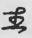
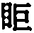
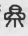
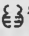
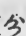
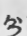
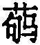
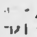

## 기미년 초가을 『소문』 교주 원고를 마치고 짓다(己未初秋素問校注稿成即賦)

비바람 치고 닭 울도록 책 한 권을 지키니, 애간장은 부서질 듯하고 벼루는 뚫어질 지경이네. 흰머리 되어 새 저작을 이루었다 하겠지만, 이 일을 어찌 옛 현인에게 양보하랴.(風雨雞鳴守一編，心肝欲碎硯将穿。若云白髮成新作，此事何能讓昔賢。)

의학에는 백가가 있어 학설이 천만 갈래인데, 영란(靈蘭)의 요지를 누가 정성껏 붙들고 있는가. 귀유구(鬼臾區)는 이미 떠나고 뇌공(雷公)도 죽었으니, 남은 편을 받들어 하늘의 황제께 묻고 싶구나.(醫有百家説萬千，靈蘭要旨孰拳拳。鬼臾已去雷公死，欲捧遺篇問帝天。)

아득하구나 기황(岐黃)이여, 큰 의원으로 우러르는데, 『소문』·『영추』의 여러 주석은 학설이 갈린다. 양상선(楊上善)과 왕빙(王冰)은 쉽사리 높낮이를 매길 수 없으니, 대롱 하나로 엿본 작은 소견은 그저 나 혼자 알 뿐이네.(邈矣岐黄仰大醫，素靈諸注説分歧。楊王未易輕軒輊，一管微窺祇自知。)

호씨(胡氏)의 교감과 손씨(孫氏)의 일문(逸文)을 감히 힘써 좇으며, 꿈속 넋은 향초(香草)를 두고 몇 번이나 생각을 감았던가. 장씨(張氏)에 들었다 마씨(馬氏)에서 나오니 누가 참으로 옳은가, 한스러운 것은 이를 한번 바로잡아 줄 사람이 없음이라.(胡校孫逸敢力追，夢魂香草幾縈思，入張出馬誰真是，所恨無人一正之。)

좋은 판본을 두루 찾아 붉은 먹과 연분(鉛粉)을 쥐고, 대조하며 교감하다 때로 묘한 풀이를 얻고 놀랐네. 만약 저승에 참으로 물어볼 수 있다면, 태복(太僕)도 기뻐하리라 여겨지네.(旁搜佳槧握丹鉛，參校時驚得妙詮。倘使九原真可問，料應太僕亦欣然。)

옛 가르침을 부지런히 구하여 의리(醫理)를 궁구하니, 중경(仲景)이 마음으로 전한 것은 고칠 수 없네. 하필 영 땅의 편지를 연나라 사람이 억지로 풀듯[郢書燕說] 되어, 까닭 없는 억지 풀이는 끝내 이름 붙이기 어렵구나.(勤求古訓窮醫理，仲景心傳未可更，偏是郢書成燕説，無端曲解總難名。)

돈황(燉煌) 몇 장으로 옛 주석을 바로잡고, 새로 얻은 것마다 남보다 먼저 채찍을 들었네. 곡원(曲園)은 적막하고 나는 쓸쓸하니, 그저 장주(長洲)를 바라보며 흘러간 물을 곡하네.(幾葉燉煌訂舊箋，每将新穫着先鞭。曲園寂寂吾寥落，惟望長洲哭逝川。)

팔리대(八里臺) 가에서 이공(李公)을 애도하니, 『내경』을 옛것에 비추어 살핀[內經稽古] 두 마음이 같았네. 아득하여 누가 그 속뜻을 알랴, 헐뜯음과 기림은 그저 한 번 웃음으로 비우리라.(八里臺邊悼李公，内經稽古兩心同。茫茫誰識其中意，毁譽聊将一笑空。)

덧붙임: 세상을 떠난 벗 이립(李笠) 군은 남개대학(南開大學)에서 가르쳤고 『소문』의 학문에 정통했는데, 이 원고를 군에게 보여 바로잡지 못한 것이 한스럽다.

곽애춘(郭靄春)이 배우는 마음으로 초하다[學草]

## 서례(序例)

『소문(素問)』은 『황제내경(黃帝內經)』의 일부로, 중국 의학의 가장 이른 고전 저작이다. 『소문』은 사람과 자연, 생명의 기원, 형(形)과 신(神)의 관계, 질병의 발생과 예방·치료 등 여러 방면에 걸쳐 소박한 유물론과 변증법으로 논술하였다. 이는 고대 의학의 이론적 기초를 놓았을 뿐 아니라, 그 이론의 정수는 역대 의가들을 줄곧 길러 왔고 그 과학적 가치는 역대 노동 인민이 길이 높이 받들어 왔으니, 중국 의학에서 가장 귀하고 빛나는 유산이다. 그 책이 이루어진 연대에 대해서는 근래 임응추(任應秋) 선생이 “전국시대에서 동한에 이르는 한 시기이다.(戰國至東漢一段時間)”라고 하였다. 나는 대체로 그의 설에 동의한다.

기원전 213년 진시황이 분서령을 반포했으나 의서는 불태우는 범위에 들지 않았다. 그래서 서한 초에도 『소문』의 학문은 여전히 전해지고 있었던 듯하다. 『사기(史記)』 「창공전(倉公傳)」에는 『소문』이라는 책 이름이 나오지 않지만, 창공이 공승양경(公乘陽慶)에게서 전수받은 의서를 보면 『소문』에 인용된 서명과 비슷한 것이 있다. 이 점만으로도 창공의 학문과 『소문』의 학문이 무관하지 않은 듯함을 증명하기에 충분하다. 이러한 흐름은 한 무제 때에 이르러 동중서(董仲舒)가 “백가를 물리친다[罷黜百家]”를 내세우게 된다. 이후 유가가 학관(學官)의 독존적 지위를 차지했고, 의가의 지위는 정치적으로 점점 낮아졌다. 백여 년이 지나 유향(劉向)이 궁중 비부[中秘]의 책을 교감할 때 시의(侍醫) 이주국(李柱國)이 방기(方技)를 함께 교감했는데, 『상경(上經)』·『하경(下經)』 같은 의서가 『칠략(七略)』에 실리지 않았을 뿐 아니라 『소문』이라는 이름도 기록이 없다. 주정량(周貞亮)이 잘 말하였다. “『내경』이라는 책은 『한지(漢志)』에 실린 것이 『황제내경』 18권으로, 『소문』이라는 이름은 전혀 없다. 후한 장기(張機)의 『상한론(傷寒論)』이 이를 인용하면서 처음 『소문』이라 일컬었다. 진(晉)나라 황보밀(皇甫謐)의 『갑을경(甲乙經)』 서문에서 ‘『침경』 9권과 『소문』 9권이 모두 『내경』이다’라고 하였으니, 『한지』의 18권이라는 수와 맞는다. 그러니 『소문』이라는 이름은 실로 한(漢)과 진(晉) 사이에 생겼고, 그래서 그 책이 『수지(隋志)』에 처음 저록되었다.(《內經》一書，載在《漢志》者，爲《黃帝內經》十八卷，並無《素問》之名。後漢張機《傷寒論》引之，始稱《素問》。晉·皇甫謐《甲乙經》序稱‘《鍼經》九卷，《素問》九卷，皆爲《內經》’。與《漢志》十八卷之數合。是《素問》之名，實起於漢晉之間，故其書《隋志》始著於錄。)”（주씨의 『퇴주잡문(退舟雜文)』 「복초북승서(復肖北承書)」 수고본에 보인다）

『소문』의 주해로는 왕빙(王冰)의 차주(次注)가 가장 오래된 본이라 할 수 있다. 그가 “정성껏 부지런히 널리 찾아다니며 열두 해를 보냈다.(精勤博訪，歷十二年)”는 이 독실한 정신은 길이 존경할 만하다. 왕빙이 『소문』을 정리한 방법은 그의 자서(自序)에 따르면 주로 세 가지이다. 첫째 옮기고 보충함[移補], 둘째 글자를 더함[加字], 셋째 번잡한 것을 깎음[刪繁]이다.

옮기고 보충한 예로는, 이를테면 「무자론(繆刺論)」의 “목구멍 속이 부어 침을 삼키지 못하고 때로 침을 뱉지도 못하는 경우는 연골(然骨) 앞을 찔러 피를 내면 곧 낫는데, 왼쪽은 오른쪽을 찌르고 오른쪽은 왼쪽을 찌른다.(嗌中腫，不能內唾，時不能出唾者，刺然骨之前，出血立已，左刺右，右刺左。)”가 있다. 이 스물여덟 자는 본래 착간(錯簡)으로 ‘사기가 수족 소음·태음과 족양명의 낙맥에 깃든 경우[邪客手足少陰太陰、足陽明之絡]’ 앞에 있던 것을 왕빙이 이곳으로 옮겼다.

글자를 더한 예로는, 이를테면 「음양응상대론(陰陽應象大論)」의 “양의 기는 천지의 질풍으로 이름한다.(阳之气以天地之疾风名之。)”가 있다. 왕주(王注)에 따르면 옛 본에는 “名之” 두 글자가 없었고, 이 두 글자는 왕빙이 앞의 같은 부류의 예를 찾아 더한 것이다.

번잡한 것을 깎은 예는 왕주를 두루 살펴보면 어렵지 않게 들 수 있다. 왕빙이 『소문』에 단 차주는 당 보응(寶應) 원년（기원 762년）에 책으로 이루어졌다. 내가 당대 옛 책 몇 가지가 인용한 『소문』을 왕빙의 차주본과 한번 맞대어 보면, 왕빙이 말한 “번잡한 것을 깎아 버렸다[削去繁雜]”는 말을 대강 알 수 있다. 깎인 내용을 보면 번잡한 것도 있지만, 번잡하지 않은데 깎여 나간 곳도 적지 않다.

장수절(張守節)의 『사기정의(史記正義)』는 기원 734년에 책으로 이루어져 왕주보다 28년 이르다. 『사기』 「편작전(扁鵲傳)」의 정의(正義)가 인용한 『소문』은 다음과 같다.

“얼굴빛이 푸르면 맥은 현급(弦急)하기 마련이다. 얼굴빛이 붉으면 맥은 부(浮)하고 단(短)하기 마련이다. 얼굴빛이 검으면 맥은 침부(沈浮)하고 활(滑)하기 마련이다.(面色靑，脈當弦急。面色赤，脈當浮而短。面色黑，脈當沈浮而滑。)”

“곡하기를 좋아하는 것은 폐병이고, 노래하기를 좋아하는 것은 비병이며, 헛소리하기를 좋아하는 것은 심병이고, 신음하기를 좋아하는 것은 신병이며, 부르짖기를 좋아하는 것은 간병이다.(好哭者肺病，好歌者脾病，好妄言者心病，好呻吟者腎病，好叫呼者肝病。)”

“따뜻한 것을 얻으려 하고 사람 보기를 싫어하는 것은 장(藏)의 병이고, 찬 것을 얻으려 하고 사람을 보려 하는 것은 부(府)의 병이다.(欲得溫而不欲見人者，藏家病；欲得寒而見人者，府家病也。)”

“연연락(延緣落)은 낙맥이다.(延緣落，絡脈也。)”

“양맥은 아래로 떨어져 돌아오기 어렵고, 음맥은 위로 다투어 활시위 같다.(陽脈下遂難反，陰脈上爭如弦。)”

“유(紐)는 붉은 맥이다.(紐，赤脈也。)”

“지(支)는 마디를 따르고, 난(蘭)은 마디를 가로지른다.(支者順節，蘭者橫節。)”

「창공전(倉公傳)」의 정의가 인용한 『소문』은 다음과 같다.

“병을 근(筋)에서 얻은 것은 간의 조화이다.(得病於筋，肝之和也。)”

“맥에는 미치지 못함이 있고 지나침이 있으며, 경(經)이 있고 낙(絡)이 있으니, 고르면[和] 경이 병을 주관하고, 크면 낙에 탈이 있다.(脈有不及有太過，有經有絡，和即經主病，大則絡有過。)”

“혈과 기가 자리를 바꾼 것을 불평(不平)이라 한다. 맥의 징후가 움직여 일정하지 않은 것을 대(代)라 한다.(血氣易處曰不平。脈候動不定曰代。)”

“젖 아래의 양명(陽明)은 위(胃)의 낙맥이다.(乳下陽明，胃絡也。)”

“질병이 오장에서 생기니, 오장의 합(合)은 육부에 합한다. 간은 담에 기를 합하고, 심은 소장에 기를 합하며, 비는 위에 기를 합하고, 폐는 대장에 기를 합하며, 신은 방광에 기를 합하고, 삼초는 안으로 노(勞)를 주관한다.(疾病之生於五藏，五藏之合，合於六府，肝合氣於膽，心合氣於小腸，脾合氣於胃，肺合氣於大腸，腎合氣於膀胱，三焦內主勞。)”

“맥에 있어 □은 소음(少陰)이라 하고, 소음의 앞은 궐음(厥陰)이라 하며, 오른쪽 맥 □은 태음(太陰)이라 하니, 이것이 삼음의 맥이다.(在脈□曰少陰，少陰之前名厥陰，右脈□曰太陰，此三陰之脈。)”[역1][역2]

“기경(奇經)의 맥이 오가며 느슨하다가 때로 한 번 멈추고 다시 오는 것을 결(結)이라 한다.(奇經之脈往來舒，時一止而復來，名之曰結。)”

“병이 심에 있으면 여름에 낫고 겨울에 심해진다. 병이 비에 있으면 가을에 낫고 봄에 심해진다. 병이 폐에 있으면 겨울에 낫고 여름에 심해진다. 병이 신에 있으면 봄에 낫고 여름에 심해진다. 병이 간에 있으면 여름에 낫고 가을에 심해진다.(病在心，愈在夏，甚於冬。病在脾，愈在秋，甚於春。病在肺，愈在冬，甚於夏。病在腎，愈在春，甚於夏。病在肝，愈在夏，甚於秋。)”

이상 『사기정의』가 인용한 15조 가운데 “병이 심에 있으면[病在心]” 한 조만 지금의 「장기법시론(藏氣法時論)」에 보이고, 나머지 14조는 모두 깎여 나갔다.

『후한서(後漢書)』 이현(李賢)의 주는 기원 677년 무렵 책으로 이루어져 왕주보다 85년 이르다. 「진충전(陳忠傳)」의 이현 주가 인용한 『소문』은 다음과 같다.

“침 끝은 까끄라기 같고, 기가 나오는 것은 광주리 같다.(鍼頭如芒，氣出如筐也。)”

이상 이현 주가 인용한 두 구절은 지금의 『소문』에는 없다.

『외대비요(外臺秘要)』는 기원 752년에 책으로 이루어져 왕주보다 10년 이르다. 그 책 권15 「은진풍진(癮疹風疹)」이 인용한 『소문』은 다음과 같다.

“풍사(風邪)가 기육 속에 깃들어 기육이 허하면 진기(眞氣)가 흩어지고, 다시 한기가 피부를 치면 주리(腠理)로 밖으로 드러나 음기(淫氣)가 돌아다니므로 가렵다. 그러므로 은진(癮疹)과 소질(騷疾)은 모두 여기서 말미암는다. 붉은 발진이 갑자기 일어나 모기·파리매에 물린 것 같고 답답하게 가려우며, 겹겹이 두둑하게 솟아 긁으면 손을 따라 일어나는 것이 있다.(風邪客於肌中，肌虛，眞氣致散，又被寒搏皮膚，外發腠理、淫氣行之則癢也。所以癮疹騷疾，皆由於此。有赤疹忽起，如蚊蚋啄、煩癢，重沓壟起，搔之遂手起也。)”

권24 「옹저(癰疽)」가 인용한 『소문』은 다음과 같다.

“찬바람이 경락에 깃들면 혈이 엉기고 깔깔하여 흐르지 못하고, 막히고 맺혀 옹저(癰疽)가 된다. 열이 일어남은 말하지 않았다. 그 뒤 옹이 되는 것은 또 양기가 모여들어 한(寒)이 열(熱)로 바뀌고, 열이 성하면 살이 썩어 고름이 되는 것이다.(寒風客於經絡，血凝澀澀不行，雍結爲癰疽也。不言熱之作也。其後成癰，又陽氣湊集，寒化爲熱，熱盛則肉腐爲膿也。)”

이상 『외대』가 인용한 두 대목도 지금의 『소문』에서는 두루 찾아도 얻을 수 없다. 앞의 세 책의 인용문으로 보아, 왕빙이 『소문』을 매우 크게 깎아 냈음을 분명히 알 수 있다.

그뿐 아니라 왕주는 『소문』의 어떤 곳에서 원래 글의 차례를 흐트러뜨리기도 했다. 우선 한 예를 들면, 『예문유취(藝文類聚)』는 기원 642년에 책으로 이루어져 왕주보다 120년 이르다. 『유취』 권1 「천부(天部)」는 『소문』을 인용하여 “양이 쌓여 하늘이 되니, 그러므로 하늘은 맑은 양이다.(积阳为天，故天者清阳也。)”라 하였고, 권6 「지부(地部)」는 『소문』을 인용하여 “음이 쌓여 땅이 되니, 그러므로 땅은 탁한 음이다.(积阴为地，故地者浊阴也。)”라 하였다. 위에 든 두 대목은 『북당서초(北堂書鈔)』 권149 「천부」와 권157 「지리부(地理部)」가 인용한 것도 『유취』와 같다. 그런데 지금의 「음양응상대론」 편에서는 앞의 구식(句式)을 나누어 고쳐 “그러므로 양이 쌓여 하늘이 되고, 음이 쌓여 땅이 된다.(故积阳为天，积阴为地。)”와 “그러므로 맑은 양은 하늘이 되고, 탁한 음은 땅이 된다.(故清阳为天，浊阴为地。)”로 만들었다. 이는 『유취』·『서초』가 인용한 것과 다르다. 이 작은 자료로 보아 왕주본은 어떤 곳에서 『소문』의 원래 글을 다시 편집했을 수 있으나, 그 변동의 전모는 이제 확인할 길이 없다.

왕주 이전의 『소문』 원문은 왕주 이후와 견주어 어떤 것은 깎여 나가고 어떤 것은 문구 꼴이 바뀌었음을 어렵지 않게 알 수 있다. 그리하여 『소문』의 내용이 약해졌다. 왕주 『소문』의 공은 역대 의가들이 모두 꽤 높이 평가했으나, 어떤 추앙은 겉핥기 논의일 뿐이다. 청나라 막희(莫熺)는 “왕태복(王太僕)의 주는 경문에 따라 주해하여 이치가 조화의 기틀에 들어가고, 깊은 이치를 밝혀 성경(聖經)을 보좌하였다.(王太僕注，依經注解、理入化機，發明奧理、羽翼聖經。)”라고 하였다（『의문약리(醫門約理)』에 보인다）. 이처럼 막연한 말은 왕주의 공과가 어디에 있는지 분명히 말하지 못한다. 나는 왕주가 중국 의학의 이론을 실로 적지 않게 발휘했고, 『소문』의 해석에서도 실로 “글자가 환히 밝고 뜻과 이치가 두루 돌아, 한결같이 자세히 살피니 뭇 의심이 얼음 녹듯 풀렸다.(文字昭晰，義理環周，一以參詳，群疑冰釋)”는 구실을 했다고 본다. 그러나 다른 한편 그의 차주 정리를 거치면서 『소문』의 내용이 얼마간 줄어든 것은 아쉬움이 없지 않다.

왕빙은 “더한 글자는 모두 그 글을 붉은 글씨로 써서, 지금과 옛것이 반드시 갈리고 글자가 섞이지 않게 하였다.(凡所加字，皆朱書其文，使今古必分，字不雜揉。)”라고 하였다（살펴보건대[按] 왕빙의 붉은 글씨는 더한 글자 한 가지에만 그치지 않고 착간 등도 붉은 글씨로 썼다. 「육절장상론(六節藏象論)」 왕주에 보인다）. 만일 지금도 붉은 글씨와 검은 글씨가 갈린 본이 전한다면 문제는 크지 않을 것이다. 아쉬운 것은 이런 붉은 글씨·검은 글씨 본이 전하지 않을 뿐 아니라, 후인들이 왕주의 “붉은 글씨[朱書]” 예를 이용해 왕주 속에 붉은 글씨로 거짓 말을 써넣어 그 속에 뒤섞어 놓았다는 것이다（「자요통편(刺腰痛篇)」 임교(林億 校正)어(林校語)에 보인다）. 옥 같은 돌이 옥을 어지럽히니[珷玞亂玉], 분석하여 가려내기가 참으로 몹시 어렵다. 북송 때 『소문』을 앞뒤로 네 차례 교정해 간행했으니, 천성(天聖) 4년（기원 1026년）, 경우(景祐) 2년（기원 1035년）, 가우(嘉祐) 2년（기원 1057년）, 정화(政和) 8년（기원 1118년）이다（『옥해(玉海)』 권63에 보인다）. 이 네 차례 정리 가운데 가우 때의 정리 기록인 『신교정(新校正)』만 지금까지 전하고, 나머지 세 차례의 정리 의견은 한마디 반 글자의 자료조차 찾기 어렵다. 문헌이 넉넉하지 않으니 『소문』을 탐구하는 데 어려움을 더할 것이다.

『소문』이라는 책은 예로부터 읽기 어렵고 이해하기 어렵다고 여겨졌다.

읽기 어려운 까닭은 주로 『소문』이 전해진 연대가 오래되어 거듭 베끼고 새기는 동안 연문(衍文)·오자·탈자·도치의 잘못이 많이 생겨 『소문』을 읽는 데 어려움을 더했기 때문이다. 왕빙은 “삼분(三墳)의 책은 세상에서 오래 묻혀 펼쳐 익히는 사람이 적고, 글자는 옮겨 쓰면서 틀린 것이 많다.(三墳之書，俗久淪墜，人少披習，字多傳寫誤。)”라고 하였다（「경맥별론(經脈別論)」 주에 보인다）. 왕빙도 일찍이 이 문제를 느꼈음을 알 수 있다. 다만 그는 차주에서 교정한 것이 적었고, 송대 임억(林億) 등의 『신교정』에도 빠뜨린 곳이 매우 많다. 청대 전씨(錢氏) 수산각(守山閣)에서 『소문』을 교감해 새겼을 때 고관광(顧觀光)이 『교기(校記)』를 지었는데, 일반적으로 정밀하고 자세하다고 일컫는다. 그러나 『소문』의 탈자·오자 문제는 여전히 빠뜨린 것이 매우 많다. 이 책은 이 문제를 풀기 위해 “거친 것을 버리고 정밀한 것을 취하며, 거짓을 버리고 참을 남기며, 이것에서 저것으로, 겉에서 속으로(去粗取精，去僞存眞，由此及彼，由表及裏)”를 지도 사상으로 삼아, 교감에서 다음 네 가지부터 손을 대었다.

**1. 여러 판본으로 대교(對校)한다**

“책은 교감하지 않으면 읽을 수 없다(書非校不可讀)”는 것은 선본(善本)으로 교감한 책이라야 풀기 어렵거나 잘못 풀리는 곤란을 줄일 수 있다는 말이다. 이를테면 「금궤진언론(金匱眞言論)」의 “오장이 사시에 응하여 각기 거두어 받는 것이 있는가.(五藏应四时，各有收受乎。)”에서 “收受” 두 글자는 뜻을 찾기가 매우 어려워 옛 주석이 모두 억지스러웠다. 만력(萬曆) 43년 조선 각본으로 교감해 보니 “收”는 “攸”의 오자로, “收”와 “攸”는 모양이 비슷해 잘못된 것[形誤]이었다. “攸”에는 “所”의 뜻이 있어 “各有攸受”는 곧 “各有所受”(각기 받는 바가 있다)이다. 이렇게 하면 말뜻이 분명하고 알기 쉬워진다. 또 이를테면 「복중론(腹中論)」 왕주의 “방초(芳草)는 짙고 아름답다.(芳草，浓美也。)”에서 “浓美”가 어떻게 사람을 미치게 하는가? 이 또한 이해하기 어렵다. 가교본(柯校本)으로 대교해 보고서야 “浓美”는 “农果”로 써야 함을 알았다. “农果”는 일명 “방규(防葵)”이다. 앞 글의 석약(石藥)인 “英乳”와 여기 방초인 “农果”는 모두 약 이름이다. 『본초강목(本草綱目)』 권17 「초부(草部)」가 『소품방(小品方)』을 인용하여 “방규를 많이 먹으면 사람이 미혹되고 황홀하여 미친 것 같다.(防葵多服，令人迷惑恍惚如狂。)”라 하였다. 이것으로 “방초가 미치게 한다[芳草發狂]”에 대한 왕주의 풀이가 얼마나 정확한지 증명되고, “浓美” 두 글자의 잘못도 분명해졌다.

**2. 왕주(王注)·양주(楊注)와 당송의 여러 의서로 참교(參校)한다**

교감에 선본을 이용하는 것은 한 방면일 뿐이다. 임억은 “여러 본을 모아 그 잘못을 바로잡았으나 열에 서넛을 얻었을 뿐 나머지는 다 갖추지 못하였다.(裒集眾本，正其訛舛，十得其三四，餘不能具。)”라고 하였다（임억의 『소문』 「서(序)」에 보인다）. 이는 교감에 선본에만 기대서는 잘못을 충분히 풀 수 없다는 말이다. 이를테면 「상고천진론(上古天眞論)」의 “그런데도 동작이 쇠하지 않는 것은 그 덕이 온전하여 위태롭지 않기 때문이다.(而动作不衰者，以其德全不危也。)”는 글뜻을 자세히 풀어 보면 “危” 아래에 빠진 글자가 있을 것이다. 여러 판본을 교감해도 빠짐이 없으나, 「소오과론(疏五過論)」 왕주가 이 구절을 인용한 것을 살펴보면 “危” 아래에 “故” 자가 있다. “以其德全不危故也”로 읽으면 말뜻이 환히 드러난다. 또 이를테면 「삼부구후론(三部九候論)」의 “나는 선생에게서 구침(九鍼)을 들었다.(余闻九针于夫子。)”에서 “针”은 틀린 글자이다. 이 편은 맥만 논하는데 구침이 웬 말인가? 『태평성혜방(太平聖惠方)』 권1 「변구후(辨九候)」를 살펴보면 인용한 “九针”이 “九候”로 되어 있어 글뜻이 맞아떨어진다. 그러므로 선본에만 기대서는 풀리지 않는 문제가 있다. 이 때문에 『난경(難經)』·『맥경(脈經)』·『태소(太素)』·『갑을(甲乙)』과 그 밖의 당송 의서를 두루 교감하여, 『소문』을 인용한 곳은 모두 하나하나 서로 교감하였으니, 잘못을 바로잡은 것이 매우 많다.

**3. 유서(類書)와 옛 책의 주로 핵교(核校)한다**

유서와 옛 책의 주를 옛 책 교정 자료로 쓰는 것은 학문하는 데 흔히 쓰는 방법이며, 마찬가지로 이것으로 옛 의서를 교정하는 것도 아주 알맞다. 이를테면 「생기통천론(生氣通天論)」의 “위로 거슬러 기침한다.(上逆而咳。)”를 『유설(類說)』 권37은 인용하면서 “上”을 “冬”으로 썼다. “上”과 “冬” 가운데 어느 글자가 더 합당한가? 여러 판본을 살펴보면 모두 “上”으로 되어 있으나, 『영추』 「논질진척편(論疾診尺篇)」과 「음양응상대론」에 모두 “가을에 습에 상하면 겨울에 해수가 생긴다(秋伤于湿，冬生咳嗽)”는 글이 있는 것에 견주어 보면 “冬”으로 쓴 것이 옳다. 다시 의리(醫理)로 말하면, 늦여름[季夏]에 흙이 축축하여 습기가 안으로 비(脾)에 웅크리고, 오래 묵어 담(痰)이 되며, 담이 폐를 엄습하면 기분(氣分)이 막히고 치절(治節)이 힘을 잃는다. 그러다가 겨울이 와서 풍한에 조금만 감촉되어도 잠복한 습사가 기를 따라 거슬러 마침내 해수병이 된다. 이로 보아도 “冬”으로 쓰는 것이 더 맞다. 또 이를테면 「옥기진장론(玉機眞藏論)」의 “폐비(肺痹)를 치료하지 않으면 폐가 곧 전하여 간으로 간다.(肺痹，弗治，肺即传而行之肝。)”라는 말에는 연문이 있다. 아래 글과 한결같지 않기 때문이니, 간비(肝痹)를 치료하지 않으면 간이 비로 전하고, 비풍(脾風)을 치료하지 않으면 비가 신으로 전하며, 산가(疝瘕)를 치료하지 않으면 신이 심으로 전한다. 어째서 “肺痹”에만 “即而行” 세 글자가 더 있는가? 『영락대전(永樂大典)』 권13877은 인용하면서 “肺即传而行之肝”을 “肺传之肝”으로 써서 “肝传之脾” 등의 구식과 한결같으니, 앞에서 가정한 연문이 확정된다. 또 이를테면 「이합진사론(離合眞邪論)」의 “사기가 홀로 안에 붙는다(邪独内著)”를 『문선(文選)』 「칠발(七發)」 선주(善注)는 인용하면서 “独”을 “气”로 썼다. 나는 “气”로 쓴 것이 옳다고 본다. 위에서 “진기를 이미 잃었다(真气已失)”라 하고 아래에서 “사기가 안에 붙는다(邪气内著)”라 하여 진기와 사기가 바로 대구를 이루기 때문이다.

**4. 문자 유례(類例)와 소리·모양·자체로 교감한다**

“지금 전해 새긴 책을 쥐고 옛사람의 참된 본으로 여기는 것은, 마치 남이 죽순을 먹을 수 있다는 말을 듣고 돌아가 대자리를 삶는 것과 같으니, 이것이 옛 책의 의문이 날로 불어나는 까닭이다.(執今日傳刻之書，而以爲古人之眞本，譬猶聞人言筍可食，歸而煮其簀也，此古書疑義所以日滋。)”（『고서의의거례(古書疑義擧例)』 「서」에 보인다） 그러므로 옛 책을 교감할 때는 앞의 여러 방법 말고도 문자를 견주고 소리와 모양을 가려 바로잡으면 잘못을 보충하고 고칠 수 있다. 이를테면 「상고천진론」의 “칠팔(七八)에 간기가 쇠하여 근이 움직일 수 없고, 천계(天癸)가 마르며, 정이 적어지고, 신장(腎藏)이 쇠하여 형체가 모두 다한다.(七八，肝气衰，筋不能动，天癸竭，精少，肾藏衰，形体皆极。)”는 이대로라면 칠팔에 이미 “형체가 모두 다한[形體皆極]” 셈인데, 팔팔에 이르러 겨우 “이와 머리털이 빠진다[齒髮去]”라 하니 어떻게 말이 되겠는가. 사팔(四八) 글 아래의 왕주 “남자의 천계는 팔팔에 끝난다.(丈夫天癸，八八而终。)”를 살펴보면, 왕빙은 “天癸竭”이 “八八”에 속해야지 “七八”에 속해서는 안 된다고 본 것이다. 그러므로 이 대목은 “七八，肝气衰，筋不能动。八八，天癸竭，精少，肾藏衰，则齿发去，形体皆极。”로 써야 한다. 이렇게 하면 여자의 “六七”·“七七” 글의 예와 앞뒤가 한결같아진다. 또 이를테면 「음양류론(陰陽類論)」의 “양기가 음을 그치게 하지 못한다.(阳气不能止阴。)”에서 “止阴” 두 글자는 풀기 어렵다. “止”는 틀린 글자로 “制”로 써야 하니, “止”와 “制”는 소리가 비슷해 잘못된 것[聲誤]이다. 왕주의 “양기가 심을 제어하지 못한다.(阳气不能制心。)”는 “制”로 쓴 것은 옳으나 “心”은 틀린 글자이니, “心”과 “阴” 또한 소리로 잘못된 것이다. 또 이를테면 「저지교론(著至教論)」의 “이는 세주(世主)의 학문이 다한 것이다.(是世主学尽矣。)”라는 말은 매우 분명하지 않다. 세주의 학문이 의학과 무슨 상관인가. 사실 “主”는 오자로 “至”로 써야 한다. 초서에서 “主”와 “至”는 다른 글자를 같게 써서 모두 “” 꼴로 쓰므로 쉽게 섞여 잘못된다. “至学”은 “至道”와 뜻이 같으니, 이렇게 하면 편의 뜻과 맞는다. 또 이를테면 「오장생성편(五藏生成篇)」의 “흑맥이 이르는 것은 위가 단단하고 크다.(黑脉之至也，上坚而大。)”를 두고 왕앙(汪昂)은 “‘上’ 자는 풀리지 않는다.(上字未解。)”라고 하였다. 왕앙이 풀리지 않는다고 본 것은, 병이 신(腎)에 있고 적기(積氣)가 아랫배와 음부에 있으니 맥으로 말하면 “下”에 있어야 하므로 “上” 자는 말이 통하지 않는다는 것이다. 실제로는 “上” 자가 옮겨 베끼다 잘못된 것이다. 청대 왕인지(王引之)는 옛 책의 모양 잘못[形僞] 문제를 총괄하면서 전서체 모양이 비슷해 잘못된 항목을 두었다. 이 구절이 바로 그 예이니, 전서에서 “上”은 “二”로 쓰고 “下”는 “二”로 써서 두 글자가 매우 섞이기 쉽다. “下坚”을 “上坚”으로 잘못 썼으므로 풀리지 않았던 것이다.

**[역1]** 원서대로 옮겼다. 뒤 「右脉□曰太阴」과 짝으로 보면 「在脉」은 「左脉」의 잘못일 수 있다.

**[역2]** 원서 「在脉□曰少阴」의 「在」는 뒤 「右脉」과 짝을 이루므로 「左」의 잘못일 수 있다.

이해하기 어려운 까닭은 주로 옛 주석이 훈고(訓詁) 면에서 충분히 공을 들이지 않았기 때문이다. 진례(陳澧)는 “시대에 옛날과 지금이 있는 것은 땅에 동서남북이 있는 것과 같아서, 서로 멀리 떨어지면 말이 통하지 않는다. 땅이 멀면 번역이 있고 시대가 멀면 훈고가 있으니, 번역이 있으면 다른 나라를 이웃 마을처럼 만들 수 있고, 훈고가 있으면 옛날과 지금을 아침과 저녁처럼 가깝게 만들 수 있다.(時有古今，猶地有東西南北，相隔遠則言語不通矣。地遠則有翻譯，時遠則有訓詁，有翻譯則能使別國如鄉鄰，有訓詁則能使古今如旦暮。)”라고 하였다（『동숙독서기(東塾讀書記)』 권11에 보인다）. 『소문(素問)』은 선진(先秦) 무렵의 책이라 문자가 비교적 예스럽고 깊은데, 어떤 해석은 옛말의 규칙을 벗어났기 때문에 이해하기 어렵게 느껴진다. 예를 하나 들어 보자. 「생기통천론(生氣通天論)」에 “기립여고(氣立如故)”라는 구절이 있다. 옛 주석 가운데 어떤 것은 “사기(邪氣)가 이기지 못하므로 진기(眞氣)가 홀로 서서 평상시와 같다.(邪氣不克，故眞氣獨立而如常)”라고 하였고, 또 어떤 것은 “사람은 천지의 기를 받아 명(命)을 세우므로 기립(氣立)이라고 한다.(人受天地之氣以立命，故曰氣立)”라고 하였다. 경문은 기를 말하고 있는데 주석은 오히려 명을 끌어왔으니, “입명(立命)”은 유가의 사상인데 의학과 무슨 관계가 있는가. 다른 한편으로 이는 주석가가 “立”의 일반 훈(訓)인 「서다」라는 풀이만 알았지, “立”의 반훈(反訓)으로 「가다[行]」라고 풀어야 한다는 것은 몰랐음을 보여 준다. 그래서 설명하다 보니 견강부회를 면하지 못했다. 반훈이란 무엇인가? “‘가다[徂]’로 ‘있다[存]’를 뜻하고, ‘어지럽다[亂]’로 ‘다스리다[治]’를 뜻하며, ‘옛[故]’으로 ‘지금[今]’을 뜻한다.(以徂爲存，以亂爲治，以故爲今也)”와 같은 것이다（『이아(爾雅)』 「석고(釋詁)」 곽주(郭注)에 보인다）. “氣立如故”는 곧 기의 운행이 평상시와 같다는 말이다. 이는 윗글의 “기혈이 모두 순조롭다[氣血皆從]”와 호응한다. “독립(獨立)”이니 “입명(立命)”이니 하는 것은 모두 뿌리 없는 빈말일 뿐이다.

인용한 훈고 관련 서적으로는 『이아』·『설문(說文)』·『방언(方言)』·『석명(釋名)』·『광아(廣雅)』, 혜림(慧琳)의 『일체경음의(一切經音義)』 및 선진 제자서(諸子書)의 옛 주석을 채택하였다. 글자의 음을 풀기도 하고, 글자의 뜻을 훈고하기도 하며, 지금 글자로 옛 글자를 풀기도 하고, 여러 글자로 한 글자에 담긴 뜻을 설명하기도 하였는데, 말에는 반드시 근거를 두되 번쇄함은 피하였다.

어역(語譯)의 번역 방법은 원문에 충실한 것을 위주로 하여, 교감과 주석 두 방면을 아울러 경문을 알기 쉬운 말로 직역하였으며, 이른바 무언가를 밝혀 펼친다는 식의 덧붙임은 섞지 않았다. “나는 오히려 이론서는 딱딱하게라도 직역하는 쪽에 찬성한다. 정확하다는 장점이 있기 때문이다.”

이 책을 엮으면서 상당히 애를 썼지만, 『소문』을 읽기 어렵고 이해하기 어려운 문제를 얼마나 풀었는지는 장담할 수 없다. 더구나 개인의 학식이 얕은 탓에 내용에 틀림없이 잘못되고 모자란 곳이 많을 것이다. 의학계의 선배들과 여러 독자 동지들께서 비판하고 바로잡아 주시기를 진심으로 바란다. 한마디 말을 내려 주시더라도 모두 나의 스승이다[片言之錫，皆爲吾師]. 이것이 나의 진심이며, 삼가 여기서 간절히 기다린다.

**곽애춘(郭靄春)**

1964년 6월 초고

1979년 3월 천진중의학원(天津中醫學院)에서 원고를 확정함

## 정보간언(訂補簡言)

『황제내경소문 교주어역(黃帝內經素問校注語譯)』이 간행된 뒤 많은 독자에게서 성원을 받아 감동하고 힘이 났다. 그동안 받은 편지는 격려든 비판이든 남이 잘되기를 바라는 그 태도가 더없이 고마웠다.

이 책은 1981년 출판된 이래 지금까지 15년이 되었다. 여러 차례 되풀이해 검토하고 독자들의 의견도 참고하여 적지 않은 잘못을 찾아냈으니, 참으로 독자들의 두터운 기대를 저버린 셈이다. 이제 천진과학기술출판사(天津科學技術出版社)와 협의하여 수정 재판을 허락받아 실제 필요에 부응할 수 있게 되었다. 그래서 이 책의 오자·탈자·중복·도치, 그리고 규범에 맞지 않는 표점과 번체·간체 자형이 뒤섞인 곳을 더 자세히 살펴 곳곳을 바로잡았으니, 흠집을 남김없이 없애 읽기에 도움이 되도록 힘썼다.

교감문 여덟 조를 새로 더하였다. 그중 『상한론(傷寒論)』 성주(成注)가 인용한 『내경(內經)』에 근거한 교감문에서, 현존본（각 선본을 포함한다）『소문』의 「사기조신대론(四氣調神大論)」과 「음양응상대론(陰陽應象大論)」 두 편에 각각 빠진 구절이 있음을 발견하였다. 이는 지금까지 학자들이 알아차린 적이 없던 것으로, 이제 성씨(成氏)의 인용문에 근거하여 교감해 냈다. 그 의의는 의리(醫理)와 판본학 문제에 걸쳐 있어 깊이 생각해 볼 거리를 던져 줄 것이다.

또 독자가 이 책을 찾아 쓰기 편하도록, 수정할 때 이병덕(李炳德) 군의 도움을 받아 『소문』 전체의 자구를 가려 뽑아 색인을 새로 엮었는데, 모두 17052조이다. 이 모든 것은 이 책을 읽고 이해하기 쉬우면서도 연구에 참고로 쓸 수 있는 좋은 책으로 만들고자 한 것이다.

이번 수정·보완 작업에 나름대로 공을 들였지만 역량에 한계가 있어 여전히 잘못이 숨어 있을 것이다. 독자들께서 언제든 아낌없이 바로잡아 주시면 다행이겠다.

**곽애춘(郭靄春)**

1995년 12월 천진중의학원(天津中醫學院)에서

## 이 책 교감에 쓴 선본 목록(本書校文所用善本簡目)

이 책의 교감문은 인민위생출판사(人民衛生出版社)가 영인한 고종덕본(顧從德本)을 底本으로 삼고, 다른 판본으로 참교(參校)하였다. 각 판본을 아래에 나열한다.

金刻本存卷三、卷五、卷十一至十八、卷二十 简称金本

元至元五年胡氏古林书堂刻本简称胡本

元读书堂刻本简称读本

元刻残本存卷四、卷五、卷六、半页十三行、行廿三字，简称元残一 北京中医研究院藏

元刻残本存卷九、卷十、卷十一、卷十二 简称元残二 北京中医研究院藏

明绣谷书林周曰校刻本简称周本

明嘉靖间金谿吴悌校刊本简称吴本

明嘉靖间赵简王朱厚煜居敬堂刊本简称赵本

涵芬楼影印明正统道藏书简称藏本

明成化十年熊氏种德堂刻本简称熊本

明万历四十三年朝鲜内医院刻本简称朝本

明万历壬子闽建乔木山房刻本《读素问抄》简称滑抄本

明绿格抄本半页八行、行十七字 北京中医研究院藏 简称明抄本

明抄本半页十行、行廿二字 南京图书馆藏 简称明抄二

四库全书本商务印书馆影印 简称四库本

守山阁刊本中国学会影印 简称守校本

清莫友芝校本简称莫校本

清柯逢时校本简称柯校本

明万历十四年天宝堂刻印马莳注本

明万历二十二年甲午刻印吴崑注本

金阊童涌泉刊本张介宾《类经》人民卫生出版社影印

清康熙九年刻印张志聪注本

아울러 다음과 같이 밝혀 둔다.

1. 여러 판본을 서로 교감하여 차이가 있으면 “어떤 판본에는 어떤 글자가 무엇으로 되어 있다[某本某字作某]”라고만 하였다. 각 판본의 오자에 대해서는 “어떤 판본에는 어떤 글자가 무엇으로 잘못되어 있다[某本某字误作某]”라고 하지 않아 번거로운 글을 줄였다.

2. 본문에 탈자·오자·도치·연문이 있더라도 함부로 고치지 않고 교감문 안에서만 설명하였다.

3. 통용자(通用字)와 고금자(古今字)는 자구가 서로 뒤섞일 때만 교감해 내고, 일일이 다 교감하지 않는 것을 원칙으로 하였다.

4. 교감문과 주석문은 모두 각주 번호를 써서 구절 아래에 표시하고, 본문 각 단락 뒤에 나누어 차례대로 배열하였다. 교감 번호는 〔〕로 표시하고, 주석 번호는 ○로 표시하였다.

5. 교감과 주석에서는 서술을 자연스럽고 편하게 하려고 “아무개가 말하였다[某某人说]”는 꼴을 주로 쓰고, “어떤 책에서 말하였다[某某书曰]”는 꼴은 적게 썼다. 인명과 서명은 한쪽만 인용하였다. 어느 책에서 나왔는지 밝힌 것은 따로 저자를 표시하지 않았고, 아무개가 말한 방식으로 나온 것은 그 글이 어느 책에서 나왔는지를 다시 밝히지 않았다. 확인하려면 이 책에 실은 교감·주석 인용서 목록에서 대조해 볼 수 있다.

## 이 책 교감에 인용한 서적 목록(本書校文引各書簡目)

（원대 이후의 의서와 주석에서 인용한 서목은 싣지 않는다）

《灵枢经》 四部丛刊影印赵府居敬堂刊本

《黄帝内经太素》 人民卫生出版社排印本 简称《太素》

《难经集注》 四部丛刊影印佚存丛书本

《脉经》 四部丛刊影印元广勤书堂刊本

敦煌无名氏《脉经》残叶 北京图书馆缩微胶卷

《甲乙经》 人民卫生出版社刘衡如校本 简称《甲乙》

《鬼遗方》 人民卫生出版社影印本

《中藏经》 商务印书馆丛书集成本

《诸病源候论》 人民卫生出版社影印本 简称《病源》

《备急千金要方》 人民卫生出版社影印本 简称《千金》

《千金翼方》 人民卫生出版社影印本

《外台秘要》 人民卫生出版社影印本 简称《外台》

《太平圣惠方》 人民卫生出版社排印本

《铜人针灸腧穴图经》 人民卫生出版社影印本 简称《图经》

《医心方》 人民卫生出版社影印本

《伤寒总病论》 商务印书馆排印本

《校证活人书》 丛书集成本

《伤寒补亡论》 梁园豫医双璧本

《伤寒百证歌》 丛书集成本

《伤寒九十论》 丛书集成本

《伤寒微旨论》 丛书集成本

《医经正本书》 丛书集成本

《医说》 嘉靖二十三年甲辰上海顾定芳刻本

《三因极一病证方论》 商务印书馆排印本 简称《三因方》

魏了翁《学医随笔》 丛书集成本

《史载之方》 十万卷楼丛书本

《全生指迷方》 商务印书馆排印本

《鸡峰普济方》 汪氏影刻本

《类编朱氏经验医方》 故宫博物院影印宛委别藏本

《博济方》 商务印书馆排印本

《济生方》 人民卫生出版社排印本

《素问入式运气论奥》 道藏本

《察病指南》 上海卫生出版社排印本

《普济本事方》 日本享保二十年向井八三郎刻本

《本草衍义》 丛书集成本

《政和经史证类备急本草》 人民卫生出版社影印本

成无己《注解伤寒论》 四部丛刊影印明嘉靖汪济明刊本

《伤寒明理论》 商务印书馆排印本

《圣济经》 丛书集成本

《圣济总录》 日本文化癸酉重印元大德刊本

《针灸资生经》 上海科学技术出版社排印本

《素问玄机原病式》 人民卫生出版社刊印本

《素问病机气宜保命集》 宣德六年辛亥怀德堂刻本

《儒门事亲》 嘉靖辛丑刻本

《兰室秘藏》 明敦化堂东垣十书本

《济生拔萃》 上海涵芬楼影元刻本

《医垒元戎》 嘉靖二十二年刊本

《卫生宝鉴》 永乐五年丁酉吴郡韩氏刻本

《针经指南》 日人旧抄本

《五行大义》 知不足斋丛书本

《初学记》 中华书局点校本

《艺文类聚》 中华书局影印本

《北堂书钞》 通行本

《太平御览》 嘉庆二十三年鲍崇城刻本

《类说》 文学古籍出版社影印天启刊本

《云笈七签》 四部丛刊影印本

《永乐大典》残本 中华书局影印本

《天中记》 万历乙未刊本

참고서:

《黄帝内经素问译释》 南京中医学院编

《黄帝内经素问白话解》 山东省中医研究所编

## 황제내경소문 서(黃帝內經素問序)

왕빙(王冰) 지음

> 夫释缚脱艰〔一〕，全真导气，拯黎元于仁寿，济羸劣以获安者，非三圣道则不能致之矣。孔安国序《尚书》曰：伏羲、神农、黄帝之书，谓之三坟，言大道也。班固《汉书·艺文志》曰：《黄帝内经》十八卷，《素问》即其经之〔二〕九卷也，兼《灵枢》九卷，乃其数焉。虽复年移代革，而授学犹存，惧非其人，而时有所隐，故第七一卷，师氏藏之，今之奉行，惟八卷尔。然而其文简，其意博，其理奥，其趣深，天地之象分，阴阳之候列，变化之由表，死生之兆彰，不谋而遐迩自同，勿约而幽明斯契，稽其言有徵，验之事不忒，诚可谓至道之宗，奉〔三〕生之始矣。

**【교감】**

〔一〕 탈간(脫艱): 웅본(熊本)에는 “艰” 자가 “难” 자로 되어 있다.

〔二〕 소문즉기경지구권야(素問卽其經之九卷也): 웅본에는 “其” 아래에 “经之” 두 글자가 없다.

〔三〕 봉생(奉生): 오본(吳本)·장본(藏本)에는 “奉” 자가 모두 “养” 자로 되어 있다.

**【번역】**

속박을 풀고 어려움에서 벗어나게 하며[釋縛脫艱], 참된 것을 온전히 하고 기를 이끌어[全眞導氣], 백성을 어질고 오래 사는 경지로 건지고 약하고 병든 이를 구제하여 편안하게 하는 일은 세 성인의 도가 아니면 이룰 수 없다. 공안국(孔安國)은 『상서(尚書)』에 서문을 쓰면서 “복희(伏羲)·신농(神農)·황제(黃帝)의 책을 삼분(三墳)이라 하니, 큰 도를 말한 것이다.(伏羲、神農、黃帝之書，謂之三墳，言大道也)”라고 하였다. 반고(班固)의 『한서(漢書)』 「예문지(藝文志)」에 “『황제내경(黃帝內經)』 18권.(《黃帝內經》十八卷)”이라 하였는데, 『소문(素問)』이 바로 그 경(經)의 9권이고 『영추(靈樞)』 9권을 아우르면 그 수가 된다. 비록 세월이 흐르고 왕조가 바뀌었어도 학문의 전수는 여전히 남아 있었는데, 적임자가 아닌 이에게 전해질까 두려워 때때로 감추는 일이 있었다. 그래서 제7권 한 권은 스승 되는 이가 감추어 두었으니, 지금 받들어 행하는 것은 8권뿐이다. 그러나 그 글은 간결하고 그 뜻은 넓으며, 그 이치는 깊숙하고 그 취지는 깊다. 하늘과 땅의 형상이 나뉘어 있고, 음양의 징후가 펼쳐져 있으며, 변화의 말미암음이 드러나 있고, 삶과 죽음의 조짐이 밝혀져 있다. 꾀하지 않아도 멀고 가까운 곳이 저절로 같아지고, 약속하지 않아도 그윽한 것과 밝은 것이 들어맞는다. 그 말을 살펴보면 증험이 있고 일에 비추어 보면 어긋남이 없으니, 참으로 지극한 도의 근본이요 삶을 받드는[奉生] 일의 시작이라 할 만하다.

> 假若天机迅发，妙识玄通，蒇〔一〕谋虽属乎生知，标格亦资于诂训，未尝有行不由迳，出不由户者也。然刻意研精，探微索隐，或识契真要，则目牛无全，故动则有成，犹鬼神幽赞，而命世奇杰，时时间出焉。则周有秦公〔二〕，魏有张公、华公，皆得斯妙道者也。咸曰新其用，大〔三〕济蒸人，华叶递荣，声实相副，盖教之著矣，亦天之假也。

**【교감】**

〔一〕 천모(蕆謀): 웅본에는 “蒇” 자가 “藏” 자로 되어 있다.

〔二〕 진공(秦公): 임교(林億 校正)가 인용한 별본(別本)에는 “和缓”으로 되어 있다.

〔三〕 대제(大濟): 조본(趙本)·오본·장본에는 “大” 자가 모두 “太” 자로 되어 있다.

**【번역】**

만약 타고난 기틀이 재빨리 발현되고 오묘한 식견이 그윽한 이치에 통한다면, 일을 이루어 내는 지모[蕆謀]는 비록 나면서부터 아는 것[生知]에 속하더라도 법도와 품격[標格]은 또한 훈고(訓詁)에 힘입어야 한다. 길을 거치지 않고 다니거나 문을 거치지 않고 나간 사람은 없었다. 그러나 뜻을 새겨 정밀하게 연구하고 미묘한 것을 탐구하며 숨은 것을 찾아, 그 앎이 참된 요체에 들어맞게 되면 눈에 온전한 소가 보이지 않게 된다[目牛無全]. 그러므로 움직이면 이룸이 있어 마치 귀신이 그윽이 돕는 듯하니, 세상에 이름난 뛰어난 인물이 때때로 나타났다. 주(周)나라에는 진공(秦公)이 있었고, 위(魏)나라에는 장공(張公)과 화공(華公)이 있었는데, 모두 이 오묘한 도를 터득한 이들이다. 모두 날마다 그 쓰임을 새롭게 하여 뭇 백성을 크게 구제하였으니, 꽃과 잎이 잇달아 번성하듯 명성과 실상이 서로 걸맞았다. 이는 가르침이 드러난 것이자 또한 하늘이 빌려준 것이다.[역3]

> 冰弱龄慕道，夙好养生，幸遇真经，式为龟镜。而世本纰缪，篇目重叠，前后不伦〔一〕，文义悬隔，施行不易，披会亦难，岁月既淹，袭〔二〕以成弊。或一篇重出，而别立二名；或两论并吞〔三〕，而都为一目，或问答未已，别树〔四〕篇题；或脱简不书，而云世阙；重《合经〔五〕》，而冠《针服》，并《方宜》而为《欬篇》，隔《虚实》而为《逆从》，合《经络》而为《论要〔六〕》，节《皮部》为《经络》，退《至教〔七〕》以《先针》，诸如此流，不可胜数。且将升岱狱，非迳奚为，欲诣扶桑，无舟莫适。乃精勤博访，而并有其人，历十二年，方臻理要，询谋得失，深遂夙心。时于先生郭子斋堂，受得先师张公秘本，文字昭晰，义理环〔八〕周，一以参详，群疑冰释。恐散于末学，绝彼师资，因而撰注，用传不朽，兼旧藏之卷，合八十一篇，二十四卷，勒成一部，冀乎究尾明首，寻注会经，开发童蒙，宣扬至理而已。

**【교감】**

〔一〕 불륜(不倫): 『소문현기원병식(素問玄機原病式)』의 인용에는 “伦” 자가 “备” 자로 되어 있다.

〔二〕 습이성폐(襲以成弊): 『원병식(原病式)』의 인용에는 “袭” 자가 “习” 자로 되어 있다.

〔三〕 병탄(並吞): 『원병식』의 인용에는 “吞” 자가 “合” 자로 되어 있다.

〔四〕 별수편제(別樹篇題): 『원병식』의 인용에는 “别树” 위에 “而” 자가 있다.

〔五〕 합경(合經): 수교본(守校本)에는 “经合”으로 되어 있다.

〔六〕 논요(論要): 『원병식』의 인용에는 “要论”으로 되어 있다.

〔七〕 지교(至敎): 호본(胡本)·조본(趙本)·오본·장본·조본(朝本)·웅본에는 “教” 자가 모두 “道” 자로 되어 있다.

〔八〕 환주(環周): 장본에는 “环” 자가 “还” 자로 되어 있다.

**【번역】**

나 왕빙은 어려서부터 도를 사모하고 일찍부터 양생을 좋아하였는데, 다행히 참된 경전을 만나 본보기[龜鏡]로 삼았다. 그러나 세간의 판본은 잘못이 많아 편목이 중복되고 앞뒤에 차례가 없으며, 글의 뜻이 동떨어져 있어 실행하기도 쉽지 않고 펼쳐 이해하기도 어려웠다. 세월이 오래 흐르자 그대로 답습하여 폐단이 되었다. 어떤 것은 한 편이 거듭 나오면서 따로 두 이름이 붙었고, 어떤 것은 두 논(論)이 하나로 합쳐져 모두 한 제목이 되었으며, 어떤 것은 문답이 끝나지 않았는데 따로 편 제목을 세웠고, 어떤 것은 죽간이 빠져 쓰지 못한 것을 두고 세상에서 없어졌다고 하였다. 「합경(合經)」을 거듭 싣고 「침복(鍼服)」을 그 앞에 씌웠으며, 「방의(方宜)」를 합쳐 「해편(欬篇)」으로 만들고, 「허실(虛實)」을 떼어 「역종(逆從)」으로 만들었으며, 「경락(經絡)」을 합쳐 「논요(論要)」로 만들고, 「피부(皮部)」를 잘라 「경락」으로 만들었으며, 「지교(至敎)」를 「선침(先鍼)」 뒤로 물렸으니, 이런 따위는 이루 다 셀 수 없다. 태산에 오르려 하면서 길이 아니면 어찌하며, 부상(扶桑)에 가려 하면서 배가 없으면 갈 수 없다. 그래서 정성껏 부지런히 널리 찾아다녀 그만한 사람들을 모두 만났고, 12년이 지나서야 비로소 이치의 요체에 이르렀으며, 잘잘못을 묻고 의논하여 오랜 뜻을 깊이 이루었다. 그때 선생 곽자(郭子)의 서재에서 돌아가신 스승 장공(張公)의 비본(秘本)을 받았는데, 문자가 분명하고 뜻과 이치가 두루 갖추어져 있어 하나하나 참고하여 자세히 살피니 온갖 의문이 얼음 녹듯 풀렸다. 이 책이 후학들 사이에서 흩어져 스승의 전수가 끊길까 염려하여 주석을 지어 길이 전하고자 하였다. 옛날부터 간직해 온 권을 아울러 81편 24권으로 합쳐 한 부의 책으로 엮었으니, 끝을 궁구하여 머리를 밝히고 주석을 따라 경문을 이해하며, 어린 학생들을 깨우치고 지극한 이치를 널리 펴기를 바랄 뿐이다.[역4]

> 其中简脱文断，义不相接者，搜求经论所有，迁移以补其处，篇目坠缺，指事不明者，量〔一〕其意趣，加字以昭其义。篇论吞并〔二〕，义不相涉，阙漏名目者，区分事类，别目以冠篇首。君臣请问，礼仪乖失〔三〕者，考校尊卑，增益以光其意。错简碎文，前后重叠者，详其指趣，削去繁杂，以存其要。辞理秘密，难粗论述者，别撰《玄珠》，以陈其道。凡所加字，皆朱书其文，使今古必分，字不杂糅，〔四〕庶厥昭彰圣旨，敷畅玄言，有如列宿高悬，奎张不乱，深泉净滢，鳞介咸分，君臣无夭枉之期，夷夏有延龄之望，俾工徒勿误，学者惟明，至道流行，徽音累属，千载之后，方知大圣之慈惠无穷。时大唐宝应元年岁次壬寅序

**【교감】**

〔一〕 양기의취(量其意趣): 『원병식』의 인용에는 “量” 자가 “详” 자로 되어 있다.

〔二〕 탄병(吞並): 호본·조본(趙本)·장본에는 “并” 자가 모두 “併” 자로 되어 있다.

〔三〕 괴실(乖失): 『원병식』의 인용에는 “失” 자가 “戾” 자로 되어 있다.

〔四〕 잡유(雜糅): 조본(朝本)에는 “糅” 자가 “揉” 자로 되어 있다. 살펴보건대[按] 『원병식』의 인용에도 “揉”로 되어 있어 조본(朝本)과 일치한다.

**【번역】**

그 가운데 죽간이 빠지고 글이 끊겨 뜻이 이어지지 않는 것은 경(經)과 논(論)에 있는 것을 찾아 옮겨 와 그 자리를 메웠다. 편목이 떨어져 나가 가리키는 일이 분명하지 않은 것은 그 뜻을 헤아려 글자를 더해 그 뜻을 밝혔다. 편과 논이 합쳐져 뜻이 서로 관계없고 이름이 빠진 것은 일의 부류를 나누어 따로 제목을 세워 편머리에 씌웠다. 임금과 신하가 묻고 청하는 데 예의가 어그러진 것은 높고 낮음을 따져 보태어 그 뜻을 빛냈다. 착간(錯簡)과 부서진 글로 앞뒤가 중복된 것은 그 취지를 자세히 살펴 번잡한 것을 깎아 내고 요점을 남겼다. 말과 이치가 은밀하여 대강으로는 논술하기 어려운 것은 따로 『현주(玄珠)』를 지어 그 도를 펼쳤다. 더한 글자는 모두 붉은 글씨로 써서 옛것과 지금 것을 반드시 구분하여 글자가 뒤섞이지 않게 하였다. 이로써 성인의 뜻을 환히 드러내고 그윽한 말씀을 널리 펴서, 마치 뭇 별이 높이 걸려 규수(奎宿)와 장수(張宿)가 어지럽지 않고, 깊은 샘이 맑아 비늘 달린 것과 껍데기 달린 것이 모두 구분되듯 하기를 바란다. 그리하여 임금과 신하는 요절하거나 억울하게 죽는 일이 없고, 중국과 이민족 모두 수명을 늘릴 희망을 가지며, 의원들이 그르치지 않고 배우는 이들이 밝게 알며, 지극한 도가 유행하고 아름다운 가르침이 끊이지 않아, 천 년 뒤에야 대성인의 자애와 은혜가 다함이 없음을 알게 되기를 바란다. 때는 대당(大唐) 보응(寶應) 원년 임인년(壬寅年)에 서문을 쓴다.

**[역3]** 원서 「咸曰新其用」의 「曰」은 문맥상 「日」(날마다)로 읽어 옮겼다.

**[역4]** 원서 「岱狱」은 「岱岳」(嶽)의 오식으로 보인다(왕빙 서문 四部叢刊本과 이 서문을 옮겨 실은 두 책이 모두 「岱嶽」).

# 목차

  - 상고천진론(上古天眞論)편 제1 (1)
  - 사기조신대론(四氣調神大論)편 제2 (8)
  - 생기통천론(生氣通天論)편 제3 (14)
  - 금궤진언론(金匱眞言論)편 제4 (23)
  - 음양응상대론(陰陽應象大論)편 제5 (29)
  - 음양이합론(陰陽離合論)편 제6 (43)
  - 음양별론(陰陽別論)편 제7 (47)
  - 영란비전론(靈蘭秘典論)편 제8 (54)
  - 육절장상론(六節藏象論)편 제9 (57)
  - 오장생성(五藏生成)편 제10 (64)
  - 오장별론(五藏別論)편 제11 (71)
  - 이법방의론(異法方宜論)편 제12 (74)
  - 이정변기론(移精變氣論)편 제13 (77)
  - 탕액요례론(湯液醪醴論)편 제14 (81)
  - 옥판논요(玉版論要)편 제15 (85)
  - 진요경종론(診要經終論)편 제16 (88)
  - 맥요정미론(脈要精微論)편 제17 (93)
  - 평인기상론(平人氣象論)편 제18 (105)
  - 옥기진장론(玉機眞藏論)편 제19 (115)
  - 삼부구후론(三部九候論)편 제20 (128)
  - 경맥별론(經脈別論)편 제21 (135)
  - 장기법시론(藏氣法時論)편 제22 (139)
  - 선명오기(宣明五氣)편 제23 (147)
  - 혈기형지(血氣形志)편 제24 (151)
  - 보명전형론(寶命全形論)편 제25 (154)
  - 팔정신명론(八正神明論)편 제26 (159)
  - 이합진사론(離合眞邪論)편 제27 (165)
  - 통평허실론(通評虛實論)편 제28 (170)
  - 태음양명론(太陰陽明論)편 제29 (178)
  - 양명맥해(陽明脈解)편 제30 (181)
  - 열론(熱論)편 제31 (183)
  - 자열(刺熱)편 제32 (187)
  - 평열병론(評熱病論)편 제33 (193)
  - 역조론(逆調論)편 제34 (198)
  - 학론(瘧論)편 제35 (202)
  - 자학(刺瘧)편 제36 (212)
  - 기궐론(氣厥論)편 제37 (218)
  - 해론(咳論)편 제38 (221)
  - 거통론(擧痛論)편 제39 (224)
  - 복중론(腹中論)편 제40 (231)
  - 자요통(刺腰痛)편 제41 (236)
  - 풍론(風論)편 제42 (243)
  - 비론(痹論)편 제43 (250)
  - 위론(痿論)편 제44 (256)
  - 궐론(厥論)편 제45 (260)
  - 병능론(病能論)편 제46 (266)
  - 기병론(奇病論)편 제47 (270)
  - 대기론(大奇論)편 제48 (276)
  - 맥해(脈解)편 제49 (282)
  - 자요론(刺要論)편 제50 (287)
  - 자제론(刺齊論)편 제51 (289)
  - 자금론(刺禁論)편 제52 (290)
  - 자지론(刺志論)편 제53 (294)
  - 침해(鍼解)편 제54 (296)
  - 장자절론(長刺節論)편 제55 (299)
  - 피부론(皮部論)편 제56 (303)
  - 경락론(經絡論)편 제57 (307)
  - 기혈론(氣穴論)편 제58 (309)
  - 기부론(氣府論)편 제59 (315)
  - 골공론(骨空論)편 제60 (321)
  - 수열혈론(水熱穴論)편 제61 (328)
  - 조경론(調經論)편 제62 (333)
  - 무자론(繆刺論)편 제63 (344)
  - 사시자역종론(四時刺逆從論)편 제64 (355)
  - 표본병전론(標本病傳論)편 제65 (359)
  - 천원기대론(天元紀大論)편 제66 (364)
  - 오운행대론(五運行大論)편 제67 (369)
  - 육미지대론(六微旨大論)편 제68 (377)
  - 기교변대론(氣交變大論)편 제69 (386)
  - 오상정대론(五常政大論)편 제70 (399)
  - 육원정기대론(六元正紀大論)편 제71 (417)
  - 자법론(刺法論)편 제72（망실） (451)
  - 본병론(本病論)편 제73（망실） (451)
  - 지진요대론(至眞要大論)편 제74 (452)
  - 저지교론(著至敎論)편 제75 (481)
  - 시종용론(示從容論)편 제76 (484)
  - 소오과론(疏五過論)편 제77 (488)
  - 징사실론(徵四失論)편 제78 (493)
  - 음양류론(陰陽類論)편 제79 (496)
  - 방성쇠론(方盛衰論)편 제80 (501)
  - 해정미론(解精微論)편 제81 (506)
  - 〔부록 1〕 『소문』 서목(《素問》書目) (510)
  - 〔부록 2〕 『소문(素問)』 일문(佚文) (517)
  - 索引 (518)

注　刺法论篇第七十二、本病论篇第七十三两篇遗亡。本人所见某些“补文”并非原作，为后人撰续。故本书暂存目，缺文待补。

## 상고천진론(上古天眞論)편 제1

이 편은 옛날부터 전해 오는 정(精)을 보전하고 신(神)을 기르는 방법을 설명하고, 인체가 생장하고 노쇠하는 생리의 자연 법칙에 근거하여 고대 의학이 인체 생리를 어떻게 인식했는지를 제시하였다.

> 昔在黄帝，生而神灵，弱而能言，幼而徇齐，长而敦敏，成而登天。

**【안(按)】**

“昔在” 이하 스물네 글자는 『소문(素問)』의 원문이 아니며, 왕빙(王冰)이 덧붙인 것인 듯하다. 당(唐)나라는 도가를 숭상하여, 고종(高宗) 상원(上元) 원년(서기 674년)에 “왕공 이하는 모두 『노자』를 익혀라.(王公以下皆習老子)”라는 조령을 내린 적이 있다. 왕빙은 태복령(太僕令) 벼슬을 지냈고 이 정령을 따르겠다고 밝힌 적이 있다. 그래서 『소문』에 차주(次注)를 달 때 『대대기(大戴記)』 「오제덕편(五帝德篇)」의 성어를 그대로 가져다 황제에게 더없이 아름다운 찬사를 꾸며 붙였고, 또 「상고천진론」 주석에서 『노자』를 아홉 번 인용하였다. 황제와 노자를 나란히 일컬은 데서 도가를 우러러 받든 뜻이 분명히 드러난다. 이는 왕빙의 「자서(自序)」에서 말한 “성인의 뜻을 환히 드러내고 그윽한 말씀을 널리 편다.(昭彰聖旨，敷暢玄言)”라는 말로 증명할 수 있다. 실제로 이 스물네 글자는 의리(醫理)와 아무 관련이 없으므로 번역과 주석을 달지 않는다.

> 乃问于天师①曰：余闻上古之人，春秋②皆度③百岁，而动作不衰；今时之人，年〔一〕半百而动作皆〔二〕衰者，时世异耶？人将〔三〕失之耶？

**【교감】**

〔一〕 연(年): 『천금방(千金方)』 권27 제1에는 “年” 아래에 “至” 자가 있다.

〔二〕 개(皆): 『사재지방(史載之方)』 권하 「위의총론(爲醫總論)」의 인용에는 “皆” 자가 “有” 자로 되어 있다.

〔三〕 인장(人將): 『천금방』에는 “人将”이 뒤바뀌어 “将人”으로 되어 있다.

**【주석】**

**① 천사(天師)**: 황제가 기백(岐伯)을 높여 부른 말이다.

**② 춘추(春秋)**: 나이를 가리켜 하는 말이다. 『한서(漢書)』 「소무전(蘇武傳)」에 “폐하께서는 춘추가 높으십니다.(陛下春秋高)”라고 하였다.

**③ 도(度)**: 지나 보낸다는 뜻이다.

**【번역】**

황제(黃帝)가 기백에게 물었다. “내가 듣기로 상고 시대 사람들은 모두 나이가 백 살이 넘도록 노쇠한 모습이 없었다고 하오. 그런데 지금 사람들은 나이가 쉰에 이르면 동작에 벌써 노쇠함이 드러나는 이가 있소. 이것은 시대 환경이 달라서이오, 아니면 사람들이 양생하는 법을 잃었기 때문이오?”

> 岐伯对曰：上古之人，其知道者，法于阴阳①，和〔一〕于术数②，食饮有〔二〕节，起居有常〔三〕，不妄作劳，故能形与神俱③，而尽终其天年④，度百岁乃去。今时之人不然也，以酒为浆，以妄〔四〕为常⑤，醉以〔五〕入房⑥，以欲竭其精，以耗〔六〕散其真⑦，不知持满⑧，不时〔七〕御神⑨，务快其心，逆于生乐，起居无节，故半百而衰也。

**【교감】**

〔一〕 화(和): 『유설(類說)』 권37의 인용에는 “知” 자로 되어 있다.

〔二〕 유절(有節): 『천금방』에는 “有” 아래에 “常” 자가 있다.

〔三〕 유상(有常): 『천금방』에는 “常” 아래에 “度” 자가 있다.

〔四〕 이망(以妄): 『갑을(甲乙)』 권11 제7에는 “妄” 자가 “安” 자로 되어 있다.

〔五〕 취이(醉以): 『천금방』 권7 제1과 『외대비요(外臺秘要)』 권18에는 “以” 자가 모두 “已” 자로 되어 있다.

〔六〕 이모(以耗): 임교(林億 校正)가 인용한 『갑을』에는 “耗” 자가 “好” 자로 되어 있다.

〔七〕 불시(不時): 임교가 인용한 별본(別本)에는 “时” 자가 “解” 자로 되어 있다.

**【주석】**

**① 음양(陰陽)**: 천지 자연이 변화하는 법칙이다.

**② 술수(術數)**: 정기(精氣)를 조양(調養)하는 방법이니, 도인(導引)·안교(按𫏋) 등이 그것이다.

**③ 형여신구(形與神俱)**: “形”은 형체를 가리키고, “神”은 신기(神氣)를 가리키며, “俱”에는 합하여 하나가 된다는 뜻이 있다. 곧 형체와 정신 둘이 서로 걸맞게 합치한다는 말이다.

**④ 진종천년(盡終天年)**: “尽终”은 같은 뜻의 글자를 겹친 말[同義複詞]이다. 『옥편(玉篇)』 「명부(皿部)」에 “진(盡)은 마친다는 뜻이다.(盡，終也)”라고 하였다. “天年”은 수명을 가리킨다.

**⑤ 이망위상(以妄爲常)**: “妄”은 “安”의 오자이다. 편안함을 일상으로 삼는다[以安爲常]는 것은 편안함을 좋아하고 수고를 싫어하는 것인데, 편안함을 좋아하면 몸을 해친다. 오래 누워 있으면 기를 상하고 오래 앉아 있으면 살을 상하는 것과 같다.

**⑥ 취이(醉以)**: “以”는 “已”가 되어야 한다. 취이(醉已)는 몹시 취한 것이다. 「오장생성편(五藏生成篇)」 왕주(王注)에 “몹시 취한 채 방사를 하므로 심기(心氣)가 위로 폐를 이긴다.(醉甚入房，故心氣上勝於肺)”라고 하였다.

**⑦ 모산기진(耗散其眞)**: “耗”는 “好”가 되어야 한다. “好”는 기호(嗜好)를 가리키니, 위의 술을 즐기고 편안함을 좋아하는 것과 호응하고, 위의 “欲” 자는 색을 탐하는 것과 호응한다. “真”은 진기(眞氣)·진원(眞元)을 이른다.

**⑧ 지만(持滿)**: 정기의 충만함을 유지하는 것을 이른다.

**⑨ 불시어신(不時御神)**: “时”가 “解”로 되어 있는 것이 옳다. “解”는 “知”와 대구를 이룬다[對文]. “御”에는 “节”(절제)의 뜻이 있으니, 공광거(孔廣居)의 『설문의의(說文疑疑)』에 보인다. 불해어신(不解御神)은 정신을 절제하는 이치를 모른다는 말이다.

**【번역】**

기백(岐伯)이 답했다. “상고 시대 사람들은 대부분 양생의 도리를 알아 음양을 본받고 술수를 밝게 알아, 음식에 일정한 절제가 있고 일하고 쉬는 데 일정한 규칙이 있었으며, 함부로 무리하게 일하지 않았습니다. 그러므로 형체와 정신이 서로 걸맞게 합치하여 누려야 할 수명을 다 누리고, 백 살을 넘기고서야 세상을 떠났습니다. 지금 사람들은 그렇지 않습니다. 술을 음료처럼 탐하여 마시고, 편안함을 좋아하고 수고를 싫어하는 데 익숙하며, 몹시 취한 채로 방사를 함부로 행하고 색욕을 마음껏 부려, 그 때문에 정기를 고갈시키고 진원(眞元)을 흩어 버립니다. 정기의 충만함을 유지할 줄 모르고 정신을 절제하는 것이 중요함을 알지 못하며, 한때의 쾌락만 좇아 양생의 참된 즐거움을 거스르고, 일하고 쉬는 데 일정한 규칙이 없으므로 쉰 살에 노쇠하는 것입니다.”

> 夫上古圣人之教下也〔一〕①，皆谓之〔二〕②，虚邪贼风③，避之有时；恬惔虚无〔三〕④，真气从〔四〕之，精神内守⑤，病安从来。是以志闲而少欲，心安而不惧，形劳而不倦，气〔五〕从⑥以顺，各从其欲，皆得所愿。故美〔六〕其食⑦，任其服，乐其俗，高下不相慕，其民故曰〔七〕朴。是以嗜欲不能劳其目，淫邪不能惑其心，愚智贤不肖不惧于物⑧，故合于道，所以能年皆度百岁而动作不衰者，以其德全不危〔八〕也。

**【교감】**

〔一〕 교하야(敎下也): “下也” 두 글자는 잘못 뒤바뀐 것이니 『천금방』에 따라 바로잡아야 한다. “下” 자는 아래에 붙여 읽는다.

〔二〕 위지(謂之): “谓” 자는 소리가 비슷해 생긴 잘못이니, 『천금방』에 따라 “为” 자로 고쳐야 한다. “为之”에서 끊어 읽는다.

〔三〕 허무(虛無): 『운급칠첨(雲笈七籤)』 권57 제6의 인용에는 “无” 자가 “寂” 자로 되어 있다.

〔四〕 종지(從之): 『운급칠첨』의 인용에는 “从” 자가 “居” 자로 되어 있다.

〔五〕 기종(氣從): 『갑을』에는 “气” 위에 “神” 자가 있다.

〔六〕 미기식(美其食): 임교가 인용한 별본에는 “美” 자가 “甘” 자로 되어 있다.

〔七〕 왈박(曰朴): “曰”은 “自”의 오자이다. 왕주(王注)에 “내가 욕심이 없으면 백성이 저절로 순박해진다.(我無欲而民自樸)”라고 하였으니, 왕빙이 근거한 판본에는 본래 “自”로 되어 있었던 것이다.

〔八〕 불위야(不危也): “危” 아래에 “故” 자가 빠졌으니, 「소오과론(疏五過論)」의 “그러므로 일에는 다섯 가지 허물과 네 가지 덕이 있다.(故事有五過四德)”라는 구절에 대한 왕주의 인용에 따라 보충해야 한다.

**【주석】**

**① 교야(敎也)**: “教”는 백성을 가르치고 이끄는 것이다.

**② 하개위지(下皆謂之)**: 호주(胡澍)는 “하개위지(下皆爲之)는 아래가 모두 교화된다는 것이다.(下皆爲之，下皆化之也)”라고 하였다.

**③ 허사적풍(虛邪賊風)**: 사계절의 바르지 않은 기를 모두 허사적풍이라 한다.

**④ 염담허무(恬惔虛無)**: “惔”의 본자(本字)는 “倓”이다. 『광아(廣雅)』 「석고 4(釋詁四)」에 “염담（tián dàn 甜淡）은 고요함이다.(恬惔（tián dàn 甜淡）靜也)”라고 하였다. “虚无”는 바라는 것도 구하는 것도 없는 것이다.

**⑤ 정신내수(精神內守)**: 곧 정(精)을 함부로 상하지 않고 신(神)을 함부로 움직이지 않는 것이다.

**⑥ 기종(氣從)**: “从”은 “종용(從容)”(느긋하고 차분함)으로 풀이한다.

**⑦ 미기식(美其食)**: 먹는 것이 거칠든 정하든 가리지 않음을 이른다.

**⑧ 불구어물(不懼於物)**: 살펴보건대[按] “懼”는 “攫”이 되어야 하니, “懼”와 “攫”은 편방의 모양이 비슷해 생긴 잘못이다. “攫”에는 “取”(취하다)의 뜻이 있으니, “不攫于物”은 술과 색 같은 일을 찾아 구하지 않는다는 말인 듯하다.

**⑨ 덕전불위(德全不危)**: “德”은 수양하여 마음에 얻은 바가 있음을 이른다.

**【번역】**

상고 시대에는 수양의 도리를 깊이 아는 이의 가르침을 사람들이 모두 따를 수 있었습니다. 사계절의 바르지 않은 허사적풍(虛邪賊風)은 때맞추어 피할 수 있었고, 동시에 생각을 맑고 고요하게 하여 바라는 것도 구하는 것도 없으니, 진기(眞氣)가 안에 머물러 간직되고 정신이 안을 지켜 흩어지지 않았습니다. 이렇게 하면 병이 어디에서 오겠습니까? 그래서 그들은 정신이 모두 한가롭고 욕망이 적었으며, 마음이 안정되어 두려움이 없었고, 몸은 수고로워도 지나치게 피로하지 않았으며, 진기가 고르고 순조로웠습니다. 사람마다 자기 마음을 따라도 모두 만족을 얻었고, 무엇을 먹어도 달고 무엇을 입어도 편안하였으며, 풍속은 처한 대로 편안히 여겼고, 서로 지위의 높고 낮음을 부러워하지 않아 사람들이 모두 저절로 순박하였습니다. 그러므로 바르지 않은 기호가 그들의 보고 듣는 것을 어지럽히지 못하였고, 음란하고 사악한 말도 그들의 마음을 미혹하지 못하였습니다. 어리석은 이든 지혜로운 이든 어진 이든 못난 이든 술과 색 같은 일을 서둘러 찾지 않았으니, 이것이 양생의 도에 맞는 것입니다. 요컨대 그들이 모두 백 살을 넘기고도 동작이 쇠하지 않을 수 있었던 까닭은 모두 양생의 도가 온전하여 치우침이 없었기 때문입니다.[역5]

> 帝曰：人年老而无子者，材力①尽邪？将天数②然也？

**【주석】**

**① 재력(材力)**: 곧 근력(筋力)이다. “材力”은 첩운(疊韻)이자 같은 뜻의 말이다. 『설문부수(說文部首)』에 “역(力)은 힘줄이다.(力，筋也)”라고 하였다.

**② 천수(天數)**: 곧 천계(天癸)의 수이다（여자는 칠칠, 남자는 팔팔이면 천계가 다하는 것과 같다）.

**【번역】**

황제가 물었다. “사람이 나이가 들면 더는 자녀를 낳지 못하는데, 근력이 모자라서이오, 아니면 천계의 수가 그렇게 만드는 것이오?”

> 岐伯曰：女子七岁，肾气盛，齿更发长。二七而〔一〕天癸①至，任脉②通，太冲〔二〕脉③盛，月事以时下，故有子。三七，肾气平均，故真牙生而长极④。四七，筋骨坚，发长极，身体盛壮。五七，阳明脉⑤衰，面始焦⑥，发始堕⑦。六七，三阳脉⑧衰于上，面皆焦，发始〔三〕白。七七，任脉虚，太冲脉衰少，天癸竭，地道不通⑨，故形坏⑩而无子也。

**【교감】**

〔一〕 이천계지(而天癸至): 『갑을』 권6 제12에는 “而” 자가 없다.

〔二〕 태충맥성(太衝脈盛): 『태소(太素)』 권2 「수한(壽限)」에는 “太” 자가 “伏” 자로 되어 있다.（“伏”은 곧 “伏”의 오자이니, “伏”은 옛 “太” 자이다.）『태평성혜방(太平聖惠方)』 권1과 『성제총록(聖濟總錄)』 권151의 인용에는 모두 “太” 자가 없다.[역6]

〔三〕 발시백(髮始白): 『태소』에는 “始” 자가 없다.

**【주석】**

**① 천계(天癸)**: 남녀의 신정(腎精)을 가리킨다. 양상선(楊上善)은 “천계는 정기이다.(天癸，精氣也)”라고 하였다.

**② 임맥(任脈)**: 기경팔맥(奇經八脈)의 하나로, 소복(小腹) 안（포중(胞中)）에서 시작하여 척추뼈 안쪽을 따라 올라간다. 또 회음부로 나와 전음(前陰)으로 올라가고, 복부 정중선을 따라 배꼽을 지나 흉부·경부로 올라가 아랫입술 가운데에 이르며, 여기서 좌우 두 가지로 나뉘어 눈 부위에서 그친다.

**③ 태충맥(太衝脈)**: 태충맥은 곧 충맥(衝脈)으로, 기경팔맥의 하나이다. 소복 안（포중）에서 시작하여 척추뼈 안쪽을 따라 올라간다. 또 음부의 양쪽에서 시작하여 배꼽 양옆을 끼고 올라가 흉부에 이르러 그친다.

**④ 진아생이장극(眞牙生而長極)**: “真牙”는 곧 “지치(智齒)”(사랑니)로, 가장 안쪽의 어금니 두 쌍이다. “长”은 가봉시(柯逢時)의 설에 따르면 “신장(身長)”(키)이다.

**⑤ 양명맥(陽明脈)**: 십이경맥 가운데 수양명(手陽明)·족양명(足陽明) 경맥이다. 이 두 경맥은 머리와 얼굴의 발제(髮際)로 올라가므로, 경기(經氣)가 쇠퇴하면 머리와 얼굴을 영양하지 못하여 얼굴이 초췌해지고 머리털이 빠진다.

**⑥ 면시초(面始焦)**: “焦”는 “憔”의 가차자(假借字)로, 마르고 시든다는 뜻이 있다.

**⑦ 발시타(髮始墮)**: “堕”는 빠져 떨어짐을 이른다.

**⑧ 삼양맥(三陽脈)**: 머리에서 모이는 수족태양(手足太陽)·수족양명(手足陽明)·수족소양(手足少陽) 여섯 경맥을 가리킨다.

**⑨ 지도불통(地道不通)**: 족소음(足少陰)은 하부의 지(地)이다. 지도(地道)가 통하지 않는다는 것은 신기(腎氣)가 쇠하여 월경이 멈추는 것이다.

**⑩ 형괴(形壞)**: 곧 머리털이 희어지고 이가 빠지며 얼굴이 초췌해져 늙고 쇠약함을 견디지 못하는 모습이다.

**【번역】**

기백이 답했다. “일반적인 생리 과정으로 말씀드리면, 여자는 일곱 살이 되면 신기(腎氣)가 왕성해져 이를 갈고 머리털이 자랍니다. 열네 살이 되면 천계가 발육하여 성숙하고, 임맥(任脈)이 통하며 충맥(衝脈)이 왕성해져 월경이 때맞추어 나오므로 아이를 낳을 수 있습니다. 스물한 살이 되면 신기가 고르게 되어 사랑니가 나고 키도 다 자랍니다. 스물여덟 살이 되면 근골이 단단해지고 머리털이 끝까지 자라며 몸이 매우 건장합니다. 서른다섯 살이 되면 양명경맥이 쇠약해져 얼굴이 마르기 시작하고 머리털도 빠지기 시작합니다. 마흔두 살이 되면 삼양경맥이 모두 쇠퇴하여 얼굴이 마르고 머리털이 희어집니다. 마흔아홉 살이 되면 임맥이 비고 충맥이 쇠약해지며 천계가 다하여 월경이 끊어지므로, 형체가 노쇠하여 더는 아이를 낳지 못합니다.”

> 丈夫八岁，肾气实〔一〕，发长齿更。二八，肾气盛〔二〕，天癸至，精气溢泻〔三〕，阴阳和①，故能〔四〕有子。三八，肾气平均，筋骨劲强，故真牙生而长极。四八，筋骨隆盛，肌肉满壮〔五〕。五八，肾气衰②，发堕齿槁③。六八，阳气衰竭于上④、面焦，发鬓颁〔六〕白。七八，肝气衰，筋不能动⑤，天癸竭〔七〕，精少，肾藏衰，形体皆极⑥。八八，则齿发去。肾者〔八〕主水，受五藏六府之精而藏之，故五藏〔九〕盛，乃能泻。今五藏皆衰，筋骨解堕〔十〕⑦，天癸尽矣。故发鬓白，身体重，行步不正，而无子耳。

**【교감】**

〔一〕 신기실(腎氣實): 『성제총록』의 인용에는 “实” 자가 “盛” 자로 되어 있다.

〔二〕 신기성(腎氣盛): 살펴보건대[按] 이 세 글자는 연문(衍文)으로, 윗글에 이끌려 잘못 들어간 것이다. 앞의 “女子二七”의 예로 보아 빼야 한다.

〔三〕 정기일사(精氣溢瀉): 『상한구십론(傷寒九十論)』 「제8(第八)」과 『유설』의 인용에는 모두 “泻” 자가 없다.

〔四〕 고능유자(故能有子): 『유설』의 인용에는 “能” 자가 없다.

〔五〕 기육만장(肌肉滿壯): 『태소』에는 “壮” 자가 없다. 『태평성혜방』의 인용에는 “满壮”이 “充满”으로 되어 있다.

〔六〕 발빈반백(髮鬢頒白): 『태평성혜방』의 인용에는 “颁” 자가 없다. 왕주를 살펴보아도 “颁” 자가 없다.

〔七〕 천계갈(天癸竭): 살펴보건대[按] “天癸竭” 이하 열두 글자는 착간(錯簡)인 듯하다. 이 열두 글자는 아래 “八八”의 글 안에 속해야 한다. 그렇지 않으면 “七八”에서 이미 “형체가 모두 병들어[形体皆极]” 늙고 쇠약함을 견디지 못하는데, “八八”에서는 “이와 머리털이 빠진다[齿发去]”뿐이니 어떻게 말이 되겠는가? “四八” 글 아래의 왕주를 살펴보면 “남자의 천계는 팔팔에 끝난다.(丈夫天癸，八八而終)”라고 하였다. 왕빙의 설에 따르면 “天癸竭”은 팔팔의 나이에 속하지 칠팔의 나이에 속하지 않음이 분명하다. 그러므로 여자 “七七”의 문례에 대조하면 “칠팔에는 간기가 쇠하여 힘줄이 움직이지 못한다. 팔팔에는 천계가 다하고 정이 적어지며 신장이 쇠하여 이와 머리털이 빠지고 형체가 모두 병든다.(七八，肝气衰，筋不能动。八八，天癸竭，精少，肾藏衰，则齿发去，形体皆极。)”로 되어야 하니, 이렇게 해야 위아래 글의 뜻이 맞는다.

〔八〕 신자주수(腎者主水): 사고본(四庫本)에는 “肾” 아래에 “者” 자가 없다.

〔九〕 고오장성(故五藏盛): 위료옹(魏了翁)의 『학의수필(學醫隨筆)』 인용에는 “五藏”이 “藏府”로 되어 있다.

〔十〕 근골해타(筋骨解墮): 조본(趙本)에는 “堕” 자가 “惰” 자로 되어 있다.

**【주석】**

**① 음양화(陰陽和)**: “和”는 “화합(和合)”이다.

**② 신기쇠(腎氣衰)**: 『소문소지(素問紹識)』에 “신(腎)은 생기(生氣)의 근원이다. 남자는 기에서 쇠하는데, 근본의 기가 먼저 쇠하므로 머리털이 빠지고 이가 마른다.(腎爲生氣之原，男子衰於氣，由根氣先衰，而髮墮齒槁也)”라고 하였다.

**③ 발타치고(髮墮齒槁)**: 신은 뼈를 주관하고, 이는 뼈의 나머지이며, 머리털은 신의 꽃이다. 신기가 쇠하면 이와 머리털이 기름을 잃으므로 머리털이 빠지고 이가 마른다.

**④ 양기쇠갈어상(陽氣衰竭於上)**: “阳气”의 “阳”은 양명(陽明)의 경기를 가리킨다. 맥(脈)이라 하지 않고 기(氣)라 한 것은, 기는 양이고 혈맥은 음이며, 여자는 혈에서 먼저 쇠하고 남자는 기에서 먼저 쇠하기 때문이다. 그래서 여자에게는 양명맥이라 하고 남자에게는 양기라 하였다. 양명기라 하지 않은 것은 글을 줄인 것[省文]이다.

**⑤ 근불능동(筋不能動)**: “动”에는 운전(運轉)의 뜻이 있으니, 『예기(禮記)』 「예운(禮運)」 공소(孔疏)에 보인다. “筋不能动”은 근맥이 굼떠져 손발이 그다지 잘 움직이지 않음을 이른다.

**⑥ 형체개극(形體皆極)**: “极”에는 “病”의 뜻이 있으니, 『여씨춘추(呂氏春秋)』 「적음(適音)」 고주(高注)에 보인다. 사람이 노쇠하면 이가 빠지고 머리털이 흴 뿐 아니라 귀와 눈이 어두워지고 허리와 다리가 아프므로, 형체가 모두 병들었다고 한 것이다.

**⑦ 근골해타(筋骨解墮)**: “解堕”는 “懈惰”와 같다. “懈惰”는 같은 뜻의 글자를 겹친 말이다. 혜림(慧琳)의 『음의(音義)』 권7에서 『운영(韻英)』을 인용하여 “타(惰)는 게으르다[懈]는 뜻이다.(惰，懈也)”라고 하였다. 『광아』 「석고 2(釋詁二)」에 “타(惰)는 나태하다[嬾]는 뜻이다.(惰，嬾也)”라고 하였다.

**【번역】**

남자는 여덟 살에 신기가 왕성해져 머리털이 자라고 이를 갑니다. 열여섯 살이 되면 천계가 발육하여 성숙하고 정기가 가득 차며, 남녀가 교합하므로 아이를 둘 수 있습니다. 스물네 살이 되면 신기가 고르고 근골이 굳세어지며, 사랑니가 나고 키도 충분히 자랍니다. 서른두 살이 되면 근골이 굵고 튼튼해지며 기육이 충실해집니다. 마흔 살이 되면 신기가 쇠퇴하기 시작하여 머리털이 빠지기 시작하고 이가 마릅니다. 마흔여덟 살이 되면 인체 상부의 양명 경기가 쇠갈하여 얼굴빛이 초췌해지고 귀밑머리가 희어집니다. 쉰여섯 살이 되면 간기(肝氣)가 쇠하고 근맥이 굼떠져 손발 움직임이 둔해집니다. 예순네 살이 되면 천계가 다하고 정기가 적어지며 신장(腎藏)이 쇠하여 이와 머리털이 빠지고 몸 전체가 병으로 괴롭습니다. 사람 몸의 신장은 수(水)를 주관하는데, 오장육부의 정화를 받아 그 안에 저장합니다. 그러므로 장부가 왕성해야 신장이 정기를 내보낼 수 있습니다. 지금은 나이가 많아 오장이 모두 쇠하고 근골에 힘이 없으며 천계가 다하였으므로, 귀밑머리가 희고 몸이 무거우며 걸음걸이가 바르지 못하고 더는 자녀를 낳지 못합니다.

> 帝曰：有其年已老而有子者何也？岐伯曰：此其天寿过度①，气脉常通，而肾气有余也。此虽有子，男不过尽八八，女不过尽七七，而天地②之精气皆竭矣。

**【주석】**

**① 천수과도(天壽過度)**: “天寿”는 선천의 품부(稟賦)를 가리켜 하는 말이다. “过度”는 일반적인 정도를 넘어섬을 이른다.

**② 천지(天地)**: 남녀를 가리킨다. 『여씨춘추』 「유시(有始)」 고주에 “천(天)은 양이고 지(地)는 음이다.(天陽也、地陰也)”, “음양이란 혈기의 남녀이다.(陰陽者，血氣之男女也)”라고 하였다.

**【번역】**

황제가 물었다. “나이가 이미 늙었는데도 자녀를 낳는 사람이 있으니, 이것은 무슨 까닭이오?” 기백이 말했다. “이는 그 사람의 선천 품부가 보통 사람보다 뛰어나 기혈과 경맥이 늘 잘 통하기 때문입니다. 이런 사람은 비록 아이를 낳을 수 있으나, 대개 남자는 예순네 살, 여자는 마흔아홉 살을 넘지 못하며, 그때가 되면 남녀의 정기가 모두 다합니다.”

> 帝曰：夫道者①年皆百数，能有子乎？岐伯曰：夫道者能却老而全形，身年虽寿②，能生子也，

**【주석】**

**① 도자(道者)**: 양생의 도를 아는 사람이다.

**② 수(壽)**: “오래다[久遠]”는 뜻이 있으니, 『후한서(後漢書)』 「조기전(趙岐傳)」 현주(賢注)에 보인다.

**【번역】**

황제가 물었다. “양생을 잘하는 사람은 나이가 백 살에 이르러도 아이를 낳을 수 있소?” 기백이 답했다. “늘 양생에 마음을 쓰는 사람은 늙음을 늦출 수 있어, 이가 빠지고 얼굴이 초췌해지며 머리털이 희어지고 몸이 무겁고 걸음걸이가 바르지 못한 등의 노쇠한 모습이 없습니다. 그러므로 비록 고령에 이르러도 여전히 아이를 낳을 수 있습니다.”

**[역5]** 원서 경문 「德全不危」 뒤에 주석 번호 ⑨가 빠졌다(주석 ⑨의 표제가 「德全不危」).

**[역6]** 원서 괄호 안 「伏即伏之误字，伏，古太字」는 세 글자가 모두 「伏」으로 찍혀 있어 본래 다른 글자(「太」의 옛 글자 등)를 조판에서 구별하지 못한 것으로 보이나, 원서대로 옮겼다.

> 黄帝曰：余闻上古有真人①者，提挈天地，把握阴阳，呼吸精气②，独立守神③，肌肉若一④〔一〕，故能寿敝〔二〕天地，无有终时，此其道生。

**【교감】**

〔一〕 기육약일(肌肉若一): 임교(林億 校正)는 전본(全本)을 인용하여 “몸의 기육이 하나를 으뜸으로 삼는다(身肌宗一)”로 되어 있다고 하였다. 손정의(孫鼎宜)는 “왕본(王本)이 잘못되었으니 임교에 따라 고쳐 바로잡아야 한다. ‘肌’는 ‘体’로 써야 하니, ‘体’와 ‘肌’는 첩운(疊韻)으로 한 소리가 바뀐 것이다.(王本誤，應據林校改正。‘肌’當作‘體’，‘體、肌’疊韻一聲之轉。)”라고 하였다.

〔二〕 수폐(壽敝): 심조면(沈祖緜)은 “‘敝’ 자는 잘못이니 ‘敌’ 자인 듯하다. 아래 글의 ‘끝날 때가 없다’와 뜻이 이어진다.(敝字誤，疑‘敵’字也，與下文‘無有終時’義貫。)”라고 하였다.

**【주석】**

**① 진인(眞人)**: 지극히 참된 사람이다. 『문선(文選)』 「붕조부(鵬鳥賦)」의 “진인은 담담하고 고요하여 홀로 도와 함께 쉰다.(眞人恬漠兮，獨與道息。)”에 대한 선주(銑注)에 보인다.[역7]

**② 호흡정기(呼吸精氣)**: 낡은 것을 토하고 새것을 들이마셔[吐故納新] 정기(精氣)를 기르는 것이다.

**③ 독립수신(獨立守神)**: 토납(吐納)으로 기를 고를 수 있으면 정이 기로 바뀌고 기가 신으로 바뀌어, 신과 기가 모두 화하고 신만 남으므로 ‘홀로 서서 신을 지킨다[獨立守神]’라고 하였다.

**④ “신기종일(身肌宗一)”（“기육약일(肌肉若一)”）**: 양상선(楊上善)은 “진인의 몸의 기체(肌體)는 태극(太極)과 바탕이 같으므로 ‘종일(宗一)’이라 한다.(眞人身之肌體，與太極同質，故云宗一。)”라고 하였다.

**【번역】**

황제가 말했다. “내가 듣기로 상고 시대에 진인(眞人)이라 하는 이가 있었는데, 자연의 규율을 붙잡고 음양의 화기(化機)를 장악하며, 낡은 것을 토하고 새것을 들이마셔 정기를 기르고, 그 몸이 마치 정신과 하나로 합한 듯하였으므로, 수명이 천지와 맞먹어 끝날 때가 없었소. 이것이 곧 ‘도와 함께 산다[與道俱生]’는 말이오.”

> 中古之时，有至人①者，淳德全道，和于阴阳，调于四时②，去世离俗，积精全神，游行天地之间，视听八达〔一〕之外，此盖益其寿命而强者也，亦归于真人。

**【교감】**

〔一〕 팔달(八達): 독본(讀本)·조본(趙本)·오본(吳本)·명초본(明抄本)·주본(周本)·조본(朝本)·장본(藏本)에는 “达” 자가 모두 “远” 자로 되어 있다.

**【주석】**

**① 지인(至人)**: 양상선은 “정을 쌓고 신을 온전히 하여 도에 이를 수 있으므로 지인이라 한다.(積精全神，能至於道，故稱至人。)”라고 하였다.

**② 화어음양, 조어사시(和於陰陽，調於四時)**: 왕빙(王冰)은 “지인의 움직임과 고요함은 반드시 사시의 생장수장(生長收藏)의 영(令)에 알맞게 맞추고, 음양·한서·승강의 마땅함에 함께 어울림을 말한다.(言至人動靜，必適中於四時生長收藏之令，參同於陰陽寒暑升降之宜。)”라고 하였다.

**【번역】**

중고 시대에 지인(至人)이라 하는 이가 있었소. 그는 순박한 도덕과 완비된 양생법을 갖추어, 음양의 변화에 화합하고 사시 기후의 바뀜에 적응하며, 세속의 번잡함을 피하고 정(精)을 모으고 신(神)을 집중하여 천지 사이를 한가로이 노닐었으니, 보고 듣는 것이 팔방의 먼 바깥까지 두루 미칠 수 있었소. 이것이 그가 수명을 늘리고 몸을 굳세게 한 방법이오. 이런 사람도 진인의 부류에 속하오.

> 其次有圣人者，处天地之和，从八风①之理，适嗜欲，于世俗之间，无恚嗔②之心，行不欲离于世，被服章〔一〕，举不欲观于俗，外不劳形于事，内无思想之患，以恬愉③为务〔二〕，以自得为功，形体不敝，精神不散，亦可以百数〔三〕。

**【교감】**

〔一〕 피복장(被服章): 임교에서 “‘被服章’ 세 글자는 연문인 듯하다.(被服章三字，疑衍。)”라고 하였다.

〔二〕 이념유위무(以恬愉爲務): 웅본(熊本)에는 “务” 자가 “物” 자로 되어 있다.

〔三〕 역가이백수(亦可以百數): “亦” 위에 “年” 자가 빠진 듯하다. 왕주(王注)에 “나이가 백 살에 오른다(年登百数)”라 하였으니, 왕씨(王氏)가 근거한 본에는 “年” 자가 있었던 것이다.

**【주석】**

**① 팔풍(八風)**: 동·남·서·북·동남·서남·서북·동북 팔방의 바람이다.

**② 에진(恚嗔)**: （음은 汇陈）“노여움[怒]”을 가리켜 말한다. 『설문(說文)』 「심부(心部)」에 “怒는 恚이다.(怒，恚也。)”라 하였고, 「구부(口部)」에 “嗔은 기가 성한 것이다.(嗔，盛氣也。)”라 하였다. 기가 성한 것도 노여움이다.

**③ 염유(恬愉)**: 좋아하고 미워하는 것이 없음을 이르니, 『회남(淮南)』 「원도훈(原道訓)」 고주(高注)에 보인다. 또 「정신훈(精神訓)」에 “담담하고 즐거우며 텅 비고 고요하게 하여 그 명을 마친다.(恬愉虛靜，以終其命。)”라 하였다.

**【번역】**

그다음으로 성인(聖人)이라 하는 이가 있었소. 그는 천지의 고르고 조화로운 가운데 편안히 머물고, 팔풍(八風)의 변화 규율을 따르며, 자신의 기호를 일반 풍습에 맞추었소. 세상을 살아가면서 화내거나 성내는 일이 없었고, 행동은 사회를 벗어나지 않았으나 모든 거동은 또 세속의 습관을 본뜨지 않았소. 밖으로는 형체를 일로 수고롭게 하지 않고, 안으로는 생각에 무거운 짐을 지우지 않았으며, 좋아하고 미워함이 없는 것을 본분으로 삼고 유유자적함을 목표로 삼았소. 그래서 그 형체는 조금도 노쇠하지 않고 정신도 흩어지지 않아, 나이가 백 살 넘게 이를 수 있었소.

> 其次有贤人者，法则天地，象似〔一〕日月，辩〔二〕列星辰，逆从阴阳①，分别四时，将②从上古合同于道，亦可使益寿而有极时。

**【교감】**

〔一〕 상사(象似): 『초학기(初學記)』 권17 「현(賢)」 제2가 인용한 글에는 “似” 자가 “以” 자로 되어 있다.

〔二〕 변렬(辯列): “辩” 자는 “辨” 자로 써야 한다.

**【주석】**

**① 역종음양(逆從陰陽)**: 장개빈(張介賓)은 “逆은 거스름이고 從은 따름이다. 양은 생(生)을 주관하고 음은 사(死)를 주관하며, 양은 자람[長]을 주관하고 음은 사그라듦[消]을 주관하며, 양은 오름을 주관하고 음은 내림을 주관한다. 오르는 것은 그 수가 순(順)하고 내리는 것은 그 수가 역(逆)하다. 그러나 양 가운데 음이 있고 음 가운데 양이 있으니 성쇠를 반드시 가려야 한다. 그러므로 현인은 거스르기도 하고 따르기도 한다.(逆，反也，從，順也，陽主生，陰主死，陽主長，陰主消，陽主升，陰主降，升者其數順，降者其數逆，然陽中有陰，陰中有陽，盛衰不可不辨也，故賢人逆從之。)”라고 하였다.

**② 장종(將從)**: “将”은 하려 함[欲]이니, 『광아(廣雅)』 「석고(釋詁) 1」에 보인다.

**【번역】**

그다음으로 현인(賢人)이라 하는 이가 있었소. 그는 천지를 본받고 해와 달을 본뜨며, 별자리의 위치를 나누어 늘어놓고, 음양의 변화를 거스르기도 하고 따르기도 하며[逆從], 사시 기후의 차이에 따라 몸을 조양(調養)하였소. 그는 상고의 진인을 좇아 양생의 도에 합하려 하였소. 이렇게 하여도 수명을 늘릴 수 있으나, 다하는 때가 있소.

**【안(按)】** 일본인 물무경(物茂卿)은 “‘黄帝’ 이하는 다른 책의 글로, 윗글과 뜻이 크게 맞지 않는다. 대개 성인·지인·진인은 장자·열자 일파의 논의이다.(黃帝以下是他書之文，與上文意義大不相蒙，蓋聖人、至人、眞人，是莊列一家議論。)”라고 하였다. 그러나 글에서 말한 양생 방법은 자연계에 대한 적응과 정신 수양에 주의한 것이 가장 두드러진다. 도가의 이상이 스며들기는 했으나, 양생 이치에 대한 인식은 여전히 중의학의 실질을 벗어나지 않는다.

## 사기조신대론(四氣調神大論)편 제2

이 편은 봄·여름·가을·겨울 사시의 기가 차례로 바뀌는 규율과 사람이 그에 어떻게 적응해야 하는지를 밝혀, 오장의 신지(神志)를 조양하는 뜻을 설명한다.

“이미 생긴 병을 치료하지 않고 아직 생기지 않은 병을 치료한다[不治已病治未病]”는 것은 질병을 예방하여 건강을 오래 지키는 사상이다. 이 예방 사상은 오늘날에도 실제로 참고할 가치가 있다.

> 春三月①，此谓发陈②，天地俱生，万物③以荣，夜卧早起，广步④于庭，被发缓形⑤，以使〔一〕志生⑥，生而勿杀⑦，予而勿夺，赏而勿罚，此春气之应，养生〔二〕之道也。逆之则伤肝，夏为寒变⑧，奉⑨长者少。

**【교감】**

〔一〕 이사(以使): 『병원(病源)』 권15 「간병후(肝病候)」에는 “使” 아래에 “春” 자가 있다.

〔二〕 양생(養生): 『유설(類說)』 권37에는 “养生”이 “生养”으로 되어 있다.

**【주석】**

**① 춘삼월(春三月)**: 입춘·우수·경칩·춘분·청명·곡우 여섯 절기가 봄 석 달이다.

**② 발진(發陳)**: 묵은 것을 밀어내고 새것을 낸다는 뜻이다. 손이양(孫詒讓)은 “陳은 오래됨이다. 發陳은 오래된 것을 열어 새것을 다시 낳는 것을 이른다.(陳，久也。發陳，謂啟發久故，更生新者也。)”라고 하였다.

**③ 만물(萬物)**: 옛사람은 흔히 초목을 가리켜 말하였다. 이립(李笠)의 『내경계고편(內經稽古編)』에 보인다.

**④ 광보(廣步)**: 천천히 걷는 것이다.

**⑤ 피발완형(被髮緩形)**: “被”는 “披”와 통한다. 주신재(周愼齋)는 “머리를 풀고 몸을 느슨히 하는 것은 양을 오르게 하고 기를 펴게 하는 것이다.(被髮緩形，使陽升而氣舒也。)”라고 하였다.

**⑥ 이사지생(以使志生)**: 뜻[志意]이 봄의 생발(生發)하는 기를 따라 시원스레 펴지고 활발해지게 함을 말한다.

**⑦ 생이물살·여이물탈·상이물벌(生而勿殺、予而勿奪、賞而勿罰)**: “살리고[生]·주고[予]·상 주는[賞]” 것은 모두 봄의 양이 생발하는 기에 응하는 것이고, “죽이고[殺]·벌하고[罰]·빼앗는[奪]” 것은 모두 봄의 양이 생발하는 기를 꺾어 거스르는 것이다. “죽이지 말고·빼앗지 말고·벌하지 말라[勿殺、勿奪、勿罰]”는 것은 안으로 봄날의 생발하고 화평하며 유쾌한 생각을 간직한다는 말이다.

**⑧ 한변(寒變)**: 유창(喩昌)은 “한변이란 여름철에 얻는 병의 총칭이다. 간목(肝木)이 무성하지 못해 심화(心火)를 낳지 못하므로, 여름에 이르러 심화가 왕성할 때인데도 도리어 쇠하여, 먹으면 배부르고 답답하며 일을 만나면 의심하여 머뭇거리고, 설사가 급박하며 처참하게 즐겁지 않다.(寒變者，夏月得病之總名。緣肝木弗榮，不能生其心火，至夏心火當旺反衰，得食則飽悶，遇事則狐疑，下利奔迫，慘然不樂。)”라고 하였다. 희다촌직관(喜多村直寬)의 『소문찰기(素問札記)』는 “뒤 글의 예에 따르면 ‘寒變’은 병명인 듯하다.(據後文例，‘寒變’疑是病名。)”라고 하였다. 유창의 설을 참고하면 옳은 듯하다.

**⑨ 봉(奉)**: 공급한다는 뜻이다. 여름의 자람은 봄의 생겨남을 바탕으로 하니, 봄철에 생양(生養)이 잘 되지 않으면 여름의 자람에 공급할 조건이 나빠져 여름철에 한변의 병이 생기기 쉽다.

**【번역】**

봄 석 달은 만물이 되살아나는 계절로, 천지 사이에 생기가 일어나 초목이 무성하게 자란다. 이런 환경에 적응하려면 사람은 밤에 늦게 자고 아침에 일찍 일어나며, 뜰을 거닐고, 머리를 풀어 헤치고 몸을 느슨하게 하여, 신지(神志)가 봄의 생발하는 기를 따라 시원스레 펴지고 활발해지게 해야 한다. 반드시 이 봄 양기의 생발하는 기에 응해야 하며 결코 그것을 꺾어 거슬러서는 안 된다. 이것이 봄에 맞추어 생양(生養)하는 방법이다. 이 방법을 어기면 간이 상하여, 여름에 이르러 한변(寒變)의 병을 얻게 된다. 이는 무엇 때문인가? 봄에 생양한 바탕이 나빠서 여름의 왕성한 자람에 공급할 물질적 바탕도 나빠졌기 때문이다.

> 夏三月①，此谓蕃〔一〕秀②，天地气交③，万物华实，夜卧早起，无厌④于日，使志无怒，使华英⑤成秀，使气得泄，若所爱在外⑥，此夏气之应，养长〔二〕之道也。逆之则伤心，秋为痎疟⑦，奉收者少，冬至重病〔三〕。

**【교감】**

〔一〕 번수(蕃秀): 『운급칠첨(雲笈七籤)』 권26에는 “蕃” 자가 “播” 자로 되어 있다.

〔二〕 양장(養長): 『유설』에는 “长养”으로 되어 있다.

〔三〕 동지중병(冬至重病): 가봉시(柯逢時)는 “예에 따르면 ‘冬至’ 네 글자는 연문이다.(依例‘冬至’四字衍。)”라고 하였다.

**【주석】**

**① 하삼월(夏三月)**: 입하·소만·망종·하지·소서·대서 여섯 절기가 여름 석 달이다.

**② 번수(蕃秀)**: 초목이 왕성하게 자라 아름다움을 활짝 펼친다는 말이다.

**③ 천지기교(天地氣交)**: 장개빈은 “한 해 기운의 음양 성쇠는 그 사귐이 여름에 있으므로 ‘천지의 기가 사귄다’고 하였다. 이때에는 양기가 앞에서 생장하고 음기가 뒤에서 거두어 이루므로 만물이 꽃 피고 열매 맺는다.(歲氣陰陽盛衰，其交在夏，故曰天地氣交。斯時也，陽氣生長於前，陰氣收成於後，故萬物華實。)”라고 하였다.

**④ 무염(無厭)**: 오사기(吳師機)는 “해가 길다고 싫증을 내지 말라는 말이다.(謂無日長生厭也。)”라고 하였다.

**⑤ 화영(華英)**: 같은 뜻의 복합어[同義複詞]로, 사람의 용색(容色)을 가리키지 초목을 가리키는 말이 아니다. 『수서(隋書)』 「오행지(五行志)」가 『홍범오행전(洪範五行傳)』을 인용하여 “華는 영화(榮華)와 같으니, 용색의 상(象)이다.(華者猶榮華，容色之象也。)”라 하였다.

**⑥ 소애재외(所愛在外)**: 양상선은 “안은 음이 되고 밖은 양이 되니, 좋아하는 것은 모두 양에 있고자 한다.(內者爲陰，外者爲陽，諸有所愛，皆欲在陽。)”라고 하였다.

**⑦ 해학(痎瘧)（“痎”의 음은 皆）**: 학질의 총칭이다. 장개빈은 “심이 상하면 서기(暑氣)가 타고 들어오는데, 가을에 이르러 금(金)이 수렴하면 서사(暑邪)가 안에 울체된다. 이에 음이 들어가려 하나 양이 막으므로 한(寒)이 되고, 화(火)가 나가려 하나 음이 묶으므로 열(熱)이 되니, 금과 화가 서로 다투므로 한열이 오가며 해학이 된다.(心傷則暑氣乘之，至秋而金收斂，暑邪內鬱，於是陰欲入而陽拒之，故爲寒；火欲出而陰束之，故爲熱，金火相爭，故寒熱往來而爲痎瘧。)”라고 하였다.

**【번역】**

여름 석 달은 초목이 번성하고 아름답게 피는 계절이다. 이 시기에는 천지 음양의 기가 서로 사귀어 모든 식물이 꽃 피고 열매 맺는다. 생활 면에서 사람은 밤에 늦게 자고 아침에 일찍 일어나며, 낮이 너무 긴 것을 싫어하지 말고, 마음속에 맺힌 노여움이 없게 하며, 용색(容色)이 아름답게 드러나게 하고, 주리(腠理)가 잘 통하여 여름 기운이 소설(疏泄)되게 하여, 마치 “좋아하는 것이 밖에 있는[所愛在外]” 듯해야 한다. 이것이 여름에 맞추어 “장양(長養)”하는 이치이다. 이 이치를 어기면 심이 상하여, 가을에 이르러 학질을 얻게 된다. 이는 무엇 때문인가? 여름에 자라고 길러진 바탕이 나빠지면 가을의 수렴에 공급할 힘도 나빠지기 때문이다.

> 秋三月①，此谓容平②，天气以急，地气以明，早卧早起，与鸡俱兴，使志安宁，以缓秋刑〔一〕③，收敛神气，使秋气平，无外其志④，使肺气清〔二〕⑤，此秋气之应，养收〔三〕之道也，逆之则伤肺⑥，冬为飧泄〔四〕⑦，奉藏者少。

**【교감】**

〔一〕 추형(秋刑): 웅본에는 “刑” 자가 “形” 자로 되어 있다. 『태소(太素)』와 『병원』 권15 「폐병후(肺病候)」에도 모두 “形”으로 되어 있어 웅본과 맞는다.

〔二〕 기청(氣淸): 『태소』와 『의심방(醫心方)』 권27에는 “清” 자가 모두 “精” 자로 되어 있다.

〔三〕 양수(養收): 『유설』에는 “收养”으로 되어 있다.

〔四〕 손설(飧泄): 『병원』 권17 「수곡리후(水穀痢候)」에는 “飧” 자가 “餐” 자로 되어 있다.

**【주석】**

**① 추삼월(秋三月)**: 입추·처서·백로·추분·한로·상강 여섯 절기가 가을 석 달이다.

**② 용평(容平)**: “容”은 조용함[從容]이고, “平”은 성숙함이다. 초목이 무성하게 자라 가을에 이르러 이미 성숙 단계에 이르렀다는 말이다.

**③ 추형(秋形)**: 봄에 완형(緩形)을 말했는데, 가을에 어찌하여 또 완형을 말하는가? 봄에는 양기가 날로 피어나므로 완형은 봄의 싹틈에 적응하기 위한 것이고, 가을에는 서늘함이 점점 생기므로 완형은 가을의 수렴에 적응하기 위한 것이기 때문이다.

**④ 무외기지(無外其志)**: 바깥 생각을 끊어 버리는 것이다.

**⑤ 사폐기청(使肺氣淸)**: 양상선은 “뜻을 거두고 음을 보존하여 폐기가 섞이지 않게 한다.(攝志存陰，使肺氣之無雜。)”라고 하였다.

**⑥ 상폐(傷肺)**: 유창은 “가을철에 폐가 상하는 것은 폐의 조(燥)에 상하는 것이다. 다만 폐에서는 해수가 되고 대장에서는 손설이 되니, 이른바 ‘폐가 대장으로 열을 옮기면 오래되어 장벽(腸澼)이 된다’는 것이 바로 이 병이다.(秋月之傷肺，傷於肺之燥也，但在肺則爲咳嗽，在大腸則爲飧泄，所謂肺移熱於大腸，久爲腸澼者，即此病。)”라고 하였다.

**⑦ 손설(飧泄)**: 물과 곡식이 뒤섞여 내려오고 음식이 소화되지 않는 설사이다. 유창은 “폐가 상해 설사하는 것은 폐를 위주로 하니, 열이 대장으로 전해지지 않게만 하면 손설은 저절로 멎는다.(傷肺而泄瀉，以肺爲主，但使熱不傳於大腸，則飧泄自止。)”라고 하였다.

**【번역】**

가을 석 달은 초목이 저절로 성숙하는 계절이다. 가을바람[金風]이 점점 불어와 천기(天氣)가 세차고 급해지며, 더위와 습기가 이미 물러가 지기(地氣)가 맑고 밝아진다. 이 계절에는 일찍 자고 일찍 일어나 닭과 함께 일어나며, 뜻을 안정되게 유지하여 가을의 형체를 느슨하게 해야 한다. 그러면 뜻은 어떻게 해야 안정될 수 있는가? 정신을 안으로 지켜 급하거나 조급하지 않게 하여 가을의 숙살(肅殺)하는 기가 화평해지게 하고, 뜻이 밖으로 내달리지 않게 하여 폐기가 고르고 가지런해지게 하는 것이다. 이것이 가을에 맞추어 “수양(收養)”하는 방법이다. 이 방법을 어기면 폐가 상한다. 겨울에 이르러 완곡불화(完穀不化)의 손설병을 앓게 된다. 이는 무엇 때문인가? 가을에 거두어 기른 바탕이 나빠지면 겨울에 잠장(潛藏)하는 기에 공급할 힘도 나빠지기 때문이다.

> 冬三月①，此谓闭藏②，水冰地坼③，无扰乎〔一〕阳，早卧晚起，必待日光，使志若伏若〔二〕匿④，若有私意，若已有得，去寒就温，无泄皮肤，使气亟夺〔三〕⑤，此冬气之应，养藏〔四〕⑥之道也。逆之则伤肾，春为痿厥⑦，奉生者少。

**【교감】**

〔一〕 요호(擾乎): 『태소』와 『의심방』에는 “乎” 자가 모두 “于” 자로 되어 있다.

〔二〕 약복약닉(若伏若匿): 『병원』 권15 「신병후(腎病候)」에는 “伏” 아래에 “若” 자가 없다.

〔三〕 극탈(亟奪): 『의심방』에는 “极”으로 되어 있다. “亟”과 “极”은 통용한다.

〔四〕 양장(養藏): 『유설』은 인용하면서 “养藏”을 “藏伏”으로 썼다.

**【주석】**

**① 동삼월(冬三月)**: 입동·소설·대설·동지·소한·대한 여섯 절기가 겨울 석 달이다.

**② 폐장(閉藏)**: 생기가 잠복한다는 뜻이다.

**③ 탁(坼)**: （음은 策）“갈라짐[裂]”의 뜻이 있다.

**④ 약복약닉·약유사의·약이유득(若伏若匿、若有私意、若已有得)**: 장지총(張志聰)은 “엎드린 듯 숨은 듯함은 뜻이 밖으로 나가지 않게 하는 것이고, 사사로운 뜻이 있는 듯 이미 얻은 듯함은 신기(神氣)가 안으로 갈무리되는 것이다.(若伏若匿、使志無外也；若有私意、若已有得，神氣內藏也。)”라고 하였다.

**⑤ 사기극탈(使氣亟奪)**: “亟”은 “极”과 통한다. “极”에는 “藏”의 뜻이 있으니, 『공양전(公羊傳)』 소공(昭公) 17년 서소(徐疏)에 보인다. “使气极”은 양기가 갈무리되어 새지 않는다는 말로, 위의 “추위를 피하고 따뜻한 데로 나아가며 피부를 열어 새지 않게 한다[去寒就溫，無泄皮膚]”는 뜻과 이어진다.

**⑥ 양장(養藏)**: 『관자(管子)』 「형세해(形勢解)」에 “겨울에는 음기가 다 내려오므로 만물이 갈무리된다.(冬者，陰氣畢下，故萬物藏。)”라 하였다.

**⑦ 위궐(痿厥)**: 한쪽 뜻만 취한 복합어[偏義複詞]로, 곧 사지가 마르고 위축되어 힘없이 들지 못하는 것이다. 『태소』 권2 양주(楊注)에 “위궐은 걸을 수 없는 것이다.(痿厥，不能行也。)”라 하였고, 『영추(靈樞)』 「잡병(雜病)」에 “위궐은 사지 끝이 묶인 듯 답답한 것이다.(痿厥，爲四末束悗。)”라 하였다.

**【번역】**

겨울 석 달은 만물의 생기가 잠복하여 닫히고 갈무리되는 계절이다. 물이 얼고 땅이 얼어 갈라진다. 이때 사람은 양기를 어지럽히지 말고, 일찍 자고 늦게 일어나되 반드시 햇빛이 드러난 뒤에 일어나야 한다. 뜻을 엎드린 듯 숨은 듯하게 하여, 사사로운 뜻이 있는 것 같고 또 얻은 바가 있는 것 같게 한다. 또 추위를 피하고 따뜻한 데로 나아가며, 피부를 열어 땀을 내지 않게 하여 양기가 갈무리되어 새지 않게 해야 한다. 이것이 겨울에 맞추어 장복(藏伏)하는 방법이다. 이 이치를 어기면 신이 상하여, 봄에 이르러 위궐병(痿厥病)을 앓게 된다. 이는 무엇 때문인가? 겨울에 폐장(閉藏)한 바탕이 나빠지면 봄철의 생양에 공급할 힘도 나빠지기 때문이다.

**[역7]** 원서대로 「鹏鸟赋」로 옮겼다. 『문선』의 이 부는 「鵩鸟赋」로 적는 판이 있어 확인이 필요하다.

> 天气，清净〔一〕光明者也，藏德不止①，故不下也②。天明③则日月不明，邪害空窍，阳气者闭塞，地气者冒明④，云雾不精⑤，则上应白〔二〕露不下。交通不表〔三〕，万物命故不施，不施则名木多死。恶气不发，风雨不节，白露不下，则菀稾〔四〕⑥不荣。贼风数⑦至，暴雨数起，天地四时不相保⑧，与道相失，则未央⑨绝灭。唯圣人从之，故身无奇病⑩，万物不失，生气不竭。

**【교감】**

〔一〕 청정(淸淨): 『태소(太素)』에는 “净” 자가 “静” 자로 되어 있다.

〔二〕 백로(白露): 『태소』에는 “白” 자가 “甘” 자로 되어 있다.

〔三〕 교통불표(交通不表): 살펴보건대[按] “交通不表”부터 “风雨不节”까지 스물다섯 자에는 연문이나 오류가 있는 듯하다. “이름난 나무가 많이 죽는다[名木多死]”라 하고 또 “초목이 시들고 말라 무성하지 못하다[菀稾不榮]”라 하니 위아래가 중복되고, “나쁜 기가 일어나지 않는다[惡氣不發]”라 하고 또 “비바람이 절도가 없다[風雨不節]”라 하니 위아래 뜻이 어긋나기 때문이다. 『사재지방(史載之方)』 권하(卷下) 「위의총론(爲醫總論)」이 인용한 글에는 “交通不表” 운운한 스물다섯 자가 없고, “구름과 안개가 개지 않으면 위로 응하여 흰 이슬이 내리지 않고, 흰 이슬이 내리지 않으면 초목이 시들고 말라 무성하지 못하다.(云雾不精，则上应白露不下，白露不下，则菀稾不荣。)”로 되어 있어 글이 비교적 순하다. 사씨(史氏)는 근거한 바가 있었을 것이다.

〔四〕 완고(菀稾): 호본(胡本)·오본(吳本)에는 “稾” 자가 모두 “槀” 자로 되어 있다.

**【주석】**

**① 장덕부지(藏德不止)**: “德”은 위의 “청정광명(淸淨光明)”을 이어 말한 것으로, “藏德不止”는 천기의 청정광명한 상을 온축(縕蘊)하여 영원히 다함이 없다는 말이다.

**② 불하(不下)**: “下”에는 “去”의 뜻이 있으니, 『주례(周禮)』 「사씨(司氏)」 정주(鄭注)에 보인다.[역8]

**③ 천명(天明)**: “天明”과 “不明”의 두 “明” 자는 뜻이 다르다. “天明”의 “明”은 “萌”과 통하고, “萌”은 또 “蒙”과 통하니, 『역(易)』 「몽(蒙)」 정주에 보인다. “天明”은 곧 “天蒙”으로, 음산하게 흐리고 막힌 뜻이 있어 위의 청정광명과 바로 맞선다. 이는 사람의 진기(眞氣)가 굳세게 운행하면 형체가 충실하고, 진기가 막히면 허사(虛邪)가 해를 끼침을 비유한 것이다.

**④ 양기폐색·지기모명(陽氣閉塞、地氣冒明)**: 우이(尤怡)는 “양기는 천기이고 음기는 지기이다. 천기가 다스려지지 않으면 지기가 위로 침범하므로 ‘양기는 막히고 지기는 밝음을 가린다’고 하였다. 구름과 안개는 땅에서 나오고 비와 이슬은 하늘에서 내리니, 지기가 다스려지지 않으면 천기가 화하지 못하므로 ‘구름과 안개가 개지 않으면 위로 응하여 흰 이슬이 내리지 않는다’고 하였다.(陽氣、天氣也，陰氣、地氣也。天氣不治，則地氣上干，故曰陽氣者閉塞，地氣者冒明。雲霧出於地，而雨露降於天，地氣不治，則天氣不化，故曰雲霧不精，則上應白露不下。)”라고 하였다.

**⑤ 부정(不精)**: “精”은 “晴”과 통하니, 『사기(史記)』 「천관서(天官書)」와 『색은(索隱)』에 보인다.

**⑥ 완고(菀稾)**: 양상선(楊上善)은 “菀稾는 宛槁로 써야 하니, 宛은 시들어 죽음이고 槁는 마름이다.(菀稾當爲宛槁，宛、痿死，槁、枯也。)”라고 하였다.

**⑦ 삭(數)**: 여러 번이다.

**⑧ 천지사시불상보(天地四時不相保)**: 천지 사시가 음양 변화의 정상 규율을 유지하지 못함을 이른다. 장지총(張志聰)은 “그 음양의 화평을 서로 지키지 못한다.(不相保其陰陽和平。)”라고 하였다.

**⑨ 미앙(未央)**: 반이 되지 않았다는 뜻으로 풀이한다.

**⑩ 기병(奇病)**: 곧 중병이니, 병 가운데 보통과 다른 것이다.

**【번역】**

천기는 청정하고 광명하여, 그 덕을 온축함이 영원히 다함이 없으므로 길이 존재하며 사라지지 않는다. 그렇지 않고 천기가 음산하게 흐려 낮에는 해가 보이지 않고 밤에는 달이 보이지 않으면, 음양이 질서를 잃어 천지가 막혀 갈라지고[否隔], 사기가 빈 구멍을 타고 들어와 재해를 빚는다. 그래서 잘 흐르던 양기는 막혀 통하지 않게 되고, 무겁고 탁한 지기는 도리어 광명을 가린다. 구름과 안개가 개지 않으면 지기가 위로 천기에 응하지 못하여 단 이슬[甘露]도 내리지 못한다. 단 이슬이 내리지 않으면 초목이 말라 무성하지 못하다. 게다가 도적 같은 바람[賊風]과 폭우가 끊임없이 덮치면, 천지 사시가 서로 사이의 균형을 유지하지 못하여 정상 규율과 어긋나니, 이렇게 되면 만물은 수명의 절반도 살지 못하고 모두 요절한다. 오직 성인만이 자연의 변화에 순응하고 양생에 주의하므로 몸에 중병이 없다. 만물이 모두 보양의 도를 잃지 않을 수 있다면 그 생기는 쇠하여 다하지 않을 것이다.

> 逆春气，则少阳①不生，肝气内变②。逆夏气，则太阳不长，心气内洞〔一〕。逆秋气，则太阴〔二〕不收，肺气焦〔三〕满③。逆冬气，则少阴不藏，肾气独〔四〕沉④。夫四时阴阳者，万物之根本〔五〕也，所以圣人春夏养阳〔六〕⑤，秋冬养阴〔七〕⑤，以从其根，故与万物沉浮于生长之门〔八〕。逆其根，则伐其本，坏其真⑥矣。故阴阳四时〔九〕者，万物之终始也，死生之本也，逆之则灾害生，从之则苛〔十〕疾不起，是谓得道。道者，圣人行之，愚者佩〔十一〕之。从阴阳则生，逆之则死，从之则治，逆之则乱。反顺为逆，是谓内〔十二〕格⑦。

**【교감】**

〔一〕 내동(內洞): 『태평성혜방(太平聖惠方)』 권26 「치심로제방(治心勞諸方)」이 인용한 글에는 “洞” 자가 “动” 자로 되어 있다.

〔二〕 태음(太陰): 살펴보건대[按] “太阴”은 아래의 “少阴”과 뒤바뀌었으니 바로잡아야 한다. 「자금론(刺禁論)」의 “폐는 오른쪽에 간직된다(肺藏于右)” 구절에서 임교(林億 校正)는 양상선의 “폐는 소음이다.(肺爲少陰。)”라는 말을 인용하였다.

〔三〕 초만(焦滿): 『태평성혜방』이 인용한 글에는 “焦” 자가 “烦” 자로 되어 있다.

〔四〕 독침(獨沈): 『외대(外臺)』 권16이 인용한 『산번(刪繁)』과 임교가 인용한 『태소』에는 모두 “沉浊”으로 되어 있다.

〔五〕 근본(根本): 『의심방(醫心方)』이 인용한 글에는 “本” 자가 “气” 자로 되어 있다.

〔六〕 춘하양양(春夏養陽): 「상한례(傷寒例)」의 “이것이 군자가 봄여름에 양을 기르는 것이다(此君子春夏养阳)” 구절에서 성주(成注)가 인용한 『내경』에는 “养阳” 아래에 “서늘하게 하고 차게 한다(以凉以寒)”는 네 글자가 있다.

〔七〕 추동양음(秋冬養陰): 「상한례」 성주가 인용한 『내경』에는 “养阴” 아래에 “따뜻하게 하고 덥게 한다(以温以热)”는 네 글자가 있다.

〔八〕 고여만물침부어생장지문(故與萬物沈浮於生長之門): 『갑을(甲乙)』에는 “故与” 이하 열한 자가 없다.

〔九〕 음양사시(陰陽四時): 『갑을』에는 “阴阳” 아래에 “四时” 두 글자가 없다.

〔十〕 가질(苛疾): 『태소』에는 “苛” 자가 “奇” 자로 되어 있다.

〔十一〕 패지(佩之): 『유설(類說)』과 방씨(方氏)의 『가장집요방(家藏集要方)』이 인용한 글에는 “佩” 자가 모두 “背” 자로 되어 있다.

〔十二〕 내격(內格): 『외대』가 인용한 『산번』에는 “内” 자가 “关” 자로 되어 있다.

**【주석】**

**① 소양(少陽)**: 『한서(漢書)』 「율력지(律曆志)」에 “태음은 북방이니 때로는 겨울이고, 태양은 남방이니 때로는 여름이며, 소음은 서방이니 때로는 가을이고, 소양은 동방이니 때로는 봄이다.(太陰者北方，於時爲冬；太陽者南方，於時爲夏；少陰者西方，於時爲秋；少陽者東方，於時爲春。)”라 하였다. 여기의 소양·태양·소음·태음은 간·심·폐·신 네 장이 사시에 응함을 말한 것으로, 십이경맥의 태소(太少) 음양과는 관계가 없다.

**② 간기내변(肝氣內變)**: 유창(喩昌)은 “양기가 고동하여 생겨 나오지 못하고 간에 안으로 울체되면 간기가 뒤섞여 변하여 상한다.(陽氣不能鼓動而生出，內鬱於肝，則肝氣混揉、變而傷矣。)”라고 하였다.

**③ 초만(焦滿)**: 곧 조민(躁悶)이다. “焦”와 “烦”은 모두 “躁”의 뜻이 있다. “满”은 “懑”·“闷”의 뜻과 모두 통한다.

**④ 침탁(沈濁)**: 신기가 쇠약해져 신수(腎水)가 위로 심화(心火)와 사귀지 못하는 상이다.

**⑤ 양양·양음(養陽、養陰)**: 살펴보건대[按] “양음(陽陰)”은 막연히 말한 것으로 보아서는 안 된다. 『외대』가 인용한 『산번』에 “간과 심은 양이고, 폐와 신은 음이다(肝心爲陽、肺腎爲陰)”라 하였다. 이는 양과 음을 네 장에 나누어 붙인 것이니, 봄여름에 간과 심을 기르면 “간기내변(肝氣內變)”과 “심기내동(心氣內洞)”의 병이 없고, 가을겨울에 폐와 신을 기르면 “폐기초만(肺氣焦滿)”과 “신기침탁(腎氣沈濁)”의 병이 없다

**⑥ 기진(其眞)**: “真”에는 “身”의 뜻이 있으니, 『장자(莊子)』 「산목(山木)」에 대한 『석문(釋文)』이 인용한 사마주(司馬注)에 보인다. “坏其真”은 곧 그 몸을 무너뜨린다는 말이다.

**⑦ 관격(關格)**: 양상선은 “사시에 따라 몸을 기르지 않으면 안으로 관격의 병이 생긴다.(不順四時之養身，內有關格之病。)”라고 하였다. 사시의 기를 거슬러 간·심·폐·신에 생긴 병은 모두 관격이라 한다. 그러나 이 편에서 말하는 “관격”은 『영추(靈樞)』에서 말한 “인영(人迎)과 태음 맥구(脈口)가 함께 네 배 이상 성한 것을 관격이라 한다(人迎與太陰脈口俱盛四倍以上名曰關格)”와 다르고, 『병원(病源)』에서 말한 “음양이 함께 성하여 서로 영위하지 못하는 것을 관격이라 한다(陰陽俱盛，不得相營曰關格)”와도 다르다.

**【번역】**

봄의 기를 거스르면 소양(少陽)의 기가 생발하지 못하여 간기가 안으로 울체되어 병변이 생긴다. 여름의 기를 거스르면 태양(太陽)의 기가 생장하지 못하여 심동(心動)의 병이 생긴다. 가을의 기를 거스르면 소음(少陰)의 기가 수렴하지 못하여 폐기가 조민(躁悶)해진다. 겨울의 기를 거스르면 태음(太陰)의 기가 잠장하지 못하여 신기가 가라앉아 기능이 쇠약해진다. 이상에서 말한 음양 사시는 만물이 생장수장(生長收藏)하는 근본이다. 그래서 성인은 이 규율을 따라 봄과 여름에는 심과 간을 기르고 가을과 겨울에는 폐와 신을 길러, 이 양생의 도의 근본 원칙에 순응한다. 이 근본 원칙을 어기면 본원(本元)을 해치고 몸을 무너뜨린다. 그러므로 사시 음양은 만물의 처음과 끝이며 죽고 사는 근원이라고 한다. 이를 어기면 재해가 생기고, 이를 따르면 중병을 얻지 않는다. 이렇게 해야 양생의 도를 얻었다고 할 수 있다. 그러나 이 양생의 도는 성인만 받들어 행하고, 어리석은 자는 그대로 따르지 않는다. 알아야 할 것은, 음양의 도를 따르면 살고 거스르면 죽으며, 따르면 다스려지고 거스르면 어지러워진다는 것이다. 사시 음양의 기를 따르지 않고 거스르면 병이 생기는데, 그 병명을 “관격(關格)”이라 한다.

> 是故圣人不治已病治未病，不治已乱治未乱，此之谓也。夫病已成而后药之，乱已成而后治之，譬犹渴而穿井，斗而铸锥〔一〕①，不亦晚乎！

**【교감】**

〔一〕 주추(鑄錐): 독본(讀本)·오본·명초본(明抄本)·주본(周本)·조본(朝本)·장본(藏本)에는 “锥” 자가 모두 “兵” 자로 되어 있다. 『태소』에도 “兵”으로 되어 있어 여러 판본과 맞는다.

**【주석】**

**① 주병(鑄兵)**: 『설문(說文)』에 “兵은 병장기[械]이다.(兵、械也。)”라 하였다. “械”는 활·화살·수(殳)·모(矛)·과(戈)·극(戟)·도(刀)·검(劍) 등 여러 무기이다.

**【번역】**

그러므로 성인은 이미 생긴 병을 치료하지 않고 아직 생기지 않은 병을 치료하는 데 힘쓰며, 이미 이루어진 난(亂)을 다스리지 않고 아직 어지러워지기 전에 힘을 기울인다. 병이 이루어진 뒤에 치료하고 난이 이루어진 뒤에 평정한다면, 이는 목이 마르고서야 우물을 파고 싸움에 임해서야 무기를 주조하는 것과 같으니, 너무 늦지 않은가!

## 생기통천론(生氣通天論)편 제3

이 편은 사람의 생기와 하늘（자연）의 밀접한 관계를 밝힌다. 음양에 근본해야 함을 강조하며, 서술한 여러 발병 원인과 증상은 모두 음양의 변화를 벗어나지 않는다. 그 가운데 양기의 이상이 병리에 미치는 영향을 중점적으로 설명하는 한편, 음평양비(陰平陽秘)（조화）의 중요성도 제시하였다.

> 黄帝曰：夫自古通天者生之本，本于阴阳。天地之间，六合①之内，其气九州九窍〔一〕②、五藏、十二节③，皆通乎天气，其生五④、其气三⑤，数〔二〕⑥犯此者，则邪气伤人，此寿命之本也。

**【교감】**

〔一〕 구규(九竅): 유월(俞樾)은 “‘九窍’는 연문이다. 九州가 곧 九窍이니, 옛날에는 竅를 州라 하였다.(九竅是衍文。九州即九竅，古謂竅爲州。)”라고 하였다.

〔二〕 삭범차자(數犯此者): 『태소』 3권 「조음양(調陰陽)」에는 “数” 위에 “谓” 자가 있다.

**【주석】**

**① 육합(六合)**: 사시를 가리켜 말한다. 『회남(淮南)』 「원도(原道)」 고주(高注)에 “맹춘과 맹추가 합이 되고, 중춘과 중추가 합이 되며, 계춘과 계추가 합이 되고, 맹하와 맹동이 합이 되며, 중하와 중동이 합이 되고, 계하와 계동이 합이 되니, 이를 육합이라 한다.(孟春與孟秋爲合，仲春與仲秋爲合，季春與季秋爲合，孟夏與孟冬爲合，仲夏與仲冬爲合，季夏與季冬爲合，曰六合。)”라 하였다.

**② 구규(九竅)**: 눈 둘, 귀 둘, 콧구멍 둘, 입, 전음, 후음을 가리킨다.

**③ 십이절(十二節)**: 사람 몸에 사지가 있고 사지마다 세 마디가 있어 모두 열두 마디임을 이르니, 『춘추번로(春秋繁露)』 「관제상천(官制象天)」에 보인다.

**④ 기생오(其生五)**: 심조면(沈祖緜)은 “봄의 목(木)인 간, 여름의 화(火)인 심, 가을의 금(金)인 폐, 겨울의 수(水)인 신은 모두 가운데 다섯[中五]에서 생겨나므로 ‘그 생겨남은 다섯’이라 하였다. 다섯이란 중앙 토(土)인 비이다.(春木肝、夏火心、秋金肺、冬水腎，皆由中五所生，故曰其生五，五者，中央土脾也。)”라고 하였다.

**⑤ 기기삼(其氣三)**: 심조면은 “하늘·땅·사람이 세 기이다. 「음양응상대론(陰陽應象大論)」에 ‘오직 현인은 위로 하늘에 짝하여 머리를 기르고, 아래로 땅을 본떠 발을 기르며, 가운데로 사람의 일에 기대어 오장을 기른다’라 하였다. 옛 주석이 삼음삼양에 근거해 풀이한 것은 옳지 않다.(天地人爲三氣。《陰陽應象大論》‘惟賢人上配天以養頭，下象地以養足，中傍人事以養五藏。’舊注據三陰三陽釋之，非是。)”라고 하였다.

**⑥ 삭범차자(數犯此者)**: 『태소』에는 “数” 위에 “谓” 자가 있으니 옳다. “谓”에는 “如”의 뜻이 있으니, 만일 “그 생겨남은 다섯이고 그 기는 셋[其生五、其氣三]”이라는 원칙을 여러 번 어기면 사기가 사람을 상할 수 있다는 말이다.

**【번역】**

황제가 말했다. “예로부터 사람과 자연계가 밀접하게 결합한 것을 생명의 근본으로 여겼소. 더 구체적으로 말하면 생명은 음양에 근본하오. 천지 사이, 사시 안에서는 사람의 구규(九竅)든 오장이든 십이절(十二節)이든 모두 자연의 기와 서로 통하오. 이른바 ‘생기(生氣)’란 곧 ‘그 생겨남은 다섯이고 그 기는 셋[其生五、其氣三]’이라는 것이오. 사람이 조양을 잘하지 못하여 자주 이를 어기면 사기가 인체를 상하오. 그러므로 음양은 수명의 근본이라 하는 것이오.”

> 苍天①之气，清净则志意治，顺之则阳气固，虽有贼邪，弗能害也，此因时之序〔一〕。故圣人传②精神，服③天气，而通神明。失之则内闭九窍，外壅④肌肉，卫气散解⑤，此谓自伤，气之削⑥也。

**【교감】**

〔一〕 차인시지서(此因時之序): “此因” 이하 다섯 글자는 연문이다. 뒤의 “해치지 못하니, 이는 때의 차례를 따른 것이다(弗之能害，此因时之序)”에 끌려 잘못된 것이다. 대개 도적 같은 사기가 해치지 못하는 것은 양기가 굳게 지키기 때문이니, 때의 차례를 따른다는 글뜻과는 관계가 없다.

**【주석】**

**① 창천(蒼天)**: 하늘을 가리킨다. 장지총은 “하늘빛이 깊고 검푸르므로 창천이라 한다.(天色深玄，故曰蒼天。)”라고 하였다.

**② 전정신(傳精神)**: 유월은 “传은 抟으로 읽으니 모은다는 뜻이다. ‘传精神’은 곧 정신을 뭉쳐 모으는 것이다.(傳讀爲摶，聚也。‘傳精神’即摶聚精神。)”라고 하였다.

**③ 복천기(服天氣)**: 양기가 운행함을 이른다. “服”은 “운행”으로 풀이하니, 『순자(荀子)』 「유좌(宥坐)」 양주(楊注)에 보인다. “天气”는 곧 양기이다.

**④ 외옹(外壅)**: 손정의(孫鼎宜)는 “壅은 부어오름[肿]이다. 『석명(釋名)』에 ‘肿은 钟이니, 한열의 기가 모인 것이다’라 하였다. 壅과 闭는 모두 통하지 않음을 이르는 이름이다.(壅，腫也。《釋名》：‘腫，鍾也，寒熱氣所鍾聚也。’壅、閉皆不通之名。)”라고 하였다.

**⑤ 위기산해(衛氣散解)**: “卫气”는 양기를 바꾸어 쓴 말이고, “散解”는 같은 뜻의 복합어이다. 『광사(廣邪)』 「석고(釋詁) 3」에 “解는 散이다.(解、散也。)”라 하였다. 양기가 흩어짐은 위의 양기가 굳음과 대구를 이룬다.[역9]

**⑥ 삭(削)**: “줄어듦[減]”의 뜻이 있으니, 『광아(廣雅)』 「석고 2」에 보인다.

**【번역】**

사람의 생기는 하늘과 관련되므로 창천의 기가 청정하면 사람의 의지가 화평하오. 이 이치에 순응하면 양기를 굳게 지킬 수 있어, 비록 적풍(賊風)과 허사(虛邪)가 있어도 인체를 침해하지 못하오. 그러므로 성인은 정신을 뭉쳐 모으고 양기를 운행하여 음양의 변화에 통하오. 그렇지 않으면 안으로는 구규가 막히고 밖으로는 기육이 붓는 병변이 생기며, 양기가 흩어지니, 이는 스스로 부른 손상으로 생기를 깎아 약하게 하는 것이오.

> 阳气者若天与日，失其所〔一〕①，则折寿而不彰②，故天运当以日光明，是故阳因而上〔二〕卫外者也③。

**【교감】**

〔一〕 기소(其所): 『태소』에는 “所” 자가 “行” 자로 되어 있다.

〔二〕 인이상(因而上): 『태소』에는 “而上”이 서로 뒤바뀌어, “그러므로 양은 위로 말미암아 밖을 지키는 것이다.(是故阳因上而卫外者也。)”로 되어 있다.

**【주석】**

**① 실기소(失其所)**: 누영(樓英)은 “사람의 양기는 하늘의 햇빛과 같다. 사람이 양기를 잃으면 지각·운동·보고 듣고 말하고 냄새 맡는 신령한 밝음이 어두워지고 무너져 드러나지 않고 수명이 쉽게 꺾이니, 하늘이 광명을 잃으면 만물이 생겨날 수 없는 것과 같다.(人之陽氣猶天之日光，人失陽氣，而知覺運動視聽言嗅之靈明瞑壞不彰、壽命易折，猶天之失光明，則萬物無以發生也。)”라고 하였다.

**② 불창(不彰)**: “彰”은 “章”과 통한다. 『광류정속(匡謬正俗)』 6에 “옛날에는 큰 나무를 章이라 하였다.(古謂大木爲章。)”라 하였다. 이를 넓혀 “章”에는 자라서 커진다는 뜻이 있다. 이는 양기가 굳지 않으면 사람이 쉽게 요절하여 자라 크지 못한다는 말이다.

**③ 위외(衛外)**: 요지암(姚止庵)은 “양기는 가볍고 맑아 위로 뜨니, 잘 기르면 기가 저절로 두루 치밀하여 온몸을 지켜 굳게 할 수 있고, 잘 기르지 못하면 한·서·습 등 여러 사기가 틈타 들어온다.(陽氣輕淸上浮，善養之，則氣自周密，足以衛固夫一身，不善養之，則寒暑濕氣諸邪，乘之而入。)”라고 하였다.

**【번역】**

인체에 양기가 있는 것은 하늘에 태양이 있는 것과 같소. 태양이 정상 운행을 잃으면 만물이 생존할 수 없고, 인체의 양기가 운행을 잃으면 수명이 꺾여 자라 크지 못하오. 그러므로 하늘이 쉬지 않고 굳세게 운행하는 것은 태양의 광명에 힘입은 것이고, 사람의 양기는 가볍고 맑아 위로 떠서 몸을 지키는 구실을 하는 것이라 하오.

> 因于寒，欲如运枢〔一〕①，起居如惊〔二〕②，神气乃浮③。因于暑，汗④，烦⑤则喘喝，静则多言⑥，体若燔⑦炭，汗出而散。因于湿，首如裹⑧，湿热不攘⑨，大筋緛⑩短，小筋弛⑩长，緛短为拘，弛长为痿。因于气⑪，为肿⑪，四维⑫相代，阳气乃竭。

**【교감】**

〔一〕 운추(運樞): 『태소』에는 “运” 자가 “连” 자로 되어 있다. 임교가 인용한 전본(全本)에도 “连”으로 되어 있어 『태소』와 맞는다. 장문호(張文虎)는 “왕본(王本)이 ‘连’을 ‘运’으로 잘못 썼는데, 왕씨가 억지로 풀이하였다.(王本誤‘連’爲‘運’，王強爲之說。)”라고 하였다.

〔二〕 여경(如驚): 오본에는 “惊” 자가 “警” 자로 되어 있다.

**【주석】**

**① 운추(運樞)**: “连枢”는 움직여 돌아감이 매끄럽지 못함을 말하여 뜻이 펴지지 않음을 비유한 것이다. “连枢” 세 구절은 인체가 한기 때문에 수렴하여 양이 묶이므로, 뜻대로 하지 못하고 수고롭고 어지러워 불안하며 신기가 고요하지 못한 현상이 있다는 말이다.

**② 경(驚)**: “警”으로 쓴 것이 옳다. 경계하는 뜻이 있으니, 기거가 편안하지 못함을 비유한다.

**③ 내부(乃浮)**: 손정의는 “浮는 양기가 밖으로 넘치는 것이다.(浮，陽氣外越也。)”라고 하였다.

**④ 한(汗)**, 서기(暑氣)가 안으로 영(營)을 어지럽혀 생긴 것이다.

**⑤ 번즉천갈(煩則喘喝)**, 서사(暑邪)가 폐를 핍박하면 번조하고 숨이 찬 증상이 나타난다. “喝”은 숨이 가빠 나는 일종의 소리이다.

**⑥ 다언(多言)**: 오당(吳瑭)은 “사기가 밖으로 펼쳐지지 않고 안으로 심에 숨으면 고요하다. 심은 말을 주관하니, 서사가 심에 있으면 고요하더라도 저절로 말을 그치지 않으려 한다.(邪不外張而內藏於心則靜，心主言，暑邪在心，雖靜亦欲自言不休也。)”라고 하였다.

**⑦ 번(燔)**: “태운다”는 뜻이 있으니, 『열자(列子)』 「황제(黃帝)」 장주(張注)에 보인다.

**⑧ 수여과(首如裹)**: 곧 머리가 무겁고 개운하지 않아 무언가로 덮어 싼 듯한 것이다.

**⑨ 양(攘)**: “제거한다”는 뜻이 있으니, 『이소(離騷)』 왕주(王注)에 보인다.

**⑩ 연단·이장(緛短、弛長)**: “緛”（ruǎn 软）은 수축하는 뜻이 있다. “㢮”는 “弛”와 같으니, 늘어지는 뜻이 있다. 주언수(朱彥修)는 “대근(大筋)이 연단(軟短)한 것은 열이 혈을 상하여 근을 기르지 못하므로 구련(拘攣)이 되는 것이고, 소근(小筋)이 이장(弛長)한 것은 습이 근을 상하여 뼈를 묶지 못하므로 위약(痿弱)이 되는 것이다.(大筋軟短者，熱傷血，不能養筋，故爲拘攣。小筋弛長者，濕傷筋，不能束骨，故爲痿弱。)”라고 하였다.

**⑪ 인어기위종(因於氣爲腫)**: 『성제총록(聖濟總錄)』 권136에 “종독(腫毒)이 생기는 데는 기로 말미암은 것이 있다. 모든 기는 폐에 속하고 폐는 피모를 주관하는데, 풍사에 부딪히면 울체되어 통하지 않는다. 부기는 피모에 나타나지만 기는 허하여 형체가 없으므로, 모양은 옹(癰) 같으나 머리가 없이 허하게 붓고 빛이 변하지 않으며, 피부 위가 팽팽하더라도 움직여야 아프다. 기종(氣腫)을 치료하는 11방을 덧붙인다.(腫毒之作，蓋有因於氣者，以諸氣屬於肺，肺主皮毛，爲風邪所搏，則鬱而不通，腫雖見於皮毛，然氣虛無形，故狀如癰，無頭虛腫，而色不變，皮上雖急，動之乃痛。附治氣腫十一方。)”라 하였다. 가봉시(柯逢時)는 “기(氣)는 곧 풍(風)이니, 이는 풍·한·서·습의 원인을 밝힌 것이다.(氣即風，此明風、寒、暑、濕之因。)”라고 하였다.

**⑫ 사유(四維)**: 우이(尤怡)는 “사유는 사지이다. 상대(相代)는 서로 이어 붓는 것이다. 사지는 모든 양이 채우는 곳이다. 서로 이어 붓는 것은 기가 주려 운행이 고르지 못한 것이므로 ‘양기가 이에 다한다’고 하였다.(四維、四肢也。相代，相繼爲腫也。四肢爲諸陽所實之處。相繼爲腫者，氣餒而行不齊也，故曰陽氣乃竭。)”라고 하였다.

**【번역】**

사람이 한기의 침습을 받으면 뜻이 펴지지 않고 기거가 편안하지 않아 무언가를 경계하는 듯하며, 신기가 들떠 넘쳐 양기가 굳게 갈무리되지 못하오. 여름철 서기에 상하면 땀이 많고 번조하며, 심하면 숨이 가빠 헐떡이는 소리를 내오. 서사가 안으로 쳐들어가 신명(神明)에 영향을 주면, 몸은 번조하지 않더라도 기가 상하고 신이 허하므로 말이 많아지고, 몸이 숯을 태우듯 열이 나니, 반드시 땀이 나야 열이 물러가오. 습사에 상하면 머리가 무거워 무언가로 싸맨 듯하오. 습열이 제때 없어지지 않으면 대근(大筋)은 오그라들어 펴지지 않고 소근(小筋)은 늘어져 힘이 없는 증상이 나타나오. 기가 풍사에 부딪혀 기종(氣腫)이 생기고 사지가 번갈아 붓고 아파 그치지 않는다면, 이것이 양기가 쇠하여 다한 현상이오.

**[역8]** 원서대로 옮겼다. 『주례』에는 「司氏」라는 편이 없어 「~氏」 관직명 가운데 한 글자가 빠졌거나 잘못된 것일 수 있다.

**[역9]** 원서 「广邪」는 「广雅」의 오식으로 보인다(바로 아래 주석 ⑥이 「《广雅·释诂二》」이고, 이 책의 「释诂」 인용은 모두 『广雅』 편명이다).

> 阳气者，烦劳①则张，精绝②，辟积③于夏，使人煎〔一〕④厥。目盲不可以视，耳闭不可以听，溃溃乎若坏都⑤，汩汩〔二〕⑥乎不可止。阳气者，大怒则形气绝；而血菀〔三〕于上⑦，使人薄厥⑧。有伤于筋⑨，纵，其若不容⑩，汗出偏沮⑪，使人偏枯。汗出见湿，乃生痤痱⑫。高〔四〕梁之变⑬，足生大丁⑭，受如〔五〕持虚⑮。劳汗当风，寒薄为皶⑯，郁乃痤。

**【교감】**

〔一〕 전궐(煎厥): 『태소(太素)』에는 “煎” 자가 “前” 자로 되어 있다.

〔二〕 골골(汩汩): 『태소』에는 “汩汩”이 “滑滑”로 되어 있다.

〔三〕 혈울(血菀): 『태소』에는 “菀” 자가 “宛” 자로 되어 있다.

〔四〕 고량(高梁): 『태소』에는 “高” 자가 “膏” 자로 되어 있다.

〔五〕 수여지허(受如持虛): 『소문병기기의보명집(素問病機氣宜保命集)』 권26에는 “받은 것이 허한 곳을 따라 나온다(受持如虚)”로 인용되어 있다.[역10]

**【주석】**

**① 번로(煩勞)**: 같은 뜻의 두 글자가 겹친 말[同義複詞]이다. 『광아(廣雅)』 「석고1(釋詁一)」에 “번(煩)은 수고로움이다.(煩，勞也。)”라고 하였다. “노(勞)”하면 양기가 들떠 위로 타오른다.

**② 정절(精絕)**: “절(絕)”에는 쇠하여 다한다는 뜻이 있다. 오곤(吳昆)은 “화가 타오르면 수가 마르므로 정이 끊어지게 된다.(火炎則水乾，故令精絕。)”라고 하였다.

**③ 벽적(辟積)**: 주신재(周愼齋)는 “벽(辟)은 병이다. 벽적은 병이 쌓인 것을 이른다.(辟、病也。辟積，謂病之積也。)”라고 하였다.

**④ 전궐(煎厥)**: 이립(李笠)은 “‘煎’ 자로 쓴 것은 잘못이다. ‘전궐(前厥)’은 곧 앞으로 고꾸라지는 것[前仆]이다.(作‘煎’字訛，‘前厥’即前仆。)”라고 하였다.

**⑤ 궤궤괴도(潰潰壞都)**: “궤(潰)”에는 물이 둑을 터뜨리고 옆으로 넘친다[橫決]는 뜻이 있다. “도(都)”는 물이 모여드는 못이다. 『수경주(水經注)』 「속수(涑水)」의 역주(酈注)에 보인다. 이는 양이 극에 달해 끊어지려 하여 정이 무너지고 신이 떠나는 것이, 마치 못물이 둑을 터뜨려 무너지는 것과 같음을 말한다.

**⑥ 골골(汩汩)**: 『방언(方言)』 6에 “골(汩)은 가는 모양이니, 빠르기가 흐르는 물과 같다.(汩，去貌，疾若流水。)”라고 하였다. 이 구절은 눈이 멀고 귀가 막히며 병세가 매우 빠르게 진행되므로 “골골”로 묘사한 것이니, 위의 “궤궤” 구절과 뜻이 일관된다. 『태소』에는 “汩” 자가 “滑” 자로 되어 있는데, 두 글자는 뜻이 비슷하다.

**⑦ 혈울어상(血菀於上)**: “菀”은 “宛”과 통한다. 옛 책에서는 흔히 “宛”을 빌려 “郁”으로 썼다. “上”은 뜻이 넓어져 “囟”과 통한다. 『설문(說文)』 「신부(囟部)」에 “신(囟)은 머리뼈가 모이는 정수리 덮개이다.(囟，頭會腦蓋。)”라고 하였다. “혈울어상(血宛於上)”은 곧 혈이 머리에 울체된 것이다.

**⑧ 박궐(薄厥)**: “薄”은 “暴”과 통하니, 『한서(漢書)』 「선제기(宣帝紀)」의 안주(顔注)에 보인다. “폭궐(暴厥)”은 갑자기 발병하는 궐증(厥證)을 이른다.

**⑨ 유상어근(有傷於筋)**: 주학해(周學海)는 “크게 성내어 혈이 위로 울체되어도 궐(厥)이 일어나지 않는 경우가 있다. 노여움은 간에서 생기고 간은 근(筋)을 주관하는데, 성내면 혈과 기가 내달아 넘치고 화가 오르며 진액이 소모되어 근이 상한다.(大怒，血鬱於上，亦有不發厥者。怒生於肝，肝主筋，怒則血氣奔逸，火升液耗而筋傷。)”라고 하였다.

**⑩ 종(縱)·불용(不容)**: 근이 상하면 늘어지니, “종(縱)”은 늘어져 못 쓰게 된 것[弛縱·痿廢]을 이른다. “불용(不容)”은 팔다리가 뜻대로 따르지 않아 자유롭게 움직이지 못함을 이른다.

**⑪ 한출편저(汗出偏沮)**: 요지암(姚止庵)은 “양기가 왕성하면 온몸에 땀이 나고, 양이 허하면 기가 두루 흐르지 못해 땀이 한쪽에서만 나고 기가 한쪽에서 막히므로 ‘편저(偏沮)’라고 한 것이다.(陽氣盛則汗出通身，陽虛則氣不周流，而汗出一偏，氣阻一邊，故云‘偏沮’。)”라고 하였다.

**⑫ 좌비(痤痱)**: “좌(痤)”는 부스럼[瘡癤]으로, 벌겋게 붓고 고름과 피가 있다. “비(痱)”는 처음에는 물집 같으면서 가렵고, 다음에는 고름집으로 변해 아프다.

**⑬ 고량(高梁)**: “고량(膏梁)”은 곧 기름진 고기와 쌀밥[肥肉精米]이다. “변(變)”에는 “해(害)”의 뜻이 있다.

**⑭ 족생대정(足生大丁)**: “足”에는 “能”의 뜻이 있다. “丁”은 “且”（疽와 같다）의 잘못된 글자인 듯하다. “丁”과 “且”는 고문(古文)에서 꼴이 비슷해 잘못되었다.（丁은 옛날에 ○로 썼으니 『금문편(金文編)』에 인용된 「궁동우(宮桐盂)」에 보인다. 且는 옛날에 Ꭿ로 썼으니 『설문교의(說文校議)』에 보인다.） 기름진 음식의 해로움이 큰 저(疽)를 생기게 할 수 있는 까닭은, 맛이 진한 음식이 울체되어 내열(內熱)이 되고 기육(肌肉)으로 드러나며, 독이 깊으면 옹(癰)이 되고 저(疽)가 되기 때문이다. 『편작심서(扁鵲心書)』 권상에는 “丁”을 “疽”로 인용하였다. 이 책은 위서(僞書)이지만 이 점은 매우 취할 만하다.

**⑮ 수여지허(受如持虛)**: “如持”는 “持如”로 써야 한다. “持”에는 “得”의 뜻이 있으니, 『여씨춘추(呂氏春秋)』 「지충(至忠)」의 고주(高注)에 보인다. “如”는 “从(따르다)”으로 풀이한다. “受持如虚”는 인체에 쌓인 열독(熱毒)이 허한 곳을 따라 나올 수 있음을 말한다. 유하간(劉河間)은 “안에서 맺혀 밖으로 드러나는데, 어느 길로 나올지 모르나 모두 허한 곳을 따라 나온다. 가령 태양경이 허하면 등으로 나오고, 소양경이 허하면 귀밑머리[鬢]로 나오며, 양명경이 허하면 콧수염[髭]으로 나오고, 독맥경이 허하면 뇌(腦)로 나온다.(內結而發諸外，未知從何道而出，皆是從虛而出。假令太陽經虛，從背而出，少陽經虛，從鬢而出，陽明經虛，從髭而出，督脈經虛，從腦而出。)”라고 하였다.

**⑯ 사(皶)**: （음은 渣）여드름[粉刺]이다.

**【번역】**

사람 몸의 양기는 번로(煩勞)하면 항양(亢陽)이 밖으로 들떠 넘치게 되고, 그 때문에 음정(陰精)이 소모되어 고갈되오. 병이 오래 쌓인 채 여름에 이르러 무더위까지 더해지면 “전궐(前厥)”이라는 병이 생길 수 있소. 그 주요 증상은 귀가 막혀 들리지 않고 눈이 침침하여 보이지 않는 것이오. 병세가 위급하여 마치 못물이 둑을 터뜨려 세차게 흘러 막을 수 없는 것처럼, 한번 일어나면 걷잡을 수 없소. 또 사람 몸의 양기는 크게 성낼 때 형(形)과 기(氣)가 단절되어 혈이 머리에 울체되니, “폭궐(暴厥)”이라는 병이 생길 수 있소. 그러나 크게 성낸 뒤에도 궐이 일어나지 않는 경우가 있는데, 그러면 또 근(筋)을 상하게 되오. 간이 근을 주관하기 때문이오. 근이 상하면 기육(肌肉)이 단속되지 않아 늘어지고, 팔다리를 뜻대로 움직이지 못하오. 양기가 허해 기가 두루 흐르지 못하여 땀이 몸의 반쪽에만 나는 사람은 나중에 편고(偏枯)가 생길 수 있소. 땀이 난 뒤 습사(濕邪)의 침습을 받으면 좌비(痤痱)가 생기오. 기름진 고기와 쌀밥 같은 진한 음식을 많이 먹은 해로움은 큰 저(疽)를 생기게 할 수 있다는 것이오. 사람의 어느 경맥이 허하면 큰 저가 바로 그 경맥에서 생기오. 만약 힘들게 일한 뒤 땀이 난 채 바람을 맞아 한기(寒氣)가 피부에 닥치면 흔히 여드름[粉刺]이 생기고, 오래 울체되면 부스럼[瘡癤]이 되오.

> 阳气者，精则养神①，柔则养筋。开阖不得②，寒气从之，乃生大偻③。陷脉④为瘘，留连肉〔一〕腠⑤。俞〔二〕气化薄⑥，传为善畏，及为惊骇⑦。营气不从〔三〕，逆于肉理，乃生痈肿。魄汗⑧未尽，形弱而气烁、穴俞以闭，发为风疟⑨。

**【교감】**

〔一〕 육주(肉腠): 막교본(莫校本)에 “肉” 자가 다른 본에는 “内” 자로 되어 있다고 하였다.

〔二〕 수기(兪氣): 『태소』에는 “俞” 자가 “输” 자로 되어 있다.

〔三〕 영기부종, 역어육리, 내생옹종(營氣不從，逆於肉理，乃生癰腫): 누영(樓英)은 “‘영기(營氣)’ 이하 열두 글자는 ‘내생대루(乃生大僂)’ 구절 뒤로 옮겨야 한다. 양기가 위(衛)를 잃어 한기가 이를 따라 들어와 누(僂)가 되고, 그런 뒤에 영기가 거슬러 옹종이 되는 것이다. 옹종을 제때 치료하지 못하면 그런 뒤에 맥으로 빠져 누(瘻)가 되어 기육의 주리에 머물러 이어지는 것이다.(‘營氣’以下十二字，應移在‘乃生大僂’句後，夫陽氣因失衛而寒氣從之為僂，然後榮氣逆而為癰腫。癰腫失治，然後陷脈為瘻，而留連肉腠焉。)”라고 하였다.

**【주석】**

**① 정즉양신(精則養神)**: 우이(尤怡)는 “양의 정(精)은 햇빛처럼 밝게 꿰뚫어 통하므로 신(神)을 기르고, 양의 유(柔)는 봄볕처럼 온화하고 화창하므로 근(筋)을 기른다.(陽之精，如日光明洞達，故養神；陽之柔，如春景和暢，故養筋。)”라고 하였다.

**② 개합부득(開闔不得)**: 손정의(孫鼎宜)는 “사람의 양기는 위기(衛氣)가 그 주가 되는데, 낮에는 양을 돌고 밤에는 음을 도니, 이것이 주리(腠理)가 열리고 닫히는 정상적인 법도이다. 『장자(莊子)』 「대종사(大宗師)」에 ‘득(得)이란 때[時]이다.’라고 하였다. 그렇다면 ‘부득(不得)’은 때를 잃은 것이다.(陽氣於人，衛氣為之主，晝行於陽，夜行於陰，此腠理開閉之常。《莊子·大宗師》‘得者，時也。’然則，‘不得’者，失時也。)”라고 하였다.

**③ 대루(大僂)**: 곧 등이 굽은 것[曲背]으로, 양기의 개합(開闔)이 때를 잃어 한기가 안으로 침습해 근락(筋絡)이 당기고 오그라들기 때문에 굽히고 펴지 못하고, 걸을 때 몸을 구부정하게 숙이게 된다. 『의루원융(醫壘元戎)』 권10에 “대루방(大僂方)” 한 조가 있다.

**④ 함맥위루(陷脈爲瘻)**: “함맥(陷脈)”은 곧 한기가 맥 속으로 빠져 들어간 것이다. “누(瘻)”는 『병원(病源)』 「제루후(諸瘻候)」에 따르면, 오래되어 고름이 생기고 터져 새는 것을 모두 누라고 한다. 나력(瘰癧)만 가리키는 것이 아니다.

**⑤ 유련육주(留連肉腠)**: “유련(留連)”은 곧 머물러 정체됨[留滯]이다. “육주(肉腠)”는 기육의 결[紋理]을 가리킨다.

**⑥ 수기화박(兪氣化薄)**: 한사(寒邪)의 기가 배수(背兪)를 통해 안으로 장부(藏府)를 핍박함을 말한다.

**⑦ 경해(驚駭)**: 왕긍당(王肯堂)은 “경(驚)은 누창(瘻瘡)으로 인한 경해이다. 대개 수(兪)는 곧 누창의 구멍[兪竅]인데, 그 아픈 기운이 기육의 주리 사이에 머물러 이어져, 남이 건드려 아플까 두려워하므로 조마조마한 마음[惕惕然之心]이 생기고, 안으로 핍박해 ‘선외(善畏)’·‘경해(驚駭)’의 병으로 전해지는 것이다.(驚、是瘻瘡所為之驚駭。蓋兪則瘻瘡之兪竅，其痛氣留連肉腠之間，恐人觸著而痛，故化惕惕然之心，內薄而傳為‘善畏’、‘驚駭’之疾也。)”라고 하였다.

**⑧ 백한(魄汗)**: 자한(自汗)을 가리킨다. “魄”은 “白”과 통한다. 「초책(楚策)」의 포주(鮑注)에 “백한(白汗)은 더위 때문이 아닌데 나는 땀이다.(白汗，不緣暑而汗。)”라고 하였다.

**⑨ 풍학(風瘧)**: 바람을 맞아 얻는 것으로, 바람을 싫어하고 저절로 땀이 나며[惡風自汗], 번조(煩躁)하고 머리가 아프며, 먼저 열이 나고 뒤에 추워진다. 『의통(醫通)』 권3 「학(瘧)」에 보인다.

**【번역】**

양기는 사람 몸에서 그 정미(精微)로는 신(神)을 기르고, 그 유연한 성질로는 근(筋)을 기를 수 있소. 만약 주리의 개합이 때를 잃어 한사(寒邪)가 틈을 타 침습하면 대루(大僂)라는 병이 생기오. 영기(營氣)는 본래 경맥 속을 흐르는 것인데, 한기가 경맥에 들어가 영기가 경맥을 따라 가지 못하고 오히려 기육 속에 막혀 있으면 옹종(癰腫)이 생기오. 한기가 혈맥 속으로 깊이 들어가면 누창(瘻瘡)이 될 수 있는데, 기육의 결에 머물러 정체되면 오랫동안 낫지 않소. 한사가 배수(背兪)로부터 장부로 침입하면 잘 두려워하고[善畏] 놀라는[驚駭] 증상이 나타날 수 있소. 땀이 시원하게 나지 않고 형체가 약하며 기가 소모되고 수혈(兪穴)이 닫혀, 사기가 몸 안에 머물러 한과 열이 서로 다그치면 풍학(風瘧)이라는 병이 되오.

> 故风者，百病之始也，清静〔一〕则肉腠闭拒①，虽有大风苛毒②，弗之能害〔二〕③，此因时之序也。

**【교감】**

〔一〕 청정(淸靜): 가교(柯校)에서는 “清静” 위에 “阳气” 두 글자가 빠졌다고 하였다. 살펴보건대[按] 왕주(王注)에 “청정하면 기육의 주리가 닫히고 양기가 막아 낸다.(淸靜則肉腠閉、陽氣拒。)”라고 하였으니, 왕씨가 근거한 판본에는 “阳气” 두 글자가 “肉腠闭” 아래에 있었던 듯하다.

〔二〕 능해(能害): 『태소』에는 “害” 자가 “客” 자로 되어 있다.

**【주석】**

**① 폐거(閉拒)**: “拒”에는 “守”의 뜻이 있으니, 『회남(淮南)』 「본경(本經)」의 고주에 보인다. “청정하면 기육의 주리가 닫히고 양기가 막아 낸다[淸靜則肉腠閉、陽氣拒]”는 것은, 기호와 욕망·음사(淫邪)·번로가 없어 뜻이 맑고 고요하면 주리가 치밀하게 닫히고 양기가 굳게 지켜 외사가 저절로 침입하지 못함을 말한다.

**② 가독(苛毒)**: “苛”에는 “暴(사납다)”의 뜻이 있으니, 『순자(荀子)』 「부국(富國)」의 양주(楊注)에 보인다. “가독”은 지독한 독사(毒邪)를 말한다.

**③ 능해(能害)**: “害”는 “客”으로 써야 한다. “객(客)”은 인체에 침입한 병사(病邪)를 가리킨다.

**【번역】**

요점을 들어 말하면, 풍(風)은 온갖 병의 시작이어서 여러 질병을 일으킬 수 있소. 그러나 뜻이 편안하고 한가롭기만 하면 주리를 치밀하게 닫히게 할 수 있고, 양기가 밖을 지킬 수 있으니 굳센 저항력이 생기오. 비록 큰 바람과 지독한 독사[大風苛毒]가 있더라도 인체에 침입하기 매우 어려운데, 그 관건은 사계절의 기의 차례에 순응하여 조절하고 양생을 잘하는 데 있소.

> 故病久则传化①，上下不并②，良医弗为③。故阳〔一〕畜〔二〕积病死，而阳气当隔④，隔者当泻，不亟⑤正治，粗〔三〕乃败之⑥。故阳气者，一日而主外，平旦人〔四〕气生，日中而阳气隆，日西而阳气已虚，气门⑦乃闭。是故暮而收拒⑧，无扰筋骨，无见⑨雾露，反此三时⑩，形乃困薄⑪。

**【교감】**

〔一〕 고양(故陽): 웅본(熊本)에는 “阳” 아래에 “气” 자가 있다.

〔二〕 축적(畜積): 활초본(滑抄本)에는 “畜” 자가 “蓄” 자로 되어 있다. 『태소』를 살펴보니 역시 “蓄”으로 되어 있어 활초본과 맞는다.

〔三〕 조내패지(粗乃敗之): 『태소』에는 “아침이면 죽는다(旦乃败亡)”로 되어 있다. 소씨(蕭氏)의 교어(校語)에 “다른 본에는 旦이 且로 되어 있다.(别本旦作且。)”라고 하였다. 이에 따르면 “旦” 자가 먼저 “且” 자로 잘못 쓰이고, 뒤에 또 잘못하여 편방(偏旁)이 더해져 “粗”가 되었으니, 그 자취가 분명하다. “亡”이 “之”로 된 것은 또 초서(草書) 때문에 잘못된 것이다.

〔四〕 인기생(人氣生): “人” 아래에 “阳” 자가 빠졌다. 왕주에 “그러므로 양기는 새벽에 생긴다.(故陽氣平曉生。)”라고 하였으니, 왕씨가 근거한 판본에는 “阳” 자가 있었다. 『학의수필(學醫隨筆)』에는 “새벽에 사람의 양기가 생긴다(平旦人阳气生)”로 인용되어 있어 왕주본과 맞는다.

**【주석】**

**① 전화(傳化)**: “化”는 여기에서 저기로 전해져 다른 증(證)으로 변해 생기는 것을 말한다.

**② 불병(不並)**: 왕빙(王冰)은 “병(並)은 기가 서로 사귀어 통하는 것을 이른다.(並，謂氣交通也。)”라고 하였다. “불병”은 위아래의 기가 서로 통하지 않는 것, 이른바 음양이 막혀 갈라진 것[陰陽否隔]을 말한다.

**③ 불위(弗爲)**: 병을 낫게 할 수 없음을 말한다. 『광아』 「석고(釋詁)」에 “위(爲)는 낫는 것이다.(爲、愈也。)”라고 하였고, 『설문』에 “유(愈)는 병이 나은 것이다.(愈、病瘳也。)”라고 하였다.

**④ 당격(當隔)**: “隔”에는 “사라져 흩어진다”는 뜻이 있다. “隔”은 “融”과 통하니, 『사기(史記)』 「진시황본기(秦始皇本紀)」의 집해(集解)에 보인다. “融”에는 “消”의 뜻이 있으니, 『문선(文選)』 「유천태산부(遊天台山賦)」의 선주(善注)에 보인다.

**⑤ 불극정치(不亟正治)**: “亟”에는 “급하다”는 뜻이 있다. 『설문』에 “정(正)은 시(是)이다.(正，是也。)”라고 하였다. “是”는 어조사이다. “불극정치”는 서둘러 치료하지 않음을 말한다.

**⑥ 조내패지(粗乃敗之)**: “旦乃败亡”으로 써야 한다. 하루 안에 죽을 수 있음을 말한다.

**⑦ 기문(氣門)**: 땀구멍을 가리켜 말한다. “기문”이라고 한 것은 땀이 폐기(肺氣)를 따라 퍼져 나오기[宣發] 때문임을 말한다.

**⑧ 수거(收拒)**: 유창(喩昌)은 “수(收)는 신기(神氣)를 안에 거두어 갈무리하는 것이고, 거(拒)는 사기(邪氣)를 밖에서 막아 내는 것이다.(收者，收藏神氣於內也；拒者，捍拒邪氣於外也。)”라고 하였다.

**⑨ 무견(無見)**: “見”에는 “被(입다)”의 뜻이 있다.

**⑩ 삼시(三時)**: 요지암은 “삼시란, 새벽과 한낮에는 기가 양으로 돌므로 움직여야 할 때 움직이고, 해 질 녘에는 기가 음으로 돌므로 고요해야 할 때 고요한 것을 이른다. 만약 움직임과 고요함이 어긋나면 기가 약해지고 형체가 무너진다.(三時謂平旦與日中，氣行於陽，可動則動；日西氣行於陰，當靜則靜，如動靜乖違，則氣弱而形壞。)”라고 하였다.

**⑪ 곤박(困薄)**: 초췌하고 허손(虛損)한 것을 이른다. 『광아』 「석언(釋言)」에 “곤(困)은 초췌함이다.(困，悴也。)”라고 하였고, 『여씨춘추』 「중하(仲夏)」 고주에 “박(薄)은 손(損)과 같다.(薄猶損也。)”라고 하였다.

**【번역】**

그러므로 병이 오래되면 다른 증후로 변해 생기고, 병이 위아래의 기가 서로 통하지 못하는 데까지 이르면 그때는 훌륭한 의사가 있더라도 고치지 못하오. 사람의 양기가 지나치게 쌓여도 죽음에 이를 수 있소. 치료법은, 양기가 쌓인 것이니 그것을 흩어 없애야 하오. 어떻게 흩어 없애겠소? 사법(瀉法)을 써야 하오. 서둘러 치료하지 않으면 하루 안에 죽을 수 있소. 사람 몸의 양기는 하루 동안 줄곧 바깥에 속하오. 날이 밝을 때 사람의 양기가 생기기 시작하고, 한낮에는 양기가 가장 왕성하며, 해가 질 무렵에는 양기가 쇠퇴하여 기문(氣門)도 따라서 닫히오. 이때는 쉬어야 하니, 양기가 거두어 갈무리되어야 사기를 막아 낼 수 있소. 근골(筋骨)을 어지럽히지 말고 안개와 이슬을 무릅쓰지 말아야 하오. 만약 새벽·한낮·해 질 녘의 이러한 움직임과 고요함의 규율을 어기면 병이 나서 형체가 초췌해지고 상하게 되오.

> 岐伯曰：阴者，藏精而起亟〔一〕也；阳者，卫外而为固也，阴不胜其阳〔二〕，则脉流薄疾①，并〔三〕乃狂。阳不胜其阴，则五藏气争〔四〕，九窍不通。是以圣人陈阴阳②，筋脉和同③，骨髓坚固，气血皆从。如是则内外调和，邪不能害，耳目聪明，气立④如故。

**【교감】**

〔一〕 기극(起亟): 오주본(吳注本)에는 “为守”로 되어 있다.

〔二〕 음불승기양(陰不勝其陽): 『상한론(傷寒論)』 192조의 “엄연발광(奄然發狂)” 구절에서 성주(成注)가 인용한 『내경(內經)』에는 “其阳” 아래에 “者” 자가 있다. 아래의 “不胜其阴” 구절도 같다.

〔三〕 병(並): 『소문병기기의보명집』 권상에는 “病”으로 인용되어 있다.

〔四〕 기쟁(氣爭): “争”은 “静”의 획이 떨어져 나간 글자[壞字]인 듯하니, 전해 새기는 과정에서 잘못하여 편방이 빠진 것이다. 양이 음을 이기지 못하면 음이 이기는데, 음이 이기면 고요해져 양이 운행을 잃고 울체되어 병이 되므로 구규(九竅)가 통하지 않는다.

**【주석】**

**① 맥류박질(脈流薄疾)**: 『광아』 「석고」에 “유(流)는 가는 것이다.(流，行也。)”라고 하였다. “薄”은 “搏”과 통한다. 이 구절은 맥이 오가는 것이 세차고 빠르며 힘이 있고 삭(數)함을 말하니, 이는 음이 양을 이기지 못해 항양(亢陽)이 밖으로 들뜨므로 맥상이 이러한 것이다.

**② 진음양(陳陰陽)**: “陈”에는 “道”（강설한다는 뜻）의 뜻이 있으니, 『한서』 「애제기(哀帝紀)」의 안주에 보인다. 음양을 거듭 강설하는 것은 곧 사람들에게 양생을 이해시켜, 반드시 먼저 음양을 본받게 하는 것이다.

**③ 화동(和同)**: 같은 뜻의 두 글자가 겹친 말[同義複詞]이다. 곧 근맥이 펴지고 조화롭다는 뜻이다.

**④ 기립(氣立)**: “立” 자는 반대로 풀이해야 하니[反訓], “行”으로 풀이한다. 『여씨춘추』 「귀인(貴因)」의 고주에 보인다. 이 구절은 기의 운행이 평소와 같음을 말한다.

**【번역】**

기백이 말했다. “음은 정기(精氣)를 갈무리하여 안을 지키는 것이고, 양은 인체의 바깥을 지켜 주리를 단단하게 하는 것입니다. 만약 음이 양을 이기지 못하면 맥의 오감이 세차고 빠르며 힘이 있어 병이 발광(發狂)하게 됩니다. 만약 양이 음을 이기지 못하면 오장의 기가 고요히 가라앉아 구규(九竅)가 통하지 않게 됩니다. 그러므로 성인은 음양을 밝혀 말하여 사람들이 균형에 주의하고 어느 한쪽이 치우쳐 이기지 않게 하였으니, 그 때문에 근맥이 펴지고 조화로우며, 골수가 단단하고, 기혈이 막힘없이 통하였습니다. 이렇게 하면 안팎이 조화되어 사기의 해를 받지 않고, 귀와 눈이 밝으며, 기의 운행도 늘 한결같을 수 있습니다.”

> 风客①淫气②，精乃亡，邪伤肝也。因而饱食，筋脉横解③，肠澼④为痔。因而大〔一〕饮⑤，则气逆⑥。因而强力，肾气乃伤，高骨⑦乃坏。

**【교감】**

〔一〕 대음(大飮): 『태소』에는 “大” 자가 “一” 자로 되어 있다.

**【주석】**

**① 객(客)**: 사기가 밖에서 침입한 것이다.

**② 음기(淫氣)**: 원기를 점점 침해하는 것이다.

**③ 횡해(橫解)**: 가로로 그득 차고 풀어져 찢어진다는 뜻이다.

**④ 장벽(腸澼)**: 양상선(楊上善)은 “고름과 피를 설사하는 것이다.(泄膿血也。)”라고 하였다.

**⑤ 대음(大飮)**: “大”는 곧 “太” 자이다. “태음(太飮)”은 위의 “포식(飽食)”과 짝을 이루는 글[對文]이다. 『태소』에 “一”로 되어 있는 것은 “太”와 뜻이 같다.

**⑥ 기역(氣逆)**: 왕빙은 “많이 마시면 폐가 펼쳐지고 잎이 들리므로 기가 거슬러 위로 치솟는다.(飮多則肺布葉舉，故氣逆而上奔。)”라고 하였다.

**⑦ 고골(高骨)**: 고관광(顧觀光)은 “이는 허리 부위 척추뼈 가운데 높은 것을 가리키니, 제13절부터 제16절까지가 모두 그것이다.(此指腰間脊骨之高者，自第十三節至十六節皆是。)”라고 하였다.

**【번역】**

풍사(風邪)가 인체에 침입하여 원기를 점점 침해하면 정혈(精血)이 소모되는데, 이는 사기가 간장(肝藏)을 상하게 하기 때문입니다. 이런 상태에서 너무 배불리 먹으면 위장의 근맥이 가로로 그득 차고 풀어져 찢어져, 고름과 피를 아래로 쏟는 치창(痔瘡)이 생깁니다. 술을 지나치게 마시면 폐기가 위로 거스릅니다. 억지로 힘써 방사(房事)를 하면 신기(腎氣)를 손상하여 허리 부위의 고골(高骨)이 상하게 됩니다.

> 凡阴阳之要，阳密乃固〔一〕，两者〔二〕不和①，若春无秋②，若冬无夏②，因而和之，是谓圣度。故阳强不能密，阴气乃绝，阴平阳秘，精神乃治，阴阳离决，精气乃绝。

**【교감】**

〔一〕 양밀내고(陽密乃固): 『태소』에는 “음이 치밀하고 양이 굳건하다(阴密阳固)”로 되어 있다.

〔二〕 양자(兩者): 『태소』에는 “两” 위에 “而” 자가 있으니, 옳다. “而”에는 “如”의 뜻이 있다.

**【주석】**

**① 불화(不和)**: 치우쳐 이기는 것[偏勝]을 말하니, 음양이 치우쳐 이기는 것을 가리킨다.

**② 약춘무추, 약동무하(若春無秋，若冬無夏)**: 고세식(高世栻)은 “음이 그 양을 이기지 못해 양기가 이기면 봄만 있고 가을이 없는 것과 같고, 양이 그 음을 이기지 못해 음기가 이기면 겨울만 있고 여름이 없는 것과 같다.(如陰不勝其陽，而陽氣勝，若春無秋矣；陽不勝其陰，而陰氣勝，若冬無夏矣。)”라고 하였다.

**【번역】**

대체로 음양의 주요한 관건은 음기가 고요하고 양기가 굳게 닫혀 있는 데 있습니다. 만약 음양이 치우쳐 이겨 균형과 조화를 잃으면, 마치 한 해 가운데 봄만 있고 가을이 없거나 겨울만 있고 여름이 없는 것과 같습니다. 그러므로 음양을 조화롭게 하는 것이 성인의 가장 좋은 양생법이라고 합니다. 만약 양기가 지나치게 강해 굳게 갈무리되지 못하면 음기가 이지러지고 소모됩니다. 음기가 고르고 양기가 굳게 갈무리되면 정신이 왕성해집니다. 만약 음양이 갈라져 서로 사귀지 않으면 정기도 그에 따라 다해 버립니다.

**[역10]** 원서대로 옮겼다. 『素问病机气宜保命集』은 상·중·하 3권으로 알려져 있어(같은 청크 교감 〔三〕도 「卷上」) 「卷二十六」은 권차의 착오일 수 있다.

> 因于露①风，乃生寒热。是以春伤于风，邪气留连〔一〕，乃为洞泄②。夏伤于暑，秋为痎疟，秋伤于湿，上〔二〕逆而咳，发为痿厥。冬伤于寒，春必温病〔三〕。四时之气，更伤〔四〕五藏③。

**【교감】**

〔一〕 유련(留連): 『유설(類說)』에는 “连” 자가 “夏” 자로 인용되어 있고, 아래에 붙여 읽는다.（여름에 이르러 동설이 된다(夏乃为洞泄)） 살펴보건대[按] 『영추(靈樞)』 「논질진척편(論疾診尺篇)」의 “봄에 풍에 상하면 여름에 후설(後泄)과 장벽(腸澼)이 생긴다.(春傷於風，夏生後泄腸澼。)”에 비추어 보면 “夏”로 된 것이 옳다.

〔二〕 상역(上逆): 『유설』에는 “上” 자가 “冬” 자로 인용되어 있다. 살펴보건대[按] “冬”으로 된 것이 옳다. 이 책의 「음양응상대론(陰陽應象大論)」과 『영추』에 모두 “가을에 습에 상하면 겨울에 해수가 생긴다.(秋傷於濕，冬生咳嗽。)”는 글이 있다.

〔三〕 온병(溫病): 명초본(明抄本)에는 “温病”이 “病温”으로 되어 있다.

〔四〕 경상(更傷): 『태소(太素)』에는 “更” 자가 “争” 자로 되어 있고, 위에 붙여 읽는다.（사계절의 기가 다투어 오장을 상하게 한다(四时之气争，伤五藏)）

**【주석】**

**① 노풍(露風)**: 손정의(孫鼎宜)는 “살펴보건대 『문선』 「장양부(長楊賦)」 주에 ‘노(露)는 드러냄[暴露]이다.’라고 하였다. 露는 冒 자와 통한다. 풍기(風氣)가 안에서 부딪치므로 한열(寒熱)이 생긴다.(按《文選·長楊賦》注‘露、暴露。’露與冒字通。風氣內搏，故生寒熱。)”라고 하였다.

**② 통설(洞泄)**: 곧 빠른 설사[疾泄]이다. 『문선(文選)』 「연련주(演連珠)」의 선주(善注)에 “동(洞)은 빠른 모양이다.(洞、疾貌。)”라고 하였다. 양상선(楊上善)은 “먹은 것이 입에 들어갔다가 도로 나온다.(食入口還出。)”라고 하였다. 도로 나온다는 것은 곧 곧바로 나온다[旋出]는 것이니, 그 설사가 빠름을 극단적으로 말한 것이다.

**③ 경상오장(更傷五藏)**: “更”은 『태소』에 따라 “争”으로 써야 하고, 위에 붙여 읽는다. 양상선은 “풍한서습 사계절의 사기가 다투어 조화되지 못해 오장을 상하게 하는 것이다.(風寒暑濕四時邪氣爭而不和，傷五藏也。)”라고 하였다.

**【번역】**

풍사를 무릅쓰고 받으면 한열(寒熱)이 생깁니다. 그러므로 봄에 풍사에 상하여 사기가 머물러 떠나지 않으면 여름에 이르러 통설(洞泄)이 생깁니다. 여름에 서사(暑邪)에 상하여 그것이 안에 숨어 있으면 가을에 이르러 학질(瘧疾)이 생깁니다. 가을에 습사(濕邪)에 상하면 겨울에 이르러 그에 따라 기가 거슬러 가래와 기침이 나고, 마침내 위궐(痿厥) 같은 중병이 됩니다. 겨울에 한사(寒邪)에 상하면 봄에 이르러 반드시 온열병(溫熱病)이 생깁니다. 그러므로 풍한서습 같은 사계절의 사기는 오장을 상하게 할 수 있다고 하는 것입니다.

> 阴之所生，本在五味，阴之五宫①，伤在五味。是故味过于酸，肝气以津②，脾气乃绝。味过于咸，大〔一〕骨气劳，短肌③，心〔二〕气抑④。味过于甘〔三〕，心气喘满，色〔四〕黑，肾气不衡〔五〕。味过于苦〔六〕，脾气不〔七〕濡⑤，胃气乃厚⑥。味过于辛，筋脉沮弛⑦，精神乃央⑧。是故谨和五味⑨，骨正筋柔，气血以流，湊〔八〕理⑩以密，如是则骨〔九〕气以精。谨道⑪如法，长有天命⑫。

**【교감】**

〔一〕 대골(大骨): 『태소』에는 “大” 위에 “则” 자가 있다. 『운급칠첨(雲笈七籤)』 인용에는 “大” 자가 없다. 위에 인용한 것들을 종합하면 이 구절은 “뼈의 기가 병든다(则骨气劳)”로 써야 한다. 대개 짠맛은 단단한 것을 무르게 할 수 있으니 지나치면 뼈를 상하게 하므로 “则骨气劳”라고 한 것이다. “劳”에는 “病”의 뜻이 있다.

〔二〕 심기억(心氣抑): 『태소』에는 “气” 위에 “心” 자가 없다. 『유설』 인용에는 “气折”로 되어 있다.

〔三〕 어감(於甘): 『태소』에는 “甘” 자가 “苦” 자로 되어 있다. 『소문소지(素問紹識)』에서는 “고(苦)로 된 것이 옳다. 쓴맛이 지나치면 심기가 지나치게 실해져 천만(喘滿)이 되고, 화가 항진하고 혈이 마르며 수화(水火)가 서로 돕지 못하므로 신기가 고르지 못하다.(作苦是。味過於苦，心氣過實，以為喘滿，火亢血燥，水火不濟，故腎氣不衡。)”라고 하였다.

〔四〕 색흑(色黑): “色黑” 두 글자는 연문(衍文)인 듯하다. 산(酸)·함(鹹)·감(甘)·신(辛) 각 대목에서는 모두 얼굴빛을 말하지 않았는데, 어찌 고(苦)에서만 다르겠는가?

〔五〕 불형(不衡): 『태소』와 『운급칠첨』 인용에는 “衡” 자가 모두 “衛” 자로 되어 있다. “不卫”는 힘이 없다는 말과 같다.

〔六〕 어고(於苦): 『태소』에는 “苦” 자가 “甘” 자로 되어 있다. 『소문소지』에서는 “감(甘)으로 된 것이 옳다. 단맛이 지나치면 비기가 지나치게 실해지고, 위기(胃氣)가 그 때문에 병이 난다.(作甘為是。味過於甘，則脾氣過實，胃氣因而致病。)”라고 하였다.

〔七〕 불유(不濡): 『태소』와 『운급칠첨』 인용에는 모두 “濡” 위에 “不” 자가 없다.

〔八〕 주리(湊理): 오본(吳本)과 조본(朝本)에는 모두 “湊” 자가 “腠” 자로 되어 있다.

〔九〕 골기(骨氣): 호본(胡本)·조본(趙本)·명초본에는 모두 “骨气”가 “气骨”로 되어 있다.

**【주석】**

**① 오궁(五宮)**: 곧 오장이다.

**② 진(津)**: “聚(모이다)”의 뜻이 있으니, 『사기(史記)』 「천관서(天官書)」의 색은(索隱)에 보인다. 신맛은 간으로 들어가는데, 지나치면 간기가 모여 뭉쳐 조달(條達)을 잃고, 목이 울체되어 토를 이기므로[木鬱克土] 비기가 운화하지 못한다.

**③ 단기(短肌)**: 피부가 메말라 윤기가 전혀 없음을 말한다.

**④ 기억(氣抑)**: “抑”에는 울체된다는 뜻이 있다.

**⑤ 유(濡)**: 유체(濡滯)이다. 단맛이 지나치면 비를 상하게 하여 비기가 정체된다.

**⑥ 후(厚)**: “薄”의 뜻이 있으니,（이는 반대로 풀이한 것[反訓]이다） 『회남(淮南)』 「숙진(俶眞)」의 고주(高注)에 보인다. 이는 비가 곤하여 위를 위해 진액을 돌려 주지 못해 위기가 엷어짐을 말한다.

**⑦ 저이(沮弛)**: 혜림(慧琳)의 『음의(音義)』 권9에서 『삼창(三蒼)』을 인용하여 “저(沮)는 점차이며, 무너짐이다.(沮、漸也，敗壞也。)”라고 하였다. 이는 매운맛을 지나치게 먹으면 근맥이 점점 늘어지고 무너지게 됨을 말한다.

**⑧ 내앙(乃央)**: 유월(兪樾)은 “앙(央)은 다함이다.(央、盡也。)”라고 하였다. 시들고 쇠한다[頹靡]는 뜻이 있다.

**⑨ 근화오미(謹和五味)**: 양상선은 “오미를 조화롭게 하여 각각 제자리를 얻게 하면, 짠맛은 뼈를 도울 수 있으므로 뼈가 바르게 되고, 신맛은 근을 도울 수 있으므로 근이 부드러워지며, 매운맛은 기를 도울 수 있으므로 기가 흐르고, 쓴맛은 혈을 도울 수 있으므로 혈이 흐르며, 단맛은 살을 도울 수 있으므로 주리가 치밀해진다.(調五味各得其所者，則鹹能資骨，故骨正也。酸能資筋，故筋柔也。辛能資氣，故氣流也。苦能資血，故血流也。甘能資肉，故腠理密也。)”라고 하였다.

**⑩ 주리(腠理)**: 피부·기육과 장부의 결을 가리킨다.

**⑪ 근도(謹道)**: “道”에는 “행하다”의 뜻이 있다. “근도여법(謹道如法)”은 양생법대로 해 나감을 말한다.

**⑫ 천명(天命)**: 곧 인류 수명의 자연 규율이다.

**【번역】**

정혈(精血)의 생성은 음식 오미(五味)라는 물질을 섭취하는 데 근원을 둡니다. 그러나 정혈을 저장하는 오장은 또한 오미를 지나치게 먹어 상할 수도 있습니다. 예를 들면, 신 것을 지나치게 먹으면 간기가 모여 뭉쳐 조달을 잃고, 그 때문에 비기가 억제를 받아 쇠약해질 수 있습니다. 짠 것을 지나치게 먹으면 뼈의 기가 상하고 기육이 메마르며, 기도 울체됩니다. 쓴 것을 지나치게 먹으면 심기가 숨차고 답답해지며, 신기도 쇠약해집니다. 단 것을 지나치게 먹으면 비기가 정체되고, 위기도 엷어지고 약해집니다. 매운 것을 지나치게 먹으면 근맥이 점점 쇠하여 무너지고, 정신도 시들고 쇠합니다. 그러므로 오미를 알맞게 조화하여 골격이 바르고 근맥이 부드러우며 기혈이 잘 흐르고 주리가 치밀하게 하면, 기와 뼈가 튼튼하고 굳세어집니다. 양생법대로 엄격하게 해 나갈 수 있다면 타고난 수명을 누릴 수 있습니다.

## 금궤진언론(金匱眞言論)편 제4

이 편은 사계절 기후의 변이가 사람의 장부에 영향을 주어 질병을 일으킬 수 있음을 설명한다. 또 인체·사계절·오행·오색·오미·오음 등이 서로 연결되는 상황을 소개하여, 하늘과 사람 사이 및 여러 방면의 관계와 질병의 변화를 보여 준다.

> 黄帝问曰：天有八风①，经有五风②，何谓？岐伯对曰〔一〕：八风发邪〔二〕，以为〔三〕经风，触五藏，邪气发病。所谓得四时之胜者〔四〕，春胜长夏，长夏胜冬，冬胜夏，夏胜秋，秋胜春，所谓四时之胜也。

**【교감】**

〔一〕 하위, 기백대왈(何謂，岐伯對曰): 『태소』 「음양잡설편(陰陽雜說篇)」에는 이 여섯 글자가 없다.

〔二〕 발사(發邪): 『태소』에는 “邪” 아래에 “气” 자가 있다.（“팔풍이 사기를 일으킨다(八风发邪气)”로 되어 있다）

〔三〕 이위(以爲): 『태소』에는 “以为” 두 글자가 없고, “经风” 두 글자는 아래에 붙여 읽는다.（“경맥의 풍이 오장을 건드린다(经风触五藏)”로 되어 있다）

〔四〕 소위득사시지승자(所謂得四時之勝者): 가봉시(柯逢時)는 “‘소위득사시지승자(所謂得四時之勝者)’ 이하 서른두 글자는 착간(錯簡)이다. 「육절장상(六節藏象)」의 글이 거듭 나온 것이다.(所謂得四時之勝者，以下三十二字錯簡。《六節藏象》文重出。)”라고 하였다.（이 서른두 글자는 연문인 데다 위아래 글의 뜻도 서로 이어지지 않으므로, 여기서는 번역과 주석을 달지 않는다）

**【주석】**

**① 팔풍(八風)**: 대약풍(大弱風)（남쪽에서 옴）, 모풍(謀風)（서남쪽에서 옴）, 강풍(剛風)（서쪽에서 옴）, 절풍(折風)（서북쪽에서 옴）, 대강풍(大剛風)（북쪽에서 옴）, 흉풍(凶風)（동북쪽에서 옴）, 영아풍(嬰兒風)（동쪽에서 옴）, 약풍(弱風)（동남쪽에서 옴）이다.

**② 오풍(五風)**: 간풍(肝風)·심풍(心風)·비풍(脾風)·폐풍(肺風)·신풍(腎風)을 가리킨다. 마시(馬蒔)는 “팔풍이 그 사기를 일으켜 오장의 경맥으로 들어간다.(八風發其邪氣，入於五藏之經。)”라고 하였다.

**【번역】**

황제가 말했다. “하늘에는 팔방의 바람이 있고, 사람의 경맥에는 오장의 바람이 있소.” 팔방의 정상적이지 않은 기후가 병을 일으키는 인자를 퍼뜨리고, 오경(五經)으로 들어간 풍사가 사람의 오장을 건드려 그 때문에 병이 생깁니다.[역11]

> 东风生于春①，病在肝②，俞③在颈项；南风生于夏，病在心，俞在胸胁；西风生于秋，病在肺，俞在肩背；北风生于冬，病在肾，俞在腰股；中央为土，病在脾，俞在脊。

**【주석】**

**① 동풍생어춘(東風生於春)**: 마시는 “봄은 갑을목(甲乙木)을 주관하고 그 방위는 동쪽이므로 동풍이 봄에 생긴다.(春主甲乙木，其位東，故東風生於春。)”라고 하였다. 이후의 남풍·서풍·북풍도 이에 따라 미루어 알 수 있다.

**② 병재간(病在肝)**: 마시는 “하늘에서는 풍(風)이 되고 장(藏)에서는 간이 되므로, 사람이 풍을 받으면 간에 있기 마련이다.(在天為風，在藏為肝，故人之受風，當在於肝。)”라고 하였다. 이후의 「심에 있다」·「폐에 있다」·「신에 있다」도 이에 따라 미루어 알 수 있다.

**③ 수재(兪在)**: 주학해(周學海)는 “수(兪)는 응한다는 뜻이니, 수혈(兪穴)이 아니다.(兪，應也。非兪穴。)”라고 하였다.

**【번역】**

동풍은 봄에 생기는데, 병변은 흔히 간경에서 일어나 목덜미[頸項]에 나타납니다. 남풍은 여름에 생기는데, 병변은 흔히 심경에서 일어나 가슴과 옆구리[胸脇]에 나타납니다. 서풍은 가을에 생기는데, 병변은 흔히 폐경에서 일어나 어깨와 등[肩背]에 나타납니다. 북풍은 겨울에 생기는데, 병변은 흔히 신경에서 일어나 허리와 넓적다리[腰股]에 나타납니다. 중앙은 토에 속하는데, 병변은 흔히 비경에서 일어나 등줄기[脊背]에 나타납니다.

> 故春气①者〔一〕病在头，夏气者病在藏②，秋气者病在肩背，冬气者病在四支③。

**【교감】**

〔一〕 춘기자(春氣者): 『유설』 인용에는 “气” 아래에 “者” 자가 없다. 아래의 하(夏)·추(秋)·동(冬)도 같다.

**【주석】**

**① 기(氣)**: 여기서는 바깥 세계의 기후를 가리킨다.

**② 재장(在藏)**: “藏”은 심장을 가리킨다. 장개빈(張介賓)은 “장(藏)에 있다는 것은 심을 말하니, 심은 여름 기운과 통하고 모든 장의 주인이기 때문이다.(在藏言心，心通夏氣，為諸藏之主也。)”라고 하였다.

**③ 사지(四支)**: “支”는 “肢”와 같다. 『천금(千金)』 권19 제5에 “겨울에 병을 만나면 골비(骨痹)가 되고, 신이 병들면 골극(骨極)이 되어 손발이 시큰거리고[痟（음은 娟）] 아프며 굽히고 펴기가 순조롭지 않다.(以冬遇病為骨痹，腎病則骨極，手足痟（音娟）疼，屈伸不利。)”라고 하였다.

**【번역】**

그러므로 봄의 기운으로 생긴 병은 대개 머리에 있고, 여름의 기운으로 생긴 병은 대개 심장에 있으며, 가을의 기운으로 생긴 병은 대개 어깨와 등에 있고, 겨울의 기운으로 생긴 병은 대개 팔다리에 있습니다.

> 故春善①病鼽②衄，仲夏善病胸胁，长夏善病洞泄寒中③，秋善病风疟，冬善病痹厥④。

**【주석】**

**① 선(善)**: “많다”는 뜻이 있다.

**② 구뉵(鼽衄)**: “鼽”（음은 求）는 『설문(說文)』 「비부(鼻部)」에 “구(鼽)는 한(寒)으로 병들어 코가 막히는 것이다.(鼽，病寒鼻塞也。)”라고 하였다. “衄”（음은 谬）은 코 안에서 피가 나는 것을 이른다.[역12]

**③ 한중(寒中)**: 이한증(裏寒證)을 가리킨다.

**④ 비궐(痹厥)**: 한쪽 뜻만 취하는 복합어[偏義複詞]로, 여기서는 비(痹)를 가리켜 말한다. 겨울 기운의 병은 허리·넓적다리·팔다리에 있으므로 비증(痹證)이 생기기 쉽다.

**【번역】**

그러므로 봄에는 구뉵(鼽衄)의 병이 많이 생기고, 여름에는 가슴과 옆구리의 병이 많이 생기며, 장하(長夏)에는 이한(裏寒)으로 빠르게 설사하는 병이 많이 생기고, 가을에는 풍학(風瘧)이 많이 생기며, 겨울에는 비증(痹症)이 많이 생깁니다.

> 故冬不按𫏋①，春不鼽衄，春不病〔一〕颈项，仲夏不病胸胁，长夏不病洞泄寒中，秋不病风疟，冬不病痹厥。飧泄，而汗出也〔二〕。

**【교감】**

〔一〕 춘불병(春不病): 명초본에는 “不” 위에 “春” 자가 없다.

〔二〕 손설, 이한출야(飧泄，而汗出也): 『유설』 인용에는 “飧泄” 이하 여섯 글자가 없다. 임교(林億 校正)에서는 이 여섯 글자가 남는 글인 듯하다고 하였다.

**【주석】**

**① 안교(按𫏋)**: 근골을 어지럽혀 움직이는 것을 가리켜 말한다.

**【번역】**

그러므로 겨울에 양기를 잘 보양하여 근골을 어지럽히지만 않으면 봄에 구뉵의 병이 생기지 않습니다. 목덜미의 병에도 걸리지 않고, 여름에는 가슴과 옆구리의 병에 걸리지 않으며, 장하에는 이한으로 인한 동설에 걸리지 않고, 가을에는 풍학 같은 병에 걸리지 않으며, 겨울에도 비증에 걸리지 않습니다.

> 夫精①者，身之本也。故藏〔一〕于精者，春不病温。夏暑汗不出者，秋成风疟。此平人脉法也〔二〕。

**【교감】**

〔一〕 장(藏): 우창(于鬯)은 “藏 위에 冬 자가 빠졌을 것이다. 아래에 ‘여름 더위에 땀이 나지 않으면 가을에 풍학이 된다.’라고 하였으니, 이 冬 자는 저 夏 자와 짝이 된다.(藏上當脫冬字。下云‘夏暑汗不出者，秋成風瘧。’此冬字與彼夏字為對。)”라고 하였다.

〔二〕 차평인맥법야(此平人脈法也): 살펴보건대[按] 이 여섯 글자는, 임교에 “뜻이 위와 이어지지 않는다.(義不與上相接。)”라고 한 것에 따르면, 뒤 글의 “합심어정(合心於精)” 구절 아래에 있어야 할 것이 잘못 이곳에 남은 듯하다.

**【주석】**

**① 정(精)**: 두 가지 뜻을 포함하니, 하나는 생식의 기본 물질（선천의 정[先天之精]）이고, 하나는 수곡(水穀)과 음식이 변화한 정미（후천의 정[後天之精]）인데, 여기서는 주로 앞의 것을 가리켜 말한다.

**【번역】**

정(精)은 사람 몸에서 나무의 뿌리와 같으므로, 겨울에 정기를 잘 보양한 사람은 봄에 온병(溫病)이 잘 생기지 않습니다. 여름은 소설(疏泄)해야 하는 때이니, 땀이 나야 하는데 땀이 나지 않으면 가을에 이르러 풍학에 걸립니다.

> 故曰：阴中有阴，阳中有阳。平旦至日中①，天之阳，阳中之阳也；日中至黄昏②，天之阳，阳中之阴也；合夜至鸡鸣③，天之阴，阴中之阴也；鸡鸣至平旦④，天之阴，阴中之阳也。故人亦应之。

**【주석】**

**① 평단지일중(平旦至日中)**: 묘시(卯時)부터 오시(午時)까지를 이른다. 곧 시계로 6—12시이다.

**② 일중지황혼(日中至黃昏)**: 오시부터 유시(酉時)까지를 이른다. 곧 시계로 12—18시이다.

**③ 합야지계명(合夜至雞鳴)**: 유시부터 자시(子時)까지를 이른다. 곧 시계로 18—24시이다. 우창은 “합야(合夜)는 곧 황혼이다. ‘合’은 ‘台’ 자를 꼴이 비슷해 잘못 쓴 것인 듯하고, ‘台’는 실은 ‘始’ 자를 소리로 빌린 것이다. 시야(始夜)는 황혼을 달리 쓴 말이다.(合夜即黃昏。‘合’疑‘台’字之形誤，‘台’實‘始’字之聲借。始夜為黃昏之變文。)”라고 하였다.

**④ 계명지평단(雞鳴至平旦)**: 자시부터 묘시까지를 이른다. 곧 시계로 0—6시이다.

**【번역】**

그러므로 음 가운데 음이 있고 양 가운데 양이 있다고 합니다. 새벽부터 한낮까지는 자연계의 양기로서 양 가운데의 양입니다. 한낮부터 황혼까지는 자연계의 양기로서 양 가운데의 음입니다. 황혼부터 닭이 울 때까지는 자연계의 음기로서 음 가운데의 음입니다. 닭이 울 때부터 새벽까지는 자연계의 음기로서 음 가운데의 양입니다. 자연계의 음양의 기가 이러하니, 사람의 음양의 기도 이러합니다.

> 夫言人之阴阳，则外为阳，内为阴①。言人身之阴阳，则背为阳，腹为阴②。言人身之藏府中阴阳，则藏者〔一〕为阴，府者〔一〕为阳。肝心脾肺肾五藏皆为阴，胆胃大肠小肠膀胱三焦六府皆为阳③。所以欲知阴中之阴阳中〔二〕之阳者何也？为冬病在阴④，夏病在阳⑤，春病在阴⑥，秋病在阳⑦，皆视其所在，为施针石⑧也。故背为阳，阳中之阳⑨，心也；背为阳，阳中之阴⑩，肺也；腹为阴，阴中之阴⑪，肾也；腹为阴，阴中之阳⑫，肝也；腹为阴，阴中之至阴⑬，脾也。此皆阴阳表里内外〔三〕雌雄〔三〕相输应也⑭，故以应天之阴阳也。

**【교감】**

〔一〕 장자(藏者)·부자(府者): 살펴보건대[按] 두 “者” 자는 연문인 듯하다. “장은 양이고 부는 음이다(藏为阳、府为阴)”는 위의 “바깥은 양이고 안은 음이다(外为阳、内为阴)”, “등은 양이고 배는 음이다(背为阳、腹为阴)”와 구식(句式)이 한결같다.[역13]

〔二〕 양중(陽中): 『태소』에는 “阳中” 위에 “而” 자가 있다.

〔三〕 내외(內外)·자웅(雌雄): 『태소』에는 “内外” 아래에 “左右” 두 글자가 있고, “雌雄” 아래에 “上下” 두 글자가 있다.

**【주석】**

**① 외위양, 내위음(外爲陽、內爲陰)**: 양상선은 “피모(皮毛)와 부육(膚肉)은 밖에 있어 양이 되고, 근골과 장부는 안에 있어 음이 된다.(皮毛膚肉在外為陽，筋骨藏府在內為陰。)”라고 하였다.

**② 배위양, 복위음(背爲陽，腹爲陰)**: 양상선은 “등은 가슴 위쪽에 있어 머리에 가까우므로 양이 되고, 배는 가슴 아래쪽에 있어 허리에 가까우므로 음이 된다.(背在胸上近頭，故為陽。腹在胸下近腰，故為陰。)”라고 하였다.

**③ 개위음, 개위양(皆爲陰，皆爲陽)**: 이중재(李中梓)는 “오장은 이(裏)에 속하여 정기를 갈무리하되 쏟아내지 않으므로 음이 된다. 육부는 표(表)에 속하여 음식물을 전해 변화시키되 갈무리하지 않으므로 양이 된다.(五藏屬裏，藏精氣而不寫，故為陰。六府屬表，傳化物而不藏，故為陽。)”라고 하였다.

**④ 동병재음(冬病在陰)**: 양상선은 “겨울에 앓는 해수(咳嗽)와 비궐(痹厥)은 가을날 습에 상하여 얻은 것이니 음이다.(冬之所患咳嗽痹厥，得之秋日傷濕，陰也。)”라고 하였다.

**⑤ 하병재양(夏病在陽)**: 양상선은 “여름에 앓는 손설병(飧泄病)은 봄날 풍에 상하여 얻은 것이니 양이다.(夏之所患飧泄病者，得之春日傷風，陽也。)”라고 하였다.

**⑥ 춘병재음(春病在陰)**: 양상선은 “봄에 앓는 온병은 겨울날 한에 상하여 얻은 것이니 음이다.(春之所患溫病者，得之冬日傷寒，陰也。)”라고 하였다.

**⑦ 추병재양(秋病在陽)**: 양상선은 “가을에 앓는 해학병(痎瘧病)은 여름날 서에 상하여 얻은 것이니 양이다.(秋之所患痎瘧病者，得之夏日傷暑，陽也。)”라고 하였다.

**⑧ 석(石)**: 폄석(砭石)을 이른다.

**⑨ 양중지양(陽中之陽)**: 양상선은 “심과 폐는 격(隔)（膈） 위에 있고, 또 등 위쪽에 가까우므로 양이 된다. 심은 화에 속하고 화는 태양(太陽)이 되므로 양 가운데의 양이 된다.(心肺在隔（膈）已上，又近背上，所以為陽也。心以屬火，火為太陽，故為陽中之陽。)”라고 하였다.

**⑩ 양중지음(陽中之陰)**: 양상선은 “폐는 금에 속하고 금은 소음(少陰)이 되므로 양 가운데의 음이 된다.(肺以屬金，金為少陰，故為陽中之陰。)”라고 하였다.

**⑪ 음중지음(陰中之陰)**: 양상선은 “신과 간은 격(隔)（膈） 아래에 있고, 또 아래쪽 끝에 가까우므로 음이 된다. 신은 수에 속하고 수는 태음(太陰)이 되므로 음 가운데의 음이 된다.(腎肝居隔（膈）已下，又近下極，所以為陰也，腎以屬水，水為太陰，故為陰中之陰。)”라고 하였다.

**⑫ 음중지양(陰中之陽)**: 양상선은 “간은 목에 속하고 목은 소양(少陽)이 되므로 음 가운데의 양이 된다.(肝以屬木，木為少陽，故為陰中之陽。)”라고 하였다.

**⑬ 음중지지음(陰中之至陰)**: 양상선은 “비는 뱃속 지음(至陰)의 자리에 있으면서 나머지 네 장을 도우므로 음 가운데의 지음이 된다.(脾居腹中至陰之位，以資四藏，故為陰中之至陰。)”라고 하였다.

**⑭ 차개음양표리내외자웅상수응야(此皆陰陽表裏內外雌雄相輸應也)**: 양상선은 “오장육부는 곧 표리의 음양이다. 피부와 근골은 곧 내외의 음양이다. 간과 폐는 곧 좌우의 음양이다. 빈장(牝藏)과 모장(牡藏)은 곧 자웅의 음양이다. 허리 위와 허리 아래는 곧 상하의 음양이다. 이 다섯 음양의 기가 서로 보내고 모이므로 하늘과 합한다고 하는 것이다.(五藏六府，即表裏陰陽也。皮膚筋骨，即內外陰陽也。肝肺左右，即左右陰陽也。牝藏牡藏，即雌雄陰陽也。腰上腰下，即上下陰陽也。此五陰陽氣相輸會，故曰合於天也。)”라고 하였다.

**【번역】**

인체 전체로 말하면 바깥은 양이고 안은 음입니다. 몸통만 따로 말하면 등은 양이고 배는 음입니다. 장부만 따로 말하면 간·심·비·폐·신 오장은 모두 음에 속하고, 담·위·대장·소장·삼초·방광은 모두 양에 속합니다. 그렇다면 음 가운데의 음과 양 가운데의 양의 이치를 알려는 것은 무엇 때문이겠습니까? 겨울 병은 음에서 생기고, 여름 병은 양에서 생기며, 봄 병은 음에서 생기고, 가을 병은 양에서 생기므로, 모두 질병이 있는 부위에 따라 침자(鍼刺)나 폄석(砭石)으로 치료해야 하기 때문입니다. 그러므로 등은 양인데 양 가운데의 양은 심이고, 등은 양인데 양 가운데의 음은 폐이며, 배는 음인데 음 가운데의 음은 신이고, 배는 음인데 음 가운데의 양은 간이며, 배는 음인데 음 가운데의 지음(至陰)은 비라고 합니다. 이상에서 말한 것은 모두 인체의 음양·표리·내외·자웅이 서로 대응하는 관계로서, 자연계의 사계절과 밤낮의 음양 변화와 서로 들어맞습니다.

**[역11]** 원서대로 옮겼다. 원서 어역에는 「岐伯说」 표지가 없으나, 경문(「岐伯对曰」)으로는 「八方不正常的气候」 이하가 기백의 대답이다.

**[역12]** 원서대로 옮겼다. 「衄」의 음은 보통 「뉵(nǜ)」이어서 원서가 단 직음 「谬(miù)」와 맞지 않는다.

**[역13]** 원서 「藏为阳、府为阴」은 「藏为阴、府为阳」의 오식으로 보인다(두 「者」를 뺀 경문을 옮긴 자리인데, 같은 단위 경문은 「六府皆为阳」이다).

> 帝曰：五藏应四时，各有收〔一〕受①乎？岐伯曰：有。东②方青色，入通于肝。开窍于目，藏精于肝，其病发惊骇〔二〕，其味酸，其类草〔三〕木，其畜鸡，其谷麦，其应四时，上为岁星③，是以春气在头也〔四〕，其音角，其数八，是以知病之在筋也〔五〕，其臭臊④。

**【교감】**

〔一〕 수(收): 조본(朝本)에는 “攸” 자로 되어 있다.

〔二〕 기병발경해(其病發驚駭): 이것은 연문(衍文)이다. 아래 글의 예에 따르면 “그러므로 병이 머리에 있다(故病在头)”라고 해야 할 것이다. 『소문지(素問識)』에 따라 고쳐야 한다.

〔三〕 초목(草木): “草” 자는 연문이다. 심조면(沈祖緜)의 설에 보인다.

〔四〕 시이춘기재두야(是以春氣在頭也): 이 구절은 “그러므로 병이 근에 있음을 안다(是以知病之在筋也)”로 써야 할 것이다. 『소문지』에 따라 고쳐야 한다.

〔五〕 시이지병지재근야(是以知病之在筋也): 이 여덟 글자는 잘못 끼어든 것이니, 『소문지』에 따라 빼야 한다.

**【주석】**

**① 수수(收受)**: “收”는 “攸”로 써야 한다. “攸”에는 “所”의 뜻이 있다. “受”는 “用”으로 풀이한다. 『여씨춘추(呂氏春秋)』 「찬능(贊能)」의 고주(高注)에 보인다. “攸受”는 곧 “所用(쓰이는 바)”이라는 뜻이다.

**② 동(東)**: “동”은 오행에서는 목(木)이고, 장상(藏象)에서는 간이며, 구규(九竅)에서는 눈에 속한다.

**③ 세성(歲星)**: 곧 목성(木星)이다.

**④ 취조(臭臊)**: “臭”는 “氣” 자로 풀이하니, 『역(易)』 「계사상전(繫辭上傳)」의 우주(虞注)에 보인다. “臊”（음은 骚）는 비리고 누린 냄새이다.

**【번역】**

황제가 말했다. “오장은 사계절과 서로 대응하는데, 각각 쓰이는 바가 있소?” 기백이 답했다. “있습니다. 동방은 청색으로, 사람 몸의 간과 상응합니다. 간은 눈에 구멍을 열고[開竅於目] 정화(精華)가 그 안에 갈무리되어 있으며, 그 병은 대개 머리에 생깁니다. 견주어 말하면, 오미에서는 신맛이고, 식물에서는 나무이며, 오축(五畜)에서는 닭이고, 오곡에서는 보리이며, 사계절에서는 위로 세성(歲星)이 되니, 이것들은 모두 목(木)의 부류에 속하여 간과 상응합니다. 그러므로 간에 병이 있으면 근(筋)에 생기게 됩니다. 또 목의 성질에 속하는 것으로, 오음에서는 각음(角音)이고, 오행 생성수(生成數)에서는 8이며, 냄새[氣]에서는 비리고 누린 냄새[腥臊]입니다.”

> 南①方赤色，入通于心，开窍于耳〔一〕，藏精于心，故病在五藏②，其味苦，其类火，其畜羊，其谷黍，其应四时，上为荧惑③星，是以知病之在脉也，其音徵，其数七，其臭焦。

**【교감】**

〔一〕 이(耳): “耳” 자는 잘못이니, “舌”로 써야 한다. 「음양응상대론(陰陽應象大論)」에 “남방은 열을 낳고……구멍에서는 혀가 된다.(南方生熱……在竅為舌。)”라고 하였으니, 이것으로 증명할 수 있다.

**【주석】**

**① 남(南)**: 오행에서는 화이고, 장상에서는 심이며, 구규에서는 혀에 속한다.

**② 오장(五藏)**: 양상선(楊上善)은 “심은 오장의 주인이므로 외사를 받아서는 안 되니, 외사를 받으면 오장이 모두 병든다.(心為五藏主，不得受於外邪，受外邪，則五藏皆病。)”라고 하였다.

**③ 형혹(熒惑)**: 곧 화성(火星)이다.

**【번역】**

남방은 적색으로, 사람 몸의 심과 상응합니다. 심은 혀에 구멍을 열고 정화가 그 안에 갈무리되어 있으며, 그 병은 대개 오장에 생깁니다. 견주어 말하면, 오행에서는 화이고, 오미에서는 쓴맛이며, 오축에서는 양이고, 오곡에서는 서(黍)이며, 사계절에서는 위로 형혹성(熒惑星)이 되니, 이것들은 모두 화의 부류에 속하여 심과 상응합니다. 그러므로 심에 병이 있으면 혈맥에 생깁니다. 또 화의 성질에 속하는 것으로, 오음에서는 치음(徵音)이고, 오행 생성수에서는 7이며, 냄새에서는 탄내[焦]입니다.

> 中央①黄色，入通于脾，开窍于口，藏精于脾，故病在舌本〔一〕，其味甘，其类土，其畜牛，其谷稷，其应四时，上为镇星②，是以知病之在肉也，其音宫，其数五，其臭香。

**【교감】**

〔一〕 병재설본(病在舌本): “病在脊”으로 써야 앞 글의 예와 맞는다. 『소문지』에 따라 고쳐야 한다.

**【주석】**

**① 중앙(中央)**: 오행에서는 토이고, 장상에서는 비이며, 구규에서는 입에 속한다.

**② 진성(鎭星)**: 곧 토성(土星)이다.

**【번역】**

중앙은 황색으로, 사람 몸의 비와 상응합니다. 비는 입에 구멍을 열고 정화가 그 안에 갈무리되어 있으며, 그 병은 대개 척추 부위에 생깁니다. 견주어 말하면, 오미에서는 단맛이고, 오행에서는 토이며, 오축에서는 소이고, 오곡에서는 직(稷)이며, 사계절에서는 위로 진성(鎭星)이 되니, 이것들은 모두 토의 부류에 속하여 비와 상응합니다. 그러므로 비에 병이 있으면 기육에 생깁니다. 또 토의 성질에 속하는 것으로, 오음에서는 궁음(宮音)이고, 오행 생성수에서는 5이며, 냄새에서는 향기[香]입니다.

> 西①方白色，入通于肺，开窍于鼻，藏精于肺，故病在背，其味辛，其类金，其畜马，其谷稻，其应四时，上为太白星②，是以知病之在皮毛也，其音商，其数九，其臭腥。

**【주석】**

**① 서(西)**: 오행에서는 금이고, 장상에서는 폐이며, 구규에서는 코에 속한다.

**② 태백성(太白星)**: 곧 금성(金星)이다.

**【번역】**

서방은 백색으로, 사람 몸의 폐와 상응합니다. 폐는 코에 구멍을 열고 정화가 그 안에 갈무리되어 있으며, 그 병은 대개 등에 생깁니다. 견주어 말하면, 오미에서는 매운맛이고, 오행에서는 금이며, 오축에서는 말이고, 오곡에서는 벼이며, 사계절에서는 위로 태백성(太白星)이 되니, 이것들은 모두 금의 부류에 속하여 폐와 상응합니다. 그러므로 병이 있으면 피모(皮毛)에 생깁니다. 또 금의 성질에 속하는 것으로, 오음에서는 상음(商音)이고, 오행 생성수에서는 9이며, 냄새에서는 비린내[腥]입니다.

> 北①方黑色，入通于肾，开窍于二阴，藏精于肾，故病在谿②，其味咸，其类水，其畜彘〔一〕，其谷豆，其应四时，上为辰星③，是以知病之在骨也。其音羽，其数六，其臭腐。

**【교감】**

〔一〕 체(彘): 『태소(太素)』에는 “豕”로 되어 있다.

**【주석】**

**① 북(北)**: 오행에서는 수이고, 장상에서는 신이며, 구규에서는 이음（전음과 후음을 가리킨다）에 속한다.

**② 계(谿)**: （음은 溪）팔꿈치·무릎·손목을 이르니, 「오장생성론(五藏生成論)」의 왕주(王注)에 보인다. 겨울 기운의 병은 팔다리에 있으므로 병이 계(谿)에 있다고 한 것이다.

**③ 진성(辰星)**: 곧 수성(水星)이다.

**【번역】**

북방은 흑색으로, 사람 몸의 신과 상응합니다. 신은 이음(二陰)에 구멍을 열고 정화가 그 안에 갈무리되어 있으며, 그 병은 대개 팔다리에 생깁니다. 견주어 말하면, 오미에서는 짠맛이고, 오행에서는 수이며, 오축에서는 돼지[豕]이고, 오곡에서는 콩이며, 사계절에서는 위로 진성(辰星)이 됩니다. 이것들은 모두 수의 부류에 속하여 신과 상응하니, 병이 있으면 뼈에 생깁니다. 또 수의 성질에 속하는 것으로, 오음에서는 우음(羽音)이고, 오행 생성수에서는 6이며, 냄새에서는 썩은 냄새[腐]입니다.

> 故善为脉①者，谨察五藏六府，一逆一从〔一〕，阴阳、表里、雌雄之纪，藏之心意②，合心〔二〕于精。非其人勿教③，非其真〔三〕勿授③，是谓得道。

**【교감】**

〔一〕 일역일종(一逆一從): 『태소』에는 두 “一” 자가 없고, “逆从” 두 글자는 위에 붙여 읽는다.

〔二〕 합심(合心): 『태소』에는 “心” 자가 “之” 자로 되어 있다.

〔三〕 진(眞): 『태소』에는 “人”으로 되어 있다.

**【주석】**

**① 위맥(爲脈)**: 맥을 살피는 것을 가리켜 말한다.

**② 심의(心意)**: “意”는 “臆”과 통한다. “심의”는 “흉억(胸臆)”이라는 말과 같다. 『소문소지(素問紹識)』에 보인다.

**③ 교(敎)·수(授)**: 양상선은 “교(敎)는 어린아이를 가르치는 것을 이르고, 수(授)는 오래 배운 사람에게 전수하는 것을 이른다.(敎、謂敎童蒙。授、謂授久學。)”라고 하였다.

**【번역】**

그러므로 맥진(脈診)에 정통한 사람은 반드시 오장육부 기혈의 역순(逆順)과 음양·표리·자웅의 까닭을 세심하게 살피고, 깊이 생각하고 거듭 헤아려 정미한 경지에 이르러야 합니다. 이러한 맥학(脈學)은 귀한 것입니다. 그러나 배우기를 좋아하는 사람이 아니면 전수하지 말아야 하니, 그래야 전수하는 방법을 얻었다고 할 수 있습니다.

## 음양응상대론(陰陽應象大論)편 제5

이 편은 인체의 음양과 천지 사계절의 음양이 긴밀하게 서로 통한다는 것을 설명한다. 글 가운데에서 병인(病因)·병능(病能)·진법(診法)·치칙(治則) 여러 방면에 관한 것을 제시하여, 이론이 실천을 이끄는 의의를 보여 준다. 이 편은 내용이 넓지만, 그 가운데 음양오행의 기본 규율과 이를 의료의 여러 방면에서 어떻게 결합하여 운용하는가가 매우 중요하다.

> 黄帝曰：阴阳者，天地之道也〔一〕，万物之纲纪①，变化之父母②，生杀之本始③，神明④之府也，治病必求于本〔二〕⑤。故积阳为天，积阴为地。阴静阳躁〔三〕，阳生阴长，阳杀〔四〕阴藏。阳化气，阴成形⑥。寒极生热，热极生寒⑦。寒气生浊，热气生清⑧。清气在下，则生飧泄⑨；浊气在上，则生䐜胀⑩。此阴阳反作⑪，病之逆从⑫也。

**【교감】**

〔一〕 도야(道也): 『성제경(聖濟經)』 권5 제1에는 “也” 자가 “路” 자로 되어 있다.

〔二〕 어본(於本): 활초본(滑抄本)·오주본(吳注本)에는 “于” 자가 “其” 자로 되어 있다.

〔三〕 음정양조(陰靜陽躁): 오주본에는 이 네 글자가 없다.

〔四〕 양살(陽殺): 『유설(類說)』 권37 인용에는 “杀” 자가 “发” 자로 되어 있다.

**【주석】**

**① 강기(綱紀)**: 총괄하는 것이 강(綱)이고, 갈래가 기(紀)이다. 개괄해 말하면 강령이라는 뜻이다.

**② 변화지부모(變化之父母)**: 요지암(姚止庵)은 “하늘 위와 땅 아래에서 변하고 또 변하며 화하고 또 화하는 것이 하나도 음양에 근본하지 않음이 없으므로 변화의 부모가 된다.(天之上、地之下，變變化化，無一不本於陰陽，故為變化之父母。)”라고 하였다. “父母”는 명사로 풀이해서는 안 되고, 기원이라는 뜻이 있다.

**③ 본시(本始)**: 근본이라는 뜻이 있다.

**④ 신명(神明)**: 사람의 신태(神態)·지각·정신 활동의 기능을 가리킨다.

**⑤ 치병필구어본(治病必求於本)**: 유창(喩昌)은 “온갖 일과 온갖 변화가 모두 음양에 근본하는데, 병기(病機)·약성(藥性)·맥식(脈息)·논치(論治)에서는 더욱 절실하다. 음에 근본하기도 하고 양에 근본하기도 하니, 병이 말미암아 생긴 곳을 알아 곧바로 취해야 잘 치료하는 것이 된다.(萬事萬變皆本陰陽，而病機藥性脈息論治尤切於此。或本於陰，或本於陽，知病所由生而直取之，乃為善治。)”라고 하였다.

**⑥ 양화기, 음성형(陽化氣，陰成形)**: 양은 기능을 화생할 수 있고, 음은 형체가 있는 물질을 이룰 수 있음을 이른다. 이중재(李中梓)는 “양은 형체가 없으므로 기로 화하고, 음은 바탕이 있으므로 형체를 이룬다.(陽無形，故化氣；陰有質，故成形。)”라고 하였다.

**⑦ 한극생열, 열극생한(寒極生熱、熱極生寒)**: 요지암은 “음이 극도로 성하면 양을 밖으로 밀어내어 허화(虛火)가 들떠 움직이고 번조하여 미친 듯하니, 음증이 양증과 비슷한 부류로서 참된 열이 아니라 한이 극에 이른 것이다. 양이 안에서 성하면 화가 닫혀 통하지 못해 사지가 궐랭(厥冷)하고 심하면 몸을 떨기도 하니, 양증이 음증과 비슷한 부류로서 참된 한이 아니라 열이 극에 이른 것이다. 왜 그러한가? 사물은 극에 이르면 변하기 때문이다.(陰盛之極，格陽於外，虛火浮動，躁擾如狂，陰證似陽之類，非眞熱也，寒之極也；陽盛於內，火閉不通，四支厥冷，甚或戰慄，陽證似陰之類，非眞寒也，熱之極也。所以者何？物極則變。)”라고 하였다.

**⑧ 한기생탁, 열기생청(寒氣生濁、熱氣生淸)**: 장개빈(張介賓)은 “한기는 엉겨 막히므로 탁(濁)을 낳고, 열기는 올라 흩어지므로 청(淸)을 낳는다.(寒氣凝滯故生濁，熱氣升散故生淸。)”라고 하였다.

**⑨ 청기재하, 즉생손설(淸氣在下，則生飧泄)**: 나천익(羅天益)은 “청기가 아래로 내려가 올라가지 못하면 충화(沖和)（비위）의 기가 음식을 소화하지 못해 먹은 것이 그대로 나오니, 이를 손설이라 한다.(淸氣下降而不升，沖和（脾胃）之氣不能化而令物完出，謂之飧泄。)”라고 하였다.

**⑩ 탁기재상, 즉생진창(濁氣在上，則生䐜脹)**: （䐜은 음이 嗔）진창(䐜脹)은 윗배가 그득하게 부푼 것을 가리킨다. 『성제총록(聖濟總錄)』 권57에 “음과 양 두 가지는 서로 간섭해서는 안 된다. 지금 탁기가 위에 있어 음기에 간섭을 받으므로, 청양(淸陽)의 기가 울체되어 흩어지지 못한다. 그래서 막히고 그득하여 늘 배부른 듯하다.(陰陽二者不可相干。今濁氣在上。為陰氣干擾，而淸陽之氣，鬱而不散，所以䐜塞脹滿常若飽也。)”라고 하였다.

**⑪ 반작(反作)**: “反”은 “违(어기다)”로 풀이한다. “作”에는 “行”의 뜻이 있으니, 『시(詩)』 「상무(常武)」의 정전(鄭箋)에 보인다. “음양반작(陰陽反作)”은 곧 음양이 어긋나게 운행하는 것이다. 곧 청기는 올라가야 하는데 도리어 내려가고, 탁기는 내려가야 하는데 도리어 올라가서, 음양의 운행이 규율을 어겼으므로 “음양반작”이라고 한다는 것이다.

**⑫ 역종(逆從)**: 한쪽 뜻만 취하는 복합어[偏義複詞]로, 여기서는 “從”에 무게를 두어 말한다.

**【번역】**

황제가 말했다. “음양은 우주 가운데의 길이고, 모든 사물의 강령이며, 천변만화의 기원이고, 생장과 훼멸의 근본이오. 인체로 말하면 정신 활동의 본거지요. 병을 치료할 때는 당연히 반드시 근본에서부터 살펴야 하오. 다시 음양의 변화로 말하면, 청양(淸陽)의 기는 쌓여 위로 올라가 하늘이 되고, 탁음(濁陰)의 기는 엉겨 아래로 내려가 땅이 되오. 양은 움트는 것을 주관하고 음은 자라는 것을 주관하며, 양은 생발(生發)을 주관하고 음은 수장(收藏)을 주관하오. 양은 기능을 화생할 수 있고 음은 형체를 이룰 수 있소. 한이 극에 이르면 열이 생기고 열이 극에 이르면 한이 생기며, 한기는 탁음을 낳고 열기는 청양을 낳소. 청기가 아래에 있으면서 올라가지 못하면 손설(飧泄)이 생기고, 탁음이 위에 있으면서 내려가지 못하면 창만(脹滿)이 생기오. 이것이 곧 음양의 운행 규율을 어겨 질병을 일으키는 이치요.”

> 故清阳为天〔一〕，浊阴为地〔二〕；地气上为云①，天气下为雨②；雨出地气③，云出天气④。故清阳出上窍⑤，浊阴出下窍⑥。清阳发腠理，浊阴走五藏；清阳实四支，浊阴归六府。

**【교감】**

〔一〕 청양위천(淸陽爲天): 「상한례(傷寒例)」의 “단천지동정(但天地動靜)” 구절에서 성주(成注)가 인용한 『내경(內經)』에는 “为天” 아래에 “쉼 없이 움직인다(动而不息)” 네 글자가 있다.

〔二〕 탁음위지(濁陰爲地): 「상한례」의 성주가 인용한 『내경』에는 “为地” 아래에 “고요하여 옮겨 가지 않는다(静而不移)” 네 글자가 있다.

**【주석】**

**① 지기상위운(地氣上爲雲)**: 지면의 물이 증발하여 기로 화해 올라가 구름이 된다. 고세식(高世栻)은 “지기가 올라가 구름이 된다고 하고 또 구름은 천기에서 나온다고 하였으니, 위에서 아래로 내려온 뒤에 아래에서 위로 올라가는 것이다.(地氣上為雲，又曰雲出天氣，自上而下，然後自下而上也。)”라고 하였다.

**② 천기하위우(天氣下爲雨)**: 지기가 올라가 구름이 되었다가 갑자기 찬 공기를 만나면 엉겨 물이 되어 내려와 비가 된다. 고세식은 “천기가 내려와 비가 된다고 하고 또 비는 지기에서 나온다고 하였으니, 아래에서 위로 올라간 뒤에 위에서 아래로 내려오는 것이다.(天氣下為雨，又曰雨出地氣，從下而上，然後從上而下也。)”라고 하였다.

**③ 우출지기(雨出地氣)**: 비록 천기가 내려와 비가 된다고 하지만, 비의 근원은 여전히 지면에서 올라간 수기(水氣)이다. 그러므로 또 비는 지기에서 나온다고 한 것이다.

**④ 운출천기(雲出天氣)**: 비록 지기가 올라가 구름이 된다고 하지만, 지기가 올라가 구름이 되려면 반드시 하늘의 열이 증발시켜야 하므로, 또 구름은 천기에서 나온다고 한 것이다.

**⑤ 상규(上竅)**: 눈·귀·입·코를 가리킨다. “상규로 나온다”는 것은 콧물·침·숨·진액 같은 것이다.

**⑥ 하규(下竅)**: 앞뒤의 이음(二陰)을 가리킨다. “하규로 나온다”는 것은 대변·소변 같은 것이다.

**【번역】**

청양의 기는 변하여 하늘이 되고, 탁음의 기는 변하여 땅이 되오. 지기가 올라가면 구름이 되고 천기가 내려오면 비가 되오. 비는 하늘에서 내리지만 실은 지기가 변화한 것이고, 구름은 지기에서 이루어지지만 천기의 증발에 힘입는 것이오. 이것이 음양이 서로 쓰임이 되는 관계요. 인체의 변화도 이와 같아서, 청양은 상규(上竅)로 나오고 탁음은 하규(下竅)로 나오오. 청양은 주리로 발산되고 탁음은 오장을 거쳐 흘러가오. 청양은 사지를 충실하게 하고 탁음은 육부를 편안하게 하오.

> 水为阴，火为阳。阳为气，阴为味①。味归形，形归气②，气归精③，精归化〔一〕④；精食⑤气，形食味⑥，化生精⑦，气生形。味伤形⑧，气伤精；精化为气⑨，气伤于味⑩。

**【교감】**

〔一〕 정귀화(精歸化): 『성제경』 권6 제3의 오주(吳注) 인용에는 “归” 자가 “得” 자로 되어 있다.

**【주석】**

**① 양위기, 음위미(陽爲氣、陰爲味)**: “기(氣)”는 체내에서 흐르는 정미한 물질과 능력을 가리킨다. “미(味)”는 모든 음식을 두루 가리킨다. 장개빈은 “기는 형체가 없고 올라가므로 양이 되고, 미는 바탕이 있고 내려가므로 음이 된다.(氣無形而升，故為陽；味有質而降，故為陰。)”라고 하였다.

**② 미귀형, 형귀기(味歸形、形歸氣)**: “귀(歸)”에는 귀결된다·생겨난다는 뜻이 있다. “형(形)”은 형체를 가리키니, 장부·기육·혈맥·근골·피모 등을 포함한다. 장개빈은 “오미는 정혈을 낳아 형체를 이루므로 미가 형으로 돌아간다고 한다. 형체가 보존되고 그침은 기가 모이고 흩어짐에 달려 있으므로 형이 정기로 돌아간다고 한다.(五味生精血以成形，故味歸形；形之存止，由氣之聚散，故形歸精氣。)”라고 하였다.

**③ 기귀정(氣歸精)**: 기는 정에서 생긴다는 말이다.[역14]

**④ 정귀화(精歸化)**: “化”에는 화생한다는 뜻이 있다.

**⑤ 정사기(精食氣)**: “食”（음은 寺）는 “飼”와 같으니, 뜻이 넓어져 의지하여 구함·공급하여 기름의 뜻이 있다. “정사기”는 곧 정이 기화(氣化)에 의지하여 생긴다는 것이다. 요지암은 “기는 본디 정에 쌓여 있으나 정은 또 기가 아니면 거두어지지 않으니, 기는 정을 기르는 것이다. 이는 오미가 형을 기르는 것과 같으므로 모두 ‘식(食)’이라고 하였다.(氣固蘊於精，而精又非氣不攝，是氣者所以養精，猶五味之養形，故均曰‘食’。)”라고 하였다.

**⑥ 형사미(形食味)**: 형체가 음식의 영양에 의지한다는 말이다.

**⑦ 화생정(化生精)**: 장지총(張志聰)은 “하늘은 사람을 오기（조(臊)·초(焦)·향(香)·성(腥)·부(腐)）로 먹이고 땅은 사람을 오미로 먹이니, 기와 미가 화하여 이 정기를 낳아 이 형체를 낳고 기른다.(天食人以五氣（臊、焦、香、腥、腐），地食人以五味，氣味化生此精氣，以生養此形。)”라고 하였다.

**⑧ 미상형(味傷形)**: 음식이 지나치면 몸을 손상할 수 있다는 말이다. 요지암은 “‘미상형, 기상정’ 두 구절은 위 글의 ‘정사기, 형사미’와 맞대어 보아야 하니, 위에서는 그 정상을 말하고 여기서는 그 변화를 말한 것이다.(味傷形，氣傷精兩句，與上文精食氣、形食味對看，上言其常，此言其變。)”라고 하였다.

**⑨ 정화위기(精化爲氣)**: 장개빈은 “원기가 정에서 화한다는 것을 이른다. 위에서 이미 ‘기귀정’이라 하였으니 이는 기가 정을 낳는 것이고, 여기서 또 ‘정화기’라 하였으니 이는 정이 기를 낳는 것이다. 두 가지가 서로 반대인 듯하지만, 이것이 바로 정과 기가 서로 뿌리가 되는 오묘함이라는 것을 모르는 것이다.(謂元氣由精而化也。上既云‘氣歸精’是氣生精也。此又曰‘精化氣’是精生氣也。二者似乎相反，不知此正精氣互根之妙。)”라고 하였다.

**⑩ 기상어미(氣傷於味)**: 요지암은 “앞에서 미가 형을 상하게 한다고 했는데, 어찌 또 기가 미에 상한다고 하는가? 대개 음식을 절도 없이 먹으면 장위가 더럽고 탁해져 기가 무너지고 어지러워지며, 기가 어지러워지면 형이 무너지니, 형이 상하는 것은 실은 기가 상한 데서 말미암는다.(前言味傷形，又何以言氣傷於味？蓋飲食失節，則腸胃穢濁而氣潰亂，氣亂則形壞，是形之傷實由於氣之傷也。)”라고 하였다.

**【번역】**

수(水)는 음에 속하고 화(火)는 양에 속하오. 양은 형체가 없는 기이고, 음은 형체가 있는 미(味)요. 음식의 오미는 형체를 자양하고, 형체는 자양을 받은 뒤 다시 진기(眞氣)를 충실하게 하오. 진기는 나아가 정(精)을 낳고, 정은 또 모든 것을 화생할 수 있소. 정은 진기에 의지하여 생기고, 형체는 오미에 의지하여 이루어지오. 음식은 생화(生化) 작용을 거쳐 정으로 변하고, 또 기화(氣化) 작용을 거쳐 형체를 충실하게 하오. 그러나 음식을 절도 없이 먹으면 형체를 해칠 수도 있고, 기가 치우쳐 성하면 정을 손상할 수도 있소. 진기가 정혈을 낳는데, 정혈이 충족하면 다시 화하여 기가 될 수 있소. 오미를 지나치게 쓰면 형체를 상하게 할 뿐 아니라 기도 간접적으로 손상을 받소.

> 阴味出下窍，阳气出上窍。味厚者为阴，薄为阴之阳〔一〕。气厚者为阳，薄为阳之阴〔二〕。味厚则泄〔三〕，薄则通〔四〕。气薄则发泄〔五〕，厚则发热。壮火①之气衰，少火①之气壮，壮火食气②，气食③少火，壮火散气，少火生气。气味，辛甘发散为阳，酸苦涌〔六〕泄为阴。

**【교감】**

〔一〕 박위음지양(薄爲陰之陽): “맛이 엷은 것은 음 가운데의 양이다(味薄者为阴中之阳)”로 써야 한다. 『천금(千金)』 권26 제1에는 “薄”이 “味薄者”로 되어 있다. 『탕액본초(湯液本草)』 권상 인용에는 “阴” 아래에 “中” 자가 있다.

〔二〕 박위양지음(薄爲陽之陰): “기가 엷은 것은 양 가운데의 음이다(气薄者为阳中之阴)”로 써야 한다. 『천금』에는 “薄”이 “气薄者”로 되어 있다.

〔三〕 즉설(則泄): 살펴보건대[按] “泄” 아래에 “利” 자가 빠진 듯하니, 왕주에 따라 보충해야 한다.

〔四〕 즉통(則通): 『천금』에는 “通” 아래에 “流” 자가 있다. ‘엷으면 잘 통한다(薄则通流)’는 위의 ‘두터우면 설사한다(厚则泄利)’와 짝을 이루는 글[對文]이다.

〔五〕 발설(發泄): 살펴보건대[按] “发”은 아래의 “发” 자에 끌려 잘못된 듯하다. 『본초강목(本草綱目)』 권1하 「기미음양(氣味陰陽)」에서 인용한 이고(李杲)의 설에는 “发” 자가 “渗” 자로 되어 있다.

〔六〕 용(涌): 가교본(柯校本)에는 “通”으로 되어 있다.

**【주석】**

**① 장화·소화(壯火少火)**: 심우팽(沈又彭)은 “장화는 항양(亢陽)이고, 소화는 미양(微陽)이다.(壯火，亢陽也。少火，微陽也。)”라고 하였다.

**② 식기(食氣)**: “食”은 蝕과 통하니, 침식·소모를 가리킨다.

**③ 기식(氣食)**: “食”에는 먹여 기른다는 뜻이 있다.

**【번역】**

음에 속하는 오미는 하규로 배출되고, 양에 속하는 진기는 상규로 발산되오. 오미 가운데 맛이 두터운 것은 순음(純陰)에 속하고, 맛이 엷은 것은 음 가운데의 양에 속하오. 양기 가운데 기가 두터운 것은 순양(純陽)에 속하고, 기가 엷은 것은 양 가운데의 음에 속하오. 오미로 말하면, 맛이 두터우면 설사하게 하고, 맛이 엷어야 장위를 잘 통하게 할 수 있소. 양기로 말하면, 기가 엷으면 사기를 스며 나가게[滲泄] 할 수 있고, 기가 두터우면 양을 도와 열이 나게 하오. 항양[壯火]은 원기를 쇠약하게 하지만 미양[少火]은 원기를 왕성하게 할 수 있소. 항양은 원기를 침식하고, 원기는 미양의 따뜻한 기름에 힘입소. 항양은 원기를 흩어 소모하지만, 미양은 원기를 굳세게 하오. 기미(氣味) 가운데 맵고 달면서 발산 작용이 있는 것은 양에 속하고, 시고 쓰면서 통설(通泄) 작용이 있는 것은 음에 속하오.

**[역14]** 원서 「气生于精」은 「精生于气」(기가 정을 낳는다)가 뒤바뀐 것으로 보인다(같은 단위 어역 「真气进一步产生精」, 주석 ⑨의 장개빈 인용 「‘气归精’是气生精也」).

> 阴胜则阳病①，阳胜则阴病。阳胜则热②，阴胜则寒②。重寒则热③，重热则寒③。寒伤形④，热伤气⑤。气伤痛⑥，形伤肿⑥。故先痛而后肿者，气伤形也⑦；先肿而后痛者，形伤气也⑦。风胜则动〔一〕⑧，热胜则肿，燥胜则干⑨，寒胜则浮〔二〕⑩，湿胜则濡泻⑪。

**【교감】**

〔一〕 즉동(則動): 『유설(類說)』에서 인용한 데에는 “动” 자가 “痛” 자로 되어 있다.

〔二〕 즉부(則浮): 『태소(太素)』에는 “浮” 자가 “胕” 자로 되어 있다.

**【주석】**

**① 음승즉양병(陰勝則陽病)**: “胜”은 한쪽으로 치우쳐 성함[偏勝]을 가리킨다. 요지암(姚止庵)은 “한이 극에 이르면 화가 쇠하고, 열이 성하면 수가 마른다.(寒極則火衰，熱盛則水涸)”라고 하였다.

**② 양승즉열(陽勝則熱)·음승즉한(陰勝則寒)**: 요지암은 “양이 이기면 열로 치우치니 치료에는 고한(苦寒)을 쓰고, 음이 이기면 한으로 치우치니 약은 신열(辛熱)이 알맞다. 이를 정치(正治)라고 한다.(陽勝偏於熱，治尚苦寒；陰勝偏於寒，藥宜辛熱，是之謂正治)”라고 하였다.

**③ 중한즉열(重寒則熱)·중열즉한(重熱則寒)**: “重”에는 “极”의 뜻이 있다. 요지암은 “중한(重寒)의 ‘열’은 진짜 열이 아니므로 육계와 부자[桂附]를 써서 화를 근원으로 돌려보낼[引火歸原] 수 있고, 중열(重熱)의 ‘한’은 진짜 한이 아니므로 그 화를 발산하면 한은 저절로 사라진다. 이를 종치(從治)라고 한다.(重寒之‘熱’非眞熱，可用桂附以引火歸原；重熱之‘寒’非眞寒，發散其火則寒自去，是之謂從治)”라고 하였다.

**④ 한상형(寒傷形)**: 오싹오싹 오한이 들고[灑淅惡寒] 사지가 궐랭(厥冷)한 것 따위이다.

**⑤ 열상기(熱傷氣)**: 더위를 먹어[中暑] 땀이 많이 나거나, 맵고 뜨거운 것이 기를 소모하고 흩어 버리는 것 따위이다.

**⑥ 기상통(氣傷痛)·형상종(形傷腫)**: 손정의(孫鼎宜)는 “기는 통하려 하니 통하면 아프지 않고, 형은 막히려 하지 않으니 막히면 붓는다.(氣欲通，通則不痛；形不欲壅，壅則腫)”라고 하였다.

**⑦ 선통후종(先痛後腫)·선종후통(先腫後痛)**: 요지암은 “먼저 아프고 뒤에 붓는 것은 부기가 통증에서 비롯된 것이니 그 기를 다스리면 형이 상하지 않을 수 있고, 먼저 붓고 뒤에 아픈 것은 통증이 부기에서 비롯된 것이니 그 형을 다스리면 기도 상하지 않는다.(先痛後腫，腫因於痛，治其氣而形可無傷；先腫後痛，痛因於腫，治其形而氣亦無傷)”라고 하였다.

**⑧ 즉동(則動)**: “动”은 “痛”으로 써야 한다. 풍이 치우쳐 성하면 사지와 형체가 모두 아플 수 있다.

**⑨ 즉건(則乾)**: 유창(喩昌)은 “건조함이 해를 끼치는 데는, 겉이 말라 피부가 쭈글쭈글하게 일어나는 것이 있고, 속이 말라 정혈이 고갈되는 것이 있으며, 진액이 말라 영위의 기가 쇠하고 살이 녹아 피부가 뼈에 들러붙는 것이 있다. 그 큰 경맥과 작은 낙맥을 따라, 속한 위아래·가운데·바깥·앞뒤가 저마다 병소가 된다.(乾之爲害，有乾於外，而皮膚皺揭者；有乾於內而精血枯涸者；有乾於津液而榮衛氣衰，肉爍而皮著於骨者，隨其大經小絡，所屬上下中外前後各爲病所)”라고 하였다.

**⑩ 즉부(則浮)**: “浮” 자는 “疛”（음은 주(肘)） 자가 되어야 할 듯하다. “浮、胕、府” 세 글자는 옛날에 통용했다. “府”와 “疛”은 모양이 비슷해 잘못 쓰기 쉽다. 『여씨춘추(呂氏春秋)』 「진수(盡數)」에 “배에 있으면 창(脹)이 되고 부(府)가 된다.(處腹則爲脹爲府)”라고 하였는데, 석세창(席世昌)과 계복(桂馥)은 모두 “府는 疛가 되어야 한다.(府應作疛)”라고 하였다. 이것이 바로 선진(先秦) 고서에서 “府”와 “疛”이 서로 뒤섞인 한 예이다. 이 편의 “疛” 자는 처음에 “府”로 잘못 쓰였다가 다시 “浮”로 잘못 쓰인 것이다. 『태소』에 “胕”로 되어 있는 것도 “疛”의 오자이다. “疛”에는 뱃속이 비틀리듯 맺힌다는 뜻이 있으니, 『설문계전교감기(說文繫傳校勘記)』에 보인다. “한이 이기면 주(疛)가 된다[寒勝則疛]”는 것은 곧 한기가 치우쳐 성하여 명치와 배가 비틀리듯 아프다는 것이다.

**⑪ 즉유사(則濡瀉)**: “濡”에는 “湿”의 뜻이 있으니, 혜림(慧琳)의 『음의(音義)』 권51에서 인용한 『설문(說文)』에 보인다.

**【번역】**

음양은 인체 안에서 서로 균형을 이루고 있어야 하오. 만약 음기가 치우쳐 성하면 양기가 반드시 손상을 입소. 마찬가지로 양기가 치우쳐 성하면 음기도 반드시 손상을 입소. 양기가 치우쳐 성하면 열이 생기고, 음기가 치우쳐 성하면 한이 생기오. 한이 극에 이르면 도리어 열상(熱象)이 나타나고, 열이 극에 이르면 도리어 한상(寒象)이 나타나오. 한사(寒邪)는 사람의 형체를 손상하고, 열사(熱邪)는 사람의 기분(氣分)을 손상하오. 기분이 상하면 기맥이 막혀 통증을 느끼고, 형체가 상하면 기육이 막혀 붓게 되오. 그러므로 먼저 아프고 뒤에 붓는 것은 기가 병들어 형체에까지 미친 것이고, 먼저 붓고 뒤에 아픈 것은 형체가 상하여 기분에까지 누를 끼친 것이오. 적풍(賊風)이 지나치면 형체가 아프고, 사열(邪熱)이 지나치면 기육이 붉게 부으며, 조기(燥氣)가 지나치면 진액이 마르고, 한기가 지나치면 명치와 배가 비틀리듯 아프며, 습기가 지나치면 설사가 생기오.

> 天有四时五行〔一〕，以生长收藏，以生寒暑燥湿风。人有五藏，化〔二〕五气，以生喜怒悲忧恐①。故喜怒伤气，寒暑伤形②。暴怒伤阴，暴喜伤阳③。厥气④上行，满脉去形⑤。喜怒不节，寒暑过度，生乃不固。故重阴必阳，重阳必阴。故曰：冬伤于寒，春必温病〔三〕；春伤于风，夏生飧泄；夏伤⑥于暑，秋必痎疟；秋伤于湿，冬生〔四〕咳嗽。

**【교감】**

〔一〕 사시오행(四時五行): “五行” 두 글자는 잘못 끼어든 것으로, 아래 “以生寒暑” 구절 위에 있어야 한다. 왕주(王注)에 “그러므로 ‘오행이 한서조습풍 오기를 낳는다’고 하였다.(故云五行以生寒暑燥濕風五氣也)”라고 하였으니, 왕주본은 본래 잘못되지 않았다. 이에 따라 고쳐야 한다.

〔二〕 화(化): 『갑을(甲乙)』 권6 제7에는 “化” 아래에 “为” 자가 있다.

〔三〕 온병(溫病): 호본(胡本)·독본(讀本)·조본(趙本)·오본(吳本)에는 모두 “病温”으로 되어 있다.

〔四〕 동생(冬生): 『제생발췌(濟生拔萃)』 권8 『결고가진(潔古家珍)』에서 인용한 데에는 “生” 자가 “必” 자로 되어 있다.

**【주석】**

**① 이생희로비우공(以生喜怒悲憂恐)**: 고세식(高世栻)은 “심기는 기쁨을 주관하고, 간기는 성냄을 주관하고, 비기는 슬픔을 주관하고, 폐기는 근심을 주관하고, 신기는 두려움을 주관하니, 이로써 희로비우공이 생긴다.(心氣主喜，肝氣主怒，脾氣主悲，肺氣主憂，腎氣主恐，以生喜怒悲憂恐)”라고 하였다.

**② 희로상기(喜怒傷氣), 한서상형(寒暑傷形)**: 누영(樓英)은 “기쁨과 성냄이 사람을 상하는 것은 안에서 나와 먼저 기에 드러나므로 ‘희로상기’라 하고, 추위와 더위가 사람을 상하는 것은 밖에서 들어와 먼저 형에 붙으므로 ‘한서상형’이라 한다.(喜怒之傷人，從內出而先發於氣，故曰喜怒傷氣。寒暑之傷人，從外入而先著於形，故曰寒暑傷形)”라고 하였다.

**③ 폭노(暴怒)·폭희(暴喜)**: 가봉시(柯逢時)는 “‘暴’는 ‘大’로 풀이한다. 『회남(淮南)』 「원도(原道)」에 ‘크게 성내면 음을 깨뜨리고, 크게 기뻐하면 양을 떨어뜨린다’라고 하였다.(‘暴’作‘大’解。《淮南·原道》：‘大怒破陰，大喜墜陽’)”라고 하였다.

**④ 궐기(厥氣)**: 기가 위로 치받아 거슬러 갑자기 정신을 잃고 쓰러지는 것이다.

**⑤ 만맥거형(滿脈去形)**: 혈맥이 막히고 형색이 갑자기 변하는 것이다（평상시의 모습을 잃는다）.

**⑥ 상(傷)**: 양상선(楊上善)은 “상(傷)은 지나치게 많다는 뜻이다.(傷，過多也)”라고 하였다.

**【번역】**

하늘에는 봄·여름·가을·겨울 사시(四時)가 바뀌어 생장수장(生長收藏)의 법칙을 이루고, 또 금·목·수·화·토의 변화가 있어 한서조습풍(寒暑燥濕風)의 기후를 낳소. 사람에게는 오장(五藏)이 있어, 오장이 오기(五氣)를 화생하여 희로비우공(喜怒悲憂恐)이라는 서로 다른 정지(情志)로 드러나오. 지나치게 기뻐하거나 지나치게 성내면 모두 기를 상할 수 있소. 추위와 더위가 밖에서 침입하면 형체를 손상하오. 크게 성내면 음기를 상하고, 크게 기뻐하면 양기를 상하오. 더 두려운 것은 역기(逆氣)가 위로 치솟아 혈맥이 막히고 형색이 갑자기 변하는 것이오. 그러므로 기뻐하고 성내는 것을 절제하지 않고 추위와 더위에 잘 적응하지 못하면 생명을 해칠 위험이 있다고 하는 것이오. 그래서 음기가 지나치게 성하면 반드시 그 반대쪽으로 나아가고, 마찬가지로 양기가 지나치게 성해도 그 반대쪽으로 나아가오. 그러므로 겨울에 한기를 지나치게 받으면 봄이 되어 열성병(熱性病)이 잘 생기고, 봄에 풍기를 지나치게 받으면 여름이 되어 손설(飧泄)병이 잘 생기오. 여름에 서기(暑氣)를 지나치게 받으면 가을이 되어 학질(瘧疾)이 잘 생기고, 가을에 습기를 지나치게 받으면 겨울이 되어 기침이 잘 나오.

> 帝曰：余闻上古圣人，论理人形，列别①藏府，端络②经脉，会通六合③，各从其经；气穴④所发，各有〔一〕处名；谿谷属骨⑤，皆有所起；分部逆从⑥，各有条理；四时阴阳，尽有经纪⑦，外内之应，皆有表里，其信然乎？

**【교감】**

〔一〕 각유(各有): 명초본(明抄本)에는 “各” 자가 “皆” 자로 되어 있다.

**【주석】**

**① 열별(列別)**: “列”은 “分”으로 풀이하니, 『관자(管子)』 「법금(法禁)」 주에 보인다. “列别”은 곧 분별·분변이다.

**② 단락(端絡)**: “端”은 “审”으로 풀이하고, “络”은 “연계”로 풀이한다. “단락경맥(端絡經脈)”은 곧 경맥의 상호 연계를 살핀다는 것이다.

**③ 회통육합(會通六合)**: 장개빈(張介賓)은 “두 경맥이 만나 이르는 것을 회(會)라 하고, 다른 경맥과 서로 꿰뚫는 것을 통(通)이라 한다.(兩經交至謂之會，他經相貫謂之通)”라고 하였다. “六合”은 태음·양명이 1합, 소음·태양이 1합, 궐음·소양이 1합이고, 손과 발의 경맥이 각각 3합이어서 모두 6합이 된다.

**④ 기혈(氣穴)**: 경기(經氣)가 수주(輸注)하는 공혈(孔穴)이다.

**⑤ 계곡속골(谿谷屬骨)**: “谿”와 “谷”은 모두 팔다리와 몸통의 기육 사이가 맞닿는 틈새나 오목한 부위를 가리킨다. 작은 오목한 곳을 계(谿)라 하고, 큰 틈새를 곡(谷)이라 한다. “属骨”은 뼈가 서로 이어져 붙은 곳이다.

**⑥ 분부역종(分部逆從)**: 장지총(張志聰)은 “분부(分部)란 피부의 분부이다. 피부(皮部) 가운데의 부락(浮絡)은 삼음삼양으로 나뉘며, 순(順)도 있고 역(逆)도 있어 저마다 조리가 있다.(分部者，皮之分部也。皮部中之浮絡，分三陰三陽，有順有逆，各有條理也)”라고 하였다.

**⑦ 경기(經紀)**: 규율이 있다는 뜻이다.

**【번역】**

황제가 물었다. “내가 듣기로 옛 성인은 인체의 형태를 논하면서 장부(藏府)의 음양을 나누고, 경맥의 연계를 살폈으며, 회통(會通)과 육합(六合)이 저마다 해당 경락이 순행하는 시작과 끝을 따르게 하였다 하오. 기혈(氣穴)이 나오는 부위에는 저마다 이름이 있고, 기육과 뼈가 서로 이어지는 부위에는 모두 그 시작점이 있으며, 피부 부락(浮絡)의 음양과 순역(順逆)에는 저마다 조리가 있고, 사시 음양의 변화에는 일정한 규율이 있으며, 바깥 환경과 인체 내부가 서로 대응하는 관계에도 모두 겉과 속이 있다 하오. 정말 그러하오?”

> 岐伯对曰：东方①生风，风生木，木生酸②，酸生肝③，肝生筋，筋生心④，肝主目⑤。其在天为玄〔一〕，在人为道、在地为化。化生五味，道生智，玄生神〔一〕。神在〔二〕天为风，在地为木、在体为筋，在藏为肝，在色为苍⑥，在音为角，在声为呼，在变动为握⑦，在窍为目，在味为酸，在志为怒。怒伤肝、悲胜怒；风伤筋，燥胜风；酸伤筋，辛胜酸。

**【교감】**

〔一〕 기재천위현……현생신(其在天爲玄……玄生神): 가교(柯校)에 “‘其在天为玄’부터 ‘玄生神’까지 스물세 자는 연문인 듯하다.(其在天爲玄至玄生神二十三字，疑衍)”라고 하였다. 살펴보건대[按] “在天” 이하 스물세 자는 앞뒤 글의 뜻과 아무 연관이 없고 목(木)과도 관계가 없으니, 가교에서 연문으로 본 것이 옳다.

〔二〕 신재천(神在天): 심조면(沈祖緜)은 “‘神’은 잘못된 글자로, ‘其’ 자여야 한다. 아래 글의 ‘그것이 하늘에서는 열이 되고, 습이 되고, 조가 되고, 한이 되다(其在天为热、为湿、为燥、为寒)’에 견주어 보면 모두 ‘其’ 자로 되어 있으니 증명할 수 있다.(‘神’，字訛，當係‘其’字。律以下文‘其在天爲熱、爲濕、爲燥、爲寒’，皆作‘其’字可證)”라고 하였다.

**【주석】**

**① 동방(東方)**: 봄의 대명사이다.

**② 목생산(木生酸)**: 장지총은 “땅의 오행은 음의 오미를 낳으니, 곧 수는 짠맛을, 화는 쓴맛을, 목은 신맛을, 금은 매운맛을, 토는 단맛을 낳는다.(地之五行，生陰之五味，即水生鹹、火生苦、木生酸、金生辛、土生甘)”라고 하였다.

**③ 산생간(酸生肝)**: 신맛이 뱃속에 들어가 간장(肝藏)을 길러 줄 수 있다.

**④ 근생심(筋生心)**: 곧 목생화(木生火)이다（근은 목을 대표한다는 뜻이고, 심은 화를 대표한다）. 장지총은 “안의 오장이 오행의 기와 합하여 스스로 서로 도와 낳는다.(內之五藏，合五行之氣而自相資生也)”라고 하였다. 아래도 같다.

**⑤ 간주목(肝主目)**: 요지암은 “오장의 정기가 모두 위로 눈에 모이는데, 그것을 주관하는 것은 오직 간이다.(五藏之精皆上注於目，而爲之主者則惟肝)”라고 하였다.

**⑥ 위창(爲蒼)**: “苍”은 푸른색이니, 나무의 빛깔을 본뜬 것이다.

**⑦ 위악(爲握)**: 요지암은 “손바닥을 오므리고 손가락을 말아 쥐는 것을 악(握)이라 한다. 간은 근을 주관하는데, 근의 작용이란 사람이 성나면 주먹을 쥐고 치는 것이 이것이다.(斂掌拳指曰握。肝主筋，筋之爲用，人怒則握拳以擊是也)”라고 하였다.

**【번역】**

기백이 답했다. “동방은 봄에 속하니 양기가 위로 올라 바람을 낳고, 바람은 목기(木氣)를 길러 주며, 목기는 신맛을 낳고, 신맛은 간을 기를 수 있으며, 간혈은 근(筋)을 기를 수 있습니다. 그리고 근은 간에서 생기고 간은 목에 속하며 목은 화를 낳을 수 있으므로, 근은 또 심을 기를 수 있습니다. 간기는 위로 눈과 통합니다. 그 변화가 하늘에서는 육기(六氣) 가운데 풍이 되고, 땅에서는 오행 가운데 목이 되며, 인체에서는 근이 되고, 오장에서는 간이 되며, 오색에서는 창(蒼)이 되고, 오음에서는 각(角)이 되며, 오성에서는 호(呼)가 되고, 인체의 변동에서는 악(握)이 되며, 칠규(七竅)에서는 눈이 되고, 오미에서는 신맛이 되며, 정지에서는 노(怒)가 됩니다. 성냄은 간을 상할 수 있으나 슬픔이 성냄을 억누를 수 있고,（슬픔은 폐의 정지이니 금이 목을 이긴다）풍기는 근을 상할 수 있으나 조(燥)가 풍을 억누를 수 있으며,（조는 금에 속하니 금이 목을 이긴다）신맛을 지나치게 먹으면 근을 상할 수 있으나 매운맛이 신맛을 억누를 수 있습니다.（매운맛은 금에 속하니 금이 목을 이긴다）”

> 南方生热，热生火，火生苦，苦生心，心生血，血生脾，心主舌。其在天为热，在地为火，在体为脉，在藏为心，在色为赤，在音为徵，在声为笑，在变动为忧①，在窍为舌，在味为苦，在志为喜。喜伤心，恐胜喜；热伤气，寒胜热；苦伤气，咸胜苦。

**【주석】**

**① 위우(爲憂)**: 우창(于鬯)은 “‘忧’는 ‘嚘’（음은 우(優)）로 읽어야 한다. 근심은 이미 폐의 정지이니 다시 심의 변동이 될 수 없다. 『옥편(玉篇)』 「구부(口部)」에 ‘우(嚘)는 기역(氣逆)이다’라고 하였다. 심의 변동이 기역이라는 것은 비의 변동이 얼(噦)이고 폐의 변동이 해(欬)라는 것과 뜻이 바로 같은 부류이다.(憂當讀爲嚘（音優）。憂既爲肺之志，不應復爲心之變動。《玉篇·口部》‘嚘、氣逆。’心之變動爲氣逆，與脾之變動爲噦、肺之變動爲欬，義正相類)”라고 하였다.

**【번역】**

남방은 여름에 속하니 양기가 크게 성하여 열을 낳습니다. 열은 화기를 왕성하게 하고, 화기는 쓴맛을 낳으며, 쓴맛은 심을 기를 수 있고, 심은 혈을 낳을 수 있으며, 혈이 넉넉하면 비를 기를 수 있습니다.（화생토）심기는 혀와 관련됩니다. 그 변화가 하늘에서는 육기의 열이 되고, 땅에서는 오행 가운데 화가 되며, 인체에서는 혈맥이 되고, 오장에서는 심이 되며, 오색에서는 적(赤)이 되고, 오음에서는 치(徵)가 되며, 오성에서는 소(笑)가 되고, 인체의 변동에서는 기역(氣逆)이 되며, 칠규에서는 혀가 되고, 오미에서는 쓴맛이 됩니다. 정지의 변동에서는 희(喜)가 됩니다. 지나친 기쁨은 심기를 상할 수 있으나 두려움이 기쁨을 억누를 수 있고,（두려움은 신의 정지이니 수가 화를 이긴다）열은 기를 상할 수 있으나 한수(寒水)가 열을 억누를 수 있으며,（한수는 화를 이길 수 있다）쓴맛은 기를 상할 수 있으나 짠맛이 쓴맛을 억누를 수 있습니다.（짠맛은 신의 맛이니 수가 화를 이긴다）

> 中央生湿，湿生土，土生甘，甘生脾，脾生肉，肉生肺，脾主口。其在天为湿，在地为土，在体为肉，在藏为脾，在色为黄，在音为宫，在声为歌，在变动为哕，在窍为口，在味为甘，在志为思。思伤脾，怒胜思；湿伤肉，风胜湿；甘伤肉，酸胜甘。

**【번역】**

중앙은 장하(長夏)에 속하니 증발하여 습을 낳습니다. 습은 토기를 자라게 하고, 토는 단맛을 낳으며, 단맛은 비기를 길러 줄 수 있고, 비기는 기육을 길러 줄 수 있으며, 기육이 튼튼하면 폐기를 충실하게 할 수 있습니다.（토생금）비기는 입과 관련됩니다. 그 변화가 하늘에서는 육기 가운데 습이 되고, 땅에서는 오행 가운데 토가 되며, 인체에서는 기육이 되고, 오장에서는 비가 되며, 오색에서는 황(黃)이 되고, 오음에서는 궁(宮)이 되며, 오성에서는 가(歌)가 되고, 인체의 변동에서는 헛구역질[乾噦]이 되며, 칠규에서는 입이 되고, 오미에서는 단맛이 되며, 정지의 변동에서는 사(思)가 됩니다. 생각이 지나치면 비를 상할 수 있으나 성냄이 생각을 억누를 수 있고,（노여움은 간의 정지이니 목이 토를 이긴다）습기는 기육을 상할 수 있으나 풍기가 습기를 억누를 수 있으며,（풍은 목에 속하니 목이 토를 이긴다）단맛을 지나치게 먹으면 기육을 상할 수 있으나 신맛이 단맛을 억누를 수 있습니다.（신맛은 목에 속하니 목이 토를 이긴다）

> 西方生燥，燥生金，金生辛，辛生肺，肺生皮毛，皮毛生肾，肺主鼻。其在天为燥，在地为金，在体为皮毛，在藏为肺，在色为白，在音为商，在声为哭，在变动为咳，在窍为鼻，在味为辛，在志为忧。忧伤肺，喜胜忧；热伤〔一〕皮毛，寒胜热；辛伤皮毛，苦胜辛。

**【교감】**

〔一〕 열상(熱傷): “热”은 잘못이니 “燥”가 되어야 한다. 앞뒤 글의 예에 견주어 보면, 동방은 풍을 낳고 풍은 근을 상하며, 남방은 열을 낳고 열은 기를 상하며, 중앙은 습을 낳고 습은 기육을 상하며, 북방은 한을 낳고 한은 뼈를 상한다. 그렇다면 여기서 서방은 조를 낳는데 어찌하여 열이 피모를 상한다고 하겠는가. 그 잘못이 뚜렷하다. 임교(林億 校正)에서 인용한 『태소』에 따라 고쳐야 한다.

**【번역】**

서방은 가을에 속하니 천기가 급하여 조(燥)를 낳습니다. 조는 금기를 왕성하게 하고, 금은 매운맛을 낳으며, 매운맛은 폐기를 길러 줄 수 있고, 폐기는 피모(皮毛)를 길러 줄 수 있으며, 피모가 윤택하면 또 신수(腎水)를 길러 낼 수 있습니다.（금생수）폐기는 코와 관련됩니다. 그 변화가 하늘에서는 육기 가운데 조가 되고, 땅에서는 오행 가운데 금이 되며, 인체에서는 피모가 되고, 오장에서는 폐가 되며, 오색에서는 백(白)이 되고, 오음에서는 상(商)이 되며, 오성에서는 곡(哭)이 되고, 인체의 변동에서는 기침이 되며, 칠규에서는 코가 되고, 오미에서는 매운맛이 되며, 정지의 변동에서는 우(憂)가 됩니다. 근심은 폐를 상할 수 있으나 기쁨이 근심을 억누를 수 있고,（기쁨은 심의 정지이니 화가 금을 이긴다）열은 피모를 상할 수 있으나 한이 열을 억누를 수 있으며, 매운맛은 피모를 상할 수 있으나 쓴맛이 매운맛을 억누를 수 있습니다.（쓴맛은 화에 속하니 화가 금을 이긴다）

> 北方生寒，寒生水，水生咸，咸生肾，肾生骨髓，髓生肝，肾主耳。其在天为寒，在地为水，在体为骨，在藏为肾，在色为黑，在音为羽，在声为呻①，在变动为栗②，在窍为耳，在味为咸，在志为恐。恐伤肾，思胜恐；寒伤血〔一〕，燥〔二〕胜寒；咸伤血〔三〕，甘胜咸。

**【교감】**

〔一〕 한상혈(寒傷血): 임교에서 인용한 『태소』에는 “血” 자가 “骨” 자로 되어 있다.

〔二〕 조(燥): 임교에서 인용한 『태소』에는 “湿” 자로 되어 있다.

〔三〕 상혈(傷血): 임교에서 인용한 『태소』에는 “血” 자가 “骨” 자로 되어 있다.

**【주석】**

**① 위신(爲呻)**: 장지총은 “신(呻)은 편다[伸]는 뜻이다. 신기가 아래에 있으므로 소리가 크게 한숨 쉬듯 펴서 내보내려 한다.(呻者伸也，腎氣在下，故聲欲太息而伸出之)”라고 하였다.

**② 위율(爲栗)**: “栗”은 전율(戰栗)을 이르니, 덜덜 떤다는 뜻이 있다.

**【번역】**

북방은 겨울에 속하니 음이 엉기어 한을 낳습니다. 한기는 수기를 왕성하게 하고, 수기는 짠맛을 낳으며, 짠맛은 신기를 길러 줄 수 있고, 신기는 골수를 길러 낼 수 있습니다. 골수가 충실하면 또 간을 기를 수 있습니다. 신기는 귀와 관련됩니다. 그 변화가 하늘에서는 육기의 한이 되고, 땅에서는 오행 가운데 수가 되며, 인체에서는 골수가 되고, 오장에서는 신이 되며, 오색에서는 흑(黑)이 되고, 오음에서는 우(羽)가 되며, 오성에서는 신음(呻吟)이 되고, 인체의 변동에서는 전율이 되며, 칠규에서는 귀가 되고, 오미에서는 짠맛이 되며, 정지의 변동에서는 공(恐)이 됩니다. 두려움은 신을 상할 수 있으나 생각이 두려움을 억누를 수 있고,（비의 정지는 생각이니 토가 수를 이긴다）한은 뼈를 상할 수 있으나 조가 한을 억누를 수 있으며, 짠맛은 뼈를 상할 수 있으나 단맛이 짠맛을 억누를 수 있습니다.（단맛은 토에 속하니 토가 수를 이긴다）

> 故曰：天地者，万物之上下①也；阴阳者，血气之男女也②；左右③者。阴阳之道路也；水火者，阴阳之征兆④也；阴阳者，万物之能始⑤也。故曰：阴在内，阳之守也；阳在外，阴之使⑥也。

**【주석】**

**① 상하(上下)**: 만물이 천지의 기를 이어받아 생겨나는데, 하늘은 위에 있어 양이 되고 땅은 아래에 있어 음이 된다는 말이다.

**② 혈기지남녀(血氣之男女)**: 왕빙(王冰)은 “음은 혈을 주관하고 양은 기를 주관한다. 음은 여자를 낳고 양은 남자를 낳는다.(陰主血，陽主氣。陰生女，陽生男)”라고 하였다.

**③ 좌우(左右)**: 양상선은 “음기는 오른쪽으로 돌고 양기는 왼쪽으로 돈다.(陰氣右行，陽氣左行)”라고 하였다.

**④ 징조(徵兆)**: “상징”이라는 뜻이 있다. 요지암은 “수는 음의 징표이고 화는 양의 징표이다.(水者陰之徵，火者陽之徵)”라고 하였다.

**⑤ 능시(能始)**: 같은 뜻의 두 글자를 겹친 말[同義複詞]이다. “能”은 “胎”로 읽는다. “胎”와 “始”는 뜻이 같다. “能始”는 곧 변화하여 생성되는 근원이다.

**⑥ 음재내……음지사(陰在內……陰之使)**: 내등희철(內藤希哲)은 “음이 안에 있다는 것은 음만 있는 것이 아니라 양이 음에 붙어 지키는 것이고, 양이 밖에 있다는 것은 양만 있는 것이 아니라 음이 양을 따라 부림을 받는 것이다.(陰在內，非獨陰，陽附陰而守也；陽在外，非獨陽，陰從陽使也)”라고 하였다.

**【번역】**

그러므로 이렇게 말합니다. 하늘과 땅은 만물을 덮어 주고 실어 주며, 음양은 남녀를 화생합니다. 좌우는 음양이 순행하는 길이고, 수화는 음양이 드러나는 모습입니다. 요컨대 음양의 변화는 모든 사물이 생성되는 시원입니다. 한 걸음 더 나아가 말하면, 음양은 서로 쓰임이 됩니다. 음은 안에 있으면서 양이 그 바깥을 지켜 주고, 양은 밖에 있으면서 음이 그를 보좌해 줍니다.

> 帝曰：法阴阳奈何？岐伯曰：阳胜则身热，腠理闭，喘粗〔一〕为之俯仰①，汗不出而热，齿乾以②烦冤〔二〕，腹满死，能③冬不能夏。阴胜则身寒，汗出④，身常清⑤，数⑥栗〔三〕而寒，寒则厥⑦，厥则腹满死，能夏不能冬。此阴阳更胜⑧之变，病之形能⑨也。

**【교감】**

〔一〕 천조(喘粗): 『갑을(甲乙)』에는 “喘” 아래에 “息” 자가 있다.

〔二〕 원(冤): 『태소(太素)』에는 “悗” 자로, 『갑을』에는 “闷” 자로 되어 있다. 살펴보건대[按] “悗”은 “闷”과 통한다.

〔三〕 율(栗): 『음증약례(陰證略例)』 「음독삼음혼설(陰毒三陰混說)」에서 인용한 데에는 “躁” 자로 되어 있다.

**【주석】**

**① 부앙(俯仰)**: 숨이 가쁘고 답답하여 몸을 흔드는 모양을 묘사한 것이다. 왕앙(汪昂)은 “부앙은 편안하지 못한 모양이다.(俯仰，是不安之貌)”라고 하였다.

**② 이(以)**: “그리고[并且]”로 풀이한다.

**③ 능(能)**: “耐”와 통하니, 『곡량전(穀梁傳)』 성공(成公) 17년의 『석문(釋文)』에 보인다.

**④ 한출(汗出)**: 장로(張璐)는 “한(寒)도 땀을 나게 하는데, 바로 양기가 안에서 허하여 한이 속에서 생기고 음 가운데 양이 없어 음이 주관할 바가 없으므로 땀이 기를 따라 새어 나가는 것이다. 그러므로 크게 놀라거나 크게 두려워하면 모두 땀이 날 수 있으니, 이를 음한(陰汗)이라 한다.(寒亦致汗，正以陽氣內虛，寒生於中，而陰中無陽，陰無所主，汗隨氣泄，故凡大驚大恐皆能令人汗出，是陰汗之謂)”라고 하였다.

**⑤ 청(淸)**: “凊”과 같다. 『광아(廣雅)』 「석고(釋詁)」 4에 “청(凊)은 차다는 뜻이다.(凊，寒也)”라고 하였다.

**⑥ 삭(數)**: （음은 삭(朔)）여러 번이라는 뜻이 있다.

**⑦ 궐(厥)**: 손발이 거슬러 차가워지고[逆冷] 기가 끊어지려 하는 것을 가리킨다.

**⑧ 경승(更勝)**: 장개빈(張介賓)은 “경승(更勝)은 번갈아 이기고 지는 것이니, 곧 양이 이기면 음이 병들고 음이 이기면 양이 병든다는 뜻이다.(更勝，迭爲勝負，即陽勝陰病，陰勝陽病之義)”라고 하였다.

**⑨ 형능(形能)**: “形”은 증상을 가리키고, “能”은 기전(機轉)을 가리킨다. 증상과 기전은 서로 관계가 있으므로 “形能”이라 하였다.

**【번역】**

황제가 말했다. “사람은 어떻게 음양을 본받아야 하오?” 기백이 답했다. “양기가 지나치면 몸에 열이 나고 주리(腠理)가 닫히며, 숨이 가쁘고 급하여 답답한 나머지 몸을 흔듭니다. 땀이 나지 않으면서 열이 나고, 이가 마르고 가슴이 번민(煩悶)하며, 만약 여기에 배가 그득한 느낌이 더해지면 곧 사증(死證)입니다. 이것은 양이 이기는 병에 속하므로 환자는 겨울은 견디지만 여름은 견디지 못합니다. 음기가 지나치면 몸에 오한(惡寒)이 들고 땀이 나며, 몸이 늘 서늘하고, 자주 번조(煩躁)하면서 오한이 섞여 들다가, 마침내 손발이 궐랭(厥冷)한 현상이 나타납니다. 이렇게 되어 다시 배가 그득하다고 느끼면 곧 사증이니, 이것은 음이 이기는 병에 속하므로 환자는 여름은 견디지만 겨울은 견디지 못합니다. 이것이 바로 음양이 치우쳐 이겨 균형을 잃어서 일으키는 질병의 증상과 기전입니다!”

> 帝曰：调此二者①奈何？岐伯曰〔一〕：能知七损八益②，则二者可调；不知用③此，则早衰之节〔二〕也。年四十，而阴气自半也，起居衰矣；年五十，体重④，耳目不聪明矣⑤；年六十，阴痿⑥，气大衰〔三〕⑦，九窍不利，下虚上实⑧，涕泣⑨俱出矣。故曰：知之则强，不知则老，故同出而名异⑩耳。智者察同⑪，愚者察异⑪。愚者不足，智者有余，有余则耳目聪明，身体轻强，老者复壮，壮者益治⑫。是以圣人为无为之事，乐恬憺之能，从欲快志于虚无之守⑬，故寿命无穷，与天地终，此圣人之治身也。

**【교감】**

〔一〕 기백왈(岐伯曰): 『상한구십론(傷寒九十論)』에서 인용한 데에는 “曰” 아래에 “여자는 이칠(二七)에 천계(天癸)가 이르고 칠칠(七七)에 그치며, 남자는 이팔(二八)에 정기가 넘치고 팔팔(八八)에 그친다. 부인은 월경이 때맞추어 내려야 하므로 칠(七)은 덜어 내려[損] 하고, 남자는 정이 가득하려 하고 고갈되려 하지 않으므로 팔(八)은 더하려[益] 한다.(女子二七天癸至，七七止；男子二八精气溢，八八止。妇人月事以时下，故七欲损也；男子精欲满，不欲竭，故八欲益也)”라는 마흔다섯 자가 있다.

〔二〕 지절(之節): 『갑을』에는 “之节” 두 글자가 없다.

〔三〕 기대쇠(氣大衰): 『태소』에는 “气大”가 “大气”로 뒤바뀌어 있다.

**【주석】**

**① 이자(二者)**: 음양을 가리킨다. 장개빈은 “황제는 음양의 병이 모두 죽음에 이를 수 있으므로 두 가지를 조화하는 방도를 물은 것이다.(帝以陰陽爲病俱能死，故問調和二者之道)”라고 하였다.

**② 칠손팔익(七損八益)**: “七损”은 여자의 월경이 때맞추어 내리는 것을 귀하게 여긴다는 말이고, “八益”은 남자의 정기가 충만한 것을 귀하게 여긴다는 말이다. 이와 반대되면 병이 든다.

**③ 용(用)**: “由”의 뜻이 있으니, 『광아』 「석고」에 보인다.

**④ 체중(體重)**: 양상선(楊上善)은 “사람이 쉰 살이 되면 비기가 쇠하므로 몸이 무겁다.(人年五十，脾氣衰，故體重)”라고 하였다.

**⑤ 이목불총명(耳目不聰明)**: 양상선은 “간기가 쇠하므로 눈이 밝지 못하고, 신기가 쇠하므로 귀가 밝게 듣지 못한다.(肝氣衰，故目不明。腎氣衰，故聽不聰)”라고 하였다.

**⑥ 음위(陰痿)**: 양상선은 “사람이 예순 살이 되면 신기가 쇠하고 정기가 줄며 근이 늘어지므로 종근(宗筋)이 위축된다.(人年六十，腎氣衰，精氣減，筋弛，故宗筋痿)”라고 하였다.

**⑦ 기대쇠(氣大衰)**: 양상선은 “십이경맥과 삼백육십오 낙맥이 대기(大氣)이다. 그 기는 모두 얼굴로 올라가 공규(空竅)로 달리는데, 그 정양(精陽)의 기는 눈으로 올라가 눈동자가 되고, 그 별기(別氣)는 귀로 달려가 듣는 것이 되며, 그 종기(宗氣)는 위로 코로 나와 냄새 맡는 것이 되고, 그 탁기(濁氣)는 위(胃)에서 나와 입술과 혀로 달려가 맛보는 것이 된다. 이제 경맥의 대기가 모두 쇠하였으므로 구규(九竅)가 이롭지 못하다.(十二經脈，三百六十五絡爲大氣也。其氣皆上於面而走空竅，其精陽氣上於目而爲睛，其別氣走於耳而爲聽，其宗氣上出於鼻而爲臭，其濁氣出於胃，走唇舌而爲味。今經脈大氣皆衰，故九竅不利)”라고 하였다.

**⑧ 하허상실(下虛上實)**: 살펴보건대[按] 사람이 예순이 되면 음양이 모두 쇠하는데, 음이 허하므로 아래가 허하고, 양이 허하면 위로 들뜨므로 위가 실하다.

**⑨ 체읍(涕泣)**: “涕”는 콧물을, “泣”은 눈물을 가리킨다.

**⑩ 동출이명이(同出而名異)**: 우창(于鬯)은 “‘出’은 ‘生’으로 풀이한다. 같이 산다[同生]는 것은 함께 세상에 산다고 말하는 것과 같다. 위 글에서 ‘알면 강하고 모르면 늙는다’라고 하였으니, 이는 함께 세상에 살면서도 강함과 늙음이라는 다른 이름이 있다는 것이다.(出作生解。同生者，若云並生於世。上文云‘知之則強，不知則老。’是並生於世，而有強、老之異名)”라고 하였다.

**⑪ 찰동(察同)·찰이(察異)**: “同”은 건강을 가리켜 말한 것이고, “异”는 질병과 노쇠를 가리켜 말한 것이다. 찰동은 아직 병들지 않았을 때 섭생에 주의하는 것이고, 찰이는 병이 난 뒤에야 조양(調養)할 줄 아는 것이다.

**⑫ 익치(益治)**: 더욱 편안하고 좋아진다.

**⑬ 지수(之守)**: 호주(胡澍)는 “‘守’는 ‘宇’가 되어야 하니, 모양이 비슷해 생긴 잘못이다. 『광아』에 ‘우(宇)는 거처이다’라고 하였다.(守當作宇，形誤。《廣雅》‘宇，居也’)”라고 하였다.

**【번역】**

황제가 물었다. “그렇다면 어떻게 해야 음양을 조화시킬 수 있소?” 기백이 답했다. “칠손팔익(七損八益)의 이치를 알면 음양을 조화시킬 수 있습니다. 그렇지 않으면 일찍 쇠약해집니다. 보통 사람으로 말하면, 마흔 살이 되면 음기가 이미 절반으로 줄어 기거와 동작이 쇠퇴해 보입니다. 쉰 살이 되면 몸이 무겁고 귀가 잘 들리지 않고 눈이 밝지 않습니다. 예순 살이 되면 음위(陰痿)가 오고 대기(大氣)가 쇠하며 구규의 기능이 떨어지고, 음은 아래에서 허하고 양은 위로 들떠 콧물과 눈물이 흐르는 등의 노쇠 현상이 모두 나타납니다. 그러므로 조섭할 줄 아는 사람은 몸이 튼튼하고, 조섭할 줄 모르는 사람은 몸이 쉽게 늙는다고 합니다. 똑같이 세상에 살면서도 결과는 서로 다릅니다. 지혜로운 사람은 병이 없을 때 섭생에 주의할 줄 알고, 어리석은 사람은 병이 났을 때에야 치료할 줄 압니다. 어리석은 사람은 늘 체력이 모자라다고 느끼고, 지혜로운 사람은 정력이 남는다고 느낍니다. 정력이 남으면 귀와 눈이 밝고 몸이 가볍고 튼튼해집니다. 몸이 이미 늙었더라도 다시 젊음을 되찾을 수 있고, 본래 튼튼한 사람은 더욱 강건해집니다. 그러므로 사리에 가장 밝은 사람은 자연을 따르는 일을 하고, 고요하고 담백한 참된 멋을 즐거움으로 삼으며, 아무런 방해도 없는 환경에서 가장 큰 행복을 찾습니다. 그래서 그 수명이 다함이 없어 천지와 함께 오래갑니다. 이것이 바로 사리에 가장 밝은 사람의 양생 방법입니다!”

> 天不足西北，故西北〔一〕方阴也，而人右耳目不如左明也。地不满东南，故东南〔二〕方阳也，而人左手足不如右强也。帝曰：何以然？岐伯曰：东方阳也，阳者其精并①于上，并于上则上明〔三〕而下虚，故使〔四〕耳目聪明而手足不便②也。西方阴也，阴者其精并于下，并于下则下盛而上虚，故其〔五〕耳目不聪明而手足便也。故俱感于邪，其在上则右甚，在下则左甚，此天地阴阳所不能全也，故邪居之。

**【교감】**

〔一〕 서북(西北): 『태소』에는 “西” 아래에 “北” 자가 없다. 살펴보건대[按] “北” 자가 없어야 아래 기백의 답과 맞는다.

〔二〕 동남(東南): 『태소』에는 “东” 아래에 “南” 자가 없다. 살펴보건대[按] “南” 자가 없어야 아래 기백의 답과 맞는다.

〔三〕 상명(上明): “明” 자는 잘못이니 “盛”이 되어야 한다. “위가 성하고 아래가 허하다(上盛下虚)”는 아래의 “아래가 성하고 위가 허하다(下盛上虚)”와 대문(對文)이다. 『유설(類說)』에서 인용한 데에도 바로 “盛”으로 되어 있다.

〔四〕 고사(故使): 『성제경(聖濟經)』 권4 제1 오주(吳注)와 『유설』에서 인용한 데에는 모두 “故” 아래에 “使” 자가 없다.

〔五〕 고기(故其): “其” 자는 연문(衍文)인 듯하다. 위의 “그러므로 귀와 눈이 밝다(故耳目聪明)”와 여기의 “그러므로 귀와 눈이 밝지 못하다(故耳目不聪明)”가 대문이다.

**【주석】**

**① 정병(精幷)**: “并”은 곧 모여 합친다는 뜻이다.

**② 불편(不便)**: 편리하지 못하다는 말이다.

**【번역】**

천기는 서북방에서 부족하므로 서방은 음에 속하고, 사람도 오른쪽 귀와 눈이 왼쪽만큼 밝지 못합니다. 지기는 동남방에서 차지 않으므로 동방은 양에 속하고, 사람도 왼쪽 손발이 오른쪽만큼 날래지 못합니다. 황제가 물었다. “그것은 무슨 까닭이오?” 기백이 답했다. “동방은 양에 속하는데, 양기로 말하면 그 정화가 상부에 모입니다. 상부가 왕성해지면 하부는 반드시 허약해집니다. 그래서 귀와 눈은 밝지만 손발은 편리하지 못한 상황이 나타납니다. 서방은 음에 속하는데, 음기로 말하면 그 정화가 하부에 모이고, 하부가 왕성해지면 상부는 반드시 허약해집니다. 그래서 귀가 잘 들리지 않고 눈이 밝지 못하지만 손발은 도리어 편리한 상황이 나타납니다. 그러므로 똑같이 외사를 받더라도 상부에 있으면 몸의 오른쪽이 더 심하고, 하부에 있으면 몸의 왼쪽이 더 심합니다. 이것은 천지 음양의 기가 치우침이 없을 수 없고 사람 몸에도 음양 좌우의 부족함이 있어서, 몸 어디가 허하면 사기가 그 허한 틈을 타 그곳에 머무르기 때문입니다.”

> 故天有精，地有形，天有八纪①，地有五里〔一〕②，故能为万物之父母。清阳上天，浊阴归地，是故天地之动静，神明为之纳纪，故能以生长收藏，终而复始。惟贤人上配天以养头，下象地以养足，中傍人事③以养五藏。天气通于肺④，地气通于嗌〔二〕⑤，风气通〔三〕于肝⑥，雷气通〔四〕于心⑦，谷气通〔五〕于脾⑧，雨气通〔六〕于肾⑨。六经为川⑩，肠胃为海⑪，九窍为水注之气〔七〕。以天地为之阴阳，阳〔八〕之汗，以天地之雨名之；阳〔九〕之气，以天地之疾风〔十〕名之。暴气⑫象雷，逆气象阳⑬。故治不法天之纪，不用地之理，则灾害至矣。

**【교감】**

〔一〕 이(里): 『태소』에는 “理” 자로 되어 있다.

〔二〕 익(嗌): 『태소』·『갑을』·『오행대의(五行大義)』 권5 제23에서 인용한 데에는 모두 “咽” 자로 되어 있다.

〔三〕 통(通): 『외대(外臺)』에서 인용한 『산번(刪繁)』에는 “通” 자가 “应” 자로 되어 있다.

〔四〕 통(通): 『외대』에서 인용한 『산번』에는 “通” 자가 “动” 자로 되어 있다.

〔五〕 곡기통(谷氣通): 『태소』·『천금(千金)』·『갑을』에는 “谷” 자가 모두 “榖” 자로 되어 있다. 『외대』에서 인용한 『산번』에는 “通” 자가 “感” 자로 되어 있다.

〔六〕 우기통(雨氣通): 『외대』에서 인용한 『산번』에는 “通” 자가 “润” 자로 되어 있다.

〔七〕 주지기(注之氣): 살펴보건대[按] “注之气” 세 글자는 연문이다. “아홉 구멍은 물이 되다(九窍为水)”는 위의 “为川”·“为海” 구절과 구식(句式)이 같다. 『의설(醫說)』에서 인용한 데에는 “注之气” 세 글자가 없으니, 이에 따라 빼야 한다.

〔八〕 양(陽): “阳”은 “人”이 되어야 한다. 왕주(王注)에 “무릇 사람의 땀이 피부로 새어 나오는 것.(夫人汗泄於皮膚者)”이라고 하였으니, 왕빙이 근거한 판본은 본래 “人”으로 되어 있었던 듯하다. 베껴 전하는 과정에서 위 글의 “阴阳”에 이끌려 잘못된 것이다.

〔九〕 양(陽): 『제생발췌(濟生拔萃)』 권6 『의학발명(醫學發明)』과 『위생보감(衛生寶鑑)』 권8에서 인용한 데에는 “阳” 자가 모두 “人” 자로 되어 있다. 위의 “人之汗”과 한결같다.

〔十〕 질풍(疾風): 『태소』에는 “疾” 자가 없다. “하늘과 땅의 바람(天地之风)”은 위의 “하늘과 땅의 비(天地之雨)”와 대문이다.

**【주석】**

**① 팔기(八紀)**: 입춘·입하·입추·입동·춘분·추분·하지·동지의 여덟 큰 절기이다.

**② 오리(五里)**: “里”는 “理”가 되어야 한다. “五理”는 동·남·서·북·중앙 오방의 분포를 가리킨다.

**③ 방인사(傍人事)**: “傍”에는 “의지하다”라는 뜻이 있다. “人事”는 일상의 음식과 정지를 가리켜 말한 것이다. 이른바 “오미를 절제하고 오지를 알맞게 하여 오장의 큰 조화를 기른다[節五味、適五志，以養五藏之大和]”는 것이 이것이다.

**④ 통어폐(通於肺)**: 양상선은 “폐는 네 장(藏)의 위 덮개이니 사람의 하늘이다. 그러므로 천기가 폐와 통한다.(肺爲四藏上蓋，是人之天，故天氣通肺)”라고 하였다.

**⑤ 통어익(通於嗌)**: “嗌”은 “咽”이 되어야 한다. 「태음양명론(太陰陽明論)」에 “인(咽)은 지기를 주관한다.(咽主地氣)”라고 하였다. 양상선은 “인으로 음식이 들어가 오장육부를 낳으므로 지기가 인과 통한다.(咽中入食，以生五藏六府，故地氣通咽)”라고 하였다.

**⑥ 통어간(通於肝)**: 오제(吳提)는 “간목이 펴지면 풍기가 흩어지니, 저마다 그 부류를 따른다.(肝木達而風氣散，各緣其類焉)”라고 하였다.[역15]

**⑦ 통어심(通於心)**: 뇌기(雷氣)는 화기(火氣)이다. 심은 화의 장이니, 같은 기끼리 서로 찾으므로 뇌기가 심을 움직인다.

**⑧ 곡기통어비(穀氣通於脾)**: 양상선은 “오곡의 자미(滋味)가 비로 들어간다.(五穀滋味入脾)”라고 하였다.

**⑨ 우기통어신(雨氣通於腎)**: 오제는 “신수(腎水)가 윤택하면 우기가 불어난다.(腎水澤而雨氣滋)”라고 하였다.

**⑩ 육경위천(六經爲川)**: 채옹(蔡邕)의 『월령장구(月令章句)』에 “뭇 물줄기가 바다로 흘러드는 것을 천(川)이라 한다.(衆流注海曰川)”라고 하였다. 오제는 “삼음은 장에 속하고 삼양은 부에 속하는데, 육경이 흘러 들어가 끝없이 이어지니, 이것이 천이 되는 까닭이다.(三陰屬藏，三陽屬府，六經流注而無有窮已，此其所以爲川)”라고 하였다.

**⑪ 장위위해(腸胃爲海)**: 위가 비면 장이 차고 장이 비면 위가 차서, 장과 위가 번갈아 차며 수곡을 머물러 받아들이니, 이것이 해(海)가 되는 까닭이다.

**⑫ 폭기(暴氣)**: 분노하고 난폭한 기이다.

**⑬ 상양(象陽)**: 살펴보건대[按] “阳”은 “暘”과 같다. “暘”에는 오래 개어 비가 오지 않는다는 뜻이 있다. “역기상양(逆氣象陽)”은 기가 오르기만 하고 내려가지 않음을 비유한 것이다.

**【번역】**

그러므로 하늘에는 정기가 있고 땅에는 형질이 있으며, 하늘에는 팔절(八節)의 기의 차례가 있고 땅에는 오방의 배치가 있습니다. 그래서 천지는 만물이 생장하는 근본이 될 수 있습니다. 양기는 가볍고 맑아 하늘로 오르고, 음기는 무겁고 탁해 땅으로 내려가니, 천지의 운동과 정지는 음양의 신묘한 변화가 결정하는 것입니다. 그러므로 만물이 봄에 생겨나고 여름에 자라며 가을에 거두어지고 겨울에 갈무리되어, 순환하고 되풀이하며 영원히 그치지 않게 할 수 있습니다. 오직 가장 지혜로운 사람만이 위로는 천기를 따라 머리를 기르고, 아래로는 지기를 따라 두 발을 기르며, 가운데로는 인사(人事)에 의지하여 음식을 조절하고 정지를 즐겁게 하여 오장을 기릅니다. 하늘의 기는 폐와 통하고, 땅의 기는 인(咽)과 통하며, 풍목(風木)의 기는 간과 상응하고, 뇌화(雷火)의 기는 심에 작용하며, 오곡의 기는 비에 감응하고, 우수(雨水)의 기는 신을 적셔 줍니다. 육경은 큰 강과 같고, 장위는 큰 바다와 같으며, 구규는 물줄기와 같습니다. 만약 천지의 음양으로 인체의 음양을 비유한다면, 사람의 땀은 천지의 비와 같고, 사람의 기는 천지의 바람과 같으며, 사람의 몹시 성난 기는 우레와 같고, 사람의 역기는 오래 개어 비가 오지 않는 것과 같습니다. 그러므로 양생할 때 천지의 이치를 본받지 않으면 질병이 생기게 됩니다.

> 故邪风①之至，疾如风雨，故善治〔一〕者治〔二〕皮毛，其次治肌肤，其次治筋脉，其次治六府，其次治五藏。治〔三〕五藏者，半死半生〔四〕也。故天之邪气，感则害人〔五〕五藏②；水谷之寒热，感则害于六府〔六〕③；地之湿气，感则害皮肉筋脉。

**【교감】**

〔一〕 선치(善治): 『천금』 권11 제4에는 “治” 아래에 “病” 자가 있다.

〔二〕 치피모(治皮毛): 『유설』에서 인용한 데에는 “治” 위에 “先” 자가 있다.

〔三〕 치오장(治五藏): 『천금』에는 “治” 자가 “至” 자로 되어 있다.

〔四〕 반사반생(半死半生): 『천금』에는 “半生” 두 글자가 없다.

〔五〕 해인오장(害人五藏): 『태소』·『갑을』에는 모두 “害” 아래에 “人” 자가 없다.

〔六〕 해어육부(害於六府): 『태소』·『갑을』에는 모두 “害” 아래에 “于” 자가 없다.

**【주석】**

**① 사풍(邪風)**: 비정상적인 육기를 가리킨다.

**② 해오장(害五藏)**: 요지암(姚止庵)은 “사기가 사람에게 들면 얕은 데서 깊은 데로 들어가 반드시 오장에 이르러서야 그친다.(邪氣中人，由淺入深，必極於五藏而後止)”라고 하였다.

**③ 해육부(害六府)**: 음식의 맛은 고르고 조화로운 것을 귀하게 여긴다. 한으로 치우치면 엉겨 막히고, 열로 치우치면 말라 건조해진다.

**【번역】**

사풍(邪風)이 닥쳐오는 것은 사나운 바람과 소나기 같습니다. 병을 잘 다스리는 의사는 병사(病邪)가 막 피모에 침입했을 때 치료하고, 의술이 조금 못한 의사는 병사가 기부(肌膚)에 침입했을 때에야 치료하며, 더 못한 의사는 병사가 근맥에 침입했을 때에야 치료하고, 그보다 더 못한 의사는 병사가 육부에 침입했을 때에야 치료하며, 가장 못한 의사는 병사가 오장에 침입했을 때에야 치료합니다. 병사가 이미 오장에 침입했다면 나을 가망과 죽을 가능성이 똑같이 큽니다. 사람이 하늘의 사기를 받으면 오장이 손상되고, 음식의 차고 뜨거움을 받으면 육부가 손상되며, 땅의 습기를 받으면 피육과 근맥이 손상됩니다.

> 故善用针者，从阴引阳①，从阳引阴②，以右治左，以左治右③，以我知彼④，以表知里⑤，以观过与不及之理，见微得〔一〕过⑥，用之不殆⑦。

**【교감】**

〔一〕 득과(得過): 오본(吳本)·주본(周本)에는 “得” 자가 모두 “则” 자로 되어 있다. 살펴보건대[按] 『갑을』 권6 제7에도 “则”로 되어 있어 오본과 맞는다.

**【주석】**

**① 종음인양(從陰引陽)**: 양상선은 “간장(肝藏)의 족궐음맥이 실하고 간의 부(府)인 담의 족소양맥이 허하면 궐음을 사하여 소양을 보해야 하니, 곧 음에서 양을 끌어오는 것이다.(肝藏足厥陰脈實，肝府膽足少陽脈虛，須寫厥陰以補少陽，即從陰引陽也)”라고 하였다. 장지총(張志聰)은 “음양과 기혈은 안팎과 좌우로 서로 꿰뚫어 통하므로, 침을 잘 쓰는 사람은 음에서 양분의 사기를 끌어내고 양에서 음분의 기를 끌어온다.(陰陽氣血外內左右交相貫通，故善用鍼者，從陰而引陽分之邪，從陽而引陰分之氣)”라고 하였다.

**② 종양인음(從陽引陰)**: 양상선은 “소양이 실하고 궐음이 허하면 소양을 사하여 궐음을 보해야 하니, 곧 양에서 음을 끌어오는 것이다. 나머지 예도 이에 준한다.(少陽實，厥陰虛，須寫少陽以補厥陰，即從陽引陰。餘例準此)”라고 하였다.

**③ 이우치좌(以右治左)·이좌치우(以左治右)**: 양상선은 “무자(繆刺)로 여러 낙맥을 찌르는 것을 이르고, 거자(巨刺)로 여러 경맥을 찌르는 것을 이른다.(謂以繆刺刺諸絡脈，謂以巨刺刺諸經脈)”라고 하였다.

**④ 이아지피(以我知彼)**: 양상선은 “의사는 병들지 않았으므로 환자를 알 수 있다는 말이다.(謂醫不病，能知病人)”라고 하였다.

**⑤ 이표지리(以表知裏)**: 양상선은 “혹은 육부의 겉 맥을 살펴 오장의 속 맥을 알고, 혹은 소리와 빛깔이라는 겉을 살펴 장부라는 속을 알 수 있다.(或瞻六府表脈，以知五藏裏脈；或瞻聲色之表，能知藏府之裏)”라고 하였다.

**⑥ 견미즉(득)과(見微則(得)過)**: 살펴보건대[按] “则”에는 “与”의 뜻이 있다. “微”는 “不及”을 바꾸어 쓴 말[變文]이다. 이곳은 무엇이 불급이고 무엇이 태과인지를 참으로 이해하면 침을 놓을 때 실패하지 않는다는 말이다.

**⑦ 태(殆)**: 위해를 가리켜 말한 것이다.

**【번역】**

그러므로 침법을 잘 쓰는 사람은 경맥의 허실을 살펴, 때로는 음에서 양을 끌어오고 때로는 양에서 음을 끌어오며, 오른쪽을 취해 왼쪽 병을 치료하고 왼쪽을 취해 오른쪽 병을 치료합니다. 자기의 정상 상태로 환자의 이상 상태를 견주어 보고, 겉에 드러난 증상으로 속의 병변을 알아냅니다. 이것은 병의 태과와 불급의 원인을 살피기 위한 것이니, 어떤 병이 불급(경미)이고 어떤 병이 태과(위중)인지를 참으로 분명히 보고 나서 병을 치료하면 실패하지 않습니다.

**[역15]** 원서대로 옮겼다. 같은 편 뒤 주석과 이 책 다른 자리(62곳)에는 「吴崑」으로 되어 있어 그 잘못일 수 있다.

> 善诊者，察色按脉，先别阴阳。审清浊，而知部分〔一〕①；视喘息，听音声，而知〔二〕所苦；观权衡规矩〔三〕②，而知病所主〔四〕；按尺寸，观浮沉滑涩③，而知病所生〔五〕。以治无过，以诊则不失矣。

**【교감】**

〔一〕 부분(部分): 『천금(千金)』 권19 제5와 『전생지미방(全生指迷方)』 권1에서 인용한 데에는 “部分”이 모두 “分部”로 뒤바뀌어 있다.

〔二〕 이지(而知): 『갑을(甲乙)』에는 “知” 아래에 “病” 자가 있다.

〔三〕 관권형규구(觀權衡規矩): 『갑을』에는 “衡” 아래에 “视” 자가 있다.

〔四〕 소주(所主): 『갑을』에는 “主” 자가 “生” 자로 되어 있다.

〔五〕 소생(所生): 『유설(類說)』에서 인용한 데에는 “生” 자가 “在” 자로 되어 있다. 임교(林億 校正)에서 인용한 『갑을』도 같다.

**【주석】**

**① 부분(部分)**: “分部”가 되어야 한다. 피부 가운데의 부락(浮絡)이 삼음삼양으로 나뉘어 저마다 부위가 있음을 가리킨다. 「소오과론(疏五過論)」에 “분부를 살피면 병의 근본과 시작을 안다.(審於分部，知病本始)”라고 하였다.

**② 권형규구(權衡規矩)**: 사시의 서로 다른 맥상을 가리켜 말한 것이다. 『의경해혹론(醫經解惑論)』에 “병의 경중·완급·천심을 헤아리는 것을 이른다.(謂量病之輕重緩急淺深)”라고 하였다.

**③ 안척촌(按尺寸), 관부침활삽(觀浮沈滑澁)**: “尺”은 척부(尺膚)를, “寸”은 촌구(寸口)를 가리킨다. “滑涩”은 척부에 속해 말한 것이고, “浮沉”은 촌구에 속해 말한 것이다.

**【번역】**

병을 잘 치료하는 의사는 환자의 색택(色澤)을 보고 환자의 맥을 짚어, 먼저 병이 음에 속하는지 양에 속하는지를 가려냅니다. 부락의 오색과 청탁을 살펴 어느 경에 병이 났는지를 알고, 환자가 숨 쉬는 모습을 보고 그 목소리를 들어 환자가 괴로운 곳을 알며, 사시의 서로 다른 맥상을 보아 병이 어느 장부에서 생겼는지를 알고, 척부의 활삽(滑澁)과 촌구의 부침(浮沈)을 진찰하여 병이 있는 부위를 압니다. 이렇게 하면 치료에 잘못이 없을 수 있습니다. 그러나 결국은 진단에 착오가 없기 때문입니다.

> 故曰：病之始起也，可刺而已；其盛，可待衰而已〔一〕①。故因其轻而扬之②，因其重而减之③，因其衰而彰之④。形不足者，温之以气〔二〕；精不足者，补之以味〔二〕。其高者，因而越之⑤；其下者，引而竭之⑥；中满者⑦，泻之于内；其有邪者，渍形〔三〕以为汗⑧；其在皮者，汗而发之；其慓悍者，按而收之⑨；其实者，散而写之⑩。审其阴阳，以别柔刚⑪，阳病治阴，阴病治阳⑫。定其血气，各守其乡⑬，血实宜决之⑭，气虚宜掣〔四〕引之⑮。

**【교감】**

〔一〕 쇠이이(衰而已): 『태소(太素)』에는 “而衰也”로 되어 있다.

〔二〕 이기(以氣)·이미(以味): 가교본(柯校本)에는 “以气”가 “以味”로, “以味”가 “以气”로 되어 있다. 살펴보건대[按] 가교에서 “气”와 “味” 두 글자를 서로 바꾼 것이 옳다. “맛으로 따뜻하게 하다(温之以味)”는 앞의 “맛은 형체로 돌아가고 형체는 맛을 취하다(味归形、形食味)”와 맞고, “기로 보하다(补之以气)”는 앞의 “기는 정으로 돌아가고 정은 기를 취하다(气归精、精食气)”와도 맞는다.

〔三〕 지형(漬形): 『태소』에는 “清”으로 되어 있다.

〔四〕 철(掣): 『태소』에는 “掔” 자로 되어 있다.

**【주석】**

**① 기성(其盛), 가대쇠이이(可待衰而已)**: 양상선(楊上善)은 “병이 성하여 치료할 수 없는 것은 당당한 진(陣)과 같아 곧바로 칠 수 없으니, 그것이 쇠할 때를 기다린 뒤에 치료하면 쉽게 없앨 수 있다.(病盛不可療者，如堂堂之陣，不可即擊；待其衰時，然後療者，易得去之)”라고 하였다.

**② 인기경이양지(因其輕而揚之)**: “轻”은 병사가 가볍고 얕아 병이 겉에 있는 것이고, “扬”은 병세를 따라 밖으로 발설시키는 것이다.

**③ 인기중이감지(因其重而減之)**: “重”은 병사가 무겁고 깊어 병이 속에 있는 것이고, “减”은 병세에 맞추어 차츰 공사(攻瀉)하는 방법을 쓰는 것이다.

**④ 인기쇠이창지(因其衰而彰之)**: 손정의(孫鼎宜)는 “쇠(衰)는 병기가 쇠한 것이니, 병이 쇠하면 그것을 막아 다시 일어나는 것을 방지한다. ‘彰’은 ‘障’으로 읽는다. 『국어(國語)』 주에 ‘장(障)은 막는 것이다’라고 하였다.(衰，病氣衰也，病衰則爲之防，防其復作也。‘彰’讀曰‘障’。《國語》注：‘障、防也’)”라고 하였다.

**⑤ 기고자인이월지(其高者因而越之)**: “高”는 병이 위에 있는 것이니 토법(吐法)을 써야 한다. 장개빈(張介賓)은 “월(越)은 발양(發揚)이니, 끌어올려 흩고[升散] 토하여 쏟아 내는 것[吐涌]을 이른다.(越，發揚也，謂升散之，吐涌之)”라고 하였다.

**⑥ 기하자인이갈지(其下者引而竭之)**: 병이 아래에 있으면 대변을 통하게 하는 방법을 써야 한다. 장개빈은 “갈(竭)은 없애는 것이니, 씻어 내고[滌蕩] 소통시켜 이롭게 하는 것[疏利]을 이른다.(竭、祛除也，謂滌蕩之，疏利之)”라고 하였다.

**⑦ 중만자(中滿者)**: 가슴과 배가 창만한 것을 가리킨다.

**⑧ 지형이위한(漬形以爲汗)**: 살펴보건대[按] “渍形”은 “清”이 되어야 한다. “清”에는 서늘하다는 뜻이 있다. 청이위한(淸以爲汗)은 곧 신량해기(辛涼解肌)이다. 아래의 “邪在皮毛”는 신온해기(辛溫解肌)를 써야 하므로 “땀을 내어 발산한다[汗而發之]”라고 하였다. 이것이 한(寒)·온(溫) 두 가지 법이다.

**⑨ 표한자(慓悍者), 안이수지(按而收之)**: 요지암(姚止庵)은 “표한(慓悍)이란 발월(發越)이 지나친 것이니, 허양(虛陽)이 밖으로 뜨고 진음(眞陰)이 부족한 것 따위이다. 안(按)이란 눌러 내리는 것이니, 눌러 내려 수렴시켜 근원으로 돌아가게 하는 것이다.(慓悍者，發越太過，如虛陽外浮，眞陰不足之類。按者，抑而下也，抑而下降，使之收斂以歸於原也)”라고 하였다.

**⑩ 기실자산이사지(其實者散而寫之)**: 이중재(李中梓)는 “음이 실한 경우는 정향·건강·육계·부자[丁薑桂附]로 그 한을 흩고, 양이 실한 경우는 황금·황련·치자·황백[芩連梔柏]으로 그 화를 사한다.(陰實者，以丁薑桂附散其寒；陽實者，以芩連梔柏瀉其火)”라고 하였다.

**⑪ 유강(柔剛)**: 유제(柔劑)·강제(剛劑)를 이른다. 이중재는 “병의 음양을 살펴 약의 유강을 베푼다.(審病之陰陽，施藥之柔剛)”라고 하였다.

**⑫ 양병치음(陽病治陰)·음병치양(陰病治陽)**: 오곤(吳崑)은 “자법(刺法)에는 음에서 양을 끌어오고 양에서 음을 끌어오는 것이 있고, 탕액에는 양이 성하면 음을 기르고 음이 성하면 양을 기르는 것이 있으니, 모두 이를 일러 양병치음·음병치양이라 한다.(刺法有從陰引陽、從陽引陰；湯液有陽盛養陰，陰盛養陽，皆謂之陽病治陰、陰病治陽)”라고 하였다.

**⑬ 각수기향(各守其鄕)**: 장개빈은 “병이 혹 혈분에 있거나 혹 기분에 있으면, 저마다 그 자리를 살펴야 하고 어지럽혀서는 안 된다.(病之或在血分，或在氣分，當各察其處，而不可亂)”라고 하였다.

**⑭ 혈실의결지(血實宜決之)**: “决”은 나누어 쏟아 냄[分泄]을 이르니, 『한서(漢書)』 「구혁지(溝洫志)」 안주(顔注)에 보인다. 혈이 실하면 그 혈을 빼내야 하니, 이것은 어혈을 없애는 법[去瘀法]이다.

**⑮ 기허의체인지(氣虛宜掣引之)**: “掣”는 “掔”이 되어야 한다. 기가 허하면 승제(升提)해야 하므로 이중재는 “끌어올려 상승시키는 것이 손으로 물건을 끌어당기는 것과 같다.(提之上升，如手掔物也)”라고 하였다.

**【번역】**

그러므로 이렇게 말합니다. 병이 처음 일어났을 때는 자법(刺法)으로 고칠 수 있고, 사기가 성할 때라면 사기가 조금 물러나기를 기다려 치료해야 합니다. 질병으로 말하면, 가벼울 때는 선설(宣泄)해야 하고, 무거울 때는 공사(攻瀉)해야 하며, 나을 무렵에는 재발을 막아야 합니다. 환자로 말하면, 형체가 여윈 사람은 맛이 진한 약으로 보해야 하고, 정기가 부족한 사람은 달고 따뜻한 약으로 그 기를 온보해야 합니다. 병이 격상(膈上)에 있으면 토법을 쓸 수 있고, 병이 하초에 있으면 소도법(疏導法)을 쓸 수 있으며, 가슴과 배가 창만하면 사하법(瀉下法)을 쓸 수 있고, 풍사를 받았으면 신량발한법(辛涼發汗法)을 쓸 수 있으며, 사기가 피모에 있으면 신온발한법(辛溫發汗法)을 쓸 수 있고, 병정(病情)의 발월이 지나치면 억수법(抑收法)을 쓸 수 있으며, 실증이면 산법(散法)이나 사법(瀉法)을 쓸 수 있습니다. 병이 음에 있는지 양에 있는지를 살펴 유제를 써야 할지 강제를 써야 할지를 정합니다. 병이 양에 있으면 그 음을 치료할 수도 있고, 병이 음에 있으면 그 양을 치료할 수도 있습니다. 기분과 혈분을 가려 서로 어지럽지 않게 하되, 혈이 실하면 사혈법(瀉血法)을 쓰고 기가 허하면 승보법(升補法)을 씁니다.

## 음양이합론(陰陽離合論)편 제6

이 편은 음양의 기본 의미를 설명한다. 음양은 천변만화하지만 결국은 음양 사이의 이합(離合)일 뿐이다. 사람은 천지의 음양과 상응하며, 인체 삼음삼양의 이합과 시작·끝에도 일정한 규율이 있는데, 편 안에서 이를 분명하게 분석하였다.

> 黄帝问曰：余闻天为阳，地为阴，日为阳，月为阴，大小月〔一〕三百六十日〔一〕成一岁，人亦应之。今三阴三阳，不应①阴阳，其故何也？岐伯对曰：阴阳者，数②之可十，推〔二〕之可百，数〔三〕之可千，推之可万，万之大〔四〕不可胜数，然其要一也③。

**【교감】**

〔一〕 대소월삼백육십일(大小月三百六十日): 『태소』 권5 「음양합편(陰陽合篇)」에는 “大小月” 세 글자가 없고, “六十” 아래에 “五” 자가 있다.

〔二〕 추(推): 『태소』에는 “离” 자로 되어 있다. 살펴보건대[按] “离”로 된 것이 옳다. 『영추(靈樞)』 「음양계일월편(陰陽繫日月篇)」에도 “离”로 되어 있고, 구식이 이것과 같다.

〔三〕 수(數): 『태소』에는 “散” 자로 되어 있다. 살펴보건대[按] 『영추』에도 “散”으로 되어 있다.

〔四〕 만지대(萬之大): 웅본(熊本)에는 “大” 자가 없다. 살펴보건대[按] 『소문현기원병식(素問玄機原病式)』에서 인용한 데에도 “大” 자가 없어 웅본과 맞는다.

**【주석】**

**① 불응(不應)**: 천지의 음양과 서로 맞지 않는다는 말이다.

**② 수(數)**: 음은 서(暑)이다.

**③ 기요일야(其要一也)**: 요지암은 “합하기만 하고 떨어지지 않으면 음양의 기가 닫히고, 떨어지기만 하고 합하지 않으면 음양의 이치가 어그러진다. 떨어짐도 있고 합함도 있어 천변만화하니, 그것이 지극한 도의 근본일 것이다.(合而不離，則陰陽之氣閉；離而不合，則陰陽之理乖。有離有合，千變萬化，其至道之宗乎)”라고 하였다.

**【번역】**

황제가 물었다. “내가 듣기로 하늘은 양에 속하고 땅은 음에 속하며, 해는 양에 속하고 달은 음에 속한다 하오. 음양과 해·달의 운행으로 삼백육십오 일이 지나 한 해가 되고, 인체도 이에 상응한다 하오. 그런데 지금 인체의 삼음삼양은 천지의 음양과 맞지 않으니, 이것은 무슨 까닭이오?” 기백이 답했다. “음양은 이름은 있으나 형체는 없고, 그 변화는 끝이 없습니다. 하나에서 열까지 셀 수 있고, 열에서 다시 백으로 나눌 수 있으며, 백에서 천으로 흩어질 수 있고, 천에서 다시 만으로 미루어 나갈 수 있으며, 만에서 다시 미루어 나가면 다 셀 수 없습니다. 그러나 그 근본 규율은 오직 하나뿐입니다.”

> 天覆地载①，万物方生，未出地者，命曰阴处②，名曰阴中之阴③；则出地者④，命曰阴中之阳⑤。阳予之正，阴为之主⑥。故生因春，长因夏，收因秋，藏因冬，失常则天地四塞⑦。阴阳之变，其在人者，亦数之可数〔一〕。

**【교감】**

〔一〕 가수(可數): 『태소』에는 “数” 자가 “散” 자로 되어 있다. 양주(楊注)에 “산(散)은 나눈다는 뜻이다.(散、分也)”라고 하였다.

**【주석】**

**① 천복지재(天覆地載)**: “覆”은 “盖”로, “载”는 “成”으로 풀이한다. 만물은 하늘 아래 땅 위에 있으므로 “하늘이 덮고 땅이 이룬다[天覆地載]”라고 하였다.

**② 음처(陰處)**: 땅속에 잠복해 있다는 뜻이 있다. 양상선은 “사람과 사물은 아직 생겨나기 전에 음 가운데 머금어져 있다.(人之與物，未生以前，含在陰中)”라고 하였다.

**③ 음중지음(陰中之陰)**: 양상선은 “아직 생겨나지 않은 것은 음이 되는데, 음 가운데 있으므로 음중지음이 된다.(未生爲陰，在陰之中，故爲陰中之陰)”라고 하였다.

**④ 즉출지자(則出地者)**: 유월(兪樾)은 “‘则’은 ‘财’가 되어야 한다.(則當爲財)”라고 하였다. 『순자(荀子)』 「권학(勸學)」 양주에 “‘则’은 ‘财’가 되어야 하니 ‘才’와 같다. ‘财出地’는 위의 ‘未出地’와 상대된다.(則當爲財，與才同。‘財出地，與上未出地’相對)”라고 하였다.

**⑤ 음중지양(陰中之陽)**: 양상선은 “생겨날 것이 이미 생겨난 것을 양이라 하는데, 갓 생겨나 아직 땅을 떠나지 않았으므로 음중지양이라 한다.(所生已生曰陽，初生未離於地，故曰陰中之陽)”라고 하였다.

**⑥ 양여지정(陽予之正), 음위지주(陰爲之主)**: 왕빙(王冰)은 “양이 정기를 베풀어 만물이 비로소 생겨나고, 음이 주관하여 지탱해 뭇 형체가 이에 선다.(陽施正氣，萬物方生；陰爲主持，群形乃立)”라고 하였다.

**⑦ 실상즉천지사색(失常則天地四塞)**: “失常”은 상도(常道)를 잃는 것을 이르니, 곧 봄에 생겨나지 않고 여름에 자라지 않으며 가을에 거두지 않고 겨울에 갈무리하지 않는다는 뜻이다.

**【번역】**

천지 사이에서 만물은 막 생장하고 번식합니다. 그것들이 아직 땅 위로 나오지 않았을 때는 음처(陰處)라 하고 또 음중지음(陰中之陰)이라고도 하며, 막 땅 위로 나왔을 때는 음중지양(陰中之陽)이라 합니다. 양기는 만물에 생기를 주고, 음기는 만물에 형체를 줍니다. 그러므로 만물이 생겨나는 것은 봄기운의 따뜻함에 기대고, 만물이 자라는 것은 여름 기운의 무더움에 기대며, 만물이 거두어지는 것은 가을 기운의 청숙(淸肅)함에 기대고, 만물이 갈무리되는 것은 겨울 기운의 차가움에 기댑니다. 이것이 사시 기후 변화와 만물 생장수장의 규율이니, 만약 이 규율을 잃으면 천지 사이에서 음양이 막혀 서로 통하지 않게 됩니다. 이러한 음양의 변화는 인체에서도 마찬가지여서, 하나를 셀 수 있으면 열·백·천·만으로 나누어 나갈 수 있는 것과 같습니다.

> 帝曰：愿闻三阴三阳之离合①也。岐伯曰：圣人南面而立，前曰广明②，后曰太冲③，太冲之地④，名曰少阴，少阴之上，名曰太阳⑤，太阳根起于至阴⑥，结于命门⑦，名曰阴中之阳。中身而上，名曰广明，广明之下，名曰太阴，太阴之前，名曰阳明⑧，阳明根起于厉兑⑨，名曰阴中之阳。厥阴之表，名曰少阳⑩，少阳根起于窍阴⑪，名曰阴中之少阳。是故三阳之离合也，太阳为开，阳明为阖，少阳为枢。三经者，不得相失也，搏而勿浮〔一〕，命曰一阳。

**【교감】**

〔一〕 박이물부(搏而勿浮): 주본(周本)에는 “搏” 자가 “抟” 자로 되어 있다. 『태소』에는 “浮” 자가 “传” 자로 되어 있다. 양주에 “전(傳)은 지킬 곳을 잃는 것이다.(傳，失所守也)”라고 하였다.

**【주석】**

**① 이합(離合)**: “离”는 갈라지는 것이고, “合”은 합쳐지는 것이다. 장개빈은 “나누어 말하면 이(離)라 하니 음양이 저마다 그 경을 가지는 것이고, 합쳐 말하면 겉과 속이 함께 한 기로 돌아가는 것이다.(分而言之謂之離，陰陽各有其經也；並而言之，表裏同歸一氣也)”라고 하였다.

**② 광명(廣明)**: 양기가 성하고 밝은 것이다. 몸의 앞뒤로 말하면 앞이 광명이 되고, 몸의 위아래로 말하면 몸의 절반 위가 광명이 된다.

**③ 태충(太衝)**: 하초에 자리하며 등 안쪽을 따라간다.

**④ 지(地)**: 『소문찰기(素問札記)』에 “지(地)는 자리이다. 장개빈이 ‘次’로 풀이한 것은 옳지 않다.(地，位也。張介賓作‘次’解，非是)”라고 하였다.

**⑤ 명왈태양(名曰太陽)**: 곧 족태양이다. 장개빈은 “소음이라는 속이 있으면 태양이라는 겉이 있다. 음기는 아래에 있고 양기는 위에 있으므로 ‘소음의 아래를 태양이라 한다’고 하였다.(有少陰之裏，則有太陽之表，陰氣在下，陽氣在上，故少陰之下，名曰太陽)”라고 하였다.[역16]

**⑥ 근기어지음(根起於至陰)**: 아래에 있는 것을 뿌리라 한다. 『영추』 「본수편(本輸篇)」에 “방광은 지음(至陰)에서 나온다.(膀胱出於至陰)”라고 하였다. “至阴”은 혈 이름으로, 새끼발가락 바깥쪽에 있다.

**⑦ 결어명문(結於命門)**: “结”에는 “聚”의 뜻이 있다. “命门”은 눈을 가리켜 말한 것이니, 여기서는 정명혈(睛明穴)을 이른다.

**⑧ 태음지전(太陰之前), 명왈양명(名曰陽明)**: 손정의는 “이것은 앞면 하반신을 두고 말한 것이다. 태음의 겉은 양명 위맥(胃脈)이므로 ‘태음의 앞을 양명이라 한다’고 하였다.(此就前面下半身而言，太陰之表，爲陽明胃脈，故曰太陰之前，名曰陽明)”라고 하였다.

**⑨ 여태(厲兌)**: 혈 이름으로, 엄지발가락 쪽 둘째발가락 끝에 있다.

**⑩ 궐음지표(厥陰之表), 명왈소양(名曰少陽)**: 손정의는 “소양은 몸의 옆을 지나니, 이것은 인체의 좌우를 밝힌 것이다. 소양은 궐음의 겉이므로 ‘궐음의 겉을 소양이라 한다’고 하였다.(少陽行身之側，此明人身之左右也。少陽爲厥陰之表，故曰厥陰之表，名曰少陽)”라고 하였다.

**⑪ 규음(竅陰)**: 혈 이름으로, 새끼발가락 쪽 넷째발가락 끝에 있다.

**【번역】**

황제가 말했다. “삼음삼양이 이합(離合)하는 상황을 그대에게서 듣고 싶소.” 기백이 말했다. “성인이 남쪽을 향해 서면 앞쪽을 광명(廣明)이라 하고 뒤쪽을 태충(太衝)이라 합니다. 태충이 일어나는 곳을 소음(少陰)이라 하고, 소음경의 위는 태양경입니다. 태양경의 아래 끝은 발의 지음혈(至陰穴)에서 일어나고, 위로는 얼굴의 정명혈(睛明穴)에 모입니다. 태양은 소음과 합하고 또 소음과 표리를 이루므로 음중지양이라 합니다. 양은 위에 있어 몸의 절반 위로 양기가 성하므로 광명이라고도 하고, 광명의 아래를 태음(太陰)이라 하며, 태음의 앞을 양명(陽明)이라 합니다. 양명경맥의 아래 끝은 발의 여태혈(厲兌穴)에서 일어나고, 양명은 태음과 표리를 이루므로 음중지양이라 합니다. 궐음은 음기가 이미 다하여 다시 양으로 바뀌기 시작하는 과정이므로 궐음의 겉을 소양(少陽)이라 하고, 소양경맥의 아래 끝은 발의 규음혈(竅陰穴)에서 일어납니다. 소양은 궐음과 표리를 이루고 또 양기가 처음 생기는 곳이므로 음중지소양이라 합니다. 그러므로 삼양경이 이합하는 상황은 이렇게 말할 수 있습니다. 태양은 겉을 주관하여 개(開)가 되고, 양명은 속을 주관하여 합(闔)이 되며, 소양은 겉과 속 사이에 끼어 추(樞)가 됩니다. 그러나 이 셋은 서로 배척하지 않고 서로 이어져 있습니다. 맥박이 힘 있게 뛰면서 들뜨지 않는 것을 일양(一陽)이라 합니다.”

> 帝曰：愿闻三阴。岐伯曰：外者为阳，内者为阴，然则中为阴①，其冲在下〔一〕②，名曰太阴，太阴根起于隐白③，名曰阴中之阴。太阴之后，名曰少阴，少阴根起于涌泉④，名曰阴中之少阴。少阴之前，名曰厥阴，厥阴根起于大敦⑤，阴之绝阳〔二〕，名曰阴之绝阴。是故三阴之离合也，太阴为开，厥阴为阖，少阴为枢。三经者，不得相失也，搏而勿沉，名曰一阴。

**【교감】**

〔一〕 재하(在下): 『태소』에는 “下” 아래에 “者” 자가 있다.

〔二〕 음지절양(陰之絶陽): 활초본(滑抄本)에는 이 네 글자가 없다. 가교(柯校)에 “‘음이 양과 끊어지다(阴之绝阳)’ 네 글자는 연문이다”라고 하였다. 살펴보건대[按] 『상한구십론(傷寒九十論)』에서 인용한 데에도 이 네 글자가 없어 활초본과 맞는다.

**【주석】**

**① 중위음(中爲陰)**: 손정의는 “중(中)은 곧 안이니, 「진책(秦策)」 주에 보인다.(中即內也，見《秦策》注)”라고 하였다.

**② 기충재하(其衝在下)**: 충맥이 비경 아래에 있다는 말이다.

**③ 은백(隱白)**: 혈 이름으로, 엄지발가락 끝 안쪽 발톱 모서리에서 1푼쯤 되는 곳에 있다.

**④ 용천(湧泉)**: 혈 이름으로, 발바닥 한가운데, 엄지발가락 아래에 있다.

**⑤ 대돈(大敦)**: 혈 이름으로, 엄지발가락 끝 바깥쪽, 발톱에서 1푼쯤 떨어진 삼모(三毛) 가운데에 있다.

**【번역】**

황제가 말했다. “삼음의 이합 상황도 그대에게서 더 듣고 싶소.” 기백이 말했다. “밖에 있는 것은 양에 속하고 안에 있는 것은 음에 속합니다. 그런데 안의 음 가운데서 충맥은 또 비의 아래 자리에 있으니, 이를 태음이라 합니다. 태음맥은 엄지발가락 끝의 은백혈(隱白穴)에서 일어나니, 음중지음이라 합니다. 태음의 뒤를 소음이라 하는데, 소음맥은 발바닥의 용천혈(湧泉穴)에서 일어나니, 음중지소음이라 합니다. 소음의 앞을 궐음이라 하는데, 궐음맥은 엄지발가락 끝의 대돈혈(大敦穴)에서 일어나니, 음지절음(陰之絶陰)이라 합니다. 그러므로 삼음이 이합하는 상황은 이렇게 말할 수 있습니다. 태음은 삼음의 겉이어서 개가 되고, 궐음은 삼음의 속이어서 합이 되며, 소음은 겉과 속 사이에 있어 추가 됩니다. 그러나 이 셋은 서로 배척하지 않고 서로 이어져 있습니다. 맥박이 힘 있게 뛰면서 치우쳐 가라앉지 않으므로 일음(一陰)이라 합니다.”

> 阴阳𩳲𩳲〔一〕①，积〔二〕传为一周②，气里形表而为相成〔三〕也③。

**【교감】**

〔一〕 𩳲𩳲: 호본(胡本)·독본(讀本)·조본(趙本)·오본(吳本)·장본(藏本)에는 “𩳲” 자가 모두 “冲” 자로 되어 있다. 『태소』에는 “锺” 자로 되어 있다.

〔二〕 적(積): 『태소』에는 “积” 자가 없다.

〔三〕 위상성(爲相成): 『태소』에는 “相成者”로 되어 있다.

**【주석】**

**① 𩳲𩳲**: 살펴보건대[按] “𩳲” 자는 자서(字書)에 보이지 않는다. 임교에서 인용한 별본(別本)에는 “冲”으로 되어 있어 호본과 맞는다. “冲”은 곧 “衝” 자이니, 『광아(廣雅)』 「석훈(釋訓)」에 “충(衝)은 간다는 뜻이다.(衝，行也)”라고 하였다. “衝衝”은 음양의 기가 쉼 없이 오간다는 뜻이다. “衝衝”과 “锺锺”은 음과 뜻이 모두 통한다.

**② 전위일주(傳爲一周)**: 양상선은 “영위가 삼음삼양의 기를 운행하여 서로 쉼 없이 흘러들며 전해 돌아, 하루 낮밤에 쉰 바퀴를 돈다.(營衛行三陰三陽之氣，相注不已，傳行周旋，一日一夜五十周也)”라고 하였다.

**③ 기리형표이상성자야(氣裏形表而相成者也)**: 양상선은 “오장의 기는 속에 있어 안으로 형체를 영양하고, 육부의 기는 겉에 있어 밖으로 형체를 이룬다.(五藏之氣在裏，內營形也；六府之氣在表，外成形者也)”라고 하였다.

**【번역】**

음양의 기는 쉼 없이 오가며[衝衝] 하루 낮밤에 인체를 한 바퀴 돌고, 돌고 나면 다시 시작합니다. 이것은 오장육부의 기가 속에 있고 형체가 겉에 있어 서로 쓰임이 된 결과입니다.

## 음양별론(陰陽別論)편 제7

이 편의 내용은 주로 맥에 음양이 있다는 것을 바탕으로 병정(病情)을 논증하고 예후를 판단하는 것이다.

**[역16]** 원서대로 옮겼다. 경문은 「少阴之上，名曰太阳」이고 바로 앞 「阳气在上」과도 맞지 않아 「之下」는 「之上」의 잘못일 수 있다.

> 黄帝问曰：人有四经十二从①，何谓？岐伯对曰：四经应四时②，十二从应十二月③，十二月应十二脉④。

**【주석】**

**① 사경십이종(四經十二從)**: “사경(四經)”은 간(肝)·심(心)·폐(肺)·신(腎)을 가리킨다.（비(脾)는 홀로 한 계절을 주관하지 않으므로 그 안에 들지 않는다.）“십이종(十二從)”은 십이진(十二辰)을 가리킨다. 봄에는 인(寅)·묘(卯)·진(辰)의 달을, 여름에는 사(巳)·오(午)·미(未)의 달을, 가을에는 신(申)·유(酉)·술(戌)의 달을, 겨울에는 해(亥)·자(子)·축(丑)의 달을 세움[建]을 이른다.

**② 사경응사시(四經應四時)**: 간은 봄에, 심은 여름에, 폐는 가을에, 신은 겨울에 응한다.

**③ 십이종응십이월(十二從應十二月)**: 왕빙(王冰)은 “종(從)은 하늘의 기가 십이진의 구분을 따라 순행하는 것을 이르므로 열두 달에 응한다.(從謂天氣順行十二辰之分，故應十二月。)”라고 하였다.

**④ 십이월응십이맥(十二月應十二脈)**: 수태음(手太陰)은 정월에, 수양명(手陽明)은 2월에, 족양명(足陽明)은 3월에, 족태음(足太陰)은 4월에, 수소음(手少陰)은 5월에, 수태양(手太陽)은 6월에, 족태양(足太陽)은 7월에, 족소음(足少陰)은 8월에, 수궐음(手厥陰)은 9월에, 수소양(手少陽)은 10월에, 족소양(足少陽)은 11월에, 족궐음(足厥陰)은 12월에 응한다.

**【번역】**

황제가 물었다. “사람에게 사경(四經)과 십이종(十二從)이 있다 하니, 이것은 무슨 뜻이오?” 기백이 답했다. “사경은 곧 네 장(藏)으로, 봄·여름·가을·겨울 네 계절과 상응합니다. 십이종은 곧 십이진(十二辰)으로, 열두 달과 상응하며, 열두 달은 또 십이경맥(十二經脈)과 상응합니다.”

> 脉有阴阳，知阳者知阴，知阴者知阳。凡阳有五①，五五二十五阳②。所谓阴者，真藏③也〔一〕，见则为败，败必死也。所谓阳者，胃脘之阳也④。别于阳者⑤，知病处也〔二〕；别于阴者，知死生⑥之期。三阳在头⑦，三阴在手⑧，所谓一也。别于阳者〔三〕，知病忌时；别于阴者，知死生之期〔三〕。谨熟阴阳，无与众谋。

**【교감】**

〔一〕 진장야(眞藏也): 『태소(太素)』 권3 「음양잡설(陰陽雜說)」에는 “也” 자가 “其” 자로 되어 있고, 아래 구절에 붙여 읽는다.

〔二〕 지병처야(知病處也): 『태소』에는 “병이 있는 곳을 안다(知病之处)”로 되어 있다. 살펴보건대[按] 『태소』가 옳다. “병이 있는 곳을 안다(知病之处)”는 “죽고 사는 시기를 안다(知死生之期)”와 대문(對文)이다.

〔三〕 별어양자(別於陽者)부터 지사생지기(知死生之期)까지: 명초이(明抄二)에는 “别于阳者” 이하 열일곱 자가 없다. 희다촌직관(喜多村直寬)은 “이것은 머리에 있고 손에 있는 음양을 말한 것이어서 윗글과는 뜻이 본디 다르니, 반드시 중복된 글이라 할 것은 없다.(此言在頭在手之陰陽，與上文意自異，不必重複文。)”라고 하였다.

**【주석】**

**① 범양유오(凡陽有五)**: “양(陽)”은 양맥(陽脈)을 이르니, 곧 위기(胃氣)가 있어 충화(沖和)한 맥이다. “오(五)”는 봄의 약간 현(弦)한 맥, 여름의 약간 구(鉤)한 맥, 장하(長夏)의 약간 완(緩)한 맥, 가을의 약간 모(毛)한 맥, 겨울의 약간 석(石)한 맥을 가리켜 말한 것이다.

**② 오오이십오양(五五二十五陽)**: 다섯 계절마다 각각 오장(五藏)의 정상 맥상이 있음을 이른다. 고세식(高世栻)은 “간맥(肝脈)은 봄에 응하고, 심맥은 여름에 응하고, 비맥은 장하에 응하고, 폐맥은 가을에 응하고, 신맥은 겨울에 응한다. 봄에는 간·심·비·폐·신의 맥에 모두 약간 현한 위맥(胃脈)이 있다. 여름에는 간·심·비·폐·신의 맥에 모두 약간 구한 위맥이 있다. 장하에는 간·심·비·폐·신의 맥에 모두 약간 완한 위맥이 있다. 가을에는 간·심·비·폐·신의 맥에 모두 약간 모한 위맥이 있다. 겨울에는 간·심·비·폐·신의 맥에 모두 약간 석한 위맥이 있다. 이것이 오오 이십오양이다.(肝脈應春，心脈應夏，脾脈應長夏，肺脈應秋，腎脈應冬。春時而肝心脾肺腎之脈，皆有微弦之胃脈。夏時而肝心脾肺腎之脈，皆有微鉤之胃脈。長夏而肝心脾肺腎之脈，皆有微緩之胃脈。秋時而肝心脾肺腎之脈，皆有微毛之胃脈。冬時而肝心脾肺腎之脈，皆有微石之胃脈。是五五二十五陽。)”라고 하였다.

**③ 진장(眞藏)**: 오장의 진기(眞氣)가 무너져 드러난 맥을 말하니, 맥기(脈氣)에 종용(從容)하고 화완(和緩)한 모습이 없다. 양상선(楊上善)은 “다섯 계절 가운데 오장의 맥이 나타나되 저마다 위기가 없고 오직 진장만 홀로 나타나니, 이것이 ‘음(陰)’이다.(於五時中，五藏脈見，各無胃氣，惟有眞藏獨見，此爲‘陰’也。)”라고 하였다.

**④ 위완지양야(胃脘之陽也)**: 위완(胃脘)에서 생기는 양기를 말한다. 장지총(張志聰)은 “위완은 중초(中焦)의 영역으로, 수곡(水穀)의 정기를 변화시켜 오장을 길러 주는 일을 주관한다. 사계절 오장의 맥이 모두 미화(微和)한 위기를 얻으므로 이십오양(二十五陽)이 된다.(胃脘者，中焦之分，主化水穀之精氣，以資養五藏，四時五藏之脈，皆得微和之胃氣，故爲二十五陽。)”라고 하였다.

**⑤ 별어양자(別於陽者)**: “별(別)”에는 “분명히 가린다[辨淸]”는 뜻이 있으니, 『대대기(大戴記)』 「소변(小辨)」 노주(盧注)에 보인다. 양상선은 “양은 위기이다. 족양명맥(足陽明脈)은 위(胃)로 통하므로, 양명의 위기를 잘 가려내면 모든 맥이 병을 받은 곳을 다 알 수 있다.(陽，胃氣也。足陽明脈通於胃，是以妙別陽明胃氣，則諸脈受病所在並知之。)”라고 하였다.

**⑥ 사생(死生)**: 편의복사(偏義複詞)이다. “죽고 사는 시기를 안다[知死生之期]”는 곧 죽는 시기를 안다는 것이니, 아래의 18일에 죽는다, 9일에 죽는다는 따위와 같다.

**⑦ 삼양재두(三陽在頭)**: “재(在)”는 “살핀다[察]”로 풀이한다. “두(頭)”는 인영(人迎)을 이르니, 인영은 결후(結喉) 양옆의 동맥에 있다. 여기서 “두”는 “목[頸]”이라는 뜻이며, “머리[首]”로 풀 수 없다. 『의례(儀禮)』 「사상견례(士相見禮)」 정주(鄭注)에 “금문(今文)에는 두(頭)가 두(脰)로 되어 있다.(今文頭爲脰。)”라고 하였고, 「향사례(鄕射禮)」의 『석문(釋文)』에 “두(脰)는 목이다.(脰、頸也)”라고 하였다. 삼양재두는 인영을 진찰하여 삼양경(三陽經)의 허실을 살필 수 있음을 말한다.

**⑧ 삼음재수(三陰在手)**: “수(手)”는 촌구(寸口)를 이른다. 삼음재수는 촌구를 진찰하여 삼음경(三陰經)의 허실을 살필 수 있음을 말한다.

**【번역】**

맥에는 음도 있고 양도 있습니다. 무엇이 양맥인지 알면 무엇이 음맥인지 알 수 있고, 거꾸로 무엇이 음맥인지 알면 무엇이 양맥인지도 알 수 있습니다. 양맥은 다섯 가지인데, 다섯 계절마다 오장의 양맥이 저마다 다르므로 스물다섯 가지 양맥이 됩니다. 이른바 음맥이란 오장의 진기가 무너져 드러난 모습을 보이는 진장맥(眞藏脈)이니, 이런 무너진 모습이 드러나면 반드시 죽습니다. 이른바 양맥이란 위기가 있는 충화한 맥입니다. 양맥을 가려낼 수 있으면 병이 있는 부위를 알 수 있고, 진장맥을 가려낼 수 있으면 환자가 죽는 시기를 판단할 수 있습니다. 삼양경의 허실을 알려면 인영을 진찰해야 하고, 삼음경의 허실을 알려면 촌구를 진찰해야 합니다. 그러나 이 둘은 하나로 통일되어 있어 나눌 수 없습니다. 음맥과 양맥을 신중하게 익히기만 하면 병을 볼 때 의심하여 결정하지 못하는 일은 없을 것입니다.

> 所谓阴阳者，去①者为阴，至①者〔一〕为阳；静②者为阴，动②者为阳；迟③者为阴，数③者为阳。凡持真脉之藏脉者〔二〕，肝至悬绝④急〔三〕，十八日死，心至悬绝，九日死，肺至悬绝，十二日死；肾至悬绝，七日死；脾至悬绝，四日死。

**【교감】**

〔一〕 지자(至者): 활초본(滑抄本)에는 “至” 자가 “来” 자로 되어 있다. 살펴보건대[按] 『상한론(傷寒論)』 「평맥법(平脈法)」 성주(成注)에 인용한 것에도 “来” 자로 되어 있어 활초본과 맞는다.

〔二〕 범지진맥지장맥자(凡持眞脈之藏脈者): 명초이(明抄二)에는 “진장맥을 잡는 경우는 모두(凡持真藏脉者)”로 되어 있다. 『태소』에는 “진맥의 장맥(真脉之藏脉)”이 “진장의 맥(真藏之脉)”으로 되어 있다. 살펴보건대 『태소』는 명초이와 맞는다. “真脉”의 “脉” 자는 아래 글자에 이끌려 들어간 연문이고, “之藏” 두 글자는 순서가 잘못 뒤집혔다. 그래서 “무릇 진맥의 장맥을 잡는 경우(凡持真脉之藏脉者)”로 잘못되었다. 왕빙은 이를 바로잡지 않고 “진맥의 장맥이란 진장의 맥을 이른다.(眞脈之藏脈者，謂眞藏之脈。)”라고 하였으니, 참으로 억지 해석이다.

〔三〕 현절급(懸絶急): 활초본에는 “绝” 아래에 “急” 자가 없다. 살펴보건대 “急” 자는 연문이다. 심·폐·신·비 각 장의 예에 견주어 보면 알 수 있으니, 이는 뒷사람이 「옥기진장론(玉機眞藏論)」의 “진간맥이 이르면 안팎이 모두 급하다(眞肝脈至中外急)”에 억지로 끌어 붙여 함부로 보탠 것이다. 『태소』를 살펴보아도 “急” 자가 없다.

**【주석】**

**① 거(去)·지(至)**: “거(去)”와 “지(至)”는 맥박이 일고 지는 것으로 음양을 나눈 것이다.

**② 정(靜)·동(動)**: “정”과 “동”은 맥박의 기세로 음양을 나눈 것이다. “정”은 안정되어 조급하지 않은 것이고, “동”은 유리(流利)하여 삽체(澁滯)하지 않은 것이다.

**③ 지(遲)·삭(數)**: “지”와 “삭”은 맥박의 느리고 빠름으로 음양을 나눈 것이다. “지”는 맥이 느린 것을 이르니, 한 호흡에 세 번 뛴다. “삭(數)”은 “속(速)”과 같으니, 『주례(周禮)』 「고공기(考工記)」 주(注)에 “속(速)은 삭(數)으로 쓰기도 한다.(速或書作數)”라고 하였다. 급하고 빠르다는 뜻이 있으니, 한 호흡에 여섯일곱 번 뛴다.

**④ 현절(懸絶)**: 현격하다는 뜻이 있다. “간에서 현절한 맥이 이른다[肝至懸絶]”는 것은 간 부위에 진장맥이 홀로 나타나 다른 장과 현격히 다름을 말한다. 진장맥이 본 부위에만 홀로 나타나므로 오히려 며칠을 끌다가 죽을 수 있다. 다른 장도 이에 준한다.

**【번역】**

이른바 맥상의 음양이란, 맥이 가는 것을 음이라 하고 맥이 오는 것을 양이라 하며, 맥이 고요한 것을 음이라 하고 맥이 움직이는 것을 양이라 하며, 맥이 느린 것을 음이라 하고 맥이 빠른 것을 양이라 합니다. 위기가 없는 진장맥을 진찰해 얻은 경우는 모두, 이를테면 간맥에 진장맥이 홀로 나타나 다른 장과 현격히 다르면 18일 만에 죽고, 심맥에 진장맥이 홀로 나타나 다른 장과 현격히 다르면 9일 만에 죽고, 폐맥에 진장맥이 홀로 나타나 다른 장과 현격히 다르면 12일 만에 죽고, 신맥에 진장맥이 홀로 나타나 다른 장과 현격히 다르면 7일 만에 죽고, 비맥에 진장맥이 홀로 나타나 다른 부위와 현격히 다르면 4일 만에 죽습니다.

> 曰：二阳之病发心脾〔一〕①，有不得隐曲②，女子不月；其传为风消③，其传为息贲④者，死不治。

**【교감】**

〔一〕 심비(心脾): 『태소』에는 “脾” 자가 “痹” 자로 되어 있다. 살펴보건대 “痹”로 된 것이 옳다. “脾”와 “痹”는 소리와 모양이 비슷하여 잘못되기 쉽고, 또 삼양·일양 각 절에 견주어 보면 모두 각 경이 일으키는 병을 먼저 말하였다. “심비(心痹)”는 병명이니, 각 절의 문례(文例)와 맞는다.

**【주석】**

**① 이양지병발심비(二陽之病發心脾)**: “이양(二陽)”은 위(胃)와 대장(大腸) 두 경을 이른다. 양명병이 어째서 심비(心痹)로 나타나는가? 대개 양명은 위에 속하는데, 위는 수곡의 바다[水穀之海]로서 기도 많고 혈도 많다. 만약 위기가 약하면 정미(精微)를 화생하여 심을 받들어 혈을 생기게 하지 못하고, 혈이 부족하면 맥이 잘 통하지 않으므로 심비라는 병이 생긴다.

**② 은곡(隱曲)**: 양상선은 “은곡은 대소변이다.(隱曲，大小便。)”라고 하였다. 살펴보건대[按] 왕주(王注)는 “은곡”을 두 가지로 풀었다. 하나는 “숨기고 감추는 일이다.(隱蔽委曲之事。)”라고 하였고, 하나는 “대소변[便寫]”이라 하였다. 뒤의 풀이는 양상선의 설과 맞는다. 위장에 병이 들면 찌꺼기를 배출하지 못하므로 대소변 증상[便寫之症]이 생기기 쉬우니, 이는 쉽게 알 수 있는 이치이다.

**③ 풍소(風消)**: 진념조(陳念祖)는 “풍소란 풍(風)이라는 이름을 가졌으나 화(火)가 변화한 것이다. 열이 나고 몸이 여위니, 위가 기육(肌肉)을 주관하기 때문이다.(風消者，風之名，火之化也。發熱消瘦，胃主肌肉也。)”라고 하였다.

**④ 식분(息賁)**: 진념조는 “숨이 차서 위로 치받으니, 위기가 위로 거스르는 것이다.(喘息上奔，胃氣上逆也。)”라고 하였다.

**【번역】**

대체로 말하면, 위와 장에 병이 있으면 심한 심비증(心痹症)이 생기고, 환자는 늘 대소변이 곤란하다고 느끼며, 여자라면 월경이 막혀 오지 않습니다. 병이 오래되어 전변(傳變)하면 몸에 열이 나고 여위거나, 숨이 차고 기가 거슬러 오르는데, 그렇게 되면 치료할 수 없습니다.

> 曰：三阳①为病发寒热，下为痈肿②，及为痿厥腨痟③；其传为索泽④，其传为颓疝⑤。

**【주석】**

**① 삼양(三陽)**: 곧 태양(太陽)이니, 소장과 방광을 가리킨다. 태양은 표(表)를 주관하므로 한열이 생긴다.

**② 옹종(癰腫)**: “옹(癰)”은 “옹(壅)”과 통한다. “아래로 옹종이 된다[下爲壅腫]”는 곧 하반신이 붓는 것이다.

**③ 위궐천소(痿厥腨痟)**: “위궐(痿厥)”은 손발이 연약하고 힘이 없으며 따뜻하지 않은 것이다. “천소(腨痟)”는 비장근（장딴지）이 시큰하고 아픈 것이다. 족태양경(足太陽經)이 지나가는 부위와 맞는다.

**④ 삭택(索澤)**: 곧 혈이 마르고 피부가 마르는 것이다. 왕긍당(王肯堂)은 “색택은 피부가 껄끄러워 매끄럽고 윤택하지 못한 것이다.(索澤，是皮膚澀而不滑澤)”라고 하였다.

**⑤ 퇴산(頹疝)**: 곧 음낭이 붓는 산증[陰腫之疝]이다. “퇴(頹)”는 “퇴(隤)”와 통한다. “퇴(隤)”에는 음낭이 붓는다는 뜻이 있으니, 『석명(釋名)』 「석질병(釋疾病)」에 보인다.

**【번역】**

대체로 말하면, 태양경에 병이 나면 대개 한열 증상이 있고, 하반신이 붓고, 손발이 연약하고 힘이 없으며, 장딴지가 시큰하고 아프기까지 합니다. 병이 오래되어 전변하면 혈이 마르고 피부가 마르거나, 음낭이 붓습니다.

> 曰：一阳①发病，少气善咳善泄②；其传为心掣〔一〕③，其传为隔④。

**【교감】**

〔一〕 철(掣): 『태소』에는 “瘛” 자로 되어 있다. 살펴보건대 “掣”와 “瘛”는 첩운(疊韻)으로 뜻이 같다. 『설문(說文)』 「녁부(疒部)」 단주(段注)에 “계(瘛)라는 말은 철(掣)이다.(瘛之言掣也。)”라고 하였다.

**【주석】**

**① 일양(一陽)**: 곧 소양(少陽)이니, 삼초(三焦)와 담(膽)을 가리킨다.

**② 설(泄)**: “사(瀉)”와 통한다.

**③ 심철(心掣)**: “철(掣)”（음은 철(徹)）에는 “끈다[牽]”는 뜻이 있으니, 『문선(文選)』 「서정부(西征賦)」 선주(善注)에 보인다. “심체”는 기침과 설사를 앓은 뒤에 기가 허하여 심장이 당기듯 아픈 것을 말한다.

**④ 격(隔)**: 음식이 내려가지 않고 대변이 통하지 않는 것을 가리킨다.

**【번역】**

대체로 말하면, 소양경에 병이 나면 기가 허하여 부족하고 기침을 잘 하며 설사를 잘 합니다. 병이 오래되어 전변하면 심이 허하여 당기듯 아프거나, 음식이 내려가지 않고 막혀 통하지 않습니다.

> 二阳一阴①发病，主惊骇背痛②，善噫③善欠④，名曰风厥⑤。

**【주석】**

**① 일음(一陰)**: 곧 궐음(厥陰)이니, 간과 심포락(心包絡)을 가리킨다.

**② 경해배통(驚駭背痛)**: 장로(張璐)는 “경(驚)은 심이 주관하지만 간·담·비·위에도 모두 있다.(驚雖主於心，肝膽脾胃皆有之。)”라고 하였다. 양명의 근(筋)은 척추를 끼고 있으니, 기가 울체되면 등이 아프다.

**③ 애(噫)**: 장개빈(張介賓)은 “애(噫)는 배불리 먹은 뒤에 내쉬는 숨이니, 곧 트림이다.(噫者，飽食之息，即噯氣也。)”라고 하였다.

**④ 흠(欠)**: 곧 하품이다.

**⑤ 풍궐(風厥)**: 경해(驚駭)·배통(背痛)·선애(善噫)·선흠(善欠) 등의 증상을 통틀어 이르는 병명이다. 그 병인은 풍목(風木)이 위를 범하여 간기가 위로 거스르는 것이다.

**【번역】**

양명과 궐음에 병이 나면 그 증상으로 놀라고 두려워하며 등이 아프고, 자주 트림하고 하품하는데, 이런 병을 풍궐(風厥)이라 합니다.

> 二阴①一阳发病，善胀心满②善气③。

**【주석】**

**① 이음(二陰)**: 곧 소음(少陰)이니, 심과 신을 가리킨다.

**② 심만(心滿)**: “만(滿)”은 “만(懣)”과 같으니, 『한서(漢書)』 「석현전(石顯傳)」 안주(顔注)에 보인다. “심만(心懣)”은 곧 가슴속이 번민한 것이다.

**③ 선기(善氣)**: 자주 한숨 쉬는[太息] 것을 이른다. 장지총은 “심계(心系)가 급하면 기도(氣道)가 오그라들므로 한숨을 쉬어 펴 낸다.(心系急則氣道約，故太息以伸出之。)”라고 하였다.

**【번역】**

소음과 소양에 병이 나면 배가 잘 불러 오르고 가슴속이 번민하며, 또 한숨을 잘 쉽니다.

> 三阳三阴①发病，为偏枯、痿易②、四支不举。

**【주석】**

**① 삼음(三陰)**: 곧 태음(太陰)이니, 폐와 비를 가리킨다.

**② 위역(痿易)**: 손이양(孫詒讓)은 “위역(痿易)”이 곧 위이(痿弛)라고 하였다. 위파(痿跛)의 병은 모두 근골이 풀려 늘어진 데서 생긴다.

**【번역】**

태양과 태음에 병이 나면 반신불수인 편고증(偏枯證)이 생기거나, 근골이 풀려 늘어져 연약하고 힘이 없거나, 사지를 들어 움직이지 못합니다.

> 鼓〔一〕一阳①曰钩〔二〕，鼓一阴①曰毛，鼓阳胜急〔三〕②曰弦〔二〕，鼓阳〔四〕③至而绝曰石，阴阳相过曰溜。

**【교감】**

〔一〕 고(鼓): 수산각본(守山閣本)에는 “鼓” 자로 되어 있다. 살펴보건대 “鼓”로 된 것은 그르다. “鼓”는 맥이 손가락을 치는 것을 가리켜 말한다. “鼓”는 종고(鐘鼓)의 북도 아니고 고동(鼓動)도 아니다.[역17]

〔二〕 구(鉤): 장지총은 “구(鉤)는 현(弦)으로 보아야 하고, 아래 글의 현은 구로 보아야 한다.(鉤當作弦，下文弦當作鉤。)”라고 하였다.

〔三〕 급(急): 『태소』에는 “隐” 자로 되어 있다.

〔四〕 고양(鼓陽): “阳” 자는 위 글자에 이끌려 잘못된 것이니, “阴” 자로 써야 할 듯하다.

**【주석】**

**① 양(陽)·음(陰)**: 여기서의 양과 음은 맥박의 형태를 가리켜 말한 것이다. 힘이 있는 것이 양이고 힘이 없는 것이 음이며, 약간 힘이 있는 것을 일양(一陽), 약간 힘이 없는 것을 일음(一陰)이라 한다.

**② 승급(勝急)**: “急”은 “隐”으로 써야 하니, “隐”은 “一阳”을 달리 쓴 글[變文]이다. “고양승은(鼓陽勝隱)”은 맥박이 힘이 있어 일양을 넘어선 것을 말한다.

**③ 고양(鼓陽)**: “阳”은 잘못된 글자이니 “阴”으로 써야 한다. “절(絶)”에는 “극(極)”의 뜻이 있다. “고음지이절(鼓陰至而絶)”은 음을 치는 것이 극에 이르러 꽁꽁 얼어붙는 추위[冱寒]에 땅이 얼므로 맥이 돌처럼 가라앉는다는 말이다. 만약 “양(陽)” 자로 쓴다면 양을 치는 것이 극에 이른 것이니 맥은 홍삭(洪數)하기 마련인데, 어찌 “석(石)”이라 하겠는가.

**【번역】**

맥이 손가락을 치는 것이 약간 힘이 있어 활시위처럼 곧은 것을 현맥(弦脈)이라 합니다. 맥이 손가락을 치는 것이 힘이 없어 털처럼 가볍게 뜨는 것을 모맥(毛脈)이라 합니다. 맥이 손가락을 치는 것이 힘이 있어, 올 때는 성하고 갈 때는 쇠하여 그 기세가 굽은 갈고리 같은 것을 구맥(鉤脈)이라 합니다. 맥이 손가락을 치는 것이 힘이 없어 가볍게 누르면 부족하고 돌처럼 가라앉는 것을 석맥(石脈)이라 합니다. 음양의 기가 오고 가는 것이 화완(和緩)한 것을 유맥(溜脈)이라 합니다.

> 阴争于内，阳扰于外，魄汗①未藏，四逆而起②，起则熏〔一〕肺③，使人喘鸣〔二〕。阴之所生，和本曰和〔三〕④。是故刚与〔四〕刚，阳气破散，阴气乃消亡。淖⑤则刚柔不和，经气乃绝。

**【교감】**

〔一〕 훈(熏): 『태소』에는 “动” 자로 되어 있다. 살펴보건대 “熏”은 잘못된 글자이다. 『예기(禮記)』 「악기(樂記)」 정주(鄭注)에 “동(動)은 훈(勳)으로 되어 있기도 하다.(動或爲勳)”라고 하였다. “勳”의 편방이 문드러져 떨어져 나가 마침내 “熏”으로 잘못되었다.

〔二〕 명(鳴): 『태소』에는 “喝” 자로 되어 있다. 살펴보건대 “喝”로 된 것이 옳다. 「생기통천론(生氣通天論)」에 “번조하면 숨이 차서 헐떡인다.(煩則喘喝。)”라고 하였다. “喝”은 숨찬 소리이다.

〔三〕 화(和): 『태소』에는 “味” 자로 되어 있다. 이립(李笠)은 “화(和)는 본래 화(咊)로 썼다. 咊와 味는 모양이 비슷하므로 왕본(王本)에서 和로 잘못 썼다.(和本作咊。咊與味形近，故王本誤作和。)”라고 하였다.

〔四〕 강여(剛與): “与”는 “愈”로 써야 할 듯하니, “与”와 “愈”는 소리 때문에 잘못된 것이다. 왕주의 “양이 이기고 또 양이다(陽勝又陽)”를 보면 왕본은 바로 “愈”로 되어 있었던 듯하다.

**【주석】**

**① 백한(魄汗)**: 폐는 백(魄)을 간직하며 밖으로 피모와 합하고, 땀은 표(表)에서 투발되어 폐기와 관련되므로 백한이라 한다. 양상선이 이른바 “폐는 백이 주관하는 곳이므로 땀이 주리(腠理)로 나오는 것을 백한이라 한다.(肺、魄所主，故汗出腠理，名魄汗。)”라는 것이다.

**② 사역이기(四逆而起)**: 양상선은 “땀이 나서 주리가 닫히지 않으면 한기(寒氣)가 그 틈에 들어와 사지가 거슬러 차가워진다.(汗出，腠理未閉，寒氣因入，四支逆冷。)”라고 하였다.

**③ 훈폐(熏肺)**: “熏”은 “动”으로 써야 하며, “동(動)”은 상한다[傷]는 뜻으로 푼다. 양상선은 “안으로 폐를 상한다.(內傷於肺。)”라고 하였다.

**④ 왈화(曰和)**: 『태소』에 따르면 “和”는 “味”로 써야 한다. 양상선은 “화기(和氣)의 근본을 오미(五味)라 한다.(和氣之本，曰五味也。)”라고 하였다.

**⑤ 요(淖)**: 양상선은 “요（음은 탁(濁)）는 어지러움이다.(淖（音濁），亂也。)”라고 하였다.

**【번역】**

음이 안에서 다투고 양이 밖에서 어지럽히면 땀이 그치지 않고 사지가 거슬러 차가워지는데, 이렇게 되면 한기가 폐를 상하여 사람이 소리를 내며 숨을 헐떡이게 됩니다. 음기가 생성되어 조화를 얻을 수 있는 것은 그 근본이 오미(五味)의 자양에 있습니다. 양기가 지나치게 성하면 흩어지고, 음기도 따라서 사라져 없어집니다. 음양이 문란해져 강유(剛柔)가 조화되지 않으면 십이경의 기가 쇠하여 끊어집니다.

> 死阴①之属，不过三日而死；生阳①之属，不过四日而死〔一〕。所谓生阳死阴者，肝之心②谓之生阳，心之肺③谓之死阴，肺之肾谓之重阴④，肾之脾谓之辟阳⑤，死不治。

**【교감】**

〔一〕 사일이사(四日而死): 주본(周本)에는 “死” 자가 “生” 자로 되어 있다. 『태소』에는 “死” 자가 “已” 자로 되어 있다. 살펴보건대 “生”으로 된 것이 옳다. 임교(林億 校正)에 인용한 전본(全本)에는 “已”로 되어 있어 『태소』와 맞는다. “已”는 병이 나음을 이른다.

**【주석】**

**① 사음(死陰)·생양(生陽)**: 장지총은 “오장이 상극하여 전하는 것을 사음이라 하고, 상생하여 전하는 것을 생양이라 한다.(五藏相克而傳謂之死陰。相生而傳謂之生陽。)”라고 하였다.

**② 간지심(肝之心)**: “之”는 관계 내동사(內動詞)로, 간다·전한다는 뜻이 있다. 간은 목(木)에 속하고 심은 화(火)에 속한다. 간이 심으로 전하는 것은 곧 목생화(木生火)이다.

**③ 심지폐(心之肺)**: 심은 화에 속하고 폐는 금(金)에 속한다. 심이 폐로 전하는 것은 곧 화극금(火克金)이다.

**④ 중음(重陰)**: 왕빙은 “폐와 신은 모두 음기이므로 중음이라 한다.(肺腎俱爲陰氣，故曰重陰。)”라고 하였다.

**⑤ 벽음(辟陰)**: 주학해(周學海)는 “벽음은 견음(堅陰)을 이르니, 견실하다는 뜻이다.(辟陰，謂堅陰、堅實之義。)”라고 하였다.

**【번역】**

사음(死陰)에 속하는 병은 사흘을 넘기지 못하고 죽고, 생양(生陽)에 속하는 병은 나흘을 넘기지 않아 나을 수 있습니다. 그렇다면 무엇을 생양·사음이라 하겠습니까? 이를테면 간병이 심으로 전하는 것은 목생화(木生火)이니 생양이라 하고, 심병이 폐로 전하는 것은 화극금(火克金)이니 사음이라 하며, 폐병이 신으로 전하는 것은 둘 다 음기여서 두 음이 겹치므로 중음(重陰)이라 하고, 신병이 비로 전하는 것은 신수(腎水)가 거꾸로 토(土)를 업신여기는 것이니 벽음(辟陰)이라 하는데, 이는 치료할 수 없는 사증(死證)입니다.[역18]

**[역17]** 원서대로 옮겼다. 원서에는 표제와 수산각본 글자가 똑같이 「鼓」로 찍혀 있어, 본디 다른 꼴(이체자)이 조판에서 하나로 합쳐진 것으로 보인다.

**[역18]** 원서 경문 「肾之脾谓之辟阳」의 「辟阳」은 「辟阴」의 오식으로 보인다(같은 자리 주석⑤ 표제와 어역이 모두 「辟阴」).

> 结①阳者，肿四支。结阴②者，便血一升，再结二升，三结三升。阴阳结斜〔一〕，多阴少阳曰石水③，少腹肿。二阳结谓之消④，三阳结谓之隔⑤，三阴结谓之水⑥一阴一阳结谓之喉痹⑦。阴搏阳别〔二〕⑧谓之有子。阴阳虚肠辟〔三〕死。阳加⑨于阴谓之〔四〕汗。阴虚阳搏谓之崩。

**【교감】**

〔一〕 사(斜): 『태소(太素)』에는 “者针”으로 되어 있다. 살펴보건대[按] “针” 자는 연문이다. “斜”와 “者”는 첩운(疊韻)이어서 소리 때문에 잘못되었다. “음양이 맺힌 경우(阴阳结者)”는 위의 “结阳者”·“结阴者”와 구식(句式)이 같다. 『의루원융(醫壘元戎)』 권10에 인용한 것에는 “斜” 자가 “邪” 자로 되어 있고, 『서예실수필(舒藝室隨筆)』에서 “斜는 纠로 써야 한다(斜应作纠)”라고 한 것은 모두 잘못이다.

〔二〕 음박양별(陰搏陽別): 『제생방(濟生方)』 권7에 인용한 것에는 “양이 치고 음이 갈라진다(阳搏阴别)”로 되어 있다.

〔三〕 벽(辟): 명초본(明抄本)에는 “澼” 자로 되어 있다. 살펴보건대 “澼”로 된 것은 임교(林億 校正)에 인용한 전본(全本)과 맞는다.

〔四〕 위지한(謂之汗): 『상한백증가(傷寒百證歌)』 「제77증(第七十七證)」에 인용한 것에는 “谓之” 아래에 “有” 자가 있다.

**【주석】**

**① 결(結)**: “모인다[聚]”는 뜻이다. 울결(鬱結)의 뜻이 있다. 장로(張璐)는 “사지는 모든 양의 근본이니, 양이 맺히면 음을 운행시키지 못하므로 머물러 맺혀 사지가 붓는다.(四支爲諸陽之本，陽結則不行其陰，故留結爲之支腫。)”라고 하였다.

**② 결음(結陰)**: 장로는 “음이 맺혀 변혈하는 것은 궐음 간의 혈이 안에서 맺혀 양기의 통섭과 운행을 얻지 못하고 장 사이로 스며들어 내려가는 것이지, 음이 막혀 안에서 맺힌 것을 이르는 것이 아니다.(陰結便血者，厥陰肝血內結，不得陽氣統運，滲入腸間而下，非謂陰塞內結。)”라고 하였다.

**③ 석수(石水)**: 『병원(病源)』 권21 「석수후(石水候)」에 “신(腎)은 수(水)를 주관하는데, 신이 허하면 수기(水氣)가 함부로 돌아다녀 경락을 따르지 않고 배꼽 사이에 머물러 모여 맺혀서, 아랫배가 부어 커지고 돌처럼 단단하므로[𩊅（음은 보(報)）如石] 석수라 한다. 그 증후는 옆구리 아래까지 당기며 창만하되 숨이 차지는 않다.(腎主水，腎虛則水氣妄行，不依經絡，停聚結在臍間，小腹腫大，𩊅（音報）如石，故云石水，其候引脅下脹滿而不喘。)”라고 하였다.

**④ 소(消)**: 유창(喩昌)은 “이양은 양명이다. 수양명 대장은 진(津)을 주관하니, 병들어 소(消)하면 눈이 누렇고 입이 마르는데, 이는 진이 부족한 것이다. 족양명 위는 혈을 주관하니, 병들어 열이 나면 곡식을 빨리 소화하여 자주 배고프니, 혈 가운데 화(火)가 잠복한 것으로 곧 혈이 부족한 것이다.(二陽者，陽明也。手陽明大腸主津，病消則目黃口乾，是津不足也。足陽明胃主血，病熱則消穀善飢，血中伏火，乃血不足。)”라고 하였다.

**⑤ 격(隔)**: 양상선(楊上善)은 “격은 대소변이 통하지 않는 것이다.(隔，便溲不通。)”라고 하였다.

**⑥ 수(水)**: 유창은 “비와 폐의 기가 맺혀 돌지 않으면 곧 수병(水病)이 된다.(脾肺氣結不行，即成水病。)”라고 하였다.

**⑦ 후비(喉痹)**: 누영(樓英)은 “후비는 목구멍 속으로 호흡이 통하지 않고 말소리가 나오지 않는 것을 이른다.(喉痹，謂喉中呼吸不通，言語不出。)”라고 하였다. 『소문찰기(素問札記)』에 “‘痹’와 ‘閉’는 옛 음이 통한다. 『고금록험(古今錄驗)』에 ‘사간탕(射干湯)은 후폐(喉閉)로 잘 통하지 않는 것을 치료한다’라고 하였다.(‘痹’‘閉’古音通。《古今錄驗》‘射干湯，療喉閉不通利’。)”라고 하였다.

**⑧ 음박양별(陰搏陽別)**: 『의종금감(醫宗金鑑)』 권34 「사진심법요결(四診心法要訣)」에 “음박양별이란, 촌(寸)은 양이고 척(尺)은 음인데, 척부 음의 맥은 손가락을 치는 것이 힘이 있고 촌부 양의 맥은 손가락을 치지 않아 뚜렷이 구별된다는 말이니, 이것이 임신의 진단이다.(陰搏陽別者，寸爲陽，尺爲陰。言尺陰之脈，搏指有力。寸陽之脈，則不搏指，迥然分別，此乃有子之診。)”라고 하였다.

**⑨ 가(加)**: “이긴다[勝之]”는 뜻이 있다.

**【번역】**

사기(邪氣)가 양경(陽經)에 울결되면 사지가 붓습니다. 음혈(陰血)이 안에서 맺혀 양기가 통섭하여 운행시키지 못하면 대변으로 피가 나오며 점점 심해집니다. 음경과 양경이 모두 울결되었는데 음경의 울결이 더 무거우면 석수(石水)라는 병이 생기는데, 주된 증상은 아랫배가 붓는 것입니다. 사기가 위와 대장에 울결되면 소갈병(消渴病)이 생기고, 방광과 소장에 울결되면 대소변이 통하지 않는 증상이 생기며, 비와 폐에 울결되면 수종(水腫)이라는 병이 생기고, 궐음과 소양 두 경에 울결되면 후비(喉痹)라는 병이 생깁니다. 음맥이 손가락 아래를 치며 양맥과 뚜렷이 구별되는 것은 임신의 징후입니다. 맥에 음양이 모두 허한 모습이 나타나는데 다시 이질을 앓으면 이는 사증(死證)입니다. 양맥이 음맥을 이기면 땀이 나게 됩니다. 음맥이 허하고 양맥이 손가락을 치면 부인에게는 혈붕(血崩)이라는 병이 생깁니다.

> 三阴俱搏，二十日夜半死。二阴俱搏，十三日夕时死。一阴俱搏，十日〔一〕死。三阳俱搏且鼓①，三日死。三阴三阳俱搏，心腹满，发尽②，不得隐曲，五日死。二阳俱搏，其病温〔二〕，死不治，不过十日死。

**【교감】**

〔一〕 십일(十日): 독본(讀本)·조본(趙本)·오본(吳本)·주본(周本)·조본(朝本)·장본(藏本)에는 “十日” 아래에 모두 “平旦” 두 글자가 있다. 살펴보건대 『태소』에도 “平旦” 두 글자가 있어 여러 판본과 맞는다.

〔二〕 병온(病溫): 호본(胡本)·조본(朝本)에는 “温” 자가 모두 “滥” 자로 되어 있다. 오본·명초본·장본에는 “病温”이 모두 “气滥”으로 되어 있다.

**【주석】**

**① 삼양구박차고(三陽俱搏且鼓)**: “삼양”은 방광·소장의 맥을 가리켜 말한 것이다. “고(鼓)”에는 움직인다는 뜻이 있으니, “차고(且鼓)”는 그것이 지나침을 비유한 것이다.

**② 발진(發盡)**: “盡”은 “疼”의 잘못된 글자인 듯하다. 진(晉)·당(唐)의 초서에서는 “盡”을 “尽”으로 썼는데, “疼”과 모양이 비슷하다. 『광아(廣雅)』 「석고 이(釋詁二)」에 “동(疼)은 아픔이다.(疼，痛也。)”라고 하였다. 가슴이 그득하고 아프며 대소변을 보지 못한다고 하면 글 뜻이 매우 분명하고 순조롭다.

**【번역】**

삼음（폐·비）의 맥이 모두 손가락 아래를 치면 20일이 지나 한밤중에 죽습니다. 이음（심·신）의 맥이 모두 손가락 아래를 치면 13일이 지나 해 질 무렵에 죽습니다. 일음（심포락·간）의 맥이 모두 손가락 아래를 치면 10일이 지나 이른 아침에 죽습니다. 삼양（방광·소장）의 맥이 모두 손가락 아래를 치고 고동이 지나치면 3일이 지나 죽습니다. 삼음과 삼양의 맥이 모두 손가락 아래를 치고 가슴과 배가 창만하며 아프고 대소변이 통하지 않으면 5일이 지나 죽습니다. 이양（위·대장）의 맥이 모두 손가락 아래를 치고 경기(經氣)가 떠서 흩어지면 이미 치료할 방법이 없으니, 10일을 넘기지 못하고 죽습니다.

## 영란비전론(靈蘭秘典論)편 제8

이 편은 인체 십이장부(十二藏府)의 생리 기능을 논하고 심(心)의 주재 작용을 밝혔다. 아울러 각 장기가 서로 이어져 있음을 설명하여, 인체가 온전한 통일체임을 입증하였다.

> 黄帝问曰：愿闻十二藏①之相使②，贵贱③何如？岐伯对曰：悉④乎哉问也，请遂言⑤之。心者，君主之官⑥也，神明⑦出焉。肺者，相傅⑧之官，治节⑨出焉。肝者，将军⑩之官，谋虑⑪出焉。胆者，中正〔一〕⑫之官，决断⑬出焉。膻中⑭者，臣使之官，喜乐出焉。脾胃〔二〕者，仓廪⑮之官，五味⑯出焉。大肠者，传道〔三〕之官，变化⑰出焉。小肠者，受盛之官，化物⑱出焉。肾者，作强⑲之官，伎巧⑳出焉。三焦㉑者，决渎〔四〕㉒之官，水道出焉。膀胱者，州都㉓之官，津液藏焉，气化〔五〕㉔则能出矣。凡此十二官者，不得相失也。故主明则下安，以此养生则寿，殁世不殆，以为㉕天下则大昌。主不明则十二官危，使道㉖闭塞而不通，形乃大伤，以此养生则殃〔六〕，以为天下者〔七〕，其宗大危，戒之戒之！

**【교감】**

〔一〕 중정(中正): 『오행대의(五行大義)』 권3 제4에 인용한 것에는 “中精”으로 되어 있다.

〔二〕 비위(脾胃): 『오행대의』에 인용한 것에는 “胃” 자가 없다.

〔三〕 전도(傳道): 『삼인방(三因方)』 권8 「내소인론(內所因論)」에 인용한 것에는 “道” 자가 “送” 자로 되어 있다.

〔四〕 결독(決瀆): 『오행대의』에 인용한 것에는 “决” 자가 “中” 자로 되어 있다.

〔五〕 기화(氣化): 『운급칠첨(雲笈七籤)』 권57 제7에 인용한 것에는 “化气”로 되어 있다.

〔六〕 즉앙(則殃): 『운급칠첨』에 인용한 것에는 “殃” 자가 “殆” 자로 되어 있다.

〔七〕 천하자(天下者): 명초본에는 “天下” 아래에 “者” 자가 없다.

**【주석】**

**① 십이장(十二藏)**: 장개빈(張介賓)은 “나누어 말하면 양은 부(府)이고 음은 장(藏)이지만, 합하여 말하면 모두 장이라 부를 수 있다.(分言之，陽爲府，陰爲藏；合言之，皆可稱藏。)”라고 하였다.

**② 상사(相使)**: “상(相)”은 부사로 서로라는 뜻이고, “사(使)”는 부린다[役]는 뜻이니 『순자(荀子)』 「해폐(解蔽)」 양주(楊注)에 보인다. “상사”는 곧 서로 부리는 것（연계）이다.

**③ 귀천(貴賤)**: “귀(貴)”는 주(主)（주요한 것）를 이르고, “천(賤)”은 종(從)（부차적인 것）을 이른다.

**④ 실(悉)**: 상세하고 빠짐없다는 뜻이다.

**⑤ 수언(遂言)**: “수(遂)”는 “다한다[竟]”로 풀이한다. “수언”은 될 수 있는 대로 끝까지 다 말한다는 뜻이다.

**⑥ 군주지관(君主之官)**: 『영추(靈樞)』 「사전(師傳)」에 “오장육부에서 심이 그 주인이다.(五藏六府，心爲之主。)”라고 하였다. 사람의 사상과 의식, 정신 활동 및 장부 기능이 서로 협조하고 기혈이 잘 통하는 것은 모두 심의 기능에 달려 있으므로, 군주의 관직으로 그 중요함을 비유하였다. “관(官)”은 “직분[職守]”으로 풀이한다.

**⑦ 신명(神明)**: 사상과 지혜, 정신 활동 등을 포괄한다.

**⑧ 상부(相傅)**: 폐가 심을 도와 다른 내장과 영위(營衛)·기혈을 다스리고 조절하는 작용을 한다는 것이다.

**⑨ 치절(治節)**: 손정의(孫鼎宜)는 “폐는 심과 함께 횡격막 위에 있으니 재상과 같다. 사람은 곡식에서 기를 받는데, 곡식이 위로 들어가 폐로 전해지면 오장육부가 모두 기를 받는다. 그 맑은 것은 영(營)이 되고 탁한 것은 위(衛)가 되므로 치절이 나온다고 하였다. ‘치(治)’는 그 일을 감독함을 이르고, ‘절(節)’은 한계를 두어 조절하는 것이다.(肺與心同居膈上，猶之相傅也。人受氣於穀，穀入於胃，以傳於肺，五藏六府皆以受氣，其淸者爲營，濁者爲衛，故曰治節出焉。‘治’謂監督其事。‘節’限節之。)”라고 하였다.

**⑩ 장군(將軍)**: 간의 성질이 쉽게 움직이고 굳세고 강함을 비유한 것이다.

**⑪ 모려(謀慮)**: 간에 사려 활동을 주관하는 기능이 있음을 말한다.

**⑫ 중정(中正)**: “正”은 “精”으로 써야 한다. “중정(中精)”은 담이 청정한 부(府)로서 맑은 즙을 간직함을 말한다. “정(精)”은 “맑다[淸]”로 풀이한다.

**⑬ 결단(決斷)**: 담은 맑고 빈 장기로서 치우치지 않으므로 결단을 낼 수 있다고 비유하였다.

**⑭ 전중(膻中)**: 『의종금감』 권66에 “심포는 횡격막 위에 있고 그 경맥은 가슴 가운데서 시작하니, 바로 단（음은 담(談)）중의 자리에 해당한다. 상화(相火)가 군주를 대신하여 일을 행하니 실로 신사(臣使)이다.(心包居膈上，經始胸中，正值膻（音談）中之所位居，相火代君行事，實臣使也。)”라고 하였다. 살펴보건대 단중은 심에 가까워 군주의 신사와 같아서 심을 대신하여 명령을 펼 수 있다. 심의 지(志)는 기쁨이므로 희락이 나온다고 하였다.

**⑮ 창름(倉廩)**: “늠(廩)”（음은 늠(凜)）은 곡식을 저장하는 창고이다.

**⑯ 오미(五味)**: 손정의는 “오미는 수곡의 오미를 이른다.(五味，謂水穀之五味。)”라고 하였다.

**⑰ 변화(變化)**: 음식이 소화·흡수·배설되는 과정을 가리킨다.

**⑱ 화물(化物)**: 장개빈은 “소장은 위의 아래에 있으면서 위 속의 수곡을 받아 담아 맑은 것과 탁한 것을 나눈다. 수액은 여기서 앞으로 스며들고 찌꺼기는 여기서 뒤로 돌아간다. 비기(脾氣)는 변화하여 위로 오르고 소장은 변화하여 아래로 내려가므로 화물이 나온다고 하였다.(小腸居胃之下，受盛胃中水穀而分淸濁，水液由此而滲於前，糟粕由此而歸於後，脾氣化而上升，小腸化而下降，故曰化物出焉。)”라고 하였다.

**⑲ 작강(作強)**: 곧 정력이니, 『경재고금주(敬齋古今黈)』 권6에 보인다.

**⑳ 기교(伎巧)**: “伎”는 “技”와 통한다. 소길(蕭吉)은 “수(水)의 성질은 지(智)이고, 지혜로우면 반드시 능한 것이 많으므로 기교가 있다.(水性是智，智必多能，故有伎巧。)”라고 하였다.

**㉑ 삼초(三焦)**: 요지암(姚止庵)은 “삼초는 온몸을 총괄하는 것으로, 종기(宗氣)·영기(營氣)·위기(衛氣) 세 기가 생겨나는 곳이며 수도(水道)가 나오는 곳이다. 육부 가운데 삼초가 있는데, 형체는 없으나 기가 있고 실체는 없으나 작용이 있다.(三焦者，總括乎一身，宗、營、衛三氣所生，水道所出。六府之中有三焦，雖無形而有氣，雖無體而有用。)”라고 하였다.

**㉒ 결독(決瀆)**: 장개빈은 “결(決)은 통함이고, 독(瀆)은 물길이다. 삼초의 기가 잘 다스려지면 맥락이 통하고 물길이 잘 흐른다.(決，通也，瀆，水道也。三焦氣治，則脈絡通而水道利。)”라고 하였다.

**㉓ 주도(州都)**: 손정의는 “방광은 진액이 모이는 곳이니, 사람이 모이는 곳을 주(州)라 하고 도(都)라 하는 것과 같으므로 주도지관(州都之官)이라 하였다.(膀胱者，津液所聚之處，猶人之所聚，曰州、曰都，故曰州都之官。)”라고 하였다.

**㉔ 기화(氣化)**: 마신 물이 위로 들어간 뒤 비(脾)의 수포(輸布)를 거쳐 폐로 돌아가고, 다시 폐의 기화 작용을 거쳐 방광으로 들어가며, 또 방광의 기화를 거쳐 아래로 나와 오줌이 된다.[역19]

**㉕ 이위(以爲)**: “爲”는 다스린다[治]로 풀이하니, 『소문찰기』에 보인다.

**㉖ 사도(使道)**: 십이관이 서로 이어지는 길을 말한다. “십이관이 위태로워지고 사도가 막힌다”는 것은 위의 “십이관은 서로 잃어서는 안 된다”와 상대가 된다.

**【번역】**

황제가 말했다. “열두 장기가 인체 안에서 서로 어떻게 작용하는지, 주(主)와 종(從)의 구별이 있는지 듣고 싶소.” 기백이 답했다. “참으로 자세히 물으시는군요. 될 수 있는 대로 다 말씀드리겠습니다. 인체에서 심의 중요성은 군주와 같아서, 사람의 총명과 지혜는 모두 심에서 나옵니다. 폐는 재상과 같아 온몸의 기를 주관하니, 인체 안팎과 위아래의 활동은 모두 폐의 조절이 필요합니다. 간은 장군에 비유되니, 꾀와 생각이 간에서 나옵니다. 담은 맑고 빈 장기로서 결단하는 능력을 지닙니다. 단중은 내신(內臣)과 같아서 군주의 기쁨과 즐거움이 모두 그것을 통해 드러납니다. 비위는 수곡을 받아들이니 창고와 같고, 오미가 인체에 영양을 공급하는 것은 비위에서 비롯됩니다. 대장은 운송을 주관하니, 음식의 소화·흡수·배설 과정이 대장에서 마지막으로 완성됩니다. 소장의 기능은 비위에서 이미 소화된 음식을 받은 뒤 더 나아가 나누는 작용을 하는 것입니다. 신은 정력의 원천으로서 지혜와 기교를 낳을 수 있습니다. 삼초는 수액을 소통시키는 일을 주관하니, 온몸에서 물이 다니는 길은 삼초가 관리합니다. 방광은 수액이 모여드는 곳으로, 기화 작용을 거쳐야 오줌을 몸 밖으로 내보낼 수 있습니다. 이상 열두 장기의 작용은 협조를 잃어서는 안 됩니다. 물론 군주가 가장 중요합니다. 군주가 제 역할을 하면 아래가 편안할 수 있으니, 이것이 근본 이치입니다. 이 이치에 따라 양생하면 오래 살 수 있고 평생 심한 병에 걸리지 않습니다. 이 이치에 따라 천하를 다스리면 나라가 크게 번창합니다. 거꾸로 군주가 제 역할을 하지 못하면 십이관에 문제가 생깁니다. 그리고 각 장기의 활동이 일단 연계를 잃으면 형체가 손상을 입습니다. 양생으로 말하면 이것은 매우 좋지 않습니다. 나라를 다스리는 일로 말하면 이렇게 할 경우 나라가 패망할 위험이 있으니, 참으로 경계해야 합니다!”

> 至道在微，变化无穷，孰知其原①！窘②乎哉，消③者瞿瞿④，孰知其要！闵闵⑤之当，孰者为良！恍惚⑥之数，生于毫氂〔一〕，毫氂之数，起于度量，千之万之，可以益大，推之大⑦之，其形乃制。

**【교감】**

〔一〕 이(氂): 금각본(金刻本)·명초본에는 모두 “釐”로 되어 있다. 살펴보건대 혜림(慧琳)의 『음의(音義)』 권9에 “열 호(毫)를 이(氂)라 한다. 지금은 모두 이(釐)라고 한다.(十毫曰氂。今皆曰釐。)”라고 하였다.

**【주석】**

**① 원(原)**: “원(源)”과 같다.

**② 군(窘)**:（음은 형(炯)）『설문(說文)』 「혈부(穴部)」에 “군(窘)은 핍박함이다.(窘，迫也。)”라고 하였다. 끌어 넓혀 곤란하다는 뜻이 있다.

**③ 소(消)**: 이립(李笠)은 “‘消’는 『태소』를 따라 ‘肖’로 써야 한다. 『방언(方言)』에 ‘초(肖)는 작음이다.’라고 하였다. 작다는 것에는 미세하다는 뜻이 있다. ‘초자(肖者)’는 도의 미세함을 말한 것이다.(‘消’當從《太素》作‘肖’。《方言》‘肖，小也。’小有微義。‘肖者’是言道之微者。)”라고 하였다.

**④ 구구(瞿瞿)**: 이립은 “구구는 자세히 살피지 못하는 모양이다. 『태소』에는 ‘탁탁(濯濯)’으로 되어 있다. 瞿와 濯은 한 소리가 바뀐 것이다. 구구는 쉽게 살필 수 없음을 말하므로, 아래에서 ‘누가 그 요체를 알겠는가’라고 하였다.(瞿瞿，不審貌。《太素》作‘濯濯’。瞿、濯一聲之轉。瞿瞿，是言不易審察，故下云‘孰知其要’。)”라고 하였다.

**⑤ 민민(閔閔)**: 왕빙(王冰)은 “깊고 멂이다.(深遠也。)”라고 하였다.

**⑥ 황홀(恍惚)**: “惚”은 “忽”과 같다. 왕빙은 “있는 듯 없는 듯함이다.(似有似無也。)”라고 하였다. 곧 가장 미세한 물체이다.

**⑦ 대지(大之)**: “대(大)”에는 “넓힌다[廣]”는 뜻이 있으니, 『시(詩)』 「반수(泮水)」 정전(鄭箋)에 보인다.

**【번역】**

양생의 도리는 지극히 미묘하고 그 변화는 끝이 없으니, 누가 그 본원을 알 수 있겠습니까? 참으로 어렵습니다! 도리가 지극히 정미하여 쉽게 살필 수 없으니, 누가 그 요체를 알 수 있겠습니까? 도리가 매우 깊고 멀면서도 알맞으니, 누가 그 좋은 점을 이해할 수 있겠습니까! 가장 미세한 물체도 점점 호리(毫釐)로 셀 수 있게 되고, 호리 크기의 것이 다시 쌓이면 자로 재고 말로 되어야 하며, 그런 뒤 넓히고 또 넓히면 형체를 이룹니다.

> 黄帝曰：善哉，余闻精光①之道，大圣之业，而宣明大道，非斋戒②择吉日，不敢受也。黄帝乃择吉日良兆，而藏灵兰之室，以传保③焉。

**【주석】**

**① 정광(精光)**: 순수하고 밝다는 뜻이다.

**② 재계(齋戒)**: 마음을 씻는 것을 재(齋)라 하고, 근심을 막는 것을 계(戒)라 한다. 『역(易)』 「계사 상(繫詞上)」 주에 보인다.[역20]

**③ 보(保)**: 우창(于鬯)은 “보(保)는 보(寶)로 읽는다.(保讀爲寶。)”라고 하였다.

**【번역】**

황제가 말했다. “참으로 좋소! 정순하고 밝은 도리와 성인의 사업에 대해 들었소. 그러나 이 도리는 정성을 다해 길일을 고르지 않고서는 감히 받을 수 없소.” 이에 황제는 길일과 좋은 때를 골라 이 도리를 영란의 방[靈蘭之室]에 간직하여, 보물처럼 전해 내려가게 하였다.

## 육절장상론(六節藏象論)편 제9

이 편은 먼저 천도(天度)를 논하고 이어서 장상(藏象)과 맥상을 논하여, 인체 내부의 장부와 외부 환경이 밀접하게 관련되어 있음을 중점적으로 설명하였다.

> 黄帝问曰：余闻天以六六①之节，以成一岁，人〔一〕以九九制会②，计人亦有三百六十五节③，以为天地④久矣。不知其所谓也？岐伯对曰：昭⑤乎哉问也，请遂言之。夫六六之节，九九制会者，所以正天之度⑥，气之数⑦也。天度者，所以制日月之行也；气数者，所以纪化生之用也。天为阳，地为阴；日为阳，月为阴；行有分纪⑧，周有道理⑨，日行一度，月行十三度而有奇⑩焉，故大小月三百六十五日而成岁，积气余而盈闰矣⑪。立端⑫于始，表正于中⑬，推余于终，而天度毕矣。

**【교감】**

〔一〕 인(人): 살펴보건대[按] “人” 자는 아래 글자에 이끌려 잘못된 것이니, 뒤의 글에 따라 “地” 자로 고쳐야 한다.

**【주석】**

**① 육륙(六六)**: 60일이 1갑자(甲子)이고, 이것이 1절(節)이다. “육륙”은 곧 여섯 갑자이다.

**② 구구제회(九九制會)**: 구구의 법으로 천도와 회통함을 이른다.

**③ 절(節)**: 수혈(腧穴)을 가리켜 말한다. 『영추』 「구침십이원편(九鍼十二原篇)」에 “절(節)이 만나는 곳은 365회(會)이다.(節之交，三百六十五會。)”라고 하였다.

**④ 이위천지(以爲天地)**: 이립은 “살펴보건대 ‘천지가 오래되었다[天地久矣]’는 것은, 사람이 있기 전에 이미 천지가 있었는데 어찌하여 천지의 수가 공교롭게 사람과 맞는가를 말한 것이다.(按天地久矣者，言未有人之先，已有天地，何以天地之數，巧與人合。)”라고 하였다.

**⑤ 소(昭)**: 밝다는 뜻이다.

**⑥ 천지도(天之度)**: 심우팽(沈又彭)은 “경도(經度)란 하늘의 노정을 재는 것이다. 천체는 쉬지 않고 돌아 측량하기 어려우므로, 성인이 밝게 드러나는 별（곧 이십팔경성(二十八經星)）로 표지를 삼아 한계를 정한 뒤에야 도수(度數)가 생겼다.(經度者，所以測天之程也，天體環轉不息，難以測度，聖人以星之明顯者（即二十八經星），識之爲限，而後度乃生焉。)”라고 하였다.

**⑦ 기지수(氣之數)**: 이립은 “기(氣)는 지기(地氣)를 이른다.(氣，謂地氣。)”라고 하였다.

**⑧ 분기(分紀)**: 곧 천체를 나눈 구역과 도수이다.

**⑨ 주유도리(周有道理)**: “주(周)”는 고리처럼 도는 것을 가리키고, “도리(道理)”는 궤도를 가리킨다. “주유도리”는 해와 달이 고리처럼 도는 운행에 일정한 궤도가 있음을 말한다.

**⑩ 기(奇)**: 나머지 수를 이른다.

**⑪ 적기여이영윤(積氣餘而盈閏)**: “기(氣)”는 절기(節氣)를 가리킨다. “윤(閏)”은 윤달을 두는 것을 이른다. 옛 역법에서 달은 삭망(朔望)으로 계산하여 한 달이 평균 29.5일이다. 절기는 해가 15도 운행하는 것으로 헤아려, 1년 24절기가 주천(周天) 365.25도에 꼭 맞는다. 1년 12개월은 모두 354일이므로 달수는 늘 모자라고 절기는 늘 남는다. 남는 기가 29일 정도 차면 윤달 하나를 둔다. 그러므로 3년에 반드시 윤달이 하나 있고, 대략 19년 사이에 일곱 번 윤달을 두어야 절기와 달수가 일치하게 된다.

**⑫ 입단(立端)**: “단(端)”은 한 해의 첫머리를 가리키니, 곧 동지절(冬至節)이다. “입단어시(立端於始)”는 동지절을 한 해 절기의 시작으로 정함을 말한다.

**⑬ 표정어중(表正於中)**: “표(表)”는 곧 규표(圭表)로, 고대의 천문 기구이다. “표정어중”은 규표로 해 그림자의 길이 변화를 측정하고 해와 달의 운행 도수를 계산하여 시령과 절기를 바로잡는 것이다.

**【번역】**

황제가 물었다. “하늘은 여섯 갑자로 1년을 이루고, 땅의 기는 구구의 법으로 하늘과 회통하며, 사람에게도 365절이 있어 천지의 수와 서로 맞는다고 들었소. 이런 말이 이미 오래되었으나, 이것이 무슨 이치인지 모르겠소.” 기백이 답했다. “참으로 밝은 물음이십니다! 말씀드리겠습니다. 육륙의 절과 구구의 회는 천도와 기수(氣數)를 정하는 것입니다. 천도는 해와 달의 운행 노정과 늦고 빠름을 정하는 기준이고, 기수는 만물이 화생하는 순환 주기를 나타내는 것입니다. 하늘은 양이고 땅은 음이며, 해는 양이고 달은 음입니다. 해와 달의 운행에는 일정한 부위가 있고, 만물이 화생하는 순환에도 일정한 규율이 있습니다. 하루 밤낮에 해는 주천을 1도 운행하고 달은 13도 남짓 운행하므로 큰달과 작은달이 있어 365일을 합하여 1년이 되며, 남는 기가 쌓이면 윤달이 생깁니다. 그러면 어떻게 계산하겠습니까? 먼저 한 해 절기의 시작을 정하고, 규표로 해 그림자의 길이 변화를 측정하여 한 해의 시령과 절기를 바로잡은 뒤, 다시 남는 수와 윤달을 추산합니다. 이렇게 하면 천도를 모두 계산해 낼 수 있습니다.”

**[역19]** 원서 주석㉔ 「经脾之输布，工归于肺」의 「工」은 「上」의 오식으로 보인다(문맥상 비의 수포를 거쳐 위로 폐에 돌아감).

**[역20]** 원서 「系词上」은 「系辞上」의 오식으로 보인다(『周易』 편명은 「繫辭上」이며, 이 책 다른 자리도 「系辞上」).

> 帝曰：余已闻天度矣，愿闻气数何以合之？岐伯曰：天以六六为节，地以九九制会，天有十日①，日六竟而周甲②，甲六复而终岁，三百六十日法也。夫自古通天者，生之本，本于阴阳，其气九州九窍〔一〕，皆通乎天气，故其生五，其气三，三而成天，三而成地，三而成人，三而三之，合则为九，九分为九野③，九野为九藏，故形藏四，神藏五④，合为九藏以应之也。

**【교감】**

〔一〕 구주구규(九州九竅): “九窍” 두 글자는 연문이다. 「생기통천론(生氣通天論)」으로 교감해 보면 “九州” 아래에 “오장과 십이절(五藏十二节)” 다섯 글자가 빠졌다.

**【주석】**

**① 천유십일(天有十日)**: “천(天)”은 천간(天干)을 가리키고, “십일(十日)”은 갑(甲)·을(乙)·병(丙)·정(丁)·무(戊)·기(己)·경(庚)·신(辛)·임(壬)·계(癸)의 열 천간을 가리킨다.

**② 일륙경이주갑(日六竟而周甲)**: 곧 열 천간과 열두 지지（자(子)·축(丑)·인(寅)·묘(卯)·진(辰)·사(巳)·오(午)·미(未)·신(申)·유(酉)·술(戌)·해(亥)）가 서로 짝지어, 모두 60일이 갑자 한 바퀴가 된다.

**③ 구야(九野)**: 구주(九州)의 들을 이른다.

**④ 형장사(形藏四)·신장오(神藏五)**: “형장(形藏)”은 형체가 있는 것을 간직하니 위·대장·소장·방광이고, “신장(神藏)”은 오장의 신(神)이니 심은 신(神)을, 간은 혼(魂)을, 비는 의(意)를, 폐는 백(魄)을, 신은 지(志)를 간직한다.

**【번역】**

황제가 말했다. “천도의 이치는 이미 들었소. 기수(氣數)가 어떻게 천도와 서로 짝을 이루는지 더 듣고 싶소.” 기백이 말했다. “하늘은 육륙의 수를 절도로 삼고, 땅은 구구의 법으로 하늘과 회통합니다. 하늘에는 열 일간(日干)이 있어 열흘을 나타내는데, 십간이 여섯 번 돌면 주갑(周甲)이라 하고, 주갑이 여섯 번이면 1년이 되니, 이것이 360일의 계산법입니다. 예로부터 천도를 아는 사람은 모두 하늘이 생명의 본원이라 여겼고, 더 나아가 말하면 생명은 음양에 근본을 둡니다. 구주(九州)의 지기는 모두 천기와 통합니다. 그러므로 오행과 삼기의 설이 있습니다. 하늘에 삼기가 있고, 땅에 삼기가 있고, 사람에게 삼기가 있어, 삼삼이 합하여 아홉이 되니, 땅에서는 구야(九野)로 나뉘고 사람에게서는 구장(九臟)으로 나뉩니다. 곧 형장 넷과 신장 다섯이 합하여 구장이 되어, 하늘의 육륙의 수와 상응합니다.”

> 帝曰：余已闻六六〔一〕九九之会也，夫子言积气盈闰，愿闻何谓气？请夫子发蒙解惑焉。岐伯曰：此上帝〔二〕所秘，先师传之也。帝曰：请遂闻之。岐伯曰：五日谓之候①，三候谓之气②，六气谓之时，四时谓之岁，而各从其主治③焉。五运相袭④，而皆治之，终朞⑤之日，周而复始；时立气布⑥，如环无端，候亦同法。故曰：不知年之所加⑦，气之盛衰，虚实之所起，不可以为工矣。

**【교감】**

〔一〕 육륙구구지회(六六九九之會): “六六” 아래에 “之节” 두 글자가 빠진 듯하니, 앞의 글에 견주어 보면 알 수 있다.

〔二〕 차상제소비(此上帝所秘): 명초본(明抄本)·오주본(吳注本)에는 “帝” 아래에 모두 “之” 자가 있다.

**【주석】**

**① 오일위지후(五日謂之候)**: “후(候)”는 기후를 가리킨다. 『급주서(汲周書)』 「시훈해(時訓解)」에 “입춘 날에는 동풍이 불어 얼음이 풀리고, 다시 닷새가 지나면 칩거하던 벌레가 꿈틀거리기 시작하며, 다시 닷새가 지나면 물고기가 얼음 위로 올라온다.(立春之日，東風解凍，又五日，蟄蟲始振，又五日，魚上冰。)”라고 하였다. 그러므로 닷새를 후라 하고 삼후를 기(氣)라 한다. 다른 절기도 이와 같다.[역21]

**② 기(氣)**: 절기를 가리킨다.

**③ 각종기주치(各從其主治)**: 요지암(姚止庵)은 “여기서 말한 주치란, 한 해에서는 사천(司天)을 주로 삼고 한 절기에서는 주령(主令)을 주로 삼은 뒤에 치료를 베푸는 것을 이른다.(此言主治，蓋謂一歲則以司天爲主，一節則以主令爲主，而後爲之施治。)”라고 하였다.

**④ 오운상습(五運相襲)**: “오운(五運)”은 오행이 운행하는 기를 이른다. “습(襲)”은 이어받음[承襲]을 이른다.

**⑤ 기(朞)**:（음은 기(基)）한 돌[周年]이다.

**⑥ 시립기포(時立氣布)**: 한 해에 사시를 세우고, 사시에 절기를 펼침을 이른다.

**⑦ 부지년지소가(不知年之所加)**: 해마다 주기(主氣)와 객기(客氣)가 가림(加臨)하는 시기를 가리킨다.

**【번역】**

황제가 말했다. “육륙과 구구가 서로 회통하는 이치는 이미 알아들었소. 그런데 선생이 남는 기가 쌓여 윤달이 된다고 했는데, 그렇다면 무엇을 기(氣)라 하오? 나의 어리석음을 깨우치고 의혹을 풀어 주시오!” 기백이 말했다. “이것은 상제(上帝)가 말하려 하지 않은 것인데, 저의 스승께서 저에게 전해 주신 것입니다.” 황제가 말했다. “모두 다 들려주기 바라오.” 기백이 말했다. “닷새를 1후(候)라 하고, 3후가 하나의 절기가 되며, 여섯 절기를 1시(時)라 하고, 네 시를 1년이라 합니다. 병을 치료할 때는 그때 왕성한 기[當王之氣]를 따라야 합니다. 오행의 기운은 서로 이어받으며 저마다 주치하는 때가 있습니다. 한 해가 끝나는 날에 이르면 다시 처음부터 순환합니다. 한 해는 사시로 나뉘어 서고 사시는 절기로 나뉘어 펼쳐지니, 둥근 고리처럼 끝이 없습니다. 5일 1후의 추이도 이와 같습니다. 그러므로 한 해에 왕성한 기가 가림하는 것과 절기의 성쇠, 허실이 생기는 원인을 알지 못하면 의사가 될 수 없다고 하였습니다.”

> 帝曰：五运之始〔一〕，如环无端，其太过不及何如？岐伯曰：五气更立①，各有所胜②，盛虚之变，此其常也。帝曰：平气何如？岐伯曰：无过者也。帝曰：太过不及奈何？岐伯曰：在经有也。帝曰：何谓所胜？岐伯曰：春胜长夏，长夏胜冬，冬胜夏，夏胜秋，秋胜春，所谓得五行时之胜，各以气命其藏③。帝曰：何以知其胜？岐伯曰：求其至也，皆归始春④，未至而至⑤，此谓太过，则薄⑥所不胜，而乘⑦所胜也，命曰气淫⑧；不分邪僻内生工不能禁。（王注：此十字文义不伦，应古人错简。）至而不至，此谓不及，则所胜妄行，而所生⑨受病，所不胜薄之也，命曰气迫⑩。所谓求其至者，气至之时也，谨候其时，气可与期⑪。失时反候，五治⑫不分，邪僻⑬内生，工不能禁⑭也。

**【교감】**

〔一〕 오운지시(五運之始): “之” 자는 잘못이니, “终” 자로 써야 할 듯하다.

**【주석】**

**① 오기경립(五氣更立)**: 오운의 기가 번갈아 때를 주관함을 이른다.

**② 소승(所勝)**: 내가 이기는 것이 소승이니, 이를테면 목극토(木克土)이므로 토는 목의 소승이 된다.

**③ 각이기명기장(各以氣命其藏)**: 장지총(張志聰)은 “봄의 목은 간과 합하고, 여름의 화는 심과 합하며, 장하의 토는 비와 합하고, 가을의 금은 폐와 합하며, 겨울의 수는 신과 합하니, 저마다 사시 오행의 장으로 그 장의 이름을 붙인 것이다.(春木合肝，夏火合心，長夏土合脾，秋金合肺，冬水合腎，各以四時五行之藏，以名其藏焉。)”라고 하였다.

**④ 시춘(始春)**: 장개빈(張介賓)은 “봄보다 15일 앞서 대한절(大寒節)에 해당하는 때가 초기(初氣)의 시작이다.(在春前十五日，當大寒節爲初氣之始。)”라고 하였다.

**⑤ 미지이지(未至而至)**: “지(至)”는 기가 이름을 이른다. 이를테면 아직 봄이 되지 않았는데 봄날 따뜻한 기후가 있는 것을 미지이지라 한다.

**⑥ 박(薄)**: “핍박한다[迫]”는 뜻이 있으니, 『회남(淮南)』 「천문훈(天文訓)」 고주(高注)에 보인다.

**⑦ 승(乘)**: 항성(亢盛)한 기가 지나치게 소승의 기에 가해지는 것을 이른다.

**⑧ 기음(氣淫)**: 왕빙(王冰)은 “이는 모두 오장의 기가 안에서 서로 음병(淫幷)하여 병이 된 것이니, 기음이라 한다.(此皆五藏之氣，內相淫幷爲疾，命曰氣淫。)”라고 하였다.

**⑨ 소생(所生)**: “생(生)”은 기름[養]이다. 나를 낳는 것이 소생이니, 이를테면 목이 화를 낳는 것이다.

**⑩ 기박(氣迫)**: 장지총은 “주기(主氣)가 미치지 못하여 소승과 소불승의 기가 번갈아 서로 핍박하는 것이다.(主氣不及，而所勝所不勝之氣，交相逼迫也。)”라고 하였다.

**⑪ 기가여기(氣可與期)**: 사시의 기를 각각 따뜻함·더움·서늘함·추움으로 기약할 수 있음을 이른다.

**⑫ 오치(五治)**: 요지암은 “살펴보건대 사람의 오장은 오행과 짝하고 밖으로 사시에 응하니, 병드는 때가 다르면 치법도 달라지므로 오치라 한다.(按人之五藏，配合五行，外應四時，病時不同，治法亦異，故曰五治。)”라고 하였다.

**⑬ 사벽(邪僻)**: 바르지 않은 기이다.

**⑭ 금(禁)**: 『설문(說文)』 「시부(示部)」에 “금(禁)은 길흉의 꺼림이다.(禁，吉凶之忌也。)”라고 하였다.

**【번역】**

황제가 말했다. “오운은 끝나면 다시 시작하여 순환을 거듭하니 둥근 고리처럼 끝이 없는데, 그 태과(太過)와 불급(不及)은 어떠하오?” 기백이 말했다. “오행의 운기는 번갈아 때를 주관하며 저마다 이기는 것이 있으므로, 성하고 허한 변화가 있는 것은 정상적인 일입니다.” 황제가 물었다. “평기(平氣)는 어떠하오?” 기백이 말했다. “태과도 없고 불급도 없는 것입니다.” 황제가 말했다. “태과와 불급의 상황은 어떠하오?” 기백이 말했다. “이는 경서에 기록되어 있습니다.” 황제가 물었다. “무엇을 소승(所勝)이라 하오?” 기백이 말했다. “봄은 장하를 이기니 곧 목극토이고, 장하는 겨울을 이기니 곧 토극수이며, 겨울은 여름을 이기니 곧 수극화이고, 여름은 가을을 이기니 곧 화극금이며, 가을은 봄을 이기니 곧 금극목입니다. 이것이 오행의 기가 때에 따라 서로 이기는 상황입니다. 그리고 사람의 오장은 바로 이 오행의 기에 따라 이름이 붙여졌습니다.” 황제가 말했다. “그것들이 이기는 것을 어떻게 알 수 있소?” 기백이 말했다. “장기(藏氣)가 이르는 때를 미루어 구하되, 모두 입춘 앞을 기준으로 삼습니다. 시령이 아직 이르지 않았는데 그에 상응하는 장기가 먼저 이르면 태과라 합니다. 태과하면 원래 자기가 이기지 못하던 기를 침범하고 자기가 이길 수 있는 기를 업신여기니, 이를 ‘기음(氣淫)’이라 합니다. 시령이 이미 이르렀는데 그에 상응하는 장기가 이르지 않으면 불급이라 합니다. 불급하면 자기가 이기던 기가 제약이 없어져 함부로 날뛰고, 소생의 기도 길러지지 못해 병을 받으며, 자기를 이기는 기도 와서 핍박하니, 이를 ‘기박(氣迫)’이라 합니다. 이른바 ‘그것이 이르는 때를 구한다[求其至]’는 것은 장기가 이를 때에 그에 상응하는 시령을 신중히 관찰하여 장기가 시령과 맞는지 보는 것입니다. 만약 장기가 시령과 맞지 않고 오행 사이의 대응 관계도 가려낼 수 없다면 이는 안에서 사벽(邪僻)한 기가 이미 생겼음을 나타내니, 이렇게 되면 의사라도 어찌할 수 없습니다.”

> 帝曰：有不袭乎？岐伯曰：苍天之气，不得无常也〔一〕①。气之不袭，是谓非常，非常则变矣。帝曰：非常而变奈何？岐伯曰：变至则病②，所胜则微，所不胜则甚③，因而重感于邪则死④矣，故非其时则微，当其时则甚⑤也。

**【교감】**

〔一〕 부득무상야(不得無常也): 웅본(熊本)에는 “不” 위에 “气” 자가 있다.

**【주석】**

**① 무상(無常)**: 요지암은 “봄은 따뜻하고 여름은 덥고 가을은 서늘하고 겨울은 추운 것은 예나 지금이나 바뀌지 않으니, 상도(常道)가 없을 수 없다는 것이다.(春溫夏暑、秋涼冬寒，歷今古而不易，謂之無常不得也。)”라고 하였다.

**② 변지즉병(變至則病)**: 사시의 기가 상도를 벗어나, 이를테면 봄에 따뜻해야 하는데 도리어 춥고, 여름에 더워야 하는데 도리어 서늘하고, 가을에 서늘해야 하는데 도리어 덥고, 겨울에 추워야 하는데 도리어 따뜻하면, 이것은 천기가 변하여 사람이 병을 받는 것이다.

**③ 소승즉미(所勝則微), 소불승즉심(所不勝則甚)**: 요지암은 “이를테면 목이 해당하는 해에 사람이 바르지 않은 기에 감촉되어 병이 폐에 있으면, 금이 목을 누를 수 있으므로 병이 들어도 가볍다. 만약 병이 비위에 있으면, 토는 본래 목을 두려워하는데 목이 왕성하고 토가 허하니 그 병이 반드시 심하다.(譬如木直之年，人感不正之氣，病在於肺，金能平木：雖病亦微。若病在脾胃，土本畏木，木旺土虛，其病必甚。)”라고 하였다.

**④ 인이중감어사즉사(因而重感於邪則死)**: 요지암은 “병이 이미 심한데 다시 외사에 감촉되면, 사기가 간에 붙어 간목이 더욱 성하고 비위는 더욱 허해지니, 병이 심할 뿐 아니라 반드시 죽는다.(病旣已甚，而更感外邪，邪依於肝，肝木愈盛，脾胃愈虛，不但病甚，而且必死。)”라고 하였다.

**⑤ 비기시즉미(非其時則微), 당기시즉심(當其時則甚)**: 목이 해당하는 해에 사람이 가을·겨울에 병들면 병이 가볍고, 봄·여름에 병들면 병이 심하다. 하나는 목이 왕성한 때가 아니고 하나는 목이 왕성한 때이므로 같지 않다.[역22]

**【번역】**

황제가 물었다. “오행의 기운이 서로 이어받지 않는 경우도 있소?” 기백이 답했다. “자연계의 기운은 규율이 없을 수 없습니다. 기운이 이어받음을 잃으면 곧 상도를 벗어난 것이고, 상도를 벗어나면 변하여 해가 됩니다.” 황제가 말했다. “변하여 해가 되면 또 어떠하오?” 기백이 말했다. “이는 사람에게 질병을 일으킵니다. 소승에 속하면 병이 가볍고, 소불승에 속하면 병이 무겁습니다. 만약 이때 다시 사기에 감촉되면 죽습니다. 다시 말하면, 오행 기운이 상도를 벗어났을 때 나를 이길 때가 아니면 병이 비교적 가볍고, 바로 나를 이기는 때를 만나면 병이 무거워집니다.”

> 帝曰：善！余闻气合而有形，因变以正名①，天地之运，阴阳之化，其于万物，孰少孰多，可得闻乎？岐伯曰：悉〔一〕哉问也！天至广不可度，地至大不可量，大神灵问②，请陈其方③。草生五色，五色之变，不可胜视，草生五味，五味之美，不可胜极，嗜欲不同，各有所通④。天食人以五气⑤，地食人以五味，五气入鼻，藏于心肺，上使五色脩明⑥，音声能彰⑦；五味入口，藏于肠胃〔二〕，味有所藏，以养五气，气和而生，津液相成，神乃自生。

**【교감】**

〔一〕 실재문야(悉哉問也): 조본(趙本)·오본(吳本)·주본(周本)·장본(藏本)·수교본(守校本)에는 “悉” 아래에 모두 “乎” 자가 있다.

〔二〕 장어장위(藏於腸胃): “肠” 자는 연문인 듯하니, 베껴 쓰던 사람이 “心肺”에 짝을 맞추려고 “肠” 자를 함부로 보탠 것이다. 「오장별론(五藏別論)」에 “오미가 입으로 들어가 위에 간직되어 오장의 기를 기른다.(五味入口藏於胃，以養五藏氣。)”라고 하였는데, 구법이 이것과 비슷하다.

**【주석】**

**① 기합이유형(氣合而有形), 인변이정명(因變以正名)**: 요지암은 “살펴보건대 기가 합하지 않으면 형체가 이루어지지 않으니, 형체는 기에서 생긴다. 기가 변하지 않으면 병이 생기지 않으니, 병은 변에서 시작된다.(按氣不合則形不成，是故形生於氣也。氣不變則病不生，是故病始於變也。)”라고 하였다.

**② 대신령문(大神靈問)**: 손정의(孫鼎宜)는 “대신(大神)은 황제를 기리는 칭호이다. 『광아(廣雅)』 「석고(釋詁)」에 ‘영(靈)은 좋음이다’라고 하였다.(大神、贊帝之稱。《廣雅·釋詁》：‘靈，善也’。)”라고 하였다.

**③ 방(方)**: 도리를 이른다.

**④ 각유소통(各有所通)**: 『장자(莊子)』 「제물론(齊物論)」에 “통(通)이란 얻음이다.(通也者，得也。)”라고 하였다. “득(得)”에는 “탐낸다[貪]”는 뜻이 있으니, 『후한서(後漢書)』 「진번전(陳蕃傳)」 현주(賢注)에 보인다. 이는 빛깔과 맛의 변화에 따라 좋아하는 바가 저마다 달라 사람마다 탐내는 것이 있다는 말과 같다.

**⑤ 천사인이오기(天食人以五氣)**: 손정의는 “기는 양으로, 하늘에서 받아 생긴다. 오기는 곧 한(寒)·열(熱)·온(溫)·양(涼)·평(平)의 다섯 성질이다.(氣爲陽，稟生於天。五氣，即寒、熱、溫、涼、平五性也。)”라고 하였다.

**⑥ 상사오색수명(上使五色脩明)**: “수(脩)”는 “유(攸)”와 같으니, 『사기(史記)』 「진시황본기(秦始皇本紀)」 색은(索隱)에 보인다. “유(攸)”는 어조사이다. 『서(書)』 「홍범(洪範)」에 “떳떳한 인륜이 펴지는 바이다.(彝倫攸敍。)”라고 하였다.

**⑦ 창(彰)**: 뚜렷이 드러남이다.

**【번역】**

황제가 말했다. “말씀 잘 하셨소! 천지의 기가 화합하여 형체를 이루고, 또 서로 다른 형태 변화에 따라 만물의 이름을 정한다고 들었소. 그렇다면 천지의 기운과 음양의 변화가 만물에 미치는 작용은 어느 것이 크고 어느 것이 작은지 말해 줄 수 있겠소?” 기백이 말했다. “참으로 자세히 물으셨습니다. 그러나 하늘은 매우 넓어 헤아리기 쉽지 않고, 땅은 매우 커서 계산하기 어렵습니다. 그래도 이처럼 좋은 물음을 내셨으니, 그 속의 도리를 말씀드리겠습니다. 풀에는 다섯 가지 서로 다른 빛깔이 있는데, 이 오색의 변화는 다 볼 수 없습니다. 풀에는 다섯 가지 서로 다른 맛이 있는데, 이 오미의 아름다움도 다 헤아릴 수 없습니다. 사람의 기호와 욕구가 같지 않아 빛깔과 맛에 대해 저마다 다른 기호가 있습니다. 하늘은 사람에게 오기를 공급하고, 땅은 사람에게 오미를 공급합니다. 오기는 코로 들이마셔 심폐에 간직되어 얼굴빛을 밝고 윤택하게 하고 목소리를 우렁차게 합니다. 오미는 입으로 들어가 위에 간직되어 그 정미(精微)가 오장의 기를 기릅니다. 오기가 조화롭게 화합하면 생기가 있고, 여기에 진액의 작용이 더해지면 신기(神氣)가 저절로 왕성해집니다.”

> 帝曰：藏象何如？岐伯曰：心者，生之本〔一〕，神之变〔二〕也；其华在面，其充①在血脉，为阳中之太阳，通于夏气。肺者，气之本，魄之处也；其华在毛，其充在皮，为阳中之太阴〔三〕，通于秋气。肾者，主蛰②，封藏之本，精之处也；其华在发，其充在骨，为阴中之少阴〔四〕，通于冬气。肝者，罢极③之本，魂之居也；其华在爪，其充在筋，以生血气〔五〕，其味酸，其色苍，此为阳中之少阳〔六〕，通于春气。脾胃大肠小肠三焦膀胱者〔七〕，仓廪之本，营之居也，名曰器〔八〕，能化糟粕，转味而入出者也；其华在唇四白④，其充在肌，其味甘，其色黄〔九〕，此至阴之类，通于土气。凡十一藏取决于胆也〔十〕。

**【교감】**

〔一〕 생지본(生之本): 오본에는 “生” 자가 “圣” 자로 되어 있다.

〔二〕 신지변야(神之變也): 임교(林億 校正)에 인용한 전본(全本)에는 “变” 자가 “处” 자로 되어 있다. 살펴보건대[按] 『오행대의(五行大義)』 권3 제4와 『운급칠첨(雲笈七籤)』 권57 제7에 인용한 것에도 “变”이 모두 “处”로 되어 있어 임교와 맞는다.

〔三〕 양중지태음(陽中之太陰): 임교에 인용한 『갑을(甲乙)』·『태소(太素)』에는 “太阴”이 “少阴”으로 되어 있다. 살펴보건대 『오행대의』에도 “少阴”으로 되어 있어 임교와 맞는다.

〔四〕 음중지소음(陰中之少陰): 임교에 인용한 전본 및 『갑을』·『태소』에는 “少阴”이 모두 “太阴”으로 되어 있다. 살펴보건대 『오행대의』에 인용한 것에도 “太阴”으로 되어 있어 임교와 맞는다.

〔五〕 이생혈기(以生血氣), 기미산(其味酸), 기색창(其色蒼): 활초본(滑抄本)에는 “以生” 이하 열 자가 없다.

〔六〕 양중지소양(陽中之少陽): 임교에 인용한 전본 및 『갑을』·『태소』에는 “阳中”이 모두 “阴中”으로 되어 있다. 살펴보건대 『오행대의』에도 “阴中”으로 되어 있어 임교와 맞는다.

〔七〕 비위대장소장삼초방광자(脾胃大腸小腸三焦膀胱者): 『오행대의』와 『운급칠첨』에 인용한 것에는 모두 “위·대장·소장·삼초·방광(胃大肠小肠三焦膀胱)” 아홉 자가 없다. 살펴보건대 “胃大肠” 등 아홉 자가 없는 것이 옳다. 뒷사람이 십이관(十二官)의 설에 억지로 끌어 붙여 “무릇 열한 장은 담에서 결정을 취한다(凡十一藏取决于胆)”라는 한 구절을 끼워 넣고, “胃大肠小肠三焦膀胱” 아홉 자를 보태어 그 수에 억지로 맞추었다. 다행히 『오행대의』에 인용된 옛 글이 있어 아직 그것에 근거해 바로잡을 수 있다.

〔八〕 명왈기(名曰器): 『오행대의』에는 “器”가 “兴化”로 되어 있다.

〔九〕 기미감(其味甘), 기색황(其色黃): 임교에서 “자세히 살피건대 이 여섯 자는 빼야 한다.(詳此六字當去。)”라고 하였다.

〔十〕 범십일장취결어담(凡十一藏取決於膽): 살펴보건대 “凡十一” 등 아홉 자는 뒷사람이 보탠 것인 듯하니, 이미 앞의 주에 보인다. 장상의 기능에서 담이 그 으뜸을 차지한다는 것은 이치상 통하기 어려울 듯하다.

**【주석】**

**① 기충(其充)**: “충(充)”에는 “채운다[實]”는 뜻이 있으니, 『곡량전(穀梁傳)』 장공(莊公) 25년 범주(范注)에 보인다. “기실(其實)”은 위의 “기화(其華)”와 대문(對文)이다.

**② 주칩(主蟄)**: 혜림(慧琳)의 『음의(音義)』 권54에 인용한 『설문』에 “칩(蟄)은 숨음이니, 벌레가 겨울이 되면 숨어 엎드려 나오지 않는 것이다.(蟄、藏也，蟲至冬即蟄隱不出也。)”라고 하였다. 신은 수(水)를 주관하며 용뢰(龍雷)가 칩장(蟄藏)하는 곳이므로 “칩장을 주관하니, 봉장(封藏)의 근본이다”라고 하였다.

**③ 파극(罷極)**: 『소문소지(素問紹識)』에 “파극은 사극(四極)으로 써야 하니, 사극은 곧 사지이다. 간은 그 충만함이 근(筋)에 있으므로 ‘사극의 근본’이라 하였다.(罷極當作四極，四極即四支，肝其充在筋，故云‘四極之本’。)”라고 하였다.

**④ 사백(四白)**: 입술 둘레의 흰 살 부위이다.

**【번역】**

황제가 물었다. “인체 내장과 그 바깥 표현의 관계는 어떠하오?” 기백이 말했다. “심은 생명의 근본이며 지혜가 있는 곳입니다. 그 영화는 얼굴에 드러나고, 그 작용은 혈맥을 채우는 것이며, 양중지태양(陽中之太陽)으로서 여름의 기와 상응합니다. 폐는 기의 근본이며 백(魄)을 간직하는 곳입니다. 그 영화는 솜털에 드러나고, 그 작용은 피부 겉을 채우는 것이며, 양중지소음(陽中之少陰)으로서 가을의 기와 상응합니다. 신은 진음(眞陰)과 진양(眞陽)이 칩장하는 곳이며 봉장의 근본이고 정기를 저장하는 곳입니다. 그 영화는 머리털에 드러나고, 그 작용은 골수를 채우는 것이며, 음중지태음(陰中之太陰)으로서 겨울의 기와 상응합니다. 간은 사지의 근본이며 혼(魂)을 간직하는 곳입니다. 그 영화는 손발톱에 드러나고, 그 작용은 근력을 채우는 것이며, 음중지소양(陰中之少陽)으로서 봄의 기와 상응합니다. 비는 수곡을 간직하는 근본이며 영기(營氣)가 생기는 곳입니다. 흥화(興化)라 하니, 수곡의 찌꺼기를 배설할 수 있고 오미를 전화하여 흡수와 배설을 주관한다는 뜻입니다. 그 영화는 입술 둘레에 드러나고, 그 작용은 기육을 채우는 것이며, 지음(至陰)의 부류에 속하여 장하의 토기(土氣)와 상응합니다.”

**[역21]** 원서대로 옮겼다. 이 책은 흔히 『汲冢周书』라 부르므로 「汲周书」는 약칭이거나 「冢」 자가 빠진 것일 수 있다.

**[역22]** 원서대로 옮겼다. 같은 편 주석 ⑤의 요지암 인용에는 「木值之年」으로 되어 있다.

> 故人迎①一盛②，病在少阳，二盛病在太阳，三盛病在阳明，四盛已上为格阳。寸口①一盛，病在厥阴，二盛病在少阴，三盛病在太阴，四盛已上为关阴。人迎与寸口俱盛四倍已上为关格，关格之脉赢〔一〕，不能极于天地之精气，则死矣。

**【교감】**

〔一〕 영(贏): 호본(胡本)·조본(趙本)·오본(吳本)·명초본(明抄本)·주본(周本)·장본(藏本)·수교본(守校本)에는 “赢” 자가 모두 “羸” 자로 되어 있다. 요지암(姚止庵)은 “（관격은） 맥이 음양 모두 밖으로 극도로 성한 것이니, 실은 진원(眞原)이 안에서 고갈된 징후로, 곧바로 죽는다.(（關格）脈陰陽外盛之極者，實眞原內竭之象也，死不旋踵。)”라고 하였다.

**【주석】**

**① 인영(人迎)·촌구(寸口)**: 맥을 짚는 부위를 가리킨다. 인영은 결후(結喉) 양옆의 온목동맥[頸總動脈]이 뛰는 곳에 있다. 촌구는 두 손 요골두(橈骨頭) 안쪽의 요골동맥(橈骨動脈)을 가리킨다.

**② 일성(一盛)**: “盛”은 맥이 큰 것을 가리키며, 일성은 한 배 크다는 것이다. 이는 인영과 촌구를 서로 견주어, 이쪽이 저쪽보다 크거나 저쪽이 이쪽보다 큰 것을 말한다.

**【번역】**

인영맥이 한 배 크면 병이 소양(少陽)에 있고, 두 배 크면 태양(太陽)에 있으며, 세 배 크면 양명(陽明)에 있고, 네 배 이상 크면 양이 밖에서 막혔다 하여 격양(格陽)이라 합니다. 촌구맥이 한 배 크면 병이 궐음(厥陰)에 있고, 두 배 크면 소음(少陰)에 있으며, 세 배 크면 태음(太陰)에 있고, 네 배 이상 크면 관음(關陰)이라 합니다. 만약 인영과 촌구의 맥이 모두 보통 사람보다 네 배 이상 크면 관격(關格)이라 하는데, 관격의 맥이 쇠갈하여 천지의 정기에 통달하지 못하는 지경에 이르면 죽게 됩니다.

## 오장생성(五藏生成)편 제10

이 편은 주로 오장(五藏)·오미(五味)·오색(五色)·오맥(五脈) 사이의 상생상극(相生相克)과 상반상성(相反相成)의 관계를 설명하고, 색진(色診)과 맥진(脈診)이 임상에서 어떻게 응용되는지를 밝혔다. 장지총(張志聰)은 “색은 하늘에 응하고 맥은 땅에 응하는데, 하늘은 생(生)을 주관하고 땅은 성(成)을 주관한다.(色以應天，脈以應地，天主生，地主成。)”라고 하였다. 그래서 이 편을 「오장생성」이라 이름하였다.[역23]

> 心之合〔一〕①脉也，其荣②色也，其主③肾也。肺之合皮也，其荣毛也，其主心也。肝之合筋也，其荣爪也，其主肺也。脾之合肉也，其荣唇也，其主肝也。肾之合骨也，其荣发也，其主脾也。

**【교감】**

〔一〕 심지합(心之合): 『운급칠첨(雲笈七籤)』 권57 제7의 인용에는 “合” 아래에 “于” 자가 있다.

**【주석】**

**① 심지합(心之合)**: “合”은 배합(配合)을 이른다. 이립(李笠)은 “합(合)이란 그 기의 성질이 서로 비슷함을 말한다. 왕씨(王氏)는 ‘화기(火氣)는 움직이고 조급하니 맥도 그와 같은 부류이다. 금기(金氣)는 굳고 안정되니 피부의 모양도 그러하다. 목(木)의 성질은 굽거나 곧으니 근(筋)의 몸체도 그러하다. 토(土)의 성질은 부드럽고 두터우니 살의 몸체도 그러하다. 수(水)의 성질은 흐르고 적시니 정기(精氣)도 그러하다.’라고 하였다. 성질로 말하면 정미하여 알기 어렵고, 형체로 말하면 드러나서 알기 쉽다.(合者，言其氣性之相類，王氏曰‘火氣動躁，脈類齊同。金氣堅定，皮象亦然。木性曲直，筋體亦然。土性柔厚，肉體亦然。水性流濕，精氣亦然。’夫言其性者，精而難曉，言其形者，顯而易知。)”라고 하였다.

**② 영(榮)**: 겉으로 피어나는 광채[榮華]를 가리킨다.

**③ 주(主)**: 극제(克制)한다는 뜻을 담고 있다. 요지암(姚止庵)은 “주(主)란 종이 두려워하는 대상이다. 심화(心火)는 신수(腎水)를 두려워하므로 신을 주로 삼는다.(主者，僕之所畏，心火畏腎水，故以腎爲主。)”라고 하였다.

**【번역】**

심장과 배합되는 것은 맥이며, 그 광채[榮華]는 얼굴의 색택(色澤)으로 드러나고, 심장을 제약하는 것은 신장이다. 폐장과 배합되는 것은 피부이며, 그 광채는 털로 드러나고, 폐장을 제약하는 것은 심장이다. 간장과 배합되는 것은 근(筋)이며, 그 광채는 조갑(爪甲)으로 드러나고, 간장을 제약하는 것은 폐장이다. 비장과 배합되는 것은 살이며, 그 광채는 입술로 드러나고, 비장을 제약하는 것은 간장이다. 신장과 배합되는 것은 뼈이며, 그 광채는 머리털로 드러나고, 신장을 제약하는 것은 비장이다.

> 是故多食咸，则脉凝泣〔一〕①而变色〔二〕；多食苦，则皮槁而毛拔②；多食辛，则筋急③而爪枯；多食酸，则肉胝䐢〔三〕而唇揭〔三〕④；多食甘，则骨痛而发落，此五味之所伤也。故心欲苦，肺欲辛，肝欲酸，脾欲甘，肾欲咸，此五味之所合⑤也〔四〕。

**【교감】**

〔一〕 응삽(凝泣): 『북당서초(北堂書鈔)』 권143 「주식부(酒食部)」의 인용에는 “泣” 자가 “血” 자로 되어 있다.

〔二〕 변색(變色): 『천금(千金)』 권26 제1에는 “变色”이 “色变”으로 되어 있다. 살펴보건대[按] 『천금』이 옳다. “色变”은 아래의 “털이 뽑히고, 손발톱이 마르고, 입술이 들리고, 머리털이 빠지다(毛拔、爪枯、唇揭、发落)”와 구절 형식이 같다.

〔三〕 지추(胝䐢)·순게(脣揭): 『천금』에는 “胝” 아래에 “䐢” 자가 없고, “揭” 자가 “褰” 자로 되어 있다.

〔四〕 차오미지소합야(此五味之所合也): 임교(林億 校正)가 인용한 전본(全本)에는 “之所合也”가 “之合”으로 되어 있고, “也” 자는 아래 “气” 자 밑으로 옮겨져 있다. 살펴보건대[按] 『외대(外臺)』 권22에서 인용한 『산번(刪繁)』에도 “之合”으로 되어 있어 임교와 같다.

**【주석】**

**① 응삽(凝泣)**: 엉기어 잘 통하지 않는다는 뜻이다. 이 책에서 “泣”은 “涩”처럼 읽는다（음은 색(色)）. 『예석(隸釋)』 권7 「장수비(張壽碑)」에는 “涩” 자가 “啬” 자로 되어 있는데, “啬” 자가 베껴 전해지는 과정에서 “回” 부분이 문드러져 떨어져 나가고 “主”와 “立”이 모양이 비슷해 잘못 쓰여 마침내 “泣” 자가 되었다. 이에 따르면 “涩”을 “泣”으로 쓴 것은 예서(隸書)를 잘못 베낀 데서 비롯되었다.

**② 발(拔)**: 『주례(周禮)』 「추관(秋官)」의 주에 “발(拔)은 없앤다는 뜻이다.(拔、除也。)”라고 하였다. 여기서 뜻이 넓어져 빠진다는 뜻이 있다.

**③ 급(急)**: 구련(拘攣)을 이른다.

**④ 지추순게(胝䐢脣揭)**: 이 구절은 『천금』에 따라 “则肉胝而唇褰。”으로 써야 한다. “胝”（음은 지(知)）에는 “두텁다[厚]”는 뜻이 있다. “褰”은 “주름지며 오그라든다[皺縮]”로 풀이한다. “肉胝而唇褰”은 살이 두꺼워지고 입술이 오그라든다는 말이다.

**⑤ 합(合)**: 서로 응한다는 뜻이 있다.

**【번역】**

그러므로 짠맛을 많이 먹으면 혈맥이 엉기어 막히고 얼굴빛이 윤기를 잃는다. 쓴맛을 많이 먹으면 피부가 마르고 솜털이 빠진다. 매운맛을 많이 먹으면 근이 당기며 오그라들고 조갑이 마른다. 신맛을 많이 먹으면 살이 굳고 두꺼워지며 입술이 오그라든다. 단맛을 많이 먹으면 뼈가 아프고 머리털이 빠진다. 이것은 음식을 먹을 때 오미를 치우치게 즐겨 손상을 입는 경우이다. 그러므로 심은 쓴맛을 좋아하고, 폐는 매운맛을 좋아하며, 간은 신맛을 좋아하고, 비는 단맛을 좋아하며, 신은 짠맛을 좋아한다. 이것이 바로 오미와 오장이 서로 대응하는 관계이다.

> 五藏之气，故色见青如草兹〔一〕者死，黄如枳实①者死，黑如炲〔二〕②者死，赤如衃血③者死，白如枯骨者死，此五色之见死也。

**【교감】**

〔一〕 자(茲): 『맥경(脈經)』 권5 제4와 『천금』 권25 제1에는 모두 “滋” 자로 되어 있다. 살펴보건대[按] “兹”와 “滋”는 모두 잘못이며 “兹”로 써야 한다. “兹”와 “兹”는 모양이 비슷해 잘못된 것이고, “兹”와 “滋”는 소리가 비슷해 잘못된 것이다. 이는 죽을 색을 말한 것이므로 색이 풀처럼 검푸르다고 한 것이다. 『설문통훈정성(說文通訓定聲)』 「곤부(坤部)」에 “자(兹)는 검다는 뜻이다.(兹，黑也。)”라고 하였다.[역24]

〔二〕 태(炲): 『천금익방(千金翼方)』에는 “炲” 아래에 “煤” 자가 있다.

**【주석】**

**① 지실(枳實)**: 약 이름으로, 빛깔이 청황색이다.

**② 태(炲)**: （음은 태(台)） 검누렇고 어두워 광택이 없다.

**③ 배혈(衃血)**: （음은 비(丕)） 왕빙(王冰)은 “썩고 나쁜 것이 엉겨 모인 피를 이르니, 빛깔이 검붉다.(謂敗惡凝聚之血，色赤黑也。)”라고 하였다.

**【번역】**

오장의 기가 얼굴에 드러난 기색(氣色)에서, 청흑색이 죽은 풀 같으면 죽을 징후이고, 황색이 지실 같으면 죽을 징후이며, 흑색이 검은 그을음 같으면 죽을 징후이고, 적색이 엉긴 썩은 피 같으면 죽을 징후이며, 백색이 마른 뼈 같으면 죽을 징후이다. 이것은 다섯 가지 색택으로 사증(死證)을 판단하는 경우이다.

> 青如翠①羽者生，赤如鸡冠者生，黄如蟹腹者生，白如豕膏②者生，黑如乌羽者生，此五色之见生也。生于心，如以缟③裹朱；生于肺，如以缟裹红；生于肝，如以缟裹绀④；生于脾，如以缟裹栝楼实⑤，生于肾，如以缟裹紫，此五脏所生之外〔一〕荣也。

**【교감】**

〔一〕 지외(之外): 『태소(太素)』에는 “之” 아래에 “外” 자가 없다.

**【주석】**

**① 취(翠)**: 비취(翡翠)를 가리킨다. 새 이름으로, 깃이 푸른 것을 물총새[翠鳥]라 한다.

**② 시고(豕膏)**: 곧 돼지의 지방이다.

**③ 호(縞)**: 비단 가운데 고운 것을 호라 한다. 『후한서(後漢書)』 「순제기(順帝紀)」의 현주(賢注)에 보인다. 유창(喩昌)은 “호는 흰 비단이다. 이것을 주(朱)·홍(紅)·감(紺)·황(黃)·자(紫) 위에 덮으면 그 안의 색이 밖으로 비쳐 보일 듯 말 듯하니, 색을 살피는 묘리는 전적으로 신(神)을 살피는 데 있다.(縞，素白也，加以朱、紅、紺、黃、紫之上，其內色耀映於外，若隱若見，所以察色之妙，全在察神。)”라고 하였다.

**④ 감(紺)**: 『석명(釋名)』 「석채백(釋采帛)」에 “감(紺)은 푸르면서 붉은빛을 머금은 색이다.(紺，靑而含赤色。)”라고 하였다.

**⑤ 괄루실(栝樓實)**: 약 이름으로, 적황색이다.

**【번역】**

얼굴의 기색이 물총새 깃털처럼 푸르면 살 수 있는 색[生色]이고, 닭 볏처럼 붉으면 살 수 있는 색이며, 게의 배처럼 누르면 살 수 있는 색이고, 돼지기름처럼 희면 살 수 있는 색이며, 까마귀 깃털처럼 검으면 살 수 있는 색이다. 이것은 다섯 가지 색택으로 생기가 있음을 판단하는 경우이다. 더 나아가 말하면, 대체로 심장에 생기가 있는 색택은 흰 비단으로 주사(朱砂)를 싼 것 같고, 폐장에 생기가 있는 색택은 흰 비단으로 붉은 것을 싼 것 같으며, 간장에 생기가 있는 색택은 흰 비단으로 감색(紺色)의 것을 싼 것 같고, 비장에 생기가 있는 색택은 흰 비단으로 괄루실을 싼 것 같으며, 신장에 생기가 있는 색택은 흰 비단으로 자색의 것을 싼 것 같으니, 이것들은 오장에 생기가 있다는 표현이다.

> 色味当〔一〕五藏：白当肺、辛，赤当心、苦，青当肝、酸，黄当脾、甘，黑当肾、咸。故白当皮，赤当脉，青当筋，黄当肉，黑当骨。

**【교감】**

〔一〕 색미당(色味當): “当”에는 “合”의 뜻이 있으니, 『장자(莊子)』 「서무귀(徐無鬼)」 석문(釋文)에 보인다. “色味当五藏”은 색과 맛이 오장과 서로 합한다는 말이다.

**【번역】**

오색·오미는 오장과 서로 합한다. 백색은 폐장 및 매운맛과 합하고, 적색은 심장 및 쓴맛과 합하며, 청색은 간장 및 신맛과 합하고, 황색은 비장 및 단맛과 합하며, 흑색은 신장 및 짠맛과 합한다. 그러므로 백색은 또 피부와 합하고, 적색은 또 맥과 합하며, 청색은 또 근과 합하고, 황색은 또 살과 합하며, 흑색은 또 뼈와 합한다.

> 诸脉者皆属于目①，诸髓者皆属于脑，诸筋者皆属于节〔一〕，诸血者皆属于心，诸气者皆属于肺，比四支八谿②之朝夕③也。

**【교감】**

〔一〕 절(節): 『태소』에는 “肝” 자로 되어 있다. 살펴보건대[按] “肝”으로 쓴 것이 옳다. 『천금』 권11 「근극(筋極)」에 “간은 근에 응하니, 근은 간과 합한다.(肝應筋，筋與肝合。)”라고 하였다.

**【주석】**

**① 속어목(屬於目)**: 『국어(國語)』 「진어(晉語)」 위주(韋注)에 “속(屬)은 주(注)와 같다.(屬，猶注也。)”라고 하였다. 방광맥은 목내자(目內眥)에서 시작하고, 간맥은 목계(目系)에 이어지며, 담맥은 목예자(目銳眥)에서 시작하고, 소장맥은 목예자에 이르며, 삼초맥은 예자에 이르고, 심맥은 목계에 매이므로, 모든 맥이 다 눈에 속한다고 하였다.

**② 팔계(八谿)**: 상지의 팔꿈치·손목과 상지의 무릎·발목을 가리킨다.[역25]

**③ 조석(朝夕)**: 곧 “潮汐”이니, 옛날의 가차자(假借字)이다. 아침 밀물을 조(潮)라 하고, 저녁 밀물을 석(汐)이라 한다.

**【번역】**

사람 몸의 경맥은 모두 위로 눈에 흘러 들어가고, 모든 정수(精髓)는 모두 위로 뇌에 흘러 들어가며, 모든 근은 모두 간에 흘러 들어가고, 모든 혈액은 모두 심에 흘러 들어가며, 모든 기는 모두 폐에 흘러 들어간다. 이 기혈과 근맥이 사지와 팔계(八谿)로 흘러 들어가는 것은 마치 조수(潮水)와 같다.

> 故〔一〕人卧血归于肝，肝〔二〕受①血而能视，足受血而能步，掌受血而能握，指受血而能摄②。卧出而〔三〕风吹之，血凝于肤者为痹③，凝于脉者为泣，凝于足者为厥，此三者④，血行而不得反其空⑤，故为痹厥也。人有大谷⑥十二分⑥，小谿⑦三百五十四名，少十二俞〔四〕⑧，此皆卫气之所留止，邪气之所客⑨也，针石缘⑩而去之。

**【교감】**

〔一〕 고(故): 『천금』 권11 제1에는 “凡” 자로 되어 있다.

〔二〕 간(肝): 살펴보건대[按] “肝”은 잘못이며 “目”으로 써야 할 것이다. 『상한론(傷寒論)』 성주(成注) 권1과 『선명론방(宣明論方)』 권11의 인용에 모두 “目”으로 되어 있는 것이 그 증거이다.

〔三〕 이풍(而風): 장본에는 “而” 자가 없다.

〔四〕 수(兪): 『태소』에는 “关” 자로 되어 있다. 살펴보건대[按] 임교에서 인용한 별본(別本)과 전본에 “关”으로 되어 있어 『태소』와 합치한다.

**【주석】**

**① 수(受)**: “得”의 뜻이 있으니, 『광아(廣雅)』 「석고3(釋詁三)」에 보인다. “受血”은 곧 혈을 얻는 것이다.

**② 섭(攝)**: “잡아 쥔다[持取]”는 뜻이 있다.

**③ 혈응어부자위비(血凝於膚者爲痹)**: 장로(張璐)는 “이것은 혈비(血痹)로, 사기가 음(陰)에 들어간 것이다. 황기계지오물탕(黃芪桂枝五物湯)으로 다스린다.(此乃血痹，邪入於陰也。黃芪桂枝五物湯主之。)”라고 하였다.

**④ 삼자(三者)**: 비(痹)·삽(泣)·궐(厥)을 가리켜 말한 것이다.

**⑤ 공(空)**: “孔”과 같으며, 혈기가 순행하는 곳을 가리킨다. 양상선(楊上善)은 “한사(寒邪)가 혈에 들어가 엉기고 껄끄러워져 공규(空竅) 속으로 흘러 들어가지 못하므로, 모여서 족궐(足厥)의 병이 된다.(寒邪入血，凝澀不得流入空竅中，故聚爲足厥之病。)”라고 하였다.

**⑥ 대곡(大谷)·분(分)**: 손정의(孫鼎宜)는 “이것은 경맥을 곡(谷)으로 삼은 것이니, 「기혈론(氣穴論)」의 ‘살이 크게 모이는 곳이 곡이다.’와는 뜻이 다르다.(此以經脈爲谷與《氣穴論》‘肉之大會爲谷’義異。)”라고 하였다. “分”은 “处”로 풀이한다.

**⑦ 소계(小谿)**: 손정의는 “이것은 기혈(氣穴)을 계(谿)로 삼은 것이니, 「기혈론」의 ‘살이 작게 모이는 곳이 계이다.’와는 뜻이 다르다.(此以氣穴爲谿，與《氣穴論》‘肉之小會爲谿’義異。)”라고 하였다.

**⑧ 소십이수(少十二兪)**: “俞”는 “关”으로 써야 한다. 소십이관(少十二關)은 십이관이 소계 354명(名) 안에 들지 않는다는 말이다. 양상선은 “손발의 열두 큰 관절을 십이관이라 한다.(手足十二大節，名十二關。)”라고 하였다.

**⑨ 객(客)**: “머물러 멈춘다[留止]”로 풀이한다.

**⑩ 연(緣)**: “因”의 뜻이 있으니, 『순자(荀子)』 「예론(禮論)」 양주(楊注)에 보인다.

**【번역】**

사람이 누워 있을 때에는 혈이 간으로 돌아간다. 혈은 사지와 온몸[四肢百骸]을 영양하므로, 눈은 혈을 얻어야 사물을 볼 수 있고, 발은 혈을 얻어야 걸을 수 있으며, 손바닥은 혈을 얻어야 물건을 쥘 수 있고, 손가락은 혈을 얻어야 물건을 집을 수 있다. 자다가 일어나 집 밖으로 나가 바람을 쐬면, 혈이 피부 겉에 엉겨 비증(痹證)이 생기고, 경맥 속에 엉겨 막히면 혈행이 더디고 막히게 되며, 발에 엉겨 막히면 하지가 차가워지는 궐랭(厥冷)이 생긴다. 이 세 가지 병은 모두 혈액이 공규(孔竅)로 돌아가지 못하기 때문에 비궐(痹厥) 같은 병이 생기는 것이다. 사람 몸에는 대곡(大谷) 열두 곳과 소계(小谿) 354곳이 있는데, 십이관(十二關)은 그 안에 들지 않는다. 이것들은 모두 위기(衛氣)가 머무는 곳이자 사기가 머물기 쉬운 곳이니, 사기의 침습을 받으면 곧바로 침이나 폄석(砭石)으로 없앤다.[역26]

> 诊病之始，五决为纪①，欲知〔一〕其始，先建其母②。所谓五决者，五脉③也。

**【교감】**

〔一〕 욕지(欲知): 『태소』에는 “知” 자가 “得” 자로 되어 있다.

**【주석】**

**① 기(紀)**: 강기(綱紀)이다.

**② 모(母)**: 오곤(吳崑)은 “모(母)는 때에 응하는 위기(胃氣)이다. 예컨대 봄 맥이 약간 현(弦)하고, 여름 맥이 약간 구(鉤)하며, 장하(長夏) 맥이 약간 연(耎)하고, 가을 맥이 약간 모(毛)하며, 겨울 맥이 약간 석(石)한 것을 중화(中和)라 하니, 위기가 있는 것이다. 토(土)는 만물의 어머니이므로 모라 한 것이다. 만약 현이 심하면 그 병이 간에서 시작되었음을 알고, 구가 심하면 그 병이 심에서 시작되었음을 알며, 연이 심하면 그 병이 비에서 시작되었음을 알고, 모가 심하면 그 병이 폐에서 시작되었음을 알며, 석이 심하면 그 병이 신에서 시작되었음을 안다. 그러므로 ‘그 시작을 알려면 먼저 그 모를 세운다.’라고 한 것이다.(母，應時胃氣也。如春脈微弦，夏脈微鉤，長夏脈微耎，秋脈微毛，冬脈微石，謂之中和，而有胃氣。土爲萬物之母，故謂之母也。若弦甚，則知其病始於肝；鉤甚，則知其病始於心；耎甚，則知其病始於脾；毛甚，則知其病始於肺；石甚，則知其病始於腎。故曰欲知其始，先建其母。)”라고 하였다.

**③ 오맥(五脈)**: ②를 참조하라.

**【번역】**

병을 진찰하기 시작할 때에는 오장의 맥을 강기로 삼아야 한다. 어떤 병이 어느 장에서 생겼는지 알려면 먼저 그 장 맥의 위기(胃氣)가 어떠한지를 살펴야 한다. 이른바 오결(五決)이란 무엇인가? 곧 오장의 맥이다.

> 是以头痛巅疾，下虚上实①，过②在足少阴、巨阳，甚则人肾。徇蒙招尤〔一〕③，目冥④耳聋，下实上虚，过在足少阳、厥阴，甚则入肝。腹满䐜胀⑤，支鬲胠胁〔二〕⑥，下厥上冒⑦，过在足太阴、阳明。咳嗽上气⑧，厥〔三〕在胸中，过在手阳明、太阴。心烦头痛〔四〕，病在鬲中〔五〕。过在手巨阳、少阴。

**【교감】**

〔一〕 우(尤): 『보제본사방(普濟本事方)』 권2와 『부인양방(婦人良方)』 권4 제4의 인용에는 “尤” 자가 모두 “摇” 자로 되어 있다.

〔二〕 지격거협(支鬲胠脇): 『태소』에는 “胠” 아래에 “胁” 자가 없다.

〔三〕 궐재(厥在): 『갑을(甲乙)』에는 “厥” 자가 “病” 자로 되어 있다.

〔四〕 심번두통(心煩頭痛): 『갑을』에는 “胸中痛”으로 되어 있다.

〔五〕 병재격중(病在鬲中): 『갑을』에는 “지만(支滿)하고, 허리와 등뼈가 서로 당기며 아프다.(支满、腰脊相引而痛。)”로 되어 있다.

**【주석】**

**① 하허상실(下虛上實)**: 이중재(李中梓)는 “하허(下虛)는 소음인 신(腎)이 허한 것이고, 상실(上實)은 거양(巨陽)인 방광이 실한 것이다. 신이 허하여 거양의 기를 거두어들이지 못하므로 허사(虛邪)가 위로 올라가 두통이 된다.(下虛，少陰腎虛也，上實，巨陽膀胱實也。腎虛不能攝巨陽之氣，故虛邪上行，而爲頭痛。)”라고 하였다.

**② 과(過)**: “病”으로 풀이한다.

**③ 순몽초우(徇蒙招尤)**: 왕빙은 “순(徇)은 빠름이다. 몽(蒙)은 밝지 않음이니, 눈이 갑자기 병들어 밝지 않음을 말한다. 초우(招尤)는 흔들려 안정되지 않음을 이른다. 우(尤)는 심함이다.(徇、疾也。蒙不明也，言目暴疾而不明也。招尤，謂搖掉不定。尤，甚也。)”라고 하였다.

**④ 목명(目冥)**: “冥”에는 “어둡다[暗]”는 뜻이 있다. 눈이 어두운 것은 만성 안질환이다. 위의 “徇蒙”과는 구별된다.

**⑤ 복만진창(腹滿䐜脹)**: 요지암은 “만(滿)은 배부른 듯 답답한 것이다. 진창(䐜脹)이면 안팎이 급박해진다.(滿，飽悶也。䐜脹，則內外急迫矣。)”라고 하였다.

**⑥ 지격거(支鬲胠)**: “支”에는 “버티다[拄]”는 뜻이 있으니, 『국어』 「주어(周語)」 위주에 보인다. “鬲”은 “膈”과 통하며 흉격(胸膈)을 이른다. “胠”는 겨드랑이 아래, 옆구리 위의 비어 있고 부드러운 부분을 가리킨다. 이는 흉격과 거(胠) 사이가 무엇이 버티고 있는 것 같다는 말이다.

**⑦ 상모(上冒)**: “冒”는 “瞀”와 통한다. 『장자』 「서무귀」 석문에 “무(瞀)는 풍현(風眩)의 모양이다.(瞀，風眩貌。)”라고 하였다.

**⑧ 상기(上氣)**: 역천(逆喘)을 이르니, 『주례』 「천관(天官) 질의(疾醫)」 정주(鄭注)에 보인다.

**【번역】**

그러므로 머리가 아프고 정수리에 병이 있는 것은 하허상실(下虛上實)에 속하며, 병이 족소음(足少陰)과 태양 두 경에 있다. 병세가 심해지면 신장으로 전해 들어간다. 눈이 침침하고 머리가 흔들리며 발병이 급작스러운 경우나, 눈이 어둡고 귀가 먹어 병의 경과가 비교적 긴 경우는 하실상허(下實上虛)에 속하며, 병이 족소양(足少陽)과 궐음 두 경에 있다. 병세가 심해지면 간장으로 전해 들어간다. 배가 그득하고 불러 오르며, 흉격과 거(胠) 사이가 버티는 듯하고, 아랫몸은 궐랭하고 윗몸은 어지러운 것은 병이 족태음(足太陰)과 양명 두 경에 있다. 기침하고 역천하며 가슴속에 병이 있는 것은 병이 수양명(手陽明)과 태음 두 경에 있다. 가슴속이 아프고 허리와 등뼈가 당기듯 아픈 것은 병이 수태양(手太陽)과 소음 두 경에 있다.[역27]

**[역23]** 원서 「主篇」은 「本篇」의 오식으로 보인다(이 책 각 편 머리글은 모두 「本篇」으로 시작함).

**[역24]** 원서 교감〔一〕은 「应作“兹”」「“兹、兹”形误」로 같은 글자끼리 맞세워 뜻이 서지 않는데, 「应作」 뒤 글자와 「形误」 첫 글자(『说文通训定声』 인용 「黑也」 표제 포함)는 꼴이 비슷한 다른 글자 「玆」를 찍으려다 조판에서 구별이 사라진 것으로 보인다.

**[역25]** 원서 주석② 뒤 「上肢的膝踝」의 「上肢」는 「下肢」의 오식으로 보인다(무릎·발목은 하지의 관절).

**[역26]** 원서 어역 「小谿三百五十四外」의 「外」는 「处」의 잘못으로 보여 뜻대로 옮겼다.

**[역27]** 원서 경문 「甚则人肾」의 「人」은 「入」의 오식으로 보인다(다음 구 「甚则入肝」과 어역 「传入肾脏」).

> 夫脉之小大滑涩浮沉，可以指别①；五藏之象，可以类推；五藏〔一〕相音②，可以意识；五色微诊③可以目察。能合脉色，可以万全。赤④，脉之至也，喘⑤而坚，诊曰〔二〕有〔三〕积气在中，时害于食，名曰心痹，得之外疾〔四〕思虑而心虚⑥，故邪从之。白，脉之至也，喘而浮〔五〕，上虚下实⑦，惊〔六〕，有积气在胸中，喘而虚，名曰肺痹，寒热⑧，得之醉而使内也。青，脉之至也，长而〔七〕左右弹⑨，有积气在心下支胠，名曰肝痹，得之寒湿，与疝同法，腰痛足清头痛〔八〕。黄，脉之至也，大而虚，有积气在腹中，有厥气，名曰厥疝，女子同法⑩，得之疾使〔九〕四支汗出当风。黑，脉之至也，上坚〔十〕而大，有积气在小腹〔十一〕与阴，名曰肾痹⑪，得之沐浴清水⑫而卧。

**【교감】**

〔一〕 오장(五藏): 『태소(太素)』에는 “上医”로 되어 있다.

〔二〕 왈(曰): 『태소』에는 “之” 자로 되어 있다.

〔三〕 유(有): 『갑을(甲乙)』에는 “为” 자로 되어 있다.

〔四〕 외질(外疾): 장기(張琦)의 설에 따르면 “外疾” 두 글자는 연문(衍文)이다.

〔五〕 천이부(喘而浮): 『맥경(脈經)』 권6 제7에는 “浮” 아래에 “大” 자가 있다.

〔六〕 경(驚): 살펴보건대[按] “惊” 자는 잘못 끼어든 것으로, 아래 “喘而虚” 구절 아래에 있어 “숨이 차고 허하며 잘 놀라다(喘而虚惊)”가 되어야 할 듯하다. 『위생보감(衛生寶鑑)』 권4 「음상비위론(飮傷脾胃論)」의 인용문이 이를 증명한다. 대개 “喘而浮”의 喘은 맥이 급하고 빠름을 가리켜 말한 것이고, “喘而虚惊”의 喘은 폐비(肺痹)의 증상을 가리켜 말한 것이니 뜻이 본래 다르다. 왕주(王注)는 “惊”이 잘못 끼어든 글자임을 살피지 못하고 두 喘 자를 모두 맥을 가리키는 말로 보았으니 맞지 않는 듯하다.

〔七〕 장이(長而): 『갑을』에는 “而” 아래에 “弦” 자가 있다.

〔八〕 두통(頭痛): 호본(胡本)·오본(吳本)·장본(藏本)에는 모두 “头脉紧。”으로 되어 있다.

〔九〕 질사(疾使): 『중장경(中藏經)』 권상 26에는 “疾使” 두 글자가 없다.

〔十〕 상견(上堅): 살펴보건대[按] “上” 자는 잘못이니 “下” 자가 되어야 한다. 대개 병이 신(腎)에 있어 적기(積氣)가 소복(小腹)과 음부에 있으면, 맥에서 그에 응하는 자리도 아래에 있어야 한다. 전문(篆文)에서 “上”은 “二”로, “下”는 “二”로 써서 베껴 전할 때 섞이기 쉬우니, 옛 주석은 모두 잘못되었다.

〔十一〕 소복(小腹): 『태소』에는 “腹中”으로, 『갑을』에는 “少腹”으로 되어 있다.

**【주석】**

**① 지별(指別)**: 양상선(楊上善)은 “촌구(寸口) 여섯 맥의 형상은 손가락 아래에서 얻으므로 지별이라 한다.(寸口六脈之形，指下得之，故曰指別。)”라고 하였다.

**② 상음(相音)**: “相”에는 “察”(살핀다)의 뜻이 있다. “相音”은 환자 음성의 맑고 탁함, 길고 짧음, 빠르고 느림을 살피는 것을 이른다. 「음양응상대론(陰陽應象大論)」에 “숨 쉬는 모습을 보고 음성을 들어 괴로운 바를 안다.(視喘息，聽音聲，而知所苦。)”라고 하였다.

**③ 미진(微診)**: 색진(色診)이 지극히 정미함을 말한다.

**④ 적(赤)**: 색으로 말한 것이다. 나머지도 이와 같이 미루어 안다.

**⑤ 천(喘)**: 맥이 조급하고 빠름[躁數]을 이른다. 그러므로 왕빙(王冰)은 “맥이 이르는 것이 갑자기 헐떡이는 모양과 같다.(脈至如卒喘狀也。)”라고 하였다.

**⑥ 사려심허(思慮心虛)**: 양상선은 “바깥일을 생각하고 염려하여 수고로움에 심이 상해 허해지면 사기(邪氣)가 그 틈을 타 엄습하는데, 안에서 전해진 것이 아니므로 비(痹)가 된다.(思慮外事，勞傷心虛，邪氣因襲，不從內傳，以爲痹也。)”라고 하였다.

**⑦ 상허하실(上虛下實)**: 맥상(脈象)을 가리켜 말한 것이다.

**⑧ 한열(寒熱)**: 우창(于鬯)은 “‘寒熱’ 두 글자는 ‘得之’ 아래에 있어야 위아래 글의 예와 맞을 듯하다.(‘寒熱’二字，似當在‘得之’之下，方與上下文例合。)”라고 하였다.

**⑨ 장이좌우탄(長而左右彈)**: 장개빈(張介賓)은 “두 손의 맥이 모두 길면서 현(弦)하고 강하다는 말이다. 탄(彈)은 쳐서 부딪친다는 뜻이다.(言兩手俱長而弦強也。彈、搏擊之義。)”라고 하였다.

**⑩ 여자동법(女子同法)**: 고세식(高世栻)은 “여자에게는 산(疝)이 없으나, 간목(肝木)이 비(脾)를 타는 법칙은 같다.(女子無疝，肝木乘脾之法則同也。)”라고 하였다.

**⑪ 신비(腎痹)**: 유정섭(兪正燮)은 “신비는 곧 분돈(奔豚)으로, 소복(少腹) 아래에 있다가 위로 심하(心下)에 이른다.(腎痹卽奔豚，在少腹下，上至心下。)”라고 하였다.

**⑫ 청수(淸水)**: 곧 찬물이다.

**【번역】**

맥박의 크고 작음[小大]·매끄럽고 껄끄러움[滑澀]·뜨고 가라앉음[浮沈] 같은 겉모습은 손가락으로 분별해 낼 수 있다. 오장의 기상(氣象)은 견주어 보아 미루어 구할 수 있다. 오장에서 반응하여 나오는 음성을 살펴 들으면 마음으로 깨달아 분석할 수 있다. 오색(五色)은 정미하지만 눈으로 관찰할 수 있다. 진단할 때 색과 맥을 아울러 참작할 수 있으면 만에 하나도 실수가 없다. 얼굴에 적색이 나타나고 맥박이 조급하고 빠르면서[躁數] 단단하면, 진단상으로 말해 병기(病氣)가 뱃속에 쌓여 늘 음식 먹는 데 지장을 주는 것이니, 이 병을 심비(心痹)라고 한다. 그 병인은 지나친 사려로 심기(心氣)가 상한 데 있으므로 병사(病邪)가 허한 틈을 타고 들어온 것이다. 얼굴에 백색이 나타나고 맥박이 조급하고 빠르면서 뜨고 크며[浮大] 위는 허하고 아래는 실하면, 이는 병기가 흉중에 쌓인 것으로 숨이 차고 허하며 잘 놀라니, 이 병을 폐비(肺痹)라고 한다. 그 병인은 한열(寒熱)과 술에 취한 뒤 성교한[入房] 데 있다. 얼굴에 청색이 나타나고 맥박이 길면서 현(弦)하고 좌우로 손가락을 튕기면, 이는 병기가 심하(心下)에 쌓여 양 옆구리[兩胠]를 버티는 것이니, 이 병을 간비(肝痹)라고 한다. 그 병인은 한습(寒濕)을 받은 데 있으므로 병리 기전이 산기(疝氣)와 같고, 요통·발이 참·두통 등의 증상이 함께 있다. 얼굴에 황색이 나타나고 맥박이 위가 크면서 허하면, 이는 병기가 뱃속에 쌓인 것으로 거슬러 오르는 기[逆氣]가 스스로 느껴지니, 이 병을 궐산(厥疝)이라고 한다. 여자에게도 같은 상황이 있다. 그 병인은 사지를 지나치게 수고롭게 하여 땀을 낸 뒤 바람을 맞은 데 있다. 얼굴에 흑색이 나타나고 하부의 맥이 단단하면서 크면, 이는 병기가 소복과 전음(前陰)에 쌓인 것이니, 이 병을 신비(腎痹)라고 한다. 그 병인은 찬물로 목욕한 뒤 곧바로 잠을 잔 데 있다.

> 凡相五色之奇脉〔一〕，面黄①目青，面黄目赤，面黄目白，面黄目黑者，皆不死也。面青目赤〔二〕，面赤目白，面青目黑，面黑目白，面赤目青〔三〕，皆死也。

**【교감】**

〔一〕 지기맥(之奇脈): 『천금익방(千金翼方)』 권25 제1에는 “之奇脉” 세 글자가 없다. 살펴보건대[按] 임교(林億 校正)가 인용한 『갑을』에도 이 세 글자가 없으니 『천금익방』과 맞는다.

〔二〕 목적(目赤): 호본·오본·주본(周本)에는 모두 “赤” 자가 “青” 자로 되어 있다.

〔三〕 면적목청(面赤目靑): 『태소』에는 “青” 아래에 “者” 자가 있다.

**【주석】**

**① 면황(面黃)**: 유창(喩昌)은 “황색은 중토(中土)의 색이니, 환자의 얼굴과 눈에 황색이 보이면서 다른 색의 침범을 받지 않으면 길하다.(黃爲中土之色，病人面目見黃，不受他色所侵則吉。)”라고 하였다.

**【번역】**

대체로 오색을 관찰할 때, 얼굴이 누렇고 눈이 푸르거나, 얼굴이 누렇고 눈이 붉거나, 얼굴이 누렇고 눈이 희거나, 얼굴이 누렇고 눈이 검은 것은 모두 죽을 징조가 아니다. 얼굴이 푸르고 눈이 붉거나, 얼굴이 붉고 눈이 희거나, 얼굴이 푸르고 눈이 검거나, 얼굴이 검고 눈이 희거나, 얼굴이 붉고 눈이 푸른 것은 모두 죽을 징조이다.

## 오장별론(五藏別論)편 제11

이 편은 기항지부(奇恒之府)와 전화지부(傳化之府)가 인체 생리에서 하는 서로 다른 기능을 설명하고, 맥을 진찰할 때 촌구(寸口)를 취하는 이치를 해명하였다. 그 가운데 “귀신에 얽매인 사람과는 지극한 덕을 말할 수 없다.(拘於鬼神者，不可與言至德)”라는 관점도 내세워, 중의학이 아주 이른 시기부터 귀신 미신에 반대하는 사상을 지녔음을 보여 준다.

> 黄帝问曰：余闻方士①，或以脑髓为藏〔一〕，或以肠胃为藏，或以为府，敢问更②相反，皆自谓是，不知其道，愿闻其说。

**【교감】**

〔一〕 이뇌수위장(以腦髓爲藏): 『태소』 권6 「장부기액편(藏府氣液篇)」에는 “为藏” 아래에 “혹은 부로 여긴다(或以为府)”라는 네 글자가 있다.

**【주석】**

**① 방사(方士)**: 방술(方術)을 아는 사람이다.

**② 갱(更)**: “互”(서로)의 뜻이 있으니, 『한서(漢書)』 「만석군전(萬石君傳)」 안주(顔注)에 보인다.

**【번역】**

황제(黃帝)가 물었다. “내가 방사들에게서 들은 장(臟)과 부(腑)에 대한 설은 서로 엇갈리오. 어떤 이는 뇌수를 장이라 하는데 또 뇌수를 부라 하는 이도 있고, 어떤 이는 장(腸)과 위(胃)를 장(臟)이라 하는데 또 장위를 부라 하는 이도 있어, 그들의 의견은 서로 반대인데도 모두 자기가 옳다고 하오. 나는 도대체 누구 말이 옳은지 모르겠으니, 그대의 설명을 듣고 싶소.”

> 岐伯对曰：脑髓骨脉胆〔一〕女子胞①，此六者，地气之所生也，皆藏于阴而象于地，故藏而不泻，名曰奇恒之府②。夫〔二〕胃大肠小肠三焦膀胱，此五者，天气之所生也，其气象天，故泻而不藏，此受五藏③浊气，名曰传化之府④，此不能久留输泻者也。魄〔三〕门亦为五藏⑤，使水谷⑥不得久藏。所谓〔四〕五藏者，藏精气〔五〕而不泻也，故满而不能实。六府⑦者，传化物而不藏，故实而不能满也。所以然者〔六〕，水谷入口，则胃实而肠虚；食下，则肠实而胃虚，故曰实而不满，满而不实〔七〕也。

**【교감】**

〔一〕 담(膽): 『태소』에는 “胆” 아래에 “及” 자가 있다.

〔二〕 부위(夫胃): 『천금(千金)』 권12 제1에는 “夫” 자가 “若” 자로 되어 있다.

〔三〕 백(魄): 가교(柯校)에서 “魄”은 곧 “粕”이라고 하였다.

〔四〕 소위(所謂): 활초본(滑抄本)에는 “所谓” 두 글자가 없다.

〔五〕 장정기(藏精氣): 『태소』에는 “气” 자가 “神” 자로 되어 있다. 살펴보건대[按] 『천금』 교문(校文)이 인용한 『갑을』에도 “神”으로 되어 있어 『태소』와 맞는다.

〔六〕 소이연자(所以然者): 『유경(類經)』 권37의 인용에는 “그렇게 되는 까닭(所以然者)” 네 글자가 없다.

〔七〕 만이부실(滿而不實): 명초이(明抄二)에는 “가득 차되 실하지 않다(满而不实)” 네 글자가 없다. 살펴보건대[按] 『태소』에도 이 네 글자가 없으니 명초이와 맞는다.

**【주석】**

**① 여자포(女子胞)**: 곧 자궁이다.

**② 기항지부(奇恒之府)**: 보통과 다른 부(府)이다. 인체에서 장인 듯하나 장이 아니고 부인 듯하나 부가 아니어서, 일반 장부와 작용이 다르다는 말이다.

**③ 오장(五藏)**: 손정의(孫鼎宜)는 “여기의 오장은 간·심·비·폐·신을 이른다.(此五藏謂肝心脾肺腎。)”라고 하였다.

**④ 전화지부(傳化之府)**: 오부（위·대장·소장·삼초·방광을 가리켜 말한 것이니, 아래의 백문(魄門)까지 이어서 말하면 육부라고도 한다）가 오장의 탁기（조박(糟粕)·수분 등）를 전수(轉輸)하고 운화(運化)하는 것임을 이른다.

**⑤ 백문역위오장(魄門亦爲五藏)**: 손정의는 “백문은 항문을 이르니, 조박이 나오는 곳이기 때문에 이렇게 이름한 것이다. 왕주(王注)는 에돌아서 통하기 어렵다. ‘五藏’ 두 글자는 ‘六府’가 되어야 하는데 앞 글에 이끌려 잘못된 것이니, 방사 가운데 백문을 육부에 채워 넣은 이가 있었다는 말이며, 아마도 수곡(水穀)을 오래 저장하지 못하게 하기 때문일 것이다. 예전에는 ‘使’ 자를 위에 붙여 읽었으나 그르다.(魄門謂肛門，以糟粕所出故名。王注迂曲難通。‘五藏’二字，當作‘六府’，蒙上文誤，謂方士有以魄門充爲六府者，殆以使水穀不得久藏之。舊以‘使’字屬上讀，非。)”라고 하였다.

**⑥ 사수곡(使水穀)**: “水谷”은 음식물을 통틀어 부르는 말이다.

**⑦ 육부(六府)**: 곧 전화지부이다.

**【번역】**

기백(岐伯)이 답했다. “뇌·수·골·맥·담과 여자포, 이 여섯은 지기(地氣)를 받아 생긴 것으로, 모두 정혈(精血)을 저장할 수 있어 땅이 두터워 만물을 싣는 것을 본뜹니다. 그 작용은 정기를 저장하여 몸을 적셔 기르고 몸 밖으로 새어 나가게 하지 않는 것이니, 이를 ‘기항지부’라고 합니다. 위·대장·소장·삼초·방광 같은 이 다섯은 천기(天氣)를 받아 생긴 것으로, 그 작용이 하늘이 쉬지 않고 굳세게 운행하는 것과 같으므로 사(瀉)하되 저장하지 않으며, 오장의 탁기를 받아들이니 이를 ‘전화지부’라고 합니다. 곧 이들은 수곡의 탁기를 받아들인 뒤 몸 안에 오래 머물러 둘 수 없고, 나누고 변화시켜 정화(精華)와 조박을 각각 수송하고 배출해야 한다는 말입니다. 여기에 ‘백문’을 더하여 ‘육부’로 치니, 그 작용 역시 조박을 몸 안에 오래 저장하지 못하게 하는 것입니다. 우리가 말하는 오장은 정신(精神)을 저장하여 사하지 않으므로, 늘 가득 차 있으나 장위처럼 수곡이 채워 실(實)하게 하는 것은 아닙니다. 육부로 말하면 그 작용이 음식물을 소화·흡수하고 수송하여 내보내는 것이므로, 늘 채워져 있으나 오장처럼 가득 차지는 못합니다. 음식물이 입으로 들어가면 위는 차더라도 장은 비어 있고, 음식물이 내려가면 장이 차고 위는 다시 비게 되므로, 육부는 ‘실하되 가득 차지 않는다[實而不滿]’라고 하는 것입니다.”

> 帝曰：气口①何以独为五藏主〔一〕②？岐伯曰：胃者，水谷之海，六府之大源〔二〕也。五味入口，藏〔三〕于胃以养五藏气〔四〕。气口亦〔五〕太阴也，是以五藏六府之气味〔六〕，皆出于胃③，变见于气口④。故五气入鼻，藏于心〔七〕肺，心肺有病，而〔八〕鼻为之不利也。凡治病必察其下⑤，适其脉〔九〕⑥，观其志意⑦，与其病也〔十〕。

**【교감】**

〔一〕 오장주(五藏主): 『태소』 권14 「인영맥진편(人迎脈診篇)」에는 “主” 아래에 “气” 자가 있다.

〔二〕 대원(大源): 『태소』에는 “大” 아래에 “源” 자가 없다. 『유설(類說)』의 인용에는 “大” 자가 없다. 살펴보건대[按] “大” 자가 없는 것이 옳으니, “육부의 근원(六府之源)”은 앞의 “수곡의 바다(水谷之海)”와 대구[對文]를 이룬다.

〔三〕 장(藏): 『난경(難經)』 「일난(一難)」 우주(虞注)의 인용에는 “藏” 위에 “以” 자가 있다.

〔四〕 이양오장기(以養五藏氣): 『태소』에는 “五” 아래에 “藏” 자가 없다. 살펴보건대[按] “藏” 자는 위 글에 이끌려 들어간 연문이다. 『유증활인서(類證活人書)』 권2의 인용에도 “藏” 자가 없어 『태소』와 맞는다. 오기(五氣)는 조(臊)·초(焦)·향(香)·성(腥)·부(腐)를 이른다.

〔五〕 역(亦): 가교에서 “‘亦’은 ‘手’가 되어야 한다.”라고 하였다.

〔六〕 지기미(之氣味): 명초이에는 “气” 아래에 “味” 자가 없다. 살펴보건대[按] 『유설』의 인용에도 “味” 자가 없어 명초이와 맞는다.

〔七〕 장어심폐(藏於心肺): 『유설』의 인용에는 “于” 아래에 “心” 자가 없다. 살펴보건대[按] “心” 자가 없는 것이 옳다. 폐는 코로 구멍이 열리므로, 아래에서 폐에 병이 있으면 코가 이 때문에 잘 통하지 않는다고 한 것이다. “心” 자를 끼워 넣으면 풀기 어렵다. 손정의가 “心은 胸이 되어야 한다”라고 한 것은 근거가 없어 믿을 수 없다. 아래 글 “心肺有病”의 “心” 자도 마찬가지이다.

〔八〕 이(而): 『성제총록(聖濟總錄)』 권116의 인용에는 “而” 자가 “则” 자로 되어 있다.

〔九〕 적기맥(適其脈): 『태소』에는 “脉” 아래에 “候” 자가 있다.

〔十〕 병야(病也): 『태소』에는 “也” 자가 “能” 자로 되어 있다. 살펴보건대[按] “能”은 곧 “态” 자이다.

**【주석】**

**① 기구(氣口)**: 곧 촌구(寸口)이다. 「경맥별론(經脈別論)」에 “음식의 기가 위에 들어가면 경기(經氣)가 폐로 돌아가고, 폐는 온갖 맥이 모여드는 곳이며, 기구에서 촌(寸)을 이룬다.(食氣入胃，經氣歸於肺，肺朝百脈，氣口成寸。)”라고 하였다.

**② 오장주(五藏主)**: 양상선은 “구후(九候)가 각각 오장의 기를 살피는데, 어찌하여 기구만이 오장육부와 십이경맥 등의 기를 주관하는가 하는 것이다.(九候各候五藏之氣，何因氣口獨主五藏六府十二經脈等氣也。)”라고 하였다.

**③ 개출어위(皆出於胃)**: 요지암(姚止庵)은 “사람은 음식의 맛을 얻어 길러진 뒤에야 장부의 기가 충실해지니, 이것이 오장육부의 기가 모두 위에서 나온다는 것이다.(人得飮食之味以爲養，而後藏府之氣充，是五藏六府之氣，皆從胃出也。)”라고 하였다.

**④ 변현어기구(變見於氣口)**: “见”은 “现”과 통하니 드러난다는 뜻이 있다. 양상선은 “위기(衛氣)가 수태음(手太陰)을 지나 맥이 기구에 이르니, 오장육부의 좋고 나쁨은 모두 위기가 거느리고 와서 수태음에 모여 기구에 나타나므로 ‘변현(變見)’이라 한다.(衛氣行手太陰，脈至於氣口，五藏六府善惡，皆是衛氣所將而來，會手太陰，見於氣口，故曰‘變見’。)”라고 하였다.

**⑤ 기하(其下)**: “下”는 대소변[二便]을 이른다.

**⑥ 적기맥후(適其脈候)**: “适”에는 “察”(살핀다)의 뜻이 있다. 『여씨춘추(呂氏春秋)』 「명리(明理)」 고주(高注)에 “‘适’은 ‘时’이다.(適，時也。)”라고 하였고, 『광아(廣雅)』 「석언(釋言)」에 “‘时’는 ‘伺’이다.(時，伺也。)”라고 하였다. “适”을 “察”로 풀이하는 것은 “伺” 자에서 끌어낸 뜻이다.

**⑦ 관기지의(觀其志意)**: 오곤(吳崑)은 “그 지의(志意)를 살펴 치료를 베푸는 것이다. 예컨대 노여움은 간을 상하고, 기쁨은 심을 상하며, 생각은 비를 상하고, 슬픔은 폐를 상하며, 두려움은 신을 상하는 것은 모두 지의가 병이 된 것이다. 또 먼저 부유하다가 뒤에 가난해지거나 먼저 귀하다가 뒤에 천해진 경우에도 그 지의를 헤아려 처치해야 한다.(求其志意，爲之施治，如怒傷肝，喜傷心，思傷脾，悲傷肺，恐傷腎，皆志意爲病；又如先富後貧、先貴後賤，亦當會其志意而爲之處治。)”라고 하였다.

**【번역】**

황제가 물었다. “기구의 맥을 진찰하여 어찌하여 오장육부와 십이경맥의 기를 알 수 있소?” 기백이 답했다. “위는 수곡의 바다요 육부의 근원입니다. 오미(五味)가 입으로 들어오면 모두 위에 머물러 저장되고, 비(脾)의 운화를 거쳐 장부의 혈기를 영양합니다. 기구는 수태음폐경(手太陰肺經)이고, 폐경은 온갖 맥을 모으는 일[朝百脈]을 주관합니다. 그러므로 오장육부의 기는 모두 위에서 근원하고, 그 변화는 기구의 맥에 드러납니다. 오기（조(臊)·초(焦)·향(香)·성(腥)·부(腐)）가 코로 들어와 폐로 들어가니, 폐에 병이 생기면 코의 기능도 나빠집니다. 병을 치료할 때는 먼저 환자의 대소변 상태를 물어 밝히고, 맥박이 어떠한지 가려내며, 그의 정지(情志)가 어떠한지와 병의 상태가 어떠한지를 살펴야 합니다.”

> 拘〔一〕于鬼神者，不可与言至德〔二〕①，恶于针石者，不可与言至巧②，病〔三〕不许治者③，病必不〔四〕治，治之无功矣。

**【교감】**

〔一〕 구(拘): 『태소』에는 “拘” 위에 “乃” 자가 있다. 살펴보건대[按] “乃”에는 “若”(만약)의 뜻이 있다.

〔二〕 지덕(至德): 『태소』에는 “德” 자가 “治” 자로 되어 있다.

〔三〕 병불허치(病不許治): 『태소』에는 “病” 위에 “治” 자가 있다.

〔四〕 필불(必不): 『태소』에는 “不必”로 되어 있다.

**【주석】**

**① 지덕(至德)**: 의료 이론을 이른다.

**② 지교(至巧)**: 침석(鍼石)의 기교를 이른다.

**③ 병불허치자(病不許治者)**: 오곤은 “귀신에 얽매이고 침석을 싫어하는 것은 모두 병이 치료를 허락하지 않는 것이다.(拘於鬼神，惡於鍼石，皆病之不許治也。)”라고 하였다.

**【번역】**

환자가 귀신을 몹시 믿는다면 그에게 의료 이론을 설명할 필요가 없고, 환자가 침석을 몹시 싫어한다면 그에게 침석의 기교를 설명할 필요가 없으며, 환자가 치료받기를 원하지 않는다면 억지로 치료해 줄 필요가 없습니다. 이런 경우에는 치료하더라도 기대한 효과를 거두기 어렵습니다.

## 이법방의론(異法方宜論)편 제12

이 편은 지역마다 자연환경과 생활 조건이 달라 그 지역 주민의 체질에 영향을 미치고, 그 때문에 병증·병인·치료 등에서 많든 적든 차이가 있음을 설명한다. 그러므로 치료할 때는 병의 실정을 파악하여 지역에 따라 알맞게 하고[因地制宜] 사람에 따라 알맞게 하며[因人制宜], 같은 병이라도 달리 치료하고[同病異治] 치료법이 같기도 하니, 그래서 “이법방의(異法方宜)”라고 하였다.[역28]

> 黄帝问曰：医之治病也，一病而治各不同，皆愈何也？岐伯对曰：地势使然也①。故东方之域②；天地之所始生③也，鱼盐之地，海滨〔一〕傍④水，其民食鱼而嗜咸，皆安其处，美其食，鱼者使人〔二〕热中⑤，盐〔三〕者胜血⑥，故其民皆黑色疏理，其病皆为痈疡〔四〕，其治宜砭石⑦，故砭石者，亦⑧从东方来。

**【교감】**

〔一〕 해빈(海濱): 『태소』 권19 「지방지편(知方地篇)」과 『의심방(醫心方)』 권1 제1에는 모두 “滨海”로 되어 있다. 살펴보건대[按] 『국어(國語)』 「제어(齊語)」 위주(韋注)에 “빈(濱)은 가깝다는 뜻이다.(濱，近也。)”라고 하였으니, “滨海”는 바다에 가깝다는 말이다.

〔二〕 사인열중(使人熱中): 살펴보건대[按] “使人” 두 글자는 연문이다. “물고기는 속에 열이 나게 하다(鱼者热中)”는 “소금은 혈을 이기다(盐者胜血)”와 대구를 이룬다. 『본초연의(本草衍義)』 권17의 인용에도 “使人” 두 글자가 없다.

〔三〕 염자(鹽者): 살펴보건대[按] “盐”은 잘못이니 “咸”이 되어야 한다. “咸胜血”은 「선명오기편(宣明五氣篇)」의 “咸走血”과 뜻이 맞는다.

〔四〕 옹양(癰瘍): 『갑을』 권6 제2에는 “疡” 자가 “肿” 자로 되어 있다. 살펴보건대[按] 『태소』 「지침석편(知鍼石篇)」 “制砭石大小” 구절의 양주(楊注)에도 “肿”으로 인용되어 있어 『갑을』과 맞는다.

**【주석】**

**① 지세사연(地勢使然)**: 양상선은 “다섯 방위의 토지가 각각 다르니, 사람이 그 땅에서 나는 것을 먹으므로 생기는 병도 다르다.(五方土地各異，人食其土，生病亦異。)”라고 하였다. 왕빙은 “천지의 생장수장(生長收藏)과 높고 낮으며 마르고 습한 형세를 본뜬 것을 이른다.(謂法天地生長收藏及高下燥濕之勢。)”라고 하였다.

**② 역(域)**: 일정한 지역이다.

**③ 시생(始生)**: 왕빙은 “봄기운을 본뜬 것이다.(法春氣。)”라고 하였다.

**④ 방(傍)**: “가까이 붙어 있다”는 뜻이 있다.

**⑤ 열중(熱中)**: 열사(熱邪)가 장위에 머물러 있는 것을 이른다.

**⑥ 염자승혈(鹽者勝血)**: 짠맛은 혈로 들어가니, 많이 먹으면 혈을 상한다.

**⑦ 폄석(砭石)**: 돌로 병을 찌르는 것을 이르니, 혜림(慧琳)의 『음의(音義)』 권99에 보인다.

**⑧ 역(亦)**: 문장 머리에 오는 어조사이다.

**【번역】**

황제가 물었다. “의사가 병을 치료할 때 같은 병인데도 치료법이 다르고 결과는 모두 나으니, 이는 무슨 이치오?” 기백이 답했다. “이는 지리 조건이 그렇게 만드는 것입니다. 예컨대 동방 지역은 봄철처럼 기후가 온화하고 생선과 소금이 나는 곳입니다. 바다에 가깝고 물에 붙어 있어 그곳 주민들은 모두 생선과 소금 같은 것을 즐겨 먹고, 그 땅에 사는 데 익숙하며 먹는 것도 좋다고 여깁니다. 그러나 생선을 많이 먹으면 열사가 장위에 머물게 되고, 짠 것을 많이 먹으면 혈을 상하게 합니다. 그곳 사람들은 대부분 피부가 검고 기육의 결[肌理]이 성글며, 생기는 병은 대개 옹종(癰腫) 같은 것입니다. 치료에는 폄석을 쓰는 것이 알맞으니, 그래서 폄석 요법은 동방에서 전해 왔다고 하는 것입니다.”

**[역28]** 원서대로 옮겼다. 「疗法相同」은 앞 「同病异治」와 어긋나, 경문 「皆愈」에 비추어 「疗效相同」(효과는 같다)이나 「异病同治」의 뜻이었을 수 있다.

> 西方者，金玉之域，沙石之处①，天地之所收引②也。其民〔一〕陵〔二〕居而多风，水土刚强，其民不衣而褐荐③，其民〔三〕华食④而脂肥，故邪不能伤其形体〔四〕，其病〔五〕生于内⑤，其治宜毒药⑥，故毒药者，亦从西方来。

**【교감】**

〔一〕 기민(其民): 우창(于鬯)은 “여기의 ‘其民’은 ‘其地’가 되어야 할 것이다. 아래 글에서 비로소 ‘그곳 백성은 비단옷을 입지 않고 털베와 풀자리를 쓴다’라고 하였으니, 여기서는 ‘其民’이라는 글자가 나와서는 안 된다. 아마 저 구절에 이끌려 잘못된 것이다.(此‘其民’當作‘其地’，下文始云‘其民不衣而褐荐’。則此不當出‘其民’字，蓋卽涉彼而誤。)”라고 하였다.

〔二〕 능거(陵居): 『후한서(後漢書)』 「서강전(西羌傳)」의 현주(賢注)에 인용된 글에는 “陵” 자가 “山” 자로 되어 있다.

〔三〕 기민화식(其民華食): 살펴보건대[按] “其民” 두 글자는 연문(衍文)이니, 위 글에 이끌려 잘못 들어간 것이다.

〔四〕 형체(形體): 명초이(明抄二)에는 “形” 아래에 “体” 자가 없다.

〔五〕 병생어내(病生於內): 『태소(太素)』와 『의심방(醫心方)』에는 모두 “病” 아래에 “皆” 자가 있다.

**【주석】**

**① 사석지처(沙石之處)**: 손정의(孫鼎宜)는 “사석(沙石)은 곧 유사(流沙)이니, 지금은 사막이라 한다.(沙石卽流沙，今謂之沙漠。)”라고 하였다.

**② 수인(收引)**: 곧 수렴(收斂)이다. 「오상정대론(五常政大論)」의 “이를 수인이라 한다(是謂收引)”는 구절에 단 왕주(王注)에서 “인(引)은 거둔다는 뜻이다.(引，斂也。)”라고 하였다.

**③ 갈천(褐薦)**: “褐”은 털로 짠 베[毛布]이다. “荐”은 가는 풀로 엮은 자리이다.

**④ 화식(華食)**: 왕빙(王冰)은 “화(華)는 신선하고 맛있는 것을 이르니, 수락(酥酪)·골육(骨肉) 따위이다. 신선하고 맛있는 것을 먹기 때문에 사람 몸이 기름지고 살찐다.(華謂鮮美，酥酪骨肉之類也，以食鮮美，故人體脂肥。)”라고 하였다.

**⑤ 생어내(生於內)**: 왕빙은 “기쁨·노여움·슬픔·근심·두려움과 음식·남녀 관계가 지나친 것을 이른다.(謂喜怒悲憂恐，及飮食男女之過甚也。)”라고 하였다.

**⑥ 독약(毒藥)**: 왕기(汪機)는 “약은 초목·어충·금수 따위를 이르니, 병을 칠 수 있으므로 모두 독(毒)이라 한다.(藥謂草木魚蟲禽獸之類，以能攻病，皆謂之毒。)”라고 하였다.

**【번역】**

서방 지역은 금과 옥이 나고 사막 지대여서, 자연계 가을철의 수렴하는 기상을 띱니다. 그곳 사람들은 모두 산에 기대어 살고 바람과 모래가 많으며, 물과 흙의 성질도 강합니다. 그곳 주민의 생활을 보면, 옷은 비단과 솜을 입지 않고 대개 털베와 풀자리를 쓰며, 음식은 신선하고 맛있는 것을 즐겨 먹어 몸이 살찝니다. 이 때문에 외사(外邪)가 그들의 몸통을 쉽게 침범하지는 못하지만, 음식·정지(情志) 같은 문제로 말미암아 내장에 병이 생기기 쉽습니다. 치료에는 약물을 써야 하므로, 약물요법은 서방에서 전해 온 것이라 합니다.

> 北方者，天地〔一〕所闭藏之域也，其地高陵居，风寒冰冽〔二〕，其民乐野处而乳食①，藏寒生满病〔三〕②，其治宜灸焫③，故灸焫者，亦从北方来。

**【교감】**

〔一〕 천지(天地): 웅본(熊本)에는 “地” 아래에 “之” 자가 있다.

〔二〕 빙렬(冰冽): 『태소』와 『의심방』에는 “冽” 자가 모두 “冻” 자로 되어 있다.

〔三〕 장한생만병(藏寒生滿病): 『본초강목(本草綱目)』 권52 「방민(方民)」에는 “그 병은 장(藏)이 차가워져 창만이 생긴다(其病藏寒生满)”로 인용되어 있다.

**【주석】**

**① 낙야처이유식(樂野處而乳食)**: 고세식(高世栻)은 “처(處)는 잠시 머문다는 뜻이다. 들에 머물기를 좋아하고 젖을 먹는다는 것은 대개 일종의 유목 생활이다.(處，暫處也。樂野處而乳食，蓋是一種游牧生活。)”라고 하였다.

**② 장한생만병(藏寒生滿病)**: 요지암(姚止庵)은 “장(藏)이 차가워지면 기가 막혀 돌지 못하여 중만(中滿)에 이르니, 가슴·배와 장(腸)·장(藏) 사이가 북처럼 불러 오른다. 그렇게 되는 까닭은 땅의 기운이 차갑고 장(藏)도 차갑기 때문이다.(藏旣寒矣，氣閉不行，以致中滿，胸腹腸藏之間，膨脹如鼓，所以然者，地氣寒而藏又寒也。)”라고 하였다.

**③ 구설(灸焫)**: “焫”（음은 弱）. “灸焫”은 쑥으로 피부를 지져 병을 치료하는 것이다.

**【번역】**

북방 지역은 자연계 겨울철의 폐장(閉藏)하는 기상과 같고, 땅이 높아 사람들이 산등성이에 살며, 주위 환경은 찬바람이 휘몰아치고 얼음이 대지를 얼어붙게 합니다. 그곳 주민은 아무 때나 들판에 머물기를 좋아하고 소와 양의 젖을 먹습니다. 이렇게 하면 내장이 한(寒)을 받아 창만(脹滿) 병이 생기기 쉬우니, 치료에는 구설(灸焫)을 써야 합니다. 그러므로 구설요법은 북방에서 전해 온 것이라 합니다.

> 南方者，天地所长养①，阳之所盛处〔一〕也，其地下〔二〕，水土弱②，雾露之所聚也，其民嗜酸而食胕〔三〕。故其民皆致理③而赤色，其病挛痹④，其治宜微针⑤。故九针者，亦从南方来。

**【교감】**

〔一〕 양지소성처(陽之所盛處): 유월(俞樾)은 “‘성한 양이 머무는 곳(盛阳之所处)’이 되어야 할 것인데, 옮겨 쓰면서 잘못된 것이다.(應作‘盛阳之所处’，傳寫錯之。)”라고 하였다.

〔二〕 지하(地下): 『태소』에는 “地” 아래에 “污” 자가 있다. 『의심방』에는 “洼” 자가 있다. 살펴보건대[按] “污”와 “洼”는 글자는 다르나 뜻은 같다. 『광아(廣雅)』 「석고 3(釋詁三)」에 “洼는 污이다.(洼、污也。)”라고 하였다.

〔三〕 부(胕): 『갑을(甲乙)』에는 “臊” 자로 되어 있다. 『영락대전(永樂大典)』 권13877에는 “腐” 자로 되어 있다. 유월은 “胕는 곧 腐 자이다. 그래서 왕주에서 ‘먹는 것이 향기롭지 않다’고 하였다.(胕卽腐字。故王注‘所食不芳香’。)”라고 하였다.

**【주석】**

**① 장양(長養)**: 왕빙은 “여름 기운을 본받는다.(法夏氣。)”라고 하였다. 이는 남방의 기후와 풍토가 만물을 길러 내기에 알맞다는 말이다.

**② 수토약(水土弱)**: 손정의는 “흙이 얇고 물이 얕아 풍토가 약함을 이른다.(謂土薄水淺風土弱也。)”라고 하였다. “弱”은 뜻이 넓어져 낮고 습하다는 뜻을 지닌다.

**③ 치리(致理)**: 곧 기육의 결이 치밀하다는 것이다.

**④ 연비(攣痹)**: “挛”은 근(筋)이 구련(拘攣)되는 것이다. “痹”는 비통(痹痛)·마목(麻木)이다. 요지암은 “연비는 습열이 성하여 병이 근골에 있는 것이다.(攣痹者，濕熱盛而病在筋骨也。)”라고 하였다.

**⑤ 미침(微鍼)**: 손정의는 “미침은 곧 아래 글의 구침（참침·원침·시침·봉침·피침·원리침·호침·장침·대침）으로, 폄석(砭石)보다 가늘고 작으므로 미침이라 한다.(微鍼卽下文九鍼（鑱鍼、員鍼、鍉鍼、鋒鍼、鈹鍼、員利鍼、毫鍼、長鍼、大鍼。），比砭石爲細小，故曰微鍼。)”라고 하였다.

**【번역】**

남방 지역은 자연계에서 만물을 길러 내는 여름철 기후와 비슷하여, 성한 양이 머무는 곳입니다. 지세가 낮고 우묵하며, 물과 흙이 낮고 습하며, 안개와 이슬이 많습니다. 그곳 주민은 신 것과 썩혀 냄새나는 음식을 즐겨 먹습니다. 사람들의 몸은 피부가 치밀하고 붉은빛을 띠며, 이곳에는 구련·습비(濕痹) 같은 병이 자주 생깁니다. 치료에는 미침(微鍼)을 써야 하므로, 미침요법은 남방에서 전해 온 것이라 합니다.

> 中央者，其地平以湿，天地所以生万物也众〔一〕①，其民食杂而不劳②，故其病多痿厥寒热，其治宜导引按𫏋③，故导引按𫏋者，亦从中央出④也，故圣人杂⑤合以治，各得其所宜〔二〕，故治所以异而病皆愈者，得病之情⑥，知治之大体也。

**【교감】**

〔一〕 천지소이생만물야중(天地所以生萬物也衆): 주본(周本)과 조본(朝本)에는 “地” 아래에 “之” 자가 있다. 활초본(滑抄本)에는 “也” 아래에 “众” 자가 없다. 『태소』와 『의심방』에는 모두 “천지가 낳는 물색이 많다(天地所生物色者众)”로 되어 있다.

〔二〕 소의(所宜): “所” 자는 연문이다. 왕주의 “방위에 따라 써서 저마다 그 마땅함을 얻는다.(隨方而用，各得其宜)”를 보면, 왕씨(王氏)가 근거한 판본에는 “所” 자가 없었다.

**【주석】**

**① 천지소이생만물자중(天地所以生萬物者衆)**: 왕빙은 “토덕(土德)의 작용을 본받으므로 만물을 많이 낳는다.(法土德之用，故生物衆。)”라고 하였다. 이는 중앙의 땅이 평원에 자리하여 기후가 알맞고 물산이 풍부하다는 말이다.[역29]

**② 식잡이불로(食雜而不勞)**: 왕빙은 “사방이 바퀴살처럼 모여들어 만물이 함께 돌아오므로, 사람들이 먹는 것이 여러 가지이고 수고롭지 않다.(四方輻輳，而萬物交歸，故人食紛雜而不勞也。)”라고 하였다.

**③ 도인안교(導引按𫏋)**: 왕빙은 “도인은 근골을 흔들고 지절(支節)을 움직이는 것을 이른다. 안(按)은 피부와 살을 누르는 것을 이른다. 교(蹻)는 손발을 재빠르게 드는 것을 이른다.(導引，謂搖筋骨、動支節。按，謂抑按皮肉。蹻，謂捷擧手足。)”라고 하였다.

**④ 출(出)**: 고세식은 “사방에서 모여들기 때문에 ‘온다[來]’고 하였다. 중앙에서는 사방으로 퍼져 나가므로 ‘나간다[出]’고 하였다.(四方會聚，故曰‘来’。中央四布，故曰‘出’。)”라고 하였다.

**⑤ 잡합(雜合)**: 곧 모아 합한다는 뜻이다. “섞어 합하여 치료한다[雜合以治]”는 여러 치료법을 모아 병을 치료한다는 말이다.

**⑥ 득병지정(得病之情)**: 『소문소지(素問紹識)』에서 “병의 한열허실(寒熱虛實)을 모두 정(情)이라 할 수 있다. 이는 옹양(癰瘍)이 되고, 병이 안에서 생기고, 만병(滿病)이 되고, 연비가 되고, 위궐(痿厥)·한열이 되는 까닭의 실정을 얻는다는 말이다.(病之寒熱虛實，皆得謂之情。此乃是言得所以爲癰瘍，爲病生於內，爲滿病，爲攣痹，爲痿厥寒熱之情也。)”라고 하였다.

**【번역】**

중앙 지역은 지세가 평탄하고 습기가 많으며, 자연계에서 물산이 가장 풍부한 곳입니다. 그곳 사람들은 먹을거리의 종류가 많고 그다지 고단함을 느끼지 않으므로, 사람들에게 생기는 병은 대개 위궐(痿厥)·한열(寒熱) 같은 병입니다. 치료에는 도인(導引)·안교(按𫏋)를 써야 합니다. 그러므로 도인안교 요법은 중앙 지역에서 나온 것이라 합니다. 뛰어난 의사는 여러 치료법을 모아 병정(病情)에 맞추어 알맞게 치료합니다. 그래서 치료법은 서로 달라도 병은 모두 나을 수 있으니, 이는 병정을 이해하고 치병의 대법(大法)을 터득했기 때문입니다!

## 이정변기론(移精變氣論)편 제13

이 편은 색진(色診)·맥진(脈診)이 진단에서 지니는 중요한 의의를 설명하고, 아울러 문진(問診)의 중요성을 제시하였다. “문을 닫고 창을 막고 그 실정을 자주 묻는다.(閉戶塞牖，數問其情)”라는 말은 문진이 얼마나 세밀해야 하는지를 그려 낸 것이다.

> 黄帝问曰：余闻古之治病〔一〕，惟其移精变气①，可祝由②而已。今世治病，毒药治其内，针石治其外，或愈或不愈，何也？

**【교감】**

〔一〕 치병(治病): 『태소』 권19 「지축유편(知祝由篇)」에는 “病” 아래에 “者” 자가 있다.

**【주석】**

**① 유기이정변기(惟其移精變氣)**: “惟”에는 ‘다만[只]’이라는 뜻이 있고, “其”는 ‘있다[有]’로 풀이한다. “유기이정변기(惟其移精變氣)”는 오직 생각과 정신을 바꾸는 것만 있다는 말이다.

**② 축유(祝由)**: “祝”에는 ‘끊다[斷]’라는 뜻이 있다. “祝由”는 병을 받게 된 까닭을 끊어 버림을 이른다. 옛 풀이에서 축유를 남방의 신이라 한 것은 잘못이다.（완규생(阮葵生)의 『다여객화(茶餘客話)』 권15에 보인다）

**【번역】**

황제가 물었다. “내가 듣기로 옛날에는 병을 치료할 때 다만 환자의 생각과 정신을 바꾸어 병의 근원을 끊어 버리면 그만이었다고 하오. 지금 세상에서는 병을 치료할 때 약으로 안을 다스리고 침석(鍼石)으로 밖을 다스리는데도 병이 낫기도 하고 낫지 않기도 하니, 이는 무슨 까닭이오?”

> 岐伯对曰：往古人〔一〕居禽兽之间，动作以避寒①，阴居以避暑①，内无眷慕②之累，外无伸官〔二〕③之形，此恬惔之世，邪不能深入也。故毒药不能〔三〕治其内，针石不能〔三〕治其外，故可移精〔四〕祝由而已。当今之世〔五〕不然，忧患缘〔六〕其内，苦形伤其外，又失四时之从，逆寒暑之宜，贼风数至，虚邪朝夕，内至五藏骨髓，外伤空窍肌肤〔七〕，所以小病必甚，大病必死，故祝由不能已也。

**【교감】**

〔一〕 왕고인(往古人): 『태소』에는 “人” 아래에 “民” 자가 있다.

〔二〕 신관(伸官): 오본(吳本)과 수교본(守校本)에는 “官” 자가 모두 “宦” 자로 되어 있다. 『태소』에는 “伸官”이 “申宦”으로 되어 있다.

〔三〕 불능(不能): 『태소』에는 “不” 아래에 “能” 자가 없다.

〔四〕 이정(移精): 살펴보건대[按] “移精” 아래에 “变气” 두 글자가 빠진 듯하다. 앞 글의 “오직 정(精)을 옮기고 기(氣)를 바꾸어 축유로 그칠 수 있다(惟其移精变气，可祝由而已)”에 견주어 보면 알 수 있다. 양주(楊注)와 왕주 두 주에도 모두 “变气” 두 글자가 있다.

〔五〕 당금지세(當今之世): 호본(胡本)·오본·명초이·장본(藏本)에는 모두 “今” 위에 “当” 자가 없다.

〔六〕 연(緣): 『태소』에는 “琢” 자로 되어 있다. 살펴보건대[按] “琢”으로 된 것이 옳다. “琢”과 “伤”은 위아래 구절에서 글자는 다르나 뜻은 같다.

〔七〕 기부(肌膚): 『의루원융(醫壘元戎)』 권1에 인용된 글에는 “肤” 자가 “肉” 자로 되어 있다.

**【주석】**

**① 피한·피서(避寒、避暑)**: 왕빙은 “움직여 조급하면 양이 성하므로 몸의 열이 추위를 막기에 충분하고, 서늘한 기운은 찬 기운을 낳으므로 그늘진 곳에 살면 더위를 피할 수 있다.(動躁陽盛，故身熱足以禦寒；涼氣生寒，故陰居可以避暑。)”라고 하였다.

**② 권모(眷慕)**: “애모(愛慕)”라는 말과 같다. 『문선(文選)』 속석(束皙)의 「보망시(補亡詩)」에 단 선주(善注)에서 “권련(眷戀)은 그리워하고 사모함이다.(眷戀，思慕也。)”라고 하였다.

**③ 신관(伸官)**: 살펴보건대[按] “申官”은 이해하기 어렵고, 명본(名本)에 “申宦”으로 된 것도 이해하기 어렵다. 아마 “忧患”이 되어야 할 듯하다. “忧患”은 위의 “眷慕”와 대구를 이룬다. “忧患”은 옛날에 “恖悹”으로 썼다. “伸”은 임교(林億 校正)에 인용된 전본(全本)에 “臾”로 되어 있는데, 이는 “恖” 자의 윗부분과 모양이 비슷하다. 아마 “忧患”이 처음에 “恖悹”으로 잘못되었다가 뒤에 다시 아랫부분이 빠져서 마침내 “臾官”이 된 듯하다. 왕씨는 “臾”를 “伸”으로 잘못 알았고, 양씨(楊氏)는 또 “官”을 “宦”으로 잘못 알아서 마침내 이해할 수 없게 되었다. 만약 “밖으로 근심 걱정의 모습이 없다(外无忧患之形)”로 하면 말뜻이 환히 트인다.[역30]

**【번역】**

기백이 답했다. “옛날 사람들은 들판의 굴에 살아 주위가 온통 금수 따위였습니다. 그들은 몸을 움직여 추위를 물리치고, 그늘진 곳에 머물러 더위를 피했습니다. 마음속에는 애모하는 얽매임이 없었고, 겉모습에도 근심 걱정의 기색이 없었습니다. 이처럼 담박한 환경에서는 외사가 사람 몸을 쉽게 침범하지 못합니다. 그러므로 ‘약으로 안을 다스리는 것[毒藥治其內]’도 필요 없고 ‘침석으로 밖을 다스리는 것[鍼石治其外]’도 필요 없이, 다만 환자의 생각과 정신을 바꾸어 병의 근원을 끊어 버리면 충분했습니다. 지금은 그렇지 않습니다. 사람들은 마음이 늘 근심에 시달리고 몸은 늘 피로에 상하며, 게다가 조심하지 않아 사시(四時)의 기서(氣序)와 한열의 변화를 거스릅니다. 이렇게 적풍(賊風)과 허사(虛邪)가 끊임없이 침습하면, 안으로는 오장(五藏)과 골수를 침범하고 밖으로는 구멍[孔竅]과 기육을 상하게 합니다. 그래서 작은 병에 걸려도 반드시 중병이 되고, 큰 병에 걸리면 반드시 죽게 되니, 병의 근원을 끊는 것만으로는 병을 고칠 수 없습니다.”

> 帝曰：善。余欲临病人，观死生，决嫌疑①，欲知其要，如日月〔一〕光②，可得闻乎？岐伯曰：色脉者，上帝之所贵也，先师之所传也。上古〔二〕使僦贷季③，理色脉④而通神明，合之金木水火土四时〔三〕，八风六合⑤，不离其常，变化相移，以观其妙，以知其要〔四〕，欲知其要，则色脉是矣。色以应日，脉以应月⑥，常求其要〔五〕，则其要也。夫色之变化〔六〕，以应四时之脉〔七〕⑦，此上帝之所贵，以合于神明也。所以远死而近生〔八〕，生道以长，命曰圣王。中古之治病，至〔九〕而治之，汤液十日，以去八风五痹⑧之病，十日不已，治以草苏草荄之枝⑨，本末为助〔十〕⑩，标本已得⑪，邪气乃服⑫。暮世之治病也则不然，治不本四时，不知日月⑬，不审逆从⑭，病形已成，乃欲微针治其外，汤液治其内，粗工兇兇〔十一〕，以为可攻，故〔十二〕病未已，新病复起。

**【교감】**

〔一〕 여일월광(如日月光): 『태소』 권15 「색맥진편(色脈診篇)」에는 “月” 아래에 “之” 자가 있다.

〔二〕 상고사추대계(上古使僦貸季): 『태소』에는 “上古” 아래에 “之时” 두 글자가 있고, “使” 아래에 “僦” 자가 없다.

〔三〕 사시(四時): 『태소』에는 “四时” 아래에 “阴阳” 두 글자가 있다.

〔四〕 이지기요(以知其要): 살펴보건대[按] 이 네 글자는 연문인 듯하니, 아래 글의 “그 요점을 알고자 하면(欲知其要)”에 이끌려 잘못 들어간 것이다.

〔五〕 상구기요(常求其要): “要” 자는 “差” 자가 되어야 하며, “要”로 된 것은 아래 글에 이끌려 잘못된 것이다. 왕주의 “색맥의 어긋남을 늘 구한다.(常求色脈之差忒)”를 보면, 왕씨가 근거한 판본에는 본디 “差”로 되어 있었다.

〔六〕 색지변화(色之變化): 『태소』에는 “色” 아래에 “脉” 자가 있다.

〔七〕 이응사시지맥(以應四時之脈): 『태소』에는 “脉” 자가 “胜” 자로 되어 있다.

〔八〕 소이원사이근생(所以遠死而近生): 독본(讀本)·오본·장본·조본(朝本)·활초본에는 모두 “死” 아래에 “而” 자가 없다.

〔九〕 지이치지(至而治之): 『태소』에는 “至” 위에 “病” 자가 있다.

〔十〕 위조(爲助): 『태소』에는 “助” 자가 “䏚” 자로 되어 있다.

〔十一〕 흉흉(兇兇): 『태소』에는 “凶凶”으로 되어 있다. 살펴보건대[按] “凶”은 “兇”의 가차자이며, “匈”과 통한다. “匈匈”에는 떠들썩하게 속인다[讙詐]는 뜻이 있으니, 『한서(漢書)』 「동방삭전(東方朔傳)」의 안주(顔注)에 보인다. 여기서는 서툰 의사[粗工]가 경솔하여 흔히 제 능력을 뽐내고 자랑하므로, 떠들썩하게 속인다는 말로 그 모습을 그린 것이다.

〔十二〕 고병(故病): 『태소』에는 “故” 자가 “旧” 자로 되어 있다.

**【주석】**

**① 혐의(嫌疑)**: 비슷하여 헷갈리는 것[疑似]이다.

**② 여일월광(如日月光)**: 요지암은 “살펴보건대 해와 달의 빛은 눈 있는 사람이면 모두 보니, 이는 병을 치료하는 요점을 물으면서 뚜렷하여 쉽게 볼 수 있는 것을 구하고자 한 것이다.(按日月之光，有目共見，此問治病之要，欲求顯而易見也。)”라고 하였다.

**③ 추대계(僦貸季)**: 대계(貸季)는 옛날의 의사로, 기백(岐伯)의 조사(祖師)이다. 손정의는 “양주에서 여러 번 대계를 인용하여 선사(先師)를 풀이하였다. ‘僦’는 ‘使’ 자와 뜻이 겹친다.(楊注屢引貸季，以訓先師。‘僦’與‘使’字義復。)”라고 하였다.

**④ 이색맥(理色脈)**: 왕빙은 “선사는 얼굴빛이 희고 맥이 모(毛)한 것을 금(金)에 합하여 가을에 응하게 하고, 얼굴빛이 푸르고 맥이 현(弦)한 것을 목(木)에 합하여 봄에 응하게 하고, 얼굴빛이 검고 맥이 석(石)한 것을 수(水)에 합하여 겨울에 응하게 하고, 얼굴빛이 붉고 맥이 홍(洪)한 것을 화(火)에 합하여 여름에 응하게 하고, 얼굴빛이 누렇고 맥이 대(代)한 것을 토(土)에 합하여 장하(長夏)와 사계(四季)에 응하게 하였다.(先師以色白脈毛而合金應秋，以色靑脈弦而合木應春，以色黑脈石而合水應冬，以色赤脈洪而合火應夏，以色黃脈代而合土應長夏及四季。)”라고 하였다.

**⑤ 팔풍육합(八風六合)**: “팔풍(八風)”은 팔방의 바람을 가리키니, 동풍·남풍·서풍·북풍·동남풍·서남풍·서북풍·동북풍 같은 것이다. “육합(六合)”은 동·남·서·북·위·아래를 가리킨다.

**⑥ 색이응일, 맥이응월(色以應日，脈以應月)**: 장개빈(張介賓)은 “색은 오행으로 나뉘고 밝고 어두움이 그 변화이며, 해에는 십간(十干)이 있고 흐리고 갬이 그 변화이므로 ‘색은 해에 응한다’고 하였다. 맥에는 십이경(十二經)이 있고 허실이 그 변화이며, 달에는 십이건(十二建)이 있고 차고 이지러짐이 그 변화이므로 ‘맥은 달에 응한다’고 하였다.(色分五行，而明晦是其變；日有十干，而陰晴是其變，故‘色以應日’。脈有十二經，而虛實是其變；月有十二建，而盈縮是其變，故‘脈以應月’。)”라고 하였다.

**⑦ 이응사시지맥(以應四時之脈)**: “脉” 자는 “胜” 자가 되어야 한다. 양상선(楊上善)은 “사시의 조화로운 기운이 승(勝)이다.(四時和氣爲勝。)”라고 하였다.

**⑧ 팔풍오비(八風五痹)**: 가봉시(柯逢時)는 “이는 풍병과 비병(痹病)의 총칭이다. 병이 양에 있는 것을 풍(風)이라 하고, 병이 음에 있는 것을 비(痹)라 한다.(此風痹病之總稱。病在陽者曰風，病在陰者曰痹。)”라고 하였다.

**⑨ 초소초해지지(草蘇草荄之枝)**: 마시(馬蒔)는 “소(蘇)는 잎이고, 해(荄)는 뿌리이며, 지(枝)는 줄기이다.(蘇者，葉也；荄者，根也；枝者，莖也。)”라고 하였다.

**⑩ 위조(爲助)**: “助” 자는 “䏚” 자가 되어야 한다. “䏚”에는 뜻이 넓어져 ‘요점[要]’이라는 뜻이 있다. 『설문(說文)』 「목부(木部)」에 “나무의 아래를 본(本)이라 하고, 나무의 위를 말(末)이라 한다.(木下曰本，木上曰末。)”라고 하였다. “本末”은 풀의 뿌리·줄기·잎을 통틀어 말한 것이다. 양상선이 이른바 “약초의 뿌리와 줄기는 병을 치료하는 요점이다.(藥草根莖，療病之要也。)”라는 것이다.

**⑪ 표본이득(標本已得)**: “标”는 의사이고, “本”은 환자이다. 왕빙은 “의사와 환자가 치료에서 서로 호응함을 말한다.(言工人與病主療相應。)”라고 하였다.

**⑫ 내복(乃服)**: 이립(李笠)은 “살펴보건대 服은 伏으로 통용된다. 이는 사기가 모두 엎드린다는 말이다.(按服通作伏。此謂邪氣皆伏也。)”라고 하였다.

**⑬ 부지일월(不知日月)**: 살펴보건대[按] “日月”은 색맥을 가리켜 말한 것으로, 앞의 “색은 해에 응하고 맥은 달에 응한다.(色以應日，脈以應月)”와 서로 호응한다. “不知日月”은 색맥을 모른다는 말과 같다.

**⑭ 역종(逆從)**: 장개빈은 “기색(氣色)의 역종이 있고, 사시 맥식(脈息)의 역종이 있으며, 맥과 증(證)의 역종이 있다.(有氣色之逆從，有四時脈息之逆從，有脈證之逆從。)”라고 하였다.

**【번역】**

황제가 말했다. “좋소! 나는 환자를 대할 때 병의 경중을 살피고 비슷하여 헷갈리는 병을 판단할 수 있기를 바라오. 그 요령을 터득했을 때 마음속이 해와 달의 빛을 보듯 환히 트이게 되는, 그런 진찰법을 내게 들려줄 수 있겠소?” 기백이 답했다. “색과 맥을 살피는 것은 상제(上帝)가 중시하고 선사(先師)가 전수한 것입니다. 상고 시대에 대계(貸季)라는 의사가 있었는데, 그는 색과 맥의 이치를 연구하여 신명(神明)에 통하였고, 금·목·수·화·토와 사시 음양, 팔풍(八風), 육합(六合)에 연관 지을 수 있었으며, 색맥 진찰법의 정상 법칙에서 벗어나지 않으면서 서로 바뀌는 변화 속에서 그 오묘한 바를 관찰할 수 있었습니다. 그러므로 진찰의 요령을 알고자 한다면 그것은 바로 색과 맥을 살피는 것입니다. 기색은 해처럼 흐리고 갬이 있고, 맥식은 달처럼 차고 이지러짐이 있습니다. 기색의 밝고 어두움과 맥식의 허실에 나타나는 어긋남[差忒]에 늘 주의하는 것, 이것이 진찰법의 요령입니다. 요컨대 색과 맥의 변화는 사시의 조화로운 기운과 서로 응합니다. 이 이치를 상제가 매우 중시한 것은 그것이 신명에 합하기 때문입니다. 이러한 진찰법을 터득할 수 있다면 죽음을 피하고 생명의 안전에 이를 수 있습니다. 생명이 길어지면 사람들이 황제를 성왕(聖王)이라 칭송할 것입니다! 중고 시대의 의사는 병이 진행된 뒤에야 치료하였습니다. 먼저 탕액(湯液)을 열흘 동안 써서 풍비(風痹)의 병사를 없애고, 열흘이 지나도 병이 낫지 않으면 다시 초약(草藥)으로 치료하였습니다. 병을 치료하는 데 초약을 쓰는 것은 매우 중요합니다. 또 의사와 환자도 서로 호응하여 협력해야 하니, 이렇게 할 수 있으면 사기가 엎드려 숨고 병도 낫게 됩니다. 후세 의사의 치병은 그렇지 않습니다. 그들은 병을 치료할 때 사시의 변화에 근거하지 않고, 색과 맥의 중요성을 알지 못하며, 색과 맥의 순역(順逆)을 분별하지 않다가, 병이 이미 형성되고 나서야 탕액과 미침으로 안팎에서 각각 치료하려 하면서도, 크게 떠벌리며 스스로 고칠 수 있다고 여깁니다. 그 결과는 어떻습니까? 원래의 병은 낫지 않았는데 새로운 병증이 또 더해집니다.”

**[역29]** 원서 주석① 표제 「天地所以生万物者众」의 「者」는 「也」의 오식으로 보인다(경문과 교감〔一〕 표제가 모두 「生万物也众」).

**[역30]** 원서대로 옮겼다. 「名本」은 이 책의 판본 약칭에 보이지 않아 다른 글자의 잘못일 수 있으나, 무엇의 잘못인지는 확정할 수 없다.

> 帝曰：愿闻要道。岐伯曰：治之要极①，无失色、脉，用之不惑，治之大则。逆从到〔一〕行，标本不得②，亡神失国〔二〕。去故就新③，乃得真人。帝曰：余闻其要于夫子矣，夫子言不离④色、脉，此余之所知〔三〕也。岐伯曰：治之极于一。帝曰：何谓一？岐伯曰：一者因得之〔四〕。帝曰：奈何？岐伯曰：闭户塞牖，系之病者，数问其情⑤，以从其意，得神者昌，失神者亡⑥。帝曰：善。

**【교감】**

〔一〕 도행(到行): 오본(吳本)에는 “到” 자가 “倒” 자로 되어 있다. 살펴보건대[按] 『태소(太素)』에도 “倒”로 되어 있어 오본과 합치한다. 『예기(禮記)』 「곡례 하(曲禮下)」 정주(鄭注)에 “도(倒)는 뒤집힌다는 뜻이다.(倒、顚倒也。)”라고 하였다.

〔二〕 망신실국(亡神失國): 살펴보건대[按] 이 구절은 위아래 글의 뜻과 이어지지 않으니, “亡神” 구절 위에 “만약 군주를 보좌하게 하면(如使辅君)” 네 글자가 빠진 듯하다. 왕주(王注)에 “만약 그에게 군주를 보좌하게 하면 나라의 운명도 편안함을 보전하지 못하게 한다.(若使之輔佐君主，亦令國祚不保康寧。)”라고 하였으니, 왕씨(王氏)가 근거한 판본에는 본래 “如使辅君” 네 글자가 있었던 듯하다. 그렇지 않다면 왕주의 “만약 그에게 군주를 보좌하게 하면(若使之辅君主)”이라는 글은 무엇을 풀이한 것이겠는가?

〔三〕 소지(所知): 활초본(滑抄本)에는 “所” 아래에 “未” 자가 있다.

〔四〕 인득지(因得之): 활초본에는 “因” 아래에 “而” 자가 있다. 살펴보건대[按] 활초본도 다 옳지는 않은 듯하다. “因” 아래에 또 “问” 자가 빠진 듯하다. 왕주에 “물음으로 인하여 얻는다.(因問而得之。)”라고 하였으니, 이는 왕씨가 근거한 판본에 “问” 자가 있었다는 것이므로 이에 따라 보충해야 한다.

**【주석】**

**① 요극(要極)**: 지극히 중요함을 이른다.

**② 표본부득(標本不得)**: 왕빙(王冰)은 “의사와 병자가 마땅함을 잃은 것을 이른다.(謂工病失宜。)”라고 하였다.

**③ 거고취신(去故就新)**: 가봉시(柯逢時)는 “‘옛것을 버리고 새것으로 나아간다’는 것은 먼저 고질(痼疾)을 치료하고 뒤에 새 병을 치료한다는 뜻이다.(去故就新，是先治痼疾，後治新病之義。)”라고 하였다.

**④ 불리(不離)**: 살펴보건대[按] 『국어(國語)』 「주어(周語)」 위주(韋注)에 “이(離)는 잃는다는 뜻이다.(離，失也。)”라고 하였다. 여기서는 색과 맥을 놓치지 않는다는 말이니, 앞의 “색과 맥을 놓치지 않는다[無失色脈]”와 서로 호응한다.

**⑤ 삭문기정(數問其情)**: 장개빈(張介賓)은 “차분하게 그 사정을 묻고 곡진하게 그 뜻을 따르는 것은, 반드시 그의 환심을 얻어서 묻는 이는 번거로움을 느끼지 않고 병자는 싫증을 모르게 하려는 것이니, 그래야 병의 본말과 원인을 다 알아 치료에 그르침이 없을 것이다.(從容詢其情，委曲順其意，蓋必欲得其歡心，則問者不覺煩，病者不知厭，庶可悉其本末之因，而治無誤也。)”라고 하였다.

**⑥ 득신자창 실신자망(得神者昌、失神者亡)**: 살펴보건대[按] 득신(得神) 두 구절은 앞의 색과 맥을 종합하여 한 말이다. 대개 “자주 물은[數問]” 뒤에 다시 색과 맥을 살피는 것이다. 이른바 “얻고 잃음[得失]”이란, 간단히 말하면 얼굴빛이 윤택하고 맥이 고르고 조화로우면 이를 “득신(得神)”이라 하고, 형체가 여위고 얼굴빛이 무너지며 맥이 사시(四時)를 거스르면 이를 “실신(失神)”이라 한다. 얻고 잃음 사이에 삶과 죽음이 달려 있다.

**【번역】**

황제가 말했다. “치료의 근본 이치에 관해 듣고 싶소.” 기백이 말했다. “병을 치료하는 데 가장 중요한 관건은 색진(色診)과 맥진(脈診)을 벗어나지 않는 데 있으니, 이러한 진법을 조금도 망설임 없이 운용하는 것, 이것이 진단과 치료의 가장 큰 원칙입니다. 만약 병세를 인식할 때 순역(順逆)을 뒤바꾸고, 병을 처리할 때 또 환자의 협조를 얻지 못한다면, 이런 사람에게 군주를 보좌하게 할 경우 반드시 나라를 망하게 할 것입니다. 그러므로 병을 치료할 때는 반드시 먼저 묵은 병을 없앤 뒤에 새 병을 치료해야 비로소 참된 의술을 전수받았다고 할 수 있습니다.” 황제가 말했다. “나는 그대에게서 치료의 근본 법칙을 들었소. 그대 말의 핵심은 치료가 기색과 맥상을 가려 보는 일을 벗어날 수 없다는 것인데, 이는 내가 이전에 알지 못하던 것이오.” 기백이 말했다. “진단과 치료의 지극히 중요한 관건이 하나 더 있습니다.” 황제가 물었다. “그것이 무엇이오?” 기백이 말했다. “이 관건은 바로 문진(問診)입니다.” 황제가 말했다. “어떻게 해야 하오?” 기백이 말했다. “문과 창을 잘 닫고 환자에게 병세를 세밀하게 물어 그가 조금도 반감을 갖지 않게 합니다. 문진을 거친 뒤에는 또 색과 맥을 참고해야 하니, 환자의 얼굴빛이 빛나고 맥이 고르고 조화로우면 이를 득신(得神)이라 하며 병이 나을 것입니다. 그렇지 않고 얼굴빛에 윤기가 없고 맥이 사시를 거스르면 이를 실(失)이라 하며 병을 고칠 수 없습니다.” 황제가 말했다. “그대 말이 참으로 옳소.”[역31]

## 탕액요례론(湯液醪醴論)편 제14

이 편은 탕액(湯液)과 요례(醪醴)의 제조와 응용을 설명하고, 오장이 상하고 고갈되는[傷竭] 병인을 분석하여 원칙적인 치료 방법을 제시하였다.

> 黄帝问曰：为五谷汤液及醪醴①奈何？岐伯对曰：必〔一〕以稻米，炊之〔二〕稻薪②，稻米者完③，稻薪者坚。帝曰：何以然？岐伯曰：此得天地〔三〕之和，高下之宜，故能至完，伐取得时，故能至坚也。

**【교감】**

〔一〕 필(必): 『성제경(聖濟經)』 권10 제10 오주(吳注)에서 인용한 데에는 “必” 자가 “醖” 자로 되어 있다. 살펴보건대[按] “醖”은 “炊”와 대문(對文)을 이룬다.

〔二〕 취지(炊之): 오본·명초본(明抄本)·장본(藏本)에는 “之” 자가 모두 “以” 자로 되어 있다.

〔三〕 천지(天地): 『태소』 권19 「지고금편(知古今篇)」에는 “天” 아래에 “地” 자가 없다. 살펴보건대[按] “地” 자가 없는 것이 옳다. 아래의 “높고 낮음의 마땅함(高下之宜)”에서 비로소 땅을 가리켜 말한다.

**【주석】**

**① 탕액요례(湯液醪醴)**: “醪”（음은 劳）는 탁주를 이른다. “醴”（음은 李）는 단술을 이른다. 『소문소지(素問紹識)』에 “탕액은 쌀을 끓여 즙을 취한 것이고, 요례는 술을 빚어 만든 것이다.(湯液，是煮米取汁。醪醴，是醞釀所成。)”라고 하였다.

**② 취지도신(炊之稻薪)**: 손정의(孫鼎宜)는 “이것은 옛사람이 달이는 비법이다. 조자건(曹子建)의 시에 ‘콩깍지는 솥 밑에서 타고 콩은 솥 안에서 우네. 본래 한 뿌리에서 났는데 서로 볶기를 어찌 그리 급히 하는가.’라고 하였다. 대개 본래 그것이 자라난 것으로 다시 불을 때면 기미(氣味)가 온전해진다는 것이니, 곧 아래 글의 완전하고 단단하다는 설이다. 삼국 초에도 아마 이를 알고 있었을 것이다.(此古人煎之秘法也。曹子建詩‘箕在釜底燃，豆在釜中泣，本是同根生，相煎何太急。’蓋本所生，還以資炊，則氣味乃全，即下文完堅之說，三國初蓋猶知此。)”라고 하였다.[역32]

**③ 도미자완(稻米者完)**: 장지총(張志聰)은 “벼는 봄에 나고 여름에 자라고 가을에 거두고 겨울에 갈무리하는 기운을 얻어 천지 음양의 조화를 갖추었으며, 중앙 토(土)의 곡식으로서 오방(五方)의 높고 낮은 마땅함을 얻었으므로 지극히 완전할 수 있다.(稻得春生、夏長、秋收、冬藏之氣，具天地陰陽之和，爲中央之土穀，得五方高下之宜，故能至完。)”라고 하였다.

**【번역】**

황제가 물었다. “오곡으로 탕액과 요례를 어떻게 만드오?” 기백이 답했다. “볍쌀로 술을 빚고 볏짚을 땔감으로 씁니다. 볍쌀은 기가 완비되어 있고 볏짚은 매우 단단하고 굳세기 때문입니다.” 황제가 말했다. “이는 무슨 이치이오?” 기백이 말했다. “벼는 하늘의 조화로운 기운을 얻고 높낮이가 알맞은 곳에서 자라므로 기를 가장 완비하게 얻으며, 또 알맞은 계절에 거두므로 볏짚이 가장 단단합니다.”

> 帝曰：上古圣人作汤液醪醴，为而不用①何也？岐伯曰：自〔一〕古圣人之作汤液醪醴者，以为备耳，夫上古作汤液，故为而弗服②也。中古之世，道德稍衰，邪气时至，服之万全。帝曰：今之世不必已③何也？岐伯曰：当今之世，必齐④毒药攻其中，镵石⑤针艾治其外也。帝曰：形弊⑥血尽而功不立者何？岐伯曰：神不使也⑦。帝曰：何谓神不使？岐伯曰：针石〔二〕，道也。精神不进〔三〕，志意不治〔四〕，故病不可愈。今精坏神去，荣卫不可复收⑧。何者？嗜欲⑨无穷，而忧患不止，精气〔五〕弛坏⑩，荣泣卫除⑪，故神去之而病〔六〕不愈也。

**【교감】**

〔一〕 자(自): 『태소』에는 “自” 자가 “上” 자로 되어 있다.

〔二〕 침석(鍼石): 『태소』에는 “石” 아래에 “者” 자가 있다.

〔三〕 부진(不進): 『태소』에는 “越” 자로 되어 있다.

〔四〕 불치(不治): 『태소』에는 “散” 자로 되어 있다.

〔五〕 정기(精氣): 『태소』에는 “精” 위에 “故” 자가 있다.

〔六〕 이병(而病): 『태소』에는 “病” 아래에 “之所以” 세 글자가 있다.

**【주석】**

**① 위이불용(爲而不用)**: 손정의는 “‘위(爲)’는 제사와 손님 접대를 위한 것이고, ‘용(用)’은 약을 달이는 데 쓰는 것이다.(‘为’者爲祭祀賓客。‘用’者，用以煎藥。)”라고 하였다.

**② 불복(弗服)**: 손정의는 “『설문(說文)』에 ‘복(服)은 쓴다는 뜻이다.’라고 하였다. 상고 시대에는 사람의 기운이 순후하여 병이 전혀 없었으니, 어찌 약을 먹을 필요가 있었겠는가.(《說文》‘服，用也。’上古之世，其氣淳厚，了然無疾，何需服藥。)”라고 하였다.

**③ 금지세불필이(今之世不必已)**: 양상선(楊上善)은 “모두 온전해진다고 정할 수 없으므로 ‘반드시 낫지는 않는다’고 하였다.(不定皆全，故曰不必已。)”라고 하였다.

**④ 필제(必齊)**: 유월(兪樾)은 “‘제(齊)’는 자(資)로 읽어야 하니, 자(資)는 쓴다는 뜻이다. 반드시 독약(毒藥)과 참석(鑱石)·침·뜸을 써서 안팎을 공격하여 다스린다는 말이다.(‘齐’當讀爲資，資，用也，言必用毒藥及鑱石鍼艾以攻治其內外也。)”라고 하였다.

**⑤ 참석(鑱石)**: 곧 폄석(砭石)이니, 옛날 외치법(外治法)에서 썼다. 「보명전형론(寶命全形論)」의 임교(林億 校正)가 인용한 전주(全注)에 보인다.

**⑥ 형폐(形弊)**: “弊”에는 “衰”의 뜻이 있다. 혜림(慧琳)의 『음의(音義)』 권5에서 인용한 『좌전(左傳)』 두주(杜注)에 보인다.

**⑦ 신불사야(神不使也)**: 손정의는 “환자의 정신이 부림을 감당하기에 부족하면, 여러 차례 침과 뜸을 더해도 나무 인형에 놓는 것과 같고, 날마다 탕약을 들여도 동이에 부어 두는 것과 같다. 어째서인가? 침·뜸·탕약이 병을 없애는 것이 아니라, 반드시 환자의 정신이 그것을 북돋아 움직여야 병이 물러가기 때문이다.(病者之精神，不足以供任使，則雖屢加鍼灸，猶施之木偶然；日進湯藥，猶貯之盆盎然。何者？鍼灸湯藥非能去病也，必病者之精神，有以鼓蕩之，而使之病去也。)”라고 하였다.

**⑧ 영위불가부수(榮衛不可復收)**: 영(榮)은 맥 속에 있으면서 장부로 흘러들어 온몸을 영양하고, 위(衛)는 맥 밖을 돌며 피부를 충실하고 윤택하게 하고 주리(腠理)를 자양한다. “收”는 “還”으로 풀이하니, 뜻을 넓히면 회복한다는 뜻이 있다.

**⑨ 기욕(嗜欲)**: 곧 정욕이다. 『회남(淮南)』 「원도훈(原道訓)」 고주(高注)에 보인다.

**⑩ 이괴(弛壞)**: 곧 느슨해지고 무너지는 것이다. 정기가 쇠약해졌다는 말이다.

**⑪ 영읍위제(榮泣衛除)**: 영혈(榮血)이 마르고 껄끄러워지며 위기(衛氣)가 사라짐을 이른다.

**【번역】**

황제가 말했다. “상고 시대의 의사는 탕액과 요례를 만들어 두고도 제사와 손님 접대에만 쓰고 약을 달이는 데는 쓰지 않았는데, 이는 무슨 이치이오?” 기백이 말했다. “상고의 의사가 탕액과 요례를 만든 것은 만일에 대비한 것이었으므로, 만들어 두고도 서둘러 쓰지 않았습니다. 중고 시대에 이르러서는 세상에 양생을 중시하는 이가 줄어 사람들의 몸이 조금 쇠약해지고 외사(外邪)가 허를 틈타 자주 인체를 침해하였으나, 탕액과 요례를 조금 먹기만 하면 병도 나았습니다.” 황제가 말했다. “지금 사람은 병이 나서 탕액과 요례를 먹어도 병이 반드시 다 낫지는 않으니, 이는 무슨 까닭이오?” 기백이 말했다. “지금은 병이 나면 반드시 안으로는 약물을 먹고 밖으로는 참석·침·뜸을 써야 비로소 병을 고칠 수 있습니다.” 황제가 말했다. “환자의 형체가 쇠약해지고 기혈이 다하여 치료해도 효과가 보이지 않는 것은 무슨 원인이오?” 기백이 말했다. “이는 환자의 정신이 이미 제 구실을 하지 못하기 때문입니다.” 황제가 말했다. “정신이 제 구실을 하지 못한다는 것은 무엇을 말하오?” 기백이 말했다. “침석(鍼石)으로 병을 치료하는 것은 혈기를 이끌어 줄 뿐이고, 중요한 것은 여전히 환자의 정신과 지의(志意)에 있습니다. 만약 환자의 신기(神氣)가 이미 흩어져 빠져나가고[越] 지의가 이미 산란해졌다면 그 병은 낫지 않습니다. 지금 환자는 바로 정신이 무너지고 신기가 흩어져 영위(榮衛)를 다시 회복할 수 없는 지경에 이르렀습니다. 병이 왜 이렇게까지 중해졌겠습니까? 주로 정욕이 지나치고 또 근심이 마음에 얽혀 그치지 않아서 정기가 쇠패하고 영혈이 마르고 껄끄러워지며 위기가 사라졌기 때문이니, 그러므로 신기가 몸을 떠나고 병도 낫지 않는 것입니다.”

> 帝曰：夫病之始生也，极微极精①，必先入结〔一〕于皮肤。今良工皆称曰病成，名曰逆，则针石不能治，良药不能及也。今良工皆得其〔二〕法，守其数②，亲戚兄弟远近③音声日闻于耳，五色日见于目，而病不愈者，亦何暇〔三〕不早乎？岐伯曰：病为本，工为标、标本不得④，邪气不服，此之谓也。

**【교감】**

〔一〕 입결(入結): 『태소』 권19 「지탕약(知湯藥)」에는 “入结”이 “舍”로 되어 있다. 살펴보건대[按] “舍”에는 사기가 들어와 머물러 잠복한다는 뜻이 있다.

〔二〕 득기(得其): 『태소』에는 “持” 자로 되어 있다.

〔三〕 하가(何暇): 『태소』에는 “可谓”로 되어 있다. 살펴보건대[按] 임교가 인용한 별본(別本)에는 “暇” 자가 “谓” 자로 되어 있어 『태소』와 합치한다.

**【주석】**

**① 극미극정(極微極精)**: 장개빈은 “‘극미(極微)’는 가볍고 얕아 아직 깊지 않음을 말하고, ‘극정(極精)’은 한결같아 아직 어지럽지 않음을 말한다.(極微者，言輕淺未深，極精者，言專一未亂。)”라고 하였다.

**② 수(數)**: 『광아(廣雅)』 「석언(釋言)」에 “수(數)는 술(術)이다.(數，術也。)”라고 하였다.

**③ 친척형제원근(親戚兄弟遠近)**: 유창(喩昌)은 “친척과 벗이 문병 와서 억지로 총명함을 뽐내며 허(虛)를 실(實)이라 하고 화(火)를 가리켜 담(痰)이라 하니, 그들이 책임이 없어서 쉽게 말한다는 것을 누가 알겠는가?(戚友探問，強逞明能，言虛道實，指火稱痰，孰知其無責而易言耶？)”라고 하였다. 오곤(吳崑)은 “원근(遠近)은 친소(親疏)라는 말과 같다.(遠近，猶言親疏。)”라고 하였다.

**④ 표본부득(標本不得)**: 요지암(姚止庵)은 “본(本)은 먼저와 같고 표(標)는 뒤와 같으니, 먼저 병이 있고 뒤에 의사가 그것을 치료한다는 말이다. 병은 반드시 의사를 얻은 뒤에 나으니, 의사가 그 일을 감당할 수 있으면 훌륭하다[良]고 한다. 만약 참으로 훌륭한 의사는 맡기지 않고 맡긴 의사는 반드시 훌륭하지는 않다면, 사기가 여전히 사납게 날뛰니 병이 무엇으로 낫겠는가. 이것을 표와 본이 서로 맞지 않는다고 한다.(本猶先也，標猶後也，言先有病而後有醫治之也。病必得醫而後愈，醫能勝任謂之良。倘眞良者或不任，而所任者未必良，則邪仍暴橫，病何由愈，是謂標本不相得。)”라고 하였다.

**【번역】**

황제가 말했다. “대체로 병이 처음 생길 때는 지극히 가볍고 얕으며 단순하여, 병사가 피부에 잠복해 머물 뿐이오. 그런데 지금은 의사가 한 번 보고는 병이 이미 이루어져 좋지 않게 진행되었다고 하니, 결국 침석도 효과를 내지 못하고 탕약도 미치지 못하게 되오. 지금의 의사는 모두 자기 견해를 고집하며 스스로 옳다고 여기니, 이렇게 되면 환자의 친척과 벗이 날마다 곁을 지키며 한 걸음도 떠나지 않아도 병은 여전히 낫지 않을 것이오. 이를 어찌 서둘러 치료하지 않았다고 말할 수 있겠소?” 기백이 말했다. “환자가 본(本)이고 의사가 표(標)이니, 둘은 반드시 서로 맞아야 합니다. 환자의 협조가 없으면 물론 안 되지만, 환자의 협조가 있더라도 좋은 의사가 없으면 이 또한 표본이 서로 맞지 않는다고 하니, 병사는 마찬가지로 몰아낼 수 없습니다. 바로 이런 경우를 말한 것입니다!”

> 帝曰：其有不从毫毛而生〔一〕，五藏阳〔二〕以竭也①，津液充郭〔三〕②，其魄独居③，孤精〔四〕于内，气耗于外，形不可〔五〕与衣相保④，此四极急而动中⑤，是气拒⑥于内，而形施⑦于外，治之奈何？岐伯曰：平治于权衡〔六〕⑧，去宛陈莝〔七〕，微〔八〕动四极⑨，温衣〔九〕，缪刺⑩其处，以复其形。开鬼〔十〕门，洁净府⑪，精以时服⑫，五阳⑬已布，疎涤五藏，故精自生，形自盛，骨肉相保，巨气乃平⑭。帝曰：善。

**【교감】**

〔一〕 기유부종호모이생(其有不從毫毛而生): 금각본(金刻本)·호본(胡本)·독본(讀本)·조본(趙本)·주본(周本)·활초본에는 “而生” 두 글자가 서로 뒤바뀌어 있다. “而” 자는 아래에 붙여 읽는다. 『태소』에는 “其” 아래에 “病” 자가 있다.

〔二〕 양(陽): 『태소』에는 “伤” 자로 되어 있다. 살펴보건대[按] 임교가 인용한 전본(全本)에도 “伤”으로 되어 있어 『태소』와 합치한다.

〔三〕 충곽(充郭): 『태소』에는 “虚廓”으로 되어 있다.

〔四〕 고정(孤精): 살펴보건대[按] “孤精” 두 글자는 잘못 뒤바뀐 것이니 “精孤”로 해야 한다. “精孤”는 아래의 “气耗”와 대문을 이룬다. 『성제총록(聖濟總錄)』 권79 「십수(十水)」에서 인용한 데에는 바로 “精孤”로 되어 있다. “孤”는 “虚”로 풀이한다.

〔五〕 형불가(形不可): 『태소』에는 “形别不”로 되어 있다.

〔六〕 평치어권형(平治於權衡): 금각본에는 “治” 아래에 “于” 자가 없다. 『태소』에는 “平治”가 “卒治”로 되어 있다.

〔七〕 거완진좌(去宛陳莝): 심조면(沈祖緜)은 “이 구절은 ‘뭉친 것을 없애고 묵은 것을 베어 내다(去菀莝陈)’로 해야 한다. 『설문』에 ‘좌(莝)는 꼴을 써는 것이다.’라고 하였다.(此句當作‘去菀莝陈’。《說文》‘莝、斬芻也。’)”라고 하였다. 去와 莝가 서로 대가 되어 글을 이루고, 宛과 陈이 또한 서로 대가 되어 글을 이룬다. 宛은 菀과 통한다. 살펴보건대[按] 심씨(沈氏)의 설이 옳다. 거완(去宛)은 뭉친 어혈을 없앰을 이르고, 좌진(莝陳)은 쌓인 물을 삭임을 이른다.

〔八〕 미(微): 호본·독본·조본(趙本)·오본·주본·조본(朝本)·장본에는 “微” 위에 모두 “是以” 두 글자가 있다.

〔九〕 온의(溫衣): 활초본에는 “衣” 자가 “之” 자로 되어 있다.

〔十〕 귀문(鬼門): 살펴보건대[按] “鬼”는 “魄”이 뭉개진 글자인 듯하다. 「생기통천론(生氣通天論)」에 “백한(魄汗)이 다하지 않았다.(魄汗未盡。)”라고 하였다. 폐는 백(魄)을 간직하는 것을 주관하고 밖으로는 피모(皮毛)를 주관하므로, 나오는 땀을 “出汗”이라 한다. 그러므로 땀이 나오는 문도 “魄门”이라 한다. 다만 이는 「오장별론(五藏別論)」에서 말한 “魄门”과는 다르니, 그 “魄门”은 조박(糟粕)의 문을 가리키고, 여기의 “魄门”은 땀구멍을 이른다.[역33]

**【주석】**

**① 오장양이갈야(五藏陽以竭也)**: 양상선은 “병이 풍·한·서·습의 외사가 호모(毫毛)와 주리를 엄습하여 들어와 생긴 것이 아니고 오장이 상하고 고갈된 것이니, 이는 총괄하여 한 말이다.(有病不以風寒暑濕外邪，襲於毫毛腠理，入而爲病，而五藏傷竭，此爲總言。)”라고 하였다.

**② 충곽(充郭)**: 이립(李笠)은 “살펴보건대 왕주는 ‘곽(郭)’을 ‘피(皮)’로 풀이하였으니, 대개 ‘곽(郭)’을 ‘곽(鞹)’으로 본 것인데 그르다. ‘충곽(充郭)’은 가득 찼다는 말과 같다. 그러나 오장이 이미 고갈되었는데 또 진액이 가득 찼다고 하는 것은 그럴 이치가 없으므로, 『태소』를 따라 ‘허곽(虛廓)’으로 해야 맞다.(按王注訓‘郭’爲‘皮’，蓋以‘郭’爲‘鞹’非也。‘充郭’者，猶充滿耳，然五藏既竭，又云津液充滿者，無此理，故從《太素》作‘虚廓’方合。)”라고 하였다. 양상선은 “곽(廓)은 비었다는 뜻이다.(廓、空也。)”라고 하였다.

**③ 기백독거(其魄獨居)**: 손정의는 “진액이 이미 비었으면 혈기도 이미 고갈되어 혼백이 의지할 곳이 없으므로 ‘홀로 머문다’고 하였다.(津液既虛，則血氣已竭，魂魄無所依附，故曰獨居。)”라고 하였다.

**④ 보(保)**: “近”의 뜻이 있다.

**⑤ 사극급이동중(四極急而動中)**: “極”은 “末”과 뜻이 가깝다. “四末”은 곧 사지(四肢)이다. “急而动中”은 사지가 당기고 중기(中氣)가 동요함을 이른다.

**⑥ 기거(氣拒)**: “拒”는 “距”와 통한다. 『광아』 「석언」에 “거(距)는 곤(困)이다.(距，困也。)”라고 하였다. “气拒于内”는 곧 기가 속에서 곤하여 운행이 원활하지 못하다는 뜻이다.

**⑦ 형시(形施)**: “施”는 “弛”로 읽는다. 『주례(周禮)』 「수인(遂人)」 정주(鄭注)에 보인다. “弛”는 “缓”으로 풀이한다. 형체가 느슨하다는 것은 형체가 충실하지 못함을 이른다. 왕주에 “부종이 형체 밖으로 펼쳐진다.(浮腫施張於身形之外。)”라고 하였으나, 사실 “施”와 “张”은 뜻이 달라 부종을 비유하는 데 쓸 수 없다. 임교가 “施” 자가 잘못인 듯하다고 한 것도 그르다.

**⑧ 평치어권형(平治於權衡)**: 이는 “卒治权衡”으로 해야 한다. 양상선은 “졸(卒)은 마침내라는 뜻이다. 권형(權衡)은 장부의 음양 두 맥이다. 병이 안에서 일어났으니, 마침내는 장부의 음양 두 맥을 고르게 하여 조화롭게 해야 한다.(卒，終也。權衡，藏府陰陽二脈也。病從內起，終須調於藏府陰陽二脈使之和也。)”라고 하였다.

**⑨ 미동사극(微動四極)**: 왕빙은 “사지를 가볍게 움직여 양기가 점차 퍼져 돌게 하는 것을 이르므로 ‘따뜻하게 한다’고 하였다.(謂微動四支，令陽氣漸以宣行，故曰溫之。)”라고 하였다.

**⑩ 무자(繆刺)**: 곧 병이 왼쪽에 있으면 오른쪽을 치료하고, 병이 오른쪽에 있으면 왼쪽을 치료하는 치료 방법이다.

**⑪ 정부(淨府)**: 방광을 가리키니, 소변을 잘 나가게 함을 이른다.

**⑫ 정이시복(精以時服)**: 손정의는 “정(精)은 살핀다는 뜻이니, 때를 살펴 탕약을 먹일지 말지를 정하는 것이다.(精，審也。審時可服湯否。)”라고 하였다.

**⑬ 오양(五陽)**: 왕빙은 “오양은 오장의 양기이니, 점차 퍼진다.(五陽，是五藏之陽氣，漸而宣布。)”라고 하였다.

**⑭ 거기내평(巨氣乃平)**: “巨”는 “拒”와 통한다. “拒气”는 앞의 “气拒于内”와 서로 호응한다. 장부가 이미 조화되고 기기(氣機)가 막힘없이 펴지므로 “막혀 있던 기가 이에 평정된다[拒氣乃平]”고 하였다.

**【번역】**

황제가 말했다. “어떤 병은 먼저 겉에서 생기지 않고 곧바로 오장이 상하고 고갈되는[傷竭] 데서 시작하오. 그 증상은 진액이 부족하고 정신 활동이 매우 메마르며, 안으로는 정혈(精血)이 허손되고 밖으로는 위기가 소모되어 흩어지며, 형체가 여위어 옷도 맞지 않게 되는 것이오. 더 나아가 사지가 당기고 중기가 동요하오. 종합하면 장부의 기기가 막혀 둔해지고 형체도 충실하지 못하게 된 것이오. 이는 어떤 방법으로 치료하오?” 기백이 말했다. “이때는 장부의 음양 두 맥을 조화시키고, 어혈을 없애고 쌓인 물을 삭이며, 환자에게 사지를 가볍게 움직이게 하여 양기가 점차 퍼지게 해야 합니다. 그런 다음 무자(繆刺)법을 써서 형체를 회복시킵니다. 또 방법을 찾아 땀이 잘 나고 소변이 잘 나가게 하며, 환자의 상태를 주의해 살펴 때맞추어 약을 조금씩 먹입니다. 오장의 양기가 퍼지고 오장에 쌓인 것이 씻겨 나가면 정기가 저절로 생기고 형체가 저절로 강성해지며, 뼈와 살도 서로 도와 이루어지고, 기가 속에서 막혀 곤하던 상황도 저절로 없어집니다.” 황제가 말했다. “참으로 좋은 말이오.”

## 옥판논요(玉版論要)편 제15

이 편은 규탁(揆度)과 기항(奇恒)의 운용 방법을 논하고, 색과 맥의 정상 변화와 이상 변화 현상을 자세히 분석하였다.

**[역31]** 원서 어역은 「这叫失」로 「神」이 없으나, 앞의 「这叫得神」과 짝을 이루므로 「失神」의 뜻으로 보았다.

**[역32]** 원서 「箕」는 『曹子建集』 清抄本·『漢魏詩紀』에도 보이나 『漢魏六朝諸家文集』에는 「萁」(콩깍지)로 되어 있어 뜻대로 옮겼다.

**[역33]** 원서 「谓之“出汗”」은 「谓之“魄汗”」의 오식으로 보인다(바로 앞에 「魄汗未尽」을 끌고, 이어 땀 나는 문을 「亦称“魄门”」이라 하는 논지).

> 黄帝问曰：余闻揆度奇恒①，所指不同，用之奈何？岐伯对曰：揆度者，度病之浅深也。奇恒者，言奇病也〔一〕。请〔二〕言道之至数②，五色脉变、揆度奇恒，道在于一③。神转不回〔三〕④，回则不转，乃失其机，至数之要，迫近以微⑤，著之玉版，命曰合玉机〔四〕。

**【교감】**

〔一〕 병야(病也): 『태소(太素)』 권15 「색맥진(色脈診)」에는 “恒病”으로 되어 있다.

〔二〕 청(請): 임교(林億 校正)가 인용한 전본(全本)에는 “谓”로 되어 있다.

〔三〕 불회(不回): 『태소』에는 “回” 자가 “迴” 자로 되어 있다. 살펴보건대[按] 「옥기진장론(玉機眞藏論)」에도 “迴”로 되어 있어 『태소』와 같다. “回”와 “迴”는 고금자(古今字)이다.

〔四〕 합옥기(合玉機): 『태소』에는 “玉” 자가 “生” 자로 되어 있다. 유월(兪樾)은 “‘合’ 자는 연문(衍文)이다. 「옥기진장론」에는 ‘合’ 자가 없다.(‘合’字衍。《玉機眞藏論》無‘合’字。)”라고 하였다.

**【주석】**

**① 규탁기항(揆度奇恒)**: 양상선(楊上善)은 “그 병을 간절히 구하여 그 자리를 찾고 그 얕고 깊음을 아는 것이므로 기항이라 한다.(切求其病，得其處，知其淺深，故曰奇恒。)”라고 하였다.

**② 지수(至數)**: 곧 지극한 이치[至理]이다.

**③ 도재어일(道在於一)**: 왕빙(王冰)은 “일(一)은 색과 맥이 서로 응하는 것을 이른다.(一謂色脈之應也。)”라고 하였다.

**④ 신전불회(神轉不回)**: 마시(馬蒔)는 “회(回)는 뒤로 물러나 앞으로 나아가지 못하는 것이다.(回者，卻行而不能前也。)”라고 하였다.

**⑤ 박근이미(迫近以微)**: 고세식(高世栻)은 “지수의 요점은 가까이로는 색과 맥에 있고, 미묘하게는 신기(神機)에 있다.(至數之要，迫近而在於色脈，以微而在於神機。)”라고 하였다.

**【번역】**

황제(黃帝)가 물었다. “내가 듣건대 규탁(揆度)과 기항(奇恒) 이 두 방법은 가리키는 바가 각기 다르다 하니, 도대체 어떻게 연결하여 운용하오?” 기백(岐伯)이 답했다. “‘규탁’은 질병의 깊고 얕음을 헤아리는 것이고, ‘기항’은 보통과 다른 질병을 가려내는 것입니다. 제가 말씀드리자면, 병을 진찰하는 지극한 이치는 오색과 맥상의 변화에 주의하는 데 있습니다. 규탁과 기항으로 말하면, 그 요점은 모두 오색과 맥상의 연관을 붙잡는 데 있습니다. 인체의 기혈은 늘 운행하여 되돌아 꺾이지 않습니다. 만약 되돌아 꺾이면 생기를 잃게 됩니다. 이 이치는 매우 중요하니 옥판(玉版)에 기록하여 ‘양생지기(養生之機)’라고 일컬어야 합니다.”

> 容〔一〕色见上下左右①，各在其要②，其色见浅者，汤液③主治，十日已。其见深者，必齐④主治，二十一日已。其见大⑤深者，醪酒〔二〕主治，百日已。色夭面脱〔三〕，不治。百日尽已〔四〕。脉短气绝⑥死。病温虚甚死⑦。

**【교감】**

〔一〕 용(容): 『태소』에는 “容” 자가 “客” 자로 되어 있다. 살펴보건대[按] 임교가 인용한 전본에도 “客”으로 되어 있어 『태소』와 맞는다.

〔二〕 요주(醪酒): “酒” 자는 잘못이니 “醴” 자가 되어야 한다. 『성제경(聖濟經)』 권1 제6 오주(吳注)의 인용에 바로 “醴”로 되어 있으니, 이에 따라 고쳐야 한다.

〔三〕 색요면탈(色夭面脫): “夭”는 원각본(袁刻本) 『태소』를 따라 “赤”으로 해야 한다. 대개 얼굴이 야위면 색이 누래야 하는데, 지금 색이 붉으니 위기(胃氣)가 없는 것이므로 치료할 수 없다. 『태소』에는 “脱” 자가 “兑” 자로 되어 있다. 살펴보건대[按] “脱”과 “兑”은 뜻이 통한다. 『설문(說文)』 「육부(肉部)」에 “탈(脫)은 살이 빠져 야윈 것이다.(脫，消肉臞也。)”라고 하였다.

〔四〕 백일진이(百日盡已): 살펴보건대[按] “百日” 위에 “색이 마르지 않고 얼굴이 야위지 않다(色不夭、面不脱)” 여섯 글자가 빠진 듯하다. 대개 객색(客色)은 얕고 깊음이 있더라도 치료하면 모두 날을 헤아려 나을 수 있으나, 다만 “색이 마르고 얼굴이 야위다(色夭面脱)”인 경우는 예외이다. 병이 심하더라도 “색이 마르지 않고 얼굴이 야위지 않다(色不夭，面不脱)”인 경우 또한 예외이다. “不治”라 하고 “尽已”라 한 것은 글이 정확히 서로 짝을 이룬다. 왕주(王注)에 “색이 마르지 않고 얼굴이 야위지 않은 것을 치료하면 백 일이면 모두 나을 수 있다.(色不夭，面不脫，治之者，百日盡可已。)”라고 하였으니, 왕빙의 주석본에는 본래 “色不夭，面不脱” 여섯 글자가 있었으므로 그 주가 그렇게 된 것이다. 임교는 전각(傳刻) 과정에서 잘못 빠진 것을 살피지 못하고 “색이 마르고 얼굴이 야위면 치료할 수 없으나 기한은 백 일이 되어야 다한다.(色夭面脫雖不治，然期當百日，乃已盡也。)”라고 하였다. 어찌 치료할 수 없는 병증이 백 일을 지나 마침내 낫는 일이 있겠는가?[역34]

**【주석】**

**① 용색현상하좌우(容色見上下左右)**: “容”은 “客”이 되어야 한다. 왕빙은 “객색은 다른 기이다. 예컨대 간목(肝木)의 부위 안에 적·황·백·흑색이 보이면 모두 다른 기라 한다. 나머지 장도 대체로 이와 같다. 보이는 곳은 모두 명당（곧 코의 다른 이름）의 위아래 왼쪽 오른쪽이다.(客色，他氣也。如肝木部內，見赤黃白黑色，皆謂他氣。餘藏率如此率。所見皆在明堂（卽鼻之別名）上下左右。)”라고 하였다.

**② 각재기요(各在其要)**: 『이아(爾雅)』 「석고(釋詁)」에 “재(在)는 살핀다는 뜻이다.(在，察也。)”라고 하였다. 여기서는 객색이 코 부위의 위아래 왼쪽 오른쪽에 나타나면 그 얕고 깊음의 요점을 나누어 살펴야 함을 이른다.

**③ 탕액(湯液)**: 오곡으로 만든 탕액을 가리키며, 약물이 아니다.

**④ 필제(必齊)**: 손이양(孫詒讓)은 “‘必’은 ‘火’가 되어야 하니, 전문(篆文)의 모양이 비슷하여 잘못된 것이다. ‘必齊’는 탕약을 섞어 달이는 것을 이른다.(‘必’當爲‘火’，篆文形近致誤。‘必齊’謂和煮湯藥。)”라고 하였다.

**⑤ 대(大)**: “大”（음은 태(泰)）에는 “甚”(심하다)의 뜻이 있다.

**⑥ 맥단기절(脈短氣絶)**: “脉短”은 기가 부족한 것이다. “气绝”은 기가 이미 빠져나간 것이다.

**⑦ 병온허심사(病溫虛甚死)**: 오당(吳瑭)은 “온병을 앓는 사람이 정혈(精血)이 몹시 허하면 온열을 이길 음이 없으므로 죽는다.(病溫之人，精血虛甚，則無陰以勝溫熱，故死。)”라고 하였다.

**【번역】**

객색의 변화는 코 부위의 위아래 왼쪽 오른쪽 서로 다른 부위에 나타나니, 그 얕고 깊은 정도를 나누어 살피는 데 주의해야 합니다. 객색이 얕게 드러난 것은 병이 가볍다는 뜻이니 오곡 탕액으로 다스릴 수 있고, 열흘쯤이면 낫습니다. 객색이 깊게 드러난 것은 병이 무겁다는 뜻이니 탕제를 복용하여 치료해야 하며, 스무하루쯤이면 역시 나을 수 있습니다. 객색이 몹시 깊게 드러난 것은 병이 더욱 심한 것이니 반드시 약술로 치료해야 하며, 백 일쯤 지나야 나을 수 있습니다. 만약 색이 붉고 얼굴이 야위었으면 병을 고칠 수 없습니다. 기색이 붉지 않고 얼굴이 야위었다면 백 일이 지난 뒤에는 그래도 나을 수 있습니다. 이 밖에 환자의 맥이 짧고 기가 끊어진 것은 반드시 죽고, 온열병에 음혈(陰血)이 극도로 허한 것도 반드시 죽습니다.

> 色见上下左右，各在其要，上为逆，下为从①。女子右为逆，左为从②；男子左为逆，右为从③。易④，重阳死，重阴死。阴阳反他⑤，治在权衡相夺⑥，奇恒事也，揆度〔一〕事也。

**【교감】**

〔一〕 규탁(揆度): 『태소』에는 “揆度” 위에 “음양이 다른 이와 반대이다(阴阳反他)”라는 네 글자가 있다.

**【주석】**

**① 상위역, 하위종(上爲逆，下爲從)**: 『의종금감(醫宗金鑑)』 권34 「사진필법요결(四診必法要訣)」에 “무릇 병색이 아래에서 명당으로 치밀어 이마로 올라가면 수(水)가 화(火)를 이기는 적사(賊邪)이므로 역이다. 위에서 명당을 눌러 턱으로 내려가면 화가 수를 업신여기는 미사(微邪)이므로 순이다.(凡病色從下衝明堂而上額，則爲水克火之賊邪，故逆也。從上壓明堂而下頦，則爲火侮水之微邪，故順也。)”라고 하였다.[역35]

**② 여자우위역, 좌위종(女子右爲逆，左爲從)**: 『의종금감』에 “여자는 오른쪽을 주로 하니, 여자의 색이 오른쪽에서 왼쪽으로 치밀면 순이고, 왼쪽에서 오른쪽으로 치밀면 역이다. 역은 서로 반대되는 것이니, 서로 반대되므로 위태롭다.(女子以右爲主，女子之色，自右衝左爲從，自左衝右爲逆，逆者相反，相反故危也。)”라고 하였다.

**③ 남자좌위역, 우위종(男子左爲逆，右爲從)**: 『의종금감』에 “남자는 왼쪽을 주로 하니, 남자의 색이 왼쪽에서 오른쪽으로 치밀면 순이고, 오른쪽에서 왼쪽으로 치밀면 역이다.(男子以左爲主，男子之色，自左衝右爲從，自右衝左爲逆。)”라고 하였다.

**④ 역, 중양, 중음(易、重陽、重陰)**: “易”은 앞에서 말한 역종(逆從)이 바뀌는 것을 이른다. 예컨대 남자는 양에 속하니 색이 오른쪽에 있어야 음양이 조화롭다. 만약 왼쪽에 보이면 남자는 본래 양에 속하고 왼쪽 또한 양에 속하므로 “重阳”이라 한다. “重阴”도 예가 같다.

**⑤ 음양반타(陰陽反他)**: 이립(李笠)은 “‘반타(反他)’는 다른 사람과 서로 반대라는 말이니, 그러므로 기항의 일이라 한다.(‘反他’言與他人相反，故曰奇恆事也。)”라고 하였다.

**⑥ 치재권형상탈(治在權衡相奪)**: 양상선은 “다시 음양을 써서 허실을 저울질하고 보사(補瀉)로 서로 빼앗는다.(還用陰陽權衡虛實補寫相奪。)”라고 하였다. 장개빈(張介賓)은 “그 가볍고 무거움을 헤아려 빼앗아 고르게 만드는 것을 이른다.(謂度其輕重，而奪之使平。)”라고 하였다.

**【번역】**

객색의 변색은 코 부위의 위아래 왼쪽 오른쪽에 나타나니, 그 서로 다른 특징을 반드시 나누어 살피는 데 주의해야 합니다. 병색이 위로 옮겨 가는 것은 역(逆)이고 아래로 옮겨 가는 것은 순(順)입니다. 여자는 병색이 오른쪽에 있으면 역이고 왼쪽에 있으면 순이며, 남자는 병색이 왼쪽에 있으면 역이고 오른쪽에 있으면 순입니다. 만약 남녀의 병색이 부위를 바꾸어 순이 역으로 뒤집히면, 남자에게는 중양(重陽)이 되고 여자에게는 중음(重陰)이 되는데, 중양과 중음은 모두 죽기 쉽습니다. 음양이 다른 사람과 반대인 환자는 그 가볍고 무거움을 저울질하여 음양을 되돌려 정상을 회복하게 할 방법을 찾아야 합니다. 이것은 기항병이니 반드시 세심하게 진찰해야 합니다.

> 搏脉，痹躄〔一〕。寒热之交。脉孤为消气〔二〕①，虚泄〔三〕为夺血。孤为逆，虚为从②。行奇恒之法，以太阴始〔四〕③。行所不胜曰逆④，逆则死；行所胜曰从⑤，从则活。八风四时之胜⑥，终而复始，逆行一过⑦，不复可数，论〔五〕要毕矣。

**【교감】**

〔一〕 벽(躄): “躄”（음은 벽）은 다리가 말라 걸을 수 없는 것을 이른다. 『태소』에는 “辟”으로 되어 있다. 살펴보건대[按] “躄”은 “辟”과 같으니, 『순자(荀子)』 「정론(正論)」 양주(楊注)에 보인다.

〔二〕 소기(消氣): 『태소』에는 “消” 아래에 “气” 자가 없다.

〔三〕 허설(虛泄): 『태소』에는 “虚为泄”로 되어 있다. 살펴보건대[按] “孤”는 맥을 가리켜 말한 것이고 “虚” 역시 맥을 가리켜 말한 것이다. 아래의 “고는 역이 되고 허는 순이 되다(孤为逆，虚为从)”로 견주어 보면 증명할 수 있다.

〔四〕 이태음시(以太陰始): “以”는 잘못이니 “从”이 되어야 한다. “以”와 “从”은 모양이 비슷해 잘못된 것이다. “从”은 옛 “從” 자이다.

〔五〕 논(論): 『태소』에는 “论” 자가 “诊” 자로 되어 있다.

**【주석】**

**① 맥고위소기(脈孤爲消氣)**: 고세식은 “맥은 혈기의 앞장이니, 맥이 고(孤)하면 양기가 안에서 손상되므로 소(消)가 된다. 고는 현(弦)·구(鉤)·모(毛)·석(石)에 위기(胃氣)가 적은 것을 이른다.(脈者，血氣之先，脈孤則陽氣內損，故爲消，孤謂弦、鉤、毛，石少胃氣也。)”라고 하였다.

**② 고위역, 허위종(孤爲逆，虛爲從)**: 고세식은 “맥이 고하여 위기가 없으면 진원(眞元)이 안에서 빠져나간 것이므로 역이고, 허설(虛泄)하여 혈액이 적으면 혈이 점차 생겨날 수 있으므로 순이다.(脈孤而無胃氣，眞元內脫，故爲逆；虛泄而少血液，則血可漸生，故爲從。)”라고 하였다.

**③ 이태음시(以太陰始)**: 수태음(手太陰)의 맥을 가리킨다.

**④ 행소불승왈역(行所不勝曰逆)**: 왕빙은 “목(木)에 금(金)맥이 보이고, 금에 화(火)맥이 보이며, 화에 수(水)맥이 보이고, 수에 토(土)맥이 보이며, 토에 목맥이 보이는 것은 모두 이기지 못하는 바를 행하는 것이므로 역이라 한다.(木見金脈，金見火脈，火見水脈，水見土脈，土見木脈，如是皆行所不勝也，故曰逆。)”라고 하였다.

**⑤ 행소승왈종(行所勝曰從)**: 왕빙은 “목에 수·화·토맥이 보이고, 화에 금·토·목맥이 보이며, 토에 금·수·화맥이 보이고, 금에 토·목·수맥이 보이며, 수에 금·화·목맥이 보이는 것은 모두 이길 수 있는 맥이므로 순이라 한다.(木見水火土脈，火見金土木脈，土見金水火脈，金見土木水脈，水見金火木脈，如是者皆可勝之脈，故曰從。)”라고 하였다.

**⑥ 팔풍사시지승(八風四時之勝)**: 고세식은 “팔방의 바람이 사시를 주관하여 각각 이기는 바가 있다. 예컨대 동풍은 봄의 목을 주관하여 토를 이기고, 남풍은 여름의 화를 주관하여 금을 이기며, 서풍은 가을의 금을 주관하여 목을 이기고, 북풍은 겨울의 수를 주관하여 화를 이기며, 네 모퉁이는 중토(中土)로서 팔풍을 이긴다. 사시의 이김은 각각 제때를 주관하여 끝없이 순환하므로 끝나면 다시 시작한다.(八方之風主四時，各有所勝。如東風主春木而勝土，南風主夏火而勝金，西風主秋金而勝木，北風主冬水而勝火，四隅中土而勝八風，四時之勝，各主其時，循環無端，故終而復始。)”라고 하였다.

**⑦ 역행일과(逆行一過)**: 요지암(姚止庵)은 “예컨대 시기(時氣)가 정상에 어긋나고 바람이 거슬러 불어 갑자기 지나가 버리면, 서로 이기는 차례가 없으니 다시 무슨 처음과 끝을 헤아릴 수 있겠는가. 기항의 변화가 이로부터 일어나니, 이른바 되돌면 돌지 못한다는 것이다.(如時氣反常，風行乖逆，猝然而過，既無相勝之序，更何終始之可數，而奇恆之變所由起，所謂回則不轉也。)”라고 하였다.

**【번역】**

맥이 손가락 아래를 치면 비증(痹症)이 되거나 벽증(躄症)이 되니, 이는 한열(寒熱)의 기가 서로 엇갈려 생긴 것입니다. 맥이 고절(孤絶)하게 보이면 양기가 소모된 것이고, 맥이 허약하게 보이면 설리(泄利)와 탈혈(脫血)의 증입니다. 맥이 고절하게 보이는 것을 역이라 하니 예후가 나쁘고, 맥이 허약하게 보이는 것을 순이라 하니 예후가 그래도 좋습니다. 맥을 진찰할 때 기항의 방법을 운용하려면 수태음의 촌구맥(寸口脈)에서 착수해야 합니다. 맥박에 이기지 못하는[所不勝] 현상이 보이면 이를 역이라 하니, 역이면 죽습니다. 맥박에 이기는[所勝] 현상이 보이면 이를 순이라 하니, 순이면 삽니다. 팔풍(八風)과 사시(四時)의 이기는 때（곧 주치(主治)하는 왕시(王時)이니, 풍은 봄에 속하고 화는 여름에 속하는 것 등）는 끝없이 순환하여 끝나면 다시 시작합니다. 만약 사시의 기후가 정상을 잃으면 더 이상 일상의 이치로 추단할 수 없습니다. 이것이 규탁·기항 진법의 요점 전부입니다.

## 진요경종론(診要經終論)편 제16

이 편은 사시(四時)의 자법(刺法)과 잘못 찔렀을 때 일어날 수 있는 나쁜 결과를 설명한다. 특히 흉복부를 찌를 때는 오장을 잘못 상하지 않도록 신중해야 함을 지적하고, 오장을 찔렀을 때의 사기(死期)를 제시하여 경계로 삼았다. 한편 십이경맥이 끊어질 때 나타나는 증상도 분석하였다.

> 黄帝问曰：诊要①何如？岐伯对曰：正月二月〔一〕，天气始方②，地气始发，人气在肝。三月四月，天气正方，地气定③发，人气在脾。五月六月，天气盛、地气高、人气在头。七月八月，阴气始杀，人气在肺。九月十月，阴气始冰〔二〕，地气始闭，人气在心。十一月十二月，冰复〔三〕④，地气合，人气在肾。

**【교감】**

〔一〕 정월이월(正月二月): 심조면(沈祖緜)은 “이 절은 열두 달을 오장에 배합하여 두 달마다 한 장으로 삼았는데, 달은 열둘이고 장은 다섯뿐이므로 ‘오월·유월에는 인기가 머리에 있다’로 채워 넣었으니 그 설이 억지스럽다. 또 「금궤진언론(金匱眞言論)」의 ‘봄기운은 병이 머리에 있다’는 설과도 어긋나니, 오월·유월은 봄기운이 아니다. 구월·시월에 인기가 심에 있다는 것도 잘못이니, 심은 여름을 주관하는데 지금 가을과 겨울이 바뀌는 때에 있으므로 설이 역시 들어맞지 않는다. 이 절은 ‘정월·이월·삼월에는 인기가 간에 있고, 사월·오월·유월에는 인기가 심에 있으며, 칠월·팔월·구월에는 인기가 폐에 있고, 시월·십일월·십이월에는 인기가 신에 있으며, 사계절 끝에 토가 왕성한 열여드레에는 인기가 비에 있다’라고 해야 할 것이다. 이 편의 글에 착란이 있는 듯하다. 『영추(靈樞)』 「음양계일월편(陰陽繫日月篇)」으로 증명하면 확인할 수 있다.(此節以十二月配五藏，每兩月爲一藏，月有十二，藏僅五，以‘五月六月，人氣在頭’配之，其說屈。且與《金匱眞言論》‘春氣者，病在頭’之說歧，五月六月，非春氣也。九月十月，人氣在心，亦謬，蓋心主夏，今在秋冬之交，說亦不相符。此節宜云正月二月三月，人氣在肝，四月五月六月，人氣在心，七月八月九月，人氣在肺，十月十一月十二月人氣在腎，四季土王十八日，人氣在脾。疑此篇文有錯亂。以《靈樞·陰陽繫日月篇》證之可徵。)”라고 하였다.

〔二〕 시빙(始冰): “冰”은 “凝”이 되어야 한다. 왕주가 근거한 저본은 잘못되지 않았다.

〔三〕 빙복(冰復): 주본(周本)에는 “水伏”으로 되어 있다.

**【주석】**

**① 진요(診要)**: 곧 병을 진찰하는 요령이다.

**② 시방(始方)**: “方”은 “放”과 같다. 『장자(莊子)』 「천지(天地)」의 『석문(釋文)』에 “어떤 본에는 또 ‘放’으로 되어 있다.(文本亦作放。)”라고 하였다. “放”은 아래의 “发”과 글자는 다르나 뜻이 같다. 『관자(管子)』 「소문(小問)」 주에 “봄에 만물이 피어나므로 방춘(放春)이라 한다.(春物放發，故曰放春。)”라고 하였다.[역36]

**③ 정(定)**: “定”은 위의 “正” 자와 뜻이 같다. 『이아』 「석천(釋天)」 곽주(郭注)에 “정(定)은 바르다는 뜻이다.(定，正也。)”라고 하였다.

**④ 빙복(冰復)**: 손이양은 “복(復)은 복(腹)과 통한다. 『예기(禮記)』 「월령(月令)」 정주(鄭注)에 ‘복(腹)은 두텁다는 뜻이다’라고 하였다.(復與腹通。《禮記·月令》鄭注‘腹，厚也。’)”라고 하였다.

**【번역】**

황제가 물었다. “병을 진찰하는 요령은 무엇이오?” 기백이 답했다. “정월과 이월에는 천기가 비로소 승발(升發)하고 지기가 비로소 싹트며, 이때 인기(人氣)는 간에 있습니다. 삼월과 사월에는 천기가 한창 펼쳐지고 지기가 한창 자라며, 이때 인기는 비에 있습니다. 오월과 유월에는 천기가 왕성하고 지기가 높이 오르며, 이때 인기는 머리에 있습니다. 칠월과 팔월에는 숙살(肅殺)의 기상이 나타나기 시작하며, 이때 인기는 폐에 있습니다. 구월과 시월에는 음기가 엉기고 지기가 닫혀 갈무리되기 시작하며, 이때 인기는 심에 있습니다. 십일월과 십이월에는 얼음이 대지를 덮고 지기가 빽빽이 닫히며, 이때 인기는 신에 있습니다.”

> 故春刺散俞①，及与分理②，血出而止，甚者传气，间者环也〔一〕③。夏刺络俞④，见血⑤而止，尽气闭环⑥，痛病必下⑦。秋刺皮肤，循理⑧，上下同法⑨，神变而止⑩。冬刺俞窍⑪于〔二〕分理，甚者直下⑫，间者散下⑬，春夏秋冬，各有所刺⑭，法其所在⑮。

**【교감】**

〔一〕 환야(環也): 임교가 인용한 『태소』에는 “也” 자가 “已” 자로 되어 있다.

〔二〕 어분리(於分理): 『갑을(甲乙)』 권5 제1 상에는 “于” 위에 “及” 자가 있다.

**【주석】**

**① 산수(散兪)**: 『소문소지(素問紹識)』에 “산수는 본수(本輸)에 상대하여 말한 것이다. 예컨대 태음폐경에서 소상(少商)·어제(魚際)·태연(太淵)·경거(經渠)·척택(尺澤) 외의 것은 모두 사이사이 흩어진 혈이니 이를 산수라 한다.(散兪對本輸而言。譬若太陰肺經，除少商、魚際，太淵，經渠、尺澤之外，共爲間散之穴，謂之散兪。)”라고 하였다.

**② 급여분리(及與分理)**: “与”는 “于”와 같다. 오곤(吳崑)은 “분리(分理)는 흑백 분육(分肉)의 결을 이른다.(分理，謂黑白分肉之理。)”라고 하였다.

**③ 심자전기, 간자환야(甚者傳氣，間者環也)**: 주학해(周學海)는 “살펴보건대 병이 심한 자는 침을 맞으면 그 기가 유통하여 점차 나을 수 있고, 가벼운 자는 병이 곧 낫는다.(按病甚者，得刺卽流通其氣，可漸愈矣；若輕者，病旋已也。)”라고 하였다.

**④ 낙수(絡兪)**: 곧 얕은 낙맥 사이에 있는 수혈(兪穴)이다. 임교에 “낙수는 곧 손락(孫絡)의 수혈이다.(絡兪，卽孫絡之兪。)”라고 하였다.

**⑤ 견혈(見血)**: 이는 앞의 “血出”과 구별되는 듯하니, “见血”은 피가 살짝 보이는 것을 이른다. 침을 얕게 놓아야 함을 말한다.

**⑥ 진기폐환(盡氣閉環)**: “环”은 구멍이 있는 물건이니, 여기서는 혈 구멍[孔穴]에 비유하였다. 왕빙은 “진기(盡氣)는 피를 내어 침 아래에서 낙맥에 성한 사기를 다 뽑아내는 것을 이르니, 사기가 다하면 혈수(穴兪)가 닫힌다.(盡氣，謂出血而盡鍼下取所絡脈盛邪之氣，邪氣盡已，穴兪閉密。)”라고 하였다.

**⑦ 필하(必下)**: “下”는 제거한다는 뜻이니, 『주례(周禮)』 「사민(司民)」 정주(鄭注)에 보인다.

**⑧ 순리(循理)**: 손가락으로 기육의 결을 따라 눌러 기혈을 퍼뜨린 다음에 침을 놓는 것을 이른다.

**⑨ 상하동법(上下同法)**: 손정의(孫鼎宜)는 “상하는 얕고 깊음이라는 말과 같다. 동법(同法)은 봄·여름에 피가 보이면 멈추는 것과 같다는 뜻이다.(上下，猶言淺深。同法，同春夏見出血而止也。)”라고 하였다.

**⑩ 신변이지(神變而止)**: 장개빈은 “그 신기(神氣)가 변하여 침 놓기 전과 달라졌음을 살피면 침을 멈출 수 있다.(察其神氣變異，異於未刺之前，可止鍼。)”라고 하였다.

**⑪ 수규(兪竅)**: 임교에 “수규는 곧 골수의 수규이다.(兪竅，卽骨髓之兪竅。)”라고 하였다. 장개빈은 “공혈(孔穴) 가운데 깊은 것을 규(竅)라 한다. 겨울에는 기가 골수 속에 있으므로 분리 사이에서 수규를 깊이 취해야 한다.(孔穴之深者曰竅。冬氣在骨髓中，故當深取兪竅於分理間也。)”라고 하였다.

**⑫ 직하(直下)**: 오곤은 “병기가 심하면 곧장 찔러 내려가고, 눌러서 위기(衛氣)를 흩을 필요가 없다는 말이다.(言病氣甚，則直刺而下，不必按而散其衛氣也。)”라고 하였다.

**⑬ 산하(散下)**: 살펴보건대[按] 『순자』 「권학(勸學)」 양주에 “산(散)은 스스로 단속하지 않는 것을 이른다.(散，謂不自檢束。)”라고 하였다. “散下”는 “直下”와 상대되니, 병이 얕은 경우에는 곧장 찔러 내려가는 데 얽매이지 않고 좌우상하로 형편에 맞게 침을 놓을 수 있음을 이른다.

**⑭ 소자(所刺)**: 산수·낙수·피부·수규를 찌르는 것을 가리키니, 이는 위 글을 총괄한 것이다.

**⑮ 법기소재(法其所在)**: “其”는 앞의 “有” 자와 호문(互文)이다. “法”은 사시 자법의 얕고 깊음을 이른다.

**【번역】**

그러므로 봄의 자법은 경맥의 산수혈(散兪穴)을 찔러 기육의 분리(分理)에 이르게 하고, 피가 나오면 곧 침을 멈춥니다. 병이 비교적 무거운 경우는 침을 놓은 뒤 기가 유통하여 병이 점차 낫고, 병이 가벼운 경우는 병이 곧 낫습니다. 여름의 자법은 손락의 수혈을 찌르고, 피가 보이면 곧 침을 멈춰야 합니다. 사기가 일단 빠져나가면 혈 구멍이 닫히고 통증도 없어집니다. 가을의 자법은 피부를 찌르되, 먼저 손가락으로 기육의 결을 따라 눌러 기혈을 퍼뜨리고, 얕게 혹은 깊게 찌르며 환자의 신색(神色)을 관찰하여 변하면 곧 침을 멈춰야 합니다. 겨울의 자법은 수규(兪竅)를 깊이 취하여 분리 사이에 이르게 해야 합니다. 병이 무거운 경우는 곧장 깊이 찔러 넣을 수 있고, 비교적 가벼운 경우는 좌우상하로 형편에 맞게 찌를 수 있습니다. 요컨대 봄·여름·가을·겨울에는 각각 그에 맞는 자법이 있고, 사시의 침자에도 각각 해당하는 부위가 있습니다.

**[역34]** 원서대로 옮겼다. 교감〔四〕의 「色不夭、面不脱」에 비추면 어역은 「面容不削瘦」여야 할 듯하다.

**[역35]** 원서 「四诊必法要诀」은 『医宗金鉴』 권34의 편명 「四诊心法要诀」의 오식으로 보인다(원전 편명 「编辑四诊心法要诀」, 인용문 본문은 원서와 같음).

**[역36]** 원서대로 옮겼다. 『석문』 체례로는 「方本亦作放」일 수 있으나 원문을 확인하지 못했다.

> 春刺夏分，脉乱气微，入淫①骨髓，病不能愈，令人不嗜食，又且少气②。春刺秋分，筋挛逆气，环为咳嗽③，病不愈，令人时惊④，又且哭。春刺冬分，邪气著⑤藏，令人胀〔一〕，病不愈。又且欲言语。
>
> 夏刺春分，病不愈，令人解堕⑥。夏刺秋分，病不愈，令人心中欲无言，惕惕⑦如人将捕之。夏刺冬分，病不愈，令人少气〔二〕，时欲怒。
>
> 秋刺春分，病不已，令人惕然，欲有所为，起而忘之。秋刺夏分，病不已，令人益⑧嗜卧，又且善梦。秋刺冬分，病不已，令人洒洒时寒。
>
> 冬刺春分，病不已，令人欲卧不能眠，眠而有见。冬刺夏分，病不愈，气上，发为诸痹。冬刺秋分，病不已，令人善渴。

**【교감】**

〔一〕 영인창(令人脹): “胀” 위에 “腹” 자가 빠졌다. 「사시자역종론(四時刺逆從論)」에 따라 보충해야 한다.

〔二〕 소기(少氣): “少” 자는 “上” 자로 써야 할 듯하다. “上气”라야 아래의 “欲怒”와 비로소 맞는다. “上气”는 기가 위로 거슬러 오르는 것을 이른다. 「사시자역종론」의 “여름에 근골을 찌르면 혈기가 위로 거슬러 올라 잘 성내게 된다.(夏刺筋骨，血氣上逆，令人善怒。)”가 “少”를 “上”으로 써야 한다는 증거이다.

**【주석】**

**① 입음(入淫)**: “淫”에는 “침범하다[侵]”라는 뜻이 있다. 『문선(文選)』「연련주(演連珠)」의 선주(善注)에 보인다.

**② 소기(少氣)**: 기가 허하여 부족해서 말할 때 기가 모자라는 것을 이른다.

**③ 환위해수(環爲咳嗽)**: 곧 이어서 또 기침을 한다는 뜻이다. 『대대기(大戴記)』「보부(保傅)」의 노주(盧注)에 “环”은 돈다[旋]는 뜻이라고 하였다. “为”에는 “또[又]”라는 뜻이 있다. 옛 주석에서 “가을은 폐에 응하므로 기가 두루 폐에까지 미쳐 기침이 된다.(秋應肺，故氣周及肺，爲咳嗽。)”라고 한 것은 설명이 에둘러 억지스럽다.

**④ 시경(時驚)**: “时”는 시간 부사로, “때때로”로 풀이한다.

**⑤ 착(著)**: “著”는 “머무르다[居]”로 풀이한다.

**⑥ 해타(解墮)**: 곧 해타(懈惰), 나른하고 게으른 것이다.

**⑦ 척척(惕惕)**: “두려워하다[懼]”라는 뜻이 있다. 혜림(慧琳)의 『음의(音義)』 권75에 보인다.

**⑧ 익(益)**: “益”은 부사로, “점점[漸]”이라는 뜻이 있다.

**【번역】**

봄에 여름 부위를 잘못 찌르면 맥이 어지럽고 기가 약해지며, 사기도 골수 속으로 침입합니다. 그러면 병이 낫지 않고, 밥을 먹고 싶지 않게 하며, 게다가 기가 허하여 모자라게 됩니다. 봄에 가을 부위를 잘못 찌르면 근이 당기고 기가 거슬러 오르는 병[筋攣逆氣]이 생기고, 기침도 뒤따라 옵니다. 병이 낫지 않고, 때때로 놀라 두려워하게 하며 때로는 울려고 하게 합니다. 봄에 겨울 부위를 잘못 찌르면 사기가 깊이 내장(內藏)에 머물러 배가 불러 오르게 합니다. 병이 낫지 않고, 말을 많이 하기 좋아하게 됩니다.

여름에 봄 부위를 잘못 찌르면 병이 낫지 않고, 나른하여 힘이 없게 합니다. 여름에 가을 부위를 잘못 찌르면 병이 낫지 않고, 속으로 말하기 싫어하게 하며, 마치 누가 자기를 잡으러 올 것처럼 조마조마하여 불안하게 합니다. 여름에 겨울 부위를 잘못 찌르면 병이 낫지 않고, 기가 위로 거슬러 오르게 하며 자주 성을 내려 하게 합니다.

가을에 봄 부위를 잘못 찌르면 병이 낫지 않고, 두려워 편안하지 못하게 하며, 어떤 일을 하려다가 곧 잊어버리게 합니다. 가을에 여름 부위를 잘못 찌르면 병이 낫지 않고, 갈수록 잠이 많아지며 꿈을 많이 꾸게 합니다. 가을에 겨울 부위를 잘못 찌르면 병이 낫지 않고, 때때로 오싹오싹 춥게 합니다.

겨울에 봄 부위를 잘못 찌르면 병이 낫지 않고, 피곤한데도 편히 잠들지 못하게 하며, 잠이 들어도 꿈속에서 무언가를 보는 듯합니다. 겨울에 여름 부위를 잘못 찌르면 병이 낫지 않고, 기가 위로 거슬러 올라 비증(痹證)과 감각이 마비되는 병[麻木不仁]이 생깁니다. 겨울에 가을 부위를 잘못 찌르면 병이 낫지 않고, 늘 갈증이 나게 합니다.

> 凡刺胸腹者，必避五藏。中心者环死〔一〕，中脾者五日死，中肾者七日死，中肺者五日死，中鬲①者，皆为伤中，其病虽愈，不过一岁必死。刺避五藏者，知逆从②也。所谓从者，鬲与〔二〕脾肾之处，不知者反之。刺胸腹者，必以布憿著③之，乃从单布上刺，刺之不愈复刺。刺针必肃④，刺肿摇针，经刺勿摇，此刺之道也。

**【교감】**

〔一〕 환사(環死): 우창(于鬯)은 “‘环’ 아래에 본래 ‘正’ 자가 있었던 듯하다. 그래서 왕주(王注)에 ‘정(正)은 12진(辰)을 한 바퀴 도는 것을 이른다.’라고 하였다. 「자금론(刺禁論)」에 ‘심장을 찔러 맞히면 하루 만에 죽는다.’라고 하였으니, ‘환정(環正)’에 죽는다는 것은 곧 하루 만에 죽는다는 것이다. 하루는 곧 12진이니, 이를테면 오늘 오진(午辰)에 찔렀다면 한 바퀴 돌아 이튿날 오진 정각에 이르러 죽는다. ‘正’ 자가 잘못 빠진 뒤로 후세 사람 가운데 어떤 이는 경기(經氣)가 몸을 한 바퀴 돌고서 죽는다고 하였는데, 그러면 「자금론」과 맞지 않는다.(‘環’下似本有‘正’字，故王注云‘正謂周十二辰也。’《刺禁論》云‘刺中心，一日死。’故‘環正’死者，即一日死。一日則十二辰，如今日午辰刺者，則環至明日午辰正而死，自‘正’字誤去，後人或謂經氣環身一周而死，則與《刺禁論》不合矣。)”라고 하였다.

〔二〕 격여(鬲與): “鬲” 위에 “知” 자가 빠진 듯하다. 왕주의 “아는 것이 순(順)이다.(知者爲順)”로 보아, 왕빙(王冰)이 주석한 판본에는 “知” 자가 있었던 듯하다.

**【주석】**

**① 중격(中鬲)**: 장개빈(張介賓)은 “격막(鬲膜)은 앞으로는 구미(鳩尾)와 가지런하고 뒤로는 제11추와 가지런하다. 심·폐는 격막 위에 있고 간·신은 격막 아래에 있으며, 비는 아래에 있으나 격막 사이에 가깝다. 격막은 맑은 것과 탁한 것, 위와 아래를 가로막아 오장의 경계를 짓는 것이다. 오장의 기는 사계절을 나누어 주관하는데, 만약 격막을 손상하면 장기(藏氣)의 음양이 서로 어지러워지니, 이것이 상중(傷中)이다.(鬲膜，前齊鳩尾，後齊十一椎。心肺居於鬲上，肝腎居於鬲下，脾居在下，近於鬲間。鬲者所以鬲清濁上下，而限五藏也。五藏之氣，分主四季，若傷其鬲，則藏氣陰陽相亂，是爲傷中。)”라고 하였다.

**② 지역종(知逆從)**: 장개빈은 “알고서 피하는 것이 순[從]이고, 모르는 것이 역(逆)이다.(知而避之者爲從，不知者爲逆)”라고 하였다.

**③ 교착(憿著)**: “憿”（음은 皎）에 대해 우창은 “‘憿’은 ‘繳’으로 읽어야 한다. ‘감다[纏]’라는 뜻이 있다. ‘繳著’은 베로 가슴과 배를 감싸 두르는 것을 이른다. ‘憿’으로 쓴 것은 빌려 쓴 글자이다. 임교(林億 校正)에서 인용한 다른 판본에는 ‘皦’로 되어 있고 또 ‘撽’으로도 되어 있는데, 모두 빌려 쓴 글자이다.(‘憿’當讀爲‘繳’。有‘纏’義。‘繳著’謂以布纏著於胸腹也。作‘憿’者借字。林校引別本作‘皦’又作‘撽’，俱借字也。)”라고 하였다.

**④ 필숙(必肅)**: 『이아(爾雅)』「석고(釋詁)」에 “숙(肅)은 빠르다[速]는 뜻이다.(肅，速也。)”라고 하였다. “刺针必肃”은 침을 넣을 때 반드시 빨라야 한다는 말이니, 이는 “침을 놓을 때가 되면 조금의 틈도 두지 않는다[至其當發、間不容眴]”는 뜻과 맞는다.

**【번역】**

가슴과 배 부위에 침을 놓을 때는 반드시 오장(五臟)을 피하도록 주의해야 합니다. 만약 심장을 찔러 다치게 하면 하루 만에 죽고, 비장을 찔러 다치게 하면 닷새 만에 죽으며, 신장을 찔러 다치게 하면 이레 만에 죽고, 폐장을 찔러 다치게 하면 닷새 만에 죽습니다. 만약 격막(膈膜)을 찔러 다치게 하면 이를 “상중(傷中)”이라 하는데, 이렇게 되면 비록 잠시 병이 좀 나아지더라도 장기(臟氣)가 서로 어지러워져서 1년을 넘기지 못하고 죽습니다. 가슴과 배를 찌를 때 오장을 피하도록 주의하는 요점은 침을 놓는 순역(順逆)을 아는 데 있습니다. 이른바 “순(順)”이란 격막과 비·신 등 기관의 부위를 알고서 그것을 피하도록 주의하는 것이고, 그 부위를 몰라 피하지 못하면 오장을 찔러 다치기 매우 쉬우니, 이를 “역(逆)”이라 합니다. 가슴과 배 부위를 찌를 때는 먼저 베로 가슴과 배를 감싼 다음 홑겹 베 위로 침을 넣어야 합니다. 찌른 뒤에도 병이 낫지 않으면 다시 찌를 수 있는데, 이렇게 하면 오장을 다치지 않습니다. 침을 놓을 때는 침을 재빠르게 넣어야 합니다. 종기 병을 찌를 때는 요침(搖鍼) 수법을 써서 사기를 없앨 수 있고, 경맥의 병을 찌를 때는 요침 수법을 쓸 필요가 없습니다. 이것이 침자(鍼刺)의 요점입니다.

> 帝曰：愿闻十二经脉之终奈何？岐伯曰：太阳之脉，其终也〔一〕，戴眼①，反折瘈疭②，其色白〔二〕，绝汗③乃出，出则死矣。少阳终者，耳聋，百节皆纵，目瞏绝系〔三〕，绝系一日半死〔四〕，其死也〔五〕，色先〔六〕青白，乃死矣。阳明终者，口目〔七〕动作，善惊，妄言，色黄，其上下经盛，不仁〔八〕，则终矣。少阴终者，面黑，齿长而垢，腹胀闭④，上下不通而终矣。太阴终者，腹胀闭不得息⑤，善噫〔九〕善呕，呕则逆，逆则面赤，不逆〔十〕则上下不通，不通则面黑，皮毛焦而终矣。厥阴终者，中热⑥嗌乾，善溺心烦，甚则舌卷卵⑦上缩而终矣。此十二经之所败也。

**【교감】**

〔一〕 태양지맥기종야(太陽之脈其終也): 『상한명리론(傷寒明理論)』 권3 제38에서는 “태양경이 끊어지는 경우(太阳终者。)”로 인용하였다. 살펴보건대[按] “太阳终者”로 된 것이 옳으니, 아래의 “소양경이 끊어지는 경우(少阳终者)” 등과 구식(句式)이 한결같다.

〔二〕 색백(色白): 명초본(明抄本)에는 “白” 자가 “黑” 자로 되어 있다.

〔三〕 목경절계(目瞏絶系): 『갑을(甲乙)』 권2 제1 상(上)의 교주(校注)에 “어떤 판본에는 ‘瞏’ 자가 없다.(一本無‘瞏’字。)”라고 하였다. 살펴보건대[按] 『영추(靈樞)』「종시편(終始篇)」에 “目系绝”로 되어 있으니, 교주가 정확함을 충분히 증명한다. 가교(柯校)에서는 “瞏”이 아마 “系” 자의 잘못일 것이라고 하였다. 여기서는 “目系绝”로 써야 한다. 『의종금감(醫宗金鑑)』 권64 「주신명위골도(周身名位骨度)」에 “목계(目系)는 눈동자가 뇌로 들어가는 계(系)이다.(目系者，目睛入腦之系也。)”라고 하였다.

〔四〕 절계일일반사(絶系一日半死): “系” 자는 연문(衍文)이다. 위의 “系” 자는 “绝” 자에 이어 읽는다. 여기서는 “계가 끊어지면 하루 반 만에 죽다(系绝一日半死)”로 써야 한다.

〔五〕 기사야(其死也): 살펴보건대[按] “死也” 두 글자는 아래 글에 끌려 들어간 연문이다. 『난경(難經)』「이십사난(二十四難)」의 양주(楊注)에서 인용한 글에는 이 두 글자가 없다.

〔六〕 색선(色先): “先” 자는 연문이다. “色白”·“色黄”에 견주어 보면 알 수 있다. 왕주에는 “先” 자가 없다.

〔七〕 구목(口目): 살펴보건대[按] 양명맥은 입을 끼고 귀 앞으로 올라가니 “目”과는 관계가 없다. 『난경』 양주에서 “口耳张”으로 인용한 것이 옳은 듯하다.

〔八〕 기상하경성 불인(其上下經盛，不仁): “盛” 아래에 “而” 자가 빠졌으니, 『난경』 양주에 따라 보충해야 한다. “仁”은 “行”으로 써야 하니, 『영추』「종시(終始)」와 『갑을』에 따라 고쳐야 한다.

〔九〕 선애(善噫): “善噫” 두 글자는 연문인 듯하다. 아래의 “呕则逆”은 “善呕”만을 이어서 말한 것이니, 이것이 경문에 원래 “善噫”가 없었다는 증거이다. 『난경』「이십사난」의 우주(虞注)에서 인용한 글에도 “善噫” 두 글자가 없다.

〔十〕 불역(不逆): “逆” 자는 잘못이니 “呕” 자로 써야 한다. 왕주에 “구토하지 않으면 아래가 이미 막히고 위도 다시 통하지 않는다.(不嘔則下已閉，上復不通。)”라고 하였으니, 왕빙이 근거한 판본은 잘못되지 않았던 것이다.

**【주석】**

**① 대안(戴眼)**: 눈이 위를 치켜보며 움직이지 못하는 것을 가리킨다.

**② 반절계종(反折瘈瘲)**: “反折”은 곧 허리와 등이 뒤로 젖혀지는 것[腰脊反張]이다. “瘈疭”（음은 掣纵）은 곧 손발이 경련하여 오그라드는 것[抽搐]이다.

**③ 절한(絶汗)**: 왕빙은 “땀이 갑자기 구슬처럼 솟아 흐르지 않다가 곧 다시 마르는 것을 이른다.(謂汗暴出如珠而不流，旋復乾也。)”라고 하였다.

**④ 복창폐(腹脹閉)**: 오곤(吳崑)은 “신(腎)은 이음(二陰)에 개규하므로 막히게 한다. 이미 불러 오르고 또 막히면 위로는 먹지 못하고 아래로는 대소변을 보지 못하여 위아래가 통하지 않으니, 심과 신이 단절되어 끝나는 것이다.(腎開竅於二陰，故令閉，既脹且閉，則上不得食，下不得便，上下不通，心腎隔絶而終矣。)”라고 하였다.

**⑤ 복창폐부득식(腹脹閉不得息)**: 장개빈은 “족태음맥은 배로 들어가 비에 속하므로 배가 불러 오르고 막힌다. 수태음맥은 격막으로 올라가 폐에 속하고 호흡을 주관하므로 숨을 쉬지 못한다.(足太陰脈入腹屬脾，故爲腹脹閉。手太陰脈上鬲屬肺，而主呼吸，故爲不得息。)”라고 하였다.

**⑥ 중열(中熱)**: 곧 가슴에 열이 나는 것[胸熱]이다.

**⑦ 난(卵)**: 고환(睾丸)이다.

**【번역】**

황제가 물었다. “십이경맥의 기가 끊어지는 상황은 어떠한지 듣고 싶소.” 기백이 답했다. “태양경의 맥기가 끊어질 때는 환자의 두 눈이 위를 치켜보고 눈동자를 움직이지 못하며, 몸과 등이 뒤로 젖혀지고 손발이 경련하며, 얼굴빛이 희어지고 절한(絶汗)이 나는데, 절한이 한번 나면 곧 죽습니다. 소양경의 맥기가 끊어질 때는 환자가 귀가 먹고 온몸의 뼈마디가 늘어지며 목계(目系)가 끊어지려 하는데, 목계가 한번 끊어지면 하루 반 만에 죽습니다. 죽을 때는 환자의 얼굴에 먼저 푸르고 흰 빛이 나타나고 이어서 죽습니다. 양명경의 맥기가 끊어질 때는 환자의 입과 귀가 모두 크게 벌어지고 자주 두려워하며 말이 어지럽고 얼굴빛이 누레지는데, 만약 손과 발의 두 경맥이 다시 조급하게 성하면서 흐르지 않으면 곧 죽습니다. 소음경의 맥기가 끊어질 때는 환자의 얼굴이 검어지고 이가 길어진 듯하며 이에 때가 가득 끼고 배가 불러 오르고 막히는데, 만약 위아래가 서로 통하지 못하면 곧 죽습니다. 태음경의 맥기가 끊어질 때는 환자의 배가 불러 오르고 막혀 숨쉬기가 순조롭지 못하며 자주 구토하는데, 구토하면 기가 거슬러 오르고 기가 거슬러 오르면 얼굴이 붉어집니다. 만약 구토하지 않으면 위아래가 통하지 않고, 통하지 않으면 얼굴빛이 검어지며 피부와 솜털이 몹시 바싹 마르고 곧 죽습니다. 궐음경의 맥기가 끊어질 때는 환자의 가슴속에 열이 나고 목구멍이 마르며 소변이 잦고 가슴이 답답하며, 병이 심해지면 혀가 말리고 고환이 위로 오그라드는 증상이 나타나는데, 그러면 곧 죽습니다. 이상이 십이경의 기가 패하여 끊어지는 증상입니다.”

## 맥요정미론(脈要精微論)편 제17

이 편은 여러 가지 진단 방법을 풍부하고 다채롭게 설명하였는데, 주로 맥을 짚는 것[切脈]과 안색을 살피는 것[察色] 두 방면에 중점을 두었으며, 그 가운데 서로 다른 맥상이 나타내는 서로 다른 증상을 제시한 것이 특히 중요하다.

> 黄帝问曰：诊法〔一〕何如？岐伯对曰：诊法常〔二〕以平旦，阴气未动，阳气未散〔三〕，饮食未进，经脉未盛，络脉调匀〔四〕，气血未乱，故〔五〕乃可诊有过之脉①。

**【교감】**

〔一〕 진법(診法): 활초본(滑抄本)에는 “法” 자가 “脉” 자로 되어 있다. 살펴보건대[按] “脉”으로 된 것이 옳다. 『맥경(脈經)』 권1 제2에 “脉”으로 되어 있어 활초본과 맞는다.

〔二〕 상(常): 『전생지미방(全生指迷方)』 권1 「변인영삼부부양구후오장육부맥법(辨人迎三部趺陽九候五藏六府脈法)」에서는 “当”으로 인용하였다.

〔三〕 음기미동 양기미산(陰氣未動，陽氣未散): 우이(尤怡)는 『의학독서기(醫學讀書記)』 권상(卷上)에서 “살펴보건대 「영위생회편(營衛生會篇)」에 ‘새벽에는 음이 다하고 양이 기를 받는다.’라고 하였다. 음이 바야흐로 다하는데 어찌 ‘아직 움직이지 않았다[未動]’고 하며, 양기가 바야흐로 받는데 어찌 ‘아직 흩어지지 않았다[未散]’고 하는가? 아마 ‘양기가 아직 움직이지 않고 음기가 아직 흩어지지 않았다’일 것이다. 동(動)은 성함이 드러난 것을 이르고, 산(散)은 쇠함이 극에 이른 것을 이른다.(按《營衛生會篇》云‘平旦陰盡而陽受氣。’夫陰方盡，何云‘未動’？陽氣方受，何云‘未散’？疑是陽氣未動，陰氣未散。動，謂盛之著。散，謂衰之極。)”라고 하였다.

〔四〕 조균(調勻): 『전생지미방』에서 인용한 글에는 “匀” 자가 “和” 자로 되어 있다.

〔五〕 고내(故乃): 『태평성혜방(太平聖惠方)』 권1 「서진맥법(敍診脈法)」과 『난경』「일난(一難)」의 정주(丁注)에서 인용한 글에는 모두 “乃” 위에 “故” 자가 없다.

**【주석】**

**① 유과지맥(有過之脈)**: 곧 병이 있는 맥이다. 왕빙(王冰)은 “과(過)는 정상적인 맥후(脈候)와 다른 것을 이른다.(過，謂異於常候也。)”라고 하였다.

**【번역】**

황제가 물었다. “맥을 진찰하는 것은 어떻게 하오?” 기백이 답했다. “맥 진찰은 새벽[平旦]에 해야 합니다. 그때는 양기가 아직 어지럽게 움직이지 않았고 음기가 아직 다 흩어지지 않았으며, 음식도 아직 먹지 않아 경맥의 기가 항성하지 않고 낙맥의 기도 잘 고르며, 기혈도 아직 어지러워지지 않았기 때문입니다. 이렇게 해야 비로소 병이 있는 맥상을 진찰해 낼 수 있습니다.”

> 切脉动静而视精明①，察五色，观五藏有余不足，六府〔一〕强弱，形之〔二〕盛衰，以此参伍②决〔三〕死生之分。

**【교감】**

〔一〕 육부(六府): “六” 자는 잘못이니 “五” 자로 써야 한다. 베껴 쓸 때 흔히 말하는 오장육부(五藏六府)에 익숙해서 잘못된 것이다. 여기의 “五府”는 아래의 정명(精明)·흉(胸)·신(腎)·근(筋)·수(髓)의 부(府)를 가리켜 말한 것이다.

〔二〕 형지(形之): 『유설(類說)』 권37에서 인용한 글에는 “之” 자가 “气” 자로 되어 있다. 살펴보건대[按] 왕주(王注)의 “형기(形氣)의 성쇠로써 말한다.(言以形氣盛衰。)”로 보아, 왕빙이 근거한 판본에는 원래 “气”로 되어 있었다.

〔三〕 결사생(決死生): 『천금(千金)』 권28 제1에는 “决” 자가 “诀” 자로 되어 있다.

**【주석】**

**① 시정명(視精明)**: “精明”은 곧 “精光”（눈동자[瞳神]를 가리켜 말한다）이다. 明과 光은 첩운(疊韻)이다. 『본초경(本草經)』「상품(上品)」에 “석명자(菥蓂子)는 주로 정광(精光)을 더해 준다.(菥蓂子，主益精光。)”, “결명자(決明子)는 오래 먹으면 정광을 더해 준다.(決明子，久服益精光。)”라고 하였다. “视精光”은 환자의 정광이 어떠한지를 살펴본다는 말일 뿐이다.

**② 참오(參伍)**: 서로 견주어 서로 증명한다는 뜻이 있다. 고송원(顧松園)은 “가지런하지 않은 것을 ‘참(參)’이라 하니, 그 다른 점을 나누어 가르는 것이다. 서로 비슷한 것을 ‘오(伍)’라 하니, 그 같은 점을 견주어 합치는 것이다. 위의 몇 가지를 맥과 견주어 미루어 찾으면 음양·표리·허실·한열이 저절로 숨을 데가 없게 된다.(不齊之謂‘參’，部其異而分之也；相類之謂‘伍’，比其同而合之也。以上數者，與脈參伍推求，則陰陽表裏虛實寒熱自無遁狀。)”라고 하였다.

**【번역】**

환자 맥박의 동정(動靜) 변화를 진찰하는 동시에 그의 두 눈동자와 얼굴 빛깔도 살펴서, 오장이 남는지 모자라는지, 육부가 강한지 약한지, 형체가 성한지 쇠한지를 가려냅니다. 이 몇 가지 방면을 종합하여 살펴서 환자가 죽을지 살지를 판별합니다.

> 夫脉者，血之府也①，长则气治②，短则气病③数则烦心④，大则病进⑤，上盛⑥则气高〔一〕，下盛⑥则气胀，代⑦则气衰，细〔二〕⑧则气少，涩⑨则心〔三〕痛，浑浑革〔四〕至如涌泉。病进而色弊，绵绵〔五〕，其去如弦绝〔六〕，死。

**【교감】**

〔一〕 기고(氣高): 임교에서 인용한 전본(全本)에는 “高” 자가 “鬲” 자로 되어 있다. 살펴보건대[按] “鬲”으로 된 것이 옳다. “高”와 “鬲”은 모양이 비슷하여 잘못된 것이다. “鬲”은 “隔”과 같다. “隔”에는 막힌다[塞]는 뜻이 있다. “隔”은 “胀”과 대문(對文)이다. “隔”은 기가 가슴에 막힌 것을 이르고, “胀”은 기가 배에 불러 오른 것을 이른다. “气鬲”은 『제병원후론(諸病源候論)』 권13 「오격기후(五鬲氣候)」에도 보인다.

〔二〕 세(細): 임교에서 인용한 『태소(太素)』에는 “滑”로 되어 있다. 살펴보건대[按] “滑”로 된 것은 옳지 않다. 『맥경』 권1 제13과 『천금』 권28 제5에 모두 “细”로 되어 있어 이 편과 맞는다. 『갑을』 권4에 “활맥(滑脈)은 양이 성한 것이니 약간 열이 있다.(滑者陽盛，微有熱。)”라고 하였다. 만약 “滑”로 쓴다면 “气少”는 어떻게 풀이하겠는가?

〔三〕 심통(心痛): 금각본(金刻本)에는 “心” 자가 “气” 자로 되어 있다.

〔四〕 혁지(革至): 『맥경』과 『천금』에는 모두 “革” 아래에 “革” 자가 거듭 있다. “至” 자는 아래에 붙여 읽는다. 살펴보건대[按] 혼혼혁혁(渾渾革革)은 맥이 극도로 굳세고 강하여 양만 있고 음이 없음을 말한 것이니, 그래서 병이 나아가 위태롭게 된다.

〔五〕 병진이색폐(病進而色弊): 『맥경』과 『천금』에는 “色” 자가 모두 “危” 자로 되어 있다. 살펴보건대[按] “危”로 된 것이 옳다. “色”과 “危”는 모양이 비슷하여 잘못된 것이다. 『천금』에 따르면 “弊” 아래에 “弊” 자가 거듭 있다. “绵绵”은 “绰绰”으로 써야 한다. “폐폐작작(弊弊绰绰)”은 위의 “혼혼혁혁(浑浑革革)”과 대문이다. 손정의(孫鼎宜)는 “폐폐(弊弊)는 활시위가 이미 망가졌다는 뜻이고, 작작(綽綽)은 시위가 끊어지는 소리이다.(弊弊者，弓弦已壞之意，綽綽者，弦絶之聲。)”라고 하였다.

〔六〕 현절(弦絶): “绝” 아래에 “者” 자가 빠졌으니, 『맥경』과 『천금』에 따라 보충해야 한다.

**【주석】**

**① 맥자혈지부(脈者血之府)**: 왕빙은 “부(府)는 모인다는 뜻이니, 혈의 많고 적음이 모두 경맥 속에 모여 드러남을 말한다.(府，聚也，言血之多少皆聚見於經脈之中也。)”라고 하였다. 이중재(李中梓)는 “영(營)은 맥 속을 흐르므로 혈부(血府)가 된다. 그러나 이 혈을 흐르게 하는 것은 실은 기가 맡아 하는 것이다. 아래 글의 기치(氣治)·기병(氣病)을 보면 뜻이 더욱 드러난다.(營行脈中，故爲血府，然行是血者，實氣爲之司也。即下文氣治、氣病，義益見矣。)”라고 하였다.

**② 장즉기치(長則氣治)**: “长”은 장맥(長脈)을 가리키니, 긴 장대를 쓸어 만지는 듯하고 본래 자리를 넘어선다. “治”는 뜻이 넓어져 “순조롭다[順]”는 뜻이 있다.

**③ 단즉기병(短則氣病)**: “短”은 단맥(短脈)을 가리키니, 짧아서 본래 자리에 미치지 못한다.

**④ 삭즉번심(數則煩心)**: “数”（음은 朔）는 삭맥(數脈)을 가리키니, 한 호흡에 여섯 번 뛰어 평맥보다 빠르다. “烦心”은 가슴속이 번열(煩熱)한 것이다.

**⑤ 대즉병진(大則病進)**: “大”는 대맥(大脈)을 가리키니, 손가락에 닿을 때 오가는 것이 그득하고 크다. 대맥은 사기가 실한 것이므로 병이 진행됨을 주관한다.

**⑥ 상성·하성(上盛·下盛)**: “上”은 상부의 맥을 가리키고, “下”는 하부의 맥을 가리킨다.

**⑦ 대(代)**: 대맥(代脈)을 가리키니, 오는 도중에 멎으며 스스로 돌아오지 못한다.

**⑧ 세(細)**: 세맥(細脈)을 가리킨다. 활수(滑壽)는 “세맥은 미세하고 가늘어서, 손가락으로 찾으면 오가는 것이 실과 같다.(細者，微眇也，指下尋之，往來如線。)”라고 하였다.

**⑨ 삽(澀)**: 삽맥(澀脈)을 가리키니, 오가는 것이 껄끄러워 매끄럽지 않다.

**【번역】**

맥은 혈액이 모이는 곳이며, 혈의 운행은 기의 통솔에 의지합니다. 맥이 길면 기기(氣機)가 순조로움을 말해 주고, 흉(胸)이 짧으면 기분(氣分)에 병이 있음을 말해 주며, 맥이 삭하면 가슴속이 번열함을 말해 주고, 맥이 크면 병세가 진행되어 더해짐을 나타냅니다. 상부의 맥이 성하면 병으로 기가 가슴에 막힌 것이고, 하부의 맥이 성하면 병으로 기가 배에 불러 오른 것입니다. 대맥이면 병으로 기가 쇠한 것이고, 세맥이면 병으로 기가 적어진 것이며, 삽맥이면 병으로 기가 아픈 것입니다. 맥이 지나치게 굳세고 단단하게 와서 그 기세가 솟는 샘물과 같으면, 이는 병세가 무거워져 위험한 지경에 이른 것입니다. 만약 맥이 있는 듯 없는 듯 오다가 갈 때는 활시위가 끊어지는 듯하면 반드시 죽습니다.[역37]

**[역37]** 원서 어역 「胸短」은 「脉短」의 오식으로 보인다(앞뒤 어역이 「脉长」·「脉数」·「脉大」이고 경문이 「短则气病」).

> 夫精明〔一〕五色者，气之华也，赤欲如白〔二〕裹朱，不欲如赭①；白欲如鹅羽，不欲如盐；青欲如苍璧之泽②，不欲如蓝③；黄欲如罗裹雄黄④，不欲如黄〔三〕土；黑欲如重漆色〔四〕，不欲如地苍〔五〕。五色精微⑤象见矣，其寿不久也。夫精明者，所以视万物，别白黑，审短长。以长为短，以白为黑，如是则精衰矣。

**【교감】**

〔一〕 정명(精明): 살펴보건대[按] “精明” 두 글자는 아래 “夫精明” 구절에 이끌려 잘못 들어간 연문(衍文)이다. 『천금익방(千金翼方)』 권25 제1에는 이 두 글자가 없다.

〔二〕 여백(如白): 『맥경(脈經)』 권5 제4, 『천금(千金)』 권28 제10, 『성혜방(聖惠方)』 권1에서 인용한 것에는 “白” 자가 모두 “帛” 자로 되어 있다. 살펴보건대[按] “帛”은 명주실로 짠 직물이니, 곧 흰 비단이다.

〔三〕 여황토(如黃土): 『유설(類說)』에서 인용한 것에는 “如” 아래에 “黄” 자가 없다.

〔四〕 여중칠색(如重漆色): 『맥경』, 『천금』, 『유설』에서 인용한 것에는 “漆” 아래에 모두 “色” 자가 없다.

〔五〕 지창(地蒼): 『맥경』, 『천금』에는 “地苍”이 모두 “炭”으로 되어 있다.

**【주석】**

**① 여자(如赭)**: 장개빈(張介賓)은 “자(赭)는 대자석(代赭石)이니, 빛깔이 붉으면서 자줏빛을 띤다.(赭，代赭也，色赤而紫。)”라고 하였다.

**② 창벽지택(蒼璧之澤)**: “璧”은 옥이다. “泽”은 빛나고 윤기가 있음을 이른다.

**③ 여람(如藍)**: 『의종금감(醫宗金鑑)』 권34 「사진심법요결(四診心法要訣)」에 “남(藍)은 청전（음은 전(電)） 잎이다.(藍，靑靛（音電）葉也。)”라고 하였다.

**④ 나과웅황(羅裹雄黃)**: “罗”는 견직물이다. 『의종금감』에 “나과웅황은 곧 누런 가운데 붉은빛이 비치는 색이다.(羅裹雄黃，卽黃中透紅之色。)”라고 하였다.

**⑤ 정미(精微)**: 살펴보건대[按] 이 구절은 위의 대자석·소금·쪽·황토·지창(地蒼) 다섯 빛깔의 무너진 모습[敗象]을 이어서 말한 것이니, 어찌 정미(精微)하다고 할 수 있겠는가? “微” 자는 “危” 자가 되어야 할 듯하니, 소리가 비슷해 생긴 잘못이다. 『여씨춘추(呂氏春秋)』 「교자(驕恣)」 고주(高注)에 “위(危)는 무너짐이다.(危，敗也。)”라고 하였다. “精”에는 “심하다”는 뜻이 있다. “다섯 빛깔이 극도로 무너진 상이 드러났다(五色精危象见矣)”는 다섯 빛깔의 극히 무너진 상이 드러났다고 말하는 것과 같다. 이렇게 해야 아래 “그 수명이 길지 못하다(其寿不久)”와 말뜻이 맞는다. 『삼인방(三因方)』 권1 「총론맥식(總論脈式)」에서 “다섯 빛깔이 극도로 무너졌다(五色精败)”로 인용한 것이 그래도 옳은 데 가깝다.

**【번역】**

얼굴의 다섯 빛깔은 정기(精氣)가 겉으로 드러난 것입니다. 붉은빛은 흰 비단에 주사(朱砂)를 싼 것처럼 붉고 윤기 있는 빛이 은은히 비쳐야 하며, 대자석처럼 붉으면서 자줏빛을 띠어서는 안 됩니다. 흰빛은 거위 깃털처럼 희고 깨끗해야 하며, 소금처럼 희면서 어두운 빛이 섞여서는 안 됩니다. 푸른빛은 푸른 옥[蒼璧]처럼 푸르고 윤택해야 하며, 쪽잎[靑靛]처럼 푸르면서 가라앉고 어두워서는 안 됩니다. 누런빛은 비단에 웅황(雄黃)을 싼 것처럼 누런 가운데 붉은빛이 비쳐야 하며, 흙처럼 누르면서 가라앉고 막혀서는 안 됩니다. 검은빛은 거듭 칠한 옻처럼 검으면서 밝고 윤기가 나야 하며, 숯처럼 검으면서 마르고 어두워서는 안 됩니다. 만약 다섯 빛깔이 극도로 무너진 상이 드러나면 수명도 길 수 없습니다. 사람의 눈은 만물을 살피고 흑백을 가리며 길고 짧음을 헤아리는 것입니다. 만약 길고 짧음을 가리지 못하고 흑백이 뒤바뀌면 정기가 쇠하였음을 증명하는 것입니다.

> 五藏者，中之守也，中盛藏满，气胜伤恐者〔一〕，声如从室中言〔二〕，是中气之湿也。言而微，终日乃复言〔三〕者，此夺气也。衣被不敛，言语善恶，不避①亲踈者，此神明之乱也。仓廪不藏者，是门户不要②也。水泉不止③者，是膀胱不藏也。得守者生，失守者死。

**【교감】**

〔一〕 기승상공자(氣勝傷恐者): 『삼인방』에서 인용한 것에는 이 다섯 글자가 없다. 살펴보건대[按] “气胜” 다섯 글자는 앞뒤 글의 뜻과 이어지지 않는다. 장기(張琦)는 연문으로 보았는데, 『삼인방』과 맞는다.

〔二〕 중언(中言): 『삼인방』에서 인용한 것에는 “言” 아래에 “者” 자가 있으니, 이에 따라 보충해야 한다.

〔三〕 종일내부언(終日乃復言): 우창(于鬯)은 “‘일(日)’ 자는 연문이다. 종(終)은 한 마디 한 말의 끝이지 하루 종일이 아니다. 왕주(王注)의 ‘말소리가 가늘고 작아 소리가 끊겨 이어지지 않는다.’도 하루 종일이라는 뜻에 미치지 않으니, 왕씨의 판본에는 아직 연문이 들어가지 않았던 것이다.(日字衍。終者，一言一語之終，非終日。王注‘若言音微細，聲斷不續。’亦不及終日之義，是王本尚未衍。)”라고 하였다. 가봉시(柯逢時)는 “‘종내부언(終乃復言)’은 곧 말을 되풀이하는 정성(鄭聲)이다.(終乃復言，卽重語鄭聲。)”라고 하였다.

**【주석】**

**① 불피(不避)**: 곧 가리지 않는다[不別]는 뜻이다. “避”는 “辟”과 같다. “辟”은 뜻이 넓어져 “가르다[別]”는 뜻이 있다.

**② 문호불요(門戶不要)**: 요지암(姚止庵)은 “창름(倉廩)이 갈무리하지 못하는 것을 세상에서는 비위(脾胃) 탓으로 돌리지만, 위에 병이 있으면 받아들이지 못하고 비에 병이 있으면 운화하지 못함을 모른다. 지금은 받아들이지 못하거나 운화하지 못하는 것이 아니라 갈무리가 굳건하지 못한 것이니, 그 책임은 신(腎)에 있다. 왜 그런가? 신은 이음(二陰)에 구멍이 열려 있어 신이 허하면 단속하여 굳게 지키지 못한다. ‘신은 위의 관문이다’라고 하였으니, 곧 문호의 뜻이다.(倉廩不藏，世以責之脾胃，而不知胃有病則不受，脾有病則不運。今非不能受，不能運，乃藏之不固，其責在腎。何則？腎開竅於二陰，腎虛則不能禁固。‘腎者胃之關’，卽門戶之義。)”라고 하였다.

**③ 수천부지(水泉不止)**: 왕빙(王冰)은 “수천(水泉)은 전음(前陰)으로 흘러나오는 것을 이른다.(水泉，謂前陰之流注也。)”라고 하였다. “水泉不止”는 곧 소변을 참지 못하는 것이다.

**【번역】**

사람의 오장은 그 작용이 정(精)을 갈무리하여 안을 지키는 것입니다. 만약 뱃속의 기가 성하고 장기(藏氣)가 허하면서 그득하면 말소리가 무겁고 탁하여 방 안에서 울려 나오는 것 같은데, 이것은 중기(中氣)가 습사(濕邪)에 덮였기 때문입니다. 말할 때 소리가 낮고 작으며 한 말을 또 하면, 이것은 정기(正氣)가 분명히 쇠하였음을 나타냅니다. 환자가 옷과 이불을 추스를 줄 모르고 말이 어지러우며 친하고 먼 사람을 가리지 못하면, 이것은 분명히 신기(神氣)가 어지러워진 것입니다. 장위(腸胃)가 수곡(水穀)을 받아들여 갈무리하지 못해 대변을 참지 못하면, 이것은 신이 허하여 단속하여 굳게 지키지 못하기 때문입니다. 소변을 참지 못하면, 이것은 방광이 닫아 갈무리하지 못하기 때문입니다. 요컨대 오장이 안을 지키는 작용을 할 수 있으면 환자의 건강이 회복될 수 있고, 그렇지 않으면 환자는 죽음에 가까워집니다.

> 夫五藏〔一〕者，身之强也。头者，精明〔二〕①之府，头倾〔三〕视深②，精神将夺矣。背者胸中〔四〕之府，背曲肩随〔五〕，府〔六〕将坏矣。腰者肾之府，转摇〔七〕不能，肾将惫〔八〕矣。膝者筋之府③，屈伸不能，行则偻附④，筋将惫矣。骨〔九〕者髓之府〔九〕，不能久立，行则振掉⑤，骨将惫矣；得强则生，失强则死。

**【교감】**

〔一〕 오장(五藏): 명초본(明抄本)·오주본(吳注本)에는 “藏” 자가 모두 “府” 자로 되어 있다. 살펴보건대[按] “五府”는 아래의 “精明” 등 각 부(府)와 맞는다.

〔二〕 정명(精明): 『유설』에서 인용한 것에는 “精神”으로 되어 있다.

〔三〕 두경(頭傾): 『운급칠첨(雲笈七籤)』 권57 제9에서 인용한 것에는 “倾” 자가 “惫” 자로 되어 있다.

〔四〕 흉중(胸中): 『운급칠첨』, 『유설』, 『천중기(天中記)』 권21 「형체(形體)」에서 인용한 것에는 “胸” 아래에 모두 “中” 자가 없다.

〔五〕 견수(肩隨): 가교본(柯校本)에는 “随” 자가 “垂” 자로 되어 있다.

〔六〕 부(府): 『운급칠첨』, 『유설』에서 인용한 것에는 “府” 자가 모두 “胸” 자로 되어 있다.

〔七〕 전요(轉搖): 『유설』에서 인용한 것에는 “摇” 자가 “腰” 자로 되어 있다.

〔八〕 장비(將憊): 『유설』, 『천중기』 권22에서 인용한 것에는 “惫” 자가 모두 “败” 자로 되어 있다.

〔九〕 골자수지부(骨者髓之府): 살펴보건대[按] “骨”·“髓” 두 글자는 잘못 뒤바뀐 것이니, “수는 뼈의 부이다(髓者骨之府)”가 되어야 아래 “뼈가 쇠하려 한다(骨将惫矣)”와 맞는다. 『운급칠첨』 권57 제3·제9에서 인용한 것에 바로 “髓者骨之府”로 되어 있으니, 증거로 삼을 수 있다.

**【주석】**

**① 정명(精明)**: 손정의(孫鼎宜)는 “정명은 눈을 이른다. 장부의 정이 모두 위로 눈에 쏟아지는데 눈의 계통[目系]이 머리에 있으므로 머리를 눈의 부로 삼은 것이다.(精明謂目也。藏府之精皆上注目，而目系在頭，故以頭爲目之府。)”라고 하였다.

**② 두경시심(頭傾視深)**: 요지암은 “경(傾)은 한쪽으로 기울어 처지는 것이다. 시심(視深)은 눈두덩이 안으로 꺼지는 것이다.(傾，側垂也。視深，眼胞內陷也。)”라고 하였다.

**③ 슬자근지부(膝者筋之府)**: 장개빈은 “근(筋)은 간이 주관하지만 관절을 얽어매어 이 몸을 세우는 것으로는 무릎과 오금[膝膕]의 근이 으뜸이다. 그러므로 무릎이 근의 부가 되니, 근이 이처럼 지치면 여러 경맥이 굳셈을 잃은 것이다.(筋雖主於肝，而維絡關節以立此身者，惟膝膕之筋爲最，故膝爲筋之府，筋憊若是，則諸經之失強也。)”라고 하였다.

**④ 누부(僂附)**: “偻”는 등이 굽은 것을 이른다. “附”는 “俯”의 가차자이니, 곧 고개를 숙이는 것이다.

**⑤ 진도(振掉)**: 흔들린다는 말과 같다. 『광아(廣雅)』 「석고 1(釋詁一)」에 “진(振)은 움직임이다.(振，動也。)”라고 하였고, 『설문(說文)』 「수부(手部)」에 “도(掉)는 흔들림이다.(掉，搖也。)”라고 하였다. “걸으면 흔들린다(行则动摇)”는 것과 오래 서 있지 못한다는 것은 글 뜻이 서로 이어진다.

**【번역】**

오부(五腑)는 인체가 굳세고 튼튼한 바탕이며, 머리는 정명(精明)의 부입니다. 머리가 한쪽으로 기울어 처지고 눈두덩이 안으로 꺼지면 정신이 쇠하려 한다는 것을 말해 줍니다. 가슴은 등의 부이니, 등이 굽고 어깨가 처지면 가슴이 무너지려는 것입니다. 허리는 신의 부이니, 허리를 돌리지 못하면 신기(腎氣)가 다하려는 것입니다. 무릎은 근의 부이니, 굽혔다 폈다 하기 어렵고 걸을 때 등이 굽고 고개가 숙여지면 근이 지치려는 것입니다. 수(髓)는 뼈의 부이니, 오래 서 있지 못하고 걸을 때 흔들려 안정되지 못하면 뼈가 쇠퇴하려는 것입니다. 요컨대 오부가 약한 데서 강한 데로 돌아설 수 있으면 다시 살아날 수 있고, 그렇지 않으면 죽게 됩니다.[역38][역39]

> 岐伯曰：反四时者，有余为精，不足为消①。应太过，不足为精；应不足，有余为消。阴阳不相应，病名曰关格。

**【주석】**

**① 유여위정, 부족위소(有餘爲精，不足爲消)**: 이립(李笠)은 “유여(有餘)는 오장이 정을 갈무리하여 늘 남음이 있음을 이르고, 부족(不足)은 육부가 전화(傳化)하여 늘 모자람을 이른다. 두 ‘위(爲)’ 자는 ‘어(於)’와 같다. 장(藏)은 정에 모자라고 부(府)는 소(消)에 남음이 있으니, 이것이 음양이 서로 응하지 않는 것으로 병명은 관격(關格)이다.(有餘，謂五藏藏精恒有餘也；不足，謂六府傳化恒不足也。二‘爲’字猶“於”也。藏不足於精，府有餘於消，此爲陰陽不相應，病名關格。)”라고 하였다.

**【번역】**

기백이 말했다. “사람의 장부는 사시(四時)와 서로 응해야 합니다. 만약 사시와 어긋나면 오장의 정기는 지나치게 성하고 육부가 전화하는 것은 모자라게 됩니다. 응함이 지나치면 오장의 정기가 도리어 모자라고, 응함이 모자라면 육부가 전화하는 것이 도리어 남게 됩니다. 이것은 모두 음양이 서로 응하여 합하지 못하는 것으로, 병명을 관격(關格)이라 합니다.”

> 帝曰：脉其〔一〕四时动奈何？知病之所在奈何？知病之所变奈何？知病乍①在内奈何？知病乍在外奈何？请问此五者，可得闻乎？岐伯曰〔二〕：请言其与天运转大〔三〕也。万物之外〔四〕，六合之内，天地之变，阴阳之应，彼春之暖〔五〕，为夏之暑②，彼秋之忿〔六〕，为冬之怒③，四变之动，脉与之〔七〕上下④，以春应中规〔八〕，夏应中矩〔九〕，秋应中衡〔十〕，冬应中权〔十一〕，是故冬至四十五日，阳气微上⑤，阴气微下；夏至四十五日，阴气微上⑥，阳气微下。阴阳有时，与脉为期，期而相失⑦，知〔十二〕脉所分，分之有期，故知死时。微妙在脉，不可不察，察之有纪，从阴阳始⑧，始之有经，从五行生⑨，生之有度⑩，四时为宜〔十三〕⑪，补写〔十四〕勿失，与天地如一，得一之情〔十五〕，以知死生。是故声合五音⑫，色合五行⑬，脉合阴阳。

**【교감】**

〔一〕 맥기(脈其): 『갑을(甲乙)』 권4 제1에는 “其” 자가 “有” 자로 되어 있다.

〔二〕 기백왈(岐伯曰): 임교(林億 校正)에서 “이 대답과 물음을 자세히 보면 서로 잘 맞지 않는다. 맥의 사시 움직임, 병이 있는 곳, 병의 변화는 글을 살펴보면 꽤 맞지만, 병이 안에 있고 밖에 있다는 설은 뒷글과 전혀 맞지 않는다.(詳此對與問不甚相應，脈四時動，病之所在，病之所變，按文頗對。病在內在外之說，後文殊不相當。)”라고 하였다.

〔三〕 전대(轉大): 『태소(太素)』에는 “大” 자가 없다.

〔四〕 만물지외(萬物之外): 『갑을』에는 이 네 글자가 없다.

〔五〕 난(暖): 임교에서 전본(全本)을 인용한 것에는 “缓” 자로 되어 있다.

〔六〕 분(忿): 『태소』에는 “急” 자로 되어 있다. 살펴보건대[按] 왕주에 “‘忿’ 자는 어떤 본에는 ‘急’ 자로 되어 있다.(忿一爲急。)”라고 하였으니, 『태소』와 맞는다.

〔七〕 맥여지(脈與之): 『유설』에서 인용한 것에는 “与” 아래에 “之” 자가 없다.

〔八〕 중규(中規): 「음양응상대론(陰陽應象大論)」 왕주에서 인용한 것에는 “中规” 아래에 “양기가 부드럽고 연함을 말한다(言阳气柔软)”라는 다섯 글자가 있다.

〔九〕 중구(中矩): 「음양응상대론」 왕주에서 인용한 것에는 “中矩” 아래에 “양기가 성하고 강함을 말한다(言阳气盛强)”라는 다섯 글자가 있다.

〔十〕 중형(中衡): 「음양응상대론」 왕주에서 인용한 것에는 “中衡” 아래에 “음이 오르고 양이 내려 기에 높낮이가 있음을 말한다(言阴升阳降，气有高下)”라는 아홉 글자가 있다.

〔十一〕 중권(中權): 「음양응상대론」 왕주에서 인용한 것에는 “中权” 아래에 “양기가 아래에 머묾을 말한다(言阳气居下也)”라는 여섯 글자가 있다.

〔十二〕 지(知): 금각본(金刻本)·독본(讀本)·조본(趙本)·오본(吳本)·장본(藏本)에는 “知” 자가 모두 “如” 자로 되어 있다.

〔十三〕 사시위의(四時爲宜): 『태소』에는 “宜” 자가 “数” 자로 되어 있다. 유월(兪樾)은 “‘수(數)’는 ‘도(度)’와 운이 맞는다.(“數”與“度”爲韻。)”라고 하였다.

〔十四〕 보사(補寫): 『태소』에는 “循数”로 되어 있다. 살펴보건대[按] “循数”로 된 것이 옳다. 여기서는 맥을 논하는 것이지 침을 논하는 것이 아니니, 보사를 말할 까닭이 없다.

〔十五〕 득일지정(得一之情): 호본(胡本)·조본(趙本)·오본·주본(周本)·장본에는 “情” 자가 모두 “精” 자로 되어 있다. 『태소』에는 “诚” 자로 되어 있다. 살펴보건대[按] “精”과 “诚”은 첩운(疊韻)이다.

**【주석】**

**① 사(乍)**: “갑자기”라는 뜻이 있다.

**② 피춘지난, 위하지서(彼春之暖，爲夏之暑)**: 왕빙은 “봄의 따뜻함이 여름의 더위가 된다는 것은 양이 생겨나 왕성함에 이름을 말한다.(春暖爲夏暑，言陽生而至盛。)”라고 하였다.

**③ 피추지분, 위동지노(彼秋之忿，爲冬之怒)**: 왕빙은 “가을의 분(忿)이 겨울의 노(怒)가 된다는 것은 음이 어린 데서 장성해 감을 말한다.(秋忿而冬怒，言陰少而壯也。)”라고 하였다.

**④ 상하(上下)**: 곧 “오고 감[往來]”이니, 『한서(漢書)』 「선제기(宣帝紀)」 안주(顔注)에 보인다.

**⑤ 양기미상(陽氣微上)**: 양상선(楊上善)은 “동지 이후로 양기가 점점 자라므로 ‘조금 오른다’고 하였다. 음기는 점점 내려가므로 ‘조금 내린다’고 하였다.(冬至以後，陽氣漸長，故曰微上。陰氣漸降，故曰微下。)”라고 하였다.

**⑥ 음기미상(陰氣微上)**: 양상선은 “하지 이후로 음기가 점점 자라므로 ‘조금 오른다’고 하였다. 양기는 점점 내려가므로 ‘조금 내린다’고 하였다.(夏至以後，陰氣漸長，故曰微上。陽氣漸降，故曰微下。)”라고 하였다.

**⑦ 기이상실(期而相失)**: 장개빈은 “기이상실(期而相失)은 봄의 규(規), 여름의 구(矩), 가을의 형(衡), 겨울의 권(權)이 법도에 맞지 않음을 이른다.(期而相失者，謂春規夏矩秋衡冬權，不合於度也。)”라고 하였다.

**⑧ 종음양시(從陰陽始)**: 장지총(張志聰)은 “음양에서 시작한다는 것은 곧 동지의 양기와 하지의 음기가 조금 오르고 조금 내리는 것이니, 음양의 오르내림에는 본디 늘 그러한 이치가 있다.(從陰陽始，卽冬至陽氣，夏至陰氣，微上微下，陰陽上下，自有經常之理。)”라고 하였다.

**⑨ 종오행생(從五行生)**: 양상선은 “음양이 본래의 시작이 되어 십이경맥이 있으니, 열두 달의 경맥은 오행에서 생겨난다.(陰陽本始，有十二經脈也，十二月經脈從五行生也。)”라고 하였다.

**⑩ 생지유도(生之有度)**: 양상선은 “오행이 십이경맥을 낳는 데에는 각각 법도가 있다. 목(木)은 두 경을 낳으니 족궐음·족소양이다. 화(火)는 네 경을 낳으니 수소음·수태양·수궐음·수소양이다. 토(土)는 두 경을 낳으니 족태음·족양명이다. 금(金)은 두 경을 낳으니 수태음·수양명이다. 수(水)는 두 경을 낳으니 족소음·족태양이다.(五行生十二經脈，各有法度，木生二經，足厥陰、足少陽也。火生四經、手少陰、手太陽、手厥陰、手少陽也。土生二經，足太陰、足陽明也。金生二經，手太陰，手陽明也。水生二經，足少陰，足太陽也。)”라고 하였다.

**⑪ 사시위의(四時爲宜)**: 양상선은 “봄에 두 경, 여름에 네 경, 늦여름에 두 경, 가을에 두 경, 겨울에 두 경이 있으므로 십이경맥은 사시로 수를 삼는다.(春有二經，夏有四經，季夏有二經，秋有二經，冬有二經，故十二經脈以四時爲數也。)”라고 하였다.

**⑫ 성합오음(聲合五音)**: “声”은 곧 호(呼)·소(笑)·가(歌)·곡(哭)·신(呻)이고, “音”은 곧 각(角)·치(徵)·궁(宮)·상(商)·우(羽)이다.

**⑬ 색합오행(色合五行)**: “色”은 곧 청·황·적·백·흑이다. 오행에 짝지으면 청은 목에, 황은 토에, 적은 화에, 백은 금에, 흑은 수에 맞는다.

**【번역】**

황제가 물었다. “맥에 사시의 변화가 있는 것은 어떠하오? 맥을 짚어 병이 있는 곳을 아는 것은 어떠하오? 맥을 짚어 병의 변화를 아는 것은 어떠하오? 맥을 짚어 병이 갑자기 안에 있음을 아는 것은 어떠하오? 맥을 짚어 병이 갑자기 밖에 있음을 아는 것은 어떠하오? 이 다섯 가지 물음의 이치를 내게 말해 줄 수 있겠소?” 기백이 답했다. “이 다섯 가지의 변화가 하늘의 운행과 맺는 관계를 말씀드리겠습니다. 하늘과 땅 사이에서 자연의 변화와 음양의 반응은, 봄의 느긋함이 자라 여름의 무더위가 되고, 가을의 굳세고 급함이 자라 겨울의 혹독한 추위가 되는 것과 같습니다. 맥박이 오가며 오르내리는 것은 이 사시의 변천과 서로 응합니다. 봄 맥은 규(規)에 맞는 것처럼 응하고, 여름 맥은 구(矩)에 맞는 것처럼 응하며, 가을 맥은 형(衡)에 맞는 것처럼 응하고, 겨울 맥은 권(權)에 맞는 것처럼 응합니다. 사시 음양의 상황은, 동지에 일양(一陽)이 생겨 45일에 이르면 양기가 조금 오르고 음기가 조금 내리며, 하지에 일음(一陰)이 생겨 45일에 이르면 음기가 조금 오르고 양기가 조금 내립니다. 이 음양의 오르내림에는 일정한 때가 있어 맥상(脈象)의 변화와 서로 일치합니다. 만약 맥상이 사시와 서로 맞지 않으면 맥상에서 병이 어느 장(藏)에 속하는지 알 수 있고, 다시 장기(藏氣)의 성쇠에 따라 환자가 죽을 시기를 미루어 알 수 있습니다. 이 미묘함이 모두 맥상에 있으니 세심하게 살펴야 하며, 살피는 데에는 일정한 요령이 있으니 반드시 음양에서 시작해야 합니다. 음양에도 실마리가 있으니, 그것은 오행을 통해 생겨나고, 그 생겨남은 또 일정한 법칙을 따르니 곧 사시의 변화를 그 규율로 삼습니다. 병을 볼 때에는 이 규율을 따라 벗어나지 말아야 하며, 맥상을 천지 음양의 변화와 연결하여 헤아려야 합니다. 이렇게 연결하여 문제를 보는 비결을 참으로 터득하면 죽고 삶을 미리 알 수 있습니다. 통틀어 말하면, 사람의 목소리는 오음（궁(宮)·상(商)·각(角)·치(徵)·우(羽)）과 서로 응하고, 사람의 기색은 오행과 서로 응하며, 사람의 맥상은 천지·사시의 음양과 서로 응합니다.”

> 是知〔一〕阴盛则梦涉大水恐惧，阳盛则梦大火燔灼〔二〕，阴阳俱盛则梦相杀毁伤；上盛则梦飞〔三〕，下盛则梦堕〔四〕；甚饱则梦予，甚饥则梦取；肝气盛则梦怒，肺气盛则梦哭〔五〕；短虫①多则梦聚众，长虫②多则梦相击毁伤。

**【교감】**

〔一〕 시지(是知): 명초본에는 “知” 자가 “故” 자로 되어 있다. 임교에서 “‘음이 성하면 큰 물을 건너는 꿈을 꾼다’에서 ‘곡하는 꿈을 꾼다’까지를 자세히 보면 『영추』의 글이 여기에 잘못 놓인 것인데, 그러고도 심·비·신의 기가 성할 때 꾸는 꿈이 빠져 있으니, 지금 『갑을경』에 갖추어 두었다. ‘짧은 벌레가 많으면’ 두 구절도 여기에 나와서는 안 되니, 다른 경의 탈간(脫簡)된 글일 것이다.(詳是知陰盛則夢涉至夢哭，乃《靈樞》之文，誤置於此，仍少心脾腎氣盛所夢，今具《甲乙經》中。短蟲多二句，亦不當出此，應他經脫簡文也。)”라고 하였다.

〔二〕 번작(燔灼): 『갑을』 권6 제8에는 “灼” 자가 “焫” 자로 되어 있다. 살펴보건대[按] “燔灼”에는 “불사르다[爇烧]”라는 뜻이 있다. 『광운(廣韻)』에 “焫”은 “爇”과 같다고 하였다.

〔三〕 몽비(夢飛): 『태소』에는 “飞” 아래에 “扬” 자가 있다.

〔四〕 몽타(夢墮): 『태소』에는 “堕” 아래에 “坠” 자가 있다.

〔五〕 몽곡(夢哭): 『태소』에는 “哭” 자가 “哀” 자로 되어 있다.

**【주석】**

**① 단충(短蟲)**: 『설문』 「충부(虫部)」에 “요(蟯)는 뱃속의 짧은 벌레이다.(蟯，腹中短蟲也。)”라고 하였다.

**② 장충(長蟲)**: 『설문』에 “회(蛕)는 뱃속의 긴 벌레이다.(蛕，腹中長蟲也。)”라고 하였다.

**【번역】**

음기가 성하면 큰 물을 건너는 꿈을 꾸고 두려워하며, 양기가 성하면 큰불이 타오르는 꿈을 꾸고, 음양이 모두 성하면 서로 죽이는 꿈을 꿉니다. 상부가 성하면 위로 날아오르는 꿈을 꾸고, 하부가 성하면 아래로 떨어지는 꿈을 꿉니다. 지나치게 배부르면 남에게 물건을 주는 꿈을 꾸고, 지나치게 배고프면 남의 물건을 가져오는 꿈을 꿉니다. 간기가 성하면 자기가 성내는 꿈을 꾸고, 폐기가 성하면 자기가 슬퍼하는 꿈을 꿉니다. 뱃속에 요충(蟯蟲)이 많으면 여러 사람이 모이는 꿈을 꾸고, 회충(蛔蟲)이 많으면 남과 싸워 다치는 꿈을 꿉니다.

**[역38]** 원서 어역 「胸是背之府」는 경문 「背者胸中之府」와 앞뒤가 바뀐 것으로, 「背是胸之府」의 잘못으로 보인다.

**[역39]** 원서 어역 「胸是背之府」(가슴은 등의 부)는 경문 「背者胸中之府」(등은 가슴의 부)와 앞뒤가 바뀌었다.

> 是故持脉有〔一〕道，虚静为保〔二〕。春日浮，如鱼之游在波〔三〕；夏日在肤，泛泛〔四〕乎万物有余；秋日下肤①，蛰虫②将去；冬日在骨，蛰虫周〔五〕密，君子居室。故曰：知内者③按而纪之，知外者③终而始之，此六者④，持脉之大法。

**【교감】**

〔一〕 유(有): “有” 자는 “之” 자여야 한다. 『성제경(聖濟經)』 권4 제3의 오주(吳注)에는 “之” 자로 인용되어 있다.

〔二〕 위보(爲保): 『갑을(甲乙)』 권4 제1 하에는 “保” 자가 “宝” 자로 되어 있다. 『의종금감(醫宗金鑑)』 「사진심법요결(四診心法要訣)」에서 “‘마음을 비우고 고요히 하는 것이 보배이다’라는 것은 아무 생각도 염려도 없이 마음을 비우고 고요히 하여 오직 정신이 손가락 아래에 모이게 한다는 말이다.(虛靜爲寶，言無思無慮，以虛靜其心，惟神凝於指下也)”라고 하였다.

〔三〕 재파(在波): 『태소(太素)』에는 “波” 자가 “皮” 자로 되어 있다. 살펴보건대[按] “皮”로 된 것은 잘못이니, “皮”는 “波” 자의 획이 떨어져 나간 글자[壞字]이다. 물고기가 물결 속에 있듯 하다[如魚在波]는 것은 떠 있으나 드러나지 않음을 이른다.

〔四〕 범범(泛泛): 『태소』에는 “沉沉”으로 되어 있다. 살펴보건대 “沉沉”으로 된 것이 옳다. “沉沉”은 성한 모양으로, 『문선(文選)』 「사조 시출상서성시(謝眺始出尚書省詩)」의 한주(翰注)에 보인다. “성하다[盛]”는 “만물이 남음이 있다[萬物有餘]”와 글뜻이 한 줄기로 이어지니, 이는 맥기가 손가락 아래에 가득 찬 것을 이른다.[역40]

〔五〕 주(周): 『태소』에는 “周” 자가 “固” 자로 되어 있다.

**【주석】**

**① 하부(下膚)**: 양상선(楊上善)은 “가을에는 양기가 피부로부터 점점 안으로 숨어들므로 ‘하부’라고 한다.(秋日陽氣從膚漸伏於內，故曰下膚)”라고 하였다.

**② 칩충(蟄蟲)**: 흙 속에 숨어 있는 벌레 종류를 이른다. 양상선은 “칩충이 따뜻한 곳을 찾아 구멍으로 들어가므로 ‘떠나려 한다[將去]’라고 하였다.(蟄蟲趣暖入穴，故曰將去)”라고 하였다.

**③ 지내자·지외자(知內者、知外者)**: 사감(史堪)은 “‘안을 알려는 자는 눌러서 헤아린다’는 것으로 맥이 속[裏]에 있는 경우를 밝히고, ‘밖을 알려는 자는 끝에서 처음을 찾는다’는 것으로 맥이 겉[表]에 있는 경우를 밝혔다. 그런데 안을 알려는 자에게 굳이 ‘눌러서 헤아린다’고 한 것은, 맥이 안에 있으면 깊이 누르지 않고서는 그 실상을 얻을 수 없기 때문이다. 밖을 알려는 자에게 굳이 ‘끝에서 처음을 찾는다’고 한 것은, 처음 누를 때 병이 이미 드러나므로 그 병을 바탕으로 근본을 미루어 찾기 때문이다.(知內者按而紀之，以明脈之在裏；知外者終而始之，以明脈之在表。然知內者必曰按而紀之者，蓋脈之在內，非深按之，無以得其實；知外者必曰終而始之者，則初按而病已見，故因其病以推原其本)”라고 하였다.

**④ 차육자(此六者)**: 봄·여름·가을·겨울과 안·밖의 여섯 가지를 이른다.

**【번역】**

그러므로 맥을 잡는 데에는 일정한 요결이 있으니, 마음을 비우고 고요히 해야만 귀하다 할 수 있습니다. 맥상은 계절에 따라 달라집니다. 봄에는 맥이 위로 떠서 물고기가 물결 속에서 노니는 것과 같고, 여름에는 맥이 피부에 가득 차 넘실넘실 떠서 만물이 가득 성한 것과 같으며, 가을에는 맥이 조금 가라앉아 피부 아래에 있는 듯하여 칩충(蟄蟲)이 구멍으로 들어가려는 것과 같고, 겨울에는 맥이 뼈에 가라앉아 칩충이 굴속에 깊이 숨고 사람들이 방 안에 깊이 들어앉은 것과 같습니다. 그러므로 맥이 속에서 어떠한지 알려면 깊이 눌러야 요령을 얻을 수 있고, 맥이 겉에서 어떠한지 알려면 병의 정황에 근거하여 병을 일으킨 근원을 미루어 찾는 데 힘써야 한다고 합니다. 이상 봄·여름·가을·겨울·안·밖의 여섯 가지가 맥을 잡는 대법(大法)입니다.

> 心脉搏〔一〕坚而长，当病舌卷〔二〕不能言①；其耎〔三〕而散者，当消环自已②。肺脉搏坚而长，当病唾血；其耎而散者，当病灌〔四〕汗③，至今不复散发〔五〕也。肝脉搏坚而长，色不青，当病坠若搏，因血〔六〕在胁下，令人喘逆〔七〕；其耎而散色泽④者〔八〕，当病溢饮⑤，溢饮者，渴暴多饮〔九〕，而易入〔十〕肌皮肠胃之外也。胃脉搏坚而长，其色赤，当病折髀〔十一〕⑥；其耎而散者，当病食痹〔十二〕。脾脉搏坚而长，其色黄，当病少气⑦；其耎而散色不泽者，当病足䯒〔十三〕肿⑧，若水状也。肾脉搏坚而长，其色黄而赤者，当病折腰；其耎而散者，当病少血，至今不复〔十四〕也。

**【교감】**

〔一〕 박(搏): 『태소』 권15 「오장맥진편(五藏脈診篇)」과 『갑을』 권4 제1에는 “搏” 자가 모두 “揣” 자로 되어 있다. 살펴보건대 “搏”으로 된 것이 옳다. “搏”과 “揣”는 초서 모양이 비슷하여 잘못된 것이다. 박맥이 길다[搏脈而長]는 것은 맥이 힘 있게 치고 그 모양이 길게 뻗어 있다는 말이다. 이는 남음이 있는 맥인데, 왕빙(王冰)이 “맥기가 극도로 허하다.(脈氣虛極)”라고 한 것은 잘못이다.

〔二〕 설권(舌卷): 『중장경(中藏經)』 권상 제24에는 “卷” 자가 “强” 자로 되어 있다.

〔三〕 연(耎): 『천금(千金)』 권13 제1에는 “耎” 자가 “濡” 자로 되어 있다. 살펴보건대 “濡”는 “耎”과 같다. “濡”는 힘이 미치지 못함을 이르니, 대개 약맥(弱脈)과 비슷하다.

〔四〕 관(灌): 『천금』 권17 제1에는 “灌” 자가 “漏” 자로 되어 있다.

〔五〕 지금불부산발(至今不復散發): 독본(讀本)·조본(趙本)·오본(吳本)·조본(朝本)·장본(藏本)·웅본(熊本)에는 “今” 자가 모두 “令” 자로 되어 있다. 살펴보건대 『태소』에도 “令”으로 되어 있어 여러 판본과 일치한다. 양주(楊注)에 근거하면 “散发” 두 글자는 연문(衍文)이니 빼야 한다.

〔六〕 인혈(因血): 『난경(難經)』 「육십팔난(六十八難)」 우주(虞注)의 인용에는 “因” 자가 없다. 살펴보건대 “因” 자가 있는 것이 옳다. “因”은 개사(介詞)로 뜻이 “由”와 같다. 이는 떨어지거나 얻어맞아 병이 난 뒤 어혈이 옆구리 아래에 쌓인 탓에 숨이 차고 기가 치밀게 된다는 말이다.

〔七〕 천역(喘逆): 『태소』에는 “善喘”으로 되어 있다.

〔八〕 기연이산색택자(其耎而散色澤者): 『맥경(脈經)』 권6 제1에는 “만약 연하면서 흩어지고 그 빛이 윤택한 경우(若耎而散，其色泽者)”로 되어 있다.

〔九〕 갈폭다음(渴暴多飮): 『맥경』에는 “渴” 자가 “湿” 자로 되어 있다. 살펴보건대 “湿”으로 된 것이 옳다. 옮겨 베끼는 과정에서 “多饮”에 이끌려 “湿”을 “渴”로 고친 것이다. 왕주(王注)에 “혈이 허하고 습에 상했다.(血虛中濕)”라고 하였으니, 왕주본(王注本)도 본래 “湿”으로 되어 있었던 것이다.

〔十〕 이이입(而易入): 『천금』 권11 제1에는 “易” 자가 “溢” 자로 되어 있다. 살펴보건대 임교(林億 校正)가 인용한 『갑을』에도 “溢”로 되어 있어 『천금』과 일치한다. “易入”은 “易于”여야 하니, 소리가 비슷하여 잘못된 것이다. 『병원(病源)』 권20 「일음후(溢飮候)」에 “수기가 장위의 밖으로 넘친다.(水氣溢於腸胃之外)”라고 한 것이 옳다.

〔十一〕 절비(折髀): 『중장경』 권상 제27에는 “髀” 자가 “腰” 자로 되어 있다. 살펴보건대 어떤 이는 “折髀”가 위(胃)의 병과 관계가 없다고 여긴다. 그러나 실제로 비(髀)는 족양명경이 지나가는 부위이므로, 맥이 단단하게 치면서 길면 기기(氣機)가 막혀 실해지고 경맥의 흐름이 원활하지 못하여 움직임이 그 때문에 불편해지니, 그래서 “넓적다리가 꺾이는 듯하다[折髀]”고 한 것이다. 『중장』에 “折腰”로 된 것은 신맥(腎脈)에 생기는 병과 겹치므로 옳지 않다.

〔十二〕 식비(食痹): 『태소』에는 “痹” 아래에 “膑痛” 두 글자가 있다. 살펴보건대 “痹”는 잘못이니 “痞”여야 할 듯하다. “痹”와 “痞”는 소리가 비슷하여 잘못된 것이다. 『설문(說文)』 「녁부(疒部)」에 “비(痞)는 아픔이다.(痞，痛也)”라고 하였다. 식비(食痞)로 병이 되는 원인은 매우 많은데, 맥이 연하면서 흩어지면 위기(胃氣)가 오래 허하여 정미(精微)를 운화하지 못해 생긴 것이다.

〔十三〕 항(䯒): 『천금』 권15 상 제1에는 “䯒” 자가 “骭” 자로 되어 있다.

〔十四〕 지금불부(至今不復): 『맥경』 권6 제9에는 이 네 글자가 없다.

**【주석】**

**① 설권불능언(舌卷不能言)**: 우이(尤怡)는 “단단하게 치면서 긴 것은 태과(太過)한 맥이다. 심은 불을 본뜨고 그 맥은 혀를 휘감으므로, 심화(心火)가 남음이 있으면 혀가 말려 말을 하지 못하는 병이 생긴다.(搏堅而長，太過之脈。心象火而脈縈舌，心火有餘，故病舌卷不能言也)”라고 하였다.

**② 소환자이(消環自已)**: 우이는 “연하면서 흩어진 것은 부족한 맥이니, 심이 부족하면 정신이 ‘사그라든다[消]’. ‘한 바퀴 돌아 저절로 낫는다[環自已]’는 것은 경기(經氣)가 차례대로 전해져 고리처럼 한 바퀴 돌아 다시 제자리에 이르면 기가 저절로 회복되고 병이 저절로 낫는다는 말이다.(軟而散者，不足之脈，心不足則精神爲‘消’。‘環自已’者，言經氣以次相傳，如環一周，復至其本位，而氣自復，病自已也)”라고 하였다.

**③ 관한(灌汗)**: 누영(樓英)은 “관한은 땀이 물을 부어 씻은 듯이 나는 것을 이른다. 「병능론(病能論)」의 ‘땀이 나서 목욕한 듯하다[汗出而浴]’도 같은 뜻이다.(灌汗謂汗出如灌洗之狀。《病能論》‘汗出而浴’，亦此義)”라고 하였다.

**④ 색택(色澤)**: 곧 얼굴빛이 윤택한 것이다.

**⑤ 일음(溢飮)**: 수액이 피부와 사지에 머물러 고인 것을 가리킨다.

**⑥ 절비(折髀)**: “髀”（음 비(比)）는 넓적다리 부위이다. “절비”는 넓적다리가 꺾이는 듯이 아픈 것이다.

**⑦ 소기(少氣)**: 요지암(姚止庵)은 “비가 병들면 기가 운행하지 못하므로 소기가 된다.(脾病則氣不運，故少氣)”라고 하였다.

**⑧ 족항종(足䯒腫)**: “䯒”（음 항(杭)）은 종아리 안쪽을 가리킨다. 족항종은 아랫다리에서 발까지 이어서 붓는 것이다.[역41]

**【번역】**

심맥(心脈)이 힘 있게 치면서 길면 심경(心經)의 화가 성한 것이니, 혀가 굳어 말을 하지 못하는 병이 생깁니다. 만약 맥이 유약(濡弱)하면서 흩어지면 심기(心氣)가 부족함을 느끼지만, 경기가 차례대로 전해져 고리처럼 한 바퀴 돌아 다시 제자리로 돌아올 때 병도 낫습니다. 폐맥(肺脈)이 힘 있게 치면서 길면 폐경(肺經)의 화가 성한 것이니, 타혈(唾血)하는 병이 생깁니다. 만약 맥이 유약하면서 흩어지면 폐가 허하여 피모(皮毛)가 단단하지 못해 땀이 씻은 듯이 흐르는 것이니, 이렇게 되면 체력이 쉽게 회복되지 않습니다. 간맥(肝脈)이 힘 있게 치면서 길고 얼굴빛이 푸르지 않으면 넘어져 다치거나 얻어맞아 다친 것 따위의 병으로, 어혈이 옆구리 아래에 쌓여 숨이 차게 됩니다. 만약 맥이 유약하면서 흩어지고 얼굴빛이 도리어 선명하고 윤택하면 일음(溢飮)의 병이니, 이는 안에 이미 습이 쌓였는데 다시 물을 갑자기 많이 마시고 간이 소설(疏泄)하지 못하여 수기(水氣)가 기육과 피부 사이, 장위(腸胃)의 바깥으로 흘러들어 생긴 것입니다. 위맥(胃脈)이 힘 있게 치면서 길고 얼굴빛이 붉으면 넓적다리가 꺾이는 듯이 아픕니다. 만약 맥이 유약하면서 흩어지면 위기가 부족한 것이니, 식비(食痞)의 병이 생기게 됩니다. 비맥(脾脈)이 힘 있게 치면서 길고 얼굴빛이 누르면 비맥이 평완(平緩)함을 잃어 비기(脾氣)가 운행하지 못한 것이니, 소기(少氣)의 병이 따라 생깁니다. 만약 맥이 유약하면서 흩어지고 얼굴빛에 윤기가 없으면 발과 정강이가 물이 찬 것처럼 붓게 됩니다. 신맥(腎脈)이 힘 있게 치면서 길고 얼굴빛이 누렇고 붉으면 허리가 꺾이는 듯이 아픕니다. 만약 맥이 유약하면서 흩어지면 정혈(精血)이 허하고 적은 병입니다.

> 帝曰：诊得心脉而急①，此为何病？病形何如？岐伯曰：病名心疝②，少腹③当有形也。帝曰：何以言之？岐伯曰：心为牡藏④，小肠为之使，故曰少腹当有形也⑤。帝曰：诊得胃脉，病形何如？岐伯曰：胃脉实则胀，虚则泄⑥。

**【주석】**

**① 급(急)**: 살펴보건대 「평인기상론(平人氣象論)」에 “맥이 급한 것은 산가(疝瘕)로 아랫배가 아프다.(脈急者，疝瘕少腹痛)”라고 하였다. “급”은 맥이 팽팽하게 당기듯 오는 것을 이른다. 급삭(急數)이나 급질(急疾)의 뜻이 아니며, 주관하는 병은 대부분 한(寒)이다.

**② 심산(心疝)**: 증상은 아랫배에 덩어리가 불룩 솟고, 기가 가슴으로 치밀며, 심(心)이 갑자기 아픈 것이다. 한사(寒邪)가 심경을 침범하여 생긴다.

**③ 소복(少腹)**: 요지암은 “소복은 배꼽 아래, 곧 아랫배 부분이다. 한기가 가운데 모이므로 형체[形]가 생긴다.(少腹，臍下，下半腹是也。寒氣聚於中，故有形)”라고 하였다.

**④ 모장(牡藏)**: 양성(陽性)에 속하는 장(藏)으로, 심·간 같은 것이다.

**⑤ 소복당유형야(少腹當有形也)**: 요지암은 “‘심은 모장이다’라는 두 구절에서는 아랫배에 형체가 있기 마련인 까닭을 전혀 말하지 않았다. 대개 심과 소장은 표리(表裏)를 이루며 모두 화(火)에 속한다. 지금 한사가 심을 침범하였는데, 심은 화의 장이라 한기가 머물 곳이 없으니 사기가 그 짝[合]을 따라간다. 한기가 심을 침범하려 해도 머무를 수 없어 소장으로 옮겨 들어가는데, 소장이 자리한 곳은 겉으로 아랫배에 해당하므로 아랫배에 형체가 생긴다.(心爲牡藏二句，所以當有形意，全未說出。蓋心與小腸爲表裏，並屬火。今寒邪犯心，心爲火藏，寒無所容，邪氣以從其合也，寒欲犯心，不得停留，轉入小腸，小腸部分外當少腹，故少腹有形)”라고 하였다.

**⑥ 실즉창, 허즉설(實則脹，虛則泄)**: 왕빙은 “맥이 실한 것은 기가 남음이 있으므로 창만(脹滿)하고, 맥이 허한 것은 기가 부족하므로 설리(泄利)한다.(脈實者氣有餘故脹滿；脈虛者氣不足故泄利)”라고 하였다.

**【번역】**

황제가 물었다. “심맥이 팽팽하게 당기는 것을 진찰하였다면 이는 무슨 병이오? 병의 모습은 어떠하오?” 기백이 답했다. “병명은 심산(心疝)이라 하는데, 아랫배 부위에 덩어리가 나타나기 마련입니다.” 황제가 물었다. “어째서 그렇소?” 기백이 답했다. “심은 양장(陽藏)이고 소장과 표리를 이루는데, 소장은 아랫배 안에 자리하므로 아랫배에 덩어리가 나타나기 마련이라고 한 것입니다.” 황제가 물었다. “위맥에 병이 있는 것을 진찰하였다면 그 증상은 어떠하오?” 기백이 답했다. “위맥이 실하면 그 병은 배가 창만한 것이고, 위맥이 허하면 그 병은 설리하는 것입니다.”

> 帝曰：病成而变①何谓？岐伯曰：风成为寒热②，瘅成为消中③，厥成为巅疾④，久风为飧泄⑤，脉风成〔一〕为疠⑥，病之变化，不可胜数。

**【교감】**

〔一〕 맥풍성(脈風成): 「풍론(風論)」의 왕주 인용에는 “成” 자가 “盛” 자로 되어 있다.

**【주석】**

**① 병성이변(病成而變)**: 병의 성인(成因)과 그 변화를 이른다. 장개빈(張介賓)은 “성(成)은 병의 본(本)을 말하고, 변(變)은 병의 표(標)를 말한다.(成言病之本，變言病之標)”라고 하였다.

**② 풍성위한열(風成爲寒熱)**: 「풍론」에 “풍이 사람을 상하면 한열이 되기도 하는데, 차가우면 음식이 줄고 뜨거우면 기육이 마른다.(風之傷人也，或爲寒熱，其寒也則衰食飮；其熱也則消肌肉)”라고 하였다.

**③ 단성위소중(癉成爲消中)**: 왕빙은 “단(癉)은 습열을 이른다. 열이 안에 쌓이므로 소중(消中)으로 변한다. 소중의 증은 잘 먹으면서 소변을 본다（호본(胡本)에 따름）.(癉，謂濕熱也。熱積於內，故變爲消中。消中之證，善食而溲（據胡本）)”라고 하였다.

**④ 궐성위전질(厥成爲巓疾)**: 오곤(吳崑)은 “‘巅’은 ‘癫’과 같다. 기가 위로 치밀어 그치지 않으면 위는 실하고 아래는 허해지므로 갑자기 쓰러지게 된다.(巓、癲同。氣逆上而不已，則上實而下虛，故令忽然癲仆)”라고 하였다.

**⑤ 구풍위손설(久風爲飧泄)**: 장지총(張志聰)은 “풍은 목(木)의 사기이니, 오래되면 안으로 비토(脾土)를 범하여 손설(飧泄)이 된다.(風乃木邪，久則內干脾土，而成飧泄矣)”라고 하였다.

**⑥ 맥풍성위려(脈風成爲癘)**: 「풍론」에 “풍한이 맥에 머물러 떠나지 않으면 여풍(癘風)이라 한다.(風寒客於脈而不去，名曰癘風)”라고 하였다.

**【번역】**

황제가 물었다. “병의 성인과 그 변화는 어떠하오?” 기백이 답했다. “풍사(風邪)로 말미암으면 한열(寒熱)로 변하고, 열사(熱邪)로 말미암으면 소중(消中)으로 변하며, 기가 치밀어 그치지 않으면 전질(巓疾)로 변하고, 오래된 풍이 들어와 안으로 비토를 범하면 손설로 변하며, 풍한이 맥 속으로 침입하여 오래도록 떠나지 않으면 여풍(癘風)으로 변합니다. 병의 변화는 갈래가 많아 이루 다 말할 수 없습니다.”

> 帝曰：诸痈肿筋挛骨痛，此皆安生〔一〕？岐伯曰：此寒气之肿〔二〕，八风之变也。帝曰：治之奈何？岐伯曰：此四时之病，以其胜治之①愈也。

**【교감】**

〔一〕 안생(安生): 『갑을』 권11 제9 하에는 “生” 자가 “在” 자로 되어 있다.

〔二〕 지종(之腫): 살펴보건대 “肿”은 잘못이니 “鍾”이어야 할 듯하다. “肿”과 “鍾”은 소리와 모양이 비슷하여 잘못되기 쉽다. “鍾”에는 “모인다[聚]”는 뜻이 있으니, 『좌전(左傳)』 소공(昭公) 21년의 두주(杜注)에 보인다. “寒气之鍾”은 한기가 모인 것[寒氣所聚]이라는 말과 같다.

**【주석】**

**① 이기승치지(以其勝治之)**: 왕빙은 “승(勝)은 이기고 누름[勝克]을 이르니, 금이 목을 이기고, 목이 토를 이기고, 토가 수를 이기고, 수가 화를 이기고, 화가 금을 이기는 것과 같으니, 이것이 서로 이기는 것이다.(勝，謂勝克也，如金勝木、木勝土、土勝水、水勝火、火勝金，此則相勝也)”라고 하였다.

**【번역】**

황제가 물었다. “여러 가지 옹종(癰腫)·근련(筋攣)·골통(骨痛)은 어떻게 생기는 것이오?” 기백이 답했다. “이는 한기가 모이고 풍사가 침범하여 변해서 생긴 것입니다.” 황제가 물었다. “어떻게 치료하오?” 기백이 답했다. “이는 사시(四時)의 사기로 생긴 병이니, 오행이 서로 이기는 방법으로 치료하면 낫습니다.”

> 帝曰：有故病五藏发动①，因伤脉色，各何以知其久暴至〔一〕之病乎？岐伯曰：悉乎哉问也！征其脉小色不夺者②，新病也；征其脉不夺其色夺者③，此久病也；征其脉与五色俱夺者，此久病也；征其脉与五色俱不夺者，新病也。肝〔二〕与肾脉并至④，其色苍赤，当病毁〔三〕伤，不见血，已见血，湿若中水也⑤。

**【교감】**

〔一〕 구폭지(久暴至): “至” 자는 연문이다. 양주에 “어떻게 오래된 병과 새로 갑자기 생긴 병의 구별을 아는가.(何以知其久病新暴之別)”라고 하였으니, 양씨가 근거한 판본에는 “至” 자가 없었던 듯하다. 그러므로 주문(注文)에 “至”의 뜻이 언급되지 않았다.

〔二〕 간(肝): 『태소』에는 “肝” 위에 “故” 자가 있다. 『소문지(素問識)』에 “이 구절은 윗글과 순조롭게 이어지지 않으니, 빠지거나 잘못된 것이 있는 듯하다.(此節與上文不相順承，疑有脫誤)”라고 하였다.

〔三〕 훼(毁): 『태소』에는 “毁” 자가 “击” 자로 되어 있다.

**【주석】**

**① 유고병오장발동(有故病五藏發動)**: 장개빈은 “‘유고병’은 오래된 숙질(宿疾)이 있다는 것이다. ‘오장발동’은 무엇에 닿고 느껴 발작한다는 것이다.(有故病，舊有宿疾也。五藏發動，觸感而發也)”라고 하였다.

**② 징기맥소색불탈자(徵其脈小色不奪者)**: “징(征)”은 곧 징험하고 살핀다는 뜻이다. “탈(奪)”은 곧 상하고 손상된다는 뜻이다. 『의종금감』에 “사기를 받은 지 오래되지 않았으므로 빛이 손상되지 않았다.(邪受不久，故色不奪)”라고 하였다.

**③ 징기맥불탈기색탈자(徵其脈不奪其色奪者)**: 『의종금감』에 “오래된 병이 더 나아가지 않았으므로 맥이 손상되지 않았고, 오래된 병으로 사기를 받은 지 오래되었으므로 빛이 손상되었다. 색탈(色奪)이란 빛이 윤택하지 않은 것이다.(久病不進，故脈不奪；久病受邪已久，故色奪也。色奪者，色不澤也)”라고 하였다.

**④ 병지(並至)**: 맥이 현(弦)하면서 침(沈)한 것을 이른다.

**⑤ 습약중수야(濕若中水也)**: 장개빈은 “근골을 다친 경우는 피가 보이지 않든 이미 피가 보였든, 그 피가 반드시 엉기고 그 경맥이 반드시 막힌다. 기혈이 엉기고 막히면 형체가 반드시 붓고 그득해지니, 습기가 경맥에 있는 것과 같아 수기에 맞은 모양과 같아진다.(凡毀傷筋骨者，無論不見血，已見血，其血必凝，其經必滯，氣血凝滯，形必腫滿，或如濕氣在經，而同於中水之狀也)”라고 하였다.

**【번역】**

황제가 물었다. “오래된 병이 있는 사람이 오장에서 병이 발동하여 맥과 빛에 영향을 미쳤을 때, 그것이 오래된 병인지 새로 생긴 병인지 어떻게 구별하오?” 기백이 답했다. “참으로 세밀하게 물으셨습니다! 이는 맥과 빛을 살펴보기만 하면 구별할 수 있습니다. 맥은 작지만 기색이 나쁘지 않으면 새로 생긴 병이고, 맥은 나쁘지 않은데 기색이 이미 나쁘면 오래된 병이며, 맥과 오색이 모두 나쁘면 오래된 병이고, 맥과 기색이 모두 나쁘지 않으면 새로 생긴 병입니다. 간맥과 신맥에 침현(沈弦)한 모습이 함께 나타나고 피부색에 푸르고 붉은빛이 드러나면, 이 병은 얻어맞아 다쳐서 생긴 것으로, 피가 보이지 않든 이미 피가 보였든 형체가 반드시 부어 수종(水腫)과 같아지니, 이는 어혈로 붓고 불어난 것입니다.”

> 尺内①两傍，则季胁②也。尺外③以候肾〔一〕，尺里③以候腹，中附上④，左外以候肝，内以候鬲；右外以候胃，内以候脾。上附上⑤，右外以候肺，内以候胸中；左外以候心，内以候膻中。前以〔二〕候前⑥，后以〔二〕候后⑥。上竟上⑦者，胸喉〔三〕中事也；下竟下⑦者，少腹腰股膝胫足中事也。

**【교감】**

〔一〕 후신(候腎): 가교본(柯校本)에는 “肾” 자가 “背” 자로 되어 있다.

〔二〕 전이·후이(前以、後以): 『태소』에는 “前”과 “后” 아래에 “以” 자가 없다.

〔三〕 흉후(胸喉): 『삼인방(三因方)』 권2에는 “胸喉” 위에 “头项” 두 글자가 있다.

**【주석】**

**① 척내(尺內)**: 살펴보건대 “尺”은 팔 안쪽 한 자[一尺] 전체를 가리켜 말한 것이지, 촌관척(寸關尺)의 척이 아니다. 『영추(靈樞)』 「논질진척편(論疾診尺篇)」에 그 요점이 자세히 갖추어 있으니, 대개 옛 진찰법이다.

**② 계협(季脇)**: 흉협(胸脇)의 부위로, 제11·제12 늑골 부분에 해당한다.

**③ 척외·척리(尺外、尺裏)**: “外”는 가볍게 누르는 것을 가리키고, “里”는 무겁게 누르는 것을 가리킨다. 아래에서 말하는 “内外”도 이와 같다.

**④ 중부상(中附上)**: 간·격(鬲)·비·위가 모두 중부(中部)에 있으면서 위에 붙어 있으므로 척의 중부 좌우로 살핀다는 말이다.

**⑤ 상부상(上附上)**: 폐·흉·심·단(膻)이 모두 상부(上部)에 있으면서 더욱 위에 붙어 있으므로 척의 상부 좌우로 살핀다는 말이다.

**⑥ 전이후전, 후이후후(前以候前，後以候後)**: 『소문지』에 “살펴보건대 ‘前’은 팔 안쪽 음경(陰經)의 부분이고, ‘后’는 팔 바깥쪽 양경(陽經)의 부분이다.(按‘前’者，臂內陰經之分也；‘後’者，臂外陽經之分也)”라고 하였다.

**⑦ 상경상·하경하(上竟上、下竟下)**: “竟”은 다함[盡]이다. 상경상은 윗마디의 끝으로, 곧 어제(魚際) 부위이다. 하경하는 아랫마디의 끝으로, 곧 척부(尺部)에서 다한다.

**【번역】**

척부(尺部)의 맥 양옆으로는 계협(季脇)을 살핍니다. 척부를 가볍게 누르면 등을 살필 수 있고, 무겁게 누르면 배를 살필 수 있습니다. 척의 중부(中部)로 말하면, 왼쪽을 가볍게 누르면 간을 살필 수 있고 무겁게 누르면 격(鬲)을 살필 수 있으며, 오른쪽을 가볍게 누르면 위를 살필 수 있고 무겁게 누르면 비를 살필 수 있습니다. 척의 상부(上部)로 말하면, 오른쪽을 가볍게 누르면 폐를 살필 수 있고 무겁게 누르면 흉중(胸中)을 살필 수 있으며, 왼쪽을 가볍게 누르면 심을 살필 수 있고 무겁게 누르면 전중(膻中)을 살필 수 있습니다. 팔 안쪽 음경의 부분으로는 배를 살필 수 있고, 팔 바깥쪽 양경의 부분으로는 등을 살필 수 있습니다. 윗마디의 끝으로는 머리·목·가슴·목구멍 부위의 질병을 살피고, 아랫마디의 끝으로는 아랫배·허리·넓적다리·무릎·정강이·발 부위의 질병을 살핍니다.

**[역40]** 원서 「谢眺」는 「谢朓」의 오식으로 보인다(『문선』 「始出尚书省」 시의 지은이는 남제 시인 사조(謝朓)).

**[역41]** 「䯒」은 「胻」의 이체자로, 음은 항(杭)이고 종아리를 뜻한다.

> 粗大①者，阴不足阳有余，为热中②也。来疾去徐〔一〕③，上实下虚，为厥巅疾；来徐去疾〔二〕，上虚下实④，为恶风也。故中恶风者，阳气受也〔三〕。有脉〔四〕俱沉细数者，少阴厥⑤也。沉细数散〔五〕者，寒热也。浮而散者为眴仆⑥。诸浮不躁〔六〕者皆在阳⑦，则为热；其有躁者在〔七〕手⑧。诸细而沈者皆在阴，则为骨痛；其有静者在足⑨。数动一代者，病在阳〔八〕之脉也，泄〔九〕及便脓血。诸过者切之〔十〕，涩者阳气有余也，滑者阴气有余也。阳气有余为身热无汗⑩，阴气有余为多汗身寒⑪，阴阳有余则无汗而寒⑫。推而外之⑬，内而不外，有心腹积也。推而内之⑭，外而不内，身有热〔十一〕也。推而上之⑮，上而不下〔十二〕，腰足清⑯也。推而下之⑰，下而不上〔十三〕，头项痛也。按之至骨，脉气少者，腰脊痛而身〔十四〕有痹也。

**【교감】**

〔一〕 내질거서(來疾去徐): 『태소(太素)』에는 “徐” 아래에 “者” 자가 있다.

〔二〕 내서거질(來徐去疾): 위의 예에 준하면 “疾” 아래에 “者” 자를 보충해야 한다.

〔三〕 고중오풍자 양기수야(故中惡風者，陽氣受也): 『태소』에는 이 아홉 글자가 없다. 살펴보건대[按] “故中” 아홉 글자는 위 글 “恶风”의 방주(旁注)가 본문에 섞여 들어간 듯하니, 『태소』에 따라 빼야 한다.

〔四〕 유맥(有脈): 『태소』에는 “脉” 자가 없다. 살펴보건대[按] 『태소』가 옳다. 위아래 글의 예에 비추어 보면 “有” 자도 연문(衍文)이다. “모두 침·세·삭한 경우(俱沉细数者)”로 해야 한다.

〔五〕 침세삭산(沉細數散): 살펴보건대[按] “数” 자는 위에 이끌려 덧붙은 연문이다. 『태소』 양주(楊注)에 “침세(沉細)는 음이고, 산(散)은 흩어짐이므로 한열(寒熱)을 앓는다.(沉細陰也，散爲散，故病寒熱。)”라고 하였으니, 이는 양씨(楊氏)가 근거한 판본에 “数” 자가 없었다는 것이다.

〔六〕 부조(不躁): 가교본(柯校本)에는 “不” 자가 “而” 자로 되어 있다. 『태소』에도 “而”로 되어 있어 가교본과 합치한다.

〔七〕 기유조자재수(其有躁者在手): 『태소』에는 “有” 자가 “右” 자로 되어 있고, “在” 아래에 “左” 자가 있다.

〔八〕 재양(在陽): 살펴보건대[按] “阳”은 “阴”으로 써야 할 듯하다. 『상한론(傷寒論)』 「변태양병맥증병치 하(辨太陽病脈證幷治下)」에 “맥이 오다가 움직이며 중간에 멈추어 스스로 돌아오지 못하다가 이어서 다시 움직이는 것을 대(代)라 하니, 음이다.(脈來動而中止，不能自還，因而復動者，名曰代，陰也。)”라고 하였다. 또 아래의 “설사하거나 피고름 변을 보다(泄及便脓血)”도 음이 지키지 못하는 병에 속하니, “在阳”으로 하면 맞지 않는다.

〔九〕 설(泄): 『태소』에는 “泄” 위에 “溏” 자가 있다.

〔十〕 제과자절지(諸過者切之): 『갑을(甲乙)』에는 이 다섯 글자가 없다.

〔十一〕 신유열(身有熱): 『태소』에는 “有” 위에 “身” 자가 없다. 『갑을』에는 “身” 자가 “中” 자로 되어 있다.

〔十二〕 상이불하(上而不下): 임교(林億 校正)가 인용한 『갑을』에는 “아래로 내려가고 위로 오르지 않는다(下而不上)”로 되어 있다. 우이(尤怡)는 “『갑을』이 그르다. 위로 오르기만 하고 내려가지 않는 것은 위가 성하고 아래가 허한 것이니, 아래가 허하면 아래에 기가 없으므로 허리와 발이 차다.(《甲乙》非。上而不下者，上盛而下虛，下虛則下無氣，故腰足冷。)”라고 하였다.

〔十三〕 하이불상(下而不上): 임교가 인용한 『갑을』에는 “위로 오르고 아래로 내려가지 않는다(上而不下)”로 되어 있다. 우이는 “『갑을』이 그르다. 아래로 내려가기만 하고 오르지 않는 것은 내려감만 있고 오름이 없는 것이니, 오르지 않으면 위가 영양을 받지 못하므로 머리와 목이 아프다.(《甲乙》非。下而不上者，有降而無升，不升則上不榮，故頭項痛也。)”라고 하였다.

〔十四〕 이신(而身): 『태소』에는 “身” 아래에 “寒” 자가 있다. 양상선(楊上善)은 “허리와 등뼈가 아픈 것은 몸이 차서 생긴 비(痹)이다.(腰脊爲痛，身寒痹也。)”라고 하였다.

**【주석】**

**① 추대(麤大)**: “麤”는 粗와 같다. 조대(粗大)는 맥이 홍대(洪大)함을 이른다.

**② 열중(熱中)**: 곧 내열(內熱)이다.

**③ 내질거서(來疾去徐)**: 요지암(姚止庵)은 “살펴보건대 ‘질(疾)’은 급하고 빠른 것이고 ‘서(徐)’는 느리고 약한 것이다. 맥이 이르는 것을 내(來)라 하고 돌아가는 것을 거(去)라 하니, 내는 위를 주관하고 거는 아래를 주관한다. 실(實)은 사기가 실한 것이고 허(虛)는 정기가 허한 것이다. 사기가 위에서 실하므로 병이 정수리로 거슬러 오른다.(按‘疾’急數也，‘徐’緩弱也，脈之至曰來，回曰去，來主上，回主下，實者，邪氣實也，虛者，正氣虛也。邪實於上，故病逆於頂巓。)”라고 하였다.

**④ 상허하실(上虛下實)**: 요지암은 “기가 위에서 허하므로 풍사가 쉽게 들어와 오풍(惡風)의 병이 된다.(氣虛於上、故風邪易入而爲惡風之病。)”라고 하였다.

**⑤ 소음궐(少陰厥)**: 요지암은 “침세(沉細)하면서 완(緩)한 것은 신(腎)의 평맥(平脈)이다. 삭(數)하면 화(火)가 된다. 지금 침세삭(沉細數)한 것은 음이 허하고 수(水)가 부족하여 화가 위로 거스르는 것이니, 이를 소음궐이라 한다. 궐(厥)은 거슬러 오르는 것이니, 이른바 음허화동(陰虛火動)이 이것이다.(沉細而緩，腎之平脈也。數則爲火。今沉細數者，是陰虛水虧而火上逆，名曰少陰厥。厥，逆而上也，所謂陰虛火動是矣。)”라고 하였다.

**⑥ 부이산자위현부(浮而散者爲眴仆)**: “眴”은 “眩”과 통한다. 『문선(文選)』 「극진미신(劇秦美新)」 선주(善注)에 보인다. 장기(張琦)는 “부(浮)는 풍이고 산(散)은 허이니, 풍과 허가 서로 부딪치면 어지러워 넘어진다.(浮則爲風，散則爲虛，風虛相搏，則爲眴仆。)”라고 하였다.

**⑦ 제부이조자개재양(諸浮而躁者皆在陽)**: 양상선은 “부(浮)와 조(躁)는 모두 양이므로 양에 있으면 열이 된다.(浮躁皆陽，故在陽則爲熱。)”라고 하였다.

**⑧ 기유조자재수(其有躁者在手)**: 이 구절은 『태소』에 따라 “其右躁者在左手”로 해야 한다. 양상선은 “모든 양락맥(陽絡脈)은 왼쪽 것이 오른쪽에 이어지고 오른쪽 것이 왼쪽에 이어지므로, 오른쪽이 조(躁)하면 병의 근본은 왼손에 있다.(諸陽絡脈，左者絡右，右者絡左，故其右躁而病本在左手也。)”라고 하였다.

**⑨ 기유정자재족(其有靜者在足)**: 양상선은 “맥이 침세하면서 또 고요하면 병이 발에 있어 뼈가 아프다.(脈沉細仍靜者，在足骨痛。)”라고 하였다.

**⑩ 신열무한(身熱無汗)**: 요지암은 “몸에 열이 나고 땀이 없는 것은 화가 성하고 기가 막힌 것이니, 외감 상한(傷寒)으로 양분(陽分)의 병이다.(身熱無汗者，火盛而氣閉，外感傷寒，陽分病也。)”라고 하였다.

**⑪ 다한신한(多汗身寒)**: 요지암은 “땀이 많고 몸이 찬 것은 기허(氣虛)로 인한 자한(自汗)이니, 온보(溫補)로 치료해야 한다.(多汗身寒者，氣虛自汗，治宜溫補者也。)”라고 하였다.

**⑫ 무한이한(無汗而寒)**: 요지암은 “양이 성하면 땀이 없고 음이 성하면 몸이 차니, 온산(溫散)으로 치료해야 한다.(陽盛無汗，陰盛身寒，治宜溫散。)”라고 하였다.

**⑬ 추이외지(推而外之)**: 장개빈(張介賓)은 “대체로 병이 겉에 있는 듯하여 밖에서 구하려 하였는데 맥이 침지(沉遲)하고 부(浮)하지 않으면, 이는 안에 있고 밖에 있는 것이 아니므로 심복(心腹)에 적(積)이 있음을 안다.(凡病若在表，而欲求之於外矣，然脈則沉遲不浮，是在內而非外，故知其心腹之有積也。)”라고 하였다.

**⑭ 추이내지(推而內之)**: 장개빈은 “대체로 병이 속에 있는 듯하여 안으로 미루어 구하려 하였는데 맥이 부삭(浮數)하고 침(沉)하지 않으면, 이는 밖에 있고 안에 있는 것이 아니므로 몸에 열이 있음을 안다.(凡病若在裏，而欲推求於內矣，然脈則浮數不沉，是在外而非內，故知其身之有熱也。)”라고 하였다.

**⑮ 추이상지(推而上之)**: 장개빈은 “대체로 상부를 미루어 구하였는데 맥이 상부에만 보이고 하부는 약하면, 이는 오름만 있고 내림이 없어 위가 실하고 아래가 허한 것이므로 허리와 발이 차갑다.(凡推求於上部，然脈止見於上，而下部則弱，此以有升無降，上實下虛，故腰足爲之淸冷。)”라고 하였다.

**⑯ 요족청(腰足淸)**: “清”에는 “寒”의 뜻이 있으니, 『여씨춘추(呂氏春秋)』 「유도(有度)」 고주(高注)에 보인다.

**⑰ 추이하지(推而下之)**: 장개빈은 “대체로 하부를 미루어 구하였는데 맥이 하부에만 보이고 상부는 이지러져 있으면, 이는 내림만 있고 오름이 없어 청양(淸陽)이 위로 이르지 못하므로 머리와 목이 아프다.(凡推求於下部，然脈止見於下，而上部則虧，此以有降無升，淸陽不能上達，故爲頭項痛也。)”라고 하였다.

**【번역】**

맥상이 홍대(洪大)한 것은 음이 부족하고 양이 남는 것으로, 열중(熱中)의 병에서 보입니다. 맥상이 올 때는 급하고 갈 때는 느린 것은 상부가 실하고 하부가 허한 것으로, 궐전병(厥巓病)에서 보입니다. 맥상이 올 때는 느리고 갈 때는 급한 것은 상부가 허하고 하부가 실한 것으로, 오풍(惡風)의 병에서 보입니다. 맥상이 침세삭(沉細數)한 것은 족소음경이 궐역(厥逆)한 병입니다. 맥상이 침세산(沉細散)한 것은 한열(寒熱)의 병입니다. 맥상이 부산(浮散)한 것은 어지러워 넘어지는 병입니다. 맥상이 부(浮)하면서 조(躁)한 것은 병이 표(表)에 있으므로 열이 납니다. 오른쪽 낙맥이 조질(躁疾)하더라도 병은 왼손에 있습니다. 맥상이 세(細)하면서 침(沉)한 것은 병이 이(裏)에 있으므로 골절 통증이 생깁니다. 만약 세침하면서 고요하면 병이 족삼음경에 있는 것입니다. 삭맥(數脈)이면서 멈춤이 있는 것은 병이 음에 있으니, 당설(溏泄)과 대변에 농혈이 섞이는 증상이 나타납니다. 맥에 삽상(澀象)이 보이면 양기가 남는 것이고, 맥에 활상(滑象)이 보이면 음기가 남는 것입니다. 양기가 남으면 몸에 열이 나고 땀이 없으며, 음기가 남으면 땀이 많고 몸이 차며, 음기와 양기가 모두 남으면 땀이 없고 몸이 찹니다. 또 한 가지 병을 살피는 방법이 있습니다. 병이 표증 같아 부맥(浮脈)을 미루어 찾아야 하는데 도리어 침지(沉遲)한 맥상이 보이면 심복(心腹)에 적취(積聚)가 있는 병이고, 병이 이증 같아 침맥(沉脈)을 미루어 찾아야 하는데 도리어 부삭(浮數)한 맥상이 보이면 내열의 병입니다. 상부를 미루어 찾았는데 맥이 상부에만 보이고 하부는 약하면 허리와 발이 차가운 병증입니다. 하부를 미루어 찾았는데 맥이 하부에만 보이고 상부는 허하면 머리와 목이 아픈 병증입니다. 만약 뼈에 이르도록 세게 눌렀는데 맥기가 적으면 허리와 등뼈가 아프고 한비(寒痹)가 있는 병입니다.

## 평인기상론(平人氣象論)편 제18

이 편은 평인(平人)의 맥박 횟수[至數]와 그 변화, 그리고 여러 질병의 맥상과 진찰 방법을 설명한다. 그 가운데 맥이 사시(四時)를 따르는 이치를 밝히고, 사시 오장의 평맥(平脈)·병맥(病脈)·사맥(死脈)을 제시하였다. 결국 언제나 위기(胃氣)를 근본으로 삼는다.

> 黄帝问曰：平人何如？岐伯对曰：人一呼脉再动，一吸脉亦再动，呼吸定息脉五动①，闰〔一〕以太息②，命曰平人。平人者，不病〔二〕也。常以不病〔三〕调③病人，医不病，故为病人平息以调之〔四〕为法。

**【교감】**

〔一〕 윤(閏): 가교(柯校)에서 인용한 『갑을』 주(注)에 “闰” 자가 잘못인 듯하다고 하였다. 살펴보건대[按] 『외과정의(外科精義)』 권상에서 인용한 데에는 “闰” 자가 “为” 자로 되어 있다.

〔二〕 명왈평인 평인자불병야(命曰平人，平人者不病也): 『유설(類說)』 권37에서 인용한 데에는 “命曰” 열 글자가 “이것은 평인의 병들지 않은 맥이니, 모자라면 지(遲)가 되고 남으면 삭(數)이 된다.(此平人不病脉也，不足为迟、有余为数。)”로 되어 있다.

〔三〕 불병(不病): 『갑을』 권4 제1 상에는 “不病” 아래에 “之人以” 세 글자가 있다.

〔四〕 의불병 고위병인평식이조지(醫不病，故爲病人平息以調之): 『소문평(素問評)』에 “医不病” 열두 글자는 주해라고 하였다. 살펴보건대[按] 그 설이 옳은 듯하다. “为法” 두 글자는 위에 붙여 읽어야 하니, 여기는 “늘 병들지 않은 사람으로써 병든 사람을 헤아리는 것을 법으로 삼다(常以不病之人以调病人为法)”로 해야 글이 더 분명하고 순하다.

**【주석】**

**① 호흡정식맥오동(呼吸定息脈五動)**: “식(息)”은 드나드는 숨이니, 『한서(漢書)』 「양웅전 하(揚雄傳下)」 안주(顔注)에 보인다. 장개빈은 “호흡정식(呼吸定息)이란 한 숨이 이미 다하고 바꾸어 쉬는 숨이 아직 일어나지 않은 사이에 맥이 또 한 번 이르는 것을 이르므로 ‘다섯 번 뛴다’고 하였다.(呼吸定息，謂一息既盡，而換息未起之際，脈又一至，故曰五動。)”라고 하였다.

**② 태식(太息)**: 곧 맥박이 남아 다하지 않고 다시 뛴다는 뜻이다. 긴 숨을 내쉰다는 뜻으로 풀이할 수 없다.

**③ 조(調)**: 헤아린다는 뜻이 있다.

**【번역】**

황제가 물었다. “평인의 맥상은 어떠하오?” 기백이 답했다. “평인의 맥박은 한 번 내쉴 때 두 번 뛰고 한 번 들이쉴 때도 두 번 뜁니다. 한 번 내쉬고 한 번 들이쉬는 것을 일식(一息)이라 합니다. 이 밖에 들이쉼이 끝나고 내쉼이 시작되는 사이의 교대 시간이 있는데, 이것이 ‘윤이태식(閏以太息)’이니, 모두 다섯 번 뛰는 것을 평인이라 하며, 곧 병이 없는 사람입니다. 맥을 진찰하는 법칙은 병이 없는 사람의 호흡으로 환자의 맥박 횟수를 헤아리는 것입니다.”

> 人一呼脉一动，一吸脉一动〔一〕，曰少气。人一呼脉三动，一吸脉三动而躁①，尺热②曰病温，尺不热脉滑曰病风，脉涩曰痹〔二〕。人一呼脉四动以上〔三〕曰死③，脉绝不至曰死④，乍踈乍数曰死⑤。

**【교감】**

〔一〕 일동(一動): 『태소』에는 “动” 아래에 “者” 자가 있다.

〔二〕 맥삽왈비(脈澀曰痹): 『갑을』 권4 제1에는 “맥이 삽하면 비라 하다(脉涩曰痹)” 네 글자가 없다. 살펴보건대[按] 『갑을』이 옳다. “脉涩曰痹” 네 글자는 후인이 뒷글에 이끌려 함부로 더한 것이다. 사실 여기는 “病温”과 “病风”이 서로 대가 되는 것이니, 뒷글의 “曰风”·“曰痹”와는 다르다.

〔三〕 맥사동이상(脈四動以上): 『태소』에는 “动” 자가 “至” 자로 되어 있고, “以上” 두 글자가 없다.

**【주석】**

**① 이조(而躁)**: “躁”는 곧 맥이 성하고 조급한 것이다. 『영추(靈樞)』 「논질진척편(論疾診尺篇)」에 “피부 전체에 열이 성하고 맥이 성하고 조급한 것은 온병이다.(盡膚熱盛，脈盛躁者，病溫也。)”라고 하였으니, 뜻이 이와 같다.[역42]

**② 척열(尺熱)**: “尺”은 곧 척부(尺膚)이다. “尺热”은 척부 부위의 피부에 열이 나는 것을 이른다.

**③ 인일호맥사동이상왈사(人一呼脈四動以上曰死)**: 장개빈은 “한 번 내쉴 때 네 번 뛰면 일식에 여덟 번 이르는 것인데, 하물며 그 이상이겠는가. 『난경(難經)』에 ‘네 번 이르면 탈정(脫精)이라 하고, 다섯 번 이르면 죽는다’고 하였다.(一呼四動，則一息八至矣，況以上乎。《難經》‘四至曰脫精，五至曰死’。)”라고 하였다.

**④ 맥절부지왈사(脈絶不至曰死)**: 양상선은 “손으로 맥을 누르면 한 번 오고는 곧 끊겨 다시 오지 않으므로 죽는다.(以手按脈，一來即絶，更復不來，故死。)”라고 하였다.

**⑤ 사소사삭왈사(乍踈乍數曰死)**: 고세식(高世栻)은 “잠깐 성글었다 잠깐 잦았다 하면 맥이 극도로 어지러운 것이므로 죽는다.(乍踈乍數，則脈錯亂之極，故死。)”라고 하였다.

**【번역】**

사람이 한 번 내쉴 때 맥이 한 번 뛰고 한 번 들이쉴 때도 맥이 한 번 뛰면, 이는 기허(氣虛)의 현상입니다. 만약 사람이 한 번 내쉴 때 맥이 세 번 뛰고 한 번 들이쉴 때도 맥이 세 번 뛰면서 조급하고 척부(尺膚)에 열이 나면, 이는 온병(溫病)입니다. 척부에 열이 나지 않고 맥박이 오가는 것이 매끄러우면, 이는 풍병(風病)입니다. 만약 사람이 한 번 내쉴 때 맥이 네 번 이상 뛰면 반드시 죽습니다. 맥박이 끊겨 다시 이르지 않으면 반드시 죽습니다. 맥박이 느렸다 빨랐다 하면 이 또한 사맥(死脈)입니다.

> 平人之常气禀于胃〔一〕，胃〔二〕者，平人之常气也，人无胃气曰逆①，逆者〔三〕死。

**【교감】**

〔一〕 평인지상기품어위(平人之常氣稟於胃): 『갑을』 권4에는 “사람은 늘 위(胃)에서 기를 받는다(人常禀气于胃)”로 되어 있다. 살펴보건대[按] “平之” 두 글자는 아래 “平人之常气”에 이끌려 잘못 덧붙은 것이다.

〔二〕 위(胃): “胃” 아래에 “气” 자가 빠졌다. 「옥기진장론(玉機眞藏論)」 왕주(王注)에서 인용한 데에는 “气” 자가 있으니, 이에 따라 보충해야 한다.

〔三〕 역자(逆者): 『태소』에는 “者” 자가 “曰” 자로 되어 있다.

**【주석】**

**① 인무위기왈역(人無胃氣曰逆)**: 장개빈은 “지나침도 없고 모자람도 없이 저절로 여유롭고 온화한 모습이 있는 것이 곧 위기가 있는 맥이다.(無太過，無不及，自有一種雍容和緩之狀者，便是胃氣之脈。)”라고 하였다.

**【번역】**

사람의 정상적인 맥기는 위(胃)에서 오는 것이니, 위기(胃氣)가 바로 평인 맥의 정상적인 기입니다. 사람의 맥에 위기가 없으면 역상(逆象)이라 하고, 역상은 죽음에 이를 수 있습니다.

> 春胃微弦①曰平，弦多胃少曰肝病，但弦无胃曰死，胃而有毛〔一〕曰秋病，毛甚曰今〔二〕病，藏真②散于肝，肝藏筋膜之气也。夏胃微钩曰平，钩多胃少曰心病，但钩无胃曰死，胃而有石曰冬病，石甚曰今病，藏真通〔三〕于心，心藏血脉之气也。长夏胃微软弱曰平，弱多胃少〔四〕曰脾病③，但代无胃〔五〕曰死，软弱有石曰冬病④，弱〔六〕甚曰今病，藏真濡〔七〕于脾⑤，脾藏肌肉之气也。秋胃微毛曰平，毛多胃少曰肺病，但毛无胃曰死；毛〔八〕而有弦曰春病，弦甚曰今病，藏真高于肺，以行荣卫阴阳也〔九〕。冬胃微石曰平，石多胃少曰肾病，但石无胃曰死，石而有钩曰夏病，钩甚曰今病，藏真下于肾，肾藏骨髓之气也。

**【교감】**

〔一〕 위이유모(胃而有毛): 『맥경(脈經)』 권3 제1에는 “위기가 있으면서 모(毛)하다(有胃而毛)”로 되어 있다. 살펴보건대[按] 『맥경』이 옳다. “有胃”는 위의 “无胃”와 서로 대가 된다. “毛”는 가볍고 뜨며 매끄러운 맥으로, 가을의 평상(平象)이다.

〔二〕 금병(今病): 『태소』에는 “今” 자가 “金” 자로 되어 있다. 살펴보건대[按] “金”으로 한 것은 잘못이니, “今”과 “金”은 소리가 같아서 생긴 잘못이다. 봄 맥에 미현(微弦)이 보이지 않고 도리어 가을철의 맥이 보이므로, 지금 이미 병이 되었음을 안다.

〔三〕 통(通): 『태소』에는 “通” 자가 “痛” 자로 되어 있다. 이립(李笠)은 “散·濡·高·下 자의 예로 보면 ‘痛’으로 한 것은 그르다.(以散，濡、高、下字例之，作‘痛’非。)”라고 하였다.

〔四〕 약다위소(弱多胃少): 『갑을』 권4 제1 중에는 “위기가 적고 연약함이 많다(胃少软弱多)”로 되어 있다.

〔五〕 단대무위(但代無胃): 살펴보건대[按] “代” 자는 잘못이니 “弱”으로 해야 한다. 위아래 글의 예로 따져 보면, 봄에 위기를 띠고 약간 현하면[春胃微弦] “현하기만 하고 위기가 없다(但弦无胃)”라 하고, 여름에 위기를 띠고 약간 구하면[夏胃微鉤] “구하기만 하고 위기가 없다(但钩无胃)”라 하며, 가을에 위기를 띠고 약간 모하면[秋胃微毛] “모하기만 하고 위기가 없다(但毛无胃)”라 하고, 겨울에 위기를 띠고 약간 석하면[冬胃微石] “석하기만 하고 위기가 없다(但石无胃)”라 한다. 이에 근거하면 장하(長夏)에 위기를 띠고 약간 연약하면[長夏胃微軟弱] 당연히 “약하기만 하고 위기가 없다(但弱无胃)”로 해야 하니, “代”가 잘못된 것이 분명하다.

〔六〕 약(弱): 『천금(千金)』 권15 상에는 “弱” 자가 “石” 자로 되어 있다. 살펴보건대[按] “石”으로 한 것이 옳다. “弱” 자는 위의 “软弱”에 이끌려 잘못된 것이다. 임교가 인용한 『갑을』에도 “石”으로 되어 있어 『천금』과 합치한다.

〔七〕 유어비(濡於脾): 『태소』에는 “濡” 자가 “传” 자로 되어 있다.

〔八〕 모(毛): 명초본(明抄本)·오주본(吳注本)에는 “毛” 자가 모두 “胃” 자로 되어 있다.

〔九〕 이행영위음양(以行榮衛陰陽): 『갑을』에는 “以” 자가 “肺” 자로 되어 있다. 살펴보건대[按] “肺”로 한 것이 옳기는 하나 다 맞지는 않는다. 「금궤진언론(金匱眞言論)」에 “들어가 폐와 통하니, 이로써 병이 피모(皮毛)에 있음을 안다.(入通於肺，是知病之在皮毛也。)”라고 하였고, 「경맥별론(經脈別論)」에 “폐는 백맥(百脈)을 조회받아 정(精)을 피모로 보낸다.(肺朝百脈，輸精於皮毛。)”라고 하였다. 이에 근거하면 “그로써 영위와 음양을 운행하다(以行荣卫阴阳也)”는 “폐는 피모의 기를 간직하다(肺藏皮毛之气也)”로 해야 할 듯하니, 그래야 “간은 근막의 기를, 심은 혈맥의 기를, 비는 기육의 기를, 신은 골수의 기를 간직하다(肝藏筋膜之气、心藏血脉之气、脾藏肌肉之气、肾藏骨髓之气)”와 위아래 글의 예가 한결같아진다.

**【주석】**

**① 춘위미현(春胃微弦)**: 요지암은 “현(弦)은 간맥(肝脈)이고, 미현(微弦)은 현하면서 완(緩)한 것으로 간의 평맥이니, 이를 ‘봄의 위맥[春胃]’이라 한다. 그렇게 되는 까닭은 위맥(胃脈)이 완하기 때문이다. 뒤도 같다.(弦者肝脈，微弦者，弦而緩，肝之平脈，是曰春胃也。所以然者，胃脈緩也。後同。)”라고 하였다.

**② 장진(藏眞)**: 『소문소지(素問紹識)』에 “장진은 곧 오장의 진원(眞元)의 기가 각각 오시(五時)에 응하여 맥상으로 나타나는 것을 말한다.(藏眞即言五藏眞元之氣，各應五時而見脈象也。)”라고 하였다.

**③ 약다위소왈비병(弱多胃少曰脾病)**: 요지암은 “비위(脾胃)는 더욱 고르고 조화로움을 귀하게 여기므로, 지나치게 강해도 병이고 지나치게 약해도 병이다. 미연약(微軟弱)한 것은 약하기는 하나 지나친 탈이 없는 것이고, 지나치게 약하면 건운(健運)이 제 구실을 잃어 비병(脾病)이 된다.(脾胃尤貴和平，故太強病，太弱亦病，微軟弱者，雖弱而無太過之患，若過弱則健運失職而脾病。)”라고 하였다.

**④ 연약유석왈동병(軟弱有石曰冬病)**: 살펴보건대[按] “石”에는 단단하다는 뜻이 있다. 연약한 가운데의 석(石)은 위기가 있으므로 병맥이 된다. 이는 신(腎)의 진장맥(眞藏脈)으로서 돌을 두드리듯 딱딱하여[辟辟] 위기가 없는 석(石)과는 다르다.

**⑤ 유어비(濡於脾)**: 요지암은 “비는 습토(濕土)로서 안으로는 수곡을 운화하고 밖으로는 기육(肌肉)을 기르니, 화완(和緩)한 기는 본래 비에 뿌리를 둔다.(脾乃濕土，內運水穀，外養肌肉，和緩之氣本根於脾。)”라고 하였다.

**【번역】**

봄철의 맥상이 현(弦)한 가운데 충화(沖和)한 위기를 띠고 있으면 평맥이라 하고, 현이 많고 충화한 위기가 적으면 간병(肝病)입니다. 만약 현맥만 보이고 충화한 위기가 없으면 죽게 됩니다. 위기는 있으나 모맥(毛脈)을 겸하여 보이면, 이는 봄에 모맥이 보이는 것이니 가을에 이르러 병이 날 것으로 예측합니다. 만약 모맥이 너무 심하면 곧바로 병이 납니다. 봄에는 장진(藏眞)의 기가 간에서 퍼져 나가니, 간은 근막(筋膜)의 기를 간직합니다.

여름철의 맥상이 구(鉤)한 가운데 충화한 위기를 띠고 있으면 평맥이라 하고, 구가 많고 충화한 위기가 적으면 심장(心藏)에 병이 있는 것입니다. 만약 구맥만 보이고 충화한 위기가 없으면 죽게 됩니다. 위기는 있으나 석맥(石脈)을 겸하여 보이면, 이는 여름에 겨울 맥이 보이는 것이니 겨울에 이르러 병이 날 것으로 예측합니다. 만약 석맥이 너무 심하면 곧바로 병이 납니다. 여름에는 장진의 기가 심과 통하니, 심은 혈맥(血脈)의 기를 간직합니다.

장하(長夏)의 맥상이 약간 연약하면서 충화한 위기가 있으면 평맥이라 하고, 약(弱)이 많고 충화한 위기가 적으면 비장(脾藏)에 병이 있는 것입니다. 만약 약맥만 보이고 충화한 위기가 없으면 죽게 됩니다. 연약한 맥 가운데 석맥을 겸하여 보이면 겨울에 이르러 병이 날 것으로 예측합니다. 만약 연약함이 너무 심하면 곧바로 병이 납니다. 장하에는 장진의 기가 비를 적셔 기르니[濡], 비는 기육(肌肉)의 기를 주관합니다.

가을철의 맥상이 약간 모(毛)하면서 충화한 모습이 있으면 평맥이라 하고, 모가 많고 충화한 위기가 적으면 폐장(肺藏)에 병이 있음을 나타냅니다. 만약 모맥만 보이고 위기가 없으면 죽게 됩니다. 모맥 가운데 현맥을 겸하여 보이면 봄에 이르러 병이 날 것으로 예측합니다. 만약 현이 극심하면 곧바로 병이 납니다. 가을에는 장진의 기가 높이 폐에 간직되니, 폐는 피모(皮毛)의 기를 간직하는 것을 주관합니다.

겨울철의 맥상이 침석(沉石)하면서 충화한 모습이 있으면 평맥이라 하고, 석이 많고 충화한 위기가 적으면 신장(腎藏)에 병이 있음을 나타냅니다. 만약 석맥만 보이고 위기가 없으면 죽게 됩니다. 침석한 맥 가운데 구상(鉤象)을 겸하여 보이면 여름에 이르러 병이 날 것으로 예측합니다. 만약 구맥이 너무 심하면 곧바로 병이 납니다. 겨울에는 장진의 기가 아래로 신에 간직되니, 신은 골수(骨髓)의 기를 간직하는 것을 주관합니다.

**[역42]** 원서 「尽肤热盛」은 「尺肤热甚」의 오식으로 보인다(『靈樞』 論疾診尺·『脈經』·『類經』 등 5판이 모두 「尺膚熱甚」).

> 胃之大络，名曰虚里①，贯鬲络肺，出于左乳下，其动应衣〔一〕，脉〔二〕宗气②也。盛喘数绝〔三〕者，则病在中；结而横③，有积矣；绝不至曰死。乳之下，其动应衣，宗气泄也〔四〕。

**【교감】**

〔一〕 응의(應衣): 『갑을(甲乙)』 권4 제1에는 “衣” 자가 “手” 자로 되어 있다. 주학해(周學海)는 “‘衣’ 자는 연문(衍文)이다. 그 박동이 맥에 응한다는 것은 박동하는 횟수가 촌구(寸口)와 서로 응한다는 말이다.(‘衣’字衍文。其動應脈，謂動數與寸口相應也。)”라고 하였다.

〔二〕 맥(脈): 『갑을』에는 “脉” 아래에 “之” 자가 있다.

〔三〕 성천삭절(盛喘數絕): 살펴보건대[按] “喘”은 “搏”으로 써야 할 듯하다. 喘의 방(旁)인 耑과 搏의 방인 尃은 행초서(行草書)에서 모양이 비슷하여 베껴 전하다가 잘못되기 쉽다. “绝”은 아래 글에 끌려 잘못된 것으로, “疾”로 써야 할 듯하다. “盛搏数疾”은 맥이 성하게 박동하며 삭(數)하고도 빠르다는 말로, 허리(虛里)의 박동이 손에 몹시 세차게 응하는 모양을 형용한 것이다. 왕주(王注)는 “绝”이 잘못된 글자임을 살피지 못하고 도리어 이 “绝”을 “잠시 끊어짐[暫絕]”이라 하여, 아래의 “绝不至”와 다름을 보이려 하였다. 그러나 실제로 본문에 분명히 “数绝”이라 하였으니, 잠시 끊어진다는 것은 무엇에 근거한 것인가?

〔四〕 유지하기동응의, 종기설야(乳之下其動應衣，宗氣泄也): 임교(林億 校正)는 전본(全本)과 『갑을』을 인용하여 “乳之下” 이하 열한 자가 없다고 하였다. 우창(于鬯)은 “‘乳之下’ 열한 자는 곧 윗글 ‘왼쪽 젖 아래에서 그 박동이 옷에 응하니, 맥의 종기이다’의 주석 말이다.(乳之下十一字，即上文‘左乳下其動應衣，脈宗氣也’之注語。)”라고 하였다.

**【주석】**

**① 허리(虛里)**: 곧 심첨(心尖)이 박동하는 부위로, 유근혈(乳根穴)에 해당한다. 양상선(楊上善)은 “허리는 성읍의 거처이다. 이 위(胃)의 대락은 오장육부가 기를 받아 머무는 곳이므로 허리라고 한다.(虛里，城邑居處也。此胃大絡乃是五藏六府所稟居，故曰虛里。)”라고 하였다.

**② 종기(宗氣)**: 살펴보건대[按] 『광아(廣雅)』 「석고 3(釋詁三)」에 “종(宗)은 모인다는 뜻이다.(宗，聚也。)”라고 하였다. 위(胃)는 십이경(十二經)의 바다이고 허리는 뭇 맥의 기가 모이는 곳이므로 종기라고 한다.

**③ 결이횡(結而橫)**: 오곤(吳昆)은 “맥이 느리게 오다가 때때로 한 번 멈추는 것을 ‘결(結)’이라 한다. ‘횡(橫)’은 손가락 아래에 가로로 걸리는 것이다.(脈來遲，時一止曰‘結’。‘橫’橫格於指下也。)”라고 하였다. 『소문지(素問識)』에서는 “‘횡’은 그 박동이 가로로 오른쪽까지 미침을 이른다.(‘橫’謂其動橫及於右邊。)”라고 하였다.

**【번역】**

위경(胃經)의 대락(大絡)을 허리(虛里)라고 합니다. 그 낙맥은 왼쪽 젖 아래에서 나와 횡격막을 뚫고 올라가 폐에 이어지며, 그 맥의 박동이 손에 응하니, 이것이 맥의 종기(宗氣)입니다. 만약 박동이 몹시 세차고 몹시 빠르면 이는 병이 전중(膻中)에 있는 징후입니다. 박동이 때때로 멈추고 위치가 가로로 옮겨 가면 적괴(積塊)가 있는 병을 주관합니다. 맥이 끊어져 이르지 않으면 죽습니다.

> 欲知〔一〕寸口①太过与不及，寸口之〔二〕脉中手短者②，曰头痛。寸口脉〔三〕中手长者③，曰足胫痛。寸口脉中手促上击〔四〕④者，曰肩背痛。寸口脉沉而坚〔五〕者，曰病在中。寸口脉浮而盛者，曰病在外。寸口脉沉而弱，曰寒热及疝瘕少腹痛〔六〕。寸口脉沉而横〔七〕⑤，曰胁下有积〔八〕，腹中有横积痛。寸口脉沉而喘〔九〕，曰寒热。脉盛滑坚者，曰病在外〔十〕；脉小实而坚者⑥，病在内〔十一〕。脉小弱以涩，谓之久病。脉滑浮而疾者〔十二〕，谓之新病。脉急⑦者，曰疝瘕少腹痛。脉滑曰风，脉涩曰痹。缓而滑曰热中⑧，盛而紧⑨曰胀。脉从阴阳，病易已；脉逆阴阳〔十三〕，病难已。脉〔十四〕得四时之顺，曰病无他；脉反四时及不间藏〔十五〕⑩，曰难已。

**【교감】**

〔一〕 욕지(欲知): 『맥경(脈經)』 권4 제1과 『천금(千金)』 권28 제6에는 모두 “欲知” 두 자가 없다.

〔二〕 촌구지(寸口之): “之” 자는 연문이다.

〔三〕 촌구맥(寸口脈): 명초2(明抄二)에는 “寸口脉” 세 자가 없는데, 아래도 같다. 살펴보건대[按] 『맥경』과 『천금』에 모두 “寸口脉” 세 자가 없으니, 명초본(明抄本)과 합치한다.

〔四〕 상격(上擊): 『갑을』에는 “击” 자가 “数” 자로 되어 있다.

〔五〕 침이견(沈而堅): 『태소(太素)』에는 “坚” 자가 “紧” 자로 되어 있다. 살펴보건대[按] 『성혜방(聖惠方)』 권1 「평촌구맥법(平寸口脈法)」에서 “紧”으로 인용하였으니 『태소』와 합치한다. 『진가추요(診家樞要)』에서는 “침긴(沈緊)은 뱃속이 찬 것이다.(沈緊爲腹中爲寒。)”라고 하였다.[역43]

〔六〕 촌구맥침이약, 왈한열급산가소복통(寸口脈沈而弱，曰寒熱及疝瘕少腹痛): 임교는 『갑을』을 인용하여 이 열다섯 자가 없다고 하고, 아울러 “이 글은 연문이니 빼야 한다.(此文衍，當去。)”라고 하였다. 이립(李笠)은 “살펴보건대 『태소』에도 이 열다섯 자가 있으니, 수(隋)나라 때 본 판본이 이미 이와 같았던 것이다. 임교가 열다섯 자를 빼야 한다고 한 것은 자세히 살피지 못한 것일 뿐이다. 대개 이것은 산가(疝瘕)의 한열이므로 맥이 침약(沈弱)하고, 아래 글은 음양이 서로 부딪치는 한열을 두루 말한 것이므로 맥이 침하면서 천(喘)하며, 또 그 아래의 산가로 아랫배가 아플 때 맥이 급하다는 것도 이것과 다르다. 대개 앞뒤를 서로 견주어 한열과 산가의 맥이 같지 않음을 보인 것이니, 이 편은 맥에 중점을 두었다. 그러므로 『태소』에서 편 이름을 「척촌진(尺寸診)」이라 하였으니, 착간(錯簡)이 아닌 듯하다.(按《太素》亦有此十五字，則隋時所見本已如此，林校謂十五字當去，未細察耳。蓋此爲疝瘕之寒熱，故脈沈弱；下文泛言陰陽相搏之寒熱，故脈沈而喘；又下疝瘕少腹痛脈急，亦與此異。蓋前後參互，以見寒熱疝瘕之脈不同，此篇主重在脈。故《太素》題曰《尺寸診》，似非錯簡。)”라고 하였다.

〔七〕 침이횡(沈而橫): 『태소』에는 “横” 아래에 “坚” 자가 있다. 『갑을』에는 “沉而横”이 “긴하면서 횡하고 견하다(紧而横坚)”로 되어 있다. 살펴보건대[按] 『갑을』에서 “沉” 자를 “紧” 자로 쓴 것은 그르다. “紧”과 “坚”은 글자는 다르나 뜻이 같으니, 긴(緊)하면서 또 견(堅)하다고 하면 뜻이 중복된다.

〔八〕 협하유적(脅下有積): 『갑을』과 『천금』 권28 제7에는 “有积”이 “及” 자로 되어 있다. 살펴보건대[按] “有积” 두 자는 아래의 “有横积”에 끌려 덧붙은 연문이다. 『맥경』 권8 제12에는 “옆구리 아래와 뱃속에 횡적이 있어 아프다(胁下及腹中有横积痛)”로 되어 있어 『갑을』과 합치한다.

〔九〕 침이천(沈而喘): 『갑을』에는 “沉” 자가 “浮” 자로 되어 있다. 살펴보건대[按] “浮”로 쓴 것이 옳다. “喘”은 맥상을 가리키며, 천해(喘咳)의 천이 아니다. “喘”은 “搏”의 잘못된 글자이다. 「맥요정미론(脈要精微論)」을 살펴보면 “심맥(心脈)이 박동하는 것이 단단하고 길다.(心脈搏堅而長)”라고 하였는데, 『태소』 「오장맥진편(五藏脈診篇)」에는 “췌(揣)하고 단단하면서 길다(揣坚而长)”로 되어 있다. “搏”과 “揣” 두 글자는 두 책에서 때때로 서로 잘못 쓰였으니, 『태소』에서 이미 “搏”을 “揣”로 잘못 썼고, 『소문(素問)』에서는 다시 “揣”를 “喘”으로 잘못 썼다. 그러므로 이 “喘” 자는 “搏”으로 써야 한다. 맥이 부(浮)하면서 박(搏)한 것은 사기에 감촉되어 표(表)에 있는 것이므로 한열이 난다.

〔十〕 왈병재외(曰病在外): 『태소』에는 “曰病”이 “病曰甚”으로 되어 있고, 『맥경』 권1 제13과 『천금』 권28 제5에는 모두 “在外” 위에 “热” 자가 있다.

〔十一〕 병재내(病在內): 금각본(金刻本)·명초본·주본(周本)에는 모두 “病” 위에 “曰” 자가 있다. 『맥경』과 『천금』에는 모두 “内” 아래에 “冷” 자가 있다.

〔十二〕 맥활부이질자(脈滑浮而疾者): 『태소』에는 “滑” 자가 “涩” 자로 되어 있다. 살펴보건대[按] “涩”으로 쓴 것은 잘못이다. 맥이 삽(澁)하면 빠르지 않다. 그런데 양주(楊注)는 도리어 “그 맥이 비록 삽하나 부하고 유리(流利)하다.(其脈雖澁而浮流利。)”라고 하였으니, 괴이하도다!

〔十三〕 맥역음양(脈逆陰陽): 『태소』에는 “阴阳” 아래에 “脱者” 두 자가 있다. 살펴보건대[按] “맥이 음양에 순하다(脉顺阴阳)”와 “맥이 음양에 역하다(脉逆阴阳)”는 서로 짝을 이루니, “脱者” 두 자를 더하면 도리어 군더더기 말이 된다.

〔十四〕 맥(脈): 『갑을』에는 “脉” 자가 “按寸口”로 되어 있다.

〔十五〕 맥반사시급불간장(脈反四時及不間藏): 『태소』에는 “四时” 아래에 “또 장을 건너뛰어 전하지 않다(及不间藏)” 네 자가 없다. 살펴보건대[按] “间藏”의 뜻을 왕주에서 언급하지 않았으니, 왕씨(王氏)가 근거한 판본에는 이 네 자가 없었던 듯하다.

**【주석】**

**① 촌구(寸口)**: 기구(氣口) 또는 맥구(脈口)라고도 하며, 촌(寸)·관(關)·척(尺) 세 부위를 아울러 말한 것이다.

**② 중수단자(中手短者)**: “中”（음은 중(衆)이고, 거성(去聲)으로 읽는다）. 중수(中手)는 응수(應手)와 같다. “短”은 촌구의 불급(不及)이다. 양기가 부족하므로 머리가 아프다.

**③ 중수장자(中手長者)**: 양상선은 “촌구의 맥이 9푼을 넘는 것을 장(長)이라 한다. 장맥은 양기가 남고 음기가 부족한 것이므로 정강이가 아프다.(寸口之脈過九分以上曰長。長者，陽氣有餘，陰氣不足，故脛痛也。)”라고 하였다.

**④ 중수촉상격(中手促上擊)**: 맥이 촌부(寸部)에서만 성하여 손가락에 짧고 급박하게 응하는 모양이 있음을 이른다. 위에서만 성하기 때문에 병도 그에 응하니, 이는 위쪽의 낙맥이 펴지지 못한 것으로, 견배통(肩背痛)을 주관한다고 보아야 한다.

**⑤ 침이횡(沈而橫)**: 요지암(姚止庵)은 “맥의 길은 본래 곧은데, 곧지 않고 가로놓인 것이 있으면 이는 그 안에 적괴(積塊)가 숨어 엎드려 있는 것이다. 맥에 대해 비록 횡(橫)만 말하였으나 힘이 있음을 알 수 있다.(脈道本直，其有不直而橫者，乃有積塊伏匿於其內。脈雖但言橫，而有力可知也。)”라고 하였다.

**⑥ 맥소실이견자(脈小實而堅者)**: “小”는 “细”와 가깝다. 그러나 “小”가 쇠약만을 주관하여 말하는 것은 아니니, 소(小)하면서 눌러도 약해지지 않고 오래 눌러도 힘이 있으면 또한 한열이 굳게 맺힌 상(象)이다. 이른바 “소실(小實)”은 엉기고 굳게 맺혔음을 말하니, 이는 이(裏)에 병이 있는 것이므로 병이 안에 있다고 하였다.

**⑦ 맥급(脈急)**: 곧 맥이 긴(緊)한 것이다. 『광아』 「석고 1(釋詁一)」에 “긴(緊)은 급하다는 뜻이다.(緊，急也。)”라고 하였다. 그러므로 이 “急” 자는 급삭(急數)·급박(急迫)의 뜻과 다르다.

**⑧ 완이활왈열중(緩而滑曰熱中)**: “缓”에는 평맥(平脈)도 있고 병맥(病脈)도 있다. 조용하고 온화하게 느린 것은 평맥이고, 병맥 가운데 실열(實熱)에 속하는 것은 늘어져 떨치지 못하며, 허약에 속하는 것은 게으르게 느리고 신(神)이 적다. “완하면서 활하면 열중이다[緩而滑曰熱中]”는 병맥이다. “열중(熱中)”은 양열(陽熱)이 남는 것이므로 맥이 느슨하고 활리(滑利)하게 온다.

**⑨ 성이긴왈창(盛而緊曰脹)**: 『소문』에서 긴맥(緊脈)을 말한 것은 여기와 「시종용론(示從容論)」 두 곳뿐이고, 그 밖에는 대부분 견맥(堅脈)을 말하였다. “紧”과 “坚” 두 글자는 『설문(說文)』에서 함께 「와부(臥部)」에 들어 있으므로 통용할 수 있다. “盛”은 맥의 기세가 남음을 이른다. “紧”은 맥상이 팽팽하게 당겨짐을 이른다.[역44]

**⑩ 불간장(不間藏)**: 상극(相克)으로 전하는 것을 이른다. 예컨대 심병이 폐로 전하고, 폐병이 간으로 전하고, 간병이 비로 전하고, 비병이 신으로 전하고, 신병이 심으로 전하는 것 등이다.

**【번역】**

촌구(寸口)의 태과(太過)와 불급(不及)은 어떻게 진찰하겠습니까? 촌구맥이 손가락에 짧게 응하면 그 병은 두통입니다. 길게 응하면 그 병은 발과 정강이의 통증입니다. 짧고 급박하게 응하여 위로만 있고 아래에는 없으면 견배통(肩背痛)을 주관합니다. 침긴(沈緊)하게 응하면 그 병은 속[中]에 있습니다. 부성(浮盛)하게 응하면 그 병은 표(表)에 있습니다. 침약(沈弱)하게 응하면 한열(寒熱) 및 산가(疝瘕)·적취(積聚)와 아랫배 통증을 주관합니다. 침긴하면서 가로 비낀 모양이 있으면 옆구리 아래와 뱃속에 횡적(橫積)이 있어 아픈 것을 주관합니다. 부박(浮搏)하게 응하면 한열이 납니다. 맥상이 성활(盛滑)하면서 긴하면 병이 비교적 무거운 것으로, 육부(六府)의 병이 있는 것입니다. 맥상이 소실(小實)하면서 견(堅)하면 병이 비교적 무거운 것으로, 오장(五藏)의 병이 있는 것입니다. 맥이 소약(小弱)하면서 삽(澁)하게 오면 오래된 병[久病]을 주관하고, 부활(浮滑)하면서 빠르게 오면 새로 생긴 병[新病]을 주관합니다. 맥이 팽팽하게 당기며 오면 산가로 아랫배가 아픈 병을 주관합니다. 맥이 활리(滑利)하게 오면 풍병(風病)을 주관합니다. 맥이 삽체(澁滯)하게 오면 비병(痹病)을 주관합니다. 맥이 완활(緩滑)하게 오면 그 병은 열중(熱中)입니다. 맥이 성긴(盛緊)하게 오면 복창(腹脹)을 주관합니다. 맥이 음양을 따르면 병이 쉽게 낫고, 그렇지 않으면 병이 잘 낫지 않습니다. 맥이 사시(四時)와 서로 응하는 것이 순(順)이니, 병에 걸리더라도 다른 위험은 없습니다. 맥이 사시와 서로 반대되면 병이 낫기 어렵습니다.

> 臂多青脉①，曰脱血。尺脉缓涩〔一〕，谓之解㑊②。安卧脉盛〔二〕，谓之脱血。尺涩脉滑，谓之多汗③。尺寒脉细，谓之后泄④。脉尺粗常热者〔三〕，谓之热中〔四〕。

**【교감】**

〔一〕 척맥완삽(尺脈緩澁): “脉缓” 두 자는 순서가 뒤바뀌었다. 이 구절은 “척부가 느슨하고 맥이 삽하다(尺缓脉涩)”로 써야 하니, 그래야 아래의 “척부가 삽하고 맥이 활하다(尺涩脉滑)”·“척부가 차고 맥이 세하다(尺寒脉细)” 구절과 구법이 한결같다.

〔二〕 안와맥성(安臥脈盛): 『태소』에서는 “安卧” 두 자를 윗구절에 붙여 읽으며, “脉” 위에 “尺” 자가 있다. 『소문소지(素問紹識)』에서는 “이 구절은 ‘척열맥성(尺熱脈盛)’으로 써야 하니, 앞뒤에서 척(尺)과 맥(脈)을 마주 들어 말한 예와 맞는다. 「논질진척편(論疾診尺篇)」에 ‘척부가 불타듯 뜨겁고 인영(人迎)이 크면 탈혈(奪血)한 것이다.’라고 한 것이 그 분명한 근거이다. 대개 『태소』에는 원래 ‘熱’ 자가 있었는데 양씨(楊氏)가 그것이 빠진 줄을 몰랐고, 왕씨가 본 판본에 이르러서는 ‘尺’ 자까지 함께 빠져서, 마침내 ‘안와(安臥)’를 탈혈에 붙인 것이다.(此句當作‘尺熱脈盛’，與前後尺、脈對言例相合。《論疾診尺篇》‘尺炬然熱，人迎大者，當奪血。’此其明據。蓋《太素》原有‘熱’字，而楊氏不知其脫；至王所見本，則並‘尺’字而脫之，故遂以‘安臥’屬脫血也。)”라고 하였다.

〔三〕 맥척조상열자(脈尺粗常熱者): 『맥경』과 『천금』에는 모두 “脉尺”이 “尺脉”으로 되어 있다. 살펴보건대[按] “尺脉”으로 쓴 것도 아직 다 옳지는 않으니, 이는 “척부가 거칠고 맥이 늘 뜨거운 경우(尺粗脉常热者)”로 써야 위아래 구절의 구법과 일치한다.

〔四〕 위지열중(謂之熱中): 『맥경』과 『천금』에는 모두 “热中” 아래에 “허리와 엉덩이가 아프고 소변이 붉고 뜨겁다(腰髋疼小便赤热)”는 일곱 자가 있다.

**【주석】**

**① 비다청맥(臂多靑脈)**: 이립은 “청맥은 간맥(肝脈)이다. 「오장생성편(五藏生成篇)」의 ‘청맥이 이른다’가 이것과 같다. 간맥은 현(弦)하니, 팔에 현맥이 많은 것을 탈혈이라 하는 것은 간이 혈을 주관하기 때문이지, 맥의 빛깔이 푸르다는 말이 아니다. ‘비(臂)’는 대개 인영·기구(氣口)를 두루 말한 것이다.(靑脈者，肝脈也。《五藏生成篇》‘靑脈之至也’與此同。肝脈弦，臂多弦脈，曰脫血者，以肝主血故，非謂脈色靑也。‘臂’蓋泛言人迎氣口。)”라고 하였다.

**② 해역(解㑊)**: “㑊”（음은 역(亦)） 막문천(莫文泉)은 “해역이란 그 사람이 게으르고 일에 싫증을 내는 것이다.(解㑊者，其人懈怠而厭倦於事也。)”라고 하였다.

**③ 척삽맥활, 위지다한(尺澁脈滑，謂之多汗)**: 오곤(吳崑)은 “척부(尺部)의 살갗이 껄끄러운 것은 피모(皮毛)가 진액을 잃은 것이고, 맥이 활하게 오는 것은 음화(陰火)가 성한 것이다. 양이 성하고 음이 허하므로 땀이 많다.(尺部肌膚澁，是皮毛失其津液也；脈來滑，陰火盛也，陽盛陰虛，故爲多汗。)”라고 하였다.

**④ 척한맥세, 위지후설(尺寒脈細，謂之後泄)**: 요지암은 “신(腎)은 대소변을 단속하여 굳게 지키는 일을 주관하니, 신이 허하고 차면 설사하는데, 이른바 신설(腎泄)이 이것이다. 요즘 사람들은 설사만 보면 곧 인삼(人參)·백출(白朮)을 써서 도리어 그 양을 보하니, 설사가 더욱 심해진다.(腎主禁固二便，腎虛而寒則泄利，所謂腎泄是也。今人但見泄利，便用參朮，反補其陽，泄利轉甚。)”라고 하였다.

**【번역】**

팔[臂]（인영(人迎)·기구(氣口)）에 현맥(弦脈)이 많이 보이면 실혈(失血)로 말미암은 것입니다. 척부(尺膚)가 느슨하고 맥이 삽하게 오면 권태하고 힘이 없어 눕기를 좋아하는 것을 주관합니다. 척부가 뜨겁고 맥이 성하게 오면 크게 탈혈(脫血)한 것을 주관합니다. 척부가 껄끄럽고 맥이 활하게 오면 땀이 많은 것을 주관합니다. 척부가 차고 맥이 세(細)하게 오면 설사를 주관합니다. 척부가 거칠고 맥기가 늘 열을 드러내면 열이 이(裏)에 있음을 주관합니다.

> 肝见庚辛死〔一〕，心见壬癸死，脾见甲乙死，肺见丙丁死，肾见戊己死，是谓真藏见皆死。

**【교감】**

〔一〕 간견경신사(肝見庚辛死)부터 개사(皆死)까지: 장기(張琦)는 “이 ‘간견(肝見)’ 이하 서른두 자는 「삼부구후론(三部九候論)」편의 빠진 글이니, 모두 이기지 못하는 날에 이르러 죽는다.(此肝見三十二字，《三部九候論》篇脫文，皆至其不勝之日死。)”라고 하였다.

**【번역】**

간의 진장맥(眞藏脈)이 나타나면 경신일(庚辛日)에 이르러 죽습니다. 심의 진장맥이 나타나면 임계일(壬癸日)에 이르러 죽습니다. 비의 진장맥이 나타나면 갑을일(甲乙日)에 이르러 죽습니다. 폐의 진장맥이 나타나면 병정일(丙丁日)에 이르러 죽습니다. 신의 진장맥이 나타나면 무기일(戊己日)에 이르러 죽습니다. 이것이 진장맥이 나타났을 때 죽는 날짜입니다.

> 颈脉动喘疾〔一〕欬，曰水。目里〔二〕微肿，如卧蚕起之状，曰水。溺黄赤〔三〕安卧①者，黄疸。已食〔四〕如饥者，胃疸。面肿曰风②，足胫肿曰水③，目黄者曰黄疸④。妇人手〔五〕少阴脉动⑤甚者，妊〔六〕子也。

**【교감】**

〔一〕 천질(喘疾): 『태소』에는 뒤바뀌어 “疾喘”으로 되어 있다. 살펴보건대[按] 『태소』가 옳다. “动疾”은 목 맥의 박동이 빠름을 이른다. 왕주에 “목 맥이 성하게 뛰면서 해천(欬喘)한다.(頸脈盛鼓而欬喘也。)”라고 하였는데, 이른바 “성고(盛鼓)”는 바로 “动疾”을 풀이한 말이니, 왕씨가 근거한 판본은 잘못되지 않았다.

〔二〕 목리(目里): 금각본·조본(趙本)·오본(吳本)·주본에는 모두 “里” 자가 “裹” 자로 되어 있다. 『태소』에는 “里” 자가 “果” 자로 되어 있고, “卧” 아래에 “蚕” 자가 없다. 살펴보건대[按] “里”는 “裹”의 잘못된 글자이다. “果”는 “窠”의 가차자(假借字)이다. “裹”는 주머니[囊]와 같다. 이른바 “囊”은 눈두덩[眼胞]을 가리켜 말한 것이다. 『의종금감(醫宗金鑑)』 권34에 “눈두덩 위아래가 붓는 것은 수기(水氣)의 병이 있음을 주관한다.(目裹上下腫者，主有水氣之病。)”라고 하였다.

〔三〕 황적(黃赤): 『태소』에는 “黄” 아래에 “赤” 자가 없다.

〔四〕 이식(已食): “食已”로 써야 한다. 왕주가 근거한 판본은 잘못되지 않았다.

〔五〕 수(手): 임교는 전본을 인용하여 “手” 자가 “足” 자로 되어 있다고 하였다. 살펴보건대[按] “足”으로 쓴 것이 옳다. 태(胎)는 하원(下元)에 맺히니, 당연히 척(尺)에 응해야 한다. 척부의 안쪽[尺里]으로 뱃속을 살피는데 태가 뱃속에 있으니, 척에 응한다는 것이 비교적 이치에 가깝다.

〔六〕 임(妊): 호본(胡本)·독본(讀本)·조본(趙本)·조본(朝本)·장본(藏本)에는 모두 “妊” 자가 “任” 자로 되어 있다. 살펴보건대[按] 『태소』에 “任”으로 되어 있어 여러 판본과 합치한다. 『한서(漢書)』 「조첩여전(趙倢伃傳)」에 “임신한 지 열넉 달 만에 낳았다.(任十四月乃生。)”라고 하였다.

**【주석】**

**① 황적안와(黃赤安臥)**: 유창(喩昌)은 “소변이 황적한 것은 열의 징후이고, 안정하여 눕기를 좋아하는 것은 습의 징후이다.(溺黃赤者，熱之徵也；安靜喜臥，濕之徵也。)”라고 하였다.

**② 면종왈풍(面腫曰風)**: 마시(馬蒔)는 “얼굴은 모든 양이 모이는 곳이고 풍은 양에 속하여 위가 먼저 받는다. 그러므로 풍에 감촉된 경우에는 얼굴이 반드시 먼저 붓는 것이니, 수(水)에만 그친다고 잘못 여겨서는 안 된다.(面爲諸陽之會，風屬陽，上先受之。故感於風者，面必先腫，不可誤以爲止於水也。)”라고 하였다.

**③ 족경종왈수(足脛腫曰水)**: 오곤은 “비위(脾胃)는 습을 주관하고 신과 방광은 수를 주관하는데, 그 경맥이 모두 발과 정강이로 지나므로 발과 정강이가 붓는 것은 수병이다.(脾胃主濕，腎與膀胱主水，其脈皆行於足脛，故足脛腫者爲水。)”라고 하였다. 살펴보건대[按] 『의종금감』에서는 “발과 정강이에서부터 붓기 시작하는 것을 석수(石水)라 하니, 음수(陰水)이다.(從足脛腫起者，名曰石水，陰水也。)”라고 하였다.

**④ 목황자왈황달(目黃者曰黃疸)**: 장기는 “눈은 종맥(宗脈)이 모이는 곳이니, 비위의 습열이 울체되어 훈증하므로 토(土)의 빛깔이 위로 눈에 나타나고, 심하면 온몸이 다 누렇게 된다.(目者宗脈之所聚，脾胃濕熱鬱蒸，故土色上見於目，甚則一身盡黃。)”라고 하였다.

**⑤ 맥동(脈動)**: 임신 초기는 바로 음양이 엉겨 합하는 때라, 기혈이 운행하는 데 이치상 막힘이 있기 마련이고 맥상도 그에 응하여 조달(條達)하지 못하므로, 그 모양이 콩 같고 구슬 같아 손가락 아래에서 꿈틀꿈틀[厥厥] 움직이니, 그래서 “동(動)”이라 한다.

**【번역】**

목 부위의 맥이 몹시 박동하고 천해(喘咳) 증상이 함께 보이면 수병(水病)을 주관합니다. 눈두덩이 누에가 잠잔 뒤의 모양처럼 부어 있으면 이것도 수병입니다. 소변 빛깔이 황적하고 눕기를 좋아하면 황달병(黃疸病)입니다. 먹은 뒤에도 여전히 배고픔을 느끼면 위달병(胃疸病)입니다. 얼굴이 붓는 것은 풍(風)입니다. 발과 정강이가 붓는 것은 수(水)입니다. 눈동자가 누렇게 되면 황달입니다. 부인의 족소음맥(足少陰脈)이 몹시 뛰면 임신한 징후입니다.

> 脉有逆从①，四时未有藏形②，春夏而脉瘦，秋冬而脉浮大，命曰逆四时也。风热而脉静，泄而脱血脉实③，病在中，脉虚，病在外，脉涩坚者，皆难治，命曰反四时〔一〕也。

**【교감】**

〔一〕 명왈반사시(命曰反四時): 명초본에는 “反” 아래에 “四时” 두 자가 없다.

**【주석】**

**① 역종(逆從)**: 편의복사(偏義複詞)이다. 여기서는 맥이 사시를 거스르는 것을 이른다.

**② 사시미유장형(四時未有藏形)**: 이는 사시에 오장의 바른 맥이 나타나지 않음을 말한 것이니, 봄여름에는 맥이 부대(浮大)하기 마련인데 도리어 침세(沈細)하고, 가을겨울에는 맥이 침세하기 마련인데 도리어 부대하므로 장형(藏形)이 없다고 하였다.

**③ 설이탈혈맥실(泄而脫血脈實)**: 장로(張璐)는 “아래로 빠져나가는데 맥이 실하게 보이는 것은 맥과 증이 상반되어 순전히 사기가 일을 부리는 것이므로 치료하기 어렵다.(下脫而見脈實，脈證相反，純屬邪氣用事，故爲難治。)”라고 하였다.

**【번역】**

맥이 사시를 거스르는 것은, 그때에 바른 장맥(藏脈)의 형상이 나타나지 않고 도리어 다른 장의 맥이 보이는 것이니, 예컨대 봄여름의 맥이 도리어 수소(瘦小)하고 가을겨울의 맥이 도리어 부대한 것을 역사시(逆四時)라고 합니다. 풍열(風熱)의 맥은 조(躁)하기 마련인데 도리어 침정(沈靜)하고, 설사·탈혈의 병은 맥이 허하기 마련인데 도리어 실맥이 보이며, 병이 안에 있으면 맥이 실하기 마련인데 도리어 허하고, 병이 밖에 있으면 맥이 부활하기 마련인데 도리어 삽견(澁堅)하니, 이러하면 병이 모두 치료하기 어렵습니다. 정상을 거슬렀기 때문입니다.

> 人以水谷为本，故人〔一〕绝水谷则死，脉无胃气亦死。所谓无胃气者，但得真藏脉，不得胃气也。所谓脉不得胃气者〔二〕，肝不弦，肾不石也①。

**【교감】**

〔一〕 고인(故人): 『유설(類說)』의 인용에는 “故” 아래에 “人” 자가 없다.

〔二〕 소위맥부득위기자(所謂脈不得胃氣者): 『태소』에는 “所谓” 아래에 “맥이 위기를 얻지 못한 경우(脉不得胃气者)” 여섯 자가 없다.

**【주석】**

**① 간불현신불석(肝不弦腎不石)**: 양상선은 “비록 수곡(水穀)의 기가 있더라도 장(藏)에 병이 있어 위기(胃氣)가 없는 경우에는, 간맥에 현함이 있어도 위기가 없으므로 현이라 이름하지 않고, 신맥에 석(石)함이 있어도 위기가 없으므로 석이라 이름하지 않으니, 그러므로 죽음을 면하지 못한다.(雖有水穀之氣，以藏有病無胃氣者，肝雖有弦，以無胃氣不名乎弦也；腎雖有石，以無胃氣不名乎石，故不免死也。)”라고 하였다.

**【번역】**

사람의 생명은 수곡(水穀)을 근본으로 삼으므로, 수곡이 끊어지면 죽습니다. 맥에 위기(胃氣)가 없어도 죽습니다. 위기가 없다는 것은 무엇인가 하면, 진장맥만 보이고 충화(沖和)한 위기의 맥이 없는 것이니, 이렇게 되면 간맥을 현맥이라 할 수 없고 신맥을 석맥(石脈)이라 할 수 없습니다.

> 太阳脉至①，洪大以长〔一〕；少阳脉至②，乍数③乍疏，乍短乍长；阳明脉至④，浮大而短〔二〕。

**【교감】**

〔一〕 태양맥지, 홍대이장(太陽脈至，洪大以長): 『난경(難經)』 「칠난(七難)」에 따르면 “太阳” 등 여덟 자는 “阳明脉至，浮大而短” 뒤에 있어야 한다.

〔二〕 부대이단(浮大而短): 『태소』에는 “而短” 아래에 “이것을 삼양맥이라 한다(是谓三阳脉也)”는 여섯 자가 있다. 임교에서는 “삼음맥이 없는 것을 자세히 보면 옛 글이 빠진 것일 것이다. 살펴보건대 『난경』에 ‘태음이 이르면 긴대(緊大)하면서 길고, 소음이 이르면 긴세(緊細)하면서 미(微)하며, 궐음이 이르면 침단(沈短)하면서 돈후(敦厚)하다’라고 하였다.(詳無三陰脈，應古文闕也。按《難經》云：‘太陰之至，緊大而長；少陰之至，緊細而微，厥陰之至，沈短以敦’。)”라고 하였다.

**【주석】**

**① 태양맥지(太陽脈至)**: 여광(呂廣)은 “태양은 5월·6월에 왕성한데, 그 기가 크게 성하므로 맥이 홍대(洪大)하고 길게 온다.(太陽王五月六月，其氣太盛，故其脈來洪大而長。)”라고 하였다.

**② 소양맥지(少陽脈至)**: 여광은 “소양은 정월·2월에 왕성한데, 그 기가 아직 미약하므로 맥이 나아가고 물러남이 일정하지 않게 온다.(少陽王正月二月，其氣尚微少，故其脈來進退無常。)”라고 하였다.

**③ 촉(數)**: （음은 촉(促)） “密”의 뜻이 있으니, 『맹자(孟子)』 「양혜왕편(梁惠王篇)」의 조주(趙注)에 보인다.

**④ 양명맥지(陽明脈至)**: 여광은 “양명은 3월·4월에 왕성한데, 그 기가 막 싹터 아직 성하지 않으므로 맥이 부대하면서 짧게 온다.(陽明王三月四月，其氣始萌未盛，故其脈來浮大而短也。)”라고 하였다.

**【번역】**

소양(少陽)은 정월·2월에 왕성하니, 이때의 맥은 잠깐 촘촘했다가 잠깐 성글었다가, 잠깐 짧았다가 잠깐 길었다가 합니다. 양명(陽明)은 3월·4월에 왕성하니, 이때의 맥은 부대하면서 짧습니다. 태양(太陽)은 5월·6월에 왕성하니, 이때의 맥은 홍대하면서 깁니다.

**[역43]** 원서대로 옮겼다. 「为腹中为寒」의 한 「为」는 「有」 따위의 잘못일 수 있으나 『诊家枢要』 원문을 확인하지 못했다.

**[역44]** 원서대로 옮겼다. 검색 요약에는 『說文』에서 「緊」이 「臤部」에 든다고 나오나 원문은 확인하지 못했다.

> 夫平〔一〕心脉来，累累①如连珠〔二〕，如循琅玕②，曰心〔三〕平。夏以胃气为本。病心脉来，喘喘连属〔四〕，其中微曲③，曰心病。死心脉来，前曲后居〔五〕④，如操带钩⑤，曰心死。

**【교감】**

〔一〕 부평심맥래(夫平心脈來): 『갑을(甲乙)』 권4 제1 상에는 “心脉” 위에 “夫平” 두 글자가 없다.

〔二〕 누누여연주(累累如連珠): 『갑을』에는 “累累” 아래에 “然” 자가 있다. 우창(于鬯)은 “‘连珠’는 본래 ‘珠连’으로 되어 있었으니, ‘连’ 자가 아래 글의 ‘玕’ 자와 운(韻)이 된다.(連珠本作珠連，連字與下文‘玕’字爲韻。)”라고 하였다.

〔三〕 왈심(曰心): 『갑을』에는 “曰” 아래에 “心” 자가 없다. 아래의 “心病”·“心死”도 같다.

〔四〕 천천연속(喘喘連屬): 『갑을』과 『태평성혜방(太平聖惠方)』 권4 「심장론(心藏論)」의 인용에는 “喘喘”이 모두 “累累”로 되어 있다. 살펴보건대[按] “累累”로 쓰면 위와 중복된다. “喘喘连属”은 맥이 급박하게 빠르면서 끊임없이 이어진다는 뜻이니, 곧 급삭(急數)한 상(象)이다.

〔五〕 전곡후거(前曲後居): 명초본(明抄本)에는 “居” 자가 “倨” 자로 되어 있다. 살펴보건대[按] 『병원(病源)』 권15 「심병후(心病候)」, 『중장경(中藏經)』 권상 제24, 『유설(類說)』의 인용에 “居” 자가 모두 “倨” 자로 되어 있어 명초본과 합치한다. “倨”는 “踞”와 같다. “踞”는 쭈그려 앉는다는 뜻이니, 버티고서 움직이지 않는다는 의미가 있다. 이는 조화롭고 막힘없는 위기(胃氣)가 없는 것이므로 사맥(死脈)이 된다.

**【주석】**

**① 누누(累累)**: 끊임없이 이어진다는 뜻이다.

**② 낭간(琅玕)**: 구슬과 비슷한 돌이니, 『우공(禹貢)』 『정의(正義)』가 인용한 『석지(釋地)』에 보인다. 낭간은 맥이 둥글고 매끄러움을 비유한 것이다.

**③ 기중미곡(其中微曲)**: 그 상이 갈고리[鉤]와 비슷하다는 말이다. 이는 앞 글의 “구(鉤)가 많고 위기가 적으면 심병이라 한다.(鉤多胃少曰心病)”와 뜻을 서로 증명할 수 있다.

**④ 전곡후거(前曲後居)**: 장개빈(張介賓)은 “전곡(前曲)이란 가볍게 짚으면 굳세고 강하여 부드럽지 않은 것을 이르고, 후거(後居)란 무겁게 짚으면 단단하고 실하여 움직이지 않는 것을 이른다.(前曲者，謂輕取則堅強而不柔；後居者，謂重取則牢實而不動。)”라고 하였다.

**⑤ 여조대구(如操帶鉤)**: 손정의(孫鼎宜)는 “조(操)는 잡아 쥔다는 뜻이다. 구(鉤)는 결(結)과 같다. 띠고리를 맺어 두 손으로 잡아 쥐면 띠가 반드시 팽팽하고 곧아진다. 이는 그 곧음을 비유한 것이지 그 굽음을 비유한 것이 아니다.(操，執持也。鉤，猶結也。帶鉤結，兩手操持之，則帶必緊直。此乃喻其直，非喻其曲。)”라고 하였다.

**【번역】**

심맥(心脈)이 올 때 한 알 한 알의 구슬처럼 끊임없이 이어져 구르고, 낭간을 어루만지듯 둥글고 매끄러우면 이것이 평맥(平脈)이니, 여름철에는 위기를 근본으로 삼습니다. 만약 심장(心藏)에 병이 있으면 맥이 매우 급삭하게 나타나고 약간 굽은 상을 띠니, 이것이 병맥(病脈)입니다. 만약 맥이 오는 것이 앞은 굽고 뒤는 버티어[前曲後居] 띠고리를 쥔 것 같아서 온화하고 느긋한 기미가 전혀 없으면, 이것이 사맥입니다.

> 平肺脉来，厌厌聂聂〔一〕，如落榆荚〔二〕，曰肺平，秋以胃气为本。病肺脉来，不上不下〔三〕，如循鸡羽①，曰肺病。死肺脉来，如物〔四〕之浮，如风吹毛②，曰肺死。

**【교감】**

〔一〕 염염섭섭(厭厭聶聶): 막문천(莫文泉)은 “뜻으로 보면 ‘𣝓𣝓𣠞𣠞’으로 써야 옳을 것이다. 『광운(廣韻)』에 ‘𣝓（음은 엄）은 잎이 움직이는 모양이다. 𣠞（간섭의 반절）은 나뭇잎이 움직이는 모양이다.’라고 하였다.(依義當作‘𣝓𣝓𣠞𣠞’。《廣韻》‘𣝓（音奄）葉動貌。𣠞（間攝）樹葉動貌’。)”라고 하였다.

〔二〕 여락유협(如落榆莢): 『난경(難經)』 「십오난(十五難)」, 『맥경(脈經)』 권10, 『갑을』에는 “落榆荚”이 모두 “循榆叶”으로 되어 있다. 살펴보건대[按] “落” 자는 『난경』 여주(呂注)와, 임교(林億 校正)가 인용한 장중경(張仲景)의 설에 따르면 “吹” 자여야 한다. “荚” 자를 “叶” 자로 쓴 것이 옳다. 협(莢)은 바탕이 비교적 무거워서 폐맥의 뜸[浮]을 형상할 수 없다. 이상 여러 점을 종합하면 이 구절은 “느릅나무 잎을 부는 듯하다(如吹榆叶)”로 써야 한다.

〔三〕 불상불하(不上不下): 『병원』 권15 「폐병후(肺病候)」에는 “上下”로 되어 있고, 아래에 이어 읽는다.

〔四〕 여물(如物): 살펴보건대[按] “物” 자는 잘못이니, 『태소(太素)』 양주(楊注)에 따르면 “芥” 자여야 한다. 『장자(莊子)』 「소요유(逍遙遊)」의 『석문(釋文)』이 인용한 이주(李注)에 “개(芥)는 작은 풀이다.(芥，小草也。)”라고 하였다.

**【주석】**

**① 여순계우(如循雞羽)**: 살펴보건대[按] 『한서(漢書)』 「이릉전(李陵傳)」 안주(顔注)에 “순(循)은 어루만지는 것을 이른다.(循謂摩循。)”라고 하였다. 폐기(肺氣)는 가볍고 맑은데, 닭의 깃을 어루만지는 것 같으면 깃털 속에 굳세고 강한 뜻이 들어 있으므로 병맥이 된다.

**② 여풍취모(如風吹毛)**: 요지암(姚止庵)은 “살펴보건대 폐맥은 본래 가볍고 허한 데 속하지만, 지나치게 뜨고 엷으면 죽는다. 물건이 뜬 것 같고 바람이 털을 부는 것 같다는 것은 가볍게 떠서 뿌리가 없는 상이다.(按肺脈固屬輕虛，然過於浮薄則死，如物之浮，如風吹毛，輕浮無根之象也。)”라고 하였다.

**【번역】**

폐맥(肺脈)이 올 때 가볍게 뜨고 허하며 부드러워 느릅나무 잎을 부는 것 같으면 이것이 평맥이니, 가을철에는 위기를 근본으로 삼습니다. 만약 맥이 오르내리며 닭의 깃을 어루만지는 것 같아서 깃털 속에 굳세고 강한 뜻이 들어 있으면 이것이 병맥입니다. 만약 맥이 오는 것이 풀이 물 위에 뜬 것 같고 바람이 털을 불어 움직이는 것 같아, 이처럼 가볍게 뜨면 곧 사맥입니다.

> 平肝脉来，软〔一〕弱招招①，如揭②长竿末梢〔二〕，曰肝平，春以胃气为本。病肝脉来，盈实而滑，如循长竿〔三〕，曰肝病。死肝脉来，急〔四〕益劲，如新张弓弦，曰肝死。

**【교감】**

〔一〕 연(軟): 『맥경』 권3 제1, 『천금(千金)』 권11 제1에는 “软” 자가 모두 “濡” 자로 되어 있다.

〔二〕 장간말초(長竿末梢): 『천금』에는 “揭” 아래에 “长” 자가 없다. 살펴보건대[按] 왕주(王注)에 “장대 끝과 같다(如竿末梢)”라고 하였으니, 왕씨가 근거한 판본에는 본래 “长” 자가 없었던 듯하다. 장대의 끝은 부드럽고 약한 모양이 있으므로 이것으로 부드럽고 온화한 평맥을 비유하였다.

〔三〕 여순장간(如循長竿): 우창은 “위 글에서는 평맥을 말하면서 장대 끝을 들어 비유하였는데, 여기서는 병맥을 말하면서 어찌 다시 장대로 비유하겠는가. 장대가 만약 대나무 장대라면 속이 비어 꽉 차고 실하지 않으며 매끄럽지도 않다. ‘竿’ 자는 ‘笄’（음은 계） 자가 망가진 글자일 것이다. 비녀[笄]는 옥으로 만들기도 하고 상아로 만들기도 하니, 맥이 꽉 차고 실하며 매끄럽다는 뜻과 꼭 들어맞는다. 장계(長笄)란 관을 고정하는 비녀를 가리킨다.(上文言平脈舉長竿末梢爲喻，此言病脈，何得又以長竿爲喻。長竿若是竹竿，中空而不盈實，亦不滑也。‘竿’字當是‘笄’（音雞）字之壞文。‘笄’或以玉，或以象牙，正與脈盈實而滑之義合。長笄者，指固冠之笄。)”라고 하였다.

〔四〕 급(急): 『태소』와 『맥경』 권1 제1에는 “急” 아래에 모두 “而” 자가 있다.

**【주석】**

**① 초초(招招)**: “迢迢”（음은 조）로 읽어야 한다. 장대 끝이 길고 부드러움을 형용한 것이다.

**② 게(揭)**: “들다[舉]”라는 뜻이 있으니, 『광아(廣雅)』 「석고 3(釋詁三)」에 보인다.

**【번역】**

간맥(肝脈)이 올 때 장대를 든 것 같아 그 장대 끝이 길고 부드럽게 보이면 이것이 평맥이니, 봄철에는 위기를 근본으로 삼습니다. 만약 맥이 손가락에 가득 차고 매끄럽고 실하여 긴 비녀를 어루만지는 것 같으면 이것이 병맥입니다. 만약 맥이 급하면서 굳세어 새로 활시위를 당겨 놓은 것 같으면 이것이 사맥입니다.

> 平脾脉来，和柔相离①，如鸡践地〔一〕，曰脾平。长夏以胃气为本。病脾脉来，实而盈数，如鸡举足②，曰脾病。死脾脉来，锐坚如乌之喙〔二〕，如鸟之距③，如屋之漏④，如水之流〔三〕，曰脾死。

**【교감】**

〔一〕 여계천지(如雞踐地): 『맥경』 권3 제3, 『갑을』에는 “鸡” 아래에 모두 “足” 자가 있다. 살펴보건대[按] “足” 자는 이에 따라 보충해야 한다. “鸡足”은 곧 닭발이다. 닭발이 땅을 밟는 것은 부드럽고 온화하여 새 며느리발톱[距]의 급하고 빠름과 다르므로, 이것으로 비맥(脾脈)의 평맥을 비유하였다.

〔二〕 여오지탁(如烏之啄): 조본(趙本)·오본(吳本)·주본(周本)·조본(朝本)·웅본(熊本)에는 “乌” 자가 모두 “鸟” 자로 되어 있다. 『맥경』 권10에는 “새가 쪼는 듯하다(如鸟之啄)”로 되어 있다. 살펴보건대[按] 『천금』 권28 제4에는 “雀啄”으로 되어 있고, 그 교어(校語)에 “작탁(雀啄)이란 맥이 매우 빠르게 오다가 갑자기 끊어지고, 그쳤다가 다시 몰려오는 것이다.(雀啄者，脈來甚數而疾絕，止復頓來也。)”라고 하였으니, 『맥경』과 합치한다.[역45]

〔三〕 여수지류(如水之流): 『맥경』 권3 제3에는 “流” 자가 “溜” 자로 되어 있다.

**【주석】**

**① 화유상리(和柔相離)**: “离”（음은 이）는 “丽”와 옛날에 통용했으니, 『문선(文選)』 반안인(潘安仁)의 「위가밀작증육기시(爲賈謐作贈陸機詩)」 선주(善注)에 보인다. “丽”에는 “부착(附著)”의 뜻이 있으니, “和柔相离”는 누르면 부드럽고 온화하면서 붙어 있어 신(神)이 있음을 이르므로 평맥이 된다. 만약 분리한다는 “离”로 풀면 부드럽고 온화하다는 뜻과 어긋난다.

**② 여계거족(如雞舉足)**: “足”（음은 촉）. “举”에는 “간다[行]”는 뜻이 있으니, 『주례(周禮)』 「사씨(師氏)」 정주(鄭注)에 보인다. “如鸡举足”은 닭이 지나치게 급히 걸어 온화하고 느긋한 모양이 없음을 말한다. 만약 “足”을 본음대로 읽으면, 위에서 “닭이 땅을 밟는다[雞踐地]”고 한 것은 평맥이 되고 여기서 “닭이 발을 든다[雞舉足]”고 한 것은 병맥이 되니, 어찌 서로 어긋나지 않겠는가.

**③ 여조지거(如鳥之距)**: “距”는 새의 발톱이다. 새 발톱이 뛰어 움직이는 것은 닭이 발을 재게 놀리는[雞促] 것보다 더욱 빠르므로 사맥이 된다.

**④ 여옥지루(如屋之漏)**: 『천금』 교어에 “옥루(屋漏)란 맥이 왔다가 끊어져 그치고, 때때로 다시 일어나되 서로 이어지지 않는 것이다.(屋漏者，其來既絕而止，時時復起而不相連屬也。)”라고 하였다.

**【번역】**

비맥이 올 때 부드럽고 온화하게 붙어 있어 신이 있고, 닭발이 땅에 내려앉는 것처럼 느긋하면 이것이 평맥이니, 장하(長夏) 계절에는 위기를 근본으로 삼습니다. 만약 맥이 충실하면서 빨라 닭이 급히 오가며 걷는 것 같으면 곧 병맥입니다. 만약 맥이 참새가 쪼는 것 같고, 새가 뛰어오르는 것처럼 빠르며, 지붕에서 물이 새듯 방울방울 차례가 없고, 물이 흐르듯 빠르면 이것이 사맥입니다.

> 平肾脉来，喘喘累累如钩〔一〕，按之而坚，曰肾平，冬以胃气为本。病肾脉来，如引葛〔二〕①，按之益坚，曰肾病。死肾脉来，发如夺〔三〕索，辟辟②如〔四〕弹石，曰肾死。

**【교감】**

〔一〕 여구(如鉤): 『태소』에는 “钩” 자가 “旬” 자로 되어 있다. 『천금』 권19 제1에는 “句” 자로 되어 있다. 이립(李笠)은 “‘旬’ 자는 아래의 ‘坚’ 자와 운이 된다. 왕본(王本)에 ‘钩’ 자로 된 것은 ‘旬’을 ‘勾’로 잘못 쓰고, 그로 말미암아 ‘钩’가 된 것일 뿐이다.(‘旬’與下‘坚’字爲韻。王本作‘钩’者，誤‘旬’爲‘勾’，因爲‘钩’耳。)”라고 하였다. 살펴보건대[按] “旬”은 옛날에 “营”과 통용했다. “营”은 “莹”의 가차자(假借字)이다. “莹”은 옥과 비슷한 돌이다. “如莹”에는 돌 같으면서 아울러 가라앉고 매끄럽다는 뜻이 들어 있으므로 평맥이 된다.

〔二〕 여인갈(如引葛): “如” 위에 “形” 자가 빠졌으니, 왕주에 따라 보충해야 한다. “모양이 칡덩굴을 당기는 듯하다(形如引葛)”는 아래의 “뻗어 나옴이 줄을 빼앗는 듯하다(发如夺索)”와 구법이 같다.

〔三〕 탈삭(奪索): 『난경』 「십오난」과 『천금』에는 “夺” 자가 모두 “解” 자로 되어 있다. 『중장경』 권중 제30에는 “转” 자로 되어 있다. 살펴보건대[按] “解”로 쓴 것이 옳다. 『천금』 교어에 “해삭(解索)이란 맥의 움직임이 빠르면서 흩어지고 어지러워 다시는 차례가 없는 것이다.(解索者，動數而隨散亂，無復次緒也。)”라고 하였다.

〔四〕 벽벽여(辟辟如): 『유설』의 인용에는 “如” 아래에 “挟” 자가 있다.

**【주석】**

**① 여인갈(如引葛)**: 고세식(高世栻)은 “칡넝쿨을 당겨 위로 뻗어 가는 것처럼 흩어지고 또 뻗어 나간다.(如引葛藤之上延，散而且蔓。)”라고 하였다.

**② 벽벽(辟辟)**: 촉급하면서 단단함을 이른다.

**【번역】**

신맥(腎脈)이 올 때 끊임없이 이어지며 조금 단단하고 둥글고 매끄러우며, 누르면 그 단단함이 돌 같으면 이것이 평맥이니, 겨울철에는 위기를 근본으로 삼습니다. 만약 맥이 오는 꼴이 칡넝쿨을 당기는 것 같고 누르면 더욱 단단하면 이것이 병맥입니다. 만약 맥이 오는 것이 풀어진 새끼줄[解索] 같아서 빠르고 흩어져 어지러우며, 또 돌을 튕기는 것 같아서 촉급하고 단단하면 이것이 사맥입니다.

## 옥기진장론(玉機眞藏論)편 제19

이 편은 주로 사계절 맥의 태과(太過)와 불급(不及)에 따른 병맥과 진장맥(眞藏脈)의 병상(病象)을 설명하고, 아울러 질병이 전변(傳變)하는 규율을 밝히며, 마지막으로 오허(五虛)와 오실(五實)의 병상과 예후를 논하였다. 이름을 “옥기(玉機)”라 한 것은 귀중히 여긴다는 뜻을 나타낸 것이다.

> 黄帝问曰：春脉如弦，何如而弦？岐伯对曰：春脉者〔一〕肝〔一〕也，东方木也，万物之〔二〕所以始生也，故其气来，软弱轻虚而滑〔三〕，端直以长，故曰弦，反此者病。帝曰：何如而反？岐伯曰：其气来实而强〔四〕，此谓太过①，病在外；其气来不实而微，此谓不及，病在中。帝曰：春脉太过与不及，其病皆何如？岐伯曰：太过则令人善忘〔五〕，忽忽眩冒而〔六〕巅疾②；其不及，则令人胸痛引背，下则〔七〕两胁胠满。帝曰：善。

**【교감】**

〔一〕 춘맥자간야(春脈者肝也): 『맥경』 권3 제1, 『갑을』 권4 제1 상, 『천금』 권11 제1에는 “脉” 아래에 모두 “者” 자가 없다. 아래의 “夏·秋·冬”도 같다. 『태소』 권14 「사시맥형편(四時脈形篇)」에는 “肝” 아래에 “脉” 자가 있다.

〔二〕 만물지소이시생(萬物之所以始生): 『태소』에는 “物” 아래에 “之” 자가 없다.

〔三〕 연약경허이활(軟弱輕虛而滑): 『태소』에는 “软” 자가 “濡” 자로, “轻” 자가 “软” 자로 되어 있다. 살펴보건대[按] “轻虚”는 부(浮)의 상이다. “软滑”이 현맥(弦脈)의 평맥이다. “轻虚”는 아래 “秋脉”에 끌려 잘못된 것이다. 임교가 인용한 『사시경(四時經)』에 “轻” 자가 “宽” 자로 된 것도 잘못이다.

〔四〕 실이강(實而強): 주본에는 “强” 자가 “弦” 자로 되어 있다. 살펴보건대[按] 『천금』에 “弦”으로 되어 있어 주본과 합치한다.

〔五〕 선망(善忘): 「기교변대론(氣交變大論)」의 임교 인용에는 “善忘”이 “善怒”로 되어 있으니, 왕주와 합치한다.

〔六〕 홀홀현모이전질(忽忽眩冒而巓疾): 「기교변대론」의 임교 인용에는 “眩冒” 아래에 “而” 자가 없다. 아래 여름 맥 태과의 병 “而肤痛”, 가을 맥 태과의 병 “而背痛”, 겨울 맥 태과의 병 “而少气”의 세 “而” 자도 모두 빼야 한다.

〔七〕 하즉양협거만(下則兩脇胠滿): 명초본[明抄二]에는 “两胁” 위에 “下则” 두 글자가 없다. 살펴보건대[按] 『삼인방(三因方)』 권1 「오장전변병맥(五藏傳變病脈)」의 인용에 “下则” 두 글자가 없어 명초본과 합치한다. 또 “胠”는 “胀”의 오자이니, 『난경』 「십오난」 우주(虞注)와 『중장경』 권상 제22에 따라 고쳐야 한다.

**【주석】**

**① 차위태과(此謂太過)**: “태과”는 장기(藏氣)가 지나치게 성한 것을 이르므로 병이 밖에 나타나고, 아래에서 말한 “下及”은 장기가 부족한 것을 이르므로 병이 안에서 생긴다.[역46]

**② 홀홀현모이전질(忽忽眩冒而巓疾)**: 왕빙(王冰)은 “현(眩)은 목현(目眩)을 이르니, 보이는 것이 빙빙 도는 듯한 것이다. 모(冒)는 머리가 덮인 듯 답답한 것[冒悶]을 이른다.(眩，謂目眩，視如轉也。冒，謂冒悶也。)”라고 하였다. “전질(巓疾)”은 정수리의 병, 예컨대 두통 따위를 이른다.

**【번역】**

황제가 물었다. “봄철의 맥상은 현(弦)과 같다는데, 그렇다면 어떠해야 현이라 하오?” 기백이 답했다. “봄 맥은 간맥이니, 동방의 목(木)에 속하고 만물이 자라나는 기상을 지닙니다. 그러므로 그 맥기가 촉촉하고 부드러우며 연하고 허하면서 매끄럽고, 곧으면서 길기 때문에 현이라 합니다. 이와 어긋나면 그것이 병맥입니다.” 황제가 물었다. “어떤 것을 어긋난다고 하오?” 기백이 답했다. “맥기가 올 때 실하면서 현하면 이를 태과라 하니 병이 밖에 있음을 주관하고, 맥기가 올 때 실하지 않고 미약하면 이를 불급이라 하니 병이 안에 있음을 주관합니다.” 황제가 물었다. “봄 맥의 태과와 불급은 각각 어떤 병변을 일으키오?” 기백이 답했다. “태과하면 사람이 자주 성내고, 눈앞이 어지럽고 머리가 덮인 듯 답답하며[冒悶] 두통이 생깁니다. 불급하면 가슴이 아프면서 등까지 당기고, 양쪽 옆구리가 창만(脹滿)합니다.” 황제가 말했다. “좋은 말이오.”[역47]

> 夏脉如钩，何如而钩？岐伯曰：夏脉者心也，南方火也，万物之所以盛长也，故其气来盛去衰，故曰钩，反此者病。帝曰：何如而反？岐伯曰：其气来盛去亦盛，此谓太过，病在外；其气来不盛去反盛，此谓不及，病在中。帝曰：夏脉太过与不及，其病皆何如？岐伯曰：太过则令人身热而肤〔一〕痛，为浸淫①；其不及则令人烦心〔二〕，上见欬唾〔三〕，下为气泄②。帝曰：善。

**【교감】**

〔一〕 이부통(而膚痛): 『태소』, 『갑을』, 『중장경』 권상 24에는 “肤” 자가 모두 “骨” 자로 되어 있다. 살펴보건대[按] 『영추(靈樞)』 「경맥편(經脈篇)」에 “심의 수소음맥은 그것이 주관하여 생기는 병이, 노비(臑臂) 안쪽 뒤 모서리가 아프고, 궐(厥)하여 손바닥 가운데가 열나고 아프다.(心手少陰脈，是主所生病，臑臂內後廉痛，厥掌中熱痛)”라고 하였으니, 당연히 “骨”로 쓰는 것이 옳다.[역48]

〔二〕 번심(煩心): 『중장경』에는 “心” 자가 “躁” 자로 되어 있다.

〔三〕 상견해타(上見欬唾): 『중장경』에는 “见” 자가 “为” 자로 되어 있다. 『태소』에는 “欬” 자가 “嗌” 자로 되어 있다. 양상선(楊上善)은 “심맥은 심장 속으로 들어가 혀뿌리에 이어지므로 위로 익타(嗌唾)가 나타난다. 익(嗌)은 침을 씹는 것이다.(心脈入心中，繫舌本，故上見嗌唾。嗌，嚼唾也。)”라고 하였다.

**【주석】**

**① 위침음(爲浸淫)**: 『천금』 권22 제6에 “침음창(浸淫瘡)은 얕게 긁기만 해도 번져 늘어나 그치지 않으며, 처음에는 옴[疥]과 같고 긁으면 진물이 나서 서로 이어 붙는 것이다.(浸淫瘡者，淺搔之曼延長不止，初如疥，搔之轉生汁相連著是也。)”라고 하였다. 살펴보건대[按] 심맥이 태과하면 침음창이 생기니, 이른바 “모든 통증과 가려움과 창양은 다 심에 속한다.(諸痛癢瘡，皆屬於心)”는 것이다.

**② 기설(氣泄)**: 우이(尤怡)는 “기설이란 기가 대변을 따라 빠져나가는 것이니, 비(脾)와 장(腸)의 병으로 곧 기리(氣利)이다.(氣泄者，氣隨便失，脾腸之病，即氣利也。)”라고 하였다.

**【번역】**

여름철의 맥상은 구(鉤)와 같다는데, 그렇다면 어떠해야 구라 하오? 기백이 답했다. “여름 맥은 곧 심맥이니, 남방의 화(火)에 속하고 만물이 무성하게 자라는 기상을 지닙니다. 그러므로 맥기가 올 때는 성하고 갈 때는 도리어 쇠하여 갈고리 모양과 같기 때문에 구맥(鉤脈)이라 합니다. 이와 어긋나면 곧 병맥입니다.” 황제가 말했다. “어떠해야 어긋난다고 하오?” 기백이 말했다. “맥기가 올 때도 성하고 갈 때도 성하면 이를 태과라 하니 병이 밖에 있음을 주관하고, 맥기가 올 때는 성하지 않고 갈 때 도리어 성하면 이를 불급이라 하니 병이 안에 있음을 주관합니다.” 황제가 말했다. “여름 맥의 태과와 불급은 각각 어떤 병변을 일으키오?” 기백이 말했다. “태과하면 몸에 열이 나고 뼈가 아프며 침음창이 생기고, 불급하면 가슴이 번거롭고[心煩] 위로는 침을 씹는 증상[嚼唾]이 나타나며 아래로는 실기(失氣)가 생깁니다.” 황제가 말했다. “좋은 말이오.”

> 秋脉如浮①，何如而浮？岐伯曰：秋脉者肺也，西方金也，万物之所以收成也，故其气来，轻虚以浮，来急去散，故曰浮，反此者病。帝曰：何如而反？岐伯曰：其气来，毛而中央坚②，两傍虚，此谓太过，病在外；其气来，毛而微，此谓不及，病在中。帝曰：秋脉太过与不及，其病皆何如？岐伯曰：太过则令人逆气而背痛③，愠愠〔一〕然；其不及，则令人喘，呼吸少气〔二〕而欬④，上气见血，下闻病音⑤。帝曰：善。

**【교감】**

〔一〕 온온(慍慍): 『태소』와 『맥경』에는 “愠愠”이 모두 “温温”으로 되어 있다. 살펴보건대[按] 『유편(類篇)』 10 「심부(心部)」에 “온(慍)은 마음에 쌓인 것이 있는 것이다.(慍，心有所蘊積也。)”라고 하였다. 기가 펴지지 않으므로 등이 아프다.

〔二〕 호흡소기이해(呼吸少氣而欬): 『태소』와 『중장경』 권상 28에는 “呼” 아래에 모두 “吸少气” 세 글자가 없다. “呼” 자는 위의 “喘” 자에 이어 읽어 “사람으로 하여금 숨차 헐떡이며 기침하게 하다(则令人喘呼而欬)”가 된다.

**【주석】**

**① 추맥여부(秋脈如浮)**: 하몽요(何夢瑤)는 “가을은 부맥(浮脈)으로 말할 것이 아니지만, 다만 폐의 자리가 본래 높아 그 맥이 뜨고, 가을의 금(金)이 폐에 배합되므로 역시 부(浮)라고 한 것일 뿐이다.(秋不當以浮脈言，特以肺位自高，其浮脈，秋金配肺，故亦言浮耳。)”라고 하였다.

**② 모이중앙견(毛而中央堅)**: 요지암은 “곁이 허하고 가운데가 단단한 것은 안이 실한 상이므로 태과가 된다.(傍虛中堅，內實之象，故爲太過。)”라고 하였다.

**③ 역기이배통(逆氣而背痛)**: 요지암은 “폐기가 안에서 실하면 반드시 사기를 끼고 화가 있으므로 위로 거슬러 올라 등이 아프다. 등은 양(陽)이니, 기가 성하면 양에 몰린다.(肺氣內實，必挾邪有火，故上逆而背痛。背爲陽，氣盛則並於陽。)”라고 하였다.

**④ 즉령인천호이해(則令人喘呼而欬)**: 요지암은 “폐가 허하면 기가 떠서 흩어지고 급촉하므로 숨이 차고 기침한다.(肺虛則氣浮散而急促，故爲喘爲欬。)”라고 하였다.

**⑤ 병음(病音)**: 왕빙은 “숨을 헐떡이면 폐 속에서 소리가 나는 것을 이른다.(謂喘息則肺中有聲也。)”라고 하였다.

**【번역】**

가을철의 맥상은 부(浮)와 같다는데, 그렇다면 어떠해야 부라 하오? 기백이 답했다. “가을 맥은 폐맥이니, 서방의 금에 속하고 만물이 거두어 이루어지는 기상을 지닙니다. 그러므로 맥기가 올 때 가볍고 허하면서 뜨고, 올 때는 급하고 갈 때는 흩어지기 때문에 부맥이라 합니다. 이와 어긋나면 곧 병맥입니다.” 황제가 말했다. “어떠해야 어긋난다고 하오?” 기백이 답했다. “맥기가 올 때 뜨고 부드러우면서[浮軟] 가운데가 단단하고 양옆이 비어 있으면 이를 태과라 하니 병이 밖에 있음을 주관하고, 맥기가 올 때 뜨고 부드러우면서 미약하면 이를 불급이라 하니 병이 속에 있음을 주관합니다.” 황제가 말했다. “가을 맥의 태과와 불급은 각각 어떤 병변을 일으키오?” 기백이 말했다. “태과하면 기가 거슬러 오르고 등이 아프며 답답하여 펴지지 않고, 불급하면 숨이 차 헐떡이며 기침하고, 위로는 기가 치밀어 피가 나오며, 아래 가슴에서는 숨을 헐떡이는 소리가 들립니다.” 황제가 말했다. “좋은 말이오.”

**[역45]** 교감 표제는 원서대로 「如乌之啄」로 옮겼다. 같은 단의 경문에는 「如乌之喙」로 되어 있다.

**[역46]** 원서 「下曰“下及”」의 「下及」은 「不及」의 오식으로 보인다(같은 단 경문 「此谓不及」과 어역이 모두 「不及」이고, 주석도 「藏气之不足」으로 풀이함).

**[역47]** 원서대로 옮겼다. 원서 경문에는 교감 번호 〔一〕이 「者」와 「肝」 뒤에 두 번 찍혀 있으나 교감 〔一〕 항목은 하나뿐이다.

**[역48]** 원서 「“肤”并“骨”」은 「并作」에서 「作」이 빠진 것으로 보인다(이 책 교감의 꼴이 「并作」이고, 같은 항목 끝에도 「自以作“骨”为是」).

> 冬脉如营，〔一〕何如而营？岐伯曰：冬脉者肾也，北方水也，万物之所以合〔二〕藏也，故其气来沉以搏〔三〕，故曰营，反此者病。帝曰：何如而反？岐伯曰：其气来〔四〕如弹石①者，此谓太过，病在外；其去如数〔五〕②者，此谓不及，病在中。帝曰：冬脉太过与不及，其病皆何如？岐伯曰：太过则令人解㑊③，脊脉〔六〕痛，而少气不欲言；其不及则令人心悬如病饥，䏚〔七〕中清，脊中痛，少〔八〕腹满，小便变〔九〕。帝曰：善。

**【교감】**

〔一〕 동맥여영(冬脈如營): 『난경(難經)』 「십오난(十五難)」에는 “营” 자가 “石” 자로 되어 있다. 살펴보건대[按] “营”은 “莹”의 가차자(假借字)이니, 「평인기상론(平人氣象論)」 “喘喘累累如钩” 구절의 주석에 보인다.

〔二〕 만물지소이합장야(萬物之所以合藏也): 활초본(滑抄本)에는 “合” 자가 “含” 자로 되어 있다. 『태소(太素)』에는 “所以” 아래에 “合” 자가 없다. 살펴보건대 임교(林億 校正)가 인용한 월인(越人)에도 “合” 자가 없어 『태소』와 맞는다.

〔三〕 침이박(沈以搏): 『갑을(甲乙)』에는 “搏” 자가 “濡” 자로 되어 있다. 살펴보건대 “濡”로 쓴 것이 옳다. 침유(沈濡)는 겨울의 평맥(平脈)이다.

〔四〕 기기래여탄석(其氣來如彈石): 『맥경(脈經)』 권3 제5에는 “气” 아래에 “来” 자가 없다.

〔五〕 여삭(如數): 『태소』에는 “数” 자가 “毛” 자로 되어 있다. 살펴보건대 양주(楊注)에 “달리 ‘여삭’이라고도 한다.(一曰如數。)”라고 하였으니, “数”로 써도 틀리지 않다.

〔六〕 척맥통(脊脈痛): 『태소』에는 “脊脉”이 “腹”으로 되어 있다. 살펴보건대 “腹”으로 쓴 것이 옳다. “脊脉”으로 쓰면 아래의 “脊中”과 겹친다.

〔七〕 묘중청(䏚中淸): 『맥경』에는 “䏚” 자가 “胫” 자로 되어 있다. 살펴보건대 “胫”으로 쓴 것은 잘못이다. 묘(䏚)는 음이 묘(秒)이며, 척추를 끼고 양옆 허리 사이의 비고 말랑한 곳으로 바로 두 신(腎)의 자리에 해당한다. 신맥(腎脈)이 불급하므로 묘 부위가 차갑다.

〔八〕 소복만(少腹滿): 『맥경』에는 “少” 자가 “小” 자로 되어 있다. 살펴보건대 『갑을』의 교어(校語)가 인용한 『소문(素問)』에도 “小”로 되어 있어 『맥경』과 맞는다.

〔八〕 소변변(小便變): 『맥경』에는 “变” 자가 “黄赤”으로 되어 있다. 살펴보건대 『천금(千金)』 권19 제1에는 “变” 아래에 “黄赤” 두 글자가 있다.[역49]

**【주석】**

**① 기기래여탄석(其氣來如彈石)**: “탄석(彈石)”은 맥기가 올 때 돌을 튕겨 손을 치는 것 같음을 이른다.

**② 여삭(如數)**: 장개빈(張介賓)은 “삭(數)은 본래 열에 속한다. 그런데 이것은 진음(眞陰)이 이지러진 맥이라 반드시 긴삭(緊數)하기도 하지만, 허할수록 더 삭해지니 본래 양이 강한 실열(實熱)의 삭이 아니다. 그러므로 ‘삭한 듯하다’고 하였다.(數本屬熱。而此眞陰虧損之脈，亦必緊數，然愈虛則愈數，原非陽強實熱之數，故云如數。)”라고 하였다.

**③ 해역(解㑊)**: 장기(張琦)는 “해역은 탄석 같은 맥과 맞지 않으니 빠진 글자가 있는 듯하다.(解㑊與彈石之脈不合，疑有脫字。)”라고 하였다. 살펴보건대 장기의 말이 옳다. 「평인기상론」에 “척맥(尺脈)이 완삽(緩澀)한 것을 해역이라 한다.(尺脈緩澀、謂之解㑊。)”라고 하였다.

**【번역】**

겨울의 맥상은 석(石)과 같다 하는데, 어떠해야 석이라 하오? 기백(岐伯)이 답했다. “겨울 맥은 신맥이며 북방의 수(水)에 속하고, 만물이 닫아 갈무리하는[閉藏] 기상을 지닙니다. 그러므로 맥기가 올 때 침(沈)하면서 유윤(濡潤)하니, 그래서 석맥(石脈)이라 합니다. 이와 어긋나면 병맥입니다.” 황제(黃帝)가 물었다. “어떠해야 어긋났다고 하오?” 기백이 답했다. “맥기가 올 때 돌을 튕겨 손을 치는 듯한 것은 태과(太過)라 하며, 병이 밖에 있음을 주관합니다. 맥상이 부연(浮軟)하면 불급(不及)이라 하며, 병이 안에 있음을 주관합니다.” 황제가 물었다. “겨울 맥의 태과와 불급은 각각 어떤 병변을 일으키오?” 기백이 답했다. “태과하면 몸이 나른하고 배가 아프며 숨이 짧고 말하기 싫어집니다. 불급하면 가슴이 굶주릴 때처럼 텅 비어 매달린 듯하고, 계협(季脇) 아래 비고 말랑한 곳이 서늘하며, 척추뼈가 아프고, 소복(小腹)이 불러 그득하며, 소변이 누렇고 붉어집니다.” 황제가 말했다. “훌륭하오.”

> 帝曰：四时之序①，逆从之变异也，然脾脉独何主？岐伯曰：脾脉〔一〕者土也，孤藏以灌四傍者也②。帝曰：然则脾〔二〕善恶，可得见之乎？岐伯曰：善者不可得〔三〕见，恶者可见。帝曰：恶者何如可见〔四〕？岐伯曰：其来如水之〔五〕流者，此谓太过，病在外；如〔六〕鸟之喙〔六〕者，此谓不及，病在中。帝曰：夫子言脾为孤藏，中央土以灌四傍，其太过与不及，其病皆何如？岐伯曰：太过则令人四支〔七〕不举③；其不及则令人九窍〔八〕不通④，名曰重强⑤。

**【교감】**

〔一〕 비맥자토야(脾脈者土也): 『태소』와 『맥경』에는 모두 “脾” 아래에 “脉” 자가 없다.

〔二〕 비선악(脾善惡): 『태소』에는 “脾” 아래에 “之” 자가 있다.

〔三〕 선자불가득견(善者不可得見): 『태소』·『맥경』·『갑을』에는 모두 “不可” 아래에 “得” 자가 없다.

〔四〕 악자하여가견(惡者何如可見): 『맥경』과 『천금』 권15 제1 상에는 모두 “何如” 아래에 “可见” 두 글자가 없다.

〔五〕 여수지류(如水之流): 『태소』에는 “水” 아래에 “之” 자가 없다.

〔六〕 여조지훼(如鳥之喙): 『태소』에는 “如” 위에 “其来” 두 글자가 있고, “喙” 자가 “啄” 자로 되어 있다. 살펴보건대 『난경』에도 “啄”으로 되어 있다. 임교가 인용한 별본(別本)에도 “啄”으로 되어 있어 『태소』와 맞는다.

〔七〕 사지불거(四支不擧): 『맥경』과 『천금』에는 모두 “四支” 아래에 “沉重” 두 글자가 있다.

〔八〕 구규불통(九竅不通): 『맥경』과 『천금』에는 모두 “九窍” 아래에 “壅塞” 두 글자가 있다.

**【주석】**

**① 사시지서(四時之序)**: 왕빙(王冰)은 “맥이 봄에는 현(弦), 여름에는 구(鉤), 가을에는 부(浮), 겨울에는 영(營)하니, 역순(逆順)의 변화로 다른 모양이 나타나는 것이다.(脈春弦夏鉤秋浮冬營，爲逆順之變見異狀也。)”라고 하였다.

**② 고장이관사방자야(孤藏以灌四傍者也)**: 양상선(楊上善)은 “고(孤)는 홀로 높다는 뜻이다. 오행 가운데 토(土)만 홀로 높아 사계절에 왕성하다.(孤，尊獨也，五行之中，土獨爲尊，以王四季。)”라고 하였다. 왕빙은 “수곡을 받아들이고 진액을 화생하여 간·심·폐·신에 대어 적셔 준다.(納水穀，化津液，溉灌於肝心肺腎也。)”라고 하였다.

**③ 사지불거(四支不擧)**: 우이(尤怡)는 “『영추(靈樞)』 「본신편(本神篇)」에 ‘비기가 허하면 사지를 쓰지 못한다’라고 하였다. 대개 비가 허하면 영위(營衛)가 말라 그 기를 사지로 돌리지 못하여 사지를 들지 못하게 되고, 비가 실하면 영위가 막혀 끊겨 역시 그 기를 사지로 돌리지 못하여 사지를 들지 못하게 된다. 두 경전이 서로 엇갈려 말한 것은 그 변화를 다 밝히려는 것이다.(《靈樞·本神篇》謂‘脾氣虛則四支不用。’蓋脾虛則營衛涸竭，不能行其氣於四支，而爲之不舉；脾實則營衛遏絕，亦不能行其氣於四支，而爲之不舉，兩經互言之者，所以窮其變也。)”라고 하였다.

**④ 구규불통(九竅不通)**: 장기는 “비음(脾陰)이 아래로 꺼져 승강이 뒤바뀌고 탁음(濁陰)이 메워 모이므로 구규가 통하지 않는다.(脾陰下陷，升降倒置，濁陰填湊，故九竅不通。)”라고 하였다.

**⑤ 중강(重強)**: “强”은 고분고분하고 부드럽지 않다는 뜻이다. 양상선은 “기를 몸에 돌리지 못하므로 몸이 무겁고 뻣뻣하다.(不行氣於身，故身重而強。)”라고 하였다.

**【번역】**

황제가 말했다. “사시(四時)의 차례는 맥상이 역순으로 변화하는 근원이오. 그런데 비맥(脾脈)은 어느 시령(時令)을 주관하오?” 기백이 답했다. “비는 토(土)에 속하며 홀로 높은 장기[孤藏]입니다. 그 작용은 사방의 다른 장부를 적셔 기르는 데 있습니다.” 황제가 물었다. “그렇다면 비가 정상인지 아닌지를 알아볼 수 있소?” 기백이 답했다. “정상인 비맥은 알아볼 수 없지만 병맥은 알아볼 수 있습니다.” 황제가 물었다. “그렇다면 비의 병맥은 어떠하오?” 기백이 답했다. “맥이 올 때 물이 흐르는 것 같으면 태과라 하며 병이 밖에 있음을 주관합니다. 맥이 올 때 새가 모이를 쪼는 것 같으면 불급이라 하며 병이 안에 있음을 주관합니다.” 황제가 물었다. “그대는 비가 고장(孤藏)이고 중앙에 자리하여 토에 속하며 사방의 장기를 적셔 기른다고 하였소. 그렇다면 그 태과와 불급은 각각 어떤 병변을 일으키오?” 기백이 답했다. “태과하면 사지가 무거워 들 수 없고, 불급하면 구규(九竅)가 막혀 통하지 않으며 몸이 무거워 자유롭지 못합니다.”

> 帝瞿〔一〕然而起，再拜而稽首曰：善。吾得脉之大要①，天下至数②，五色〔二〕脉变③，揆度奇恒④，道在于一，神转不迴⑤，迴则不转，乃失其机，至数之要⑥，迫近以微，著之玉版，藏之藏〔三〕府，每旦读之，名曰玉〔四〕机。

**【교감】**

〔一〕 구연(瞿然): 명초본(明抄本)에는 “瞿” 자가 “戄” 자로 되어 있다. 살펴보건대 “瞿”는 “戄”의 가차로 쓴 것이다. 『문선(文選)』 「동경부(東京賦)」에 “놀라 낯빛을 잃었다.(戄然失容。)”라고 하였다. “瞿”에는 ‘눈을 들어 놀라다’라는 뜻이 있다.

〔二〕 오색맥변(五色脈變): 『태소』에는 “脉” 위에 “五色” 두 글자가 없다. 살펴보건대 윗글을 대조해 보면 오색은 전혀 언급하지 않았으니, “五色” 두 글자가 없는 것이 옳다.

〔三〕 장지장부(藏之藏府): 『태소』에는 “藏府”가 “于府”로 되어 있다. 살펴보건대 “于府”로 쓴 것이 옳다. “藏” 자는 위 글자에 이끌려 잘못된 것이다.

〔四〕 옥기(玉機): 『태소』에는 “玉” 자가 “生” 자로 되어 있다.

**【주석】**

**① 맥지대요(脈之大要)**: 양상선은 “현·구·부·영 등 맥의 태과·불급의 이치를 맥의 대요라 한다.(弦鉤浮營等脈太過不及之理，名曰脈之大要。)”라고 하였다.

**② 지수(至數)**: 곧 지극한 이치[至理]이다.

**③ 맥변(脈變)**: 양상선은 “오직 혈기의 한 맥이 사시를 따라 변하므로 맥변이라 한다.(唯是血氣一脈，隨四時而變，故曰脈變。)”라고 하였다.

**④ 규탁기항(揆度奇恒)**: 양상선은 “맥을 짚어 구하려는 것을 규(揆)라 하고, 사시로 헤아려 그 병변을 얻는 것을 탁(度)이라 하며, 병이 있으나 사시에 따라 죽지 않는 것을 기(奇)라 하고, 사시에 따라 죽는 것을 항(恒)이라 한다.(方欲切脈以求謂之揆也，以四時度之得其病變，謂之度也，有病不得以四時死者，曰奇也，得以四時死者，曰恒也。)”라고 하였다.

**⑤ 신전불회 회즉부전 내실기기(神轉不迴，迴則不轉，乃失其機)**: 장개빈은 “신(神)은 곧 생화(生化)의 이치이며 쉬지 않는 기틀이다. 오기(五氣)가 순환하여 그 차례를 어기지 않는 것이 신전불회(神轉不迴)이다. 만약 물러나 되돌아가면 그 정상적인 시후(時候)를 거슬러 운전하지 못하니, 생기의 기틀을 잃는 것이다.(神即生化之理，不息之機。五氣循環，不愆其序，是爲神轉不迴；若卻而回反，則逆其常候而不能運轉，乃失生氣之機也。)”라고 하였다.

**⑥ 지수지요 박근이미(至數之要，迫近以微)**: 왕빙은 “지극한 이치의 요도(要道)를 얻으면 그 응용이 절실하고 가까우면서도 미묘하다.(得至數之要道，則應用切近以微妙也。)”라고 하였다.

**【번역】**

황제가 놀라 일어나 예를 올리고 말했다. “훌륭하오! 나는 이제 진맥의 근본 요령과 천하의 지극한 이치를 알게 되었소. 사시 맥상의 변화를 살피고 맥의 정상과 이상을 진찰하는 것, 그 정수는 ‘신(神)’ 한 글자에 귀결되오. 신의 작용은 쉬지 않고 운전하여 앞으로 나아갈 뿐 되돌아가지 않으니, 만약 되돌아가 운전하지 않으면 그 생기를 잃게 되오. 지극히 중요한 이 진리는 매우 가깝고도 미묘하니, 옥판(玉版)에 기록하여 내부(內府)에 간직해 두고 매일 아침 읽으며 ‘옥기(玉機)’라 부르겠소.”

> 五脏受气于其所生①，传之于其所胜②，气舍于其〔一〕所生③，死于其所不胜④。病之且死，必先传行至其所不胜，病乃死，此言气之逆行也，故死〔二〕。肝受气于心，传之于脾，气舍于肾，至肺而死。心受气于脾，传之于肺，气舍于肝，至肾而死。脾受气于肺，传之于肾，气舍于心，至肝而死。肺受气于肾，传之于肝，气舍于脾，至心而死。肾受气于肝，传之于心，气舍于肺，至脾而死，此皆逆死〔三〕也。一日一夜五分之⑤，此所以占死生〔四〕之早暮也。

**【교감】**

〔一〕 기사어기소생(氣舍於其所生): 유월(兪樾)은 “살펴보건대 두 번 다 ‘其所生’이라 하면 구별이 없게 된다. 여기서는 ‘其’ 자가 연문(衍文)인 듯하다. ‘其所生’은 그 자식이고, ‘所生’은 그 어미이다.(按兩言‘其所生’，則無別矣。疑此衍‘其’字。其所生者，其子也；所生者，其母也。)”라고 하였다.

〔二〕 고사(故死): 이 두 글자는 윗글의 “病乃死”에 이끌려 들어간 연문인 듯하다. 왕주(王注)에 “역(逆)이라 한 것은 그 차례가 아래에서 말한 것과 같다.(所爲逆者，次如下說。)”라고 하였으니, 왕빙이 근거한 판본에는 “故死” 두 글자가 없었던 듯하다.

〔三〕 차개역사(此皆逆死): 살펴보건대 “逆死”는 “逆行”으로 써야 할 듯하니, 그래야 위의 “이는 기가 거슬러 감을 말한 것이다.(此言气之逆行)”와 호응한다.

〔四〕 점사생(占死生): 임교가 인용한 『갑을』에는 “生” 자가 “者” 자로 되어 있다. 요지암(姚止庵)은 “경문을 자세히 보면 바로 역행으로 죽는 시기를 말하고 있으니, 『갑을』을 옳은 것으로 보아야 한다.(詳經文正言逆行死期，當以《甲乙》爲是。)”라고 하였다.

**【주석】**

**① 오장수기어기소생(五藏受氣於其所生)**: 왕빙은 “자기가 낳은 것에게서 병기를 받는 것을 이른다.(謂受病氣於己之所生者也。)”라고 하였다. 이는 병이 자기가 낳은 장에게서 기를 받는다는 말이니, 예컨대 간이 심에게서 기를 받는 것이다.

**② 전지어기소승(傳之於其所勝)**: 왕빙은 “자기가 이기는 것에게 전한다는 말이다.(謂傳於己之所克者也。)”라고 하였다. 예컨대 간병이 비로 전해지는 것이다.

**③ 기사어기소생(氣舍於其所生)**: 왕빙은 “자기를 낳은 것에 머문다는 말이다.(謂舍於生己者也。)”라고 하였다. 곧 병기가 그 어미 자리에 머무는 것이니, 예컨대 간의 병기가 신에 머무는 것이다.

**④ 사어기소불승(死於其所不勝)**: 왕빙은 “자기를 이기는 것의 자리에서 죽는다는 말이다.(謂死於克己者之分位也。)”라고 하였다. 곧 마지막에 자기를 이기는 장에 전해져 죽는 것이니, 예컨대 간병이 폐에 전해져 죽는 것이다.

**⑤ 일일일야오분지(一日一夜五分之)**: 누영(樓英)은 “아침은 간이 주관하고, 낮은 심이 주관하며, 진(辰)·술(戌)·축(丑)·미(未) 시는 비가 주관하고, 해 질 녘[晡]은 폐가 주관하며, 밤은 신이 주관한다는 말이다.(謂朝主肝，晝主心，辰戌丑未主脾，晡主肺，夜主腎。)”라고 하였다.

**【번역】**

오장이 받는 병기는 자기가 낳은 장에서 오고, 자기가 이기는 장에 전해지며, 자기를 낳은 장에 머물고, 자기를 이기는 장에서 죽소. 병이 죽을 지경에 이르면 반드시 먼저 자기를 이기는 장에 전해진 뒤에야 환자가 죽으니, 이것이 병기가 역행하는 경우요! 예를 들어 보겠소. 간은 심에게서 병기를 받아 비로 전하고, 그 병기는 신에 머물다가 폐에 전해지면 죽소. 심은 비에게서 병기를 받아 폐로 전하고, 병기는 간에 머물다가 신에 전해지면 죽소. 비는 폐에게서 병기를 받아 신으로 전하고, 병기는 심에 머물다가 간에 전해지면 죽소. 폐는 신에게서 병기를 받아 간으로 전하고, 병기는 비에 머물다가 심에 전해지면 죽소. 신은 간에게서 병기를 받아 심으로 전하고, 병기는 폐에 머물다가 비에 전해지면 죽소. 이는 모두 병기가 역행하는 경우요. 하루 낮밤의 시진(時辰)을 오장에 나누어 붙이면 죽는 대략의 시간을 미루어 알 수 있소.

> 黄帝曰：五藏相通，移皆有次，五藏有病，则各传其所胜。不治，法〔一〕三月若六月，若三日若六日①，传五藏〔二〕而当死，是顺传所胜之次〔三〕。故曰：别于阳者②，知病从来；别于阴者③，知死生④之期，言知〔四〕至其所困而死。

**【교감】**

〔一〕 법삼월(法三月): “法” 자는 잘못이다. 「표본병전론(標本病傳論)」 “诸病以次是相传” 구절의 왕주에 인용된 것은 “或”으로 되어 있는데 이것이 옳으니, 이에 따라 고쳐야 한다. “或”과 “若”은 글자는 다르나 뜻이 같다.

〔二〕 전오장이당사(傳五藏而當死): 「표본병전론」 왕주의 인용에는 “传” 아래에 “五藏” 두 글자가 없다. 『유설(類說)』의 인용에는 “而” 자가 “皆” 자로 되어 있다.

〔三〕 시순전소승지차(是順傳所勝之次): 임교가 인용한 전원기본(全元起本) 『소문』과 『갑을』에는 모두 이 일곱 글자가 없다.

〔四〕 언지지기소곤이사(言知至其所困而死): 『갑을』 권8 제1 상에는 “言” 아래에 “知” 자가 없다. 살펴보건대 “知” 자가 없는 것이 옳다. “知”는 아래 “至” 자와 소리가 비슷해 끼어든 연문이다.

**【주석】**

**① 혹삼월약육월 약삼일약육일(或三月若六月，若三日若六日)**: 장개빈은 “병을 일찍 치료하지 않으면 반드시 서로 전해지는데, 멀게는 석 달·여섯 달, 가깝게는 사흘·엿새 만에 오장을 두루 전한다. 석 달 만에 두루 전해지면 한 기(氣)에 한 장씩이고, 여섯 달 만에 전해지면 한 달에 한 장씩이다. 사흘이면 낮과 밤에 각각 한 장씩이고, 엿새면 하루에 한 장씩이다.(病不早治，必至相傳，遠則三月六月，近則三日六日，五藏傳遍。若三月而傳遍，一氣一藏也；六月而傳，一月一藏也。三日者，晝夜各一藏也；六日者，一日一藏也。)”라고 하였다.

**② 별어양자(別於陽者)**: 장개빈은 “양은 표(表)를 말하니 겉으로 드러나는 징후를 이른다. 사기가 몸에 들면 반드시 증상이 겉에 나타나니, 그 외증(外證)을 살피면 병이 어느 경에 있는지 알 수 있다.(陽者言表，謂外候也。邪中於身，必證形於外，察其外證，即可知病在何經。)”라고 하였다.

**③ 별어음자(別於陰者)**: 장개빈은 “음은 이(裏)를 말하니 장기(藏氣)를 이른다. 병이 장기를 상하면 반드시 진음을 무너뜨리니, 그 근본을 살피면 위태로움이 어느 날에 있는지 알 수 있다.(陰者言裏，謂藏氣也。病傷藏氣，必敗眞陰，察其根本，即可知危在何日。)”라고 하였다.

**④ 지사생지기(知死生之期)**: “사생(死生)”은 편의복사(偏義複詞)로, 여기서는 “죽음[死]”을 가리켜 말한 것이다.

**【번역】**

황제가 말했다. “오장은 서로 통하며, 병기가 옮겨 가는 데에는 모두 차례가 있소. 오장에 병이 있으면 각각 자기가 이기는 장으로 전하오. 제때 치료하지 않으면 길게는 석 달·여섯 달, 짧게는 사흘·엿새 만에, 이러한 전변이 일어나기만 하면 반드시 죽소. 그러므로 외증을 가려낼 수 있으면 병이 어느 경에 있는지 알 수 있고, 이증(裏證)을 가려낼 수 있으면 위태로움이 어느 날에 있는지 알 수 있다고 하였으니, 어떤 장이 자기가 곤궁해지는 때에 이르면 죽는다는 말이오.”

> 是故风者百病之长也，今风寒客①于人，使人毫毛毕②直，皮肤闭而为③热〔三〕，当是之时，可汗而发也；或痹不仁肿痛，当是之时，可汤熨及火灸刺而去〔一〕之。弗治，病〔二〕入舍于肺，名曰肺痹④，发欬上气，弗治〔四〕，肺即传而行之肝〔五〕，病名曰肝痹，一名曰厥，胁痛出⑤食，当是之时，可按若刺耳。弗治，肝传之脾，病名曰脾风，发瘅，腹中热，烦心出黄⑥，当此之时，可按可药可浴。弗治，脾传之肾，病名曰疝瘕⑦，少腹冤热⑧而痛，出白〔六〕，一名曰蛊，当此之时，可按可药。弗治，肾传之心，病〔七〕筋脉相引而急，病名曰瘛⑨，当此之药，可灸可药。弗治，满十日，法当死⑩。肾因传之心，心即复反传而行之肺，发寒热，法当三岁〔八〕死，此病之次也。

**【교감】**

〔一〕 자이거지(刺而去之): 『성제총록(聖濟總錄)』 권4의 인용에는 “刺” 아래에 “而去” 두 글자가 없다.

〔二〕 병입사어폐(病入舍於肺): “病” 자가 잘못 옮겨진 것으로, “名曰” 위에 있어야 할 듯하다. “병명을 폐비라 하다(病名曰肺痹)”라야 아래의 “병명을 간비라 하다(病名曰肝痹)” 등의 구절과 문례가 한결같다.

〔三〕 위열(爲熱): 『상한론(傷寒論)』 35조의 성주(成注)가 인용한 『내경(內經)』에는 “热” 아래에 “者” 자가 있다.

〔四〕 불치(弗治): 장기는 “（불치） 위에 치법 한 대목이 빠졌으니, 위의 ‘或痹不仁’ 등 스무 글자가 여기 위에 있어야 할 듯하다.(（弗治）上脫治法一節，疑上‘或痹不仁’二十字，當在此上也。)”라고 하였다.

〔五〕 폐즉전이행지간(肺即傳而行之肝): 『영락대전(永樂大典)』 권13877의 인용에는 “폐가 간으로 전한다(肺传之肝)”로 되어 있다. 살펴보건대 “肺传之肝”으로 쓴 것이 옳다. 아래의 “간이 비로 전하고, 비가 신으로 전하며, 신이 심으로 전한다.(肝传之脾，脾传之肾，肾传之心)”와 구식이 같다.

〔六〕 출백(出白): 『갑을』에는 “汗出”로 되어 있다.

〔七〕 병근맥상인이급(病筋脈相引而急): 웅본(熊本)에는 “引” 아래에 “而” 자가 없다. 살펴보건대 “病筋脉”의 “病” 자는 아래 글에 이끌려 들어간 연문이다. 『성제총록』 권43의 인용에 “病” 자가 없는 것이 그 증거이다. 또 “근맥이 서로 당겨 땅기다(筋脉相引而急)”와 아래의 “병명을 계라 하다(病名曰瘛)”는 순서가 뒤바뀌었다. 윗글의 폐·간·비·신은 모두 병명을 먼저 들고 병증을 뒤에 들어 “병명을 폐비라 하니, 기침하고 기가 치밀어 오른다.(病名曰肺痹，发欬上气。)”라 하였으니, 여기서도 “병명을 계라 하니, 근맥이 서로 당겨 땅긴다.(病名曰瘛，筋脉相引而急)”라 해야 앞뒤 문례가 맞는다. 『성제경(聖濟經)』 권7 제4 오주(吳注)의 인용에 “신이 심으로 전하니, 이것이 심계(心瘛)이다.(肾传之心，是为心瘛。)”라고 하였으니, 근거한 판본은 아직 잘못되지 않았던 것이다.

〔八〕 법당삼세사(法當三歲死): 활수(滑壽)는 “삼세(三歲)는 삼일(三日)로 써야 한다.(三歲當作三日。)”라고 하였다.

**【주석】**

**① 풍한객어인(風寒客於人)**: 사기가 밖에서 들어오는 것을 객(客)이라 한다. 『석명(釋名)』 「석질병(釋疾病)」에 “질(疾)은 급하다는 뜻이니, 객기가 사람에게 급하고 빠르게 들어맞는 것이다.(疾，急也，客氣中人急疾也。)”라고 하였다.

**② 호모필직(毫毛畢直)**: 『이아(爾雅)』 「석고(釋詁)」에 “필(畢)은 다한다는 뜻이다.(畢，盡也。)”라고 하였다. 솜털이 모두 일어서는 것이니, 곧 쇄석(灑淅)하게 오싹 떨리며 추운 것이다.

**③ 위열(爲熱)**: 곧 발열이다.

**④ 폐비(肺痹)**: 오곤(吳崑)은 “폐비는 폐기가 순조롭지 못한 것을 이르는 이름이다.(肺痹，肺氣不利之名。)”라고 하였다.

**⑤ 출식(出食)**: “出”에는 “去”의 뜻이 있다. 거식(去食)은 곧 먹고 싶지 않다는 것이니, 간사(肝邪)가 위를 범하므로 먹고 싶지 않은 것이다.

**⑥ 출황(出黃)**: 장지총(張志聰)은 “화열이 아래로 넘치면 소변이 누렇다.(火熱下淫則溺黃。)”라고 하였다.

**⑦ 산가(疝瘕)**: 『소문소지(素問紹識)』에 “산(疝)의 뭉친 덩어리가 문득 모였다 문득 흩어지므로 산가라 한다.(疝之結塊，乍聚乍散，故謂之疝瘕。)”라고 하였다.

**⑧ 원열(冤熱)**: 곧 쌓인 열[蓄熱]이다. “冤”은 “宛”과 통한다. 『방언(方言)』 권13에 “완(宛)은 쌓는다는 뜻이다.(宛，蓄也。)”라고 하였다.

**⑨ 병명왈계(病名曰瘛)**: 오곤은 “심은 혈맥을 주관하니, 심이 병들면 혈이 마르고, 혈이 마르면 근맥이 서로 당겨 땅기며 손발이 구련(拘攣)하니, 병명을 계(瘛)라 한다.(心主血脈，心病則血燥，血燥則筋脈相引而急，手足拘攣，病名曰瘛。)”라고 하였다.

**⑩ 법당사(法當死)**: 오곤은 “천간(天干)이 한 바퀴 돌면 오장의 생기가 모두 그치므로 죽는다.(天干一周，五藏生意皆息，故死。)”라고 하였다.

**【번역】**

풍(風)은 온갖 병 가운데 가장 두려운 것이오. 풍한이 몸에 침입하면 솜털이 모두 곤두서고 피부가 닫혀 속에서 열이 나오. 이때에는 땀을 내는 방법으로 낫게 할 수 있소. 제때 치료하지 않으면 마비되어 감각이 없고 붓고 아픈 증상이 나타나는데, 이때에는 찜질·화(火)·뜸 또는 침 등의 방법으로 낫게 할 수 있소. 다시 지체하면 병기가 폐로 전해져 머무르니 이것이 폐비(肺痹)이며, 기침하고 기가 치밀어 오르게 되오. 그래도 치료하지 않으면 폐에서 간으로 전해지는데, 이때의 병명은 간비(肝痹)이고 간궐(肝厥)이라고도 하며, 옆구리가 아프고 먹고 싶지 않은 증상이 생기오. 이때에는 안마나 침 등의 방법으로 치료할 수 있소. 그래도 제때 치료하지 않으면 병기가 간에서 비로 전해지는데, 이때의 병명은 비풍(脾風)이며 황달·뱃속의 열·번심(煩心)·누런 소변 등의 증상이 생기오. 이때에는 안마·약물·탕욕(湯浴) 등의 방법으로 치료할 수 있소. 다시 제때 치료하지 않으면 병기가 비에서 신으로 전해지는데, 이때의 병명은 산가(疝瘕)이며 소복(少腹)에 열이 쌓여 아프고 땀이 나는 등의 증상이 나타나니, 고병(蠱病)이라고도 하오. 이때에는 안마·약물 등의 방법으로 치료할 수 있소. 계속 지체하면 병기가 신에서 심으로 전해져 근맥이 서로 당겨 구련하는 증상이 나타나니, 계병(瘛病)이라 하오. 이때에는 뜸·약물로 치료할 수 있소. 그래도 낫지 않으면 열흘 뒤에 죽게 되오. 만약 병사가 신에서 심으로 전해지고 심이 다시 거꾸로 폐로 전하면 또 한열(寒熱)이 나고 사흘이면 죽게 되니, 이것이 질병이 전해 가는 차례요.[역50]

**[역49]** 원서는 이 항목 번호가 〔八〕로 거듭 찍혔다. 경문 표지대로라면 〔九〕이다.

**[역50]** 원서 「当此之药」의 「药」은 「时」의 오식으로 보인다(같은 단락 다른 자리가 모두 「当此之时」·「当是之时」이고 어역도 「在这个时候」).

> 然其卒发者，不必治于〔一〕传①，或其传化有不以次，不以次入〔二〕者，忧恐悲喜怒，令不得以其次；故令人有〔三〕大〔三〕病②矣。因而喜大虚〔四〕则肾气乘矣，怒则肝〔五〕气乘矣，悲〔六〕则肺〔六〕气乘矣，恐则脾气乘矣，忧则心气乘矣，此其道也。故病有五〔七〕，五五二十五变③，及〔八〕其传化。传，乘之名也。

**【교감】**

〔一〕 불필치어전(不必治於傳): 호본(胡本)·조본(趙本)·오본(吳本)·장본(藏本)에는 모두 “于” 자가 “以” 자로 되어 있다.

〔二〕 불이차입자(不以次入者): 『갑을(甲乙)』에는 “차례대로 들어가지 않다(不以次入)” 네 글자가 없다. “者” 자는 위에 이어 읽는다. 살펴보건대[按] “不以次入” 네 글자는 위 글에 이끌려 잘못 덧붙은 연문(衍文)이다.

〔三〕 고령인유대병(故令人有大病): 『갑을』에는 “人” 아래에 “有” 자가 없다. 살펴보건대 “大” 자는 “卒” 자여야 할 듯하다. “大”는 “卒” 자가 뭉개진 글자[壞字]이다. “卒病”은 위의 “卒发”과 서로 호응한다.

〔四〕 인이희대허(因而喜大虛): “大虚” 두 글자는 연문인 듯하다. 노(怒)·비(悲)·공(恐)·우(憂) 각 구절에 견주어 보면 “大虚” 두 글자는 붙을 데가 없다.

〔五〕 노즉간기승의(怒則肝氣乘矣): 장지총(張志聰)은 “肝” 자는 “肺” 자여야 한다고 하였다.

〔六〕 비즉폐기승의(悲則肺氣乘矣): 장지총은 “‘悲’는 ‘思’여야 하고, ‘肺’는 ‘肝’이어야 한다.(悲應作思，肺應作肝。)”라고 하였다.

〔七〕 고병유오(故病有五): 살펴보건대 “五” 아래에 “变” 자가 빠졌으니, 「음양별론(陰陽別論)」의 “凡阳有五” 구절 아래에서 임교(林億 校正)가 이 글을 인용한 것에 따라 보충해야 한다.

〔八〕 급기전화(及其傳化): 호본·조본(趙本)·오본·명초본(明抄本)·조본(朝本)·장본·웅본(熊本)에는 모두 “及” 자가 “反” 자로 되어 있다.

**【주석】**

**① 불필치어전(不必治於傳)**: 요지암(姚止庵)은 “이기는 관계에 따라 서로 전하면 그 차례를 헤아릴 수 있다. 갑자기 일어난 경우는 외사(外邪)에 갑자기 감촉되었거나 진원(眞元)이 빠져나가 고갈된 것이니, 병에 원인은 있으나 실제로는 전해 온 것이 아니다. 상한(傷寒)의 직중(直中), 중풍(中風)의 현부(眩仆), 잡병의 궐역(厥逆) 같은 것은 병을 일으킨 원인을 살피기만 하면 되고, 서로 전하는 차례에 얽매여 치료를 논할 필요가 없다.(以勝相傳，則有次第之可數。若猝然而起，或暴感外邪，或眞元脫竭，病雖有因，實非傳來。如傷寒之直中，中風之眩仆，雜病厥逆之類，但當考其致病之由，不必泥於相傳之次論治也。)”라고 하였다.

**② 고령인유대병(故令人有大病)**: 요지암은 “다섯 가지 정지[五志]의 손상은 오래 쌓였다가 갑자기 터지는 것이어서 처음부터 차례를 따라 온 것이 아니므로 병이 차례대로 전하지 않는다. 오지(五志)를 들어 말한 것은, 병이 칠정 내상(七情內傷)에 근본하지 않은 것이면 위중하더라도 죽지 않기 때문이다.(五志之傷，蓄久忽發，初非循序而來，故病不以次。以五志爲言者，以病非本於七情內傷，雖危不死。)”라고 하였다.

**③ 오오이십오변(五五二十五變)**: 활수(滑壽)는 “한 장(藏) 안에 허사(虛邪)·실사(實邪)·미사(微邪)·심사(甚邪)·적사(賊邪)가 있으므로 ‘오오이십오변’이라고 하였다.(一藏之中，有虛邪、實邪、微邪、甚邪、賊邪，故云五五二十五變。)”라고 하였다.

**【번역】**

그러나 갑자기 발병한 경우라면 이 전변(傳變)의 차례에 따라 치료할 필요가 없소. 또 어떤 전변은 이 차례를 꼭 그대로 따르지도 않소. 근심·두려움·슬픔（생각）·기쁨·노여움의 다섯 정지(情志)는 병기(病氣)가 이 차례대로 전변하지 않게 하여 갑자기 발병하게 할 수 있소. 예컨대 지나친 기쁨이 심(心)을 상하면 심을 이기는 신기(腎氣)가 그 틈을 타서 승(乘)하오. 노여움이 간(肝)을 상하면 간을 이기는 폐기(肺氣)가 그 틈을 타서 승하오. 지나친 생각이 비(脾)를 상하면 비를 이기는 간기(肝氣)가 그 틈을 타서 승하오. 지나친 두려움이 신(腎)을 상하면 신을 이기는 비기(脾氣)가 그 틈을 타서 승하오. 지나친 근심이 폐(肺)를 상하면 폐를 이기는 심기(心氣)가 그 틈을 타서 승하오. 이것이 질병이 차례대로 전변하지 않는 법칙이오. 그러므로 병에는 다섯 가지 변화가 있지만 오오 이십오 가지 변화로 나타날 수 있으니, 이는 정상적인 전화(傳化)와 반대되오. 전(傳)은 곧 “승(乘)”의 다른 이름이오.

> 大骨枯槁①，大肉陷下②，胸中气满，喘息不便③，其气动形④，期六月死，真藏〔一〕⑤脉见，乃予之期日⑥。大骨枯槁，大肉陷下，胸中气满，喘息不便，内痛引肩项⑦，期一月死，真藏⑧见，乃予之期日。大骨枯槁，大肉陷下，胸中气满，喘息不便，内痛引肩项，身热脱肉破䐃⑨，真藏⑩见，十月〔二〕之内死。大骨枯槁，大肉陷下，肩髓内〔三〕消，动作益衰，真藏来〔四〕见，期一岁死，见其真藏⑪，乃予之期日。大骨枯槁，大肉陷下，胸中气满，腹内〔五〕痛，心中不便⑫，肩项〔六〕身热，破䐃脱肉，目匡〔七〕陷，真藏⑬见，目不见人，立死，其见人者，至其所不胜之时〔八〕则死。

**【교감】**

〔一〕 진장맥현(眞藏脈見): 『태소(太素)』 권14 「진장맥형(眞藏脈形)」에는 “藏” 아래에 “脉” 자가 없다.

〔二〕 십월지내사(十月之內死): 명초본(明抄本)에는 “月” 자가 “日” 자로 되어 있다.

〔三〕 견수내소(肩髓內消): 오본(吳本)에는 “内” 자가 “肉” 자로 되어 있다. 『태소』에는 “髓” 자가 “随” 자로 되어 있다. 살펴보건대 “随”로 쓴 것이 옳다. 양주(楊注)에 “두 어깨가 아래로 처진 것을 수(隨)라고 한다.(兩肩垂下曰隨。)”라고 하였다.

〔四〕 진장래현(眞藏來見): 『태소』에는 “来” 자가 “未” 자로 되어 있다. 살펴보건대 임교가 인용한 전본(全本)과 『갑을』에도 “未”로 되어 있어 『태소』와 맞는다.

〔五〕 복내통(腹內痛): 『태소』에는 “腹内”가 “肉”으로 되어 있다. 살펴보건대 왕주(王注)에 따르면 “内” 자는 연문이니, 이 구절은 “腹痛”이어야 한다.

〔六〕 견항신열(肩項身熱): 살펴보건대 “肩项”과 “身热”은 글의 뜻이 이어지지 않는다. “肩项” 두 글자는 윗절의 “속이 아프며 어깨와 목까지 당기다(内痛引肩项)”에 이끌려 잘못 덧붙은 연문인 듯하다. “身热” 두 글자는 아래에 붙여 읽는다.

〔七〕 목광함(目匡陷): 명초본에는 “匡” 자가 “眶” 자로 되어 있다.

〔八〕 지기소불승지시즉사(至其所不勝之時則死): 우창(于鬯)의 설에 따르면 “时” 자는 “日” 자여야 한다.

**【주석】**

**① 대골고고(大骨枯槁)**: 『의종금감(醫宗金鑑)』 권40 「허로사증(虛勞死證)」에 “대골(大骨)은 광대뼈와 넓적다리·허리의 큰 뼈이다. 고고(枯槁)는 뼈가 위약(痿弱)하여 지탱하지 못하는 것이다.(大骨，顴骨、股腰之大骨也。枯槁者，骨痿不能支也。)”라고 하였다.

**② 대육함하(大肉陷下)**: 『의종금감』에 “대육(大肉)은 머리·목·사지의 큰 살이다. 함하(陷下)는 살이 빠지고 꺼져 구덩이가 된 것이다.(大肉，頭項四支之大肉。陷下者，肉消陷成坑也。)”라고 하였다.

**③ 천식불편(喘息不便)**: 양상선(楊上善)은 “폐가 허하여 기가 적고 사기(邪氣)가 가슴에 가득하므로 숨이 차서 편치 않다.(肺虛氣少，邪氣盈胸，故喘息不安。)”라고 하였다.

**④ 동형(動形)**: 숨이 가쁘고 빨라서 어깨와 가슴이 그 때문에 모두 들썩이는 것을 이른다.

**⑤ 진장맥현(眞藏脈見)**: 이는 폐(肺)의 진장맥(眞藏脈)을 가리켜 말한 것이다. 오장의 맥에는 모두 위기(胃氣)가 섞여 조화되어 있다. 지금 진장맥이 나타난 것은 위기가 없는 것이므로 죽는다.

**⑥ 내여지기일(乃予之期日)**: “予”는 “预”와 통하니, 죽을 날을 미리 헤아림을 이른다. 「평인기상론(平人氣象論)」에서 말한 “비(脾)의 진장이 나타나면 갑을일(甲乙日)에 죽고, 폐(肺)의 진장이 나타나면 병정일(丙丁日)에 죽는다.(脾見甲乙死，肺見丙丁死)” 같은 따위이다.

**⑦ 내통인견항(內痛引肩項)**: 양상선은 “내통(內痛)은 심(心) 안이 아픈 것이다. 심의 부(府)인 수태양맥(手太陽脈)이 어깨에서 심에 낙(絡)하므로 속이 아프면서 어깨와 목까지 당긴다.(內痛，是心內痛。心府手太陽脈，從肩絡心，故內痛引肩項。)”라고 하였다.

**⑧ 진장현(眞藏見)**: 이는 심(心)의 진장맥을 가리켜 말한 것이다. 앞의 “真藏” 아래에는 “脉” 자가 있다. 대개 앞에서는 글을 갖추고 뒤에서는 줄인 것이니, 선진(先秦) 고서에는 원래 이런 예가 있다.

**⑨ 파균(破䐃)**: “䐃”（음은 窘）은 팔꿈치와 무릎에서 살이 불룩 솟은 부분이다. “破䐃”은 군(䐃) 부위가 상하여 무너진 것을 이른다.

**⑩ 진장현(眞藏見)**: 이는 비(脾)의 진장맥을 가리켜 말한 것이다.

**⑪ 견기진장(見其眞藏)**: 이는 신(腎)의 진장맥을 가리켜 말한 것이다.

**⑫ 심중불편(心中不便)**: 곧 마음속이 편안하지 않은 것이다.

**⑬ 진장현(眞藏見)**: 이는 간(肝)의 진장맥을 가리켜 말한 것이다.

**【번역】**

대골(大骨)이 마르고 위약해지고 대육(大肉)이 빠져 꺼지며, 가슴속에 기가 그득하고 숨이 차서 편치 않아 숨 쉬느라 어깨와 가슴이 들썩이는데, 이와 같으면 대략 여섯 달 만에 죽게 되오. 폐의 진장맥(眞藏脈)이 나타나기만 하면 죽을 날짜를 미리 알 수 있소. 대골이 마르고 대육이 빠져 꺼지며, 가슴속에 기가 그득하고 숨이 차서 편치 않으며, 속이 아파 어깨와 목까지 당겨 견디기 힘든데, 이와 같으면 대략 한 달 만에 죽을 수 있소. 비의 진장맥이 나타나기만 하면 죽을 날을 미리 알 수 있소. 대골이 마르고 대육이 빠져 꺼지며, 가슴속에 기가 그득하고 숨이 차서 편치 않으며, 배 속이 아파 어깨와 목까지 당기고, 온몸에 열이 나며, 살이 빠지고 군(䐃) 부위가 상하여 무너졌는데, 이때 진장맥이 나타나면 대략 열흘 안에 죽게 되오. 대골이 마르고 대육이 빠져 꺼지며, 두 어깨가 아래로 처지고 살도 빠지며 동작도 쇠약해 보이는데, 이와 같을 때 신(腎)의 진장맥이 아직 나타나지 않았다면 대략 한 해 만에 죽고, 신의 진장맥이 나타났다면 죽을 날을 미리 알 수 있소. 대골이 마르고 대육이 빠져 꺼지며, 거기에 가슴속에 기가 그득하고 배가 아프며 마음속이 편치 않고, 온몸에 열이 나며, 균 부위가 상하여 무너지고 살이 빠지며 눈자위가 꺼졌는데, 이와 같을 때 간의 진장맥이 나타나고 눈으로 사람을 알아보지 못하면 곧바로 죽게 되오. 눈으로 사람을 알아볼 수 있다 하더라도, 그 장(藏)이 저항력을 잃는 날에 이르면 역시 죽게 되오.[역51]

> 急虚身中卒至①，五藏绝闭，脉道不通，气不往来，譬于堕溺②，不可为期。其脉绝不来，若人一息〔一〕五六至，其形肉不〔二〕脱，真藏虽不见，犹死也。

**【교감】**

〔一〕 약인일식(若人一息): 『갑을』에는 “若” 아래에 “人” 자가 없다. 살펴보건대 “若”은 선택 접속사로, “或”의 뜻이 있다. “息” 자는 잘못이니 “吸” 자여야 할 듯하다. “息”과 “吸”은 소리가 비슷하여 잘못된 것이다. 임교는 “息” 자는 “呼” 자여야 한다고 하였으나, 두 글자는 소리와 모양이 모두 달라서 “吸”으로 보는 것만큼 맞지 않는 듯하다. 한 번 들이쉬는 동안 대여섯 번 뛰면 한 호흡[一息]에는 열 번 이상 뛸 것이니, 이것이 이른바 급허졸지(急虛卒至)의 맥이다.

〔二〕 기형육불탈(其形肉不脫): 우창은 “‘不’ 자는 아래의 ‘不’ 자 때문에 잘못된 듯하다. 「삼부구후론(三部九候論)」에 ‘형육(形肉)이 이미 빠졌으면 구후(九候)가 고르더라도 죽는다’라고 하였다. ‘구후가 고르더라도’는 곧 ‘진장이 나타나지 않더라도’에 해당하니, 이 글을 바로 여기에 견줄 수 있다.(不字疑因下不字而誤。《三部九候論》‘形肉已脫，九候雖調，猶死。’九候雖調，即眞藏雖不見，此文正可例。)”라고 하였다.

**【주석】**

**① 급허신중졸지(急虛身中卒至)**: 고세식(高世栻)은 “급허(急虛)는 정기가 한때 갑자기 허해진 것이다. 신중(身中)은 외사가 갑자기 몸에 든 것이다. 졸지(卒至)는 객사(客邪)가 갑자기 장(藏)에 이른 것이다.(急虛、正氣一時暴虛也。身中，外邪陡中於身也。卒至、客邪卒至於藏也。)”라고 하였다.

**② 타닉(墮溺)**: “堕”는 넘어져 아래로 떨어지는 것이다. “溺”은 물에 빠지는 것이다.

**【번역】**

정기(正氣)가 한때 갑자기 허해지고 외사(外邪)가 갑자기 인체에 침입하면, 오장이 막히고 맥도(脈道)가 통하지 않으며 대기(大氣)가 더 이상 오가지 못하여, 마치 넘어져 떨어지거나 물에 빠진 것과 같소. 이처럼 갑작스러운 병변은 죽을 날을 미리 헤아릴 수 없소. 만약 맥이 끊어져 오지 않거나, 한 번 들이쉬는 동안 대여섯 번 뛰고 형육(形肉)이 이미 빠졌다면, 진장맥이 나타나지 않더라도 죽게 되오.

> 真肝脉至，中〔一〕外急如循刀刃，责责〔二〕然，如按琴瑟弦〔三〕，色青白不泽①，毛折②，乃死。真心脉至，坚〔四〕而搏，如循薏苡子〔五〕累累然，色赤黑不泽，毛折，乃死。真肺脉至，大而虚，如以毛羽中人肤〔六〕，色白赤不泽，毛折，乃死。真肾脉至，搏而绝〔七〕，如指〔八〕弹石辟辟然，色黑黄不泽，毛折，乃死。真脾脉至，弱而乍数乍疏〔九〕，色黄青不泽，毛折，乃死。诸真藏脉见者，皆死不治也。

**【교감】**

〔一〕 중외급(中外急): 『천금(千金)』에는 “中” 자가 “内” 자로 되어 있다. 살펴보건대 『태소』 양주에도 “内”로 되어 있어 『천금』과 맞는다. “内外急”은 부(浮)·중(中)·침(沈) 세 자리가 모두 단단하고 굳센 것을 말하는 것과 같다.

〔二〕 책책(責責): 『태소』에는 “清清”으로 되어 있다. 『병원(病源)』 권15 「간병후(肝病候)」에는 “赜赜”으로 되어 있다. 살펴보건대 『태평성혜방(太平聖惠方)』 권3 「간장론(肝藏論)」에는 “啧啧”으로 되어 있다. “赜”과 “啧”은 같다. 『역(易)』 「계사 상(繫辭上)」의 『석문(釋文)』이 인용한 정주(鄭注)에 “赜” 자는 “动” 자로 보아야 한다고 하였다. “动”에는 “震”의 뜻이 있다. “震震然”은 시위를 당겨[张弦] 팽팽해진 뜻을 형용한 것이다.

옛 주석에서는 모두 “赜赜然”을 위에 이어 읽었다. 그러나 실은 “칼날을 쓰다듬는 듯하다(如循刀刃)”와 글 뜻이 이어지지 않는다. 그러므로 여기서는 “속과 겉이 팽팽하여 칼날을 쓰다듬는 듯하고, 쩡쩡하게 활시위를 당긴 듯하다(中外急如循刀刃，赜赜然如张弓弦)”로 읽어야 비로소 뜻이 맞는다.

〔三〕 여안금슬현(如按琴瑟弦): 『병원』에는 “새로 당긴 활시위 같다.(如新张弓弦。)”로 되어 있다. 살펴보건대 『병원』이 옳다. 새로 당긴 활시위 같다는 것은 간맥이 굳세고 급함을 비유한 것이다. 거문고 줄을 누르는 것 같다는 것은 간의 평맥(平脈)이니, 죽는 맥이 될 수 없다.

〔四〕 견이박(堅而搏): 『병원』 권14 「심병후(心病候)」에는 “坚” 자가 “牢” 자로 되어 있다. 살펴보건대 “坚”은 힘이 있다는 것이고 “牢”는 깊이 고질이 된 것[沈痼]이니, 그 뜻이 다르다. 그러나 『난경(難經)』 「사십팔난(四十八難)」에 “단단하고 굳은[堅牢] 것은 실(實)이다.(堅牢者爲實。)”라고 하였으니, “牢”맥에도 단단하고 실하다는 뜻이 있다. 이는 심맥이 지나치게 굳세어 부드럽고 조화로운 모습이 없는 것이므로 진장맥이 된다.

〔五〕 여순의이자(如循薏苡子): 『태소』에는 “苡” 아래에 “子” 자가 없다. 살펴보건대 『병원』과 『태평성혜방』 권4 「심장론(心藏論)」에도 모두 “子” 자가 없어 『태소』와 맞는다.

〔六〕 여이모우중인부(如以毛羽中人膚): 「삼부구후론」의 왕주에서 인용한 글에는 “如” 아래에 “以” 자가 없다. 『태소』에는 “肤” 아래에 “然” 자가 있다.

〔七〕 박이절(搏而絕): 『태평성혜방』 권7 「신장론(腎藏論)」에서 인용한 글에는 “搏而绝”이 “坚而沉”으로 되어 있다. 살펴보건대 “坚沉”으로 쓴 것이 옳으니, 아래의 “弹石”과 맞는다.

〔八〕 여지탄석벽벽연(如指彈石辟辟然): 활초본(滑抄本)에는 “如” 아래에 “指” 자가 없다. 살펴보건대 『병원』 권15 「신병후(腎病候)」와 『태평성혜방』에도 모두 “指” 자가 없어 활초본과 맞는다. “辟辟”은 단단하고 실하다는 뜻이다.

〔九〕 사삭사소(乍數乍疏): 『맥경(脈經)』 권3 제3과 『천금』에는 “잠깐 잦았다가 잠깐 성글었다 하다(乍数乍疏)”가 모두 “잠깐 성글었다가 잠깐 흩어졌다 하다(乍疏乍散)”로 되어 있다.

**【주석】**

**① 불택(不澤)**: 곧 광택이 없고 윤기가 없다는 것이다. 『설문(說文)』 「수부(水部)」에 “택(澤)은 광택이 나고 윤기가 있는 것이다.(澤、光潤也。)”라고 하였다.

**② 모절(毛折)**: “折”에는 “损”의 뜻이 있으니, 『순자(荀子)』 「수신(修身)」의 양주에 보인다. “毛折”은 음액(陰液)이 소진되어 모발이 마르고 상한 것을 이른다.

**【번역】**

간장(肝臟)의 진장맥이 올 때는 속과 겉이 팽팽하고 급하여 칼날을 쓰다듬는 듯 쩡쩡 울리고 새로 당긴 활시위 같으며, 얼굴빛이 뚜렷이 푸르고 희면서 윤기가 없고 솜털도 몹시 마르고 상하니, 이는 죽게 되오. 심장의 진장맥이 올 때는 단단하면서 손가락을 치고[搏指], 율무[薏苡]를 쓰다듬는 것처럼 작고 단단하며, 얼굴빛이 뚜렷이 붉고 검으면서 윤기가 없고 솜털도 몹시 마르고 상하니, 이는 죽게 되오. 폐장의 진장맥이 올 때는 크면서도 매우 허약하여 깃털이 사람 피부에 닿는 것 같고, 얼굴빛이 뚜렷이 희고 붉으면서 윤기가 없고 솜털도 몹시 마르고 상하니, 이는 죽게 되오. 신장의 진장맥이 올 때는 단단하면서 가라앉아 돌을 튕기듯 몹시 딱딱하고, 얼굴빛이 뚜렷이 검고 누르면서 윤기가 없고 솜털도 몹시 마르고 상하니, 이는 죽게 되오. 비장의 진장맥이 올 때는 연약하면서 성글고 흩어지며, 얼굴빛이 뚜렷이 누르고 푸르면서 윤기가 없고 솜털도 몹시 마르고 상하니, 이는 죽게 되오. 요컨대 진장맥이 나타나면 모두 치료할 수 없는 사증(死證)이오.

> 黄帝曰：见真藏曰死，何也？岐伯曰：五藏者〔一〕，皆禀气于胃，胃者五藏之本也，藏气者〔二〕，不能自致于手太阴，必因于胃气，乃至于手太阴也〔三〕，故五藏各以其时，自为而至于手太阴也①。故邪气胜者，精气衰也，故病甚者，胃气不能与之俱至于手太阴，故真藏之气独见，独见者病胜藏也〔四〕②，故曰死。帝曰：善。

**【교감】**

〔一〕 오장자(五藏者): 『의설(醫說)』 권5에서 인용한 글에는 “五藏” 아래에 “者” 자가 없다.

〔二〕 장기자(藏氣者): 『태소』 권6 「장부기액편(藏府氣液篇)」에는 “藏气者”가 “五藏”으로 되어 있다.

〔三〕 내지어수태음야(乃至於手太陰也): 『갑을』 권4 제1 상에는 “乃至” 이하 일곱 글자가 없다.

〔四〕 병승장야(病勝藏也): 『태소』에는 “病” 위에 “为” 자가 있다.

**【주석】**

**① 오장각이기시, 자위이지어수태음야(五藏各以其時，自爲而至於手太陰也)**: 고세식은 “간·심·비·폐·신 오장이 각기 제때에 따라 스스로 현(弦)·구(鉤)·모(毛)·석(石)의 맥이 되어 수태음(手太陰)에 이른다.(肝心脾肺腎五藏，各以其時，自爲弦、鉤、毛、石之脈，而至於手太陰也。)”라고 하였다.

**② 병승장야(病勝藏也)**: 장개빈(張介賓)은 “사기가 성하고 정기가 다한 것, 이것이 병이 장을 이긴 것이다.(邪氣盛而正氣竭者，是病勝藏也。)”라고 하였다.

**【번역】**

황제가 말했다. “진장맥이 나타나면 죽는다고 하니, 이는 무슨 까닭이오?” 기백이 말했다. “오장의 기는 모두 위부(胃府)의 수곡정미(水穀精微)로 영양을 받으므로 위(胃)는 오장의 근본입니다. 오장의 기는 수태음(手太陰)의 촌구(寸口)에 스스로 이를 수 없고, 반드시 위기의 도움을 받아야 합니다. 그래서 오장이 비로소 각기 일정한 때에 서로 다른 맥상(脈象)으로 수태음 촌구에 나타날 수 있습니다. 만약 사기가 성하면 정기(精氣)는 반드시 쇠패합니다. 그러므로 병기(病氣)가 심할 때에는 위기가 장기(臟氣)와 함께 수태음에 이르지 못하여 진장맥만 홀로 나타나게 됩니다. 홀로 나타난다는 것은 병기가 장기를 이긴 것이니, 죽게 됩니다.” 황제가 말했다. “훌륭하오.”

> 黄帝曰：凡治病，察其形气色泽①，脉之盛衰，病之新故，乃②治之无后其时。形气相得③，谓之可治；色泽以浮④，谓之易已；脉从四时，谓之可治；脉弱以滑⑤，是有胃气，命曰易治，取〔一〕之以时。形气相失，谓之难治；色夭⑥不泽，谓之难已；脉实以⑦坚，谓之益甚；脉逆四时，为不可治〔二〕。必察四难⑧而明告之。

**【교감】**

〔一〕 취지이시(取之以時): 『태소』에는 “取” 자가 “趣” 자로 되어 있다. 『갑을』에는 “치료하되 서둘러 그 때를 놓치지 않는다.(治之趋之无后其时。)”로 되어 있다.

〔二〕 위불가치(爲不可治): 『태소』와 『갑을』에는 모두 “치료할 수 없다고 한다.(谓之不治。)”로 되어 있다. 살펴보건대 “谓之不治”는 위의 “치료할 수 있다고 하다(谓之可治)”와 서로 대(對)가 된다.

**【주석】**

**① 형기(形氣)**: 『소문소지(素問紹識)』에 “기(氣)는 곧 기식(氣息)의 기이다. 원기의 성쇠는 반드시 맥에서 징험하고, 또 숨의 고요함과 조급함에서 징험하여, 형체의 살찌고 마름·굳세고 무름과 서로 표리를 이루니, 진찰의 요긴한 점이 된다. 또 옛 책에서는 호흡에 관계된 병을 흔히 기(氣)라고 이름하였다.(氣即氣息之氣。元氣之盛衰，必徵之於脈，又徵之於氣息之靜躁，以與形貌之肥瘦剛脆，互相表裏，而爲診察之緊要矣。且古書於病之係於呼吸者，多命以氣。)”라고 하였다.

**② 내치지(乃治之)**: “乃”는 부사로, “才”의 뜻이 있다.

**③ 형기상득(形氣相得)**: 왕빙(王冰)은 “기가 성하면 형체도 성하고 기가 허하면 형체도 허한 것, 이것이 서로 맞는 것이다.(氣盛形盛，氣虛形虛，是相得也。)”라고 하였다.

**④ 색택이부(色澤以浮)**: 왕빙은 “기색이 떠오르고 윤택한 것은 혈기가 서로 영양하는 것이므로 쉽게 낫는다.(氣色浮潤，血氣相營，故易已。)”라고 하였다.

**⑤ 맥약이활(脈弱以滑)**: 이는 병이 있을 때의 맥을 가리켜 말한 것이다. 약(弱)은 사기가 성하지 않다는 것이고 활(滑)은 위기가 아직 무너지지 않았다는 것이므로 치료하기 쉽다고 하였으니, 평인(平人)의 위기 있는 맥이 모두 약하고 활하다는 말이 아니다.

**⑥ 요(夭)**: 어둡고 칙칙함을 이른다.

**⑦ 맥실이견(脈實以堅)**: “以”에는 “且”의 뜻이 있다. 맥이 실하고 또 단단하면 병세가 깊고 굳으므로 더욱 심해진다고 하였다.

**⑧ 사난(四難)**: 활수는 “형과 기가 서로 맞지 않는 것, 얼굴빛이 어둡고 윤기가 없는 것, 맥이 실하고 단단한 것, 맥이 사시를 거스르는 것, 이를 사난이라 한다.(形氣相失，色夭不澤，脈實以堅，脈逆四時，是謂四難。)”라고 하였다.

**【번역】**

황제가 말했다. “병을 치료하는 일반적인 법칙은, 먼저 환자의 형기(形氣)가 어떠한지, 색택(色澤)이 어떠한지, 그리고 맥의 허실과 병이 새로 생겼는지 오래되었는지를 진찰한 뒤에야 치료하되, 결코 때를 놓쳐서는 안 되는 것이오. 환자의 형과 기가 서로 걸맞으면 치료할 수 있는 증이고, 기색이 떠오르고 윤택하면 병이 쉽게 낫소. 맥상이 사시(四時)에 맞으면 치료할 수 있는 증이고, 맥이 약하면서 매끄럽게 흐르면 위기가 있다는 징후이니, 치료하기 쉬운 병이라 하오. 이상은 모두 치료할 수 있거나 치료하기 쉬운 증이지만, 그래도 제때에 치료해야만 하오. 형과 기가 서로 걸맞지 않으면 치료하기 어려운 증이고, 기색이 마르고 윤택하지 않으면 병이 쉽게 낫지 않소. 맥이 실하고 또 단단하면 더욱 위중한 병증이고, 만약 맥상이 사시에 맞지 않으면 그것은 치료할 수 없는 증이오. 반드시 이 네 가지 어려움을 잘 살펴 환자에게 분명하게 알려 주어야 하오.”

> 所谓逆四时者，春得肺脉，夏得肾脉，秋得心脉，冬得脾脉，其至皆悬绝①沉涩者，命曰逆②。四时未有藏形③，于〔一〕春夏而脉沉涩，秋冬而脉浮大，名曰逆四时也。

**【교감】**

〔一〕 어춘하(於春夏): 『태소』에는 “于” 자가 없다.

**【주석】**

**① 현절(懸絕)**: 그 부위의 맥만 홀로 나타나 다른 각 부위와 크게 달라 동떨어진 것을 말한다.

**② 명왈역(命曰逆)**: “逆” 자에서 구절을 끊는다. 왕주에서 아래의 “四时” 두 글자를 이어 한 구절로 삼은 것은 옳지 않다.

**③ 사시미유장형(四時未有藏形)**: 사시 가운데 오장의 진장맥이 나타나지 않은 것을 이른다.

**【번역】**

이른바 맥이 사시와 거스른다는 것은 봄에 폐맥을 얻고, 여름에 신맥을 얻고, 가을에 심맥을 얻고, 겨울에 비맥을 얻으면서, 맥이 올 때 모두 홀로 나타나고 침삽(沈澀)한 것이니, 이를 역(逆)이라 하오. 사시 가운데 진장맥이 나타나지 않았는데 봄·여름철에 도리어 침삽한 맥상이 나타나고, 가을·겨울철에 도리어 부대(浮大)한 맥상이 나타나면, 이를 모두 역사시(逆四時)라 하오.

**[역51]** 원서 어역 「脾」는 「心」의 오식으로 보인다(이 대목 「期一月死」의 진장맥을 같은 단위 주석 ⑧이 「心之真藏脉」으로 풀었고, 비의 진장맥은 다음 대목에서 나온다).

> 病热脉〔一〕静①，泄而〔二〕脉大，脱血而脉实，病在中②脉〔三〕实坚，病在外②脉不实坚者，皆〔四〕难治。

**【교감】**

〔一〕 병열맥정(病熱脈靜): “脉” 아래에 “清” 자가 있어야 한다.

〔二〕 설이맥대(泄而脈大): 『천금(千金)』에는 “而” 자가 “利” 자로 되어 있다.

〔三〕 맥실견(脈實堅): 『태소(太素)』·『갑을(甲乙)』에는 “脉” 자에 모두 “而” 자가 있다. 아래 “맥이 실하고 굳세지 않다(脉不实坚)” 구절도 같다.[역52]

〔四〕 개난치(皆難治): 『갑을』에는 “皆” 아래에 “为” 자가 있다.

**【주석】**

**① 병열맥정(病熱脈靜)**: 양상선(楊上善)은 “열병은 맥이 반드시 뜨겁고 조급해야 하는데, 지금은 도리어 차고 고요하다.(熱病脈須熱而躁，今反寒而靜)”라고 하였다.

**② 병재중(病在中)·병재외(病在外)**: 요지암(姚止庵)은 “‘병재중’ 두 구절은 「평인기상론(平人氣象論)」과 다르다. 그곳에서 ‘병이 속에 있는데 맥이 허하다’라고 한 것은 속에 실한 적(積)이 있는데 맥이 도리어 허한 것을 이르고, 이곳은 본디 이미 허한데 맥이 도리어 강성한 것을 말한다. 그곳에서 ‘병이 밖에 있는데 맥이 깔깔하고 단단하다’라고 한 것은 사기가 성하면 맥이 가라앉고 깔깔해서는 안 된다는 것을 이르고, 이곳은 사기가 표(表)에 있으면 맥이 힘이 없어서는 안 된다는 것을 말한다. 그 말은 비록 다르지만 모두 허실이 서로 어긋난다는 뜻이다. 신교정(新校正)은 도리어 이것을 잘못이라 여겼으니, 그것이야말로 참으로 잘못이다.(病在中二句，與《平人氣象論》不同。彼云‘病在中脈虛，謂內有實積而脈反虛；此則言原本已虛，而脈反強盛也。彼云‘病在外脈澀堅’謂邪盛脈不宜沉澀；此則言邪在表，脈不當無力也。其言雖殊，總是虛實相反之意。新校正反以爲誤，則眞誤矣。)”라고 하였다.

**【번역】**

병이 열(熱)에 속하는데 맥이 도리어 맑고 고요하며, 설사[泄利]가 나는데 맥이 도리어 넓고 크며[洪大], 탈혈(脫血)이 나타나는데 도리어 실맥(實脈)이 보이며, 병이 속[裏]에 있는데 맥이 도리어 실하고 단단하며, 병이 밖에 있는데 맥이 도리어 실하고 단단하지 않은 것은 모두 맥과 증이 서로 어긋나는 경우로, 낫게 하기 쉽지 않소.

> 黄帝曰：余闻虚实以决死生，愿闻其情。岐伯曰：五实〔一〕死，五虚〔一〕死。帝曰：愿闻五实五虚。岐伯曰：脉盛、皮热、腹胀、前后不通、闷〔二〕瞀①，此谓五实。脉细、皮寒、气少、泄利前后〔三〕，饮食不入，此谓五虚。帝曰：其时②有生者，何也？岐伯曰：浆粥入胃，泄注〔四〕止，则虚者活③，身汗得后利，则实者活④，此其候也。

**【교감】**

〔一〕 오실사(五實死)·오허사(五虛死): 『유문사친(儒門事親)』 권2 제20에서 인용한 데에는 “实，虚” 아래에 모두 “者” 자가 있다.

〔二〕 민무(悶瞀): 『천금』 권28 제8에는 “闷” 자가 “急” 자로 되어 있다. 살펴보건대[按] “急”은 곧 “悗” 자이고, “悗”은 “闷”과 통한다.[역53]

〔三〕 설리전후(泄利前後): 살펴보건대[按] “前后” 두 글자는 앞 구절에 이끌려 덧붙은 연문(衍文)이다. 『위생보감(衛生寶鑑)』 권6에서 인용한 데에는 “前后” 두 글자가 없다.

〔四〕 설주지(泄注止): “注” 자는 잘못이니 “利” 자가 되어야 한다. 전주(全注)에 “위기(胃氣)가 고르게 조화되면 설사가 차츰 그친다.(胃氣和調，其利漸止)”라고 하였으니, 전본(全本)에는 본래 “利”로 되어 있었던 것이다.

**【주석】**

**① 민무(悶瞀)**: 번거롭고 어지러운 것[煩亂]을 이른다. 『초사(楚辭)』 「석송(惜誦)」의 왕주(王注)에 “민(悶)은 번거로움이고, 무(瞀)는 어지러움이다.(悶，煩也，瞀，亂也)”라고 하였다.

**② 시유생자(時有生者)**: “时”는 시간부사이니, ‘때로는[有時]’이라는 뜻이다.

**③ 즉허자활(則虛者活)**: 장기(張琦)는 “위(胃)가 거스르지 않으면 음식을 받아들일 수 있고, 비(脾)가 처지지 않으면 대변이 저절로 고르게 되어, 중기(中氣)가 이어져 회복되고 사방[四維]이 저절로 다스려지므로 허한 사람이 산다.(胃不逆則能納食，脾不陷則便自調，中氣續復，四維自治，故虛者活)”라고 하였다.

**④ 즉실자활(則實者活)**: 장기는 “땀이 나면 표가 풀리고, 대변이 통하면 속이 조화되어, 막혀 있던 사기가 한번 통하면 오르내림이 다시 돌아가므로 실한 사람이 산다.(得汗則表泄，得後則裏和，邪滯一通，升降旋運，故實者活)”라고 하였다.

**【번역】**

황제가 말했다. “나는 허실(虛實)에 따라 죽고 삶을 미리 판단할 수 있다고 들었소. 그 이치를 듣고 싶소.” 기백이 말했다. “오실(五實)이 있으면 죽고, 오허(五虛)가 있어도 죽습니다.” 황제가 말했다. “그렇다면 무엇을 오실·오허라 하는지 말해 보시오.” 기백이 말했다. “맥이 오는 기세가 성하고, 피부에 열이 나고, 배가 불러 그득하고, 대소변이 통하지 않고, 마음이 번거롭고 어지러운 것, 이것을 오실이라 합니다. 맥상(脈象)이 매우 가늘고, 피부가 차고, 숨이 짧아 모자라고, 대변을 설사하고, 먹고 마시려 하지 않는 것, 이것을 오허라 합니다.” 황제가 말했다. “오실·오허의 증을 얻고도 낫는 사람이 있는데, 이것은 어째서이오?” 기백이 말했다. “환자가 미음과 죽을 먹을 수 있어 위기가 차츰 회복되고 설사가 그치면, 오허의 증을 얻은 사람도 나을 수 있습니다. 오실의 증을 앓는 사람도 땀이 나고 대변이 잘 통하여 표리(表裏)가 조화되면 역시 나을 수 있습니다. 이것이 허실에 따라 죽고 삶을 판단할 수 있는 이치입니다!”

## 삼부구후론(三部九候論)편 제20

이 편은 삼부구후(三部九候)의 진맥법과 여러 맥상(脈象)에 따른 병증, 자법(刺法), 죽는 시기를 논하였다. 그 가운데 “반드시 먼저 경맥을 안 뒤에 병맥을 안다.(必先知經脈，而後知病脈)”, “반드시 먼저 처음 병이 난 바와 지금 앓고 있는 바를 자세히 물은 뒤에 각각 그 맥을 짚고 더듬어 본다.(必先審問其所始病，與今之所方病，而後各切循其脈)” 같은 원칙은 맥학(脈學)에 깊은 가르침을 준다.

> 黄帝问曰：余闻九针〔一〕于夫子，众多博大，不可胜数。余愿闻要道，以属①子孙，传之后世，著②之骨髓，藏之肝肺，歃血③而受，不敢妄泄，令合天道〔二〕，必有终始，上应天光④星辰历纪，下副⑤四时五行。贵贱更互〔三〕，冬阴夏阳，以人应之奈何？愿闻其方⑥。

**【교감】**

〔一〕 구침(九鍼): “针”은 잘못된 글자이니 “候”가 되어야 한다. 이것은 맥을 논한 것인데 침과 무슨 상관이 있겠는가? 『태평성혜방(太平聖惠方)』 권1 「구후(九候)」에서 인용한 데에는 바로 “候”로 되어 있다. 이에 따라 고쳐야 한다.

〔二〕 천도(天道): 임교(林億 校正)에서 인용한 전원기본(全元起本)에는 “道” 자가 “地” 자로 되어 있다.

〔三〕 경호(更互): 호본(胡本)·독본(讀本)·조본(趙本)·오본(吳本)·주본(周本)·조본(朝本)·장본(藏本)·웅본(熊本)·수교본(守校本)에는 “互” 자가 모두 “立” 자로 되어 있다. 살펴보건대[按] 『태평성혜방』에서 인용한 데에도 “立”으로 되어 있어 여러 판본과 맞는다. “귀함과 천함이 번갈아 서다(贵贱更立)”는 아래 「장기법시론(藏氣法時論)」의 “번갈아 귀해지고 번갈아 천해지다(更贵更贱)”와 뜻이 같다. 장개빈(張介賓)은 “오행의 도는 그 왕성한 때를 만나면 귀하게 되고, 그 쇠한 때를 만나면 천하게 된다.(五行之道，當其王則爲貴，當其衰則爲賤)”라고 하였다.

**【주석】**

**① 촉(屬)**: （음은 주(主)） 곧 당부한다는 뜻이다.

**② 저(著)**: “纳”의 뜻이 있다. 『광아(廣雅)』 「석언(釋言)」에 보인다.

**③ 삽혈(歃血)**: “歃”（음은 삽(霎)）은 맹세한다는 뜻이다.

**④ 천광(天光)**: 해와 달을 이른다. 왕주(王注)는 “星”을 아울러 말하였는데, 아래 “星辰”과 겹치니 옳지 않다. “历纪”는 절기(節氣)를 가리켜 말한 것이다.

**⑤ 부(副)**: “合”의 뜻이 있다. 『한서(漢書)』 「예악지(禮樂志)」의 안주(顔注)에 보인다.

**⑥ 방(方)**: 『예기(禮記)』 「악기(樂記)」의 정주(鄭注)에 “방(方)은 도(道)와 같다.(方，猶道也)”라고 하였다.

**【번역】**

황제가 물었다. “나는 구후(九候)의 도리를 들었는데, 많고도 넓어서 다 말할 수 없을 정도라 여겼소. 나는 주요한 도리를 더 들어 자손에게 당부하고 후세에 전하고 싶소. 나는 반드시 그 말을 마음에 새기고 폐부(肺腑)에 간직하겠소. 맹세하고 배운 것을 받아들여 함부로 누설하지 않으며, 그것이 하늘과 땅에 들어맞아 처음과 끝이 있게 하고, 위로는 해·달·별과 절기의 수에 응하고, 아래로는 사시(四時)와 오행(五行)의 변화에 맞게 하겠소. 오행으로 말하면 성함과 쇠함이 있고, 사시로 말하면 겨울은 음이고 여름은 양인데, 사람은 어떻게 해야 이러한 자연의 법칙에 서로 응할 수 있소? 어떤 방법이 있는지 말해 주기 바라오.”

> 岐伯对曰：妙乎哉问也！此天地之至数①。帝曰：愿闻天地之至数，合于人形，血气通〔一〕，决死生，为之奈何？岐伯曰：天地之至数，始于一，终〔二〕于九焉。一者〔三〕天，二者〔三〕地，三者〔三〕人，因而三之，三三者九，以应九野。故人〔四〕有三部，部有三候，以决死生，以处②百病，以调虚实，而除邪疾。

**【교감】**

〔一〕 혈기통(血氣通): 살펴보건대[按] “通” 자는 잘못 뒤바뀐 것이니 “通血气”가 되어야 한다. “通” 자는 아래 “决” 자와 대구를 이룬다. 예전에 “通”을 아래에 붙여 읽은 것은 옳지 않다.

〔二〕 종어구(終於九): 『소문현기원병식(素問玄機原病式)』 「서(序)」에서 인용한 데에는 “终” 위에 “而” 자가 있다.

〔三〕 일자천(一者天)·이자지(二者地)·삼자인(三者人): 명초본(明抄本)에는 “者” 자가 “曰” 자로 되어 있다.

〔四〕 인유삼부(人有三部): 『유설(類說)』에서 인용한 데에는 “人” 자가 “脉” 자로 되어 있다.

**【주석】**

**① 지수(至數)**: 장개빈은 “하늘과 땅이 비록 크고 만물이 비록 많아도 수(數)를 벗어날 수 있는 것은 없으니, 수의 도가 크다. 그러므로 지수라 한다.(天地雖大，萬物雖多，莫有能出乎數者，數道大矣，故曰至數)”라고 하였다.

**② 처(處)**: “断”의 뜻이 있다. 『한서』 「곡영전(谷永傳)」의 안주에 보인다.

**【번역】**

기백이 말했다. “참으로 훌륭한 질문입니다! 이것은 천지 사이의 지극한 이치입니다.” 황제가 말했다. “이 천지 사이의 지극한 이치를 듣고, 그것을 사람의 형체에 맞추어 혈기를 통하게 하고 죽고 삶을 판단하고 싶소. 어떻게 해야 이렇게 할 수 있소?” 기백이 말했다. “천지의 지수(至數)는 1에서 시작하여 9에서 끝납니다. 1은 양으로 하늘을 대표하고, 2는 음으로 땅을 대표하며, 사람은 하늘과 땅 사이에서 나므로 3으로 사람을 대표합니다. 그리고 하늘·땅·사람이 또 합하여 셋이 되니, 3에 3을 곱하면 9가 되어 구야(九野)의 수와 대응합니다. 그러므로 맥에는 삼부(三部)가 있고, 부마다 각각 삼후(三候)가 있어, 이에 근거하여 죽고 삶을 판단하고, 온갖 병을 진단하며, 허실을 조화하고, 질병을 없앱니다.”

> 帝曰：何谓三部？岐伯曰：有下部，有中部，有上部，部各有三候，三候者，有天有地有人也，必指而导之，乃以为真〔一〕。上部天〔二〕，两额之动脉；上部地，两颊之动脉；上部人，耳前之动脉。中部天，手太阴也；中部地，手阳明也；中部人，手少阴也。下部天，足厥阴也；下部地，足少阴也；下部人，足太阴也〔二〕。故下部之天以候肝，地以候肾，人以候脾胃之气。

**【교감】**

〔一〕 내이위진(乃以爲眞): 명초본에는 “真” 자가 “质” 자로 되어 있다. 살펴보건대[按] 왕주에 “질(質)은 이룸이다.(質，成也)”라고 하였으니, 왕주본(王注本)에는 본래 “质”로 되어 있었던 것이다.

〔二〕 상부천(上部天)에서 하부인 족태음야(下部人足太陰也)까지: 장문호(張文虎)는 “임(林)이 ‘살펴보건대 상부천부터 족태음야까지 한 단락은 예전에 이 편의 끝에 있었으나 뜻이 이어지지 않으므로, 이제 편 끝에서 이곳으로 옮겨 놓았다’라고 하였다. 살펴보건대 기백은 황제에게 답하면서 먼저 하부를, 다음에 중부를, 다음에 상부를 말하였다. 그러므로 아래 글에서도 먼저 하부의 천으로 간을 살피고, 지로 신을 살피며, 인으로 비위의 기를 살핀다고 말하였다. 다음으로 중부에 미치고, 다음으로 상부에 미치며, 다음으로 오장의 무너짐과 삼부구후의 어긋남에 미치고, 다음으로 치료할 수 있는 법에 미쳤으니, 빠진 글이 전혀 없다. 편 끝의 아홉 구절은 거듭 들어간 연문이라 뜻이 없다. 임(林)은 그것이 잘못임을 깨닫고도 함부로 이곳에 옮겨 놓았으니, 이 또한 사족(蛇足)이다. 지워야 한다.(林云‘詳自上部天至足太陰也一段。舊在當篇之末，義不相接，今自篇末移置此’。按岐伯對帝先言下部，次中部，次上部，故下文亦先言下部之天以候肝，地以候腎，人以候脾胃之氣。次及中部，次及上部，次及五藏之敗，三部九候之失，次及可治之法，並無缺文。篇末九句，復衍無義。林旣悟其非，而謾移於此，亦蛇足矣，宜刪。)”라고 하였다.

**【번역】**

황제가 말했다. “무엇을 삼부라 하오?” 기백이 말했다. “하부가 있고, 중부가 있고, 상부가 있으며, 부마다 또 각각 삼후가 있습니다. 삼후는 천(天)·지(地)·인(人)으로 대표하는데, 이것은 반드시 누군가의 지도가 있어야 분명히 알 수 있습니다. 그러므로 하부의 천으로는 간장의 기를 진찰할 수 있고, 하부의 지로는 신장의 기를 진찰할 수 있으며, 하부의 인으로는 비위의 기를 진찰할 수 있습니다.”

> 帝曰：中部之候奈何？岐伯曰：亦有天，亦有地，亦有人。天以候肺，地以候胸中之气，人以候心。帝曰：上部以何候之？岐伯曰：亦有天，亦有地，亦有人。天以候头角之气，地以候口齿之气，人以候耳目之气。三部者，各有天，各有地，各有人，三而成天，三而成地，三而成人，三而三之，合则为九，九分为九野，九野为九藏。故神藏五，形藏①四，合为九藏。五藏已败，其色必夭，夭必死矣。

**【주석】**

**① 형장(形藏)**: 장지총(張志聰)은 “위·대장·소장·방광은 형체가 있는 물건을 간직하는 것이다.(胃與大腸小腸膀胱，藏有形之物也)”라고 하였다.

**【번역】**

황제가 말했다. “그렇다면 중부는 어떠하오?” 기백이 말했다. “중부에도 천·지·인 세 부가 있습니다. 중부의 천으로는 폐장의 기를, 중부의 지로는 흉중(胸中)의 기를, 중부의 인으로는 심장의 기를 진찰할 수 있습니다.” 황제가 말했다. “상부는 또 어떠하오?” 기백이 말했다. “상부에도 천·지·인 세 부가 있습니다. 상부의 천으로는 두각(頭角)의 기를, 상부의 지로는 구치(口齒)의 기를, 상부의 인으로는 이목(耳目)의 기를 진찰할 수 있습니다. 요컨대 삼부 가운데 각각 천이 있고 지가 있고 인이 있으니, 삼후가 천이 되고, 삼후가 지가 되고, 삼후가 인이 되어, 3에 3을 곱하면 합하여 구후(九候)가 됩니다. 맥에 구후가 있는 것은 땅에 구야가 있는 것에 응하고, 땅에 구야가 있는 것은 사람에게 구장(九臟)이 있는 것에 응합니다. 간·폐·심·비·신의 오신장(五神臟)과 위·대장·소장·방광의 사형장(四形臟)이 합하여 구장이 됩니다. 만약 오장이 무너지면 기색이 반드시 마르고 어두워지며, 기색이 마르고 어두워지면 반드시 죽습니다.”

> 帝曰：以候奈何？岐伯曰：必先度其形之肥瘦，以调其气之虚实，实则泻之，虚则补之。必先去其血脉①，而后调之，无问其病，以〔一〕平为期。

**【교감】**

〔一〕 이평위기(以平爲期): 『원병식(原病式)』에서 인용한 데에는 “以平” 위에 “五藏” 두 글자가 있다.

**【주석】**

**① 필선거기혈맥(必先去其血脈)**: 오곤(吳崑)은 “맥 속에 있는 어혈(瘀血)을 없앤다는 말이다. 어혈이 맥도(脈道)를 막고 있으므로 반드시 먼저 그것을 없앤 뒤에야 그 기의 허실을 조절할 수 있다.(謂去其瘀血之在脈者，蓋瘀血壅塞脈道，必先去之，而後能調其氣之虛實也)”라고 하였다.

**【번역】**

황제가 말했다. “진찰하는 방법은 어떠하오?” 기백이 말했다. “반드시 먼저 환자 형체의 살찌고 여윈 정도를 헤아려 그 기의 허실을 조절해야 합니다. 기가 실하면 그 남는 것을 사(瀉)하고, 기가 허하면 그 모자란 것을 보(補)합니다. 그에 앞서 혈맥 속의 어체(瘀滯)를 없앨 방도를 찾은 뒤에 기의 허실을 조절해야 하며, 어떤 병을 치료하든 끝내는 오장이 고르고 조화로운 상태에 이르게 해야 합니다.”

> 帝曰：决死生奈何？岐伯曰：形盛脉细，少气不足以息者危〔一〕。形瘦脉大，胸中多气者死①，形气相得②者生，参伍不调③者病。三〔二〕部九候皆相失者死。上下左右之脉相应如参舂④者病甚。上下左右相失不可数者死⑤。中部之候虽独调，与众藏相失者死，中部之候相减者死⑥。目内陷者死⑦。

**【교감】**

〔一〕 부족이식자위(不足以息者危): 임교에서 인용한 전본(全本)과 『갑을』·『맥경(脈經)』에는 “危” 자가 “死” 자로 되어 있다. 살펴보건대[按] 『천금』 권1 제4에 “死”로 되어 있어 임교와 맞는다.

〔二〕 삼부구후개상실자사(三部九候皆相失者死): 『태소』 권14에는 “三部” 위에 “以” 자가 있다. 살펴보건대[按] “以” 자가 있는 것이 옳다. “以”는 가정 접속사로 “若”의 뜻이 있고, “失”은 그 정상의 법도를 잃는다는 것을 이른다. 이것은 위 구절과 짝을 이루어 말한 것이니, 대체로 참오(參伍)가 고르지 않으면 병들고, 삼부구후가 모두 정상의 법도를 잃으면 죽는다는 것이다.

**【주석】**

**① 형수맥대(形瘦脈大), 흉중다기자사(胸中多氣者死)**: 강지란(江之蘭)은 “형체가 여위었는데 맥이 큰 것은 진음(眞陰)이 허한 것이고, 흉중에 기가 많은 것은 허함이 극에 이른 것이므로 죽는다.(形瘦脈大，眞陰虛也，胸中多氣，虛之極也，故死)”라고 하였다. 요지암(姚止庵)은 “이러한 맥과 증은 오랜 병에서 보이면 죽는다. 새로 생긴 병에도 있는데, 맥이 크고 기가 뜨며 심하면 숨이 차기까지 하는 것은 음이 고갈되고 양이 뜬[陰竭陽浮] 증이니, 기를 보하는 것을 절대 피하고 서둘러 음을 거두어들여야 한다[斂陰]. 만약 반응이 없으면 다시 계부(桂附)를 더하여, 기가 단전(丹田)으로 들어가게 할 수 있기를 바란다.(此等脈證，久病見之死。新起之病亦有之，脈大氣浮，甚且喘促者，則爲陰竭陽浮之證，切忌補氣，急用斂陰。如或不應，更加桂附，庶使氣納丹田)”라고 하였다.

**② 형기상득(形氣相得)**: 형체가 성하면 맥도 성하고, 형체가 여위면 맥도 가는 것을 이른다. “气”는 맥식(脈息)을 이르고, “得”에는 “合”의 뜻이 있다.

**③ 참오부조(參伍不調)**: 『순자(荀子)』 「성상(成相)」의 양주(楊注)에 “참오는 뒤섞인 것과 같다.(參伍，猶錯雜也)”라고 하였다. 이것은 맥이 빠르기도 하고 느리기도 하여 뒤섞여 고르지 않으므로 병든다는 것을 이른다.

**④ 참용(參舂)**: 절굿공이가 서로 오르내리는 것을 이르니, 곧 들쭉날쭉 가지런하지 않다는 뜻이다.

**⑤ 상하좌우상실불가수자사(上下左右相失不可數者死)**: 양상선(楊上善)은 “상하좌우의 맥동이 각각 차례가 없어 맥이 뛰는 수를 셀 수 없는 것은 맥이 어지러운 것이므로 죽는다.(上下左右脈動，各無次第，數動脈不可得者，脈亂，故死)”라고 하였다.

**⑥ 중부지후상감자사(中部之候相減者死)**: 노자이(盧子頤)는 “중부의 맥이 상·하 두 부보다 약한 것은 중기(中氣)가 크게 쇠한 것이니 역시 죽는다.(中部之脈減於上下二部者，中氣大衰也，亦死)”라고 하였다.

**⑦ 목내함자사(目內陷者死)**: 양상선은 “오장의 정기는 모두 눈에 있으므로, 오장이 무너지면 눈이 먼저 꺼지고 죽게 된다.(五藏之精，皆在於目，故五藏敗者，爲目先陷，爲死)”라고 하였다.

**【번역】**

황제가 말했다. “어떻게 죽고 삶을 판단하오?” 기백이 말했다. “형체가 성한데 맥이 도리어 가늘고, 숨이 짧아 호흡이 이어지지 못할 듯한 것은 죽습니다. 형체가 여위었는데 맥이 도리어 크고 흉중에 기가 많은 것도 죽습니다. 형체와 맥식이 서로 맞는 것은 살고, 맥박이 뒤섞여 서로 어울리지 않는 것은 병듭니다. 만약 삼부구후가 모두 정상의 법도를 잃으면 죽습니다. 상하좌우의 맥이 서로 응하는 것이 절굿공이가 한 번 오르고 한 번 내리는 것과 같아, 크고 삭(數)하며 두드리듯 뛰는 것은 병이 심하다는 것을 말해 줍니다. 상하좌우의 맥이 조화를 잃어 그 지수(至數)를 셀 수 없는 것은 사후(死候)입니다. 중부의 맥이 비록 홀로 고르더라도 상부·하부의 여러 장(臟)의 맥이 이미 정상을 잃었으면 역시 사후이고, 중부의 맥이 상·하 두 부보다 약한 것도 사후입니다. 눈두덩이 꺼진 것은 정기(精氣)가 쇠하여 다한 현상이니, 역시 죽게 됩니다.”

**[역52]** 원서 교감은 「“脉”并有“而”字」로, “而” 자가 놓인 자리(「上」 또는 「下」)가 빠져 있어 원서대로 옮겼다.

**[역53]** 원서대로 옮겼다. 원서는 「急」이 곧 「悗」 자라 했으나 두 글자는 같은 글자로 보기 어려워, 『千金』의 다른 자형이 조판에서 「急」으로 바뀐 것일 수 있다.

> 帝曰：何以知病之所在？岐伯曰：察〔一〕九候，独小者病，独大者病，独疾者病，独迟者病，独热①者病，独寒①者病，独陷〔二〕下②者病。以左手足〔三〕上，上〔四〕去踝五寸〔四〕按之，庶〔五〕右手足〔五〕当踝而弹之，其〔六〕应过五寸以上蠕蠕〔六〕然者不病；其应疾〔七〕中手浑浑〔七〕然者病；中手徐徐③然者病；其应〔八〕上不能至五寸，弹之不应〔九〕者死。是以〔十〕脱肉身不去者〔十〕死。中部〔十一〕乍疏乍数〔十一〕者死。其脉〔十二〕代〔十二〕而钩者，病在络脉。九候之相应也，上下若一，不得相失。一候后〔十三〕则病，二候后则病甚，三候后则病危〔十四〕，所谓后者，应〔十五〕不俱④也。察其府〔十六〕藏，以知死生之期。必先知经⑤脉，然后知病脉，真藏脉见者胜〔十七〕死。足太阳气绝者，其足不可屈伸，死必戴眼⑥。

**【교감】**

〔一〕 찰구후(察九候): 『태소(太素)』에는 “察” 아래에 “其” 자가 있다.

〔二〕 독함하자(獨陷下者): 『태소』에는 “陷” 아래에 “下” 자가 없다. 살펴보건대[按] 돈황 잔권(敦煌殘卷) 망명씨(亡名氏) 『맥경(脈經)』에도 “下” 자가 없으니 『태소』와 맞는다.

〔三〕 이좌수족상(以左手足上): 『태소』에는 “手” 아래에 “足” 자가 없다.

〔四〕 상거과오촌안지(上去踝五寸按之): 『갑을(甲乙)』 권4 제3에는 “去” 위에 “上” 자가 없고, “五寸” 아래에 “而” 자가 있다. 살펴보건대[按] “以左手” 두 구절은 망명씨 『맥경』에 “왼손으로 발 안쪽 복사뼈 위 5치 되는 곳을 손가락으로 가볍게 누른다.(以左手去足内踝上五寸，微指案之。)”로 되어 있어 글뜻이 비교적 뚜렷하다.

〔五〕 서우수족당과이탄지(庶右手足當踝而彈之): 『갑을』에는 “庶” 자가 “以” 자로 되어 있고, “手” 아래에 “足” 자가 없다.

〔六〕 기응과오촌이상연연연자불병(其應過五寸以上蠕蠕然者不病): 망명씨 『맥경』에는 “其” 아래에 “맥 속에서 기가 움직인다(脉中气动)”는 네 글자가 있다. “蠕” 자가 “需” 자로 되어 있다. 그 협주(夾注)에 “수수(需需)는 맥이 힘 있게 오는 것이다.(需需者，來有力。)”라고 하였다. 살펴보건대[按] 『태소』에도 “需”로 되어 있는데, “需”는 “需”의 속자(俗字)이다.[역54]

〔七〕 기응질 중수혼혼연자병(其應疾，中手渾渾然者病): 망명씨 『맥경』에는 “应疾”이 “气来疾”로 되어 있고, “浑浑”이 “恽恽”으로 되어 있다. 그 협주에 “운운(惲惲)은 맥이 힘없이 오는 것이다.(惲惲者，來無力。)”라고 하였다.

〔八〕 기응상불능지오촌(其應上不能至五寸): 망명씨 『맥경』에는 “上不” 위에 “其应” 두 글자가 없다.[역55]

〔九〕 탄지불응자사(彈之不應者死): 망명씨 『맥경』에는 “不应” 아래에 “手” 자가 있다.

〔十〕 시이탈육신불거자사(是以脫肉身不去者死): 『태소』·『갑을』에는 모두 “是以” 두 글자가 없다. 망명씨 『맥경』에는 “살이 차고 몸이 충실한데 기가 오가지 않는 것도 죽는다.(其肌宾身充，气不去来者亦死。)”로 되어 있고, 그 협주에 “오가지 않는다는 것은 튕겨도 전혀 응하지 않는 것이다.(不去來者，彈之全無。)”라고 하였다. 살펴보건대[按] 그 설이 옳다. 이는 맥후(脈候)를 말한 것이다. 옛 풀이는 막연히 살이 여위고 몸이 다닐 수 없는 것이라고 하였으니, 맥과는 딱 들어맞지 않는다.

〔十一〕 중부사소사삭(中部乍疏乍數): 망명씨 『맥경』에는 “中部”가 “그 중부의 맥(其中部脉)”으로 되어 있고, “乍数” 아래에 “经乱矣” 세 글자가 있다.

〔十二〕 기맥대이구(其脈代而鉤): 망명씨 『맥경』에는 “其脉”이 “그 상부의 맥(其上部脉)”으로 되어 있다. 손정의(孫鼎宜)는 “‘代’는 ‘大’로 써야 옳다. 예서(隸書)에서 ‘伏’으로 쓰므로 마침내 모양 때문에 잘못되었다. 대맥(大脈)은 혈기가 성한 것이므로 경맥이 넘쳐 낙맥으로 들어간다.(‘代’當作‘大’，隸字作‘伏’，遂形誤。大者血氣盛，故經脈溢而入於絡。)”라고 하였다.

〔十三〕 일후후(一候後): 망명씨 『맥경』에는 “后” 아래에 “者” 자가 있으며, 아래의 이후(二候)·삼후(三候)도 같다.

〔十四〕 병위(病危): 망명씨 『맥경』에는 “厄矣”로 되어 있다.

〔十五〕 응불구야(應不俱也): 망명씨 『맥경』에는 “应” 위에 “上中下” 세 글자가 있다.

〔十六〕 부장(府藏): 『태소』에는 “病藏”으로 되어 있다.

〔十七〕 진장맥현자승사(眞藏脈見者勝死): 『갑을』에는 “者胜”이 “邪胜者”로 되어 있다.

**【주석】**

**① 독열(獨熱)·독한(獨寒)**: 『소문지(素問識)』에서 “살펴보건대 ‘熱’은 ‘滑’을 이르고, ‘寒’은 ‘緊’을 이른다.(按‘熱’乃‘滑’之謂，‘寒’乃‘緊’之謂。)”라고 하였다. 살펴보건대[按] 심우팽(沈又彭)의 『의경독(醫經讀)』 「진집(診集)」에서 “寒은 澁이 되어야 할 듯하다.(寒疑作澁。)”라고 하였는데, “涩”이 “紧”보다 더 온당하고 알맞은 듯하다.

**② 함하(陷下)**: 맥이 가라앉고 숨어서 일어나지 않음을 이른다.

**③ 서서(徐徐)**: 곧 있는 듯 없는 듯한 것이다. 망명씨 『맥경』 협주에 보인다.

**④ 응불구야(應不俱也)**: “俱”에는 “同(같다)”의 뜻이 있다. 상·중·하 세 부의 응함이 일치하지 않음을 말한다.

**⑤ 경맥(經脈)**: 곧 정상의 맥이다. 『시(詩)』 「소민(小旻)」의 『전(傳)』에서 “經은 常이다.(經，常也。)”라고 하였다.

**⑥ 대안(戴眼)**: 곧 눈동자가 위로 치켜 떠져 움직이지 못하는 것이다.

**【번역】**

황제가 물었다. “어떻게 하면 병이 있는 곳을 알 수 있소?” 기백이 답했다. “구후(九候) 가운데 어느 한 부가 홀로 작거나, 홀로 크거나, 홀로 빠르거나, 홀로 느리거나, 홀로 뜨겁거나（滑）, 홀로 차거나（涩）, 홀로 가라앉아 있으면（沉伏） 모두 병이 있는 징후입니다. 왼손으로 환자의 발 안쪽 복사뼈 위 5치 되는 곳을 손가락으로 가볍게 누르고, 오른손 손가락으로 복사뼈 위를 살짝 튕기면 의사는 맥 속에서 기가 움직이는 것을 느끼는데, 그 움직임이 5치 이상에 미치며 힘 있게[需需然] 느껴지면 병이 없는 것입니다. 만약 그 기가 급하게 오되 손에 닿는 것이 힘없이[惲惲然] 느껴지면 병이 있는 것입니다. 손에 닿는 것이 있는 듯 없는 듯하면 병든 상태입니다. 위아래로 5치에 미치는데도 튕겨서 손에 응하지 않으면 죽을 징후입니다. 살이 충실한데도 맥이 오가지 못하면 이 또한 죽을 징후입니다. 중부의 맥이 빽빽했다 성겼다 하여 경기(經氣)가 이미 흩어지고 어지러워졌으면 이 또한 죽을 징후입니다. 상부의 맥이 크고 구(鉤)하면 병이 낙맥(絡脈)에 있는 것입니다. 구후는 서로 조화를 이루어 위아래가 한결같아야 하며, 서로 어긋나서는 안 됩니다. 구후 가운데 한 후가 서로 응하지 않으면 병든 상태이고, 두 후가 응하지 않으면 병이 무거워진 것이며, 세 후가 응하지 않으면 병이 위태로운 것입니다. 이른바 서로 응하지 않는다는 것은 상·중·하 세 부가 일치하지 않는 것입니다. 병든 장(臟)을 진찰하면 죽고 사는 시기를 알 수 있습니다. 반드시 먼저 정상 맥상을 알아야 비로소 무엇이 병맥(病脈)인지 알 수 있습니다. 진장맥(眞臟脈)이 나타나고 병사(病邪)까지 이기면 죽습니다. 족태양경의 맥기가 끊어지면 두 발을 굽혔다 폈다 하지 못하고, 죽을 때 반드시 눈동자가 위로 치켜 떠집니다[戴眼].”[역56]

> 帝曰：冬阴夏阳①奈何？岐伯说：九候之脉，皆沈细悬绝②者为阴，主冬，故以〔一〕夜半死③。盛躁〔二〕喘数者为阳，主夏，故以日中死④。是故寒热病〔三〕者，以平旦死⑤。热中及热病⑥者，以日中死。病风者，以日夕死⑦。病水者，以夜半死。其脉乍疏乍数乍迟乍疾者，日〔四〕乘四季死。形肉已脱⑧，九候虽调，犹死。七诊⑨虽见，九候皆从者不死，所言不死者，风气之病，及经月〔五〕之病，似七诊之病而非也，故言不死。若有七诊之病，其脉候亦⑩败者死矣。必发哕噫〔六〕。必审问其所始病〔七〕，与今之所方病，而后各〔八〕切循其脉⑪视其经络浮沉，以上下逆从循之。其脉疾者不〔九〕病，其脉迟者病，脉不往〔十〕来者死。皮肤著⑫者死。

**【교감】**

〔一〕 고이야반사(故以夜半死): 망명씨 『맥경』에는 “夜半” 위에 “故以” 두 글자가 없다. 아래 “日中” 구절도 같다.

〔二〕 성조천삭(盛躁喘數): 활초본(滑抄本)에는 “躁” 자가 “疾” 자로 되어 있다. 『태소』에는 “盛躁” 아래에 “而” 자가 있다. 살펴보건대[按] “喘数”은 곧 “搏数”이다.

〔三〕 한열병자(寒熱病者): 『태소』·『맥경』에는 모두 “热” 아래에 “病” 자가 없다.

〔四〕 일승사계사(日乘四季死): 『태소』·『갑을』·『맥경』에는 모두 “日” 위에 “以” 자가 있다.

〔五〕 경월(經月): 『태소』에는 “月” 자가 “间” 자로 되어 있다. 양주(楊注)에서는 “경맥 사이의 가벼운 병(經脈間輕病)”이라고 하였다.

〔六〕 필발얼애(必發噦噫): 살펴보건대[按] “噫” 자는 연문(衍文)인 듯하다. 큰 병에 딸꾹질[噦]이 나는 것은 죽음이 임박한 징후이다. 여기에 트림[噫]（嗳气）까지 함께 나는 것은 흔히 보이지 않는 듯하다. 양주에서 “오장이 먼저 무너지면 그 사람은 반드시 딸꾹질을 하다가 죽는다.(五藏先壞，其人必發噦而死。)”라고 하였으니, 양씨(楊氏)가 근거한 판본에는 “噫” 자가 없었던 것이다.

〔七〕 기소시병(其所始病): 『태소』에는 “그 원래 처음 병이 생긴 바(其故所始作病)”로 되어 있다.

〔八〕 이후각절순기맥(而後各切循其脈): 『태소』·『갑을』에는 모두 “后” 아래에 “各” 자가 없다.

〔九〕 맥질자불병(脈疾者不病): 살펴보건대[按] “不” 자는 연문인 듯하다. “疾”은 양이 극에 이른 것으로 음기가 다하려 하는데 어찌 병이 아니겠는가. “疾”과 “迟”는 대문(對文)이니, 맥이 빨라도 병이고 맥이 느려도 병이다. 베껴 전하던 사람이 왕주(王注)에 “기가 강성하기 때문이다(氣強盛故)”라는 말이 있는 것만 보고 마침내 맥이 빠른 것은 병이 아니라고 여겨 함부로 “不” 자를 더한 것이다. 사실 기가 성한 것도 병이니, 왕씨(王氏)의 뜻은 결코 잘못되지 않았다.

〔十〕 맥불왕래자사(脈不往來者死): 『갑을』에는 “往” 아래에 “不” 자가 있다. 살펴보건대[按] 가지도 않고 오지도 않는다[不往不來]는 것은 맥이 끊겨 이르지 않음을 이르며, 음양이 모두 빠져나갔으므로 죽는다.

**【주석】**

**① 동음하양(冬陰夏陽)**: 양상선(楊上善)은 “구후의 맥이 모두 가라앉고 가늘며 끊어질 듯 미약한 것은 음인데, 겨울철에 극에 이르므로 ‘冬陰’이라 한다. 구후의 맥이 성하고 조급하여 삭(數)한 것은 양인데, 여름철에 극에 이르므로 ‘夏陽’이라 한다.(九候之脈，並沈細絕微爲陰，然極於冬分，故曰冬陰；九候之脈，盛躁爲數，故爲陽也，極於夏分，故曰夏陽。)”라고 하였다.

**② 현절(懸絕)**: 손정의는 “懸은 곧 弦이다. 懸과 弦은 한 소리가 바뀐 것이다. 絕은 맥이 끊겨 이르지 않는 것이다.(懸即弦也，懸、弦一聲之轉，絕，脈絕不至也。)”라고 하였다.

**③ 야반사(夜半死)**: 양상선은 “양기가 밖에서 끊어지고 음기만 홀로 운행하여 이(裏)는 있고 표(表)는 없으니, 겨울에 죽는 것은 음이 극에 이른 때이기 때문이요, 한밤중에 죽는 것도 음이 극에 이른 때이기 때문이다.(陽氣外絕，陰氣獨行，有裏無表，死之於冬，陰極時也，夜半死者，陰極時也。)”라고 하였다.

**④ 일중사(日中死)**: 양상선은 “음기가 안에서 끊어지고 양기만 홀로 운행하여 표는 있고 이는 없으니, 여름에 죽는 것은 양이 극에 이른 때이기 때문이요, 한낮에 죽는 것도 양이 극에 이른 때이기 때문이다.(陰氣內絕，陽氣獨行，有表無裏，死之於夏，陽極時也，日中死者，陽極時也。)”라고 하였다.

**⑤ 평단사(平旦死)**: 오곤(吳崑)은 “새벽 무렵은 어둠과 밝음이 막 갈리어 음양이 만나는 때이므로, 한열이 번갈아 일어나는 병은 이때 죽는다.(平旦之際，昏明始判，陰陽交會之期，故寒熱交作之病，以斯時死。)”라고 하였다.

**⑥ 열중급열병(熱中及熱病)**: 손정의는 “열중(熱中)은 오장 속의 열이고, 열병(熱病)은 경락에 열이 나는 병으로 상한(傷寒) 따위이다. 하나는 표로 말한 것이고 하나는 이로 말한 것이다.(熱中者，五藏中熱，熱病者，經絡病熱，傷寒類也，一以表言，一以裏言。)”라고 하였다.

**⑦ 일석사(日夕死)**: 고세식(高世栻)은 “병풍(病風)은 폐에 병든 것이다. 일석(日夕)은 신유(申酉)의 때로 폐금(肺金)이 기를 주관하니, 폐장이 병들었으므로 해 질 녘에 죽는다.(病風者，病於肺。日夕乃申酉之時，肺金主氣，肺藏病，故以日夕死。)”라고 하였다.

**⑧ 형육이탈(形肉已脫)**: 비(脾)는 기육(肌肉)을 주관하니, 형육이 이미 빠졌으면 비가 안에서 무너졌음을 알 수 있다.

**⑨ 칠진(七診)**: 독소(獨小)·독대(獨大)·독질(獨疾)·독지(獨遲)·독열(獨熱)（滑）·독한삽(獨寒澁)·독함하(獨陷下)를 이른다.

**⑩ 역패(亦敗)**: “亦”은 부사로, “又(또)”의 뜻이 있다.

**⑪ 절순(切循)**: “切”은 눌러 만지는 것을 이른다. “循”은 손으로 맥을 누르고 마음으로 맥이 뛰어 지나는 경로를 따라가는 것을 이르므로 “切循”이라 한다.

**⑫ 피부착자사(皮膚著者死)**: “著”은 달라붙는 것을 이른다. “皮肤著”은 병이 오래되어 살이 빠지고 피부가 뼈에 달라붙은 것으로, 몹시 여윈 것을 말한다.

**【번역】**

황제가 물었다. “동음하양(冬陰夏陽)이란 무슨 말이오?” 기백이 답했다. “구후의 맥상이 모두 가라앉고 가늘며 현(弦)하고 끊어질 듯하면 음이니, 겨울철과 같아서 이러한 병은 한밤중에 죽습니다. 모두 성하고 빠르며 박삭(搏數)하면 양이니, 여름철과 같아서 이러한 병은 한낮에 죽습니다. 한열이 번갈아 일어나는 병은 음양이 만나는 새벽에 죽습니다. 안에 열이 있는 것과 겉에 열이 있는 것은 양이 극에 이른 한낮에 죽습니다. 풍에 상한 것은 신유시(申酉時)인 해 질 녘에 죽습니다. 수(水)에 상한 것은 음이 극에 이른 한밤중에 죽습니다. 만약 맥상이 성겼다 빽빽했다, 느렸다 빨랐다 하면 비기(脾氣)가 안에서 끊어진 것이니, 진술축미(辰戌丑未)의 때, 곧 해가 사계(四季)를 탈 때[日乘四季]에 죽을 수 있습니다. 형육이 이미 빠졌다면 구후가 고르고 순하더라도 죽을 징후입니다. 칠진(七診)의 맥이 나타나더라도 구후가 사시(四時)를 따르면 죽지 않을 수 있습니다. 죽지 않는다고 한 병, 예컨대 풍병과 경맥 사이의 가벼운 병은 칠진과 비슷한 병맥이 나타나더라도 실제로는 칠진의 병맥과 같지 않으므로 죽을 징후가 아니라고 한 것입니다. 칠진의 맥상이 있으면서 맥후(脈候)까지 무너진 모습을 보이면 이는 죽을 징후이며, 죽을 때에는 반드시 딸꾹질[呃逆]이 납니다. 병을 다스릴 때에는 반드시 환자에게 처음 병이 났을 때 어떠하였는지, 지금 증상은 어떠한지를 자세히 묻고, 그런 다음 맥을 짚어 따라가며[切循] 경락의 부침(浮沈)과 상하의 역순(逆順)을 살펴야 합니다. 맥이 매끄럽게 오면 병이 아니고, 맥이 가지도 오지도 않으면 죽을 징후이며, 오랜 병으로 살이 빠져 피부가 뼈에 달라붙은 것도 죽을 징후입니다.”

> 帝曰：其可治者奈何？岐伯曰：经病者治其经，孙络①病者治其孙络血，血病身有痛者治其经络。其病者在奇邪②，奇邪之脉则缪刺之。留瘦不移③，节而刺之。上实下虚，切而从之，索其结④络脉，刺出其血，以见通之〔一〕。瞳子高⑤者，太阳不足，戴眼者，太阳已绝，此决死生之要，不可不察也。手指及手外踝上五指留针〔二〕。

**【교감】**

〔一〕 이현통지(以見通之): 『태소』에는 “以” 아래에 “见” 자가 없다. 『갑을』에는 “드러난 바에 따라 통하게 하다(以见通之)”가 “그 기를 통하게 한다(以通其气)”로 되어 있다.

〔二〕 수지급수외과상오지유침(手指及手外踝上五指留鍼): 이 “手指” 열한 글자는 왕주에 따르면 착간(錯簡)된 글이다.

**【주석】**

**① 손락(孫絡)**: 곧 가장 가는 낙맥이다.

**② 기사(奇邪)**: 대락(大絡)에 머문 사기를 이른다. 「무자론(繆刺論)」의 “기이한 병이 생긴다(而生奇病)”는 구절에 대한 왕주에서 “병이 혈락(血絡)에 있는 것을 기사라 한다.(病在血絡，是謂奇邪。)”라고 하였다.

**③ 유수불이(留瘦不移)**: “留”는 “久(오래)”로 풀이한다. 유수불이는 오랜 병으로 몸이 여위었으나 증후는 바뀌지 않음을 말한다.

**④ 결(結)**: 왕빙(王冰)은 “혈이 낙맥 속에 맺힌 것을 이른다.(謂血結於絡中。)”라고 하였다.

**⑤ 동자고(瞳子高)**: 눈동자가 위로 치켜 떠지는 것을 가리킨다.

**【번역】**

황제가 물었다. “그 치료할 수 있는 병은 어떻게 다스려야 하오?” 기백이 답했다. “병이 경(經)에 있으면 그 경을 찌르고, 병이 손락에 있으면 그 손락을 찔러 피를 냅니다. 혈병(血病)이면서 몸에 통증이 있으면 그 경과 낙을 찌릅니다. 병사가 대락에 머물러 있으면 오른쪽 병은 왼쪽을, 왼쪽 병은 오른쪽을 찌르는 무자(繆刺)의 방법으로 다스립니다. 오랜 병으로 몸이 여위었으나 증후가 바뀌지 않으면 헤아려서 찔러야 합니다. 상실하허(上實下虛)이면 먼저 맥을 짚은 뒤에 침을 놓되, 낙맥이 맺힌 곳을 찾아 그 피를 찔러 내어 기를 통하게 해야 합니다. 눈이 위로 치켜 떠지는 것은 태양경의 기가 부족한 것이고, 눈이 위로 치켜 떠져 눈동자를 굴리지 못하는 것은 태양경의 기가 이미 끊어진 것입니다. 이는 삶과 죽음을 판단하는 요결이니, 반드시 자세히 살펴야 합니다.”

## 경맥별론(經脈別論)편 제21

이 편은 음식이 생화(生化)되어 수송·산포[輸布]되는 과정에서 경맥이 하는 작용을 주로 논하여, 촌구(寸口)만 진찰하여 사생을 결단하는 원리를 밝혔다. 그 밖에 육경(六經)의 기가 거슬러 생기는 증상과 치법도 서술하였다.

> 黄帝问曰：人之居处动静勇怯，脉亦为之变①乎？岐伯对曰：凡人之惊恐恚②劳动静，皆为〔一〕变也。是以夜行则喘〔二〕出于肾，淫气③病肺。有所堕恐〔三〕，喘〔二〕出于肝，淫气害脾。有所惊恐，喘〔二〕出于肺，淫气伤心。度④水跌仆，喘〔二〕出于肾与骨〔四〕，当是之时，勇者气行则已，怯者则着〔五〕而为病也。故曰：诊病之道，观人勇怯骨〔六〕肉皮肤，能知其情⑤，以为诊法也。

**【교감】**

〔一〕 개위변야(皆爲變也): “为” 아래에 “之” 자가 빠졌다. 『성제경(聖濟經)』 권4 제1의 오주(吳注)에서 인용한 것에 따라 보충해야 한다.

〔二〕 천출어신(喘出於腎): 손정의는 “喘은 惴가 되어야 하니 모양 때문에 잘못된 것이다（아래도 같다）. 『장자(莊子)』 「거협(胠篋)」의 『석문(釋文)』에 ‘惴는 본래 喘으로 되어 있다.’라고 하였다. 신(腎)은 두려움을 주관하므로 ‘두려움이 신에서 나오다(惴出於腎)’라 한다.(喘當作惴，形誤（下同）。《莊子·胠篋》、《釋文》‘惴本作喘。’腎主恐，故曰惴出於腎。)”라고 하였다.

〔三〕 타공(墮恐): “恐” 자는 잘못이니 “坠” 자가 되어야 할 듯하다. 『영추(靈樞)』 「사기장부병형편(邪氣藏府病形篇)」에 “떨어지는 일이 있으면 간을 상한다.(有所墮墜則傷肝。)”라고 하였다.

〔四〕 천출어신여골(喘出於腎與骨): 『난경(難經)』 「사십구난(四十九難)」의 우주(虞注)에서 인용한 것에는 “骨” 자가 “胃” 자로 되어 있다. 살펴보건대[按] 「선명오기편(宣明五氣篇)」에 “위는 두려움이 된다.(胃爲恐。)”라고 하였으니, 우씨(虞氏)의 인용이 옳은 듯하다.

〔五〕 즉착이위병(則着而爲病): 호본(胡本)·독본(讀本)·원잔일(元殘一)·조본(趙本)에는 모두 “着” 자가 “著” 자로 되어 있다. 살펴보건대[按] 『국어(國語)』 「진어(晉語)」 위주(韋注)에서 “著는 붙는다는 뜻이다.(著，附也。)”라고 하였다. “附”에는 “随(따르다)”의 뜻이 있으니, 겁 많은 사람이 밖에서 무엇에 감촉되면 그에 따라 병이 됨을 이른다.

〔六〕 골육(骨肉): 『소문교와(素問校訛)』에서 인용한 고초본(古抄本)에는 “骨” 자가 “肌” 자로 되어 있다.

**【주석】**

**① 맥역위지변(脈亦爲之變)**: 손정의는 “맥은 곧 진찰이니 혈맥과는 다르다. 이 장의 문답은 그다지 서로 맞지 않는다.(脈即診也，與血脈別。此章答問，頗不相對。)”라고 하였다.

**② 에(恚)**: “怒(성내다)”로 풀이한다. 혜림(慧琳)의 『음의(音義)』 권31에서 인용한 『창힐편(蒼頡篇)』에 보인다.

**③ 음기(淫氣)**: 함부로 운행하는 기를 이른다.

**④ 도수(度水)**: “度”는 “渡”와 통하며 “过(지나다)”의 뜻이 있다. 『한서(漢書)』 「양웅전(揚雄傳)」 안주(顔注)에 보인다.

**⑤ 기정(其情)**: “情”은 병이 생겨난 내력을 이른다.

**【번역】**

황제가 물었다. “사람이 처한 환경이 다르고 피로한 정도가 다르며 정서가 다르면, 경맥의 혈기도 그에 따라 변화하오?” 기백이 답했다. “대체로 사람이 놀라고 두려워하거나 성내거나 피로하거나, 혹은 움직이거나 고요히 있으면 경맥의 혈기가 모두 영향을 받아 변화합니다. 그러므로 밤에 먼 길을 가면 두려움이 신장에서 나오고, 기가 지나쳐 함부로 운행하면 폐장을 상하게 됩니다. 떨어지는 일이 있으면 두려움이 간장에서 나오고, 기가 지나쳐 함부로 운행하면 비장을 상하게 됩니다. 크게 놀라면 두려움이 폐장에서 나오고, 기가 지나쳐 함부로 운행하면 심장을 상하게 됩니다. 물을 건너다 넘어지면 두려움이 신장과 위부(胃府)에서 나옵니다. 이러한 때에 몸이 튼튼한 사람은 기가 잘 돌아 병이 낫지만, 몸이 약한 사람은 사기가 그에 따라 사람을 해칩니다. 그러므로 병을 진찰하는 법은 사람 몸의 강약과 기육·피부의 형태를 살펴 병의 내력을 아는 것이니, 이것이 바로 진찰의 방법입니다.”

> 故饮食饱甚，汗出〔一〕于胃；惊而夺精①，汗出〔一〕于心；持重远行，汗出〔一〕于肾；疾走恐惧，汗出〔一〕于肝；摇体〔二〕劳苦，汗出〔一〕于脾。故春秋冬夏四时阴阳，生病起于过用，此为常也。

**【교감】**

〔一〕 한출어위(汗出於胃): 살펴보건대[按] 『난경』 우주에서 인용한 것에는 “汗出”이 “必伤”으로 되어 있으니 옳은 듯하다. 위아래의 “汗出” 구절도 모두 이에 따라 고쳐야 한다. 대개 “음식을 지나치게 배불리 먹음, 놀라서 정을 빼앗김, 무거운 것을 지고 멀리 감, 빨리 달리며 두려워함, 몸을 흔들며 힘들게 일함(饮食饱甚，惊而夺精，持重远行，疾走恐惧，摇体劳苦)”은 모두 “지나치게 씀[過用]”이니, 그로 말미암아 위를 상하고 심을 상하고 신을 상하고 간을 상하고 비를 상하여 병이 생기는 것도 당연한 이치이다. 이렇게 하면 글뜻이 매우 뚜렷해져 번거롭게 풀이할 필요가 없다. 만약 “汗出”로 쓰면 반드시 억지 설명으로 끌어다 맞추어야 한다.

〔二〕 요체(搖體): 『의설(醫說)』 권5에서 인용한 것에는 “体” 자가 “动” 자로 되어 있다. 살펴보건대[按] “摇动”은 같은 뜻의 복합어[同義複詞]이다. 『이아(爾雅)』 「석고(釋詁)」에 “요동(搖動)은 일어남이다.(搖動，作也。)”라고 하였다.

**【주석】**

**① 경이탈정(驚而奪精)**: 손정의는 “奪은 옛 ‘脫’ 자이다. 『회남(淮南)』 「천문(天文)」 고주(高注)에서 ‘精은 기이다.’라고 하였다. 놀라면 신(神)이 흩어지기 때문이다.(奪古‘脫’字。《淮南·天文》高注‘精，氣也。’驚則神散故爾。)”라고 하였다.

**【번역】**

그러므로 음식을 지나치게 배불리 먹으면 반드시 위부(胃府)를 상하게 됩니다. 놀라서 정신에 영향을 받으면 반드시 심장을 상하게 됩니다. 무거운 것을 들고 먼 길을 가면 반드시 신장을 상하게 됩니다. 빨리 달리면서 두려워하면 반드시 간장을 상하게 됩니다. 몸을 흔들며 힘들게 일하면 반드시 비장을 상하게 됩니다. 그러므로 봄·가을·겨울·여름 사시 음양의 변화 속에서 병이 생기는 원인은 대부분 체력·음식·노동·정신 등이 지나친 데서 오는 것이니, 이는 변함없는 이치입니다.

**[역54]** 원서는 「“需”是“需”之俗字」로 앞뒤 글자가 같아 뜻이 서지 않는다. 어느 한쪽이 다른 자형이었다가 조판에서 같아진 것으로 보이나, 바른 글자를 확인하지 못해 원서대로 옮겼다.

**[역55]** 원서 어역대로 옮겼다. 경문은 「其应上不能至五寸」으로 「不」이 있다.

**[역56]** 「宾」은 뜻이 잘 통하지 않지만 원서 어역이 「肌肉充实」로 풀었으므로 원서대로 옮겼다. 인용한 망명씨 『맥경』 원문은 확인하지 못했다.

> 食气入胃，散精于肝，淫气①于筋。食气入〔一〕胃，浊气②归心〔二〕，淫精于脉。脉气流经，经气归于肺，肺朝百脉③，输精于皮毛④。毛〔三〕脉合精，行气于府⑤。府精神明⑥，留于四藏⑦，气归于权衡⑧，权衡以平，气口成寸，以决死生。

**【교감】**

〔一〕 기입(氣入): 「평맥법(平脈法)」의 “곡식이 위로 들어간다(谷入于胃)”라는 구절에서 성주(成注)가 『내경(內經)』을 인용한 곳에는 “气入”이 “入于”로 되어 있다.

〔二〕 탁기귀심(濁氣歸心): 심사민(沈思敏)은 “‘심(心)’ 자는 잘못이니 ‘비(脾)’로 써야 한다. 『영추(靈樞)』 「음양청탁편(陰陽淸濁篇)」에 ‘족태음만이 홀로 그 탁한 것을 받는다’라고 하였다. 이미 홀로 받는다고 하였으니, 탁기가 비로 돌아가는 것 말고는 그 탁한 것을 다시 받는 장(藏)이 하나도 없음을 알 수 있다.(心字誤，應作脾。《靈樞·陰陽淸濁篇》‘足太陰獨受其濁’。旣曰獨受，則濁氣歸脾之外，更無一藏再受其濁可知。)”라고 하였다（『오의휘강(吳醫彙講)』 권4에 보인다）.

〔三〕 모맥합정(毛脈合精): 『소문입식운기론오(素問入式運氣論奧)』 권하 제29에서 인용한 곳에는 “脉” 위에 “毛” 자가 없다.

**【주석】**

**① 음기(淫氣)**: 여기의 “淫气”는 스며들어 적시고 길러 준다는 뜻이 있으니, 위의 “淫气”와 다르다.

**② 탁기(濁氣)**: 곡기(穀氣)를 이른다.

**③ 폐조백맥(肺朝百脈)**: 요지암(姚止庵)은 “혈의 정화가 변화하여 맥이 되고 나면 맥에는 이미 기가 있어, 십이경락 속을 흘러 다니다가 모두 위로 폐에 모인다. 폐는 화개(華蓋)로서 여러 장을 꿰뚫어 통하며 백맥이 크게 모이는 곳이므로 ‘백맥이 조회한다[朝百脈]’고 하였다.(血之精華，旣化而爲脈，而脈已有氣，流行於十二經絡之中，總上歸於肺。肺爲華蓋，貫通諸藏，爲百脈之大要會，故云朝百脈。)”라고 하였다.

**④ 수정어피모(輸精於皮毛)**: 요지암은 “폐와 짝을 이루는 것은 피모이다. 폐는 혈맥의 정화를 모아 바깥으로 짝을 이루는 곳에 보내니, 혈기가 성한 사람은 피모가 윤택하고 허한 사람은 저절로 마르고 거칠어진다.(肺之合，皮毛也。肺聚血脈之精華，外輸於所合，血氣盛者皮毛潤澤，虛者自枯槁也。)”라고 하였다.

**⑤ 행기어부(行氣於府)**: 손정의(孫鼎宜)는 “부(府)는 육부이다. 폐가 백맥을 모으고 맥이 기를 받으므로 부로 운행한다.(府，六府也，肺朝百脈，而脈受氣，故行於府。)”라고 하였다.

**⑥ 부정신명(府精神明)**: 장지총(張志聰)은 “‘부정신명’이란 육부의 진액이 서로 이루어져 신(神)이 저절로 생긴다는 것이다.(府精神明者，六府之津液相成，而神乃自生。)”라고 하였다.

**⑦ 사장(四藏)**: 여기서는 심·간·비·신을 가리킨다.

**⑧ 권형(權衡)**: 손정의는 “권형은 폐를 이른다. 『관자(管子)』 「명법해(明法解)」에 ‘권형은 가볍고 무거운 정도를 정하는 것이다’라고 하였다. 백맥이 이미 폐에 모여드니 촌구만 잡아도 온갖 병의 사생을 판가름할 수 있으므로 권형이라 일컫는다.(權衡謂肺也。《管子·明法解》‘權衡者，所以起輕重之數。’百脈旣朝宗於肺，故獨持寸口，可決百病之死生，故稱曰權衡。)”라고 하였다.

**【번역】**

음식이 위(胃)로 들어가면 소화를 거쳐 정미(精微)의 일부는 간으로 퍼져 온몸의 근락(筋絡)을 적셔 줍니다. 다른 일부의 곡기는 비(脾)로 흘러 들어가 혈맥으로 스며들고, 맥기는 경락 속을 흘러 다니다가 위로 폐로 돌아갑니다. 폐는 백맥을 모은 뒤 정기를 피모로 보냅니다. 맥과 정기가 서로 합하여 육부로 흘러 들어가고, 육부의 진액은 다시 심·간·비·신으로 흘러 들어갑니다. 그러나 정기가 퍼지는 것은 결국 폐로 돌아가며, 폐의 상태는 기구(氣口)의 맥상에 드러나니, 병을 고칠 수 있는지 없는지는 바로 이것으로 판단합니다.

> 饮入于〔一〕胃，遊溢①精气，上输于脾②。脾气散精，上归于肺，通调水道，下输膀胱。水精四布，五经并行，合于四时五藏阴阳揆度〔二〕，以为常也。

**【교감】**

〔一〕 음입어위(飮入於胃): 『내외상변혹론(內外傷辨惑論)』 권중에서 인용한 곳에는 “入于”가 “食入”으로 되어 있다. 마시(馬蒔)는 “‘음입어위’ 이하는 마시는 것만 말하고 먹는 것은 말하지 않았다. 이씨(李)가 ‘음식입위(飮食入胃)’로 고쳤으니, 아래의 ‘아래로 방광에 보낸다’, ‘수정이 사방으로 퍼진다’는 뜻과 크게 어긋난다.(飮入於胃以下，乃言飮而不言食。李改爲‘饮食入胃’，則於下輸膀胱，水精四布之義大背。)”라고 하였다.

〔二〕 규탁(揆度): 임교(林億 校正)에서 인용한 별본(別本)에는 “动静”으로 되어 있다.

**【주석】**

**① 유일(遊溢)**: “遊”는 “游”와 통한다. “游溢”은 곧 방산(放散)이다.

**② 상수어비(上輸於脾)**: 요지암은 “마신 것이 위로 들어가면 그 정화는 반드시 먼저 비에 이른다. 이는 물이 경을 따라 흘러 이르지 않는 곳이 없으니, 비에서 시작하여 오장에 두루 미친다는 말이다.(飮入於胃，其精華必先及脾。此言水循經而行，無所不至，始於脾而遍於五藏。)”라고 하였다.

**【번역】**

수액이 위로 들어가면 정기를 퍼뜨려 위로 비에 보냅니다. 비는 정화를 흩어 다시 위로 폐에 보내고, 폐기는 수도(水道)를 통조(通調)하여 다시 아래로 방광에 보냅니다. 이렇게 기화(氣化)로 물이 운행하여 온몸의 피모로 퍼지고 오장의 경맥 속을 흘러 다니며, 사시·오장·음양의 동정(動靜) 변화에 들어맞으니, 이것이 경맥의 정상적인 모습입니다.

> 太阳藏独至①，厥喘虚气逆，是阴不足阳有余也，表里②当俱写，取之下俞。阳明藏独至，是阳气重并③也，当写阳补阴④，取之下俞。少阳藏独至，是厥气也，𫏋前卒大⑤，取之下俞。少阳独至者，一阳⑥之过也。太阴藏搏者〔一〕，用心省真⑦，五脉气少⑧，胃气不平，三阴〔二〕也，宜治其下俞，补阳写阴。一阳〔三〕独啸⑨，少阳〔四〕厥也⑩，阳并于上，四脉争张，气归于肾，宜治其经络⑪，写阳补阴，一阴〔五〕至，厥阴之治也，真虚痟⑫心，厥气留薄⑬，发为白〔六〕汗，调食和药⑭，治在下俞⑮。

**【교감】**

〔一〕 태음장박자(太陰藏搏者): 사고본(四庫本)에는 “搏者”가 “独至”로 되어 있다.

〔二〕 삼음야(三陰也): 살펴보건대[按] “三阴” 아래에 “之过” 두 글자가 빠진 듯하다. 왕주(王注)에 “이 또한 태음의 허물이다.(是亦太陰之過。)”라고 하였으니, 왕씨가 근거한 판본에는 “之过” 두 글자가 있었다.

〔三〕 일양(一陽): 임교에서 “‘일양’은 이음(二陰)의 잘못이다.(一陽，乃二陰之誤。)”라고 하였다.

〔四〕 소양궐야(少陽厥也): 임교에서 인용한 전본(全本)에는 “少阳”이 “少阴”으로 되어 있다.

〔五〕 일음지(一陰至): 살펴보건대[按] “一阴” 아래에 “独” 자가 빠졌으니, 각 절의 글에 견주어 보면 증명할 수 있다.

〔六〕 백한(白汗): “白”은 “自”로 써야 한다. 전문(篆文)의 “自”는 “”으로 쓰여 “白”과 비슷하므로, 옮겨 베끼다가 잘못되었다.

**【주석】**

**① 태양장독지(太陽藏獨至)**: 장기(張琦)는 “태양은 방광의 경이다. 장(藏)이라 한 것은 부(府)도 장이라 일컬을 수 있기 때문이다. 독지(獨至)는 한 경의 기만 홀로 성함을 이른다.(太陽膀胱之經。言藏者，府亦得稱藏。獨至，謂一經氣獨盛。)”라고 하였다.

**② 표리(表裏)**: 경맥의 표리를 가리킨다. 표는 태양이고, 이(裏)는 소음이다. 장개빈(張介賓)은 “방광의 하수(下兪)는 이름이 속골(束骨)이고, 신경의 하수는 이름이 태계(太豀)이다. 신음이 부족한데도 함께 사하는 것은 양사가 모두 성하기 때문이니, 반드시 표리를 아울러 사한 뒤에야 그 기세를 막을 수 있다.(膀胱下兪名束骨，腎經下兪名太豀。腎陰不足而亦瀉之，以陽邪俱盛也，故必表裏兼瀉，而後可遏其勢。)”라고 하였다.

**③ 중병(重並)**: 장기는 “양명보다 양이 성한 것은 없다. 양사가 그리로 전해지면 이것이 두 양이 서로 아우러진 것이다.(陽莫盛於陽明。陽邪傳之，是爲兩陽相並。)”라고 하였다.

**④ 사양보음(瀉陽補陰)**: 위(胃)의 양을 사할 때는 함곡(陷谷)을 찌르고, 비의 음을 보할 때는 태백(太白)을 찌른다.

**⑤ 교전졸대(𫏋前卒大)**: 장개빈은 “교(𫏋)（음은 각(脚)）·양교(陽𫏋)는 태양경에 속하는 신맥(申脈)이다. 양교의 앞은 곧 소양의 경이다. 소양의 기가 성하면 교의 앞이 갑자기 커지므로 소양의 하수를 취해야 하니, 혈 이름은 임읍(臨泣)이다.(𫏋（音脚）、陽𫏋、屬太陽經之申脈。陽𫏋之前，乃少陽之經。少陽氣盛，則𫏋前卒大，故當取少陽之下兪，穴名臨泣。)”라고 하였다.

**⑥ 일양(一陽)**: 곧 소양이다.

**⑦ 성진(省眞)**: 손정의는 “『회남(淮南)』 「숙진(俶眞)」의 주에 ‘진(眞)은 실(實)이다’라고 하였다. 살피되 반드시 성실하고 반드시 확실하게 하라는 말과 같다. 박맥(搏脈)이 진장맥(眞藏脈)과 비슷하기 때문이다.(《淮南·俶眞》注‘眞，實也。’猶言省察必誠必確也。以搏類於眞藏之脈也。)”라고 하였다.

**⑧ 오맥기소(五脈氣少)**: 오곤(吳崑)은 “오장은 모두 비에서 기를 받은 뒤에야 다스려지니, 만약 위기가 비에서 고르지 못하면 여러 맥이 모두 그 어미를 잃어 기를 받을 데가 없으므로 기가 적다.(五藏皆受氣於脾而後治，若胃氣不調於脾，則諸脈皆失其母，無以受氣，故氣少。)”라고 하였다.

**⑨ 독소(獨嘯)**: 손정의는 “소(嘯)는 숙(肅)으로 써야 하니, 소리 때문에 생긴 잘못이다. 독숙(獨肅)은 독지(獨至)와 같으니, 위아래 글과 한 꼴이다. 숙(肅)은 곧 ‘속(速)’의 가차자이다. 『이아(爾雅)』 「석고(釋詁)」에 ‘숙(肅)은 빠르다는 뜻이다’라고 하였다.(嘯當作肅，聲誤。獨肅，猶獨至，與上下一律。肅卽‘速’之假借字。《爾雅·釋詁》‘肅，疾也。’)”라고 하였다.

**⑩ 소양궐야(少陽厥也)**: 신맥(腎脈)이 삭(數)하면 열궐(熱厥)이다.

**⑪ 치기경락(治其經絡)**: 태양의 경혈(經穴)은 곤륜(崑崙)이고 낙혈(絡穴)은 비양(飛揚)이다. 소음의 경혈은 복류(復溜)이고 낙혈은 대종(大鍾)이다.

**⑫ 연심(痟心)**: “痟”（음은 연(淵)）은 시큰거리며 아프다는 뜻이다. 간맥이 위로 횡격막 사이를 꿰뚫기 때문에 생긴다. 『외대(外臺)』에서 『필효(必效)』를 인용한 곳에 연심통(蜎心痛)을 치료하는 처방이 있다. “蜎”과 “痟”은 통한다.

**⑬ 궐기유박(厥氣留薄)**: 오곤은 “궐기는 거스르는 기이다. 유박은 머물러 흩어지지 않고 정기와 서로 부딪치는 것이다.(厥氣，逆氣。留薄，留而不散與正氣相搏。)”라고 하였다.

**⑭ 조식화약(調食和藥)**: 오곤은 “음식은 고르게 하는 것을 절도로 삼으니 너무 적거나 너무 많아서는 안 되고, 약은 온화하게 하는 것을 절도로 삼으니 너무 차거나 너무 뜨거워서는 안 된다.(食以調爲節，不得過少過多；藥以和爲節，不得過涼過熱。)”라고 하였다.

**⑮ 하수(下兪)**: 태충(太衝)을 가리킨다.

**【번역】**

태양 경맥이 홀로 성하면 허기가 위로 거슬러 오르고 숨이 차는 등의 증상이 나타납니다. 이는 음이 부족하고 양이 남기 때문이니, 표리를 모두 사법(瀉法)으로 다스려야 합니다. 방광경의 하수(下兪)인 속골혈(束骨穴)과 신경의 하수인 태계혈(太豀穴)을 취합니다. 양명 경맥이 홀로 성하면 양기가 극도로 성하고 실(實)한 것이니, 족양명의 함곡혈(陷谷穴)을 사하고 족태음의 태백혈(太白穴)을 보해야 합니다. 소양 경맥이 홀로 성하면 궐기(厥氣)가 생기므로 양교맥(陽𫏋脈) 앞의 소양맥이 갑자기 커지니, 소양경의 임읍혈(臨泣穴)을 취해야 합니다. 소양 경맥이 홀로 성한 것은 소양이 태과(太過)함을 말해 줍니다. 태음 경맥이 홀로 성하면 확실하게 살펴야 합니다. 오장의 맥기가 줄고 위기(胃氣)가 고르지 못하다면 이는 태음이 태과한 까닭이니, 족양명의 함곡혈을 보하고 족태음의 태백혈을 사해야 합니다. 이음(二陰) 경맥이 홀로 성하면 이는 소음의 열궐(熱厥)이니, 허양(虛陽)이 위로 아울러 넘쳐 심·비·간·폐의 맥기가 서로 다투어 펼쳐지기 때문입니다. 병기(病氣)는 신장에 있으니 그 경락의 표리를 다스려야 합니다. 족태양의 경혈 곤륜(崑崙)과 낙혈 비양(飛揚)을 사하고, 족소음의 경혈 복류(復溜)와 낙혈 대종(大鍾)을 보합니다. 일음(一陰) 경맥이 홀로 성하면 이는 궐음 경맥이 주관하는 것이니, 진기가 이미 허하여 가슴이 시큰거리며 아프고, 거스르는 기가 머물러 정기와 서로 부딪치며, 늘 자한(自汗)이 납니다. 이때는 음식을 고르게 조절하는 데 주의하고 다시 약물을 배합하여 치료해야 합니다. 침을 쓴다면 궐음의 태충혈(太衝穴)을 취합니다.

> 帝曰：太阳藏何象？岐伯曰：象三阳而浮①也。帝曰：少阳藏何象？岐伯曰：象一阳也，一阳藏者，滑而不实也。帝曰：阳明藏何象？岐伯曰：象大浮〔一〕也。太阴藏搏，言伏鼓也②。二阴搏至，肾沉不浮也。

**【교감】**

〔一〕 대부(大浮): 임교에서 인용한 『태소(太素)』와 전원기본(全元起本)에는 “大浮” 위에 “心之” 두 글자가 있다.

**【주석】**

**① 삼양이부(三陽而浮)**: 태양이 홀로 이를 때의 맥이니, 곧 부맥(浮脈)이다.

**② 복고(伏鼓)**: 맥이 가라앉아 숨어 있으면서 손가락을 두드리는 것을 이른다.

**【번역】**

황제(黃帝)가 물었다. “태양 경맥의 맥상은 어떠하오?” 기백(岐伯)이 답했다. “태양 경맥은 삼양 경맥처럼 지극히 성하면서도 가볍게 뜹니다.” 황제가 물었다. “소양 경맥의 맥상은 어떠하오?” 기백이 답했다. “소양 경맥은 일양 경맥과 같아서 맥상이 미끄럽되 실하지 않습니다.” 황제가 물었다. “양명 경맥의 맥상은 어떠하오?” 기백이 답했다. “심맥처럼 크고 뜹니다. 태음 경맥이 박동하면 그 맥상은 가라앉아 숨어 있으면서도 실하게 손가락을 두드리고, 이음 경맥이 박동하면 신맥이 가라앉고 뜨지 않는 모습입니다.”

## 장기법시론(藏氣法時論)편 제22

이 편은 오행 생극(生剋)의 법칙에 따라 생리·병리 등의 측면에서 오장의 기와 사시의 관계를 논하였고, 아울러 오장 허실의 일반적인 증후와 그 침자(鍼刺) 요법을 밝혔다.

> 黄帝问曰：合人形以法四时五行而治①，何如而从？何如而逆？得失之意，愿闻其事。岐伯对曰：五行者，金木水火土也，更贵更贱②以知死生，以决成败，而定五藏之气，间甚③之时，死生之期也。

**【주석】**

**① 법사시오행이치(法四時五行而治)**: 사시와 오행의 생극 변화 법칙에 따라 치료한다는 말이다.

**② 갱귀갱천(更貴更賤)**: 고세식(高世栻)은 “귀(貴)란 목이 봄에 왕성하고 화가 여름에 왕성한 것이고, 천(賤)이란 목이 가을에 쇠하고 화가 겨울에 꺼지는 것이다. 번갈아 귀해지고 번갈아 천해지는 것은 생화(生化)가 번갈아 이어지고 추위와 더위가 오가는 것이다.(貴者，木旺於春，火旺於夏；賤者，木敗於秋，火滅於冬。更貴更賤，生化迭乘，寒暑往來也。)”라고 하였다.

**③ 간심(間甚)**: “间”은 병이 낫는 것을 이른다. 『방언(方言)』 권3에 보인다. “甚”은 병이 심해지는 것을 이른다. 『광아(廣雅)』 「석언(釋言)」에 보인다.

**【번역】**

황제(黃帝)가 물었다. “사람의 형체를 아울러 살피고 사시와 오행의 변화 법칙을 본받아 병을 다스리려 하는데, 어떻게 하는 것이 순(順)이고 어떻게 하는 것이 역(逆)이오? 얻고 잃는 뜻[得失]을 그 연유와 함께 듣고 싶소.” 기백(岐伯)이 답했다. “말씀하신 오행이란 금·목·수·화·토입니다. 그 쇠왕(衰旺)과 생극 변화로부터 병의 경중과 치료의 성패를 미루어 알 수 있으니, 이로써 오장 기의 성쇠와 병의 위험하고 평이함, 죽고 사는 시기를 정합니다.”

> 帝曰：愿卒①闻之。岐伯曰：肝主春，足厥阴少阳主治，其日甲乙②，肝苦急③，急食甘以缓之。

**【주석】**

**① 졸(卒)**: “다하다[盡]”라는 뜻이 있다.

**② 갑을(甲乙)**: “甲”은 양목(陽木)으로 담(膽)에 속하고, “乙”은 음목(陰木)으로 간에 속한다.

**③ 간고급(肝苦急)**: 간목(肝木)이 너무 항진되어 조급함으로 괴로워한다는 것이다. 전원기(全元起)는 “간이 급함으로 괴로워하는 것은 기가 남는 것이다.(肝苦急，是氣有餘也。)”라고 하였다.

**【번역】**

황제가 말했다. “더 자세히 듣고 싶소.” 기백이 답했다. “간은 봄의 목기(木氣)를 주관합니다. 목은 음양으로 나뉘니, 간은 족궐음경에서 음목이 되고 담은 족소양경에서 양목이 되어, 봄에는 이 두 경으로 주치(主治)합니다. 갑을(甲乙)은 목에 속하므로 간이 왕성한 날은 갑을일입니다. 간은 성질이 조급함을 괴로워하니, 단맛 나는 약을 먹어 누그러뜨려야 합니다.”

> 心主夏，手少阴太阳主治，其日丙丁①，心苦缓②，急食酸以收之。

**【주석】**

**① 병정(丙丁)**: “丙”은 양화(陽火)로 소장에 속하고, “丁”은 음화(陰火)로 심에 속한다.

**② 심고완(心苦緩)**: 심화가 느슨하게 흩어져 거두어지지 않는다는 것이다. 전원기는 “심이 느슨함으로 괴로워하는 것은 심기가 허한 것이다.(心苦緩，是心氣虛。)”라고 하였다.

**【번역】**

심은 여름의 화기(火氣)를 주관합니다. 화는 음양으로 나뉘니, 심은 수소음경에서 음화가 되고 소장은 수태양경에서 양화가 되어, 여름에는 이 두 경으로 주치합니다. 병정(丙丁)은 화에 속하므로 심이 왕성한 날은 병정일입니다. 심은 성질이 느슨하게 흩어짐을 괴로워하니, 신맛 나는 약을 써서 거두어 길러야 합니다.

> 脾主长夏①，足太阴阳明主治，其日戊己②，脾苦湿③，急食苦〔一〕以燥之。

**【교감】**

〔一〕 급식고이조지(急食苦以燥之): 『소문소지(素問紹識)』에 “‘苦’는 ‘咸’ 자의 잘못이다. 폐에서 ‘쓴 것을 먹어 내보낸다’고 하였으니, 이렇게 되면 오장 가운데 쓴 것을 먹어야 할 것이 둘이고 짠 것을 먹을 것은 하나도 없게 된다. 또 끝 단락에 오장의 색과 맛을 늘어놓은 것이 바로 이 단락과 서로 밝혀 주는데, 거기에 ‘비는 색이 누르니 짠 것을 먹어야 한다’는 구절이 있는 것이 그 증거이다.(‘苦’是‘咸’字之誤。肺云‘食苦以泄之’，是五藏中宜食苦者有二，而無一食咸者，且末段列五藏色味，正與此段相發，而有‘脾色黃宜食咸’句是其證。)”라고 하였다.

**【주석】**

**① 장하(長夏)**: 6월이다. “长”은 “盛”으로 풀이하니, 『여씨춘추(呂氏春秋)』 「지도(知度)」의 고주(高注)에 보인다. 6월에 이르면 여름 기운이 가장 성한 때이므로 장하라 한다.

**② 무기(戊己)**: “戊”는 양토(陽土)로 위(胃)에 속하고, 기(己)는 음토(陰土)로 비에 속한다.

**③ 비고습(脾苦濕)**: 습은 토의 기운이고 열은 습을 낳을 수 있으므로, 여름에 더우면 비가 습으로 괴로움을 겪기 쉽다.

**【번역】**

비는 장하(長夏)의 토기(土氣)를 주관합니다. 토는 음양으로 나뉘니, 비는 족태음경에서 음토가 되고 위는 족양명경에서 양토가 되어, 장하에는 이 두 경으로 주치합니다. 무기(戊己)는 토에 속하므로 비가 왕성한 날은 무기일입니다. 비는 성질이 습을 괴로워하니, 짠맛 나는 약을 써서 그 습을 말려야 합니다.

> 肺主秋，手太阴阳明主治，其日庚辛①，肺苦气上逆②，急食苦以泄之。

**【주석】**

**① 경신(庚辛)**: “辛”은 음금(陰金)으로 폐에 속하고, “庚”은 양금(陽金)으로 대장에 속한다.

**② 고기상역(苦氣上逆)**: 전원기는 “폐기가 위로 거슬러 오르는 것은 그 기가 남는 것이다.(肺氣上逆，是其氣有餘。)”라고 하였다.

**【번역】**

폐는 가을의 금기(金氣)를 주관합니다. 금은 음양으로 나뉘니, 폐는 수태음경에서 음금이 되고 대장은 수양명경에서 양금이 되어, 가을에는 이 두 경으로 주치합니다. 경신(庚辛)은 금에 속하므로 폐가 왕성한 날은 경신일입니다. 폐기가 위로 거슬러 오르면 쓴맛 나는 약을 써서 그 기를 내려 보내야[泄] 합니다.

> 肾主冬，足少阴太阳主治，其日壬癸①，肾苦燥，急食辛以润之，开腠理〔一〕，致津液，通气〔一〕也。

**【교감】**

〔一〕 개주리, 치진액, 통기야(開腠理，致津液，通氣也): 희다촌직관(喜多村直寬)은 “이 세 구절은 대체로 윗글을 총괄하는 말이다. 오미로 오장을 다스리는 것은 모두 주리를 열고 진액을 이르게 하여 그 기를 통하게 하려는 것이다. 앞의 주석은 신(腎)의 한 병에 대해서만 말한 것이라 여겼으니, 아마도 타당하지 않은 듯하다.(此三句蓋總結上文之辭。五味治五藏，皆是所以開腠理，致津液，而通其氣也。前注以爲於腎一病發之，殆欠妥。)”라고 하였다. 『갑을(甲乙)』 권6 제9에는 “气” 아래에 “坠” 자가 있다. 살펴보건대[按] “坠”는 “隧”와 통하니, “气隧”는 곧 기도(氣道)이다. “通气隧”는 위의 “开腠理”·“致津液” 구절과 문형이 일치한다.

**【주석】**

**① 임계(壬癸)**: “癸”는 음수(陰水)로 신에 속하고, “壬”은 양수(陽水)로 방광에 속한다.

**【번역】**

신은 겨울의 수기(水氣)를 주관합니다. 수는 음양으로 나뉘니, 신은 족소음경에서 음수가 되고 방광은 족태양경에서 양수가 되어, 겨울에는 이 두 경으로 주치합니다. 임계(壬癸)는 수에 속하므로 신이 왕성한 날은 임계일입니다. 신은 성질이 건조함을 괴로워하니, 맵고 윤택하게 하는 약을 써서 적시고 길러야 합니다. 통틀어 말하면, 오미로 오장을 다스리는 것은 주리(腠理)를 열고 진액을 운행시켜 기도(氣道)를 통하게 하려는 것입니다.

> 病在肝，愈于〔一〕夏，夏不愈，甚于秋，秋不死，持〔二〕于冬，起于春，禁当风。肝病者，愈在丙丁，丙丁不愈，加①于庚辛，庚辛不死〔三〕，持于壬癸，起于甲乙。肝病者，平旦慧②，下晡③甚，夜半静。肝欲散，急食辛以散之，用辛〔四〕补之，酸〔四〕写之。

**【교감】**

〔一〕 우하(于夏): “于”는 내동사(內動詞, 자동사)이니, 아래 심·비·폐·신 각 절에서 “愈在”로 쓴 것과 앞뒤로 글은 다르나 뜻은 같다.

〔二〕 지어동(持於冬): 『병원(病源)』 권15 「간병후(肝病候)」에는 “持” 자가 “待” 자로 되어 있다. 아래도 같다. 살펴보건대[按] “持”로 된 것이 옳다. 「육원정기대론(六元正紀大論)」에 “느린 것은 그 병이 붙잡혀 지속된다.(徐者其病持。)”라고 하였고, 왕주(王注)에 “지(持)는 붙잡고 있음을 이른다.(持，謂執持也。)”라고 하였다. 이른바 붙잡고 있다[執持]는 것은 병이 낫지도 않고 죽지도 않는다는 말과 같다.

〔三〕 경신불사(庚辛不死): 『갑을』 권6 제10에는 “不死”가 “不加”로 되어 있다.

〔四〕 신보지, 산사지(辛補之、酸寫之): 살펴보건대[按] “辛”과 “酸” 두 글자는 서로 뒤바뀐 듯하다. 임교에서 인용한 전원기본으로 증명할 수 있다. 『금궤(金匱)』 「장부경락선후병맥증 제1(臟腑經絡先後病脈證第一)」에 “간의 병은 보할 때 신맛을 쓴다.(肝之病，補用酸。)”라고 하였으니, 이 또한 여기의 “신맛으로 사한다[酸寫之]”가 잘못임을 증명할 수 있다.

**【주석】**

**① 가(加)**: 병이 더 무거워진다는 뜻이 있다.

**② 혜(慧)**: “병이 낫다”로 풀이한다. 『광아』 「석고(釋詁)」에 “혜(慧)는 유(瘉)이다.(慧，瘉也。)”라고 하였다. “瘉”는 “愈”와 같다.

**③ 하포(下晡)**: 신시(申時)와 유시(酉時)의 끝 무렵이다.

**【번역】**

병이 간에 있으면 여름에 이르러 나을 수 있습니다. 여름에 낫지 않으면 가을에 이르러 더 심해지고, 가을에 죽지 않으면 겨울에 이르러 병세가 붙잡힌[執持] 상태가 됩니다. 이듬해 봄에 간병이 봄의 목기라는 제 기운을 만나면 조금 차도를 보이지만, 주의할 것은 풍사(風邪)를 맞아서는 안 된다는 점입니다. 간병을 앓는 사람은 병정일에 나아집니다. 병정일에 낫지 않으면 경신일에 병이 무거워지고, 경신일에 더 무거워지지 않으면 임계일에 붙잡힌 상태가 되며, 갑을일에 이르러 조금 호전됩니다. 간병을 앓는 사람은 날이 막 밝을 때（인묘(寅卯)에 속한다）는 조금 나아짐을 느끼고, 해 질 녘（신유(申酉)에 속한다）이 되면 병세가 조금 무거워지며, 한밤중（해자(亥子)에 속한다）이 되면 또 조금 안정됩니다. 간병에는 소설(疏泄)하여 조달(條達)시켜야 하니, 매운맛 나는 약을 써서 흩어 주어야 합니다. 보해야 할 때는 신맛 나는 약으로 간을 보하고, 사해야 할 때는 매운맛 나는 약으로 간을 사합니다.

> 病在心，愈在长夏，长夏不愈，甚于冬，冬不死，持于春，起于夏，禁温食热衣〔一〕。心病者，愈在戊己，戊己不愈，加于壬癸，壬癸不死，持于甲乙，起于丙丁。心病者，日中慧，夜半甚，平旦静。心欲软，急食咸以软之，用咸补之，甘写之。

**【교감】**

〔一〕 온식열의(溫食熱衣): 『병원(病源)』 권15 「심병후(心病候)」에는 “따뜻한 옷과 뜨거운 음식(温衣热食)”으로 되어 있다. 살펴보건대[按] 『갑을(甲乙)』에는 “옷이 따뜻하고 음식이 뜨겁다(衣温食热)”로 되어 있으니, 『병원』과 맞는다.

**【번역】**

병이 심(心)에 있으면 장하(長夏) 철에 나을 수 있습니다. 장하에 낫지 않으면 겨울에 병이 심해지고, 겨울에 죽지 않으면 이듬해 봄에 병세가 머물러 버티는[持] 상태가 되며, 여름에 이르면 심병이 여름 화(火)의 본기(本氣)를 만나 차츰 나아집니다. 다만 주의할 것은 옷을 따뜻하게 입고 음식을 뜨겁게 먹어서는 안 된다는 것이니, 화기(火氣)를 북돋우지 않기 위해서입니다. 심병을 앓는 사람은 무기일(戊己日)에 나아지고, 무기일에 낫지 않으면 임계일(壬癸日)에 병이 심해집니다. 임계일에 심해지지 않으면 갑을일(甲乙日)에 버티는 상태가 되고, 병정일(丙丁日)에 이르면 나아집니다. 심장병을 앓는 사람은 한낮（사시(巳時)·오시(午時)에 속함）에 조금 나아짐을 느끼고, 한밤중에는 병세가 조금 심해지며, 날이 막 밝을 무렵에는 다시 안정됩니다. 심장병은 부드럽게 늦추어 주어야 하니, 짠맛 약으로 부드럽게 해야 하며, 보해야 할 때에는 짠맛으로 심을 보하고, 사해야 할 때에는 단맛으로 심을 사합니다.

> 病在脾，愈在秋，秋不愈，甚于春，春不死，持于夏，起于长夏，禁温食〔一〕饱食湿地濡衣。脾病者，愈在庚辛，庚辛不愈，加于甲乙，甲乙不死，持于丙丁，起于戊己。脾病者，日昳①慧，日出〔二〕甚，下晡静。脾欲缓，急食甘以缓之，用苦写之②，甘补之②。

**【교감】**

〔一〕 온식(溫食): 『운급칠첨(雲笈七籤)』 권57 제9에서 인용한 것에는 “湿食”으로 되어 있다. 장기(張琦)는 “‘냉식(冷食)’이 되어야 할 듯하다.(疑當作‘冷食’。)”라고 하였다.

〔二〕 일출심(日出甚): 『병원』 권15 「비병후(脾病候)」에는 “日出”이 “平旦”으로 되어 있다. 살펴보건대[按] 임교(林億 校正)에서 『갑을』을 인용한 것에 “平旦”으로 되어 있으니, 『병원』과 맞는다.

**【주석】**

**① 질(昳)**: （음은 질(迭)） 해가 정오를 지나 기우는 것이다.

**② 고사지, 감보지(苦寫之，甘補之)**: 손정의(孫鼎宜)는 “늦추어도 그치지 않으면 사하고, 사함이 지나치면 다시 본래의 맛으로 보한다. 그러므로 먼저 사(瀉)를 말하고 뒤에 보(補)를 쓴 것이다.(緩之不已則瀉之，寫之過甚，還用本味以補之，故先曰瀉，後用補。)”라고 하였다.

**【번역】**

병이 비(脾)에 있으면 가을에 나을 수 있습니다. 가을에 낫지 않으면 봄에 병이 심해집니다. 봄에 죽지 않으면 여름에 버티는 상태가 됩니다. 장하에 이르면 비병이 장하 토(土)의 본기를 만나 조금 차도가 있습니다. 다만 찬 음식, 배불리 먹는 것, 습한 곳에 머무는 것, 젖은 옷을 입는 것 등을 금해야 합니다. 비병을 앓는 사람은 경신일(庚辛日)에 나아지고, 경신일에 낫지 않으면 갑을일에 심해지며, 갑을일에 심해지지 않으면 병정일에 버티는 상태가 되고, 무기일에 이르면 나아집니다. 비병을 앓는 사람은 오후 미시(未時)에 조금 나아짐을 느끼고, 날이 막 밝을 무렵에는 병세가 심해지며, 해 질 무렵에는 다시 안정됩니다. 비장병은 늦추어 주어야 하니, 단맛 약으로 늦추어야 하며, 사해야 할 때에는 쓴맛 약으로 비를 사하고, 보해야 할 때에는 단맛 약으로 비를 보합니다.

> 病在肺，愈在冬，冬不愈，甚于夏，夏不死，持于长夏，起于秋，禁寒饮食寒衣。肺病者，愈在壬癸，壬癸不愈，加于丙丁，丙丁不死，持于戊己，起于庚辛。肺病者，下晡慧，日中甚，夜半〔一〕静。肺欲收，急食酸以收之，用酸补之，辛泻之。

**【교감】**

〔一〕 야반정(夜半靜): 『소문지(素問識)』에서 “살펴보건대 앞뒤 글의 예에 따르면 ‘일질정(日昳靜)’이라고 해야 할 것이다.(按據前後文例，當是云‘日昳靜’。)”라고 하였다.

**【번역】**

병이 폐(肺)에 있으면 겨울에 나을 수 있습니다. 겨울에 낫지 않으면 이듬해 여름에 병이 심해지고, 여름에 죽지 않으면 장하에 버티는 상태가 됩니다. 가을에 이르면 폐병이 가을 금(金)의 본기를 만나 병에 차도가 생깁니다. 다만 찬 것을 마시고 먹는 것과 옷을 얇게 입는 것을 금해야 합니다. 폐병을 앓는 사람은 임계일에 나아지고, 임계일에 낫지 않으면 병정일에 병이 심해지며, 병정일에 심해지지 않으면 무기일에 버티는 상태가 되고, 경신일에 이르면 나아집니다. 폐병을 앓는 사람은 해 질 무렵에 조금 나아짐을 느끼고, 한낮에는 병세가 심해지며, 미시에 이르면 다시 안정됩니다. 폐장병은 거두어들여야 하니, 신맛 약으로 거두어야 하며, 보해야 할 때에는 신맛 약으로 폐를 보하고, 사해야 할 때에는 매운맛 약으로 폐를 사합니다.

> 病在肾，愈在春，春不愈，甚于长夏，长夏不死，持于秋，起于冬，禁犯〔一〕焠㶼①热食温〔一〕炙衣。肾病者，愈在甲乙，甲乙不愈，甚②于戊己，戊己不死，持于庚辛，起于壬癸。肾病者，夜半慧，四季〔二〕甚，下晡静。肾欲坚，急食苦以坚之，用苦补之，咸泻之。

**【교감】**

〔一〕 금범온자의(禁犯溫炙衣): “犯” 자는 연문(衍文)이다. “바람을 쐬는 것을 금한다(禁当风)”, “따뜻한 음식과 뜨거운 옷을 금한다(禁温食热衣)”, “따뜻한 음식, 배불리 먹는 것, 습한 땅, 젖은 옷을 금한다(禁温食饱食湿地濡衣)”, “찬 음식과 찬 옷을 금한다(禁寒饮食寒衣)”의 예에 견주어 보면 연문임이 틀림없다. 또 “温” 자도 연문이니, 『병원』 「신병후(腎病候)」에 따라 빼야 한다.

〔二〕 사계심(四季甚): 『병원』에는 “四季” 위에 “日乘” 두 글자가 있다.

**【주석】**

**① 쉬애자의(焠㶼炙衣)**: “焠”（음은 취(翠)）는 “灼(지지다)”으로 풀이하니, 『순자(荀子)』 「해폐(解蔽)」 양주(楊注)에 보인다. “㶼”（음은 애(哀)）는 “爇(불사르다)”로 풀이하니, 『광아(廣雅)』 「석고 2(釋詁二)」에 보인다. 음식을 지지고 불사른 것이니, 지지고 볶은[煎熯] 따위를 가리킨다. “炙衣”는 불에 쬐어 데운 옷을 가리킨다.

**② 심어무기(甚於戊己)**: 장지총(張志聰)은 “다른 네 장(藏)에서 ‘가(加)’라고 한 것은 이기는 기운이 나에게 더해져 병을 더하게 함을 말하니, 이는 객(客)이 이긴 것이다. 신장에서 ‘무기일에 심해진다’고 한 것은 자기가 이기지 못하는 때에 이르러 심해지는 것이니, 이는 주(主)가 약한 것이다.(在四藏曰‘加’者，言所勝之氣加於我，而使病加之，是客勝也；在腎藏曰‘甚於戊己’，乃至其所不勝而甚，是主弱也。)”라고 하였다.

**【번역】**

병이 신(腎)에 있으면 봄에 나을 수 있습니다. 봄에 낫지 않으면 장하 무렵에 병이 심해집니다. 장하에 죽지 않으면 가을에 버티는 상태가 됩니다. 겨울에 이르면 신병이 겨울 수(水)의 본기를 만나 조금 나아집니다. 다만 지지고 볶은 음식과 지나치게 뜨거운 음식, 불에 쬐어 데운 옷을 금해야 하니, 조열(燥熱)을 일으키지 않기 위해서입니다. 신병을 앓는 사람은 갑을일에 나아지고, 갑을일에 낫지 않으면 무기일에 병이 심해지며, 무기일에 심해지지 않으면 경신일에 버티는 상태가 되고, 임계일에 이르면 나아집니다. 신병을 앓는 사람은 한밤중에 조금 나아짐을 느끼고, 진(辰)·술(戌)·축(丑)·미(未) 네 시진에는 병세가 심해지며, 해 질 무렵에는 안정됩니다. 신장병은 신기(腎氣)를 굳세게 해야 하니, 쓴맛 약으로 굳세게 해야 하며, 보해야 할 때에는 쓴맛 약으로 신을 보하고, 사해야 할 때에는 짠맛 약으로 신을 사합니다.

> 夫邪气之客①于身也，以胜相加②，至其所生③而愈，至其所不胜④而甚，至于所生⑤而持，自得其位而起⑥，必先定五藏之脉⑦，乃可言间甚之时，死生之期也。

**【주석】**

**① 객(客)**: 침입함을 이른다.

**② 이승상가(以勝相加)**: 이기는 기운으로 서로 업신여김을 이르니, 목병(木病)이 금(金)이 이겨서 생기고 토병(土病)이 목이 이겨서 생기는 따위이다.

**③ 소생이유(所生而愈)**: 소생(所生)은 자기가 낳는 장(臟)에 대응하는 때를 가리키니, 간병이 여름에 낫고 병정일에 낫는 것은 목이 화를 낳기 때문이다. 다른 장도 이에 따라 미루어 안다.

**④ 소불승이심(所不勝而甚)**: 자기를 이기는 것을 가리키니, 간병이 가을에 심해지고 경신일에 더해지는 것은 금이 목을 이기기 때문이다.

**⑤ 소생이지(所生而持)**: 소생은 자기를 낳는 장에 대응하는 때를 가리키니, 간병이 겨울에 버티고 임계일에 버티는 것은 수가 목을 낳기 때문이다.

**⑥ 자득기위이기(自得其位而起)**: 본장(本藏)이 왕성해야 할 때에 이름을 이르니, 간병이 봄에 나아지기 시작하는 것은 봄이 목이 왕성한 때이기 때문이다.

**⑦ 오장지맥(五藏之脈)**: 간의 현(弦), 심의 구(鉤), 비의 완(緩), 폐의 모(毛), 신의 석(石)을 가리킨다.

**【번역】**

사기(邪氣)가 사람 몸에 침입하는 것은 이기는 기운으로 서로 업신여기는 것입니다. 자기가 낳는 장에 대응하는 때를 만나면 병이 낫고, 자기 장을 이기는 장에 대응하는 때를 만나면 병이 심해지며, 자기를 낳는 장에 대응하는 때를 만나면 병이 머물러 버티는 상태가 되고, 본장이 왕성해야 할 때를 만나면 병이 나아지기 시작합니다. 그러나 반드시 오장의 평맥(平脈)을 먼저 확정해야 병증이 가볍고 무거운 때와 죽고 사는 날을 미루어 논할 수 있습니다.

> 肝病者，两胁下痛引少腹，令人善怒；虚则目䀮䀮①无所见，耳无所闻，善恐，如人将捕之，取其经，厥阴与少阳〔一〕，气逆，则头〔二〕痛耳聋不聪〔二〕颊肿。取血者。

**【교감】**

〔一〕 궐음여소양(厥陰與少陽): 『갑을』에는 “少阳” 아래에 “血者” 두 글자가 있다.

〔二〕 즉두통이롱불총(則頭痛耳聾不聰): 『맥경(脈經)』 권6 제1에는 “头” 아래에 “目” 자가 있다. 살펴보건대[按] “不聪”은 곧 “耳聋”의 방주(旁注)인데, 판각을 거듭하며 잘못 본문으로 들어간 것이다. 『운급칠첨』에서 인용한 것에는 “不聪” 두 글자가 없으니, 이에 따라 빼야 할 듯하다.

**【주석】**

**① 황황(䀮䀮)**: “䀮”（음은 황(荒)）은 물체가 잘 보이지 않는 것이다. 『옥편(玉篇)』 「목부(目部)」에 “황(䀮)은 눈이 밝지 않음이다.(䀮，目不明。)”라고 하였다.

**【번역】**

간병을 앓을 때의 증상은 이렇습니다. 간이 실(實)하면 양 옆구리 아래가 아프면서 소복(少腹)까지 당기고, 잘 성내게 합니다. 간이 허하면 두 눈이 흐릿하여 물체가 잘 보이지 않고, 두 귀로 소리를 잘 듣지 못하며, 늘 두려워하여 누군가 자기를 잡으러 쫓아오는 것 같습니다. 치료는 어떻게 하느냐 하면, 궐음과 소양 두 경의 혈위(穴位)를 취해야 하며, 간기가 위로 거슬러 머리와 눈이 아프고 귀가 먹고 뺨이 붓는 등의 증상이 나타나면 그대로 궐음·소양 두 경의 혈을 취하여 찔러 피를 냅니다.

> 心病者，胸中痛，胁支〔一〕满，胁〔二〕下痛，膺背肩甲〔三〕间痛，两臂内痛；虚则胸腹大，胁下与腰〔四〕相引而痛，取其经，少阴太阳，舌下血者。其变病①刺郄中②血者〔五〕。

**【교감】**

〔一〕 협지만(脅支滿): 『갑을』에는 “支” 자가 “榰” 자로 되어 있다. 살펴보건대[按] “支”와 “榰”는 쌍성(雙聲)이다. 『이아(爾雅)』 「석언(釋言)」에 “지(榰)는 기둥이다.(榰，柱也。)”라고 하였다. 이는 옆구리가 불러 그득하여 마치 기둥으로 받쳐 놓은 것 같음을 말한다.

〔二〕 협하통(脅下痛): “胁” 자는 잘못이니, 위와 겹치므로 “掖” 자가 되어야 한다. 왕주(王注)에 따라 고쳐야 한다. 『운급칠첨』에서 인용한 것에는 “肋” 자로 되어 있는데, 이 또한 꼭 맞지는 않는다.

〔三〕 견갑간통(肩甲間痛): 조본(朝本)에는 “甲” 자가 “胛” 자로 되어 있다. 살펴보건대[按] “甲”은 “胛”의 획이 떨어져 나간 글자이다. 「음양별론(陰陽別論)」 왕주에서 인용한 것에 “胛”으로 되어 있으니, 조본(朝本)과 맞는다. “갑(胛)은 등 위 두 어깻죽지 사이이다.(胛，背上兩膊間。)”라는 말이 『후한서(後漢書)』 「장종전(張宗傳)」 현주(賢注)에 보인다.

〔四〕 협하여요상인이통(脅下與腰相引而痛): 『맥경』 권6 제3에는 “腰” 아래에 “背” 자가 있다. 살펴보건대[按] 「기교변대론(氣交變大論)」 임교에서 인용한 것에도 “腰” 아래에 “背” 자가 있으니, 『맥경』과 맞는다. 이에 따라 보충해야 한다.

〔五〕 극중혈자(郄中血者): 『성제총록(聖濟總錄)』 권191에서 인용한 것에는 “血者”가 “出血”로 되어 있다.

**【주석】**

**① 변병(變病)**: 요지암(姚止庵)은 “변병은 처음 일어난 병과 같지 않음을 이른다.(變病，謂與初起之病不同。)”라고 하였다.

**② 극중(郄中)**: “郄”（음은 극(隙)）중은 곧 위중(委中)이다. 『소문지』에 보인다.

**【번역】**

심병을 앓을 때의 증상은 이렇습니다. 심이 실하면 가슴속이 아프고, 옆구리가 불러 그득하며, 겨드랑이 아래가 아프고, 가슴과 등, 양 어깻죽지 사이가 아픕니다. 심이 허하면 가슴과 배가 불러 커지고, 옆구리 아래와 허리·등이 서로 당기며 아픕니다. 치료는 어떻게 하느냐 하면, 소음과 태양 두 경의 혈위를 취하고 아울러 혀 밑을 찔러 피를 내야 하며, 병의 상황이 처음 병들었을 때와 다르면 위중을 찔러 피를 내야 합니다.

> 脾病者，身重善肌〔一〕肉痿，足不收行〔二〕，善瘈①，脚下痛；虚则腹满〔三〕肠鸣，飧泄食不化，取其经，太阴阳明少阴血者〔四〕。

**【교감】**

〔一〕 선기(善肌): 명초본(明抄本)·조본(朝本)에는 “肌” 자가 모두 “饑” 자로 되어 있다. 살펴보건대[按] “饑”로 된 것이 옳다. 「기교변대론」에서 인용한 것에는 “饥”로 되어 있다. “饑”와 “饥”는 같다. “饥”와 “肌”는 소리와 꼴이 비슷해 혼동하기 쉽다. 『비위론(脾胃論)』 권상에서 인용한 것에도 “善饥”로 되어 있다.

〔二〕 육위족불수행(肉痿足不收行): 임교에서 『천금(千金)』을 인용한 것에는 “발이 위약하여 걷지 못한다(足痿不行)”로 되어 있다.

〔三〕 복만(腹滿): 『갑을』에는 “满” 자가 “胀” 자로 되어 있다. 살펴보건대[按] “胀”으로 된 것이 옳다. 『병원』, 『운급칠첨』에서 인용한 것에도 모두 “胀”으로 되어 있어 『갑을』과 맞는다. 만(滿)은 대개 실증이고 창(脹)은 대개 허증인데, 여기서는 비허(脾虛)로 생긴 병이니 당연히 “胀”이 알맞다.

〔四〕 태음양명소음혈자(太陰陽明少陰血者): 심조면(沈祖緜)은 “이 구절에는 빠진 글자가 있다. 앞글에서 ‘비는 장하를 주관하니 족태음·양명이 주치(主治)한다.’고 하였으니, 다시 소음의 피를 넣어서는 안 된다. 앞뒤 글을 합쳐 보면 ‘그 경의 태음·양명의 바깥을 취하고, 소음의 피를 낸다’로 되어야 할 것이다.(此句有脫字，上文言‘脾主長夏，足太陰陽明主治。’不當再入少陰血。合上下文觀之，宜作‘取其經太陰陽明之外，少陰血者’。)”라고 하였다.

**【주석】**

**① 선계(善瘈)**: “瘈”는 “𤸪”와 통한다. “𤸪”에는 끈다[曳]는 뜻이 있으니, 『시(詩)』 「소비(小毖)」의 『전(傳)』에 보인다. “善𤸪”는 길을 걸을 때 발을 늘 땅에 끄는 것, 곧 흔히 말하는 발을 들지 못하는 것을 이르니, 위의 “발이 위약하여 거두어지지 않는다(足痿不收)”와 글 뜻이 하나로 이어진다.

**【번역】**

비병을 앓을 때의 증상은 이렇습니다. 비가 실하면 몸이 무겁고 쉽게 배고픔을 느끼며, 발이 위약하여 들리지 않고 걸을 때 발을 들지 못하며, 발바닥이 아픕니다. 비가 허하면 배가 불러 오르고 장명(腸鳴)이 있으며, 설사하여 음식이 소화되지 않은 채 나옵니다[完穀不化]. 치료는 어떻게 하느냐 하면, 태음·양명 두 경의 바깥쪽을 취하고, 다시 소음경의 혈을 찔러 피를 내야 합니다.[역57]

> 肺病者，喘咳逆气，肩背痛，汗出，尻①阴〔一〕股膝髀腨①胻①足皆痛；虚则少气不能报〔二〕息，耳聋〔三〕嗌干，取其经，太阴足太阳〔四〕之外厥阴内〔四〕血者。

**【교감】**

〔一〕 고음고슬비천항족개통(尻陰股膝髀腨胻足皆痛): 『운급칠첨』 권57 제9에서 인용한 것에는 “髀” 자가 없다. 일본 전중청좌위문(田中淸左衛門) 각본 『소문(素問)』의 방주에는 “阴” 자가 없다고 하였다.

〔二〕 보식(報息): 『태평성혜방(太平聖惠方)』 권6 「폐장론(肺藏論)」에는 “报” 자가 “太” 자로 되어 있다.

〔三〕 이롱(耳聾): 『태평성혜방』에서 인용한 것에는 “胸满”으로 되어 있다. 살펴보건대[按] 『영추(靈樞)』 「경맥편(經脈篇)」에서 폐의 “이 경맥이 주관하는 바에서 생기는 병(是主所生病)”에 흉만(胸滿) 증상이 있다. 『성혜방』이 옳다.

〔四〕 태음족태양지외궐음내혈자(太陰足太陽之外厥陰內血者): 『맥경』 권6 제7, 『갑을』 권6 제9, 『천금』 권17에는 “厥阴内” 아래에 모두 “少阴” 두 글자가 있다. 살펴보건대[按] 왕주에 “좌우 발의 맥 가운데 소음 부위에 피가 그득하여 평소와 다른 것을 살핀다.(視左右足脈少陰部分有血滿異於常者。)”라고 하였으니, 왕씨가 근거로 한 판본에는 본래 “少阴” 두 글자가 있었던 것으로 『맥경』과 맞는다. 이에 따라 보충해야 한다.

**【주석】**

**① 고천항(尻腨胻)**: “尻”（음은 고(考)）는 꼬리뼈[尾骶骨]이다. “腨”（음은 전(專)）은 장딴지이다. “胻”（음은 항(杭)）은 정강이이다.

**【번역】**

폐병을 앓을 때의 증상은 이렇습니다. 폐가 실하면 기침하고 숨이 차며 기가 거슬러 오르고, 어깨와 등이 아프며, 땀이 나고, 꽁무니, 넓적다리, 무릎과 장딴지[膝腓肠], 정강이, 발 등이 모두 아픕니다. 폐가 허하면 기운이 모자라 크게 숨을 내쉬지 못하고, 가슴이 그득하며, 목구멍이 마릅니다. 치료는 어떻게 하느냐 하면, 태음과 족태양 경맥의 바깥쪽, 궐음 경맥 안쪽의 소음경을 취하여 찔러 피를 내야 합니다.

> 肾病者，腹大胫肿〔一〕，喘咳身重，寝汗①出，憎风；虚则胸中痛〔二〕，大腹〔三〕小腹痛，清厥②意不乐，取其经，少阴太阳血者。

**【교감】**

〔一〕 경종(脛腫): 『맥경』 권6 제9에는 “肿” 아래에 “痛” 자가 있다. 살펴보건대[按] “痛” 자가 있는 것이 옳으니, 임교에서 『갑을』을 인용한 것과 맞는다.

〔二〕 흉중통(胸中痛): 『사재지방(史載之方)』 권상 「천(喘)」에서 인용한 것에는 “痛” 자가 “满” 자로 되어 있다.

〔三〕 대복소복통(大腹小腹痛): 『태평성혜방』 권7 「신장론(腎藏論)」에서 인용한 것에는 “大腹” 두 글자가 없다.

**【주석】**

**① 침한(寢汗)**: 도한(盜汗)을 이른다.

**② 청궐(淸厥)**: 발이 거슬러 차가워지는 것[足逆冷]을 이른다. 「기교변대론」 왕주에 보인다.

**【번역】**

신병을 앓을 때의 증상은 이렇습니다. 신이 실하면 배가 커지고 정강이가 붓고 아프며, 숨이 차고 기침하며, 몸이 무겁고, 도한이 나며, 바람을 싫어합니다. 신이 허하면 가슴속이 그득하고 아랫배가 아프며, 발이 차고, 마음이 즐겁지 않습니다. 치료는 어떻게 하느냐 하면, 소음과 태양 경의 혈을 취하여 찔러 피를 내야 합니다.

> 肝色青，宜食甘，粳米〔一〕牛肉枣葵皆甘。心色赤，宜食酸，小豆〔二〕犬肉李韭皆酸。肺色白，宜食苦，麦羊肉杏薤皆苦。脾色黄，宜食咸，大豆豕肉栗藿①皆咸。肾色黑，宜食辛，黄黍鸡肉桃葱皆辛。辛散，酸收，甘缓，苦坚，咸软〔三〕。

**【교감】**

〔一〕 갱미(粳米): 『태소(太素)』 권2 「조식(調食)」에는 “米”에 “饭” 자가 있다.

〔二〕 소두(小豆): 『태소』에는 이 두 글자가 없다. 살펴보건대[按] 임교에서 『갑을경(甲乙經)』·『태소』를 인용한 것에는 “犬肉” 위에 “麻” 자가 있다.

〔三〕 함연(鹹軟): 『태소』에는 “软” 자가 “濡” 자로 되어 있다.

**【주석】**

**① 곽(藿)**: 곧 콩잎이다.

**【번역】**

간장(肝臟)은 푸른빛에 합하니 단맛 나는 것을 먹는 것이 알맞습니다. 멥쌀·쇠고기·대추·아욱 같은 것들이 모두 답니다. 심장은 붉은빛에 합하니 신맛 나는 것을 먹는 것이 알맞습니다. 참깨[胡麻]·개고기·자두·부추 같은 것들이 모두 십니다. 폐장은 흰빛에 합하니 쓴맛 나는 것을 먹는 것이 알맞습니다. 보리·양고기·살구·염교 같은 것들이 모두 씁니다. 비장은 누런빛에 합하니 짠맛 나는 것을 먹는 것이 알맞습니다. 콩·돼지고기·밤·콩잎[藿] 같은 것들이 모두 짭니다. 신장은 검은빛에 합하니 매운맛 나는 것을 먹는 것이 알맞습니다. 누런 기장·닭고기·복숭아·파 같은 것들이 모두 맵습니다. 모든 음식에서 매운맛은 발산하는 작용이 있고, 신맛은 수렴하는 작용이 있으며, 단맛은 늦추어 주는 작용이 있고, 쓴맛은 굳게 하고 말리는 작용이 있으며, 짠맛은 굳은 것을 무르게 하는 작용이 있습니다.

**[역57]** 원서 어역 「这怎样治泥」의 「泥」는 「呢」의 잘못으로 보여 뜻대로 옮겼다.

> 毒药攻邪，五谷为养，五果①为助，五畜〔一〕为益，五菜为充〔二〕。气味合而服之②，以补〔三〕精益气。此五〔四〕者，有辛酸甘苦咸，各有所利，或散，或收，或缓，或急〔五〕，或坚，或软，四时五藏，病随〔六〕五味所宜也。

**【교감】**

〔一〕 축(畜): 『천금(千金)』 권26 제1에는 “肉” 자로 되어 있다. 살펴보건대 “肉”으로 쓴 것이 옳으니, 곡(穀)·과(果)·채(菜)와 한결같다.

〔二〕 위충(爲充): 『태소(太素)』에는 “充” 자가 “埤” 자로 되어 있다. 살펴보건대 “充”과 “埤”는 글자가 다르지만 뜻은 각기 들어맞는 데가 있다. 『방언(方言)』 13에 “충(充)은 기르는 것이다.(充，養也。)”라고 하였고, 『광아(廣雅)』 「석고 1(釋詁一)」에 “비(埤)는 더하는 것이다.(埤，益也。)”라고 하였다.

〔三〕 보정(補精): 『태소』에는 “补” 자가 “养” 자로 되어 있다.

〔四〕 차오자(此五者): 『태소』에는 “五” 아래에 “味” 자가 있다.

〔五〕 혹급(或急): 살펴보건대 “或急”은 연문(衍文)이다. 이 글은 산(散)·수(收)·완(緩)·견(堅)·연(軟)으로 위의 신(辛)·산(酸)·감(甘)·고(苦)·함(鹹)에 맞춘 것이니, “急” 자는 붙을 데가 없다. 옮겨 베끼던 사람이 이 두 글자를 “或缓”에 짝지으면서 그것이 군더더기임을 몰랐던 것이다.

〔六〕 병수(病隨): 『태소』에는 “病” 아래에 “随” 자가 없다. 살펴보건대 양주(楊注)의 “사시(四時) 가운데 오장에 알맞은 것이 있고, 오미(五味)에 알맞은 것이 있다(於四時中，五藏有所宜，五味有所宜)”는 말로 따져 보면, 양씨(楊氏)가 근거한 판본에는 “病随” 두 글자가 아예 없었던 듯하다.

**【주석】**

**① 과(果)**: 혜림(慧琳)의 『음의(音義)』 권33에서 인용한 『문자전설(文字典說)』과 또 권27에 “씨가 있는 것을 과(果)라 하고, 나무의 열매를 과라 하며, 나무 위에 달린 것을 과라 한다.(有核曰果，木實曰果，木上曰果。)”라고 하였다.

**② 기미합이복지(氣味合而服之)**: 『소문소지(素問紹識)』에 “기미를 합하여 먹는다는 것은 약과 음식을 아울러 말한 것이다. 대개 독약(毒藥)으로 사기를 치고 곡(穀)·육(肉)·과(果)·채(菜)로 조리하는 것이 실로 병을 치료하는 큰 법이다.(氣味合而服之，即兼藥食而言之，蓋毒藥攻邪，而調以穀肉果菜，實爲療病之大法。)”라고 하였다.

**【번역】**

독약(毒藥)은 사기를 치는 데 쓰고, 오곡(五穀)은 기르는 데 쓰며, 오과(五果)는 보조하는 데 쓰고, 오육(五肉)은 보익하는 데 쓰며, 오채(五菜)는 충양(充養)하는 데 씁니다. 곡·과·육·채의 기미를 합하여 먹으면 정(精)을 보하고 기를 기를 수 있습니다. 이 다섯 부류의 것에는 신(辛)·산(酸)·감(甘)·고(苦)·함(鹹)의 오미가 들어 있고, 오미는 각기 그 작용이 있어서, 흩기도 하고[散] 거두기도 하며[收], 누그러뜨리기도 하고[緩] 단단하게 하기도 하며[堅] 부드럽게 하기도 합니다[軟]. 병을 치료할 때에는 사시와 오장의 구체적인 상황에 맞추어 오미를 알맞게 써야 합니다.

## 선명오기(宣明五氣)편 제23

이 편은 병인(病因)·병정(病情)·맥박·약물의 성미(性味)·음식의 마땅함과 꺼림[宜忌]에 근거하여 오장 기능이 변화하는 규율과, 그것을 진단과 치료에 운용하는 방법을 밝혔다.

> 五味所入：酸入肝，辛入肺，苦入心，咸入肾〔一〕，甘入脾，是谓五入。

**【교감】**

〔一〕 함입신(鹹入腎): 『태소』 권2 「조식(調食)」에는 “咸入肾”과 아래의 “甘入脾” 구절이 서로 자리가 뒤바뀌어 있다. “入肾” 아래에 “淡入胃” 세 글자가 있다.

**【번역】**

음식의 오미는 위(胃)에 들어간 뒤 각기 좋아하는 장부로 돌아간다. 신맛은 간으로, 매운맛은 폐로, 쓴맛은 심으로, 단맛은 비로, 짠맛은 신(腎)으로 들어가니, 이것은 오미가 들어가는 곳을 말한 것이다.

> 五气所病〔一〕：心为〔二〕噫，肺为咳，肝为语①，脾为吞〔三〕，肾为欠为嚏〔四〕，胃为气逆〔五〕，为哕为恐〔六〕，大肠小肠为泄，下焦溢为水，膀胱不利为癃〔七〕，不约为遗溺，胆为怒，是谓五病。

**【교감】**

〔一〕 오기소병(五氣所病): 『태소』 권6 「장부기액(藏府氣液)」에는 “五藏气”로 되어 있다.

〔二〕 심위희(心爲噫): 『태소』에는 “为” 자가 “主” 자로 되어 있다.

〔三〕 비위탄(脾爲吞): 『운급칠첨(雲笈七籤)』 권57 제7에서 인용한 글에는 “吞” 자가 “笑” 자로 되어 있다. 살펴보건대 “吞”으로 쓴 것도 옳다. 『설문(說文)』 「구부(口部)」에 “탄(嘆)은 삼키며 탄식하는 것이다.(嘆，吞嘆也。)”라고 하였다. “吞”에는 말하려 해도 하지 못하고 한을 삼키며 탄식한다는 뜻이 있으니, 비(脾)가 사려[思]를 주관한다는 뜻과 서로 맞는다. 옛 주석에서 “탄산(吞酸)·탄수곡(吞水穀)”이라고 한 것은 모두 옳지 않다.

〔四〕 위체(爲嚏): 『태소』에는 “欠” 아래에 “为嚏” 두 글자가 없다. 살펴보건대 『영추(靈樞)』 「구침론(九鍼論)」에도 “为嚏” 두 글자가 없어 『태소』와 맞는다.

〔五〕 위위기역(胃爲氣逆): 『태소』에는 “胃为气逆” 위에 “六府气” 세 글자가 있다. 우창(于鬯)은 “‘위위기역(胃爲氣逆)’에서 ‘담위노(膽爲怒)’까지 서른세 글자는 옛 『소문』 학자의 주석이 본문에 섞여 들어간 것인 듯하다. 주석가가 오장 밖에 다시 위·대장·소장·하초·방광·담까지 넓혀서 본문이 미치지 못한 것을 보충하였으니, 옛 주석에는 늘 이런 예가 있다. 지금 이것이 본문에 섞여 들어갔으므로 아랫글의 ‘이를 오병이라 한다’는 구절이 통하지 않게 되었다.(胃爲氣逆至膽爲怒三十三字，疑是古《素問》家注語而雜入正文者。注家於五藏之外，又廣及胃、大腸、小腸、下焦、膀胱、膽，以補正文之所不及，古注恒有此例，今雜入正文，則下文“是謂五病”句不可通矣。)”라고 하였다.

〔六〕 위공(爲恐): 『태소』에는 이 두 글자가 없다.

〔七〕 불리위륭(不利爲癃): 『태소』에는 이 네 글자가 없다.

**【주석】**

**① 간위어(肝爲語)**: 장지총(張志聰)은 “간기가 펴지려 하면 말이 되니, 이는 봄철의 간기가 펴지지 못한 까닭을 말한 것이다.(肝氣欲達則爲語，此言春令之肝氣不舒故也。)”라고 하였다.

**【번역】**

오장의 기에는 각기 그 병증이 있다. 심기가 펴지지 못하면 트림[噫氣]을 하고, 폐기가 맑지 못하면 기침을 하며, 간기가 펴지지 못하면 말이 없고, 비기가 운화(運化)하지 못하면 한을 삼키며[吞恨], 신기가 부족하면 하품을 한다. 육부(六腑)의 기를 보면, 위기가 내려가지 못하면 위로 거슬러 오르고 심하면 딸꾹질[呃逆]을 하며, 대장·소장이 병들면 설사가 되고, 하초의 수액이 피부로 넘쳐흐르면 수종(水腫)이 되며, 방광의 기가 기화(氣化)하지 못하면 소변이 통하지 않고 그 단속하는 힘[約束]을 잃으면 유뇨(遺尿)가 되며, 담이 병들면 쉽게 성을 낸다. 이것은 오장육부의 병을 말한 것이다.

> 五精所并〔一〕①：精气并于心则喜，并于肺则悲，并于肝则忧〔二〕，并于脾则畏〔三〕，并于肾则恐，是谓五并，虚而相并者也〔四〕。

**【교감】**

〔一〕 오정소병(五精所並): 『태소』에는 “五并”으로 되어 있다.

〔二〕 즉우(則憂): 장기(張琦)는 “忧” 자는 “怒” 자여야 한다고 하였다.

〔三〕 즉외(則畏): “畏” 자는 잘못이니, “思” 자여야 할 듯하다. “畏”와 “思”는 전문(篆文)의 모양이 비슷하여 잘못된 것이다. 만약 “畏”로 쓰면 아랫글의 “신에 아우르면 두려워하다(并于肾则恐)”와 구별이 없다.

〔四〕 시위오병허이상병자야(是謂五並虛而相並者也): 『태소』에는 “이를 정기가 장(藏)에 아우른다고 한다.(是谓精气并于藏也。)”로 되어 있다. 심조면(沈祖緜)은 “위아래 글에 견주어 보면 ‘이를 오병(五病)이라 한다’, ‘이를 오오(五惡)라 한다’, ‘이를 오액(五液)이라 한다’ 같은 글이 있으니, 여기 ‘이를 오병(五並)이라 한다’ 아래에 ‘허하여 서로 아우른 것이다’라는 구절을 더해서는 안 된다. 이것은 주석이 본문에 끼어든 것이 틀림없다.(律以上下文，是爲五病，是爲五惡，是爲五液等文，則此‘是爲五並’下，不當增‘虛而相並者也’句，此乃注竄入正文無疑。)”라고 하였다.

**【주석】**

**① 오정소병(五精所並)**: 곧 오장의 정기이다. 오곤(吳崑)은 “병(並)은 합하여 들어가는 것이다. 오장의 정기가 각기 제 장에 간직되어 있으면 병들지 않지만, 합하여 한 장에 아우르면 사기가 그것을 실하게 하여 각기 그 지(志)를 드러낸다.(並，合而入之也。五藏精氣，各藏其藏則不病；若合而並於一藏，則邪氣實之，各顯其志。)”라고 하였다.

**【번역】**

오장의 정기가 서로 아우르면 질병이 생긴다. 심에 아우르면 기뻐 웃고, 폐에 아우르면 슬퍼하며, 간에 아우르면 성을 잘 내고, 비에 아우르면 생각에 괴로워하며, 신(腎)에 아우르면 놀라고 두려워한다. 이것이 이른바 오병(五並)이다.

> 五藏所恶〔一〕①：心恶热，肺恶寒，肝恶风，脾恶湿，肾恶燥，是谓五恶〔二〕。

**【교감】**

〔一〕 오장소오(五藏所惡): 『태소』에는 “五恶”로 되어 있다.

〔二〕 시위오오(是謂五惡): 『태소』에는 “이것은 오장의 기가 싫어하는 것이다.(此五藏气所恶。)”로 되어 있다.

**【주석】**

**① 소오(所惡)**: 미워하고 싫어함이다.

**【번역】**

오장에는 각기 싫어하는 것이 있다. 심은 열을 싫어하고, 폐는 한(寒)을 싫어하며, 간은 풍을 싫어하고, 비는 습을 싫어하며, 신은 조(燥)를 싫어한다. 이것이 이른바 오오(五惡)이다.

> 五藏化液〔一〕①：心为〔二〕汗，肺为涕②，肝为泪，脾为涎③，肾为唾，是谓五液〔三〕。

**【교감】**

〔一〕 오장화액(五藏化液): 『태소』에는 “五液”으로 되어 있다. 『유설(類說)』 권37에서 인용한 글에는 “化” 아래에 “为” 자가 있다.

〔二〕 심위한(心爲汗): 『태소』에는 “为” 자가 “主” 자로 되어 있다. 아래도 같다.

〔三〕 시위오액(是謂五液): 『태소』에는 “이것은 오액이 생겨나는 바이다.(此五液所生。)”로 되어 있다.

**【주석】**

**① 오장화액(五藏化液)**: 장지총은 “오장이 수곡(水穀)의 정기를 받아 바깥 구멍으로 흘러 들어가 오액으로 변화한다.(五藏受水穀之精，淖注於外竅而化爲五液。)”라고 하였다.

**② 위체(爲涕)**: “涕”는 “洟”의 가차자(假借字)이다. 『설문』 「수부(水部)」에 “이(洟)는 콧물이다.(洟，鼻液也。)”라고 하였다.

**③ 연(涎)**: 음식을 탐할 때 나오는 입 안의 액이다.

**【번역】**

오장에는 각기 변화시키는 액이 있다. 심의 액은 땀[汗]으로, 폐의 액은 콧물[涕]로, 간의 액은 눈물[淚]로, 비의 액은 연(涎)으로, 신의 액은 타(唾)로 변화한다. 이것이 이른바 오액(五液)이다.

> 五味所禁①：辛走气，气病无多食辛〔一〕；咸〔二〕走血，血病无多食咸；苦〔三〕走骨，骨病无多食苦；甘走肉，肉病无多食甘；酸走筋，筋病无多食酸。是谓五禁，无令多食〔四〕。

**【교감】**

〔一〕 기병무다식신(氣病無多食辛): 『태소』 권2 「조식」에는 “병이 기에 있으면 매운 것을 먹지 않는다.(病在气无食辛。)”로 되어 있다. 아래의 혈(血)·골(骨)·육(肉)·근(筋) 구절도 구법이 같다.

〔二〕 함주혈(鹹走血): 『태소』에는 “咸” 자가 “苦” 자로 되어 있다.

〔三〕 고주골(苦走骨): 『태소』에는 “苦” 자가 “咸” 자로 되어 있다.

〔四〕 무령다식(無令多食): 『의설(醫說)』 권5에서 인용한 글에는 “많이 먹지 않게 하다(无令多食)” 네 글자가 없다. 살펴보건대 『의설』이 옳다. 윗글에서 이미 기·혈·골·육·근의 각 병에 대해 따로 “많이 먹지 말라[無多食]”고 지적하였으니, 글 끝에 다시 군더더기를 붙일 필요가 없다. 심조면이 이것을 주석이 본문에 끼어든 것이라고 하였는데, 그 말이 옳다.

**【주석】**

**① 금(禁)**: 곧 금기(禁忌)이다.

**【번역】**

오장의 병은 오미에 대해 각기 금기가 있다. 매운맛은 기로 달리니 병이 기에 있으면 매운 것을 먹어서는 안 되고, 쓴맛은 혈로 달리니 병이 혈에 있으면 쓴 것을 먹어서는 안 되며, 짠맛은 뼈로 달리니 병이 뼈에 있으면 짠 것을 먹어서는 안 되고, 단맛은 살로 달리니 병이 살에 있으면 단 것을 먹어서는 안 되며, 신맛은 근(筋)으로 달리니 병이 근에 있으면 신 것을 먹어서는 안 된다. 이것이 이른바 오금(五禁)이다.

> 五病所发：阴病发于骨，阳病发于血，阴病发于肉〔一〕，阳病发于冬，阴病发于夏，是谓五发。

**【교감】**

〔一〕 음병발어육(陰病發於肉): 『태소』 권27 「사전(邪傳)」에는 “맛으로 인한 병은 기에서 발한다(以味病发于气)”로 되어 있다. 살펴보건대 “以味”는 양주에 따라 “五味”로 해야 한다.

**【번역】**

오병(五病)에는 각기 발생하는 부위나 계절이 있다. 음병(陰病)은 뼈에서 발생하고, 양병(陽病)은 혈에서 발생하며, 오미로 인한 병은 기에서 발생하고, 양병은 겨울에 발생하며, 음병은 여름에 발생한다. 이것이 이른바 오발(五發)이다.

> 五邪所乱〔一〕：邪入于阳则〔二〕狂①，邪入于阴则〔三〕痹②，搏阳则为巅疾〔四〕，搏阴则为瘖〔五〕，阳入之③阴则〔六〕静，阴出之阳则怒〔七〕，是谓五乱。

**【교감】**

〔一〕 소란(所亂): 『태소』에는 “所乱”이 “入”으로 되어 있다.

〔二〕 즉광(則狂): 『태소』에는 “则” 아래에 “为” 자가 있다.

〔三〕 즉비(則痹): 『태소』에는 “则” 아래에 “为血” 두 글자가 있다.

〔四〕 박양즉위전질(搏陽則爲巓疾): 『태소』에는 “사기가 양에 들어가 부딪치면 전질(巓疾)이 된다.(邪入于阳，搏则为巅疾。)”로 되어 있다.

〔五〕 박음즉위음(搏陰則爲瘖): 『태소』에는 “사기가 음에 들어가 부딪치면 말을 못하게[瘖] 된다.(邪入于阴，搏则为瘖。)”로 되어 있다.

〔六〕 즉정(則靜): 『태소』에는 “则” 자가 “病” 자로 되어 있다.

〔七〕 즉노(則怒): 『태소』에는 “病善怒”로 되어 있다.

**【주석】**

**① 즉광(則狂)**: 양상선(楊上善)은 “열기가 양맥에 들어가면 양이 겹치므로 광병(狂病)이 된다.(熱氣入於陽脈，重陽故爲狂病。)”라고 하였다.

**② 즉비(則痹)**: 양상선은 “한사가 음맥에 들어가면 음이 겹치므로 혈비(血痹)가 된다.(寒邪入於陰脈，重陰故爲血痹。)”라고 하였다.

**③ 양입지음(陽入之陰)**: 『소문지(素問識)』에 “‘之’ 자는 ‘변한다’로 풀이한다. 양병이 겉에 있으면 조급한데, 만약 들어가 음으로 변하면 고요해진다. 아랫글의 ‘出之陽’도 뜻이 같다.(之字訓變。陽病在外則躁，若入而變陰則靜。下文‘出之陽’意同。)”라고 하였다.

**【번역】**

오장이 사기의 침범과 교란을 받으면 서로 다른 병리 변화가 생긴다. 병사(病邪)가 양에 들어가면 광병이 생기고, 병사가 음에 들어가면 혈비병이 생기며, 병사가 양에 들어가 양이 지나치게 성하면 정수리의 질환[巓疾]이 되고, 병사가 음에 들어가 음이 지나치게 성하면 목소리가 나오지 않아 말을 하지 못하며, 병사가 양에서 음으로 변하면 고요해지고, 병사가 음에서 양으로 변하면 성을 잘 낸다.

> 五邪所见，春得秋脉，夏得冬脉，长夏得春脉，秋得夏脉，冬得长夏脉，名曰阴出之阳〔一〕，病善怒不治，是谓五邪。皆同命，死不治〔二〕。

**【교감】**

〔一〕 명왈음출지양(名曰陰出之陽): 임교(林億 校正)에 “살펴보건대 ‘음이 나와 양으로 가면 병들어 성을 잘 낸다’는 말은 이미 앞 조문에 보이는데 여기서 다시 말하니 글 뜻이 어울리지 않는다. 틀림없이 옛 글의 착간(錯簡)이다.(按‘陰出之陽病善怒’已見前條，此再言之，文義不倫，必古文錯簡。)”라고 하였다.

〔二〕 개동명사불치(皆同命死不治): 살펴보건대 “죽을 운명이라 치료할 수 없다(命死不治)” 네 글자는 연문이다. “皆同” 두 글자는 위에 붙여 읽는다. “이를 오사(五邪)라 하니 모두 같다(是谓五邪皆同)”는 것은, 사시에 그 계절을 맞아 상승(相勝)하는 맥을 얻으면 본장(本藏)의 기가 쉽게 다하니 치료할 수 없음은 마찬가지라는 말이다. 여기의 “命” 자는 위의 “名” 자에 이끌려 연문이 되었고, “死不治” 세 글자는 또 위의 “不治”에 이끌려 잘못 덧붙은 것이다. 오주본(吳注本)처럼 “命” 자만 지운 것은 옳기는 하지만 다 마땅하지는 않다.

**【번역】**

오사(五邪)가 나타나는 맥상은 다음과 같다. 봄에 가을의 모맥(毛脈)이 나타나고, 여름에 겨울의 석맥(石脈)이 나타나며, 장하(長夏)에 봄의 현맥(弦脈)이 나타나고, 가을에 여름의 구맥(鉤脈)이 나타나며, 겨울에 장하의 유맥(濡脈)이 나타나는 것이니, 이것이 나타나서는 안 되는 다섯 가지 맥상이다. 사시 가운데 어느 때든 이것이 나타나면 그 병은 치료할 수 없다.

> 五藏所藏：心藏神，肺藏魄，肝藏魂，脾藏意〔一〕，肾藏志〔二〕，是谓五藏所藏。

**【교감】**

〔一〕 비장의(脾藏意): 『오행대의(五行大義)』 권3 제4에서 인용한 글에는 “意” 자가 “志” 자로 되어 있다.

〔二〕 신장지(腎藏志): 『오행대의』에서 인용한 글에는 “志” 자가 “精” 자로 되어 있다.

**【번역】**

오장에는 각기 간직하는 것이 있다. 심장(心臟)은 신(神)을, 폐장은 백(魄)을, 간장은 혼(魂)을, 비장은 지(志)를, 신장(腎臟)은 정(精)을 간직한다. 이것이 이른바 오장이 간직하는 것[五藏所藏]이다.

> 五藏所主：心主①脉，肺主皮，肝主筋，脾主肉，肾主骨，是谓五主。

**【주석】**

**① 주(主)**: 곧 주재(主宰)함이며, 연관됨이다.

**【번역】**

오장에는 각기 주재하는 대상이 있다. 심은 혈맥을, 폐는 피모(皮毛)를, 간은 근(筋)을, 비는 육(肉)을, 신은 골수(骨髓)를 주관한다. 이것이 이른바 오주(五主)이다.

> 五劳所伤：久视伤血，久卧伤气，久坐伤肉，久立伤骨，久行伤筋，是谓五劳所伤。

**【번역】**

다섯 가지 지나친 피로는 각기 손상시키는 대상이 있다. 오래 눈으로 보면 심을 수고롭게 하여 혈을 상하고, 오래 누워 있으면 폐를 수고롭게 하여 기를 상하며, 오래 앉아 있으면 비를 수고롭게 하여 살을 상하고, 오래 서 있으면 신을 수고롭게 하여 뼈를 상하며, 오래 걸으면 간을 수고롭게 하여 근을 상한다. 이것이 오로소상(五勞所傷)이다.

> 五脉应象：肝脉弦，心脉钩，脾脉代①，肺脉毛，肾脉石，是谓五藏之脉。

**【주석】**

**① 비맥대(脾脈代)**: 장개빈(張介賓)은 “대(代)는 번갈아 바뀐다는 뜻이다. 비맥은 부드럽고 연하여 네 계절에 나뉘어 왕성하다. 예컨대 봄에는 부드럽고 연하면서 현(弦)을 겸하고, 여름에는 부드럽고 연하면서 구(鉤)를 겸하며, 가을에는 부드럽고 연하면서 모(毛)를 겸하고, 겨울에는 부드럽고 연하면서 석(石)을 겸하기 마련이니, 때에 따라 서로 바뀌므로 대라고 한다. 이는 멈추었다 뛰는 것을 이르는 것이 아니다.(代，更代。脾脈和軟，分王四季。如春當和軟而兼弦，夏當和軟而兼鉤，秋當和軟而兼毛，冬當和軟而兼石，隨時相代，故曰代。此非中止之謂。)”라고 하였다.

**【번역】**

오장의 맥이 사시와 대응하는 상황은 이렇다. 간맥은 봄에 응하여 현(弦)하고, 심맥은 여름에 응하여 구(鉤)하며, 비맥은 장하에 응하여 대(代)하고, 폐맥은 가을에 응하여 모(毛)하며, 신맥은 겨울에 응하여 석(石)하다. 이것이 오장의 맥상이다.

## 혈기형지(血氣形志)편 제24

이 편에는 두 가지 중점이 있다. 하나는 육경(六經)의 기혈이 많고 적음을 밝혀 침자 보사(補瀉)의 근거로 삼은 것이고, 다른 하나는 형지(形志)의 괴로움과 즐거움으로 얻는 병증을 서술하여 그에 따라 서로 다른 치료법을 쓰게 한 것이다.

> 夫人之常数①，太阳常〔一〕多血少气，少阳常少血多气，阳明常多气多血，少阴常少血多气，厥阴常多血少气，太阴常多气少血〔二〕，此天〔三〕之常数。

**【교감】**

〔一〕 태양상다혈소기(太陽常多血少氣): 『태소』 권19 「지형지소의(知形志所宜)」에는 “太阳” 아래에 “常” 자가 없으며, 아래도 같다. 살펴보건대 「보명전형론(寶命全形論)」의 왕주(王注)에서 인용한 글에도 “常” 자가 없어 『태소』와 맞는다.

〔二〕 태음상다기소혈(太陰常多氣少血): 『태소』에는 “기가 많고 혈이 적다(多气少血)”가 “多气血”로 되어 있다.

〔三〕 차천지상수(此天之常數): “天” 자는 잘못인 듯하니, 윗글에 근거하면 “人” 자여야 한다.

**【주석】**

**① 상수(常數)**: 많고 적음이 정해진 수이다.

**【번역】**

인체에서 기혈의 분포에는 일정한 수가 있다. 태양경은 혈이 많고 기가 적으며, 소양경은 혈이 적고 기가 많고, 양명경은 기도 많고 혈도 많으며, 소음경은 혈이 적고 기가 많고, 궐음경은 혈이 많고 기가 적으며, 태음경은 기가 많고 혈이 적다. 이것이 인체 기혈의 일정한 수이다.

> 足太阳与少阴为表里①，少阳与厥阴为表里，阳明与太阴为表里，是为足〔一〕阴阳也。手太阳与少阴为表里，少阳与心主②为表里，阳明与太阴为表里，是为手之阴阳也。今知手足阴阳所苦〔二〕，凡治病必先去其血，乃去其所苦，伺之③所欲，然后泻有余，补不足。

**【교감】**

〔一〕 시위족음양(是爲足陰陽): 활초본(滑抄本)에는 “足” 아래에 “之” 자가 있다. 살펴보건대 아래의 “손의 음양(手之阴阳)”에 견주어 보면 “之” 자를 보충해야 한다.

〔二〕 금지수족음양소고(今知手足陰陽所苦): 『태소』에는 이 여덟 글자가 없다. 살펴보건대 『태소』의 “手之阴阳” 구절 아래 양주에 “지금 손발 음양이 있는 곳을 안다(今知手足陰陽所在)”라는 말이 있다. 이에 근거하면, 경문에는 원래 “今知” 이하 여덟 글자가 없었는데 뒷사람이 양주에 따라 끼워 보충했음을 알 수 있다.

**【주석】**

**① 표리(表裏)**: 안과 밖, 음과 양 사이의 서로 연계됨을 가리킨다.

**② 심주(心主)**: 곧 심포락(心包絡)으로, 수궐음경(手厥陰經)이다.

**③ 사지소욕(伺之所欲)**: 살펴보건대 『광운(廣韻)』 「칠지(七志)」에 “사(伺)는 살피는 것이다.(伺，察也。)”라고 하였다. “之”는 “其”로 풀이한다. “伺之所欲”은 곧 “察其所欲”이니, 환자가 바라는 바를 관찰한다는 말이다.

**【번역】**

족태양방광경(足太陽膀胱經)과 족소음신경(足少陰腎經)은 표리가 되고, 족소양담경(足少陽膽經)과 족궐음간경(足厥陰肝經)은 표리가 되며, 족양명위경(足陽明胃經)과 족태음비경(足太陰脾經)은 표리가 되니, 이것이 족삼음경과 족삼양경 사이의 연계이다. 수태양소장경(手太陽小腸經)과 수소음심경(手少陰心經)은 표리가 되고, 수소양삼초경(手少陽三焦經)과 수궐음심포경(手厥陰心包經)은 표리가 되며, 수양명대장경(手陽明大腸經)과 수태음폐경(手太陰肺經)은 표리가 되니, 이것이 수삼음경과 수삼양경의 연계이다. 병을 치료할 때 혈액이 성하게 차 있는 경우에는 반드시 먼저 그 혈을 찔러 빼내어 환자의 고통을 덜어 주어야 하고, 그런 다음 환자가 바라는 바를 관찰하고 허실을 파악하여 남는 것은 사(瀉)하고 모자란 것은 보(補)한다.

> 欲知背俞①，先度②其两乳间，中折之，更以他草度去〔一〕半已，即以两隅③相拄〔二〕也。乃举〔三〕以度其背，令其一隅居上，齐脊大椎，两隅在下，当其下隅者，肺之俞也；复下一度，心之俞也；复下一度，左〔四〕角肝之俞也，右〔五〕角脾之俞也；复下一度，肾之俞也；是谓五藏之俞，灸刺之度也。

**【교감】**

〔一〕 탁거반이(度去半已): 『태소(太素)』 권11 「기혈(氣穴)」과 『의심방(醫心方)』 권2 제2에는 모두 “去” 아래에 “其” 자가 있다.

〔二〕 상주(相拄): 조본(朝本)에는 “拄” 자가 “柱” 자로 되어 있다. 살펴보건대[按] 『석음(釋音)』에 “相柱”로 되어 있어 조본(朝本)과 맞는다.

〔三〕 내거이탁기배(乃擧以度其背): 『의심방』에는 “举” 아래에 “臂” 자가 있다.

〔四〕 좌각(左角): 『태소』와 『의심방』에는 모두 “右角”으로 되어 있다.

〔五〕 우각(右角): 『태소』와 『의심방』에는 모두 “左角”으로 되어 있다.

**【주석】**

**① 배수(背兪)**: 장개빈(張介賓)은 “배수는 곧 오장의 수혈이니, 족태양경에 있으면서 등에 나오므로 배수라고도 부른다.(背兪卽五藏之兪，以其在足太陽經，而出於背，故亦稱爲背兪)”라고 하였다.

**② 탁(度)**: 곧 잰다[度量]는 뜻이다.

**③ 우(隅)**: 모난 귀퉁이[方角]이다.

**【번역】**

오장 수혈(兪穴)의 자리를 알려면, 먼저 풀 한 줄기로 두 젖꼭지 사이의 거리를 재어 같은 길이가 되게 한 뒤 한가운데에서 반으로 접는다. 다시 다른 풀로 반으로 접은 풀의 한가운데, 곧 4분의 1 되는 곳까지 재어 이 4분의 1을 꺾어 내고, 그런 다음 풀의 두 끝을 서로 버티게 하여 삼각형을 만든다. 이때 환자에게 팔을 들게 하고 이것으로 환자의 등을 재는데, 한 모서리를 위로 두어 등뼈의 대추혈(大椎穴)과 나란히 맞추고 나머지 두 모서리를 아래에 두면, 아래 두 모서리가 닿는 곳이 폐수(肺兪)이다. 다시 위 모서리를 좌우 폐수를 잇는 선의 가운데로 내리면 좌우 두 모서리 자리가 심수(心兪)이다. 앞의 방법대로 삼각형을 아래로 옮기면 오른쪽 모서리 자리가 간수(肝兪)이고 왼쪽 모서리 자리가 비수(脾兪)이다. 다시 앞의 방법대로 계속 아래로 옮기면 좌우 두 모서리 자리가 신수(腎兪)이다. 이것이 오장 수혈의 자리이며, 뜸과 침으로 혈을 잡는 법도이다.

> 形乐志苦①，病生于脉②，治之以灸刺；形乐志乐，病生于肉，治之以针石；形苦志乐，病生于筋③，治之以熨引④；形苦志苦，病生于咽嗌〔一〕，治之以百〔二〕药；形〔三〕数惊恐，经络〔四〕不通，病生于不仁⑤，治之以按摩醪药，是谓五形志也。

**【교감】**

〔一〕 인익(咽嗌): 임교(林億 校正)에서 인용한 『갑을경(甲乙經)』에는 “困竭”로 되어 있다.

〔二〕 백약(百藥): 『태소』와 『의심방』 권1에는 모두 “以” 아래에 “百” 자가 없다. 『갑을(甲乙)』 권6 제2에는 “百” 자가 “甘” 자로 되어 있다.

〔三〕 형삭경공(形數驚恐): “形” 아래에 “志” 자가 빠졌다. 아래에서 “五形志”라고 하였으니, 이 구절에 “志” 자가 없으면 오형지(五形志)와 맞지 않는다.

〔四〕 경락(經絡): 『태소』와 『의심방』에는 “经络”이 모두 “筋脉”으로 되어 있다.

**【주석】**

**① 형락지고(形樂志苦)**: 왕빙(王冰)은 “형(形)은 몸을 이른다. 형락(形樂)은 그다지 수고롭게 일하지 않음을 이른다. 지(志)는 마음을 이른다. 지고(志苦)는 근심이 맺히고 깊이 생각함을 이른다.(形謂身形。形樂，謂不甚勞役。志謂心志。志苦，謂結慮深思)”라고 하였다.

**② 병생어맥(病生於脈)**: 요지암(姚止庵)은 “맥은 온몸의 맥락이며, 맥락은 혈기가 영양하는 곳이다. 지금 몸은 편해도 마음만 괴로우면 기가 막히고 혈이 정체하여 온몸의 맥락이 그 때문에 막혀 병이 생긴다.(脈，周身脈絡，脈絡者，血氣之所榮。今身雖逸而心獨苦，氣祕血滯，周身之脈絡爲之壅遏而病生矣)”라고 하였다.

**③ 병생어근(病生於筋)**: 몸이 지나치게 수고로우면 근이 상한다.

**④ 위인(熨引)**: 약위(藥熨)와 도인(導引)을 이른다.

**⑤ 불인(不仁)**: 곧 마비되어 감각이 없는 것[麻木]이다.

**【번역】**

몸은 수고롭지 않으나 근심이 맺히고 깊이 생각하는 사람은 맥락이 통하지 않는 데서 병이 생기니, 치료에는 뜸과 침[灸刺]을 쓴다. 몸과 마음이 모두 편안한 사람은 기육이 막히는 데서 병이 생기니, 치료에는 침과 폄석(砭石)[鍼石]을 쓴다. 몸은 수고로우나 마음은 편하고 즐거운 사람은 근이 상하는 데서 병이 생기니, 치료에는 약위(藥熨)와 도인(導引)을 쓴다. 몸과 마음이 모두 견디기 어려울 만큼 수고로운 사람은 지쳐 고갈된 데서[困竭] 병이 생기니, 치료에는 감약(甘藥)을 쓴다. 몸과 마음이 자주 놀라고 두려움을 겪는 사람은 근맥(筋脈)이 잘 통하지 않아 마비되고 감각이 없는 불인(不仁)이 생기니, 치료에는 안마(按摩)와 약술을 쓴다. 이것이 이른바 다섯 가지 형지(形志)의 병이다.

> 刺阳明〔一〕出血气，刺太阳出血恶①气，刺少阳出气恶血，刺太阴出气恶血〔二〕，刺少阴出气恶血，刺厥阴出血恶气也。

**【교감】**

〔一〕 자양명(刺陽明): 『태소』에는 “刺” 위에 “故曰” 두 글자가 있다.

〔二〕 자태음출기오혈(刺太陰出氣惡血): 『태소』에는 “기를 내고 나쁜 피를 내다(出气恶血)”가 “出血气”로 되어 있다. 양주(楊注)에서 “양명과 태음은 비록 표리 관계이지만 혈기가 모두 성하므로 혈과 기를 함께 사한다.(陽明、太陰雖爲表裏，其血氣俱盛，故竝寫血氣)”라고 하였다.

**【주석】**

**① 오(惡)**: 마땅하지 않다는 뜻이 있다.

**【번역】**

그러므로 이렇게 말한다. 양명경을 찌르면 혈도 내고 기도 낼 수 있다. 태양경을 찌르면 혈만 낼 수 있고 기를 상하게 해서는 안 된다. 소양경을 찌르면 기만 낼 수 있고 혈을 상하게 해서는 안 된다. 태음경을 찌르면 혈도 내고 기도 낼 수 있다. 소음경을 찌르면 기만 낼 수 있고 혈을 상하게 해서는 안 된다. 궐음경을 찌르면 혈만 낼 수 있고 기를 상하게 해서는 안 된다.

## 보명전형론(寶命全形論)편 제25

이 편은 기혈의 허실이 사시음양(四時陰陽)과 서로 관련되는 이치를 설명한다. 반드시 이에 근거해 병세의 변화를 살핀 다음 침을 놓아야 치료 효과를 거둘 수 있다고 강조한다. 편 안에서는 또 침놓는 방법을 자세히 서술하고 몇 가지 중요한 요점을 힘주어 짚었다.

> 黄帝问曰：天覆地载，万物悉备，莫贵于人，人以天地之气生，四时之法成，君王众庶，尽欲全形，形之疾病〔一〕，莫知其情，留淫①日深，著②于骨髓，心私虑〔二〕之，余欲〔三〕针除其疾病，为之奈何？

**【교감】**

〔一〕 질병(疾病): 『태소』 권19 「지침석(知鍼石)」에는 “所疾”로 되어 있다.

〔二〕 심사려지(心私慮之): 『태소』에는 “虑” 자가 “患” 자로 되어 있다.

〔三〕 여욕침제기질병(余欲鍼除其疾病): 『태소』에는 “欲” 아래에 “以” 자가 있다.

**【주석】**

**① 유음(留淫)**: 곧 점점 쌓인다는 뜻이다. 왕주(王注)에서 “유음은 음연(淫衍)이다.(留淫爲淫衍)”라고 하였다. 음연은 곧 음일(淫溢)이니, 둘 다 쌍성(雙聲)이다. 『초사(楚辭)』 「구변(九辯)」 왕주(王注)에 “음일은 점점 쌓이는 것이다.(淫溢，積漸也)”라고 하였다.

**② 저(著)**: “贮”와 같으니, “藏”의 뜻이 있다.

**【번역】**

황제가 물었다. “하늘과 땅 사이에 만물이 다 갖추어져 있지만 사람보다 귀한 것은 없소. 사람은 천지의 기에 의지해 살아가고, 사시의 규율을 따라 자라오. 임금이든 백성이든 모두 몸을 온전하고 건강하게 지키기를 바라지만, 흔히 몸에 탈이 나도 스스로 그 까닭을 알지 못하니, 그 때문에 병사(病邪)가 점점 깊이 들어가 골수 속에 숨어들어 쉽게 없앨 수 없게 되오. 이것이 내가 속으로 근심하는 바이오. 나는 침으로 그들의 질병과 고통을 없애 주고 싶은데, 어떻게 해야 하겠소?”

> 岐伯对曰：夫盐之味〔一〕咸者，其气令器津泄；弦绝者，其音嘶败〔二〕；木敷〔三〕者，其叶发〔三〕；病深者，其声哕①。人有此三〔四〕者，是谓坏府②，毒药无治，短针无取，此皆绝皮伤肉，血气争黑〔五〕。

**【교감】**

〔一〕 염지미함자(鹽之味鹹者): “味” 자는 연문(衍文)인 듯하다. 원각(袁刻) 『태소』에는 “味” 자가 없다.

〔二〕 기음시패(其音嘶敗): “败” 자는 연문인 듯하다. 『한서(漢書)』 「왕망전(王莽傳)」 안주(顔注)에 “소리가 깨지는 것을 시(嘶)라 한다.(聲破爲嘶)”라고 하였다. “败”와 “破”는 뜻이 가까우니, “败” 자는 “嘶” 자 옆에 단 주석이 베껴 쓰는 과정에서 본문에 섞여 들어간 것이다. 『태소』 양주(楊注)에 따라 빼야 한다.

〔三〕 목부자기엽발(木敷者其葉發): 『태소』에는 “敷” 자가 “陈” 자로 되어 있다. 살펴보건대[按] “陈”은 “神”으로 써야 할 듯하니, “陈”과 “神”은 소리와 모양이 비슷해 잘못 쓰기 쉽다. 『이아(爾雅)』 「석목(釋木)」에 “나무가 저절로 쓰러지는 것을 신(神)이라 한다.(木自弊，神)”라고 하였다. “发”은 “落”의 오자이니, 임교에서 인용한 『태소』로 증명할 수 있다. 목신엽락(木神葉落)은 곧 나무가 무너져 잎이 떨어지는 것이니, 번거롭게 풀이할 필요가 없다.

〔四〕 유차삼자(有此三者): 장기(張琦)는 “‘三’ 자는 연문인 듯하다.(三字疑衍)”라고 하였다.

〔五〕 혈기쟁흑(血氣爭黑): 『태소』에는 “黑” 자가 “异” 자로 되어 있다. 살펴보건대[按] “黑”으로 쓰든 “异”로 쓰든 모두 뜻이 분명하지 않다. “矣”로 써야 한다. “黑”과 “异”는 모양 때문에 생긴 잘못이고, “异”와 “矣”는 소리 때문에 생긴 잘못이다. “혈과 기가 다투다(血气争矣)”는 피부와 살, 혈과 기가 저마다 서로 어울리지 못함을 말한 것이니, 그래서 침과 약으로 치료할 수 없다. “矣” 자는 말끝에 붙는 조사로, 사실상·이론상 반드시 그렇게 되는 결과를 나타낸다.

**【주석】**

**① 병심자기성얼(病深者其聲噦)**: 양상선(楊上善)은 “소금이 그릇 속에 있으면 진액이 밖으로 새어 나오니, 진액을 보고 소금이 짠 줄 안다. 소리가 쉬면 금슬(琴瑟)의 줄이 끊어지려 함을 안다. 잎이 떨어지면 묵은 나무가 이미 좀먹었음을 안다. 이 세 사물이 쇠하고 무너지는 징후를 들어 소리가 딸꾹질처럼 나는 것에 견주었으니, 병이 깊은 징후를 알아보는 것이다.(鹽之在於器中，津泄於外，見津而知鹽之有鹹也；聲嘶知琴瑟之弦將絕；葉落者知陳木之已蠹；擧此三物衰壞之徵，以比聲噦，識病深之候也)”라고 하였다.

**② 괴부(壞府)**: 장부가 무너진 것을 이른다.

**【번역】**

기백이 답했다. “질병을 진단할 때는 그것이 드러내는 증후를 잘 살펴보아야 합니다. 예를 들어 소금을 그릇에 담아 두면 그릇에서 물이 배어 나오고, 금(琴)의 줄이 끊어지려 할 때는 쉬고 깨진 소리를 내며, 나무가 썩어 무너지면 잎이 떨어지게 되고, 질병이 깊고 무거운 단계에 이르면 사람의 소리에서 딸꾹질[噦]이 나게 됩니다. 사람에게 이런 현상이 있으면 장부가 이미 심하게 무너졌음을 말해 주니, 약물과 침이 모두 효과가 없습니다. 이는 모두 피부와 살, 혈과 기가 저마다 서로 어울리지 못하는 것이므로 병을 고치기 어렵습니다.”

> 帝曰：余念其痛〔一〕，心为之乱惑，反甚其病①，不可更代②，百姓闻之，以为残贼，为之奈何？

**【교감】**

〔一〕 기통(其痛): 『태소』에는 “痛” 자가 “病” 자로 되어 있다.

**【주석】**

**① 반심기병(反甚其病)**: 병을 도리어 더 무겁게 만든다는 말이다.

**② 갱대(更代)**: 자기 몸으로 환자의 몸을 대신한다는 말이다.

**【번역】**

황제가 말했다. “나는 환자의 고통을 깊이 헤아리지만, 마음속에는 망설임과 의혹이 있소. 병을 치료하다가 잘못하면 도리어 병세를 무겁게 만들 텐데, 나는 또 그들을 대신할 수도 없소. 백성이 이를 들으면 나를 잔인한 사람이라고 여길 터이니, 어떻게 하면 좋겠소?”

> 岐伯曰：夫人生于地，悬命于天，天地合气，命之曰人。人能应四时者，天地为之父母。知〔一〕万物者，谓之天子。天有阴阳，人有十二节①；天有寒暑，人有虚实。能经②天地阴阳之化者，不失四时；知〔二〕十二节之理者，圣智不能欺③也。能存④八动〔三〕之变，五胜更立⑤，能达虚实之数者，独出独入，呿吟⑥至微，秋毫⑦在目。

**【교감】**

〔一〕 지만물자(知萬物者): 『태소』에는 “知” 자가 “荷主”로 되어 있다.

〔二〕 지십이절지리(知十二節之理): 『태소』에는 “知” 위에 “能” 자가 있다.

〔三〕 팔동(八動): “动” 자는 “风” 자로 써야 할 듯하다. “风”과 “动”은 첩운(疊韻)이라 잘못 쓰게 된 것이다.

**【주석】**

**① 인유십이절(人有十二節)**: 팔의 어깨·팔꿈치·손목과 다리의 고관절·무릎·발목 관절을 가리킨다. 고세식(高世栻)은 “사람 몸 손발의 열두 뼈마디의 기가 열리고 닫히며 운행하는 것이 꼭 하늘이 낮에 열리고 밤에 닫히는 음양과 같다.(人身手足十二骨節之氣，開闔運行，一如天晝開夜闔之陰陽也)”라고 하였다.

**② 능경(能經)**: “经”에는 “法”의 뜻이 있으니, 『좌전(左傳)』 선공(宣公) 12년 두주(杜注)에 보인다.

**③ 기(欺)**: 양상선은 “기(欺)는 가(加)이다.(欺，加也)”라고 하였다.

**④ 존(存)**: “察”로 풀이하니, 『예기(禮記)』 「예운(禮運)」 정주(鄭注)에 보인다.

**⑤ 오승갱립(五勝更立)**: 왕빙은 “오승(五勝)은 오행의 기가 서로 이기는 것을 이른다. 입(立)은 그 왕성한 때를 맞음을 이른다.(五勝，謂五行之氣相勝。立，謂當其王時)”라고 하였다.

**⑥ 거음(呿吟)**: 입을 벌린 모양이니, 『옥편(玉篇)』 「구부(口部)」에 보인다. “吟”은 신음을 이른다. 거음은 곧 고통스럽다는 뜻이다.

**⑦ 추호(秋毫)**: 새와 짐승의 털 가운데 가을에 자라나 가늘고 끝이 뾰족한 것을 추호라 한다. 사물이 아주 미세함을 비유한다.

**【번역】**

기백이 말했다. “사람은 비록 땅 위에서 살아가지만 하늘을 조금도 떠날 수 없으니, 하늘과 땅의 기가 합해져야 비로소 사람이 생겨납니다. 사람이 사시의 변화에 적응할 수 있으면 자연계의 모든 것이 그 생명의 원천이 됩니다. 만물을 알 수 있다면 그가 곧 천자입니다. 사람과 자연은 서로 응하니, 하늘에 음양이 있으면 사람에게는 열두 골절이 있고, 하늘에 추위와 더위가 있으면 사람에게는 허실이 있습니다. 그러므로 천지음양의 변화를 본받을 수 있으면 사시의 규율을 어기지 않게 되고, 열두 골절의 이치를 알 수 있으면 이른바 성인의 지혜로도 그를 넘어서지 못합니다. 팔풍(八風)의 변동과 오행의 쇠왕(衰旺)을 살필 수 있고, 또 허실의 변화 규율에 통달할 수 있으면 병의 실정을 환히 꿰뚫어, 환자의 고통이 아무리 미세하여 추호(秋毫)처럼 알아차리기 어렵더라도 그의 눈을 벗어나지 못합니다.”

> 帝曰：人生有形，不离阴阳，天地合气，别为九野，分为四时，月有小大，日有短长，万物并至，不可胜量，虚实〔一〕呿吟，敢问其方。

**【교감】**

〔一〕 허실(虛實): 『태소』에는 “欲去”로 되어 있다.

**【번역】**

황제가 말했다. “사람은 태어나면서 형체를 지니니 음양을 떠날 수 없소. 하늘과 땅의 기가 합해진 뒤에야 세상의 모든 것이 생겨났소. 지리로는 구야(九野)로 나눌 수 있고, 기후로는 사시로 나눌 수 있소. 달에는 큰달과 작은달이 있고 낮에는 짧을 때와 길 때가 있으며, 만물이 한꺼번에 세상에 나오니 참으로 이루 다 헤아릴 수 없소. 나는 다만 환자의 고통을 없애 주기를 바랄 뿐이니, 어떤 침법을 써야 하는지 묻고 싶소.”

> 岐伯曰：木得金而伐，火得水而灭，土得木而达①，金得火而缺，水得土而绝，万物尽然，不可胜竭。故针有悬布〔一〕天下者五，黔②首共余〔二〕食，莫知之也。一曰治神，二曰知〔三〕养身〔三〕，三曰知毒药为真③，四曰制砭石小大〔四〕，五曰知府藏血气之诊。五法俱立，各有所先④。今末世之刺〔五〕也，虚者实之，满者泄之，此皆众〔六〕工所共知〔六〕也。若夫法天则地，随应而〔七〕动，和⑤之者若响，随之者若影，道无鬼神，独来独往。

**【교감】**

〔一〕 현포(懸布): 명초본(明抄本)에는 “布” 아래에 “于” 자가 있다.

〔二〕 여식(餘食): 『태소』에는 “余” 자가 “饮” 자로 되어 있다. 임교에서 인용한 전본(全本)에는 “饱食”으로 되어 있다.

〔三〕 지양신(知養身): 『태소』에는 “知” 자가 “治” 자로 되어 있다. 살펴보건대[按] “知”로 쓰든 “治”로 쓰든 모두 옳지 않다. “治”는 위 구절에 이끌려 덧붙은 것이고, “知”는 아래 구절에 끌려 덧붙은 것이다. 양주(楊注)에서 “가장 좋은 것은 신(神)을 기르는 것이고, 그다음은 형(形)을 기르는 것이다.(太上養神，其次養形)”를 인용하였으니, 양씨(楊氏)가 근거한 판본에는 “治” 자가 없었던 듯하다. 또 “身”은 “形”으로 써야 하니, 임교에 따라 고쳐야 한다.

〔四〕 제폄석소대(制砭石小大): 심조면(沈祖緜)은 “이 구절에는 두 글자가 빠진 듯하니, ‘넷째는 폄석을 병의 크고 작음에 맞춰 만드는 것(四曰制砭石小大之瘨)’으로 써야 아래 구절 ‘다섯째는 부장과 혈기를 진찰하는 법을 아는 것(五曰知府藏血气之诊)’과 서로 짝을 이룬다. 『설문(說文)』에 ‘전(瘨)은 병이다’라고 하였다. 대개 병에는 안팎이 있고 폄석에는 크고 작은 것이 있으므로 만드는 법이 다르다.(此句疑脫兩字，當作“四曰制砭石小大之瘨。”方與下句“五曰知府藏血氣之診”相對爲文。《說文》：‘瘨’病也。蓋病有內外，砭有大小，故制法有異)”라고 하였다.

〔五〕 말세지자(末世之刺): 『태평성혜방(太平聖惠方)』 권99 「침경서(鍼經序)」에서 인용한 데에는 “刺” 자가 “制” 자로 되어 있다.

〔六〕 중공소공지(衆工所共知): 사고본(四庫本)에는 “众” 자가 “凡” 자로 되어 있다. 장본(藏本)에는 “知” 자가 “之” 자로 되어 있다.

〔七〕 이(而): 사고본에는 “即” 자로 되어 있다.

**【주석】**

**① 토득목이달(土得木而達)**: 우창(于鬯)은 “달(達)의 본뜻은 통하지 않는다는 뜻으로 풀이한다. 흙은 나무의 극을 받으므로 달이라 한 것이다. 달은 벌(伐)·멸(滅)·결(缺)·절(絕)과 뜻이 같은 부류이다.(達之本義，作不通講。土受木克故曰達。達與伐、滅、缺、絕之義一類)”라고 하였다. 살펴보건대[按] 『소문소지(素問紹識)』에서는 “달(達)은 탈(奪)로 써야 하니, 소리 때문에 생긴 잘못이다.(達當作奪，聲誤)”라고 하였다. 우창의 설을 따르면 글자를 고칠 필요가 없다.

**② 검수(黔首)**: “黔”은 “黑”으로 풀이한다. 사람의 머리가 검으므로 검수라 한다.

**③ 지독약위진(知毒藥爲眞)**: 장지총(張志聰)은 “독약은 사기를 치는 것이니, 그것을 참되게 알지 못해 쓰임이 마땅하지 않으면 도리어 정기를 상하게 한다.(毒藥所以攻邪者也，如知之不眞，用之不當，則反傷其正氣矣)”라고 하였다.

**④ 각유소선(各有所先)**: 다섯 가지 법이 저마다 뛰어난 점이 있어, 쓸 때도 저마다 먼저 할 것이 있음을 이른다.

**⑤ 화(和)**: “应”으로 풀이한다. 『회남(淮南)』 「주술훈(主術訓)」 고주(高注)에 “응(應)은 화(和)이다.(應，和)”라고 하였다.

**【번역】**

기백이 말했다. “침놓는 법은 오행 변화의 이치에 따라 분석해 볼 수 있습니다. 예를 들어 나무는 쇠를 만나면 베이고, 불은 물을 만나면 꺼지며, 흙은 나무를 만나면 극을 받고, 쇠는 불을 만나면 녹으며, 물은 흙을 만나면 막혀 끊깁니다. 이러한 갖가지 변화는 만물이 다 그러하여 예를 이루 다 들 수 없습니다. 다섯 가지 침법이 이미 천하의 뭇사람에게 널리 알려졌지만, 사람들은 배불리 먹을 줄만 알고 그것을 근본부터 이해하지는 않습니다. 그 다섯 가지 침법이란 무엇이겠습니까? 첫째는 정신을 한결같이 모으는 것이고, 둘째는 형체를 수양하는 것이며, 셋째는 약물의 참된 성능을 아는 것이고, 넷째는 크고 작은 폄석을 만들어 서로 다른 질병에 맞추는 것이며, 다섯째는 장부와 혈기를 진단하는 방법을 아는 것입니다. 이 다섯 가지 침법은 저마다 뛰어난 점이 있으니, 어느 것을 먼저 쓸지는 구체적인 상황을 보아 정합니다. 지금의 침 치료는 대개 보법으로 허한 것을 다스리고 사법으로 가득한 것을 다스리는데, 이는 누구나 아는 것입니다. 천지음양의 이치를 따라 그 변화에 맞추어 침을 놓을 수 있으면, 메아리가 소리에 응하고 그림자가 형체를 따르듯 치료 효과를 거둘 수 있습니다. 여기에는 무슨 신비로운 것이 있는 것이 아니라, 참된 공부를 쌓고 오래 힘써야만 이렇게 남다른 경지에 이를 수 있는 것입니다.”

> 帝曰：愿闻其道。
>
> 岐伯曰：凡刺之真①，必先治神，五藏已定，九候已备〔一〕，后乃〔二〕存针，众脉不见，众凶弗闻②，外内③相得，无以形先，可玩〔三〕往来④，乃施于人。人有虚实〔四〕，五虚⑤勿近，五实⑥勿远，至其当发，间不容瞚〔五〕。手动若务⑦，针耀而匀⑧，静意视义〔六〕，观适〔七〕之变，是谓冥冥⑨，莫知其形，见其乌乌⑩，见其稷稷⑩，从〔八〕见其飞，不知〔九〕其谁〔九〕，伏如横〔十〕弩⑪，起〔十一〕如发机⑫。

**【교감】**

〔一〕 이비(已備): 『갑을(甲乙)』 권5 제4에는 “备” 자가 “明” 자로 되어 있다.

〔二〕 후내존침(後乃存鍼): 『태소(太素)』에는 “后乃”가 “迺缓”으로 되어 있다. 살펴보건대[按] “后乃”는 순서를 뒤집어 “乃后”로 해야 한다. “乃”는 “然”과 같고, “然”은 옛날에 “难”처럼 읽었으니 “乃”와 쌍성(雙聲)이다. 그러므로 “乃后”는 곧 “然后”이다.

〔三〕 가완왕래(可玩往來): 『태소』에는 “玩” 자가 “棁” 자로 되어 있다. 살펴보건대[按] 양주(楊注)는 “棁”을 움직임[動]으로 풀이했는데, 그 근거는 알 수 없다.

〔四〕 인유허실(人有虛實): 『갑을』에는 “허실의 요체(虚实之要。)”로 되어 있다.

〔五〕 순(瞚): 『태소』에는 “眴” 자로 되어 있다. 살펴보건대[按] 『광운(廣韻)』 「이십준(二十稕)」에서 “瞚、眴、瞬”은 한 글자이다.

〔六〕 정의시의(靜意視義): “义” 자는 잘못이니 “息” 자로 해야 한다. 왕주(王注)에 “그러므로 뜻을 고요히 하여 숨을 살핀다.(故靜意視息。)”라고 하였으니, 왕씨가 근거한 판본은 잘못되지 않았다.

〔七〕 관적지변(觀適之變): 가교본(柯校本)에는 “适” 자가 “敌” 자로 되어 있다. 살펴보건대[按] “适”과 “敌”은 통한다. 『한서(漢書)』 「가의전(賈誼傳)」 안주(顔注)에 “적(適)은 당(當)이다.(適，當也。)”라고 하였다. “적당한 변화를 살피다(观适之变)”는 당연한 변화를 살핀다는 말이다.

〔八〕 종견기비(從見其飛): 우창(于鬯)은 “‘从’ 자는 아마 모양이 비슷한 ‘徒’ 자를 잘못 쓴 것일 듯하다. ‘不知’와 ‘徒见’은 뜻이 서로 맞는다.(從字蓋‘徒’字形近之誤。不知與徒見，意義相合。)”라고 하였다.

〔九〕 부지기수(不知其誰): 『태소』에는 “知” 자가 “见” 자로, “谁” 자가 “杂” 자로 되어 있다.

〔十〕 횡노(橫弩): 『제생발췌(濟生拔萃)』 권2 「두태사유주지요부(竇太師流注指要賦)」에서 인용한 글에는 “横” 자가 “彉” 자로 되어 있다. 살펴보건대[按] 『광아(廣雅)』 「석고 1(釋詁一)」에 “확(彉)은 펼침[張]이다.(彉，張也。)”라고 하였다. 쇠뇌를 당긴다[張弩]고 하고 방아쇠를 당긴다[發機]고 하였으니, 위아래 글뜻이 서로 맞는다.

〔十一〕 발기(發機): 「두태사유주지요부」에서 인용한 글에는 “起” 자가 “应” 자로 되어 있다.

**【주석】**

**① 지진(之眞)**: 살펴보건대[按] 『문선(文選)』 「고시십구수(古詩十九首)」 선주(善注)에 “진(眞)은 바름[正]이다.(眞，正也。)”라고 하였다. “범자지진(凡刺之眞)”은 대체로 침을 놓는 바른 법을 말한다.

**② 중맥불견, 중흉불문(衆脈不見, 衆凶弗聞)**: 손정의(孫鼎宜)는 “맥(脈)은 목(目) 변을 따라야 한다. 『이아(爾雅)』에 ‘맥은 봄[視]이다.’라고 하였다. ‘凶’은 옛날에 ‘讻’과 통하니, 여럿이 다투는 소리이다. 침놓는 이와 의사의 정신은 뭇 사물에 흐트러져서는 안 되므로, 열 개의 눈이 지켜보아도 보이지 않는 듯하고 뭇 입이 떠들썩해도 들리지 않는 듯해야 한다.(脈，應從目。《爾雅》‘脈，視也。’‘凶’古通‘讻’。聚訟之聲。針、醫之神，不可營於衆物，故十目視之而如不見，衆口敖敖而如無聞。)”라고 하였다.

**③ 외내상득(外內相得)**: “外内”는 색맥(色脈)이라는 말과 같으니, 「징사실론(徵四失論)」 왕주에 보인다. 이는 진찰에 임하면 먼저 색을 살피고 맥을 짚어야 하며, 그 형체만 보아서는 안 된다는 말이다.

**④ 가완왕래(可玩往來)**: 앞의 “독래독왕(獨來獨往)”과 호응한다. 침의 도에 정통하여 마음먹은 대로 손이 따라 움직여 자연의 묘를 다한다는 뜻이다.

**⑤ 오허(五虛)**: 맥이 가늘고, 피부가 차고, 기가 적고, 대소변이 새어 나오고[泄利前後], 음식이 들어가지 않는 것을 가리킨다.

**⑥ 오실(五實)**: 맥이 성하고, 피부가 뜨겁고, 배가 불러 오르고, 대소변이 통하지 않고, 답답하며 눈앞이 아찔한 것[悶瞀]을 가리킨다.

**⑦ 수동약무(手動若務)**: “动”은 침을 돌리는 것을 이른다. “务”는 “无二”, 곧 다른 마음이 없음을 이르니, 『태원(太元)』 「원착(元錯)」에 보인다. “수동약무(手動若務)”는 손으로 침을 비빌 때 다른 일이 없는 듯이 한다는 말이다.

**⑧ 침요이균(鍼耀而勻)**: “耀”는 맑고 깨끗함을, “匀”은 고르고 반듯함을 이른다. 『침구대성(鍼灸大成)』 권2에서 인용한 「표유부(標幽賦)」에 “또 먼저 침을 반짝이게 하고 침이 상했는지를 살핀다.(且夫先令鍼耀而慮鍼損。)”라고 하였다.

**⑨ 명명(冥冥)**: “冥冥”은 형상이 없는 모양이니, 『회남(淮南)』 「정신훈(精神訓)」 고주(高注)에 보인다. 왕빙(王冰)은 “명명(冥冥)은 혈기의 변화를 볼 수 없음을 말한다.(冥冥，言血氣變化之不可見也。)”라고 하였다.

**⑩ 오오, 직직(烏烏、稷稷)**: 양상선(楊上善)은 “오오(烏烏)·직직(稷稷)은 봉황 수컷과 암컷의 소리이다. 봉황이 무리 지어 뒤섞여 날면서 수컷과 암컷이 서로 화답하니, 그 뒤섞임은 보이지 않는다.(烏烏稷稷，鳳凰雄雌聲也，鳳凰群雜而飛，雄雌相和，不見其雜。)”라고 하였다.

**⑪ 노(弩)**: 『설문(說文)』 「궁부(弓部)」에 “노(弩)는 팔이 달린 활이다.(弩，弓有臂者。)”라고 하였다.

**⑫ 기(機)**: 쇠뇌에 달린 방아쇠 장치이다. 『장자(莊子)』 「거협(胠篋)」의 『석문(釋文)』에서 인용한 이주(李注)에 “쇠뇌의 이빨을 기(機)라 한다.(弩牙曰機。)”라고 하였다.

**【번역】**

황제가 말했다. “나는 침을 쓰는 이치를 듣고 싶소.” 기백이 말했다. “침을 놓는 바른 법은 먼저 정신을 모으는 것입니다. 오장의 허실이 정해지고 맥의 구후(九候)가 밝혀지기를 기다린 뒤에 침을 놓습니다. 침을 놓을 때에는 반드시 정신을 쏟아, 누가 곁에서 지켜보아도 보이지 않는 듯하고 누가 떠들어도 들리지 않는 듯해야 합니다. 동시에 색과 맥을 함께 살펴야 하며 겉모습만 보아서는 안 됩니다. 반드시 증상을 철저히 파악하여 능숙한 경지에 이르러야 사람을 치료할 수 있습니다. 허실의 요점은, 오허(五虛)의 증상을 보면 함부로 사(瀉)해서는 안 되고, 오실(五實)의 증상을 보면 멀리하여 사하지 않아서도 안 된다는 것입니다. 침을 놓아야 할 때에는 눈 한 번 깜짝할 사이도 지체해서는 안 됩니다. 손으로 침을 비빌 때에는 아무 일도 생각하지 않고, 침은 맑고 깨끗하며 고르고 반듯해야 합니다. 침 놓는 이는 마음을 고요히 가라앉혀 환자의 호흡에 주의하고, 침기(鍼氣)가 이르는 변화를 관찰해야 합니다. 이처럼 형체도 형상도 없는 변화는 거의 자취를 찾을 수 없습니다. 기가 오가는 것은 새들이 무리 지어 뒤섞여 날며 암수가 서로 화답하는 것과 같아서, 날아오르는 것은 보이지만 그 뒤섞임은 보이지 않습니다. 기가 아직 이르지 않았을 때에는 활을 당겨 쏘기를 기다리는 것과 같고, 기가 응할 때에는 방아쇠를 당기듯 빠릅니다.”

> 帝曰：何如而虚？何如而实？岐伯曰：刺虚者须其实，刺实者须其虚，经气已至，慎守勿失，深浅在志①，远近若一②，如临深渊，手如握虎，神无营于众物③。

**【주석】**

**① 심천재지(深淺在志)**: 양상선은 “지(志)는 기억함[記]이다. 침 아래의 깊이를 헤아려 기억하여 잃지 않아야 한다. 깊이를 잃으면 그 병을 더욱 키운다.(志，記也。計鍼下深淺可記之，不得有失。深淺有失，更增其病。)”라고 하였다.

**② 원근약일(遠近若一)**: 오곤(吳崑)은 “혈이 사지에 있으면 멀다[遠]고 하고 혈이 배와 등에 있으면 가깝다[近]고 하는데, 기를 취하는 것은 한가지이다.(穴在四支者爲遠，穴在腹背者爲近，取氣一也。)”라고 하였다.

**③ 신무영어중물(神無營於衆物)**: 『소문소지(素問紹識)』에 “『여람(呂覽)』 「존사(尊師)」 고주에 ‘영(營)은 미혹됨[惑]이다.’라고 하였다. 이는 침을 놓을 때 정신을 하나로 모아 다른 일에 감히 미혹되지 않는다는 말이니, 곧 좌우를 둘러보지 않는다는 뜻이다.(《呂覽·尊師》高注‘營，惑’。此言下鍼之際，能一其神，不敢惑於他務，即無左右視之義。)”라고 하였다.

**【번역】**

황제가 말했다. “허(虛)는 어떻게 찌르며, 실(實)은 또 어떻게 찌르오?” 기백이 말했다. “허증을 찌를 때에는 보법(補法)을 써야 하고, 실증을 찌를 때에는 사법(瀉法)을 써야 합니다. 경기(經氣)가 이미 이르렀으면 신중하게 지켜 때를 놓치지 말아야 합니다. 침을 깊이 찌르든 얕게 찌르든, 혈을 멀리서 취하든 가까이서 취하든 기를 얻는 것은 한가지입니다. 침을 비빌 때에는 깊은 못가에 선 듯 조심하고, 사나운 범을 손에 쥔 듯 한결같아야 합니다. 요컨대 정신을 모아 다른 일에 흔들리지 않아야 한다는 것입니다.”

## 팔정신명론(八正神明論)편 제26

이 편은 침 치료가 반드시 사시팔정(四時八正)의 변화와 결합해야 함을 설명한다. 침의 보사(補瀉)는 반드시 “방(方)”과 “원(圓)”의 요점을 장악해야 함을 지적하고, 조기 진단과 조기 치료가 갖는 중요한 의의를 힘주어 제시한다.

> 黄帝问曰：用针之服①，必有法则焉，今何法何则？岐伯对曰：法天则〔一〕地，合以天光②。

**【교감】**

〔一〕 천칙(天則): 명초본(明抄本)에는 “则天。”으로 되어 있다.

**【주석】**

**① 복(服)**: “事”로 풀이하니, 침술을 두고 한 말이다.

**② 천광(天光)**: 해·달·별을 가리킨다.

**【번역】**

황제가 물었다. “침을 쓰는 기술에는 반드시 일정한 법칙이 있을 터인데, 그렇다면 도대체 어떤 법(法)이 있고 어떤 칙(則)이 있소?” 기백이 답했다. “이는 천지 음양을 본받고, 해·달·별의 빛과 결합하여 연구하고 체득해야 합니다.”

> 帝曰：愿卒闻之。岐伯曰：凡刺之法，必候日月星辰四时八正①之气，气定乃刺之。是故天温日明，则人血淖液〔一〕而卫气浮〔一〕，故血易写，气易行〔二〕；天寒日阴，则人血凝泣〔三〕而卫气沉。月始生则血气始精②，卫气始行；月郭③满，则血气实〔四〕，肌肉坚；月郭空，则肌肉减，经络虚，卫气去④，形独居。是以因天时而调血气也。是以天〔五〕寒无刺，天温无疑〔六〕。月生无写⑤，月满无补⑥，月郭空无治⑦，是谓得时而调之。因天之序，盛虚之时，移光定位⑧，正立而待之⑨故日〔七〕月生而写，是谓藏〔八〕虚；月满而补，血气扬〔九〕溢，络有留血，命曰重实；月郭空而治，是谓乱经。阴阳相错，真邪不别，沈以留止，外虚内乱⑩，淫邪乃起。

**【교감】**

〔一〕 인혈요액이위기부(人血淖液而衛氣浮): “淖液”은 “淖泽”으로 해야 하니, 소리가 비슷해 생긴 잘못이다. 아래 “天温无疑” 구절에 대한 양주의 “날씨가 따뜻하면 혈기가 촉촉하다.(天溫血氣淖澤)”가 그 증거이다. “淖泽”은 “濡润”, 곧 촉촉하게 젖음을 이른다. “濡润”은 아래의 “凝泣”과 상대된다. 『운급칠첨(雲笈七籤)』 권57 제6에서 인용한 글에는 “浮” 자가 “扬” 자로 되어 있다.

〔二〕 고혈이사기이행(故血易寫氣易行): 『운급칠첨』에서 인용한 글에는 “故血易” 이하 일곱 글자가 없다. 살펴보건대[按] 이 일곱 글자가 없는 것이 옳다. 이 일곱 글자는 아마 “사람의 혈이 촉촉하고 위기가 뜨다(人血淖泽卫气浮)”에 붙은 방주(旁注)가 본문에 잘못 들어간 것일 듯하다. 옛 주석은 이 일곱 글자가 연문(衍文)임을 살피지 못했고, 오주본(吳注本)은 도리어 “卫气沈” 구절 아래에 “엉기면 사하기 어렵고, 가라앉으면 운행하기 어렵다(凝则难写，沈则难行)”라는 여덟 글자를 덧붙여 윗글과 짝을 맞추었으니 잘못이다.

〔三〕 응삽(凝泣): 『태소』 권24 「천기(天忌)」에는 “凝” 자가 “涘” 자로 되어 있다. 『운급칠첨』에서 인용한 글에는 “泣” 자가 “冱” 자로 되어 있다.

〔四〕 혈기실(血氣實): 『태소』에는 “实” 자가 “盛” 자로 되어 있다. 살펴보건대[按] “盛”과 “坚”은 운이 맞는다[協韻]. 「이정변기론(移精變氣論)」 왕주에서 인용한 글에도 “盛”으로 되어 있어 『태소』와 합치한다.

〔五〕 천한무자(天寒無刺): 『갑을』 권5 제1에는 “天” 자가 “大” 자로 되어 있다. 아래 “天温”도 같다.

〔六〕 무의(無疑): 원잔일(元殘一)·조본(趙本)·오본(吳本)·명초본·주본(周本)·장본(藏本)에는 모두 “疑” 자가 “凝” 자로 되어 있다. 살펴보건대[按] 「이정변기론」 왕주에서 인용한 글에도 “凝”으로 되어 있어 여러 판본과 합치한다. 다만 “无凝”은 “无刺”와 뜻이 걸맞지 않는다. 『침구대성』 권2 「표유부」 양주에서 인용한 글에는 “疑” 자가 “灸” 자로 되어 있어 뜻이 비교적 맞으나, 무엇에 근거했는지는 알 수 없다.

〔七〕 고일월생이사(故日月生而寫): 조본(朝本)·수교본(守校本)에는 모두 “日” 자가 “曰” 자로 되어 있다. 살펴보건대[按] “曰”로 된 것이 옳다. 『태소』와 「이정변기론」 왕주에서 인용한 글에도 모두 “曰”로 되어 있어 조본(朝本)과 합치한다.

〔八〕 장허(藏虛): “藏” 자는 잘못이니, “重” 자로 해야 할 듯하다. “重虚”는 아래의 “重实”과 대문(對文)이다. 양주에 “重虚”로 되어 있으니, 그가 근거한 판본은 잘못되지 않았다.

〔九〕 혈기양일(血氣揚溢): 「이정변기론」 왕주에서 인용한 글에는 “扬” 자가 “盈” 자로 되어 있다. “盈溢”은 쌍성이다.

**【주석】**

**① 팔정(八正)**: 이분(二分): （춘분·추분）, 이지(二至): （하지·동지）, 사립(四立): （입춘·입하·입추·입동）을 가리킨다.

**② 월시생즉혈기시정(月始生則血氣始精)**: 양상선은 “정(精)이란 초승에 혈기가 달을 따라 새로 생겨나는 것을 이르니, 그래서 정이라 한다.(精者，謂月初血氣隨月新生，故曰精。)”라고 하였다.

**③ 월곽(月郭)**: 달의 둘레를 이른다. 『한서』 「윤상전(尹賞傳)」 안주에 “곽(郭)은 사방 둘레의 안을 이른다.(郭，謂四周之內也。)”라고 하였다.

**④ 위기거(衛氣去)**: 양상선은 “경맥 안에서는 음기가 달을 따라 모두 허해지고, 경락 밖에서는 위(衛)의 양기도 달을 따라 허해지므로 ‘떠난다[去]’고 한 것이지, 위기가 없다는 것이 아니다.(經脈之內，陰氣隨月皆虛；經絡之外，衛之陽氣亦隨月虛，故稱爲去，非無衛氣也。)”라고 하였다.

**⑤ 월생무사(月生無寫)**: 양상선은 “달이 생겨날 때에는 혈기가 막 정미(精微)하여 약하니, 이때 찌르면 허해진다. 허하므로 사해서는 안 된다.(月生血氣始精微弱，刺之虛，虛故不可寫。)”라고 하였다.

**⑥ 월만무보(月滿無補)**: 양상선은 “달이 차면 사람의 기가 모두 성하니, 이때 찌르면 실해진다. 실하므로 보해서는 안 된다.(月滿，人氣皆盛，刺之實，實故不可補。)”라고 하였다.

**⑦ 월곽공무치(月郭空無治)**: “月郭空”은 혈기가 모두 허함을 이르니, 사기가 물러가지 않으므로 잠시 치료하지 않는 것이 좋다.

**⑧ 이광정위(移光定位)**: 요지암(姚止庵)은 “광(光)은 햇빛이다. 해는 때를 따라 옮겨 가고 기는 해를 따라 이른다. 봄여름에는 해가 남륙(南陸)을 지나고 가을겨울에는 해가 북륙(北陸)으로 옮겨 가며, 봄여름의 해는 길고 가을겨울의 해는 짧다. ‘위(位)’는 기가 있는 곳이다. 침을 쓰는 이는 해의 길고 짧음에 따라 그 기가 있는 곳을 정해야 함을 말한다.(光，日光也。日隨時而移，氣隨日而至，春夏日行南陸，秋冬日轉北陸，春夏之日長，秋冬之日短。‘位’氣之所在也。言用鍼者，當隨日之長短，而定其氣之所在。)”라고 하였다.

**⑨ 정립대지(正立待之)**: 그 기를 엿보아 기다린다는 말이다.

**⑩ 외허내란(外虛內亂)**: “外虚”는 낙맥을, “内乱”은 경맥을 가리킨다.

**【번역】**

황제가 말했다. “자세히 다 들어 보고 싶소.” 기백이 말했다. “대체로 침 놓는 법은 반드시 해·달·별과 사시팔정의 기를 살펴, 기가 정해진 뒤에야 침을 놓을 수 있습니다. 날씨가 따뜻하고 햇빛이 밝으면 사람의 혈액이 촉촉하게 젖고[淖澤] 위기(衛氣)가 왕성하며, 날씨가 춥고 햇빛이 흐리면 사람의 혈액이 엉겨 깔깔해지고[凝泣] 위기가 가라앉습니다. 달이 처음 생겨날 때에는 사람의 혈기가 달을 따라 새로 생겨나고 위기도 그에 따라 막힘없이 운행하며, 달이 둥글게 찼을 때에는 사람의 혈기가 강성하고 기육(肌肉)이 단단하며, 달이 빛 없이 캄캄할 때에는 사람의 기육이 줄어 여위고 경락이 비며 위기가 부족해져 형체만 쓸쓸히 홀로 남습니다. 그러므로 몸을 튼튼히 하려면 천기(天氣)에 순응하여 혈기를 조화롭게 해야 합니다. 그래서 날씨가 너무 추우면 침을 놓지 말고, 날씨가 너무 따뜻하면 뜸을 뜨지 말며, 달이 처음 생겨날 때에는 사법을 쓰지 말고, 달이 둥글게 찼을 때에는 보법을 쓰지 말며, 달이 빛 없이 캄캄할 때에는 아예 치료하지 말라고 합니다. 이것을 천시(天時)에 순응하여 혈기를 조양(調養)할 줄 안다고 합니다. 천시가 옮겨 가는 차례에 따라 인체 혈기의 성쇠를 결합하여 기가 있는 곳을 정하고, 정신을 모아 치료하기 가장 좋은 때를 기다려야 합니다. 그러므로 달이 처음 생겨날 때 사법을 쓰는 것을 중허(重虛)라 하고, 달이 둥글게 찼을 때 보법을 써서 혈기가 가득 넘치고 경맥 속에 혈액이 머물러 막히게 하는 것을 중실(重實)이라 하며, 달이 빛 없이 캄캄할 때 침을 놓으면 경기를 어지럽히니 이것을 난경(亂經)이라 합니다. 이런 것들은 모두 음양이 서로 뒤섞이고 정기와 사기가 갈리지 않으며 사기가 가라앉아 머물러 떠나지 않아, 낙맥은 밖에서 허해지고 경맥은 안에서 어지러워지니, 그래서 병사(病邪)가 그 틈을 타고 일어나는 것입니다.”

> 帝曰：星辰八正〔一〕何候？

**【교감】**

〔一〕 팔정(八正): 살펴보건대[按] “八正” 아래에 “四时” 두 글자가 빠진 듯하다. 아래 글의 “四时者” 이하 열아홉 글자가 바로 윗말을 이어받고 있고, 다시 앞글의 “반드시 해·달·별과 사시·팔정의 기를 살피다(必候日月星辰四时八正之气)”로 증명해 보아도 “四时” 두 글자가 있어야 한다.

> 岐伯曰：星辰者，所以制日月之行也；八正者，所以候八风之虚邪以时至者也；四时者，所以分春秋冬夏之气所在①，以时调之也〔一〕，八正之虚邪，而避之勿犯也，以身之虚，而逢天之虚，两虚相感，其气至骨，入则伤五藏②，工③候救之，弗能伤也，故曰天忌不可不知也。

**【교감】**

〔一〕 이시조지야(以時調之也): 유월(兪樾)은 “‘調’ 아래의 ‘之也’ 두 글자는 연문이다. 본래 ‘사시라는 것은 봄·가을·겨울·여름의 기가 있는 곳을 나누어, 때에 따라 팔정의 허사(虛邪)를 조절하여 피하고 범하지 않게 하는 것이다.’로 되어 있었는데, 지금 ‘之也’ 두 글자가 덧붙어 글뜻이 끊어졌다.(調下衍‘之也’二字，本作‘四時者，所以分春秋冬夏之氣所在，以時調八正之虛邪，而避之勿犯也。’今衍‘之也’二字，文義隔絕。)”라고 하였다.

**【주석】**

**① 춘추동하지기소재(春秋冬夏之氣所在)**: 오곤(吳昆)은 “소재(所在)란, 이를테면 정월·이월에는 인기(人氣)가 간에 있고, 삼월·사월에는 비에 있고, 오월·유월에는 머리에 있고, 칠월·팔월에는 폐에 있고, 구월·시월에는 심에 있고, 십일월·십이월에는 신에 있는 것과 같다.(所在，如正月二月人氣在肝，三月四月人氣在脾，五月六月人氣在頭，七月八月人氣在肺，九月十月人氣在心，十一月十二月人氣在腎。)”라고 하였다.

**② 입즉상오장(入則傷五藏)**: 우창은 “이것은 옛글의 도치법이니, ‘의사가 살펴 구하면 해치지 못하고, 들어가면 오장을 해친다.’라고 한 것과 같다. 대개 그 기가 뼈에 이른 때에는 의사가 아직 살펴서 구할 수 있으니, 구한다는 것은 곧 들어가 오장을 해치지 않도록 구하는 것이다.(此古文倒裝法，若云‘工候救之，弗能傷也，入則傷五藏。’蓋其氣至骨之時，工猶可以候救，救者，即救使勿入傷五藏也。)”라고 하였다.

**③ 공(工)**: 의사를 가리킨다.

**【번역】**

황제가 말했다. “성신(星辰)·팔정·사시는 모두 무엇을 살피는 데 쓸 수 있소?” 기백이 말했다. “성신의 방위를 살피면 해와 달이 운행하는 규율을 헤아릴 수 있고, 팔절(八節)의 상기(常氣)가 바뀌는 것을 살피면 팔풍(八風)의 병사가 언제 오는지를 알아낼 수 있으며, 사시를 살피면 봄·가을·겨울·여름의 기가 있는 곳을 가를 수 있습니다. 때의 차례에 따라 팔정의 병사를 헤아려 피하면 그 침범을 받지 않습니다. 만일 몸이 허약한데 또 자연계의 허사를 만나 두 허가 서로 감응하면, 사기가 뼈까지 침범합니다. 의사가 기후 변화의 이치를 알면 제때 구할 수 있어 환자가 더 심한 손상을 입지 않습니다. 그렇지 않으면 병사가 오장으로 깊이 들어갑니다. 그러므로 천시의 마땅함과 꺼림[天忌]은 반드시 알아야 한다고 하는 것입니다.”

> 帝曰：善。其法星辰者，余闻之矣，愿闻法往古者。
>
> 岐伯曰：法往古者，先知《针经》也。验于来今者，先知日之寒温、月之虚盛，以候气之浮沉①，而调之于身，观其立②有验也。观其〔一〕冥冥者，言形〔二〕气荣卫之不形于外，而工独知之，以〔三〕日之寒温，月之虚盛，四时气之浮沉，参伍相合而调之，工常先见之，然而不形于外，故曰观于冥冥焉。通于无穷者，可以传于后世也，是故③工之所以异也，然而不形见于外，故俱不能见也。视之无形，尝之无味，故谓冥冥，若神仿佛④。虚邪者，八正之虚邪气〔四〕也。正邪⑤者，身形〔五〕若用力，汗出，腠理开〔六〕，逢虚风，其中人也微，故莫知其情，莫见其形。上工救其萌芽⑥，必先见〔七〕三部九候之气，尽调不败而救之，故曰上工〔八〕。下工〔九〕救其已成，救其已败，救其已成者，言不知三部九候之〔十〕相失，因病而败之也〔十一〕。知其所在者，知诊三部九候之病脉处〔十二〕而治之，故曰守其门户焉。莫知其情而见邪〔十三〕形也。

**【교감】**

〔一〕 관기명명(觀其冥冥): 『태소(太素)』에는 “其” 자가 “于” 자로 되어 있다.

〔二〕 언형기영위(言形氣榮衛): 살펴보건대[按] “形” 자는 아래 글에 이끌려 잘못된 듯하니, “血” 자가 되어야 할 것이다. 만약 “形”으로 하여 양주(楊注)대로 “형체의 살찌고 마름(形之肥瘦)”으로 풀이하면 이는 뚜렷하여 쉽게 보이는 것이니, “밖으로 드러나지 않는다(不形于外)”는 무엇으로 풀이하겠는가. 이로 보아 “形”이 잘못된 글자임이 분명하다.

〔三〕 이일지한온(以日之寒溫): 『태소』 권24 「본신(本神)」에는 “以” 아래에 “与” 자가 있다.

〔四〕 팔정지허사기야(八正之虛邪氣也): “气” 자는 연문(衍文)인 듯하다. 앞의 “팔정의 허사를 피하여 범하지 않는다(八正之虚邪而避之勿犯)”라는 구절의 예에 견주어 보면 알 수 있다. 왕주(王注)에 “팔정의 허사는 팔절(八節)의 허사를 이른다.(八正之虛邪，謂八節之虛邪。)”라고 하였으니, 왕씨(王氏)가 근거한 판본에는 “气” 자가 없었다.

〔五〕 신형(身形): 『태소』에는 “形” 아래에 “饥” 자가 있고, 여기서 구절을 끊는다.

〔六〕 주리개(腠理開): 『문선(文選)』 「풍부(風賦)」의 선주(善注)에 인용된 글에는 “汗出” 아래에 “腠理开” 세 글자가 없다.

〔七〕 필선견삼부구후지기(必先見三部九候之氣): 『태소』에는 “见” 자가 “知” 자로 되어 있다. 살펴보건대[按] “知”로 된 것이 옳다. 아래의 “言不知” 구절에 견주어 보면 알 수 있다.

〔八〕 고왈상공(故曰上工): 『태소』에는 “上工” 두 글자가 없고, “故曰” 두 글자는 아래에 이어 읽는다.

〔九〕 하공구기이성구기이패(下工救其已成救其已敗): 『태소』에는 “下工” 아래에 “이미 이루어진 것을 구하고 이미 무너진 것을 구하다(救其已成救其已败)” 여덟 글자가 없다.

〔十〕 삼부구후지상실(三部九候之相失): 『태소』에는 “之” 아래에 “气以” 두 글자가 있다.

〔十一〕 인병이패지야(因病而敗之也): 『태소』에는 “까닭이 있어 병이 그것을 무너뜨린다(有因而疾败之)”로 되어 있다.

〔十二〕 지병맥처(之病脈處): 이 네 글자는 순서가 뒤바뀌었으니, “병맥이 있는 곳(病脉之处)”이 되어야 한다. 「이합진사론(離合眞邪論)」의 “침을 놓으면서 삼부구후의 병맥이 있는 곳을 모른다(刺不知三部九候病脉之处)”로 증명할 수 있다.

〔十三〕 이견사형야(而見邪形也): 조본(趙本)에는 “邪” 자가 “其” 자로 되어 있다.

**【주석】**

**① 이후기지부침(以候氣之浮沈)**: 양상선(楊上善)은 “먼저 춥고 따뜻함과 성하고 허함을 알아 맥기(脈氣)의 부침을 살피고, 다음으로 침으로 조절하여 그 효험을 얻는다.(先知寒溫盛虛，以候脈氣浮沈，次用鍼調之，以取其驗。)”라고 하였다.

**② 입(立)**: 시간 부사로, ‘곧[卽]’이라는 뜻이 있다.

**③ 시고(是故)**: “故”는 “固”와 통한다.

**④ 방불(仿佛)**: 잘 보이지 않는다는 뜻이니, 혜림(慧琳)의 『음의(音義)』 권74에 인용된 『성류(聲類)』에 보인다.

**⑤ 정사(正邪)**: 『소문지(素問識)』에서 “정사는 곧 허사가 미약하게 나타난 것이다.(正邪，卽虛邪之微見。)”라고 하였다.

**⑥ 맹아(萌芽)**: 병이 처음 일어난 것을 이른다.

**【번역】**

황제가 말했다. “좋은 말이오. 성신(星辰)을 본받는 이치는 이미 들었소. 이제 옛것을 어떻게 본받는지 더 듣고 싶소.” 기백이 말했다. “옛것을 본받으려면 먼저 『침경(鍼經)』을 알아야 합니다. 옛사람의 침술을 지금 검증해 보려면, 먼저 해의 춥고 따뜻함과 달의 차고 이지러짐을 알아서 기의 부침(浮沈)을 헤아리고, 다시 환자의 몸 상태와 맞추어 살펴야 하니, 그러면 곧바로 효험이 있음을 보게 됩니다. 이른바 ‘보이지 않는 것을 본다[觀於冥冥]’는 것은 혈기(血氣)와 영위(榮衛)의 변화가 겉으로 드러나지 않는데도 의사는 알 수 있다는 말입니다. 이는 해의 춥고 따뜻함, 달의 차고 이지러짐, 사시 기후의 부침 같은 상황을 종합하여 살핀 결과입니다. 이렇게 하면 의사는 늘 병정(病情)을 미리 볼 수 있지만 병은 아직 겉으로 드러나지 않았으므로, 이를 ‘보이지 않는 것을 본다’고 합니다. 의사가 병에 대한 인식이 매우 투철하면 그 경험을 후세에 전할 수 있으니, 이것이 의사가 보통 사람과 다른 점입니다. 다만 병정이 아직 드러나지 않아서 다들 발견하지 못할 뿐입니다. 보아도 형상이 없고 맛보아도 맛이 없으므로 ‘아득하다[冥冥]’고 하니, 마치 신선처럼 보일 듯 말 듯하여 헤아리기 어렵습니다.”

허사(虛邪)는 사시 팔절(八節)의 병사입니다. 정사(正邪)는 몸이 굶주렸을 때 지쳐 땀을 흘리다가 허풍(虛風)의 침습을 받은 결과입니다. 정사가 사람을 상하게 하는 것은 가벼우므로, 일반 의사는 그 병정도 알지 못하고 그 병상(病象)도 보지 못합니다. 훌륭한 의사는 병이 막 시작될 때 주의하여, 삼부구후(三部九候)의 맥이 아직 조화롭고 무너지지 않았을 때 다스리므로 병이 쉽게 낫습니다. 그러나 서툰 의사는 병이 이미 이루어진 뒤에야 치료하니, 이는 삼부구후 맥기의 혼란이 병의 진행으로 생긴 것임을 모르는 것입니다. 그가 이른바 병이 있는 곳을 안다는 것은 삼부구후의 병맥이 있는 부위를 아는 데 지나지 않으므로, 이는 문을 지키는 것과 같아서 이미 수동적인 처지에 빠진 것이라 합니다. 그 원인은 병리를 이해하지 못하고, 겉으로 드러난 현상인 병증만 볼 줄 알기 때문입니다.

> 帝曰：余闻补写，未得其意。
>
> 岐伯曰：写必用方，方者，以气方盛也，以月方满也，以日方温也，以身方定①也，以息方吸而内针②，乃复候其方吸而转针③，乃复候其方呼而徐引针④，故曰写必用方，其气而〔一〕行焉。补必用员，员者行也，行者移也，刺必中其荣，复以吸排针⑤也。故员与方，非〔二〕针也。故养神⑥者，必知形之肥瘦，荣卫血气之盛衰。血气者，人之神，不可不谨养。

**【교감】**

〔一〕 이행(而行): 명초본(明抄本)과 주본(周本)에는 “而” 자가 모두 “易” 자로 되어 있다.

〔二〕 비침(非鍼): 『태소』에는 “非” 자가 “排” 자로 되어 있다.

**【주석】**

**① 신방정(身方定)**: 오곤(吳昆)은 “몸의 양기가 어지럽지 않음을 이른다.(謂身之陽氣不擾。)”라고 하였다.

**② 납침(內鍼)**: “内”는 “纳”과 같으니, 곧 진침(進鍼)이다.

**③ 전침(轉鍼)**: 곧 침을 비틀어 돌리는 것[撚轉]이다.

**④ 인침(引鍼)**: 곧 침을 뽑아내는 것이다.

**⑤ 배침(排鍼)**: 곧 침을 밀어 옮기는 것이다. 『침경지남(鍼經指南)』에 인용된 글에는 “排” 자가 “推” 자로 되어 있는데, 이는 풀이하는 글로 본문을 고친 것이다. 그러나 그 뜻은 정확하며, 옛 주석들은 모두 근거가 없다.

**⑥ 양신(養神)**: 복자온(服子溫)은 “이 ‘양신’은 앞의 ‘첫째는 신을 다스린다[一治神]’의 ‘신’과 같으니, 침법을 가리켜 말한 것이다.(此‘养神’與前‘一治神’之‘神’同，指鍼法言。)”라고 하였다.

**【번역】**

황제가 말했다. “내가 듣기로 침법에는 보(補)와 사(瀉)가 있다는데, 그 속뜻을 모르겠소.” 기백이 말했다. “사법(瀉法)은 반드시 ‘방(方)’ 한 글자를 파악해야 합니다. ‘방’이란 환자의 기가 한창 성하고, 달이 한창 둥글며, 날씨가 한창 따뜻하고, 몸이 아직 안정되어 있는 때입니다. 환자가 숨을 들이쉴 때 침을 놓고, 다시 그가 한창 숨을 들이쉴 때를 기다려 침을 돌립니다. 또 그가 한창 숨을 내쉴 때를 기다려 천천히 침을 뽑으므로 ‘사법은 반드시 방을 쓴다[瀉必用方]’고 합니다. 이렇게 하면 사기를 끌어낸 뒤 정기가 잘 흘러 병이 낫습니다. 보법(補法)은 반드시 ‘원(圓)’ 한 글자를 파악해야 합니다. ‘원’이란 기를 통하게 한다는 뜻이고, 기를 행하게 한다는 것은 그 기를 이끌어 옮겨 병처(病處)에 이르게 하는 것입니다. 침을 놓을 때는 반드시 영분(榮分)에 이르러야 하고, 또 환자가 숨을 들이쉴 때 침을 밀어 옮겨야 합니다. 요컨대 원과 방의 행침(行鍼)은 모두 배침(排鍼)의 방법을 써야 합니다. 그러므로 침을 잘 쓰는 사람은 반드시 환자 형체의 살찌고 마름과 영위(榮衛)·혈기의 성쇠를 살펴야 하니, 혈기는 사람의 신기(神氣)가 깃드는 곳이므로 삼가 조양(調養)해야 합니다.”

> 帝曰：妙乎哉论也！合〔一〕人形于阴阳四时，虚实之应，冥冥之期，其非夫子孰能通之。然夫子数言形与神，何谓形，何谓神〔二〕，愿卒闻之。

**【교감】**

〔一〕 합인형어음양사시(合人形於陰陽四時): 『태소』에는 “合” 위에 “辞” 자가 있다.

〔二〕 하위신(何謂神): 오본(吳本)에는 이 세 글자가 없다. 살펴보건대[按] 오본이 옳다. 아래에 황제가 “何谓神”이라고 묻는 대목이 있으므로 여기서 중복되어서는 안 된다.

**【번역】**

황제가 말했다. “그대가 한 말은 참으로 오묘하오. 사람의 형체를 음양·사시와 결합하였으니, 허실의 감응과 형체 없는 병의 상황을 선생이 아니면 누가 분명히 설명할 수 있겠소? 그런데 선생은 여러 번 형(形)과 신(神)을 말하였는데, 도대체 무엇을 형이라 하고 무엇을 신이라 하오? 더 자세히 듣고 싶소.”

> 岐伯曰：请言形、形乎形、目冥冥〔一〕，问其所病〔二〕，索之于经，慧然〔三〕在前，按之不得，不知其情，故曰形。

**【교감】**

〔一〕 명명(冥冥): 『갑을(甲乙)』에는 “瞑瞑”으로 되어 있다. 살펴보건대[按] “冥冥”과 “瞑瞑”은 통한다. 『순자(荀子)』 「비십이자편(非十二子篇)」의 양주에 “瞑瞑은 자세히 보지 못하는 모양이다.(瞑瞑，視不審貌。)”라고 하였다.

〔二〕 문기소병(問其所病): 『갑을』에는 “问” 자가 “扪” 자로, “病” 자가 “痛” 자로 되어 있다.

〔三〕 혜연재전(慧然在前): 유월(俞樾)은 “‘또렷하게 눈앞에 있다(慧然在前)’는 본래 ‘갑자기 눈앞에 있다(卒然在前)’이었다. 주(注) 가운데 두 ‘卒然’은 바로 경문 ‘卒然在前’의 뜻을 풀이한 것이다.(慧然在前本作卒然在前。注中兩‘卒然’字，正釋經文‘卒然在前’之義。)”라고 하였다.

**【번역】**

기백이 말했다. “먼저 형(形)을 말씀드리겠습니다. 이른바 형이란 아직 병을 아주 분명하게 보지 못하였다는 말입니다. 환자의 아픈 곳을 어루만지고 다시 경맥에서 찾아보면 병정이 갑자기 눈앞에 나타납니다. 그런데 눌러 찾아도 얻지 못하면 병정을 알지 못합니다. 형체를 진찰해야만 병정을 알 수 있으므로 형이라 합니다.”

> 帝曰：何谓神？
>
> 岐伯曰：请言神，神乎神，耳不闻，目〔一〕明，心开而志先〔二〕，慧然独悟〔三〕，口弗能言，俱视独见①，适②若昏，昭然独③明，若风吹云，故曰神。三部九候为之原，九针之论，不必存也。

**【교감】**

〔一〕 목명(目明): 복자온은 “目 아래에 ‘不’ 자가 빠진 듯하다.(目下疑脫‘不’字。)”라고 하였다.

〔二〕 지선(志先): 『갑을』에는 “先” 자가 “光” 자로 되어 있다.

〔三〕 독오(獨悟): 『갑을』에는 “悟” 자가 “觉” 자로 되어 있다.

**【주석】**

**① 구시독견(俱視獨見)**: 여러 사람과 함께 보는데 나만 문득 홀로 본다는 말이다.

**② 적(適)**: 시간 부사로, ‘막[才]’이라는 뜻이 있다.

**③ 독명(獨明)**: 여기의 “独” 자는 ‘또[又]’라는 뜻이 있어, 위의 “独见”·“独悟”와는 뜻이 다르다. 막 어두운 듯하다가 환히 또 밝아지니, 위아래 글의 뜻이 서로 이어진다.

**【번역】**

황제가 말했다. “그러면 무엇을 신(神)이라 하오?” 기백이 말했다. “이른바 신이란 귀로는 잡소리를 듣지 않고 눈으로는 다른 사물을 보지 않으며, 마음이 탁 트여 매우 또렷하게 그 속의 이치를 깨닫는 것인데, 이는 말로 나타낼 수 있는 것이 아닙니다. 마치 어떤 사물을 관찰할 때 모두가 보고 있지만 자기만 참되게 보고, 방금까지 매우 흐릿해 보이던 것이 갑자기 환히 드러나 바람이 구름을 걷어 내는 듯한 것, 이것을 신이라 합니다. 이 신의 깨달음은 삼부구후 맥법을 근원으로 삼으니, 참으로 이런 경지에 이를 수 있다면 구침(九鍼)의 이론에 너무 얽매일 필요가 없습니다.”

## 이합진사론(離合眞邪論)편 제27

이 편은 침자(鍼刺)의 마땅함과 꺼림, 조작 방법을 논하고, 반드시 사시·오행, 삼부구후 등과 결합하여 거듭 살펴야 치료 목적을 이룰 수 있음을 설명한다. 편 가운데 제시된 “잘못이 없는 것을 쳐서 도리어 대경을 어지럽힌다.(誅伐無過，反亂大經)”라는 경고는 임상에서 진찰할 때의 경계로 삼을 만하다.

> 黄帝问曰：余闻九针九篇，夫子乃因而九之，九九八十一篇，余尽通其意矣。经言气之盛衰，左右倾移，以上调下，以左调右①，有余不足，补写于荥输，余〔一〕知之矣。此皆荣卫之〔二〕倾移，虚实之所生，非邪气从外入于经也。余愿闻邪气之在经也，其病人〔三〕何如？取之奈何？

**【교감】**

〔一〕 여지지의(余知之矣): 『태소』 권24 「진사보사(眞邪補寫)」에는 “余” 아래에 “皆以” 두 글자가 있다.

〔二〕 영위지경이(榮衛之傾移): 『태소』에는 “之” 아래에 “气” 자가 있다.

〔三〕 기병인하여(其病人何如): “病” 아래의 “人” 자는 연문이다. 『제생발췌(濟生拔萃)』 「두태사유주지요부(竇太師流注指要賦)」에 인용된 글에는 “人” 자가 없다.

**【주석】**

**① 이상조하·이좌조우(以上調下、以左調右)**: 침자 치료의 한 방법이다.

**【번역】**

황제가 물었다. “내가 구침(九鍼) 아홉 편을 들었는데, 선생은 또 아홉 편에서 더 발휘하여 구구 팔십일 편으로 부연하였고, 나는 그 뜻을 이미 다 알았소. 경(經)에서 말한 기의 성쇠, 좌우로 치우쳐 옮겨 감, 위를 취해 아래를 조절하고 왼쪽을 취해 오른쪽을 조절함, 남거나 모자라면 형수(滎輸)에서 보사(補瀉)함, 이런 것들은 내가 다 알고 있소. 이는 모두 영위의 기가 비정상적으로 치우쳐 허하거나 실하게 되어 생긴 것이지, 사기가 밖에서 경맥으로 침입한 결과가 아니오. 이제 사기가 경맥에 침입했을 때 그 병의 증상이 어떠하며 어떻게 치료하는지를 듣고 싶소.”

> 岐伯对曰：夫圣人之起度数①，必应于天地，故天有宿度②，地有经水③，人有经脉，天地温和，则经水安静；天寒地冻，则经水凝泣；天暑地热，则经水沸溢；卒风暴起，则经水波涌而陇④起。夫邪之入于脉也，寒则血凝泣，暑则气〔一〕淖泽，虚邪⑤因而入客，亦如经水之得风也，经之动脉〔二〕，其至也亦时陇起，其行于脉中循循然〔三〕，其至寸口〔四〕中手也，时大时小，大则邪至，小则平，其行无常处，在阴与阳，不可为度，从〔五〕而察之，三部九候，卒然逢之⑥，早遏其路⑦，吸则内针，无令气忤⑧；静以久留，无令邪布；吸则转针，以得气为故⑨；候呼引针，呼尽乃去；大气⑩皆出，故命曰写。

**【교감】**

〔一〕 서즉기뇨택(暑則氣淖澤): 『태소』에는 “气” 아래에 “血” 자가 있다.

〔二〕 경지동맥(經之動脈): “경맥의 움직임(经脉之动)”이 되어야 한다. 왕주에 “경맥의 움직임을 따름을 말한다.(言隨順經脈之動息。)”라고 하였으니, 왕씨가 근거한 판본은 잘못되지 않았다.

〔三〕 기행어맥중순순연(其行於脈中循循然): 『갑을』에는 “于” 위에 “其行” 두 글자가 없다. 『태소』에는 “然” 아래에 “辐” 자가 있다. 살펴보건대[按] “辐” 자가 있는 것이 옳으며, “辐” 위에 “如” 자가 빠진 듯하다. 이 구절은 “맥 가운데를 차례차례 가는 것이 수레의 가로나무 같다(于脉中循循然如辐)”가 되어야 한다. “辐”은 수레 앞의 가로나무이니, 사기가 맥을 따라 가는 것을 “辐”이라 한다.

〔四〕 기지촌구(其至寸口): 살펴보건대[按] “至寸口” 세 글자는 연문이다. 위에서 이미 “맥 가운데를 간다(行脉中)”고 하였으니, 여기서 “至寸口” 세 글자를 덧붙일 필요가 없다. 「두태사유주지요부」와 『위생보감(衛生寶鑑)』 권20에 인용된 글에는 모두 이 세 글자가 없다.

〔五〕 종이찰지(從而察之): 『태소』와 『갑을』에는 “从” 자가 모두 “循” 자로 되어 있다.

**【주석】**

**① 도수(度數)**: 등급의 크고 작음과 법칙을 이른다.

**② 숙도(宿度)**: “宿”는 이십팔수(二十八宿)를 가리킨다. “度”는 하늘의 삼백육십오 도를 가리킨다.

**③ 경수(經水)**: 해수(海水), 경（원잔일(元殘一)·조본(趙本)에 따름）수(涇水), 위수(渭水), 호수(湖水), 면수(沔水), 여수(汝水), 강수(江水), 회수(淮水), 탑수(漯水), 하수(河水), 장수(漳水), 제수(濟水)를 이른다.

**④ 농기(隴起)**: “陇”은 “垅”과 통한다. 『설문(說文)』 「토부(土部)」에 “농(壟)은 언덕이다.(壟，丘壟也。)”라고 하였다. “垅起”는 물결이 솟구쳐 언덕 모양처럼 되는 것을 말한다.

**⑤ 허사(虛邪)**: 심요봉(沈堯封)은 “곧 풍사(風邪)이다.(卽風邪。)”라고 하였다.

**⑥ 졸연봉지(卒然逢之)**: 삼부구후 가운데에서 병소(病所)를 알아낸다는 말이다.

**⑦ 조알기로(早遏其路)**: 요지암(姚止庵)은 “사람이 갑자기 사기에 감촉되었을 때 막아 끊지 않으면 형세가 반드시 깊어져 치료하기 어렵다. 막는 것은 이른 것을 귀하게 여기니, 이는 상공(上工)이 미병(未病)을 치료한다는 뜻이다.(人卒感邪，若不遏絶，勢必深遠難治。遏之貴乎早者，上工治未病之義也。)”라고 하였다.

**⑧ 오(忤)**: ‘거스른다[逆]’는 뜻이 있다.

**⑨ 득기위고(得氣爲故)**: “得气”는 곧 침감(鍼感)이니, 진침(進鍼) 뒤에 시큰하고 저리고 부푸는 듯하고 묵직한 반응이 나타나는 것이다. “故”는 ‘일[事]’로 풀이하니, 『광아(廣雅)』 「석고 3(釋詁三)」에 보인다.

**⑩ 대기(大氣)**: 고세식(高世栻)은 “대기는 침 아래에 모인 기이다.(大氣，鍼下所聚之氣。)”라고 하였다.

**【번역】**

기백이 답했다. “성인이 법칙을 정할 때는 반드시 자연에 부합하게 하였습니다. 하늘에는 삼백육십오 도와 이십팔수가 있고, 땅에는 십이경수(十二經水)가 있으며, 사람에게는 십이경맥이 있습니다. 하늘과 땅이 따뜻하고 조화로울 때는 경수가 안정되고, 하늘이 차고 땅이 얼 때는 경수가 엉겨 껄끄러워지며[凝泣], 날씨가 몹시 더울 때는 경수가 끓어 넘치고, 거센 바람이 갑자기 일 때는 경수에 흰 물결이 일어 언덕처럼 솟습니다. 병사가 경맥에 침입했을 때, 한사라면 혈행이 막혀 껄끄러워지고, 열사라면 혈기가 축축하게 젖습니다[淖澤]. 풍사가 경맥에 침입하는 것도 경수가 바람을 만나는 것과 같아서, 경맥의 박동에도 때때로 언덕처럼 솟는 현상이 있습니다. 병사가 맥 가운데에서 탈을 일으키는 것은 마치 수레 앞의 가로나무와 같습니다. 손가락 아래의 감각은 때로 크고 때로 작은데, 크면 병사가 성함을 나타내고 작으면 병사가 잠잠함을 나타냅니다. 사기의 흐름은 일정한 곳이 없어 음에 있기도 하고 양에 있기도 하니 헤아릴 수 없습니다. 형세를 따라 더 살피려면 삼부구후의 맥법을 써야 합니다. 살필 때 병사를 만나면 병사가 오는 길을 막아 끊어 조기에 치료해야 합니다. 치료 방법은 이렇습니다. 숨을 들이쉴 때 침을 놓되, 진침할 때 기가 거스르지 않게 하고, 진침 뒤에는 고요히 그 기를 기다리며 유침(留鍼)을 조금 오래 하여 병사가 퍼지지 않게 합니다. 숨을 들이쉴 때 침을 비틀어 돌려 득기(得氣)를 목표로 합니다. 그런 다음 환자가 숨을 내쉴 때를 기다려 천천히 침을 빼되, 숨을 다 내쉬었을 때 침도 다 빠지게 합니다. 이렇게 하면 침 아래 모인 기가 모두 나오므로 사(瀉)라고 합니다.”

> 帝曰：不足者补之，奈何？
>
> 岐伯曰：必先扪而循之①，切而散之②，推而按之③，弹而怒〔一〕之④，抓〔二〕而下之⑤，通而取之⑥，外引其门⑦，以闭其神。呼尽内针，静以久留，以气至为故，如待所贵⑧，不知日暮，其气以⑨至，适而〔三〕自护，候吸引针，气不得出，各在其处，推阖其门，令神气存〔四〕，大气留止，故命曰补。

**【교감】**

〔一〕 노지(怒之): 『난경(難經)』 「칠십팔난(七十八難)」에는 “怒” 자가 “努” 자로 되어 있고, 『두태사유주지요부(竇太師流注指要賦)』에는 “弩” 자로 되어 있다. 『위생보감(衛生寶鑑)』에는 “拏” 자로 인용되어 있다. 살펴보건대[按] “怒” 자와 “努” 자는 통용한다. “弩”로 쓴 것과 “拏”로 쓴 것은 모두 잘못이다.

〔二〕 조(抓): 『난경』에는 “爪” 자로 되어 있다. 『태소(太素)』에는 “搔” 자로 되어 있다. 살펴보건대[按] “搔”는 “爪” 자의 고문(古文)이니, 혜림(慧琳)의 『음의(音義)』 권100에 보인다.

〔三〕 적이자호(適而自護): 『태소』에는 “而” 자가 “人” 자로 되어 있다. 『갑을(甲乙)』에는 “以” 자로 되어 있다.

〔四〕 영신기존(令神氣存): 『갑을』에는 “神” 자가 “真” 자로 되어 있다. 살펴보건대[按] “真”으로 쓴 것이 옳다. 아래에서 “真气”라고 말한 곳이 모두 세 곳이다.

**【주석】**

**① 문이순지(捫而循之)**: 양상선(楊上善)은 “먼저 위아래로 더듬어 만져 병이 있는 곳을 안다.(先上下捫摸，知病之所在。)”라고 하였다.

**② 절이산지(切而散之)**: 양상선은 “손가락으로 눌러 헤아려 사기가 모이지 않게 한다.(以指揣切，令邪氣不聚。)”라고 하였다.

**③ 추이안지(推而按之)**: 양상선은 “밀어서 움직이게 하고 손으로 단단히 누른다.(推而令動，以手堅按。)”라고 하였다.

**④ 탄이노지(彈而怒之)**: “怒”는 사동(使動)의 성격을 띤 동사이다. 양주(楊注)에 “손가락으로 튕겨 부풀어 오르게 한다.(以指彈之，使其瞋起。)”라고 하였는데, “怒” 자의 뜻을 얻은 듯하다.

**⑤ 조이하지(抓而下之)**: 혈 자리를 정확히 짚어 바로잡고 침을 놓는 것이다.

**⑥ 통이취지(通而取之)**: 기맥(氣脈)이 잘 흐르게 된 뒤에 침을 뺀다는 말이다.

**⑦ 외인기문(外引其門)**: “门”은 혈의 구멍을 가리킨다. 양상선은 “침을 재빨리 뺀 뒤 피부를 당겨 문을 닫아 신기(神氣)가 나가지 못하게 한다. 신기는 정기(正氣)이다.(疾出鍼已，引皮閉門，使神氣不出。神氣，正氣)”라고 하였다.

**⑧ 여대소귀(如待所貴)**: 양상선은 “기를 살피기를 마음으로 귀하게 여기는 이를 기다리듯 하여, 기를 얻는 것을 기약으로 삼는다.(伺氣如待情之所貴者，以得爲期。)”라고 하였다.

**⑨ 이지(以至)**: “以”는 “已”와 같다.

**【번역】**

황제가 말했다. “부족한 증(證)에는 어떻게 보법(補法)을 쓰오?” 기백이 답했다. “반드시 먼저 혈 자리를 따라 위아래로 더듬어 만지고, 다시 손가락으로 눌러 헤아려 사기를 흩어지게 하며, 그런 다음 피부를 밀고 누르고 혈 자리를 튕겨 기가 부풀어 오르게 하고, 맥기(脈氣)가 잘 흐르기를 기다려 침을 뺍니다. 침을 다 뺀 뒤에는 피부를 당겨 침 구멍을 닫아서 정기가 갈무리되게 합니다. 침은 환자가 숨을 거의 다 내쉴 때 놓고, 조용히 조금 오래 유침(留鍼)하되 득기(得氣)를 목적으로 합니다. 침을 놓고 기를 기다릴[候氣] 때에는 귀한 손님을 기다리듯, 날이 저무는 줄도 모르는 듯이 해야 합니다. 득기한 뒤에는 삼가 지키다가 환자가 숨을 들이쉴 때 침을 뽑으니, 이렇게 하면 침기(鍼氣)가 밖으로 새지 않습니다. 침을 뺀 뒤에는 침 구멍을 밀어 닫아 진기(眞氣)가 안에 머물고 침 아래 모인 기가 밖으로 새지 않게 하니, 이것을 보(補)라고 합니다.”

> 帝曰：候气①奈何？

**【주석】**

**① 후기(候氣)**: 요지암(姚止庵)은 “침을 놓은 뒤 그 기가 이르렀는지 이르지 않았는지를 어떻게 살피느냐는 말이다.(謂旣鍼而其氣之至與未至，何以候之？)”라고 하였다.

> 岐伯曰：夫邪〔一〕去络入于经也，舍〔二〕于血脉之中，其寒温未相得〔三〕，如涌波①之起也，时来时去，故不常在。故曰方其来也，必按而止之，止而取之，无逢〔四〕其冲而写之。真气者，经气也，经气太虚，故曰其来不可逢②，此之谓也。故曰候邪不审③，大气已过④，写之则真气脱，脱则不复，邪气复至，而病益蓄，故曰其往不可追，此之谓也。不可挂以发者〔五〕，待邪之至时而发针写〔五〕矣，若先若后者，血气已尽〔六〕，其病不可〔七〕下，故曰知其可取如发机，不知其〔八〕取如扣锥⑤，故曰知机道者不可挂以发，不知机者扣之不发，此之谓也。

**【교감】**

〔一〕 사거락(邪去絡): 『태소』에는 “邪” 아래에 “气” 자가 있다.

〔二〕 사어(舍於): 『태소』에는 “舍” 자가 “合” 자로 되어 있다.

〔三〕 상득(相得): 『태소』에는 “合”으로 되어 있다. 살펴보건대[按] 양주에 “사기의 차고 따뜻함이 아직 정기와 서로 어울리지 않았다.(邪之寒溫，未與正氣相得。)”라고 하였으니, 양상선이 근거한 판본도 “相得”으로 되어 있었던 듯하다.

〔四〕 무봉(無逢): 『갑을』에는 “逢” 자가 “迎” 자로 되어 있다.

〔五〕 불가괘이발자(不可掛以發者): 유월(兪樾)은 “이 여섯 글자는 연문(衍文)이다. 아래의 ‘写’ 자는 ‘焉’ 자의 잘못이다. 본래 ‘사기가 이르는 때를 기다려 침을 쓴다.(待邪之至时而发针焉矣)’로 되어 있었다. 이것은 윗글을 총결한 것으로, 바로 ‘황제가 기를 어떻게 살피느냐고 묻다(黄帝候气奈何)’라는 물음에 대응한다.(此六字衍文。下‘写’字乃‘焉’字之誤。本作‘待邪之至时而发针焉矣。’此是總結上文，正對‘黄帝候气奈何’之問。)”라고 하였다.

〔六〕 이진(已盡): 임교(林億 校正)가 인용한 전본(全本)에는 “尽” 자가 “虚” 자로 되어 있다.

〔七〕 불가하(不可下): 『태소』에는 “不” 아래에 “可” 자가 없다. “不下”는 그 병이 물러나지 않는다는 말이다.

〔八〕 부지기취(不知其取): 『태소』에는 “其” 아래에 “可” 자가 있다.

**【주석】**

**① 용파(湧波)**: 누영(樓英)은 “맥이 부대(浮大)함을 이른다.(謂脈浮大。)”라고 하였다.

**② 기래불가봉(其來不可逢)**: 오곤(吳崑)은 “사기가 올 때 그 허한 틈을 맞아 취해서는 안 되니, 경기(經氣)를 더욱 상하게 할까 두려워해서이다.(其邪之來，不可逢其虛而取之，蓋恐更傷其經氣也。)”라고 하였다.

**③ 불심(不審)**: 병을 알아보는 것이 자세하지 못함을 이른다.

**④ 대기이과(大氣已過)**: 고세식(高世栻)은 “침 아래 모인 대기가 이미 지나갔는데 다시 사하면 진기가 밖으로 빠져나간다.(鍼下所聚之大氣已過，而復寫之，則眞氣外脫。)”라고 하였다.

**⑤ 여구추(如扣錐)**: 손정의(孫鼎宜)는 “구(扣)는 친다는 뜻이다. 『설문(說文)』에 ‘추(椎)는 치는 데 쓰는 것이다.’라고 하였다. 추로 서로 치면 아무 소리가 없어, 북채로 북을 칠 때처럼 서로 응하지 못한다는 말이다.(扣，擊也。《說文》：‘椎，所以擊也。’謂以椎相擊，默默無聲，非能如鼓桴之相應也。)”라고 하였다.

**【번역】**

황제가 말했다. “침을 놓은 뒤에는 어떻게 후기(候氣)해야 하오?” 기백이 답했다. “사기가 낙맥(絡脈)을 떠나 경맥(經脈)으로 들어간 뒤에는 혈맥 속에 머뭅니다. 차기도 하고 따뜻하기도 하여 아직 정기와 서로 어울리지 않았으므로 맥상이 부대하고 왔다 갔다 하여, 사기가 한곳에 머물러 있지 않습니다. 그래서 사기가 막 왔을 때에는 반드시 눌러서 그것을 멈추게 해야 한다고 말하는 것입니다. 멈추게 한 뒤에 다시 그것을 제압하되, 사기가 한창 치밀어 오를 때 사법(瀉法)을 써서는 안 됩니다. 이른바 진기란 경맥의 기입니다. 진기가 허한데 도리어 사법을 쓰면 경기를 크게 허하게 합니다. 그래서 기가 허할 때에는 사해서는 안 된다고 말하는 것이니, 바로 이 점을 가리켜 한 말입니다. 만약 사기를 살피는 것이 자세하지 못하여 침 아래 모인 기가 이미 지나갔는데 이때 다시 사법을 쓰면 진기를 허탈(虛脫)하게 하고, 허탈한 뒤에는 쉽게 회복되지 않습니다. 이렇게 되면 병사(病邪)가 다시 오고 병은 더욱 무거워집니다. 그래서 사기가 이미 경맥을 따라 가 버렸으면 다시 쫓을 수 없다고 말하는 것이니, 바로 이것을 가리켜 한 말입니다. 요컨대 사기가 이르는 때를 기다려 침을 놓아야 한다는 것입니다. 앞서거나 뒤처져 침을 놓으면 혈기가 이미 허해져 병이 쉽게 물러나지 않습니다. 그래서 침을 쓸 줄 아는 사람은 쇠뇌의 방아쇠를 당기듯 하고, 침을 잘 쓰지 못하는 사람은 나무 송곳을 두드리듯 아무 반응이 없다고 말하는 것입니다. 그래서 기의(機宜)를 아는 사람은 털끝만 한 틈도 두지 않고, 기의를 모르는 사람은 기틀을 두드려도 움직이지 않는다고 말하는 것이니, 바로 이런 뜻입니다.”

> 帝曰：补写〔一〕奈何？

**【교감】**

〔一〕 보사(補寫): 명초본(明抄本)에는 “取血”로 되어 있다. 살펴보건대[按] 기백이 답한 “찔러서 그 피를 낸다(刺出其血)”는 말과 맞추어 보면 “取血”로 쓴 것이 뜻에 더 들어맞는다.

> 岐伯曰：此攻邪也，疾出以去盛血，而复其真气，此邪新客，溶溶〔一〕未有定处也，推之则前，引之则止，逆而刺之〔二〕，温〔三〕血也，刺出其血，其病立已。

**【교감】**

〔一〕 용용(溶溶): 『태소』에는 이 두 글자가 없다. 살펴보건대[按] “溶溶” 두 글자가 없는 것이 옳다. 아래 절에 다시 나오는 “아직 정해진 곳이 없다(未有定处)” 구절과 맞추어 보면 바로 이 두 글자가 없다.

〔二〕 역이자지(逆而刺之): 『태소』에는 이 네 글자가 없다.

〔三〕 온혈(溫血): “温” 자는 잘못이니 “写” 자로 써야 한다. 아래의 “찔러서 그 피를 내면 그 병이 곧 낫는다(刺出其血，其病立已)”는 바로 “写血”의 뜻을 완성하는 말이다. 대개 “写”는 달리 “泻”로도 쓰는데, “泻”와 “温”은 글자 모양이 비슷해 잘못된 것이다.

**【번역】**

황제가 말했다. “어떻게 피를 취해야 하오?” 기백이 답했다. “이것은 사기를 공격하는 것입니다. 제때에 성한 피를 찔러 내어 정기를 회복시켜야 합니다. 병사가 막 침입하여 아직 고정되지 않았으므로 밀면 앞으로 나아가고 당기면 머무르니, 반드시 먼저 그 피를 사해 내야 합니다. 찔러서 그 피를 내면 병이 낫습니다.”

> 帝曰：善。然〔一〕真邪以合，波陇不起①，候之奈何？

**【교감】**

〔一〕 연진사(然眞邪): 『태소』에는 “然” 자가 없다.

**【주석】**

**① 파롱불기(波隴不起)**: 요지암은 “파롱불기는 처음 합쳐졌을 때 아직 변동하지 않았음을 이른다.(波隴不起，謂初合之時，尚未變動。)”라고 하였다.

**【번역】**

황제가 말했다. “좋은 말씀이오! 병사가 진기와 합쳐진 뒤 맥기에 파동이 나타나지 않으면 어떻게 진찰하오?”

> 岐伯曰：审扪〔一〕循三部九候之盛虚而调之，察其左右上下相失及相减者，审其病藏以期之。不知三部者，阴阳不别，天地不分〔二〕，地以候地，天以候天，人以候人，调之中府①，以定三部，故曰刺不知三部九候病脉之处，虽有〔三〕大过且至，工不能〔四〕禁也。诛罚〔五〕无过②，命曰大惑，反乱大经③，真不可复，用实为虚，以邪为真〔六〕，用针无义④，反为气贼，夺人正气，以从为逆，荣卫散乱，真气已失，邪独〔七〕内〔七〕著，绝人长命〔八〕，予人天〔九〕殃，不知三部九候，故不能久长。因〔十〕不知合之四时五行，因加相胜，释邪攻正，绝人长命。邪之新客来也，未有定处，推之则前，引之则止，逢而写之，其病立已。

**【교감】**

〔一〕 심문(審捫): “扪” 자는 연문이다. “扪”은 “循” 자에 끌려 소리로 잘못 들어간 것이다.

〔二〕 부지삼부자 음양불별 천지불분(不知三部者，陰陽不別，天地不分): 우창(于鬯)은 “이 열세 글자는 착간(錯簡)이니, 아래 글 ‘以定三部’의 아래, ‘故曰刺不知三部’의 위에 있어야 할 것이다. ‘삼부를 알지 못하는 것(不知三部者)’은 바로 ‘삼부를 정하다(以定三部)’를 이어서 한 말이고, ‘그러므로 삼부를 찌른다고 하다(故曰刺三部)’는 바로 이 ‘不知三部者’를 이어서 한 말이니, 그 글이 매우 분명하다. 이 열세 글자가 앞에 잘못 놓이면 말뜻이 끊겨 통하지 않는다.(此十三字錯簡，當在下文‘以定三部’之下，‘故曰刺不知三部’之上。‘不知三部’者，即承‘以定三部’而言，‘故曰刺三部’即承此‘不知三部者’而言，其文甚明。此十三字錯在前，則語意隔絶不可通。)”라고 하였다.

〔三〕 수유대과차지(雖有大過且至): 명초본에는 “虽有” 두 글자가 없다. 살펴보건대[按] “虽有” 두 글자가 없는 것이 옳다. “且”는 조동사로 “将”의 뜻이 있다. “大过”는 잘못 치료하여 생긴 변증(變證)을 이른다.

〔四〕 공불능금(工不能禁): 『갑을』에는 “能” 자가 “得” 자로 되어 있다.

〔五〕 주벌(誅罰): 활초본(滑抄本)에는 “罚” 자가 “伐” 자로 되어 있다.

〔六〕 이사위진(以邪爲眞): 『갑을』에는 “真” 자가 “正” 자로 되어 있다.

〔七〕 사독내저(邪獨內著): 활초본에는 “内” 자가 “自” 자로 되어 있다. 『문선(文選)』 「칠발(七發)」 선주(善注)의 인용에는 “独” 자가 “气” 자로 되어 있다.

〔八〕 절인장명(絶人長命): 살펴보건대[按] 이 네 글자는 아래의 “사람의 긴 수명을 끊다(绝人长命)”에 끌려 잘못 덧들어간 것이다.

〔九〕 천앙(天殃): 호본(胡本)·무잔일(无残一)·조본(趙本)·명초본·주본(周本)·웅본(熊本)·조본(朝本)·수교본(守校本)에는 모두 “天” 자가 “夭” 자로 되어 있다.[역58]

〔十〕 인부지(因不知): 살펴보건대[按] “因” 자는 아래에 끌려 덧들어간 것이다. 『갑을』에는 “固” 자로 되어 있는데, 이것도 옳지 않은 듯하다.

**【주석】**

**① 중부(中府)**: 오곤은 “중부는 위(胃)이다. ‘調之中府’는 삼부구후를 모두 충화(沖和)한 위기로 고르게 한다는 말이다.(中府，胃也。調之中府，言三部九候，皆以沖和胃氣調息之。)”라고 하였다.

**② 주벌무과(誅罰無過)**: 사법을 써서는 안 되는데 써서 정기를 상하게 한 것을 “주벌무과(誅罰無過)”라고 한다.

**③ 대경(大經)**: 오장육부의 큰 경맥을 이른다.

**④ 용침무의(用鍼無義)**: “义”는 이법(理法)을 가리켜 한 말이다. 용침무의는 침을 쓰면서 이법을 모른다는 말이다.

**【번역】**

황제가 말했다. “좋은 말씀이오! 만약 병사와 진기가 합쳐져 맥기에 파동이 보이지 않으면 어떻게 진찰하오?” 기백이 답했다. “이때에는 삼부구후(三部九候)의 허실을 세심하게 따라 짚어 보고서 조리하여 다스리고, 다시 좌우상하 등의 부위에 서로 어울리지 않거나 약해진 곳이 있는지 살피며, 더 나아가 병이 어느 장(臟)에 있는지 밝혀 기가 이르기를 기다렸다가 침을 놓습니다. 하부의 맥으로 하초를 진찰하고, 상부의 맥으로 상초를 진찰하며, 중부의 맥으로 중초를 진찰하는데, 이 삼부구후의 맥은 모두 위기(胃氣)로 살핍니다. 만약 삼부구후를 모르면 음양을 가려내지 못하고 위아래를 나누지 못하니, 이는 삼부구후에서 병맥이 있는 곳을 모르고 함부로 침을 놓는다는 말입니다. 이렇게 하면 잘못 치료한 상황이 생기니, 그러면 아무리 훌륭한 의사라도 막을 수 없습니다. 사해서는 안 되는데 사법을 쓰는 것을 ‘대혹(大惑)’이라고 하니, 장부의 경맥을 어지럽혀 정기를 쉽게 회복할 수 없게 됩니다. 실증을 허증으로 여기고 사기를 정기로 여겨 침을 쓰는 데 법칙이 없으면, 사기가 해를 끼치고 환자의 정기를 손상시켜 순증(順證)을 역증(逆證)으로 바꾸며, 마침내 환자의 영위(榮衛)가 흩어지고 어지러워지며 정기가 소모되고 사기가 왕성해져 환자에게 재앙을 가져다줍니다. 이처럼 삼부구후를 모르는 의사는 오래갈 수 없습니다. 사시(四時)·오행(五行)에 맞추는 것과 연가상승(年加相勝)의 이치를 모르고 사기를 다스리지 않은 채 정기를 공격하면, 환자의 목숨을 끊을 수 있습니다. 끝으로 거듭 말씀드리면, 병사가 막 인체에 침입했을 때에는 한곳에 자리 잡지 않아 밀면 앞으로 가고 당기면 뒤로 가니, 그 기를 맞아 사하면 그 병은 곧바로 나을 수 있습니다.”

## 통평허실론(通評虛實論)편 제28

이 편은 주로 허실의 문제를 논의한 것으로, “사기가 성하면 실하고, 정기가 빼앗기면 허하다(邪氣盛則實，精氣奪則虛)”를 요점으로 삼아 오장·사시·기혈·경락·맥박 등 여러 가지 허실을 미루어 논하고, 아울러 옹종(癰腫)·곽란(霍亂)·경풍(驚風) 등의 질환에 침자(鍼刺) 치료를 하는 방법을 소개하였다.

> 黄帝问曰：何谓虚实？岐伯对曰：邪气盛则实①，精〔一〕气夺则虚②。

**【교감】**

〔一〕 정기(精氣): 『난경(難經)』 「칠십오난(七十五難)」 우주(虞注)의 인용에는 “精” 자가 “真” 자로 되어 있다.

**【주석】**

**① 사기성즉실(邪氣盛則實)**: 이중재(李中梓)는 “사기란 풍·한·서·습·조·화이다. ‘성하면 실하다’는 것은 사기가 한창 기세를 떨치는 것이니 실증(實證)이라 하고, 삼후(三候)가 힘이 있으면 실맥(實脈)이라 한다.(邪氣者，風寒暑濕燥火。盛則實者，邪氣方張，名爲實證，三候有力，名爲實脈。)”라고 하였다.

**② 정기탈즉허(精氣奪則虛)**: 이중재는 “정기(精氣)는 곧 정기(正氣)로, 곡기가 변화한 정미(精微)이다. ‘빼앗기면 허하다’는 것은 이러하다. 정을 잃고 피를 잃거나 힘을 쓰고 정신을 수고롭게 한 것을 내탈(內奪)이라 하고, 땀을 내거나 사하하거나 토하게 하거나 청열한 것을 외탈(外奪)이라 하며, 기가 겁약하고 정신이 피로한 것을 허증(虛證)이라 하고, 삼후가 힘이 없으면 허맥(虛脈)이라 한다.(精氣即正氣，乃穀氣所化之精微。奪則虛者，亡精失血，用力勞神，名爲內奪；汗之下之，吐之淸之，名爲外奪；氣怯神疲，名爲虛證；三候無力，名爲虛脈。)”라고 하였다.

**【번역】**

황제가 물었다. “무엇을 허실이라 하오?” 기백이 답했다. “사기가 성하면 실증이고, 정기가 손상되면 허증입니다.”

> 帝曰：虚实何如？岐伯曰：气虚者，肺虚也，气逆者，足寒也〔一〕①，非其时则生②，当其时则死。余藏皆如此。

**【교감】**

〔一〕 기역자 족한야(氣逆者，足寒也): 장기(張琦)는 “‘者’·‘也’ 두 글자는 연문이다.(者也，二字衍文。)”라고 하였다. 살펴보건대[按] “者也” 두 글자는 윗구절에 끌려 잘못 덧들어간 것이다.

**【주석】**

**① 기역족한(氣逆足寒)**: 장기는 “기역(氣逆)·족한(足寒)은 폐허(肺虛)의 증상이다. 폐는 맑게 하여 내려 보내야 하는데, 허하면 치절(治節)이 행해지지 않으므로 위로는 숨이 차고 기가 치밀며 아래로는 발이 차다.(氣逆足寒，肺虛之證。肺宜淸降，虛則治節不行，故上則喘逆，下則足寒。)”라고 하였다. 손정의는 “기가 거슬러 사지에 흘러들지 못하므로 발이 차다.(氣逆，不能灌注四支，故足寒。)”라고 하였다.

**② 비기시즉생(非其時則生)**: 장개빈(張介賓)은 “폐가 허한데 가을·겨울을 만나면 서로 해치는 때가 아니므로 살고, 봄을 만나면 금(金)과 목(木)이 조화되지 못하여 병이 반드시 심해지며, 여름을 만나면 금이 허한데 극을 받으므로 반드시 병들어 죽는다.(肺虛而遇秋冬，非相賊之時故生；若當春則金木不和，病必甚；當夏則金虛受克，必病死。)”라고 하였다.

**【번역】**

황제가 물었다. “그렇다면 허실의 상황은 각각 어떠하오?” 기백이 답했다. “폐는 기를 주관하니, 기가 허한 것이 곧 폐허이며, 반드시 기역과 족한의 증상이 생깁니다. 상극하지 않는 시령(時令)이면 치료하기 쉽고, 상극하는 시령을 만나면 환자가 죽습니다. 나머지 장의 허실도 마찬가지입니다.”

> 帝曰：何谓重①实？岐伯曰：所谓重实者，言大热病，气热脉满，是谓重实。

**【주석】**

**① 중실(重實)**: 증(證)과 맥이 모두 실하므로 중(重)이라고 한다.

**【번역】**

황제가 물었다. “무엇을 중실(重實)이라 하오?” 기백이 답했다. “이른바 중실이란 큰 열병 환자로서 사기가 매우 뜨겁고 맥상도 매우 성하고 가득한 것을 말하니, 이것을 중실이라고 합니다.”

> 帝曰：经络俱实何如？何以治之？岐伯曰：经络皆实，是寸〔一〕脉急而尺缓也，皆当治之，故曰滑则从，涩则逆也。夫虚实者，皆从其物类〔二〕始，故五藏骨肉滑利，可以长久也。

**【교감】**

〔一〕 시촌맥급(是寸脈急): 막문천(莫文泉)은 “살펴보건대[案] 왕주(王注)에 ‘맥급은 맥구를 이른다(脈急謂脈口)’라고 하였으니, 왕본(王本)에는 원래 ‘寸’ 자가 없었다. ‘脉’은 맥구(脈口)를 이르니 삼부를 통틀어 말한 것이다. ‘尺’은 척부(尺膚)를 이른다. 경(經)은 맥구에서 살피고 낙(絡)은 척부에서 살핀다.(案王注‘脈急謂脈口’，是王本原無‘寸’字。‘脉’謂脈口，統三部言。‘尺’謂尺膚。候經在脈口，候絡在尺膚。)”라고 하였다.

〔二〕 종기물류시(從其物類始): “类” 자는 연문이다. “类”는 “物” 자의 방주(旁注)였는데 전사(傳寫)하면서 본문에 잘못 들어간 것이다. 왕주에 “사물이 살아 있으면 매끄럽고, 죽으면 마르고 껄끄럽다.(物之生則滑利，之死則枯澀。)”라고 하였으니, 왕빙(王冰)이 근거한 판본에는 “类” 자가 없었다.

**【번역】**

황제가 말했다. “경락이 모두 실한 것은 어떤 상황이오? 어떤 방법으로 치료하오?” 기백이 답했다. “이른바 경락이 모두 실하다는 것은 맥구가 급하고 척부가 늘어진 것을 가리키니, 경과 낙을 모두 치료해야 합니다. 그래서 맥이 활(滑)하면 기혈이 막힘없이 성함을 나타내니 순(順)이라 하고, 맥이 삽(澀)하면 기혈이 허하고 막혔음을 나타내니 역(逆)이라 한다고 말하는 것입니다. 대체로 인체의 허실 상황은 생물과 같으니, 매끄러운 모습을 드러내는 것은 모두 살고 마르고 껄끄러운 모습을 드러내는 것은 모두 죽는다는 말입니다. 사람의 오장과 골육이 매끄러우면 생명이 오래갈 수 있습니다.”

> 帝曰：络气不足，经气有余①，何如？岐伯曰：络气不足，经气有余者，脉口〔一〕热而尺寒也，秋冬为逆，春夏为从，治主病者。

**【교감】**

〔一〕 맥구열(脈口熱): 『태소』 권30 「경락허실(經絡虛實)」에는 “脉” 아래에 “口” 자가 없다. 막문천은 “‘口’ 자는 왕주의 ‘脉口热’에 끌려 잘못 덧들어간 것이다.(口字涉王注中‘脉口热’而誤衍。)”라고 하였다.

**【주석】**

**① 낙기부족 경기유여(絡氣不足，經氣有餘)**: 낙은 밖에 있어 양이 되고 경은 안에 있어 음이 된다. 낙기가 부족하고 경기가 남는 것은 음이 성하고 양이 허한 것이므로 여름은 견디나 겨울은 견디지 못한다. 아래 절의 경이 허하고 낙이 가득한 것은 양이 성하고 음이 허한 것이므로 겨울은 견디나 여름은 견디지 못한다.

**【번역】**

황제가 말했다. “낙기가 부족하고 경기가 남는 상황은 어떠하오?” 기백이 답했다. “이른바 낙기가 부족하고 경기가 남는다는 것은 맥이 뜨겁고 척부는 도리어 찬 상황을 가리킵니다. 가을·겨울에 이런 현상이 보이면 역이고, 봄·여름에 보이면 순입니다. 치료해야 할 것은 그 주된 병인 역상(逆象)입니다.”

> 帝曰：经虚络满，何如？岐伯曰：经虚络满①者，尺热满〔一〕脉口〔一〕寒涩〔一〕也，此春夏〔二〕死秋冬〔二〕生也。

**【교감】**

〔一〕 척열만맥구한삽(尺熱滿脈口寒澀): 『태소』에는 “脉” 아래에 “口” 자가 없다. 살펴보건대[按] “满”·“涩” 두 글자는 연문이니, “척부가 뜨겁고 맥이 차다(尺热脉寒)”는 앞의 “맥이 뜨겁고 척부가 차다(脉热尺寒)”와 서로 짝을 이룬다. 왕주에 “满涩” 두 글자가 없으니, 왕빙이 근거한 판본은 잘못되지 않았다.

〔二〕 춘하사추동생(春夏死秋冬生): 『태소』에는 “夏” 아래와 “冬” 아래에 모두 “则” 자가 있다.

**【주석】**

**① 낙만(絡滿)**: “满”에는 “实”의 뜻이 있으니, 『옥편(玉篇)』 「수부(水部)」에 보인다.

**【번역】**

황제가 물었다. “경이 허하고 낙이 실한 상황은 어떠하오?” 기백이 답했다. “이른바 경이 허하고 낙이 실하다는 것은 척부가 뜨겁고 맥이 찬 것을 가리킵니다. 이런 현상은 봄·여름이면 죽고 가을·겨울이면 삽니다.”

> 帝曰：治此者奈何？岐伯曰：络满经虚，灸阴刺阳①；经满络虚，刺阴灸阳①。

**【주석】**

**① 구음자양 자음구양(灸陰刺陽，刺陰灸陽)**: 양상선은 “경이 허하면 음이 허하므로 음에 뜸을 뜨고, 낙이 가득하면 양이 가득하므로 양에 침을 놓는다. 경이 가득하면 음이 가득하므로 음에 침을 놓고, 낙이 허하면 양이 허하므로 양에 뜸을 뜬다.(經虛陰虛故灸陰，絡滿陽滿故刺陽。經滿陰滿故刺陰，絡虛陽虛故灸陽。)”라고 하였다.

**【번역】**

황제가 물었다. “이런 병은 어떻게 치료하오?” 기백이 답했다. “낙이 실하고 경이 허한 경우에는 음에 뜸을 뜨고 양에 침을 놓으며[灸陰刺陽], 경이 실하고 낙이 허한 경우에는 음에 침을 놓고 양에 뜸을 뜹니다[刺陰灸陽].”

**[역58]** 원서 「无残一」은 「元残一」의 오식으로 보인다(같은 책 다른 곳은 「元残一」 5곳·「元残二」 17곳).

> 帝曰：何谓重虚？岐伯曰：脉气上虚尺虚〔一〕，是谓重虚。帝曰：何以治之？岐伯曰：所谓气虚者，言无常①也。尺虚②者，行步恇然〔二〕。脉虚者，不象阴〔三〕也。如此者，滑则生，涩则死也。

**【교감】**

〔一〕 맥기상허척허(脈氣上虛尺虛): 명초본(明抄本)에는 “맥이 허하고 기가 허하고 척이 허하다(脉虚气虚尺虚。)”로 되어 있다.

〔二〕 행보광연(行步恇然): 『전생지미방(全生指迷方)』 권1 「진제병증맥법(診諸病證脈法)」에서 인용한 데에는 “步” 자가 “走” 자로 되어 있다. 가교(柯校)에서는 “광(恇)은 왕(尪)과 통한다.(恇與尪通。)”라고 하였다. 살펴보건대[按] “행보(行步)”는 같은 뜻의 두 글자를 겹친 복합어[同義複詞]이다. 『본초경(本草經)』 「하품(下品)」에 “부자(附子)는 걷지 못하는 것을 치료한다.(附子，治不能行步。)”라고 하였다. “광(恇)은 겁내고 약하다는 뜻이니, 혜림(慧琳)의 『음의(音義)』 권16에서 인용한 『운전(韻詮)』에 보인다.(恇謂怯弱，見慧琳《音義》卷十六引《韻詮》。)”

〔三〕 불상음야(不象陰也): 우창(于鬯)은 “음(陰) 아래에 양(陽) 자가 빠졌다. 양(陽)은 앞 글의 ‘常’ 자·‘恇’ 자와 운(韻)을 이룬다.(陰下脫陽字，陽與上文‘常’字‘恇’字爲韻。)”라고 하였다.

**【주석】**

**① 기허자언무상(氣虛者言無常)**: 장문호(張文虎)는 “언무상(言無常)은 말이 이어지지 않는다는 뜻이니, 아래의 ‘행보광연(行步恇然)’과 꼭 짝을 이룬다.(言無常，謂言語不屬，正與下行步恇然相對。)”라고 하였다.

**② 척허(尺虛)**: 척부(尺膚)가 무르고 약함을 이른다.

**【번역】**

황제가 물었다. “무엇을 중허(重虛)라 하오?” 기백이 답했다. “맥허(脈虛)·기허(氣虛)·척허(尺虛)를 중허라 합니다.” 황제가 물었다. “어떻게 가려내오?” 기백이 답했다. “이른바 기허는 전중(膻中)의 기가 부족한 것으로, 말이 이어지지 않는 것으로 나타납니다. 이른바 척허는 척부가 무르고 약한 것으로, 걸음걸이가 겁먹은 듯 힘이 없는 것으로 나타납니다. 이른바 맥허는 기혈이 모두 약하여 음양이 상(象)에 응하지 못하는 것입니다. 위와 같은 양상을 보이는 환자는 맥상이 활리(滑利)하면 살 수 있고, 맥상이 삽체(澁滯)하면 죽습니다.”

> 帝曰：寒气暴上〔一〕，脉满而实①何如？岐伯曰：实而滑〔二〕则生②，实而逆〔三〕则死。

**【교감】**

〔一〕 폭상(暴上): 『맥경(脈經)』 권4 제7에는 “上攻”으로 되어 있다.

〔二〕 실이활즉생(實而滑則生): 『갑을(甲乙)』 권7 제1 상(上)과 『맥경』에는 모두 “滑” 아래에 “顺” 자가 있다.

〔三〕 실이역즉사(實而逆則死): 『맥경』에는 “逆” 아래에 “涩” 자가 있다.

**【주석】**

**① 맥만이실(脈滿而實)**: 막문천(莫文泉)은 “실(實)은 기가 실함을 이른다. 한기가 갑자기 치솟으면 척이 허해진다.(實，謂氣實也。寒氣暴上則尺虛。)”라고 하였다.

**② 실이활즉생(實而滑則生)**: 장개빈(張介賓)은 “사기가 성하면 맥이 실하기 마련인데, 실하면서 활(滑)을 겸하면 양맥(陽脈)을 얻은 것이므로 살고, 음맥(陰脈)이 보이면 역(逆)이 되므로 죽는다.(邪盛者脈當實，實而兼滑，得陽脈也故生；若見陰脈爲逆，故死。)”라고 하였다.

**【번역】**

황제가 물었다. “한기가 위로 치받아 맥기가 성만(盛滿)하고 실하면 그 변화는 어떠하오?” 기백이 답했다. “맥이 실하면서 활리한 기미가 있으면 살고, 맥이 실하면서 역삽(逆澁)한 기미가 있으면 죽습니다.”

> 帝曰：脉实满①，手足寒①，头热①，何如？岐伯曰：春秋则生，冬夏则死。脉浮而涩②，涩而身有热者死。

**【주석】**

**① 맥실만, 수족한, 두열(脈實滿，手足寒，頭熱)**: 요지암(姚止庵)은 “맥이 실만(實滿)하다는 것은 홍대(洪大)하고 힘이 있다는 것이고, 손발이 차다는 것은 열이 안에서 성하다는 것이며, 머리가 뜨겁다는 것은 사기가 표(表)에 있다는 것이다. 이는 삼양경(三陽經)의 실열 표증이니, 땀을 내고 열을 식히면 그 병이 반드시 낫는다. 그런데 봄·가을에는 살고 겨울·여름에는 죽는 것은 무엇 때문인가? 겨울은 추위가 극에 이르는 때라 열이 잘 빠져나가지 못하고, 여름은 더위가 극에 이르는 날이라 그 화(火)가 더욱 왕성해져 치료하기가 꽤 어려우므로 죽는다고 하였다. 봄·가을로 말하면 그 기운이 따뜻하고 서늘하여 사기가 쉽게 흩어지므로 산다고 하였다.(脈實滿者，洪大有力也，手足寒者，熱盛於內也，頭熱者，邪在表也。此三陽經實熱表證，汗之淸之，其病必愈。而春秋生，冬夏死何也？蓋冬爲寒極之時，熱不易泄；夏爲熱極之日，其火愈旺，治之頗難，故曰死。至若春秋其氣溫涼，其邪易散，故曰生也。)”라고 하였다.

**② 맥부이삽(脈浮而澁)**: 손정의(孫鼎宜)는 “열병에는 맥이 부대(浮大)하기 마련인데, 지금 부하면서 삽하니 이는 사기가 이기고 정기가 허한 것이므로 죽는다.(病熱脈應浮而大，今浮而澁，是邪勝正虛，故死。)”라고 하였다. 요지암은 “겉은 부하고 속은 삽하니 음혈이 이미 손상된 것이다. 몸의 열을 풀려 하면 그 음을 손상할까 걱정되고, 그 음을 보하려 하면 표사(表邪)가 아직 가시지 않았을까 염려되니, 치료하기가 가장 어려우므로 역시 죽는다고 하였다.(外浮內澁，陰血已虧，欲解其身之熱，慮損其陰；欲補其陰，又恐表邪未去，治之最難，故亦曰死。)”라고 하였다.

**【번역】**

황제가 물었다. “맥상이 실만하고 손발이 모두 차며 머리가 뜨거우면 그 변화는 어떠하오?” 기백이 답했다. “이런 환자는 봄·가을에는 살 수 있으나 겨울·여름에는 죽습니다. 또 맥상이 부하면서 삽하고, 맥이 삽한데 몸에 열까지 나는 것도 죽습니다.”

> 帝曰：其形〔一〕尽满①何如？岐伯曰：其形尽满者，脉〔二〕急大坚，尺涩而不应也，如是者，故〔三〕从则生，逆则死。帝曰：何谓从则生，逆则死？岐伯曰：所谓从者，手足温也②；所谓逆者，手足寒也②。

**【교감】**

〔一〕 기형(其形): 『맥경』의 교어(校語)에서 인용한 『태소(太素)』에는 “举形”으로 되어 있다.

〔二〕 맥급대견(脈急大堅): 명초이(明抄二)의 협주(夾注)에 “‘脉’ 아래에 ‘口’ 자가 있다.(脉下有口字。)”라고 하였다.

〔三〕 고종즉생(故從則生): 호본(胡本)·독본(讀本)·조본(趙本)·오본(吳本)·명초본·주본(周本)·조본(朝本)·장본(藏本)·웅본(熊本)·수교본(守校本)·가교본(柯校本)에는 모두 “从” 위에 “故” 자가 없다. 살펴보건대[按] 『맥경』 교어에서 인용한 『태소』에도 “故” 자가 없어 여러 판본과 맞는다.

**【주석】**

**① 기형진만(其形盡滿)**: 요지암은 “형만(形滿)은 허부(虛浮)·종창(腫脹) 따위를 이른다.(形滿，謂虛浮腫脹之類。)”라고 하였다.

**② 수족온, 수족한(手足溫、手足寒)**: 장개빈은 “사지는 모든 양의 근본이므로, 양사(陽邪)가 성할 때 손발이 따뜻하면 순(順)이 된다. 만약 손발이 차면 사기는 밖에서 성하고 기는 안에서 허하여 정기가 사기를 이기지 못하므로 역(逆)이 된다.(四支爲諸陽之本，故陽邪盛者，手足爲溫爲順；若手足寒冷，則以邪盛於外，氣虛於內，正不勝邪，所以爲逆。)”라고 하였다.

**【번역】**

황제가 물었다. “몸이 허부하고 종창된 경우는 어떠하오?” 기백이 답했다. “이른바 몸이 허부하고 종창되었다는 것은 맥구(脈口)가 급대(急大)하고 견(堅)한데 척부는 도리어 삽체하여 맥과 서로 맞지 않는 것을 가리킵니다. 이런 경우에는 순(順)하면 살 수 있고 역(逆)하면 죽습니다.” 황제가 물었다. “무엇을 순하면 살고 역하면 죽는다고 하오?” 기백이 답했다. “이른바 순은 손발이 따뜻한 것이고, 이른바 역은 손발이 찬 것입니다.”

> 帝曰：乳子①而病热，脉悬小②者何如？岐伯曰：手〔一〕足温则生③，寒则死。

**【교감】**

〔一〕 수족온(手足溫): 임교(林億 校正)에서 인용한 『태소』에는 “手” 자가 없다.

**【주석】**

**① 유자(乳子)**: 갓 출산한 것을 가리킨다. 『설문(說文)』 「을부(乙部)」에 “사람과 새가 새끼를 낳는 것을 유(乳)라고 한다.(乳，人及鳥生子曰乳。)”라고 하였고, 『일체경음의(一切經音義)』 권2에서 인용한 『창힐편(蒼頡篇)』에 “유(乳)는 기른다는 뜻이니, 자식을 기르는 것을 이른다.(乳，養也，謂養子也。)”라고 하였다. 모두 그 뜻이다.

**② 현소(懸小)**: 평상시와 달리 매우 작음을 이른다. 열병의 맥은 본래 작지 않은 법이지만, 산후에는 혈이 이미 손상되었으므로 맥이 정소(靜小)하면 길하고 홍대하면 흉하다. 그래서 이 맥과 증상이 서로 어긋나는 경우를 가정하여 말함으로써 그 이치를 미루어 찾게 한 것이다.

**③ 족온즉생, 한즉사(足溫則生、寒則死)**: 양상선(楊上善)은 “발이 따뜻하면 기가 내려가므로 살고, 발이 차서 기가 내려가지 않으면 역이 되어 죽음에 이른다.(足溫氣下故生，足寒氣不下者，逆而致死。)”라고 하였다.

**【번역】**

황제가 물었다. “갓 출산한 뒤 열병을 앓는데 맥상이 현소(懸小)하면 그 변화는 어떠하오?” 기백이 답했다. “발이 따뜻하면 살 수 있고, 발이 차면 죽습니다.”

> 帝曰：乳子中风热〔一〕，喘鸣肩息者，脉何如？岐伯曰：喘鸣肩息者，脉实大也〔二〕，缓〔三〕则生①，急〔四〕则死②。

**【교감】**

〔一〕 중풍열(中風熱): “热” 자는 연문(衍文)인 듯하다. 앞 절에서는 “病热”이라 하고 여기서는 “中风”이라 하였으니, 만약 “风热”이라 하면 앞과 겹친다. 왕주(王注)에서 인용한 『정리상한론(正理傷寒論)』에 “热” 자가 없는 것으로 증명할 수 있다.

〔二〕 천명견식자, 맥실대야(喘鳴肩息者，脈實大也): 이 아홉 글자는 연문인 듯하다. 『전생지미방』에서 인용한 데에는 이 아홉 글자가 없고 “맥이 완하면 살고 급하면 죽는다(脉缓则生，急则死)”로 되어 있어 왕주와 맞는다.

〔三〕 완즉생(緩則生): 『맥경』에는 “缓” 위에 “浮” 자가 있다.

〔四〕 급즉사(急則死): 『맥경』에는 “急” 위에 “小” 자가 있다.

**【주석】**

**① 완즉생(緩則生)**: 오곤(吳昆)은 “완(緩)은 위기(胃氣)이므로 산다.(緩爲胃氣故生。)”라고 하였다.

**② 급즉사(急則死)**: 오곤은 “급(急)은 진장맥(眞藏脈)이므로 죽는다.(急爲眞藏脈故死。)”라고 하였다.

**【번역】**

황제가 물었다. “산모[乳子]가 풍에 맞아 숨쉴 때 소리가 나고 입을 벌리고 어깨를 들썩이는 증상이 나타나면 그 맥상은 어떠하오?” 기백이 답했다. “맥상이 부완(浮緩)하여 아직 위기가 있으면 살 수 있고, 맥이 소급(小急)하게 나타나면 진장맥이 드러난 것이므로 죽습니다.”

> 帝曰：肠澼便血何如？岐伯曰：身热则死①，寒则生。帝曰：肠澼下白沫何如？岐伯曰：脉沈则生②，脉〔一〕浮则死。帝曰：肠澼下脓血③何如？岐伯曰：脉悬绝④则死，滑大则生。帝曰：肠澼之属，身不〔二〕热，脉不悬绝何如？岐伯曰：滑大者〔三〕曰生，悬涩〔四〕者曰死，以藏期⑤之。

**【교감】**

〔一〕 맥부즉사(脈浮則死): 살펴보건대[按] “脉” 자는 연문이니, 『맥경』 권4 제7에 따라 빼야 한다.

〔二〕 신불열(身不熱): 『맥경』에는 “身” 아래에 “不” 자가 없다. 살펴보건대[按] “不” 자가 없는 것이 옳다. 이는 황제가 앞의 문답을 두고 따로 물음을 던져 그 이치를 끝까지 따진 것이다. 앞에서 “몸에 열이 나면 죽는다(身热则死)”, “맥이 현절하면 죽는다(脉悬绝则死)”라고 하였는데, 여기서는 몸에 열이 나는 것은 앞과 같고 맥이 현절하지 않은 것은 앞과 다르니, 이래야 물을 의미가 있다. 그렇지 않고 몸에 열이 없고 맥이 현절하지 않다면 순역(順逆)이 분명한데 또 무엇 하러 묻겠는가?

〔三〕 활대자왈생(滑大者曰生): 명초본에는 “者” 아래에 “曰” 자가 없다. 살펴보건대[按] 『병원(病源)』 권17 「수곡리후(水穀痢候)」에도 “曰” 자가 없어 명초본과 맞는다.

〔四〕 현삽(懸澁): 『천금익방(千金翼方)』 권25 제7에는 “涩” 자가 “绝” 자로 되어 있다.

**【주석】**

**① 신열즉사(身熱則死)**: 강국이(姜國伊)는 “변혈은 열이 혈을 몰아 아래로 내보내는 것이니, 몸이 타는 듯 뜨겁고 피부가 마르면 음이 망한다.(便血者，熱逼血下，身灼熱而皮膚枯槁則陰亡。)”라고 하였다.

**② 맥침즉생, 부즉사(脈沈則生、浮則死)**: 강국이는 “백말(白沫)에는 두 가지가 있으니 한습(寒濕)과 음액(陰液)이다. ‘침(沈)’은 한(寒)이 안에 맺힌 것이니, 긴(緊)이나 현(弦)을 겸하면 지실부자탕(枳實附子湯)을 쓸 수 있다. ‘부(浮)’는 안에 양이 없어 음이 빠져나가는 것이다.(白沫有二，寒濕與陰液也。‘沈’爲寒結於內，若兼緊或弦者，可與枳實附子湯。‘浮’則內無陽而陰脫。)”라고 하였다.

**③ 하농혈(下膿血)**: 『소문소지(素問紹識)』에 “농혈은 장구(腸垢)와 피가 함께 나오는 것을 이르며, 진짜 고름이 아니다.(膿血卽腸垢與血俱下之謂，不是眞膿。)”라고 하였다.

**④ 맥현절(脈懸絶)**: “현절(懸絶)”은 “활대(滑大)”와 상대되는 말로, 맥이 극히 삽하고 극히 작은 것을 이른다. 장벽(腸澼)으로 농혈을 내리는 것은 대개 속에 열이 쌓인 것[里之菀熱]이므로, 맥이 삽소(澁小)하면 역이고 활대하면 순이다.

**⑤ 장기(藏期)**: 요지암은 “극승(克勝)하는 날이다.(是克勝之日。)”라고 하였다.

**【번역】**

황제가 물었다. “장벽(腸澼) 가운데 적리(赤痢)인 것은 그 변화가 어떠하오?” 기백이 답했다. “이질에 열이 함께 나면 죽고, 몸이 차고 열이 나지 않으면 삽니다.” 황제가 물었다. “장벽으로 흰 거품을 내리면 그 변화는 어떠하오?” 기백이 답했다. “맥이 침하면 살고 부하면 죽습니다.” 황제가 물었다. “장벽으로 농혈을 함께 내리면 그 변화는 또 어떠하오?” 기백이 답했다. “맥상이 소삽(小澁)하면 죽고 활대하면 삽니다.” 황제가 물었다. “만약 몸에 열이 나는데 맥이 소삽하지 않으면 또 어떠하오?” 기백이 답했다. “맥상이 활대하면 살 수 있고, 맥상이 삽소하면 죽습니다. 언제 죽는지는 극승하는 날에 따라 정해야 합니다.”

> 帝曰：癫疾①何如？岐伯曰：脉搏大滑②，久自已；脉小坚急②，死不治。帝曰：癫疾之脉，虚实何如？岐伯曰：虚则可治，实则死③

**【주석】**

**① 전질(癲疾)**: 장수이(張壽頤)는 “이는 기와 화가 정수리로 치솟는 병이다.(此氣火上升頂巓之疾。)”라고 하였다.

**② 맥박대활, 맥소견급(脈搏大滑，脈小堅急)**: 장수이는 “박(搏)은 실(實)에 가깝지만 크면서 활하면 아직 심하게 굳어 엉기지 않은 것이므로 그칠 수 있다. 맥이 작으면서 견급하면 이미 실하게 맺혀 통하지 않는 것이다. 아래 글의 ‘허실생사(虛實生死)’와 서로 뜻을 밝혀 준다.(搏近於實，惟大而且滑，猶未甚堅凝，故尚可已；若脈小而且堅急，則已實結不通。可與下文‘虛實生死’互爲發明。)”라고 하였다.

**③ 허즉가치, 실즉사(虛則可治，實則死)**: 장수이는 “맥이 허하여 그다지 견실하지 않으면 치받는 기세가 조금 누그러질 수 있어 약을 써서 병에 맞으므로 치료할 수 있다고 하였다. 맥이 오는 데 온화하고 느긋한 기운이 전혀 없고 변화가 매우 급하면 치료할 수 없다.(脈虛不甚堅實，則衝激之勢可稍緩，投藥中病，故曰可治；如脈來絶無和緩之氣，變幻孔急，故不可治。)”라고 하였다.

**【번역】**

황제가 물었다. “전질(癲疾)은 어떠하오?” 기백이 답했다. “맥상이 박격(搏擊)하되 크고 활하면 시간이 지나면 나을 수 있습니다. 맥상이 작으면서 견급하면 실하게 맺혀 통하지 않는 것이라 죽을 병이어서 치료할 수 없습니다.” 황제가 물었다. “전질의 맥에서 허실은 어떠하오?” 기백이 답했다. “맥상이 허완(虛緩)하면 치료할 수 있고, 견실하면 죽습니다.”

> 帝曰：消瘅①虚实何如？岐伯曰：脉实大，病久可治；脉悬小坚〔一〕，病久不可治。

**【교감】**

〔一〕 맥현소견(脈懸小堅): 『맥경』에는 “坚” 아래에 “急” 자가 있다.

**【주석】**

**① 소단(消癉)**: 병명이다. 사열(邪熱)이 안에서 타올라 진액을 소모하여 많이 마시고 많이 먹는다.

**【번역】**

황제가 물었다. “소단(消癉)의 허실은 어떠하오?” 기백이 답했다. “맥상이 실대(實大)하면 병이 오래되었어도 치료할 수 있습니다. 맥상이 현소(懸小)하면서 견하고 앓은 지도 오래되었으면 치료할 수 없습니다.”

> 帝曰：形度骨度脉度筋度，何以知其度也？

（살펴보건대[按] 이 절의 여러 도(度)는 『삼비경(三備經)』·『영추경(靈樞經)』에 각각 들어 있고 착간(錯簡)이므로 주석과 번역을 달지 않는다.）

> 帝曰：春亟①治经络，夏亟治经俞②，秋亟治六府③；冬则闭塞，闭塞者，用〔一〕药而少针石也。所谓少〔二〕针石者，非痈疽之谓也，痈疽不得顷时回④，痈不知所，按之不应手〔三〕，乍来乍已⑤，刺手太阴傍三痏〔四〕与缨脉各二⑥，掖〔五〕痈⑦大热，刺足少阳⑧五；刺而热不止，刺手心主⑨三，刺手太阴经络者，大骨之会⑩各三。暴痈筋软⑪，随分而痛⑫，魄汗不尽，胞气不足⑬，治在经俞。

**【교감】**

〔一〕 용약(用藥): 『갑을』 권7 제1 중(中)에는 “用” 위에 “治” 자가 있다.

〔二〕 소위소침석(所謂少鍼石): 『태소』에는 “少” 아래에 “用” 자가 있다.

〔三〕 안지불응수(按之不應手): 『성제총록(聖濟總錄)』 권4에서 인용한 데에는 “应” 아래에 “手” 자가 없다.

〔四〕 자수태음방삼유(刺手太陰傍三痏): 『태소』에는 “傍三” 아래에 “痏” 자가 없다.

〔五〕 액(掖): 조본(朝本)에는 “掖” 자가 “腋” 자로 되어 있다. 살펴보건대[按] 『태소』 권30 「자액옹수(刺腋癰數)」와 『갑을』 권11 제9 하(下)에도 “掖” 자가 모두 “腋” 자로 되어 있어 조본(朝本)과 맞는다.

**【주석】**

**① 극치(亟治)**: “亟”은 “则”과 뜻이 같으니, 봄에는 낙맥(絡脈)을 치료한다는 말이다.

**② 경수(經兪)**: 십이경의 오수혈(五輸穴)을 가리킨다.

**③ 육부(六府)**: 장지총(張志聰)은 “육부를 치료한다는 것은 합혈(合穴)에서 취한다는 것이다.(治六府者，取之於合。)”라고 하였다.

**④ 옹저부득경시회(癰疽不得頃時回)**: “回”에는 머뭇거리며 결단하지 못한다는 뜻이 있다. 옹저(癰疽)에는 침석으로 서둘러 사(瀉)해야 하며 잠시도 머뭇거려서는 안 된다는 말이다.

**⑤ 사래사이(乍來乍已)**: 왕빙(王冰)은 “통증이 한곳에 정해져 있지 않음을 말한다.(言不定痛於一處也。)”라고 하였다.

**⑥ 수태음방, 영맥(手太陰傍、纓脈)**: 왕빙은 “수태음방(手太陰傍)은 족양명맥(足陽明脈)이니, 흉（원잔본(元殘本) 1·조본(趙本)에 따라 고침） 부위의 기호(氣戶) 등 여섯 혈의 자리를 이른다. 영맥(纓脈)도 족양명맥이다.(手太陰傍，足陽明脈，謂胸（據元殘本一、趙本改）部氣戶等六穴之分也，纓脈，亦足陽明脈。)”라고 하였다.

**⑦ 액옹(掖癰)**: 『외과대성(外科大成)』 권2에 “액옹에는 시호청간(柴胡淸肝)이 알맞다.(掖癰宜柴胡淸肝。)”라고 하였다. 외과서에서는 “掖痈”을 “腋发”이라고도 한다.

**⑧ 자족소양(刺足少陽)**: 마시(馬蒔)는 “연액혈(淵液穴)이다.(淵液穴也)”라고 하였다.

**⑨ 자수심주(刺手心主)**: 마시는 “천지혈(天池穴)이다.(天池穴也)”라고 하였다.

**⑩ 대골지회(大骨之會)**: 왕빙은 “견정혈(肩貞穴)을 이른다.(謂肩貞穴)”라고 하였다.

**⑪ 근연(筋軟)**: “软”은 “缩”의 뜻으로 풀이한다. 『광아(廣雅)』 「석고 3(釋詁三)」에 보인다.

**⑫ 수분이통(隨分而痛)**: 분육(分肉) 사이를 따라 아프다는 뜻이다.

**⑬ 포기부족(胞氣不足)**: 곧 방광경의 기가 부족한 것이다.

**【번역】**

황제가 말했다. “봄에는 낙혈(絡穴)을 써서 치료하고, 여름에는 각 경의 수혈(兪穴)을 써서 치료하며, 가을에는 육부의 합혈을 써서 치료하오. 겨울은 닫혀 막히는 계절이니, 이 계절에는 약을 많이 쓰고 침석은 적게 써야 하오. 그러나 침석을 적게 쓴다는 것은 옹저 같은 병을 두고 하는 말이 아니오. 옹저 같은 병은 잠시도 머뭇거려서는 안 되오. 옹독(癰毒)이 처음 일어나 어디에 생겼는지 모르고 눌러도 찾을 수 없으며 아픈 곳도 일정하지 않으면, 이런 경우에는 수태음 곁을 세 번 찌르고 목 좌우를 각각 두 번 찌르오. 액옹(腋癰) 환자가 온몸에 열이 심하면 족소양을 다섯 번[五痏] 찔러야 하고, 침을 놓은 뒤에도 열이 여전히 풀리지 않으면 수심주(手心主)를 세 번 찌르고, 수태음경의 낙혈과 견정혈을 각각 세 번 찌르오. 급성 옹종(癰腫)으로 근이 오그라들고 옹종이 있는 분육을 따라 아프며, 아파서 땀이 그치지 않는 것은 방광경의 기가 부족한 탓이니, 그 경의 수혈에 침을 놓아야 하오.”

> 腹暴〔一〕满，按之不下①，取手〔二〕太阳经络者，胃之募也，少阴俞去脊椎三寸傍五②，用员利针。霍乱③，刺俞傍五，足阳明及上傍三。刺痫惊〔三〕脉五，针手太阴各五〔四〕，刺经太阳五，刺手少阴经络傍者一，足阳明一，上踝五寸刺三针。

**【교감】**

〔一〕 복폭만(腹暴滿): 『갑을』 권9 제7에는 “暴” 아래에 “痛” 자가 있다.

〔二〕 취수태양경락자(取手太陽經絡者): 독본·조본(趙本)·오본·주본·장본·웅본·수교본·가교본에는 모두 “取” 아래에 “手” 자가 없다. 살펴보건대[按] 『태소』에도 “手” 자가 없어 여러 판본과 맞는다. 『갑을』에는 “络” 아래에 “血” 자가 있다.

〔三〕 간경(癇驚): 『갑을』 권12 제11에는 “惊痫”으로 되어 있다.

〔四〕 침수태음각오(鍼手太陰各五): 명초본에는 “手” 위에 “针” 자가 없다. 살펴보건대[按] “各” 자는 연문이다. 『태소』 양주(楊注)에 “수태음을 다섯 번 취한다.(手太陰五取之)”라고 하였으니, 양씨(楊氏)가 근거한 판본에는 “各” 자가 없었던 것이다.

**【주석】**

**① 안지불하(按之不下)**: 살펴보건대[按] 『국책(國策)』 「서주책(西周策)」 고주(高注)에 “하(下)는 감(減)과 같다.(下，猶減也。)”라고 하였다. 안지불하는 눌러도 통증과 그득함이 줄지 않는다는 말이다.

**② 소음수거척추삼촌방오(少陰兪去脊椎三寸傍五)**: 장개빈은 “소음수(少陰兪)는 곧 신수(腎兪)이다. 신(腎)은 위(胃)의 관문이므로 이 또한 취해야 한다. 족태양경의 혈로, 척추 양옆으로 각각 1촌 5푼 떨어져 있어 합하면 3촌이 된다.(少陰兪卽腎兪，腎爲胃關，故亦當取之。係足太陽經穴，去脊兩傍各一寸五分，共爲三寸。)”라고 하였다.

**③ 곽란(霍亂)**: 산전종준(山田宗俊)은 “곽란은 더운 철에 음식에 상하여 생긴다. ‘곽(霍)’과 ‘학(臛)’은 옛날에 통용했다. 『설문』에 ‘학은 고깃국이다’라고 하였다. 대체로 사람이 음식에 상하는 것은 고기 음식이 많으므로, 특별히 ‘학(臛)’을 들어 모든 음식을 통틀어 말한 것이다. 무릇 사람이 즐기고 바라는 것에 빠지는 것을 모두 난(亂)이라 한다.(霍亂，乃暑時傷食所致。‘霍’與‘臛’古通，《說文》：‘臛、肉羹’。大氐人之爲食所傷，肉食居多，故特擧‘臛’以統一應食物。凡人溺其所嗜欲，皆謂之亂。)”라고 하였다.（『상한론집성(傷寒論集成)』 권10에 보인다）

**【번역】**

배가 갑자기 불러 오르며 아파 눌러도 불러 오르고 아픈 것이 줄지 않으면 수태양경의 낙혈, 곧 위(胃)의 모혈(募穴)과 소음 신수혈(腎兪穴)을 다섯 번 취해야 하며, 원리침(員利鍼)을 쓰오. 곽란에는 신수 양옆의 지실혈(志室穴)을 다섯 번 찌르고, 족양명 위수(胃兪)와 신수 바깥 양옆의 위창혈(胃倉穴)을 세 번 찌르오. 경간(驚癇)을 찌르는 법에는 다섯 군데가 있소. 수태음경의 경거혈(經渠穴)을 다섯 번 침 놓고, 수태양소장경의 양곡혈(陽谷穴)을 다섯 번 찌르며, 수소음경락의 지정혈(支正穴)을 한 번 찌르고, 족양명경의 해계혈(解谿穴)을 한 번 찌르며, 발목 위 5촌의 축빈혈(築賓穴)을 세 번 찌르오.

> 凡治消瘅、仆击①、偏枯②、痿厥、气满发逆〔一〕，肥〔二〕贵人，则高梁之疾也。隔塞〔三〕闭绝，上下不通，则暴忧之病也。暴厥而〔四〕聋，偏塞闭不通，内气暴薄③也。不从内，外中风之病，故瘦留〔五〕著④也。蹠〔六〕跛，寒风湿之病也。

**【교감】**

〔一〕 위궐(痿厥)·기만발역(氣滿發逆): 『갑을(甲乙)』 권11 제6에는 “기가 거슬러 올라 그득하다(厥气逆满)”로 되어 있다.

〔二〕 비귀인(肥貴人): 수교본(守校本)에는 “肥” 위에 “甘” 자가 있다. 살펴보건대[按] 「복중론(腹中論)」의 왕주(王注)에서 인용한 데에 “甘” 자가 있어 송교본(宋校本)과 맞는다.

〔三〕 격색폐절(隔塞閉絶): 호본(胡本)·조본(趙本)·오본(吳本)·조본(朝本)·장본(藏本)·활초본(滑抄本)·가교본(柯校本)에는 “塞” 자가 모두 “则” 자로 되어 있다. 『태소(太素)』 권30 「병해(病解)」와 『갑을』에는 “隔” 자가 모두 “鬲” 자로 되어 있다. 살펴보건대[按] “隔”은 “鬲”·“膈”과 모두 통한다. “膈”병은 곧 후세에 이른바 열격(噎膈)이다.

〔四〕 이롱(而聾): “而” 자는 “耳” 자가 되어야 한다. “而”와 “耳”는 소리가 비슷해 잘못된 것이다. 『태소』의 양주(楊注)에 따라 고쳐야 한다.

〔五〕 수류(瘦留): 살펴보건대[按] “瘦留”는 순서를 바꾸어 “留瘦”로 해야 할 듯하다. “留瘦”는 유부(幽部)의 첩운(疊韻)이니, 왕주가 잘못되지 않았다. 「삼부구후론(三部九候論)」에 “머물러 여위고 옮겨 가지 않는다(留瘦不移)”라고 하였으니, 이 책에 “留瘦”라는 말이 있는 것이다.

〔六〕 척(蹠): 주본(周本)에는 “蹗” 자로 되어 있다. 살펴보건대[按] “蹗”은 음이 녹(祿)이고 걸어가는 모양이니, 『옥편(玉篇)』에 보인다.

**【주석】**

**① 부격(仆擊)**: 갑자기 넘어지는 것이다.

**② 편고(偏枯)**: 반신불수(半身不遂)이다.

**③ 폭박(暴薄)**: “薄”에는 “迫”의 뜻이 있다. 내기(內氣)가 갑자기 치받으므로[內氣暴迫] 위로 올라가 궐역(厥逆)하고, 위로 거슬러 오르므로 귀가 먹는다.

**④ 유수저야(留瘦著也)**: 병사(病邪)가 머물러 막혀 살이 여윈 것이 매우 뚜렷하다는 말이다.

**【번역】**

대체로 소단(消癉), 갑자기 넘어지는 것[仆擊], 반신불수, 기역(氣逆), 중만(中滿) 같은 병을 진찰하고 치료할 때, 아주 풍족하게 누리는 귀인이 이런 병을 앓는 것은 고기와 정미한 곡식을 너무 많이 먹어서 생긴 것이오. 열격(噎膈)이 있으면 기가 막혀 돌지 못하고 위아래가 통하지 않는데, 이는 갑작스러운 분노나 근심으로 생긴 병이오. 갑자기 궐역하여 사람을 알아보지 못하고, 귀가 먹고, 대소변이 통하지 않는 것은 내기가 위로 치받아 생긴 병이오. 어떤 병은 안에서 생기지 않고 밖에서 풍한(風寒)에 맞은 것인데, 풍사가 머물러 막혀 오래되면 열로 변하여 살이 여위는 것이 아주 뚜렷하오. 어떤 사람이 걸을 때 한쪽으로 절뚝거리는 것은 한사(寒邪)를 받거나 풍습(風濕)을 받아 생긴 병이오.

> 黄帝曰：黄疸暴痛，癫疾厥狂〔一〕，久逆之所生也①。五藏不平，六府闭塞之所生也。头痛耳鸣，九窍不利，肠胃之所生也。

**【교감】**

〔一〕 전질궐광(癲疾厥狂): 『갑을』 권11 제2에는 “궐·전질·광(厥癫疾狂)”으로 되어 있다. 살펴보건대[按] 왕주로 대조해 보면 이 구절은 “전광·궐질(癫狂厥疾)”로 되어야 할 듯하다.

**【주석】**

**① 구역지소생야(久逆之所生也)**: 장기(張琦)는 “음이 오르지 않고 양이 내려가지 않으면 역(逆)이 된다. 그것이 비위에 있으면 습이 넘쳐 황달이 되고, 경맥에 있으면 갑자기 아프게 되며, 상초(上焦)에 있으면 전질(癲疾)·궐(厥)·광(狂)이 되니, 모두 궐로 생긴 것이다.(陰不升，陽不降，則爲逆。其在脾胃，則濕淫爲黃疸；其在經脈，則爲暴卒而痛；若在上焦，則癲疾厥狂，皆厥之所致也)”라고 하였다.

**【번역】**

황제가 말했다. “황달, 갑자기 생기는 극심한 통증, 전광(癲狂), 기역 같은 증은 경맥의 기가 오랫동안 위로 거슬러 생긴 것이오. 오장이 고르지 않은 것은 육부가 막혀 생긴 것이오. 두통, 이명(耳鳴), 구규(九竅)가 잘 통하지 않는 것은 장위(腸胃)의 병변으로 생긴 것이오.”

## 태음양명론(太陰陽明論)편 제29

이 편은 태음과 양명 두 경의 표리 등의 관계를 논하였다. 글은 비(脾)를 논하는 데에 무게를 두어, 비장이 때를 주관하는 것, 사지를 주관하는 것, 위(胃)를 위해 진액을 운행하는 문제를 다루었다.

> 黄帝问曰：太阴〔一〕阳明为表里，脾胃脉也，生病而异者何也？岐伯对曰：阴阳异位，更虚更实①，更逆更从②，或从内，或从外，所从不同，故病异名也。

**【교감】**

〔一〕 태음(太陰): 『갑을(甲乙)』 권7 제1 상에는 “太阴” 위에 “足” 자가 있다.

**【주석】**

**① 경허경실(更虛更實)**: 양상선(楊上善)은 “봄·여름에는 양명이 실하고 태음이 허하며, 가을·겨울에는 태음이 실하고 양명이 허하니, 곧 번갈아 허하고 실한 것이다.(春夏陽明爲實，太陰爲虛；秋冬太陰爲實，陽明爲虛，即更虛實也)”라고 하였다.

**② 경역경종(更逆更從)**: 양상선은 “봄·여름에는 태음이 역(逆)이 되고 양명이 순(順)이 되며, 가을·겨울에는 양명이 역이 되고 태음이 순이 된다.(春夏太陰爲逆，陽明爲順；秋冬陽明爲逆，太陰爲順也)”라고 하였다.

**【번역】**

황제가 물었다. “태음과 양명 두 경은 서로 표리가 되는데, 생기는 병이 다르니 이것은 무슨 까닭이오?” 기백이 답했다. “비는 음경에 속하고 위는 양경에 속하여, 두 경맥이 지나가는 부위가 다르고, 허하거나 실하거나 순하거나 역한 것도 각기 다릅니다. 혹은 안에서, 혹은 밖에서 오니 병이 생기는 원인이 또 다르므로, 병명도 서로 다릅니다.”

> 帝曰：愿闻其异状也。岐伯曰：阳者，天气也，主外；阴者，地气也，主内。故阳道实，阴道虚。故犯贼风虚邪①者，阳受之；食饮②不节，起居③不时者，阴受之。阳受之则入六府④，阴受之则入五藏⑤。入六府，则身热不时卧〔一〕，上为喘呼；入五藏，则䐜满闭塞，下为飧泄，久为肠澼。故喉主天气，咽主地气⑥。故阳受风气，阴受湿气。故阴气从足上行至头，而下行〔二〕循臂至指端；阳气从手上行至头，而下行〔三〕至足；故曰阳病者上行极而下〔四〕⑦，阴病者下行极而上〔五〕。故伤于风者，上先受之；伤于湿者，下先受之。

**【교감】**

〔一〕 불시와(不時臥): 『갑을』에는 “不得眠”으로 되어 있다. 『운급칠첨(雲笈七籤)』 권57 제9에서 인용한 데에는 “不” 아래에 “时” 자가 없다. 우창(于鬯)은 “잠들지 못하는 것이라야 비로소 병이 된다. 때 없이 눕는 것이라면 요즘 병을 요양하는 사람에게도 있는 일이니, 이른바 병이 아니다.(不得眠，始爲病；若不時臥，今之養病者有之，非所謂病也)”라고 하였다.

〔二〕 이하행순비(而下行循臂): 『태소(太素)』 권6 「장부기액(藏府氣液)」에는 “下” 아래에 “行” 자가 없다.

〔三〕 이하행지족(而下行至足): 『태소』에는 “下” 아래에 “行” 자가 없다.

〔四〕 상행극이하(上行極而下): 『태소』·『운급칠첨』에는 모두 “下” 아래에 “行” 자가 있다.

〔五〕 하행극이상(下行極而上): 『태소』·『운급칠첨』에는 모두 “上” 아래에 “行” 자가 있다.

**【주석】**

**① 허사(虛邪)**: 장로(張璐)는 “적풍(賊風)을 실사(實邪)라 하지 않고 허사라 한 것은, 사기가 모이는 곳은 그 기가 반드시 허하기 때문이다. 만약 양기가 충성하면 적사가 있어도 해를 끼칠 수 없다.(賊風不言實邪，而言虛邪者，以邪之所湊，其氣必虛也。設陽氣充盛，雖有賊邪，莫能爲害)”라고 하였다.

**② 식음(食飮)**: 강국이(姜國伊)는 “식음은 무더위에 찬 것을 마시거나 술을 지나치게 마시는 것 등을 가리킨다.(食飮指炎暑飮冷及飮酒過度等也)”라고 하였다.

**③ 기거(起居)**: 강국이는 “기거는 오래 보고, 오래 앉고, 오래 서고, 오래 걷고, 오래 누워 오장을 상하게 하여 사기가 이를 따라 들어오는 것을 가리킨다.(起居，指久視、久坐、久立、久行、久臥，傷五藏而邪從之)”라고 하였다.

**④ 양수지즉입육부(陽受之則入六府)**: 장로는 “육부의 경기(經氣)가 밖에서 사기를 받으면 영위(營衛)의 기가 막혀, 몸에 열이 나고 때맞춰 눕지 못하며 위로 숨이 차 헐떡이니, 사기가 기에 아울러진 모습이라는 말이다.(言六府之經氣受邪於外，則營衛氣塞，而身熱不時臥，上爲喘呼者，邪幷於氣之象也)”라고 하였다.

**⑤ 음수지즉입오장(陰受之則入五藏)**: 장로는 “오장의 신기(神氣)가 안에서 손상되면 수곡(水穀)이 운화되지 못하고 장위에 머물러 배가 그득하고 손설(飧泄)이 생긴다는 말이다.(言五藏之神氣受傷於內，則水穀不運，留於腸胃而腹滿飧泄也)”라고 하였다.

**⑥ 후주천기(喉主天氣), 인주지기(咽主地氣)**: 왕긍당(王肯堂)은 “후(喉)는 기를 살피는 곳이고, 인(咽)은 음식을 삼키는 곳이다. 폐는 기를 주관하니 하늘이고, 비는 음식을 주관하니 땅이다.(喉所以候氣，咽所以咽物。蓋肺主氣，天也；脾主食，地也)”라고 하였다.

**⑦ 상행극이하(上行極而下)**: 장지총(張志聰)은 “이것은 사기가 기를 따라 옮겨 감을 말한다. 사람의 음양 출입은 때에 따라 오르내린다. 그러므로 양병이 위에 있는 것은 오래되면 기를 따라 아래로 내려가고, 음병이 아래에 있는 것은 오래되면 기를 따라 위로 거슬러 오른다.(此言邪隨氣轉。人之陰陽出入，隨時升降。是以陽病在上者，久而隨氣下行；陰病在下者，久而隨氣上逆)”라고 하였다.

**【번역】**

황제가 말했다. “그 다른 상황을 말해 주기 바라오.” 기백이 말했다. “양은 하늘을 본떠 인체의 바깥을 지키고, 음은 땅을 본떠 인체의 안을 보호합니다. 외사는 대부분 남음이 있으므로 양도(陽道)는 늘 실하고, 내상은 대부분 모자라므로 음도(陰道)는 늘 허합니다. 그러므로 적풍(賊風)과 허사(虛邪)가 사람을 상하게 할 때에는 양분(陽分)이 먼저 그 충격을 받고, 음식을 삼가지 않고 기거가 조화를 잃으면 음분(陰分)이 홀로 그 해를 입습니다. 바깥이 병을 받으면 육부로 전해 들어가고, 안이 병을 받으면 오장으로 전해 들어갑니다. 사기가 육부로 들어가면 열이 나고 편히 잠들지 못하며 숨이 찹니다. 병이 오장에 있으면 배가 불러 그득하고 답답하며 손설이 생기고, 시간이 지나면 장벽(腸澼)이 됩니다. 후(喉)는 호흡을 맡으므로 천기를 주관하고, 인(咽)은 음식을 받아들이는 것을 맡으므로 지기를 주관합니다. 양기는 풍사에 쉽게 감응하고, 음기는 습사에 쉽게 감응합니다. 삼음의 경맥은 발에서 위로 올라 머리에 이르고, 머리에서 내려와 팔을 따라 손가락 끝에 이릅니다. 삼양의 경맥은 손에서 위로 올라 머리에 이르고, 다시 내려와 발에 이릅니다. 그러므로 양경의 병사는 먼저 위로 극점까지 올라간 뒤 다시 아래로 내려가고, 음경의 병사는 먼저 아래로 극점까지 내려간 뒤 다시 위로 올라갑니다. 따라서 풍사에 외감되면 대부분 상부에 있고, 습기에 맞으면 대부분 하부에 있습니다.”

> 帝曰：脾病而四支不用①何也？岐伯曰：四支〔一〕皆禀②气于胃，而不得至经〔二〕③，必因于脾，乃得禀也。今脾病不能为胃行其津〔三〕液，四支不得禀水谷气，气〔四〕日以衰，脉道不利〔五〕，筋骨肌肉，皆无气以生，故不用焉。

**【교감】**

〔一〕 사지(四支): 『갑을』 권9 제6에는 “四支” 아래에 “者” 자가 있다.

〔二〕 지경(至經): 『태소』에는 “径至”로 되어 있다. 살펴보건대[按] “径至”로 된 것이 옳다. “径”에는 “直”의 뜻이 있으니, 『문선(文選)』 매숙(枚叔)의 「상서간오왕(上書諫吳王)」에 대한 선주(善注)에 보인다.

〔三〕 진액(津液): 독본(讀本)·조본(趙本)·오본·장본에는 “津” 자가 모두 “精” 자로 되어 있다.

〔四〕 기일이쇠(氣日以衰): 원잔일(元殘一)·조본(趙本)·오본·명초본(明抄本)·장본·웅본(熊本)·활초본에는 모두 “日” 위에 “气” 자가 없다. 살펴보건대[按] 『비위론(脾胃論)』 권상에서 인용한 데에도 “气” 자가 없어 여러 판본과 맞는다.

〔五〕 불리(不利): 『갑을』에는 “利” 자가 “通” 자로 되어 있다.

**【주석】**

**① 사지불용(四支不用)**: 양상선은 “오장이 모두 사지에 이어져 있는데, 어째서 비가 병들 때만 사지를 쓰지 못하는가?(五藏皆連四肢，何因脾病獨四肢不用也)”라고 하였다.

**② 품(稟)**: “受”의 뜻이 있다.

**③ 경지(徑至)**: 양상선은 “위는 수곡의 진액으로 사지를 기르는데, 위기(胃氣)가 곧바로 사지에 이를 수 없어 반드시 비에 의지해야 수곡 진액과 영위의 기를 얻어 사지를 영양하니, 사지가 이를 받아야 비로소 쓸 수 있다.(胃以水穀津液資四肢，胃氣不能徑到四肢，要因於脾，得水穀津液營衛之氣營於四肢，四肢稟承，乃得用也)”라고 하였다.

**【번역】**

황제가 물었다. “비에 병이 나면 사지를 정상으로 움직이지 못하는데, 이것은 무슨 까닭이오?” 기백이 말했다. “사지는 모두 위기의 영양을 받습니다. 그러나 위기는 곧바로 사지에 이를 수 없고, 반드시 비의 운화를 거쳐야 수곡의 정액(精液)이 사지에 퍼져 이를 수 있습니다. 지금 비에 병이 나서 위의 수곡 정액을 실어 보내지 못하니, 사지가 수곡의 정기를 얻지 못해 날마다 쇠약해지고 경맥이 통하지 않으며, 근골과 기육도 이를 채워 줄 영양이 없으므로 사지를 움직이지 못하게 됩니다.”

> 帝曰：脾〔一〕不主时何也？岐伯曰：脾者土也，治①中央〔二〕，常以四时长四藏，各十八日寄治②，不得独主于〔三〕时也。脾藏者常著胃〔四〕土之精也，土者生〔五〕万物而法天地，故上下至头足，不得〔六〕主时也。

**【교감】**

〔一〕 비불주시(脾不主時): 『태소』에는 “脾” 아래에 “之” 자가 있다.

〔二〕 치중앙(治中央): 『갑을』 권9 제7에는 “토는 중앙이다(土者中央)”로 되어 있다.

〔三〕 부득독주어시(不得獨主於時): 『태소』에는 “主” 아래에 “于” 자가 없다.

〔四〕 비장자상저위(脾藏者常著胃): 『태소』에는 “비장에는 늘 붙어 있는 것이 있다(脾藏有常著)”로 되어 있다. 살펴보건대[按] 『태소』에서 “者”를 “有”로 쓴 것은 잘못인 듯하고, “胃” 자가 없는 것이 옳다. 이 구절은 “비장은 늘 토의 정미함에 붙어 있다(脾藏者常著土之精也)”가 되어야 한다. 양상선이 이른바 “비장은 토의 정묘함에 있다.(脾藏在土之精妙也)”라고 한 것이다.

〔五〕 생만물(生萬物): 『태소』에는 “生” 자가 “主” 자로 되어 있다.

〔六〕 부득(不得): 살펴보건대[按] “得” 자는 잘못인 듯하니, 『태소』 양주에 따라 “别”이 되어야 한다.

**【주석】**

**① 치중앙(治中央)**: 왕빙(王冰)은 “치(治)는 주관함이다.(治，主也)”라고 하였다.

**② 기치(寄治)**: 사시 가운데 각 계절 90일 안에서 계절 끝마다 18일씩 비가 기왕(寄王)하는 기간이 있으니, 이를 기치라 한다.

**【번역】**

황제가 말했다. “비장이 한 계절을 주관하지 못하는 것은 무슨 까닭이오?” 기백이 말했다. “비는 토에 속하여 중앙에 자리하니, 사시 가운데서 네 장(臟)에 나뉘어 왕성해집니다[分王]. 곧 사계절의 끝 각 18일 동안이니, 홀로 한 계절을 주관하지 못합니다. 비장의 작용은 토의 정묘함에 있고, 토의 의미는 천지가 만물을 낳고 기르는 것과 같아 머리에서 발까지 이르지 않는 곳이 없으므로, 따로 한 계절을 주관하지 않습니다.”

> 帝曰：脾与胃以膜相连耳，而能为之行其〔一〕津液何也？岐伯曰：足太阴者三阴也，其脉贯〔二〕胃属脾络嗌〔二〕，故太阴为之行气于三阴①。阳明者表也，五藏六腑之海也，亦为之行气于三阳②。藏府各因其经③而受气于阳明，故为胃行其津液，四支不得禀水谷气〔三〕，日以益衰，阴道不利，筋骨肌肉无气以生，故不用焉。

**【교감】**

〔一〕 행기진액(行其津液): 『태소』·『갑을』에는 모두 “行” 아래에 “其” 자가 없다.

〔二〕 관위속비락익(貫胃屬脾絡嗌): 『영추(靈樞)』 「경맥편(經脈篇)」에는 “贯胃”가 “络胃”로, “络嗌”이 “挟咽”으로 되어 있다.

〔三〕 사지부득품수곡기(四支不得稟水穀氣): 단파원견(丹波元堅)은 “이 아래 28자는 위 글과 겹치니, 바로 연문(衍文)이다.(此下二十八字，與上文復，正是衍文)”라고 하였다.

**【주석】**

**① 위지행기어삼음(爲之行氣於三陰)**: 오곤(吳崑)은 “위지(爲之)는 위(胃)를 위한다는 것이다. 비가 위를 위해 삼음에 기를 운행하니, 양명의 기를 운반하여 여러 음경으로 들어가게 하는 것이다.(爲之，爲胃也。脾爲胃行氣於三陰，運陽明之氣，入於諸陰也)”라고 하였다.

**② 역위지행기어삼양(亦爲之行氣於三陽)**: 오곤은 “위지는 비를 위한다는 것이다. 삼양에 기를 운행한다는 것은 태음의 기를 운반하여 여러 양경으로 들어가게 하는 것이다.(爲之，爲脾也。行氣於三陽，運太陰之氣，入於諸陽也)”라고 하였다.

**③ 기경(其經)**: 손정의(孫鼎宜)는 “경(經)은 비경을 이른다.(經，謂脾經)”라고 하였다.

**【번역】**

황제가 말했다. “비와 위는 막(膜) 하나로 서로 이어져 있을 뿐인데, 어떻게 위를 위해 진액을 운행할 수 있소?” 기백이 말했다. “족태음비경은 곧 삼음이니, 그 경맥이 위를 감싸고 비에 이어지며 인후를 끼고 있으므로, 태음경맥이 양명의 기를 운반하여 수족 삼음경으로 들어가게 할 수 있습니다. 족양명위경은 족태음비경의 표(表)이고 오장육부를 영양하는 바다이므로, 위경도 태음의 기를 운반하여 수족 삼양경으로 들어가게 할 수 있습니다. 오장육부는 모두 비경에 힘입어 양명의 수곡 정기를 받을 수 있으므로, 비가 위를 위해 진액을 운반한다고 합니다.”

## 양명맥해(陽明脈解)편 제30

이 편은 주로 양명경맥의 병변 증상을 풀이하였다. 십이경맥 가운데 양명을 두드러지게 다룬 것은, 위가 수곡을 받아 오장육부를 기르므로 기가 조화되면 이롭고 사기를 받으면 병이 심해지기 때문에 따로 풀이한 것이다.

> 黄帝问曰：足阳明之脉病，恶①人与火，闻木音则惕然而惊，钟鼓不为动，闻木音而惊何也？愿闻其故。岐伯对曰：阳明者胃〔一〕脉也，胃者土也，故闻木音而惊者，土恶木也。帝曰：善。其恶火何也？岐伯曰：阳明主〔二〕肉，其脉血气盛，邪客之则热，热甚则恶火。

**【교감】**

〔一〕 위맥야(胃脈也): 『태소(太素)』 권8 「양명맥해(陽明脈解)」에는 “胃” 아래에 “之” 자가 있다.

〔二〕 양명주육(陽明主肉): 『갑을(甲乙)』 권7 제2에는 “主” 아래에 “肌” 자가 있다.

**【주석】**

**① 오(惡)**: 싫어하고 귀찮아한다는 뜻이다.

**【번역】**

황제가 물었다. “족양명경에 병이 나면 사람과 불을 보기 싫어하고, 나무 소리를 들으면 깜짝 놀라 두려워하면서도 종과 북 소리에는 아무 반응이 없소. 어째서 유독 나무 소리를 들으면 두려워하오? 그 까닭을 듣고 싶소.” 기백이 답했다. “족양명은 위의 경맥이고 오행으로는 토에 속하므로, 나무 소리를 듣고 두려워하는 것은 토가 목의 극(克)을 싫어하기 때문입니다.” 황제가 말했다. “좋은 말이오. 그렇다면 불을 싫어하는 것은 또 어째서이오?” 기백이 말했다. “양명은 기육(肌肉)을 주관하고 그 경맥은 혈과 기가 많아, 외사가 침범하면 열이 나고, 열이 너무 심하므로 불을 싫어합니다.”

> 帝曰：其恶人何也？岐伯曰：阳明厥则喘而惋〔一〕，惋则恶人。帝曰：或喘而死者，或喘而生者，何也？岐伯曰：厥逆连①藏则死，连经则生。

**【교감】**

〔一〕 완(惋): 『태소』에는 “悗”으로, 『갑을』에는 “闷”으로 되어 있다. 살펴보건대[按] “悗”과 “闷”은 뜻이 같다. 번민(煩悶)하므로 사람을 싫어하는 것이다.

**【주석】**

**① 연장(連藏)**: “连”에는 “及”의 뜻이 있으니, 『광아(廣雅)』 「석고(釋詁) 4」에 보인다.

**【번역】**

황제가 물었다. “사람을 싫어하는 것은 또 어째서이오?” 기백이 말했다. “양명경이 궐역하면 숨이 가쁘고 가슴속이 번민하며, 번민하므로 사람을 싫어합니다.” 황제가 말했다. “어떤 이는 궐역하여 숨이 가빠 죽고, 어떤 이는 궐역하여 숨이 가쁘면서도 살 수 있으니, 이것은 어째서이오?” 기백이 말했다. “궐역이 내장에까지 이르면 숨이 가쁠 때 죽을 수 있고, 궐역이 경맥에만 미치면 숨이 가쁘더라도 살 수 있습니다.”

> 帝曰：善。病甚〔一〕则弃衣而走，登高而歌，或至不食数日，逾垣上屋，所上之处〔二〕，皆非其素所能也①，病反能者何也？岐伯曰：四支者，诸阳之本也②，阳盛则四支实，实则能登高〔三〕也。

**【교감】**

〔一〕 병심(病甚): 『태소』에는 “病甚” 위에 “阳明” 두 글자가 있다.

〔二〕 소상지처(所上之處): 『태소』에는 “所上” 아래에 “之处” 두 글자가 없다. 『갑을』에는 “올라가는 곳(所上之处)” 네 글자가 없다.

〔三〕 즉능등고(則能登高): 『갑을』에는 “登高” 아래에 “而歌” 두 글자가 있다. 살펴보건대[按] 「생기통천론(生氣通天論)」의 “并乃狂” 구절에 대한 왕주(王注)에서 인용한 데에 “而歌” 두 글자가 있어 『갑을』과 맞는다.

**【주석】**

**① 개비기소소능야(皆非其素所能也)**: 양상선(楊上善)은 “소(素)는 먼저이다. 그 사람이 먼저 이런 능력이 있었던 것이 아니다.(素，先也。其人非是先有此能)”라고 하였다.

**② 제양지본(諸陽之本)**: 장남(章楠)은 “사지는 비위에서 기를 받고, 위는 장부의 바다이며, 양명은 삼양에 기를 운행하므로, 사지가 모든 양의 근본이 된다.(四肢稟氣於脾胃，胃爲藏府之海，而陽明行氣於三陽，故四肢爲諸陽之本)”라고 하였다.

**【번역】**

황제가 말했다. “좋은 말이오. 어떤 사람은 양명병이 심할 때 옷을 벗어 던지고 마구 뛰어다니며 높은 데 올라가 노래하고, 혹은 며칠 동안 밥을 먹지 않고 담을 넘고 지붕에 오르기도 하오. 이것은 그가 평소에 할 수 있던 일이 아닌데, 병이 나자 오히려 할 수 있게 되니, 이것은 어째서이오?” 기백이 말했다. “사지는 모든 양의 근본이니, 양기가 성하면 사지가 실하고, 사지가 실하므로 높은 데 오를 수 있습니다.”

> 帝曰：其弃衣而走者何也？岐伯曰：热盛于身，故弃衣欲〔一〕走也。

**【교감】**

〔一〕 욕주(欲走): 『태소』에는 “欲” 자가 “而” 자로 되어 있다.

**【번역】**

황제가 물었다. “환자가 옷을 벗어 던지고 마구 뛰어다니는 것은 무슨 까닭이오?” 기백이 말했다. “몸에 열사가 치우쳐 성하므로 옷을 벗어 던지고 마구 뛰어다니는 것입니다.”

> 帝曰：其妄言〔一〕骂詈①，不避亲疏而歌者何也？岐伯曰：阳盛则使人妄言〔二〕骂詈不避亲疏，而不欲食，不欲食，故妄走〔三〕也。

**【교감】**

〔一〕 기망언매리(其妄言罵詈): 『태소』에는 “其” 아래에 “妄言” 두 글자가 없다.

〔二〕 즉사인망언(則使人妄言): 『갑을』에는 “则使人”이 “故” 자로 되어 있다. 살펴보건대[按] 위 글의 예에 따르면 “妄言” 두 글자는 빼야 한다.

〔三〕 불욕식(不欲食)·불욕식(不欲食), 고망주(故妄走): 명초본(明抄本)에는 이 “不欲食” 아홉 글자가 “歌” 자로 되어 있다. 살펴보건대[按] 『갑을』과 명초본의 여러 점을 종합하면, 이 구절은 “양이 성하므로 욕하고 꾸짖되 친한 사람과 먼 사람을 가리지 않고 노래한다(阳盛故骂詈不避亲疏而歌者)”가 되어야 하니, 황제의 물음과 맞는다.

**【주석】**

**① 매리(罵詈)**: “詈”（음은 역(歷)）는 “骂”와 같은 뜻이다. 혜림(慧琳)의 『음의(音義)』 권27에서 인용한 『창힐편(蒼頡篇)』에 보인다.

**【번역】**

황제가 물었다. “남을 욕하고 꾸짖을 때 친한 사람과 먼 사람을 가리지 않고, 때로는 또 제멋대로 노래를 부르는데, 이것은 어째서이오?” 기백이 말했다. “양기가 치우쳐 성하면 사람의 정신을 어지럽게 하므로, 친한 사람과 먼 사람을 가리지 않고 남을 욕하며 제멋대로 노래를 부르는 것입니다.”

## 열론(熱論)편 제31

이 편은 열병(熱病)의 원인·증상·전변(傳變)·치료·예후·금기를 비교적 자세히 해설한 것으로, 가장 이르고도 중요한 열병 문헌이다.

> 黄帝问曰：今夫热病者，皆伤寒之类也。或愈或死。其死皆以六七日之间，其愈皆以十日以上〔一〕者何也？不知其解。愿闻其故。

**【교감】**

〔一〕 이상(以上): 원잔이(元殘二)·조본(朝本)에는 모두 “已上”으로 되어 있다.

**【번역】**

황제가 물었다. “일반적으로 이른바 열병(熱病)은 모두 상한(傷寒)의 부류인데, 어떤 이는 낫고 어떤 이는 죽소. 죽는 이는 대개 6~7일 사이에 죽고, 낫는 이는 대략 10일 이상이 걸려 나으니, 이것은 무슨 까닭이오? 나는 이해하지 못하겠으니, 그 이치를 듣고 싶소.”

> 岐伯对曰：巨阳①者，诸阳之属也，其脉连于风府②，故为诸阳主气③也。人之伤于寒也，则为病热④，热虽甚不死；其两感于寒而病者⑤，必不免于死〔一〕。

**【교감】**

〔一〕 필불면어사(必不免於死): 『병원(病源)』 권7 「상한후(傷寒候)」와 『외대(外臺)』 권1에는 모두 “必死”로 되어 있다.

**【주석】**

**① 거양(巨陽)**: 태양(太陽)이다.

**② 풍부(風府)**: 혈 이름으로, 목덜미 위 머리털 경계[髮際]에서 1촌 들어간 곳에 있다.

**③ 제양주기(諸陽主氣)**: 양상선(楊上善)은 “제양(諸陽)이란 독맥(督脈)과 양유맥(陽維脈)이다. 독맥은 양맥의 바다이고 양유맥은 여러 양맥을 잇는데, 모두 풍부에서 모여 태양에 속하므로 족태양맥이 제양의 주기(主氣)가 된다.(諸陽者，督脈、陽維脈也。督脈陽脈之海，陽維維諸陽脈，總會風府，屬於太陽，故足太陽脈爲諸陽主氣。)”라고 하였다.

**④ 즉위병열(則爲病熱)**: 『의경해혹론(醫經解惑論)』에서 “제양의 기는 모두 안에서 밖으로 도달한다. 그러므로 밖에서 한사에 상하면 양기가 밖으로 발달하지 못하고, 사기는 양을 깨뜨리고 안으로 들어가려 하며 양은 사기를 막아 밖으로 내보내려 하여, 정기와 사기가 서로 다투니 이에 울체되어[怫鬱] 열병이 된다.(諸陽之氣，皆從內而達於外，故外傷於寒，則陽氣不能發達於外，而邪欲破陽內入，陽欲拒邪外出，正邪互爭，乃怫鬱爲病熱也。)”라고 하였다.

**⑤ 기양감어한이병자(其兩感於寒而病者)**: “其”는 “若”으로 풀이한다. “양감(兩感)”은 표리가 모두 사기를 받은 것을 이르니, 곧 음양이 모두 병든 것이다.

**【번역】**

기백이 답했다. “족태양경은 제양(諸陽)이 모이는 곳이고, 그 경맥이 풍부(風府)에 이어지므로 제양의 주기(主氣)가 될 수 있습니다. 사람이 한사(寒邪)에 상하면 열이 나는데, 열만 나는 경우라면 열이 몹시 심하더라도 죽지 않습니다. 그러나 만약 양경과 음경이 동시에 한사를 받아 병들면[兩感於寒] 반드시 죽습니다.”

> 帝曰：愿闻其状。岐伯曰：伤寒一日，巨阳受之，故头项痛腰脊强〔一〕；二日阳明受之，阳明主肉〔二〕，其脉侠鼻络于目，故身热目疼〔三〕而鼻干，不得卧也；三日少阳受之，少阳主胆〔四〕，其脉循胁络于耳，故胸胁痛而耳聋，三阳经络皆受其病〔五〕，而未入于藏者〔六〕，故可汗而已①；四日太阴受之，太阴脉布胃中〔七〕络于嗌，故腹满而嗌干；五日少阴受之，少阴脉贯肾络于肺〔八〕，系舌本，故口燥〔九〕舌干而渴；六日厥阴受之，厥阴脉循阴器而络于肝，故烦满而囊缩②，三阴三阳、五藏六府皆受病〔十〕，荣卫不行，五藏不通〔十一〕则死矣。

**【교감】**

〔一〕 통요척강(痛腰脊强): 『태소(太素)』에는 “허리와 등뼈가 모두 아프다(腰脊皆痛)”로 되어 있다. 살펴보건대[按] 『사재지방(史載之方)』 권상(卷上)에서 인용한 데에 “脊” 자가 “背” 자로 되어 있는 것이 옳다. 『상한론(傷寒論)』의 태양병에서 “목덜미와 등이 뻣뻣하다(項背強儿儿)”라고 하여 “背”를 말하고 “脊”을 말하지 않았다.[역59]

〔二〕 양명주육(陽明主肉): 『외합(外合)』과 『상한보망론(傷寒補亡論)』 권4에서 인용한 데에는 모두 “主” 아래에 “肌” 자가 있다.[역60]

〔三〕 신열목동(身熱目疼): 『병원』에는 “身” 자가 “肉” 자로 되어 있고, 『태소』에는 “热” 아래에 “目疼” 두 글자가 없다.

〔四〕 주담(主膽): 『태소』·『갑을(甲乙)』·『병원』에는 “胆” 자가 모두 “骨” 자로 되어 있다.

〔五〕 삼양경락개수기병(三陽經絡皆受其病): 명초이(明抄二)에는 “受” 아래에 “其” 자가 없다. 『태소』에는 “세 경맥이 모두 병을 받았다.(三经皆受病。)”로 되어 있다.

〔六〕 미입어장자(未入於藏者): 명초본(明抄本)에는 “藏” 자가 “府” 자로 되어 있다. 살펴보건대[按] 『태소』·『갑을』에도 모두 “府”로 되어 있어 명초본과 합치한다.

〔七〕 위중(胃中): 『병원』에는 “于胃”로 되어 있다.

〔八〕 낙어폐(絡於肺): 『태소』·『갑을』·『병원』·『외대』에는 모두 “络” 아래에 “于” 자가 없다. 살펴보건대[按] “于” 자는 연문(衍文)이다. “络肺”는 “贯肾”과 대문(對文)을 이루며, 「자금론(刺禁論)」의 왕주(王注)에서 인용한 데에도 “于” 자가 없어 『태소』와 합치한다.

〔九〕 구조(口燥): 『태소』·『병원』·『외대』에는 “燥” 자가 모두 “热” 자로 되어 있다.

〔十〕 개수병(皆受病): 『태소』·『병원』에는 모두 “皆” 아래에 “受” 자가 없다.

〔十一〕 오장불통(五藏不通): 『태소』에는 “五” 자가 “府” 자로 되어 있다. 살펴보건대[按] “府”로 된 것이 옳다. 위에서 “오장육부가 모두 병들었다(五藏六府皆病)”라고 하였으니, 여기서 장(藏)만 들고 부(府)를 빠뜨려서는 안 된다. 『상한론』 성주(成注)에서 인용한 데에도 “府”로 되어 있어 『태소』와 합치한다.

**【주석】**

**① 가한이이(可汗而已)**: 전원기(全元起)는 “상한의 병은 처음에 피부의 주리(腠理)로 들어와 점차 제양을 이기지만 아직 부(府)에 들어가지 않았으므로, 땀을 내어 그 한열을 흩어야 한다.(傷寒之病，始入於皮膚之腠理。漸勝於諸陽，而未入府，故須汗發其寒熱而散之。)”라고 하였다.

**② 번만낭축(煩滿囊縮)**: “满”은 “懑”과 같으니, 번민(煩悶)한다는 뜻이다. “囊”은 음낭을 이른다.

**【번역】**

황제가 말했다. “상한의 증상을 듣고 싶소.” 기백이 말했다. “상한 첫째 날에는 태양경이 한사를 받으므로 머리·목덜미·허리·등이 모두 아픕니다. 둘째 날에는 병사가 양명으로 전해집니다. 양명경은 기육(肌肉)을 주관하고 그 경맥이 코를 끼고 눈에 이어지므로[絡於目], 살에 열이 나고 코가 마르며 편히 누울 수 없습니다. 셋째 날에는 병사가 소양으로 전해집니다. 소양은 뼈를 주관하고 그 경맥이 양 옆구리를 따라 돌아 양 귀에 이어지므로, 가슴과 옆구리가 아프고 귀가 먹습니다. 만약 삼양경이 모두 병을 받았더라도 아직 부(府)로 전해 들어가지 않았다면 땀을 내어 병을 낫게 할 수 있습니다. 넷째 날에는 병사가 태음으로 전해집니다. 태음경맥은 위(胃)에 퍼지고 목구멍[咽嗌]에 이어지므로 배가 그득하고 목구멍이 마릅니다. 다섯째 날에는 병사가 소음으로 전해 들어갑니다. 소음경맥은 신(腎)을 꿰뚫고 폐에 이어지며 설본(舌本)에 매이므로, 입에 열이 나고 혀가 마르며 갈증이 납니다. 여섯째 날에는 병사가 궐음으로 전해 들어갑니다. 궐음경맥은 음기(陰器)를 둘러 돌고 간에 이어지므로, 번민하고 음낭이 오그라듭니다. 만약 삼음삼양경과 오장육부가 모두 병들어, 영위(榮衛)도 부(府)로 통하여 운행하지 못하고 장(藏)도 막혀 통하지 못하면 죽게 됩니다.”

> 其不两感于寒者，七日巨阳病衰，头痛少愈；八日阳明病衰，身热少愈；九日少阳病衰，耳聋微闻；十日太阴病衰，腹减如故，则思饮食；十一日少阴病衰，渴止不满〔一〕，舌干已而嚏；十二日厥阴病衰〔二〕，囊纵①少腹微下，大气②皆去，病日已矣〔三〕。帝曰：治之奈何？岐伯曰：治之各通其藏脉〔四〕，病日衰已矣。其未满三日者〔五〕，可汗而已；其满三日者〔六〕，可泄而已。

**【교감】**

〔一〕 갈지불만(渴止不滿): 『갑을』과 『상한보망론』에서 인용한 데에는 모두 “渴止” 아래에 “不满” 두 글자가 없다.

〔二〕 궐음병쇠(厥陰病衰): 『태소』에는 “衰” 자가 “愈” 자로 되어 있다. 양상선은 “궐음의 맥병이 나았다.(厥陰之脈病愈。)”라고 하였다.

〔三〕 병일이의(病日已矣): 『갑을』에는 “病” 위에 “其” 자가 있다.

〔四〕 각통기장맥(各通其藏脈): 가교본(柯校本)에는 “脉” 자가 “腑” 자로 되어 있다. 살펴보건대[按] “腑”로 된 것이 옳다. 『위생보감(衛生寶鑑)』 권24 「음증양증변(陰證陽證辨)」에서 인용한 데에도 “腑”로 되어 있어 가교본과 합치한다.

〔五〕 기미만삼일자(其未滿三日者): 『병원』에는 “其” 아래에 “病” 자가 있다.

〔六〕 기만삼일자(其滿三日者): 『병원』에는 “병이 사흘을 넘긴 경우.(其病三日过者。)”로 되어 있다.

**【주석】**

**① 낭종(囊縱)**: “纵”은 느슨하게 풀어짐을 이른다. “囊纵”은 앞의 “囊缩”과 정확히 상대된다.

**② 대기(大氣)**: 왕빙(王冰)은 “큰 사기(邪氣)를 이른다.(謂大邪之氣。)”라고 하였다.

**【번역】**

만약 양감(兩感)이 아닌 경우라면, 일곱째 날에 태양병이 가벼워져 두통도 조금 나아집니다. 여덟째 날에는 양명병이 가벼워져 몸의 열도 조금 물러납니다. 아홉째 날에는 소양병이 가벼워져 귀먹은 것도 나아져 소리가 조금 들립니다. 열째 날에는 태음병이 가벼워져 불러 올랐던 배가 평소처럼 꺼지고 음식을 먹고 싶어집니다. 열하루째 날에는 소음병이 가벼워져 갈증도 그치고 혀도 더는 마르지 않으며, 재채기도 합니다. 열이틀째 날에는 궐음병이 가벼워져 음낭도 느슨하게 풀리고 아랫배도 편안해지며, 사기가 모두 물러나 병도 낫습니다. 황제가 또 물었다. “어떻게 치료하오?” 기백이 답했다. “치료는 장부의 증상에 따라 경맥별로 나누어 다스려 병이 날로 물러나게 해야 합니다. 병을 받은 지 사흘이 안 된 경우는 땀을 내어 낫게 할 수 있고, 사흘이 넘은 경우는 사하(瀉下)하여 낫게 할 수 있습니다.”

> 帝曰：热病已愈，时有所遗者①何也？岐伯曰：诸遗者，热甚而强食之，故有所遗也〔一〕，若此者，皆病已衰，而热有所藏②，因其谷气相薄〔二〕，两热相合，故有所遗也。帝曰：善。治遗奈何？岐伯曰：视其虚实，调其逆从，可使必已矣〔三〕。帝曰：病热当何禁之？岐伯曰：病热少愈〔四〕，食肉则复③，多食则遗，此其禁也。

**【교감】**

〔一〕 고유소유야(故有所遺也): 살펴보건대[按] 이 다섯 글자는 아래 글에 끌려 잘못 들어간 연문이다. 『상한명리론(傷寒明理論)』 권4 제50에서 인용한 데에는 이 다섯 글자가 없으니, 이에 따라 빼야 할 듯하다.

〔二〕 인기곡기상박(因其穀氣相薄): 『상한보망론』 권15에서 인용한 데에는 “薄” 자가 “搏” 자로 되어 있다. 살펴보건대[按] 여기서는 “搏”이 옳다. 이 구절은 남은 열과 음식이 서로 맺혀 열이 뭉친다는 말이다.

〔三〕 가사필이의(可使必已矣): 『갑을』에는 “必” 자가 “立” 자로 되어 있다.

〔四〕 병열소유(病熱少愈): 『성제총록(聖濟總錄)』 권31에서 인용한 데에는 “病热”이 “热病”으로 되어 있다.

**【주석】**

**① 시유소유자(時有所遺者)**: 양상선은 “유(遺)는 남는다는 뜻이다. 대기(大氣)는 이미 물러갔으나 여전히 남은 열이 장부의 안팎에 있는데, 많이 먹어서 곡기의 열이 원래의 열과 서로 부딪쳐 다시 열병이 일어나니, 이를 여열병(餘熱病)이라 한다.(遺，餘也。大氣雖去，猶有殘熱在藏府之內外，因多食，以穀氣熱與故熱相薄，重發熱病，名曰餘熱病。)”라고 하였다.

**② 열유소장(熱有所藏)**: “藏”은 “残”으로 풀이하니, 『회남(淮南)』 「설림(說林)」 고주(高注)에 보인다. “잔여(殘餘)”는 연면어(聯綿語)이다. 이것은 병이 이미 물러갔으나 아직 남은 열이 다 없어지지 않았다는 말이다.

**③ 즉복(則復)·즉유(則遺)**: 장개빈(張介賓)은 “복(復)은 병이 다시 일어나는 것이고, 유(遺)는 오래 끄는 것이다.(復者，病復作。遺則延久也。)”라고 하였다.

**【번역】**

황제가 말했다. “열병이 이미 나았는데도 여열(餘熱)이 맑아지지 않는 경우가 자주 있으니, 이것은 무엇 때문이오?” 기백이 말했다. “여열이 맑아지지 않는 경우는 모두 열이 심할 때 억지로 먹었기 때문입니다. 이러한 경우는 병이 이미 가벼워졌으나 여열이 다하지 않아 곡기와 여열이 서로 맺히므로, 여열이 맑아지지 않는 현상이 생깁니다.” 황제가 말했다. “훌륭하오. 그러면 여열은 어떻게 치료하오?” 기백이 말했다. “병이 허한지 실한지에 따라 정치(正治)와 반치(反治)를 나누어 베풀기만 하면 병이 낫습니다.” 황제가 말했다. “열병을 앓을 때는 어떤 금기가 있소?” 기백이 말했다. “열병을 앓는 사람이 조금 나아졌을 때 고기 같은 것을 먹으면 재발하고, 곡식을 많이 먹으면 여열이 남습니다. 이것이 열병의 금기입니다.”

> 帝曰：其病〔一〕两感于寒者，其脉应〔二〕与其病形何如？岐伯曰：两感于寒者，病一日则巨阳与少阴俱病，则头痛口干而烦满〔三〕；二日则阳明与太阴俱病，则腹满〔四〕身热，不欲食〔五〕，谵言；三日则少阳与厥阴俱病，则耳聋囊缩而厥〔六〕，水浆不入〔七〕，不知人，六日死。帝曰：五藏已伤，六府不通，荣卫不行，如是之后，三日乃死何也？岐伯曰：阳明者，十二经脉之长也，其血气盛〔八〕，故〔九〕不知人，三日其气乃尽〔十〕，故死矣。

**【교감】**

〔一〕 기병양감어한(其病兩感於寒): 『태소』에는 “其” 아래에 “病” 자가 없다. 살펴보건대[按] 앞 절의 “한에 양감되지 않은 것(其不两感于寒者)” 구절의 예에 비추어 보면 “病” 자가 없는 것이 옳다.

〔二〕 기맥응(其脈應): 방안시(龐安時)는 “그 맥후(脈候)는 『소문』에서 이미 빠졌으므로 이제 자세히 밝힌다. 무릇 침(沉)한 것은 모두 음에 속한다. 첫째 날에는 맥이 침하면서 대(大)하기 마련이니, 침한 것은 소음이고 대한 것은 태양이다. 둘째 날에는 맥이 침하면서 장(長)하기 마련이고, 셋째 날에는 맥이 침하면서 현(弦)하기 마련이니, 이로써 표리의 맥에 합치시킨다.(其脈候，《素問》已脫，今詳之：凡沉者皆屬陰也。一日脈當沉而大，沉者少陰也，大者太陽也。二日脈當沉而長，三日脈當沉而弦，乃以合表裏之脈也。)”라고 하였다.

〔三〕 이번만(而煩滿): 『외대』와 『상한보망론』 권13에서 인용한 데에는 모두 “번민하고 갈증이 난다.(烦满而渴。)”로 되어 있다.

〔四〕 복만(腹滿): 『태소』에는 “腹” 자가 “肠” 자로 되어 있다.

〔五〕 불욕식(不欲食): 『태소』·『병원』에는 모두 “不” 아래에 “欲” 자가 없다.

〔六〕 이궐(而厥): 『병원』·『외대』에는 “而厥”이 모두 “厥逆”으로 되어 있다.

〔七〕 불입(不入): 『상한총병론(傷寒總病論)』 권1 「양감증(兩感證)」에서 인용한 데에는 “入” 아래에 “口” 자가 있다.

〔八〕 기혈기성(其血氣盛): 『상한총병론』에서 인용한 데에는 “血” 자가 “邪” 자로 되어 있다.[역61]

〔九〕 고(故): 「상한례(傷寒例)」의 “若两感于寒” 구절에 대한 성주(成注)에서 『내경(內經)』을 인용한 데에는 “故” 아래에 “云” 자가 있으니, 옳다.

〔十〕 기기내진(其氣乃盡): 『의경정본서(醫經正本書)』 제9에서 인용한 데에는 “乃” 자가 “已” 자로 되어 있다.

**【번역】**

황제가 말했다. “만약 양감(兩感)으로 한사를 받은 환자라면 그 맥상과 증상은 어떠하오?” 기백이 말했다. “양감으로 한사를 받은 환자는 첫째 날에 태양과 소음 두 경이 모두 병들어 두통, 입 마름, 번민하고 갈증이 나는 증상이 있습니다. 둘째 날에는 양명과 태음 두 경이 모두 병들어 장이 그득하고[腸滿] 열이 나며, 먹으려 하지 않고 헛소리를 하는 증상이 있습니다. 셋째 날에는 소양과 궐음 두 경이 모두 병들어 귀가 먹고 음낭이 오그라들며 궐역(厥逆)하는 증상이 있습니다. 만약 더 진행되어 물과 미음도 입에 넘기지 못하고 정신이 혼미한 상태에 이르면 여섯째 날에 죽습니다.” 황제가 말했다. “병세가 오장이 모두 손상되고 육부가 통하지 않으며 영위가 조화롭지 못한 지경에 이른 뒤에, 사흘 만에 죽는 경우가 있으니 이것은 무엇 때문이오?” 기백이 말했다. “양명경은 십이경맥 가운데 가장 중요한 경맥인데, 이 경맥에 사기가 성하면 환자가 쉽게 정신이 혼미해지고, 사흘 뒤에는 양명경의 경기(經氣)가 다하므로 죽습니다.”

> 凡病伤寒而成温〔一〕者①，先夏至日者为病温〔二〕②，后夏至日者为病暑〔二〕③，暑当与汗皆出④，勿止。

**【교감】**

〔一〕 이성온자(而成溫者): 『외대』 권4 「온병론(溫病論)」에는 “温” 아래에 “病” 자가 있다.

〔二〕 병온(病溫)·병서(病暑): 『상한론』 성주 권2 제3에서 인용한 데에는 “病温”이 “温病”으로, “病暑”가 “暑病”으로 되어 있다.

**【주석】**

**① 범병상한이성온자(凡病傷寒而成溫者)**: 장남(章楠)은 “이것은 무릇 상한을 앓는다고 하였으니, 겨울철의 한사만 가리키는 것이 아니다. 대개 한사가 열로 변하는 것은 어느 때나 다 있다.(此言凡病傷寒，則不獨指冬時之寒也。蓋寒邪化熱，隨時皆有。)”라고 하였다.

**② 선하지일자위병온(先夏至日者爲病溫)**: 오당(吳瑭)은 “온(溫)은 서(暑)의 시작이다. 하지 이전은 봄의 절후이니, 봄기운은 따뜻하여 양기가 피어올라 흩어지는데 음정(陰精)이 이를 받쳐 주지 못하므로 온병이 된다.(溫者，暑之漸也。先夏至，春候也，春氣溫，陽氣發越，陰精不足以承之，故爲病溫。)”라고 하였다.

**③ 후하지일자위병서(後夏至日者爲病暑)**: 오당은 “하지 이후에는 온기가 성하여 열이 되고, 열이 성하면 습이 움직이니, 열과 습이 서로 부딪쳐 서(暑)가 된다.(後夏至，溫盛爲熱，熱盛則濕動，熱與濕搏而爲暑也。)”라고 하였다.

**④ 서당여한개출(暑當與汗皆出)**: 장남은 “서는 화와 습이 합하여 변화한 것인데, 습을 겸하므로 저절로 땀이 나는 일이 많다. 땀과 함께 모두 나가게 하고 멈추게 해서는 안 된다. 만약 땀을 멈추면 그 열을 울폐(鬱閉)시켜 병이 반드시 무거워진다.(暑與火濕合化，以其兼濕，故多自汗，當與皆汗出而勿止之。若止其汗，則鬱閉其熱，病必重矣。)”라고 하였다.

**【번역】**

대체로 한사에 상하여 온병으로 변한 경우, 하지 이전에 발병한 것을 온병(溫病)이라 하고 하지 이후에 발병한 것을 서병(暑病)이라 합니다. 서병은 땀을 내어 열이 땀을 따라 나가게 해야 하며, 수렴시켜서는 안 됩니다.

## 자열(刺熱)편 제32

이 편은 주로 열병에 침을 놓는 법칙을 설명한다.

> 肝热病者，小便先黄〔一〕，腹痛多卧身热，热争〔二〕，则狂言及惊〔三〕，胁满痛〔四〕，手足躁，不得安卧〔五〕①；庚辛甚，甲乙大汗，气逆②则庚辛死。刺足厥阴少阳③。其逆则头痛员员〔六〕，脉引冲头也〔七〕。

**【교감】**

〔一〕 소변선황(小便先黃): 살펴보건대[按] “小便” 두 글자와 “先” 자는 잘못 뒤바뀐 것이니, 바로잡아[乙] “먼저 소변이 누렇다(先小便黄)”로 해야 아래 글의 “先不乐” 등의 예와 합치한다. 『상한총병론』 권4에서 인용한 데에도 “先小便黄”으로 되어 있으니, 이에 따라 고쳐야 한다.

〔二〕 열쟁(熱爭): 『태평성혜방(太平聖惠方)』 권17 「열병론(熱病論)」에서 인용한 데에는 “争” 자가 “盛” 자로 되어 있으며, 아래도 같다.

〔三〕 즉광언급경(則狂言及驚): 『태평성혜방』에는 “及” 자가 “多” 자로 되어 있다.

〔四〕 협만통(脇滿痛): 『태소』 권25 「오장열병(五藏熱病)」에는 “胁” 아래에 “满” 자가 없다.

〔五〕 부득안와(不得安臥): 『태소』와 『병원』 「열병후(熱病候)」에는 모두 “不” 아래에 “得” 자가 없다.

〔六〕 기역즉두통원원(其逆則頭痛員員): 살펴보건대[按] “其逆” 일곱 글자는 잘못 옮겨 끼어든 듯하다. “肾热病” 절의 문례에 견주어 보면 “其逆” 일곱 글자는 “不安卧” 구절 아래에 있어야 맞다. “员” 자의 해성(諧聲)으로 불어난 글자가 “𤶧”이다. 『설문(說文)』 「녁부(疒部)」에서 “𤶧은 병이다.(𤶧，病也。)”라고 하였다. 계복(桂馥)은 이 병이 두현(頭眩)을 가리킨다고 하였다. 이것은 아래 “肾热病”의 “员员”과 뜻이 다르다.

〔七〕 맥인충두야(脈引衝頭也): 『소문소지(素問紹識)』에서 “이 다섯 글자는 『태소』에도 있다. 그러나 옛 주석문이 잘못 섞여 들어간 것이 아닌가 의심되니, 빼야 아래 글의 예와 서로 맞는다.(此五字《太素》亦有之。然竊疑古注文所錯，宜刪去，方與下文例相合。)”라고 하였다.

**【주석】**

**① 부득안와(不得安臥)**: 손정의(孫鼎宜)는 “간맥은 위를 끼고 있는데 사기가 이를 이기니, 위가 조화롭지 못하므로 누워도 편하지 않다.(肝脈挾胃，而邪克之，胃不和故臥不安也。)”라고 하였다.

**② 기역(氣逆)**: 요지암(姚止庵)은 “기역은 천역(喘逆)이 아니라 병이 심하여 기가 무너져 어지러워진 것을 이른다.(氣逆非喘逆，謂病甚而氣潰亂也。)”라고 하였다.

**③ 자족궐음소양(刺足厥陰少陽)**: 장기(張琦)는 “한 장(藏)과 한 부(府)는 표리로 기가 통하므로, 함께 병드는 경우도 있고 함께 병들지 않는 경우도 있다. 그 경맥을 살펴 침을 놓아 경맥을 설(泄)하여 장부의 사기가 밖으로 나가게 해야 한다.(一藏一府，表裏氣通，故有俱病者，有不俱病者，當視其經脈刺之，泄其經脈，使藏府之邪外出。)”라고 하였다.

**【번역】**

간장에서 생긴 열병은 환자에게 먼저 소변이 누렇게 되고, 배가 아프며, 눕기를 좋아하고, 몸에 열이 나는 증상이 보인다. 열이 성하면 미친 소리를 하고[狂言] 자주 놀라고 두려워하며, 옆구리가 아프고, 손발을 가만두지 못하여 눕지 못한다. 다시 간기가 위로 거슬러 오르면 머리가 더욱 아프고 어지럽다. 경신일(庚辛日)을 만나면 병이 심해지고, 갑을일(甲乙日)을 만나면 땀을 크게 흘린다. 만약 환자의 기가 이미 무너져 어지러워졌으면 경신일에 죽을 수 있다. 치료는 족궐음과 족소양 두 경맥에 침을 놓아야 한다.

> 心热病者，先不乐，数日乃热，热争，则卒心痛〔一〕，烦闷〔二〕善呕①，头痛面赤，无汗；壬癸甚，丙丁大汗，气逆则壬癸死。刺手少阴太阳。

**【교감】**

〔一〕 즉졸심통(則卒心痛): 『갑을』에는 “则” 아래에 “卒痛” 두 글자가 없고, “心” 자는 아래의 “烦闷”에 이어 읽는다.

〔二〕 번민(煩悶): 『태평성혜방』에는 “闷” 자가 “热” 자로 되어 있다.

**【주석】**

**① 선구(善嘔)**: 장기는 “구역을 잘하는 것은 위맥이 심(心)으로 들어가므로, 심에 열이 나면 위도 병들기 때문이다.(善嘔者，胃脈入心，心熱胃亦病也。)”라고 하였다.

**【번역】**

심장에서 생긴 열병은 환자가 먼저 즐겁지 않음을 느끼고, 며칠이 지나서야 열이 난다. 열이 성하면 가슴속이 번열(煩熱)하고, 메스껍고, 머리가 아프고, 얼굴이 붉어지며, 땀이 나지 않는다. 임계일(壬癸日)을 만나면 병이 심해지고, 병정일(丙丁日)을 만나면 땀을 크게 흘린다. 만약 환자의 기가 이미 무너져 어지러워졌으면 임계일에 죽을 수 있다. 치료는 수소음과 수태양 두 경맥에 침을 놓는다.

**[역59]** 원서 「项背强儿儿」은 「项背强几几」의 오식으로 보인다(『普濟方』·『新編傷寒類証便覧』이 옮긴 『傷寒論』 글이 「几几」).

**[역60]** 원서 「外合」은 「外台」(『外台秘要』)의 오식으로 보인다(같은 책 다른 곳은 51곳이 「外台」).

**[역61]** 원서 「《入》」는 견주는 경문 글자 「“入”」에 서명 부호를 잘못 씌운 것으로 보인다(같은 단위 〔八〕 「引“血”作“邪”」 등은 모두 “ ”를 씀).

> 脾热病者，先头重颊痛〔一〕，烦心颜青〔二〕，欲呕身热，热争，则腰痛不可用〔三〕俯仰，腹满泄〔四〕，两颔痛；甲乙甚，戊己大汗，气逆则甲乙死。刺足太阴阳明。

**【교감】**

〔一〕 협통(頰痛): 『태소(太素)』에는 “颊” 자가 “颜” 자로 되어 있다. 살펴보건대[按] 임교(林億 校正)가 인용한 『갑을(甲乙)』에도 “颜”으로 되어 있어 『태소』와 맞는다. 『설문(說文)』 「혈부(頁部)」에서 “안(顔)은 눈썹과 눈 사이이다.(顔，眉目之間也。)”라고 하였다. 비맥(脾脈)이 해(颏) 가운데에서 교차하는데, 해는 콧대[鼻莖]로서 눈썹과 눈 사이에 놓여 있으니 “颜”으로 쓴 것이 옳은 듯하다.[역62]

〔二〕 안청(顔靑): 『태소』·『갑을』·『병원(病源)』·『태평성혜방(太平聖惠方)』에는 모두 그 아래에 “颜青” 두 글자가 없다. 장기(張琦)는 “간목(肝木)이 비(脾)를 이기므로 얼굴[顔]이 푸르다. 그러나 편 안의 오장(五藏) 병을 자세히 살펴보면 자기를 이기는 장의 증상이 없으니, 연문(衍文)으로 보는 것이 옳다.(肝木克脾故顏靑。然詳篇中五藏病無勝己之證，則衍文是。)”라고 하였다.

〔三〕 불가용부앙(不可用俯仰): 명초 2(明抄二)에는 “不可” 아래에 “用” 자가 없다. 살펴보건대[按] 『성제총록(聖濟總錄)』 권191과 『상한총병론(傷寒總病論)』의 인용에도 “用” 자가 없어 명초 2와 맞는다.

〔四〕 복만설(腹滿泄): 『성제총록』의 인용에는 “满” 아래에 “泄” 자가 없다.

**【번역】**

비장(脾臟)에서 생긴 열병은 환자가 먼저 머리가 무겁고 눈썹과 눈 사이가 아프며, 가슴이 답답하고 토하려 하며 몸에 열이 난다. 열이 성하면 허리가 아파 몸을 굽혔다 젖혔다 하지 못하고, 배가 불러 그득하며 양쪽 턱[兩頷]이 아프다. 갑을일(甲乙日)이 되면 병이 심해지기 마련이고, 무기일(戊己日)이 되면 땀을 크게 낸다. 환자의 기가 이미 어지러워졌다면[氣逆] 갑자일(甲子日)이 되어 죽는다. 치법은 족태음(足太陰)과 족양명(足陽明) 두 경을 자침한다.[역63]

> 肺热病者，先淅然厥〔一〕，起毫毛①，恶风寒〔二〕，舌上黄身热②，热争，则喘欬，痛走胸膺〔三〕背，不得大息，头痛不堪③，汗出而寒〔四〕④；丙丁甚，庚辛大汗，气逆则丙丁死。刺手太阴阳明，出血如大豆〔五〕，立〔六〕已。

**【교감】**

〔一〕 선석연궐(先淅然厥): 『갑을』에는 “淅然”이 “凄凄”로 되어 있다. 『태소』에는 “淅然” 아래에 “厥” 자가 없다. 살펴보건대[按] “淅” 위에 “洒” 자가 빠졌다. 『석음(釋音)』이 “洒淅” 두 글자를 표제로 든 것이 그 증거이다. “厥”은 연문이다. 그러므로 이 구절은 “먼저 오싹오싹 소름이 돋는다.(先洒淅然起毫毛。)”가 되어야 한다. 「조경론(調經論)」에 “오싹오싹 털끝에서 일어난다.(洒淅起於毫毛。)”라고 하였다. “凄凄”에는 춥다는 뜻이 없다.

〔二〕 오풍한(惡風寒): 『태소』·『병원』에는 모두 “风” 아래에 “寒” 자가 없다.

〔三〕 통주흉응배(痛走胸膺背): 명초 2에는 “膺” 자가 “应” 자로 되어 있다. 살펴보건대[按] 『병원』에도 “应”으로 되어 있어 명초 2와 맞는다.

〔四〕 한출이한(汗出而寒): 『상한총병론』의 인용에는 “而” 아래에 “恶” 자가 있다.

〔五〕 대두(大豆): 살펴보건대[按] 이 두 글자는 순서가 뒤바뀌었으니, 『상한총병론』의 인용에 “豆大”로 되어 있는 것에 따라 고쳐야 한다. 이 오장 열병 가운데 폐열(肺熱)을 자침할 때에만 출혈시킨다는 글이 있고 나머지 네 장은 전혀 언급하지 않았다. 그러나 열병은 사기가 울체되고 화가 성한 것이므로 출혈시키는 것이 알맞은 듯하다. 여기서는 폐열을 자침할 때의 출혈만 들었지만, 이는 옛 글에서 서로 엇갈려 보여 뜻을 드러내는[參互見義] 예이지, 간·심·비·신의 열병에서 출혈시켜서는 안 된다는 것이 아니다.

〔六〕 입이(立已): 『상한구십론(傷寒九十論)』 제55의 인용에는 “立” 자가 “病” 자로 되어 있다.

**【주석】**

**① 기호모(起毫毛)**: 피부가 추위 때문에 좁쌀처럼 돋는다[起粟]는 말이다.

**② 설상황신열(舌上黃身熱)**: 장남(章楠)은 “사열(邪熱)이 폐에 울체되어 양기가 피모(皮毛)에 이르지 못하므로 겉모습은 외감(外感)과 비슷하지만 실은 안의 사기가 울체되어 막힌 데서 비롯된 것이니, 폐가 온몸의 기를 주관하기 때문이다. 그래서 혀가 누렇고 몸에 열이 난다.(邪熱鬱於肺，陽氣不達於皮毛，故狀似外感，而實由內邪鬱閉，以肺主一身之氣故也，所以舌黃身熱。)”라고 하였다.

**③ 두통불감(頭痛不堪)**: 장남은 “폐경의 맥은 본래 머리로 올라가지 않는데, 안의 화가 밖으로 발산되지 못해 곧장 위로 뇌를 치받아 아프므로 ‘견디지 못한다’고 하였으니, 외감으로 사기가 경에 있어 생긴 두통과는 다르다.(肺經之脈，本不上頭，以內火不得外發，直上衝腦而痛，故曰不堪，與外感在經之頭痛不同。)”라고 하였다.

**④ 한출이한(汗出而寒)**: 손정의(孫鼎宜)는 “몸은 뜨거우나 땀은 성질이 차니, 민간에서 냉한(冷汗)이라 한다.(身雖熱而汗，質寒，俗謂之冷汗。)”라고 하였다.

**【번역】**

폐장(肺臟)에서 생긴 열병은 환자가 먼저 오싹하게 춥고 피부에 소름이 돋으며 바람을 싫어하고, 혀가 누렇게 되며 몸에 열이 난다. 열이 성하면 숨이 차고 기침을 하는데, 기침이 울려 가슴이 아프고 등까지 당기며, 숨을 크게 쉬지 못하고, 머리가 견딜 수 없을 만큼 아프며, 차가운 땀[冷汗]이 줄곧 난다. 병정일(丙丁日)이 되면 병이 심해지고, 경신일(庚辛日)이 되면 땀을 크게 낸다. 환자의 기가 이미 어지러워졌다면 병정일이 되어 죽는다. 치법은 수태음(手太陰)과 수양명(手陽明) 두 경을 자침해야 하니, 콩알만 한 핏방울을 내면 병이 낫는다.

> 肾热病者，先腰痛䯒〔一〕痠，苦渴数饮，身热，热争，则项痛而强①，䯒寒且痠，足下热，不欲言，其逆则项痛员员澹澹〔二〕然；戊己甚，壬癸大汗，气逆则戊己死。刺足少阴太阳。诸汗者，至其所胜日汗出也〔三〕。

**【교감】**

〔一〕 행산(䯒痠): 『병원』에는 “胻” 자가 “胫” 자로 되어 있다.

〔二〕 원원담담연(員員澹澹然): 『갑을』에는 “员员” 아래에 “澹澹” 두 글자가 없다. 살펴보건대[按] “员员”은 통증이 급박함을 이른다.

〔三〕 제한자지기소승일한출야(諸汗者至其所勝日汗出也): 『태소』에는 “诸汗” 이하 열한 글자가 없다. 고세식(高世栻)은 “이것은 연문이다. 아래 글의 ‘땀을 내야 할 모든 경우는 이기는 날에 이르러 땀이 크게 난다’는 구절이 여기에 잘못 겹쳐 들어간 것이다.(此衍文也。下文‘諸當汗者，至其所勝日，汗大出也’誤重於此。)”라고 하였다.

**【주석】**

**① 열쟁즉항통이강(熱爭則項痛而強)**: 장남은 “족소음(足少陰)의 경근은 목덜미로 올라가 침골(枕骨)에 맺혀 태양(太陽)의 경근과 합한다. 열이 다투어 태양으로 나가려 하나 이르지 못하므로 목덜미가 아프고 뻣뻣하다.(足少陰之筋，上項結於枕骨，與太陽之筋合。熱爭而欲出於太陽不得達，故項痛而強。)”라고 하였다.

**【번역】**

신장(腎臟)에서 생긴 열병은 환자가 먼저 허리가 아프고 종아리가 시큰하며, 갈증이 나서 늘 물을 마시려 하고 몸에 열이 난다. 열이 성하면 목덜미가 아프고 뻣뻣하며, 종아리가 차고 시큰하며 발바닥이 뜨겁고 말하기를 싫어한다. 신기(腎氣)가 위로 거슬러 오르면 목덜미가 급박하게 아프다. 무기일이 되면 병이 심해지고, 임계일(壬癸日)이 되면 땀을 크게 낸다. 환자의 기가 이미 어지러워졌다면 무기일이 되어 죽는다. 치법은 족소음과 족태양(足太陽) 두 경을 자침해야 한다.

> 肝热病者，左颊先赤；心热病者，颜〔一〕先赤；脾热病者，鼻〔二〕先赤；肺热病者，右颊先赤；肾热病者，颐先赤。病〔三〕虽未发①，见〔四〕赤色者刺之，名曰治未病。热病从部所②起者，至〔五〕期而已③；其刺之反者④，三周而已；重逆则死⑤。诸当汗者，至其所胜日⑥，汗大出也。

**【교감】**

〔一〕 안선적(顔先赤): 『병원』에는 “颜” 자가 “额” 자로 되어 있다. 『태평성혜방』에는 “面”으로 되어 있다.

〔二〕 비선적(鼻先赤): 『태평성혜방』에는 “鼻” 자가 “唇” 자로 되어 있다.

〔三〕 병수미발(病雖未發): 『병원』에는 “病” 위에 “凡” 자가 있다.

〔四〕 견적색자자지(見赤色者刺之): 『태소』에는 “见” 아래에 “其” 자가 있다.

〔五〕 지기이이(至期而已): 『태소』에는 “至” 아래에 “其” 자가 있다.

**【주석】**

**① 병수미발(病雖未發)**: 장남은 “왼뺨·이마[顔]·코·오른뺨·턱[頤]은 간·심·비·폐·신 오장의 기가 얼굴에 응하는 부위이다. 병이 아직 발작하지 않았는데 그 색이 먼저 보이니, 사기가 본래 기혈 속에 잠복해 있다가 기혈의 흐름을 따라 돌아 알아채지 못했음을 알 수 있다. 훌륭한 의사는 바라보고서 사기가 움직이는 곳을 알아, 막 움직이기 시작할 때를 타서 곧바로 자침하여 빼내므로 사기의 기세가 꺾여 병이 저절로 가벼워진다. 약을 쓰는 법도 이로써 미루어 알 수 있다.(左頰、顔、鼻、右頰、頤，是肝心脾肺腎藏之氣，應於面之部位。病雖未發，其色先見，可見邪本伏於氣血之中，隨氣血流行而不覺。良工望而知其邪動之處，乘其始動，卽刺而泄之，使邪勢殺而病自輕。用藥之法，亦可類推。)”라고 하였다.

**② 부(部)**: 곧 색부(色部)이다. 『영추(靈樞)』 「오색(五色)」편에서 “오색이 나타날 때는 각각 제 색부에 나온다.(五色之見也，各出其色部。)”라고 하였다. 여기서의 부는 위에서 말한 부위가 그것이다.

**③ 지기이이(至期而已)**: 요지암(姚止庵)은 “기(期)는 오장이 주관하는 날짜를 이른다. 열이 어느 부위에서 일어나든 부위에 따라 경을 찾아 일찍 치료하되, 땀을 내어 사기를 겉으로 풀거나 찬 것으로 화를 식히면, 그 장이 왕성해지는 때에 이르러 저절로 모두 낫는다.(期謂五藏所主之日期。熱起何部，按部尋經，早爲施治，或汗而表其邪，或寒而淸其火，至其應王之期，自無不愈。)”라고 하였다.

**④ 기자지반자(其刺之反者)**: 장개빈(張介賓)은 “반(反)은 허한 것을 사하고 실한 것을 보하는 것을 이르니, 병에 거꾸로 치료하면 그 병이 반드시 심해진다. 삼주(三周)는 이기는 날을 세 번 만난 뒤에야 낫는다는 말이다.(反謂瀉虛補實，病而反治，其病必甚。三周者，謂三遇所勝之日而後已。)”라고 하였다.

**⑤ 중역즉사(重逆則死)**: 장개빈은 “한 번 잘못해도 오히려 세 바퀴를 기다려야 하는데, 두 번 잘못하면 어찌 죽지 않겠는가.(一誤者尙待三周，再誤者焉得不死。)”라고 하였다.

**⑥ 지기소승일(至其所勝日)**: 장남은 “소승일(所勝日)은 간이 갑을일을 얻고 심이 병정일을 얻는 따위이다.(所勝日者，如肝得甲乙，心得丙丁之類。)”라고 하였다.

**【번역】**

간열병(肝熱病) 환자는 왼뺨이 먼저 붉어지고, 심열병(心熱病) 환자는 이마가 먼저 붉어지며, 비열병(脾熱病) 환자는 입술이 먼저 붉어지고, 폐열병(肺熱病) 환자는 오른뺨이 먼저 붉어지며, 신열병(腎熱病) 환자는 턱이 먼저 붉어진다. 대체로 병이 아직 발작하지 않았을 때 얼굴에 붉은색이 보이면 곧 자침하여 치료하니, 이를 치미병(治未病)이라 한다. 열병이 일정한 부위의 얼굴빛이 붉어지는 데 이어서 발작하면, 제때 치료하기만 하면 이기는 날[所勝之日]에 이르러 병이 나을 것이다. 거꾸로 치료하면 세 바퀴[三周]가 지나서야 낫는다. 또다시 잘못 치료하면 반드시 죽음에 이르고 만다. 요컨대 열병은 땀을 내야 하니, 제때 바르게 치료하면 이기는 날에 이르러 땀이 나면서 나을 수 있다.

> 诸治热病，以〔一〕饮之寒水①，乃刺之；必寒衣②之，居止寒处〔二〕，身寒而止也。

**【교감】**

〔一〕 이음지한수(以飮之寒水): 『갑을』에는 “以” 자가 “先” 자로 되어 있다.

〔二〕 거지한처(居止寒處): 『태소』에는 “居寒多”로 되어 있다. 『상한보망론(傷寒補亡論)』의 인용에는 “止” 자가 “亦” 자로 되어 있다.

**【주석】**

**① 이음지한수(以飮之寒水)**: 장남은 “오래 잠복한 사기 때문에 열이 안에서 발하므로, 치료할 때 반드시 먼저 찬물을 마시게 하여 속에서부터 열을 몰아낸 뒤에 자침한다.(以其久伏之邪，熱從內發，故治之必先飮寒水，從裏逐熱，然後刺之。)”라고 하였다.

**② 한의(寒衣)**: 살펴보건대[按] “寒”은 “薄”의 뜻으로 풀이하니, 『좌전(左傳)』 민공(閔公) 2년 두주(杜注)에 보인다. “寒衣”는 곧 얇은 옷이다. 열병에 반드시 얇은 옷을 입히는 것은 열이 밖으로 빠져나가게 하려는 것이다.

**【번역】**

열병을 치료할 때는 모두 먼저 환자에게 시원한 물을 마시게 한 뒤에 자침해야 한다. 또 환자에게 얇은 옷을 입히고 거처도 서늘하게 해야 한다. 이렇게 하여 몸의 열이 물러나면 병이 낫는다.

> 热病先胸胁痛〔一〕，手足躁，刺足少阳，补足〔二〕太阴，病甚者为五十九刺①，热病始手臂痛〔三〕者，刺手阳明太阴而汗出止〔四〕。热病始于头首者，刺项太阳而汗出止。热病始于足胫者〔五〕，刺足阳明而汗出止。热病先身重骨痛，耳聋好瞑〔六〕，刺足少阴，病甚为五十九刺。热病先眩冒而〔七〕热，胸胁满，刺足少阴少阳〔八〕。

**【교감】**

〔一〕 선흉협통(先胸脇痛): 『갑을』에는 “痛” 아래에 “满” 자가 있다.

〔二〕 보족태음(補足太陰): 『태소』에는 “足” 자가 “手” 자로 되어 있다.

〔三〕 시수비통자(始手臂痛者): 『갑을』 권7 제1 중(中)에는 “臂” 아래에 “痛” 자가 없다. 살펴보건대[按] 『태소』 권26 「한열잡설(寒熱雜說)」에도 “痛” 자가 없어 『갑을』과 맞는다.

〔四〕 이한출지(而汗出止): 『태소』 「오장열병(五藏熱病)」과 『갑을』에는 모두 “出” 아래에 “止” 자가 없다.

〔五〕 열병시어족경자(熱病始於足脛者): 임교는 “이 조문은 『소문(素問)』에 본래 없고 『태소』에도 없다. 이제 『갑을경(甲乙經)』에 따라 넣었다.(此條《素問》本無，《太素》亦無。今按《甲乙經》添入。)”라고 하였다. 살펴보건대[按] 『태소』 「한열잡설」에 “병이 종아리에서 시작되면 먼저 족양명을 취하여 땀을 낸다.(病始於足胻者，先取足陽明而汗出。)”라고 하였으니, 『태소』에 본래 이 조문이 있었는데 임교가 잘못 살핀 것이다.

〔六〕 호명(好瞑): 원잔 2(元殘二)·조본(趙本)·오본(吳本)·조본(朝本)에는 모두 “瞑”을 “瞑”으로 썼다.[역64]

〔七〕 현모이열(眩冒而熱): 『태소』에는 “冒” 자가 “胃” 자로 되어 있고 “而” 자가 없다. “胃”는 아래 “热” 자와 이어 한 구가 된다.

〔八〕 자족소음소양(刺足少陰少陽): 장기는 “‘소음(少陰)’ 두 글자는 연문이다.(少陰二字衍。)”라고 하였다.

**【주석】**

**① 병심자위오십구자(病甚者爲五十九刺)**: 왕빙(王冰)의 주문에 따르면 오십구자(五十九刺)에서 취하는 혈은 다음과 같다. 상성(上星)·신회(囟會)·전정(前頂)·백회(百會)·후정(後頂)（모두 5혈）, 오처(五處)·승광(承光)·통천(通天)·낙각(絡却)·옥침(玉枕)·임읍(臨泣)·목창(目窓)·정영(正營)·승령(承靈)·뇌공(腦空)（좌우 합쳐 20혈）, 이상 25혈로 여러 양경의 역기를 흩어 낸다[越諸陽之逆]. 대저(大杼)·응수(膺兪)·결분(缺盆)·배수(背兪)（좌우 모두 8혈）로 흉중의 열을 사한다. 기가(氣街)·삼리(三里)·거허(巨虛) 상렴·하렴(上下廉)（좌우 모두 8혈）으로 위(胃) 속의 열을 사한다. 운문(雲門)·우골(髃骨)·위중(委中)·수공(髓空)（좌우 모두 8혈）으로 사지의 열을 사한다. 백호(魄戶)·신당(神堂)·혼문(魂門)·의사(意舍)·지실(志室)（좌우 모두 10혈）로 오장의 열을 사한다.

**【번역】**

열병에 먼저 가슴과 옆구리가 아프고 그득하며 손발이 조급하게 움직여 편치 않은 증상이 나타나면 족소양경(足少陽經)을 자침하고 수태음경(手太陰經)을 보한다. 병이 비교적 무거우면 오십구자의 방법을 쓴다. 열병이 팔에서 시작된 것은 수양명·수태음 두 경을 자침하여 땀을 낸다. 열병이 머리에서 시작된 것은 족태양경을 자침하여 땀을 낸다. 열병이 종아리[足脛]에서 시작된 것은 족양명경을 자침하여 땀을 낸다. 열병에 환자가 먼저 몸이 무겁고 뼈마디가 아프며 귀가 먹고 잠자기를 좋아하면 족소음경을 자침하고, 병이 비교적 무거우면 오십구자의 방법을 쓴다. 열병에 먼저 어지럽고 위열(胃熱)이 있으며 가슴과 옆구리가 그득하면 족소양경을 자침한다.

> 太阳〔一〕之脉，色荣颧骨〔二〕，热病也，荣未交〔三〕，曰今〔四〕且得汗，待时①而〔五〕已。与厥阴脉争见者，死期不过三日，其热病内连肾〔六〕，少阳之脉色也〔七〕。少阳之脉〔八〕，色荣颊前〔九〕，热病也，荣未交，曰今且得汗，待时而已，与少阴脉争见者，死期不过三日。

**【교감】**

〔一〕 태양지맥(太陽之脈): 희다촌직관(喜多村直寬)은 “태양(太陽)은 소양(少陽)이어야 할 듯하다. 「열론(熱論)」에 ‘소양은 뼈를 주관한다.’라고 하였다. 또 소양과 궐음(厥陰)은 표리 관계이니, 궐음맥과 다투어 나타나는 것은 양감증(兩感證)이므로 사흘을 넘기지 못하고 죽는다.(太陽，疑當作少陽。《熱論》云‘少陽主骨。’且少陽與厥陰爲表裏，其與厥陰脈爭見者，乃兩感證，所以其死不過三日。)”라고 하였다.

〔二〕 색영관골(色榮顴骨): 장문호(張文虎)는 “영관(榮顴)은 색이 얼굴 부위에 나타난 것이다. ‘颧’이라고 했으면 ‘骨’이라고까지 할 필요가 없다. 임교가 인용한 양상선(楊上善)이 ‘骨’ 자를 아래에 붙인 것이 옳다.(榮顴者，色之見於面部者也。言‘颧’不必言‘骨’。林校引楊上善‘骨’字下屬是。)”라고 하였다.

〔三〕 영미교(榮未交): 우창(于鬯)은 “교(交)는 임교를 따라 ‘夭’로 써야 한다. 영(榮)은 곧 색이니, 영미요(榮未夭)는 곧 색이 아직 시들지 않았다는 것이다. 「옥기진장론(玉機眞藏論)」에 ‘색이 시들어 윤기가 없으면 낫기 어렵다고 한다.’라고 하였으니, 색이 아직 시들지 않은 것은 낫기 어려운 데까지 이르지 않는다. 그러므로 아래 글에서 ‘이제 땀을 내면 때를 기다려 낫는다’고 하였다.(交，當從林校作‘夭’。榮卽色，榮未夭卽色未夭。《玉機眞藏論》：‘色夭不澤，謂之難已。’色未夭者，不至難已。故下文曰，今且得汗，待時而已。)”라고 하였다.

〔四〕 왈금차득한(曰今且得汗): 『태소』에는 “曰” 자가 “日” 자로 되어 있어 위에 이어 읽고, “今” 자가 “令” 자로 되어 있다.

〔五〕 대시이이(待時而已): 『태소』·『갑을』에는 모두 “而” 자가 “自” 자로 되어 있다.

〔六〕 기열병내련신(其熱病內連腎): 희다촌직관은 “‘其热’ 이하 여섯 글자도 착간(錯簡)된 글인 듯하다.(其熱六字，亦疑錯簡文。)”라고 하였다.

〔七〕 소양지맥색야(少陽之脈色也): 임교는 “예전에는 ‘소양의 맥과 색이다(少阳之脉色也)’ 여섯 글자가 없었는데 왕씨(王氏)가 보탠 것이다.(舊無‘少阳之脉色也’六字，乃王氏所添。)”라고 하였다.

〔八〕 소양지맥(少陽之脈): 희다촌직관은 “소양은 태양이어야 할 듯하다. 「열론」에서는 태양이 주관하는 것을 말하지 않았다. 그러나 소양이 뼈를 주관하고 양명이 살을 주관하니, 태양은 근(筋)을 주관한다고 보아야 한다. 또 태양과 소음은 표리 관계이니, 다투어 나타나는 것은 역시 양감증이다.(少陽疑當作太陽。《熱論》不言太陽所主。然少陽主骨，陽明主肉，則太陽宜主筋。且太陽與少陰爲表裏，其爭見者，亦兩感證也。)”라고 하였다.

〔九〕 협전(頰前): 『태소』에는 “前” 자가 “筋” 자로 되어 있다.

**【주석】**

**① 대시(待時)**: “时”는 그 장(臟)이 이기는 때를 말한다.

**【번역】**

소양 경맥의 병으로 붉은색이 양쪽 광대뼈에 드러나면 이는 골열병(骨熱病)의 징후이다. 영색(榮色)이 아직 나빠지지 않았다면 땀을 내게 하기만 하면 이기는 때를 기다려 병이 저절로 낫는다. 그러나 동시에 궐음경의 맥증이 함께 보이면 죽을 날이 사흘을 넘지 않는다. 태양 경맥의 병으로 붉은색이 뺨의 근(筋) 위에 드러나면 이는 열병의 징후이니, 영색이 아직 나빠지지 않았다면 땀을 내게 하기만 하면 이기는 때를 기다려 병이 저절로 낫는다. 그러나 동시에 소음경의 맥증이 함께 보이면 죽을 날이 사흘을 넘지 않는다.

> 热病气穴①：三椎下间主胸中热②，四椎下间主鬲中〔一〕热③，五椎下间主肝热，六椎下间主脾热，七椎下间主肾热，荣在骶也〔二〕，项上三椎陷者中也。颊下逆颧为大瘕④，下牙车⑤为腹满，颧后为胁痛。颊上者，鬲上也。

**【교감】**

〔一〕 격중열(鬲中熱): 『갑을』에는 “鬲” 자가 “胃” 자로 되어 있다. 『태소』에는 “鬲” 아래에 “中” 자가 없다.

〔二〕 영재저야(榮在骶也): 『태소』에는 “骶也” 두 글자가 없고 “荣在” 두 글자는 아래에 붙여 읽는다. 손정의는 “『태소』가 옳다. ‘荣’은 ‘营’으로 보아야 하니, 옛날에 통용했다. 『광아(廣雅)』 「석고 1(釋詁一)」에 ‘영(營)은 헤아림[度]이다.’라고 하였다. 이것은 척추를 헤아리는 법을 보여 준 것이다. 목 위의 세 번째 추골은 목뼈 세 번째 마디로 척추의 수에 들지 않으니, 반드시 그 아래 오목한 곳이라야 비로소 첫째 마디를 얻을 수 있으며, 이름을 폐수(肺兪)라 한다.(《太素》是‘荣’當爲‘营’，古通用。《廣雅·釋詁一》：‘營，度也。’此示人度量脊椎之法。項上三椎者，乃項骨第三節，不入脊椎之數，必其下之陷者，方是第一節可得，名爲肺兪。)”라고 하였다.

**【주석】**

**① 기혈(氣穴)**: 고세식은 “양기가 순행하는 혈의 구멍이다.(陽氣循行之穴孔也。)”라고 하였다.

**② 주흉중열(主胸中熱)**: 폐열을 사한다는 말이다.

**③ 주격중열(主鬲中熱)**: 심열(心熱)을 사한다는 말이다.

**④ 대가(大瘕)**: “瘕”(음은 ‘假’와 같다)는 곧 대가설(大瘕泄)로, 이질(痢疾)에 속하는 듯하다.

**⑤ 하아거(下牙車)**: 곧 협거(頰車)이다.

**【번역】**

열병을 치료하는 기혈은, 셋째 척추뼈 아래는 폐열을 사하는 것을 주관하고, 넷째 척추뼈 아래는 심열을 사하는 것을 주관하며, 다섯째 척추뼈 아래는 간열을 사하는 것을 주관하고, 여섯째 척추뼈 아래는 비열을 사하는 것을 주관하며, 일곱째 척추뼈 아래는 신열을 사하는 것을 주관한다. 척추뼈는 어떻게 헤아리는가? 목덜미의 세 번째 추골 아래 오목한 곳의 가운데가 대추혈(大椎穴)이다. 또 얼굴의 색을 진찰하면 배 속의 병을 미루어 알 수 있으니, 붉은색이 뺨 아래에서 광대뼈로 거슬러 오르면 이질이고, 붉은색이 협거에 나타나면 배가 그득한 병이며, 붉은색이 광대뼈 뒤쪽에 나타나면 옆구리가 아픈 병이다. 대체로 색이 뺨 위에 나타나면 병은 모두 횡격막 위[鬲上]에 있다.

## 평열병론(評熱病論)편 제33

이 편은 열병 가운데 음양교(陰陽交)·풍궐(風厥)·노풍(勞風)·신풍(腎風)의 네 가지 병증을 설명하고, 그 병의 근원·증상·치법·예후 등을 밝혔다.

**[역62]** 원서대로 옮겼다. 「颏」는 턱을 가리켜 바로 뒤의 「콧대이며 눈썹과 눈 사이에 있다」는 설명과 맞지 않으니, 콧대를 뜻하는 다른 글자의 잘못일 수 있다.

**[역63]** 원서 어역 「甲子」는 같은 단락 경문 「气逆则甲乙死」로 보아 「甲乙」의 오식으로 보인다.

**[역64]** 원서대로 옮겼다. 견주는 두 글자가 똑같이 「瞑」으로 찍혀 있어 한쪽은 다른 글자의 잘못으로 보이나, 어느 글자인지는 확인하지 못했다.

> 黄帝问曰：有病温者，汗出辄〔一〕复热①，而脉躁疾不为汗衰〔二〕，狂言不能食，病名为何？岐伯对曰：病名阴阳交〔三〕②，交者死也〔四〕。帝曰：愿闻其说。岐伯曰：人所以汗出者，皆生于谷，谷生于精。今邪气交争于骨肉〔五〕而得汗者，是邪却〔六〕而精胜也。精胜，则当能食〔七〕而不复热，复热者〔八〕邪气也，汗者精气也；今汗出而辄复热者，是邪胜也，不能食者，精无俾也〔九〕，病而留者〔十〕，其寿可立而倾也。且夫《热论》曰：汗出而脉尚躁盛者死〔十一〕。今脉不与汗相应，此不胜〔十二〕其病也，其死明矣。狂言者是失志，失志者死。今见三死〔十三〕③，不见一生，虽愈必死也。

**【교감】**

〔一〕 첩부열(輒復熱): 『상한백증가(傷寒百證歌)』 제42증에서 인용한 데에는 “辄” 자가 “而身”으로 되어 있다.

〔二〕 이맥조질불위한쇠(而脈躁疾不爲汗衰): 『병원(病源)』 권10 「온병후(溫病候)」에는 “疾” 자가 “病” 자로 되어 있다. 살펴보건대[按] “病”으로 한 것이 옳다. “脉躁”에서 구절을 끊어야 하고, “病” 자는 아래에 붙여 읽는다. 『영추(靈樞)』 「열병편(熱病篇)」에서 열병의 맥을 말할 때 “躁”만 들고 “疾”은 언급하지 않았다.

〔三〕 병명음양교(病名陰陽交): 살펴보건대[按] “病名” 아래에 “曰” 자가 빠졌다. 「음양류론(陰陽類論)」의 “음양이 교(交)하면 기한은 염수(濂水)에 있다.(陰陽交期在濂水。)”라는 구절의 왕주(王注)에서 인용한 데에는 “曰” 자가 있으니, 이에 따라 보충해야 한다.

〔四〕 교자사야(交者死也): 『병원』에는 “交” 위에 “阴阳” 두 글자가 있다.

〔五〕 금사기교쟁어골육(今邪氣交爭於骨肉): 『병원』·『외대(外臺)』 권4 「온병론(溫病論)」·『상한백증가』에서 인용한 데에는 “骨肉” 아래에 모두 “之间” 두 글자가 있다.

〔六〕 사각(邪却): 『갑을(甲乙)』 권7 제1 중에는 “却” 자가 “退” 자로 되어 있다.

〔七〕 즉당능식(則當能食): 『태소(太素)』 권25 「열병설(熱病說)」에는 “当” 아래에 “能” 자가 없다. 살펴보건대[按] “当”은 조동사로 “应”으로 풀이하니, “当食”은 곧 먹어야 한다는 뜻이다.

〔八〕 부열자(復熱者): 『태소』·『맥경(脈經)』 권7 제18·『외대』·『상한백증가』에서 인용한 데에는 “热” 위에 모두 “复” 자가 없다.

〔九〕 정무비야(精無俾也): 『태소』에는 “정이 없으니, 정이 없으면 단(癉)이다.(精毋，精毋，瘅也。)”로 되어 있다. 양상선(楊上善)은 “열사가 이미 이기면 정액(精液)이 없어지고, 정액이 없어지면 오직 열만 남는다. 단(癉)은 열이다.(熱邪既勝，則精液無，精液無者，唯有熱也。癉，熱也。)”라고 하였다.

〔十〕 병이류자(病而留者): 『맥경』·『상한보망론(傷寒補亡論)』 권9에는 모두 “땀이 나도 열이 머무는 것(汗而热留者。)”으로 되어 있다.

〔十一〕 이맥상조성자사(而脈尙躁盛者死): 『갑을』에는 “脉” 아래에 “尚” 자가 없다.

〔十二〕 불승(不勝): 『병원』에는 “胜” 자가 “称” 자로 되어 있다.

〔十三〕 금견삼사(今見三死): 『맥경』·『갑을』에는 “见” 자가 모두 “有” 자로 되어 있다.

**【주석】**

**① 한출첩부열(汗出輒復熱)**: 손정의(孫鼎宜)는 “땀이 나면 열이 물러나기 마련이다. 지금 땀이 나자마자 다시 열이 나니 이는 역증(逆證)이다. 땀이 나고 몸에 열이 나는 것은 풍궐증(風厥證)과 같으나, 여기의 땀은 정액이고 저기의 땀은 풍사(風邪)이므로 삶과 죽음이 각각 갈린다.(汗出則熱應衰。今汗出輒復熱，是爲逆證。汗出身熱與風厥證同，但此汗爲精液，彼爲風邪，故生死各判。)”라고 하였다.

**② 음양교(陰陽交)**: 장남(章楠)은 “사기의 세력이 가득 퍼져, 밖에서 감수한 양분(陽分)의 사기와 안에서 발한 음분(陰分)의 사기가 하나로 어우러지고 본원의 정기가 끊어진 것이므로 음양교는 죽는다. 음양의 정기가 서로 사귀는 것이 아니다.(邪勢彌漫、外感陽分之邪，與內發陰分之邪，交合爲一，而本元正氣絶矣，故陰陽交者死，非陰陽正氣之相交也。)”라고 하였다. 장지총(張志聰)은 “땀은 음액(陰液)으로서 밖으로 양에서 나오는데, 양열이 땀을 따라 풀리지 않고 다시 음으로 들어가니 이를 ‘음양교’라 한다.(汗乃陰液，外出於陽，陽熱不從汗解，復入之陰，名曰‘陰陽交’。)”라고 하였다.

**③ 삼사(三死)**: 먹지 못함·맥이 조급함·실지(失志)와 땀이 나도 열이 남을 가리킨다.

**【번역】**

황제가 물었다. “온병을 앓는 사람이 땀이 난 뒤에 몸에 다시 열이 나고, 맥이 조급하게 뛰며 병세가 땀으로 조금도 줄지 않고, 또 말을 미친 듯이 어지럽게 하고 먹지 못하는데, 이것은 무슨 병이라 하오?” 기백이 답했다. “병명은 음양교(陰陽交)라 하니, 음양교는 사증(死證)입니다.” 황제가 말했다. “그 이치를 듣고 싶소.” 기백이 말했다. “사람이 땀을 내는 것은 수곡이 위(胃)로 들어가 정미(精微)를 화생하기 때문입니다. 지금 사기와 정기가 골육 사이에서 서로 다투어 땀이 날 수 있었던 것은 사기가 물러나고 정기가 이겼기 때문이니, 정기가 이기면 먹을 수 있고 다시 열이 나지 않아야 합니다. 열은 사기의 표지이고, 정기의 반영입니다. 지금 땀이 났는데 다시 열이 나는 것은 사기가 정기를 이겼음을 말해 줍니다. 먹지 못하는 것은 정액이 결핍된 것이고, 정액이 결핍되면 열사가 더욱 성해집니다. 땀이 나도 열이 머물러 물러나지 않으면 환자의 수명은 경각에 달려 있습니다. 「열론(熱論)」에서 ‘땀이 났는데도 맥이 여전히 조급하고 성하면 사증이다’라고 하였습니다. 지금 맥상이 땀과 서로 맞지 않으니, 이는 정기가 병사를 이기지 못하는 것이라 죽을 징후가 매우 분명합니다. 말을 미친 듯이 어지럽게 하는 것은 신지(神志)가 정상을 잃었기 때문인데, 신지가 정상을 잃은 것도 죽을 징후입니다. 지금 죽을 징후가 세 가지나 있고 살아날 기미는 조금도 보이지 않으니, 설령 나아지는 듯한 모습이 있더라도 반드시 죽습니다.”[역65]

> 帝曰：有病身热汗出①烦满，烦满不为汗解，此为何病？岐伯曰：汗出而身热者，风也；汗出而烦满不解者，厥也，病名曰风厥②。帝曰：愿卒闻之。岐伯曰：巨阳主气〔一〕，故先受邪，少阴与其〔二〕为表里也〔二〕，得热则上从之③，从之则厥也。帝曰：治之奈何？岐伯曰：表里刺之④，饮之服汤〔三〕。

**【교감】**

〔一〕 거양주기(巨陽主氣): 『갑을』에는 “태양이 모든 양의 기를 주관한다(太阳为诸阳主气)”로 되어 있다. 손정의는 “위기(衛氣)는 태양에 통솔된다.(衛氣統於太陽。)”라고 하였다.

〔二〕 소음위기위표리야(少陰爲其爲表裏也): 웅본(熊本)에는 “其” 아래에 “为” 자가 없다. 살펴보건대[按] 웅본이 옳다. 『갑을』에는 “소음은 그 표리이다.(少阴其表里也。)”로 되어 있다.[역66]

〔三〕 음지복탕(飮之服湯): 『태소』에는 “饮” 아래에 “服” 자가 없다. 살펴보건대[按] “服” 자는 연문(衍文)이다. 왕주에 “탕약을 마시게 한다는 것은 위로 거슬러 오르는 신기(腎氣)를 멈추게 함을 이른다.(飮之湯者，謂止逆上之腎氣也。)”라고 하였으니, 이는 왕씨(王氏)가 근거한 판본에도 “服” 자가 없었다는 것이다.

**【주석】**

**① 한출(汗出)**: 땀이 저절로 나는 것을 이른다.

**② 풍궐(風厥)**: 양상선은 “속의 열이 주리(腠理)를 열어 땀이 된 것이지 정기가 땀이 된 것이 아니므로, 몸의 열이 풀리지 않는 것을 풍(風)이라 하고, 가슴이 번거롭고 그득하여 답답함이 풀리지 않는 것을 궐(厥)이라 한다. 풍이 있고 궐이 있으므로 풍궐이라 한다.(內熱開於腠理爲汗，非精氣爲汗，故身熱不解名爲風；煩心滿悶不解名厥。有風有厥，名曰風厥。)”라고 하였다.

**③ 상종지(上從之)**: 왕빙(王冰)은 “상종지란 소음이 태양을 따라 위로 오르는 것을 이른다.(上從之，謂少陰隨從於太陽而上也。)”라고 하였다.

**④ 표리자지(表裏刺之)**: 장개빈(張介賓)은 “표(表)를 찔러 풍열의 양사(陽邪)를 사(瀉)하고, 이(裏)를 찔러 소음의 거슬러 오름을 내린다.(刺表以瀉風熱之陽邪，刺裏以下少陰之逆。)”라고 하였다.

**【번역】**

황제가 말했다. “어떤 사람이 몸에 열이 나고 땀이 나며 가슴이 답답하고 그득한데, 그 답답함이 땀이 나도 풀리지 않으니, 이것은 무슨 병이오?” 기백이 말했다. “땀이 나면서 몸에 열이 나는 것은 풍사(風邪) 때문이고, 땀이 나면서 답답함이 풀리지 않는 것은 기가 위로 거슬렀기 때문이니, 이 병의 이름을 풍궐(風厥)이라 합니다.” 황제가 말했다. “그 가운데의 이치를 듣고 싶소.” 기백이 말했다. “태양경은 모든 양의 기를 주재하고 온몸의 표(表)이므로 먼저 병사를 받기 쉽습니다. 소음은 태양과 표리 관계이니, 소음이 태양의 발열에 영향을 받아 그를 따라 위로 거스르면 궐(厥)이 됩니다.” 황제가 말했다. “어떻게 치료하오?” 기백이 말했다. “태양과 소음 두 경의 혈을 찌르고, 아울러 탕약을 복용시킵니다.”

> 帝曰：劳风为〔一〕病〔一〕何如？岐伯曰：劳风法〔二〕在肺下〔二〕①，其为病也，使人强上冥视〔三〕，唾出若涕②，恶风而振寒，此为劳风之病〔四〕。帝曰：治之奈何？岐伯曰：以救俯仰③。巨阳引④。精者三日⑤，中年者五日，不精者七日，咳出青黄涕，其状如脓〔五〕，大如弹丸，从口中若鼻中出〔六〕，不出则伤肺〔七〕，伤肺则死也。

**【교감】**

〔一〕 위병(爲病): 『의루원융(醫壘元戎)』 권9에서 인용한 데에는 “为” 자가 “之” 자로 되어 있다.

〔二〕 법재폐하(法在肺下): “法”은 “发”로 보아야 한다. “法”과 “发”은 소리가 비슷해서 생긴 잘못이다. 『의루원융』에서 인용한 데에는 “发”로 되어 있으니, 이에 따라 고쳐야 한다.

〔三〕 강상명시(強上冥視): 우창(于鬯)은 “‘上’은 ‘工’ 자의 잘못인 듯하고, ‘工’은 아마 ‘项’ 자가 잘못된 것일 것이다. 강공(強工)은 곧 강항(強項)이다. 왕주에 ‘사람에게 머리와 목이 뻣뻣하게 한다’고 하였으니, 바로 그 증거이다.(‘上’疑‘工’字之誤，‘工’蓋‘項’字之錯。強工即強項。王注：‘使人頭項強’，即其證矣。)”라고 하였다. 『갑을』 권11 제7에는 “冥” 자가 “瞑” 자로 되어 있다. 살펴보건대[按] 『순자(荀子)』 「비십이자(非十二子)」 양주(楊注)에 “명(瞑)은 보는 것이 분명하지 않은 모습이다.(瞑，視不審之貌。)”라고 하였다.

〔四〕 차위노풍지병(此爲勞風之病): 살펴보건대[按] “此为” 여섯 글자는 연문이다. 대개 위에 이미 “그것이 병이 됨(其为病也)”이 없으니, 여기서 다시 “이것은 노풍의 병이다(此为劳风之病)”라 말할 필요가 없다. 『천금(千金)』 권제1에서 인용한 데에는 이 여섯 글자가 없으니, 이에 따라 빼야 한다.[역67]

〔五〕 기상여농(其狀如膿): 『태소』에는 “如” 아래에 “稠” 자가 있다.

〔六〕 종구중약비중출(從口中若鼻中出): “鼻中出” 아래에 “为善” 두 글자가 빠졌으니, 『천금』·『의심방(醫心方)』 권3에 따라 보충해야 한다.

〔七〕 불출즉상폐(不出則傷肺): 『천금』에는 “不出” 위에 “若” 자가 있다.

**【주석】**

**① 발재폐하(發在肺下)**: 오곤(吳崑)은 “사기를 받은 것이 폐 아래에서 비롯하니, 대개 제4추·제5추·제6추 사이이다.(其受邪由於肺下，蓋四椎、五椎、六椎之間也。)”라고 하였다.

**② 타출약체(唾出若涕)**: 『소문지(素問識)』에 “옛날에는 ‘담(痰)’ 자가 없었으니, 여기서 ‘뱉은 것이 콧물 같다’고 한 것은 끈끈한 담을 뱉는 것을 이른다.(古無痰字，此云唾出若涕，謂吐粘痰也。)”라고 하였다.

**③ 이구부앙(以救俯仰)**: 휴식에 주의하고 움직임을 막는 것을 이른다. 왕주의 “굽히고 펴는 동작을 멈추어 피로한 기가 번지지 않게 한다.(止屈伸於動作、不使勞氣滋蔓。)”라는 풀이가 그 뜻이 가장 정밀하다. 그 밖의 풀이는 모두 견강부회인 듯하다.

**④ 거양인(巨陽引)**: 장로(張璐)는 “사기가 폐 아래에 있어 표를 따라 풀 수도 없고, 또 실열(實熱)로 마르고 뭉친 것도 아니어서 공하(攻下)하여 없앨 수도 없다. 그러므로 반드시 방광의 양기를 빌려 흉중으로 끌어올려, 막혀 있는 사기를 위로 풀어 흩어지게 해야 한다.(邪在肺下，既不能從表而解，又非實熱燥結，可攻下而除。勢必借資膀胱陽氣，上吸胸中，使鬱閉之邪，從上解散。)”라고 하였다.

**⑤ 정자삼일(精者三日)**: 장로는 “정기가 왕성한 사람도 반드시 약을 사흘 먹어야 비로소 효과를 보며, 중년이나 정기가 왕성하지 못한 사람을 치료한다면 다시 닷새나 이레를 기한으로 해야 한다.(精壯之人，亦必服藥三日，始得見效；若治中年，及不精壯者，更須五七日爲期。)”라고 하였다.

**【번역】**

황제가 말했다. “노풍(勞風)이라는 병은 어떠하오?” 기백이 말했다. “노풍은 폐 아래에서 발병하며, 그 증상은 머리와 목이 뻣뻣하고 눈이 잘 보이지 않으며, 끈끈한 담을 뱉고, 바람을 싫어하며[惡風] 오한으로 몸을 떱니다.” 황제가 말했다. “어떻게 치료하오?” 기백이 말했다. “먼저 동작을 절제하고 휴식에 주의해야 합니다. 다음으로 약을 복용하는 힘을 빌려 태양경의 양기를 끌어올려 막혀 있는 사기를 풀어야 합니다. 이렇게 치료하면 정기가 왕성한 사람은 사흘이면 나을 수 있고, 정기가 조금 쇠한 중년인은 닷새면 나을 수 있으며, 노인이나 정기가 부족한 사람은 이레면 나을 수 있습니다. 이런 환자는 푸르누런 담을 기침하여 뱉는데, 모양은 걸쭉한 고름 같고 크기는 탄환만 합니다. 이 걸쭉한 담은 입이나 코로 배출되어야 좋습니다. 만약 기침해서 뱉어 내지 못하면 폐가 상하고, 폐가 상하면 죽습니다.”

> 帝曰：有病肾风者，面胕痝然〔一〕①壅②，害于言，可刺不？岐伯曰：虚不当刺〔二〕，不当刺而刺〔三〕，后五日其气必至③。帝曰：其至何如？岐伯曰：至必少气时热〔四〕，时热从胸背上至头，汗出，手热，口干苦渴〔五〕，小便黄，目下肿，腹中鸣，身重难以行〔六〕，月事不来，烦而不能食〔七〕，不能正偃④，正偃则欬〔八〕，病名曰风水，论在《刺法》中。

**【교감】**

〔一〕 방연(痝然): 『갑을』 권8 제5에는 “然” 아래에 “肿” 자가 있다.

〔二〕 허부당자(虛不當刺): 『태소』 권29 「풍수론(風水論)」에는 “虚” 아래에 “虚” 자가 거듭되어 있다.

〔三〕 부당자이자(不當刺而刺): 『태소』에는 “而刺” 위에 “不当刺” 세 글자가 거듭되어 있지 않다.

〔四〕 지필소기시열(至必少氣時熱): 『갑을』에는 “时” 아래에 “热” 자가 없고, “时” 자는 아래에 붙여 읽는다.

〔五〕 구건고갈(口乾苦渴): 오본(吳本)에는 “口干” 두 글자가 없다. 활초본(滑抄本)에는 “苦” 자가 “善” 자로 되어 있다.

〔六〕 신중난이행(身重難以行): 『갑을』에는 “难” 아래에 “以” 자가 없다.

〔七〕 번이불능식(煩而不能食): 활초본에는 “烦而” 아래에 “不能食” 세 글자가 없다.

〔八〕 정언즉해(正偃則咳): “咳” 아래에 “甚” 자가 빠졌으니, 아래 글의 “똑바로 누우면 기침이 심하다(正偃则咳甚)”에 견주어 보면 알 수 있다. 『갑을』에는 “甚” 자가 있으니, 이에 따라 보충해야 한다.

**【주석】**

**① 면부방연(面胕痝然)**: “胕”(음은 附)는 곧 발등이다. “痝然”은 부어오른 모양이다. “面胕痝然”은 얼굴과 발등이 붓는다는 말이다.

**② 옹(壅)**: 왕빙은 “눈 아래가 누에가 누운 모양처럼 부어오른 것을 이른다.(謂目下壅如臥蠶形也。)”라고 하였다.

**③ 후오일기기필지(後五日其氣必至)**: 왕빙은 “지(至)는 병기가 오는 것을 이른다. 장(藏)마다 하루씩 배당하므로 닷새면 신(腎)에 이른다.(至，謂病氣來至也，然謂藏配一日，而五日至腎。)”라고 하였다.

**④ 정언(正偃)**: 곧 반듯이 누움이다.

**【번역】**

황제가 말했다. “신풍(腎風)을 앓는 환자가 얼굴과 발등이 붓고 눈 아래가 누운 누에처럼 부어오르며 말하는 것도 불편한데, 이런 환자에게 침을 놓을 수 있소?” 기백이 말했다. “신(腎)이 이미 거듭 허하니 자법(刺法)을 써서는 안 됩니다. 만약 이미 자법을 썼다면 병기가 반드시 올 것입니다.” 황제가 말했다. “병기가 오면 어떻게 되오?” 기백이 말했다. “병기가 오면 반드시 숨이 짧고 때때로 열이 나며, 가슴과 등에서 머리까지 열이 오르고, 땀이 나고, 손이 뜨겁고 갈증이 많이 나며, 소변 색이 누렇고, 눈꺼풀이 붓고, 배 속에서 소리가 나며, 몸이 무거워 걷기 힘듭니다. 환자가 부인이면 월경이 멈추고, 가슴이 답답하며, 반듯이 눕지 못하고 반듯이 누우면 기침이 매우 심해집니다. 이 병을 풍수(風水)라 하니, 「자법(刺法)」 편에 자세한 논술이 있습니다.”

> 帝曰：愿闻其说。岐伯曰：邪之所凑①，其气必虚，阴虚者、阳必凑之，故少气时热而汗出也〔一〕。小便黄者，少腹中有热也〔二〕。不能正偃者，胃中不和也。正偃则咳甚，上迫肺也〔三〕。诸有水气者、微肿〔四〕先见于目下也。帝曰：何以言？岐伯曰：水者阴也，目下亦阴也，腹者至阴之所居，故水在腹者〔五〕，必使目下肿也。真气上逆〔六〕，故口苦舌干〔七〕，卧不得正偃〔八〕，正偃则咳出清水也。诸水病者，故不得卧，卧则惊②，惊则咳甚也。腹中鸣者，病本于胃也〔九〕。薄脾则烦不能食〔十〕，食不下者〔十一〕，胃脘隔也。身重难以行者，胃脉在足③也。月事不来者，胞脉④闭也，胞脉者属心〔十二〕而络于胞中，今气上迫肺，心气不得下通，故月事不来也。帝曰：善。

**【교감】**

〔一〕 이한출야(而汗出也): 『갑을』에는 “也” 자가 “小便黄”으로 되어 있다.

〔二〕 소복중유열야(少腹中有熱也): 『태소』에는 “中” 위에 “少腹” 두 글자가 없다.

〔三〕 상박폐야(上迫肺也): “上” 위에 “气” 자가 빠졌으니, 아래의 “이제 기가 위로 폐를 압박하다(今气上迫肺)” 구절에 견주어 보면 알 수 있다. 『태소』 양주에 “반듯이 누우면 기가 위로 폐를 압박하므로 기침한다.(仰臥氣上迫肺故咳。)”라고 하였으니, 이는 양씨(楊氏)가 근거한 판본에 “气” 자가 있었다는 것이므로 이에 따라 보충해야 한다.

〔四〕 미종(微腫): 『태소』에는 “其证”으로 되어 있다.

〔五〕 고수재복자(故水在腹者): 살펴보건대[按] 「평인기상론(平人氣象論)」의 “눈두덩이 약간 붓는다(目裹微腫)”라는 구절의 왕주에서 인용한 데에는 “腹” 아래에 “中” 자가 있다.

〔六〕 진기상역(眞氣上逆): 활초본에는 “真” 자가 “其” 자로 되어 있다.

〔七〕 고구고설건(故口苦舌乾): 『태소』에는 “口” 위에 “故” 자가 없다.

〔八〕 와부득정언(臥不得正偃): 『태소』에는 “卧” 자가 “故” 자로 되어 있다.

〔九〕 병본어위야(病本於胃也): 명초이(明抄二)에는 “病” 아래에 “本” 자가 없다. 장기(張琦)는 “‘胃’는 ‘脾’로 보아야 한다. 사기와 정기가 서로 부딪치므로 배 속에서 소리가 나니, 비(脾)가 허하여 물을 제어하지 못하는 데서 비롯한다.(‘胃’當作‘脾’。邪正相激，故腹中鳴，本於脾虛，不能制水。)”라고 하였다.

〔十〕 박비즉번불능식(薄脾則煩不能食): 『의루원융』 권10에서 인용한 데에는 “脾” 자가 “胃” 자로 되어 있다. 장기는 “위(胃)로 한 것이 옳다. 위는 심(心)에 가까우니 풍수(風水)가 이를 압박하므로 마음이 번거롭게 되고, 음수(陰水)가 넘쳐 관문(關門)이 이롭지 못하여 위가 거스르므로 먹지 못한다.(作胃是，胃近於心，風水薄之，故令心煩；陰水泛濫，關門不利，胃逆故不能食。)”라고 하였다.

〔十一〕 식불하자(食不下者): 원잔이(元殘二)·조본(趙本)·오본·조본(朝本)·장본(藏本)·웅본에는 “食不” 아래에 모두 “能” 자가 있다.

〔十二〕 속심(屬心): 「음양별론(陰陽別論)」의 “여자가 월경을 하지 않는다(女子不月)”라는 구절의 왕주에서 인용한 데에는 “属” 아래에 “于” 자가 있다.

**【주석】**

**① 주(湊)**: “聚”의 뜻이 있으니, 『문선(文選)』 「방조자건악부백마편(倣曹子建樂府白馬篇)」 선주(善注)에 보인다.

**② 와즉경(臥則驚)**: 장지총은 “위(胃)의 낙맥은 위로 심과 통하는데, 양기가 음으로 들어가 음양이 서로 부딪치므로 놀라고 두려워한다.(胃絡上通於心，陽氣入陰，陰陽相薄，故驚恐。)”라고 하였다.

**③ 위맥재족(胃脈在足)**: 양상선은 “위맥은 족양명(足陽明)으로 발에 있다. 지금 위기(胃氣)가 조화롭지 못하여 기가 발로 내려가므로 몸이 무겁고 발로 걷지 못하게 된다.(胃脈足陽明在足。今胃氣不和，氣下於足，遂令身重足不能行也。)”라고 하였다.

**④ 포맥(胞脈)**: 곧 자궁에 분포한 맥락이다.

**【번역】**

황제가 말했다. “그 가운데의 연유를 말해 주기 바라오.” 기백이 말했다. “사기가 모이는 것은 반드시 먼저 정기가 부족하기 때문입니다. 신음(腎陰)이 부족하면 풍양(風陽)이 허를 틈타 모여들므로 숨이 짧고 때때로 열이 나며 땀이 나고 소변 색이 누런데, 이는 내열이 생긴 것입니다. 반듯이 눕지 못하는 것은 위(胃) 속이 조화롭지 못하기 때문입니다. 반듯이 누우면 기침이 심해지는 것은 수기(水氣)가 위로 폐를 압박하기 때문입니다. 대체로 수기가 있는 환자는 그 조짐을 눈 아래에서 볼 수 있습니다.” 황제가 말했다. “어째서이오?” 기백이 말했다. “수(水)는 음에 속하고 눈 아래도 음에 속하는 부위이며, 복부는 지음(至陰)이 있는 곳이므로, 배 속에 물이 있으면 눈 아래가 반드시 조금 붓습니다. 심기(心氣)가 위로 거스르므로 입이 쓰고 혀가 마르며, 반듯이 눕지 못하고 반듯이 누우면 맑은 물을 기침하여 뱉습니다. 대체로 수기병 환자가 모두 반듯이 눕지 못하는 것은 누우면 놀라 불안해지고, 놀라면 기침이 심해지기 때문입니다. 배 속에서 소리가 나는 것은 비(脾)가 허하기 때문입니다. 수기가 위를 압박하면 답답하여 먹고 싶지 않습니다. 음식이 내려가지 않는 것은 위 속이 막혀 있기 때문입니다. 몸이 무거워 걷기 힘든 것은 위의 경맥이 발로 내려가기 때문입니다. 부인이 월경이 오지 않는 것은 포맥(胞脈)이 막혔기 때문입니다. 포맥은 심에 속하고 아래로 포중(胞中)에 이어지는데, 지금 수기가 위로 거슬러 폐를 압박하여 심기가 아래로 통하지 못하므로 월경이 오지 않습니다.” 황제가 말했다. “좋은 말이오.”

## 역조론(逆調論)편 제34

이 편은 음양과 영위(營衛)가 조화를 잃어 생긴 내열(內熱)·이한(裏寒)·육삭(肉爍)·골비(骨痹)·육가(肉苛) 등의 증을 논하고, 이로써 음양이 한쪽으로 치우쳐 이기고 영위가 고르지 못하여 병변을 일으키는 이치를 밝혔다.

> 黄帝问曰：人身非常〔一〕温也，非常〔一〕热也，为之热而烦满者何也？岐伯对曰：阴气少而阳气胜①，故热而烦满也。

**【교감】**

〔一〕 상온·상열(常溫、常熱): 우창은 “‘常’은 본래 ‘裳’ 자이다. 『설문(說文)』 「건부(巾部)」에 ‘상(常)은 아래에 입는 치마이니, 혹체(或體)는 상(裳)으로 쓴다.’라고 하였다. 이는 ‘常·帬·裳’이 한 글자라는 것이니, 여기서는 상(裳)을 말하고 아래 글에서는 의(衣)를 말한 것은 글을 바꾸어 쓴 것일 뿐이다.(‘常’本‘裳’字。《說文·巾部》‘常，下帬也，或體作裳。’是‘常、帬、裳’一字，此言裳，下文言衣，變文耳。)”라고 하였다.

**【주석】**

**① 음기소이양기승(陰氣少而陽氣勝)**: 마시(馬蒔)는 “음기란 모든 음경(陰經)의 기와 영기(營氣)이고, 양기란 모든 양경(陽經)의 기와 위기(衛氣)이다.(陰氣者，諸陰經之氣及營氣也；陽氣者，諸陽經之氣及衛氣也。)”라고 하였다.

**【번역】**

황제가 물었다. “사람의 몸이 옷이 따뜻해서가 아닌데도 열이 나고 답답한 증상이 있으니, 이는 무엇 때문이오?” 기백이 답했다. “음기가 적고 양기가 이기므로 열이 나고 답답합니다.”

> 帝曰：人身非衣寒也，中非有寒气〔一〕也，寒从中生〔二〕者何？岐伯曰：是人多痹气也〔三〕，阳气少，阴气多，故身寒如从水中出。

**【교감】**

〔一〕 중비유한기야(中非有寒氣也): 『태소』 권30 「신한(身寒)」에는 “寒” 아래에 “气” 자가 없다.

〔二〕 한종중생(寒從中生): 활초본에는 “生” 자가 “出” 자로 되어 있다. 살펴보건대[按] 『태소』에도 “出”로 되어 있어 활초본과 합치한다.

〔三〕 시인다비기야(是人多痹氣也): 『갑을』 권10 제1 하에는 “痹” 아래에 “气也” 한 글자가 없다.[역68]

**【번역】**

황제가 말했다. “사람의 몸이 옷이 얇아서도 아니고 속에 한기가 있는 것도 아닌데, 추위가 속에서 나오는 것 같으니, 이는 무슨 까닭이오?” 기백이 말했다. “이런 사람은 비증(痹證)이 있어 양기가 적고 음기가 많으므로 몸이 차가워 마치 찬물 속에서 나온 것 같습니다.”

**[역65]** 원서 어역 「热是邪气标志，精气的反映」은 경문 「复热者邪气也，汗者精气也」로 보아 「精气的反映」 앞에 「汗是」가 빠진 것으로 보인다.

**[역66]** 원서 교감 〔二〕의 표제 「少阴为其为表里也」의 「为其」는 경문 「少阴与其为表里也」로 보아 「与其」의 오식으로 보인다.

**[역67]** 원서 「盖上既无“其为病也”」의 「无」는 「有」의 오식으로 보인다(같은 단락 경문에 「其为病也，使人强上冥视」가 있고, 그래야 뒤의 「则此无须再云」과 이어진다).

**[역68]** 원서 「一字」는 「二字」의 오식으로 보인다(「气也」는 두 글자).

> 帝曰：人有四支〔一〕热，逢风寒如炙如火者〔二〕何也？岐伯曰：是人者，阴气虚，阳气盛，四支者阳也〔三〕，两阳相得①，而阴气虚少〔四〕，少水不能灭盛火〔五〕，而阳独治〔六〕，独治者，不能生长也，独胜〔七〕而止耳，逢风而如炙如火〔八〕者，是人当肉烁②也。

**【교감】**

〔一〕 사지열(四支熱): 살펴보건대[按] “四支” 아래에 “先” 자가 빠진 듯하니, 『태소(太素)』 권30 「육삭(肉爍)」의 양주(楊注)에 따라 보충해야 한다.

〔二〕 봉풍한여자여화자(逢風寒如炙如火者): 살펴보건대[按] “寒” 자는 연문(衍文)이다. 아래 기백의 “逢风”이라는 답으로 견주어 보면 증명할 수 있다. 『전생지미방(全生指迷方)』 권2의 인용에도 “寒” 자가 없다. “如火”는 “于火”로 써야 한다.

〔三〕 사지자양야(四支者陽也): 『갑을(甲乙)』 권7 제1 상(上)에는 “四支” 아래에 “热” 자가 있다.

〔四〕 이음기허소(而陰氣虛少): 주본(周本)에는 “阴气” 위에 “而” 자가 없다.

〔五〕 소수불능멸성화(少水不能滅盛火): 『태소』에는 “水” 위에 “少” 자가 없고, “灭” 자가 “减” 자로 되어 있다. 살펴보건대[按] “少” 자가 없는 것이 옳다. “少” 자는 윗글에 끌려 잘못 덧들어간 것이다.

〔六〕 이양독치(而陽獨治): 『갑을』에는 “阳” 아래에 “气” 자가 있다. 『전생지미방』의 인용에는 “独治” 아래에 “于外” 두 글자가 있다.

〔七〕 독승(獨勝): 『갑을』에는 “胜” 자가 “盛” 자로 되어 있다.

〔八〕 여화(如火): 임교(林億 校正)가 인용한 『태소』에는 “于火”로 되어 있다.

**【주석】**

**① 양양상득(兩陽相得)**: 사지는 양에 속하고 그 사람의 양기가 성하므로 두 양이 서로 만났다고 한다.

**② 육삭(肉爍)**: 기육(肌肉)이 여위는 것이다.

**【번역】**

황제가 말했다. “어떤 사람이 팔다리가 먼저 열이 나고, 바람을 만나면 불 위에서 굽는 듯이 뜨거우니, 이것은 무슨 까닭이오?” 기백이 답했다. “이런 사람은 음기가 허하고 적으며 양기가 치우쳐 성합니다. 사지는 양에 속하는데 두 양이 서로 합쳐져 음기가 허하고 적어지니, 왕성한 양화(陽火)를 줄이지 못하여 양기가 홀로 밖에서 왕성한 현상을 이룹니다. 양기가 홀로 밖에서 왕성하면 생장할 수 없으니, 바람을 만나기만 하면 불 위에서 굽는 듯한 이런 환자는 기육이 반드시 서서히 여위게 됩니다.”

> 帝曰：人有身寒，汤火不能热，厚衣不能温，然不冻栗①，是为何病？岐伯曰：是人者，素肾气胜，以水为事②；太阳气衰，肾脂枯不长；一水不能胜两火〔一〕，肾者水也，而生于骨〔二〕，肾不生〔三〕，则髓不能〔四〕满，故寒甚至骨也。所以不能冻栗〔五〕者，肝一阳也〔六〕，心二阳也〔七〕，肾孤藏也③，一水不能胜二火〔八〕，故不能冻栗，病名曰骨痹④，是人当挛节也⑤。

**【교감】**

〔一〕 일수불능승양화(一水不能勝兩火): 고세식(高世栻)은 “‘一水’ 일곱 글자는 아래에 있는 것인데 여기에 잘못 거듭 들어갔으니 연문이다.(一水七字在下，誤重於此，衍文也。)”라고 하였다.

〔二〕 이생어골(而生於骨): 『태소』 권십이팔(卷十二八) 「비론(痹論)」과 『갑을』에는 모두 “生” 자가 “主” 자로 되어 있다.[역69]

〔三〕 신불생(腎不生): 『성제총록(聖濟總錄)』 권20의 인용에는 “生” 자가 “荣” 자로 되어 있다.

〔四〕 즉수불능만(則髓不能滿): 살펴보건대[按] “能” 자는 연문이다. 왕주(王注)에 “신이 생하지 못하면 골수가 차지 않는다.(腎不生則髓不滿。)”라고 하였으니, 왕빙(王冰)이 근거한 판본에는 “能” 자가 없었다.

〔五〕 불능동률(不能凍栗): 살펴보건대[按] “能” 자는 연문이니, 윗글의 “그러나 추워 떨지 않다(然不冻栗)” 구절로 견주어 보면 증명할 수 있다. 아래 “故不能冻栗”의 “能” 자도 연문이다.

〔六〕 간일양야(肝一陽也): 손정의(孫鼎宜)는 “‘담은 일양이다(胆一阳也)’로 써야 할 것이다. 그래야 경 전체와 들어맞는다. 담은 소양(少陽)이니 소양은 상화(相火)이고, 간은 일음(一陰)으로 풍에 속하니 화와는 관계가 없다.(當作‘胆一阳也’。與全經方合。膽爲少陽，少陽相火也；肝爲一陰，屬風，與火無涉。)”라고 하였다.

〔七〕 심이양야(心二陽也): 손정의는 “‘심은 이음이다(心二阴也)’로 써야 할 것이다. 심은 소음(少陰)이므로 이음(二陰)이 되니, 이음은 군화(君火)이다.(當作‘心二阴也’。心爲少陰，故爲二陰，二陰，君火也。)”라고 하였다.

〔八〕 일수불능승이화(一水不能勝二火): 『갑을』에는 “胜” 아래에 “上下” 두 글자가 있다.

**【주석】**

**① 동률(凍栗)**: 추워서 떠는 것이다.

**② 이수위사(以水爲事)**: 장기(張琦)는 “‘以水爲事’는 물을 건너고 헤엄치는 따위이다. 자기 신기(腎氣)가 강함을 믿고 찬물을 무릅쓰고 건너는데, 수기(水氣)는 신과 통하니 신이 수한(水寒)을 받으면 신 속의 양이 쇠하고 태양의 기도 쇠한다. 신은 골수를 주관하는데 골수의 생장은 오직 기에 의지한다. 한습(寒濕)이 안에 있어 도리어 진정(眞精)을 소모하니, 신기가 쇠하면 지(脂)가 말라 자라지 않는다. 「위론(痿論)」에도 ‘以水爲事’라는 글이 있는데, 습을 가리켜 말한 것이다.(以水爲事，涉水游泳之類。恃其腎氣之勝，而冒涉寒水，水氣通於腎，腎得水寒，則腎中陽衰，太陽之氣亦衰。腎主骨髓，而髓之生長，惟恃乎氣。寒濕在內，反消眞精，腎氣旣衰，則脂枯不長。《痿論》亦有以水爲事之文，指濕言也。)”라고 하였다.

**③ 신고장(腎孤藏)**: 고세식은 “신은 음 가운데의 음이므로 신을 고장(孤藏)이라 한다.(腎爲陰中之陰，故腎孤藏。)”라고 하였다.

**④ 골비(骨痹)**: 손정의는 “신이 뼈를 주관하므로 골비라 하니, 곧 신비(腎痹)의 다른 이름이지 비(痹)가 골절(骨節)에 있다는 말이 아니다.(以腎主骨，故曰骨痹，即腎痹之別名，非謂痹在骨節。)”라고 하였다.

**⑤ 연절(攣節)**: 골절이 구련(拘攣)되는 것이다.

**【번역】**

황제가 말했다. “어떤 환자는 몸이 차서 뜨거운 물을 가까이하고 불을 쬐어도 따뜻함을 느끼지 못하고 두꺼운 옷을 입어도 따뜻해지지 않는데, 그렇다고 추워서 덜덜 떨지는 않으니, 이것은 무슨 병이오?” 기백이 답했다. “이런 사람은 본래 신기가 치우쳐 강하여 물과 습기 속에서 생활하다 보니 태양의 기가 쇠하고 신의 지(脂)가 말라 자라지 않습니다. 신은 수장(水臟)으로 뼈를 주관하니, 신기가 충실하지 않으면 골수가 차지 않습니다. 그런데도 떨지 않는 까닭은, 담(膽)은 일양(一陽)의 상화이고 심(心)은 이음의 군화인데 신은 고장(孤臟)이어서 하나의 신수(腎水)가 심과 담의 위아래 화를 이기지 못하기 때문이니, 그래서 추운데도 떨지 않는 것입니다. 병명은 골비(骨痹)라 합니다. 이런 환자는 반드시 골절이 구련됩니다.”

> 帝曰：人之〔一〕肉苛①者，虽近衣絮〔二〕，犹尚苛也，是谓何疾？岐伯曰：荣气虚卫气实也〔三〕，荣气虚则不仁②，卫气虚则不用②，荣卫俱虚，则不仁且不用，肉如故也〔四〕，人身与志不相有③，曰死。

**【교감】**

〔一〕 인지육가(人之肉苛): 『갑을』 권12 제3에는 “之” 아래에 “有” 자가 있다.

〔二〕 수근의서(雖近衣絮): 원잔이(元殘二)·오본(吳本)·조본(朝本)·장본(藏本)·웅본(熊本)에는 모두 “近” 아래에 “于” 자가 있다.

〔三〕 영기허위기실야(榮氣虛衛氣實也): 『소문지(素問識)』에서 “살펴보건대[按] 아래 글에 ‘영기가 허하면 감각이 없고, 위기가 허하면 쓰지 못하며, 영위가 모두 허하면 감각도 없고 쓰지도 못한다’라고 하였으니, 이 일곱 글자는 아래와 이어지지 않아 연문인 듯하며, 앞의 주석은 억지스러운 듯하다.(按下文云‘榮氣虛則不仁，衛氣虛則不用，榮衛俱虛，則不仁且不用。則此七字不相冒，恐是衍文，前注似牽强。)”라고 하였다.

〔四〕 육여고야(肉如故也): 『태소』와 『갑을』에는 모두 “故” 자가 “苛” 자로 되어 있다.

**【주석】**

**① 육가(肉苛)**: 기육이 마비되어 감각이 둔한 것이다. 『선명론방(宣明論方)』 권1에 “기육이 불인(不仁)하여 아프고 무겁게 하는 것을 육가라 한다.(肌肉不仁，致令痛重，名曰肉苛。)”라고 하였다.

**② 불인불용(不仁不用)**: 장개빈(張介賓)은 “불인은 아프고 가렵고 차고 뜨거움을 모르는 것이다. 불용은 들어 움직이지 못하는 것이다.(不仁，不知痛癢寒熱也。不用，不能擧動也。)”라고 하였다.

**③ 인신여지불상유(人身與志不相有)**: 장개빈은 “사람의 몸은 밖에 있고 오지(五志)는 안에 있다. 기육이 그대로라도 신기(神氣)가 지킴을 잃으면, 겉으로는 형체가 있어도 속은 이미 주인이 없어 서로 갖지 못하는 것과 같으므로 죽는다.(人之身體在外，五志在內，雖肌肉如故，而神氣失守，則外雖有形，而中已無主，若彼此不相有也，故當死。)”라고 하였다.

**【번역】**

황제가 말했다. “어떤 환자는 기육이 마비되어 둔하여 기육이 옷이나 솜에 닿아도 전혀 느끼지 못하니, 이것은 무슨 병이오?” 기백이 답했다. “영기(榮氣)가 허하면 피부와 기육이 마비되고, 위기(衛氣)가 허하면 팔다리를 들어 움직이지 못하며, 영위가 모두 허약해지면 마비되어 감각이 없고[不仁] 또 들어 움직이지도 못하여 기육이 더욱 둔해집니다. 만약 사람의 형체와 신지(神志)가 서로 응하지 않으면 반드시 죽습니다.”

> 帝曰：人有逆气不得卧而息有音者；有不得卧而息无音者；有起居如故而息有音者；有得卧，行而喘者；有不得卧，不能行〔一〕而喘者；有不得卧，卧而喘者；皆何藏使然？愿闻其故。岐伯曰：不得卧而息有音者，是阳明之逆也，足三阳者下行，今逆而上行，故息有音也。阳明者，胃脉也，胃者，六腑之海，其气亦下行，阳明逆不得从其道，故不得卧也。《下经》曰：胃不和则卧不安①。此之谓也。夫起居如故而息有音者，此肺之络脉〔二〕逆也；络脉不得随经〔三〕上下，故留经而不行，络脉之病人也微，故起居如故而息有音也。夫不得卧，卧则喘者，是水气之客也；夫水者，循津液而流也，肾者，水脏，主津液，主卧与喘②也。帝曰：善。

**【교감】**

〔一〕 유부득와불능행(有不得臥不能行): 활수(滑壽)는 “‘能行’ 위에 ‘不’ 자가 덧들어갔다.(能行上衍‘不’字。)”라고 하였다.

〔二〕 차폐지락맥(此肺之絡脈): 『태소』 권30 「와식천역(臥息喘逆)」에는 “肺” 자가 “脾” 자로 되어 있다.

〔三〕 낙맥부득수경(絡脈不得隨經): 『병원(病源)』 권13 「역기후(逆氣候)」에는 “络脉” 아래에 “之气” 두 글자가 있다.

**【주석】**

**① 위불화즉와불안(胃不和則臥不安)**: 장개빈은 “지나치게 배불리 먹었거나 창만(脹滿)을 앓는 사람은 누우면 반드시 편안하지 않으니, 이는 모두 위기(胃氣)가 조화롭지 못하기 때문이다.(過於飽食，或病脹滿者，臥必不安，此皆胃氣不和之故。)”라고 하였다.

**② 주와여천(主臥與喘)**: 장개빈은 “수병(水病)은 그 근본이 신에 있고 그 말단이 폐에 있으므로, 눕지 못하고 누우면 숨이 찬 것은 표본(標本)이 모두 병든 것이다.(水病者，其本在腎，其末在肺，故爲不得臥，臥則喘者，標本俱病也。)”라고 하였다.

**【번역】**

황제가 말했다. “역기(逆氣)를 앓는 사람 가운데, 눕지 못하면서 숨 쉴 때 소리가 나는 경우가 있고, 눕지 못하면서 숨 쉴 때 소리가 나지 않는 경우가 있으며, 기거는 평상시와 같은데 숨 쉴 때 소리가 나는 경우가 있고, 누울 수는 있으나 움직이기만 하면 숨이 차는 경우가 있으며, 눕지 못하지만 움직일 수는 있는데 숨이 차는 경우가 있고, 눕지 못하고 누우면 숨이 차는 경우가 있소. 이런 여러 상황은 어느 장의 병으로 생기는 것이오? 그 까닭을 알고 싶소.” 기백이 답했다. “눕지 못하면서 숨 쉴 때 소리가 나는 것은 양명 경맥의 기가 거슬러 오른 것입니다. 족삼양 경맥의 기는 아래로 가는데, 지금 거슬러 위로 가므로 호흡이 순조롭지 못하여 소리가 납니다. 양명은 위맥(胃脈)이고 위는 육부의 바다이니, 위기도 아래로 갑니다. 만약 양명의 기가 거스르면 위기가 다시 제 길을 따라 내려가지 못하므로 편히 눕지 못합니다. 『하경(下經)』에서 ‘위가 조화롭지 못하면 누워도 편하지 않다.(胃不和則臥不安)’라고 하였으니, 바로 이 뜻입니다. 기거는 평상시와 같은데 숨 쉴 때 소리가 나는 것은 폐의 낙맥이 순조롭지 못한 것입니다. 낙맥의 기가 경맥의 기를 따라 오르내리지 못하여 그 기가 경맥에 머물고 낙맥으로 가지 못하지만, 낙맥의 병은 비교적 가벼우므로 기거는 평상시와 같고 숨 쉴 때 소리만 날 뿐입니다. 눕지 못하고 누우면 숨이 차는 것은 수기(水氣)가 폐를 침범했기 때문입니다. 수기는 진액이 흐르는 길을 따라 흐르는데, 신은 수장으로 진액을 주관하니, 숨이 차서 눕지 못하는 것은 신장의 병변입니다.” 황제가 말했다. “좋은 말씀이오.”

## 학론(瘧論)편 제35

이 편은 학질(瘧疾)의 발병 원인·병리·증상 및 치료 등을 전적으로 논한 것으로, 학질에 관한 가장 이른 문헌이다.

> 黄帝问曰：夫痎疟〔一〕皆生于风①，其蓄作②有时者何也？岐伯对曰：疟之始发也，先起于毫毛，伸欠③乃作，寒栗鼓颔④，腰脊俱〔二〕痛，寒去则内外皆热，头痛如破〔三〕，渴欲冷饮。

**【교감】**

〔一〕 해학(痎瘧): 『태소』 권25 「학해(瘧解)」에는 “痎” 자가 “痻” 자로 되어 있고, “疟” 아래에 “者” 자가 있다. 살펴보건대[按] 『좌전(左傳)』 소공(昭公) 20년의 『석문(釋文)』에 “痎는 痻으로도 쓴다.(痎或作痻。)” “痎는 이틀에 한 번 발작하는 학질이다.(痎，爲二日一發瘧。)”라고 하였다.

〔二〕 요척구통(腰脊俱痛): 『태소』와 『병원』 권11 「해학후(痎瘧候)」에는 모두 “脊” 아래에 “俱” 자가 없다.

〔三〕 두통여파(頭痛如破): 『병원』에는 “头痛” 아래에 “如破” 두 글자가 없다. 살펴보건대[按] 『소문교와(素問校訛)』에서 인용한 고초본(古抄本)에는 “머리가 아프고 갈증이 나며 오직 찬 것을 마시려 한다(头痛而渴，惟欲冷饮)”로 되어 있어 『병원』과 맞는다.

**【주석】**

**① 해학개생어풍(痎瘧皆生於風)**: 장기는 “서(暑)·한(寒)·습(濕)의 기는 풍을 끼지 않은 것이 없으므로 학질의 맥은 본래 현(弦)하니, 모두 풍에서 생긴다고 한 것이다.(暑寒濕之氣，無不挾風，故瘧脈自弦，爲皆生於風也。)”라고 하였다.

**② 축작(蓄作)**: 잠복하기도 하고 발작하기도 하는 것이다.

**③ 신흠(伸欠)**: “伸”은 몸이 나른한 것이고 “欠”은 마음이 나른한 것이다. 『의례(儀禮)』 「사상견례(士相見禮)」 정주(鄭注)에 보인다.

**④ 고함(鼓頷)**: “颔”은 턱 아래, 결후(結喉) 위 양옆의 살이 비어 있고 부드러운 곳이다. “鼓颔”은 오한으로 떨어서 양쪽 턱이 따라 움직이는 것이다.

**【번역】**

황제가 물었다. “학질의 발생은 모두 풍사를 받아서이고, 그것이 잠복하거나 발작하는 데 모두 일정한 때가 있으니, 어째서이오?” 기백이 답했다. “학질이 처음 발작할 때에는 먼저 솜털에서 오한이 일고, 이어서 몸과 마음이 모두 나른해지며, 뒤따라 오한으로 떨면서 양쪽 턱이 덜덜 움직이고 허리와 등줄기가 아픕니다. 추위가 지나가면 안팎으로 다시 열이 나며, 머리가 아프고 갈증이 나서 찬 것을 마시기를 좋아합니다.”

> 帝曰：何气使然？愿闻其道。岐伯曰：阴阳上下交争①，虚实更作，阴阳相移也。阳并于阴②，则阴实而阳〔一〕虚，阳明虚，则寒栗鼓颔也；巨阳虚，则腰背头项痛〔二〕；三阳俱虚③，则阴气胜，阴气胜则骨寒而痛；寒生于内，故中外皆寒；阳盛则外热，阴虚则内热，外内皆热则喘而渴④，故欲冷饮也。

**【교감】**

〔一〕 음실이양허(陰實而陽虛): 『태소』에는 “阳” 아래에 “明” 자가 있다. 살펴보건대[按] “明” 자가 있는 것이 옳으니, 아래의 “阳明虚”가 바로 윗글을 거듭한 것이다.

〔二〕 즉요배두항통(則腰背頭項痛): 『태소』와 『태평성혜방(太平聖惠方)』 권52 「학병론(瘧病論)」의 인용에는 모두 “背” 자가 “脊” 자로 되어 있다.

**【주석】**

**① 음양상하교쟁(陰陽上下交爭)**: 장기는 “보통 사람은 음양이 위아래로 서로 구제한다. 한열을 앓는 사람은 음이 나와 양으로 가면 춥고 양이 내려가 음으로 들어가면 열이 나니, 서로 구제하지 못하고 서로 다투어, 양이 실하면 음이 허하고 음이 실하면 양이 허하다. 이것이 음양이 서로 옮겨 가 한열이 되는 것이다.(平人陰陽上下交濟。寒熱之家，陰出之陽則寒，陽下入陰則熱，不交濟而交爭，陽實則陰虛，陰實則陽虛，是陰陽之相移爲寒熱也。)”라고 하였다.

**② 양병어음(陽並於陰)**: 장기는 “양이 음에 아우러지므로 양이 허하여 오한이 난다.(陽爲陰並，故陽虛而惡寒。)”라고 하였다.

**③ 삼양구허(三陽俱虛)**: 살펴보건대[按] 윗글에서는 양명과 거양(巨陽)만 말하고 소양에는 미치지 않았다. 유창(喩昌)은 윗글의 한열이 곧 소양이 주관하는 것이라고 하였다. 『삼인방(三因方)』 권6 「학서론(瘧敍論)」에는 “소양이 허하면 몸이 노곤하고 마음이 두근두근한다(少陽虛，則身體解㑊，心惕惕然)”라는 열두 글자를 보충하였는데, 그럴 필요는 없을 듯하다.

**④ 즉천이갈(則喘而渴)**: “喘”은 호흡이 급박한 것을 가리킨다.

**【번역】**

황제가 말했다. “어떤 사기가 병을 이렇게 만드오? 그 이치를 듣고 싶소.” 기백이 답했다. “이것은 음양이 위아래로 서로 다투고 허실이 번갈아 이기며 음양이 서로 바뀌기 때문입니다. 양기가 음에 아우러지면 음기는 실하고 양명은 허해집니다. 양명의 경기가 허하면 오한으로 떨면서 양쪽 턱이 그 때문에 덜덜 움직이고, 태양의 경기가 허하면 허리·등줄기·머리·목덜미가 아프며, 삼양의 경기가 모두 허하면 음기가 이기고, 음기가 이기면 뼈마디가 차고 아픕니다. 한(寒)이 안에서 생기므로 안팎이 모두 춥습니다. 양이 성할 때에는 외열(外熱)이 생기고 음이 허할 때에는 내열(內熱)이 생기니, 안팎이 모두 열이 나면 호흡이 급박해지고 갈증이 나서 찬 것을 마시기를 좋아합니다.”

> 此皆得之〔一〕夏伤于暑，热气盛。藏于皮肤之内，肠胃之外，此荣气之所舍也①。此令人汗空疏〔二〕，腠理开，因得秋气，汗出遇风，及得之以浴〔三〕，水气舍于皮肤之内②，与卫气并居③。卫气者，昼日行于阳〔四〕，夜行于阴，此气得阳而外出，得阴而内薄，内外相薄〔五〕，是以日作④。

**【교감】**

〔一〕 차개득지(此皆得之): 『태소』·『병원』·『태평성혜방』에는 모두 “此” 아래에 “皆” 자가 없다.

〔二〕 차령인한공소(此令人汗空疏): 『태소』·『갑을』·『병원』에는 모두 “汗” 아래에 “出” 자가 있다. 『태평성혜방』의 인용에는 “空” 자가 “肉” 자로 되어 있다.

〔三〕 급득지이욕(及得之以浴): 『태소』와 『병원』에는 모두 “及” 자가 “乃” 자로 되어 있다.

〔四〕 주일행어양(晝日行於陽): 『갑을』에는 “昼” 아래에 “日” 자가 없다.

〔五〕 내외상박(內外相薄): 『태소』와 『병원』에는 모두 “안팎이 서로 부딪치다(内外相薄)” 네 글자가 없다.

**【주석】**

**① 차영기지소사(此榮氣之所舍)**: 양상선(楊上善)은 “맥 속의 영기가 사기가 머무는 곳이다.(脈中營氣，是邪之舍。)”라고 하였다.

**② 수기사어피부지내(水氣舍於皮膚之內)**: 장기는 “가을 기운은 서늘하니, 땀이 날 때 풍을 맞고 물에 목욕하여 습을 얻으면, 본래 서사(暑邪)가 있는 데다 다시 한·풍·습의 기를 얻어 학질이 된다.(秋氣涼，汗出得風，浴水得濕，本有暑邪，又得寒風濕之氣，則爲瘧矣。)”라고 하였다.

**③ 여위기병거(與衛氣並居)**: 장기는 “병거(並居)는 곧 위기와 합쳐져 병이 발작한다는 뜻이지, 사기가 본래 위분(衛分)에 머문다는 말이 아니다.(並居即與衛氣合而病作之義，非邪本居於衛也。)”라고 하였다.

**④ 시이일작(是以日作)**: 장기는 “위기의 운행을 얻으면 밖으로 발하므로 병이 발작하고, 기가 지나가면 다시 안으로 다가붙으므로 발작하지 않는다. 위기는 하루에 음양을 한 바퀴 도므로 날마다 발작한다.(得衛氣之行則外發，故病作；氣過則仍內薄，故不作。衛氣一日周於陰陽，故日作。)”라고 하였다.

**【번역】**

이런 병은 여름에 걸리는 것으로, 서기(暑氣)에 상해서 생깁니다. 열기가 지나치게 성하여 피부 안, 장위(腸胃) 밖에 숨어 있으니, 곧 사기가 영기 안에 머무는 것입니다. 서열(暑熱)은 사람에게 땀이 나고 살이 성글게 하며 주리(腠理)를 열리게 하니, 가을의 숙살(肅殺)하는 기운을 만나면 땀이 날 때 풍사를 받게 되고, 물에 목욕한 뒤에는 병세가 한층 더 나아갑니다. 이렇게 풍사와 수기가 피부 안에 머물러 위기와 합쳐지면 학질이 발작합니다. 위기는 낮에는 양분(陽分)을 돌고 밤에는 음분(陰分)을 도는데, 이 사기가 양에 아우러지면 밖으로 발산되고 음에 아우러지면 안으로 침습하므로 날마다 한 번씩 발작합니다.

> 帝曰：其间日而作者何也？岐伯曰：其气之舍深〔一〕，内薄于阴，阳气独发，阴邪①内著，阴与阳争不得出②，是以间日而作也。

**【교감】**

〔一〕 기기지사심(其氣之舍深): 『성제총록』 권34의 인용에는 “之” 아래에 “所” 자가 있다.

**【주석】**

**① 음사(陰邪)**: 학사(瘧邪)를 이른다.

**② 음여양쟁부득출(陰與陽爭不得出)**: 양상선은 “사기가 위기를 따라 안으로 들어가 음에 다가붙어 양과 서로 다투니, 날마다 위기를 따라 밖으로 나오는 양과 함께 나오지 못하므로 하루걸러 발작한다.(邪氣因衛入內，內薄於陰，共陽交爭，不得日日與衛外出之陽，故間日而作。)”라고 하였다.

**【번역】**

황제가 말했다. “학병이 하루걸러 발작하는 경우가 있으니, 이것은 어째서이오?” 기백이 답했다. “이것은 사기가 있는 곳이 비교적 깊어 이미 음분에 다가붙었기 때문에, 양기는 홀로 운행하고 학사는 여전히 안에 머물러 있습니다. 이렇게 음과 양이 서로 다투어 사기가 발산되지 못하므로 하루걸러 한 번 발작합니다.”

**[역69]** 원서대로 옮겼다. 「卷十二八」은 권수로 성립하지 않으며, 같은 책 다른 자리에는 「卷二十八」로 나온다.

> 帝曰：善。其作日晏与其日早者，何气使然？岐伯曰：邪气客于风府①，循膂〔一〕而下，卫气一日一夜大会于风府〔二〕，其明日日下一节〔三〕，故其作也晏〔四〕，此先客于脊背也。每至于风府，则腠理开，腠理开则邪气入，邪气入则病作，以此日作稍益晏也〔五〕。其出于风府〔六〕，日下一节〔七〕，二十五〔八〕日下至骶骨；二十六〔九〕日入于脊内，注于伏膂之脉〔十〕；其气上行〔十一〕，九日出于缺盆②之中。其气日高〔十二〕，故作日益早〔十三〕也。其间日发者〔十四〕，由邪气内薄于五藏，横连募原③也。其道远，其气深，其行迟，不能与卫气俱行，不得皆出〔十五〕，故间日乃作也〔十六〕。

**【교감】**

〔一〕 순려(循膂): 『태소(太素)』에는 “膂” 자가 “侣” 자로 되어 있다. 살펴보건대[按] “侣”는 “膂”와 뜻이 같으며, “膂”는 척추 양옆을 이른다.

〔二〕 대회어풍부(大會於風府): 『병원(病源)』과 『외대(外臺)』 권11에는 모두 “大” 위에 “常” 자가 있다.

〔三〕 기명일일하일절(其明日日下一節): 『병원』·『외대』에는 모두 “日” 아래에 “日” 자를 겹쳐 쓰지 않았다.

〔四〕 고기작야안(故其作也晏): 『병원』에는 “作” 아래에 “늦은 것은 먼저 척배에 머물렀다가 매번 풍부에 이르기 때문(也晏此先客于脊背也每至于风府)” 열네 글자가 없다.

〔五〕 이차일작초익안야(以此日作稍益晏也): 『병원』·『외대』에는 모두 “以此”가 “此所以”로 되어 있다. 손정의(孫鼎宜)는 “‘稍’ 자는 연문(衍文)인 듯하다. ‘익안(益晏)’의 이치는, 이를테면 하루는 신시(申時)이고 다음 날은 유시(酉時)이니, 이렇게 차례로 늦어지는 것이다.(‘稍’字疑衍。‘益晏’之理，如一日申，次日酉，由此遞進。)”라고 하였다.

〔六〕 기출어풍부(其出於風府): 『병원』에는 “위기가 풍부로 간다(卫气之行风府)”로 되어 있다.

〔七〕 일하일절(日下一節): 『태소』에는 “节” 자가 “椎” 자로 되어 있다.

〔八〕 이십오일(二十五日): 『태소』·『갑을(甲乙)』·『병원』에는 모두 “五” 자가 “一” 자로 되어 있다.

〔九〕 이십육일(二十六日): 『태소』·『갑을』에는 모두 “六” 자가 “二” 자로 되어 있다. 요지암(姚止庵)은 “살펴보건대 척추뼈는 본래 21마디이니, 하루에 한 마디씩 내려가면 22일이면 될 뿐이고, 미저골에 이르는 것도 23일이면 될 뿐이다. 그런데 왕본(王本)에서 사흘이 많은 것은 목뼈 세 마디를 이어서 말했기 때문이다. 전원기(全元起)와 『갑을』·『태소』에 모두 ‘이십일, 이십이 일’로 되어 있는 것은 척추뼈 본래의 수만 따라 말한 것이니, 실제로는 애초에 다를 것이 없다.(按脊骨本二十一節，日下一節，止應二十二日，下至骶骨止應二十三日。而王本多三日者，蓋連項骨三節而言也。全元起及《甲乙》、《太素》並作‘二十一、二十二日’，是止照脊骨本數而言，其實初非有異。)”라고 하였다.

〔十〕 주어복려지맥(注於伏膂之脈): 주본(周本)에는 “注” 아래에 “于” 자가 없다. 『갑을』에는 “伏膂”가 “太冲”으로 되어 있다. 살펴보건대[按] 『병원』에는 “복려의 맥(伏膂之脉)”이 “伏冲”으로 되어 있다. “伏”은 “伏”의 오자이며, “伏冲”은 곧 “太冲”이다.[역70]

〔十一〕 기기상행(其氣上行): 『병원』에는 “복충맥이 행하여(伏冲脉其行。)”로 되어 있다.

〔十二〕 기기일고(其氣日高): 『병원』에는 “日高”가 “既上”으로 되어 있다.

〔十三〕 고작일익조야(故作日益早也): 『병원』에는 “그러므로 그 병이 조금씩 일찍 발작한다.(故其病稍早发。)”로 되어 있다.

〔十四〕 기간일발자(其間日發者): 『태소』에는 “其间” 다섯 글자가 없다. 살펴보건대[按] “其间日” 이하 마흔네 글자는 앞의 말뜻과 이어지지 않으니 착간(錯簡)인 듯하다. 고주본(高注本)에서는 이 마흔네 글자를 앞으로 옮겨 “황제가 ‘하루 걸러 발작하는 것은 어째서인가’라고 물었다(帝曰间日而作者何也)”에 대한 답으로 삼고, “그 기가 머무는 곳(其气之舍)” 위에 두었다. 그 설을 따를 만하다.

〔十五〕 불능여위기구행부득개출(不能與衛氣俱行不得皆出): 『태평성혜방(太平聖惠方)』에서 인용한 데에는 “함께 운행하지 못하다(俱行不得)” 네 글자가 없고 “위기와 함께 나오지 못한다(不能与卫气皆出)”로 되어 있다.

〔十六〕 고간일내작(故間日乃作): 『외대』에서 인용한 데에는 “间日” 아래에 “蓄积” 두 글자가 있다.

**【주석】**

**① 풍부(風府)**: 혈 이름으로, 목덜미 한가운데 머리털 경계에서 1촌 들어간 곳에 있다.

**② 결분(缺盆)**: 단파원간(丹波元簡)은 “결분은 양명위경의 결분이 아니라 임맥의 천돌혈(天突穴)을 가리켜 말한 것이다.(缺盆非陽明胃經之缺盆，乃指任脈天突穴而言。)”라고 하였다.

**③ 모원(募原)**: 가봉시(柯逢時)는 “수막(腧膜)의 근원을 이르니, 곧 배꼽 아래이다.(謂腧膜之原，卽臍下。)”라고 하였다.

**【번역】**

황제가 말했다. “좋은 말이오. 그렇다면 학질 가운데 발작 시간이 하루하루 앞당겨지는 것도 있고 하루하루 늦어지는 것도 있는데, 이것은 또 무엇 때문이오?” 기백이 답했다. “사기가 풍부(風府)에 침범하면 척추뼈를 따라 마디마디 아래로 옮겨 갑니다. 위기(衛氣)는 하루 밤낮을 지나 풍부에서 사기와 만나는데, 하루가 지날 때마다 아래로 한 마디씩 옮겨 갑니다. 이렇게 위기와 사기가 만나는 것이 하루하루 늦어지므로 발병 시간도 하루하루 늦어집니다. 이것은 사기가 척배(脊背)에 머물렀을 때의 사정입니다. 위기가 풍부에 이를 때마다 주리(腠理)가 열리고, 주리가 열리면 사기가 들어오며, 사기가 들어오면 병이 발작합니다. 이것이 발병이 하루하루 늦어지는 까닭입니다. 위기가 풍부에서 운행하고 사기는 날마다 한 추(椎)씩 아래로 옮겨 가서 약 25일이면 미저골[骶骨]에 이르고, 26일에는 다시 척추 안으로 들어가 태충맥(太衝脈)으로 흘러들며, 그런 뒤에 태충맥을 따라 위로 올라가 9일 만에 임맥의 천돌혈에 이릅니다. 그 기가 위로 올라가므로 발작이 하루하루 일러집니다.（하루 걸러 발작하는 것은 사기가 안으로 오장을 압박하고 옆으로 막원(膜原)에 이어져 있어, 거리가 비교적 멀고 사기가 비교적 깊으며 순행이 비교적 느려서 그날의 위기와 함께 나오지 못하므로 하루 걸러서야 발작하는 것입니다.）”

> 帝曰：夫子言卫气每至于风府，腠理乃发，发则邪气入〔一〕，入则病作〔二〕。今卫气日下一节，其气之发也〔三〕，不当风府①，其日作者〔四〕奈何？岐伯曰：此邪气客于头项循膂而下者也〔五〕，故虚实不同，邪中异所，则不得当其风府也。故邪中于头项者，气至②头项而病；中于背者，气至背而病；中于腰脊者，气至腰脊而病；中于手足者，气至手足而病。卫气之所在，与邪气相合，则病作。故风无常府③，卫气之所发〔六〕，必开其腠理，邪气之所合〔七〕，则其府也〔八〕。

**【교감】**

〔一〕 발즉사기입(發則邪氣入): 『태소』·『갑을』·『병원』에는 모두 “邪” 아래에 “气” 자가 없다.

〔二〕 입즉병작(入則病作): 『태소』에는 “入” 위에 “邪” 자가 있다.

〔三〕 기기지발야(其氣之發也): 『병원』에는 이 다섯 글자가 없다.

〔四〕 기일작자(其日作者): 『병원』에는 이 네 글자가 없다.

〔五〕 차사기객어두항순려이하자야(此邪氣客於頭項循膂而下者也): 임교(林億 校正)에서 “살펴보건대 전원기본(全元起本) 및 『갑을』·『태소』에는 ‘此邪气客于头项’부터 아래의 ‘则病作故’까지 여든여덟 글자가 모두 없다.(按全元起本及《甲乙》、《太素》自‘此邪气客于头项’至下‘则病作故’八十八字並無。)”라고 하였다. 살펴보건대[按] 『병원』에도 이 여든여덟 글자가 없으니, 옛 주석 글이 끼어든 것인 듯하다.

〔六〕 위기지소발(衛氣之所發): 『병원』에는 “发” 자가 “应” 자로 되어 있다.

〔七〕 소합(所合): 명초본(明抄本)에는 “合” 자가 “舍” 자로 되어 있다. 살펴보건대[按] “合”으로 쓴 것은 위의 “사기가 서로 합하다(邪气相合)”에 이끌려 잘못된 것이다. 『태소』·『병원』에도 모두 “舍”로 되어 있어 명초본과 맞는다.

〔八〕 즉기부야(則其府也): 『갑을』·『병원』에는 모두 “府也”가 “病作。”으로 되어 있다.

**【주석】**

**① 부당풍부(不當風府)**: “当”은 “值”의 뜻으로 풀이하니, 만난다는 뜻이다.

**② 기지(氣至)**: “气”는 위기를 가리킨다.

**③ 풍무상부(風無常府)**: 양상선(楊上善)은 “무상부(無常府)란 위기가 주리에서 발하면 사기가 그곳에 머무니, 그곳이 곧 풍부와 같으며[卽高同風府], 반드시 늘 목덜미 머리털 경계 위만을 부(府)로 삼는 것은 아니라는 말이다.(無常府者，言衛氣發於腠理，邪氣舍之，卽高同風府，不必常以項髮際上以爲府也。)”라고 하였다.

**【번역】**

황제가 말했다. “그대는 위기가 풍부에 이르면 주리를 열 수 있고, 주리가 열리면 병사(病邪)가 그 틈에 들어오며, 사기가 들어오면 병이 발작한다고 하였소. 지금 위기가 날마다 한 마디씩 내려가 풍부를 만나지 않는데도 병이 날마다 발작하니, 이는 어째서이오?” 기백이 답했다. “앞에서 한 말은 사기가 머리와 목에 침입하여 척추뼈를 따라 내려가는 경우를 가리킵니다. 인체의 조직에는 허실의 차이가 있고 병사가 맞는 곳도 같지 않으므로, 반드시 풍부를 만나야만 발병하는 것은 아닙니다. 그러므로 사기가 머리와 목에 맞은 경우는 위기가 머리와 목에 이르러 사기와 합하면 발병하고, 사기가 등에 맞은 경우는 위기가 등에 이르러 사기와 합하면 발병하며, 사기가 허리와 척추에 맞은 경우는 위기가 허리와 척추에 이르러 사기와 합하면 발병하고, 사기가 손발에 맞은 경우는 위기가 손발에 이르러 사기와 합하면 발병합니다. 요컨대 위기가 있는 곳에서 사기와 서로 합하면 발병합니다. 그러므로 풍사(風邪)가 침범하는 곳은 정해진 데가 없으니, 위기가 그에 응하여 주리가 열리기만 하면 사기가 머문 그곳에서 발병합니다.”

> 帝曰：善。夫风之与疟也，相似同类，而风独常在，疟得有时〔一〕而休者何也？岐伯曰：风气留其处〔二〕，故常在〔三〕，疟气随经络，沉以内薄〔四〕，故卫气应乃作。

**【교감】**

〔一〕 학득유시(瘧得有時): 『병원』에는 “得” 자가 “特” 자로 되어 있다. 살펴보건대[按] “特”에는 “乃”의 뜻이 있다.

〔二〕 풍기유기처(風氣留其處): 『갑을』에는 “气” 아래에 “常” 자가 있다.

〔三〕 고상재(故常在): 『병원』·『외대』에는 모두 “故常在” 세 글자가 없다.

〔四〕 침이내박(沈以內薄): 임교에서 인용한 『갑을』에는 “차례로 안으로 전해진다(次以内传。)”로 되어 있다.

**【번역】**

황제가 말했다. “앞의 말이 좋소. 말하자면 풍기(風氣)와 학병(瘧病)은 비슷하여 같은 것처럼 보이오. 그런데 어째서 풍사는 늘 쉬지 않고 학병은 발작에 때가 있소?” 기백이 답했다. “풍사는 늘 그 자리에 머물러 있지만, 학기(瘧氣)는 경락을 따라 순행하며 차례로 안으로 전해지므로, 위기가 그와 응할 때가 되어야 병이 발작합니다.”

> 帝曰：疟先寒而后热者何也？岐伯曰：夏伤于大暑〔一〕，其汗大出〔二〕，腠理开发，因遇夏气凄沧之水寒〔三〕，藏于腠理皮肤之中〔四〕，秋伤于风，则病成矣。夫寒者，阴气也〔五〕，风者，阳气也〔五〕，先伤于寒而后伤于风，故先寒而后热也，病以时作，名曰寒疟。

**【교감】**

〔一〕 상어대서(傷於大暑): 『병원』에는 “于” 아래에 “大” 자가 없다.

〔二〕 기한대출(其汗大出): 『태소』 권25 「삼학(三瘧)」·『갑을』·『병원』에는 모두 “汗” 위에 “其” 자가 없다.

〔三〕 인우하기처창지수한(因遇夏氣淒滄之水寒): 『태소』에는 “夏” 아래에 “气” 자가 없다. 우창(于鬯)은 “‘水’ 자는 ‘小’ 자의 잘못이다. 임교에서 인용한 『갑을』·『태소』에 ‘약한 추위가 닥치다(小寒迫之)’로 되어 있는 것으로 증명할 수 있다. ‘迫之’ 두 글자는 굳이 따라 보충할 필요는 없을 것이다.(‘水’字是‘小’字之誤。林校引《甲乙》、《太素》作‘小寒迫之’可證。‘迫之’二字，或不必依補。)”라고 하였다.

〔四〕 장어주리피부지중(藏於腠理皮膚之中): 살펴보건대[按] “腠理” 두 글자는 연문이다. 앞 글에서 한 번은 “피부에 감춰진다(藏于皮肤)”라 하고 다시 “피부에 머문다(舍于皮肤)”라 하여 모두 주리를 언급하지 않았다. 『태평성혜방』에서 인용한 데에 “腠理” 두 글자가 없는 것으로 증명할 수 있다.

〔五〕 음기야, 양기야(陰氣也，陽氣也): 『태평성혜방』에서 인용한 데에는 “阴”·“阳” 아래에 모두 “气” 자가 없다.

**【번역】**

황제가 말했다. “학질이 발작할 때 먼저 춥고 나중에 열이 나는 것이 있는데, 이것은 어째서이오?” 기백이 답했다. “여름에 더위를 받아 땀이 많이 나고 주리가 열렸는데, 여름의 소한(小寒)이 그 틈을 타고 들어와 피부 속에 감춰져 있다가, 가을에 다시 풍사에 상하면 학질이 됩니다. 한(寒)은 음에 속하고 풍(風)은 양에 속하는데, 먼저 한에 상하고 나중에 풍에 상하였으므로 먼저 춥고 나중에 열이 납니다. 이런 병은 발작에 일정한 때가 있으며, 병명을 한학(寒瘧)이라 합니다.”

> 帝曰：先热而后寒者何也？岐伯曰：此先伤于风，而后伤于寒，故先热而后寒也，亦以时作，名曰温疟。

**【번역】**

황제가 말했다. “그렇다면 먼저 열이 나고 나중에 추운 학병도 있는데, 이것은 또 어째서이오?” 기백이 답했다. “이것은 먼저 양사(陽邪)인 풍에 상하고 그 뒤에 음사(陰邪)인 한에 상하여 생긴 것입니다. 이런 병도 발작에 일정한 때가 있으며, 병명을 온학(溫瘧)이라 합니다.”

> 其但热而不寒者，阴气先〔一〕绝，阳气独发，则少气烦冤〔二〕，手足热而欲呕，名曰瘅①疟。

**【교감】**

〔一〕 음기선절(陰氣先絶): 『태소』에는 “气” 아래에 “先” 자가 없다. 『삼인방(三因方)』에는 “先” 자가 “孤” 자로 되어 있다.

〔二〕 번원(煩冤): 『태평성혜방』에서 인용한 데에는 “冤” 자가 “啘” 자로 되어 있다. 살펴보건대[按] “啘”은 “悗”의 오자이다. 『초사(楚辭)』 「사미인(思美人)」 왕주(王注)에 “원(冤)은 어떤 데는 문(悗)으로 되어 있다.(冤一作悗。)”라고 하였다. “冤”은 “烦悗·烦闷·烦懑”과 뜻이 모두 같다.

**【주석】**

**① 단학(癉瘧)**: “瘅”（음은 단(旦)）은 열이 성하다는 뜻이다.

**【번역】**

다만 열만 나고 춥지 않은 것은 환자의 음기가 매우 부족하고 양기가 홀로 왕성해진 것이므로, 발작할 때 숨이 짧고 답답하며 손발에 열이 나고 토하려 합니다. 이 병을 단학(癉瘧)이라 합니다.

> 帝曰：夫经言〔一〕有余者写之，不足者补之。今热为有余，寒为不足。夫疟者之寒，汤火不能温也，及其热，冰水不能寒也，此皆有余不足之类。当此之时，良工不能止，必须其自衰〔二〕乃刺之，其故何也？愿闻其说。

**【교감】**

〔一〕 부경언(夫經言): 주본에는 “经” 위에 “夫” 자가 없다.

〔二〕 필수기자쇠(必須其自衰): 『갑을』에는 “须” 자가 “待” 자로 되어 있다. 『태소』에는 “其” 아래에 “时” 자가 있다.

**【번역】**

황제가 말했다. “의경(醫經)에서 남는 것은 사(瀉)하고 모자라는 것은 보(補)하라고 하였소. 지금 열이 나는 것은 남는 것이고 추운 것은 모자라는 것이라 하는데, 학병의 추위는 뜨거운 물과 불로도 따뜻하게 할 수 없고, 열이 날 때가 되면 얼음물로도 식힐 수 없으니, 이런 한열은 모두 남고 모자람의 부류에 속하오. 그러나 열이 나고 추위가 들 때에는 훌륭한 의사라도 멈추게 할 수 없고, 반드시 한열이 물러갈 때를 기다려야 침으로 치료할 수 있다 하니, 이것은 무슨 까닭이오? 그 이치를 듣고 싶소.”

> 岐伯曰：经言无刺熇熇①之热，无刺浑浑②之脉，无刺漉漉③之汗，故为其病逆〔一〕，未可治也。夫疟之始发也，阳气并于阴〔二〕，当是之时，阳虚而阴盛〔三〕，外无气〔四〕，故先寒栗也；阴气逆极，则复出之阳，阳与阴复并于外〔五〕，则阴虚而阳实〔六〕，故先热而渴〔七〕。夫疟气者〔八〕，并于阳则阳胜，并于阴则阴胜，阴胜则寒，阳胜则热。疟者，风寒之气不常也〔九〕，病极则复，至病之发也〔十〕，如火之热④，如风雨不可当也。故经言曰：方其盛时必毁〔十一〕，因其衰也，事必大昌，此之谓也。夫疟之未发也，阴未并阳，阳未并阴，因而调之，真气得安，邪气乃亡〔十二〕，故工不能治其已发，为其气逆也。

**【교감】**

〔一〕 고위기병역(故爲其病逆): 명초이(明抄二)에는 “为” 위에 “故” 자가 없다. 살펴보건대[按] 『갑을』에도 “故” 자가 없어 명초이와 맞는다.

〔二〕 양기병어음(陽氣並於陰): “阳” 아래의 “气” 자는 연문이다. 앞 절의 “양이 음에 아우르다(阳并于阴)”에 견주어 보면 증명할 수 있다.

〔三〕 양허이음성(陽虛而陰盛): “盛” 자는 “实” 자로 써야 한다. 『소문현기원병식(素問玄機原病式)』 「열류(熱類)」에서 인용한 데에 “实”으로 되어 있는 것으로 증명할 수 있다. “양이 허하고 음이 실하다(阳虚阴实)”는 아래의 “음이 허하고 양이 실하다(阴虚阳实)”와 대구를 이룬다.

〔四〕 외무기(外無氣): 『소문현기원병식』에서 인용한 데에는 “外无” 아래에 “阳” 자가 있다.

〔五〕 양여음부병어외(陽與陰復並於外): 장기(張琦)는 “‘外’는 ‘内’로 써야 하니 잘못된 글자이다. 이는 양이 음으로 들어간 것이다.(‘外’應作‘内’字誤，此陽入之陰。)”라고 하였다.

〔六〕 즉음허이양실(則陰虛而陽實): 주본에는 “阴虚” 위에 “则” 자가 없다.

〔七〕 고선열이갈(故先熱而渴): 『태소』에는 “故” 아래에 “先” 자가 없다.

〔八〕 부학기자(夫瘧氣者): 『갑을』에는 “疟” 아래에 “气者” 두 글자가 없다.

〔九〕 풍한지기불상야(風寒之氣不常也): 임교에서 인용한 『갑을』에는 “之” 아래에 “暴” 자가 있다.

〔十〕 지병지발야(至病之發也): 임교에서 인용한 전본(全本)과 『태소』에는 “至” 자를 앞에 이어 읽었다. 그러나 사실 “复”이 곧 다시 발작한다는 뜻이니, “至” 자가 있어야 뜻이 이루어지는 것은 아니다. “至” 자는 그대로 아래에 붙여 읽는 것이 알맞다. “至”는 뜻이 넓어져 “是”의 뜻이 있으니, 이는 “이 병이 발작할 때(是病之发也)”라고 말하는 것과 같다.

〔十一〕 방기성시필훼(方其盛時必毁): 『태소』에는 “盛时” 아래에 “勿敢” 두 글자가 있다.

〔十二〕 사기내망(邪氣乃亡): 『태소』에는 “亡” 자가 “已” 자로 되어 있다.

**【주석】**

**① 효효(熇熇)**: （음은 학(郝)）열이 성한 모양이다.

**② 혼혼(渾渾)**: 맥기가 탁하고 어지러운 것이다.

**③ 녹록(漉漉)**: （음은 녹(鹿)）땀이 많이 나는 모양을 형용하는 말이다.

**④ 여화지열(如火之熱)**: 손정의는 “‘热’은 ‘蒸’이어야 할 것이니, 모양이 비슷해 잘못된 것이다. 여화증(如火蒸)은 열이 날 때를 이르고, 여풍우(如風雨)는 추울 때를 이른다.(‘热’當作‘蒸’，形誤。如火蒸，謂其熱時；如風雨，謂其寒時。)”라고 하였다.

**【번역】**

기백이 답했다. “의경에서 ‘고열이 있을 때는 찌르지 말고, 맥박이 어지러울 때는 찌르지 말며, 땀이 많이 날 때는 찌르지 말라’고 하였습니다. 이는 병이 거슬러 가고 있기 때문이니, 그래서 치료할 수 없습니다. 학질이 처음 발작할 때는 바깥의 양이 속의 음에 아우러지니, 이때는 양분(陽分)이 허하고 음분(陰分)이 실하므로 먼저 추워서 떨게 됩니다. 음기의 역란이 극에 이르면 다시 밖으로 양에 나오므로 음양이 다시 안에서 아우러지는데, 이때는 음분이 허하고 양분이 실하므로 열이 나고 갈증이 납니다. 학병은 양분에 아우러지면 양기가 이기고 음분에 아우러지면 음기가 이기는데, 음기가 이기면 추위가 나고 양기가 이기면 열이 납니다. 학질은 풍한의 사나운 기[暴氣]가 일정하지 않게 변하는 것이라, 열이 극에 이르면 음사인 한기가 오고 추위가 극에 이르면 양사인 열이 옵니다. 이 학질이 발작할 때는 열이 불이 타오르는 것 같고, 추위는 비바람처럼 막아 낼 수 없습니다. 그러므로 의경에서 ‘사기가 한창 성할 때는 감히 사기를 치지 말고, 사기가 쇠퇴하기를 기다리면 치료가 효과를 볼 수 있다’고 한 것이 바로 이 뜻입니다. 학질이 아직 발작하지 않았을 때는 음기가 아직 양분에 아우러지지 않고 양기가 아직 음분에 아우러지지 않았으니, 때맞추어 다스리면 정기가 상하지 않고 사기도 사라집니다. 그러므로 의사가 병이 한창 발작할 때 치료하지 못하는 것은 정기와 사기가 역란하기 때문입니다.”

> 帝曰：善。攻①之奈何？早晏何如？岐伯曰：疟之且发②也，阴阳之且移也，必从四末始也。阳已伤，阴从之，故先其时〔一〕坚束其处③，令邪气不得入，阴气不得出，审候见之，在孙络④盛坚而血者皆取之，此真往〔二〕而未得并者⑤也。

**【교감】**

〔一〕 고선기시(故先其時): 『갑을』에는 “故” 아래에 “气未并” 세 글자가 있다.

〔二〕 진왕(眞往): 『태소』에는 “真” 자가 “直” 자로 되어 있다.

**【주석】**

**① 공(攻)**: “治”의 뜻으로 풀이한다. 『주례(周禮)』 「양의(瘍醫)」 정주(鄭注)에 보인다.

**② 차발(且發)**: “且”는 조동사로 “将”의 뜻이 있다. 『여씨춘추(呂氏春秋)』 「음률(音律)」 고주(高注)에 보인다.

**③ 고선기시견속기처(故先其時堅束其處)**: 『천금(千金)』 권10 제6에 “발작하기 한 끼 밥 먹을 즈음 전에 가는 왼새끼로 손발 열 손가락·발가락을 단단히 묶어 사기가 들어오지 못하고 음기가 나가지 못하게 하였다가, 때가 지나면 푼다.(先其時一食頃，用細左索緊束其手足十指，令邪氣不得入，陰氣不得出，過時乃解。)”라고 하였다.

**④ 재손락(在孫絡)**: 가봉시는 “재(在)는 찰(察)과 같다.(在，猶察也。)”라고 하였다.

**⑤ 진왕이미득병(眞往而未得並)**: 요지암은 “정말로 발작하기 전에 치료할 수 있으면 진사(眞邪)가 저절로 물러가 안으로 아우러져 들어가지 않는다는 말이다.(言果能治之於未發之時，則眞邪自去，不至並入於內也。)”라고 하였다.

**【번역】**

황제가 말했다. “좋은 말이오! 학질은 도대체 어떻게 치료하오? 이르고 늦은 때는 어떻게 가늠해야 하오?” 기백이 답했다. “학질이 발작하려 할 때는 음양도 서로 옮겨 가려 하는데, 반드시 사지에서 시작됩니다. 양기가 이미 사기에 상하면 음분도 따라서 영향을 받으므로, 음양의 기가 아직 아우러지지 않았을 때 끈으로 사지의 끝을 단단히 묶어 사기가 들어오지 못하고 음기가 나가지 못하여 둘이 서로 옮겨 가지 못하게 합니다. 단단히 묶은 뒤에는 자세히 살펴 손락(孫絡)이 충실한 곳을 보고 울혈이 있는 곳을 살펴 모두 찔러 피를 냅니다. 이렇게 하면 진사(眞邪)를 없앨 수 있어, 사기가 몸 안으로 아우러져 들어가지 않게 됩니다.”

**[역70]** 원서대로 옮겼다. 앞뒤 글자가 같아 뜻이 서지 않는데, 『병원』의 「伏冲」으로 보아 본래 「“膂”是“冲”之误字」였을 수 있다.

> 帝曰：疟不发，其应何如？岐伯曰：疟气者，必更盛更虚，当气之所在也〔一〕，病在阳，则热而脉躁；在阴，则寒而脉静；极则阴阳俱衰，卫气相离①，故病得休〔二〕；卫气集，则复病也。

**【교감】**

〔一〕 당기지소재(當氣之所在): 『태소(太素)』·『갑을(甲乙)』에는 “当” 자가 모두 “随” 자로 되어 있다.

〔二〕 고병득휴(故病得休): 명초이(明抄二)에는 “得” 자가 “乃” 자로 되어 있다.

**【주석】**

**① 상리(相離)**: 요지암(姚止庵)은 “상리란 위기가 밤낮으로 한 바퀴 도는데 사기가 간혹 장부(藏府)에 깊이 들어가므로 때때로 서로 떨어진다는 것을 이른다.(相離者，謂衛氣日夜一周，而邪或深入於藏府，故有時相離也。)”라고 하였다.

**【번역】**

황제(黃帝)가 물었다. “학질(瘧疾)이 아직 발작하지 않을 때에는 그 상황이 어떠하오?” 기백(岐伯)이 답했다. “학기(瘧氣)는 성(盛)과 허(虛)가 번갈아 드는데, 사기가 있는 곳을 따라 발작합니다. 병이 양분(陽分)에 있으면 열이 나고 맥박이 조급하고 빠르며[躁疾], 음분(陰分)에 있으면 추워지고 맥박이 가라앉아 고요합니다. 발병이 극에 이르면 음양의 기가 모두 쇠퇴하고 위기(衛氣)와 사기가 서로 떨어져 병이 그칩니다. 그러나 위기와 사기가 다시 합하면 병이 새로 발작합니다.”

> 帝曰：时有间二日或至数日发，或渴或不渴，其故何也？岐伯曰：其间日者，邪气与卫气客于六府〔一〕，而有时相失，不能相得，故休数日乃作也。疟者，阴阳更胜①也，或甚或不甚，故或渴或不渴。

**【교감】**

〔一〕 객어육부(客於六府): 『소문지(素問識)』에서 “윗글을 살펴보면 육부에 머문다는 말이 전혀 없으니, ‘风府’의 글자가 잘못된 것인 듯하다.(考上文並無客於六府之說，疑是‘风府’文訛。)”라고 하였다.

**【주석】**

**① 경승(更勝)**: 왕빙(王冰)은 “승(勝)은 저쪽 기보다 강성한 것을 이른다.(勝，謂強盛於彼之氣也。)”라고 하였다.

**【번역】**

황제가 물었다. “학질의 발작이 이틀 걸러 나는 것도 있고 며칠 걸러 나는 것도 있으며, 발작할 때 갈증이 나는 것도 있고 갈증이 나지 않는 것도 있으니, 이는 무슨 까닭이오?” 기백이 답했다. “며칠 걸러 다시 발작하는 것은 사기와 위기가 풍부(風府)에서 만나는 때가 간혹 서로 어긋나 함께 나오지 못하기 때문이니, 그래서 며칠 쉬었다가 다시 발작합니다. 학질은 음양이 번갈아 서로 이기는 것이어서 더 심하기도 하고 덜하기도 하므로, 갈증이 나는 것도 있고 나지 않는 것도 있습니다.”

> 帝曰：论言夏伤于暑，秋必病疟。今疟不必应者何也？岐伯曰：此应四时者也。其病异形者，反四时也。其以秋病者寒甚，以冬病者寒不甚，以春病者恶风，以夏病者多汗。

**【번역】**

황제가 물었다. “의경(醫經)에서 ‘여름에 서기(暑氣)에 상하면 가을에 반드시 학질에 걸린다’고 하였소. 그런데 지금 어떤 학질은 꼭 그렇지 않으니, 이는 어째서이오?” 기백이 답했다. “여름에 서기에 상하면 가을에 반드시 학질에 걸린다는 것은 사계절의 발병 규율에 순응하는 경우를 가리켜 말한 것입니다. 형증(形證)이 다른 학질은 사계절의 발병 규율과 어긋나서 생긴 것입니다. 가을에 발병하는 것은 추위가 심하고, 겨울에 발병하는 것은 추위가 심하지 않으며, 봄에 발병하는 것은 바람을 싫어하고[惡風], 여름에 발병하는 것은 땀이 많습니다.”

> 帝曰：夫病温疟与寒疟而皆安舍〔一〕，舍于何藏？岐伯曰：温疟者〔二〕，得之冬中于风①，寒气藏于骨髓之中，至春则阳气大发，邪气不能自出〔三〕，因遇大暑，脑髓烁，肌肉消〔四〕，腠理发泄，或有所用力〔五〕，邪气与汗皆出，此病藏于肾〔六〕，其气先从内出之于外也〔七〕。如是者，阴虚而阳盛，阳盛则热矣，衰则气复反入②，入则阳虚，阳虚则寒矣〔八〕，故先热而后寒，名曰温疟。

**【교감】**

〔一〕 부병온학여한학이개안사(夫病溫瘧與寒瘧而皆安舍): 『태소』에는 “夫” 아래에 “病” 자가 없고, “而皆”가 “各”으로 되어 있다.

〔二〕 온학자(溫瘧者): 호본(胡本)·독본(讀本)·조본(趙本)·오본(吳本)·조본(朝本)·장본(藏本)·웅본(熊本)에는 모두 “疟” 아래에 “者” 자가 없다.

〔三〕 사기불능자출(邪氣不能自出): 『갑을』에는 “邪” 자가 “寒” 자로 되어 있다. 하몽요(何夢瑤)는 “‘邪’ 위에 ‘若’ 자가 있어야 할 것이다.(‘邪’上當有‘若’字)”라고 하였다.（『의편(醫碥)』 권2에 보인다.）

〔四〕 기육소(肌肉消): 『태소』에는 “消” 자가 “销泽”으로 되어 있다. 살펴보건대[按] “消”와 “销”는 통용한다. “泽” 자는 잘못이니, 『병원(病源)』·『외대(外臺)』에 따라 “释” 자로 써야 한다. 『예기(禮記)』 「월령(月令)」에서 “얼음이 녹아 풀린다.(冰凍消釋。)”라고 하였다. 여기서는 “消释”으로 사람이 얼음 녹듯이 깎여 여위는 것을 비유하였다.

〔五〕 혹유소용력(或有所用力): 『태소』·『병원』·『외대』에는 “或” 자가 모두 “因” 자로 되어 있다.

〔六〕 차병장어신(此病藏於腎): 『천금(千金)』 권10 「온학(溫瘧)」에는 “病” 아래에 “邪气先” 세 글자가 있다.

〔七〕 출지어외야(出之於外也): 『태평성혜방(太平聖惠方)』에는 “出” 아래에 “之” 자가 없다.

〔八〕 양허즉한의(陽虛則寒矣): 『외대』에는 “则” 아래에 “复” 자가 있다.

**【주석】**

**① 동중어풍(冬中於風)**: 손정의(孫鼎宜)는 “앞에서는 여름에 서기에 상한다고 하고, 다시 가을에 풍에 상한다고 하였으며, 여기서는 또 겨울에 풍에 맞고 봄에 큰 더위를 만난다고 하였다. 이로써 학질은 서·풍·한·습 여러 기가 모여 이루어지는 것이어서 한때에 얽매일 수 없음을 충분히 알 수 있다. 또 먼저 한 기를 받았다가 여러 기가 합해져야 비로소 병이 되고, 그 전에는 보통 사람과 똑같은 것도 아니다. 옛사람들이 많이 잘못 풀이하였다.(前言夏傷於暑，復言秋傷於風。此又言冬中於風，春遇大暑，足見瘧者，因暑風寒濕數氣湊合所成，不能拘於一時，又非先受一氣，至數氣合始成病，而前此則了如平人。前人多誤解。)”라고 하였다.

**② 쇠즉기부반입(衰則氣復反入)**: 요지암은 “쇠(衰)란 성함이 극에 이르러 변하는 것이니, 앞의 ‘병극(病極)’·‘역극(逆極)’과 같은 뜻이다.(衰者，盛極而變也，與前‘病極’、‘逆極’同意。)”라고 하였다.

**【번역】**

황제가 물었다. “온학(溫瘧)과 한학(寒瘧)은 각각 어디에 머무르며, 어느 장(藏)에 머무르오?” 기백이 답했다. “온학은 겨울에 풍사(風邪)에 감촉되어 한기가 골수 속에 머물러 있다가, 봄이 되어 양기가 생발할 때 사기가 저절로 밖으로 나가지 못한 상태에서 더위를 만나면, 사람을 나른하게 하고 머리를 멍하고 무겁게 하며 기육을 여위게 하고 주리(腠理)를 열어 발설하게 합니다. 이때 힘써 일하면 사기가 땀과 함께 밖으로 나옵니다. 이 병은 사기가 먼저 신(腎)에 잠복해 있다가, 발작할 때 사기가 안에서 밖으로 나오는 것입니다. 이런 병은 음기가 먼저 허하고 양기가 치우쳐 성하니, 양이 성하면 열이 나고, 치우쳐 성함이 극에 이르면 사기가 다시 음으로 돌아 들어갑니다. 사기가 음으로 들어가면 양기가 다시 허해지고, 양이 허하면 또 추워집니다. 이 병은 먼저 열이 나고 뒤에 추우니, 병명을 온학이라고 합니다.”

> 帝曰：瘅疟何如？岐伯曰：瘅疟者，肺素有热①，气盛②于身，厥逆上冲〔一〕，中气实而不外泄〔二〕，因有所用力，腠理开，风寒舍于皮肤之内，分肉之间而发，发则阳气盛，阳气盛而不衰则病矣；其气不及于阴〔三〕，故但热而不寒，气内藏于心〔四〕，而外舍于分肉之间，令人消烁脱肉〔五〕，故命曰瘅疟。帝曰：善。

**【교감】**

〔一〕 궐역상충(厥逆上衝): 『갑을』·『외대』에는 모두 “궐기가 거슬러 위로 오른다(厥气逆上)”로 되어 있다.

〔二〕 중기실이불외설(中氣實而不外泄): 『태평성혜방』에는 “气” 위에 “中” 자가 없다.

〔三〕 불급어음(不及於陰): 『태소』·『갑을』에는 모두 “음으로 돌아가지 않는다(不反之阴)”로 되어 있다.

〔四〕 기내장어심(氣內藏於心): 살펴보건대[按] “气” 위에 “邪” 자가 빠졌으니, 『금궤(金匱)』 「학병맥증병치 제4(瘧病脈證並治第四)」와 『천금』 권10 제6에 따라 보충해야 한다. “心” 자는 “里” 자의 오자이니, 『위생보감(衛生寶鑑)』 권16 「단학치험(癉瘧治驗)」에 따라 고쳐야 한다.

〔五〕 소삭탈육(消爍脫肉): 명초이에는 “脱” 자가 “肌” 자로 되어 있다. 살펴보건대[按] 『병원』에 “肌”로 되어 있어 명초본과 맞는다. “消烁”은 같은 뜻의 복합어[同義複詞]이다. “消”는 “削”과 통한다. 이는 기육이 깎여 여윈다는 말과 같다.

**【주석】**

**① 폐소유열(肺素有熱)**: 양상선(楊上善)은 “소(素)는 먼저이다.(素，先也。)”라고 하였다.

**② 기성(氣盛)**: 폐에 열이 있으면 폐기가 실해지므로 기성이라고 하였다.

**【번역】**

황제가 물었다. “단학(癉瘧)은 어떠하오?” 기백이 답했다. “단학은 폐에 먼저 열이 있어 폐기가 성하고, 기가 거슬러 위로 치솟으며, 기가 실하여 밖으로 발설하지 못하는데, 마침 힘써 일한 뒤에 주리가 열려 풍한이 피부 사이·기육 안에 침습하여 발병하는 것입니다. 발병하면 양기가 치우쳐 성하고, 양기가 성하여 쇠퇴하지 않으면 열이 납니다. 사기가 음으로 돌아 들어가지 않으므로 열만 나고 오한은 없습니다. 이 병은 사기가 안으로 이(裏)에 숨어 있고 밖으로 기육 사이에 머무는 것입니다. 사람의 기육을 여위게 하므로 단학이라고 합니다.” 황제가 말했다. “훌륭하오!”

## 자학(刺瘧)편 제36

이 편은 육경학(六經瘧)·오장학(五臟瘧)·위학(胃瘧) 열두 가지의 증상과 자법(刺法)을 소개하고, 학질을 치료하는 큰 법칙으로 “발작하기에 앞서 찌른다.(先其發時而刺之)”, “병이 먼저 시작되는 곳을 먼저 찌른다.(病之所先發者，先刺之)”는 것과, 증상이 다르면 다른 치료법을 써야 한다는 원칙 등을 밝혔다.

> 足太阳之疟，令人腰痛头重，寒从背起，先寒后热，熇熇暍暍然，热止汗出〔一〕，难已，刺〔二〕郄中出血。

**【교감】**

〔一〕 효효갈갈연열지한출(熇熇暍暍然熱止汗出): 『태소』 권25 「십이학(十二瘧)」에는 “열이 성하다가 그치고 땀이 난다(渴渴止汗出)”로 되어 있다. 살펴보건대[按] “熇熇”는 “暍暍”의 방주(旁注)였는데 판각을 거듭하면서 잘못 본문에 들어간 듯하다. 임교(林億 校正)가 인용한 전본(全本)과 『갑을』·소원방(巢元方)에는 “暍暍”이 “渴渴”로 되어 있어 『태소』와 맞는다. 대개 “暍”과 “渴”은 모두 曷을 소리 부분으로 하므로[從曷聲] 서로 통한다. “渴渴止汗出”은 성한 열이 그치고 땀이 난다는 말이다.

〔二〕 자극중출혈(刺郄中出血): 『태소』에는 “刺” 위에 “日” 자가 있다. 『갑을』에는 “하루 걸러 발작하니, 괵중(膕中)을 찔러 피를 낸다(间日作，刺腘中出血。)”로 되어 있다.

**【번역】**

족태양경(足太陽經)의 학질은 허리가 아프고 머리가 무거우며, 등에서부터 추워지고, 먼저 춥고 뒤에 열이 나며, 열세가 매우 성하고, 열이 그치면 땀이 나게 한다. 이런 학질은 잘 낫지 않는다. 치료법은 위중(委中)을 찔러 피를 내는 것이다.

> 足少阳之疟，令人身体解㑊〔一〕，寒不甚，热不甚〔二〕，恶见人，见人心惕惕①然，热多汗出甚，刺足少阳②。

**【교감】**

〔一〕 해역(解㑊): 『병원』에는 “㑊” 자가 “倦” 자로 되어 있다.

〔二〕 열불심(熱不甚): 『갑을』 권7 제5에는 “热不甚” 세 글자가 없다. 살펴보건대[按] “热不甚”은 아래의 “热多”와 맞지 않으니, 『갑을』을 따르는 것이 옳다.

**【주석】**

**① 척척(惕惕)**: （음은 체(替)이다） 두려워한다는 뜻이니, 혜림(慧琳) 『음의(音義)』 권57에서 『상서(尚書)』 공주(孔注)를 인용한 데 보인다.

**② 자족소양(刺足少陽)**: 왕빙은 “협계(俠谿)가 주관한다.(俠谿主之)”라고 하였다. 양상선은 “풍지(風池)·구허(丘虛)를 취한다.(取風池、丘虛。)”라고 하였다.

**【번역】**

족소양경의 학질은 몸이 나른하고, 추위가 그리 심하지 않으며, 사람 보기를 싫어하고, 사람을 보면 두려움을 느끼며, 열이 나는 시간이 비교적 길고 땀도 많이 나게 한다. 치료법은 족소양경을 찌르는 것이다.

> 足阳明之疟，令人先寒，洒淅洒淅〔一〕，寒甚久乃热，热去汗出〔二〕，喜见日月〔三〕光火气，乃快然。刺足阳明跗上〔四〕。

**【교감】**

〔一〕 쇄석쇄석(灑淅灑淅): 살펴보건대[按] 여기서는 “洒淅” 두 글자가 연문이고, 남은 “洒淅” 두 글자는 아래에 이어 읽어 “으슬으슬 추위가 심하다(洒淅寒甚)”로 해야 한다. “洒淅”은 추워하는 모양이다. 『성제총록(聖濟總錄)』 권36·권192와 『의루원융(醫壘元戎)』 권5에서 인용한 것에는 모두 “洒淅” 두 글자가 겹쳐 있지 않다.

〔二〕 열거한출(熱去汗出): “出” 자는 잘못이니, 왕주(王注)에 따라 “已” 자로 써야 한다.

〔三〕 희견일월광화기(喜見日月光火氣): 『병원』과 『성제총록』에서 인용한 것에는 모두 “日” 아래에 “月” 자가 없다. 살펴보건대[按] 이 절은 “소음학(少陰瘧)”과 서로 뒤섞인 착간(錯簡)인 듯하다. 「양명맥해편(陽明脈解篇)」에서 “족양명의 맥은 병들면 사람과 불을 싫어한다.(足陽明之脈，病惡人與火。)”라고 하였는데, 여기서는 해와 달의 빛과 불기운 보기를 좋아한다고 하였으니 모순을 면치 못한다. 앞뒤를 견주어 보면, 소음학의 구토는 위기(胃氣)가 위로 오른 것이고, 열이 많고 추위가 적은 것은 양이 성한 것이며, 문과 창을 닫고 지내려는 것은 사람과 불을 싫어하는 것이다. 그렇다면 소음학에서 말한 것들이 바로 족양명의 학증에 해당한다. 따라서 이곳은 “족양명의 학질은 구토가 심하고, 한열이 많되 열이 많고 추위가 적으며, 문과 창을 닫고 지내려 하게 하니, 족양명의 발등 위를 찌른다(足阳明之疟，令人呕吐甚，多寒热，热多寒少，欲闭户牖而处，刺足阳明跗上。)”로 해야 할 듯하다.

〔四〕 자족양명부상(刺足陽明跗上): 『갑을』에는 “跗上” 아래에 “아울러 충양을 조절한다(及调冲阳)”라는 네 글자가 있다.

**【번역】**

족양명경의 학질은 먼저 추위를 느끼게 하는데, 추위가 심하고 한참 지나서 다시 열이 난다. 열이 물러나면 땀도 그친다. 이런 환자는 햇빛과 불꽃 보기를 좋아하고, 그래야 상쾌함을 느낀다. 치료법은 족양명경의 발등 위에 있는 충양혈(衝陽穴)을 찌르는 것이다.

> 足太阴之疟，令人不乐①，好太息，不嗜食，多寒热〔一〕汗出，病至则善〔二〕呕，呕已乃衰，即取之〔三〕。

**【교감】**

〔一〕 다한열(多寒熱): 『갑을』에는 “한이 많고 열이 적다(多寒少热)”로 되어 있다.

〔二〕 병지즉선구(病至則善嘔): 『성제총록』 권36에서 인용한 것에는 “则” 아래에 “善” 자가 없다.

〔三〕 즉취지(卽取之): 『갑을』에는 “取之” 아래에 “足太阴” 세 글자가 있다. 살펴보건대[按] 각 경으로 견주어 보면, 족태양은 극중을 찔러 피를 내고, 족소양은 족소양을 찌르며, 족양명은 족양명의 발등 위를 찌르고, 족궐음은 족궐음을 찌른다고 하였으니, 여기의 “取之” 아래에도 찌르는 곳을 자세히 밝히지 않았을 리 없다. 『갑을』에 따라 보충해야 한다.

**【주석】**

**① 영인불락(令人不樂)**: 장기(張琦)는 “비양(脾陽)이 오르지 못하면 전중(膻中)의 기가 화(化)하지 못하므로 즐겁지 않고, 상초가 막히면 반드시 숨을 내쉬어 기를 내보내야 하므로 한숨을 잘 쉰다.(脾陽不升，膻中之氣不化，故不樂；上焦痞塞，必噓氣出之，故好太息。)”라고 하였다.

**【번역】**

족태양경의 학질은 울적하여 즐겁지 않고, 한숨을 잘 쉬며, 음식을 먹고 싶지 않고, 한이 많고 열이 적으며, 땀이 나고, 병이 발작할 때 구토하며, 구토하고 나면 병세가 줄어들게 한다. 치료법은 족태음경의 공손혈(公孫穴)을 찌르는 것이다.

> 足少阴之疟，令人〔一〕呕吐甚。多寒热，热多寒少，欲闭户牖而处〔二〕，其病难已〔三〕。

**【교감】**

〔一〕 영인구토심(令人嘔吐甚): 『외대』 권5와 『의루원융』 권5에서 인용한 것에는 모두 “令人” 아래에 “闷” 자가 있다.

〔二〕 욕폐호유이처(欲閉戶牖而處): 살펴보건대[按] 이것은 양명 절과 잘못 뒤섞인 착간이다. 『영추(靈樞)』 「경맥편(經脈篇)」에서 “족양명의 맥은 시동(是動)하여 병들면 홀로 문을 닫고 창을 막고 지낸다.(足陽明之脈，是動則病，獨戶塞牖而處。)”라고 하였으니, 어떻게 소음으로 옮겨 붙일 수 있겠는가? 이곳은 “족소음의 학질은 먼저 추위를 느끼게 하는데, 오싹오싹하다가 한참 뒤에 열이 나고, 열이 물러나면 땀이 그치며, 햇빛과 불기운 보기를 좋아하고 그래야 상쾌해하니, 그 병은 잘 낫지 않는다. 족소음을 찌른다(足少阴之疟，令人先寒，洒淅，久乃热，热去汗已，喜见日光火气乃快然，其病难已，刺足少阴。)”로 해야 할 듯하다.

〔三〕 기병난이(其病難已): 살펴보건대[按] “难已” 아래에 “족소음을 찌른다(刺足少阴)”라는 네 글자가 빠진 듯하다. 왕주의 예를 살펴보면, “족소양을 찌른다(刺足少阳)”에 대해 주에서 “협계가 주관한다.(俠谿主之。)”라고 하였고, “수태음·양명을 찌른다(刺手太阴阳明)”에 대해 주에서 “열결이 주관한다.(列缺主之。)”라고 하였는데, 여기의 주에서는 “태종·태계가 모두 주관한다.(太鍾太谿悉主之。)”라고 하였으니, 왕빙이 의거한 판본에는 “刺足少阴” 네 글자가 있었던 것이다.

**【번역】**

족소음경의 학질은 가슴이 답답하고, 구토가 매우 심하며, 한열이 자주 나되 열이 많고 추위가 적으며, 늘 문과 창을 꼭 닫고 방 안에 틀어박혀 있으려 하게 한다. 이 병은 잘 낫지 않는다.

> 足厥阴之疟，令人腰痛少腹满，小便不利，如癃〔一〕状，非癃也〔二〕，数便〔三〕，意〔三〕恐惧，气不足，腹〔四〕中悒悒，刺足厥阴①。

**【교감】**

〔一〕 여륭상(如癃狀): 사고본(四庫本)에는 “癃” 자가 “是” 자로 되어 있다. 살펴보건대[按] “癃” 자는 잘못인 듯하니, 『도경(圖經)』 권5 「태충(太衝)」 조에 따라 “淋” 자로 써야 한다. “淋”은 옛날에 “痳”으로 썼다. 『석명(釋名)』 「석질병(釋疾病)」에서 “임(痳)은 소변이 어려운 것이다.(痳，小便難。)”라고 하였다. 이는 소변이 잦고 껄끄러워 임병과 비슷함을 말한 것이니, 그래서 윗글에서 “소변이 잘 나오지 않는다.(小便不利。)”라고 하였다.

〔二〕 비륭야(非癃也): 이 세 글자는 “如癃”의 방기자(旁記字)가 본문에 섞여 들어간 듯하다. 대개 “如癃状”은 소변불리를 보충하는 말이니, 다시 “非癃也”를 붙여 풀이할 필요가 없다.

〔三〕 삭변, 의(數便，意): 임교에서 “『갑을경(甲乙經)』을 살펴보면 ‘数便意’ 세 글자가 ‘数噫’ 두 글자로 되어 있다.(按《甲乙經》‘数便意’三字作‘数噫’二字。)”라고 하였다. 살펴보건대[按] 임교가 옳다. 위에서 이미 “소변이 잘 나오지 않는다”라고 하고, 여기서 또 “数便”이라고 하였으니 위아래가 맞지 않는다.

〔四〕 복중읍읍(腹中悒悒): 『태소』에는 “腹” 자가 “肠” 자로 되어 있다.

**【주석】**

**① 자족궐음(刺足厥陰)**: 왕빙은 “태충(太衝)이 주관한다.(太衝主之)”라고 하였다. 양상선은 “족궐음의 오수(五輸)와 중봉(中封) 등의 혈을 찌를 수 있다.(可刺足厥陰五輸、中封等穴。)”라고 하였다.

**【번역】**

족궐음경의 학질은 허리가 아프고, 소복(少腹)이 불러 그득하며, 소변이 잘 나오지 않아 임병(淋病)과 비슷하고, 트림을 자주 하며, 두려워하고, 기가 부족하며, 장 속이 시원하게 통하지 않게 한다. 치료법은 족궐음경의 태충혈을 찌르는 것이다.

> 肺疟者，令人心寒①，寒甚〔一〕热，热间〔二〕善惊，如有所〔三〕见者，刺手太阴阳明。

**【교감】**

〔一〕 한심열(寒甚熱): 『천금』에는 “甚” 아래에 “则发” 두 글자가 있다. 살펴보건대[按] 『외대』에는 “심하면 곧 열이 난다(甚即发热)”로 되어 있어 『천금』과 맞는다.

〔二〕 열간선경(熱間善驚): 『천금』에는 “间” 아래에 “则” 자가 있다.

〔三〕 여유소견자(如有所見者): 『태소』·『천금익방(千金翼方)』 권18 제2에는 모두 “有” 아래에 “所” 자가 없다.

**【주석】**

**① 심한(心寒)**: 장개빈(張介賓)은 “폐는 심의 덮개이니, 한사가 이기지 못하는 곳을 타므로 폐학은 사람의 심(心)을 차게 한다.(肺者，心之蓋也，以寒邪而乘所不勝，故肺瘧者令人心寒。)”라고 하였다.

**【번역】**

폐학(肺瘧)은 가슴속으로 추위를 느끼게 하는데, 추위가 극에 이르면 열이 나고, 열이 날 때에는 잘 두려워하여 마치 무엇을 본 듯하다. 치료법은 수태음·수양명 두 경의 열결(列缺)·합곡(合谷) 두 혈을 찌르는 것이다.

> 心疟者，令人烦心甚，欲得〔一〕清水①，反〔二〕寒多，不甚热，刺手少阴②。

**【교감】**

〔一〕 욕득청수(欲得淸水): 『천금』·『외대』에는 “得” 자가 모두 “饮” 자로 되어 있다.

〔二〕 반한다(反寒多): 『갑을』에는 “反” 자가 없다.

**【주석】**

**① 청수(淸水)**: 찬물이다.

**② 자수소음(刺手少陰)**: 왕빙은 “신문(神門)이 주관한다.(神門主之)”라고 하였다. 양상선은 “소해(少海) 혈에서 치료한다.(療在少海之穴。)”라고 하였다.

**【번역】**

심학(心瘧)은 가슴이 몹시 번열(煩熱)하고, 찬물을 마시고 싶어 하며, 추위가 많고 열은 그리 나지 않게 한다. 치료법은 수소음경의 신문혈을 찌르는 것이다.

> 肝疟者，令人色苍苍①然，太息〔一〕，其状若死者。刺足厥阴见血。

**【교감】**

〔一〕 태식(太息): 『갑을』에는 이 두 글자가 없다. 살펴보건대[按] 『천금』에는 “太息”이 “숨쉬기가 헐떡이고 답답하며 몸을 떤다(气息喘闷，战掉。)”로 되어 있어 뜻이 더 두루 갖추어져 있다.

**【주석】**

**① 창창(蒼蒼)**: 『광아(廣雅)』 「석기(釋器)」에서 “창(蒼)은 푸른 것이다.(蒼，青也。)”라고 하였다.

**【번역】**

간학(肝瘧)은 얼굴빛이 푸르스름하고, 모습이 마치 죽은 사람 같게 한다. 치료법은 족궐음 경락을 찔러 피를 내는 것이다.

> 脾疟者，令人〔一〕寒，腹中痛，热则肠中〔二〕鸣，鸣已〔三〕汗出，刺足太阴。

**【교감】**

〔一〕 영인한(令人寒): 『갑을』·『천금익방』·『외대』에는 모두 “令人” 아래에 “病” 자가 있다.

〔二〕 열즉장중명(熱則腸中鳴): “中” 자는 위 글자에 이끌려 들어간 연문이다. 『태소』 양주(楊注)와 『의루원융』 권5에서 인용한 것에는 모두 “中” 자가 없다.

〔三〕 명이한출(鳴已汗出): 『천금』에는 “鸣已” 두 글자가 없다.

**【번역】**

비학(脾瘧)은 견디기 힘들 만큼 춥게 하고, 배가 아프며, 비열(脾熱)이 아래로 내려가면 또 배에서 소리가 나고 땀이 나게 한다. 치료법은 족태음경의 상구혈(商丘穴)을 찌르는 것이다.

> 肾疟者，令人洒洒〔一〕然，腰脊痛宛转〔二〕，大便难，目眴眴〔三〕然，手足寒，刺足太阳少阴。

**【교감】**

〔一〕 쇄쇄연(灑灑然): 『갑을』·『천금익방』·『외대』에는 “洒” 자가 모두 “凄” 자로 되어 있다.

〔二〕 요척통완전(腰脊痛宛轉): “宛转” 위에 빠지거나 잘못된 글자가 있는데, 옛 주석에서는 모두 언급하지 않았다. 『의루원융』에서 인용한 것에는 “宛转” 위에 “不能” 두 글자가 있으니, 그래야 뜻이 비로소 분명해진다. “宛转”은 곧 “展转”이다. “展转”은 같은 뜻의 복합어이다. “몸을 뒤척이지 못하다(不能展转)”는 허리와 척추가 아파 몸을 돌리지 못한다는 말이다.

〔三〕 목현현연(目眴眴然): 『병원』에는 “目” 아래에 “眩” 자가 있다. 살펴보건대[按] “眴”은 “旬” 자의 중문(重文)이다. 『설문(說文)』 「목부(目部)」에서 “‘旬’은 눈이 흔들리는 것이다.(‘旬’目搖也。)”라고 하였다. “眴眴”은 어지러움을 형용하는 말이다. 『태소』에 “询”으로 되어 있는 것은 맞지 않는다.

**【번역】**

신학(腎瘧)은 으슬으슬 추운 기운을 느끼게 하고, 허리와 척추가 아파 몸을 돌리지 못하며, 대변이 잘 나오지 않고, 눈이 어지러우며, 손발이 차게 한다. 치료법은 족태양·족소음 두 경을 찌르는 것이다.

> 胃疟者，令人且〔一〕病也，善饥而不能食，食而〔二〕支满腹大，刺足阳明太阴横脉①出血。

**【교감】**

〔一〕 차병(且病): 『태소(太素)』에는 “且” 자가 “疸” 자로 되어 있다. 살펴보건대[按] “疸”으로 쓴 것이 옳다. 『천금(千金)』 권16 제1과 『성제총록(聖濟總錄)』에는 모두 “旦”으로 되어 있는데, “旦”은 “疸”의 깨진 글자[壞字]이니, “旦”에서 잘못되어 “且”가 된 것이다.

〔二〕 식이지만복대(食而支滿腹大): 『천금익방(千金翼方)』에는 “食而” 두 글자가 없다.

**【주석】**

**① 횡맥(橫脈)**: 고세식(高世栻)은 “횡맥은 낙맥이니, 경은 세로이고 낙은 가로라는 뜻이다.(橫脈，絡脈也，經直絡橫之意。)”라고 하였다.

**【번역】**

위학(胃瘧)은 사람에게 위 속에 열이 나게 하여, 배고픔을 느끼면서도 먹고 싶어 하지 않고 배가 불러 오르며 치받치듯 그득하다. 치료법은 족양명과 태음의 낙맥을 찔러 피를 내는 것이다.

> 疟发身方热，刺跗上动脉①，开其空，出其〔一〕血，立寒；疟方欲寒，刺手阳明太阴，足阳明太阴②。疟脉满大急，刺背俞③，用中针④，傍伍胠俞⑤各一，适肥瘦出其〔二〕血也。疟脉小实急，灸胫少阴，刺指井⑥。疟脉满大急〔三〕，刺背俞，用五胠俞背俞各一，适行至于血也〔三〕。

**【교감】**

〔一〕 출기혈(出其血): 『갑을(甲乙)』에는 “出” 아래에 “其” 자가 없다.

〔二〕 적비수출기혈야(適肥瘦出其血也): 『갑을』에는 “出” 아래에 “其” 자가 없다.

〔三〕 학맥만대급(瘧脈滿大急)부터 적행지어혈야(適行至於血也)까지: 임교(林億 校正)에서 “‘瘧脈’ 이하 스물두 글자는 앞글과 중복되니 삭제해야 한다.(瘧脈以下二十二字，與前文重複，當從刪削。)”라고 하였다.

**【주석】**

**① 부상동맥(跗上動脈)**: “跗”는 발등이다. 여기서는 충양혈(衝陽穴)을 가리킨다.

**② 자수양명태음 족양명태음(刺手陽明太陰、足陽明太陰)**: 살펴보건대[按] 수양명과 태음은 합곡(合谷)·열결(列缺)을 가리키고, 족양명과 태음은 함곡(陷谷)·공손(公孫)을 가리킨다.

**③ 배수(背兪)**: 장개빈(張介賓)은 “등은 여러 양이 나오는 곳이므로 이곳을 찔러야 하니, 곧 거수(胠兪)이다.(背爲諸陽所出，故當刺之，即胠兪也。)”라고 하였다.

**④ 중침(中鍼)**: 크지도 작지도 않은 침이다.

**⑤ 방오거수(傍五胠兪)**: “胠”（음은 区）는 겨드랑이 아래, 옆구리 위의 비고 부드러운 부분이다. “傍五胠俞”는 거(胠) 부위에 가까운 다섯 수혈, 곧 백호(魄戶)·신당(神堂)·혼문(魂門)·의사(意舍)·지실(志室)이다.

**⑥ 지정(指井)**: “井”은 오수혈(五兪穴)의 하나로, 손발 각 손가락·발가락 끝의 혈이다. 여기서는 지음(至陰)을 가리킨다.

**【번역】**

학질이 발작한 뒤 몸이 한창 뜨거울 때에는 발등의 동맥을 찔러 경혈을 열고 피를 조금 내면 곧바로 열이 물러난다. 학질이 막 추워지려 할 때에는 수양명·태음과 족양명·태음을 찔러야 한다. 학질 환자의 맥박이 가득하고 크며 급하면 등의 수혈(兪穴)을 찌르되, 중간 크기의 침을 써서 오거수(五胠兪) 가까이에서 각각 한 혈씩 취하고, 환자가 살쪘는지 말랐는지를 헤아려 피를 찔러 낸다. 환자의 맥박이 작고 실하며 급하면 정강이의 소음혈(少陰穴)에 뜸을 뜨고, 손발가락 끝의 정혈(井穴)을 찌른다.

> 疟脉缓大虚，便宜用药〔一〕①，不宜用针。凡治疟〔二〕，先发如食顷②乃可以治，过之则失时也。诸疟而脉不见〔三〕，刺十指间出血，血去必已，先视身之赤如小豆者尽取之③。十二疟④者，其发各不同时，察其病形，以知其何脉之病也。先其〔四〕发时如食顷而刺之，一刺则衰，二刺则知⑤，三刺则已；不已，刺舌下两脉出血，不已，刺郄中盛经⑥出血，又刺项已下侠脊⑦者必已。舌下两脉者，廉泉也⑧。

**【교감】**

〔一〕 변의용약(便宜用藥): 호본(胡本)·독본(讀本)·원잔이(元殘二)·조본(趙本)·오본(吳本)·조본(朝本)·장본(藏本)에는 모두 “便” 아래에 “宜” 자가 없다. 살펴보건대[按] 『갑을』에 “宜” 자가 없어 여러 판본과 맞는다. “便”에는 “即”의 뜻이 있으니, “便用药”은 곧 “就用药(바로 약을 쓴다)”이다.

〔二〕 범치학(凡治瘧): 『태소』에는 “疟” 아래에 “者” 자가 있다.

〔三〕 제학이맥불현(諸瘧而脈不見): 『갑을』 권7 제5에는 “而” 자가 “如” 자로 되어 있다. 『태소』와 『성제총록』 권192의 인용에는 모두 “见” 아래에 “者” 자가 있다.

〔四〕 선기발시(先其發時): 『태소』에는 “先其” 아래에 “病” 자가 있다.

**【주석】**

**① 변의용약(便宜用藥)**: 우이(尤怡)는 “학질을 앓으면서 맥이 허하면 기가 먼저 주린 것이므로, 침은 맞지 않고 약을 써야 한다. 이른바 음양과 형기(形氣)가 모두 부족한 경우에는 침으로 찌르지 말고 단 약으로 조리하라는 것이다.(病瘧而脈虛，氣先餒矣，故不宜鍼而宜用藥。所謂陰陽形氣俱不足者，勿刺以鍼而調以甘藥也。)”라고 하였다.

**② 여식경(如食頃)**: 한 끼 밥을 먹을 만한 시간쯤이다.

**③ 선시신지적여소두자진취지(先視身之赤如小豆者盡取之)**: “取”는 “刺”로 풀이한다. 장지총(張志聰)은 “사기가 피부 겉에 있어 기분(氣分)이 상하면 피부의 혈이 뒤섞여 스며 나오므로 붉기가 팥과 같다.(邪在膚表，氣分有傷，淆滲皮膚之血，故赤如小豆。)”라고 하였다.

**④ 십이학(十二瘧)**: 윗글의 육경(六經)·오장(五臟)과 위(胃)의 학질을 가리킨다.

**⑤ 즉지(則知)**: 우창(于鬯)은 “‘知’는 ‘愈’로 풀이해야 할 것이다. 『방언(方言)』 「진초편(陳楚篇)」에 ‘知는 愈이다.’라고 하였다. 유(愈)는 쇠(衰)와 이(已) 사이에 있으니, 학질이 쇠한 것보다는 나았으나 학질이 아직 그치지는 않았다는 말이다. 그러므로 ‘知’와 ‘已’는 구별이 있다.(‘知’當訓‘愈’。《方言·陳楚篇》云：‘知，愈也’。愈在衰已之間，則愈於瘧衰，而瘧猶未能已之謂也，故‘知’與‘已’有別。)”라고 하였다.

**⑥ 성경(盛經)**: 피가 성한 경락이다.

**⑦ 협척자(俠脊者)**: 왕빙(王冰)은 “대저(大杼)·풍문(風門)·열부(熱府) 혈을 이른다.(謂大杼、風門、熱府穴。)”라고 하였다.

**⑧ 설하양맥자염천야(舌下兩脈者廉泉也)**: 여기서는 족소음의 염천(廉泉)을 가리킨다. 침구서에서는 금진(金津)·옥액(玉液)이라 부른다.

**【번역】**

학질 환자의 맥박이 느리고 크면서 허하면 약으로 치료해야 하고 침을 놓아서는 안 된다. 학질을 치료할 때에는 언제나 병이 발작하기 한 끼 밥 먹을 시간 전에 치료해야 하니, 이 시간이 지나면 때를 놓친다. 여러 학질에서 맥이 숨어 보이지 않으면 급히 열 손가락 사이를 찔러 피를 내니, 피가 빠지면 병사가 그칠 수 있다. 피부에 팥 같은 붉은 점이 먼저 보이면 모두 침으로 찔러 없애야 한다. 위의 열두 가지 학질은 발작하는 때가 저마다 다르니, 환자의 증상을 관찰하면 병이 어느 경맥에 속하는지 알 수 있다. 발작하기 한 끼 밥 먹을 시간쯤 전에 침을 놓으면, 한 번에 사기가 줄어들고, 두 번이면 효과가 크게 나타나며, 세 번 찌르면 병이 나을 수 있다. 낫지 않으면 혀 아래 두 맥을 찔러 피를 낸다. 그래도 낫지 않으면 위중(委中)에서 피가 성한 경락을 취해 찔러 피를 내고, 아울러 목덜미 아래 척추 양옆의 경혈을 찌르면 병은 반드시 낫는다. 위에서 말한 혀 아래 두 맥은 족소음의 염천혈(廉泉穴)을 가리킨다.

> 刺疟者，必先问其病之所先发者，先刺之。先头痛及重者，先刺头上及两额两眉间出血。先项背痛者，先刺之。先腰脊痛者，先刺郄中出血。先手臂痛者，先刺手少阴阳明〔一〕十指间。先足胫痠痛者，先刺足阳明〔二〕十指间出血。风疟，疟发则汗出恶风，刺三阳经背俞之血者。䯒痠痛〔三〕甚，按之不可，名曰胕〔四〕髓病，以镵针针绝骨出血①，立已。身体小痛，刺至阴〔五〕，诸阴之井无出血，间日一刺。疟不渴，间日而作，刺足太阳；渴而间日作，刺足少阳；温疟汗不出，为五十九刺②。

**【교감】**

〔一〕 자수소음양명(刺手少陰陽明): 임교가 인용한 별본(別本)과 전본(全本)에는 “手少阴阳明”이 “手阴阳”으로 되어 있다.

〔二〕 자족양명(刺足陽明): 살펴보건대[按] “足阳明”은 “足阴阳”으로 써야 할 듯하니, 위의 “手阴阳”과 대문(對文)을 이룬다. 손발의 열 손가락·발가락은 모두 십이경맥의 정혈이다. 만약 “足阳明”으로 쓰면 한 경맥만 가리키는 것이니, 어찌 “열 발가락 사이를 찔러 피를 낸다(刺十指间出血)”고 할 수 있겠는가?

〔三〕 항산통심(䯒痠痛甚): 『갑을』에는 “痛” 아래에 “甚” 자가 없다.

〔四〕 부수병(胕髓病): 오본에는 “胕” 자가 “附” 자로 되어 있다. 고세식은 “눌러도 안 되는 것은 통증이 뼈에 있기 때문이고, 골수는 뼈에 갈무리되므로 부수병(附髓病)이라 한다.(按之不可，痛在骨也，髓藏於骨，故名曰附髓病。)”라고 하였다.

〔五〕 자지음(刺至陰): 『갑을』에는 “至阴” 두 글자가 없고, “刺” 자를 아래에 이어 읽는다.

**【주석】**

**① 이참침침절골출혈(以鑱鍼鍼絶骨出血)**: “镵”（음은 蝉）침은 고대 구침(九鍼)의 하나로, 침의 머리 부분이 불룩하고 끝이 날카롭다. 『소문지(素問識)』에서 “「사십오난(四十五難)」을 살펴보면 수회(髓會)는 절골이다. 지금 사기가 숨어 골수에 붙었으므로 수회인 절골에 침을 놓아 그 사기를 없앤다.(考《四十五難》，髓會絶骨。今邪伏而附於髓，故鍼髓會之絶骨，以袪其邪。)”라고 하였다.

**② 오십구자(五十九刺)**: 곧 열병을 치료하는 오십구 수혈(兪穴)이다.

**【번역】**

대체로 학질에 침을 놓을 때에는 반드시 먼저 병이 발작할 때 가장 먼저 느낀 부위를 물어 밝히고, 그곳부터 먼저 침을 놓는다. 먼저 머리가 아프고 무거운 경우에는 머리 위와 양 이마, 양 눈썹 사이를 먼저 찔러 피를 낸다. 먼저 목덜미와 등이 아픈 경우에는 목덜미와 등을 먼저 찌른다. 먼저 허리와 등줄기가 아픈 경우에는 위중(委中)을 먼저 찔러 피를 낸다. 먼저 손과 팔이 아픈 경우에는 수경(手經) 음양의 열 손가락 사이 혈을 먼저 찌른다. 먼저 정강이가 시큰거리고 아픈 경우에는 족경(足經) 음양의 열 발가락 사이 혈을 먼저 찌른다. 풍학(風瘧)은 병이 발작할 때 땀이 나고 바람을 싫어하니, 태양경 등의 수혈을 찔러 피를 낸다. 종아리가 시큰거리고 아파서 누르지도 못하는 것을 부수병(附髓病)이라 하니, 참침(鑱鍼)으로 절골혈(絶骨穴)을 찔러 피를 내면 통증이 곧 그친다. 몸이 조금 아프면 음경의 정혈을 찌르되 피를 내지 않으며, 하루걸러 한 번 찌른다. 학질에 갈증이 없고 하루걸러 발작하면 족태양경을 찌르고, 갈증이 나면서 하루걸러 발작하면 족소양경을 찌른다. 온학(溫瘧)으로 땀이 나지 않으면 오십구자(五十九刺)의 방법을 쓴다.[역71]

## 기궐론(氣厥論)편 제37

이 편의 앞부분은 오장 사이에 한사(寒邪)가 옮겨 가는 병변을, 뒷부분은 장부 사이에 열사(熱邪)가 옮겨 가는 병변을 밝힌 것이다. 이는 장부 사이에 밀접한 연관이 있어, 한 장에 병이 있으면 다른 장부에 영향을 미칠 수 있음을 말해 준다.

> 黄帝问曰：五藏六府，寒热相移者何？岐伯曰：肾移寒于肝〔一〕，痈〔二〕肿少气①。脾移寒于肝，痈肿筋挛②。肝移寒于心，狂隔〔三〕中③。心移寒于肺，肺消〔四〕，肺消者饮一溲二④，死不治。肺移寒于肾，为涌水⑤，涌水者，按腹不坚〔五〕，水气客于大肠，疾行则〔六〕鸣濯濯⑥，如囊裹浆，水之病也〔七〕。

**【교감】**

〔一〕 신이한어간(腎移寒於肝): 명초본(明抄本)에는 “肝” 자가 “脾” 자로 되어 있다. 살펴보건대[按] 『태소』 권26 「한열상이(寒熱相移)」와 『갑을』 권6 제10에 모두 “脾”로 되어 있어 명초본과 맞는다.

〔二〕 옹종소기(癰腫少氣): 『의루원융(醫壘元戎)』 권10의 인용에는 “痈” 위에 “发为” 두 글자가 있다. 아래의 “痈肿筋挛” 구절도 같다.

〔三〕 광격중(狂隔中): 『태소』에는 “隔” 자가 “鬲” 자로 되어 있다.

〔四〕 폐소(肺消): 『갑을』·『성제총록』 권3·『내경습유방론(內經拾遺方論)』 권1의 인용에는 모두 “肺消” 위에 “为” 자가 있다. 살펴보건대[按] “为” 자가 있는 것이 옳으니, 아래의 “为涌水” 구절로 견주어 보면 증명할 수 있다.

〔五〕 안복불견(按腹不堅): 『갑을』에는 “按” 아래에 “其” 자가 있다. 『태소』에는 “不” 자가 “下” 자로 되어 있다.

〔六〕 즉명(則鳴): 『갑을』에는 “则” 자가 “肠” 자로 되어 있다.

〔七〕 수지병야(水之病也): 『태소』에는 “폐를 주로 하여 치료한다(治主肺者)”로 되어 있다.

**【주석】**

**① 옹종소기(癰腫少氣)**: 전원기(全元起)는 “신이 한사에 상하여 비로 전하는데, 비는 기육을 주관하니 기육에 한이 생기면 맺혀 단단해지고, 단단한 것이 변하여 고름이 되므로 옹(癰)이 된다. 혈이 상하므로 소기(少氣)한다.(腎傷於寒，而傳於脾，脾主肉，寒生於肉，則結爲堅，堅化爲膿，故爲癰。血傷故少氣。)”라고 하였다.

**② 옹종근련(癰腫筋攣)**: 양상선(楊上善)은 “비가 한기를 간에 넘겨주면 간기가 막혀 통하지 않으므로 옹종이 된다. 간은 근을 주관하므로 근련을 앓는다.(脾將寒氣與肝，肝氣壅遏不通，故爲癰腫。肝主筋，故病筋攣。)”라고 하였다.

**③ 광격중(狂鬲中)**: 양상선은 “간이 한기를 심에 넘겨주면 심이 한기를 얻어 열이 성하고 신(神)이 어지러워지므로 미친다. 격(鬲)은 심기가 통하지 않는 것이다.(肝將寒氣與心，心得寒氣，熱盛神亂，故狂。鬲，心氣不通。)”라고 하였다.

**④ 폐소자음일수이(肺消者飮一溲二)**: 우이(尤怡)는 “폐는 상초에 있으면서 기화(氣化)를 맡는다. 폐가 뜨거우면 숙강(肅降)하지 못하고, 숙강하지 못하면 물이 내려가지 않는다. 폐가 차면 기가 화하지 못하고, 화하지 못하면 물이 퍼지지 않는다. 마신 물이 곧장 아래로 내달릴 뿐 아니라 몸속에 있는 진액까지 모두 아래로 내달리는 형세를 따라 내려가기만 하고 오르지 않으니, 생기가 곧 꺼진다. 그러므로 ‘하나를 마시고 둘을 누면 죽으니 치료하지 못한다’고 한 것이다.(肺居上焦，而司氣化。肺熱則不肅，不肅則水不下；肺寒則氣不化，不化則水不布，不特所飮之水，直趨而下，且並身中所有之津，盡從下趨之勢，有降無升，生氣乃息，故曰‘飮一溲二死不治’。)”라고 하였다.

**⑤ 위용수(爲湧水)**: 장개빈은 “폐가 한을 신으로 옮기면 양기가 아래에서 화하지 못하고, 양기가 화하지 못하면 물이 넘쳐 사기가 되어 대장에 머무니, 대장이 폐와 짝[合]이 되기 때문이다.(肺移寒於腎，則陽氣不化於下，陽氣不化，則水泛爲邪，而客於大腸，以大腸爲肺之合也。)”라고 하였다.

**⑥ 탁탁(濯濯)**: 물소리이다.

**【번역】**

황제가 물었다. “오장육부의 한열이 서로 옮겨 가는 상황은 모두 어떠하오?” 기백이 답했다. “신이 한을 비로 옮기면 옹종과 소기의 병이 생깁니다. 비가 한을 간으로 옮기면 옹종과 근련(筋攣)의 병이 생깁니다. 간이 한을 심으로 옮기면 광증(狂證)과 심기가 통하지 않는 병이 생깁니다. 심이 한을 폐로 옮기면 폐소(肺消)가 되는데, 폐소병의 증상은 물을 한 몫 마시면 소변을 두 몫 보는 것이니, 이 병은 사증(死證)이라 치료할 방법이 없습니다. 폐가 한을 신으로 옮기면 용수(湧水)가 되는데, 용수병의 증상은 환자의 아랫배를 누르면 단단하지만, 수기가 대장을 침범했기 때문에 빨리 걸으면 장 속에서 출렁출렁[濯濯] 물소리가 들리는 것이 마치 가죽 주머니에 장수(漿水)를 담은 것과 같습니다. 이 병은 폐를 주로 하여 치료해야 합니다.”

> 脾移热于肝，则为惊衄①。肝移热于心，则死②。心移热于肺，传为鬲消③。肺移热于肾，传为柔痓④。肾移热于脾，传为虚，〔一〕肠澼⑤，死，不可治。胞移热于膀胱，则癃〔二〕溺血。膀胱移热于小肠，鬲肠〔三〕不便，上为口麋〔四〕。小肠移热于大肠，为虙瘕〔五〕⑥，为沉⑦。大肠移热于胃，善食而瘦入〔六〕，谓之食亦〔七〕。胃移热于胆，亦曰食亦。胆移热于脑，则辛頞〔八〕⑧鼻渊，鼻渊者，浊涕下不止也〔九〕，传为衄衊⑨瞑目，故得之气厥也〔十〕⑩。

**【교감】**

〔一〕 전위허(傳爲虛): 장기(張琦)는 “‘虚’ 자는 연문이다.(‘虚’字衍。)”라고 하였다. 살펴보건대[按] “虚” 자가 없는 것이 옳다. 각 경맥이 옮겨 가는 데에서 모두 허를 말하지 않았다.

〔二〕 즉륭요혈(則癃溺血): 사고본(四庫本)에는 “癃” 자가 “必” 자로 되어 있다.

〔三〕 격장불편(鬲腸不便): 『상한론(傷寒論)』 권1 성주(成注)의 인용에는 “肠” 자가 “热” 자로 되어 있다.

〔四〕 구미(口麋): 『태소』에는 “麋” 자가 “靡” 자로 되어 있다. 살펴보건대[按] “麋”는 “糜”로 써야 하니 “烂”으로 풀이하며, “麋”는 “糜”의 가차자(假借字)이다. “靡”는 “糜”와 통한다.

〔五〕 복가(虙瘕): 『태소』에는 “密疝”으로 되어 있다.

〔六〕 선식이수입(善食而瘦入): 살펴보건대[按] “入” 자는 연문인 듯하다. 「맥요정미론(脈要精微論)」의 “단(癉)이 이루어지면 소중이 된다(瘅成为消中)” 구절에 대한 왕주(王注)가 “잘 먹는데도 여위다(善食而瘦)”라고 하였으니, 이는 곧 이 편의 말을 그대로 인용한 것으로 “入” 자가 없다는 증거이다.

〔七〕 위지식역(謂之食亦): 『본초연의(本草衍義)』 권3의 인용에는 “亦” 자가 “㑊” 자로 되어 있다. 살펴보건대[按] “㑊”으로 쓴 것이 옳으니, 「맥요정미론」의 임교에서 인용한 것과 맞는다. 『선명론방(宣明論方)』 권1에 “식역(食㑊)은 위 속에 열이 맺혀 잘 먹어도 기육이 생기지 않는 것이다.(食㑊，胃中熱結，善食不生肌肉。)”라고 하였다.

〔八〕 신알(辛頞): 원각(袁刻) 『태소』에는 “頞” 자가 “额” 자로 되어 있다. 살펴보건대[按] 소각(蕭刻) 『태소』에는 “烦”으로 되어 있다. “额”으로 쓴 것은 소리 때문에 잘못된 것이고, “烦”으로 쓴 것은 모양 때문에 잘못된 것이니, 그대로 “頞”（음은 扼）로 쓰는 것이 옳다. “頞”은 “하극(下極)”이라고도 하며, 좌우 눈안쪽 구석의 한가운데에 있다.

〔九〕 비연자탁체하부지야(鼻淵者濁涕下不止也): 『성제총록』 권70의 인용에는 “鼻渊” 이하 아홉 글자가 없다.

〔十〕 기궐(氣厥): 『태소』에는 “厥气”로 되어 있다.

**【주석】**

**① 즉위경뉵(則爲驚衄)**: 『병원(病源)』 권29 「비뉵후(鼻衄候)」에 “간의 신(神)은 혼(魂)이니, 허열이 있으면 혼신이 안정되지 않으므로 놀란다. 폐는 코에 구멍을 여는데, 열이 혈을 타면 기도 뜨거워지고, 혈과 기가 모두 뜨거우면 혈이 기를 따라 코로 나오니 비뉵(鼻衄)이 된다.(肝之神爲魂，虛熱則魂神不定，故驚。肺開竅於鼻，熱乘於血，則氣亦熱，血氣俱熱，血隨氣發出於鼻，爲鼻衄。)”라고 하였다.

**② 간이열어심즉사(肝移熱於心則死)**: 요지암(姚止庵)은 “심은 본래 화장(火藏)인데 다시 목(木)의 불사름을 받으니, 화에 화를 더하여 양이 지나치게 항진하니 어찌 죽지 않겠는가?(心本火藏，更受木燔，以火益火，陽而亢矣，焉得不死。)”라고 하였다.

**③ 격소(鬲消)**: 『선명론방』에 “격소는 심격(心膈)에 열이 있어 진액이 말라 줄어들고 숨이 짧으며, 오래되면 소갈이 되는 것이다.(鬲消者，心膈有熱，津夜燥少，短氣，久爲消渴。)”라고 하였다.[역72]

**④ 유치(柔痓)**: 요지암은 “치(痓)는 근맥이 당기고 끌리는 것이니 목(木)의 병이다. 목은 수(水)에서 길러지는데, 지금 신이 폐의 열을 받아 물이 말라 근을 기르지 못하므로 경련이 그치지 않게 한다. 다만 강치(剛痓)보다는 조금 덜하므로 유(柔)라고 한다.(痓者，筋脈抽掣，木之病也。木養於水，今腎受肺熱，水枯不能養筋，故令搐搦不已。但比剛痓少緩。故曰柔也。)”라고 하였다.

**⑤ 장벽(腸澼)**: 요지암은 “장벽은 이질이다. 이질이라는 병은 비에만 속하는 것 같지만, 그것이 신이 전한 열을 받아 생긴다는 것은 모른다. 신의 열을 없애려면 반드시 자음(滋陰)해야 한다. 세상에서 이질을 치료하는 이들이 비만 치료하는 데 그치는 것은 그르다.(腸澼，痢疾也。痢之爲病，似止屬脾，而不知其爲受腎傳熱之所致。欲去腎熱，必用滋陰。世之治痢者，止於治脾者非也。)”라고 하였다.

**⑥ 복가(虙瘕)**: “虙”은 “伏”과 같다. “瘕”는 배 속의 적괴(積塊)이다.

**⑦ 위침(爲沉)**: 장지총(張志聰)은 “침(沉)은 치질이다.(沈，痔也。)”라고 하였다.

**⑧ 신알(辛頞)**: 콧마루 속이 맵고 얼얼한 느낌이 있는 것이다.

**⑨ 멸(衊)**: “衊”（음은 灭）은 “코피”로 풀이하니, “衄”과 뜻이 같다.

**⑩ 고득지기궐(故得之氣厥)**: 살펴보건대[按] 옛 주석은 이 구절을 한 편의 뜻을 총결한 것으로 보았으나, 실은 들어맞지 않는다. 『태소』 양주(楊注)에 “이는 담이 전한 병으로, 모두 거슬러 오르는 열기 때문에 생긴 것이다.(此膽傳之病，並因逆熱氣之所致也。)”라고 하였으니, 이 구절을 담이 열을 옮기는 절의 맺음말로 보아 편 전체와는 관계가 없다고 한 것이다. 그 설이 비교적 맞다.

**【번역】**

비가 열을 간으로 옮기면 경공(驚恐)과 코피의 병이 됩니다. 간이 열을 심으로 옮기면 죽습니다. 심이 열을 폐로 옮기면 오래되어 전변하여 격소(鬲消)의 병이 됩니다. 폐가 열을 신으로 옮기면 오래되어 전변하여 유치(柔痓)의 병이 됩니다. 신이 열을 비로 옮기면 오래되어 전변하여 장벽(腸澼)의 병이 되니, 치료할 방법이 없습니다. 포(胞)가 열을 방광으로 옮기면 반드시 피오줌을 눕니다. 방광이 열을 소장으로 옮기면 막혀서 열이 생기고 대변이 통하지 않으며 열기가 위로 올라가 입이 헐어 짓무릅니다. 소장이 열을 대장으로 옮기면 열이 맺혀 흩어지지 않아 복가(伏瘕)가 되거나 치질이 됩니다. 대장이 열을 위로 옮기면 많이 먹는데도 도리어 여위니, 이를 식역(食㑊)이라 합니다. 위가 열을 담으로 옮겨도 식역이라 합니다. 담이 열을 뇌로 옮기면 콧마루 속이 맵고 얼얼하게 느껴지면서 비연(鼻淵)이 되고, 오래되어 전변하면 코에서 피가 나고 눈이 어두워 잘 보이지 않습니다. 이는 담의 거스른 열기가 위로 올라갔기 때문입니다!

## 해론(咳論)편 제38

이 편은 해수(咳嗽)를 전적으로 논한 것으로, 여러 해수의 병인·증상·치료 등의 문제를 논의하였다. 그 가운데 제시한 “오장육부가 모두 사람을 기침하게 할 수 있다(五臟六腑皆能令人咳)”는 말은, 해수를 치료할 때 증상에 따라 나누어 치료해야 함을 일러 주니 더욱 중요한 의미가 있다.

**[역71]** 「䯒」은 「胻」의 이체자로 종아리를 뜻한다. 원서 어역도 이 자리를 「小腿」(종아리)로 풀었다.

**[역72]** 원서 「津夜燥少」의 「津夜」는 「津液」의 오식으로 보인다(『宣明论方』 권1 여러 판이 「津液燥少」).

> 黄帝问曰：肺之令人咳何也？岐伯对曰：五藏六府皆〔一〕令人咳，非独肺也。帝曰：愿闻其状。岐伯曰：皮毛者肺之合①也，皮毛先受邪〔二〕气，邪气以从其合也②。其寒饮食入胃③，从肺脉上至〔三〕于肺，则肺寒〔四〕，肺寒则外内合邪④，因而客⑤之，则为肺咳。五藏各以其时受病⑥，非其时，各传以与之。人与天地相参⑦，故五藏各以治时，感于寒则受病，微则为咳，甚则为泄为痛。乘秋则〔五〕肺先受邪，乘春则肝先〔六〕受之，乘夏则心先〔六〕受之，乘至阴〔七〕则脾先〔六〕受之，乘冬则肾先〔六〕受之。

**【교감】**

〔一〕 개령인해(皆令人咳): 『소문병기기의보명집(素問病機氣宜保命集)』 권하 제21에서 인용한 데에는 “皆” 아래에 “能” 자가 있다.

〔二〕 피모선수사기(皮毛先受邪氣): 『상한명리론(傷寒明理論)』 권2 제25에서 인용한 데에는 “邪” 자가 “寒” 자로 되어 있다.

〔三〕 상지어폐(上至於肺): 『태소(太素)』 권29 「해론(咳論)」에는 “至” 자가 “注” 자로 되어 있다.

〔四〕 즉폐한(則肺寒): 『태소』와 『상한명리론』에서 인용한 데에는 모두 “则肺寒” 세 자가 없다.

〔五〕 승추즉(乘秋則): 『태소』와 임교(林億 校正)에서 인용한 전본(全本)에는 모두 “乘秋则” 세 자가 없다. 요지암(姚止庵)은 “‘승추즉’ 세 자는 이제 뺀다. 기침이라는 병은 폐가 먼저 사기를 받는데, 느끼는 대로 곧 받는 것이지 가을에만 그런 것이 아니다.(乘秋則三字，今刪之。咳之爲病，肺先受邪，隨感隨受，不獨秋也。)”라고 하였다.

〔六〕 간선수지(肝先受之): 『병원(病源)』 권14 「해수후(咳嗽候)」와 『태평성혜방(太平聖惠方)』 권46 「해수론(咳嗽論)」에서 인용한 데에는 모두 “肝” 아래에 “先” 자가 없다. 이하 심·비·신 뒤에도 모두 “先” 자가 없다.

〔七〕 지음(至陰): 『외대(外臺)』 권9와 『태평성혜방』에서 인용한 데에는 모두 “季夏”로 되어 있다.

**【주석】**

**① 폐지합야(肺之合也)**: “合”은 짝을 이룬다[配合]는 뜻이다. 이는 폐와 피모(皮毛)가 서로 응하고 서로 합하는 것을 이른다.

**② 이종기합(以從其合)**: 폐경(肺經)으로 들어가는 것을 이른다.

**③ 기한음식입위(其寒飮食入胃)**: “其”는 가정을 나타내는 접속사이다. “其寒饮食”은 만약 찬 것을 마시고 찬 것을 먹는다는 말과 같다.

**④ 외내합사(外內合邪)**: 유창(喩昌)은 “형체 없는 풍한의 （외）사가 안으로 들어와 형체 있는 음식의 （내）사와 서로 합하면 반드시 머물러 떠나지 않는다.(風寒無形之（外）邪入內，與飮食有形之（內）邪相合，必留戀不捨。)”라고 하였다.

**⑤ 인이객지(因而客之)**: “客”은 머물러 그친다는 뜻이다. 바깥과 안의 사기가 이로 인해 폐에 머문다는 말이다.

**⑥ 오장각이기시수병(五藏各以其時受病)**: 오장은 저마다 주관하는 시령(時令)이 있으니, 봄은 간, 여름은 심, 장하(長夏)는 비, 가을은 폐, 겨울은 신이다.

**⑦ 참(參)**: 서로 합하고 서로 응한다는 뜻이다.

**【번역】**

황제가 물었다. “폐가 사람을 기침하게 하는 것은 어째서이오?” 기백이 답했다. “오장육부가 모두 사람을 기침하게 할 수 있으니, 폐만이 사람을 기침하게 하는 것이 아닙니다.” 황제가 말했다. “그 구체적인 상황을 들려주기 바라오.” 기백이 말했다. “피모(皮毛)는 겉을 주관하며 폐와 짝을 이룹니다. 피모가 한기(寒氣)를 받으면 한기가 폐장으로 침입합니다. 만약 찬물을 마시고 찬 음식을 먹으면 한기가 위(胃)로 들어가 폐맥을 따라 올라가 폐로 흘러드니, 폐도 이 때문에 한기를 받습니다. 이렇게 바깥과 안의 한사(寒邪)가 서로 합하여 폐장에 머물면 폐해(肺咳)가 됩니다. 오장육부의 기침으로 말하자면, 오장이 저마다 자기가 주관하는 시령에 병을 받는 것이지 폐가 자기가 주관하는 때에 병을 받는 것이 아니며, 오장의 병이 폐에 전해진 것입니다. 사람은 천지와 서로 참합(參合)합니다. 오장은 저마다 자기가 주관하는 시령에 한사를 받으면 병이 나는데, 가벼우면 기침이 되고, 심하면 한기가 속으로 들어가 설사와 복통이 됩니다. 일반적으로 가을에는 폐가 먼저 사기를 받고, 봄에는 간이 먼저 사기를 받으며, 여름에는 심이 먼저 사기를 받고, 계하(季夏)에는 비가 먼저 사기를 받으며, 겨울에는 신이 먼저 사기를 받습니다.”

> 帝曰：何以异①之？岐伯曰：肺咳之状，咳而喘息有音〔一〕，甚则唾血。心咳之状，咳则心痛，喉中介介如梗〔二〕状，甚则咽肿喉痹。肝咳之状，咳则两〔三〕胁下痛，甚则不可以转〔四〕，转则两胠下满〔五〕。脾咳之状，咳则右胁下〔六〕痛，阴阴引肩〔七〕背，甚则不可以动，动则咳剧〔八〕。肾咳之状，咳则腰背相引而痛，甚则咳涎②。

**【교감】**

〔一〕 유음(有音): 『병원』과 『외대』에는 모두 “音” 아래에 “声” 자가 있다.

〔二〕 개개여경상(介介如梗狀): 『태소』와 『외대』 권16에서 인용한 『산번(刪繁)』에는 모두 “梗” 자가 “哽” 자로 되어 있다. 『천금(千金)』 권18 제5에는 “梗” 아래에 “状” 자가 없다. 살펴보건대[按] “哽”으로 된 것이 옳다. 『장자(莊子)』 「외물(外物)」의 『석문(釋文)』에 “경(哽)은 막힌다는 뜻이다.(哽，塞也。)”라고 하였다. “介介”는 목이 막힌 모양을 형용하는 말이다.

〔三〕 해즉양협하통(咳則兩脇下痛): 『천금』과 『외대』에서 인용한 『고금록험(古今錄驗)』에는 모두 “两胁”이 “左胁”으로 되어 있다.

〔四〕 심즉불가이전(甚則不可以轉): 『천금』과 『외대』에서 인용한 『고금록험』에는 모두 “심하면 전측(轉側)하지 못한다(甚者不得转侧)”로 되어 있다. 살펴보건대 『천금』이 옳다. 『후한서(後漢書)』 「왕윤전(王允傳)」 현주(賢注)에 “전측(轉側)은 거래(去來)와 같다.(轉側，猶去來也。)”라고 하였다. “去来”는 곧 걸어 다닌다는 뜻이다. 이는 기침이 심하면 걷기가 힘들다는 말이다.

〔五〕 전즉양거하만(轉則兩胠下滿): 『의심방(醫心方)』에는 “두 다리 아래가 그득하다(两脚下满)”로 되어 있다. 살펴보건대 “两脚”으로 된 것이 옳다. “胠”는 “脚”의 깨진 글자[壞字]이다. 이른바 “두 다리 아래가 그득하다[两脚下满]”는 것은, 대개 간은 근(筋)과 합하는데 풍한이 간을 상하면 양기가 안에서 왕성해지고, 양기가 왕성하면 간이 실해지며, 간이 실하면 근이 실해지므로 두 발에 영향을 줄 수 있는 것이다. 『성제총록(聖濟總錄)』에 단삼탕(丹參湯)이 실극(實極)으로 두 다리 아래가 붓고 그득하며 아파서 멀리 걷지 못하는 것을 다스린다고 하였으니, 이것으로 증명할 수 있다.

〔六〕 우협하통(右脇下痛): 『외대』에서 인용한 『고금록험』에는 “胁” 아래에 “下” 자가 없다.

〔七〕 음음인견배(陰陰引肩背): 『병원』 권14 「해역상기구토후(咳逆上氣嘔吐候)」와 『의심방』에는 모두 “肩” 자가 “髆” 자로 되어 있다. 손정의(孫鼎宜)는 “‘陰’은 ‘殷’으로 읽으니, 소리가 비슷해 잘못된 것이다. 『시(詩)』 「정월(正月)」의 전(傳)에 ‘은은연(殷殷然)은 아프다는 뜻이다.’라고 하였다.(陰讀殷，聲誤。《詩·正月》傳：“殷殷然痛也。”)”라고 하였다.

〔八〕 동즉해극(動則咳劇): 『태소』, 『외대』 권16에서 인용한 『산번』, 『의심방』에서 인용한 데에는 모두 “咳” 아래에 “剧” 자가 없다.

**【주석】**

**① 이지(異之)**: 『광아(廣雅)』 「석고 1(釋詁一)」에 “이(異)는 나눈다는 뜻이다.(異，分也。)”라고 하였다.

**② 해연(咳涎)**: 끈적한 거품을 기침해 뱉는 것이다. “涎”에는 “沫”의 뜻이 있으니, 『이아(爾雅)』 「석언(釋言)」 곽주(郭注)에 보인다.

**【번역】**

황제가 물었다. “그렇다면 이 기침들은 어떻게 구별하오?” 기백이 말했다. “폐해(肺咳)의 증상은 기침할 때 숨이 차며 소리가 나고, 심해지면 피를 뱉기도 합니다. 심해(心咳)의 증상은 기침할 때 가슴이 아프고 목구멍에 무엇이 걸려 막힌 듯하며, 심해지면 인후가 붓고 아프며 막힙니다. 간해(肝咳)의 증상은 기침할 때 왼쪽 옆구리가 아프고, 심해지면 걷지 못하며, 걸으면 두 다리가 붓습니다. 비해(脾咳)의 증상은 기침할 때 오른쪽 옆구리가 아프고, 은은하게 아픈 것이 어깻죽지[髆]와 등까지 당기며, 심해지면 움직이지 못하고 움직이기만 하면 기침이 납니다. 신해(腎咳)의 증상은 기침할 때 허리와 등이 서로 당기면서 아프고, 심해지면 끈적한 거품을 기침해 뱉습니다.”

> 帝曰：六腑之咳奈何？安所受病？岐伯曰：五藏之久咳，乃移于六府①。脾咳不已，则胃受之，胃咳之状，咳而呕，呕甚则长虫②出。肝咳不已，则胆受之，胆咳之状，咳呕胆〔一〕汗。肺咳不已，则大肠受之，大肠咳状，咳而遗失〔二〕。心咳不已，则小肠受之，小肠咳状，咳而失气③，气与咳俱失〔三〕。肾咳不已，则膀胱受之，膀胱咳状，咳而遗溺。久咳不已，则三焦受之，三焦咳状，咳而腹〔四〕满，不欲食饮〔五〕，此皆〔六〕聚于胃关于肺④，使人多涕唾⑤，而面〔七〕浮肿气逆也。

**【교감】**

〔一〕 해구담즙(咳嘔膽汁): “胆” 자는 위 글자에 이끌려 잘못된 것이다. 『천금』과 『중장경(中藏經)』 권상 제23에는 모두 “胆” 자가 “清苦”로 되어 있다. 왕주(王注)에 “그러므로 따뜻하고 쓴 즙을 토한다.(故嘔溫苦汁。)”라고 하였으니, 왕씨가 근거한 판본은 본래 “清苦汁”으로 되어 있었는데 옮겨 쓰면서 “清” 자를 “温” 자로 잘못 쓴 듯하다.[역73]

〔二〕 해이유실(咳而遺失): 『태소』와 『갑을(甲乙)』에는 모두 “失” 자가 “矢” 자로 되어 있다. 살펴보건대 “矢”로 된 것이 옳으니, “矢”와 “失”은 모양이 비슷해 잘못된 것이다. 『병원』과 『의심방』에는 모두 “屎”로 되어 있는데, 이는 “矢”를 풀이한 글자이다.

〔三〕 기여해구실(氣與咳俱失): 『태소』에는 “气” 아래에 “者” 자가 있고, “失” 자가 “出” 자로 되어 있다. 살펴보건대 “失” 자는 위 글자에 이끌려 잘못된 것이다. 『천금』 권14 제1과 『중장경』 권상 제25에는 모두 “失” 자가 “出” 자로 되어 있어 『태소』와 맞는다.

〔四〕 해이복만(咳而腹滿): 『의심방』에는 “腹” 자가 “肠” 자로 되어 있다.

〔五〕 불욕식음(不欲食飮): “饮” 자는 연문(衍文)이다. 양주(楊注)와 왕주 두 주석에 따라 빼야 한다.

〔六〕 차개취어위(此皆聚於胃): 『태평성혜방』에는 “此皆” 아래에 “寒气” 두 자가 있다.

〔七〕 이면부종(而面浮腫): 『성제총록』 권65에서 인용한 데에는 “面” 아래에 “目” 자가 있다.

**【주석】**

**① 오장지구해내이어육부(五藏之久咳乃移於六府)**: 장로(張璐)는 “이는 내사(內邪)가 울결되었다가 발하는 것을 가리켜 말한 것이다. 외사가 들어와 폐와 짝을 이루는 곳[肺合]을 상하여 기침하는 경우라면 본래 장부가 서로 옮겨 가는 예가 없다.(此是指內邪鬱發而言。若外邪入傷肺合而咳，原無藏府相移之例。)”라고 하였다.

**② 장충(長蟲)**: 회충(蛔蟲)이다.

**③ 실기(失氣)**: 곧 방귀를 뀌는 것이다.

**④ 차개취어위관어폐(此皆聚於胃關於肺)**: 『의종금감(醫宗金鑑)』 권41에 “오장육부가 모두 사람을 기침하게 하지만, 요점은 모두 위에 모이고 폐에 관계된다는 데 있다. 위가 탁하면 넘쳐 흐르는 정기(精氣)와 비습(脾濕)이 폐로 돌려보내는 진액이 모두 맑을 수 없고, 수정(水精)이 탁하면 사방으로 퍼지기 어려우니, 이것이 담을 만드는 근본이며 기침의 근원이다. 폐는 흉중에 있으면서 기의 청숙(淸肅)을 주관하는데, 풍한이 밖에서 감촉되기도 하고 담열(痰熱)이 안에서 범하기도 하여 청숙을 잃으면, 내려가야 할 화가 기를 따라 위로 거슬러 올라 기침하게 된다.(五藏六府皆令人咳，而大要皆在聚於胃關於肺也。因胃濁，則所游溢之精氣，與脾濕所歸肺之津液，皆不能淸，水精之濁，難於四布，此生痰之本，爲嗽之原也。肺居胸中，主氣淸肅、或爲風寒外感，或爲痰熱內干，淸肅有失降下之火，因氣上逆而咳嗽。)”라고 하였다.

**⑤ 체타(涕唾)**: 곧 진한 가래이다. 이 설은 『소문소지(素問紹識)』에 보인다.

**【번역】**

황제가 말했다. “육부 기침의 증상은 어떠하오? 또 어떻게 병을 받는 것이오?” 기백이 말했다. “오장의 기침이 오래도록 낫지 않으면 육부로 옮겨 갑니다. 예를 들어 비해가 오래도록 낫지 않으면 위(胃)가 병을 받는데, 위해(胃咳)의 증상은 기침하면서 구토하고, 심할 때는 회충을 토해 내기도 합니다. 간해가 오래도록 낫지 않으면 담(膽)이 병을 받는데, 담해(膽咳)의 증상은 기침할 때 쓴 즙을 토해 내기도 합니다. 폐해가 오래도록 낫지 않으면 대장이 병을 받는데, 대장해(大腸咳)의 증상은 기침할 때 대변을 지릴 수 있습니다. 심해가 오래도록 낫지 않으면 소장이 병을 받는데, 소장해(小腸咳)의 증상은 기침하면 방귀를 뀌며, 흔히 기침과 방귀가 함께 나옵니다. 신해가 오래도록 낫지 않으면 방광이 병을 받는데, 방광해(膀胱咳)의 증상은 기침할 때 소변을 지립니다. 위에서 말한 여러 기침이 오래도록 낫지 않으면 삼초(三焦)가 병을 받는데, 삼초해(三焦咳)의 증상은 기침할 때 배가 그득하고 먹고 싶지 않습니다. 이 기침들은 어느 장부의 병변에서 비롯되었든 그 한사가 모두 위에 모이고 폐에 이어져, 사람으로 하여금 진한 가래를 많이 뱉게 하고 얼굴과 눈이 붓고 기가 거슬러 오르게 합니다.”

> 帝曰：治之奈何？岐伯曰：治藏者治其俞①，治府者治其合②，浮肿者治其经③。帝曰：善。

**【주석】**

**① 치기수(治其兪)**: 살펴보건대[按] “俞”에 대해 장지총(張志聰)은 등의 배수혈(背兪穴)들이라 하였고, 마시(馬蒔)는 손발의 수혈(兪穴)이라 하였다. 실은 등의 수혈과 손발의 수혈이 모두 각 장의 사기를 빼낼 수 있으니, 얽매일 필요가 없을 듯하다.

**② 치기합(治其合)**: “合”은 위의 삼리(三里), 소장의 소해(小海), 방광의 위중(委中), 삼초의 천정(天井), 담의 양릉천(陽陵泉), 대장의 곡지(曲池)를 이른다.

**③ 치기경(治其經)**: 앞 글에 이미 수혈과 합혈로 다스리는 것이 있으니, ‘치경(治經)’의 “经”은 경혈(經穴)로 보아야 한다. 장부에는 저마다 경혈이 하나씩 있으니, 폐의 경혈은 경거(經渠), 대장은 양계(陽谿), 위는 해계(解谿), 비는 상구(商丘), 심은 영도(靈道), 소장은 양곡(陽谷), 방광은 곤륜(崑崙), 신은 복류(復溜), 심포락은 간사(間使), 삼초는 지구(支溝), 담은 양보(陽輔), 간은 중봉(中封)이다. 경을 나누어 찌르면 병이 저절로 쉽게 낫는다.

**【번역】**

황제가 말했다. “치료하는 방법은 어떠하오?” 기백이 말했다. “오장의 기침을 치료할 때는 수혈(兪穴)을 취하고, 육부의 기침을 치료할 때는 합혈(合穴)을 취하며, 기침으로 인해 부종이 생긴 경우는 모두 경혈(經穴)을 취해야 합니다.” 황제가 말했다. “훌륭하오!”

## 거통론(擧痛論)편 제39

이 편은 통증의 병인을 설명한다. 주로 한(寒)으로 인한 것이지만, 한으로 인한 것이든 열로 인한 것이든 통증의 병소는 언제나 경맥 안에 있고, 통증의 병변은 언제나 기와 혈에 있으니, 이는 정해진 것이다. 편 안에서는 따로 구기(九氣)로 인한 병의 증상과 병리를 서술하였다.

> 黄帝问曰：余闻善言天者，必有验于人；善言古者，必有合于今；善言人者，必有厌①于己。如此，则道不惑而要数②极，所谓明〔一〕也。今余问于夫子，令言而可知③，视而可见④，扪而可得⑤，令验于己而〔二〕发蒙〔二〕解惑，可得而闻乎？岐伯再拜稽首对曰：何道之问也？帝曰：愿闻人之五藏卒⑥痛，何气使然？岐伯对曰：经脉流行不止、环周不休，寒气入〔三〕经而〔三〕稽迟，泣而不行，客于脉外则血少，客于脉中则气不通⑦，故卒然而痛。

**【교감】**

〔一〕 소위명야(所謂明也): 호본(胡本)·독본(讀本)·원잔이(元殘二)·조본(趙本)·오본(吳本)·주본(周本)·장본(藏本)·웅본(熊本)·활초본(滑抄本)에는 모두 “明” 자 아래에 “明” 자가 겹쳐 있다. 살펴보건대[按] “明明”은 매우 밝다는 뜻이다.

〔二〕 이발몽해혹(而發蒙解惑): 금본(金本)·호본·독본·원잔이·조본(趙本)에는 모두 “而” 자가 “如” 자로 되어 있다. 살펴보건대 『태소』에 “如”로 되어 있어 여러 판본과 맞는다. 가봉시(柯逢時)는 “‘蒙’과 ‘矇’은 통한다. 왕주는 그르다.(‘蒙、矇’通。王注非。)”라고 하였다. 『설문(說文)』 「목부(目部)」에 “몽(矇)은 밝지 못하다는 뜻이다.(矇，不明。)”라고 하였다.

〔三〕 한기입경이계지(寒氣入經而稽遲): 『태소』에는 “入” 아래에 “焉” 자가 있고, “而” 자가 “血” 자로 되어 있다. 살펴보건대 『태소』가 옳다. “而”는 “血”의 아래 가로획이 잘못 거꾸로 놓인 것이다. “稽迟”는 곧 머물러 더디다[留遲]는 뜻이다. 이는 한기가 경맥에 들어가 경혈(經血)의 흐름이 머물고 더뎌 원활하지 못함을 말한다.

**【주석】**

**① 필유염어기(必有厭於己)**: “厌”은 앞 글의 “合” 자와 글자는 다르나 뜻은 같다. 『설문』 「엄부(厂部)」에 “염(厭)은 합한다는 뜻이다.(厭，合也。)”라고 하였다.

**② 요수극(要數極)**: “数”는 “理”로 풀이한다.

**③ 언이가지(言而可知)**: 문진(問診)을 가리키니, 환자가 호소하는 바를 들으면 그 병의 실정을 알 수 있다는 말이다.

**④ 시이가견(視而可見)**: 망진(望診)을 가리키니, 환자의 색을 살피면 병이 어디에 주관되는지 알 수 있다는 말이다.

**⑤ 문이가득(捫而可得)**: 절진(切診)을 가리키니, 환자의 맥을 짚으면 병이 있는 곳을 알 수 있다는 말이다.

**⑥ 졸통(卒痛)**: “卒”은 “猝”과 같다. 졸통은 갑자기 아픈 것이다.

**⑦ 객어맥외즉혈소, 객어맥중즉기불통(客於脈外則血少，客於脈中則氣不通)**: 마시는 “경맥의 바깥에 머물면 혈이 본래 적은 데다 더욱 껄끄러워지고, 혹 경맥 안에 머물면 맥이 마침내 껄끄러워 통하지 않으니, 모두 갑자기 아플 수 있다.(客於經脈之外，則血原少而愈澀；或客於經脈之中，則脈遂澀而不通，皆能卒然而痛。)”라고 하였다.

**【번역】**

황제가 물었다. “내가 듣기로 천도를 잘 논하는 사람은 반드시 천도를 사람에게서 검증할 수 있고, 옛일을 잘 논하는 사람은 반드시 옛일을 지금과 연결할 수 있으며, 남을 잘 논하는 사람은 반드시 자기에게 맞추어 볼 수 있다고 하오. 이렇게 해야 의학의 이치에 의혹이 없어 그 참된 이치를 얻을 수 있고, 또 그래야 비로소 철저히 밝게 안다고 할 수 있소. 지금 내가 그대에게 묻고자 하는 것은 말로 들어 알 수 있고 눈으로 보아 알 수 있으며 손으로 만져 알 수 있는 진찰법이오. 나로 하여금 체험하게 하여 몽매함을 깨우치고 의혹을 풀 수 있도록 그대의 견해를 들을 수 있겠소?” 기백이 답했다. “어떤 도리를 물으시렵니까?” 황제가 말했다. “오장이 갑자기 아픈 것은 어떤 사기가 그렇게 만드는지 듣고 싶소.” 기백이 답했다. “인체 경맥 속의 기혈은 온몸을 두루 흘러 쉬지 않고 순환합니다. 한기가 경맥에 침입하면 경혈(經血)이 머물러 엉기고 껄끄러워져 잘 통하지 않습니다. 한사가 경맥 바깥에 침입해 머물면 혈액이 반드시 줄어들고, 맥 속으로 침입하면 맥기(脈氣)가 통하지 않으니, 갑자기 아프게 됩니다.”

> 帝曰：其痛或卒然而止者，或〔一〕痛甚不休者，或痛甚不可按者，或按之而痛止者，或按之无益者，或喘〔二〕动应手者，或心与背相引〔三〕而痛者，或〔四〕胁肋与少腹相引而痛者，或腹痛引阴股①者，或痛宿〔五〕昔而成积②者，或卒然痛死不知人，有少〔六〕间复生者，或痛而呕者〔七〕，或腹痛而后〔八〕泄者，或痛而闭〔九〕不通者，凡此诸痛，各不同形，别之奈何？

**【교감】**

〔一〕 혹통심불휴자(或痛甚不休者): 『태소』에는 “或” 아래에 “常” 자가 있다.

〔二〕 혹천동응수자(或喘動應手者): 살펴보건대 “喘”은 잘못이니, “揣”로 되어야 할 듯하다. “喘”과 “揣”는 편방(偏旁) 때문에 잘못된 것이다. 『영추(靈樞)』 「백병시생편(百病始生篇)」에 “그것이 복충(伏衝)의 맥에 붙은 경우에는 더듬으면 손에 응하여 뛴다.(其著於伏衝之脈者，揣之應手而動。)”라고 하였으니, “喘”이 “揣”로 되어야 한다는 충분한 증거이다. “动”에는 “痛”의 뜻이 있다. 『선명론방(宣明論方)』 권13에서 인용한 데에는 “喘” 아래에 “痛” 자를 더하였는데, 옳지 않다.

〔三〕 심여배상인(心與背相引): 『태소』에는 “引” 자가 “应” 자로 되어 있다.

〔四〕 혹협륵(或脇肋): 『태소』에는 “或” 아래에 “心” 자가 있다.

〔五〕 숙석(宿昔): 활초본에는 “宿” 자가 “夙” 자로 되어 있다. 살펴보건대 “宿昔”은 쌍성(雙聲)으로 된 동의복사(同義複詞)이며, 오래되었다는 뜻이다.

〔六〕 유소간부생자(有少間復生者): 호본·원잔이·조본(趙本)·오본·장본·웅본·활초본에는 모두 “少间” 위에 “有” 자가 없다. 『태소』에는 “有” 아래에 “少” 자가 없다.

〔七〕 혹통이구자(或痛而嘔者): 『태소』에는 “혹 배가 아프면서 답답하여 구역하는 경우(或腹痛而悗悗欧者)”로 되어 있다.

〔八〕 복통이후설자(腹痛而後泄者): 『태소』에는 “后” 자가 “复” 자로 되어 있다.

〔九〕 이폐불통(而閉不通): 활초본에는 “闭” 자가 “闷” 자로 되어 있다.

**【주석】**

**① 음고(陰股)**: 넓적다리 안쪽이다.

**② 성적(成積)**: 왕앙(汪昂)은 “곧 지금의 소장기(小腸氣)이다.(即今之小腸氣。)”라고 하였다.

**【번역】**

황제가 말했다. “통증 가운데 어떤 것은 갑자기 저절로 멎고, 어떤 것은 심하게 아프면서 멎지 않으며, 어떤 것은 심하게 아파 문지르거나 누르지 못하고, 어떤 것은 문지르고 누르면 통증이 멎으며, 어떤 것은 문지르고 눌러도 효과가 없고, 어떤 것은 배를 더듬으면 손에 응하여 아프며, 어떤 것은 아플 때 가슴과 등이 서로 당기며 아프고, 어떤 것은 가슴과 옆구리와 아랫배가 서로 당기며 아프며, 어떤 것은 배가 아프면서 넓적다리 안쪽까지 당기고, 어떤 것은 통증이 오래 낫지 않아 소장기(小腸氣)가 되며, 어떤 것은 갑자기 극심하게 아파 죽은 듯 사람을 알아보지 못하다가 잠시 뒤에야 깨어나고, 어떤 것은 아프면서 구토하며, 어떤 것은 배가 아프면서 설사하고, 어떤 것은 아프면서 가슴이 답답하고 시원하게 통하지 않소. 이 모든 통증은 나타나는 모양이 저마다 다르니, 어떻게 구별하오?”

> 岐伯曰：寒气客于脉〔一〕外则脉〔一〕寒，脉寒则缩踡①，缩踡则脉绌急②，则〔二〕外引小络，故卒然而痛，得炅③则痛立止；因重中于寒，则痛久矣。

**【교감】**

〔一〕 맥외, 맥한(脈外，脈寒): 『태소』에는 “脉” 자가 모두 “肠” 자로 되어 있다. 아래의 “脉寒”·“脉绌急”도 같다.

〔二〕 즉외인소락(則外引小絡): 호본·원잔이·조본(趙本)·오본·명초본(明抄本)·주본·조본(朝本)·장본·웅본·활초본·사고본(四庫本)·수교본(守校本)에는 모두 “则” 위에 “绌急” 두 자가 겹쳐 있다.

**【주석】**

**① 축권(縮踡)**: 오그라들어 펴지지 않는 것이다. “踡”은 본래 “觠”으로 썼다. 『광아』 「석고 1」에 “권(觠)은 굽는다는 뜻이다.(觠，曲也。)”라고 하였다.

**② 출급(絀急)**: 양상선(楊上善)은 “출(絀)은 꿰맨다는 뜻이니, 장이 차가워 오그라들어 꿰매어 이은 것 같음을 이른다.(絀，縫也，謂腸寒卷縮如縫連也。)”라고 하였다.

**③ 경(炅)**: （음은 군(窘)） 뜨겁다는 뜻이다.

**【번역】**

기백이 말했다. “한기가 장(腸) 바깥에 침범하면 장이 한기를 받고, 장이 한기를 받으면 오그라들며, 오그라들면 장이 꿰매어 이은 듯이 굽어 바깥의 가는 낙맥(絡脈)을 당기므로 갑자기 통증이 생깁니다. 그러나 열을 얻기만 하면 통증이 곧 멎습니다. 만일 다시 한기의 침습을 받으면 통증이 짧은 기간에 쉽게 낫지 않습니다.”

**[역73]** 원서 경문 「咳呕胆汗」의 「汗」은 「汁」의 오식으로 보인다(바로 아래 교감 〔一〕 표제가 「咳呕胆汁」이고 어역도 「苦汁」으로 풀었다).

> 寒气客于经脉之中，与炅气相薄则脉满，满则痛而不可按〔一〕也。寒气稽留①，炅气从上〔二〕，则脉充大而血气乱，故痛甚不可按也。

**【교감】**

〔一〕 이불가안(而不可按): 활초본(滑抄本)과 가교본(柯校本)에는 모두 “심하여 그치지 않는다.(甚而不休。)”로 되어 있다.

〔二〕 종상(從上): “上” 자는 잘못이니, “之” 자여야 할 듯하다. 전문(篆文)에서 “之”（㞢）와 “上”（丄）은 모양이 비슷하여 섞이기 쉽다.

**【주석】**

**① 계류(稽留)**: 머물러 있음이다. “稽”는 “停”으로 풀이하니, 『후한서(後漢書)』 「팽총전(彭寵傳)」의 현주(賢注)에 보인다.

**【번역】**

한기(寒氣)가 경맥 속으로 침범하여 경맥 속의 열기[炅氣]와 서로 부딪치면 경맥이 그득 차고, 그득 차면 실(實)해지므로 몹시 아프면서 그치지 않습니다. 한기가 머물러 있는데 열기가 뒤따라오면 찬 기운과 뜨거운 기운이 서로 부딪쳐 경맥이 그득히 커지고 기혈이 안에서 어지러워지므로 몹시 아파서 손을 댈 수 없습니다.

> 寒气客于肠胃之间，膜原之下，血〔一〕不得散，小络〔二〕急引故痛，按之则血〔三〕气散，故按之痛止。

**【교감】**

〔一〕 혈부득산(血不得散): 『태소(太素)』에는 “血” 자가 “而” 자로 되어 있다.

〔二〕 소락급인고통(小絡急引故痛): 『선명론방(宣明論方)』 권13에서 인용한 글에는 “络” 자가 “腹” 자로 되어 있다.

〔三〕 즉혈기산(則血氣散): “血” 자는 잘못이니, “寒” 자여야 할 듯하다. 왕주(王注)에 “손으로 누르면 한기가 흩어진다.(手按之則寒氣散)”라고 하였으니, 왕씨(王氏)가 근거한 판본에는 원래 “寒”으로 되어 있었다.

**【번역】**

한기가 장위(腸胃) 사이, 막원(膜原) 아래로 침입하면 흩어져 돌지 못하고, 가는 낙맥(絡脈)이 그 때문에 팽팽하게 당겨져 아픕니다. 손으로 문지르고 누르면 혈기가 흩어져 돌 수 있으므로 누르면 통증이 멎습니다.

> 寒气客于侠脊之脉①，则深〔一〕按之不能及，故按之无益也。

**【교감】**

〔一〕 즉심안지불능급(則深按之不能及): 『사재지방(史載之方)』 권상에서 인용한 글에는 “则” 아래에 “深” 자가 없다.

**【주석】**

**① 협척지맥(俠脊之脈)**: 독맥(督脈)을 가리킨다.

**【번역】**

한기가 독맥에 침입하면 세게 눌러도 병소에 이를 수 없으므로 눌러도 효과가 없습니다.

> 寒气客于冲脉，冲脉起于关元①，随腹直上，寒气客〔一〕则脉不通，脉不通则气因之〔二〕，故喘动应手矣。

**【교감】**

〔一〕 한기객즉맥불통(寒氣客則脈不通): 『태소』에는 “寒气客” 세 글자가 없다.

〔二〕 맥불통즉기인지(脈不通則氣因之): 『사재지방』에서 인용한 글에는 “맥이 그로 말미암아 기가 통하지 않는다(脉因之则气不通)”로 되어 있다.

**【주석】**

**① 기어관원(起於關元)**: 살펴보건대[按] “관원(關元)”은 임맥(任脈)의 혈로, 충맥이 모이는 곳이 아니다. 그런데도 “관원에서 일어난다”고 한 것은 임맥·충맥과 족소음(足少陰) 이 셋이 모두 아래에서 위로 올라가 부위가 가까우므로 맥기가 저절로 통하기 때문이다. 「골공론(骨空論)」의 “기가(氣街)에서 일어난다”도 뜻이 이와 같다. 경혈로 말한다면 본래 관원에 미칠 수 없다.

**【번역】**

한기가 충맥에 침입하면, 충맥은 관원혈(關元穴)에서 일어나 배를 따라 위로 올라가므로 충맥의 맥이 흐르지 못하고 기도 그 때문에 통하지 못하게 됩니다. 그래서 배를 더듬어 살펴보면 손에 닿는 대로 아픕니다.

> 寒气客于背俞之脉则〔一〕脉泣，脉泣则血虚，血虚则痛，其俞注于心〔二〕，故相引而痛，按之则热气至①，热气至则痛止矣。

**【교감】**

〔一〕 즉맥삽(則脈泣): 호본(胡本)·독본(讀本)·원잔이(元殘二)·조본(趙本)·오본(吳本)·주본(周本)·장본(藏本)·웅본(熊本)·사고본(四庫本)에는 모두 “则” 아래에 “血” 자가 있다.

〔二〕 기수주어심(其兪注於心): 『사재지방』에서 인용한 글에는 “其” 자가 “背” 자로, “注” 자가 “主” 자로 되어 있다. 살펴보건대 “其”를 “背”로 쓴 것이 옳다. 배수(背兪)가 심(心)을 주관하여 서로 당기며 아프다는 것이니, 앞의 “혹 심과 등이 서로 당기며 아프다(或心與背相引而痛)”는 물음과 서로 호응한다. 원각(袁刻) 『태소』에도 “注” 자가 “主” 자로 되어 있어 『사재지방』과 맞는다.

**【주석】**

**① 안지즉열기지(按之則熱氣至)**: 양상선(楊上善)은 “한사가 태양(太陽)에 침입하여 심(心)까지 당겨 아픈데, 누르고서 손을 떼지 않으면 손이 뜨거워지므로 통증이 멎는다.(寒客太陽引心而痛，按之不移其手則手熱，故痛止。)”라고 하였다.

**【번역】**

한기가 배수(背兪)의 맥에 침입하면 혈맥의 흐름이 엉기고 껄끄러워지며, 혈맥이 엉기고 껄끄러워지면 혈이 허해지고, 혈이 허해지면 아픕니다. 배수는 심과 이어져 있으므로 서로 당기며 아픕니다. 손으로 누르면 손이 뜨거워져 열기가 병소에 이르므로 통증이 멎을 수 있습니다.

> 寒气客于厥阴之脉，厥阴之脉者，络阴器系于肝，寒气客于脉中，则血泣脉急，故胁肋与少腹相引痛矣。

**【번역】**

한기가 궐음맥(厥陰脈)에 침입하면, 궐음맥은 음기(陰器)를 휘감아 돌고 간에 이어져 있으므로, 한기가 맥 속에 침입하면 혈이 껄끄러워 잘 흐르지 못하고 맥도(脈道)가 팽팽하게 조여서 옆구리와 소복(少腹)이 서로 당기며 아픕니다.

> 厥气〔一〕①客于阴股，寒气〔一〕上及少腹，血泣在下相引，故腹痛引阴股。

**【교감】**

〔一〕 궐기객어음고·한기상급소복(厥氣客於陰股、寒氣上及少腹): 살펴보건대 “厥气”와 아래의 “寒气”는 잘못 뒤바뀐 것이다. 앞뒤 각 절에 견주어 보면 이 “厥气” 두 글자는 구절 첫머리에 있어서는 안 된다. “한기가 음고에 침입하고 궐기가 소복에 미친다(寒气客于阴股，厥气上及少腹)”로 써야 비로소 맞다.

**【주석】**

**① 궐기(厥氣)**: 기혈이 거슬러 어지러운 것이다.

**【번역】**

한기가 음고(陰股)에 침입하고 기혈이 조화롭지 못하여 소복까지 미치면, 음고의 혈이 엉겨 껄끄러워지고 아래에서 서로 당기므로 배가 아프면서 음고까지 이어집니다.

> 寒气客于小肠膜原之间，络血之中，血泣不得注于大经①，血气稽留不得行，故宿昔而成积矣。

**【주석】**

**① 대경(大經)**: 손정의(孫鼎宜)는 “대경은 소장의 경맥이다. 각 혈(血)에 상대하여 말한 것이므로 대경이라 한다.(大經，小腸經脈也，對於各血言，故稱大經。)”라고 하였다.

**【번역】**

한기가 소장의 막원 사이, 낙혈(絡血) 속에 침입하면 혈맥이 엉기고 껄끄러워져 소장 경맥 속으로 흘러 들어가지 못하고, 그 때문에 혈기가 머물러 통하지 못하니, 이렇게 오래되면 소장기(小腸氣)가 됩니다.[역74]

> 寒气客于五藏，厥逆上泄〔一〕，阴气竭〔二〕，阳气未入，故卒然痛死不知人，气复反〔三〕则生矣。

**【교감】**

〔一〕 상설(上泄): 가교본(柯校本)에는 “泄” 자가 “壅” 자로 되어 있다. 살펴보건대 『선명론방』에서 인용한 글에도 “壅”으로 되어 있어 가교본과 맞는다.

〔二〕 음기갈(陰氣竭): 장기(張琦)는 “‘竭’은 ‘極’이어야 한다. 음한(陰寒)의 기가 궐역(厥逆)이 극에 이르러 양기가 막혀 통하지 못하므로 갑자기 죽은 듯하다가, 기가 돌게 되면 낫는다.(‘竭’當作‘極’，陰寒之氣，厥逆之極，陽氣鬱遏不通，故猝然若死，氣得行則已。)”라고 하였다.

〔三〕 기복반(氣復反): “反” 자는 연문(衍文)인 듯하니, “反”은 “复” 자 곁에 적어 둔 글자[旁記字]이다. 왕주에 “기가 다시 통하게 되면 낫는다.(氣復得通則已。)”라고 하였으니, 왕씨가 근거한 판본에는 “反” 자가 없었다. 『내외상변혹론(內外傷辨惑論)』 권중에서 인용한 글에도 없어 왕주와 맞는다.

**【번역】**

한기가 오장에 침입하면 궐역(厥逆)의 기가 위로 막히고, 음기가 너무 성하며 양기가 막혀 통하지 못하므로 갑자기 아파서 죽은 듯 사람을 알아보지 못합니다. 만약 양기가 회복되면 여전히 깨어날 수 있습니다.

> 寒气客于肠胃，厥逆上出，故痛而呕也。

**【번역】**

한기가 장위에 침입하면 궐역의 기가 위로 올라가므로 배가 아프면서 구토를 합니다.

> 寒气客于小肠，小肠不得成聚，故后泄腹痛矣。

**【번역】**

한기가 소장에 침입하면 소장이 수성(受盛)의 작용을 잃어 수곡(水穀)이 머무르지 못하므로 설사하면서[後泄] 배가 아픕니다.

> 热气留于小肠，肠中痛，瘅热焦渴，则坚干〔一〕不得出，故痛而闭不通矣。

**【교감】**

〔一〕 견건(堅乾): “便坚”이어야 한다. 『유문사친(儒門事親)』 권13에서 인용한 글에 “便坚”으로 되어 있어 왕빙(王冰)의 주와 맞는다.

**【번역】**

열기가 소장에 쌓여 머물면 장 속에 통증이 생기고, 열이 나며 입이 마르고 갈증이 나며, 대변이 단단해져 나오지 못하므로 아프면서 대변이 막혀 통하지 않습니다. 이상의 병정(病情)은 물어보는 가운데 알 수 있는 것입니다.

> 帝曰〔一〕：所谓言而可知者也。视而可见奈何？岐伯曰：五藏六府，固〔二〕尽有部，视其五色，黄赤为热，白为寒，青黑为痛，此所谓视而可见者也。

**【교감】**

〔一〕 제왈(帝曰): 가봉시(柯逢時)는 “‘제왈(帝曰)’ 두 글자는 ‘시이(視而)’ 위로 옮겨야 할 듯하다.(帝曰二字，疑當移‘視而’上。)”라고 하였다.

〔二〕 고진유부(固盡有部): 명초본(明抄本)에는 “固” 자가 “面” 자로 되어 있다.

**【번역】**

황제가 말했다. “눈으로 보아서 병정을 알 수 있는 것은 어떠하오?” 기백이 말했다. “오장육부는 얼굴에 각기 속한 부위가 있으니, 얼굴의 오색을 관찰하여 누런색과 붉은색은 열, 흰색은 한(寒), 푸른색과 검은색은 통증입니다. 이것이 보아서 알 수 있는 것입니다.”

> 帝曰：扪而可得奈何？岐伯曰：视其主病之脉，坚而血〔一〕及陷下者，皆可扪而得也。

**【교감】**

〔一〕 이혈(而血): 『태소』에는 “血” 아래에 “皮” 자가 있다. 살펴보건대 “而血” 두 글자는 이해하기 어렵다. 『태소』처럼 “皮” 자를 더해도 분명하지 않으니, 잘못이 있는 듯하다.

**【번역】**

황제가 말했다. “만져서 병정을 알 수 있는 것은 어떠하오?” 기백이 말했다. “이것은 병을 주관하는 맥상을 보아야 합니다. 단단하고 실한 것은 사기가 성한 것이고, 꺼져 내려간 것은 부족한 것이니, 이런 것들은 손으로 만지고 짚어서 알 수 있습니다.”

> 帝曰：善。余知〔一〕百病生于气也。怒则气上〔二〕，喜则气缓①，悲则气消，恐则气下，寒则气收〔三〕，炅〔四〕则气泄，惊〔五〕则气乱，劳则气耗，思则气结，九气不同〔六〕，何病之生？岐伯曰：怒则〔七〕气逆，甚则呕血及飧泄，故气上矣。喜则气和〔八〕志达，荣卫通利，故气缓矣。悲则心系急②，肺布叶举③，而上焦〔九〕不通，荣卫不散〔十〕，热气在中，故气消矣。恐则精却④，却〔十一〕则上焦闭，闭则气还，还则下焦胀，故气不〔十二〕行矣⑤。寒则腠理闭〔十三〕，气不行〔十四〕，故气收〔十五〕矣。炅则腠理开，荣卫通，汗大泄，故气泄〔十六〕。惊则心无所倚，神无所归，虑无所定，故气乱矣。劳则喘息〔十七〕汗出，外内皆越⑥，故气耗矣。思则心有所存〔十八〕，神有所归〔十九〕，正〔十九〕气留而不行，故气结矣。

**【교감】**

〔一〕 여지백병(余知百病): 『태소』 권2 「구기(九氣)」에는 “知” 자가 “闻” 자로 되어 있다.

〔二〕 기상(氣上): 『병원(病源)』 권13 「구기후(九氣候)」와 『계봉보제방(鷄峰普濟方)』 권20에는 “上” 자가 모두 “逆” 자로 되어 있다. 살펴보건대 “逆”으로 쓰면 아래의 답한 말과 맞는다.

〔三〕 한즉기수(寒則氣收): 『운급칠첨(雲笈七籤)』 권57 제6과 『유편주씨집험의방(類編朱氏集驗醫方)』 권3에서 인용한 글에는 “收” 자가 모두 “聚” 자로 되어 있다.

〔四〕 경즉기설(炅則氣泄): 『병원』·『태평성혜방(太平聖惠方)』 권42 「상기론(上氣論)」·『유편주씨집험의방』에서 인용한 글에는 “炅” 자가 모두 “热” 자로 되어 있다.

〔五〕 경즉기란(驚則氣亂): 『태소』와 『병원』에는 “惊” 자가 모두 “忧” 자로 되어 있다.

〔六〕 구기부동(九氣不同): 『유설(類說)』 권39에서 인용한 글에는 “同” 자가 “动” 자로 되어 있다.

〔七〕 노즉기역(怒則氣逆): 『성제총록(聖濟總錄)』 권67 「제기(諸氣)」에서 인용한 글에는 “怒则” 위에 “온갖 병이 생기는 것은 오장에서 생긴다. 폐가 주관하는 것은 오로지 기를 주관하니, 모자람과 남음은 대개 허실에서 말미암으므로 병드는 바가 같지 않고 그 증도 다르다(百病所生，生于五藏，肺之所主，独主于气，不足有余，盖由虚实，故所病不同，其证亦异)”라는 서른세 글자가 있다.

〔八〕 희즉기화지달(喜則氣和志達): 『병원』과 『태평성혜방』에는 “气和” 아래에 모두 “志达” 두 글자가 없다.

〔九〕 이상초불통(而上焦不通): 『태소』와 『갑을(甲乙)』에는 “而上焦”가 모두 “两焦”로 되어 있다.

〔十〕 영위불산(榮衛不散): 『태평성혜방』에서 인용한 글에는 “영위가 흩어지지 않다(荣卫不散)” 네 글자가 없다.

〔十一〕 각즉상초폐(卻則上焦閉): 『병원』과 『태평성혜방』에서 인용한 글에는 “却” 위에 모두 “精” 자가 있다.

〔十二〕 고기불행(故氣不行): 임교(林億 校正)에 “‘不行’은 ‘下行’이어야 한다.”라고 하였다. 살펴보건대 “下行”으로 쓰면 황제의 물음과 꼭 맞는다. 소연평(蕭延平)은 『태소』 양주(楊注)에 따라 여전히 “不行”이어야 한다고 하였는데, 아마 앞뒤 글을 자세히 살피지 않은 것이리라.

〔十三〕 한즉주리폐(寒則腠理閉): 『병원』과 『태평성혜방』에는 모두 “추우면 경락이 엉겨 껄끄러워진다(寒则经络涘涩)”로 되어 있다.

〔十四〕 기불행(氣不行): 임교에서 인용한 『갑을』에는 “영위가 돌지 못한다(营卫不行)”로 되어 있다.

〔十五〕 고기수(故氣收): 『성제총록』에는 “气收” 아래에 “而不散” 세 글자가 있다.

〔十六〕 고기설(故氣泄): 금본(金本)·원잔이(元殘二)·조본(趙本)·오본(吳本)·주본(周本)·조본(朝本)·장본(藏本)·수교본(守校本)에는 모두 “气泄” 아래에 “矣” 자가 있다.

〔十七〕 천식한출(喘息汗出): 금본·독본(讀本)·원잔이·조본(趙本)·오본·조본(朝本)·장본·웅본(熊本)에는 “息” 자가 모두 “且” 자로 되어 있다. 살펴보건대 『병원』·『태평성혜방』·『성제총록』에도 모두 “且”로 되어 있어 금본과 맞는다.

〔十八〕 심유소존(心有所存): 『갑을』에는 “存” 자가 “伤” 자로 되어 있다.

〔十九〕 신유소귀, 정기류이불행(神有所歸，正氣留而不行): 『태소』에는 “归正” 두 글자가 “止” 한 글자로 되어 있다. 살펴보건대 임교가 인용한 『갑을』에도 “止” 자로 되어 있어 『태소』와 맞는다.

**【주석】**

**① 희즉기완(喜則氣緩)**: 장기(張琦)는 “구기(九氣)는 모두 병으로 말한 것이다. ‘완(緩)’은 느슨하게 흩어져 거두어지지 않는다는 뜻으로 보아야 한다.(九氣皆以病言。‘緩’當爲緩散不收之意。)”라고 하였다.

**② 비즉심계급(悲則心系急)**: 요지암(姚止庵)은 “마음에 슬프고 서러운 일이 있으면 슬퍼진다. 슬픔은 폐에 속하지만 심에서 비롯되므로 슬퍼하면 심계(心系)가 당겨진다. 당겨지면 기가 거두어지고 껄끄러워져 밖으로 이르지 못하므로 폐엽(肺葉)이 부풀어 일어나고 상초가 통하지 않게 된다.(心有哀戚則悲，悲雖屬肺而原於心，故悲則心系急，急則氣斂澀而不外達，故令肺葉脹起，而上焦不通。)”라고 하였다.

**③ 폐포엽거(肺布葉擧)**: 요지암은 “포(布)는 부푸는 것이고 거(擧)는 일어나는 것이다. 폐는 기를 주관하고 화(火)를 두려워하는데, 기가 밖으로 이르지 못하면 열이 안에서 금(金)을 녹이므로 폐기가 위약해져 소산된다.(布者脹也，擧者起也。肺主氣，畏火，氣不外達，則熱內爍金，肺氣痿弱而消散矣。)”라고 하였다.

**④ 공즉정각(恐則精卻)**: 장개빈(張介賓)은 “두려움은 신(腎)을 상하여 정(精)을 상하므로 정이 물러나게 된다. 각(卻)은 물러나는 것이다.(恐懼傷腎則傷精，故致精卻。卻者，退也。)”라고 하였다.

**⑤ 고기하행(故氣下行)**: 요지암은 “위는 닫히고 아래는 부풀어 눌린 채 펴지지 못하므로 기가 내려가고 올라오지 못한다.(上閉下脹，抑而不伸，氣故下而不上也。)”라고 하였다.

**⑥ 외내개월(外內皆越)**: “越”은 흩어져 발산되는 것이다.

**【번역】**

황제가 말했다. “좋은 말이오! 내가 듣기로 많은 질병이 기(氣)의 영향으로 생긴다고 하오. 예컨대 크게 성내면 기가 위로 거스르고, 크게 기뻐하면 기가 느슨해져 흩어지며, 슬퍼하면 기가 소산되고, 두려워하면 기가 아래로 꺼지며, 추위를 만나면 기가 거두어 모이고, 열을 받으면 기가 밖으로 새며, 지나치게 근심하면 기가 어지러워지고, 지나치게 수고하면 기가 소모되며, 생각이 깊으면 기가 맺히니, 이 아홉 가지 기의 변화는 각기 다른데 모두 어떤 병을 일으킬 수 있소?” 기백이 말했다. “크게 성내면 기가 위로 거슬러, 심하면 피를 토하거나 손설(飧泄)을 일으킬 수 있으므로 ‘기역(氣逆)’이라 합니다. 기뻐하면 기가 화순(和順)해지고 영위(營衛)의 기가 잘 통하므로 ‘기완(氣緩)’이라 합니다. 슬픔이 지나치면 심계(心系)가 당겨지고 폐엽이 부풀어 일어나 상초·중초가 통하지 않고 열기가 안에서 흩어지지 않으므로 ‘기소(氣消)’라 합니다. 두려워하면 정기(精氣)가 쇠퇴하고, 정기가 아래에서 쇠퇴하면 상초가 막히며, 상초가 통하지 않으면 기가 하초로 되돌아가고, 기가 하초에 울체되면 그득하게 부풀므로 ‘기하(氣下)’라 합니다. 찬 기운은 경락을 엉기고 껄끄럽게 하여 영위의 기가 돌지 못하게 하므로 ‘기수(氣收)’라 합니다. 열이 있으면 주리(腠理)가 열리고 영위의 기가 지나치게 새어 나가 땀이 크게 나므로 ‘기설(氣泄)’이라 합니다. 지나치게 근심하면 마음이 기댈 데가 없는 듯 두근거리고 신기(神氣)가 돌아갈 곳이 없으며 마음속에 의심과 염려가 가라앉지 않으므로 ‘기란(氣亂)’이라 합니다. 지나치게 수고하면 숨이 차고 땀이 나서 안팎이 모두 발산되어 소모되므로 ‘기모(氣耗)’라 합니다. 생각이 지나치게 많으면 마음이 상하고 정신이 멍하게 멈추어 기가 막혀 운행하지 못하므로 ‘기결(氣結)’이라 합니다.”[역75]

## 복중론(腹中論)편 제40

이 편은 고창(鼓脹)·혈고(血枯)·복량(伏梁)·열중(熱中)·소중(消中)·궐역(厥逆) 등 몇 가지 병례를 논의한 것이다. 글 속에는 또 계시례(鷄矢醴)와 사오적골일여려환(四烏鰂骨一茹藘丸)이라는 두 가지 옛 처방을 제시하였다.

> 黄帝问曰：有病心腹满，旦食则不能暮食，此为何病？岐伯对曰：名〔一〕为鼓〔一〕胀。帝曰：治之奈何？岐伯曰：治之以鸡矢〔二〕醴①一剂知，二剂已②。帝曰：其时有复发者何也？岐伯曰：此饮食不节，故时有〔三〕病也。虽然其病且已，时故当病〔四〕，气〔五〕聚于腹也。

**【교감】**

〔一〕 명위고창(名爲鼓脹): 『갑을』 권8 제4에는 “名” 위에 “此” 자가 있다. 임교에서 인용한 『태소』에는 “鼓” 자가 “榖” 자로 되어 있다.

〔二〕 치지이계시례(治之以鷄矢醴): 『태소』 권29 「창론(脹論)」에는 “鸡” 아래에 “矢” 자가 없다.

〔三〕 고시유병(故時有病): 살펴보건대 “有” 자는 위의 “时有”에 이끌려 잘못 덧붙은 연문이다. 『문선(文選)』 「양생론(養生論)」의 선주(善注)에서 인용한 글에는 “有” 자가 없다.

〔四〕 시고당병(時故當病): 『갑을』에는 “因当风”으로 되어 있다. 가교(柯校)에 “‘时’는 ‘气’ 자 위로 옮겨야 할 듯하다.”라고 하였다. 살펴보건대 이 구절은 “故当风”이어야 한다. 고창이 재발하는 원인은 둘이니, 하나는 음식을 절제하지 않은 데서 말미암고, 하나는 병을 앓은 뒤 풍랭(風冷)에 감촉된 데서 말미암는다. 『갑을』 등의 설이 옳다.

〔五〕 기취어복(氣聚於腹): 살펴보건대 이는 가씨(柯氏)의 설에 따라 “그리하여 기가 배에 모인다.(时气聚于腹也)”로 해야 한다. “时”에는 “而”의 뜻이 있다.

**【주석】**

**① 계시례(鷄矢醴)**: 양상선(楊上善)은 “닭똥을 가져다 환을 만들어 연기가 성하게 나도록 볶은 뒤 맑은 술 한 말 반을 부어 그 즙을 받아 내니, 이를 계례(鷄醴)라 한다.(取鷄糞作丸，熬令煙盛，以淸酒一斗半沃之，承取汁，名曰鷄醴。)”라고 하였다. 『본초강목(本草綱目)』 권48 「금부(禽部)」에 “닭똥은 기를 내리고 적(積)을 없애며 대소변을 통리하므로 고창을 치료하는 데 효과가 있다.(鷄屎能下氣消積，通利大小便，故治鼓脹有功。)”라고 하였다.

**② 일제지, 이제이(一劑知，二劑已)**: 오곤(吳崑)은 “지(知)는 효과가 절반 난 것이고, 이(已)는 효과가 완전히 난 것이다.(知，效之半也。已，效之至也。)”라고 하였다.

**【번역】**

황제가 물었다. “심복(心腹)이 그득하게 부푸는 병이 있는데, 아침에 음식을 먹으면 저녁에는 다시 먹고 싶지 않으니, 이것은 무슨 병이오?” 기백이 답했다. “이런 병을 곡창(穀脹)이라 합니다.” 황제가 또 물었다. “어떻게 치료하오?” 기백이 말했다. “계시례(鷄矢醴)로 치료하는데, 한 제면 효과를 볼 수 있고 두 제면 병이 낫습니다.” 황제가 말했다. “이 병이 때때로 다시 도지는 것은 무슨 까닭이오?” 기백이 말했다. “이는 음식을 조심하지 않았기 때문에 때때로 재발하는 것입니다. 다른 경우도 있으니, 병이 거의 나아 가는데 바람을 맞아 냉기가 배 속에 모이면 역시 재발합니다.”

**[역74]** 원서대로 옮겼다. 같은 단위 경문 「络血之中」에 비추면 「各」은 「络」의 잘못일 수 있으나 손정의 원문은 확인하지 못했다.

**[역75]** 원서 「涘」는 「凝」의 오식으로 보인다(같은 단위 어역이 「经络凝涩」이고, 「涘」(물가)는 뜻이 닿지 않음).

> 帝曰：有病胸胁支〔一〕满者，妨于食，病至则先闻腥臊臭〔二〕，出清液〔三〕，先〔四〕唾血，四支清，目眩，时时前后血，病名为何？何以得之？岐伯曰：病名血枯，此得之年〔五〕少时，有所〔六〕大脱血；若醉入房中，气竭肝伤，故月事衰少不来也。帝曰：治之奈何？复以何术①？岐伯曰：以四②乌鲗骨一②藘〔七〕茹二物并合之，丸以雀卵③，大如小豆，以五丸为后饭④，饮以鲍鱼汁，利肠〔八〕中及伤肝也。

**【교감】**

〔一〕 지만(支滿): 『갑을(甲乙)』 권11 제7에는 “支” 자가 “榰” 자로 되어 있다. 살펴보건대[按] “支”와 “榰”는 소리가 같아 뜻이 통한다. “가슴과 옆구리가 버티듯 그득하다(胸胁支满)”는 가슴과 옆구리가 팽팽하게 불러 오른다는 말이다.

〔二〕 선문성조취(先聞腥臊臭): 『전씨지미방(全氏指迷方)』 권2에서 인용한 글에는 “臭” 자가 “鼻” 자로 되어 있다. 살펴보건대[按] “臭”와 “鼻”는 모양이 비슷해 잘못된 것이니, “鼻” 자는 아래 구절에 붙여 읽어야 한다.[역76]

〔三〕 출청액(出淸液): 『갑을』에는 “液” 자가 “涕” 자로 되어 있다.

〔四〕 선타혈(先唾血): 우창(于鬯)은 “이 ‘先’ 자는 앞 글의 ‘先’ 자 때문에 덧붙은 연문일 것이다.(此‘先’字，當因上文‘先’字而衍。)”라고 하였다.

〔五〕 차득지년소시(此得之年少時): 『태소(太素)』 권30 「혈고(血枯)」에는 “得之” 아래에 “年” 자가 없다.

〔六〕 유소대탈혈(有所大脫血): “所” 자는 연문인 듯하니, 『태소』 양주(楊注)에 따라 빼야 한다.

〔七〕 여여(藘茹): 『태소』·『갑을』·『정화경사증류비용본초(政和經史證類備用本草)』 권11에는 “藘” 자가 모두 “蔄” 자로 되어 있다. 살펴보건대[按] “藘茹”는 “茹藘”로 순서를 바꾸어야 할 것 같다. 『광아(廣雅)』 「석초(釋草)」에 “지혈(地血)·여려(茹藘)는 천(蒨)이다.(地血茹藘，蒨也。)”라고 하였는데, 천(蒨)은 곧 천초(茜草)이다. 『광아』에 또 “굴거(屈居)는 노여(盧茹)이다.(屈居、盧茹也。)”라고 하였고, 왕씨(王氏)의 『소증(疏證)』에 “노(盧)는 蔄과 같다.(盧與蔄同。)”라고 하였다. 그러니 茹藘와 蔄茹는 본래 두 가지 풀 이름이며, 여기서는 “茹藘”로 쓰는 것이 옳다.

〔八〕 이장중(利腸中): 『태소』에는 “肠” 자가 “胁” 자로 되어 있다. 살펴보건대[按] “胁”로 쓰면 앞의 “가슴과 옆구리가 버티듯 그득한 병을 앓다(病胸胁支满)”와 서로 맞는다.

**【주석】**

**① 부이하술(復以何術)**: “复”은 그 혈기를 회복시키는 것을 이른다.

**② 사오적골일여여(四烏鰂骨一藘茹)**: “四”는 4푼, “一”은 1푼이다.

**③ 환이작란(丸以雀卵)**: 양상선(楊上善)은 “참새알로 짓찧어 환을 만든다.(搗以雀卵爲丸。)”라고 하였다.

**④ 후반(後飯)**: 고세식(高世栻)은 “약이 아래로 내려가게 하려고 밥으로 눌러 준다.(使藥下行，而以飯壓之。)”라고 하였다.

**【번역】**

황제가 물었다. “가슴과 옆구리가 불러 오르는 병이 있는데, 음식 먹는 데 지장을 주고, 병이 일어날 때면 먼저 비리고 누린 냄새가 나며, 코에서 맑은 콧물이 흐르고, 피를 토하며, 팔다리가 차고, 눈이 어지러우며, 대소변에 자주 피가 섞여 나오오. 이것을 무슨 병이라 하오? 무엇 때문에 걸리는 것이오?” 기백이 답했다. “이 병은 혈고(血枯)라고 하는데, 젊었을 때 크게 피를 흘리는 병을 앓은 뒤 그 뿌리가 남은 것입니다. 또는 크게 취한 뒤 방사(房事)를 하여 정기가 고갈되고 간장이 손상되어, 월경이 줄어들거나 멈추어 나오지 않게 된 것입니다.” 황제가 물었다. “어떻게 치료하오? 어떤 방법으로 혈기를 회복시키오?” 기백이 답했다. “오적골(烏鰂骨) 4푼과 여려(茹藘) 1푼, 이 두 가지 약을 합하여 참새알로 반죽해 작은 콩만 한 환을 짓고, 약을 먼저 먹은 뒤에 밥을 먹으며[後飯], 포어(鮑魚) 즙으로 넘깁니다. 이렇게 하면 옆구리가 불러 오른 것을 이롭게 하고, 손상된 간장을 보익할 수 있습니다.”

> 帝曰：病有少腹盛①，上下左右皆有根②，此为何病？可治不？岐伯曰：病名曰伏梁③。帝曰：伏梁何因而得之？岐伯曰：裹大〔一〕脓血，居肠胃之外④，不可治，治之每切⑤，按之致〔二〕死⑥。帝曰：何以然？岐伯曰：此下则因〔三〕阴，必下脓血，上则迫胃脘，生〔四〕鬲，侠〔五〕胃脘内痈，此久病也，难治。居齐上为逆〔六〕，居齐下为从〔六〕，勿动亟夺〔七〕，论在《刺法》中。

**【교감】**

〔一〕 과대농혈(裹大膿血): 『태소』 권30 「복량병(伏梁病)」과 『천금(千金)』 권11 제5에는 “裹” 아래에 모두 “大” 자가 없다.

〔二〕 안지치사(按之致死): 『성제총록(聖濟總錄)』 권71 「복량(伏梁)」에서 인용한 글에는 “致” 자가 “至” 자로 되어 있다.

〔三〕 하즉인음(下則因陰): 손정의(孫鼎宜)는 “‘因’은 ‘困’으로 써야 하니, 모양이 비슷해 잘못된 것이다. ‘困阴’과 ‘迫胃’는 대구를 이룬다.(‘因’當作‘困’，形誤。‘困阴’‘迫胃’對文。)”라고 하였다.

〔四〕 생격(生鬲): 손정의는 “‘生’은 ‘至’로 써야 하니, 모양이 비슷해 잘못된 것이다.(‘生’當作‘至’，形誤。)”라고 하였다.

〔五〕 협(俠): 『태소』에는 “侠” 자가 “使” 자로 되어 있다.

〔六〕 거제상위역 거제하위종(居齊上爲逆，居齊下爲從): 손정의는 “‘逆’과 ‘从’ 두 글자는 순서를 바꾸어야 비로소 앞 글의 ‘不可治’와 뜻이 맞는다. ‘居’는 ‘생긴다[生]’와 같으니, 『좌전(左傳)』 희공(僖公) 9년 두주(杜注)에 보인다. 배꼽 위에 배 속의 옹(癰)이 생기면 험한 증이기는 하지만 아직 단전(丹田) 자리에는 미치지 않으므로 비교적 순하다. 배꼽 아래는 단전이 있는 곳이자 생기의 근원이니, 사기가 침범해서는 안 된다.(逆從二字當乙轉，方與上文‘不可治’義合。‘居’猶生也，見《左傳》僖九年杜注。臍上生腹內癰，雖爲險證，然猶不及丹田之分，故爲較順；臍下則丹田之所居，生氣之源，邪不可侵。)”라고 하였다.

〔七〕 물동극탈(勿動亟奪): 『천금』에는 “삼가 자주 움직이지 말라(慎勿动亟)”로 되어 있다. 살펴보건대[按] 『천금』이 옳다. “亟”은 “屡(자주)”의 뜻으로 풀이한다. 삼가 자주 움직이지 말라는 것은 환자에게 조용히 몸조리해야 한다고 간곡히 당부하는 말이다.

**【주석】**

**① 소복성(少腹盛)**: “盛”에는 “满(그득하다)”의 뜻이 있으니, 「피부론(皮部論)」 왕주(王注)에 보인다.

**② 개유근(皆有根)**: “根”은 뿌리[根柢]를 이른다. 병이 있는 자리를 비유한 것이다.

**③ 복량(伏梁)**: 요지암(姚止庵)은 “복량은 본래 심(心)의 적(積)이다. 그런데 이 편에 또 두 가지 복량이 있다. 그 뜻을 자세히 살펴보면 서로 확연히 다르니, 가슴과 배 사이에 병이 쌓여 형체를 이룬 것은 모두 복량이라 할 수 있음을 알 수 있다. 이른바 이름은 같으나 실제는 다르다는 것이다.(伏梁本爲心之積。今本篇又有兩伏梁，詳求其義，彼此殊別，乃知凡胸腹之間，病有積而成形者，皆得謂之伏梁，所謂名同而實異。)”라고 하였다.

**④ 장위지외(腸胃之外)**: 곧 아랫배 피부와 살의 안쪽 면이다.

**⑤ 치지매절(治之每切)**: “切”은 끊어지는 듯한 통증[切痛]을 이르니, 치료하면 더욱 아프다는 말이다.

**⑥ 안지치사(按之致死)**: 손정의는 “누르면 죽게 되는 까닭은 복량이 안에 고름과 피를 싸고 있어서, 손으로 누르면 고름과 피가 반드시 두 갈래로 나오기 때문이다. 아래로 나오면 음을 곤하게 하고（곧 음을 손상하고）, 위로 나오면 위완(胃脘)을 핍박하여 격(鬲)에 이르러 위완에 옹이 생기게 한다. 위완은 바로 격 아래에 있으므로 ‘격에 이른다’고 하였다.(所以按之致死者，以伏梁內包膿血，用手按之，則膿血必有二頭而出，出於下則困陰（卽傷陰），出於上則迫胃脘至鬲，使胃脘生癰，胃脘正當鬲下，故曰至鬲。)”라고 하였다.

**【번역】**

황제가 물었다. “아랫배가 그득해지는 병이 있는데, 위아래와 좌우에 모두 뿌리가 있소. 이것은 무슨 병이오? 치료할 수 있소?” 기백이 답했다. “이 병은 복량(伏梁)이라고 합니다.” 황제가 물었다. “복량은 무엇 때문에 걸리는 것이오?” 기백이 답했다. “아랫배 속에 고름과 피가 싸여 있고 장위 바깥에 생겨 있어 치료하기 쉽지 않습니다. 치료할 때 몹시 아프고, 세게 누르면 죽을 수도 있습니다.” 황제가 물었다. “어째서 그렇소?” 기백이 답했다. “이 병은 세게 누르면 아래로는 음을 상하게 하고, 위로는 위(胃)를 핍박하여 격(鬲)에 이르러 위완 안에 옹이 생기게 합니다. 이것은 뿌리가 깊이 박힌 오랜 병이라 치료하기 어렵습니다. 이 병이 배꼽 위에 생기면 순증(順證)이고, 배꼽 아래에 생기면 역증(逆證)이니, 자주 몸을 움직이지 않도록 주의해야 합니다. 자세한 논의와 기록은 『자법(刺法)』에 있습니다.”

> 帝曰：人有身体髀股䯒皆肿，环齐而痛，是为何病？岐伯曰：病名伏梁①，此风根也②。其气溢〔一〕于大肠而著于肓③，肓之原在齐下，故环齐而痛也，不可动之〔二〕，动之为水溺④涩之病。

**【교감】**

〔一〕 기기일어대장(其氣溢於大腸): 『갑을』 교주(校注)에서 인용한 『소문(素問)』에는 “溢” 자가 “泄” 자로 되어 있다.

〔二〕 불가동지(不可動之): 『태소』에는 “动” 아래에 “之” 자가 없다.

**【주석】**

**① 병명복량(病名伏梁)**: 손정의는 “온몸이 모두 단단하게 부어 가로놓인 나무 같으므로 이렇게 이름한 것이다. 그러나 이것은 풍습(風濕)으로 부은 것 가운데의 복량이니, 「옹저편(癰疽篇)」의 복량이나, 『난경(難經)』의 심적(心積)을 복량이라고도 부르는 것과는 다르다.(一身皆堅腫，如橫木然故名，然此是風濕發腫中之伏梁，與《癰疽篇》之伏梁，《難經》之心積，亦名伏梁者異。)”라고 하였다.

**② 차풍근야(此風根也)**: 양상선은 “이 복량병은 풍(風)을 근본으로 한다.(此伏梁病，以風爲本。)”라고 하였다.

**③ 이착어황(而著於肓)**: “肓”은 장 바깥의 기름막[脂膜]을 가리킨다.

**④ 수뇨(水溺)**: 오곤(吳崑)은 “소변을 이른다.(謂小便。)”라고 하였다.

**【번역】**

황제가 물었다. “어떤 사람이 비(髀)·고(股)·항(䯒)이 모두 붓고 배꼽 둘레가 아프면 이것은 무슨 병이오?” 기백이 답했다. “병명은 복량이라 하는데, 이것은 오래전에 풍한(風寒)을 받아 생긴 병입니다. 풍한의 기운이 대장으로부터 밖으로 새어 나가 장 바깥의 기름막에 머무르는데, 장 바깥 기름막의 근원이 기해(氣海)에 있으므로 배꼽 둘레가 아픈 것입니다. 이런 병은 함부로 공하(攻下)해서는 안 되니, 공하를 잘못하면 소변이 껄끄럽게 막히는 병이 생깁니다.”[역77]

> 帝曰：夫子数言热中消中①，不可服高梁②芳草石药，石药发瘨〔一〕，芳草发狂。夫热中消中者，皆富贵人也，今禁高梁，是不合其心，禁芳草石药，是病不愈，愿闻其说。岐伯曰：夫芳草之气美〔二〕，石药之气悍，二者其气急疾坚劲③，故非缓心和人，不可以服此二者〔三〕。帝曰：不可以服此二者，何以然？岐伯曰：夫热气慓悍④，药气亦然，二者相遇，恐内伤脾，脾者土也而恶木，服此药者，至甲乙日更论〔四〕。

**【교감】**

〔一〕 발전(發瘨): 가교(柯校)에 “『갑을』에 ‘瘨’이 ‘疽’로 되어 있는 것이 옳다. 「창공전(倉公傳)」의 제왕(齊王) 시의(侍醫) 수(遂)의 일에서 고증할 수 있다.(《甲乙》‘瘨’作‘疽’是。《倉公傳》齊王侍醫遂可考。)”라고 하였다.

〔二〕 기미(氣美): 손정의는 “‘美’는 ‘芺’로 써야 하니, 모양이 비슷해 잘못된 것이다. 『설문(說文)』에 ‘芺는 조금 뜨거운 것이다’라고 하였다.(‘美’當作‘芺’，形誤。《說文》：‘芺，小熱也’。)”라고 하였다.

〔三〕 불가이복차이자(不可以服此二者): 명초2(明抄二)에는 “不可” 이하 일곱 자가 없다. 살펴보건대[按] 이 일곱 자는 아래 글에 끌려 잘못 덧붙은 것이다. 『유문사친(儒門事親)』 권10에서 인용한 글에도 이 일곱 자가 없어 명초2와 맞는다.

〔四〕 경론(更論): 『갑을』에는 “当愈甚”으로 되어 있다.

**【주석】**

**① 열중소중(熱中消中)**: 왕빙(王冰)은 “많이 마시고 소변을 자주 보는 것을 열중이라 하고, 많이 먹고 소변을 자주 보는 것을 소중이라 한다.(多飮數溲，謂之熱中，多食數溲，謂之消中。)”라고 하였다.

**② 고량(高梁)**: 곧 고량(膏粱)이다. 「진어(晉語)」 위주(韋注)에 “고(膏)는 고기 가운데 기름진 것이고, 양(粱)은 곡식 가운데 정한 것이다.(膏，肉之肥者，粱，食之精者。)”라고 하였다.

**③ 기기급질견경(其氣急疾堅勁)**: 손정의는 “급질(急疾)은 ‘芺’를 풀이한 것이고, 견경(堅勁)은 ‘悍’을 풀이한 것이니, 둘 다 약의 성질이다. 기(氣)라고 한 것은 옛날에 통용하던 말이다. 『본초(本草)』에서 온량한열(溫涼寒熱)을 사기(四氣)라 부르는 것도 뜻이 이와 같다.(急疾訓‘芺’，堅勁訓‘悍’，二者皆藥性。曰氣者，古通言。《本草》溫涼寒熱，號曰四氣，義與此同。)”라고 하였다.

**④ 표한(慓悍)**: 가볍고 빠르며 매섭다는 뜻이다.

**【번역】**

황제가 물었다. “선생은 열중(熱中)·소중(消中)을 앓는 사람은 기름진 음식과 정미한 곡식을 먹어서는 안 되고, 방향성 약초[芳草]와 광물성 약[石藥]도 써서는 안 된다고 여러 번 말하였소. 광물성 약을 먹으면 저(疽)가 생기기 쉽고, 방향성 약초를 먹으면 발광하기 쉽기 때문이오. 그런데 열중·소중을 앓는 사람은 대부분 부귀한 사람이라, 기름진 음식과 정미한 곡식을 금하면 그 마음에 맞지 않고, 방향성 약초와 광물성 약을 쓰지 않으면 병이 또 낫지 않소. 선생의 구체적인 의견을 듣고 싶소.” 기백이 답했다. “방향성 약초는 성질이 대개 열하고, 광물성 약은 성질이 대개 사납습니다. 이 두 가지 약은 모두 급하고 빠르며 굳세고 강한[急疾堅勁] 성질이 있으므로, 사람의 몸과 마음을 느긋하게 해 줄 수 없습니다.” 황제가 물었다. “이 두 가지 약을 먹어서는 안 된다니, 어째서 그렇소?” 기백이 답했다. “열기는 본래 가볍고 빠르며 사나운데, 약기운도 그러합니다. 둘이 서로 만나면 비기(脾氣)를 손상할까 염려됩니다. 비기는 토(土)에 속하고 토는 목(木)의 극을 싫어하니, 이런 약을 먹고 갑을일(甲乙日)을 만나면 병이 더욱 심해집니다.”

> 帝曰：善。有病膺①肿颈痛胸满腹胀，此为何病？何以得之？岐伯曰：名厥逆②。帝曰：治之奈何？岐伯曰：灸之则瘖，石之则狂，须其气并③，乃可治也。帝曰：何以然？岐伯曰：阳气重上〔一〕，有余于上，灸之则阳气入阴，入则瘖④，石之则阳气虚〔二〕，虚〔三〕则狂；须其气并而治之，可使全〔四〕也。

**【교감】**

〔一〕 양기중상(陽氣重上): “上” 자는 아래 글에 끌려 덧붙은 연문인 듯하다.

〔二〕 즉양기허(則陽氣虛): 호본(胡本)·원잔2(元殘二)·장본(藏本)에는 “气虚”가 모두 “出内”로 되어 있다.

〔三〕 허즉광(虛則狂): “虚” 자는 잘못인 듯하니, 왕주(王注)에 따라 “出” 자로 써야 한다. “出则狂”은 앞의 “入则瘖”과 대구를 이룬다.

〔四〕 사전(使全): 『갑을』에는 “全” 자가 “愈” 자로 되어 있다.

**【주석】**

**① 응(膺)**: 가슴 옆이다. 앞가슴 양쪽의 근육이 도드라진 곳이다.

**② 명궐역(名厥逆)**: 장경악(張景岳)은 “이것은 음이 양에 아울러지고 아래가 위로 거슬러 오르므로 병명을 궐역이라 한 것이다.(此以陰幷於陽，下逆於上，故病名厥逆。)”라고 하였다.

**③ 수기기병(須其氣幷)**: 요지암은 “‘幷’을 주(注)에서 아울러 합한다[幷合]고 풀이한 것은 옳다. 그러나 아울러 합해야 치료할 수 있는 까닭에 대한 풀이는 아쉽게도 명쾌하지 못하다. 대개 기가 거스르는 증은 위로 가슴[胸膺]을 치받고 배와 옆구리로 흩어지니, 급하게 공격하면 기가 경으로 돌아가지 못해 거스름이 더욱 심해진다. 그러므로 형세를 따라 이끌어 기를 합쳐 하나로 아우르게 해야 한다. 그런 뒤에 속이 그득한 것은 그 어미를 보하고, 양이 뜬 것은 그 음을 자양하며, 화가 성해 기가 막힌 것은 흩어 주고 맑게 소통시키면, 위로 치받던 것은 반드시 내려가 아래로 순해지고, 흩어졌던 것은 저절로 거두어져 근원으로 돌아간다.(‘幷’注謂幷合是也。至其所以幷合可治之解。惜未明快。蓋言氣逆之證，上衝胸膺，散漫腹脇，攻之急則氣不歸經而逆愈甚。故須因勢利導，使氣合而幷於一。然後中滿者補其母，陽浮者滋其陰，火盛氣壅者消散而淸利，則上衝者必降而順下，散漫者自斂而歸於原也。)”라고 하였다.

**④ 입즉음(入則瘖)**: 양상선은 “양기는 위에서 실하고 음기는 아래에서 허한데, 뜸을 뜨면 불이 세어져 양이 성해지고 음으로 넘쳐 들어가므로 목소리가 나오지 않는다.(陽氣上實，陰氣下虛，灸之火壯陽盛，溢入陰故瘖。)”라고 하였다.

**【번역】**

황제가 말했다. “훌륭하오! 앞가슴 옆[膺]이 붓고 목이 아프며 가슴이 그득하고 배가 불러 오르는 병이 있는데, 이것은 무슨 병이오? 어떻게 걸리는 것이오?” 기백이 답했다. “병명은 궐역(厥逆)이라 합니다.” 황제가 물었다. “어떻게 치료하오?” 기백이 답했다. “뜸을 뜨면 목소리를 잃고, 폄석(砭石)을 쓰면 발광하니, 위아래의 기가 합해지기를 기다려야 치료할 수 있습니다.” 황제가 물었다. “어째서 그렇소?” 기백이 답했다. “양기가 무거우면 위쪽이 남아돕니다. 여기에 다시 뜸을 뜨면 불로 불을 돕는 꼴이 되어 양이 성해져 음으로 들어가므로 목소리를 잃는 증상이 생깁니다. 폄석으로 찌르면 양기가 침자를 따라 밖으로 나가는데, 양기가 밖으로 나가면 정신이 어지러워져 발광하는 증상이 생깁니다. 그러므로 이런 병을 다스릴 때는 반드시 위아래의 기가 합해지기를 기다린 뒤에 치료해야 완쾌에 이를 수 있습니다.”

> 帝曰：善。何以知怀子之且生①也？岐伯曰：身有病而无邪脉也②。

**【주석】**

**① 차생(且生)**: “且”는 “将”의 뜻으로 풀이한다. “生”은 해산할 때를 가리킨다.

**② 신유병이무사맥(身有病而無邪脈)**: 요지암은 “살펴보건대 황제는 회임한 아이가 곧 태어날 것[懷子之且生]을 물었으니 두 가지 뜻이 있다. 그런데 기백은 ‘병은 있으나 사맥은 없다’고만 답했으니, 이는 ‘회임’만 풀이하고 ‘곧 태어남’의 뜻은 끝내 풀이한 것이 없다. 반드시 빠진 죽간[脫簡]이 있을 것이다.(按帝問懷子之且生，是有二意，而伯答‘有病無邪’，是止解‘懷子’，而‘且生’義，竟無所解，必有脫簡。)”라고 하였다.

**【번역】**

황제가 말했다. “훌륭하오! 부인이 회임하여 곧 해산하려는 것을 어떻게 알 수 있소?” 기백이 답했다. “진찰하는 방법은, 몸에는 병이 있는 듯하지만 병을 나타내는 맥이 짚이지 않는 것을 보는 것입니다.”

> 帝曰：病热而有所痛者何也？岐伯曰：病热者，阳脉也①，以三阳之动〔一〕也，人迎一盛〔二〕少阳，二盛太阳，三盛阳明，入阴也〔三〕。夫阳入于阴②，故病在头与腹，乃䐜胀而头痛也。帝曰：善。

**【교감】**

〔一〕 삼양지동(三陽之動): 『갑을』 권7 제1 중(中)에는 “动” 자가 “盛” 자로 되어 있다.

〔二〕 인영일성(人迎一盛): 『갑을』에는 “盛” 아래에 “在” 자가 있다.

〔三〕 입음야(入陰也): 『태소』·『갑을』에는 모두 이 세 글자가 없다.

**【주석】**

**① 병열자양맥야(病熱者陽脈也)**: 손정의는 “양맥에는 열병이 많다.(陽脈多熱病。)”라고 하였다.

**② 양입어음(陽入於陰)**: 장개빈(張介賓)은 “사열(邪熱)이 표에 있다가 삼양을 다 거치면 음으로 들어간다.(邪熱在表，三陽旣畢，則入於陰。)”라고 하였다.

**【번역】**

황제가 물었다. “열이 나면서 몸 어딘가가 아픈 병이 있는데, 이것은 무슨 까닭이오?” 기백이 답했다. “열이 나는 병에는 모두 양맥이 나타납니다. 삼양의 맥이 뚜렷이 성한 것입니다. 인영(人迎)이 기구(氣口)보다 한 배 더 크면 병이 소양에 있고, 두 배 더 크면 병이 태양에 있으며, 세 배 더 크면 병이 양명에 있습니다. 병사가 양에서 음으로 들어가면 병이 머리와 배에 있게 되어 배가 불러 오르고 머리가 아픕니다.” 황제가 말했다. “훌륭하오!”

## 자요통(刺腰痛)편 제41

이 편은 십이경(十二經)과 기경(奇經)의 요통 증상을 전적으로 서술하고, 증상에 따라 경맥을 찾고 경맥에 따라 혈을 취하는[因證求經，隨經取穴] 침자 치료 법칙을 제시한다.

> 足太阳脉令人腰痛，引项脊尻①背如重〔一〕状，刺其郄中②，太阳正经出血，春无见血。

**【교감】**

〔一〕 여중상(如重狀): 『갑을』 권9 제8에는 “重” 자가 “肿” 자로 되어 있다. 살펴보건대[按] “肿”으로 쓴 것은 그르다. “重”은 무겁다는 말이다. 『침구자생경(鍼灸資生經)』 권5 「요통(腰痛)」에 “질변(秩邊)은 허리와 꽁무니가 무거워 들 수 없는 것을 다스리고, 곤륜(崑崙)은 허리와 꽁무니가 무거워 일어나려 하지 않는 것을 치료하며, 요수(腰兪)는 허리가 돌처럼 무거운 것을 치료한다.(秩邊，治腰尻重不能擧，崑崙、療腰尻重不欲起，腰兪、療腰重如石。)”라고 하였다. 이에 근거하면 “重”의 뜻을 알 수 있다.

**【주석】**

**① 고(尻)**: （음은 考）볼기 부위이다.

**② 극중(郄中)**: 위중(委中)이다.

**【번역】**

족태양(足太陽) 경맥에 병이 생겨 일으키는 요통은, 아플 때 목덜미[項]·등뼈[脊]·꽁무니[尻]·등[背]이 당기면서 무거운 것을 짊어진 것 같다. 치료할 때는 족태양경의 위중혈(委中穴)을 찔러야 하며, 봄철이면 피를 내지 않는다.

> 少阳〔一〕令人腰痛，如以针刺其皮中〔二〕，循循然〔三〕①不可以俯仰，不可以顾〔四〕，刺少阳成骨②之端出血，成骨在膝外廉之骨独起者〔五〕，夏无见血。

**【교감】**

〔一〕 소양(少陽): “少阳” 아래에 “脉” 자가 빠졌으니, 앞뒤 각 절의 문례에 비추어 보면 알 수 있다. 아래의 “阳明”과 “足少阴”에도 “脉” 자가 빠졌다.

〔二〕 자기피중(刺其皮中): 『성제총록』 권193에서 인용한 글에는 “皮” 아래에 “中” 자가 없다.

〔三〕 순순연(循循然): 『태소』에는 “循循然”이 “循然”으로 되어 있다.

〔四〕 불가이고(不可以顧): 『갑을』에는 “可以” 아래에 “左右” 두 글자가 있다.

〔五〕 성골재슬외렴지골독기자(成骨在膝外廉之骨獨起者): 살펴보건대[按] “成骨” 이하 열한 자는 앞 글의 “成骨”을 풀이한 말이 옮겨 쓰는 과정에서 잘못 본문에 들어간 것인 듯하다. 『성제총록』에서 인용한 글에는 이 열한 자가 협주(夾注)로 되어 있어 아직 본래 모습을 간직하고 있다.

**【주석】**

**① 순순연(循循然)**: 순하게 움직이는 모양이니, 「이합진사론(離合眞邪論)」 왕주(王注)에 보인다.

**② 성골(成骨)**: 『의종금감(醫宗金鑑)』 권64 「주신명위골도(周身名位骨度)」에 “행골(胻骨)은 속칭 염경골(臁脛骨)이라 한다. 그 뼈는 두 가닥인데 앞쪽에 있는 것을 성골이라 하고 간골(骭骨)이라고도 하니, 모양이 굵고 무릎 바깥으로 튀어나온 뼈이다.(胻骨者，俗名臁脛骨，其骨兩根在前者，名成骨，又名骭骨，形粗膝外突出之骨也。)”라고 하였다.

**【번역】**

족소양(足少陽) 경맥에 병이 생겨 일으키는 요통은, 아플 때 침으로 피부를 찌르는 것 같고, 경맥이 움직이는 대로 따라가며 몸을 숙이거나 젖히지 못하게 하고 돌아보지도 못하게 한다. 치료할 때는 성골(成骨)의 시작점을 찔러 피를 내야 하며, 여름철이면 피를 내지 않는다.

> 阳明令人腰痛，不可以顾，顾如有见者，善悲，刺阳明于骭前①三痏①，上下和之出血，秋无见血。

**【주석】**

**① 한전삼유(骭前三痏)**: “骭前”은 삼리혈(三里穴)이다. “痏”（음은 委）는 침을 찌르는 횟수이다.

**【번역】**

양명(陽明) 경맥에 병이 생겨 요통이 일어나면, 아플 때 돌아보지 못하고, 돌아보면 무엇인가 보이는 것 같으며, 자주 서글퍼진다. 치료할 때는 양명경의 삼리혈을 찌르되, 위아래를 고르게 하기 위해 찔러서 피를 내며, 가을철이면 피를 내지 않는다.

> 足少阴令人腰痛，痛引脊内廉〔一〕，刺少阴于内踝上①二痏，春无见〔二〕血，出血太多〔三〕，不可复也。

**【교감】**

〔一〕 통인척내렴(痛引脊內廉): 『태소』에는 “척추 안쪽을 당기며 아프다(引脊内痛。)”로 되어 있다.

〔二〕 견혈(見血): 『태소』에는 “见” 자가 “出” 자로 되어 있다.

〔三〕 출혈태다(出血太多): 『태소』에는 “太多”가 “太虚。”로 되어 있다. 살펴보건대[按] 『태소』는 “多” 자가 빠진 것이니, 대개 피를 많이 흘려야 비로소 허하다고 말할 수 있기 때문이다. “虚” 자는 『갑을』에 따라 아래 구절에 붙여 읽어야 한다.

**【주석】**

**① 내과상(內踝上)**: 곧 복류혈(復溜穴)이다.

**【번역】**

족소음(足少陰) 경맥에 병이 생겨 요통이 일어나면, 등뼈 안쪽까지 당기면서 아프다. 치료할 때는 소음경의 복류혈을 두 번 찔러야 한다. 봄철이면 피를 내지 않는데, 피를 너무 많이 내면 혈이 허해져 회복하기 어렵다.

**[역76]** 원서 「全氏指迷方」은 「全生指迷方」의 오식으로 보인다(宋 王贶의 책 이름은 『永乐大典』·『八千卷楼书目』·『郑堂读书记』 모두 「全生指迷方」이고, 이 책 痿论 교감에서도 「全生指迷方」이라 하였다).

**[역77]** 「䯒」은 「胻」의 이체자다(『补注黄帝内经素问』 赵府居敬堂本·熊宗立本은 「胻」, 四部丛刊 景明翻北宋本은 원서와 같이 「䯒」).

> 厥阴之脉，令人腰痛，腰中如张弓〔一〕弩弦①，刺厥阴之脉〔二〕，在腨踵鱼腹之外，循之累累然②，乃刺之，其病令人善〔三〕言，默默然不慧③，刺之三痏。

**【교감】**

〔一〕 여장궁노현(如張弓弩弦): 『태소(太素)』에는 “张” 아래에 “弓” 자가 없다.

〔二〕 자궐음지맥(刺厥陰之脈): 임교(林億 校正)에서 “‘脈’ 자는 ‘絡’ 자의 잘못인 듯하다.(‘脈’字疑‘絡’字之誤。)”라고 하였다.

〔三〕 기병영인선언(其病令人善言): 『태소』에는 “人” 아래에 “善” 자가 없다. 살펴보건대[按] 임교에서 인용한 전본(全本)에도 “善” 자가 없으니 『태소』와 맞는다. 『소문지(素問識)』에서 “‘其病’ 이하 열다섯 글자는 앞 네 경맥 요통의 예와 같지 않으니 연문(衍文)인 듯하다.(其病以下十五字，與前四經腰痛之例不同，恐是衍文。)”라고 하였다.

**【주석】**

**① 여장궁노현(如張弓弩弦)**: 오곤(吳崑)은 “궐음의 맥은 소복(少腹)에 이르고 간에 속하는데, 간은 근(筋)을 주관하니, 간이 병들면 근이 당기므로 허리 속이 활시위를 당긴 것 같게 된다.(厥陰之脈，抵少腹，屬肝，肝主筋，肝病則筋急，故令腰中如張弓弩弦。)”라고 하였다.

**② 누누연(累累然)**: 구슬을 꿴 것 같은 모양이다.

**③ 불혜(不慧)**: 정신이 맑지 않은 것이다.

**【번역】**

궐음 경맥에 병변이 생겨 요통이 일어날 때에는 허리 속이 활시위를 당긴 것 같다. 치료할 때에는 궐음 낙맥을 찔러야 한다. 장딴지와 발꿈치 사이 어복(魚腹)이 불룩한 곳의 바깥쪽（여구혈(蠡溝穴)）에서 구슬을 꿴 것 같은 곳을 더듬어 찾으면 침을 놓을 수 있다.

> 解脉①令人腰痛，痛引肩〔一〕，目䀮䀮〔二〕然，时遗溲，刺解脉，在膝筋肉〔三〕分间郄外廉②之横脉出血，血变而止。

**【교감】**

〔一〕 통인견(痛引肩): 호본(胡本)·독본(讀本)·원잔이(元殘二)·조본(趙本)·오본(吳本)·조본(朝本)·장본(藏本)·웅본(熊本)·사고본(四庫本)·수교본(守校本)에는 모두 “痛” 아래에 “而” 자가 있다. 『태소』에는 “引肩”이 “引膺”으로 되어 있다.

〔二〕 목황황연(目䀮䀮然): 『태소』에는 “䀮” 자가 “𥇀” 자로 되어 있다. 살펴보건대[按] “䀮”（음은 荒）과 “𥇀”은 첩운(疊韻)이다. 『옥편(玉篇)』 「목부(目部)」에 “䀮은 눈이 밝지 못한 것이다.(䀮，目不明。)”라고 하였다.

〔三〕 재슬근육분간(在膝筋肉分間): 『태소』에는 “膝” 자가 “引” 자로 되어 있다. 원각(袁刻) 『태소』에는 “筋肉”이 “筋内”로 되어 있다.

**【주석】**

**① 해맥(解脈)**: 고세식(高世栻)은 “解는 흩어진다는 뜻이다. 해맥은 온몸의 가로 주름에 있는 맥으로, 피부에 흩어져 있으며 태양이 주관하는 것이다.(解，散也。解脈，周身橫紋之脈，散於皮膚，太陽之所主也。)”라고 하였다.

**② 극외렴(郄外廉)**: 오금 가운데 가로 주름의 바깥 가장자리를 가리키니, 위양혈(委陽穴)이라고 보아야 한다.

**【번역】**

해맥에 병이 생겨 일어나는 요통은 아플 때 가슴[膺] 부위까지 당기고, 눈이 흐릿하며, 자주 소변을 지린다. 치료할 때에는 해맥을 찔러야 한다. 해맥은 무릎 뒤 두 힘줄 사이 극중(郄中) 바깥 가장자리의 가로 맥에 있다. 찔러서 피를 내되, 핏빛이 검붉은 색에서 붉은색으로 바뀌면 멈춘다.

> 解脉令人腰痛如引带〔一〕，常如折腰状，善恐〔二〕；刺解脉，在郄中结络如黍米，刺之血射以〔三〕黑，见赤血而已。

**【교감】**

〔一〕 여인대(如引帶): 『태소』에는 “如别”로 되어 있다. 『갑을(甲乙)』에는 “如裂”로 되어 있다. 살펴보건대[按] “别”은 『오존이(吳尊彝)』에 “裂”로 되어 있다. “裂”과 “裂”은 모양이 비슷하다. “如裂”은 아래의 “折腰”와 뜻이 이어진다. “引带”로 쓰면 “折腰”와 관계가 없다.[역78]

〔二〕 선공(善恐): 『태소』에는 “恐” 자가 “怒” 자로 되어 있다. 살펴보건대[按] 임교에서 인용한 『갑을』에도 “怒”로 되어 있으니 『태소』와 맞는다.

〔三〕 혈사이흑(血射以黑): 『태소』에는 “以” 자가 “似” 자로 되어 있다.

**【번역】**

해맥에 병이 생겨 일어나는 요통은 아플 때 허리가 찢어질 것 같고, 평상시에도 꺾인 것 같으며, 걸핏하면 화를 낸다. 치료할 때에는 해맥을 찔러야 한다. 해맥은 극중 부위에 있으니, 낙맥이 기장쌀[黍米]만 하게 맺힌 곳을 잡으면 된다. 찌를 때 검은 피가 뿜어 나오며, 핏빛이 붉어지면 멈춘다.

> 同阴之脉①，令人腰痛，痛如小锤〔一〕居其中，佛②然肿〔二〕；刺同阴之脉，在外踝上绝骨之端③，为三痏。

**【교감】**

〔一〕 통여소추(痛如小錘): 『태소』에는 “锤” 자가 “鍼” 자로 되어 있다. 살펴보건대[按] “锤”로 쓴 것이 옳다. 소양 요통은 침으로 피부를 찌르는 것 같다고 하였으니 찌르는 통증을 말한 것이고, 동음 요통은 망치가 속에 들어 있는 것 같다고 하였으니 묵직한 통증을 말한 것으로, 둘은 다르다. 『침구자생경(鍼灸資生經)』에서 “양보(陽輔)는 허리가 망치가 속에 들어 있는 듯 아프고 붓고 아파서 기침을 할 수 없는 것을 주치한다.(陽輔，主腰痛如錘居中，腫痛不可咳。)”라고 하였으니, 그 설을 참고할 만하다.

〔二〕 불연종(佛然腫): 사고본에는 “肿” 자가 “痛” 자로 되어 있다.

**【주석】**

**① 동음지맥(同陰之脈)**: 왕빙(王冰)은 “족소양의 별락(別絡)이다. 소양경과 나란히 올라가다가 발 바깥 복사뼈 위 동신촌(同身寸)으로 5치 되는 곳에서 갈라져 궐음으로 가고, 경맥과 나란히 내려가 발등에 이어지므로 동음맥이라 한다.(足少陽之別絡也，並少陽經上行，去足外踝上同身寸之五寸，乃別走厥陰，並經下絡足跗，故曰同陰脈也。)”라고 하였다.

**② 불연종(佛然腫)（痛）**: 아픔이 심함을 말한다. “佛”은 “勃”과 통하니, “佛”과 “勃”은 한 소리가 바뀐 것이다. 『광아(廣雅)』 「석훈(釋訓)」에 “勃은 성함이다.(勃，盛也。)”라고 하였다. “盛”은 뜻이 넓어져 “甚(심하다)”의 뜻이 있다.

**③ 재외과상절골지단(在外踝上絕骨之端)**: 오곤은 “바깥 복사뼈 절골(絕骨)의 끝을 찌르는 것은 족소양의 맥이 이르는 곳이기 때문이다.(刺外踝絕骨之端，則足少陽之脈所抵耳。)”라고 하였다.

**【번역】**

동음지맥에 병이 생겨 일어나는 요통은 아플 때 작은 망치가 속에 들어 있는 것 같고, 몹시 심하게 아프다. 치료할 때에는 동음지맥을 찔러야 하니, 동음맥은 바깥 복사뼈 위 절골이 끝나는 곳의 양보혈(陽輔穴)에 있으며, 세 번 찌른다.

> 阳维之脉，令人腰痛，痛上佛然〔一〕肿；刺阳维之脉，脉与太阳合腨下间，去地一尺所①。

**【교감】**

〔一〕 통상불연종(痛上佛然腫): 『태소』에는 “佛然” 아래에 “脉” 자가 있다.

**【주석】**

**① 거지일척소(去地一尺所)**: 살펴보건대[按] “땅에서 한 자쯤[去地尺所]”을 왕빙은 승광혈(承光穴)이라 하고 임교는 승산혈(承山穴)이라 하였으나 모두 맞지 않는다. 양상선(楊上善)은 곧 양교혈(陽交穴)이라 하였는데, 옳다. 살펴보면 양교는 바깥 복사뼈 위 7치에 있어 바로 땅에서 한 자쯤 떨어져 있으니, 이것이 『갑을』에서 말한 양유(陽維)의 극혈(郄穴)이다.

**【번역】**

양유지맥에 병이 생겨 일어나는 요통은 아픈 곳의 경맥이 갑자기 부어오른다. 치료할 때에는 양유지맥을 찔러야 한다. 양유맥은 태양경과 만나므로 장딴지 아래, 땅에서 한 자쯤 떨어진 부위에서 혈을 잡아야 한다.

> 衡络之脉①，令人腰痛，不可以俯仰，仰则恐仆，得之举重伤腰，衡络绝，恶血归〔一〕之，刺之在郄阳筋之〔二〕间②，上郄数寸③，衡居为二痏出血。

**【교감】**

〔一〕 오혈귀지(惡血歸之): 『동인도경(銅人圖經)』 권5 「은문(殷門)」에는 “归” 자가 “注” 자로 되어 있다.

〔二〕 재극양근지간(在郄陽筋之間): 『갑을』에는 “筋之”가 뒤바뀌어 “之筋”으로 되어 있다.

**【주석】**

**① 형락지맥(衡絡之脈)**: 장지총(張志聰)은 “衡은 橫이다. 대맥(帶脈)이 허리 사이를 가로로 두르므로 ‘횡락지맥(橫絡之脈)’이라 한다. 족삼양은 허리를 따라 내려가고, 족삼음과 기경(奇經)의 맥은 모두 허리를 따라 올라가니, 병들면 위아래가 통하지 않고 음양이 막혀 요통의 증이 된다.(衡，橫也。帶脈橫絡於腰間，故曰‘橫絡之脈’。夫足之三陽，循腰而下；足之三陰及奇經之脈，皆循腰而上，病則上下不通，陰陽間阻，而爲腰痛之證。)”라고 하였다.

**② 자지재극양지근간(刺之在郄陽之筋間)**: 왕빙은 “극양(郄陽)은 부극혈(浮郄穴) 위쪽 곁의 위양혈을 이른다. 근지간(筋之間)은 무릎 뒤 오금 위 두 힘줄 사이의 은문혈(殷門穴)을 이른다.(郄陽、謂浮郄穴上側委陽穴也。筋之間，謂膝後膕上兩筋之間殷門穴也。)”라고 하였다.

**③ 상극수촌(上郄數寸)**: 위양과 은문은 각각 엉덩이 아래 가로 주름에서 동신촌으로 6치 떨어져 있으므로 “극에서 몇 치 위[上郄數寸]”라고 하였다.

**【번역】**

형락맥에 병이 생겨 일어나는 요통은 아플 때 몸을 굽혔다 젖혔다 할 수 없고, 젖히면 넘어질까 두렵다. 이 병은 무거운 것을 들다가 허리를 다쳐 횡락(橫絡)이 막혀 끊기고 악혈(惡血)이 흘러들어 생긴다. 치료할 때에는 위양·은문 두 혈을 찔러야 하는데, 그 부위는 엉덩이 아래 가로 주름에서 몇 치 떨어져 있으며, 두 번 찔러 피를 낸다.

> 会阴之脉①，令人腰痛，痛上〔一〕漯漯②然汗出，汗干令人欲饮，饮已欲走〔二〕，刺直阳〔三〕之脉上三痏③，在𫏋上郄下五寸横居，视其盛者出血。

**【교감】**

〔一〕 통상탑탑연(痛上漯漯然): 명초이(明抄二)에는 “上” 자가 “止” 자로 되어 있다. 『갑을』에는 “漯漯”이 “濈濈”으로 되어 있다.

〔二〕 음이욕주(飲已欲走): “走” 자는 잘못인 듯하다. 허리가 아픈데 어찌 달리고 싶어 할 리가 있겠는가? “走”는 “溲”가 되어야 할 듯하니, “走”와 “溲”는 소리 때문에 잘못된 것이다. 회음지맥은 포(胞) 속에서 일어나니, 요통에 물을 마시고 나서 소변을 보고 싶어 하는 것이 병리에 비교적 잘 맞는다.

〔三〕 자직양지맥(刺直陽之脈): “直阳”은 “会阴”이 되어야 한다. 『태소』 양주(楊注)에서 “직양(直陽)은 어떤 판본에는 회양(會陽)으로 되어 있다.(直陽有本作會陽。)”라고 하였다. “阳” 자는 “直阳”을 따라 잘못된 것이고, 그 “会” 자는 오히려 잘못되지 않았다. 임교에서 “직양의 맥은 곧 회음의 맥이니, 글자만 바뀌었을 뿐 일은 다르지 않다.(直陽之脈，即會陰之脈，文變而事不殊。)”라고 하였는데, 그 설은 아직 다하지 못하였다.

**【주석】**

**① 회음(會陰)**: 고세식은 “회음은 대변보다 앞, 소변보다 뒤에 있으니, 임맥과 독맥 두 맥이 앞뒤 두 음(陰) 사이에서 만나므로 회음이라 한다.(會陰在大便之前，小便之後，任督二脈相會於前後二陰間，故曰會陰。)”라고 하였다.

**② 탑탑연한출(漯漯然汗出)**: “漯”은 곧 “累” 자이다. 『한서(漢書)』 「오행지(五行志) 하」 안주(顔注)에서 “累는 纍로 읽으니, 끊이지 않는 모양이다.(累讀曰纍，不絕之貌。)”라고 하였다. 漯漯然汗出은 요통 뒤에 땀이 끊임없이 나는 것을 말한다.

**③ 상삼유(上三痏)**: 고세식은 “삼유(三痏)란 양교(陽蹻)의 신맥(申脈)과 태양의 극중(郄中), 그리고 교(蹻)의 위·극(郄)의 아래로 각각 5치 떨어진 승산(承山)을 찌르는 것이니, 모두 혈락이 가로놓여 있는데 그중 성한 것을 보고 그 피를 찔러 낸다. 이로 보면 교와 극, 그리고 교의 위·극의 아래는 가로놓인 혈락만 찌르면 되고 혈에 얽매일 필요가 없다.(三痏者，刺陽𫏋之申脈，太陽之郄中，又𫏋上郄下，各相去五寸之承山，皆有血絡橫居，視其盛者刺其血。由此言之，則𫏋與郄，及𫏋上郄下，但刺橫居之血絡，不必拘於穴。)”라고 하였다.

**【번역】**

회음지맥에 병이 생겨 일어나는 요통은 통증이 멎은 뒤 땀이 끊임없이 나고, 땀이 마르면 물을 마시고 싶어 하며, 물을 마시고 나면 소변을 보고 싶어 한다. 치료할 때에는 회음맥을 세 번 찔러야 하니, 교의 위·극의 아래[𫏋上郄下] 5치 되는 곳에 가로놓인 혈락 가운데 성하게 차 보이는 곳을 찔러 피를 낸다.

> 飞阳之脉①，令人腰痛，痛上拂拂〔一〕②然，甚则悲以恐；刺飞阳之脉，在内踝上五〔二〕寸，少阴之前，与阴维之会〔三〕③。

**【교감】**

〔一〕 불불(拂拂): 원잔이·조본(趙本)·오본·명초본(明抄本)·조본(朝本)·장본에는 “拂” 자가 모두 “佛” 자로 되어 있다.

〔二〕 내과상오촌(內踝上五寸): 『태소』·『갑을』에는 “五寸”이 모두 “二寸”으로 되어 있다.

〔三〕 여음유지회(與陰維之會): 『태소』에는 “维” 아래에 “之” 자가 없다.

**【주석】**

**① 비양지맥(飛陽之脈)**: 이 맥은 양경에서 갈라져 나오므로 비양(飛揚)이라 한다. 『영추(靈樞)』 「경맥편(經脈篇)」에서 “족태양의 별락은 이름을 비양이라 하니, 복사뼈에서 7치 떨어진 곳에서 갈라져 소음으로 간다.(足太陽之別，名曰飛揚，去踝七寸，別走少陰。)”라고 하였다.

**② 통상불불연(痛上佛佛然)**: 살펴보건대[按] “上”에는 “则(곧)”의 뜻이 있다. 『집운(集韻)』 「팔미(八未)」에 “佛은 마음이 불안한 것을 이른다.(佛謂心不安。)”라고 하였다. “痛上佛佛然”은 아프면 곧 마음이 불안해지는 것을 말한다.

**③ 소음지전여음유지회(少陰之前與陰維之會)**: 장지총은 “족소음의 축빈혈(築賓穴)은 음유의 극혈이다.(足少陰築賓穴，爲陰維之郄。)”라고 하였다.

**【번역】**

비양맥에 병이 생겨 일어나는 요통은 아프면 곧 마음이 불안하고, 심하면 슬퍼하고 두려워하는 증상까지 나타난다. 치료할 때에는 비양맥을 찔러야 하니, 안쪽 복사뼈 위 5치, 소음경의 앞, 음유맥과 만나는 곳이다.

> 昌阳之脉①，令人腰痛，痛引膺，目䀮䀮然，甚则反折②，舌卷不能言；刺内筋③为二痏，在内踝上大筋前④，太阴后⑤，上踝二寸所。

**【주석】**

**① 창양지맥(昌陽之脈)**: 마시(馬蒔)는 “창양은 족소음신경의 혈 이름으로, 복류(復溜)라고도 한다. 족소음의 맥은 곧게 가는 것이 신에서 위로 간과 횡격막을 꿰뚫고 폐 속으로 들어가 목구멍을 따라 혀뿌리를 끼고, 그 갈래는 폐에서 나와 심에 이어지고 가슴 속으로 흘러든다. 그러므로 창양의 맥은 사람에게 요통을 일으키며 그 통증이 가슴[膺]까지 당기니, 膺은 곧 가슴의 곁이기 때문이다.(昌陽，係足少陰腎經穴名，又名復溜。足少陰之脈，其直行者，從腎上貫肝鬲，入肺中，循喉嚨，俠舌本；其支者，從肺出絡心，注胸中，故昌陽之脈，令人腰痛，其痛引膺，以膺即胸之旁也。)”라고 하였다.

**② 반절(反折)**: 오곤은 “소음은 태양과 합하므로 반절한다.(少陰合於太陽，故反折。)”라고 하였다. “反折”은 허리가 뒤로 젖혀져 앞으로 굽히지 못하는 것이다.

**③ 내근(內筋)**: 장개빈(張介賓)은 “‘내근’은 힘줄의 안쪽이니, 곧 복류혈이다.(‘內筋’筋之內也，即復溜穴。)”라고 하였다.

**④ 내과상대근전(內踝上大筋前)**: 『도경(圖經)』 권5에 따르면 “복류”는 발 안쪽 복사뼈 위 2치 오목한 곳에 있다.

**⑤ 태음후(太陰後)**: 교신혈(交信穴)을 가리킨다.

**【번역】**

창양맥에 병이 생겨 일어나는 요통은 아플 때 가슴까지 당기고 눈도 흐릿하며, 심하면 허리와 등이 뒤로 젖혀지고 혀가 짧아지고 말려 말을 하지 못한다. 치료할 때에는 힘줄 안쪽의 복류혈을 두 번 찔러야 한다. 그 혈은 안쪽 복사뼈 위 큰 힘줄의 앞, 태음경 뒤의 교신혈이니, 곧 안쪽 복사뼈 위 2치 되는 곳이다.

> 散脉①，令人腰痛而热，热甚生烦，腰下如有横木〔一〕居其中，甚则遗溲；刺散脉，在膝前骨〔二〕肉分间②，络外廉束脉，为三痏。

**【교감】**

〔一〕 여유횡목(如有橫木): 명초이 협주(夾注)에 “木은 어떤 판본에는 脉으로 되어 있다.(木一作脉。)”라고 하였다.

〔二〕 재슬전골육분간(在膝前骨肉分間): 『태소』에는 “膝前” 아래에 “骨” 자가 없다.

**【주석】**

**① 산맥(散脈)**: 양상선은 “산맥이 무릎 앞 살의 분간(分間)에 있다는 것은, 십이경맥 가운데 오직 족궐음과 족소양만이 무릎 앞에 있으면서 소변을 주관하므로 이 두 경맥의 다른 이름일 것이다. 두 경맥의 대락 바깥 가장자리의 작은 힘줄을 속맥(束脈)이라 하고 산맥이라고도 한다.(散脈在膝前肉分間者，十二經脈中，惟足厥陰足少陽在膝前主溲，故當是此二經之別名，在二經大絡外廉小筋，名束脈，亦名散脈。)”라고 하였다.

**② 재슬전육분간(在膝前肉分間)**: 누영(樓英)은 “왕주(王注)에서 지기(地機)라고 한 것은 그르다. 삼리(三里)·양릉천(陽陵泉) 두 혈 위의 뼈 위로, 무릎과의 분간에 있는 혈이어야 하니, 가로로 세 번 찌른다.(王注謂地機者，非也。當是三里陽陵泉二穴上之骨上，與膝分間是穴，橫刺三痏。)”라고 하였다.

**【번역】**

산맥에 병이 생겨 일어나는 요통은 열이 나게 하고, 열이 심해지면 번조(煩躁)하여 불안하게 하며, 허리 아래에 가로놓인 맥이 들어 있는 것 같고, 심하면 소변을 참지 못하고 지린다. 치료할 때에는 산맥을 찔러야 하니, 이 맥은 무릎 앞 살의 분간에 있으며 바깥 가장자리의 작은 힘줄에 이어진다. 세 번 찌른다.

> 肉里之脉①，令人腰痛，不可以咳，咳则筋缩〔一〕急〔一〕，刺肉里之脉为二痏〔二〕，在太阳之外，少阳绝骨之后〔三〕②。

**【교감】**

〔一〕 근축급(筋縮急): 『태소』에는 “缩” 자가 “挛” 자로 되어 있다. 『갑을』에는 “缩” 아래에 “急” 자가 없다.

〔二〕 위이유(爲二痏): 이 세 글자는 착간(錯簡)인 듯하니, 『성제총록(聖濟總錄)』에 따라 “少阳绝骨之后” 구절 아래로 옮겨야 한다.

〔三〕 소양절골지후(少陽絕骨之後): 『갑을』에는 “后” 자가 “端” 자로 되어 있다.

**【주석】**

**① 육리지맥(肉裏之脈)**: 왕빙은 “육리의 맥은 소양에서 생기니, 양유맥의 맥기가 발하는 곳이다.(肉裏之脈，少陽所生，則陽維之脈氣所發也。)”라고 하였다.

**② 소양절골지후(少陽絕骨之後)**: 곧 양보혈이다. 『침구자생경』 권5에 “양보는 요통으로 기침을 할 수 없고, 기침하면 힘줄이 오그라들고 당기는 것을 주치한다.(陽輔，主腰痛不可咳，咳則筋縮急。)”라고 하였다.

**【번역】**

육리지맥에 병이 생겨 일어나는 요통은 아파서 기침을 할 수 없고, 기침을 하면 근맥이 당기고 오그라든다. 치료할 때에는 육리지맥을 찔러야 하니, 이 맥은 태양경의 바깥쪽, 소양경 절골의 끝에 있다. 세 번 찌른다.[역79]

> 腰痛侠脊而痛至〔一〕头，几几①然，目䀮䀮〔二〕欲僵仆，刺足太阳郄中出血。腰痛上寒，刺足太阳阳明；上热，刺足厥阴；不可以俯仰，刺足少阳；中热而喘，刺足少阴，刺郄中出血〔三〕。

**【교감】**

〔一〕 이통지두(而痛至頭): “至” 아래에 “顶” 자가 빠졌다. 『영추』 「잡병(雜病)」에 따라 보충해야 한다. “头” 자는 아래에 붙여 읽는다.

〔二〕 황황(䀮䀮): 『태소』에는 “”로 되어 있다. 살펴보건대[按] “”（음은 巨）로 쓴 것이 옳다. 이는 앞의 해맥·창양맥의 요통과 다르므로 눈의 증상도 다르다. 『유편(類篇)』에 “는 놀라서 보는 모양이다.(，驚視貌。)”라고 하였다.[역80]

〔三〕 자극중출혈(刺郄中出血): “出血”은 “血络”이 되어야 한다. 『영추』·『갑을』로 증명할 수 있다.

**【주석】**

**① 두궤궤연(頭几几然)**: 『태소』에는 “几几”가 “沉沉”으로 되어 있다. 살펴보건대[按] “沉沉”으로 쓴 것이 옳다. “几”는 “沉”의 떨어져 나간 글자[壞字]이다. 북방 방언에서 물건이 무거운 것을 沉이라 한다. “头沉沉然”은 머리가 무거운 것을 말한다.

**② 강부(僵仆)**: 땅에 넘어지는 것이다. 『한서』 「문삼왕전(文三王傳)」 안주에 보인다.[역81]

**【번역】**

요통이 척추를 끼고 아프며 곧장 정수리까지 아프면 머리도 무겁고, 눈이 놀란 듯 휘둥그레지며 넘어질 것 같다. 치료할 때에는 족태양의 극중을 찔러 피를 내야 한다. 요통에 차가운 느낌이 있으면 족태양·양명을 찌르고, 요통에 뜨거운 느낌이 있으면 족궐음을 찌르며, 요통에 몸을 굽혔다 젖혔다 할 수 없으면 족소양을 찌르고, 요통에 속의 열과 숨참이 함께 있으면 족소음을 찌르고 아울러 극중의 혈락을 찌른다.

> 腰痛上寒〔一〕，不可顾，刺足阳明；上热，刺足太阴；中热而喘，刺足少阴。大便难，刺足少阴。少腹满，刺足厥阴。如折，不可以俯仰，不可举，刺足太阳，引脊内廉，刺足少阴〔一〕。

**【교감】**

〔一〕 요통상한지자족소음(腰痛上寒至刺足少陰): 임교에서 “살펴보건대 전원기본(全元起本)과 『갑을경(甲乙經)』 및 『태소』에는 ‘요통상한(腰痛上寒)’에서 ‘인척내렴, 자족소음(引脊內廉，刺足少陰)’까지가 모두 없으니, 왕씨(王氏)가 덧붙인 것이다.(按全元起本及《甲乙經》並《太素》自腰痛上寒至引脊內廉，刺足少陰並無，乃王氏所添也。)”라고 하였다.

**【번역】**

요통에 차가운 느낌이 있고 사방을 돌아볼 수 없으면 족양명을 찔러야 한다. 요통에 화끈거리는 느낌이 있으면 족태음을 찔러야 한다. 요통에 속의 열과 숨참이 있으면 족소음을 찔러야 한다. 요통에 대변까지 보기 어려우면 족소음을 찔러야 한다. 요통에 소복(少腹)이 그득하면 족궐음을 찔러야 한다. 요통이 꺾이는 듯하고 몸을 굽혔다 젖혔다 할 수 없으며 들어 움직일 수 없으면 족태양을 찔러야 한다. 요통이 척추 안쪽까지 당기면 족소음을 찔러야 한다.

> 腰痛引少腹控䏚①，不可以仰。刺腰尻交②者，两髁胂③上，以月生死为痏数④，发针立已。左取右，右取左。

**【주석】**

**① 공묘(控䏚)**: “控”은 잡아당긴다는 뜻이다. “䏚”는 계협(季脇) 아래의 비어 있어 말랑한 곳이다.

**② 요고교자(腰尻交者)**: 왕빙은 “이 요통은 허리 과골(髁骨) 아래 네 번째 요(髎), 곧 하료혈(下髎穴)을 잡으니, 족태음·궐음·소양 세 맥이 좌우로 그 가운데에서 서로 맺히므로 요고교라 한다.(此腰痛取腰髁下第四髎、即下髎穴，足太陰厥陰少陽三脈，左右交結於中，故曰腰尻交者也。)”라고 하였다.

**③ 양과신상(兩髁胂上)**: 『의종금감(醫宗金鑑)』 권64에서 “신(胂)（음은 伸）은 허리 아래 양옆, 과골（髂骨） 위의 살이다.(胂（音伸）者，腰下兩旁，髁骨（髂骨）上之肉也。)”라고 하였다.

**④ 이월생사위유수(以月生死爲痏數)**: 왕빙은 “초하루부터 둥글어 가는 것이 월생(月生)이고, 보름부터 비어 가는 것이 월사(月死)이니, 월사에는 적게 찌르고 월생에는 많이 찌른다.(月初向圓爲月生，月半向空爲月死，死月刺少，生月刺多。)”라고 하였다.

**【번역】**

요통이 소복까지 당기고 계협까지 땅겨 괴로우며 뒤로 젖힐 수 없으면, 요고(腰尻) 부위의 하료혈을 찔러야 하니, 그 혈은 허리 아래 양옆 가골(髂骨) 위의 단단한 살에 있다. 침 놓는 횟수는 달이 차고 기우는 데 따라 헤아리며, 침을 놓으면 곧 효과가 나타난다. 혈을 잡는 방법은 왼쪽이 아프면 오른쪽 혈을, 오른쪽이 아프면 왼쪽 혈을 잡는 것이다.

## 풍론(風論)편 제42

이 편은 풍이 일으키는 병을 전문적으로 논하여 그 증상과 진단법을 설명하고, 이로써 “풍은 잘 돌아다니고 자주 변한다[風者善行數變]”와 “풍은 온갖 병의 으뜸이다[風爲百病之長]”라는 이치를 밝혔다.

> 黄帝问曰：风之伤人也，或为寒热，或为热中，或为寒中，或为疠〔一〕风，或为偏枯〔二〕①，或为风也，其病各异，其名不同〔三〕，或内至五藏六府，不知其解，愿闻其说。

**【교감】**

〔一〕 여풍(癘風): 『갑을』 권10 제2 상, 『천금(千金)』 권8 제1에는 “疠” 자가 모두 “厉” 자로 되어 있다. 살펴보건대[按] 『설문(說文)』 「녁부(疒部)」에 “癘는 악질(惡疾)이다.(癘，惡疾也。)”라고 하였다. 옛날에는 흔히 “厉” 자를 빌려 대신 썼다. “疠风”은 곧 나병[麻風]이다.

〔二〕 편고(偏枯): 활수(滑壽)는 “偏枯는 偏風이 되어야 한다. 아래 글의 ‘봄 갑을일에(以春甲乙)’ 운운한 것으로 보면 偏風이 옳다.(偏枯當作偏風，下文以春甲乙云云，則爲偏風是。)”라고 하였다.

〔三〕 혹위풍야 기병각이 기명부동(或爲風也，其病各異，其名不同): 명초이에는 “或为” 이하 열두 글자가 없다.

**【주석】**

**① 편고(偏枯)**: 한쪽 팔다리가 마비되어 병든 쪽이 성한 쪽보다 마르고 여위며 감각이 없는 것을 가리키니, 중풍의 후유증이다.

**【번역】**

황제가 물었다. “풍사가 사람 몸을 상하게 하면 어떤 때는 한열(寒熱)이 되고, 어떤 때는 열중(熱中)이 되며, 어떤 때는 한중(寒中)이 되고, 어떤 때는 여풍(癘風)이 되며, 어떤 때는 편고(偏枯)가 되고, 어떤 때는 안으로 들어가 오장육부에 이르기도 하오. 나는 그 까닭을 모르니 그대의 설명을 듣고 싶소.”

**[역78]** 원서대로 옮겼다. 원서는 두 글자를 모두 「裂」로 찍었으나 앞 글자는 『吴尊彝』에 보이는 「别」의 다른 자형이었던 것으로 보인다.

**[역79]** 원서 어역 「刺三次」는 경문 「为二痏」(두 번)와 어긋나 「刺二次」의 잘못으로 보인다.

**[역80]** 원서 글자는 目 변에 巨를 쓴 꼴로 유니코드에 없어 원본에서 오려 그림으로 넣었다.

**[역81]** 원서 경문 「欲僵仆」 뒤에 주석 번호 「②」가 빠진 것으로 보인다(주석 ②의 표제가 「僵仆」).

> 岐伯对曰：风气藏于皮肤之间〔一〕，内不得通〔二〕，外不得泄〔三〕；风者善行而数变①，腠理开则洒〔四〕然寒，闭则热而闷，其寒也则衰食饮，其热也则消肌肉，故使人怢慄〔五〕而不能食，名曰寒热。

**【교감】**

〔一〕 풍기장어피부지간(風氣藏於皮膚之間): 장기(張琦)는 “이 ‘风气’ 이하 열여섯 글자는 착간(錯簡)이니, ‘风气与太阳俱入’ 절의 ‘其道不利’ 아래에 있어야 한다.(此‘风气’以下十六字係錯簡，當在‘风气与太阳俱入’節，‘其道不利’下。)”라고 하였다.

〔二〕 내부득통(內不得通): 『천금(千金)』과 『의심방(醫心方)』 권3에서 인용한 『소품방(小品方)』에는 “通” 자가 모두 “泄” 자로 되어 있다.

〔三〕 외부득설(外不得泄): 『천금』과 『의심방』에는 “泄” 자가 모두 “散” 자로 되어 있다.

〔四〕 쇄연(灑然): 『갑을(甲乙)』에는 “洒” 자가 “凄” 자로 되어 있다. 살펴보건대[按] “洒然”과 “凄然”은 모두 추위를 나타내는 형용사이다.

〔五〕 돌률(怢慄): 『갑을』에는 “解㑊”로 되어 있다. 살펴보건대[按] 임교(林億 校正)에서 인용한 전본(全本)에는 “失味”로 되어 있는데, 이쪽이 옳은 데 가깝다.

**【주석】**

**① 풍자선행이삭변(風者善行而數變)**: 양상선(楊上善)은 “바람은 성질이 움직이기를 좋아하므로 잘 돌아다니고 자주 변하여 병을 일으킨다.(風性好動，故喜行數變以爲病也。)”라고 하였다.

**【번역】**

기백(岐伯)이 답했다. “풍기(風氣)가 인체의 피부 속으로 침입하면 안으로는 소통되어 빠져나가지 못하고 밖으로도 발산되지 못합니다. 바람은 움직임이 가장 빠르고 병의 변화가 다양하여, 주리(腠理)가 열릴 때에는 사람을 춥게 하고 주리가 닫힐 때에는 열이 나고 답답하게 합니다. 추위가 나면 음식이 줄고 열이 나면 기육이 여위므로, 입맛을 잃어[失味] 먹고 싶어 하지 않게 되는데, 이 병을 한열(寒熱)이라 합니다.”

> 风气与阳明入胃①，循脉而上至目内眦，其人肥则风气不得外泄〔一〕，则为热中而目黄；人〔二〕瘦则外泄而寒〔二〕，则为寒中而泣〔三〕出。

**【교감】**

〔一〕 부득외설(不得外泄): 활초본(滑抄本)에는 “泄” 자가 “出” 자로 되어 있다.

〔二〕 인수즉외설이한(人瘦則外泄而寒): “人” 위에 “其” 자가 빠졌으니, 『성제총록(聖濟總錄)』 권3과 권13의 인용에 따라 보충해야 한다. “其人瘦”는 위의 “其人肥”와 대구[對文]를 이룬다. “而寒” 두 글자는 연문(衍文)이다. “则外泄” 역시 위의 “밖으로 빠져나가지 못하다(不得外泄)”와 대구를 이룬다. 왕주(王注)에 “사람이 여위면 주리가 열려 성글어져 바람이 밖으로 빠져나갈 수 있다.(人瘦則腠理開疏、風得外泄)”라고 하였으니, 이는 왕씨가 근거한 판본에 “而寒” 두 글자가 없었으므로 주에서 풀이를 붙이지 않은 것이다. 『의심방』 권3 제1에 “마른 사람이 풍이 있으면 기육이 얇아 늘 밖으로 돌아다닌다.(瘦人有風，肌肉薄則恒外行)”라고 하였다. 글귀는 여기와 다르지만, 이 역시 본래 “而寒” 두 글자가 없었다는 방증으로 삼을 수 있다.

〔三〕 이읍출(而泣出): 『천금』에는 “泣” 자가 “泪” 자로 되어 있다.

**【주석】**

**① 여양명입위(與陽明入胃)**: “与”는 “从”의 뜻으로 풀이하니, 『국어(國語)』 「제어(齊語)」의 위주(韋注)에 보인다.

**【번역】**

풍기가 양명(陽明)을 따라 위(胃)로 들어가 경맥을 따라 올라가 목내자(目內眥)에까지 이릅니다. 만약 그 사람이 살쪘으면 풍사의 기가 밖으로 쉽게 빠져나가지 못하고, 오래 머물면 열중(熱中)이 되어 눈동자가 누렇게 됩니다. 만약 기육이 여윈 사람이면 양기가 밖으로 쉽게 빠져나가 한중(寒中)이 되어 때때로 눈물을 흘립니다.

> 风气与太阳俱入，行诸脉俞，散于分肉〔一〕之间，与卫气相干〔二〕，其〔三〕道不利，故使肌肉愤䐜而有疡〔四〕，卫气有所凝而不行，故其肉有不仁也。疠者，有荣气热胕〔五〕，其气不清〔六〕，故使其鼻柱坏而〔七〕色败，皮肤疡〔八〕溃，风寒客于脉而不去，名曰疠风，或名曰寒热〔九〕。

**【교감】**

〔一〕 분육지간(分肉之間): “分肉” 두 글자는 순서가 잘못 뒤바뀐 것이니, 왕주에 따르면 “肉分”이 되어야 한다. “肉分”은 기육의 나뉜 결[肉之分理]을 이르며, 대분(大分)과 소분(小分)의 구별이 있다. 넓적다리와 팔의 살처럼 각각 경계가 있는 것이 대분이고, 기육의 살처럼 각각 결이 있는 것이 소분이다. 「기혈론(氣穴論)」에서 말한 “기육이 나뉜 사이와 계곡이 모이는 곳으로 영위를 운행한다.(肉分之間、溪谷之會，以行榮衛)”가 바로 이것이다.

〔二〕 여위기상간(與衛氣相干): 『병원(病源)』 권2 「오풍수미타락후(惡風鬚眉墮落候)」에는 “卫” 자가 “血” 자로 되어 있다. 『태평성혜방(太平聖惠方)』 권19 「중풍론(中風論)」에는 “干” 자가 “搏” 자로 되어 있다. 살펴보건대[按] “干” 자가 “搏” 자로 된 것이 옳다. 왕주에는 “薄”으로 되어 있다. “薄”과 “搏”은 옛날에 통용했다.

〔三〕 기도불리(其道不利): “其”는 “气”의 잘못된 글자인 듯하다. “其”와 “气”는 소리 때문에 잘못된 것이다[聲誤]. 왕주에 “그러므로 기의 길이 껄끄러워 잘 통하지 않는다.(故氣道澀而不利。)”라고 하였으니, 이는 왕씨가 근거한 판본이 바로 “气”로 되어 있었던 것이다.

〔四〕 고사기육분진이유양(故使肌肉憤䐜而有瘍): 『태소(太素)』에는 “愤” 자가 “贲” 자로, “疡” 자가 “伤” 자로 되어 있다. 살펴보건대[按] “贲”은 “愤”과 통한다. 『예기(禮記)』 「악기(樂記)」의 정주(鄭注)에 “賁은 憤으로 읽는다.(賁讀爲憤。)”라고 하였다. “愤䐜”은 기육이 불끈 부어오른 것을 이른다.

〔五〕 유영기열부(有榮氣熱胕): 호본(胡本)·조본(趙本)·오본(吳本)에는 “气” 자가 모두 “卫” 자로 되어 있다. 『태소』에는 “荣” 위에 “有” 자가 없다. 『성제총록』 권18의 인용에는 “热” 아래에 “胕” 자가 없다. 위에 인용한 것들을 종합하면 “有荣气热胕”는 “荣卫热”이 되어야 한다.

〔六〕 기기불청(其氣不淸): 『태소』에는 “清” 자가 “精” 자로 되어 있다.

〔七〕 고사기비주괴이색패(故使其鼻柱壞而色敗): 호본·오본·장본(藏本)·웅본(熊本)·활초본에는 모두 “故使” 아래에 “其” 자가 없다. 살펴보건대[按] “而” 자는 “面” 자가 되어야 하니, “而”와 “面”은 모양이 비슷해 잘못된 것이다[形誤]. “面色败”는 “鼻柱坏”와 대구를 이룬다. 『병원』에는 “而” 자가 “面” 자로 되어 있으니, 이에 따라 고쳐야 한다.

〔八〕 피부양궤(皮膚瘍潰): 『태소』에는 “疡” 자가 “伤” 자로 되어 있다.

〔九〕 혹명왈한열(或名曰寒熱): 활초본에는 이 다섯 글자가 없다.

**【번역】**

풍기가 태양경맥(太陽經脈)을 따라 인체에 침입하여 각 경의 수혈(兪穴)로 흘러 다니고 기육이 나뉜 사이[肉分]에 흩어져 혈기와 뒤엉키면, 기의 길이 통하지 못하므로 기육이 부어올라 손상됩니다. 만약 위기(衛氣)가 엉겨 운행에 지장을 받으면 기육이 마비되어 아픔이나 가려움을 알지 못하게 됩니다. 여풍(癘風)은 영위(榮衛)에 모두 열이 있고 혈기가 맑지 못하여 콧마루가 손상되고 안색이 나빠지며 피부가 짓무르는 것입니다. 풍한(風寒)이 경맥에 오래 머물러 떠나지 않기 때문에 여풍이라 합니다.

> 以春甲乙〔一〕伤于风者为肝风①，以夏丙丁伤于风者为心风，以季夏戊己伤于邪〔二〕者为脾风，以秋庚辛中于邪〔三〕者为肺风，以冬壬癸中于邪者为肾风。

**【교감】**

〔一〕 이춘갑을(以春甲乙): 『외대(外臺)』 권16에서 인용한 『산번(刪繁)』에는 “甲乙” 아래에 “日” 자가 있으며, 아래의 “丙丁” 등도 같다.

〔二〕 상어사(傷於邪): 『갑을』과 『천금』에는 “邪” 자가 모두 “风” 자로 되어 있다.

〔三〕 중어사(中於邪): 『갑을』과 『천금』에는 모두 “伤于风”으로 되어 있다.

**【주석】**

**① 이춘갑을상어풍자위간풍(以春甲乙傷於風者爲肝風)**: 손정의(孫鼎宜)는 “살펴보건대 여기서 말한 십간(十干)은 모두 한 철을 통틀어 말한 것이지, 그날에 해당하는 것만을 이른 것이 아니다.(按所云十干，皆統一時言，非僅謂值其日也。)”라고 하였다.

**【번역】**

봄철 갑을일(甲乙日)에 풍에 상한 것은 간풍(肝風)이고, 여름철 병정일(丙丁日)에 풍에 상한 것은 심풍(心風)이며, 늦여름[季夏] 무기일(戊己日)에 풍에 상한 것은 비풍(脾風)이고, 가을철 경신일(庚辛日)에 풍에 상한 것은 폐풍(肺風)이며, 겨울철 임계일(壬癸日)에 풍에 상한 것은 신풍(腎風)입니다.

> 风〔一〕中五藏六府之俞①，亦为藏府之风，各入其门户②所中〔二〕，则为偏风③。风气〔三〕循风府④而上，则为脑风⑤。风入系〔四〕头，则为目风，眼〔五〕寒。饮酒中风，则为漏〔六〕风⑥。入房汗出中风，则为内风⑦。新沐⑧中风，则为首风⑨。久风入中⑩，则为肠风飧泄〔七〕。外在腠理，则为泄风。故〔八〕风者百病之长也，至其变化，乃为他病也，无常方，然致有〔九〕风气也。

**【교감】**

〔一〕 풍중오장육부지수(風中五藏六府之兪): 『태소』와 『갑을』에는 모두 “风” 아래에 “气” 자가 있다.

〔二〕 각입기문호소중(各入其門戶所中): 『태소』에는 “所” 자가 “之” 자로 되어 있다. 『갑을』에는 “所中” 위에 “风之” 두 글자가 있다.

〔三〕 풍기순풍부(風氣循風府): 『태평성혜방』에는 “气” 자가 “邪” 자로 되어 있다.

〔四〕 풍입계두(風入系頭): 『천금』 권8 제1에는 “入” 아래에 “系” 자가 없다. 살펴보건대[按] 『갑을』의 주에 “어떤 판본에는 ‘头系’로 되어 있다. 系와 系는 통한다. 두계(頭系)는 머릿속의 목계(目系)이고, 목계는 눈동자가 뇌로 들어가는 계통을 이른다.(一本作‘头系’，系、系通。頭系是頭中之目系，目系，謂目睛入腦之系。)”라고 하였다.[역82]

〔五〕 안한(眼寒): 『태소』에는 “眼” 자가 “眠” 자로 되어 있다. “眠寒” 두 글자는 아래 절에 속한다.

〔六〕 누풍(漏風): 『천금』에는 “漏” 자가 “酒” 자로 되어 있다.

〔七〕 즉위장풍손설(則爲腸風飧泄): 『천금』에는 “肠风” 아래에 “飧泄” 두 글자가 없다.

〔八〕 고풍자(故風者): 『천금』에는 “故” 아래에 “曰” 자가 있다.

〔九〕 연치유풍기야(然致有風氣也): 오주본(吳注本)에는 “有” 자가 “自” 자로 되어 있다. 우창(于鬯)은 “오본에서 고친 여러 곳은 주에 모두 함부로 바꾼 글자를 밝혀 두었는데, 여기서는 주를 달지 않았으니 그가 근거한 판본이 본래 ‘自’ 자로 되어 있었던 것이다.(吳本諸所改易，注中皆出僭易字，此不注，則其所據本原作‘自’字。)”라고 하였다.

**【주석】**

**① 풍중오장육부지수(風中五藏六府之兪)**: 요지암(姚止庵)은 “장부의 계(系)는 등에 붙어 있으므로 그 혈이 등에 있다. ‘수(兪)’는 등의 혈이다. 장부의 기가 굳건하지 못하면 풍사가 수혈을 거쳐 들어온다.(藏府之系附於背，故其穴在背。‘兪’者，背穴也。藏府之氣不固，則風邪由兪而入。)”라고 하였다.

**② 문호(門戶)**: 유창(喩昌)은 “문호란 낙(絡)으로 들어가고, 경(經)으로 들어가고, 부(府)로 들어가고, 장(藏)으로 들어가는 것을 가리켜 말한 것이다.(門戶指入絡、入經、入府、入藏言也。)”라고 하였다.

**③ 편풍(偏風)**: 『병원』 권1 「편풍후(偏風候)」에 “풍사가 몸 한쪽에 치우쳐 머문 것이다. 그 증상은 아픔과 가려움을 알지 못하기도 하고, 늘어져 처지기도 하며, 저리고 아프기도 하다.(風邪偏客於身一邊也，其狀或不知痛癢，或縱緩、或痹痛。)”라고 하였다.

**④ 풍부(風府)**: 혈 이름으로, 목덜미 한가운데 머리털이 난 경계에서 1촌 들어간 큰 힘줄 안쪽에 있다.

**⑤ 뇌풍(腦風)**: 우이(尤怡)는 “여러 양경의 맥은 모두 머리로 올라가는데, 풍기가 경맥을 따라 올라가 한쪽으로 치우치기도 하고 한가운데로 들기도 하며 뇌 속으로 들어가기도 하여, 머물러 돌지 못하고 진기와 서로 부딪히면 아프다. 이것이 뇌풍이다.(諸陽之脈，皆上於頭，風氣隨經上入，或偏或正，或入腦中，稽而不行，與眞氣相擊則痛。是爲腦風。)”라고 하였다.

**⑥ 누풍(漏風)**: 장로(張璐)는 “누풍은 일명 주풍(酒風)이라 하는데, 겨울이든 여름이든 가리지 않고 이마에 늘 땀이 나니, 이는 취한 뒤 바람을 쐬어 생긴 것이다.(漏風一名酒風，不論冬夏，額上常有汗出，此醉後當風所致。)”라고 하였다.

**⑦ 내풍(內風)**: 장로는 “방사(房事) 중에 땀이 나서 풍에 맞아 기침하고 얼굴이 붉은 것을 『내경(內經)』에서는 내풍이라 하였다.(入房汗出中風，嗽而面赤，《內經》謂內風。)”라고 하였다.

**⑧ 목(沐)**: 머리를 감는 것이다.

**⑨ 수풍(首風)**: 양상선은 “막 머리를 감고 나면 머리의 때가 떨어지고 주리가 열려 바람을 맞으므로 수풍이라 한다.(新沐髮已，頭上垢落，腠開得風，故曰首風。)”라고 하였다.

**⑩ 입중(入中)**: 요지암은 “중(中)이란 비위(脾胃)이다. 풍이 오래되면 목(木)이 이기고, 목이 이기면 들어가 토(土)를 상하게 하므로, 풍이 장(腸)에 머물러 수곡(水穀)이 갈라지지 않게 한다.(中者，脾胃也，風久則木勝，木勝則入而傷土，是故風居腸藏，而令水穀不分。)”라고 하였다.

**【번역】**

풍사가 오장육부의 수혈에 침입하면 오장육부의 풍이 됩니다. 낙이든 경이든 장이든 부이든 풍에 침범되기만 하면 편풍이 됩니다. 풍사가 침입한 뒤 풍부(風府)의 경맥을 따라 올라가 뇌에 이르면 뇌풍이 되고, 풍이 머릿속의 목계(目系)로 들어가면 목풍(目風)이 되며, 잠잘 때 찬 기운을 쐬고 또 취한 뒤 풍사를 받으면 누풍이 되고, 방사 때 땀이 나서 풍사를 받으면 내풍이 되며, 막 머리를 감고 나서 풍사를 받으면 수풍이 되고, 풍사가 기육과 주리에 오래 머물러 비위를 상하게 하면 장풍(腸風)이 되며, 밖으로 주리 사이에 있는 풍은 내풍이 됩니다. 말하자면 풍은 온갖 병을 일으키는 주된 요인으로, 그 변화가 매우 많고 다른 병으로 나타날 때에도 일정한 규칙이 없습니다. 그러나 병을 일으키는 원인은 결국 풍기의 침입에서 비롯됩니다.[역83]

> 帝曰：五藏风之形状不同者何？愿闻其诊及其病能①。

**【주석】**

**① 병능(病能)**: “能”은 “态”와 통한다. “病能”은 곧 병태(病態)이다.

**【번역】**

황제(黃帝)가 말했다. “오장의 풍이 드러내는 증상은 각각 어떻게 다르오? 진찰의 요점과 병태의 표현을 듣고 싶소.”

> 岐伯曰：肺风之状，多汗恶风①，色皏②然白，时咳短气，昼日则差③，暮则甚，诊在眉上，其色白。

**【주석】**

**① 다한오풍(多汗惡風)**: 손정의는 “중풍(中風)에는 땀이 나지 않는 경우가 없고 바람을 싫어하지 않는 경우가 없다. 그러므로 땀이 많고 바람을 싫어하는 것은 오장과 위부(胃府)가 모두 그러하니, 이것이 중풍의 정해진 증상이다.(中風無不有汗，無不惡風。故多汗惡風，五藏胃府皆然，是爲中風之定證。)”라고 하였다.

**② 병연(皏然)**: “皏”（음은 捧）에는 “희다[白]”는 뜻이 있으니, 『광아(廣雅)』 「석기(釋器)」에 보인다.

**③ 차(差)**: 병이 가벼워지는 것이다.

**【번역】**

기백이 말했다. “폐풍의 증상은 땀이 많고 바람을 싫어하며, 얼굴빛이 희고, 때때로 기침하며 숨이 짧은데, 낮에는 비교적 가볍고 저녁 무렵에는 비교적 심합니다. 진찰할 때에는 눈썹 위를 살펴야 하니, 흰빛이 보이면 그것입니다.”

> 心风之状，多汗恶风，焦绝〔一〕，善怒吓〔二〕，赤色，病甚则言不可快〔三〕，诊在口〔四〕，其色赤。

**【교감】**

〔一〕 초절(焦絶): 『의심방』 권3 제1에서 인용한 『소품방』에 따라 “樵悴”로 고쳐야 한다. “焦”는 “憔”와 통하고, “悴”는 원래 “脃”로 되어 있었는데, “脃”와 “绝”은 모양이 비슷해 잘못된 것이다.[역84]

〔二〕 선노하(善怒嚇): 살펴보건대[按] “善怒”를 심(心)에 속하게 한 것은 맞지 않다. 이는 아래 간풍 절의 “善悲”와 서로 잘못 뒤바뀌어 옮겨 간 것이다. 『의심방』에서 인용한 『소품방』에는 바로 “善悲”로 되어 있다. 『태평성혜방』 권4에 용골산(龍骨散)이 있어 심풍으로 슬퍼하며 즐거워하지 않는 것을 치료하니, 이 역시 참고할 만하다.

〔三〕 언불가쾌(言不可快): 『천금』 권13 제4와 『유편주씨집험의방(類編朱氏集驗醫方)』 권1의 인용에는 모두 “말이 시원스럽지 않다(言语不快)”로 되어 있다.

〔四〕 진재구(診在口): 고주본(高注本)에는 “口” 자가 “舌” 자로 되어 있다. 살펴보건대[按] 『삼인방(三因方)』 권2의 인용에도 “舌”로 되어 있어 고본(高本)과 맞는다. 『병원』 권30 「구설창후(口舌瘡候)」에 “심기는 혀로 통한다.(心氣通於舌)”라고 하였으니, 당연히 “舌”로 된 것이 옳다.

**【번역】**

심풍의 증상은 땀이 많고 바람을 싫어하며, 몸이 마르고 여위며, 자주 슬퍼하고, 얼굴에 붉은빛이 있습니다. 병이 심해지면 말이 시원스럽지 않습니다. 진찰할 때에는 혀를 살펴야 하니, 붉은빛이 보일 것입니다.

> 肝风之状，多汗恶风，善悲〔一〕，色微苍，嗌干善怒，时憎女子①，诊在目下，其色青。

**【교감】**

〔一〕 선비(善悲): 살펴보건대[按] “善悲”는 간(肝)과 아무 관계가 없으니, 베껴 전하는 과정에서 앞 절에 이끌려 잘못 끼어든 연문이다. 『의심방』의 인용에는 “善悲” 두 글자가 없다.

**【주석】**

**① 시증여자(時憎女子)**: 오곤(吳崑)은 “간맥은 음기(陰器)를 감싸 돈다. 간기가 다스려지면 여색을 기뻐하여 여자를 원하고, 간기가 쇠하면 여색을 싫어하여 여자를 미워한다.(肝脈環陰器。肝氣治則悅色而欲女子。肝氣衰，則惡色而憎女子。)”라고 하였다.

**【번역】**

간풍의 증상은 땀이 많고 바람을 싫어하며, 얼굴빛이 약간 푸르고, 목구멍이 마르며, 쉽게 성을 내고, 때때로 여자를 싫어합니다. 진찰할 때에는 눈 아래를 살펴야 하니, 푸른빛이 보일 것입니다.

> 脾风之状，多汗恶风，身体怠堕〔一〕，四支不欲动，色薄〔二〕微黄，不嗜食，诊在鼻上，其色黄。

**【교감】**

〔一〕 태타(怠墮): 『성제총록』의 인용에는 “堕” 자가 “惰” 자로 되어 있다.

〔二〕 색박미황(色薄微黃): 살펴보건대[按] “薄” 자는 연문이다. 『태소』 양주(楊注)에는 “薄” 자가 없다. “色微黄”은 위의 “色微苍”과 구법이 한결같다.

**【번역】**

비풍의 증상은 땀이 많고 바람을 싫어하며, 몸이 나른하여 팔다리를 움직이려 하지 않고, 음식을 먹고 싶어 하지 않습니다. 진찰할 때에는 코 위를 살펴야 하니, 누런빛이 보일 것입니다.

> 肾风之状，多汗恶风，面痝然浮〔一〕肿①，脊〔二〕痛不能正〔二〕立，其色炲，隐曲不利〔三〕，诊在肌〔四〕上，其色黑。

**【교감】**

〔一〕 부종(浮腫): 『태소』에는 “浮” 자가 “胕” 자로 되어 있다. 살펴보건대[按] “胕”는 “浮”의 가차자(假借字)이다. 예컨대 「지진요대론(至眞要大論)」의 “소양이 사천하면 몸과 얼굴이 붓는다.(少陽司天，身面胕腫。)”와 “태음이 이기면 위로 붓는다.(太陰之勝，胕腫於上)”가 그렇다. 만약 “胕”의 본뜻으로 발등이 붓는 것이라고 풀이하면 잘못이다.

〔二〕 척통불능정립(脊痛不能正立): 『태소』에는 “脊” 위에 “腰” 자가 있다. 살펴보건대[按] “正” 자는 잘못이니 “久”가 되어야 하며, 『외대』에서 인용한 『산번』과 『의심방』에서 인용한 『소품방』에 따라 고쳐야 한다.

〔三〕 은곡불리(隱曲不利): 『외대』에서 인용한 『산번』에는 “은곡과 방광이 통하지 않는다(隐曲膀胱不通。)”로 되어 있다.

〔四〕 진재기상(診在肌上): 『태소』에는 “肌” 자가 “颐” 자로 되어 있다. 『삼인방』에는 “耳”로 되어 있다. 살펴보건대[按] 양주에 “이상(頤上)은 신의 부위이다.(頤上，腎部也。)”라고 한 것이 「자열론(刺熱論)」의 “신열병은 턱이 먼저 붉어진다.(腎熱病者，頤先赤)”와 맞는다. 귀는 신(腎)의 관(官)이니 귀가 검은 것은 신병(腎病)이다. 이 둘은 함께 남겨 둘 만하다.

**【주석】**

**① 면방연부종(面龐然浮腫)**: 유창은 “이것은 신기가 칩장(蟄藏)하여 거두어 감추지 못해 탁기가 위로 얼굴을 범한 것이다.(此乃腎氣不能蟄封收藏，濁氣上干於面也。)”라고 하였다.[역85]

**【번역】**

신풍의 증상은 땀이 많고 바람을 싫어하며, 얼굴이 붓고, 허리와 등뼈가 아파 오래 서 있지 못하며, 얼굴빛이 그을음처럼 검고, 소변이 시원하게 나오지 않습니다. 진찰할 때에는 뺨을 살펴야 하니, 검은빛이 보일 것입니다.

> 胃风之状，颈〔一〕多汗恶风，食饮不下，鬲〔二〕塞不通，腹善〔三〕满，失衣则䐜胀①，食寒则泄，诊〔四〕形瘦而腹大②。

**【교감】**

〔一〕 경다한(頸多汗): 『병원』 권17 「수곡리후(水穀痢候)」에는 “颈” 자가 “头” 자로 되어 있다. 『삼인방』의 인용에는 “额”으로 되어 있다. 살펴보건대[按] “额”으로 된 것이 옳은 듯하다. 『영추(靈樞)』 「경맥편(經脈篇)」에 “위의 족양명맥은 머리털 경계를 따라 이마에 이른다.(胃足陽明之脈，循髮際，至額顱。)”라고 하였다.

〔二〕 격색불통(鬲塞不通): 『병원』, 『천금』 권8 제1, 『의심방』에는 “鬲”이 모두 “鬲下”로 되어 있다.

〔三〕 복선만(腹善滿): 『병원』에는 “腹” 아래에 “善” 자가 없다.

〔四〕 진형수이복대(診形瘦而腹大): “诊” 아래에 “在” 자가 빠졌으니, 오장 각 절의 “诊在” 예와 대조하면 증명할 수 있다. 『운급칠첨(雲笈七籤)』 권57 제9의 인용에는 “在” 자가 있으니, 이에 따라 보충해야 한다.

**【주석】**

**① 실의즉진창(失衣則䐜脹)**: “失衣”는 옷을 적게 입는 것을 말한다. 옷을 적게 입어 풍이 몸에 닿아 양명(陽明)이 밖에서 한사를 받으므로 진창(䐜脹)이 생긴다.

**② 진형수이복대(診形瘦而腹大)**: 고세식(高世栻)은 “그 형색을 진찰하면 여위었고 그 배 위를 진찰하면 커서, 오장은 색으로 진찰하고 육부는 형체로 진찰한다는 뜻을 밝혔다.(診其形色則瘦，診其腹上則大，以明五藏診色，六府診形之義。)”라고 하였다.

**【번역】**

위풍의 증상은 이마에 땀이 많고 바람을 싫어하며, 음식이 내려가지 않고, 격하(鬲下)가 막혀 통하지 않으며, 배가 그득하고 답답합니다. 만약 옷을 적게 입으면 배가 진창(䐜脹)하고, 찬 것을 먹으면 설사합니다. 진찰할 때에는 환자의 몸이 여위고 배가 큰 이 특징을 살펴야 합니다.

> 首风之状，头〔一〕面多汗恶风，当先〔二〕风一日①，则病甚，头痛不可以出内〔三〕，至其风日〔四〕，则病少愈。

**【교감】**

〔一〕 두면다한(頭面多汗): 『갑을』에는 “头” 아래에 “痛” 자가 있다.

〔二〕 당선풍일일(當先風一日): 『태소』와 『갑을』에는 “当先”이 모두 “先当”으로 되어 있다. 살펴보건대[按] 『운급칠첨』의 인용에도 “先当”으로 되어 있어 『태소』와 맞는다.

〔三〕 불가이출내(不可以出內): 『삼인방』 권2의 인용에는 “出” 아래에 “内” 자가 없다.

〔四〕 지기풍일(至其風日): 『운급칠첨』의 인용에는 “日” 자가 “止” 자로 되어 있다.

**【주석】**

**① 당선풍일일(當先風一日)**: 장지총(張志聰)은 “풍은 하늘의 양기이다. 사람의 양기는 하늘의 풍기에 응하고, 여러 양기는 위로 머리에 나오므로 하루 앞서 병이 심해진다.(風者、天之陽氣。人之陽氣，以應天之風氣，諸陽之氣，上出於頭，故先一日則病甚。)”라고 하였다.

**【번역】**

두풍(頭風)의 증상은 머리가 아프고 얼굴에 땀이 많으며 바람을 싫어합니다. 풍기가 일어나기 하루 전에 미리 몹시 괴로움을 느끼고 머리가 심하게 아파 밖에 나가려 하지 않습니다. 바람이 세게 부는 그날이 되면 두통이 줄어듭니다.

> 漏风之状，或〔一〕多汗，常〔二〕不可单衣，食则汗出，甚则身汗〔三〕，喘息〔四〕恶风，衣常〔五〕濡，口干善渴，不能劳事①。

**【교감】**

〔一〕 혹다한(或多汗): 활초본에는 “或” 자가 없다.

〔二〕 상불가단의(常不可單衣): 『성제총록』 권13의 인용에는 “不可” 위에 “常” 자가 없다.

〔三〕 심즉신한(甚則身汗): 『성제총록』의 인용에는 “汗” 자가 “寒” 자로 되어 있다.

〔四〕 천식오풍(喘息惡風): 『태소』에는 “息” 위에 “喘” 자가 없다. 살펴보건대[按] “息恶风”은 문장이 되지 않는다. 양주에 따르면 “喘息” 두 글자가 없어야 한다.

〔五〕 의상유(衣常濡): 금본(金本)에는 “常” 자가 “裳” 자로 되어 있다. 살펴보건대[按] 『태소』와 『성제총록』에도 모두 “裳”으로 되어 있어 금본과 맞는다.

**【주석】**

**① 불능노사(不能勞事)**: “能”은 타동사로, “耐”와 같다.

**【번역】**

누풍의 증상은 땀이 많이 나서 얇은 옷을 입지 못하고, 밥을 먹기만 하면 땀이 납니다. 땀이 지나치게 나면 또 몸이 차갑게 느껴지고 바람을 싫어하며, 옷이 늘 땀에 젖어 있고, 입이 마르고 갈증이 잘 나며, 고된 일을 견디지 못합니다.

**[역82]** 원서대로 옮겼다. 간체로 바꾸면서 「繫」가 「系」로 합쳐져 같은 글자 둘이 되었으니, 본래 「系、繫通」으로 보인다.

**[역83]** 원서 어역대로 「내풍(內風)」으로 옮겼다. 경문은 「外在腠理，则为泄风」이고, 같은 편 뒤 교감 〔一〕에 林校 「疑此‘泄’字，‘内’之误也」가 있다.

**[역84]** 원서 「樵悴」는 「憔悴」의 오식으로 보인다(바로 뒤에 「“焦”与“憔”通」이라 하여 「憔」를 전제함).

**[역85]** 원서대로 옮겼다. 같은 단위 경문에는 「痝」.

> 泄〔一〕风之状，多汗，汗出泄〔二〕衣上，口中干，上渍其风〔三〕，不能劳事，身体尽痛则寒①。帝曰：善。

**【교감】**

〔一〕 설풍(泄風): 임교(林億 校正)에서 “이 ‘泄’ 자는 ‘內’ 자의 잘못인 듯하다.(疑此‘泄’字，‘內’之誤也。)”라고 하였다.

〔二〕 설의상(泄衣上): “泄” 자는 “沾” 자가 되어야 하니 꼴이 비슷해 생긴 잘못이고, “上” 자는 “裳” 자가 되어야 하니 소리가 비슷해 생긴 잘못이다. 『의심방(醫心方)』에서 『소품방(小品方)』을 인용한 것에는 “泄衣上”이 “沾衣裳”으로 되어 있으니, 임교에서 손사막(孫思邈)의 글을 인용한 것과 맞는다.

〔三〕 상지기풍(上漬其風): 명초 2(明抄二)에는 “上渍” 네 글자가 없다. 『소문지(素問識)』에서 “‘상지기풍(上漬其風)’ 네 글자는 자세하지 않으니, 혹 연문(衍文)일지도 모른다.(上漬其風四字未詳，或恐是衍文。)”라고 하였다.[역86]

**【주석】**

**① 신체진통즉한(身體盡痛則寒)**: 왕빙(王冰)은 “몸이 온통 아픈 것은 땀이 많기 때문이니, 땀이 많으면 양을 잃으므로 추운 것이다.(身體盡痛，以其汗多，汗多則亡陽，故寒。)”라고 하였다.

**【번역】**

내풍(內風)의 증상은 땀이 많은 것입니다. 땀이 많이 나서 옷을 축축하게 적시고, 입안이 마르며, 힘든 일을 견디지 못하고, 온몸이 아프면서 춥습니다. 황제가 말했다. “좋은 말이오.”

## 비론(痹論)편 제43

이 편은 비병(痹病)의 병인·병리·분류·증후·치법 등에 대해 변증법적으로 논술하여 일정한 규율을 밝혔다.

> 黄帝问曰：痹之〔一〕安生？岐伯对曰：风寒湿三气杂〔二〕至，合〔三〕而为痹也。其风气胜者为行痹①，寒气胜者为痛痹②，湿气胜者为著痹③也。

**【교감】**

〔一〕 비지안생(痹之安生): 『갑을(甲乙)』 권10 제1 상에는 “之” 자가 “将” 자로 되어 있다. 『태소(太素)』 권28 「비론(痹論)」에는 “之” 자가 없다.

〔二〕 잡지(雜至): 『갑을』에는 “杂” 자가 “合” 자로 되어 있다.

〔三〕 합이위비(合而爲痹): 『갑을』에는 “合” 자가 “杂” 자로 되어 있다.

**【주석】**

**① 행비(行痹)**: 이리저리 옮겨 다니며 아픈 것이다. 우이(尤怡)는 “행비는 풍기(風氣)가 이긴 것이다. 바람의 기운은 잘 돌아다니고 자주 변하므로 그 증상이 위아래 왼쪽 오른쪽으로 머무는 곳이 없고, 이르는 곳마다 혈기가 통하지 않아 비가 된다.(行痹者，風氣勝。風之氣善行而數變，故其證上下左右，無所留止，隨其所至，血氣不通而爲痹。)”라고 하였다.

**② 통비(痛痹)**: 장로(張璐)는 “통비는 사지로 흘러 다니며 어깨[肩髃]가 아프고, 당기고 땅기며 부종이 생긴다.(痛痹者，流走四支，肩髃疼痛，拘急浮腫。)”라고 하였다.

**③ 착비(著痹)**: 우이는 “착비는 습기(濕氣)가 이긴 것이다. 습은 토의 기운이며 토의 성질은 무겁고 느리니, 영위(榮衛)의 기가 습과 함께 머물면 들러붙어 옮겨 가지 않는다. 그 증상은 땀이 많고 축축하며, 그 병은 대개 아래에 들러붙는다.(著痹者，濕氣勝也。濕土氣，土性重緩，榮衛之氣與濕俱留，則著而不移。其證多汗而濡，其病多著於下。)”라고 하였다.

**【번역】**

황제가 물었다. “비병은 어떻게 생기오?” 기백이 답했다. “풍(風)·한(寒)·습(濕) 세 기운이 한꺼번에 덮쳐 와 뒤섞여서 비증(痹證)을 이룹니다. 풍이 두드러진 것을 행비(行痹)라 하고, 한이 두드러진 것을 통비(痛痹)라 하며, 습이 두드러진 것을 착비(著痹)라 합니다.”

> 帝曰：其有五者何也？岐伯曰：以冬遇此者为骨痹①，以春遇此者为筋痹②，以夏遇此者为脉痹③，以至阴〔一〕遇此者为肌痹④，以秋遇此者为皮痹⑤。

**【교감】**

〔一〕 지음(至陰): 장기(張琦)는 “‘계하(季夏)’가 되어야 한다.(當作‘季夏’。)”라고 하였다.

**【주석】**

**① 골비(骨痹)**: 『의종금감(醫宗金鑑)』 권39 「비병총괄(痹病總括)」에 “뼈가 무겁고 시큰거리며 아파 들어 올리지 못한다.(骨重酸疼不能舉。)”라고 하였다.

**② 근비(筋痹)**: 『의종금감』에 “근이 오그라들고 마디가 아프며, 굽히기만 하고 펴지 못한다.(筋攣節痛，屈而不伸。)”라고 하였다.

**③ 맥비(脈痹)**: 『의종금감』에 “맥 속의 피가 흐르지 못해 빛깔이 변한다.(脈中血不流行而色變也。)”라고 하였다.

**④ 기비(肌痹)**: 『의종금감』에 “살갗이 뻣뻣하고 감각이 없어 아프고 가려운 것을 모른다.(肌頑木不知痛癢。)”라고 하였다.

**⑤ 피비(皮痹)**: 『의종금감』에 “피부가 저리기는 하지만 아직 아프고 가려운 것을 조금은 느낀다.(皮雖麻尚微覺痛癢。)”라고 하였다.

**【번역】**

황제가 물었다. “비병은 또 다섯 가지로 나눌 수 있다는데, 모두 무엇이오?” 기백이 답했다. “겨울에 병을 얻은 것을 골비(骨痹)라 하고, 봄에 얻은 것을 근비(筋痹)라 하며, 여름에 얻은 것을 맥비(脈痹)라 하고, 늦여름[季夏]에 얻은 것을 기비(肌痹)라 하며, 가을에 얻은 것을 피비(皮痹)라 합니다.”

> 帝曰：内舍①五藏六府，何气使然？岐伯曰：五藏皆有合②，病久而不去者，内舍于其合也。故骨痹不已，复感于邪，内舍于肾；筋痹不已，复感于邪，内舍于肝；脉痹不已，复感于邪，内舍于心；肌痹不已，复感于邪，内舍于脾；皮痹不已，复感于邪，内舍于肺。所谓痹者，各以其时③重〔一〕感于风寒湿之气也。

**【교감】**

〔一〕 중감어(重感於): 『갑을』에는 “感” 위에 “重” 자가 없다.

**【주석】**

**① 사(舍)**: 머물러 숨어 있음을 말한다.

**② 합(合)**: 왕빙은 “간은 근에 합하고, 심은 맥에 합하며, 비는 육에 합하고, 폐는 피에 합하며, 신은 골에 합하니, 병이 오래되어 떠나지 않으면 여기로 들어간다.(肝合筋，心合脈，脾合肉，肺合皮，腎合骨，久病不去，則入於是。)”라고 하였다.

**③ 각이기시(各以其時)**: 왕빙은 “시(時)는 기가 왕성한 달을 이른다. 간은 봄에 왕성하고, 심은 여름에 왕성하며, 폐는 가을에 왕성하고, 신은 겨울에 왕성하며, 비는 사계절의 끝 달에 왕성하다.(時謂氣王之月也，肝王春，心王夏，肺王秋，腎王冬，脾王四季之月。)”라고 하였다.

**【번역】**

황제가 물었다. “비병의 병사(病邪)가 안으로 오장육부에 머무는 경우가 있는데, 무슨 기운이 그렇게 하는 것이오?” 기백이 답했다. “오장은 근·맥·육·피·골과 안팎으로 서로 응합니다. 병사가 체표에 오래 머물러 떠나지 않으면 그와 서로 응하는 내장으로 들어갑니다. 그러므로 골비가 낫지 않은 채 다시 사기를 받으면 안으로 신에 머물고, 근비가 낫지 않은 채 다시 사기를 받으면 안으로 간에 머물며, 맥비가 낫지 않은 채 다시 사기를 받으면 안으로 심에 머물고, 기비가 낫지 않은 채 다시 사기를 받으면 안으로 비에 머물며, 피비가 낫지 않은 채 다시 사기를 받으면 안으로 폐에 머뭅니다. 그러므로 비병이라는 것은 각 장이 주관하는 계절에 풍·한·습 세 기운을 받아 이루어지는 것입니다.”

> 凡痹之客五藏者，肺痹者〔一〕，烦满喘而〔二〕呕；心痹者，脉不通，烦则心下鼓①，暴上气而喘，嗌干善噫，厥气上则恐；肝痹者，夜卧则惊，多饮数小便，上为引如怀〔三〕；肾痹者，善胀②，尻以代踵，脊以代头③；脾痹者，四支解墯，发咳〔四〕呕汁〔四〕，上为大〔五〕塞；肠痹者，数饮而出不得〔六〕，中气喘争〔七〕④，时发飧泄⑤；胞痹者，少腹膀胱，按之内痛〔八〕，若沃⑥以汤，涩于小便，上为清涕。

**【교감】**

〔一〕 폐비자(肺痹者): 『성제총록(聖濟總錄)』 권19에서 인용한 것에는 “肺痹者” 아래에 “가슴과 등이 몹시 아프고 기가 치밀어 오른다(胸背痛甚上气)”라는 여섯 글자가 있다.

〔二〕 천이구(喘而嘔): 활초본(滑抄本)에는 “喘” 아래에 “而” 자가 없다. 살펴보건대[按] 『태소』 양주(楊注)에 “而” 자가 없으니, 활초본과 맞는다.

〔三〕 상위인여회(上爲引如懷): “为” 자는 연문이다. 이 구절은 “위로 당겨 임신한 것 같다(上引如怀妊)”가 되어야 할 듯하다. 『전생지미방(全生指迷方)』 권2에서 인용한 것에 “妊” 자가 있으니, 증거로 삼을 수 있다.

〔四〕 발해구즙(發咳嘔汁): 『전생지미방』에서 인용한 것에는 “咳” 자가 “渴” 자로 되어 있다. 『삼인방(三因方)』 권3 「서론(敍論)」에서 인용한 것에는 “汁” 자가 “沫” 자로 되어 있다.

〔五〕 대색(大塞): “大” 자는 “不” 자가 되어야 하니, 꼴이 비슷해 생긴 잘못이다. “不”과 “否”는 옛날에 통용했다. 『광아(廣雅)』 「석고 4(釋詁四)」에 “부(否)는 아님이다.(否，不也。)”라고 하였다. “否”는 “痞”와 통한다. 이에 따르면 “大塞”은 곧 “痞塞”이다.

〔六〕 삭음이출부득(數飮而出不得): 『성제총록』에서 인용한 것에는 “그러나 나가지 못한다(而不得出)”로 되어 있다. 살펴보건대[按] 왕주(王注)에 “그러므로 물을 많이 마셔도 아래로 나가지 못한다.(故多飮水而不得下出)”라고 하였으니, 『총록(總錄)』과 맞는다.

〔七〕 천쟁(喘爭): 『삼인방』에서 인용한 것에는 “争” 자가 “急” 자로 되어 있다.

〔八〕 내통(內痛): 『태소』에는 “两髀”로 되어 있다. 살펴보건대[按] 임교에서 전본(全本)을 인용한 것에 “两髀”로 되어 있으니, 『태소』와 맞는다. “两髀”는 태양맥의 기가 지나는 곳이다.

**【주석】**

**① 심하고(心下鼓)**: 살펴보건대[按] “鼓”에는 움직인다는 뜻이 있으니, 『역(易)』 「계사상전(繫辭上傳)」 우주(虞注)에 보인다. 명치 아래가 뛰는 것은 곧 심계(心悸)이다.

**② 선창(善脹)**: 장로는 “신비는 신의 관문이 순조롭지 않으므로 잘 붓는다.(腎痹，則腎之關門不利，故善脹。)”라고 하였다.

**③ 고이대종, 척이대두(尻以代踵，脊以代頭)**: 요지암(姚止庵)은 “‘꽁무니로 발꿈치를 대신한다’는 두 구절은 ‘잘 붓는다’의 모습을 형용한 것이다. 대체로 사람의 기는 위로 머리에 이르고 아래로 발에 이르러 쉼 없이 운행하므로 몸을 돌리고 굽히기를 마음대로 하고 숙이고 젖히기를 자유롭게 한다. 지금 사기가 신에 들러붙어 기가 막혀 돌지 않으니 온몸이 다 부어, 앉을 수는 있어도 걸을 수 없고 숙일 수는 있어도 젖힐 수 없어 마치 꽁무니로 발꿈치를 삼고 등뼈로 머리를 삼은 것 같다. 잘 붓는 모습이 이 지경에 이른다.(尻以代踵兩句，蓋狀‘善脹’之形容。凡人之氣，上至頭，下至足，運行不息，則折旋任意，俯仰自如。今邪著於腎，氣閉不行，一身盡脹，但可坐而不可行，但能俯而不能仰，如踵以尻，而頭以脊也，善脹之狀，乃至於此。)”라고 하였다.

**④ 천쟁(喘爭)**: 비백웅(費伯雄)은 “기화(氣化)가 방광에 미치지 못하여 물이 아래로 가지 못하고 거슬러 폐를 범하므로 중기가 헐떡이며 다툰다.(氣化不及膀胱，水不下行，逆而犯肺，故中氣喘爭。)”라고 하였다.

**⑤ 시발손설(時發飧泄)**: 비백웅은 “소변이 주도(州都)로 들어가지 않고 대장으로 함께 들어가므로 때때로 손설(飧泄)이 생긴다.(小水不入州都、而並入大腸，故時發飧泄。)”라고 하였다.

**⑥ 옥(沃)**: 끼얹는다는 뜻이다.

**【번역】**

비병이 오장에 침입하면 병의 변화가 서로 다릅니다. 폐비(肺痹)의 증상은 가슴과 등이 몹시 아프고, 기가 거슬러 오르며, 가슴이 답답하고 그득하며, 숨이 차면서 구역질하는 것입니다. 심비(心痹)의 증상은 혈맥이 통하지 않고, 가슴이 답답하면서 가슴이 뛰며, 기가 갑자기 치밀어 올라 숨이 차고, 목구멍이 마르며, 트림을 자주 하고, 거스른 기가 위로 심을 타면 놀라고 두려워하게 되는 것입니다. 간비(肝痹)의 증상은 밤에 잠잘 때 잘 놀라고, 물을 많이 마시며, 소변을 자주 보고, 위로 소복을 당기며, 불러 그득한 모양이 임신한 것과 같은 것입니다. 신비(腎痹)의 증상은 온몸이 부어오르는 것으로, 부어서 앉을 수는 있어도 걸을 수 없고, 고개를 숙일 수는 있어도 들 수 없어, 마치 꼬리뼈로 땅을 딛는 것 같고 또 목뼈는 아래로 기울고 등뼈는 위로 솟은 것 같습니다. 비비(脾痹)의 증상은 팔다리가 나른하고 힘이 없으며, 갈증이 나고, 거품을 토하며, 가슴이 막히는[痞塞] 것입니다. 장비(腸痹)의 증상은 물을 자주 마시는데 소변보기가 어렵고, 중기가 헐떡이며 급박하고, 때때로 손설이 생기는 것입니다. 포비(胞痹)의 증상은 손으로 양 비(髀)（넓적다리）를 누르면 뜨거운 물을 끼얹은 것 같고, 소변이 껄끄럽게 나오며, 위로는 코에서 맑은 콧물이 흐르는 것입니다.

> 阴气者，静则神藏①，躁则消亡，饮食自倍②，肠胃乃伤。淫气喘息③，痹聚在肺；淫气忧思④，痹聚在心；淫气遗溺〔一〕⑤，痹聚在肾；淫气乏竭〔二〕⑥，痹聚在肝；淫气肌〔三〕绝，痹聚在脾。

**【교감】**

〔一〕 유뇨(遺溺): 『태소』에는 “欧唾”로 되어 있다. 살펴보건대[按] 「선명오기편(宣明五氣篇)」에 “신은 침이 된다.(腎爲唾。)”라고 하였다.

〔二〕 핍갈(乏竭): 『태소』에는 “竭” 자가 “渴” 자로 되어 있다.

〔三〕 기절(肌絶): 『태소』에는 “肌” 자가 “饥” 자로 되어 있다. 양상선(楊上善)은 “기(饑)는 위에 곡기가 적은 것이다. 굶주림이 지나쳐 먹지 못하면 위가 허해지므로 비가 모인다.(饑者胃少穀也。饑過絶食則胃虛，故痹聚。)”라고 하였다.

**【주석】**

**① 정즉신장(靜則神藏)**: 장기는 “사람이 뜻과 기운을 편안하고 고요하게 하면 신(神)이 안에 갈무리되어 음은 고르고 양은 굳게 지켜지며[陰平陽秘], 수는 오르고 화는 내려 정기가 안에서 다스려지니 사기가 범하지 못한다. 만약 때때로 조급하게 움직여 혈기를 어지럽히면 양신(陽神)이 소모된다.(人能安靜志氣，則神藏於內，陰平陽秘，水升火降，精氣內治，邪不得干。若時時躁動，擾其血氣，則陽神消耗。)”라고 하였다.

**② 음식자배(飮食自倍)**: “自”는 가정의 접속사로 “若(만약)”의 뜻이 있다. “饮食自倍”는 음식을 만약 지나치게 먹으면 장위가 상하게 된다는 말이다.

**③ 음기천식(淫氣喘息)**: 양상선은 “음(淫)은 지나침이다. 천식은 폐가 하는 것이다. 천식이 지나치면 폐가 허해져 사기가 머무르므로 비가 모인다.(淫，過也。喘息，肺所爲也。喘息過者，則肺虛邪客，故痹聚也。)”라고 하였다.

**④ 음기우사(淫氣憂思)**: 양상선은 “근심과 생각은 심이 하는 것이다. 근심과 생각이 지나치면 심이 상해 사기가 머무르므로 비가 모인다.(憂思，心所爲。憂思過者，則心傷邪客，故痹聚也。)”라고 하였다.

**⑤ 유뇨(遺溺)（구타(歐唾)）**: 양상선은 “구타는 신이 하는 것이다. 구타가 지나치면 신이 허해져 사기가 머무르므로 비가 모인다.(歐唾，腎所爲也。歐唾過者，則腎虛邪客，故痹聚也。)”라고 하였다.

**⑥ 핍갈(乏竭)**: 양상선은 “간은 혈을 주관하는데, 지금 갈증과 피로가 있어 혈을 많이 상하게 하니, 간이 허하므로 비가 모인다.(肝以主血，今有渴乏多傷血，肝虛故痹聚也。)”라고 하였다.

**【번역】**

오장의 음기는 고요하면 정신이 안에 갈무리되고, 조급하게 움직이면 흩어져 소모되기 쉽습니다. 만약 음식을 지나치게 먹으면 장위가 상하게 됩니다. 기가 고르고 조화로움을 잃어 숨이 가쁘면 풍·한·습의 비기(痹氣)가 폐에 엉겨 모이기 쉽고, 기가 고르고 조화로움을 잃어 근심하고 생각하면 풍·한·습의 비기가 심에 엉겨 모이기 쉬우며, 기가 고르고 조화로움을 잃어 구토하면 풍·한·습의 비기가 신에 엉겨 모이기 쉽고, 기가 고르고 조화로움을 잃어 피로하고 갈증이 나면 풍·한·습의 비기가 간에 엉겨 모이기 쉬우며, 기가 고르고 조화로움을 잃어 지나치게 굶주려 위를 상하면 풍·한·습의 비기가 비에 엉겨 모이기 쉽습니다.

> 诸痹不已，亦益内也〔一〕，其风气胜①者，其人易已也。

**【교감】**

〔一〕 내야(內也): 『태소』에는 “于内”로 되어 있다.

**【주석】**

**① 기풍기승자(其風氣勝者)**: 요지암은 “풍이 이기더라도 아직은 밖에서 침습한 것이라 치료하기 쉬우니, 장부로 깊이 들어간 것의 어려움과는 같지 않다.(風雖勝，尚是外襲易治，不若深入藏府之難也。)”라고 하였다.

**【번역】**

여러 비병이 오래도록 낫지 않으면 점점 더 몸 안쪽으로 진행합니다. 풍기가 비교적 이긴 경우라면 환자가 비교적 쉽게 낫습니다.

> 帝曰：痹〔一〕，其时有死者，或疼久者，或易已者，其故何也？岐伯曰：其入藏者死，其留〔二〕连筋骨间者疼久，其留皮肤间者易已。

**【교감】**

〔一〕 제왈 비(帝曰：痹): 『태소』·『갑을』에는 “曰” 아래에 모두 “痹” 자가 없다.

〔二〕 유련(留連): 『태소』에는 “留” 자가 “流” 자로 되어 있다.

**【번역】**

황제가 물었다. “비병은 흔히 죽는 경우가 있고, 통증이 오래도록 낫지 않는 경우가 있으며, 아주 빨리 낫는 경우가 있으니, 이것은 무슨 까닭이오?” 기백이 답했다. “비병이 오장으로 들어가면 죽고, 근골 속에 얽혀 머물면 통증이 오래도록 낫지 않으며, 사기가 피부에만 머물러 있으면 쉽게 낫습니다.”

> 帝曰：其客于六府者何也？岐伯曰：此亦其食饮居处①，为其病本也。六府亦各有俞②，风寒湿气中其俞，而食饮应之，循俞而入，各舍其府也。

**【주석】**

**① 차역기식음거처(此亦其食飮居處)**: “亦其”는 곧 “由其(그것으로 말미암아)”이다. “亦”과 “以”는 한 소리가 바뀐 것[一聲之轉]이고, “以”에는 “由”의 뜻이 있다. 이는 음식을 절제하지 않고 거처가 마땅함을 잃은 것이 부비(府痹)를 일으키는 근본 원인이라는 말이다.

**② 육부역각유수(六府亦各有兪)**: “亦”은 어중 조사이다.

**【번역】**

황제가 물었다. “비병이 육부로 침입하는 경우가 있는데, 이것은 무엇 때문이오?” 기백이 답했다. “이것은 음식을 절제하지 않고 거처가 마땅함을 잃은 것이 부비를 일으키는 근본 원인이 되기 때문입니다. 육부에는 각각 수혈(兪穴)이 있는데, 풍·한·습 세 기운이 밖에서 일정한 수혈을 침습하고 안으로는 다시 음식에 상하면, 안팎이 서로 응하여 병사가 수혈을 따라 들어가 각각 본부(本腑)에 숨어 머뭅니다.”

> 帝曰：以针治之奈何？岐伯曰：五藏有俞①，六府有合②，循脉之分，各有所发，各随〔一〕其过，则病瘳③也。

**【교감】**

〔一〕 각수(各隨): 『태소』·『갑을』에는 “随” 자가 모두 “治” 자로 되어 있다.

**【주석】**

**① 오장유수(五藏有兪)**: “俞”는 수혈을 가리키니, 간의 수혈은 태충(太衝), 심의 수혈은 대릉(大陵), 비의 수혈은 태백(太白), 폐의 수혈은 태연(太淵), 신의 수혈은 태계(太谿)이다.

**② 육부유합(六府有合)**: “合”은 합혈(合穴)을 가리킨다. 위의 합혈은 삼리(三里), 담의 합혈은 양릉천(陽陵泉), 대장의 합혈은 곡지(曲池), 소장의 합혈은 소해(小海), 삼초의 합혈은 위양(委陽), 방광의 합혈은 위중(委中)이다.

**③ 추(瘳)**: （음은 추(抽)） 병이 나음이다.

**【번역】**

황제가 물었다. “침(鍼)으로 치료하려면 어떻게 해야 하오?” 기백이 답했다. “오장에는 수혈이 있고 육부에는 합혈이 있으니, 경맥이 속한 부분을 따라 각각 병이 생긴 곳이 있습니다. 그러니 각각 병이 있는 곳을 찾아 치료하기만 하면 병이 낫습니다.”

> 帝曰：荣卫之气，亦令人〔一〕痹乎？岐伯曰：荣者，水谷之精气也，和调于五藏，洒陈①于六府，乃能入于脉也。故循脉上下，贯五脏，络六府也。卫者，水谷之悍气也，其气慓〔二〕疾滑利②，不能入于脉也，故循皮肤之中，分肉之间，熏于肓膜③，散〔三〕于胸腹，逆其气则病，从其气则愈，不与风寒湿气合④，故不为痹。

**【교감】**

〔一〕 역령인비호(亦令人痹乎): 『태소』에는 “令” 자가 “合” 자로 되어 있다. 살펴보건대[按] “合”으로 된 것이 옳다. “人” 자는 “为” 자의 초서가 뭉개진 글자이니, 이 구절은 “영위의 기도 합하여 비가 되는가(荣卫之气亦合为痹乎)”가 되어야 한다. 그래야 아래 “풍·한·습의 기와 합하지 않으므로 비가 되지 않는다(不与风寒湿气合故不为痹)”와 앞뒤가 서로 호응한다.

〔二〕 표질(慓疾): 『갑을』에는 “慓” 자가 “剽” 자로 되어 있다. 살펴보건대[按] “慓”는 “剽”와 통한다.

〔三〕 산어흉복(散於胸腹): 『갑을』에는 “散” 자가 “聚” 자로 되어 있다.

**【주석】**

**① 쇄진(灑陳)**: 곧 “흩어 펼침[散布]”이다. 『문선(文選)』 「강부(江賦)」 선주(善注)에 “쇄(灑)는 흩음이다.(灑，散也。)”라고 하였고, 『광아』 「석고 3(釋詁三)」에 “진(陳)은 폄이다.(陳，布也。)”라고 하였다.

**② 표질활리(慓疾滑利)**: 곧 “급하고 미끄럽다[急滑]”는 뜻이다.

**③ 황막(肓膜)**: 명치 아래, 횡격막 위의 막을 이른다.

**④ 불여풍한습기합(不與風寒濕氣合)**: 요지암은 “영(榮)은 맥 안을 돌며 장부를 꿰뚫어 이르지 않는 곳이 없다. 위(衛)는 맥 밖을 돌며 장부를 울타리처럼 지키고 여러 사기를 막는다. 사기가 사람을 해치려면 반드시 위기가 허한 틈을 타고 들어오며, 들어오면 낙맥에서 경맥에 이르고 부에서 장으로 들어간다. 그러니 풍·한·습이 비가 되는 것은 모두 위기가 허하기 때문이지, 처음부터 풍·한·습과 서로 합하여 그런 것이 아니다.(榮行脈內，貫通藏府，無處不到。衛行脈外，屏藩藏府，捍禦諸邪，邪欲中人，必乘衛氣之虛而入，入則由絡抵經，由府入藏。是風寒濕之爲痹，皆因衛虛，初非與風寒濕相合而然。)”라고 하였다.

**【번역】**

황제가 물었다. “영기(榮氣)와 위기(衛氣)도 풍·한·습 세 기운과 합하여 비병을 이루오?” 기백이 답했다. “영은 수곡(水穀)이 변화하여 이루어진 정기(精氣)로, 오장에서 고르게 조화되고 육부에 퍼진 뒤 맥 속으로 들어가 경맥의 길을 따라 오르내리며 오장을 꿰뚫고 육부를 이어 주는 작용을 합니다. 위는 수곡이 변화하여 이루어진 한기(悍氣)인데, 한기는 급하고 미끄러워 맥 속으로 들어가지 못합니다. 그러므로 피부 속과 주리(腠理) 사이로만 돌아 위로는 황막(肓膜)을 훈증하고 아래로는 흉복에 모여 합해집니다. 위기가 맥 밖을 따라 돌지 않으면 병이 생기지만, 그 기가 순조롭게 돌기만 하면 병은 낫습니다. 요컨대 위기는 풍·한·습의 기와 합하지 않으므로 비병을 일으킬 수 없습니다.”

> 帝曰：善。痹或痛，或不痛，或不仁，或寒、或热，或燥〔一〕，或湿，其故何也？岐伯曰：痛者，寒气多也，有〔二〕寒故痛也。其不痛不仁者，病久入深，荣卫之行涩，经络时疏①，故不通〔三〕，皮肤不营，故为不仁。其寒者，阳气少，阴气多，与病相益，故寒也〔四〕。其热者，阳气多，阴气少，病气胜〔五〕，阳遭〔六〕阴，故为痹〔七〕热。其多汗〔八〕而濡者，此其逢湿甚〔九〕也，阳气少，阴气盛，两气②相感，故汗出而濡也。

**【교감】**

〔一〕 혹조(或燥): 이 두 글자는 연문인 듯하다. 아래 대답하는 말과 맞추어 보면 “燥”의 뜻은 전혀 다루지 않았으니, 증거로 삼을 수 있다.

〔二〕 유한고통(有寒故痛): 『태소』에는 “有” 아래에 “衣” 자가 있다. 양상선은 “안으로 받은 한기가 이미 많은데 다시 옷이 얇아 한기가 생기니, 안팎에 모두 한기가 있으므로 비에 통증이 있다.(內受寒氣旣多，復衣單生寒，內外有寒，故痹有痛。)”라고 하였다.

〔三〕 고불통(故不通): 『갑을』에는 “通” 자가 “痛” 자로 되어 있다. 우창(于鬯)은 “통(痛)과 통(通)은 모두 용(甬)을 소리 부분으로 삼으므로 가차할 수 있다.(痛、通並諧甬聲，故得假借。)”라고 하였다.

〔四〕 고한야(故寒也): 『갑을』에는 “寒也”가 “为寒”으로 되어 있다.

〔五〕 병기승(病氣勝): 『성제총록』 권3에서 인용한 것에는 이 세 글자가 없다.

〔六〕 양조음(陽遭陰): 명초본(明抄本)에는 “遭” 자가 “乘” 자로 되어 있다. 살펴보건대[按] 『갑을』에 “乘”으로 되어 있으니, 명초본과 맞는다.

〔七〕 고위비열(故爲痹熱): 『갑을』에는 “为” 아래에 “痹” 자가 없다. 살펴보건대[按] “痹” 자가 없는 것이 옳다. 위에서 “故为寒”이라 하고 여기서 “故为热”이라 하였으니, 글이 꼭 맞게 대를 이룬다.

〔八〕 기다한이유자(其多汗而濡者): 『갑을』에는 “汗” 아래에 “出” 자가 있다.

〔九〕 봉습심야(逢濕甚也): 『태소』에는 “甚” 자가 “胜” 자로 되어 있다.

**【주석】**

**① 소(疏)**: “疏”와 같다. “통하다”로 풀이한다.[역87]

**② 양기(兩氣)**: 습기와 음기를 가리킨다.

**【번역】**

황제가 말했다. “좋은 말이오! 비병에는 아픈 것도 있고, 아프지 않은 것도 있고, 감각이 없는 것도 있으며, 또 한·열·습 등의 차이가 있으니, 이것은 무슨 까닭이오?” 기백이 답했다. “아픈 것은 한기가 많은 데다 옷까지 얇게 입어 안팎이 모두 차가우므로 아픈 것입니다. 아프지 않으면서 감각이 없는[不仁] 것은 병든 날이 오래되어 병사가 깊이 들어가 영위의 운행이 더디고 막힌 것입니다. 그러나 경락은 때때로 아직 통할 수 있으므로 아프지 않으며, 피부가 영양을 받지 못하므로 감각이 없는 것입니다. 찬 것이 많은 경우는 양기가 적고 음기가 많아 음기가 풍·한·습의 비기를 더욱 심하게 하므로 한(寒)이라 합니다. 열이 많은 경우는 양기가 많고 음기가 적어 양이 음을 업신여기므로 열(熱)이라 합니다. 땀이 많이 나서 축축하게 젖는 경우는 습기를 지나치게 받은 것이니, 양기는 모자라고 음기는 남아돌아 음기와 습기가 서로 감응하므로 땀이 많이 나서 축축하게 젖는 것입니다.”

**[역86]** 원서 「无“上渍”四字」는 「无“上渍其风”四字」의 오식으로 보인다(인용 글자는 두 자인데 「四字」라 했고, 이어 인용한 『素问识』도 「上渍其风四字」라 했다).

**[역87]** 원서 주석은 「疏：与“疏”同」으로, 표제 글자와 견주는 글자가 같다. 둘 중 하나는 다른 꼴(이체자)이었던 것으로 보이지만 어느 글자인지는 원서만으로 알 수 없다.

> 帝曰：夫痹之为病，不痛何也？岐伯曰：痹在于〔一〕骨则重，在于〔一〕脉则血〔二〕凝而不流，在于〔一〕筋则屈〔三〕不伸，在于〔一〕肉则不仁，在于〔一〕皮则寒，故具此五者，则不痛也①。凡痹之类，逢寒则虫〔四〕，逢热则纵。帝曰：善。

**【교감】**

〔一〕 비재어골즉중(痹在於骨則重): 『태소(太素)』·『갑을(甲乙)』·『성제총록(聖濟總錄)』 권85에서 인용한 글에는 모두 “在” 아래에 “于” 자가 없다.

〔二〕 즉혈응이불류(則血凝而不流): 『갑을』에는 “则” 아래에 “血” 자가 없다. 살펴보건대[按] “血” 자가 없는 것이 옳다. “엉겨서 흐르지 않다(凝而不流)”는 아래의 “굽혀서 펴지 못하다(屈而不伸)”와 구법이 똑같다.

〔三〕 즉굴불신(則屈不伸): “屈” 아래에 “而” 자가 빠졌으니, 『성제총록』에 따라 보충해야 한다.

〔四〕 봉한즉충(逢寒則蟲): 『태소』·『갑을』에는 “虫” 자가 모두 “急” 자로 되어 있다.

**【주석】**

**① 고구차오자즉불통야(故具此五者則不痛也)**: 왕앙(汪昂)은 “아프다는 것은 혈기가 아직 두루 흐를 수 있다는 것이다. 이 다섯 가지는 기혈이 부족한 것이라 모두 통증보다 무거우므로 다시 아프지 않은 것이다. 여러 풀이가 분명하지 못하다.(痛則血氣猶能周流，五者爲氣血不足，皆重於痛，故不復作痛。諸解欠明。)”라고 하였다.

**【번역】**

황제가 물었다. “비병(痹病)에 아프지 않은 것이 있는데, 이것은 무슨 까닭이오?” 기백이 답했다. “비가 뼈에 있으면 몸이 무겁고, 맥에 있으면 엉기어 잘 흐르지 못하며, 근에 있으면 굽히기만 하고 펴지 못하고, 기육에 있으면 마비되어 감각이 없으며[不仁], 피부에 있으면 차가워집니다. 이 다섯 가지 증상이 있으면 통증은 없습니다. 대체로 비병 종류는 찬 기운을 만나면 당기며 오그라들고, 더운 기운을 만나면 늘어집니다.” 황제가 말했다. “훌륭하오!”

## 위론(痿論)편 제44

이 편은 위증(痿證)을 전적으로 논한다. 위벽(痿躄)·맥위(脈痿)·근위(筋痿)·육위(肉痿)·골위(骨痿) 등 증의 병인·병리와 변증 관계를 설명하고, 치료의 큰 법칙은 양명만을 취하는 것[獨取陽明]을 위주로 해야 함을 지적한다.

> 黄帝问曰：五藏使人痿①何也？岐伯对曰：肺主身之皮毛，心主身之血脉，肝主身之筋膜②，脾主身之肌肉，肾主身之骨髓，故肺〔一〕热叶焦，则〔二〕皮毛虚弱急薄，著③则生痿躄③也；心气热，则下脉厥而上④，上则下脉虚，虚则生脉痿，枢折挈〔三〕，胫纵〔四〕而不任地也⑤；肝气热，则胆泄口苦筋膜干，筋膜干则筋〔五〕急而挛，发为筋痿；脾气热，则胃干而渴，肌肉不仁，发为肉痿；肾气热，则腰脊不举⑥，骨枯而〔六〕髓减，发为骨痿。

**【교감】**

〔一〕 폐열엽초(肺熱葉焦): 『태소』 권25 「오장위(五藏痿)」와 『갑을』 권10 제4에는 “肺” 아래에 모두 “气” 자가 있다. 살펴보건대[按] “气” 자가 있는 것이 옳으니, 아래 글 “心气” 등 각 절에 비추어 보면 알 수 있다.

〔二〕 즉피모허약급박(則皮毛虛弱急薄): 『갑을』에는 “则皮” 위에 “焦” 자가 있다. 살펴보건대[按] “焦” 자가 있는 것이 옳다. “폐기가 뜨거우면 폐엽이 마르고, 폐엽이 마르면 피모가 허약해지고 당기며 얇아진다.(肺气热叶焦，焦则皮毛虚弱急薄)”는 아래의 “위로 치솟으면 아래의 맥이 허해지고, 허해지면 맥위가 생긴다.(上则下脉虚，虚则生脉痿)”와 구법이 똑같다.

〔三〕 추절설(樞折挈): “挈” 위에 “不” 자가 빠진 듯하다. 왕주(王注)에 “무릎과 팔목의 지도리가 꺾여 나간 듯하여 서로 끌어당기지 못한다.(膝腕樞紐如折去而不相提挈。)”라고 하였으니, 왕주본에는 분명히 “不挈”로 되어 있었던 것이다. 만약 원문이 “挈”라고만 하였다면 어찌 주에서 “서로 끌어당기지 못하다(不相提挈)”라고 하였겠는가? 그러니 “不” 자가 빠진 잘못이 분명하다.

〔四〕 경종(脛縱): 『태소』에는 “纵” 자가 “瘲” 자로 되어 있고, 『갑을』에는 “肿” 자로 되어 있다. 살펴보건대[按] “纵”과 “瘲”은 서로 통하니, 주준성(朱駿聲)이 말한 “종(瘲)이라는 말은 늘어짐[縱]이다.(瘲之言縱)”가 이것이다. 『갑을』에서 “肿”으로 쓴 것은 위증과 맞지 않는다.

〔五〕 즉근급이련(則筋急而攣): 『태소』에는 “则” 아래에 “筋” 자가 없다.

〔六〕 골고이수감(骨枯而髓減): 『난경(難經)』 「십오난(十五難)」 우주(虞注)에서 인용한 글에는 “枯” 아래에 “而” 자가 없다.

**【주석】**

**① 오장사인위(五藏使人痿)**: 양상선(楊上善)은 “위(痿)란 굽고 약한 것이다. 오장의 열 때문에 피부·맥·근·살·뼈가 늘어지고 위약해져 굽고 약해 쓰지 못하게 되므로 위라고 이름하였다.(痿者，屈弱也，以五藏熱，遂使皮膚脈筋肉骨緩痿，屈弱不用故名爲痿。)”라고 하였다.

**② 근막(筋膜)**: 근육의 힘줄 바깥을 싸고 있는 것을 근막이라 한다.

**③ 착즉생위벽야(著則生痿躄也)**: “著”에는 “심하다”는 뜻이 있다. “痿躄”은 걷지 못하는 것을 이르니, 『여씨춘추(呂氏春秋)』 「중기(重己)」 고주(高注)에 보인다.

**④ 하맥궐이상(下脈厥而上)**: “下脉”은 아래로 가는 맥을 이르고, “厥”은 거슬러 가는 것을 이른다.

**⑤ 경종이불임지(脛縱而不任地)**: 양상선은 “다리와 정강이가 늘어져 땅을 디디지 못한다.(脚脛瘲緩，不能履地。)”라고 하였다.

**⑥ 요척불거(腰脊不擧)**: “不举”는 움직이지 못한다는 말이다.

**【번역】**

황제가 물었다. “오장이 모두 사람에게 위약해지는 병을 일으킬 수 있는데, 이것은 무슨 까닭이오?” 기백이 답했다. “폐는 온몸의 피모(皮毛)를 주관하고, 심은 온몸의 혈맥을 주관하며, 간은 온몸의 근막을 주관하고, 비는 온몸의 기육(肌肉)을 주관하며, 신은 온몸의 골수를 주관합니다. 그러므로 폐장에 열이 있으면 폐엽이 시들어 마르고 피모도 허약하고 당기며 얇아지는데, 심하면 위벽(痿躄)의 병이 생깁니다. 심장에 열이 있으면 아래로 가는 맥이 거슬러 위로 올라가 위는 성하고 아래는 허해지는데, 허하면 맥위(脈痿)가 되어 관절이 꺾인 것처럼 서로 이어 잡지 못하고 발과 정강이가 늘어져 걷지 못합니다. 간장에 열이 있으면 담즙이 위로 넘쳐 입이 쓰고 근막이 영양을 잃어 마르는데, 근막이 마르면 당기고 오그라들어 근위(筋痿)가 생깁니다. 비장에 열이 있으면 위(胃) 안의 진액이 마르고 갈증이 나며 기육이 마비되어 감각이 없어져 육위(肉痿)가 생깁니다. 신장에 열이 있으면 정액이 고갈되어 허리와 등뼈를 움직이지 못하고, 뼈가 마르고 골수가 줄어 골위(骨痿)가 생깁니다.”

> 帝曰：何以得之？岐伯曰：肺者，藏之长也，为心之盖也；有所失亡，所求〔一〕不得，则发肺鸣〔二〕①，鸣则肺热叶焦，故曰，五藏因肺热叶焦〔三〕，发为痿躄，此之谓也。悲哀太甚，则胞〔四〕络绝，胞络绝，则阳气内动，发则心下崩〔五〕，数②溲血也。故《本病》曰：大经空虚，发为肌〔六〕痹，传为脉痿。思想无穷，所愿不得，意淫〔七〕于外，入房太甚，宗筋③弛纵，发为筋痿，及为白淫④，故《下经》曰：筋痿者，生于肝〔八〕使内也⑤。有渐⑥于湿，以水为事⑦，若⑧有所留，居处相〔九〕湿，肌肉濡渍⑨，痹而不仁，发为肉痿。故《下经》曰：肉痿者，得之湿地也。有所远行劳倦，逢大热而渴，渴则阳气内伐〔十〕，内伐则〔十一〕热舍于肾，肾者水藏也，今水不胜火，则骨枯而髓虚〔十二〕，故足不任身，发为骨痿。故《下经》曰：骨痿者，生于大热也。

**【교감】**

〔一〕 소구(所求): 활초본(滑抄本)에는 “求之”로 되어 있다.

〔二〕 즉발폐명(則發肺鳴): 『태소』에는 “鸣” 자가 “喝” 자로 되어 있다. 살펴보건대[按] 「생기통천론(生氣通天論)」 왕주(王注)에 “갈(喝)은 크게 소리 내어 숨을 내쉬는 것을 이른다.(喝、謂大呵出聲。)”라고 하였다.

〔三〕 고왈오장인폐열엽초(故曰五藏因肺熱葉焦): 『갑을』에는 “故曰” 이하 아홉 자가 없다. 전희조(錢熙祚)는 “살펴보건대 앞뒤 글이 모두 오장을 나란히 늘어놓았고 폐에 무게를 둔 적이 없다. 여기서는 폐위(肺痿)의 원인만 말하였으니 이 아홉 자가 있어서는 안 된다.(按上下文皆五藏平列，未嘗歸重於肺，此處但言肺痿之由，不當有此九字。)”라고 하였다.

〔四〕 즉포락절(則胞絡絶): 고세식(高世栻)은 “‘胞’는 ‘包’로 써야 한다. 슬픔이 너무 심하면 심기가 안에서 상하므로 포락(包絡)이 끊어진다. 포락은 심포(心包)에 딸린 낙맥이다.(胞應作‘包’。悲哀太甚，則心氣內傷，故包絡絶，包絡，心包之絡也。)”라고 하였다.

〔五〕 포락절즉양기내동발즉심하붕(胞絡絶則陽氣內動發則心下崩): 『성제총록』 권96에서 인용한 글에는 “胞络” 이하 열세 자가 “양기가 속에서 움직인다(阳气动中)”로 되어 있다.

〔六〕 기비(肌痹): 『태소』에는 “肌” 자가 “脉” 자로 되어 있다.

〔七〕 의음어외(意淫於外): 『소문교와(素問校訛)』에서 인용한 고초본(古抄本)에는 “淫” 자가 “浮” 자로 되어 있다.

〔八〕 생어간사내야(生於肝使內也): 『태소』에는 “于” 아래에 “肝” 자가 없다.

〔九〕 거처상습(居處相濕): 『갑을』에는 “相” 자가 “伤” 자로 되어 있다. 『전생지미방(全生指迷方)』 권2에서 인용한 글에는 “卑” 자로 되어 있다.

〔十〕 양기내벌(陽氣內伐): 『삼인방(三因方)』 권9 「오위증례(五痿證例)」에서 인용한 글에는 “伐” 자가 “乏” 자로 되어 있다. 살펴보건대[按] “乏”으로 쓴 것이 옳다. “伐”은 “乏”과 소리가 비슷해 잘못된 것이다. 양기가 안에서 모자라면 허해지고, 허하면 열이 생긴다.

〔十一〕 내벌즉열사어신(內伐則熱舍於腎): 명초2(明抄二)에는 “热” 위에 “内伐则” 세 글자가 없다.

〔十二〕 수허(髓虛): 『갑을』에는 “虚” 자가 “空” 자로 되어 있다.

**【주석】**

**① 즉발폐명(則發肺鳴)**: 양상선은 “마음에 잃은 것이 있는데 구해도 얻지 못하면 폐가 상하고, 폐가 상하면 숨을 내쉴 때 소리가 난다.(心有亡失，求之不得，卽傷於肺，肺傷則出氣有聲。)”라고 하였다.

**② 삭수혈(數溲血)**: “数”（음은 朔）는 여러 번이라는 뜻이다.

**③ 종근(宗筋)**: 우창(于鬯)은 “종(宗)은 많음[衆]으로 풀이해야 한다. 『광아(廣雅)』 「석고(釋詁)」에 ‘종(宗)은 많음이다’라고 하였다. ‘종근’은 곧 여러 근[衆筋]이다. 그러므로 아래 글에서 ‘음양은 종근의 모임을 거느린다’고 하였다.(宗當訓衆。《廣雅·釋詁》云：‘宗、衆也’。‘宗筋’卽衆筋。故下文云：‘陰陽總宗筋之會’。)”라고 하였다.

**④ 백음(白淫)**: 마시(馬蒔)는 “남자에게는 유정(遺精)이고, 여자에게는 백대(白帶)이다.(在男子爲遺精，在女子爲白帶。)”라고 하였다.

**⑤ 사내(使內)**: 곧 방사[入房]이다.

**⑥ 점(漸)**: 양상선은 “점(漸)은 적심[漬]이다.(漸，漬也。)”라고 하였다. 살펴보건대[按] “渐渍”는 쌍성(雙聲)이다. 『문선(文選)』 「박혁론(博奕論)」 제주(濟注)에 “점지(漸漬)는 스며 적시는 것[浸潤]과 같다.(漸漬猶浸潤也。)”라고 하였다.

**⑦ 이수위사(以水爲事)**: 왕앙은 “술과 미음[酒漿]을 즐겨 마신다.(好飮酒漿。)”라고 하였다.

**⑧ 약유소류(若有所留)**: “若”은 의심을 전하는 부사로 “或(혹)”의 뜻이 있다. 이것은 술과 미음의 습열이 혹 안에 머문다는 말이다.

**⑨ 기육유지(肌肉濡漬)**: “濡”는 “湿(젖다)”의 뜻으로 풀이하니, 혜림(慧琳)의 『음의(音義)』 권51에 보인다. “渍”는 “病(병들다)”의 뜻으로 풀이하니, 『여씨춘추』 「순민(順民)」 고주(高注)에 보인다. “肌肉濡渍”는 기육이 습에 시달린다는 말이다.

**【번역】**

황제가 물었다. “위증(痿證)은 어떻게 생기는 것이오?” 기백이 답했다. “폐는 여러 장기의 우두머리이고 또 심장의 덮개[華蓋]입니다. 뜻을 잃는 일을 당하거나 바라는 것을 이루지 못하면 심화(心火)가 폐를 태워, 폐가 상한 뒤 숨을 헐떡이며 소리가 납니다. 이 때문에 폐에 열이 나서 진액이 마르면 위벽(痿躄)의 병이 생긴다는 것이 바로 이 이치입니다. 슬픔이 지나치면 포락(包絡)이 손상되고, 양기가 그 틈을 타서 안에서 요동하여 늘 소변에 피가 섞여 나옵니다. 그러므로 『본병편(本病篇)』에서 ‘큰 경맥이 텅 비면 맥비(脈痹)가 생기고, 끝내 맥위(脈痿)로 바뀐다’고 하였습니다. 생각이 너무 많은데 바라는 것을 이루지 못하여 마음이 늘 밖으로 떠돌거나, 방사로 지나치게 상하여 여러 근이 늘어지면 근위(筋痿)가 생기고, 나아가 유정(遺精)·백대(白帶) 같은 병까지 일으킵니다. 그러므로 『하경(下經)』에서 ‘근위는 지나친 방사로 생긴다’고 하였습니다. 습사를 받거나 술과 미음을 즐겨 마셔 안에 습열이 머물고, 밖으로는 습한 곳에 살아 기육이 습에 시달려 마비되고 감각이 없어지면 육위(肉痿)가 됩니다. 그러므로 『하경』에서 ‘육위는 오래 습한 땅에 살아서 생긴다’고 하였습니다. 어떤 사람은 먼 길을 가서 지쳤는데 또 더운 날씨를 만나 갈증이 나는데, 갈증이 난다는 것은 안의 양명지기(陽明之氣)가 모자란다는 것이니, 이에 허열이 신장으로 침입합니다. 신은 수(水)에 속하는 장인데, 지금 수가 화열(火熱)을 이기지 못하면 뼈가 마르고 골수가 비어, 두 발이 몸을 지탱하지 못하여 골위(骨痿)가 생깁니다. 그러므로 『하경』에서 ‘골위는 큰 열로 생긴다’고 하였습니다.”

> 帝曰：何以别之？岐伯曰：肺热者色白而毛败，心热者色赤而络脉溢①，肝热者色苍而爪枯，脾热者色黄而肉蠕动〔一〕，肾热者色黑而齿槁。

**【교감】**

〔一〕 연동(蠕動): 『태소』에는 “蠕” 자가 “濡” 자로 되어 있다. 『태평어람(太平御覽)』 권375 「인사부(人事部)」에서 인용한 글에는 “蠕动”이 “软”으로 되어 있다. 살펴보건대[按] 『사기(史記)』 「흉노전(匈奴傳)」 『색은(索隱)』에 “蠕은 음이 軟이다.(蠕音軟。)”라고 하였고, “濡” 또한 “软”과 통한다. 그러니 “蠕”·“濡”·“软” 세 글자는 소리와 뜻이 모두 같다. “动”은 “蠕” 곁에 적어 둔 글자가 잘못 본문에 들어간 것인 듯하다.

**【주석】**

**① 낙맥일(絡脈溢)**: 『소문지(素問識)』에 “이것은 바깥으로 드러나는 징후로 말한 것이니, 곧 손락(孫絡)이 떠올라 보이는 것이다.(此以外候言，乃孫絡浮見也。)”라고 하였다.

**【번역】**

황제가 물었다. “다섯 가지 위증을 어떻게 구별하오?” 기백이 답했다. “폐장에 열이 있는 사람은 얼굴빛이 희고 털이 상하며, 심장에 열이 있는 사람은 얼굴빛이 붉고 손락이 떠올라 보이며, 간장에 열이 있는 사람은 얼굴빛이 푸르고 손발톱이 마르며, 비장에 열이 있는 사람은 얼굴빛이 누렇고 기육이 물러지며, 신장에 열이 있는 사람은 얼굴빛이 검고 이가 마릅니다.”

> 帝曰：如夫子言可矣，论言①治痿者独取阳明①，何也？岐伯曰：阳明者，五藏六府之海，主闰〔一〕宗筋，宗筋〔二〕主束骨〔二〕而利机关②也。冲脉者，经脉之海也，主渗灌③谿谷，与阳明合于宗筋，阴阳揔宗筋之会④，会于气街⑤，而阳明为之长，皆属于带脉，而络于督脉。故阳明虚则宗筋纵，带脉不引，故足痿不用也。

**【교감】**

〔一〕 주윤종근(主閏宗筋): 오본(吳本)·조본(朝本)에는 “闰” 자가 모두 “润” 자로 되어 있다. 살펴보건대[按] 『태소』에도 “润”으로 되어 있어 오본과 맞는다. “闰”은 “润”의 일부가 떨어져 나간 글자이다. “宗筋”은 곧 여러 근이니, 양주(楊注)에서 “족삼음(足三陰)의 근과 족양명(足陽明)의 근이 모두 음기(陰器)에 모인다.(足三陰筋及足陽明筋皆聚陰器)”라고 한 것이 이것이다.

〔二〕 종근주속골(宗筋主束骨): 『태소』에는 “宗筋” 아래에 “者” 자가 있고, “主束骨”이 “束骨肉”으로 되어 있다. 살펴보건대[按] “束骨肉”은 “利机关”과 대구를 이룬다.

**【주석】**

**① 논언·독취양명(論言、獨取陽明)**: “论言”은 옛날의 치료를 논한 책을 이른다. 장개빈(張介賓)은 “위증을 치료할 때 양명만을 취한다는 것은 양명을 보한다는 것이 아니다. 양명의 화사(火邪)를 다스려 기혈 속을 범하지 못하게 하면 습열이 맑아져 근골이 강해지고, 근골이 강해지면 발의 위증이 일어선다.(治痿獨取陽明者，非補陽明也，治陽明之火邪，毋使干於氣血之中，則濕熱淸而筋骨强，筋骨强而足痿起。)”라고 하였다.

**② 기관(機關)**: 관절을 가리켜 말한 것이다.

**③ 삼관(滲灌)**: 스며들어 물을 대 준다는 뜻이다.

**④ 음양총종근지회(陰陽揔宗筋之會)**: “揔”은 “总”과 같다. 장개빈은 “종근은 전음(前陰)에 모인다. 전음은 족삼음·양명·소양 및 충맥·임맥·독맥·교맥(𫏋脈) 아홉 맥이 모이는 곳이다. 아홉 가운데 양명은 오장육부의 바다이고 충맥은 경맥의 바다이니, 이 하나의 음과 하나의 양이 그 사이를 거느리므로 ‘음양은 종근의 모임을 거느린다’고 한 것이다.(宗筋聚於前陰。前陰者，足三陰，陽明、少陽及衝、任、督，𫏋九脈之所會也。九者之中，則陽明爲五臟六腑之海，衝脈爲經脈之海，此一陰一陽，總乎其間，故曰陰陽總宗筋之會。)”라고 하였다.

**⑤ 기가(氣街)**: 혈 이름이다. 횡골(橫骨) 양 끝, 서혜부[鼠蹊] 위 1치에 있다.

**【번역】**

황제가 말했다. “선생이 앞에서 말한 것은 받아들일 만하오. 그런데 옛 의론에서 ‘위증을 치료할 때는 양명만을 취해야 한다’고 하였으니, 이것은 무슨 까닭이오?” 기백이 답했다. “양명은 오장육부의 원천으로, 여러 근을 적셔 길러 줄 수 있습니다. 여러 근의 기능은 뼈와 살을 묶어 주고 관절을 매끄럽게 하는 것입니다. 충맥(衝脈)은 경맥의 원천으로, 분육(分肉)과 기주(肌腠)에 스며들어 적셔 주며, 양명과 여러 근에서 합해집니다. 음경과 양경은 모두 여러 근이 있는 곳에서 서로 모이고, 다시 기함(氣銜)에서 합해집니다. 양명은 그들의 우두머리이며, 모두 대맥(帶脈)에 이어져 속하고 독맥(督脈)에 얽혀 이어집니다. 그러므로 양명의 경맥이 부족하면 여러 근이 늘어지고 대맥도 당겨 거두지 못하여 발이 위약해져 쓸 수 없게 됩니다.”[역88]

> 帝曰：治之奈何？岐伯曰：各补其荥而通其俞①，调其虚实，和其逆顺，筋、脉、骨、肉②各以其时受月〔一〕③，则病已矣。帝曰：善。

**【교감】**

〔一〕 각이기시수월(各以其時受月): 『태소』에는 “月” 자가 “日” 자로 되어 있다.

**【주석】**

**① 각보기형이통기수(各補其滎而通其兪)**: 오곤(吳昆)은 “십이경에는 형혈(滎穴)과 수혈(兪穴)이 있으니, 흘러가는 곳이 형이고 쏟아지는 곳이 수이다. 보한다는 것은 그 기를 이르게 하는 것이고, 통하게 한다는 것은 그 기를 흐르게 하는 것이다.(十二經有滎有兪，所溜爲滎，所注爲兪。補，致其氣也。通，行其氣也。)”라고 하였다. 장개빈은 “앞 글에서 양명만을 취한다고 하고, 여기서 다시 각각 그 형혈을 보하고 수혈을 통하게 한다고 하였다. 대개 위증을 치료할 때는 양명을 취해야 하고, 또 반드시 병을 받은 경맥을 살펴 함께 치료해야 한다는 것이다.(上文云獨取陽明，此復云各補其滎而通其兪。蓋治痿者，當取陽明，又必察其所受之經，而兼治之也。)”라고 하였다.

**② 근맥골육(筋脈骨肉)**: 요지암(姚止庵)은 “근은 간이고, 맥은 심이며, 골은 신이고, 육은 비이다. 오장 가운데 폐만 빠진 것은 폐가 피모와 합하고 피모는 살에 붙어 있으므로 혹 글을 줄인 것인 듯하다.(筋者，肝也；脈者，心也；骨者，腎也；肉者，脾也。五藏獨缺肺者，肺合皮毛，皮毛附於肉，或省文也。)”라고 하였다.

**③ 각이기시수월(各以其時受月)**: 요지암은 “때에 맞추어 달[月]을 받는다는 것은, 오장에 각각 왕성해지는 달이 있으니, 예컨대 간이 상하면 근이 병드는데, 근의 병을 치료하려면 반드시 목(木)이 왕성한 봄철에 때를 따라 왕성한 달의 기를 받게 하면 사기는 쉽게 물러가고 정기는 쉽게 회복된다는 것이다.(時受月者，五藏各有應王之月，如肝傷則筋病，欲治筋病，必於春月木王之時，因時以受王月之氣，則邪易去而正易復。)”라고 하였다.

**【번역】**

황제가 물었다. “그러면 어떻게 치료하오?” 기백이 답했다. “형기(滎氣)를 보하고 수기(兪氣)를 통하게 하는 방법으로 허실과 역순을 고르게 합니다. 근·맥·골·육 어느 것이든 각각 그것이 왕성한 달에 치료하면 병이 낫습니다.” 황제가 말했다. “훌륭하오!”

## 궐론(厥論)편 제45

이 편은 먼저 한궐(寒厥)과 열궐(熱厥)의 병인·병리·증상을 논하고, 궐이 생기는 것은 음양이 조화를 잃었기 때문임을 총괄하여 설명한다. 이어서 육경(六經)의 궐역(厥逆) 증상과 치법을 설명한다.

> 黄帝问曰：厥之①寒热者何也！岐伯对曰：阳气衰于下②，则为寒厥；阴③气衰于下，则为热厥。

**【주석】**

**① 궐지한열(厥之寒熱)**: “之”에는 “有(있다)”의 뜻이 있다. “厥之寒热”은 곧 궐에 한과 열이 있다는 것이다.

**② 양기쇠어하(陽氣衰於下)**: 왕빙(王冰)은 “양은 족삼양맥을 이르고, 하는 발을 이른다.(陽，謂足之三陽脈。下，謂足也。)”라고 하였다.

**③ 음기(陰氣)**: 왕빙은 “음은 족삼음맥을 이른다.(陰，謂足之三陰脈。)”라고 하였다.

**【번역】**

황제가 물었다. “궐병(厥病)에 한(寒)도 있고 열(熱)도 있는 것은 어찌 된 일이오?” 기백이 답했다. “양기가 발에서부터 쇠하면 한궐(寒厥)이 되고, 음기가 발에서부터 쇠하면 열궐(熱厥)이 됩니다.”

> 帝曰：热厥之为热也〔一〕，必起于足下者何也？岐伯曰：阳气起〔二〕于足五指之表①，阴脉者〔三〕集于足下，而聚于足心，故阳气〔四〕胜则足下热也。

**【교감】**

〔一〕 열궐지위열야(熱厥之爲熱也): 『갑을』 권7 제3과 『천금(千金)』 권14 제5에는 “热厥” 아래에 모두 “열이 되는 것(之为热也)” 네 글자가 없다.

〔二〕 양기기어족오지지표(陽氣起於足五指之表): 임교(林億 校正)에서 인용한 『갑을』에는 “起” 자가 “走” 자로 되어 있다.

〔三〕 음맥자(陰脈者): 『태소』 권26 「한열궐(寒熱厥)」, 『병원(病源)』 권12 「한열궐후(寒熱厥候)」, 『천금』에는 “集于” 위에 모두 “阴脉者” 세 글자가 없다.

〔四〕 고양기승(故陽氣勝): 『태소』·『갑을』·『병원』·『천금』에는 “阳” 아래에 모두 “气” 자가 없다.

**【주석】**

**① 표(表)**: 바깥쪽을 가리킨다.

**【번역】**

황제가 물었다. “열궐이 반드시 발바닥에서 먼저 일어나는 것은 무슨 까닭이오?” 기백이 답했다. “양기는 다섯 발가락의 바깥쪽으로 달려가는데, 발바닥에 모이고 발바닥 한가운데에 맺힙니다. 그러므로 양이 이기면 발바닥에 열이 납니다.”

> 帝曰：寒厥之为寒也〔一〕，必从〔二〕五指而上于膝者何也？岐伯曰：阴气起于五指之里，集于膝下〔三〕而聚于膝上，故阴气胜，则从五指至膝上寒，其寒也，不从外，皆从内也〔四〕①。

**【교감】**

〔一〕 한궐지위한야(寒厥之爲寒也): 『갑을』·『천금』에는 모두 “한이 되는 것(之为寒也)” 네 글자가 없다.

〔二〕 필종오지이상어슬자(必從五指而上於膝者): 『갑을』·『천금』에는 “从” 자가 모두 “起” 자로 되어 있다. 『태소』·『병원』에는 “무릎으로 올라가는 것(而上于膝者)”이 모두 “비로소 무릎 아래로 올라간다(始上于膝下。)”로 되어 있다.

〔三〕 집어슬하(集於膝下): 『천금』에는 “膝” 아래에 “下” 자가 없다.

〔四〕 개종내야(皆從內也): 『태소』·『병원』에는 “内也”가 모두 “内寒”으로 되어 있다.

**【주석】**

**① 개종내야(皆從內也)**: 요지암은 “양이 허하면 음이 이기고, 음이 이기면 차가워진다. 그러나 찬 것은 양허에 뿌리를 두므로 안[內]이라고 하였다.(陽虛則陰勝，陰勝則寒矣。然寒本於陽虛，故云內。)”라고 하였다.

**【번역】**

황제가 물었다. “한궐이 반드시 다섯 발가락에서 먼저 일어나 무릎 아래로 올라가는 것은 무슨 까닭이오?” 기백이 답했다. “음기는 다섯 발가락 안쪽에서 일어나 무릎 위에 모여 맺힙니다. 그러므로 음기가 이기면 역랭(逆冷)이 먼저 다섯 발가락에서 일어나 무릎 위까지 올라갑니다. 이 역랭은 밖에서 몸에 침입한 한기가 아니라, 안의 양허에서 비롯된 차가움입니다.”

**[역88]** 원서 어역 「再复合于气衔」의 「衔」은 같은 단위 경문과 주석 ⑤의 「气街」에 비추어 「街」의 오식으로 보인다.

> 帝曰：寒厥何失〔一〕而然也？岐伯曰：前阴者，宗〔二〕筋之所聚，太阴阳明之所合也①。春夏则阳气多而阴气少，秋冬则阴气盛而阳气衰。此人者②质壮，以秋冬夺于所用③，下气上争不能复④，精气溢下⑤，邪气因从之而上也；气⑥因〔三〕于中，阳气衰，不能渗营其经络⑦，阳气〔四〕日损，阴气独在，故手足为之寒也。

**【교감】**

〔一〕 하실이연(何失而然): “失” 자는 잘못이니 “如” 자로 써야 할 듯하다. 아래 절의 “열궐은 어찌하여 그러한가(热厥何如而然)” 구에 견주어 보면 증명할 수 있다.

〔二〕 종근(宗筋): 『갑을(甲乙)』에는 “宗” 자가 “众” 자로 되어 있다.

〔三〕 기인어중(氣因於中): 『태소(太素)』에는 “因” 자가 “居” 자로 되어 있다.

〔四〕 양기일손(陽氣日損): 『태소』와 『병원(病源)』에는 모두 “阳气” 위에 “故” 자가 있다.

**【주석】**

**① 태음양명지소합야(太陰陽明之所合也)**: 양상선(楊上善)은 “수태음맥은 대장에 낙하고 위구(胃口)를 따라가며, 족태음맥은 위에 낙한다. 수양명맥은 대장에 속하고, 족양명맥은 위에 속한다. 수족 음양의 맥은 모두 수곡(水穀)을 주관하여 함께 수곡의 기로 여러 근을 도우므로, 족태음·족소음·족궐음·족양명 등 여러 맥이 음기(陰器)에 모여 종근(宗筋)이 되게 한다. 그러므로 종근은 태음과 양명이 모이는 곳이다.(手太陰脈絡大腸，循胃口，足太陰脈絡胃；手陽明脈屬大腸，足陽明脈屬胃。手足陰陽之脈，皆主水穀，共以水穀之氣資於諸筋，故令足太陰、足少陰、足厥陰、足陽明等諸脈聚於陰器，以爲宗筋，故宗筋太陰陽明之所合也。)”라고 하였다.

**② 차인자(此人者)**: 한궐(寒厥)로 손발이 거슬러 차가운 사람을 가리킨다.

**③ 추동탈어소용(秋冬奪於所用)**: 양상선은 “그 사람이 형체가 건장하여 하고 싶은 대로 하다가, 가을과 겨울 양기가 쇠할 때에 방사(房事)가 지나쳐 손상되었으므로 ‘쓰는 바에 빼앗겼다[奪於所用]’고 한 것이다.(其人形體壯盛，從其所欲，於秋冬陽氣衰時，入房太甚有傷，故曰奪於所用。)”라고 하였다.

**④ 하기상쟁불능복(下氣上爭不能復)**: 고세식(高世栻)은 “아래에 있는 음기가 위로 양과 다투어 양기가 돌아오지[復] 못하게 한다. ‘복(復)’은 안으로 갈무리된다는 것이다.(在下之陰氣，上爭於陽，致陽氣不能復。‘復’內藏也。)”라고 하였다.

**⑤ 일하(溢下)**: 곧 넘쳐 새는 것[溢泄]이다.

**⑥ 기거어중(氣居於中)**: “气”는 한사(寒邪)의 기를 가리킨다.

**⑦ 불능삼영기경락(不能滲營其經絡)**: 양상선은 “양기란 위기(衛氣)이다. 위기는 맥 밖을 흐르면서 경락에 스며들어 대어 주어 몸을 영양한다. 한사가 위에 머물러 있어 위기가 날로 덜어지고 음기만 홀로 작용하므로 손발이 차가우니, 이를 한궐이라 한다.(陽氣者，衛氣也，衛氣行於脈外，滲灌經絡，以營於身。以寒邪居上，衛氣日損，陰氣獨用，故手足冷，名曰寒厥也。)”라고 하였다.

**【번역】**

황제가 물었다. “한궐(寒厥)은 어떻게 생기오?” 기백이 답했다. “전음(前陰)은 여러 근이 모이는 곳이며, 또한 족태음비경과 족양명위경이 모이는 곳입니다. 일반적으로 봄과 여름에는 양기가 많고 음기가 적으며, 가을과 겨울에는 음기가 성하고 양기가 쇠합니다. 한궐을 앓는 사람은 흔히 형체가 건장한 것을 믿고 가을과 겨울 양기가 이미 쇠한 계절에 방사를 절제하지 않아, 아래에 있는 음기가 위로 들떠 올라 양과 다투고 양기는 안으로 갈무리되지 못하며, 정기(精氣)가 새어 나가고 음한(陰寒)의 기가 이를 따라 위로 거슬러 올라 한궐이 됩니다. 한사의 기가 안에 숨어 머물면 양기가 따라서 쇠퇴하여 경락 속으로 스며들어 운행하지 못합니다. 이렇게 양기가 날마다 손상되고 음기만 남으므로 손발이 차가워지는 것입니다.”

> 帝曰：热厥何如而然也？岐伯曰：酒入于胃，则络脉满而经脉虚①；脾主为胃行其津液者也，阴气虚则阳气入〔一〕，阳气入则胃不和，胃不和则精气②竭，精气竭则不营其四支也。此人必数醉若③饱以〔二〕入房，气聚于脾中不得散④，酒气与谷气相薄〔三〕，热盛于中〔四〕，故热偏于身内热而溺赤也。夫酒气盛而慓悍，肾气有〔五〕衰，阳气独胜，故手足为之热也。

**【교감】**

〔一〕 즉양기입(則陽氣入): 손정의(孫鼎宜)는 “‘入’은 ‘實’로 써야 하니, 소리가 비슷하여 잘못된 것이다. 위는 양이고 비는 음인데, 술이 위에 들어가면 반드시 비로 돌아간다. 습열이 비에 있으면 비음(脾陰)이 허해지고, 습열이 위를 훈증하면 위양(胃陽)이 실해진다.(‘入’當作‘實’，聲誤。胃陽脾陰，酒入胃必歸脾，濕熱在脾則脾陰虛，濕熱熏胃則胃陽實。)”라고 하였다.

〔二〕 포이입방(飽以入房): 『태소』와 『병원』에는 모두 “以” 자가 “已” 자로 되어 있다. 살펴보건대[按] “以”와 “已”는 모두 상태를 나타내는 부사로, “심하다[甚]”는 뜻이 있다.

〔三〕 상박(相薄): 『태소』에는 “薄” 자가 “搏” 자로 되어 있고, 『병원』에는 “并” 자로 되어 있다.

〔四〕 열성어중(熱盛於中): 『병원』에는 “盛于中”이 “起于内”로 되어 있다.

〔五〕 신기유쇠(腎氣有衰): 호본(胡本)·원잔이(元殘二)·오본(吳本)·조본(朝本)·장본(藏本)·웅본(熊本)·활초본(滑抄本)에는 모두 “有” 자가 “日” 자로 되어 있다. 살펴보건대[按] 『갑을』에 “日”로 되어 있어 여러 판본과 맞는다.

**【주석】**

**① 즉낙맥만이경맥허(則絡脈滿而經脈虛)**: 장지총(張志聰)은 “위기(衛氣)는 수곡의 사나운 기[悍氣]이고, 술도 수곡의 사납고 뜨거운 액이다. 그러므로 위기를 따라 먼저 피부로 가고, 피부에서 낙맥을 채운다. 이는 비기(脾氣)를 따라 경맥으로 가지 않으므로 낙맥이 그득하고 경맥이 허해지는 것이다.(衛氣者，水穀之悍氣，酒亦水穀悍熱之液，故從衛氣先行皮膚，從皮膚而充於絡脈；是不從脾氣而行於經脈，故絡脈滿而經脈虛也。)”라고 하였다.

**② 정기갈(精氣竭)**: 여기의 “精气”는 위의 “精气溢下”의 것과 뜻이 다르다. 여기의 “精气”는 수곡의 정기를 가리킨다.

**③ 약포이입방(若飽以入房)**: “若”에는 “~와[與]”라는 뜻이 있으니, 『경전석사(經傳釋詞)』에 보인다.

**④ 기취어비중부득산(氣聚於脾中不得散)**: 요지암(姚止庵)은 “취하고 배불리 먹고서 방사를 하는데, 기가 어찌하여 비 속에 모이는가? 비는 운화를 주관하지만 반드시 명문(命門)에서 기를 받은 뒤에야 막힘없이 운행할 수 있다. 지금 취하고 배불리 먹고 방사를 하면 신이 크게 허해져 명문이 비를 도울 기가 없으므로, 기가 모여 흩어지지 않는 것이다.(醉飽入房，氣何以聚於脾中耶？脾主運化，然必資氣於命門，而後能運行而不滯。今醉飽入房，則腎大虛，命門無氣以資脾，故氣聚而不散也。)”라고 하였다.

**【번역】**

황제가 물었다. “열궐(熱厥)은 어떻게 생기오?” 기백이 답했다. “술이 위(胃)에 들어가면 낙맥 속에 혈액이 그득해지고 경맥은 도리어 비게 됩니다. 비(脾)의 기능은 위를 도와 진액을 수송하는 것입니다. 만약 술을 지나치게 마시면 비가 수송할 것이 없어 음기가 허해지고, 음기가 허하면 양기가 실해지며, 양기가 실하면 위기(胃氣)가 조화롭지 못하고, 위기가 조화롭지 못하면 수곡의 정기가 줄어들며, 정기가 일단 줄어들면 사지를 영양하기 어렵습니다. 이런 환자는 틀림없이 자주 술에 취하고 배불리 먹은 뒤 방사를 하여 신기(腎氣)가 크게 허해지고 명문이 비를 도울 기가 없으므로, 기가 모여 퍼져 흩어지지 않고 술기운과 곡기(穀氣)가 서로 엉겨 열을 빚어냅니다. 열은 속에서 일어나므로 온몸에 열이 납니다. 안에 열이 있으므로 소변 색이 붉습니다. 술기운은 성하고 성질이 맹렬하여 신기가 날로 쇠퇴하고 양기만 안에서 홀로 이기므로 손발에 열이 나는 것입니다.”

> 帝曰：厥或令人腹满，或令人暴不知人①，或至〔一〕半日远至一日乃知人者②何也？岐伯曰：阴气盛于上③则下虚，下虚则腹胀〔二〕满；阳气盛于上，则下气重④上，而邪气逆⑤，逆则阳气乱，阳气乱则不知人也。

**【교감】**

〔一〕 혹지반일(或至半日): 『병원』에는 “或” 아래에 “至” 자가 없다.

〔二〕 하허즉복창만(下虛則腹脹滿): 『갑을』과 『천금(千金)』에는 모두 “腹” 아래에 “胀” 자가 없다. 살펴보건대[按] “胀” 자가 없어야 황제의 물음과 맞는다. 양주(楊注)의 “아래가 허하므로 배가 그득하다.(下虛故腹滿)”는 『갑을』과 맞는다.

**【주석】**

**① 혹령인폭부지인(或令人暴不知人)**: 왕빙(王冰)은 “폭(暴)은 졸(卒)과 같다. 갑자기 정신이 아득하고 답답하여 깨어나지 못함을 말한다. 부지인(不知人)은 사람을 알아보지 못함을 이른다.(暴猶卒也。言卒然冒悶不醒覺也。不知人，謂不知識人。)”라고 하였다.

**② 내지인자(乃知人者)**: 손정의는 “궐병 가운데 갑자기 일어나는 것은 기혈이 모두 허하지 않고, 다만 음기가 가로막아 마치 시체처럼 될 뿐이다. 하루에 경기(經氣)가 한 바퀴 돌므로 곧 평소의 사람처럼 회복된다.(厥病中之驟起者，氣血皆不虛，不過陰氣障塞，乃如尸耳，一日經氣一周，故即平復如常人。)”라고 하였다.

**③ 음기성어상(陰氣盛於上)**: 우이(尤怡)는 “이른바 음기란 하기(下氣)이다. 하기가 위에서 성하면 아래에는 도리어 기가 없어지고, 기가 없으면 기화하지 못하므로 배가 불러 오르고 그득하다.(所謂陰氣者，下氣也，下氣而盛於上，則下反無氣矣，無氣則不化，故腹脹滿。)”라고 하였다.

**④ 중상(重上)**: 곧 “아울러 위로 올라간다[并上]”는 뜻이다.

**⑤ 이사기역(而邪氣逆)**: 우이는 “양기가 위에서 성하면 음기가 위로 치달으니, 음이 양을 따르는 이치이다. ‘사기(邪氣)’도 곧 음기인데, 바름을 잃고 위로 치달으므로 사기가 된다. 사기가 거슬러 오르면 양기가 이에 어지러워진다. 기가 다스려지면 밝고 어지러우면 어두우므로 사람을 알아보지 못한다.(陽氣上盛，則陰氣上奔，陰從陽之義也。‘邪氣’亦即陰氣，以其失正而上奔，則爲邪氣，邪氣既逆、陽氣乃亂，氣治則明，亂則昏，故不知人。)”라고 하였다.

**【번역】**

황제가 말했다. “궐병은 어떤 것은 배를 그득하게 하고, 어떤 것은 갑자기 인사불성이 되게 하며, 혹은 반나절, 심지어 하루가 지나서야 사람을 알아보게 하니, 이것은 무슨 까닭이오?” 기백이 말했다. “음기가 위에서 치우쳐 성하면 아래가 허해지고, 아래가 허하면 배가 쉽게 불러 오르고 그득해집니다. 양기가 위에서 치우쳐 성하면 음기도 아울러 위로 올라가는데, 사기는 거슬러 올라가는 것이니, 사기가 위로 거슬러 오르면 양기가 어지러워지고, 양기가 일단 어지러워지면 갑자기 인사불성이 됩니다.”

> 帝曰：善。愿闻六经脉之厥状病能〔一〕也。岐伯曰：巨阳之厥，则肿〔二〕首头重，足不能行，发为眴仆①；阳明之厥，则癫疾欲走呼，腹满不得〔三〕卧，面赤〔四〕而热，妄见而妄言；少阳之厥，则暴聋颊肿而〔五〕热，胁痛，䯒〔六〕不可以运；太阴之厥，则腹满膜胀，后不利②，不欲食，食〔七〕则呕，不得卧；少阴之厥，则口〔八〕干溺赤，腹满心痛；厥阴之厥，则少腹肿痛，腹〔九〕胀，泾〔十〕溲不利，好卧屈膝③，阴缩肿〔十一〕，䯒〔十二〕内热。盛则写之、虚则补之、不盛不虚，以经取之④。

**【교감】**

〔一〕 궐상병태(厥狀病能): “病能”（能은 곧 態 자이다） 두 글자는 연문(衍文)인 듯하니, “厥状”에 단 방주(旁注)가 베껴 쓰는 과정에서 잘못 본문에 들어간 것인 듯하다. 왕주(王注)의 “여러 경의 궐을 모두 듣고자 한다.(請備聞諸經厥也。)”로 보아, 왕빙이 근거한 판본에는 “病能” 두 글자가 없었던 듯하다.

〔二〕 종수(腫首): 『태소』에는 “肿” 자가 “踵” 자로 되어 있다. 살펴보건대[按] “踵”으로 된 것이 옳다. “首”는 “头”의 호문(互文)이니, 이미 “首”라고 하였으면 “头”를 거듭 내지 않아야 한다. 『태소』 양주에 따르면 “头”는 “皆”로 써야 한다. “首踵（원래 ‘踵首’였으나 가교(柯校)에 따라 순서를 바로잡았다.）皆重”은 곧 머리와 발이 모두 무겁다는 것이니, 아래의 “발로 걸을 수 없고, 어지러워 넘어지게 된다.(足不能行，发为眴仆)”와 글이 이어진다.

〔三〕 복만부득와(腹滿不得臥): 『태소』에는 “得” 자가 “能” 자로 되어 있다.

〔四〕 면적(面赤): “面” 위에 “卧则” 두 글자가 있다.[역89]

〔五〕 협종이열(頰腫而熱): 『병원』에는 “而” 자가 “胸” 자로 되어 있다. 살펴보건대[按] “胸”으로 된 것이 옳다. 담맥(膽脈)은 흉중으로 내려가며, 그 소생병(所生病)에 흉통이 있다.

〔六〕 항불가이운(䯒不可以運): 『천금』에는 “䯒” 자가 “髀” 자로 되어 있다. 살펴보건대[按] “髀”로 된 것이 옳다. 담맥은 넓적다리 바깥쪽[髀陽]을 따라간다.[역90]

〔七〕 식즉구(食則嘔): 『병원』에는 “食” 아래에 “之” 자가 있다.

〔八〕 구건(口乾): 『태소』·『병원』·『천금』에는 모두 “口” 자가 “舌” 자로 되어 있다. 살펴보건대[按] “舌”로 된 것이 옳다. 신맥은 설본(舌本)을 낀다.

〔九〕 복창(腹脹): 『태소』에는 “腹” 자가 “膜” 자로 되어 있다.

〔十〕 경수불리(涇溲不利): 『태소』에는 “泾” 자가 없다. 살펴보건대[按] “泾” 자가 없는 것이 옳으니, 이는 소변불리(小便不利)를 가리킨다.

〔十一〕 음축종(陰縮腫): 『갑을』에는 “缩” 아래에 “肿” 자가 없다.

〔十二〕 항내열(䯒內熱): 『태소』와 『병원』에는 모두 “䯒” 자가 “胫” 자로 되어 있다.

**【주석】**

**① 현부(眴仆)**: 양상선은 “현(眴)은 눈이 흔들리는 것이다.(眴，目搖也。)”라고 하였다.

**② 후불리(後不利)**: 곧 대변이 시원하지 않은 것이다.

**③ 굴슬(屈膝)**: 곧 몸을 웅크리고 눕는 것이다.

**④ 이경취지(以經取之)**: 마시(馬蒔)는 “만약 성하지도 허하지도 않으면, 담에 있으면 담에서 취하고 간에서 취하지 않으며, 간에 있으면 간에서 취하고 담에서 취하지 않으니, 이른바 그 경에서 스스로 취한다는 것이다. 이를 경치(經治)라 하고, 또 경자(經刺)라고도 한다.(若不盛不虛，則在膽取膽，而不取之肝；在肝取肝，而不取之膽，所謂自取其經也，即名之曰經治，又曰經刺。)”라고 하였다.

**【번역】**

황제가 말했다. “좋은 말이오! 육경의 궐병 증상을 듣고 싶소.” 기백이 말했다. “태양경의 궐병은 머리와 발이 모두 무겁게 느껴지는데, 아래로는 발로 걷지 못하고 위로는 눈앞이 아찔하여 넘어집니다. 양명경의 궐병은 전질(癲疾)이 생겨 미친 듯이 달리며 소리치고, 배가 그득하여 눕지 못하며, 누우면 얼굴이 붉어지고 열이 나며, 보이는 것이 모두 기이하고 괴상한 것이고 하는 말이 모두 어지러운 헛소리입니다. 소양경의 궐병은 갑자기 귀가 먹고 뺨이 부으며 가슴에 열이 나고 양 옆구리가 아프며 넓적다리를 움직이지 못합니다. 태양경의 궐병은 배가 불러 오르고 그득하며 대변이 시원하지 않고, 먹고 싶지 않으며, 먹으면 구토하고 편히 눕지 못합니다. 소음경의 궐병은 혀가 마르고 소변이 붉으며 배가 그득하고 가슴이 아픕니다. 궐음경의 궐병은 아랫배가 붓고 아프며 배가 붓고 불러 오르고[膜脹] 소변이 잘 나오지 않으며, 잘 때 다리를 웅크리기 좋아하고 전음(前陰)이 오그라들며 정강이 안쪽에 열이 납니다. 이러한 궐병은 모두 몸이 건장하면 사법(瀉法)을 쓰고 허약하면 보법(補法)을 쓰며, 건장하지도 허약하지도 않으면 병든 본경(本經)의 주혈(主穴)을 찌릅니다.”[역91]

> 太阴厥逆〔一〕①，䯒急挛，心痛引腹，治主病者②；少阴厥逆，虚满呕变③，下泄清〔二〕，治主病者；厥阴厥逆，挛、腰痛④，虚满前闭⑤，谵言，治主病者；三阴俱逆，不得前后⑥，使人手足寒⑦，三日死。太阳厥逆，僵仆⑧，呕血善衄⑨，治主病者；少阳厥逆，机关⑩不利，机关不利者，腰不可以行⑪，项不可以顾，发肠痈不〔三〕可治，惊者死；阳明厥逆，喘咳身热⑫，善惊，衄〔四〕呕血。

**【교감】**

〔一〕 태음궐역(太陰厥逆): 『태소』에는 “족태음맥이 궐역한다(足太阴脉厥逆)”로 되어 있다. 아래의 “少阴” 등도 이와 같이 미루어 안다. 살펴보건대[按] “足太阴脉”으로 된 것이 옳으니, 아래의 “수태음이 궐역하다(手太阴厥逆)”와 대문(對文)이 된다.

〔二〕 하설청(下泄清): 『태소』에는 “清” 자가 “青” 자로 되어 있다. 가교(柯校)에서는 ‘清’이 ‘青水’ 두 글자일 것이라고 하였다.

〔三〕 발장옹불가치(發腸癰不可治): “不可”는 “犹可”로 써야 한다. 『태소』 양주를 대조해 보면 증명할 수 있다. 대개 족소양맥은 옆구리 속을 지나 기가(氣街)로 나오므로 장옹(腸癰)이 생겨도 오히려 치료할 수 있지만, 궐역하면서 놀라면 손상이 간에까지 나아간 것이므로 죽는다.

〔四〕 육구혈(衄嘔血): 『갑을』에는 “衄” 아래에 “血” 자가 있다.

**【주석】**

**① 궐역(厥逆)**: 손발이 거슬러 차가운 것[逆冷]이다.

**② 치주병자(治主病者)**: 장개빈(張介賓)은 “본경의 좌우·상하 및 원혈(原穴)·수혈(兪穴) 등의 혈이 각각 알맞게 쓰일 데가 있으니, 그 주관하는 바를 살펴서 찔러야 함을 이른다. 나머지도 이에 준한다.(謂如本經之左右上下，及原兪等穴，各有宜用，當審其所主而刺之，餘準此。)”라고 하였다.

**③ 구변(嘔變)**: 곧 구역(嘔逆)이다.

**④ 연·요통(攣·腰痛)**: 요지암은 “궐음은 간이다. 간은 근을 주관하니, 간이 병들면 근이 당기고 오그라들며, 근이 오그라들면 굽혔다 폈다 하기가 순조롭지 못하므로 허리가 아프다.(厥陰，肝也，肝主筋，肝病則筋拘攣，筋攣則屈伸不利，故腰痛。)”라고 하였다.

**⑤ 전폐(前閉)**: 소변이 막힌 것이다.

**⑥ 부득전후(不得前後)**: “前后”는 대소변을 가리켜 말한 것이다. 요지암은 “대체로 안이 찬 병은 대소변이 반드시 저절로 잘 나온다. 지금 도리어 나오지 않으면서 손발이 거슬러 차가우면, 이는 음이 엉겨 굳게 막히고 진기(眞氣)가 다 말라 버린 것이니, 어찌 죽지 않겠는가.(凡病內寒，前後必自利。今反不利而手足厥冷，是陰凝痼閉，眞氣乏竭矣，焉得不死。)”라고 하였다.

**⑦ 사인수족한(使人手足寒)**: 장기(張琦)는 “궐은 손발이 차지 않은 것이 없는데, 여기서 거듭 말한 것은 차가움이 위로 팔꿈치와 무릎에까지 이른 것일 터이다.(厥無不手足寒，此重言者，當上至肘膝也。)”라고 하였다.

**⑧ 강부(僵仆)**: 양상선은 “뒤로 넘어지는 것을 강(僵)이라 하고, 앞으로 넘어지는 것을 부(仆)라 한다.(後倒曰僵，前倒曰仆。)”라고 하였다.

**⑨ 구혈선뉵(嘔血善衄)**: 장기는 “태양맥은 뇌에 낙하는데, 한기가 아래에서 위로 올라와 그 남은 열을 몰아 뇌로 들어가게 하면 코피가 난다. ‘嘔血’ 구절은 연문인 듯하다.(太陽脈絡腦，寒從下上，迫其餘熱入腦，則爲衄。‘嘔血’句，疑衍文。)”라고 하였다.

**⑩ 기관불리(機關不利)**: 소양은 추(樞)가 되니, 궐역하므로 기관이 순조롭지 못하다. “机关”은 관절을 가리켜 말한 것이다.

**⑪ 요불가이행(腰不可以行)**: “行”에는 “움직이다[動]”라는 뜻이 있다.

**⑫ 천해신열(喘咳身熱)**: 장지총은 “양명의 기가 궐하면 숨이 차고, 위로 거슬러 오르면 기침을 한다. 양명의 기는 기육(肌肉)을 주관하므로, 궐하면 몸에 열이 난다.(陽明氣厥則喘，上逆則咳。陽明之氣主肌肉，故厥則身熱。)”라고 하였다.

**【번역】**

족태음경이 궐역하면 종아리가 당기고 오그라들며 심통(心痛)이 배까지 뻗치니, 이때는 그 병을 주관하는 경을 치료해야 합니다. 족소음경이 궐역하면 배가 허하게 그득하고 구역하며 맑은 물을 설사하니, 이때는 그 병을 주관하는 경을 치료해야 합니다. 족궐음경이 궐역하면 근이 당기고 허리가 아프며 소변이 통하지 않고 헛소리를 하니, 이때는 그 병을 주관하는 경을 치료해야 합니다. 만약 태음·소음·궐음이 동시에 궐역하여 대소변이 통하지 않고, 손발이 거슬러 차가운 것이 위로 팔꿈치와 무릎까지 이르면 사흘 만에 죽습니다. 족태양경이 궐역하면 정신을 잃고 넘어지며 자주 코피를 흘리니, 이때는 그 병을 주관하는 경을 치료해야 합니다. 족소양경이 궐역하면 근골과 관절이 원활하지 못하여 허리를 움직이기 어렵고 목을 돌려 돌아보기 어려우며, 만약 장옹이 함께 생기면 그래도 치료할 수 있으나 다시 놀라면 죽습니다. 족양명경이 궐역하면 숨이 가쁘고 기침을 하며, 몸에 열이 나고 잘 놀라며, 코피를 흘리고 피를 토합니다.

> 手太阴厥逆，虚满而咳，善呕沫①，治主病者，手心主、少阴厥逆，心痛引喉，身热死，不〔一〕可治；手太阳厥逆，耳聋泣出，项不可以顾，腰不可以俯仰〔二〕，治主病者；手阳明、少阳厥逆，发喉痹、嗌肿，痓〔三〕，治主病者。

**【교감】**

〔一〕 불가치(不可治): 『태소』와 『갑을』에는 모두 “不” 아래에 “热” 자가 있다. 양상선은 “만약 몸에 열이 나지 않으면 이는 거슬러 오른 기가 삼초에 두루 미치지 않은 것이므로 치료할 수 있다.(若身不熱，是則逆氣不周三焦，故可療之。)”라고 하였다.

〔二〕 항불가이고 요불가이부앙(項不可以顧，腰不可以俯仰): 왕빙은 “‘項不可’ 두 구절은 맥이 서로 맞지 않으니, 옛날의 착간문(錯簡文)인 듯하다.(項不可兩句，脈不相應，疑古錯簡文。)”라고 하였다.

〔三〕 치(痓): 임교(林億 校正)에서 인용한 전본(全本)에는 “痉”으로 되어 있다. 살펴보건대[按] “痉”（음은 敬）은 목덜미가 뻣뻣하게 당기는 것을 이른다. 『설문(說文)』에는 “痉”은 있으나 “痓”는 없다. 왕균(王筠)은 『설문석례(說文釋例)』에서 “육조 시대에 책을 베낄 때 초서를 썼기 때문에 잘못되어 ‘痓’가 되었고, 후세 사람이 따로 그 음을 달았다.(六朝寫書用草字，因譌爲‘痓’，後人別爲之音。)”라고 하였는데, 그 말이 옳다.

**【주석】**

**① 선구말(善嘔沫)**: 요지암은 “폐가 한사를 받았으므로 거품을 토한다. 말(沫)은 담수(痰水) 가운데 가볍게 뜨는 흰 것이다.(肺受寒，故嘔沫。沫、痰水之輕浮白色者。)”라고 하였다.

**【번역】**

수태음경이 궐역하면 가슴과 배가 허하게 그득하고 기침을 하며 자주 담수를 토하니, 이때는 그 병을 주관하는 경을 치료해야 합니다. 수심주(手心主) 심포락경과 수소음심경이 궐역하면 심통이 목구멍까지 뻗치는데, 몸에 열이 나면 죽고 열이 나지 않으면 치료할 수 있습니다. 수태양경이 궐역하면 귀가 먹고 눈물이 흐르니, 이때는 그 병을 주관하는 경을 치료해야 합니다. 수양명경과 수소양경이 궐역하면 후비(喉痹)가 생기고 목구멍이 부으며 목덜미가 뻣뻣해지니, 이때는 그 병을 주관하는 경을 치료해야 합니다.

## 병능론(病能論)편 제46

이 편은 위완옹(胃脘癰)·와불안(臥不安)·부득언와(不得偃臥)·요통(腰痛)·경옹(頸癰)·노광(怒狂)·주풍(酒風) 등 병의 병인·맥상·진단·치법 등을 소개하였는데, 후세 사람들이 임상에서 병의 상태를 분석하도록 일깨우는 데 중요한 의의가 있다.

> 黄帝问曰：人病胃脘〔一〕痈者，诊当何如？岐伯对曰：诊此者当候胃脉①，其脉当〔二〕沉细〔二〕，沉细〔二〕者气逆，逆者人迎甚盛②，甚盛则热；人迎者胃脉也，逆而盛，则热聚于胃口而不行，故胃脘为痈也。

**【교감】**

〔一〕 위완(胃脘): 『태소』 권14 「인영맥구진편(人迎脈口診篇)」에는 “脘” 자가 “管” 자로 되어 있다.

〔二〕 기맥당침세(其脈當沈細): 『성제총록(聖濟總錄)』 권3과 권129에서 인용한 글에는 모두 “脉” 아래에 “当” 자가 없다. 『갑을』 권11 제8에는 “细” 자가 “涩” 자로 되어 있다. 아래의 “细” 자도 같다.

**【주석】**

**① 당후위맥(當候胃脈)**: 장기(張琦)는 “이는 부양맥(趺陽脈)을 가리킨다. 양명의 기는 머리에서 발로 가는데, 부양맥이 침삽(沈澀)하고 인영맥이 매우 성하면 경기가 내려가지 못하므로 열이 위구(胃口)에 모인 것을 안다. 그래서 ‘침삽한 것은 기가 거스른 것이다’라고 하였다. 대개 위옹(胃癰)의 징후에서 촌구(寸口)의 맥이 홍삭(洪數)하지 않은 경우는 없다.(此指趺陽也。陽明之氣，自頭走足，趺陽沈澀而人迎甚盛，則經氣不降，故知熱聚於胃口，故曰‘沈澀者氣逆’。蓋胃癰之候，寸口之脈，未有不洪數者。)”라고 하였다.

**② 인영심성(人迎甚盛)**: 주학해(周學海)는 “여기의 인영은 목 옆의 동맥을 가리킨다. 사람들이 왼손의 인영과 혼동할까 염려하였으므로, 아래에서 ‘인영은 위맥이다[人迎胃脈]’로 거듭 밝혀 말한 것이다.(此人迎指頸側之動脈，惟恐人誤認與左手之人迎相混，故下以‘人迎胃脈’申言之。)”라고 하였다.

**【번역】**

황제가 물었다. “위완옹을 앓는 사람이 있으면 어떤 방법으로 진단하오?” 기백이 답했다. “이 병을 진단하려면 먼저 위맥(胃脈)을 살펴야 합니다. 그 부양맥은 반드시 침삽하니, 침삽하면 위기(胃氣)가 위로 거스른 것이고, 위로 거스르면 인영 부위의 박동이 지나치게 심하며, 박동이 지나치게 심하면 열이 있는 것입니다. 인영은 위의 동맥입니다. 부양맥이 침삽하여 기가 거스르는 현상이 나타나고 인영의 박동도 성하면, 이는 열이 위구에 맺혀 흩어지지 못한 것이므로 위완에 옹종이 생기는 것입니다.”

**[역89]** 원서는 이 교감에서 「卧则」 두 글자가 있는 책 이름을 밝히지 않아 원서대로 옮겼다.

**[역90]** 원서대로 옮겼다. 원서 교감 〔六〕에는 『千金』에 따라 「髀」가 옳다고 했다.

**[역91]** 원서 어역 「太阳经的厥病，肚腹胀满」의 「太阳」은 경문 「太阴之厥，则腹满䐜胀」에 해당하므로 「太阴」의 오식으로 보인다.

> 帝曰：善。人有卧而有所不安者何也？岐伯曰：藏有所伤，及精有所之寄则安〔一〕，故人不能悬其病〔一〕也。

**【교감】**

〔一〕 급정유소지기즉안(及精有所之寄則安): 『갑을(甲乙)』 권12 제3에는 “정이 치우친 데가 있으면 누워도 편안하지 않다.(情有所倚，则卧不安)”로 되어 있다. 살펴보건대[按] 『갑을』대로라면 아래의 “悬其病”이 여전히 뜻을 알기 어렵다. 『삼인방(三因方)』 권13에서 인용한 데에는 “정이 치우친 데가 있는데 사람이 그 근심을 없애지 못하면 누워도 편안하지 않다.(情有所倚，人不能悬其病，则卧不安)”로 되어 있어 글 뜻이 비교적 순조롭다. 대개 누워도 편안하지 않은 원인은 둘이다. 하나는 장(藏)이 상한 것이니 심·신·간의 허가 그렇고, 하나는 정(情)이 치우친 것이니 지나친 기쁨, 지나친 근심 따위가 그렇다. 상한 것과 치우친 것을 없애면 저절로 편히 누울 수 있다. 이 구절의 “倚” 자는 “偏”으로 풀이하니, 『순자(荀子)』 「해폐(解蔽)」 양주(楊注)에 보인다. “悬”은 “消”로 풀이하니, 『태원(太元)』 「진(進)」 범주(范注)에 보인다. “病”에는 “患”의 뜻이 있다. 위의 여러 점을 종합하면, 장이 상하고 정이 치우친 것이 병의 근원인데 그 근심을 없애지 못하면 반드시 누워도 편안하지 않게 된다는 말이니, 이렇게 보아야 황제의 물음과 맞는다.

**【번역】**

황제가 말했다. “좋은 말이오! 또 잠을 편안히 자지 못하는 사람이 있는데, 이것은 무슨 까닭이오?” 기백이 말했다. “이는 오장이 손상된 데가 있거나 감정이 지나치게 한쪽으로 치우쳤기 때문이니, 이 두 가지 원인을 없애지 못하면 잠을 편안히 잘 수 없습니다.”

> 帝曰：人之不得偃仰①者何也？岐伯曰：肺者藏之盖也，肺气盛则脉大，脉大则不得偃卧，论在《奇恒阴阳》中。

**【주석】**

**① 언와(偃臥)**: 바로 누움[仰臥]이다.[역92]

**【번역】**

황제가 말했다. “또 바로 눕지 못하는 사람이 있는데, 이것은 무슨 까닭이오?” 기백이 말했다. “폐장은 가장 높은 곳에 자리하여 여러 기관을 덮고 있습니다. 폐 안에 사기가 가득 성하면 낙맥이 부풀어 커지고, 폐의 낙맥이 부풀어 커지면 바로 누울 수 없습니다. 옛 「기항음양(奇恒陰陽)」편에 이미 이러한 논술이 있습니다.”

> 帝曰：有病厥者，诊右脉沉而紧，左脉浮而迟，不然〔一〕病主安在？岐伯曰：冬诊之，右脉固当沉紧，此应四时，左脉浮而迟，此逆四时①，在左当主病在肾，颇②关在肺，当腰痛也。帝曰：何以言之？岐伯曰：少阴脉贯肾络肺，今得肺脉③，肾为之病，故肾为腰痛之病也。

**【교감】**

〔一〕 불연병주안재(不然病主安在): 우창(于鬯)은 “‘然’은 ‘㒄’（음은 염(冉)）으로 읽는다. 『설문(說文)』 「인부(人部)」에 ‘㒄은 의취(意膬)（음은 수(粹)）이다’라고 하였다. ‘의취’는 마음으로 헤아려 짐작함을 이르는 듯하다. ‘병의 주된 곳이 어디에 있는지 헤아리지 못하다(不㒄病主安在)’는 감히 마음으로 헤아려 짐작하지 못하므로 묻는 것이다. 『갑을』에는 ‘不然’이 ‘不知’로 되어 있다.(‘然’讀爲‘㒄’（音冉）。《說文·人部》：‘㒄、意膬（音粹）也’。‘意膬’疑是以意揣度之謂。‘不㒄病主安在’，不敢以意揣度，故爲問也，《甲乙》‘不然’作‘不知’)”라고 하였다.

**【주석】**

**① 차역사시(此逆四時)**: 장지총(張志聰)은 “맥은 사시에 부합하므로 겨울에 진찰하면 좌우 맥이 모두 침긴(沈緊)하기 마련이다. 지금 왼쪽 맥이 도리어 부지(浮遲)하니, 이는 사시를 거스른 것이다.(脈合四時，故冬診之，左右脈皆當沈緊。今左脈反浮而遲，是逆四時矣)”라고 하였다.

**② 파관재폐(頗關在肺)**: 유정섭(兪正燮)은 “옛사람은 오맥（현(弦)·구(鉤)·대(代)·모(毛)·석(石)）만 두었다. 침(沈)·긴(緊)·부(浮)·지(遲)·조(躁)·성(盛)·미(微)·세(細)는 평론하는 이름이니, 이것을 오맥에 귀속시켜 대체로 어느 맥에 가까우면 그 맥에 ‘파(頗)’하다고 한다.(古人止五脈（弦、鉤、代、毛、石）。沈緊浮遲躁盛微細，乃評論之名，歸之五脈，大數近於某，則曰‘頗’於某)”라고 하였다.

**③ 폐맥(肺脈)**: 부지(浮遲)를 가리켜 말한 것이다.

**【번역】**

황제가 말했다. “또 기가 거슬러 올라 병든 사람이 있는데, 오른손 맥은 침하고 긴하며 왼손 맥은 부하고 지하게 진찰되니, 주된 병변이 어디에 있는지 모르겠소.” 기백이 말했다. “겨울에 진찰하면 오른쪽 맥은 본래 침긴한 것이 정상이니, 이는 사시와 서로 맞는 것입니다. 그런데 왼손 맥이 부하고 지하니, 이는 사시를 거스른 것입니다. 왼손에 부지맥이 보이면 신장에 병이 있다고 보아야 하고, 맥상은 대략 폐맥에 가까우며, 허리에 통증을 느끼게 됩니다.” 황제가 말했다. “어째서 그렇게 말하오?” 기백이 말했다. “소음맥은 신장을 꿰뚫고 폐장에 이어지는데, 지금 겨울에 부지맥이 진찰되는 것은 신기가 부족하여 신장에 병이 있음을 말해 주니, 그래서 허리가 아픈 괴로움이 있는 것입니다.”

> 帝曰：善。有病颈痈者，或石①治之，或〔一〕针灸〔一〕治之，而皆已，其真〔二〕安在？岐伯曰：此同名异等②者也。夫痈气之息③者，宜以针开除〔三〕去之，夫气盛血聚④者，宜石而写之，此所谓同病异治也。

**【교감】**

〔一〕 혹침구치지(或鍼灸治之): 『태소(太素)』 권19 「지침석편(知鍼石篇)」과 『갑을』 권11 제9 하에는 모두 “或” 아래에 “以” 자가 있다. 가교(柯校)에서 “아래 글에 비추어 보면 ‘灸’ 자는 연문(衍文)인 듯하다.(依下文‘灸’字疑衍)”라고 하였다.

〔二〕 기진안재(其眞安在): 『갑을』에는 “真” 자가 “治” 자로 되어 있다. 살펴보건대[按] “그 치료법은 어디에 있는가(其治何在)”는 양궐(陽厥)·주풍(酒風)의 “어떻게 치료하는가(治之奈何)”와 뜻이 같다. 『장자(莊子)』 「산목(山木)」의 『석문(釋文)』에 “진(眞)은 사마본(司馬本)에 직(直)으로 되어 있다.(眞司馬本作直)”라고 하였으니, 옛 책에서 “真”과 “直”이 서로 잘못 쓰인 경우가 있다. 이 “治” 자는 먼저 소리 때문에 “直”으로 잘못 쓰이고, 뒤에 다시 모양 때문에 “真”으로 잘못 쓰여 그 뜻이 마침내 흐려진 듯하다.

〔三〕 의이침개제거지(宜以鍼開除去之): “除” 자는 연문인 듯하다. “除”는 “去” 옆에 적어 둔 글자이다. 『좌전(左傳)』 민공(閔公) 2년 『석문』에 “거(去)는 제(除)이다.(去，除也)”라고 하였다. 『태소』 양주(楊注)에 “침으로 그 혈을 찔러 열어 그 기를 사하여 없애야 한다.(宜以鍼刺開其穴，寫去其氣)”라고 하였으니, 양씨(楊氏)가 근거한 판본에는 “除” 자가 없었다.

**【주석】**

**① 혹석치지(或石治之)**: “石”은 폄석(砭石)을 가리키니, 날이 있는 돌이다.

**② 이등(異等)**: 고세식(高世栻)은 “경옹(頸癰)이라는 이름은 같지만 기에 있느냐 혈에 있느냐는 그 부류가 다르다.(頸癰之名雖同，而在氣在血則異類也)”라고 하였다.

**③ 옹기지식(癰氣之息)**: 장개빈(張介賓)은 “식(息)은 그침이다. 옹(癰)에는 기가 맺혀 머물러 흩어지지 않는 것이 있다.(息，止也。癰有氣結而留止不散者)”라고 하였다.

**④ 기성혈취(氣盛血聚)**: 경옹의 고름이 이미 이루어진 것을 가리켜 말한 것이다.

**【번역】**

황제가 말했다. “좋은 말이오! 경옹(頸癰)을 앓는 환자를 어떤 때는 폄석으로 치료하고 어떤 때는 침으로 치료하는데 모두 나을 수 있으니, 그 치법은 어떠하오?” 기백이 말했다. “이는 병명은 같지만 병의 유형은 다르기 때문입니다. 기가 맺혀 머물러서 생긴 옹종(癰腫)이라면 침으로 그 혈을 찔러 열어 그 기를 사해야 하고, 기가 성하고 혈이 모여 고름이 이미 다 익은 옹종이라면 폄석으로 그 울혈을 사해야 합니다. 이것이 이른바 동병이치(同病異治)입니다.”

> 帝曰：有病怒狂〔一〕者，此病安生？岐伯曰：生于阳也。帝曰：阳何以使人狂①？岐伯曰：阳气者〔二〕，因暴折而难决②，故善怒也，病名曰阳厥。帝曰：何以知之？岐伯曰：阳明者常动③，巨阳少阳不动④，不动而动大疾，此其候也。帝曰：治之奈何？岐伯曰：夺〔三〕其食即已，夫食入于阴⑤，长气于阳⑥，故夺其食即已⑦。使之服以生铁洛〔四〕⑧为饮〔四〕，夫生铁洛〔四〕者，下气疾⑨也。

**【교감】**

〔一〕 노광(怒狂): 『태소』 권30 「양궐(陽厥)」에는 “喜怒”로 되어 있다.

〔二〕 양기자(陽氣者): 『천금(千金)』 권14 제5에는 “气” 아래에 “者” 자가 없다.

〔三〕 탈기식즉이(奪其食卽已): 『태소』·『갑을』·『천금』에는 “夺” 자가 모두 “衰” 자로 되어 있다.

〔四〕 생철락(生鐵洛): 『태소』에는 “洛” 자가 “落” 자로 되어 있다.

**【주석】**

**① 양하이사인광(陽何以使人狂)**: 장로(張璐)는 “양기가 답답하게 막혀 풀려 퍼지지 못하면, 소양 담목(膽木)이 삼초의 상화(相火)를 끼고 태양의 음화(陰火)가 위로 거슬러 올라 사람을 쉽게 성내어 미친 것처럼 만든다.(陽氣怫鬱，不得疏越，少陽膽木挾三焦相火，太陽陰火上逆，使人易怒如狂)”라고 하였다.

**② 인폭절이난결(因暴折而難決)**: 살펴보건대[按] “决”에는 “开”의 뜻이 있으니, 『문선(文選)』 「감천부(甘泉賦)」 선주(善注)에 보인다. “开”와 “解”는 서로 뜻풀이가 된다. 이는 양기는 막힘없이 펴지는 것이 알맞은데, 갑자기 좌절을 겪으면 스스로 풀기 어려워 울결되어 자주 성낸다는 말이다.

**③ 양명자상동(陽明者常動)**: 이는 목덜미에서 뛰는 맥을 두고 말한 것이다. 양명의 인영맥(人迎脈)은 결후(結喉) 곁에서 뛴다. 양명은 늘 기와 혈이 많아 그 뜀이 뚜렷하므로 늘 뛴다고 하였다.

**④ 거양소양부동(巨陽少陽不動)**: 장개빈은 “거양은 위중(委中)·곤륜(崑崙)뿐이고 소양은 청회(聽會)·현종(懸鍾)뿐이니, 그 맥이 조금 뛰기는 하지만 뜀이 심하지 않다.(巨陽惟委中崑崙；少陽惟聽會懸鍾，其脈雖微動，而動不甚)”라고 하였다.

**⑤ 식입어음(食入於陰)**: 장개빈은 “오미가 입에 들어가 비(脾)에서 변화하니, 이것이 음식이 음으로 들어가는 것이다.(五味入口，而化於脾，食入於陰也)”라고 하였다.

**⑥ 장기어양(長氣於陽)**: 장개빈은 “음식이 위(胃)에 들어가 오장의 기를 기르니, 이것이 양에서 기를 북돋는 것이다.(食入於胃，以養五藏氣，長氣於陽也)”라고 하였다.

**⑦ 고탈기식즉이(故奪其食卽已)**: 장기(張琦)는 “노광(怒狂)은 본래 간양(肝陽)이 치성한 데 속하는데 삼양이 이를 돕는다. 음식을 빼앗아 양명의 기를 쇠하게 하면 태양·소양도 점차 가라앉는다.(怒狂本屬肝陽熾盛，而三陽助之，奪其食使陽明氣衰，則太少亦漸息矣)”라고 하였다.

**⑧ 생철락(生鐵洛)**: 장개빈은 “곧 화로와 대장간에서 망치질할 때 떨어지는 쇠 부스러기이다.(卽爐冶間錘落之鐵屑)”라고 하였다. 『본초강목(本草綱目)』 권8 「금석부(金石部)」에 “철락(鐵落)은 간을 평정하고 겁을 없애며, 잘 성내고 미쳐 날뛰는 것을 주치한다.(鐵落，主治平肝去怯，善怒發狂)”라고 하였다.

**⑨ 하기질(下氣疾)**: 살펴보건대[按] “下”는 “去”로 풀이하니, 『주례(周禮)』 「사민(司民)」 정주(鄭注)에 보인다. “气疾”은 광역(狂易)·전현(癲眩)·경계(驚悸)·간계(癎瘈)·심신부정(心神不定) 등의 증을 아울러 이르는 말이다（『소문지(素問識)』에 보인다）. “下气疾”은 전광(癲狂) 같은 부류의 병을 없앤다는 말이다.

**【번역】**

황제가 물었다. “사람을 미친 듯이 성내게 하는 병이 있는데, 어떻게 생기는 것이오?” 기백이 답했다. “양기가 지나치게 성한 데서 생깁니다.” 황제가 또 물었다. “양기가 어째서 사람을 미치게 할 수 있소?” 기백이 답했다. “양기가 갑자기 좌절을 겪어 풀어지기 어려우므로 쉽게 성을 내니, 병명을 양궐(陽厥)이라 합니다.” 황제가 말했다. “병이 나려는 것을 어떻게 알 수 있소?” 기백이 말했다. “정상인은 양명경의 맥, 곧 인영혈(人迎穴) 자리의 맥이 뛰고, 태양경맥과 소양경맥은 그 뜀이 은미합니다. 그다지 뛰지 않던 맥이 갑자기 너무 빨리 뛰면 이것이 양궐로 잘 성내고 미치는 징후입니다.” 황제가 또 물었다. “그렇다면 이런 병은 어떻게 치료하오?” 기백이 답했다. “음식을 줄이면 나을 수 있습니다. 음식이 위에 들어가면 양기를 북돋을 수 있으므로 음식을 줄이면 양명의 기가 쇠하여 병이 나을 수 있습니다. 다시 생철락음(生鐵落飮)을 조금 먹게 하는데, 그 철락은 전광 같은 부류의 병을 없앨 수 있습니다.”

> 帝曰：善。有病身热〔一〕解堕，汗出如浴，恶风少气，此为何病？岐伯曰：病名曰酒风。帝曰：治之奈何？岐伯曰：以泽泻、术各十分，麋衔①五分，合，以三指撮②，为后饭③。

**【교감】**

〔一〕 유병신열(有病身熱): 『정화경사증류비용본초(政和經史證類備用本草)』 권7 「미함(薇銜)」 조에서 인용한 데에는 “身热” 아래에 “者” 자가 있고, “解堕” 두 글자가 따로 한 구절이 된다.

**【주석】**

**① 미함(麋銜)**: 약 이름이다. 『본초강목』 권15 「초부(草部)」에서 『본경(本經)』을 인용하여 “풍습을 주치한다.(主治風濕)”라고 하였다.

**② 합이삼지촬(合以三指撮)**: “合”은 약을 조제함[修合]을 이른다. “삼지촬(三指撮)”은 세 손가락 너비만큼의 한 줌을 말한다.

**③ 후반(後飯)**: 왕빙(王冰)은 “밥은 뒤에 먹고 약을 먼저 먹는 것을 후반이라 한다.(飯後藥先，謂之後飯)”라고 하였다.

**【번역】**

황제가 말했다. “좋은 말이오. 온몸에 열이 나고 팔다리가 나른하며, 땀이 목욕한 것처럼 많이 나고, 바람을 싫어하며, 기가 모자란 듯 느끼는 사람이 있는데, 이것은 무슨 병이오?” 기백이 답했다. “병명을 주풍(酒風)이라 합니다.” 황제가 또 물었다. “어떻게 치료하오?” 기백이 말했다. “택사(澤瀉)와 백출(白朮) 각 10푼, 미함(麋銜) 5푼을 배합하여 가루 내어, 한 번에 삼지촬(三指撮)씩 먹되 밥 먹기 전에 먹습니다.”

> 所谓深之细①者，其中②手如针也，摩之切之③，聚者坚④也，博〔一〕者大也。《上经》者，言气之通天也；《下经》者，言病之变化也；《金匮》者，决死生也；《揆度》者，切度之也；《奇恒》者，言奇病也。所谓奇者，使奇病不得以四时死也；恒者，得以四时死也，所谓揆者，方切求之也⑤，言切求其脉理也〔二〕；度者，得其病处⑥，以四时度之也。

**【교감】**

〔一〕 박자대야(博者大也): “博”은 잘못인 듯하니, “搏”으로 써야 할 듯하다. 옮겨 쓰면서 편방(偏旁)을 잘못 쓴 것이다. “搏”은 음양이 서로 부딪쳐 맺히면 그 맥이 반드시 커진다는 말이다.

〔二〕 언절구기맥리야(言切求其脈理也): 『태소』에는 “言切” 이하 일곱 글자가 없다.

**【주석】**

**① 심지세자(深之細者)**: 맥의 모양이 가라앉아 숨고 가는 것을 이른다. 아래 글의 “손에 닿는 것이 침과 같다(中手如针)”는 가는 모양을 비유한 것이다.

**② 중수(中手)**: 손에 응함[應手]이다.

**③ 마지절지(摩之切之)**: 손정의(孫鼎宜)는 “‘마(摩)’는 미는 것[推]과 같으니, 밀면서 누르는 것이다.(‘摩’猶推也，推而按之)”라고 하였다.

**④ 취자견야(聚者堅也)**: 손정의는 “그 맥이 모여 흩어지지 않으므로 ‘견(堅)’이라 한다.(其脈聚而不散，故曰‘堅’也)”라고 하였다.

**⑤ 방절구지야(方切求之也)**: 손정의는 “『광아(廣雅)』 「석고(釋詁)」에 ‘방(方)은 비로소이다’라고 하였다. 비로소 그 맥을 짚어 병이 생긴 까닭을 찾는 것을 규(揆)라 한다.(《廣雅·釋詁》：‘方，始也’。始切其脈而求其致病之由曰揆)”라고 하였다.

**⑥ 득기병처(得其病處)**: 손정의는 “병이 있는 곳을 찾아 사시의 역순(逆順)으로 그 치법과 사생을 밝히는 것을 탁(度)이라 한다.(得其病處，而以四時逆順，明其治法死生曰度)”라고 하였다.

**【번역】**

이른바 가라앉아 숨고 가늘고 작은 맥은 손에 닿는 것이 침과 같습니다. 밀고 누르면 맥기가 모여 흩어지지 않으니 견맥(堅脈)이고, 음양이 서로 부딪쳐 맺히니 대맥(大脈)입니다. 『상경(上經)』은 자연계와 인체 활동의 관계를 말한 것이고, 『하경(下經)』은 질병의 변화를 말한 것이며, 『금궤(金匱)』는 질병을 진단하여 사생을 결정하는 것을 말한 것이고, 『규탁(揆度)』은 맥상을 짚어 질병을 판단하는 것을 말한 것이며, 『기항(奇恒)』은 이상한 병을 분석하는 것을 말한 것입니다. “기(奇)”는 사시 계절의 영향을 받지 않고 죽음에 이르는 것이고, “항(恒)”은 사시 기후의 변화를 따라 죽음에 이르는 것입니다. “규(揆)”는 그 맥을 짚어 병이 생긴 원인을 찾는 것이고, “탁(度)”은 진단으로 얻은 것을 사시의 역순과 결합하여 치법과 사생을 분석하는 것입니다.

## 기병론(奇病論)편 제47

이 편은 보통과 다른 질병, 예를 들어 식적(息積)·진근(疹筋) 등을 소개하고, 이들 질병의 병인·병리·증상·치법을 분석하였으니, 옛 의가들이 경험으로 맺은 결실이다.

> 黄帝问曰：人有重身①，九月而瘖②，此为何也？岐伯对曰：胞之络〔一〕脉绝③也。帝曰：何以言之？岐伯曰：胞络者〔二〕系于肾④，少阴之脉〔三〕，贯肾〔四〕系舌本，故不能言。帝曰：治之奈何？岐伯曰：无治也，当十月复。《刺法〔五〕》曰：无损不足，益有余，以成其疹〔六〕⑤。然后调之〔七〕，所谓无损不足者⑥，身羸瘦，无用镵石也；无益其有余者〔八〕，腹中有形而泄之〔九〕，泄之则精出而病独擅中⑦，故曰疹成〔十〕也。

**【교감】**

〔一〕 포지락맥절야(胞之絡脈絕也): “之络” 두 글자는 순서가 뒤바뀌었으니, 『태평어람(太平御覽)』 권740 「음아(瘖啞)」 조에 따라 바로잡아야 한다.

〔二〕 포락자(胞絡者): 『태평어람』에서 인용한 데에는 “络” 아래에 “者” 자가 없다.

〔三〕 소음지맥(少陰之脈): 『태평어람』에서 인용한 데에는 “阴” 아래에 “之” 자가 없다.

〔四〕 관신(貫腎): 『태평어람』에서 인용한 데에는 “贯” 자가 “实” 자로 되어 있다. 살펴보건대[按] 『영추(靈樞)』 「경맥편(經脈篇)」에는 “贯” 자가 “属” 자로 되어 있다.

〔五〕 자법(刺法): 『갑을』 권12 제10에는 “刺” 자가 “治” 자로 되어 있다.

〔六〕 이성기진(以成其疹): 『갑을』에는 “疹” 자가 “辜” 자로 되어 있다.

〔七〕 연후조지(然後調之): 『태소』와 『갑을』에는 모두 “然后” 네 글자가 없다. 임교(林億 校正)에서 “이 네 글자는 본래 전원기(全元起)의 주석인데 이곳에 잘못 쓰였으니 빼야 한다.(此四字本全元起注文，誤書於此，當刪去之)”라고 하였다.

〔八〕 무익기유여자(無益其有餘者): “其” 자는 연문이다. 윗글의 “益有余” 구절로 따져 보면 빼야 한다.

〔九〕 복중유형이설지(腹中有形而泄之): 손정의는 “‘설(泄)’은 ‘보(補)’로 써야 하니 글자가 잘못된 것이며, 아래도 같다. ‘형(形)’은 적취(積聚) 따위를 이르니, 형체가 있으면 당연히 사해야 하는데 지금 도리어 보하므로 ‘유여한 것을 보탠다[益有餘]’고 한 것이다.(‘泄’當作‘補’，字誤，下同。‘形’謂積聚之類，有形自當寫，今反補之，故曰‘益有餘’也)”라고 하였다.

〔十〕 진성(疹成): 『갑을』에는 “成辜”로 되어 있다.

**【주석】**

**① 중신(重身)**: 임신이다.

**② 음(瘖)**: 목소리가 쉬어 말을 하지 못하는 것이다.

**③ 포지락맥절야(胞之絡脈絕也)**: 장기는 “태아는 아홉 달이 되면 커지고, 아홉째 달은 또 족소음이 태아를 기르는 때이다. 포락은 신에 이어져 있는데, 포가 커지면 신맥이 포에 막혀 끊겨 위로 통하지 못하므로 목소리가 나오지 않는다.(胎至九月而大，九月又足少陰養胎，胞絡於腎，胞大則腎脈爲胞所阻絕而不得上通，故瘖)”라고 하였다.

**④ 포락계어신(胞絡繫於腎)**: 살펴보건대[按] 포락(胞絡)에 대해서는 왕주(王注)가 편마다 서로 다르니, 「음양별론(陰陽別論)」에서는 “胞络”을 “胞胎”로 인용하였고, 「대기론(大奇論)」에서는 또 “胞络”을 “胞脉”으로 보았다. 그러나 이 편의 경문으로 따져 보면 역시 “胞络”으로 쓰는 것이 옳다. 포락은 여자포(女子胞)인 포궁의 낙맥, 곧 충맥(衝脈)이며, 충맥은 아래로 소음의 낙맥에 흘러들므로 “신에 이어져 있다[系于肾]”고 하였다.

**⑤ 이성기진(以成其疹)**: 살펴보건대[按] “疹”은 “胗”의 주문(籒文)이다. 혜림(慧琳) 『음의(音義)』 권27에서 『삼창(三蒼)』을 인용하여 “진(胗)은 붓는 것이다.(胗、腫也)”라고 하였다. “肿”은 아래 글의 “병이 홀로 속을 차지한다(病独擅中)”와 뜻이 서로 맞는다. 『갑을』에는 “疹” 자가 “辜” 자로 되어 있는데, 고(辜)는 굳음[固]이고 고(固)는 형체가 있는 것을 이르니, “肿”의 뜻과도 어긋나지 않는다.

**⑥ 소위무손부족(所謂無損不足)**: 손정의는 “이 절은 『자법(刺法)』의 ‘부족한 것을 덜지 말고 유여한 것을 보태지 말아 그 진(疹)을 이루게 하지 말라’는 뜻을 풀이한 것이지 임신과 관계된 말이 아니다. 주석가들이 이것을 임신에 맞추었으니 크게 잘못되었다.(此節釋《刺法》無損不足益有餘以成其疹之義，非關妊娠言。注家以妊娠當之，殊失)”라고 하였다.

**⑦ 병독천중(病獨擅中)**: 형체가 있는 것이 뱃속을 홀로 차지한다는 말이니, 징가(癥瘕) 따위를 가리키는 듯하다.

**【번역】**

황제가 물었다. “부인이 임신하여 아홉 달이 되었을 때 말을 해도 소리가 나오지 않으니, 이것은 무슨 병이오?” 기백이 말했다. “포(胞) 속의 낙맥이 막혔기 때문입니다.” 황제가 또 물었다. “무엇에 근거해 그렇게 말하오?” 기백이 말했다. “포 속의 낙맥은 신장에 이어져 있고, 소음신맥은 또 신장에 속하고 설본(舌本)에도 속하므로, 포락이 막히면 말을 해도 소리가 나지 않습니다.” 황제가 또 물었다. “어떻게 치료하오?” 기백이 말했다. “치료할 필요가 없으니, 열 달이 차기를 기다리면 저절로 회복됩니다.”

옛 『자법(刺法)』에서, 부족한 것을 덜지 말고 유여한 것을 보태지 말아 병사가 굳은 형체의 종물(腫物)이 되게 하지 말라고 하였습니다. 이른바 부족한 것을 덜지 말라는 뜻은, 몸이 마르고 여윈 사람은 침과 폄석으로 치료해서는 안 된다는 것입니다. 유여한 것을 보태지 말라는 뜻은, 보한 뒤에 정신은 조금 나아질 수 있으나 굳은 형체의 것이 뱃속을 홀로 차지하여 징가(癥瘕) 같은 부류의 질병이 될 수 있다는 것입니다.

> 帝曰：病胁下满气逆〔一〕，二三岁不已，是为何病？岐伯曰：病名曰息积〔二〕，此不妨于食，不可灸刺，积为导引①服药〔三〕，药不能独治也。

**【교감】**

〔一〕 기역(氣逆): 『태소』 권30 「식적병(息積病)」과 『갑을』 권8 제2에는 모두 “气逆” 아래에 “行” 자가 있다. 살펴보건대[按] “行” 자는 아래에 붙여 읽어야 한다. “두세 해가 지나도 낫지 않다(行二三岁不已)”는 곧 두세 해가 지나도 낫지 않는다는 것이다. 『국어(國語)』 「진어(晉語)」 위주(韋注)에 “행(行)은 지남이다.(行，歷也)”라고 하였다.

〔二〕 식적(息積): 『갑을』에는 “积” 자가 “贲” 자로 되어 있다. 전희조(錢熙祚)는 “‘적(積)’ 자는 옮겨 쓰다 생긴 잘못이다. 『난경(難經)』에서 ‘식분(息賁)’이 오래 낫지 않으면 기가 거슬러 오르고 숨차며 기침한다고 하였으니, 경문과 꼭 맞는다.(‘積’字爲傳寫之誤。《難經》言‘息賁’久不愈，病氣逆喘咳，與經文正合)”라고 하였다.

〔三〕 적위도인복약(積爲導引服藥): “服药” 두 글자는 아래 글에 끌려 잘못 덧붙은 듯하다. 『성제경(聖濟經)』 권1 제6에는 “服药” 두 글자가 없으니, 옳다.

**【주석】**

**① 적위도인(積爲導引)**: 살펴보건대[按] “积”은 “久”로 풀이하니, 『한서(漢書)』 「엄조전(嚴助傳)」 안주(顔注)에 보인다. 식분병(息賁病)은 빨리 효과를 볼 수 없으니, 오래도록 도인(導引)을 하면 기가 막힘없이 흘러 병이 점차 나을 수 있다.

**【번역】**

황제가 물었다. “어떤 사람이 옆구리 아래가 그득하고 기가 위로 거슬러 올라 두세 해가 지나도 낫지 않으니, 이것은 무슨 병이오?” 기백이 말했다. “이런 병을 식분(息賁)이라 하는데, 음식은 평소와 같아 지장을 받지 않습니다. 뜸이나 침으로 치료해서는 안 되며, 오랫동안 도인으로 기혈을 소통시켜야 하니, 약물에만 의지해 치료할 수는 없습니다.”

> 帝曰：人有身体髀股胻皆肿，环齐而痛，是为何病？岐伯曰：病名曰伏梁。此风根也①，其气溢于大肠，而著于肓，肓之原在齐下，故环齐而痛也。不可动之②，动之为水溺涩之病也。

**【주석】**

**① 차풍근야(此風根也)**: 복량병(伏梁病)은 풍을 근본으로 한다는 말이다.

**② 동지(動之)**: 왕빙은 “동(動)은 독약을 지어 쳐서 움직여 크게 설사시키는 것을 이른다.(動，謂齊其毒藥而擊動，使其大下也)”라고 하였다.

**【번역】**

황제가 물었다. “어떤 사람이 몸의 비부(髀部)·넓적다리·종아리가 모두 붓고 배꼽 둘레가 아프니, 이것은 무슨 병이오?” 기백이 말했다. “병명을 복량(伏梁)이라 합니다. 이 병은 풍사가 병을 일으키는 주된 원인입니다. 그 사기가 대장 바깥에 가득 퍼지고 황막(肓膜)에 머물러 붙는데, 황막의 근원은 배꼽 아래에 있으므로 배꼽 둘레를 돌며 아픕니다. 이 병은 약으로 공하(攻下)해서는 안 됩니다. 공하하면 소변이 잘 나오지 않는 병변을 일으키게 됩니다.”

**[역92]** 원서 주석 ①의 표제는 「偃卧」이나 경문의 해당 자리는 「偃仰」이어서 원서대로 옮겼다.

> 帝曰：人有尺脉数甚〔一〕，筋急而见，此为何病？岐伯曰：此所谓疹筋〔二〕，是人腹必急①〔三〕，白色黑色见②，则病甚。

**【교감】**

〔一〕 척맥삭심(尺脈數甚): 『갑을(甲乙)』 권4 제2 상(上)에는 “脉数”이 “肤缓”으로 되어 있다.

〔二〕 진근(疹筋): 『갑을』에는 “疹” 자가 “狐” 자로 되어 있다.

〔三〕 시인복필급(是人腹必急): 『태소(太素)』 권30 「진근(疹筋)」에는 “是” 아래에 “人” 자가 없다.

**【주석】**

**① 시인복필급(是人腹必急)**: 요지암(姚止庵)은 “척(尺)은 신으로 수(水)를 주관하고, 간은 목(木)으로 근을 주관한다. 지금 수가 허하여 목을 기르지 못하므로 근이 당기고 배도 그 때문에 당긴다.(尺爲腎，主水，肝爲木、主筋。今水虛不能養木，致令筋急而腹亦爲之急。)”라고 하였다.

**② 백색흑색현(白色黑色見)**: 요지암은 “흰색은 금(金)의 색이고 검은색은 수의 색이다. 흰색이 나타나면 금이 목을 억누르는 것이고, 검은색이 나타나면 신이 스스로 병든 것이므로 병이 반드시 심하다.(白爲金色，黑爲水色，見白則金刑木，見黑則腎自病，故病必甚。)”라고 하였다.

**【번역】**

황제가 물었다. “어떤 사람이 척부(尺膚)가 매우 늘어지고 근이 당기고 오그라든 것이 뚜렷이 보이면 이것은 무슨 병이오?” 기백이 말했다. “이 병은 호근(狐筋)이라 하는데, 이 병을 앓으면 배가 반드시 아픕니다. 만약 피부에 희거나 검은 빛이 나타나면 병이 더 무겁습니다.”

> 帝曰：人有病头痛以数岁〔一〕不已，此安得之？名为何病？岐伯曰：当有所犯大寒①，内至骨髓，髓者〔二〕以脑为主，脑逆故令头痛②〔三〕，齿亦痛③〔四〕，病名曰厥逆〔五〕，帝曰：善。

**【교감】**

〔一〕 통이수세(痛以數歲): 『갑을』에는 “痛” 아래에 “以” 자가 없다.

〔二〕 수자(髓者): 『갑을』에는 “髓” 위에 “骨” 자가 있다.

〔三〕 뇌역고령두통(腦逆故令頭痛): 『태소』에는 “令” 아래에 “人” 자가 있다.

〔四〕 치역통(齒亦痛): 『태소』에는 “亦” 아래에 “当” 자가 있다.

〔五〕 병명왈궐역(病名曰厥逆): 『침구자생경(鍼灸資生經)』 권6 「두통(頭痛)」에서 인용한 글에는 “厥逆” 아래에 “头痛” 두 글자가 있다.

**【주석】**

**① 당유소범대한(當有所犯大寒)**: 살펴보건대[按] “当”은 “반드시[定]”로 풀이한다. “当”과 “定”은 설두음(舌頭音) 쌍성(雙聲)이다. 이는 반드시 어딘가에 심한 한기를 맞았다는 말이다.

**② 뇌역고령두통(腦逆故令頭痛)**: 요지암은 “뇌는 수(髓)의 바다이고, 뇌는 실로 머리 가운데 있다. 큰 한기가 골수에 들어가면 한사의 기가 표(標)에서 본(本)으로 미쳐 위로 뇌에 거슬러 오르므로 머리가 아프다.(腦爲髓之海，而腦實在頭之中，大寒入骨髓，則寒邪之氣由標及本上逆於腦而頭爲之痛矣。)”라고 하였다.

**③ 치역통(齒亦痛)**: 요지암은 “이는 뼈의 나머지이니, 한기가 뼈에 들어가므로 이도 아프다. 이가 차서 아픈 데에는 계부(桂附)와 세신(細辛)을 써야 한다. 세상에서는 모두 화(火)로 여겨 한량(寒涼)한 약으로 치료하는데, 잘못이다.(齒者骨之餘，寒入骨，故亦痛，齒寒亦痛，宜用桂附細辛。世乃盡以爲火，而治之以寒涼者，誤矣。)”라고 하였다.

**【번역】**

황제가 말했다. “어떤 사람이 두통을 앓아 몇 해가 지나도 낫지 않으면, 이것은 어떻게 얻은 것이오?” 기백이 말했다. “반드시 어딘가에 매우 심한 한기를 맞은 것입니다. 한기가 안으로 골수에 침입하였는데, 골수는 뇌를 주로 삼으므로 한사의 기가 위로 뇌에까지 침범하면 두통과 치통의 증상이 생깁니다. 병명은 궐역양통(厥逆陽痛)이라 합니다.” 황제가 말했다. “좋은 말이오!”[역93]

> 帝曰：有病口甘者，病名为何？何以得之？岐伯曰：此五气〔一〕之溢也，名曰脾瘅，夫五味入口〔二〕，藏于胃，脾为之行其精气〔三〕，津液在脾〔四〕，故令人口甘也①；此肥美之所发也，此人必数食甘美而多肥也，肥者令人内热②，甘者令人中满③，故其气上溢，转为消渴。治之以兰④，除陈气⑤也。

**【교감】**

〔一〕 오기(五氣): 『의설(醫說)』 권10 「비단(脾癉)」에서 인용한 글에는 “五” 자가 “土” 자로 되어 있다. 살펴보건대[按] “土”로 된 것이 옳다. “五”와 “土”는 모양이 비슷하여 잘못된 것이다. 장기(張琦)는 “五”를 “脾”로 써야 한다고 하였는데, 아마 『의설』에 “五”가 “土”로 되어 있음을 살피지 못한 것이다.

〔二〕 오미입구(五味入口): 『태소』 권30 「비단소갈(脾癉消渴)」에는 “入” 아래에 “於” 자가 있다. 살펴보건대[按] 「복중론(腹中論)」의 왕주(王注)에서 인용한 글에도 “於” 자가 있어 『태소』와 맞는다.

〔三〕 정기(精氣): 『태소』에는 “精” 자가 “清” 자로 되어 있다.

〔四〕 진액재비(津液在脾): 『외대(外臺)』 권11에는 “비에 넘쳐 있다.(溢在于脾。)”로 되어 있다.

**【주석】**

**① 고령인구감(故令人口甘)**: 요지암은 “입은 음식의 문이고 그 응함은 비에 속한다. 비는 위를 위하여 진액을 운행하는 일을 주관하는데, 비에 진액이 많으면 습열이 안에서 성하여 위로 입에 넘쳐 달게 된다.(口爲食之門，其應屬脾，脾主爲胃行津液、脾多津液，則濕熱內盛，上溢於口而爲甘也。)”라고 하였다.

**② 비자령인내열(肥者令人內熱)**: 요지암은 “고기 맛은 기름지고 두터운데, 맛이 두터운 것은 기가 변화하여 화(火)가 되므로 안에 열이 난다.(肉味肥而厚，味厚者氣化爲火，故內熱。)”라고 하였다.

**③ 감자령인중만(甘者令人中滿)**: 요지암은 “단맛은 성질이 느슨하니, 느슨하면 기가 막혀 중초에 머물므로 속이 그득해진다.(甘性緩，緩則氣滯而守中，故中滿。)”라고 하였다.

**④ 난(蘭)**: 『본초강목(本草綱目)』 권15 「난초(蘭草)」 조에서 『별록(別錄)』을 인용하여 “난초는 흉중의 담벽(痰癖)을 없앤다.(蘭草、除胸中痰癖。)”라고 하였다.

**⑤ 진기(陳氣)**: 오랫동안 달고 기름진 것을 먹어서 생긴, 묵어 쌓인 기를 이른다.

**【번역】**

황제가 물었다. “입에서 단맛이 나는 병이 있는데, 무슨 병이오? 또 어떻게 얻은 것이오?” 기백이 말했다. “이는 토기(土氣)가 넘쳐 흐른 것으로, 병명은 비단(脾癉)이라 합니다. 일반적으로 음식이 입으로 들어가면 위에 저장되고, 다시 비장이 운화하여 운화한 맑은 기를 각 기관으로 수송합니다. 지금 비장이 정상 기능을 잃어 진액이 위로 넘쳐 흐르므로 입에서 단맛을 느끼게 하는데, 이는 음식이 지나치게 기름지고 맛있어서 생긴 것입니다. 이런 병이 생기는 사람은 대부분 달고 기름진 음식을 늘 먹는 사람입니다. 기름진 것은 몸 안에 열이 나게 하고 단 것은 가슴이 그득하고 답답하게 하므로, 비기(脾氣)가 위로 넘쳐 소갈(消渴)의 병으로 바뀔 수 있습니다. 난초(蘭草)로 치료해야 하니, 난초는 묵어 쌓인 열기를 없앨 수 있습니다.”

> 帝曰：有病口苦取阳陵泉〔一〕，口苦者病名为何？何以得之？岐伯曰：病名曰胆瘅。夫肝者中之将也〔二〕，取决于胆，咽为之使①。此人者，数谋虑不决，故胆虚气上溢〔三〕，而口为之苦。治之以胆募俞②，治在《阴阳十二官相使》③中。

**【교감】**

〔一〕 유병구고취양릉천(有病口苦取陽陵泉): 명초본(明抄本)과 명초이(明抄二)에는 모두 “有病” 아래에 “입이 쓰면 양릉천을 취하다(口苦取阳陵泉)” 여섯 글자가 없다. 살펴보건대[按] 『태소』 권30 「담단(膽癉)」에 “口苦” 등 여섯 글자가 없어 명초본과 맞는다.

〔二〕 간자중지장야(肝者中之將也): 임교(林億 校正)에서 “살펴보건대 『갑을』에 ‘담은 중정지부(中精之府)이니, 오장이 담에서 결단을 취하고 목구멍이 그 심부름꾼이 된다.’라고 하였다. 이 글이 잘못된 듯하다.(按《甲乙》曰‘膽者中精之府、五藏取決於膽，咽爲之使’。疑此文誤。)”라고 하였다.

〔三〕 담허기상일(膽虛氣上溢): 『갑을』에는 “胆” 아래에 “虚” 자가 없다. 살펴보건대[按] “溢”은 잘못이니 “嗌”으로 써야 한다. “溢”과 “嗌”은 변(邊)의 모양이 비슷하여 잘못된 것이다.

**【주석】**

**① 인위지사(咽爲之使)**: 장개빈(張介賓)은 “족소양맥은 위로 올라가 목구멍을 끼고, 족궐음맥은 후롱(喉嚨)의 뒤를 따라 위로 항상(頏顙)에 들어간다. 이처럼 간과 담의 맥이 모두 목구멍에서 만나므로 목구멍이 그 심부름꾼이 된다.(足少陽之脈，上挾咽；足厥陰之脈，循喉嚨之後，上入頏顙，是肝膽之脈，皆會於咽，故咽爲之使。)”라고 하였다.

**② 담모수(膽募兪)**: 담모혈은 기문혈(期門穴) 아래 5푼 되는 곳에 있으니, 곧 일월혈(日月穴)이다. 담수(膽兪)는 제10추골 아래에서 양옆으로 1치 5푼 떨어진 곳에 있다.

**③ 음양십이관상사(陰陽十二官相使)**: 옛 의경(醫經)으로, 이미 없어졌다.

**【번역】**

황제가 말했다. “어떤 환자가 입에서 쓴맛이 나는데, 무슨 병이오? 어떻게 얻은 것이오?” 기백이 말했다. “병명은 담단(膽癉)이라 합니다. 담은 깨끗한 부(府)로서 오장이 모두 그에게서 결단을 취하고, 목구멍은 그 지배를 받습니다. 담단을 앓는 사람은 늘 이것저것 생각만 끊이지 않고 결단하지 못하여 마음이 괴롭고 답답하므로, 담이 정상 기능을 잃어 담즙이 위로 넘쳐 흐르니, 그 때문에 입이 씁니다. 치료할 때는 담모혈과 담수혈 두 혈을 찌릅니다. 그 치료 원칙은 『음양십이관상사』에 실려 있습니다.”

> 帝曰：有癃者，一日数十溲①，此不足也。身热如炭〔一〕，颈膺如格②，人迎躁盛，喘息气逆，此有余也。太阴脉③微细如发者〔二〕，此不足也，其病安在？名为何病？岐伯曰：病在太阴，其盛在胃，颇在肺，病名曰厥④，死不治，此所谓得五有余〔三〕二不足也⑤。帝曰：何谓五有余二不足？岐伯曰：所谓五有余者〔四〕，五病之气有余也〔五〕，二不足者〔六〕，亦病气之不足也。今外得五有余，内得二不足，此其身不表不里，亦正死〔七〕明矣。

**【교감】**

〔一〕 신열여탄(身熱如炭): 『태소』 권30 「궐사(厥死)」에는 “炭” 아래에 “火” 자가 있다.

〔二〕 미세여발자(微細如髮者): 명초본에는 “细” 위에 “微” 자가 없다. 살펴보건대[按] 『갑을』에 “微” 자가 없어 명초본과 맞는다.

〔三〕 차소위득오유여(此所謂得五有餘): 『갑을』 권9 제11에는 “此” 아래에 “所谓” 두 글자가 없다.

〔四〕 소위오유여자(所謂五有餘者): 장기는 “‘五’ 자는 연문이다. 아래 ‘五病’의 ‘五’ 자도 연문이다.(‘五’字衍。下‘五病’之‘五’字亦衍。)”라고 하였다.

〔五〕 오병지기유여야(五病之氣有餘也): “之气” 두 글자는 순서가 잘못 뒤바뀌었으니 “气之”로 써야 한다. “병기가 남음이 있다(病气之有余)”는 아래의 “또한 병기가 모자라다(亦病气之不足)”와 구법이 같다.

〔六〕 이부족자(二不足者): 장기는 “‘二’ 자는 연문이다.(‘二’字衍。)”라고 하였다.

〔七〕 정사(正死): 『갑을』에는 “正死”가 “死证”으로 되어 있다.

**【주석】**

**① 융자 일일수십수(癃者，一日數十溲)**: 소변이 껄끄럽고 잦은 것을 이른다.

**② 경응여격(頸膺如格)**: 가슴과 목구멍의 기가 통하지 않는 것을 이른다.

**③ 태음맥(太陰脈)**: 곧 촌구맥(寸口脈)이다. 왕빙(王冰)은 “엄지손가락 뒤 동신촌(同身寸)으로 1치, 뼈가 높고 맥이 뛰는 곳을 이른다. 맥은 곧 폐맥이니, 이곳이 바로 수태음 맥기가 흐르는 곳으로 오장을 살필 수 있다.(謂手大指後同身寸之一寸，骨高脈動處，脈則肺脈也，此正手太陰脈氣之所流，可以候五藏也。)”라고 하였다.

**④ 병명왈궐(病名曰厥)**: 요지암은 “대체로 궐이라 하고 궐역이라 하는 것은 모두 사지가 거슬러 차갑고 인사불성인 것을 일컫는 것으로, 반드시 죽는 것은 아니다. 여기서 말한 궐은 다함[竭]이다. 기와 혈이 모두 다하였으므로 여러 증상이 어그러지니, 그래서 죽고 치료할 수 없는 것이다.(凡言厥，言厥逆，俱是四支逆冷及不省人事之稱，未便必死。此言厥者，竭也，氣血兩竭，故諸證乖反，所以死不治也。)”라고 하였다.

**⑤ 오유여 이부족(五有餘，二不足)**: 마시(馬蒔)는 “몸에 숯불처럼 열이 나고, 목과 가슴이 가로막힌 듯하며, 인영맥이 조급하게 성하고, 숨이 차고, 기가 거슬러 오르는 것, 이것이 다섯 가지 유여이다. 맥이 머리카락처럼 가늘고, 융병으로 하루에 수십 번 소변을 보는 것, 이것이 두 가지 부족이다.(身熱如炭、頸膺如格、人迎躁盛、喘息、氣逆，此五有餘。脈細如髮，病癃一日數十溲，此二不足。)”라고 하였다.

**【번역】**

황제가 물었다. “어떤 사람이 소변이 껄끄러워 하루에 수십 번 보니 이는 부족한 현상이오. 몸에 숯불처럼 열이 나고 목과 가슴 사이가 무언가에 가로막힌 듯하며, 인영맥이 조급하게 성하고 숨이 차며 기가 위로 거슬러 오르니 이는 유여한 병상이오. 촌구맥이 머리카락처럼 가느니 이는 또 부족한 징후요. 이는 어디에 병이 있는 것이며, 무슨 병이라 하오?” 기백이 말했다. “이 병은 근본이 태음에 있는데, 위열(胃熱)이 지나치게 성하여 증상은 도리어 폐에 치우쳐 있습니다. 병명은 궐(厥)이라 하며, 치료할 수 없는 사증(死證)입니다. 이는 다섯 가지 유여와 두 가지 부족을 얻은 병입니다!” 황제가 말했다. “어떤 것을 다섯 가지 유여와 두 가지 부족이라 하오?” 기백이 말했다. “이른바 유여란 병기(病氣)가 유여한 상태이고, 이른바 부족이란 병기가 부족한 상태입니다. 지금 겉에는 다섯 가지 유여한 맥증이 있고 안에는 두 가지 부족한 맥증이 있으니, 이런 환자는 표(表)로 치료할 수도 없고 이(裏)로 치료할 수도 없으므로 사증입니다.”

> 帝曰：人生而有病巅疾〔一〕①者，病名曰何？安所得之？岐伯曰：病名为胎病。此得之在母腹中时〔二〕，其母有所大惊②〔三〕，气上而不下，精气并居〔四〕，故令子发为巅疾〔五〕也。

**【교감】**

〔一〕 인생이유병전질자(人生而有病巔疾者): 『태평어람(太平御覽)』 권739 「전(巔)」 조와 『의설』 권5에서 인용한 글에는 모두 “而” 아래에 “有” 자가 없다.

〔二〕 재모복중시(在母腹中時): 『태소』 권30 「전질(癲疾)」과 『성제총록(聖濟總錄)』 권192에는 모두 “在” 아래에 “母” 자가 없다. 살펴보건대[按] “母” 자는 아래 글에 끌려 잘못 덧붙은 연문이다. 『태평어람』에서 인용한 글에도 “母” 자가 없어 『태소』와 맞는다.

〔三〕 기모유소대경(其母有所大驚): 『천금(千金)』과 『성제총록』에는 모두 “所” 아래에 “数” 자가 있다.

〔四〕 정기병거(精氣并居): 『태평어람』에서 인용한 글에는 “并” 아래에 “居” 자가 없다.

〔五〕 고령자발위전질(故令子發爲巔疾): 『태평어람』에서 인용한 글에는 “发” 아래에 “为” 자가 없다.

**【주석】**

**① 전질(巔疾)**: “巅”은 “癫”으로 써야 하니, 전간(癲癇)을 이른다.

**② 기모유소대경(其母有所大驚)**: 양상선(楊上善)은 “사람이 생길 때 넉 달이면 태(胎)가 된다. 어미가 사람이나 사물에 놀라면 신기(神氣)가 아울러 위로 올라 태아를 놀라게 하므로, 태어나서 자신이 전질을 앓게 된다.(人之生也，四月爲胎。母爲人物所驚，神氣并上驚胎，故生己發爲巔疾也。)”라고 하였다.

**【번역】**

황제가 말했다. “사람이 태어나면서부터 전간병을 앓는 경우, 병명은 무엇이라 하오? 어떻게 병을 얻은 것이오?” 기백이 말했다. “병명은 태병(胎病)이라 합니다. 이는 태아가 뱃속에 있을 때 그 어미가 여러 차례 크게 놀라서, 기가 위로 거슬러 올라 내려가지 않고 놀란 기가 한데 모였기 때문에, 아이가 태어나자마자 전간병을 앓게 되는 것입니다.”

> 帝曰：有病痝然①如有水状〔一〕，切其脉大紧，身无痛者，形不瘦，不能食，食少，名为何病？岐伯曰：病生在肾〔二〕，名为肾风，肾风而不能食，善惊，惊已〔三〕，心气痿者死〔四〕。帝曰：善。

**【교감】**

〔一〕 여유수상(如有水狀): 『태소』 권29 「풍수론(風水論)」과 『갑을』 권8 제5에는 모두 “水” 아래에 “气” 자가 있다.

〔二〕 병생재신(病生在腎): 『갑을』에는 “生” 자가 “主” 자로 되어 있다.

〔三〕 경이(驚已): 『갑을』에는 “惊” 자가 “不” 자로 되어 있다.

〔四〕 심기위자사(心氣痿者死): 『태소』에는 “心” 아래에 “气” 자가 없다.

**【주석】**

**① 방연(痝然)**: 양상선은 “얼굴 피부가 부풀어 오른 모양이다.(面皮起之貌。)”라고 하였다.

**【번역】**

황제가 말했다. “어떤 사람이 얼굴 피부가 부어 물기가 있는 듯한 모양이고, 그 맥을 짚으면 크고 긴(緊)하며, 몸은 아프지 않고 형체도 마르지 않았으나 음식을 먹지 못하거나 아주 적게 먹으면, 이것은 무슨 병이라 하오?” 기백이 말했다. “이 병의 근본은 신(腎)에 있으며, 병명은 신풍(腎風)이라 합니다. 신풍이 음식을 먹지 못하는 단계에 이르면 자주 두려워하는데, 두려움이 그치지 않으면 심장이 쇠갈하여 죽습니다.” 황제가 말했다. “좋은 말이오!”

## 대기론(大奇論)편 제48

이 편은 비교적 드문 병증과 맥상을 소개하였고, 서로 다른 맥상을 통해 치료할 수 있는 병증과 치료할 수 없는 병증을 분석하였으며, 또 여러 가지 사맥(死脈)을 설명하였다.

> 肝满〔一〕肾满〔一〕肺满〔一〕皆实①，即为肿〔二〕②。肺之雍〔三〕，喘而两胠满〔四〕；肝雍，两胠满，卧则惊③，不得小便④；肾雍，脚下至少腹满〔五〕，胫有大小⑤，髀䯒大跛〔六〕，易偏枯。

**【교감】**

〔一〕 간만신만폐만(肝滿腎滿肺滿): “满”은 “脉”으로 써야 할 듯하니, 뒤의 “心脉”·“肝脉”의 예와 같다. “满”과 “脉”은 소리가 비슷하여 잘못된 것이다.

〔二〕 즉위종(即爲腫): 『태소』 권15 「오장맥진(五藏脈診)」에는 “即” 자가 “皆” 자로 되어 있다.

〔三〕 폐지옹(肺之雍): 『태소』와 『갑을』 권11 제8에는 모두 “雍” 자가 “痈” 자로 되어 있다. 살펴보건대[按] “肺” 아래의 “之” 자는 연문이다. 아래 글의 “肝雍”·“肾雍”에 견주어 보면 증명할 수 있다.

〔四〕 천이양거만(喘而兩胠滿): 『태소』에는 “胠” 자가 “胁” 자로 되어 있고, 『갑을』에는 “胫” 자로 되어 있다. 살펴보건대[按] “胫”으로 된 것은 잘못이다. 폐옹(肺癰)은 가슴과 격막이 답답하고 아프거나 옆구리가 답답하고 아프며, “胫”에까지 미치는 경우는 드문 듯하다.

〔五〕 각하지소복만(脚下至少腹滿): 『태소』와 『갑을』에는 모두 “脚” 자가 “胠” 자로 되어 있다. 『맥경(脈經)』 권5 제5에는 “少” 자가 모두 “小” 자로 되어 있다.

〔六〕 비항대파(髀䯒大跛): 『갑을』에는 “䯒” 자가 “胫” 자로 되어 있고, “大” 자가 없다.[역94]

**【주석】**

**① 개실(皆實)**: “实”은 사기가 성하여 그득한 것이니, 이런 맥이 나타나면 반드시 큰 사기와 큰 열이 있다. 그러므로 아래에서 “곧 종이 된다[即爲腫]”라고 하였다.

**② 즉위종(即爲腫)**: “肿”은 곧 “痈”이다. 아래의 “肺雍·肝雍·肾雍”은 곧 위를 이어서 말한 것이니, “雍”은 “痈”의 생략형이다. 혜림(慧琳)의 『음의(音義)』 권5에서 『설문(說文)』을 인용하여 “종(腫)은 옹(癰)이다.(腫、癰也。)”라고 하였다. “痈肿”은 동부(東部)의 첩운(疊韻)이다.

**③ 와즉경(臥則驚)**: 양상선은 “족소양의 별맥은 간으로 올라가 심을 꿰뚫으므로, 열이 성하여 옹이 되면 그로 인해 심이 놀란다.(足少陽別脈，上肝貫心，故熱盛爲癰，因則心驚。)”라고 하였다.

**④ 부득소변(不得小便)**: 양상선은 “간맥은 음기(陰器)를 두르므로, 간병으로 열이 심하면 소변을 보지 못한다.(肝脈環陰，故肝病熱甚，不得小便。)”라고 하였다.

**⑤ 경유대소(脛有大小)**: 양상선은 “소음맥이 허하여 병을 받은 것이 두 다리로 가므로 정강이가 크고 작다.(少陰脈虛，受病行於兩脚，故脛大小。)”라고 하였다.

**【번역】**

간맥·신맥·폐맥이 모두 실상(實象)이면 모두 옹종이 생길 수 있다. 폐옹은 숨이 차고 양 옆구리가 불러 오르고 그득하다. 간옹(肝癰)은 양 옆구리가 불러 오르고 그득하며, 잠잘 때 놀라 불안하고 소변이 통하지 않는다. 신옹(腎癰)은 옆구리 아래에서 아랫배까지 불러 오르고 그득하며, 양쪽 정강이의 굵기가 서로 다르고, 넓적다리와 정강이에 변화가 생겨 걸을 때 몸이 기우뚱하며, 편고(偏枯)의 병으로 발전하기 쉽다.

> 心脉满大，痫瘛筋挛①〔一〕；肝脉小急，痫瘛筋挛②；肝脉骛③，暴有所惊骇，脉不至④若瘖，不治自已。

**【교감】**

〔一〕 간계근련(癎瘛筋攣): 『갑을』 권4 제1 하(下)에는 “瘛” 자가 “痓” 자로 되어 있고, 『맥경』에는 “痸” 자로 되어 있다. 살펴보건대[按] “痓”로 된 것은 잘못이다. “痸”는 “瘛”와 같다.

**【주석】**

**① 간계근련(癎瘛筋攣)**: 장개빈은 “화가 남는 것이다. 심은 혈맥을 주관하는데, 화가 성하면 혈이 마르므로 간계근련이 생긴다.(火有餘也，心主血脈，火盛則血涸，故癎瘛筋攣。)”라고 하였다.

**② 간계근련(癎瘛筋攣)**: 장개빈은 “간계근련은 하나인데 심과 간 두 경에 모두 있다. 하나는 내열 때문이고 하나는 풍한 때문이니, 차고 더운 것은 다르지만 혈이 쇠한 것은 같으므로 함께 이 병이 있는 것이다.(癎瘛筋攣一也，而心肝二經皆有之，一以內熱，一以風寒，寒熱不同，血衰一也，故同有是病。)”라고 하였다.

**③ 간맥무(肝脈騖)**: 여기서는 “骛” 자에서 끊어 읽어야 한다. 왕주의 “무(騖)는 치달림[馳騖]을 이르니, 그 빠르고 급함을 말한다.(騖，謂馳騖，言其迅急。)”를 보면 왕빙의 끊어 읽기는 잘못되지 않았다. “肝脉骛、暴有所惊骇”는 간맥이 빠르고 급하면 그 기가 반드시 어지러우니, 갑자기 놀람을 당하여 생긴 것이라는 말이다. 옛 주석은 위 글의 “满大”·“小急”에 얽매여 “骛暴”를 그에 짝지었으니, 잘 살피지 못한 것이다.

**④ 맥부지(脈不至)**: 오곤(吳昆)은 “맥이 이르지 않는 것은 여러 병에서 위독한 것이지만, 만약 갑자기 벙어리가 되어 목소리를 잃은 경우라면 이는 간목(肝木)이 궐역하여 기가 막혀 흐르지 못하므로 맥이 이르지 않는 것일 뿐이니, 치료할 필요가 없다. 궐이 돌아오면 저절로 그칠 것이다.(脈不至，在諸病爲危劇，若其暴喑失聲，則是肝木厥逆，氣壅不流，故脈不至耳，不必治之，厥還當自止。)”라고 하였다. 살펴보건대[按] “脉不至”는 맥이 끝내 이르지 않는다는 말이 아니라, 이른바 “놀란 사람은 그 맥이 멎었다가 다시 온다[驚者其脈止而復來]”는 것이니, 그 설명은 『의통(醫通)』 권6 「경(驚)」에 보인다.

**【번역】**

심맥이 그득하고 크면 몸 안에 열이 심한 것이니, 전간(癲癇)과 손발의 경련[搐搦]과 근맥이 당기고 오그라드는 현상이 나타난다. 간맥이 작고 긴(緊)하면 간장이 허한(虛寒)한 것이니, 역시 전간·손발 경련·근맥 구련(拘攣)의 현상이 나타난다. 만약 간맥이 빠르고 급하며 갑자기 놀람을 당하여 맥박이 한때 짚이지 않고 목소리까지 잃으면, 이는 놀라서 기가 거슬러 오른 현상이니 치료할 필요가 없고, 기가 가라앉으면 저절로 낫는다.

> 肾脉小急，肝脉小急，心脉小急〔一〕不鼓，皆为瘕①。

**【교감】**

〔一〕 심맥소급(心脈小急): 『태소』에는 “心脉” 아래에 “小急” 두 글자가 없다. “心脉” 두 글자는 아래에 이어 읽는다.

**【주석】**

**① 개위가(皆爲瘕)**: 요지암은 “가(瘕)는 거짓[假]이다. 기혈이 허한하면 엉기고 막혀 흐르지 못하여, 마치 무언가가 쌓여 모인 것처럼 된다.(瘕者，假也，氣血虛寒，則凝滯而不行，如有所積聚者然也。)”라고 하였다.

**【번역】**

신맥이 작고 긴하며, 간맥이 작고 긴하며, 심맥이 손가락 밑에서 북치듯 뛰지 못하면, 이는 기혈이 엉기고 막힌 것이니 모두 가병(瘕病)이 될 수 있다.

> 肾肝并沉〔一〕为石水①，并浮为风水②，并虚为死，并小弦欲惊〔二〕。

**【교감】**

〔一〕 신간병침(腎肝并沈): 『맥경』에는 “肝” 자가 “脉” 자로 되어 있다. 살펴보건대[按] “肾肝” 두 글자 아래에 모두 “脉” 자가 빠졌다. 『맥경』에서 “肾脉”으로 쓴 것은 진실로 옳지만, 만약 “肝”이 없다면 어떻게 “并沉”이라 할 수 있겠는가? 왕주를 살펴보면 “肾肝” 아래에 모두 “脉” 자가 있으니, 그에 따라 보충해야 한다.

〔二〕 병소현욕경(并小弦欲驚): “欲” 자는 잘못이니 “为” 자로 써야 한다. 위의 “为石水”·“为风水”·“为死”와 구법이 한결같다. 『전생지미방(全生指迷方)』 권1 「진제병증맥법(診諸病證脈法)」에서는 “为”로 인용하였으니, 그에 따라 고쳐야 한다.

**【주석】**

**① 석수(石水)**: 수종 증후 유형의 하나로, 주로 배가 그득하고 옆구리 아래까지 당기며 붓고 아프며, 수종이 배에 치우치는 것으로 나타난다.

**② 풍수(風水)**: 수종 증후 유형의 하나로, 주로 뼈마디가 아프고 열이 나며 바람을 싫어하고[惡風], 부종이 머리와 얼굴에 심한 것으로 나타난다.

**【번역】**

신맥과 간맥이 모두 침상(沈象)을 보이면 석수(石水)의 병증이 생긴다. 신맥과 간맥이 모두 부맥(浮脈)을 보이면 곧 풍수(風水)의 병증이다. 만약 신맥과 간맥이 모두 허상(虛象)을 나타내면 사증(死證)이다. 만약 작으면서 활시위 같은 모양이면 경병(驚病)이 생긴다.

**[역93]** 원서 어역은 「厥逆阳痛」인데, 교감〔五〕가 「厥逆」 아래 「头痛」을 드는 것으로 보아 「厥逆头痛」의 뜻일 수 있다. 원서대로 옮겼다.

**[역94]** 「䯒」은 「胻」의 이체자로 정강이를 뜻한다. 『갑을』의 「胫」과 뜻이 같다.

> 肾脉大急沉①，肝脉大急沉，皆为疝。

**【주석】**

**① 신맥대급침(腎脈大急沈)**: 살펴보건대[按] 산(疝)은 소복(小腹)이 처지듯 아프고 고환을 당기니, 이는 간신(肝腎)의 기가 맺혀 병이 된 것이므로 간신의 맥이 이에 응한다. 옛날에 말한 “急”은 굳게 엉긴다는 뜻이 있으니, 그 빠름만을 말한 것도 아니고 그 차가움만을 비유한 것도 아니다. “沉”은 병이 하초에 있음을 이르고, “大”는 병세가 한창 나아가고 있음을 이른다.

**【번역】**

신맥(腎脈)이 크면서 급하고 가라앉거나 간맥(肝脈)이 크면서 급하고 가라앉으면 모두 산기병(疝氣病)이 된다.

> 心脉搏滑急〔一〕为心疝①，肺脉沉搏〔二〕为肺疝②。

**【교감】**

〔一〕 심맥박활급(心脈搏滑急): 『태소(太素)』 권15 「오장맥진(五藏脈診)」에는 “搏” 자가 “揣” 자로 되어 있다. 살펴보건대[按] “搏”은 “抟”이 되어야 한다. “搏”과 “抟”은 모양이 비슷해 잘못된 것이다. “抟”은 “揣”와 같다. 『사기(史記)』 「가생전(賈生傳)」의 “控抟”을 『한서(漢書)』에서는 “控揣”로 썼으니 증명할 수 있다. 『광아(廣雅)』 「석고 1(釋詁一)」에 “췌(揣)는 움직인다는 뜻이다.(揣，動也。)”라고 하였다. “心脉抟”은 심맥이 움직이는 것을 이른다. “滑急”은 곧 활긴(滑緊)이다.

〔二〕 폐맥침박(肺脈沈搏): 앞 글의 예에 견주면 “搏” 역시 “抟”이 되어야 한다. “沉抟”은 순서를 바꾸어[乙] “抟沉”으로 해야 한다.

**【주석】**

**① 심산(心疝)**: 한사(寒邪)가 심경(心經)을 침범한 급성 통증이다. 주로 아랫배에 덩어리가 불룩 솟고, 기가 가슴으로 치밀며, 가슴이 갑자기 아픈[心暴痛] 것으로 나타난다.

**② 폐산(肺疝)**: 사기(邪氣)가 폐경(肺經)을 침범한 산병(疝病)의 하나이다. 소복과 고환이 붓고 아프며 소변이 통하지 않는 증상이 나타난다.

**【번역】**

심맥이 움직이는 것이 매끄럽고 긴(緊)하면 심산이고, 폐맥이 움직이는 것이 가라앉은[沈] 모습을 보이면 폐산이다.

> 三阳急为瘕，三阴急为疝〔一〕，二阴急为痫厥①，二阳急为惊②。

**【교감】**

〔一〕 삼음급위산(三陰急爲疝): 『태소』 권26 「한열상이(寒熱相移)」와 『갑을(甲乙)』에는 모두 “삼음맥이 급하면 산증이 된다(三阴急为疝)” 다섯 글자가 없다.

**【주석】**

**① 간궐(癎厥)**: 혼미하여 넘어지고 갑자기 사람을 알아보지 못하는 것이다.

**② 이양급위경(二陽急爲驚)**: 장개빈(張介賓)은 “목사(木邪)가 위(胃)를 타므로 경(驚)이 발생한다.(木邪乘胃，故發爲驚。)”라고 하였다.

**【번역】**

방광과 소장의 맥이 긴하게 오면 가병(瘕病)이다. 심과 신의 맥이 긴하면 간궐(癎厥)이다. 위와 대장의 맥이 긴하면 경병(驚病)이다.

> 脾脉外鼓①，沉为肠澼②，久自已。肝脉小缓③为肠澼，易治。肾脉小搏沉④，为肠澼下血，血温身热者死〔一〕。心肝澼亦下血〔二〕，二藏同病者可治，其脉小沉涩为肠澼，其身热者死⑤，热见七日死〔三〕。

**【교감】**

〔一〕 혈온신열자사(血溫身熱者死): 우이(尤怡)는 “‘溫’은 ‘溢’이 되어야 한다. 피가 이미 넘쳐 흐르는데 다시 몸에 열이 나면 양이 지나치게 항진하여 음이 핍박을 받아 다 쏟아지지 않고는 그치지 않을 기세이므로 죽는다.(‘溫’當作‘溢’。血既流溢，復見身熱，則陽過亢而陰受逼，有不盡不已之勢，故死。)”라고 하였다.

〔二〕 심간벽역하혈(心肝澼亦下血): “장벽에 또한 하혈하다(澼亦下血)” 네 글자는 위의 신맥 “장벽에 하혈하다(肠澼下血)”에 이끌려 잘못 덧붙은 연문(衍文)인 듯하다. 아래의 “맥이 작고 가라앉으며 껄끄러우면 장벽이다(脉小沉涩为肠澼)” 일곱 글자는 “心肝” 두 글자 아래에 있어야 한다. 다만 베껴 전하면서 이미 잘못되었고, 또 “脉” 위에 “其” 자를 더해 뜻을 이루었으므로 자리를 옮기고 덧붙은 흔적을 알아보기 어렵게 되었다. 『전생지미방(全生指迷方)』의 인용에 바로 “심간의 맥이 작고 가라앉으며 껄끄러우면 장벽이다(心肝脉小沉涩为肠澼)”로 되어 있으니, 이와 같으면 “간맥이 작고 느슨하면 장벽이다(肝脉小缓为肠澼)”, “신맥이 작고 치받으며 가라앉으면 장벽에 하혈한다(肾脉小搏沉为肠澼下血)”와 위아래 구법이 일치한다.

〔三〕 열현칠일사(熱見七日死): 『갑을』에는 “见” 자가 “甚” 자로 되어 있다.

**【주석】**

**① 외고(外鼓)**: 요지암(姚止庵)은 “외고는 곧 떠서 움직인다는 뜻이다.(外鼓，卽浮動之意。)”라고 하였다.

**② 침위장벽(沈爲腸澼)**: 요지암은 “장벽(腸澼)은 이질[痢證]이다. 이질의 맥은 대개 가라앉으니, 적(積)이 있기 때문이다. 만약 외고를 겸하면 기가 막히지 않은 것이니 그 적이 쉽게 깨끗해져 오래되더라도 저절로 낫는다.(腸澼、痢證也。痢脈多沈，有積故也。若兼外鼓，則氣既不滯，其積易淨，雖久自愈。)”라고 하였다.

**③ 간맥소완(肝脈小緩)**: 요지암은 “간맥은 강하고 급하거나 가라앉고 삭(數)한 것이 보이는 것을 꺼린다. 지금 작고 느슨하게 보이니, 약하기는 해도 위기(胃氣)가 있으므로 치료하기 쉽다.(肝脈忌見強急及沈數。今見小緩，是雖弱而有胃氣，故易治。)”라고 하였다.

**④ 신맥소박침(腎脈小搏沈)**: 장개빈은 “신은 하부에 있어 그 맥이 본래 가라앉는다. 만약 작으면서 치면 음기가 부족하여 양사(陽邪)가 그것을 탄 것이므로 장벽하혈(腸澼下血)이 된다.(腎居下部，其脈本沈。若小而搏，爲陰氣不足，而陽邪乘之，故爲腸澼下血。)”라고 하였다.

**⑤ 기신열자사(其身熱者死)**: 요지암은 “농혈을 하리(下痢)하는 병은 안에 적이 한창 많은데, 다시 밖으로 풍사(風邪)에 감촉되어 몸에 열이 난다. 그 사기를 표산(表散)하려 하면 속의 적이 아직 깨끗하지 않고, 곧장 그 적을 치면 외사가 따라서 안으로 들어오니, 치료하기가 가장 어려우므로 죽는다고 한 것이다.(下痢膿血之病，內積正多，而復外感風邪，以致身熱。欲表其邪，則裏積未淨，直攻其積，則外邪隨之而入於內，治之最難，故曰死。)”라고 하였다.

**【번역】**

비맥(脾脈)이 떠서 움직이면서 가라앉은 모습도 보이면 이질이다. 시간이 오래되면 저절로 낫는다. 간맥이 작고 느슨한 이질은 치료하기 쉽다. 신맥이 작고 치면서 가라앉으며 변혈까지 겸한 이질에서, 피가 밖으로 넘치고 몸에 열이 나면 사증(死證)이다. 심맥과 간맥이 작고 가라앉으며 껄끄러운 이질은, 두 장이 함께 병들었다면 목화(木火)가 상생하므로 치료할 수 있다. 만약 몸에 열이 나면 죽을 수 있다. 열이 몹시 심한 경우는 이레면 죽는다.

> 胃脉沉鼓涩〔一〕，胃外鼓大，心脉小坚急〔二〕，皆鬲偏枯〔三〕，男子发左，女子发右①，不瘖舌转〔四〕，可治，三十日起，其从者，瘖，三岁起，年不满二十者，三岁死。

**【교감】**

〔一〕 위맥침고삽(胃脈沈鼓澀): “鼓” 자는 아래 글에 이끌려 들어간 연문이다. 이는 “위맥이 가라앉고 껄끄럽다(胃脉沉涩)”가 되어야 한다. 대개 맥은 중화(中和)를 귀하게 여기는데, 이 “沉涩”은 음으로 치우친 것이고 아래의 “外鼓大”는 양으로 치우친 것이니, 음양이 한쪽으로 치우쳐 이기면 모두 편고(偏枯)의 병이 생길 수 있다. “沉鼓”라고 하면 뜻이 통하지 않는다.

〔二〕 심맥소견급(心脈小堅急): 『전생지미방』의 인용에는 “小” 아래에 “坚” 자가 없다.

〔三〕 개격편고(皆鬲偏枯): “鬲” 자는 잘못이니 “为”가 되어야 할 듯하다. “鬲”의 상형은 “”으로 쓰고, “为”의 고문은 “”으로 써서 두 글자의 모양이 비슷해 잘못된 것이다. “모두 편고가 된다(皆为偏枯)”는 앞의 “皆为瘕”, “皆为疝”과 구법이 일치한다. 『전생지미방』의 인용에도 “鬲” 자가 “为” 자로 되어 있으니 역시 증명할 수 있다. 옛 주석은 모두 잘못되었다.

〔四〕 불음설전(不瘖舌轉): 『갑을』에는 “转” 아래에 “者” 자가 있다.

**【주석】**

**① 남자발좌, 여자발우(男子發左，女子發右)**: 장개빈은 “남자는 왼쪽이 역이고 오른쪽이 순이며, 여자는 오른쪽이 역이고 왼쪽이 순이다.(男子左爲逆，右爲從；女子右爲逆，左爲從。)”라고 하였다.

**【번역】**

위맥(胃脈)이 가라앉고 껄끄럽거나, 떠서 움직이며 크거나, 심맥이 작고 급한 것은 모두 기혈이 통하지 않는 징후로서, 다 편고의 병이 생길 수 있다. 만약 남자는 왼쪽에, 여자는 오른쪽에 병이 생겼는데 말할 때 목소리를 잃지 않고 혀가 원활하게 움직이면 치료할 수 있으니, 대략 서른 날쯤 지나면 회복된다. 만약 남자는 오른쪽에, 여자는 왼쪽에 병이 생겼는데 말할 때 소리가 나오지 않으면, 대략 3년이 지나야 회복된다. 만약 나이가 스무 살이 안 되어 한창 자라는 때라면 대략 3년이면 죽는다.

> 脉至而搏，血衄〔一〕身热者死，脉来悬〔二〕钩浮为常脉。

**【교감】**

〔一〕 혈뉵(血衄): 『갑을』에는 “衄血”로 되어 있다. 살펴보건대[按] 『태소』 양주(楊注)에 “양이 허하여 코피가 나면 몸이 차기 마련인데, 코피가 나면서 몸에 열이 나니 허한데 역(逆)이 되므로 죽는다.(陽虛衄血，身體應冷，而衄血身熱，虛爲逆，故死。)”라고 하였으니, 양상선이 근거한 저본에도 “衄血”로 되어 있었던 것으로 『갑을』과 맞는다.

〔二〕 맥래현(脈來懸): 『맥경(脈經)』 권5 제5에는 “脉来” 아래에 “如” 자가 있다.

**【번역】**

맥이 손가락을 치듯 오고 크면서 힘이 있으며, 코피가 나고 몸에 열이 나는 경우는 죽을 위험이 있다. 맥이 공중에 매달린 듯 뿌리가 없고 약간 구(鉤)하면서 뜬 모습을 보이는 것은 코피에 으레 나타나는 맥이다.

> 脉至如喘①，名曰暴厥〔一〕。暴厥者，不知与人言。脉至如数〔二〕，使人暴惊，三四日自已。

**【교감】**

〔一〕 명왈폭궐(名曰暴厥): 『태소』와 『맥경』에는 모두 “暴” 자가 “气” 자로 되어 있다.

〔二〕 맥지여삭(脈至如數): 『갑을』 권4 제1 하에는 “如” 자가 “而” 자로 되어 있다.

**【주석】**

**① 맥지여천(脈至如喘)**: 살펴보건대[按] 『석명(釋名)』 「석질병(釋疾病)」에 “천(喘)은 단(湍)이다.(喘、湍也。)”라고 하였다. “脉来如喘”은 맥이 오는 것이 여울물처럼 급함을 비유한 것이다. 왕주(王注)에 “천(喘)은 갑자기 올 때는 성하고 빠르며 갈 때는 곧 쇠하는 것을 이른다.(喘謂卒來盛疾，去而便衰。)”라고 하였으니 뜻은 틀리지 않았으나, 또 “사람이 헐떡이는 모양과 같다.(如人喘狀)”라고 하였으니 여전히 “喘” 자의 뜻을 살피지 못한 것이다.

**【번역】**

맥이 물이 여울지듯 급하게 오는 것을 병명으로 폭궐(暴厥)이라 한다. 폭궐에 걸린 환자는 한때 인사불성이 되어 말을 하지 못한다. 맥이 삭(數)하게 오는 것은 열사(熱邪)가 심장에 미친 것이므로 사람을 갑자기 놀라게 한다. 열이 물러나면 저절로 안정되니, 대략 사나흘이면 낫는다.

> 脉至浮合〔一〕，浮合如数〔二〕，一息十至以上〔三〕，是经气予不足也〔四〕，微见①九十日死；脉至如火薪然〔五〕，是心精之予夺〔六〕也，草干而死；脉至如散叶〔七〕，是肝气予虚也，木叶落而死；脉至如省客②，省客者，脉塞而鼓③，是肾气予不足也，悬去枣华而死④；脉至如丸泥⑤，是胃精予不足也，榆荚落〔八〕而死；脉至如横格⑥，是胆气予不足也，禾熟而死；脉至如弦缕⑦，是胞精予不足也，病善言⑧，下霜而死，不言可治；脉至如交漆〔九〕，交漆者，左右傍至⑨也，微见三十日死；脉至如涌泉〔十〕，浮鼓肌中〔十一〕，太阳气予不足也〔十二〕，少气味〔十三〕，韭英⑩而死；脉至如颓土〔十四〕之状，按之不得〔十五〕，是肌气予不足也，五色先见⑪〔十六〕，黑白垒发死；脉至如悬雍⑫，悬雍者，浮揣切之益大，是十二俞之予不足也〔十七〕，水凝而死〔十八〕；脉至如偃刀⑬，偃刀者，浮之小急，按之坚大急〔十九〕，五藏菀熟，寒热独并于肾也⑭，如此其人不得坐⑮，立春而死；脉至如丸⑯滑不直手〔二十〕，不直手者，按之不可得也，是大肠气予不足也，枣叶生而死；脉至如华〔二十一〕者，令人善恐，不欲坐卧，行立常听⑰，是小肠气予不足也，季秋而死。

**【교감】**

〔一〕 맥지부합(脈至浮合): “至” 아래에 “如” 자가 빠졌으니, 아래 각 절의 “脉至如” 운운으로 견주어 보면 증명할 수 있다. 왕주에 “뜬 물결이 합쳐지는 것과 같다.(如浮波之合。)”라고 하였으니, 왕빙(王冰)이 근거한 저본에는 “如” 자가 있었다.

〔二〕 부합여삭(浮合如數): 뒤 글의 각 예에 견주면 “浮合” 아래에 “者” 자가 빠진 듯하니, 이 구절은 “부합이라는 것은 삭한 듯하다(浮合者如数)”가 되어야 한다. 장기(張琦)가 “부합은 삭한 듯하다(浮合如数)” 네 글자를 연문으로 본 것은 글 뜻을 살피지 못한 듯하다.

〔三〕 일식십지이상(一息十至以上): 『맥경』 권5 제5에는 “十至” 아래에 “十至” 두 글자가 겹쳐 있다.

〔四〕 시경기여부족야(是經氣予不足也): 『맥경』에는 “是” 아래에 “为” 자가 있다. 살펴보건대[按] “予”는 “于”와 통하고 “于”와 “之”는 뜻이 같으므로, 이 구절은 “이는 경기가 부족한 것이다(是为经气之不足也)”라고 한 것과 같다. 아래의 “予” 자도 모두 “之”로 풀이해야 한다.

〔五〕 여화신연(如火薪然): 명초본(明抄本)에는 “薪” 자가 “新” 자로 되어 있다. 살펴보건대[按] 『태소』와 『맥경』에도 모두 “新”으로 되어 있어 명초본과 맞는다. 사성환(謝星煥)은 “‘맥이 불이 새로 타오르는 듯 온다’에서 연(然)은 연(燃)이니, 홍대(洪大)함이 극에 이른 맥이다.(脈來如火新然，然者、燃也，是洪大已極之脈。)”라고 하였다.

〔六〕 심정지여탈(心精之予奪): 『갑을』에는 “精” 아래에 “之” 자가 없다. 살펴보건대[按] 『갑을』이 옳으니, “予夺”은 곧 “之夺”이다. “夺”은 옛날의 “脱”이다.

〔七〕 산엽(散葉): 『갑을』에는 “丛棘”으로 되어 있다. 장기는 “총극(叢棘)은 현(弦)하고 단단하며 어지러운 모양이다.(叢棘，弦硬雜亂之象。)”라고 하였다.

〔八〕 유협락(楡莢落): 『맥경』 교주의 인용에는 “荚” 자가 “叶” 자로 되어 있다.

〔九〕 교칠(交漆): 『태소』에는 “漆” 자가 “荚” 자로 되어 있다. 『갑을』에는 “棘”으로 되어 있다.

〔十〕 맥지여용천(脈至如涌泉): 『태소』에는 “如” 아래에 “涌” 자가 없다.

〔十一〕 기중(肌中): 『태소』에는 “肌” 자가 “胞” 자로 되어 있다.

〔十二〕 태양기여부족야(太陽氣予不足也): 『맥경』에는 “太阳” 위에 “是” 자가 있다.

〔十三〕 소기미(少氣味): 장기는 “이 세 글자는 연문이다.(此三字衍。)”라고 하였다.

〔十四〕 퇴토(頹土): 『태소』와 『맥경』에는 모두 “颓” 자가 “委” 자로 되어 있다. 살펴보건대[按] “委”에는 “弃”(버리다)의 뜻이 있으니, 『맹자(孟子)』 「등문공 상(滕文公上)」 조주(趙注)에 보인다.

〔十五〕 안지부득(按之不得): 『갑을』에는 “不得”이 “不足”으로 되어 있다.

〔十六〕 오색선현(五色先見): 『갑을』에는 “五色” 아래에 “先” 자가 없다.

〔十七〕 시십이수지여부족야(是十二兪之予不足也): 『갑을』에는 “之” 아래에 “气” 자가 있다. 살펴보건대[按] 『태소』 양주에 “현리맥(懸離脈)이 보이면 오장육부와 십이경의 수(輸)의 기가 모두 부족한 것이다.(懸離脈見，卽五藏六府，十二經輸氣皆不足。)”라고 하였으니, 양상선이 근거한 저본에는 “气” 자가 있었던 듯하다.

〔十八〕 수응이사(水凝而死): 『갑을』에는 “凝” 자가 “冻” 자로 되어 있다. 『태소』에는 “死” 아래에 “亟” 자가 있다.

〔十九〕 안지견대급(按之堅大急): 『갑을』에는 “大” 아래에 “急” 자가 없다.

〔二十〕 부직수(不直手): 『갑을』에는 “直” 자가 “著” 자로 되어 있다.

〔二十一〕 여화(如華): 『맥경』과 『갑을』에는 모두 “华” 자가 “春” 자로 되어 있다. 살펴보건대[按] “春”으로 된 것이 옳다. 「삼부구후론(三部九候論)」에 “위아래 왼쪽 오른쪽의 맥이 서로 응하는 것이 방아를 번갈아 찧는 것 같은 경우는 병이 심하다.(上下左右之脈相應如參舂者，病甚)”라고 하였다.[역95]

**【주석】**

**① 미현(微見)**: 오곤(吳昆)은 “미현은 처음 보이는 것이다. 처음 이 맥이 보이면 곧 90일에 죽을 것으로 기약한다는 말이니, 이미 보인 지 오래되었다면 꼭 90일은 아니다.(微見、始見也。言始見此脈，便期九十日死，若見之已久，則不必九十日。)”라고 하였다.

**② 성객(省客)**: 손정의(孫鼎宜)는 “‘省客’은 곧 ‘塞’이니, 두 글자를 합하면 ‘塞’ 음이 된다. 『중용(中庸)』 주에 ‘색(塞)은 실(實)과 같다’라고 하였다.(‘省客’卽‘塞’，二字合之，卽得‘塞’音。《中庸》注：‘塞，猶實’。)”라고 하였다.

**③ 맥색이고(脈塞而鼓)**: 손정의는 “고(鼓)는 탄(彈)과 같으니, 이것이 곧 탄석(彈石)을 이른다.(鼓猶彈也，此卽彈石之謂。)”라고 하였다.

**④ 현거조화이사(懸去棗華而死)**: 장개빈은 “대추꽃이 피는 시기는 초여름이다. 현(懸)은 꽃이 피는 것이고 거(去)는 꽃이 지는 것이니, 대추꽃이 피고 지는 때에 화(火)가 왕성하고 수(水)가 패한다는 말이다.(棗華之候，初夏時也。懸者，華之開，去者，華之落，言於棗華開落之時，火王而水敗。)”라고 하였다.

**⑤ 여환니(如丸泥)**: 장개빈은 “진흙 탄환의 모양이니, 단단하고 강하며 짧고 껄끄러운 것을 이른다.(泥彈之狀，堅強短澀之謂。)”라고 하였다.

**⑥ 횡격(橫格)**: 양상선(楊上善)은 “담맥(膽脈)은 현(弦)과 같은데, 지금 가로지른 나무와 같으니 곧 목(木)인 담기가 손상된 것이다.(膽脈如弦，今如橫格之木，卽是木之膽氣有損。)”라고 하였다.

**⑦ 현루(弦縷)**: 마시(馬蒔)는 “활시위의 실과 같으니, 단단하고 급하여 조화롭지 못함을 주로 한다.(如弓弦之縷，主堅急不和。)”라고 하였다.

**⑧ 선언(善言)**: 곧 말이 많은 것이다. 말이 많고 두서가 없는 것은 사열(邪熱)이 속을 공격한 것이 아니면 신명(神明)이 지킴을 잃은 것이므로 죽을 징조가 된다.

**⑨ 방지(傍至)**: “傍”은 “旁”과 같고, “旁”에는 “并”(아우르다)의 뜻이 있으니, 『회남(淮南)』 「본경(本經)」 고주(高注)에 보인다.

**⑩ 구영(韭英)**: 오곤은 “부추는 장하(長夏)에 이르러 꽃이 피는데, 장하는 토에 속하니 태양 임수(壬水)가 두려워하는 바이므로 죽는다.(韭至長夏而英，長夏屬土，太陽壬水之所畏也，故死。)”라고 하였다.

**⑪ 오색선현흑백루발(五色先見黑白壘發)**: 『소문찰기(素問札記)』에 “오색이 함께 보이면서 흑색과 백색이 거듭 나타나는 것은 대개 음양이 서로 다투는 징후이므로 죽는다는 말이다. ‘壘’ 자는 『갑을』·『태소』를 따라 ‘累’로 하는 것이 옳다.(言五色共見，而黑白之色累發者，蓋陰陽互爭之候，故死。‘壘’字當從《甲乙》、《太素》作‘累’爲是。)”라고 하였다.

**⑫ 현옹(懸雍)**: 『소문지(素問識)』에 “옹(雍)은 옹(甕)과 통하니, 『광아』에 ‘병(甁)이다’라고 하였다. 배가 크고 입이 작은 것을 취하여, 떠서 더듬고 짚어 볼수록 더욱 커지는 모양을 형용한 것이다.(雍與甕通，《廣雅》‘甁也’。蓋取其大腹小口而形容浮揣切之益大之象也。)”라고 하였다.

**⑬ 언도(偃刀)**: 손정의는 “그 단단하고 실함이 칼을 눕혀 놓은 것과 같다는 말이다.(言其堅實如刀劍之偃臥然。)”라고 하였다.

**⑭ 한열독병어신(寒熱獨幷於腎)**: 장개빈은 “이는 오장에 열이 쌓여 한열이 생긴 것이니, 양이 왕성하면 음이 사그라지므로 홀로 신으로 합쳐진다.(此以五藏菀熱，而發爲寒熱，陽王則陰消，故獨幷於腎。)”라고 하였다.

**⑮ 부득좌(不得坐)**: 신이 이미 병들어 허리가 버티지 못함을 이른다.

**⑯ 여환(如丸)**: 장개빈은 “여환은 짧고 작은 것이다. ‘直’은 닿는다[當]는 뜻이다. 매끄럽고 작으며 뿌리가 없어 누르는 것을 견디지 못한다는 말이다.(如丸，短而小也。‘直’當也。言滑小無根，而不勝按也。)”라고 하였다.

**⑰ 행립상청(行立常聽)**: 양상선은 “심이 허하여 귓속에 무슨 소리가 있는 듯하므로 늘 듣는다.(心虛，耳中如有物聲，故恒聽。)”라고 하였다.

**【번역】**

맥이 올 때 뜬 물결이 합쳐지는 것 같은데, 뜬 물결이 합쳐진다는 것은 지나치게 빈삭(頻數)하다는 말이다. 한 번 내쉬고 들이쉬는 사이에 맥박이 열 번 이상 뛰면, 이는 인체 십이경락이 부족한 현상이다. 대략 이 맥상이 처음 보인 때부터 90일이 지나면 죽는다. 맥이 올 때 불이 막 타오르는 것처럼 왕성하면, 이는 심장의 정기가 이미 빠져나간 맥상이니, 대략 초겨울 풀이 마를 때가 되면 죽는다. 맥이 올 때 가시덤불[叢棘] 같으면, 이는 간기가 극도로 허한 맥상이니, 대략 나뭇잎이 떨어질 때가 되면 죽는다. 맥이 올 때 몹시 충실하다면 — 여기서 말하는 실(實)은 실제로는 막히면서 손가락을 튕기는 맥상이니 — 이는 신장의 정기가 이미 부족한 것으로, 대략 대추꽃이 피었다가 질 때까지의 사이에 죽는다. 맥이 올 때 진흙 탄환처럼 단단하고 강하며 짧고 껄끄러우면, 이는 위부(胃腑)의 정기가 이미 부족한 것이니, 대략 초여름 느릅나무 잎이 떨어질 때 죽는다. 맥이 올 때 무언가가 손가락 아래를 가로막은 것 같으면, 이는 담기가 이미 부족한 것이니, 대략 늦가을 곡식이 익을 때가 되면 죽는다. 맥이 올 때 활시위 같고 실 같으면, 이는 포락(胞絡)의 정기가 이미 부족한 것이다. 환자가 말하기를 좋아하면 대략 상강(霜降) 무렵에 죽고, 말하기를 좋아하지 않으면 그래도 치료할 수 있다. 맥이 올 때 콩꼬투리가 엇갈린 것처럼 좌우에서 아울러 오면, 이 맥상이 처음 보인 때부터 대략 30일이 지나면 죽는다. 맥이 올 때 샘물처럼 포중(胞中)에서 떠서 움직이면, 이는 태양경맥의 정기가 이미 부족한 것이니, 장하에 부추꽃을 맛볼 때가 되면 죽는다. 맥이 올 때 무너진 흙 같아서 세게 누르면 부족하면, 이는 기육의 정기가 이미 부족한 것이다. 얼굴의 오색을 볼 때 흑색과 백색이 거듭 나타나면 죽는다. 맥이 올 때 매달린 항아리[懸甕] 같아서 떠서 더듬어 짚으면 짚을수록 더 커지는 듯하면, 이는 십이수혈(十二兪穴)의 정기가 부족한 것이니, 날이 차서 물이 얼 때가 되면 죽는다. 맥이 올 때 칼날을 위로 하여 눕혀 놓은 칼 같아서, 가볍게 짚으면 맥이 작고 급하며 세게 누르면 맥이 크고 단단하면, 오장에 울열(鬱熱)이 쌓이고 한열이 신장에 합쳐진 것이니, 이런 환자는 앉아 있지 못하고 입춘이 되면 죽는다. 맥이 올 때 탄환 같아서 매끄러워 손가락에 닿지 않고 눌러도 잡히지 않으면, 이는 대장의 정기가 이미 부족한 것이니, 초여름 대추나무 잎이 날 때 죽는다. 맥이 올 때 쌀을 찧는 것 같으면 사람을 자주 두렵게 하여 앉으나 누우나 편치 않고, 다니거나 서 있을 때 늘 소리가 들리니, 이는 소장의 정기가 부족한 것으로, 대략 늦가을이 되면 죽는다.

## 맥해(脈解)편 제49

이 편은 주로 삼음삼양(三陰三陽) 경맥이 한쪽으로 성하거나 쇠할 때 생기는 병변의 원인과 병리를 설명한다.

**[역95]** 원서 「春」은 「舂」의 오식으로 보인다(교감에 인용한 『삼부구후론』 글이 「参舂」이고, 어역 「春米」도 쌀을 찧는다는 뜻이라 뜻대로 옮겼다).

> 太阳所谓肿腰〔一〕脽痛者，正月太阳寅〔二〕，寅太阳也，正月阳气出在上〔三〕，而阴气盛，阳未得自次也①，故肿腰脽痛也。病偏虚为跛者〔四〕，正月阳气冻〔五〕解地气而出也，所谓偏虚者，冬寒颇有不足者〔六〕，故偏虚为跛也。所谓强上引背〔七〕者，阳气大上而争，故强上也。所谓耳鸣者，阳气万物盛上而跃〔八〕，故耳鸣②也。所谓甚则狂巅③疾者〔九〕，阳尽在上，而阴气从下，下虚上实，故狂巅疾也，所谓浮为聋④者，皆在气也⑤。所谓入中为瘖者，阳盛已衰，故为瘖也⑥。内夺⑦而厥，则为瘖俳〔十〕，此肾虚也。少阴不至〔十一〕者⑧，厥也。

**【교감】**

〔一〕 종요(腫腰): 가교(柯校)는 “‘肿腰’는 ‘腰肿’이라고 해야 한다. 이처럼 뒤집힌 것은 「저지교론(著至教論)」의 ‘목이 마르고 목구멍이 막히다(干嗌喉塞)’와 같은 구법이다.(‘肿腰’當云‘腰肿’。此倒者，《著至教論》‘干嗌喉塞’同句法。)”라고 하였다.

〔二〕 정월태양인(正月太陽寅): 우창(于鬯)은 “‘太阳’ 두 글자는 아래 글에 끌려 들어간 연문(衍文)인 듯하다. ‘정월은 인이니, 인은 태양이다.(正月寅、寅，太阳也)’라야 한다. ‘太阳’은 바로 인(寅)의 뜻을 풀이한 것이다. 지금 태양이 둘이나 있으니 겹쳐서 이치에 맞지 않는다.(‘太阳’二字疑卽涉下衍。‘正月寅、寅，太阳也’。‘太阳’正釋寅義。今有兩太陽，則復疊無理。)”라고 하였다.

〔三〕 출재상(出在上): 명초본(明抄本)에는 “在” 자가 “于” 자로 되어 있다.

〔四〕 병편허위파자(病偏虛爲跛者): 『태소(太素)』 권8 「경맥병해(經脈病解)」에는 “偏” 위에 “病” 자가 없다. 살펴보건대[按] “病” 자가 없는 것이 옳다. “偏虚” 위에 “所谓” 두 글자가 빠졌다. 아래에 “이른바 편허라는 것은(所谓偏虚者)”이라는 구절이 있는 것을 살펴보면, 위의 “所谓” 두 글자가 베껴 전하는 과정에서 잘못 아래로 옮겨 간 듯하다.

〔五〕 양기동(陽氣凍): 독본(讀本)·조본(趙本)·오본(吳本)·조본(朝本)·장본(藏本)·웅본(熊本)에는 “冻” 자가 모두 “东” 자로 되어 있다. 『소문지(素問識)』에서 “‘东’을 ‘冻’으로 쓰면 ‘而’ 자가 온당하지 않다. 대개 양기가 동방에서 와서 지기(地氣)의 얼음을 풀고 위로 나온다는 말이다.(東作凍，則‘而’字不妥，蓋謂陽氣自東方，解地氣之凍，而上出也。)”라고 하였다.

〔六〕 파유부족자(頗有不足者): 사고본(四庫本)에는 “足” 아래에 “者” 자가 없다. 손정의(孫鼎宜)는 “‘不’ 위에 ‘阳’ 자가 있었던 듯하다.(‘不’上疑有‘阳’字。)”라고 하였다.

〔七〕 강상인배(強上引背): 『태소』에는 “引背” 두 글자가 없다. 손정의는 “강상(強上)은 머리와 목덜미가 뻣뻣하고 아픈 것을 이른다. ‘上’은 머리와 목덜미이다.(強上、謂頭項強痛。‘上’頭項也。)”라고 하였다.

〔八〕 양기만물성상이약(陽氣萬物盛上而躍): 장문호(張文虎)는 “‘万物’ 두 글자는 연문이다. 위에서 ‘양기가 크게 위로 올라가 다투다(阳气大上而争)’라 한 것이 그 예이다.(‘万物’二字衍。上云‘阳气大上而争’是其例。)”라고 하였다. 살펴보건대[按] 『소문현기원병식(素問玄機原病式)』 「화류(火類)」에서 인용한 글에는 “万物盛上”이 “上甚”으로 되어 있으니, 하간(河間)도 “万物” 두 글자를 연문으로 여긴 것이다.

〔九〕 소위심즉광전질자(所謂甚則狂巓疾者): 『도경(圖經)』 권2 「족태양방광경(足太陽膀胱經)」 주(注)에서 인용한 글에는 “甚则” 두 글자가 없다.

〔十〕 음배(瘖俳): 『태소』에는 “俳” 자가 “痱” 자로 되어 있다. 살펴보건대[按] “痱” 자로 된 것이 옳다. 『설문(說文)』 「녁부(疒部)」에서 “비(痱)는 풍병(風病)이다.(痱，風病也。)”라고 하였다. 이 증에는 허증과 실증이 있는데, 여기서는 허증에 속하는 것을 말한 것이다. 아래가 허하여 궐(厥)하므로 사지를 거두지 못하고, 신맥(腎脈)이 설본(舌本)을 끼고 있으므로 말을 못 한다[瘖].

〔十一〕 소음부지(少陰不至): 『태소』에는 “不至” 아래에 “소음이 이르지 않다(少阴不至)” 네 글자가 거듭 나온다.

**【주석】**

**① 자차야(自次也)**: 우창은 “‘次’는 ‘恣’로 읽어야 한다. 恣는 次의 소리를 따르므로 관례상 가차(假借)할 수 있다. 恣는 방종하다[縱]는 뜻이다. ‘阳未得自恣者’는 양기가 아직 제멋대로 뻗어 나가지 못한다는 말이다.(‘次’當讀爲‘恣’。恣諧次聲，例得假借。恣，縱也。‘阳未得自恣者’，陽未得自縱也。)”라고 하였다.

**② 고이명(故耳鳴)**: 기가 위로 치받으므로 귀가 운다.

**③ 광전(狂巓)**: 장기(張琦)는 “양이 위에서 성하고 음이 아래로 꺼지므로 광증(狂證)이 되기도 하고 전질(癲疾)이 되기도 한다.(陽盛於上，陰陷於下，故或爲狂，或爲癲疾。)”라고 하였다.

**④ 부위롱(浮爲聾)**: 양상선(楊上善)은 “인영맥(人迎脈)을 진찰하여 삼양(三陽)의 부맥(浮脈)을 얻은 것은 모두 태양의 기로 귀가 먹은 것이다.(診人迎之脈得三陽浮者，皆是太陽之氣爲聾也。)”라고 하였다.

**⑤ 개재기야(皆在氣也)**: 귀가 먹는 것은 기화(氣火)가 위로 타오르기 때문이다. “在气”는 기가 올라가기만 하고 내려오지 않는 것을 가리켜 한 말이다.

**⑥ 양성이쇠, 고위음야(陽盛已衰，故爲瘖也)**: 장개빈(張介賓)은 “소리는 기에서 나오는데, 기는 양이다. 양이 성하면 소리가 크고 양이 미약하면 소리가 작으니, 성하던 양이 이미 쇠하면 모두 목이 쉬어 말을 하지 못한다.(聲由氣發，氣者陽也。陽盛則聲大，陽微則聲微，若陽盛已衰，均瘖啞不能言。)”라고 하였다.

**⑦ 내탈(內奪)**: 오곤(吳崑)은 “내(內)는 방로(房勞)를 이른다. 탈(奪)은 그 음을 소모하는 것이다.(內，謂房勞。奪，耗其陰也。)”라고 하였다.

**⑧ 소음부지자(少陰不至者)**: 양상선은 “족소음맥(足少陰脈)이 통하지 않으면 혈기가 신(腎)을 대 주지 못하므로 궐(厥)하여 음비(瘖痱)가 된다.(足少陰脈不通，則血氣不資於腎，故厥爲瘖痱。)”라고 하였다.

**【번역】**

태양경(太陽經)에 허리가 붓고 엉덩이[脽]가 아픈 병증이 있는 것은, 정월(正月)은 인(寅)에 월건(月建)하는데 이것이 태양에 속하기 때문이다. 정월에는 양기가 위로 솟아오르지만 음한(陰寒)의 기가 아직 성하여 양기가 막힘없이 뻗지 못하므로 허리와 엉덩이가 붓고 아프다. 이른바 양기가 한쪽으로 허하여 다리를 저는[跛] 것은, 정월에 양기가 동방에서 와서 지기(地氣)의 얼음을 풀고 위로 오르는데 한기(寒氣)의 영향으로 몸 안의 양기가 몹시 부족해지므로, 양기가 한쪽에 치우쳐 허해져 다리를 저는 증상이 생기는 것이다. 이른바 머리와 목덜미가 뻣뻣하고 아픈[強上] 것은, 양기가 위로 올라 서로 다투어 어지럽히기 때문에 생긴다. 이른바 이명(耳鳴)이 있는 것은, 양기가 위에서 성하여 활발하게 움직이므로 이명이 생기는 것이다. 이른바 광전(狂癲)은, 양기가 모두 위에 있고 음기는 도리어 아래에 있어 아래는 허하고 위는 실하므로 광전병이 생기는 것이다. 이른바 양맥(陽脈)이 부(浮)한 이롱(耳聾)은, 기화(氣火)가 위로 타올라 기가 올라가기만 하고 내려오지 않기 때문이다. 이른바 양기가 안으로 들어가 목이 쉬어 말을 못 하는 것은, 양기가 이미 허해졌으므로 목소리를 잃고 말을 못 하는 증상이 생기는 것이다. 방사(房事)를 지나치게 하여 궐역(厥逆)이 생기고, 목소리를 잃어 말을 못 하며 사지가 늘어져 쓰지 못하는 음비병(瘖痱病)으로 진행되는 것은, 신장(腎臟)이 쇠약하여 소음(少陰)의 경기(經氣)가 이르지 못하기 때문이다. 소음의 경기가 이르지 못하면 궐역병이 된다.

> 少阳所谓心胁痛①者，言少阳盛也〔一〕，盛〔一〕者心之所表也②，九月阳气尽而阴气盛，故心胁痛也。所谓不可反侧③者，阴气藏物也〔二〕，物藏则不动〔三〕，故不可反侧也。所谓甚则跃④者，九月万物尽衰，草木毕落而堕，则气去阳而之阴，气盛而阳之下长，故谓跃。

**【교감】**

〔一〕 언소양성야(言少陽盛也): 『태소』에는 “盛” 자가 “戌” 자로 되어 있다. 아래의 “盛者”도 같다. 살펴보건대[按] “戌” 자로 된 것이 옳으니, “인은 태양이다(寅、太阳也)”·“양명은 오이다(阳明者午也)”와 예가 같다. 양상선은 “술(戌)은 9월이니, 9월에는 양이 적으므로 소양이라 한다.(戌爲九月，九月陽少，故曰少陽。)”라고 하였다. 손정의는 “言 자는 연문이다.(言字衍。)”라고 하였다.

〔二〕 음기장물야(陰氣藏物也): “阴气” 위에 “九月” 두 글자가 빠졌으니, 『태소』 양주(楊注)와 『도경』 권1 「족소양담경(足少陽膽經)」 주에서 인용한 글에 따라 보충해야 한다.

〔三〕 물장즉부동(物藏則不動): 사고본에는 “物藏”이 “藏物”로 되어 있다.

**【주석】**

**① 심협통(心脇痛)**: 양상선은 “수소양맥(手少陽脈)은 심포(心包)에 이어지고 족소양맥(足少陽脈)은 옆구리 속을 따라가므로, 소양의 병은 가슴과 옆구리가 아프다.(手少陽脈絡心包，足少陽脈循脇裏，故少陽病心脇痛也。)”라고 하였다.

**② 심지소표야(心之所表也)**: 장개빈은 “소양은 목(木)에 속하고 목은 화(火)를 낳으므로, 사기가 성한 것은 그 근본이 담(膽)에 있고 그 겉이 심(心)에 있다. 표(表)는 표(標)이다.(少陽屬木，木以生火，故邪之盛者，其本在膽，其表在心，表者，標也。)”라고 하였다.

**③ 반측(反側)**: 곧 전전(展轉)이니, 누워서 몸을 뒤척이지 못하는 것을 말한다. 이는 「지진요대론(至眞要大論)」의 “가슴과 옆구리가 갑자기 아프고 몸을 뒤척이지 못한다.(心脇暴痛，不能反側)”와 뜻이 같다.

**④ 심즉약(甚則躍)**: 살펴보건대[按] “跃”은 병을 가리켜 말한 것이라고 보아야 각 절의 문례와 맞는다. 그러나 “跃”이 어떤 병인지는 자세하지 않다. 옛 주석은 모두 들어맞지 않는다. 일단 의문으로 남겨 둔다.

**【번역】**

소양경(少陽經)의 이른바 가슴과 옆구리가 아픈 증상은, 소양이 9월에 속하고 월건이 술(戌)에 있기 때문이다. 술은 소양맥으로 심포에 흩어져 이어지므로 병이 나면 심경(心經)에 영향을 줄 수 있고, 9월은 양기가 다해 가고 음기가 한창 성해지는 때이므로 가슴과 옆구리에 통증이 생긴다. 이른바 누워서 몸을 뒤척이지 못하는 것은, 9월에 음기가 점점 성해져 만물이 곧 갈무리되어[閉藏] 모든 것이 고요하여 움직이지 않는 상태를 드러내려 하는데, 인체의 소양 경기도 영향을 받으므로 몸을 돌리지 못하는 것이다. 이른바 심하면 뛴다[甚則躍]는 것은, 9월의 계절에는 만물이 점차 쇠하고 초목이 시들어 떨어지며 사람 몸의 기도 양에서 음으로 들어가는데, 양기가 왕성하면 양기가 아래로 움직이게 되므로 약(躍)이라 하는 것이다.

> 阳明所谓洒洒振寒①者，阳明者午也②，五月盛阳之阴也，阳盛而阴气加之，故洒洒振寒也。所谓胫肿而股不收③者，是五月盛阳之阴也，阳者衰于五月，而一阴气上，与阳始争。故胫肿而股不收也。所谓上喘而为水者，阴气下而复上④，上则邪客于藏府间，故为水也。所谓胸痛少气者，水气在藏府也〔一〕，水者阴气也，阴气在中，故胸痛少气也。所谓甚则厥，恶人与火，闻木音则惕然而惊者，阳气与阴气相薄⑤，水火相恶，故惕然而惊也。所谓欲独闭户牖而处者，阴阳相薄也，阳尽而阴盛，故欲独闭户牖而居。所谓病至则欲乘高⑥而歌，弃衣而走者，阴阳复争〔二〕，而外并于阳，故使之弃衣而走也。所谓客孙脉则头痛鼻鼽腹肿者，阳明并于上，上者则其孙络太阴〔三〕⑦也，故头痛鼻鼽腹肿也。

**【교감】**

〔一〕 수기재장부야(水氣在藏府也): 『태소』에는 “水” 아래에 “气” 자가 없다.

〔二〕 음양부쟁(陰陽復爭): “复” 자는 연문인 듯하다. 「양명맥해편(陽明脈解篇)」의 “실하면 높은 곳에 오를 수 있다(实则能登高)” 구절 뒤에 임교(林億 校正)가 인용한 이 구절에는 “复” 자가 없다.

〔三〕 즉기손락태음(則其孫絡太陰): 『태소』에는 “络” 자가 “脉” 자로 되어 있다.

**【주석】**

**① 진한(振寒)**: 오한이 날 때 온몸이 떨리는 것을 이른다.

**② 양명자오야(陽明者午也)**: 양상선은 “오(午)는 5월로 양이 성한 때이다. 5월은 양이 성한데 일음효(一陰爻)가 생기니, 곧 양 가운데의 음이다.(午爲五月，陽之盛也，五月盛陽，一陰爻生，卽是陽中之陰也。)”라고 하였다.

**③ 고불수(股不收)**: 넓적다리를 굽혔다 폈다 하지 못하는 것을 이른다.

**④ 음기하이부상(陰氣下而復上)**: 요지암(姚止庵)은 “살펴보건대 수(水)는 음에 속하니, 음이 아래에서 위로 올라와 수사(水邪)가 폐에 머물러 숨이 차게 된 것이다.(按水屬陰，陰自下而上，爲水邪客肺而喘也。)”라고 하였다.

**⑤ 상박(相薄)**: 오곤은 “박(薄)은 서로 부딪쳐 흔들리는 것[摩蕩]이다.(薄，摩蕩也。)”라고 하였다.

**⑥ 승고(乘高)**: 살펴보건대[按] 「양명맥해편」에는 “乘” 자가 “登” 자로 되어 있으니, “乘”과 “登”은 첩운(疊韻)이다.

**⑦ 즉기손락태음야(則其孫絡太陰也)**: 양상선은 “태음 경맥은 혀 아래에 이르고 태음의 손락(孫絡)은 머리와 코에 이어지므로, 양명이 태음의 손락에 아울러져 코가 막히고 배가 불러 오르는 데까지 이른다.(太陰經脈至於舌下，太陰孫絡絡於頭鼻，故陽明並於太陰孫絡至鼻鼽腹脹也。)”라고 하였다.

**【번역】**

양명경(陽明經)에 이른바 오싹오싹 춥고 떨리는[洒洒振寒] 증상이 있는 것은, 양명경이 5월에 왕성하고 월건이 오(午)에 있는데 이때가 양이 극에 이르러 음이 생기는 때이기 때문이다. 양명경의 병은 마치 절기에서 양이 극에 이르렀는데 음기가 더해지는 것과 같으므로 오싹오싹 춥고 떨리는 병태가 있다. 이른바 정강이가 붓고 두 넓적다리를 굽혔다 폈다 하지 못하는 증상은, 5월의 성한 양 가운데서 음기가 탈을 일으키기 때문이다. 양기는 5월에 쇠하기 시작하고 일음(一陰)의 기가 올라와 음과 양이 다투어 양명의 경기가 조화되지 않으므로, 정강이가 붓고 두 넓적다리를 굽혔다 폈다 하지 못하는 병증이 생긴다. 이른바 기가 위로 치받아 숨이 차고 수종(水腫)이 되는 것은, 음기가 아래에서 위로 거슬러 오르고 음사(陰邪)가 이를 따라 비위(脾胃)를 침범하므로 수(水)로 변하여 천역병(喘逆病)이 되는 것이다. 이른바 가슴이 아프고 기가 부족한[少氣] 것은, 수기(水氣)가 장부 사이에 머물러 있기 때문인데, 수액(水液)은 음기에 속하여 몸 안에 고여 있으므로 가슴이 아프고 기가 부족한 병이 나타난다. 이른바 병이 심하면 궐역하고, 사람과 불빛을 싫어하며, 나무 두드리는 소리를 들으면 두려워하는 모습을 보이는 것은, 양기와 음기가 서로 부딪쳐 흔들리고 수화(水火)가 서로 어울리지 못하므로 이런 놀라고 두려워하는 증상이 생기는 것이다. 이른바 어떤 환자가 문과 창을 닫고 홀로 지내려 하는 것은 무엇 때문인가? 음기와 양기가 서로 부딪쳐 양기가 쇠하고 음기가 도리어 성해지는데, 음이 성하면 고요함을 좋아하므로 환자가 문과 창을 닫고 홀로 지내기를 좋아하는 것이다. 이른바 병이 이르면 높은 곳에 올라 노래하고 옷을 벗고 마구 달리는 것은, 음양이 서로 다투어 결국 양기가 성하고 사기가 양경(陽經)에 아울러지므로 환자에게 옷을 벗고 마구 달리며 정신이 정상을 잃는 증상이 생기게 하는 것이다. 이른바 사기가 손맥(孫脈)을 침범하면 두통·코막힘·콧물·복창(腹脹)이 생기는 것은, 양명경의 사기가 위쪽의 가늘고 작은 낙맥과 태음맥에 아울러져 가기 때문이다. 사기가 위쪽의 가는 낙맥에 들어가므로 두통과 코막힘·콧물이 생기고, 사기가 태음맥에 들어가므로 배가 불러 오른다.

> 太阴所谓病胀者，太阴子也〔一〕，十一月万物气皆藏于中①，故曰病胀；所谓上走心为噫者，阴盛而上走于阳明，阳明络属心②，故曰上走心为噫也；所谓食则呕者，物盛满而上溢③，故呕也；所谓得后与气④则快然如衰者，十二月〔二〕阴气下衰，而阳气且出〔三〕，故曰得后与气则快然如衰也。

**【교감】**

〔一〕 태음자야(太陰子也): 『태소』에는 “太阴” 아래에 “者” 자가 있다.

〔二〕 십이월(十二月): 호본(胡本)·독본·조본(趙本)·오본·조본(朝本)·장본·웅본·수교본(守校本)에는 “二” 자가 모두 “一” 자로 되어 있다.

〔三〕 양기차출(陽氣且出): 『도경』 권2 「족태음비경(足太陰脾經)」 주에서 인용한 글에는 “且” 자가 “自” 자로 되어 있다.

**【주석】**

**① 만물기개장어중(萬物氣皆藏於中)**: 양상선은 “11월에는 음기가 안으로 모여, 비록 일양(一陽)이 처음 생겨나도 기가 미약하여 아직 밖으로 통하지 못하므로 안으로 병들어 창만(脹滿)이 된다.(十一月陰氣內聚，雖有一陽始生，氣微未能外通，故內病爲脹也。)”라고 하였다.

**② 양명락속심(陽明絡屬心)**: 양상선은 “양명의 정(正)은 위로 배 속에 들어가 위(胃)에 속하고 비(脾)에 흩어지며 위로 심(心)에 통하므로, 양명의 낙맥이 심에 속한다.(陽明之正，上入腹裏，屬胃，散之脾，上通於心，故陽明絡屬心。)”라고 하였다.

**③ 물성만이상일(物盛滿而上溢)**: 장기는 “삭이는 것이 빠르지 못해 음식물이 위(胃)에 쌓이고 위기(胃氣)가 다시 거스르므로 구토한다.(消磨不速，物積胃中，胃氣復逆，故嘔也。)”라고 하였다.

**④ 득후여기(得後與氣)**: “后”는 대변을 가리키고, “气”는 방귀를 가리킨다.

**【번역】**

태음 경맥에 이른바 창만[脹] 증상이 있는 것은, 태음경이 11월에 왕성하고 월건이 자(子)에 있는데 11월은 만물이 거두어 갈무리되는 계절이어서 인체의 양기가 물러나 속에 감추어지고, 사기도 안에 숨으면 배가 창만한 증상이 생기기 때문이다. 이른바 위로 심(心)으로 달려가 트림[噫]이 되는 것은, 음기가 왕성하여 위로 족양명위경(足陽明胃經)을 침범하는데 양명의 낙맥이 위로 심에 속하므로, 음기가 심경을 침범하면 트림 증상이 생기는 것이다. 이른바 음식을 먹으면 구토하는 것은, 음식물이 소화되지 못하여 위기가 가득 차 위로 넘쳐흐르므로 구토하게 되는 것이다. 이른바 환자가 대변이 통하고 방귀[矢氣]를 뀌면 몹시 상쾌해지는 것은, 11월에 음기가 극에 이르렀다가 차츰 아래로 쇠하고 양기가 저절로 나오므로 대변을 보거나 방귀를 뀌면 매우 상쾌하게 느끼는 것이다.

> 少阴所谓腰痛者，少阴者肾〔一〕也，十月〔二〕万物阳气皆伤①，故腰痛也。所谓呕咳上气喘者，阴气在下，阳气在上，诸阳气浮，无所依从，故呕咳上气喘也。所谓色色〔三〕不能久立久坐，起则目䀮䀮无所见者，万物阴阳不定未有主也〔四〕，秋气始至，微霜始下，而方杀万物〔五〕，阴阳内夺，故目䀮䀮无所见也。所谓少气善怒者，阳气不治，阳气不治，则阳气不得出，肝气当治而未得，故善怒，善怒者，名曰煎厥〔六〕②。所谓恐〔七〕如人将捕之者，秋气万物未有毕去〔八〕③，阴气少，阳气入④，阴阳相薄，故恐也。所谓恶闻食臭⑤者，胃无气，故恶闻食臭⑥也。所谓面黑如地色〔九〕者，秋气⑦内夺，故变于色也。所谓咳则有血者，阳脉伤也，阳气未盛于上〔十〕而脉满，满则咳，故血见于鼻也。

**【교감】**

〔一〕 신야(腎也): “肾” 자는 잘못이니 “申” 자로 써야 한다. 肾과 申은 소리가 비슷해 생긴 잘못이다. “少阴申”은 위의 태양 인(寅)·소양 술(戌)·양명 오(午)·태음 자(子) 및 아래의 궐음 진(辰)과 뜻과 예가 한결같다.

〔二〕 십월(十月): 『태소』에는 “十” 자가 “七” 자로 되어 있다. 살펴보건대[按] “七”과 “十”은 모양이 비슷해 생긴 잘못이니, 7월은 월건이 신(申)이므로 “소음은 신이다(少阴者申也)”와 맞는다.

〔三〕 색색불능구립구좌(色色不能久立久坐): 『태소』에는 色色이 “邑邑”으로 되어 있고, “坐” 위에 “久” 자가 없어 아래에 이어 읽는다. 살펴보건대[按] “色色”과 “邑邑”은 옛날에 통용했다. 『대대례(大戴禮)』 「애공문오의(哀公問五義)」의 “뜻이 근심스럽지 않다(而志不邑邑)”를 『순자(荀子)』에서는 “色色”으로 썼다. 읍읍(邑邑)은 근심하는 모양이니, 공광삼(孔廣森)의 주에 보인다.

〔四〕 미유주야(未有主也): 『도경』 권1 「족소음신경(足少陰腎經)」 주에서 인용한 글에는 “主” 자가 “生” 자로 되어 있다.

〔五〕 이방살만물(而方殺萬物): 『도경』 주에서 인용한 글에는 “万物” 두 글자가 없다.

〔六〕 명왈전궐(名曰煎厥): 『태소』에는 “煎” 자가 “前” 자로 되어 있다.

〔七〕 소위공(所謂恐): 『도경』 주에서 인용한 글에는 “所谓” 아래에 “善” 자가 있다.

〔八〕 미유필거(未有畢去): 『태소』에는 “有” 자가 “得” 자로 되어 있다.

〔九〕 지색(地色): 손정의는 “‘地’는 ‘炧’로 써야 하니 모양이 비슷해 생긴 잘못이다. ‘炧’（음은 謝）는 곧 숯이다. 『광아(廣雅)』 「석고(釋詁) 4」에 ‘炭은 炧이다’라고 하였다.(‘地’當作‘炧’形誤。‘炧’（音謝）卽炭也。《廣雅·釋詁四》：‘炭，炧也。’)”라고 하였다.

〔十〕 양기미성어상(陽氣未盛於上): 손정의는 “‘未’ 자는 연문인 듯하다. 양기가 위에서 성하다는 것은 곧 윗글의 양기가 위에 있다[陽氣在上]는 뜻이다. ‘满’은 사기가 가득 찬 것을 이른다.(‘未’字疑衍。陽氣盛於上卽上文陽氣在上之義。‘满’謂邪滿也。)”라고 하였다.

**【주석】**

**① 칠월만물양기개상(七月萬物陽氣皆傷)**: 양상선은 “7월에는 삼음(三陰)이 이미 일어나 만물의 양이 이미 쇠한다. 태양은 허리로 지나가는데 태양이 이미 쇠하였으므로 허리가 아프다.(七月之時，三陰已起，萬物之陽已衰。太陽行腰，太陽旣衰，腰痛也。)”라고 하였다.

**② 전궐(煎厥)**: 요지암은 “살펴보건대 「생기통천론(生氣通天論)」에서는 번로(煩勞)가 지나친 것을 전궐이라 하였고 여기서는 성을 많이 내는 것을 전궐이라 하였다. 통틀어 말하면, 화(火)가 안에서 움직여 조급하게 어지럽히는 것이 모두 그 뜻이다.(按《生氣通天論》以煩勞過甚爲煎厥，此以多怒爲煎厥，總而言之，火內動而躁擾者，皆其義。)”라고 하였다.

**③ 추기만물미유필거(秋氣萬物未有畢去)**: 양상선은 “7월에는 만물이 조금 쇠하지만 아직 시들어 떨어지는 데 이르지 않았으므로 다 사라지지 않았다고 하였다.(七月萬物少衰，未至枯落，故未得畢去也。)”라고 하였다.

**④ 음기소, 양기입(陰氣少、陽氣入)**: 양상선은 “서늘해지기 시작했으나 아직 춥지 않으므로 음기가 적고, 그때는 아직 더우므로 양기가 들어간다.(始涼未寒，故陰氣少，其時猶熱，故陽氣入也。)”라고 하였다.

**⑤ 취(臭)**: 냄새이다.

**⑥ 오문식취(惡聞食臭)**: 손정의는 “위기(胃氣)가 망가져 곡식을 받아들이지 못하므로 음식 냄새 맡기를 싫어하니, 곧 배는 고파도 먹고 싶지 않다는 뜻이다.(胃氣敗不能納穀，故惡聞食臭，卽飢不欲食之義。)”라고 하였다.

**⑦ 추기(秋氣)**: 손정의는 “곧 신기(腎氣)이다.(卽腎氣。)”라고 하였다.

**【번역】**

소음 경맥에 이른바 허리가 아픈 병이 있는 것은, 소음의 월건이 신(申)에 있기 때문이다. 7월에는 삼음이 이미 일어나 만물의 양기가 이미 쇠하고 인체의 양기도 계절을 따라 쇠약해지므로 허리가 아프다. 이른바 구토하고 기가 거슬러 숨이 찬 것은, 음기가 아래에서 왕성하고 양기가 위로 떠올라 기댈 데가 없으므로 구토·기침·기역(氣逆)·천식의 증후가 생기는 것이다. 이른바 근심하고 서글퍼 오래 서 있지 못하고, 앉았다 일어나면 눈앞이 어지러워 사물을 똑똑히 보지 못하는 것은, 음양이 안정되지 못하여 만물이 아직 생겨날 바를 얻지 못했는데 가을의 숙살(肅殺)하는 기운이 이미 와서 엷은 서리가 내리기 시작하고 만물이 이 때문에 시들어 떨어지며, 인체의 음양의 기가 안에서 서로 다투는 것이 바로 이러한 상황과 같으므로 눈이 흐릿하여 아무것도 똑똑히 보지 못하는 것이다. 이른바 기가 부족하고 성을 잘 내는 것은, 양기가 제 작용을 잃어 소양의 경기가 밖으로 나가지 못하고 간기(肝氣)가 울결하여 소설(疏泄)되지 못하므로 쉽게 성을 내는 것이니, 병명을 전궐(煎厥)이라 한다. 이른바 누가 붙잡으러 오는 것처럼 늘 두려워하는 것은, 가을 기운이 막 내려와 만물의 양기가 아직 다 가시지 않았고 음기는 아직 차지 않아 양기가 안에 있으며 음양이 서로 부딪치므로 늘 두려워하는 것이다. 이른바 음식 냄새를 싫어하는 것은, 위부(胃府)가 소화 기능을 잃었으므로 음식 냄새 맡기를 싫어하는 것이다. 이른바 얼굴이 숯빛처럼 검은 것은, 가을의 기운이 안의 장(臟)의 정화(精華)를 소모하여 흩어 버리므로 얼굴빛이 검게 변하는 것이다. 이른바 기침하면 피가 나오는 것은, 위쪽의 낙맥이 손상되고 양기가 위에서 충성(充盛)하여 혈액이 맥관에 가득 차고, 위쪽의 맥이 가득 차면 기침을 하게 되므로 기침과 코피가 나는 증상이 생기는 것이다.[역96]

**[역96]** 원서 어역 「还去尽去」는 「还未尽去」의 잘못으로 보여 뜻대로 옮겼다.

> 厥阴所谓㿗疝①，妇人少腹肿者，厥阴者辰也，三月阳中之阴，邪在中，故曰㿗疝少腹肿也。所谓腰脊痛〔一〕不可以俯仰者，三月一振荣华②，万物一俯而不仰也〔二〕。所谓㿗癃疝〔三〕肤胀③者，曰阴亦盛而脉胀不通〔四〕，故曰㿗癃疝〔五〕也，所谓甚则嗌干热中者，阴阳相薄而热，故嗌干也。

**【교감】**

〔一〕 요척통(腰脊痛): “脊” 자는 연문(衍文)인 듯하다. 『영추(靈樞)』 「경맥(經脈)」에서 간족궐음지맥(肝足厥陰之脈)은 이 경맥이 움직이면[是動] 요통을 앓는다고 하였을 뿐 “脊”은 말하지 않았다.

〔二〕 만물일부이불앙(萬物一俯而不仰): 『태소(太素)』에는 “万物” 위에 “而” 자가 있다.

〔三〕 퇴륭산(㿗癃疝): 『태소』에는 “钉癃”으로 되어 있다. 양상선(楊上善)은 “독열(毒熱)이 궐음에 머물므로 정종(釘腫)이 된다. 사기가 음기(陰器)에 머물면 마침내 융병(癃病)이 되니, 소변이 잘 나오지 않는 것이다.(毒熱客於厥陰，故爲釘腫。邪客於陰器，遂爲癃病，小便難也。)”라고 하였다.

〔四〕 왈음역성이맥창불통(曰陰亦盛而脈脹不通): 『태소』에는 “음이 한번 성하면 창만해지고, 음이 창만하여 통하지 않는다(曰阴一盛而胀，阴胀不通。)”로 되어 있다.

〔五〕 고왈퇴륭산(故曰㿗癃疝): 『태소』에는 “疝” 자가 없다.[역97]

**【주석】**

**① 퇴산(㿗疝)**: 양상선은 “퇴(頹)는 남자의 소복(少腹)에 한기가 적취를 이루어 음기 속에서 아픈 것을 이른다. 산(疝)은 한기가 쌓여 소복으로 올라가 아픈 것을 이른다.(頹謂丈夫少腹寒氣成積陰器之中而痛也。疝謂寒積氣上入少腹而痛也。)”라고 하였다.

**② 삼월일진영화(三月一振榮華)**: 양상선은 “진(振)은 움직인다는 뜻이다. 삼월에는 삼양(三陽)이 함께 움직여 봄이 되니, 만물이 꽃피고 무성하여 가지가 낮아지고 잎이 드리워 숙이기만 하고 쳐들지 못한다. 그러므로 사기가 그에 따라 궐음에 머물면 허리와 척추가 아파 숙이기만 하고 쳐들지 못한다.(振，動也。三月，三陽合動而爲春，萬物榮華，低枝垂葉，俯而不仰。故邪因客厥陰，腰脊痛俯不仰也。)”라고 하였다.

**③ 부창(膚脹)**: 소변이 잘 나오지 않으므로 기부(肌膚)가 붓는다.

**【번역】**

궐음경맥에 이른바 퇴산(㿗疝)이 있어 부인의 소복이 붓는 증상이 있는 것은, 궐음의 월건(月建)이 진(辰)에 있기 때문이다. 삼월은 양기가 막 허하고 음기가 다하려는 때로서 양 가운데의 음이다. 음사가 속에 쌓이므로 퇴산이 생겨 소복이 붓는 병변이 나타난다. 이른바 허리가 아파 숙이고 젖히지 못한다는 것은, 삼월에 양기가 고동하여 초목이 무성해지고 가지와 잎이 아래로 드리워 숙이기만 하고 쳐들지 못하는 형세를 보이니, 사람의 병도 이에 응하여 허리가 아파 숙이고 젖히지 못하게 되는 것이다. 이른바 정륭(釘癃)으로 기부가 붓는다는 것은, 궐음의 기가 성하여 음이 창만해져 통하지 않으므로 음기(陰器)가 붓고 소변이 통하지 않는 병변이 생기는 것이다. 이른바 목이 마르고 속에 열이 난다[嗌乾熱中]는 것은, 음양이 서로 다그쳐 내열이 생기므로 목구멍이 마르는 것이다.

## 자요론(刺要論)편 제50

이 편은 침자(鍼刺) 치료가 반드시 일정한 규율과 법칙을 따라야 함을 설명한다. 그렇지 않으면 매우 큰 해를 끼치게 된다. 편 이름 “자요(刺要)”는 사람들에게 각별히 주의하라고 일깨우는 것이다.

> 黄帝问曰：愿闻刺要。岐伯对曰：病有浮沉①，刺有浅深②，各至其理③，无过其道④，过之则内伤，不及则生外壅〔一〕，壅则邪从之，浅深不得⑤，反为大贼，内动〔二〕五藏，后生大病。故曰：病有在毫毛腠理者，有在皮肤者，有在肌肉者，有在脉者，有在筋者，有在骨者，有在髓者。

**【교감】**

〔一〕 불급즉생외옹(不及則生外壅): 살펴보건대 “生” 자는 연문이니, 아래 “后生” 구절에 이끌려 잘못 들어간 것이다. 왕주(王注)에 “미치지 못하면 밖이 옹체된다.(不及則生外壅。)”라고 하였으니, 왕빙(王冰)이 근거한 판본에는 본래 “生” 자가 없었던 것이다.[역98]

〔二〕 내동오장(內動五藏): 『갑을(甲乙)』 권5 제1 하에는 “动” 자가 “伤” 자로 되어 있다.

**【주석】**

**① 병유부침(病有浮沈)**: 병에 가볍고 무거움이 있다는 말이다.

**② 자유천심(刺有淺深)**: 손정의(孫鼎宜)는 “얕고 깊음은 음양을 가르고 표리를 밝히는 것이다.(淺深者，所以分陰陽，明表裏。)”라고 하였다.

**③ 각지기리(各至其理)**: 『소문찰기(素問札記)』에 “살펴보건대 ‘이(理)’ 자는 ‘도(道)’ 자와 짝을 이루니 곧 도리(道理)의 뜻으로, 자침에 깊고 얕은 구분이 있음을 말한다. 장지총(張志聰)이 ‘문리(文理)’로 푼 것은 잘못이다.(按‘理’字與‘道’字相對，乃道理之道，言刺有深淺之分也。張志聰‘文理’之解，誤。)”라고 하였다.

**④ 무과기도(無過其道)**: 손정의는 “얕게 찔러야 할 것을 지나치게 깊이 찌르고 깊게 찔러야 할 것을 도리어 얕게 찌르는 것은 모두 그 도를 넘는 것이다.(應淺過深，應深反淺，皆過其道也。)”라고 하였다. 『소문찰기』에 “살펴보건대 ‘도(道)’는 찌를 수 있는 길을 이르니, 곧 아랫글의 ‘피부를 찌를 때 기육을 상하지 말라’ 운운한 것이 그것이다. 왕주는 아마 그른 듯하다.(按‘道’謂可刺之道，乃下文‘刺皮無傷肉’云云是也。王注恐非。)”라고 하였다.

**⑤ 천심부득(淺深不得)**: “不得”은 “不当”을 이른다. “得”과 “当”은 쌍성(雙聲)이다.

**【번역】**

황제(黃帝)가 말했다. “침자의 요점을 듣고 싶소.” 기백(岐伯)이 답했다. “질병에는 가볍고 무거운 구별이 있고, 자법에는 얕고 깊은 차이가 있습니다. 병을 치료할 때는 찔러야 할 얕고 깊은 정도에 이르러야 하며, 찔러야 할 기준을 넘어서는 안 됩니다. 너무 깊이 찌르면 안으로 오장을 상하고, 너무 얕게 찌르면 병소에 이르지 못한 채 바깥의 기혈을 옹체시키니, 그러면 사기가 그 틈을 타서 침입합니다. 그러므로 침자의 얕고 깊음이 적당하지 않으면 도리어 큰 해가 되어, 안으로 오장을 상하고 큰 병이 생기게 됩니다. 이는 질병이 털[毫毛]과 주리(腠理)에 있는 것도 있고, 피부에 있는 것도 있으며, 기육에 있는 것도 있고, 맥에 있는 것도 있으며, 근에 있는 것도 있고, 뼈에 있는 것도 있으며, 수(髓)에 있는 것도 있기 때문입니다.”

> 是故刺毫毛腠理无伤皮，皮伤则内动肺①，肺动则秋病温疟〔一〕，泝泝〔二〕然寒慄。

**【교감】**

〔一〕 추병온학(秋病溫瘧): 『갑을』에는 “温疟” 아래에 “热厥” 두 글자가 있다.

〔二〕 소소(泝泝): 『갑을』에는 “淅淅”으로 되어 있다. 살펴보건대 “淅”으로 쓴 것이 옳다. “淅”과 “泝”은 모양이 비슷해 잘못된 것이다. 『광아(廣雅)』 「석고 2(釋詁二)」에 “석(淅)은 쇄(灑)이다.(淅，灑也。)”라고 하였다. 쇄연(灑然)은 추워하는 모양이다.

**【주석】**

**① 동폐(動肺)**: 장지총은 “동(動)은 그 장기(藏氣)를 움직인다는 말이다.(動，謂動其藏氣也。)”라고 하였다.

**【번역】**

그러므로 털과 주리를 찌를 때는 피부를 상하지 말아야 합니다. 피부가 상하면 안으로 폐장에 영향을 미칩니다. 폐장의 기능이 영향을 받으면 가을에 온학(溫瘧)·열궐(熱厥)의 병을 앓아, 오들오들 떨며 추위를 타는 증상이 나타납니다.

> 刺皮无伤肉，肉伤则内动脾，脾动则七十二日①四季之月，病腹胀烦〔一〕，不嗜食。

**【교감】**

〔一〕 병복창번(病腹脹煩): 『갑을』에는 “烦” 아래에 “满” 자가 있다. 살펴보건대 “满” 자가 있어야 뜻이 온전하다. 『천금(千金)』 권15 상 제1에 “비맥(脾脈)이 가라앉혀 짚으면 유(濡)하고 띄워 짚으면 허하면, 배가 불러 번만(煩滿)한 것으로 괴로워한다.(脾脈沈之而濡，浮之而虛，苦腹脹煩滿。)”라고 하였다.

**【주석】**

**① 비동즉칠십이일(脾動則七十二日)**: 비는 매 계절의 마지막 18일에 왕성하니, 네 계절을 합하면 72일이다.

**【번역】**

피부를 찌를 때는 기육을 상하지 말아야 합니다. 기육이 상하면 안으로 비장에 영향을 미치고, 비장의 기능이 영향을 받으면 매 계절의 마지막 18일 동안 배가 불러 번만하고 음식을 먹고 싶지 않은 증상이 나타납니다.

> 刺肉无伤脉，脉伤则内动心，心动则夏病心痛。

**【번역】**

기육을 찌를 때는 맥을 상하지 말아야 합니다. 맥이 상하면 안으로 심장에 영향을 미치고, 심장의 기능이 영향을 받으면 여름에 심통(心痛)을 앓습니다.

> 刺脉无伤筋，筋伤则内动肝，肝动则春病热而筋弛。

**【번역】**

맥을 찌를 때는 근을 상하지 말아야 합니다. 근이 상하면 안으로 간장에 영향을 미치고, 간장의 기능이 영향을 받으면 봄에 열성 질병을 앓고 근도 늘어집니다.

> 刺筋无伤骨，骨伤则内动肾，肾动则冬病胀、腰痛。

**【번역】**

근을 찌를 때는 뼈를 상하지 말아야 합니다. 뼈가 상하면 안으로 신장에 영향을 미치고, 신장의 기능이 영향을 받으면 겨울에 배가 불러 오르고 허리가 아픈 증상이 나타납니다.

> 刺骨无伤髓，髓伤则销铄〔一〕胻酸，体解㑊然不去矣①。

**【교감】**

〔一〕 소삭(銷鑠): 『갑을』에는 “消泺”으로 되어 있다. 살펴보건대 “销铄”과 “消泺”은 모두 소부(宵部)의 첩운(疊韻)이다. “销铄”은 타서 마른다는 뜻이니, 『초사(楚詞)』 「구변(九辯)」의 왕주에 보인다.

**【주석】**

**① 체해역연불거(體解㑊然不去)**: “해역(解㑊)”은 곧 나른하고 피곤한 것이다. 『광아』 「석고 1(釋詁一)」에 “거(去)는 간다는 뜻이다.(去，行也。)”라고 하였다. 이 구절은 몸이 고단하여 움직이고 싶지 않다는 말이다.

**【번역】**

뼈를 찌를 때는 수를 상하지 말아야 합니다. 수가 상하면 수가 날로 소모되어 마르니, 정강이[脛胻]가 시큰거리고 몸이 나른하고 힘이 없어 움직이려 하지 않게 됩니다.

## 자제론(刺齊論)편 제51

이 편은 침자의 얕고 깊은 정도가 병의 부위에 따라 정해짐을 설명한다. 자법을 어기면 다른 부위를 손상하여 환자에게 고통을 주게 되니, 임상에서 반드시 주의해야 할 일이다.

> 黄帝问曰：愿闻刺浅深之分。岐伯对曰：刺骨者无伤筋，刺筋者无伤肉，刺肉者无伤脉，刺脉者无伤皮；刺皮者无伤肉，刺肉者无伤筋，刺筋者无伤骨。

**【번역】**

황제가 물었다. “자법에서 얕고 깊음의 구분을 듣고 싶소.” 기백이 답했다. “깊이 찔러야 하는 경우를 말하자면, 뼈를 찌를 때는 근을 상하지 말고, 근을 찌를 때는 기육을 상하지 말며, 기육을 찌를 때는 맥을 상하지 말고, 맥을 찌를 때는 피부를 상하지 말아야 합니다. 얕게 찔러야 하는 경우를 말하자면, 피부를 찌를 때는 기육을 상하지 말고, 기육을 찌를 때는 근을 상하지 말며, 근을 찌를 때는 뼈를 상하지 말아야 합니다.”

> 帝曰：余未知其所谓，愿闻其解。岐伯曰：刺骨无伤筋者，针至筋而去，不及骨也；刺筋无伤肉者，至肉而去，不及筋也；刺肉无伤脉者，至脉而去，不及肉也；刺脉无伤皮者，至皮而去，不及脉也。

**【번역】**

황제가 다시 말했다. “나는 그대가 말한 뜻을 모르겠으니, 풀이해 주기 바라오.” 기백이 답했다. “뼈를 찌를 때 근을 상하지 말라는 것은, 뼈를 찔러야 할 경우에 근 부위까지만 찔러 뼈를 찌를 깊이에 이르지 못한 채 침을 멈추거나 뽑아서는 안 된다는 말입니다. 근을 찌를 때 기육을 상하지 말라는 것은, 근을 찔러야 할 경우에 기육까지만 찔러 근의 깊이에 이르지 못한 채 침을 멈추거나 뽑아서는 안 된다는 말입니다. 기육을 찌를 때 맥을 상하지 말라는 것은, 기육을 찔러야 할 경우에 맥까지만 찔러 기육을 찌를 깊이에 이르지 못한 채 침을 멈추거나 뽑아서는 안 된다는 말입니다. 맥을 찌를 때 피부를 상하지 말라는 것은, 맥을 찔러야 할 경우에 피부까지만 찔러 맥을 찌를 깊이에 이르지 못한 채 침을 멈추거나 뽑아서는 안 된다는 말입니다.”

> 所谓刺皮无伤肉者，病在皮中，针入皮中，无伤肉也；刺肉无伤筋者，过肉中①筋也；刺筋无伤骨者，过筋中①骨也，此之谓〔一〕反也②。

**【교감】**

〔一〕 차지위반야(此之謂反也): 조본(趙本)·오본(吳本)·명초본(明抄本)에는 모두 “之谓”가 “谓之”로 되어 있다.

**【주석】**

**① 중근·중골(中筋、中骨)**: “中”（음은 众）은 거성(去聲)으로 읽는다. 위의 “伤” 자와 글자는 다르나 뜻이 같다. 『회남(淮南)』 「원도(原道)」 고주(高注)에 “중(中)은 상한다는 뜻이다.(中，傷也。)”라고 하였다.

**② 차지위반(此之謂反)**: 전원기(全元起)는 “이렇게 찌르는 것을 상(傷)이라 하니, 이는 모두 지나친 것이다. 지나치면 반드시 혈기를 손상하니 이를 역(逆)이라 하며, 사기가 반드시 그 틈을 타고 들어온다.(刺如此者，是謂傷，此皆過，過必損其血氣，是謂逆也，邪必因而入也。)”라고 하였다.

**【번역】**

이른바 피부를 찌를 때 기육을 상하지 말라는 것은, 병이 피부 속에 있으면 침을 피부 속에 넣되 지나치게 찔러 기육을 상해서는 안 된다는 말입니다. 이른바 기육을 찌를 때 근을 상하지 말라는 것은, 병든 기육 속까지만 침을 넣어야 하며 지나치면 근을 상한다는 말입니다. 이른바 근을 찌를 때 뼈를 상하지 말라는 것은, 병든 근까지만 침을 넣어야 하며 지나치면 뼈를 상한다는 말입니다. 이것들은 모두 침자가 정상에 어긋난 경우입니다.

## 자금론(刺禁論)편 제52

이 편은 주로 인체에서 침을 금하는 부위와, 잘못 찔렀을 때 일어나는 병변과 위험을 지적하여 시술자가 경계하도록 한다.

> 黄帝问曰：愿闻禁数①，岐伯对曰：藏有要害〔一〕，不可不察，肝生于左②，肺藏于右②，心部③于表，肾治〔二〕于里，脾为〔三〕之使④，胃为之市⑤，鬲肓之上，中有父母⑥，七节之傍⑦，中有小〔四〕心⑧，从之有福，逆之有咎⑨。

**【교감】**

〔一〕 요해(要害): 사고본(四庫本)에는 “五象”으로 되어 있다.

〔二〕 신치어리(腎治於裏): 『운급칠첨(雲笈七籤)』 권57의 인용에는 “治” 자가 “位” 자로 되어 있다.

〔三〕 비위지사(脾爲之使): 조본(趙本)·오본·장본(藏本)에는 모두 “为” 자가 “谓” 자로 되어 있다.

〔四〕 중유소심(中有小心): 『태소』 권19 「지침석편(知鍼石篇)」과 『갑을』 권5 제4에는 모두 “小” 자가 “志” 자로 되어 있다.

**【주석】**

**① 금수(禁數)**: 장지총은 “수(數)는 몇이라는 뜻이다. 금자(禁刺)해야 할 곳이 몇 군데인지를 말한다.(數，幾也。言所當禁刺之處有幾也。)”라고 하였다.

**② 간생어좌 폐장어우(肝生於左，肺藏於右)**: 양상선은 “간은 소양(少陽)으로 양이 자라는 시작이므로 ‘생(生)’이라 하고, 폐는 소음(少陰)으로 음이 갈무리되는 처음이므로 ‘장(藏)’이라 한다.(肝爲少陽，陽長之始，故曰生。肺爲少陰，陰藏之初，故曰藏。)”라고 하였다. 살펴보건대 좌우는 음양의 길을 가리킨다. 간은 봄에 응하니 동방에서 양이 생겨나는 시작이고, 폐는 가을에 응하니 서방에서 음이 갈무리되는 처음이다. 그러므로 간의 몸체는 오른쪽에 있으나 그 기는 왼쪽에서 오르고, 폐는 횡격막 위에 있으나 그 기는 오른쪽에서 내린다.

**③ 심부어표(心部於表)**: 요지암(姚止庵)은 “심은 모장(牡藏)이니 양에 속하여 표(表)를 주관하며, 모든 동작은 다 심이 부서(部署)하는 바이다.(心爲牡藏，屬陽而主表，凡諸動作，皆其所部署。)”라고 하였다.

**④ 비위지사(脾謂之使)**: 비는 위(胃)를 위해 진액을 돌리는 일을 주관하여 그 공이 운화(運化)에 있으므로 “사(使)” 자로 그 작용을 비유하였다.

**⑤ 위위지시(胃爲之市)**: 살펴보건대 『주례(周禮)』 「사시(司市)」 정주(鄭注)에 “시(市)는 여러 가지가 섞여 모이는 곳이다.(市，雜聚之處。)”라고 하였다. 대개 위는 수곡의 바다로서 그 공이 받아들이는 데 있으므로 “시(市)” 자로 비유하였다.

**⑥ 격황지상 중유부모(鬲肓之上，中有父母)**: 왕빙은 “격황의 위에는 기해(氣海)가 가운데 있다. 기는 생명의 근원이고 생명은 목숨의 주인이므로, 기해는 사람의 부모가 된다.(鬲肓之上，氣海居中，氣者生之原，生者命之主，故氣海爲人之父母也。)”라고 하였다.

**⑦ 칠절지방(七節之傍)**: 양상선은 “척추는 3×7=21마디이니, 신(腎)은 아래쪽 일곱째 마디 곁에 있다.(脊有三七二十一節，腎在下七節之傍。)”라고 하였다.

**⑧ 중유소심(中有小心)**: 양상선은 “신(腎)의 신(神)을 지(志)라 한다. 오장의 영(靈)은 모두 신(神)이라 이름하며, 신이 사물을 맡는 까닭에 심(心)이라는 이름을 얻었다. 그러므로 지심(志心)은 신(腎)의 신(神)이다.(腎神曰志，五藏之靈，皆名爲神，神之所以任物得名爲心，故志心者，腎之神也。)”라고 하였다.

**⑨ 구(咎)**: 과실이다.

**【번역】**

황제가 말했다. “금자하는 곳이 어떤 것들인지 그대의 말을 듣고 싶소.” 기백이 답했다. “오장에는 모두 요해(要害)가 되는 곳이 있으니, 반드시 살펴야 합니다. 간은 왼쪽에서 자라고, 폐는 오른쪽에서 생기며, 심장은 외표(外表)를 주관하고, 신장은 체내를 다스리며, 비장은 수곡의 정미를 여러 장기에 실어 보내니 심부름꾼과 같고, 위부(胃府)는 수곡을 받아들이니 시장과 같습니다. 격황(鬲肓) 위에는 생명을 유지하는 기해가 있고, 제7추 곁 속에는 신의 정미가 있습니다. 이러한 중요한 부위는 침을 놓을 때 법칙을 따르면 효과가 있고, 법칙을 어기면 잘못 찌르는 과실이 생깁니다.”

> 刺〔一〕中心，一日死〔二〕，其动为噫。刺中肝，五日死，其动为语〔三〕。刺中肾，六〔四〕日死，其动为嚏。刺中肺，三〔五〕日死，其动为咳。刺中脾，十〔六〕日死，其动为吞。刺中胆，一日半死，其动为呕①。

**【교감】**

〔一〕 자중심(刺中心): 『태평성혜방(太平聖惠方)』 권99의 인용에는 “刺” 아래에 “若” 자가 있다. 아래도 같다.

〔二〕 일일사(一日死): 「진요경종론(診要經終論)」에는 “环死”로 되어 있다. 살펴보건대 경기(經氣)가 한 바퀴 돌려면 반드시 12진(辰)을 다 돌아야 하니, 곧 하루가 된다.

〔三〕 기동위어(其動爲語): 『갑을』 권5 제1 상에는 “语” 자가 “欠” 자로 되어 있다.

〔四〕 육일사(六日死): 「진요경종론」에는 “六” 자가 “七” 자로 되어 있다.

〔五〕 삼일사(三日死): 「진요경종론」에는 “三” 자가 “五” 자로 되어 있다. 왕빙은 “금(金)의 생수(生數)는 4이니, 금의 수가 다하면 5일째에 이르러 죽는다. 어떤 본에 ‘사흘 만에 죽는다’고 한 것은 글자가 잘못된 것이다.(金生數四，金數畢，當至五日而死。一云三日死，字誤。)”라고 하였다.

〔六〕 십일사(十日死): 「진요경종론」에는 “十” 자가 “五” 자로 되어 있다.

**【주석】**

**① 기동위구(其動爲嘔)**: 고세식(高世栻)은 “구토는 담기(膽氣)가 허한 것이다.(嘔，膽氣虛。)”라고 하였다.

**【번역】**

침을 놓다가 잘못하여 심장을 찌르면 대략 하루 만에 죽는데, 그 변고로 트림이 나는 증상이 나타납니다. 잘못하여 간장을 찌르면 대략 닷새 만에 죽는데, 그 변고로 하품하는 증상이 나타납니다. 잘못하여 신장을 찌르면 대략 엿새 만에 죽는데, 그 변고로 재채기하는 증상이 나타납니다. 잘못하여 폐장을 찌르면 대략 닷새 만에 죽는데, 그 변고로 기침하는 증상이 나타납니다. 잘못하여 비장을 찌르면 대략 열흘 만에 죽는데, 그 변고로 삼키는 증상이 나타납니다. 잘못하여 담을 찌르면 대략 하루 반 만에 죽는데, 그 변고로 구토하는 증상이 나타납니다.

**[역97]** 원서는 「疝」 자에 책 이름 부호 《》를 씌웠으나, 같은 교감의 다른 항목처럼 따옴표 “ ”의 잘못으로 보아 “疝” 자로 옮겼다.

**[역98]** 원서대로 옮겼다. 인용한 왕주에 「生」 자가 들어 있어 뒤의 「王所据本原无“生”字」와 맞지 않으니, 인용문의 「生」은 덧들어간 글자일 수 있다(원전 미확인).

> 刺跗上①，中大脉②，血出不止死。刺面，中溜脉③，不幸为盲。刺头，中脑户，入脑〔一〕立死。刺舌下④，中脉太过，血出〔二〕不止为瘖。刺足下布络中脉⑤，血不出为肿。刺郄中〔三〕大脉，令人仆脱色。刺气街中脉，血不出为肿，鼠仆〔四〕。刺脊间⑥中髓，为伛⑦。刺乳上⑧，中乳房，为肿，根蚀⑨。刺缺盆中内陷⑩，气泄，令人喘咳〔五〕逆。刺手鱼腹⑪内陷，为肿。

**【교감】**

〔一〕 입뇌립사(入腦立死): 『성제총록(聖濟總錄)』 권194의 인용에는 “入脑” 두 글자가 없다. 살펴보건대[按] “入脑”는 너무 깊이 찌른 것을 이르지만, 사실 “뇌호(腦戶)”는 얕게 찔러도 신중해야 한다. 『도경(圖經)』 권3에 “뇌호는 침을 놓아서는 안 되며 함부로 뜸을 떠서도 안 된다.(腦戶禁不可鍼，亦不可妄灸)”라고 하였으니 참고하여 증명할 수 있다.

〔二〕 혈출부지위음(血出不止爲瘖): 『의심방(醫心方)』 권2 제3의 인용에는 “血” 아래에 “出” 자가 없다.

〔三〕 자극중대맥(刺郄中大脈): “郄中” 아래에 “中” 자가 빠졌다. “극중을 찔러 큰 맥에 맞히다(刺郄中，中大脉)”는 위의 “발등 위를 찔러 큰 맥에 맞히다(刺跗上，中大脉)”와 구식(句式)이 같다. 『침구대성(鍼灸大成)』 권3 「옥룡가(玉龍歌)」의 양주(楊注)에 “위중(委中)（곧 극중(郄中)）은 네 둘레의 자줏빛 맥에서 모두 피를 뺄 수 있으나, 약한 사람은 신중해야 한다.(委中（卽郄中），四畔紫脈皆可出血，弱者愼之)”라고 하였다.

〔四〕 서부(鼠仆): 『천금(千金)』 권29 「침구 상(鍼灸上)」과 『성제총록』에는 “仆” 자가 모두 “鼷” 자로 되어 있다. 살펴보건대 “鼷”로 된 것이 옳으니, 임교(林億 校正)가 인용한 별본(別本)과 일치한다. 『이아(爾雅)』 「석수(釋獸)」와 『석문(釋文)』에서 인용한 『박물지(博物志)』에 “혜(鼷)는 쥐 가운데 가장 작은 것이다.(鼷、鼠之最小者)”라고 하였다. 횡골(橫骨)이 끝나는 곳에서 가운데 줄로부터 5촌 떨어진 곳에 살 멍울이 있는데, 이를 서혜(鼠鼷)라 한다. 기가(氣街)를 잘못 찔러 피가 나오지 않으면 어혈이 맺혀 붓고, 그것이 서혜까지 당겨 아프게 된다. 『도경』 권5 「족태음비경(足太陰脾經)」에 “기문혈(箕門穴)은 서혜가 붓고 아픈 것을 치료한다.(箕門穴。治鼠鼷腫痛)”라고 하였다.

〔五〕 영인천해역(令人喘咳逆): 『의심방』의 인용에는 “喘” 아래에 “咳” 자가 없다.

**【주석】**

**① 부상(跗上)**: 발등 위이다.

**② 대맥(大脈)**: 충양혈(衝陽穴)의 높은 뼈 사이에서 뛰는 맥이다.

**③ 유맥(溜脈)**: 마시(馬蒔)는 “유맥은 곧 맥이 눈과 흘러 통하는 것이다. ‘오장육부의 정기가 모두 위로 눈에 흘러들어 눈의 정(精)이 된다’고 하였으니, 이것이 유맥의 뜻이다.(溜脈卽脈與目流通者。‘五藏六府之精，皆上注於目，而爲之精’。此溜脈之義)”라고 하였다. 살펴보건대 “中溜脉”은 승읍(承泣)·사백(四白)을 너무 깊이 찌른 것을 이르는 듯하다.

**④ 설하(舌下)**: 장개빈(張介賓)은 “설하의 맥은 임맥의 염천혈(廉泉穴)로, 족소음의 표(標)이다. 맥을 지나치게 찔러 피가 그치지 않고 나오면 신(腎)을 상하고, 신이 허하면 기가 없으므로 벙어리가 되게 한다.(舌下脈者，任脈之廉泉穴，足少陰之標。中脈太過，血出不止，則傷腎，腎虛則無氣，故令人瘖)”라고 하였다.

**⑤ 포락중맥(布絡中脈)**: 『광아(廣雅)』 「석고(釋詁) 3」에 “포(布)는 흩어짐이다.(布，散也)”라고 하였다. 발바닥의 흩어진 낙맥이란 발바닥에 있는 각 경의 낙맥을 이른다. 그 맥을 잘못 찔렀는데 피도 나오지 않으면 사기가 흩어지지 못해 붓는다.

**⑥ 척간(脊間)**: 척추 사이의 금침혈(禁鍼穴)로, 영대(靈臺)·신도(神道) 두 혈을 가리킨다. 『침구대성』 권7에 “영대는 제6추 아래, 신도는 제5추 아래로, 모두 침을 놓아서는 안 된다.(靈臺、六椎下，神道、五椎下，並禁鍼)”라고 하였다.

**⑦ 구(傴)**: （음 어(語)）곱사등이다.

**⑧ 유상(乳上)**: 유중혈(乳中穴)을 가리킨다.

**⑨ 근식(根蝕)**: “根”에는 “생긴다[生]”는 뜻이 있다. “근식”은 유중을 너무 깊이 찔러 유방을 잘못 건드려서 붓다가 식창(蝕瘡)이 생기는 것을 이른다.

**⑩ 자결분중내함(刺缺盆中內陷)**: “내함(內陷)”은 너무 깊이 찌르는 것을 이른다. 『자생경(資生經)』 제1 「측경항부(側頸項部)」에 “결분은 너무 깊이 찔러서는 안 되니, 숨이 거슬러 오르게 한다.(缺盆，不宜刺太深，使人逆息)”라고 하였다.

**⑪ 수어복(手魚腹)**: 오곤(吳崑)은 “어복은 어제(魚際) 위로 높이 솟은 살이다.(魚腹，魚際以上高起之肉)”라고 하였다.

**【번역】**

발등 위를 찌르다가 높은 뼈 사이의 동맥을 잘못 다치면 피가 그치지 않고 나와 죽습니다. 얼굴을 찌르다가 유맥(溜脈)을 잘못 찌르면 눈이 머는 불행을 당하게 됩니다. 머리를 찌르다가 뇌호혈(腦戶穴)을 잘못 다치면 곧바로 죽습니다. 혀 밑의 염천혈을 찌르다가 경맥을 너무 깊이 찌르면 피가 그치지 않고 흘러 목소리를 잃고 말을 하지 못하게 됩니다. 발바닥에 흩어져 퍼진 낙맥을 잘못 찔러 다치게 했는데 피가 흘러나오지 않으면 붓습니다. 위중(委中)을 너무 깊이 찔러 대맥을 잘못 다치면 사람이 쓰러지고 얼굴빛이 하얗게 변합니다. 기가혈(氣街穴)을 찌르다가 혈맥을 잘못 다쳤는데 피가 흘러나오지 않으면 어혈이 맺혀 붓고 서혜(鼠鼷)까지 당겨 아픕니다. 척추뼈 사이를 찌르다가 척수를 잘못 다치면 등이 굽는 병변이 생깁니다. 유중혈을 찌르다가 유방까지 다치면 부어오르고 식창이 생깁니다. 결분혈(缺盆穴)을 너무 깊이 찔러 기가 밖으로 새면 숨이 차고 기가 치밀어 오르게 됩니다. 수어복(手魚腹)을 너무 깊이 찌르면 몸의 국소가 붓습니다.

> 无刺大醉，令人气〔一〕乱。无刺大怒，令人气逆。无刺大劳人，无刺新〔二〕饱人，无刺大饥人，无刺大渴人，无刺大惊人。

**【교감】**

〔一〕 영인기란(令人氣亂): “气” 자는 “脉” 자여야 할 듯하다. 아래 글에 이끌려 잘못된 것이다. 왕주(王注)에 “맥이 지나치게 빠르므로 침을 찌르면 어지러워진다.(脈數過度，故因刺而亂)”라고 하였으니, 왕씨가 근거한 판본은 본래 “脉乱”으로 되어 있었던 것이다.

〔二〕 신포(新飽): 『태평성혜방(太平聖惠方)』의 인용에는 “新” 자가 “大” 자로 되어 있다.

**【번역】**

크게 취한 사람에게는 침을 놓아서는 안 되니, 놓으면 맥을 어지럽힙니다. 한창 크게 성난 사람에게는 침을 놓아서는 안 되니, 놓으면 기를 거슬러 오르게 합니다. 지나치게 피로한 사람에게 침을 놓아서는 안 되고, 지나치게 배부른 사람에게 침을 놓아서는 안 되며, 지나치게 굶주린 사람에게 침을 놓아서는 안 되고, 몹시 갈증이 나는 사람에게 침을 놓아서는 안 되며, 몹시 놀란 사람에게 침을 놓아서는 안 됩니다.

> 刺阴股①中大脉，血出不止死。刺客主人②内陷〔一〕中脉，为内漏③、为聋。刺膝髌④出液，为跛。刺臂太阴脉⑤，出血多立死。刺足少阴脉，重虚⑥出血，为舌难以言。刺膺中陷，中肺〔二〕，为喘逆仰息。刺肘中⑦内陷，气归之，为不屈伸⑧。刺阴肌下三寸内陷，令人遗溺。刺掖下胁间内陷，令人咳。刺少腹⑨，中膀胱，溺出，令人少腹满。刺腨肠⑩内陷为肿。刺〔三〕匡上陷骨⑪中脉，为漏⑫为盲。刺关节中液出⑬不得屈伸。

**【교감】**

〔一〕 자객주인내함(刺客主人內陷): 『성제총록』의 인용에는 “内陷” 아래에 “그리고 눈 위의 움푹한 뼈를 찌르다(及刺目上陷骨)” 여섯 글자가 있다.

〔二〕 중폐(中肺): 『성제총록』의 인용에는 “肺” 자가 “脉” 자로 되어 있다.

〔三〕 자광상(刺匡上): 『천금』에는 “刺” 아래에 “目” 자가 있다.

**【주석】**

**① 음고(陰股)**: 기문혈(箕門穴)을 가리키는 듯하다. 『도경』 권5에서 이 혈은 뜸을 3장만 뜰 수 있다고 하였다.

**② 객주인(客主人)**: 장개빈은 “수소양경의 혈로, 귀 앞 광대뼈 활[顴骨弓]의 가운데 바로 위에 있으며, 입을 벌리면 빈 곳이 생기는데 거기서 취한다.(手少陽經穴，在耳前顴骨弓中央之直上，張口有空取之)”라고 하였다.

**③ 내루(內漏)**: 장개빈은 “고름이 귀 밑바닥에 생기는 것을 내루라고 한다.(膿生耳底，是爲內漏)”라고 하였다.

**④ 슬빈(膝髕)**: 곧 무릎뼈이다.

**⑤ 비태음맥(臂太陰脈)**: 천부혈(天府穴)을 가리켜 말한 듯하다.

**⑥ 중허(重虛)**: 장개빈은 “신(腎)이 이미 허한데 다시 찔러 피를 내니, 이것이 거듭 허하게 하는 것이다.(腎旣虛而復刺出血，是重虛也)”라고 하였다.

**⑦ 주중(肘中)**: 척택(尺澤)·곡택(曲澤)을 가리켜 말한다.

**⑧ 위불굴신(爲不屈伸)**: 장지총(張志聰)은 “내함이란 그 사기를 사(瀉)하여 내보내지 못해 기가 안으로 돌아가게 되는 것이다. 기가 나가지 못하고 피가 흩어지지 못하므로 굽혔다 폈다 하지 못한다.(內陷者，不能寫(瀉)出其邪，而致氣歸於內也。氣不得出，血不得散，故不能屈伸)”라고 하였다.

**⑨ 자소복(刺少腹)**: 이는 횡골혈(橫骨穴)을 찌르는 것을 가리키는 듯하다.

**⑩ 천장(腨腸)**: 마시는 “천탕(腨湯)은 발의 어복(魚腹) 가운데 있는 승근혈(承筋穴)이다.(腨湯、足魚腹中承筋穴)”라고 하였다.[역99]

**⑪ 자광상함골중맥(刺匡上陷骨中脈)**: 고세식(高世栻)은 “광상(匡上)은 눈두덩 위, 곧 눈썹 사이이다. 함골(陷骨)은 사죽공혈(絲竹空穴)로, 눈썹 뒤의 움푹한 뼈이다.(匡上，目眶之上，眉間也。陷骨，絲竹空穴，眉後陷骨也)”라고 하였다.

**⑫ 위루(爲漏)**: 장개빈은 “눈물이 그치지 않고 흐르는 것을 누(漏)라고 한다.(流淚不止爲漏)”라고 하였다.

**⑬ 자관절중액출(刺關節中液出)**: 장개빈은 “허리와 척추는 몸의 큰 관절이고, 손의 팔꿈치와 발의 무릎은 사지의 관절이다. 모든 근(筋)은 다 관절에 속하니, 액이 나오면 근이 마른다.(腰脊者，身之大關節也。手肘足膝者，四支之關節。諸筋者，皆屬於節，液出則筋枯)”라고 하였다.

**【번역】**

넓적다리 안쪽의 혈위를 찌를 때 대맥을 잘못 다치면 피가 그치지 않고 흘러 죽습니다. 객주인혈(客主人穴)과 눈 위의 움푹한 뼈를 찌를 때 낙맥을 잘못 다치면 귀 밑바닥에 고름이 생겨 귀가 먹게 됩니다. 무릎뼈를 찌르다가 액체가 흘러나오면 절름발이가 됩니다. 천부혈을 찌르다가 혈맥을 잘못 다치면 곧바로 죽습니다. 족소음경맥을 찔러 피를 내면 신기(腎氣)가 더욱 허해져 혀가 잘 움직이지 않아 말하기 어려운 병이 생깁니다. 가슴[胸膺]을 너무 깊이 찔러 폐맥을 다치면 숨이 차고 기가 치밀어 기침하며 얼굴을 쳐들고 숨 쉬는 병이 생깁니다. 척택·곡택 두 혈을 너무 깊이 찌르면 기가 그 국소에 맺혀 팔을 굽혔다 폈다 하지 못하게 됩니다. 넓적다리 안쪽 아래 3촌 부위를 너무 깊이 찌르면 소변을 가리지 못하게 되고, 옆구리 늑골 사이를 너무 깊이 찌르면 기침하게 됩니다. 아랫배를 너무 깊이 찔러 방광을 다치면 소변이 복강으로 흘러들어 아랫배가 창만해집니다. 장딴지를 너무 깊이 찌르면 그 국소가 붓습니다. 눈두덩 뼈 위를 찌르다가 맥락을 다치면 눈물이 그치지 않고 흐르며 심하면 눈이 멉니다. 허리·척추나 사지의 관절을 찌를 때 체액이 흘러나오면 굽혔다 폈다 하는 기능을 잃게 됩니다.[역100]

## 자지론(刺志論)편 제53

본편은 허실의 정상과 반상(反常) 현상을 설명하고, 아울러 허실을 침으로 치료하는 방법을 서술한다.

> 黄帝问曰：愿闻虚实之要，岐伯对曰：气实形实，气虚形虚①，此其常也，反此者病；谷盛气盛，谷虚气虚，此其常也，反此者病；脉实血实，脉虚血虚，此其常也，反此者病。

**【주석】**

**① 기실형실, 기허형허(氣實形實，氣虛形虛)**: 마시는 “기(氣)는 사람 몸의 기이고, 형(形)은 사람의 형체이다. 기가 실하면 형체도 실하고 기가 허하면 형체도 허하니, 이처럼 서로 걸맞으면 정상이고 서로 어긋나면 병이다.(氣者，人身之氣也；形者，人之形體也。氣實則形實，氣虛則形虛，此其相稱者爲常，而相反則爲病)”라고 하였다. 고관광(顧觀光)은 “기는 곧 영위(營衛)의 기이지 맥기가 아니니, 아랫글에서 ‘혈’과 ‘맥’을 짝지어 든 것을 보면 알 수 있다.(氣卽營衛之氣，非脈氣也，觀下文‘血脈’對擧可見)”라고 하였다.

**【번역】**

황제가 말했다. “허실의 요점을 듣고 싶소.” 기백이 말했다. “기가 충실하면 형체도 충실하고 기가 부족하면 형체도 쇠약하니, 이것이 정상적인 현상이고, 이와 반대되면 병든 상태입니다. 곡식을 많이 받아들이면 기가 충성하고 곡식을 적게 받아들이면 기가 부족하니, 이것이 정상적인 현상이고, 이와 반대되면 병든 상태입니다. 맥이 충실하면 혈액도 충실하고 맥이 허약하면 혈액도 부족하니, 이것이 정상적인 현상이고, 이와 반대되면 병든 상태입니다.”

> 帝曰：如何而反？岐伯曰〔一〕：气虚身热，此谓反也；谷入多而气少①，此谓反也；谷不入〔二〕而气多，此谓反也；脉盛血少②，此谓反也；脉少〔三〕血多②，此谓反也。

**【교감】**

〔一〕 기백왈(岐伯曰): 임교에 “『갑을(甲乙)』에 따르면 ‘曰’ 아래에 ‘기가 성한데 몸이 차다[气盛身寒]’ 네 글자를 보충해야 한다.(據《甲乙》‘曰’下當補‘氣盛身寒’四字)”라고 하였다.

〔二〕 곡불입이기다(穀不入而氣多): “不入”은 잘못이니 “入少”여야 하며, 아래 글의 “곡기가 적게 들어가는데 기가 많다(谷入少而气多)” 구절과 대조하면 증명할 수 있다. 대개 들어가는 것이 적은데 기가 많은 것도 이미 반상이라 하는데, 곡식이 들어가지 않는데도 기가 도리어 많다면 그럴 이치가 없을 듯하다.

〔三〕 맥소(脈少): “少” 자는 잘못이니 “小” 자여야 하며, 아래 글과 대조하면 증명할 수 있다.

**【주석】**

**① 곡입다이기소(穀入多而氣少)**: 유창(喩昌)은 “곡식이 위(胃)에 들어가면 위기를 도와 경락에 흩어 퍼지므로 넉넉하게 남음이 있기 마련인데, 지금 곡식이 많이 들어가는데도 기가 적은 것은 위기가 퍼지지 못하기 때문이다.(穀入於胃，助其胃氣，散布經絡，當充然有餘；今穀入多而氣少，是胃氣不布也)”라고 하였다.

**② 혈소·혈다(血少、血多)**: 『소문지(素問識)』에 “혈이 많고 적음은 대개 얼굴빛을 살펴서 아니, 곧 혈소는 얼굴빛이 희멀건[㿠白] 것을 가리키고, 혈다는 얼굴빛이 붉은 것을 가리킨다.(血多血少，蓋察面色而知之，卽血少指面色㿠白，血多指面色紅赤)”라고 하였다.

**【번역】**

황제가 물었다. “어떤 것을 반상이라 하오?” 기백이 답했다. “정기(正氣)가 충족한데 몸이 도리어 차갑게 느껴지고, 정기가 허한데 몸에서 도리어 열이 나는 것, 이것이 반상인 현상입니다. 음식을 많이 먹는데 정기가 부족한 것은 반상인 현상이고, 음식을 적게 먹는데 정기가 도리어 충족한 것도 반상인 현상입니다. 맥이 충실한데 혈이 부족한 것은 반상인 현상이고, 맥이 허약한데 혈이 많은 것도 반상인 현상입니다.”

> 气盛身寒，得之伤寒。气虚身热，得之伤暑。谷入多而气少者，得之有所脱血，湿居下也①，谷入少而气多者，邪在胃及与肺也②。脉小血多者，饮中热也③。脉大血少者，脉有风气④，水浆不入，此之谓〔一〕也。

**【교감】**

〔一〕 차지위야(此之謂也): 장기(張琦)는 “‘此之谓’ 세 글자는 연문이다.(‘此之謂’三字衍)”라고 하였다.

**【주석】**

**① 득지유소탈혈습거하야(得之有所脫血濕居下也)**: 손정의(孫鼎宜)는 “피를 잃으면 기가 붙을 곳이 없고, 습에 상하면 기가 또 원활히 운행하지 못하므로 기가 적다.(脫血則氣無所附麗，傷濕氣又不能暢行，故氣少也)”라고 하였다.

**② 사재위급여폐야(邪在胃及與肺也)**: 손정의는 “위가 병들면 곡식을 받아들이지 못하고, 폐가 병들면 기가 치밀어 오른다.(胃病則不能納穀，肺病則上氣)”라고 하였다. 우창(于鬯)은 “‘及’과 ‘与’ 두 글자는 뜻이 같으니, 옛사람들에게는 본래 같은 뜻의 말을 겹쳐 쓰는 표현이 있었다. 오곤본(吳崑本)에서 ‘与’ 자를 지워 버린 것은 반드시 타당하다고 할 수 없다.(‘及與’二字同義，古人自有複語。吳崑本刪去‘與’字，未必當)”라고 하였다.

**③ 음중열(飮中熱)**: 고세식은 “맥은 작은데 혈이 도리어 많은 것은 그 속에 반드시 술을 마셔 열에 맞은 병이 있는 것이다. 술은 낙맥으로 다니므로 혈이 밖으로 많이 다니고 안은 허해지니, 그래서 맥이 작다.(脈小血反多者，其內必飮酒中熱之病，酒行絡脈，故血多行於外，而虛於內，故脈小)”라고 하였다.

**④ 맥유풍기(脈有風氣)**: 장개빈은 “풍은 양사(陽邪)이니 맥 속에 머물므로 맥이 크고, 물과 미음이 들어가지 않으면 중초가 생화(生化)할 것이 없으므로 혈이 적다.(風爲陽邪，居於脈中，故脈大；水漿不入，則中焦無以生化，故血少)”라고 하였다.

**【번역】**

기가 왕성한데 몸이 차가운 것은 한사(寒邪)에 상한 것입니다. 기가 부족한데 몸에서 열이 나는 것은 서열(暑熱)에 상한 것입니다. 음식을 많이 먹는데 기가 도리어 적은 것은 피를 잃은 뒤 습사가 하부에 모인 까닭입니다. 음식을 적게 먹는데 기가 도리어 남음이 있는 것은 사기가 위에 있으면서 폐에까지 미쳤음을 나타냅니다. 맥이 작은데 혈이 많고 얼굴에 붉은빛이 있는 것은 술을 많이 마셔 중초에 열이 있는 것입니다. 맥이 큰데 혈이 도리어 적고 얼굴빛이 희멀건 것은 풍사를 받아 물과 미음이 들어가지 않아서 생긴 것입니다.

> 夫实①者，气入也，虚②者，气出也；气实者，热也，气虚者，寒也。入实者，左手开针空也；入〔一〕虚者，左手闭针空也。

**【교감】**

〔一〕 입허(入虛): 『소문지』에 “‘出虚’여야 할 것이다.(當是‘出虛’)”라고 하였다.

**【주석】**

**① 실자(實者)**: 손정의는 “사기가 안에 가득 차므로 실하다.(邪氣充於內故實)”라고 하였다.

**② 허자(虛者)**: 손정의는 “정기가 속에서 새어 나가므로 허하다.(正氣泄於中故虛)”라고 하였다.

**【번역】**

이른바 실(實)이란 사기가 인체에 침입한 것을 말하고, 이른바 허(虛)란 정기가 안에서 소모되어 흩어진 것을 말합니다. 사기가 실하면 열이 나고, 정기가 허하면 한(寒)이 생깁니다. 실증을 침으로 치료할 때는 왼손으로 침 구멍을 열어 사(瀉)하고, 허증을 치료할 때는 왼손으로 침 구멍을 닫아 보(補)해야 합니다.

## 침해(鍼解)편 제54

본편은 침자(鍼刺) 수법과 구침(九鍼)이 자연과 맺는 관계를 설명하고, 아울러 시술자는 “뜻을 고요히 하여 환자를 살피고 좌우를 돌아보지 말아야[靜志觀病人，無左右視]” 하여 정신을 고도로 집중해야 하며, 동시에 “환자를 바라보고자 하여[欲瞻病人]” 환자의 정신이 조금도 밖으로 흩어지지 않게 해야 한다고 제시한다.

> 黄帝问曰：愿闻九针之解，虚实之道。岐伯对曰：刺虚则实之者，针下热也①，气实乃热也〔一〕；满而泄之者，针下寒也②，气虚乃寒也〔二〕；菀陈③则除之者，出恶血也。邪胜则虚之者，出针勿按；徐而疾则实者，徐出针而疾按之；疾而徐则虚者，疾出针而徐按之；言实与虚④者，寒温气多少也。若无若有⑤者，疾不可知也。察后与先者，知病先后也⑥。为虚与实者，工〔三〕勿失其法。若得若失⑦者，离其法也。虚实之要，九针最妙者，为其各有所宜也。补写之时〔四〕者，与气开阖相合也。九针之名，各不同形者，针穷其所当补写也。

**【교감】**

〔一〕 기실내열야(氣實乃熱也): 『태소(太素)』 권19 「지침석편(知鍼石篇)」에는 “气实” 이하 다섯 글자가 없다.

〔二〕 기허내한야(氣虛乃寒也): 『태소』에는 “气虚” 이하 다섯 글자가 없다.

〔三〕 공물실기법(工勿失其法): 『태소』에는 “工” 아래에 “守” 자가 있다. 살펴보건대 왕주에서 인용한 『침경(鍼經)』에 “삼가 지켜 잃지 않는다.(愼守勿失)”라고 하였으니, 왕씨가 근거한 판본에도 “守” 자가 있었던 듯하다.

〔四〕 보사지시(補寫之時): 임교는 『갑을경(甲乙經)』에 근거하여 “补写之时” 아래에 “침으로 한다(以针为之)” 네 글자가 빠졌다고 하였다.

**【주석】**

**① 침하열(鍼下熱)**: 양상선(楊上善)은 “한(寒)하고 허한 것을 찔러 침 아래가 뜨거워지면 실해져 조화된 것이다.(刺寒虛者，得鍼下熱，則爲實和也)”라고 하였다.

**② 침하한(鍼下寒)**: 양상선은 “열하고 실한 것을 찔러 침 아래가 차가워지면 허해져 조화된 것이다.(刺熱實者，得鍼下寒，則爲虛和也)”라고 하였다.

**③ 울진(菀陳)**: 왕빙(王冰)은 “울(菀)은 쌓임이고, 진(陳)은 오래됨이다. 낙맥 속에 피가 쌓여 오래된 것을 말한다.(菀，積也。陳，久也。言絡脈之中血積而久者)”라고 하였다.

**④ 언실여허(言實與虛)**: 허하면 기가 적고 차가우며, 실하면 기가 많고 따뜻하다.

**⑤ 약무약유(若無若有)**: 마시는 “그 차갑고 따뜻함과 많고 적음이 지극히 빨라서 바로 있는 듯 없는 듯한 사이에 아른거리니, 참으로 쉽게 알 수 없다.(其寒溫多少，至疾而速，正恍惚於有無之間，眞不可易知也)”라고 하였다.

**⑥ 지병선후(知病先後)**: 살펴보건대 “先后”는 표본(標本)을 가리켜 말한다.

**⑦ 약득약실(若得若失)**: 양상선은 “올바른 법을 잃었으므로 얻고 잃음을 정하기 어렵다.(失其正法，故得失難定也)”라고 하였다.

**【번역】**

황제가 말했다. “구침에 대한 해설과 허실을 치료하는 여러 방법을 듣고 싶소.” 기백이 말했다. “허증을 침으로 치료할 때는 반드시 보하는 수법을 써야 하는데, 침 아래에 열감이 있으면 정기가 실해져 조화된 것입니다. 실증을 찌를 때는 반드시 설(泄)하는 수법을 써야 하는데, 침 아래에 서늘한 느낌이 있으면 사기가 허해져 조화된 것입니다. 혈분(血分)에 오래 쌓인 사기가 있으면 악혈(惡血)을 빼내야 합니다. 사기가 성한 환자를 찌를 때는 침을 뺀 뒤 침 구멍을 눌러 닫지 말고 사기가 밖으로 빠져나가게 해야 합니다. 이른바 ‘천천히 하고 빠르게 하면 실해진다[徐而疾則實]’는 것은 천천히 침을 빼고, 침을 뺀 뒤 재빨리 침 구멍을 눌러 닫는다는 말이니, 이렇게 하면 정기가 밖으로 새지 않습니다. 이른바 ‘빠르게 하고 천천히 하면 허해진다[疾而徐則虛]’는 것은 재빨리 침을 빼고, 침을 뺀 뒤 침 구멍을 눌러 닫지 않는다는 말이니, 이렇게 하면 사기가 밖으로 흩어지게 할 수 있습니다. 여기서 말한 허실은 기가 이를 때 서늘한 느낌과 열감이 많고 적음을 가리켜 말한 것이니, 만약 서늘한 느낌이나 열감이 있는 듯 없는 듯하면 병의 허실을 판단하기 어렵습니다. 병의 앞뒤를 살피는 것은 병의 표와 본을 알기 위해서입니다. 병의 허실을 장악할 때 의공(醫工)은 침법을 굳게 지켜 잘못이 생기지 않게 해야 합니다. 만약 얻고 잃음이 일정하지 않다면（보해야 할 때 사법을 쓰고, 사해야 할 때 보법을 쓰는 것）, 그것은 치료 법칙을 벗어난 것입니다. 허실을 다루는 주요 관건은 구침을 융통성 있게 쓰는 데 있으니, 구침은 갖가지 다른 병증에 맞출 수 있기 때문입니다. 보사의 때를 잡을 때는 침을 쓰는 것이 기의 열리고 닫힘[開闔]과 서로 맞아야 합니다. 이른바 구침이란 침에 아홉 가지 이름이 있고 모양이 저마다 다르다는 것이니, 이 구침은 보하거나 사하는 데 따라 그 작용을 발휘합니다.”

**[역99]** 원서 「腨汤」은 「腨肠」의 오식으로 보인다(표제어와 경문이 「腨肠」이고, 마시 주 원문도 「腨腸」).

**[역100]** 원서 경문 「刺阴肌下三寸」의 「肌」는 수정판과 통행본에 「股」로 되어 있다(같은 단위 앞 「刺阴股中大脉」). 底本대로 두었다.

> 刺〔一〕实须其虚者，留针阴气隆①至〔二〕，乃去针也；刺虚须其实者，阳气隆至，针下热乃去针也。经气已至，慎守勿失者，勿变更也。深浅在志者，知病之内外也；近远如一②者，深浅其候等也。如临深渊者，不敢堕〔三〕也；手如握虎者，欲其壮③也；神无营于众物者，静志观病人，无左右视也；义无邪下者，欲端以正也；必正其神者，欲瞻病人目制其神④，令气易行也。所谓三里者，下膝三寸也；所谓跗之〔四〕者，举膝分〔五〕易见也；巨虚⑤者，𫏋足䯒独陷者〔六〕；下廉⑥者，陷下者也。

**【교감】**

〔一〕 자실(刺實): 『태소(太素)』에는 “刺” 아래에 “其” 자가 있다. 아래 “刺虚”도 같다.

〔二〕 음기륭지(陰氣隆至): 명초본(明抄本)에는 “隆至” 아래에 “针下寒” 세 글자가 있다. 살펴보건대[按] 명초본이 옳다. 음기가 성하게 이르러 침 아래가 차가워지면 침을 뺀다는 것은 아래의 양기가 성하게 이르러 침 아래가 뜨거워지면 침을 뺀다는 것과 대구를 이룬다[對文].

〔三〕 불감타야(不敢墮也): 수교본(守校本)에는 “堕” 자가 “惰” 자로 되어 있다.

〔四〕 부지(跗之): 『태소』에는 “跗” 자가 “付” 자로 되어 있다. 임교(林億 校正)는 “跗之”는 “跗上”이어야 할 듯하다고 하였다. 살펴보건대[按] “上”·“之” 두 글자는 전문(篆文)으로 （丄、㞢）처럼 써서 모양이 비슷해 헷갈리기 쉽다. “跗上”은 충양혈(衝陽穴)을 가리켜 한 말이다. 여기서 말하는 충양은 위에서 말한 삼리(三里)의 구절과 나란히 놓인다. 옛 주석은 이 구절을 삼리를 취하는 법으로 풀이했는데, 맞지 않는다.

〔五〕 거슬분이견야(擧膝分易見也): “膝”은 “脉”의 오자이다. 왕주(王注)에 “그러므로 ‘무릎을 들면 나뉘어 쉽게 보인다’고 한다.(故曰擧膝分易見)”라고 하였다. 호본(胡本)·조본(趙本)에는 모두 “膝” 자가 “脉” 자로 되어 있다. 왕주의 “膝”이 “脉”의 오자인 이상 본문의 “膝” 자도 “脉”이어야 함이 분명하다. “分”은 “则”의 오자인 듯하니, 초서로 쓴 分（）과 则（）은 모양이 비슷해 잘못 쓰기 쉽다. “맥을 취하면 쉽게 보인다(举脉则易见)”는 동맥을 취하면 충양혈이 쉽게 보인다는 말이다. 『여씨춘추(呂氏春秋)』 「하신(下腎)」 고주(高注)에 “거(擧)는 취함이다.(擧，取也。)”라고 하였다.[역101]

〔六〕 항독함자(䯒獨陷者): 금본(金本)에는 “者” 자가 “也” 자로 되어 있다.

**【주석】**

**① 융지(隆至)**: “隆”은 “盛”의 뜻으로 풀이하니, 「생기통천론(生氣通天論)」 왕주에 보인다.

**② 근원여일(近遠如一)**: 손정의(孫鼎宜)는 “깊으면 기가 멀고 얕으면 기가 가깝지만 모두 득기(得氣)를 징후로 삼으므로 ‘한결같다’고 하였다.(深者氣遠，淺者氣近，而皆以得氣爲候，故曰若一。)”라고 하였다.

**③ 욕기장야(欲其壯也)**: 왕빙(王冰)은 “장(壯)은 침을 굳고 안정되게 잡는 것을 이른다.(壯，謂持鍼堅定也。)”라고 하였다.

**④ 제기신(制其神)**: 마시(馬蒔)는 “신기(神氣)를 제어하여 한결같게 한다.(制其神氣，使之專一。)”라고 하였다.

**⑤ 거허(巨虛)**: 상거허(上巨虛)를 가리키니, 다른 이름은 상렴(上廉)으로 혈 이름이며, 족삼리(足三里)에서 곧장 아래로 3촌 되는 곳에 있다.

**⑥ 하렴(下廉)**: 곧 하거허(下巨虛)로 혈 이름이며, 상렴 아래로 곧장 3촌 되는 곳에 있다.

**【번역】**

실증(實證)을 자침할 때는 사법(瀉法)을 써서 침을 머물러 두고 음기가 성하게 이르기를 기다렸다가, 침 아래에 서늘한 느낌이 들면 그 뒤에 침을 뺍니다. 허증(虛證)을 자침할 때는 보법(補法)을 써서 양기가 성하게 이르기를 기다려야 하며, 침 아래에 뜨거운 느낌이 들면 그 뒤에 침을 뺍니다. 경기(經氣)를 얻은 뒤에 삼가 지키라는 것은 수법을 가볍게 바꾸지 말라는 말입니다. 자침의 깊고 얕음을 모두 마음에 두라는 것은 병이 안에 있는지 밖에 있는지를 분명히 알라는 요구입니다. 자침의 멀고 가까움이 모두 같다는 것은 병변이 깊든 얕든 기를 기다리는 법[候氣之法]은 같다는 말입니다. 침을 놓을 때 깊은 못에 다가선 듯이 하라는 것은 게을리하거나 방심하지 말라는 말입니다. 침을 잡기를 손으로 범을 쥔 듯이 하라는 것은 침을 놓을 때 굳고 힘이 있어야 한다는 말입니다. 정신을 바깥 사물에 두지 말라는 것은 마음을 가라앉히고 환자를 살피며 좌우를 두리번거리지 말라는 말입니다. 침을 놓을 때 기울게 하지 말라는 것은 반드시 침을 단정하게 곧장 내려야 한다는 말입니다. 시술할 때 반드시 환자의 신지(神志)를 바로잡으라는 것은 환자의 눈을 주시하여 그 정신 활동을 제어함으로써 경기가 쉽게 운행하게 해야 한다는 말입니다. “삼리(三里)”는 무릎 아래 바깥쪽 3촌 되는 곳의 혈 이름이고, “부상(跗上)”은 충양혈인데 동맥을 취하면 쉽게 찾을 수 있습니다. 거허상렴혈(巨虛上廉穴)은 발을 들어 취하는데, 정강뼈 바깥쪽에서 홀로 오목하게 꺼진 곳에 있습니다. 거허하렴혈(巨虛下廉穴)은 오목한 곳의 아래쪽에 있습니다.

> 帝曰：余闻九针，上应天地四时〔一〕阴阳，愿闻其方，令可传于后世〔二〕以为常也。岐伯曰：夫一天、二地、三人、四时、五音、六律、七星、八风、九野，身〔三〕形亦应之，针各有所宜，故曰九针。人皮应天，人肉应地，人脉应人，人筋应〔四〕时，人声应音，人阴阳合气〔五〕应律，人齿面目应星，人出入气〔六〕应风，人九窍三百六十五络应〔七〕野，故一针皮，二针肉，三针脉，四针筋，五针骨，六针调阴阳，七针益精，八针除风，九针通九窍，除〔八〕三百六十五节气，此之谓各有所主〔九〕也。人心意应八风，人气应天，人发齿耳目五声应五音六律，人阴阳脉血气应地，人肝目应之九。

>
> 九窍三百六十五人一以观动静天二以候五色七星应之以候发母泽五音一以候宫商角徵羽六律有馀不足应之二地一以候高下有余九野一节俞应之以候闭节三人变一分人候齿泄多血少十分角之变五分以候缓急六分不足三分寒关节第九分四时人寒温燥湿四时一应之以候相反一四方各作解。

살펴보건대[按] 이 절은 글자가 떨어져 나가고 빠졌다. 왕빙은 “이 124자（임교에 따르면 지금은 123자이니 또 한 글자가 없어졌다）는 좀먹은 죽간의 문드러진 글이라 뜻과 이치가 떨어져 나가 찾아 밝힐 수가 없다.(此一百二十四字（據林校今有一百二十三字，又亡一字），蠹簡爛文，義理殘缺，莫可尋究。)”라고 하였다. 우선 원문을 실어 의문을 남겨 두고 앞으로의 연구를 기다린다.

**【교감】**

〔一〕 상응천지사시음양(上應天地四時陰陽): 『유설(類說)』 권37과 『의설(醫說)』 권2 「구침(九鍼)」의 인용에는 모두 “天地” 아래에 “四时” 두 글자가 없다.

〔二〕 영가전어후세이위상야(令可傳於後世以爲常也): 『태소』에는 “世” 아래에 “而” 자가 있다.

〔三〕 신형역응지(身形亦應之): 『태소』에는 “身” 자가 “人” 자로 되어 있다.

〔四〕 인근응시(人筋應時): 『태평성혜방(太平聖惠方)』 권99 「침경서(鍼經序)」의 인용에는 “应” 아래에 “四” 자가 있다.

〔五〕 인음양합기응률(人陰陽合氣應律): 가봉시(柯逢時)는 “「구침론(九鍼論)」에 따르면 ‘合气’ 두 글자는 연문(衍文)이다.(依《九鍼論》‘合气’二字衍。)”라고 하였다.

〔六〕 인출입기응풍(人出入氣應風): 『태소』에는 “气” 아래에 “口” 자가 있다.

〔七〕 응야(應野): 『태평성혜방』의 인용에는 “应” 아래에 “九” 자가 있다.

〔八〕 제삼백육십오절기(除三百六十五節氣): 살펴보건대[按] “除” 자는 위 글자에 이끌려 잘못된 것이니, 『태소』 양주(楊注)에 따르면 “应”이어야 한다.

〔九〕 각유소주(各有所主): 『태평성혜방』의 인용에는 “主” 자가 “立” 자로 되어 있다.

**【번역】**

황제가 말했다. “내가 듣건대 구침(九鍼)은 위로 천지·음양과 서로 응한다 하니, 그 이치를 듣고 싶소. 이를 후세에 전하여 병을 다스리는 법도로 삼게 하고자 하오.” 기백이 답했다. “하나는 하늘, 둘은 땅, 셋은 사람, 넷은 사시(四時), 다섯은 오음(五音), 여섯은 육률(六律), 일곱은 칠성(七星), 여덟은 팔풍(八風), 아홉은 구야(九野)인데, 사람 몸의 각 부분이 이것들과 서로 대응합니다. 그리고 침마다 저에게 알맞은 질병이 있으므로 구침이라는 이름이 있습니다. 구체적으로 말하면 사람의 피부는 만물을 덮는 하늘과 같고, 사람의 살은 두터운 땅과 같으며, 맥이 성하고 쇠하는 것은 사람이 젊고 늙는 것과 같고, 근(筋)이 부위마다 쓰임이 다른 것은 사시의 기후가 저마다 다른 것과 같습니다. 사람의 목소리는 자연계의 오음과 응하고, 사람의 장부 음양은 육률이 저마다 조절하는 정황과 비슷하며, 사람의 이·얼굴·눈이 늘어선 것은 하늘의 별과 같고, 사람의 호흡은 자연계의 바람과 같으며, 사람의 구규(九竅)와 365락(絡)이 온몸에 퍼져 있는 것은 구야와 같습니다. 그러므로 첫째 침은 피부를 찌르고, 둘째 침은 살을 찌르고, 셋째 침은 맥을 찌르고, 넷째 침은 근을 찌르고, 다섯째 침은 뼈를 찌르고, 여섯째 침은 음양을 조화하고, 일곱째 침은 정기를 보익하고, 여덟째 침은 풍사를 몰아내고, 아홉째 침은 구규를 소통시켜 365절(節)의 기에 응하니, 이것이 곧 구침이 저마다 기능이 있다는 말입니다. 사람의 마음[心意]은 팔풍처럼 변화가 일정하지 않고, 사람의 정기는 하늘처럼 쉬지 않고 운행하며, 사람의 머리털·이·귀·눈은 오음·육률처럼 질서 정연하고, 사람의 혈기·음양·경맥은 만물을 낳고 기르는 대지와 같으며, 사람의 간기는 눈으로 통하여 아홉이라는 수와 응합니다.”

## 장자절론(長刺節論)편 제55

이 편은 두통·한열(寒熱)·옹종(癰腫)·소복(少腹)의 적(積)·한산(寒疝)·근비(筋痹)·기비(肌痹)·골비(骨痹)·광전(狂癲)·대풍(大風) 등의 병에 대한 자침 수법, 침을 놓는 혈위, 자침 뒤의 반응 등을 각각 설명하였다. 이 편이 “자절(刺節)”의 이치를 보충하였으므로 장자절론이라 이름하였다.

> 刺家不〔一〕诊，听病者言，在头，头疾痛，为藏〔二〕针之，刺至骨①，病已上〔三〕，无伤骨肉及皮，皮者道也②。

**【교감】**

〔一〕 자가부진(刺家不診): 손정의는 “살펴보건대 ‘不诊’은 혹 ‘来诊’일 것이다. 『순자(荀子)』 「대략(大略)」의 “從諸侯不”에 대해 양주(楊注)에서 ‘不은 来가 되어야 한다’고 하였다.(按‘不诊’或爲‘来诊’。《荀子·大略》：“從諸侯不。”楊注：‘不當爲来’。)”라고 하였다.

〔二〕 위장침지(爲藏鍼之): 임교에 따르면 전원기본(全元起本)에는 “藏” 자가 없다.

〔三〕 병이상(病已上): 조본(朝本)·명초본에는 모두 “上” 자가 “止” 자로 되어 있다. 살펴보건대[按] “止”로 쓴 것이 옳으니, 이는 병이 나으면 침을 멈춘다는 말이다. 아래에 “病已止”라는 구식이 모두 세 번 나오는 것이 그 증거이다.

**【주석】**

**① 지골(至骨)**: 손정의는 “「진책(秦策)」 고주(高注)에 ‘지(至)는 대(大)와 같다’고 하였다. ‘지골’은 곧 머리의 큰 뼈로 둘레가 2자 6치인 것이다. 병이 머리에 있으므로 여기를 자침하며, 그 혈은 증상에 따라 고른다.(《秦策》高注：‘至猶大也’。‘至骨’卽頭之大骨，圍二尺六寸者，病在頭，故刺之，若其穴，則隨證選擇。)”라고 하였다.

**② 피자도야(皮者道也)**: 양상선(楊上善)은 “피부는 뼈와 살을 찌르는 길로 삼을 뿐이니, 다른 곳을 다치게 해서는 안 된다.(皮者，乃是取其刺骨肉之道，不得傷餘處也。)”라고 하였다.

**【번역】**

침술에 정통한 의사가 진찰하러 와서 환자가 스스로 말하는 것을 들으니, 병이 머리에 있고 매우 심하게 아프면 곧 자침하되 머리의 큰 뼈를 찌른다. 머리가 아프지 않게 되면 그때 침을 멈추며, 뼈와 살과 피부를 다치게 하지 않는다. 피부는 침이 드나드는 길이니 더욱 다치지 않도록 주의해야 한다.

> 阴〔一〕刺，入一傍四①处〔二〕，治寒热。深专②者，刺大藏③；迫藏刺背，背〔三〕俞也。刺之迫藏，藏会④，腹中寒热〔四〕去而止。与〔五〕刺之要，发针而浅出血。

**【교감】**

〔一〕 음자(陰刺): 『태소』에는 “阴” 자가 “阳” 자로 되어 있다. 살펴보건대[按] 임교가 “음자는 양자인 듯하다.(阴刺疑是阳刺。)”라고 한 것이 『태소』와 맞는다.

〔二〕 입일방사처(入一傍四處): 『태소』에는 “四” 아래에 “处” 자가 없다.

〔三〕 박장자배, 배수야(迫藏刺背，背兪也): 『태소』에는 “刺背” 아래에 “背” 자가 겹쳐 있지 않다.

〔四〕 복중한열거이지(腹中寒熱去而止): 『태소』에는 “寒热” 아래에 “气” 자가 있다.

〔五〕 여자지요(與刺之要): 살펴보건대[按] “与” 자는 “举”의 획이 떨어져 나간 글자인 듯하다. “举”에는 “凡”의 뜻이 있다. 이는 대체로 자침의 요점은 침을 뺄 때 얕게 피를 내어 낙맥(絡脈)을 통하게 하는 것이 중요하다는 말이다.

**【주석】**

**① 입일방사(入一傍四)**: 가운데에 곧게 한 번 찌르고 좌우 곁에 네 번 찌르는 것이다.

**② 심전(深專)**: 병사가 깊이 들어가 오로지 내장을 공격하는 것이다.

**③ 대장(大藏)**: 마시는 “오장이 대장(大臟)이니, 오수(五兪)를 찌르는 것이 곧 대장을 찌르는 것이다.(五藏爲大臟，而刺五兪卽所以刺大臟也。)”라고 하였다.

**④ 장회(藏會)**: 등의 수혈(兪穴)로, 장기(臟氣)가 모이는 곳이다.

**【번역】**

양자(陽刺)의 수법은 가운데에 한 번 곧게 찌르고 좌우로 네 번 비스듬히 찌르는 것으로, 한열의 질환을 치료할 수 있다. 병사가 깊이 들어가 오로지 장(藏)을 공격하면 오장을 자침할 수 있다. 사기가 오장에 다가붙었으면 배수(背兪)를 자침해야 한다. 장에 다가붙었을 때 배수를 자침해야 하는 까닭은 배수가 장기가 모이는 곳이기 때문이다. 자침할 때는 배 속의 한열이 사라지면 멈춘다. 대체로 자침의 요점은 침을 뺄 때 피를 조금 내는 것이다.[역102]

> 治腐〔一〕肿者刺腐〔一〕上，视痈小大深浅刺〔二〕，刺大者多血〔三〕，小者深之〔三〕，必端内针为故止①。

**【교감】**

〔一〕 부종·부상(腐腫、腐上): 『태소』에는 “腐” 자가 “痈” 자로 되어 있다. 살펴보건대[按] 임교가 인용한 전원기본과 『갑을경(甲乙經)』에도 “痈”으로 되어 있어 『태소』와 맞는다.

〔二〕 시옹대소심천자(視癰大小深淺刺): 『태소』에는 “深浅” 아래에 “刺” 자가 없다.

〔三〕 자대자다혈소자심지(刺大者多血小者深之): 누영(樓英)은 “‘큰 것은 피를 많이 빼고, 작은 것은 깊이 찌르다(大者多血，小者深之)’ 여덟 글자는 연문이다. ‘옹의 크고 작음을 보아 깊고 얕게 찌르다(视痈大小深浅刺)’ 일곱 글자로 고름을 빼는 법이 다 갖추어졌다.(‘大者多血，小者深之’八字，衍文也。‘视痈大小深浅刺’七字，取膿之法盡矣備矣。)”라고 하였다.

**【주석】**

**① 자필단납침위고지(刺必端內鍼爲故止)**: 살펴보건대[按] 『여씨춘추』 「지도(知度)」 고주에 “고(故)는 법이다.(故，法。)”라고 하였다. 이는 옹(癰)을 자침할 때 혈에 얽매이지 않고 반드시 곧게 찌르는 것을 법으로 삼는다는 말이다. “止”는 말끝의 조사이다. 『갑을(甲乙)』에는 “止” 자가 “正” 자로 되어 있는데, 옮겨 쓰면서 획이 더해져 잘못된 것이다.

**【번역】**

옹종(癰腫)을 치료할 때는 옹 위를 자침하고, 옹의 크기와 깊이를 살피되（그 고름을 빼기 위함이다）, 반드시 단정하고 곧게 침을 넣는 것을 준칙으로 삼아야 한다.[역103]

> 病在少腹〔一〕有积，刺皮𩩻〔二〕①以下，至少腹而止；刺侠脊两傍四椎间，刺两髂髎②季胁肋间，导腹中气热〔三〕下已。

**【교감】**

〔一〕 소복(少腹): 『태소』에는 “小肠者”로 되어 있다.

〔二〕 피토(皮𩩻): 『태소』에는 “腹齐”로 되어 있다.

〔三〕 기열(氣熱): 금본에는 “热气”로 되어 있다.

**【주석】**

**① 자피토(刺皮𩩻)**: “𩩻”（음은 ‘土’와 같다）. 손정의는 “살펴보건대 『태소』에는 ‘皮𩩻’가 ‘腹齐’로 되어 있다. 양주에 따르면 순서를 바꾸어[乙] ‘齐腹’으로 써야 하니, 배에서부터 그 아래라는 말과 같다.(按《太素》‘皮𩩻’作‘腹齐’。據楊注當乙作‘齐腹’，猶言從腹以下也。)”라고 하였다.

**② 양가료(兩髂髎)**: “髂”（음은 ‘恰’과 같다）. 마시는 “가(髂)는 허리뼈이다. 양가료는 거료혈(居髎穴)이다.(髂爲腰骨。兩髂髎者，居髎穴也。)”라고 하였다.

**【번역】**

소복(少腹)에 적취(積聚)가 있는 병은 배에서부터 그 아래 부위를 자침하되 아래로 소복에 이르러 멈춘다. 그런 다음 다시 넷째 추골 사이 양옆의 혈과 장골(腸骨) 양쪽의 거료혈, 그리고 계협(季脇) 늑골 사이 등의 혈을 자침하여 배 속의 열기를 이끌어 아래로 내려가게 하면 병이 낫는다.

> 病在少〔一〕腹，腹〔二〕痛不得大小便，病名曰疝①，得之寒；刺少腹两股间〔三〕，刺腰髁骨间，刺而多〔四〕之，尽炅病已②。

**【교감】**

〔一〕 소복(少腹): “少” 자가 “小” 자로 되어 있다.[역104]

〔二〕 복통부득대소변(腹痛不得大小便): 『태소』·『갑을』에는 모두 “痛” 위에 “腹” 자가 없다.

〔三〕 득지한·자소복양고간(得之寒、刺少腹兩股間): 『갑을』에는 “추위를 만나면 소복이 붓고 양 넓적다리 사이가 차다.(得寒则少腹胀，两股间冷。)”로 되어 있다.

〔四〕 자이다지(刺而多之): “多”는 “灸”여야 할 듯하니, “多”와 “灸”는 모양이 비슷해 잘못된 것이다.

**【주석】**

**① 산(疝)**: 살펴보건대[按] 『설문(說文)』 「병부(病部)」에 “산(疝)은 배 속이 아픈 것이다.(疝，腹中痛也。)”라고 하였다. 전음(前陰)의 고환이 붓고 아픈 산병(疝病)은 이와 다르다.[역105]

**② 진경병이(盡炅病已)**: 장개빈(張介賓)은 “소복이 다 뜨거워지기를 기다리면 병이 낫는다.(俟其少腹盡熱，則病已矣。)”라고 하였다.

**【번역】**

소복(小腹)에 병이 있어 아프면서 대소변을 보지 못하는 것을 병명으로 산(疝)이라 한다. 이 병은 추위를 받으면 소복이 붓고 그득하며 양 넓적다리 사이가 차가워진다. 허리와 과골(髁骨) 사이를 자침하고, 자침한 뒤에 뜸을 더하여 소복이 전부 뜨거워지면 병이 낫는다.

> 病在筋，筋挛〔一〕节痛，不可以行，名曰筋痹。刺筋上为故，刺分肉〔二〕间，不可中骨也；病起〔三〕筋炅，病已止。

**【교감】**

〔一〕 근련절통(筋攣節痛): 『태소』에는 “挛” 아래에 “诸” 자가 있다.

〔二〕 자분육간(刺分肉間): 『태소』에는 “分” 아래에 “肉” 자가 없다. 살펴보건대[按] 왕주에 “분(分)은 살이 나뉜 사이에 근이 얽어 매는 곳을 이른다.(分，謂肉分間有筋維絡處也。)”라고 하였으니, 왕씨가 근거한 판본에도 “肉” 자가 없었던 것으로 『태소』와 맞는다.

〔三〕 병기근경(病起筋炅): “病起” 두 글자는 연문인 듯하다. 왕주에 따르면 이 두 글자가 없다. 오주본(吳注本)에서 이를 지운 것이 옳다.

**【번역】**

병이 근(筋)에 있어 근이 오그라들고 관절이 모두 아프며 걸을 수 없으면 병명을 근비(筋痹)라 한다. 자침의 준칙은 근 위를 찌르는 것인데, 근을 찌를 때는 살이 만나는 곳을 찔러야 하고 뼈를 찔러 다치게 해서는 안 된다. 자침한 뒤 근에 열감이 있으면 병이 나아 가는 것이니 침을 멈추면 된다.

> 病在肌肤，肌肤尽痛，名曰肌痹，伤于寒湿。刺大分、小分①，多发针而深之，以热为故；无伤筋骨，伤筋骨，痈〔一〕发若变；诸分尽热，病已止。

**【교감】**

〔一〕 옹발약변(癰發若變): 『갑을』에는 “痈” 자가 “寒” 자로 되어 있다.

**【주석】**

**① 대분소분(大分小分)**: 마시는 “살이 크게 모이는 곳이 곡(谷)이니 합곡(合谷)·양곡(陽谷) 등이 대분이고, 살이 작게 모이는 곳이 계(谿)이니 해계(解谿)·협계(俠谿) 등이 소분이다.(肉之大會爲谷，則合谷，陽谷等爲大分，肉之小會爲谿，則解谿、俠谿等爲小分。)”라고 하였다.

**【번역】**

병이 기부(肌膚)에 있어 피부와 살이 모두 아픈 것을 기비(肌痹)라 한다. 이 병은 한습(寒濕)의 침범을 받아 생긴다. 대분(大分)·소분(小分)의 혈을 자침하되 깊이 찌르고 여러 곳에 놓아 열감이 생기는 것을 준칙으로 삼는다. 근골을 다치게 해서는 안 되니, 근골을 다치면 한기(寒氣)가 발작하여 병변이 나타난다. 자침할 때 크고 작은 분육(分肉)에 모두 열감이 있으면 병이 나아 가는 것이니 침을 멈추어야 한다.

> 病在骨，骨重不可举，骨髓酸痛，寒气至〔一〕，名曰骨痹，深者刺，无伤脉肉为故，其道〔二〕大分小分，骨热病已止。

**【교감】**

〔一〕 한기지(寒氣至): 손정의는 “‘至’ 아래에 ‘骨’ 자가 있었던 듯하다.(‘至’下疑有‘骨’字。)”라고 하였다.

〔二〕 기도대분소분(其道大分小分): 『태소』에는 “其道”가 “至其”로 되어 있다.

**【번역】**

뼈에 병이 있으면 무겁게 느껴져 움직이기가 불편하다. 골수 속이 시큰하게 아프고 한기가 심하면 병명을 골비(骨痹)라 한다. 깊이 자침하되 맥과 살을 다치게 하지 않는 것을 준칙으로 삼는다. 대분과 소분 사이까지 찔러 뼈에 열감이 느껴지면 병이 나아 가는 것이니 침을 멈추면 된다.

> 病在诸阳脉①，且寒且热〔一〕，诸分且寒且热②，名曰狂。刺之虚脉③，视分尽热，病已止。病初发，岁一发，不治，月一发，不治，月四五发，名曰癫病。刺诸分诸〔二〕脉，其〔三〕无〔三〕寒者以针调〔三〕之，病〔四〕止。

**【교감】**

〔一〕 차한차열(且寒且熱): 살펴보건대[按] “且寒” 네 글자는 아래 글에 끌려 잘못 덧붙은 것이다. 『태소』 양주에 “몸과 사지의 여러 분육에 한열이 있으면 광(狂)이라 한다.(身及四支諸分且有寒熱，名之爲狂。)”라고 하였으니, 양상선이 근거한 판본에는 “춥기도 하고 열이 나기도 하다(且寒且热)” 네 글자가 겹쳐 있지 않았다.

〔二〕 제맥(諸脈): 『갑을』 권11 제2에는 “其脉”으로 되어 있어 아래에 이어 읽는다.

〔三〕 기무한자이침조지(其無寒者以鍼調之): 『갑을』에는 “其” 자가 없고, “无” 자가 “尤” 자로, “调” 자가 “补” 자로 되어 있다.

〔四〕 병지(病止): 금본·호본·독본(讀本)·조본(趙本)·오본(吳本)·조본(朝本)·장본(藏本)·웅본(熊本)·수교본에는 모두 “病” 아래에 “已” 자가 있다.

**【주석】**

**① 제양맥(諸陽脈)**: 곧 수족(手足)의 태양·소양·양명 등 경맥이다.

**② 제분차한차열(諸分且寒且熱)**: 장개빈은 “한편 춥고 한편 뜨거운 것은 모두 양사(陽邪)가 혈기를 어지럽혀 열이 극에 달하면 한이 생기기 때문이니, 그래서 병이 광(狂)이 된다.(且寒且熱者，皆陽邪亂其血氣，熱極則生寒也，故病爲狂。)”라고 하였다.

**③ 자지허맥(刺之虛脈)**: 사법으로 자침하니, 실하면 허하게 하는 것이다.

**【번역】**

병이 여러 양경맥에서 생겨 크고 작은 분육에 추웠다 더웠다 하는 느낌이 있으면 이를 광병(狂病)이라 한다. 사법으로 자침하여 양맥의 병사를 흩어 빼고, 여러 분육을 살펴 모두 열감이 있으면 병이 나아 가는 것이니 침을 멈추면 된다. 광병은 처음 걸렸을 때 한 해에 한 번 발작한다. 제때 치료하지 않으면 한 달에 한 번 발작하게 되고, 또 치료하지 않으면 한 달에 네다섯 번 발작하게 되니, 이를 전병(癲病)이라 하며 크고 작은 분육을 자침해야 한다. 경맥에 유난히 찬 징후가 있으면 보법을 써야 한다. 병이 나아지면 침을 멈추면 된다.

**[역101]** 원서대로 옮겼다. 편명 「下肾」은 「下贤」의 잘못일 수 있으나 원전을 확인하지 못했다.

**[역102]** 원서 어역 「背愈」는 「背俞」의 잘못으로 보여 뜻대로 옮겼다.

**[역103]** 원서대로 옮겼다. 경문에는 「视痈小大深浅刺」로 「小大」 어순이다.

**[역104]** 원서 교감 〔一〕에는 「“少”作“小”」만 있고 어느 판본의 글자인지 밝히지 않아 원서대로 옮겼다.

**[역105]** 원서대로 옮겼다. 『설문』에서 「疝」은 「疒部」에 든다.

> 病风且寒且热，炅汗出，一日数过〔一〕，先刺诸分理络脉；汗出且寒且热，三日一刺，百日而已。

**【교감】**

〔一〕 일일삭과(一日數過): 『갑을(甲乙)』 권7 제1 중에는 “过” 자가 “欠” 자로 되어 있다. 살펴보건대[按] “欠”은 “次”의 깨진 글자인 듯하다.

**【번역】**

풍을 받아 병이 나서 때로 춥고 때로 열나는 증상이 나타나고, 열이 나면 땀이 나며, 하루에 여러 번 발작한다. 먼저 분육(分肉)·피부와 낙맥을 찔러야 한다. 여전히 땀이 나고 때로 춥고 때로 열나면 사흘에 한 번 침을 놓아야 하며, 백 일 동안 치료하면 병이 낫는다.

> 病大风①，骨节重，须眉堕〔一〕，名曰大风，刺肌肉为故②，汗出百日，刺骨髓③，汗出百日，凡二百日，须眉生而止针。

**【교감】**

〔一〕 수미타(須眉墮): 『태소(太素)』에는 “堕” 자가 “随落”으로 되어 있다. 살펴보건대[按] “随”는 “堕”의 깨진 글자이다. 『병원(病源)』 권2에 “대풍병은 수염과 눈썹이 빠져 떨어진다.(大風病，鬚眉墮落)”라고 하였다.

**【주석】**

**① 대풍(大風)**: 곧 여풍(癘風)이다.

**② 자기육(刺肌肉)**: 장개빈(張介賓)은 “기육을 찌르는 것은 양분(陽分)의 독을 빼내려는 것이니, 풍이 땀을 따라 흩어진다.(刺肌肉，所以泄陽分之毒，風從汗散也)”라고 하였다.

**③ 자골수(刺骨髓)**: 장개빈은 “골수를 찌르는 것은 음분(陰分)의 풍독을 빼내려는 것이다.(刺骨髓，所以泄陰分之風毒也)”라고 하였다.

**【번역】**

여풍병(癘風病)을 앓으면 온몸의 뼈마디가 무겁고 수염과 눈썹이 빠지니, 이것을 여풍병이라 한다. 치료할 때는 기육에 침을 놓는 것을 원칙으로 삼아 땀을 내게 한다. 백 일 동안 치료한 뒤 다시 골수에 침을 놓아 역시 땀을 내게 하며, 또 백 일 동안 치료한다. 앞뒤 모두 이백 일 동안 하여 수염과 눈썹이 새로 자라나면 비로소 침을 멈출 수 있다.

## 피부론(皮部論)편 제56

이 편은 십이경맥이 피부(皮部)에 나뉘어 속하는 부위와, 피부에 보이는 낙맥의 빛깔로 사기가 인체에 침입하는 순서를 아는 방법을 설명하여, 각 경의 질병을 알아보고 조기 치료를 할 수 있게 한다.

> 黄帝问曰：余闻皮有分部①，脉有经纪②，筋有结络③，骨有度量④。其所生病各异⑤，别其分部，左右上下，阴阳所在，病之始终，愿闻其道。

**【주석】**

**① 피유분부(皮有分部)**: 장개빈은 “사람 몸 피부의 겉에는 위아래 앞뒤로 저마다 제자리가 있음을 말한다.(言人身皮膚之外，上下前後，各有其位)”라고 하였다.

**② 경기(經紀)**: 맥락이니, 곧게 가는 것이 경(經)이고 가로로 가는 것이 낙(絡)이다.

**③ 결락(結絡)**: 근이 매듭지어 맺힌 것이 결(結)이고, 이어진 것이 낙(絡)이다.

**④ 골유도량(骨有度量)**: 뼈의 크고 작음과 길고 짧음을 가리켜 말한 것이다.

**⑤ 기소생병각이(其所生病各異)**: 양상선(楊上善)은 “피·맥·근·골이 저마다 같지 않으므로 피·맥·근·골에 생기는 병이 다르다.(以其皮脈筋骨各各不同，故皮脈筋骨生病異之)”라고 하였다.

**【번역】**

황제가 말했다. “내가 듣기로 피부에는 십이경맥이 나뉘어 속하는 부위가 있고, 맥의 분포에는 가로와 세로가 있으며, 근의 분포에는 결(結)과 낙(絡)이 있고, 뼈의 분포에는 크고 작음과 길고 짧음이 있다고 하오. 이들이 일으키는 질병은 저마다 다르니, 십이경맥이 피부에 나뉘어 속하는 부위로 구별해야 하고, 아울러 좌우·상하·음양의 부위와 질병의 발전 과정도 함께 살펴야 하오. 그대가 구체적으로 말해 주기를 바라오.”

> 岐伯对曰：欲知皮部以经脉为纪者〔一〕①，诸经皆然。阳明之阳，名曰害蜚②，上下〔二〕同法③。视其部中有浮络④者，皆阳明之络也。其色多⑤青则痛，多黑则痹，黄〔三〕赤则热，多白则寒，五色皆见⑥，则寒热也。络盛则入客于经，阳主外，阴主内。

**【교감】**

〔一〕 경맥위기자(經脈爲紀者): 『태소』 권9 「경맥피부(經脈皮部)」에는 “纪” 아래에 “者” 자가 없다.

〔二〕 상하동법(上下同法): 『갑을』 권2 제1 하에는 “上下” 위에 “十二经” 세 글자가 있다.

〔三〕 황적즉열(黃赤則熱): “黄赤” 위에 “多” 자가 빠졌으니, 『태소』에 따라 보충해야 한다.

**【주석】**

**① 욕지피부이경맥위기자(欲知皮部以經脈爲紀者)**: 양상선은 “피부가 나뉘는 것을 알려면 십이경을 기강으로 삼는다.(欲知皮之部別，十二經爲綱紀也)”라고 하였다.

**② 해비(害蜚)**: 『소문지(素問識)』에서 “살펴보건대[按] ‘害’·‘盍’·‘阖’은 옛날에 통용하였다. 『이아(爾雅)』 「석궁(釋宮)」에 ‘합(闔)을 비(扉)라 한다’고 하였다. ‘해비(害蜚)’는 곧 ‘합비(闔扉)’이니 문짝을 이른다. ‘양명은 합(闔)이 된다’는 뜻과 서로 통한다.(按害、盍、闔，古通用。《爾雅·釋宮》：‘闔謂之扉’。‘害蜚’卽是‘阖扉’，門扇之謂。與‘陽明爲闔’義相通)”라고 하였다.

**③ 상하동법(上下同法)**: 위는 수양명 대장경, 아래는 족양명 위경을 이른다.

**④ 부락(浮絡)**: 얕은 곳에 있는 낙맥이다.

**⑤ 기색다청즉통(其色多靑則痛)**: 양상선은 “낙맥에는 모두 오색이 있지만, 여러 낙맥 가운데 빛깔이 한쪽으로 많이 치우친 것으로 그 각각의 병을 살핀다. 사기가 분육(分肉) 사이에 머물러 살을 핍박하면 처음에 아프므로 낙맥이 푸르다.(絡脈俱有五色，然衆絡以色偏多者，候其別病。邪客分肉之間，迫肉初痛，故絡靑也)”라고 하였다.

**⑥ 오색개현(五色皆見)**: 양상선은 “청·적·황 등은 양의 빛깔이고, 백·흑은 음의 빛깔이다. 지금 두 가지 빛깔이 함께 보이면 앓는 병에 한열이 있음을 알아야 한다.(靑赤黃等爲陽色，白黑爲陰色。今二色俱見，當知所病有寒熱也)”라고 하였다.

**【번역】**

기백이 답했다. “피부의 구역을 알려면 경맥이 순행하는 부위를 연계의 기준으로 삼는데, 각 경이 모두 이러합니다. 양명경의 양락(陽絡)을 ‘해비(害蜚)’라 합니다. 수족 양명경은 똑같습니다. 그 구역 안에 부락(浮絡)이 보이면 모두 양명의 낙맥에 속합니다. 이 부락이 대부분 푸른빛이면 통증이 있음을 말해 주고, 대부분 검은빛이면 비(痹)가 있음을 말해 주며, 대부분 누렇고 붉은빛이면 열이 있음을 말해 주고, 대부분 흰빛이면 한(寒)이 있음을 말해 줍니다. 만약 다섯 가지 빛깔이 모두 있으면 한열이 함께 있는 병입니다. 낙맥 속의 사기가 성해지면 안으로 본경에 침입하니, 낙은 양에 속하여 밖을 주관하고 경은 음에 속하여 안을 주관합니다.”

> 少阳之阳，名曰枢持〔一〕，上下同法①。视其部中有浮络者，皆少阳之络也。络盛则入客于经。故在阳者主内〔二〕，在阴者主出，以渗于内，诸经皆然。

**【교감】**

〔一〕 명왈추지(名曰樞持): 『갑을』에는 “持” 자가 “杼” 자로 되어 있다. 『소문지』에 “‘추저(樞杼)’는 곧 지도리 축[樞軸]이다.(‘樞杼’，卽樞軸)”라고 하였다.

〔二〕 고재양자주내(故在陽者主內): 활수(滑壽)는 “‘故在阳者’에서 ‘诸经皆然’까지 열아홉 글자는 위아래가 서로 이어지지 않으니, 무엇을 말하는지 모르겠다.(故在陽者至諸經皆然十九字，上下不相蒙，，不知何謂)”라고 하였다. 살펴보건대[按] “在阳者” 열아홉 글자를 장기(張琦)는 잘못된 글이라 하였고, 손정의(孫鼎宜)는 연문(衍文)이라 하였으며, 오주본(吳注本)에서는 이 열아홉 글자를 빼 버렸으니, 모두 활수의 설과 맞는다.

**【주석】**

**① 상하동법(上下同法)**: 위는 수소양 삼초경, 아래는 족소양 담경을 이른다.

**【번역】**

소양경의 양락을 “추지(樞持)”라 하며, 수족 소양경은 똑같습니다. 그 구역 안에 부락이 보이면 모두 소양경의 낙맥에 속합니다. 낙맥 속의 사기가 성해지면 안으로 본경에 침입합니다.

> 太阳之阳，名曰关枢，上下同法①。视其部中有浮络者，皆太阳之络也。络盛则入客于经。

**【주석】**

**① 상하동법(上下同法)**: 위는 수태양 소장경, 아래는 족태양 방광경을 이른다.

**【번역】**

태양경의 양락을 “관추(關樞)”라 하며, 수족 태양경은 똑같습니다. 그 구역 안에 부락이 보이면 모두 태양경의 낙맥에 속합니다. 낙맥 속의 사기가 성해지면 안으로 본경에 침입합니다.

> 少阴之阴，名曰枢儒〔一〕，上下同法①。视其部中有浮络者，皆少阴之络也。络盛则入客于经，其入经也，从阳部②注于经〔二〕；其〔三〕出者，从阴内〔四〕注于骨。

**【교감】**

〔一〕 추유(樞儒): 『태소』에는 “儒” 자가 “檽” 자로 되어 있다. 살펴보건대[按] 임교(林億 校正)에서 인용한 『갑을』에도 “檽” 자로 되어 있어 『태소』와 맞는다. 『소문지』에 “‘檽’ 자로 쓰는 것이 옳은 듯하다. ‘檽’ 자는 기둥 위에서 두공(斗栱)을 받치는 굽은 나무이다. 소음의 음락은 지도리 위 기둥머리의 ‘檽’에서 이름을 따왔으니, 그래서 ‘樞檽’인가?(作‘檽’似是，‘檽’柱上承斗之曲木。少陰之陰，取名於樞上柱頭之檽。故曰‘樞檽’歟)”라고 하였다.

〔二〕 주어경(注於經): “经” 자는 위 글에 이끌려 잘못된 것이니, “筋”으로 써야 할 듯하다. “经”과 “筋”은 소리 때문에 생긴 잘못이다. “注于筋”은 아래 “注于骨”과 짝을 이루는 글이다.

〔三〕 기출자(其出者): 『태소』에는 “其” 아래에 “经” 자가 있다. 살펴보건대[按] “经” 자는 “出” 자 아래에 있어야 한다. “그 경맥에서 나오는 것(其经出者)”은 위의 “그것이 경맥으로 들어가는 것(其入经也)”과 짝을 이루는 글이다.[역106]

〔四〕 종음내주어골(從陰內注於骨): 『태소』에는 “阴” 아래에 “内” 자가 없다. 살펴보건대[按] “阴内”는 “阴部”로 써야 한다. “阴部”는 위의 “阳部”와 짝을 이루는 글이다. 『갑을』 권2 제1 하에는 “阴部”로 되어 있으나 역시 “内” 자가 덧붙어 있다. “阴部”는 맥을 이른다.

**【주석】**

**① 상하동법(上下同法)**: 위는 수소음 심경, 아래는 족소음 신경을 이른다.

**② 양부(陽部)**: 손정의는 “양부는 낙을 이른다.(陽部謂絡也)”라고 하였다.

**【번역】**

소음경의 음락을 “추유(樞儒)”라 하며, 수족 소음경은 똑같습니다. 그 구역에 부락이 보이면 모두 소음경의 낙맥에 속합니다. 낙맥 속의 사기가 성해지면 안으로 본경에 침입합니다. 사기가 본경에 침입할 때는 낙맥에서 근으로 흘러들고, 경에 침입하지 않으면 맥에서 뼈로 흘러듭니다.

> 心主〔一〕之阴，名曰害〔二〕肩，上下同法①。视其部中有浮络者，皆心主〔一〕之络也。络盛则入客于经。

**【교감】**

〔一〕 심주지음(心主之陰): 장기는 “‘심주(心主)’는 ‘궐음(厥陰)’으로 써야 한다.(‘心主’當作‘厥阴’)”라고 하였다. 살펴보건대[按] 장기의 설이 옳다. 심주만 들면 족간경(足肝經)이 빠지므로 “厥阴之阴”으로 써야 한다. 아래의 “心主之络”도 “厥阴之络”으로 써야 한다.

〔二〕 해견(害肩): 사고본(四庫本)에는 “害” 자가 “寒” 자로 되어 있다.

**【주석】**

**① 상하동법(上下同法)**: 위는 수궐음 심포경, 아래는 족궐음 간경을 이른다.

**【번역】**

궐음경의 음락을 “해견(害肩)”이라 하며, 수족 궐음경은 똑같습니다. 그 구역 안에 부락이 보이면 모두 궐음경의 낙맥에 속합니다. 낙맥의 사기가 성해지면 안으로 본경에 침입합니다.

> 太阴之阴，名曰关蛰〔一〕，上下同法①。视其部中有浮络者，皆太阴之络也，络盛则入客于经。凡十二经络〔二〕脉者，皮之部也。

**【교감】**

〔一〕 관칩(關蟄): 임교에서 인용한 『갑을』에는 “蛰” 자가 “执” 자로 되어 있다.

〔二〕 범십이경락맥자(凡十二經絡脈者): 『태소』에는 “经” 아래에 “络” 자가 없다.

**【주석】**

**① 상하동법(上下同法)**: 위는 수태음 폐경, 아래는 족태음 비경을 이른다.

**【번역】**

태음경의 음락을 “관칩(關蟄)”이라 하며, 수족 태음경은 똑같습니다. 그 구역 안에 부락이 보이면 모두 태음경의 낙맥에 속합니다. 낙맥 속의 사기가 성해지면 안으로 본경에 침입합니다. 요컨대 십이경맥은 모두 피부의 각 부분에 나뉘어 속합니다.

> 是故百病之始生也，必先于皮毛〔一〕，邪中之则腠理开，开则入客于络脉，留而不去，传入于经，留而不去，传入于府，廪于〔二〕肠胃。邪之始入于皮也，泝〔三〕然起毫毛，开腠理；其入于络也，则络脉盛色变；其入客于经也，则感虚乃陷下①。其留于筋骨之间，寒多则筋挛骨痛；热多则筋弛②骨消，肉烁䐃破③，毛直而败。

**【교감】**

〔一〕 필선어피모(必先於皮毛): 오주본에는 “毛” 자가 “也” 자로 되어 있다. 『태소』와 『갑을』에는 모두 “先” 아래에 “客” 자가 있다.

〔二〕 전입어부, 늠어장위(傳入於府, 廩於腸胃): 『유설(類說)』 권37에서 인용한 데에는 “入于” 아래에 “府廪于” 세 글자가 없다.

〔三〕 소연(泝然): 『갑을』에는 “泝” 자가 “淅” 자로 되어 있다. 살펴보건대[按] “泝”는 “淅”의 깨진 글자이다. “淅然”은 추워하는 모양이다.

**【주석】**

**① 감허내함하(感虛乃陷下)**: 왕빙(王冰)은 “경이 허하여 사기가 들어오므로 감허(感虛)라 하고, 맥이 허하고 기가 적으므로 꺼져 내려앉는다.(經虛邪入，故曰感虛，脈虛氣少，故陷下也)”라고 하였다.

**② 이(弛)**: 느슨하게 풀림이다.

**③ 군파(䐃破)**: 오곤(吳崑)은 “군(䐃)은 어깨·팔꿈치·비염(髀厭)의 피육이다. 사람이 열이 성하면 몸을 자주 뒤척여 피부가 해진다.(䐃者、肩、肘、髀、厭皮肉也，人熱盛則反側多而皮破也)”라고 하였다.

**【번역】**

그러므로 온갖 병이 생길 때는 반드시 먼저 피부(皮部)에서 시작합니다. 병사가 피부에 들어오면 주리(腠理)가 열리고, 사기가 이로 인해 낙맥에 침입하며, 머물러 떠나지 않으면 안으로 경맥에 전해지고, 다시 머물러 떠나지 않으면 장위(腸胃)로 전해 들어갑니다. 병사가 처음 피부에 침입할 때는 사람을 오싹하게 춥게 하여 솜털이 곤두서고 주리가 열립니다. 병사가 낙맥에 침입하면 낙맥이 가득 차고 빛깔이 변합니다. 병사가 경맥에 침입하면 사람이 허약해짐을 느끼고 나아가 꺼져 내려앉는 증상을 일으킵니다. 병사가 근골 사이에 머물러 막히면, 한기가 성할 때는 근이 당기고 뼈가 아프며, 열기가 성할 때는 근골이 늘어지고 어깨·팔꿈치 등의 기육이 무너지며 피모가 마르고 시듭니다.[역107]

> 帝曰：夫子言皮之十二部，其生病皆何如？岐伯曰：皮者脉之部也①，邪客于皮则腠理开，开则邪入客于络脉，络脉满则注于经脉，经脉满则入舍于府藏也，故皮者〔一〕有分部，不与②而生大病也。帝曰：善！

**【교감】**

〔一〕 고피자유분부(故皮者有分部): 『갑을』에는 “皮” 아래에 “者” 자가 없다. 살펴보건대[按] “者” 자가 없는 것이 옳으니, 편 첫 구절과 호응한다.

**【주석】**

**① 피자맥지부(皮者脈之部)**: 장개빈은 “십이경맥에는 저마다 그 부위가 있어 피부에서 살피면 그 맥을 알 수 있으므로 ‘피부는 맥의 부위이다’라고 하였다.(十二經脈，各有其部，察之於皮，其脈可知，故曰‘皮者脈之部’)”라고 하였다.

**② 불여이생대병(不與而生大病)**: 양상선은 “‘여(與)’는 치료함이다. 얕은 곳에 있을 때 치료하지 않으면 마침내 큰 병이 생긴다.(‘與’療也。在淺不療，遂生大病)”라고 하였다.

**【번역】**

황제가 말했다. “그대가 말한 피부의 열두 부위에서 생기는 병변은 모두 어떠하오?” 기백이 말했다. “피부는 낙맥이 두루 퍼져 있는 부분이니, 사기가 피부에 침입하면 주리가 열리고, 주리가 열리면 사기가 낙맥에 침입하며, 낙맥이 가득 차면 경맥으로 흘러들고, 경맥이 가득 차면 더 나아가 장부에 머뭅니다. 그러므로 피부에는 십이경의 분포가 있으니, 낙에 있어 병이 얕고 가벼울 때 제때 치료하지 않으면 큰 병으로 발전합니다.” 황제가 말했다. “좋은 말이오!”

## 경락론(經絡論)편 제57

이 편은 낙맥의 빛깔 변화로 장부와 경락의 병변을 헤아려 아는 방법을 설명하니, 색진(色診) 부분에서 중요한 문헌이다.

> 黄帝问曰：夫络脉之见也，其五色各异，青黄赤白黑不同〔一〕，其故何也？岐伯对曰：经有常色而络无常变也。

**【교감】**

〔一〕 청황적백흑부동(靑黃赤白黑不同): 『갑을』 권2 제1에는 “青黄” 이하 일곱 글자가 없다.

**【번역】**

황제가 물었다. “낙맥이 겉으로 드러날 때 그 오색이 저마다 다르니, 이것은 무슨 까닭이오?” 기백이 답했다. “경맥의 빛깔은 변하지 않지만, 낙맥은 일정한 빛깔이 없이 변화합니다.”

> 帝曰：经之常色何如？岐伯曰：心赤、肺白、肝青、脾黄、肾黑，皆亦〔一〕应其经脉之色也。

**【교감】**

〔一〕 개역응기경맥지색야(皆亦應其經脈之色也): 명초이(明抄二)에는 “皆” 아래에 “亦” 자가 없다.

**【번역】**

황제가 말했다. “경맥의 정상 빛깔은 모두 어떠하오?” 기백이 말했다. “심은 적색을, 폐는 백색을, 간은 청색을, 비는 황색을, 신은 흑색을 주관하니, 이것들은 모두 경맥이 주관하는 빛깔과 서로 응합니다.”

> 帝曰：络〔一〕之阴阳①，亦应其经乎？岐伯曰：阴络之色应其经，阳络之色变无常②，随四〔二〕时而行也。寒多则凝泣，凝泣则青黑；热多则淖泽③，淖泽则黄赤；此皆常色，谓之无病〔三〕，五色具〔四〕见者，谓之寒热。帝曰：善。

**【교감】**

〔一〕 낙지음양(絡之陰陽): 『태소』 권9 「경맥피부」와 『갑을』에는 모두 “络” 위에 “其” 자가 있다.

〔二〕 수사시이행야(隨四時而行也): 『태소』에는 “随” 아래에 “四” 자가 없다.

〔三〕 차개상색위지무병(此皆常色謂之無病): 명초이에서 끼운 주에 “‘此皆’ 여덟 글자는 ‘随时而行’ 아래에 있어야 한다.(此皆八字，當在‘随时而行’之下)”라고 하였다.

〔四〕 오색구현자(五色具見者): 『태소』에는 “具” 자가 “俱” 자로 되어 있다.

**【주석】**

**① 낙지음양(絡之陰陽)**: 음락은 깊은 곳에 있는 낙맥이고, 양락은 얕은 곳에 있는 낙맥이다.

**② 음락지색응기경, 양락지색변무상(陰絡之色應其經，陽絡之色變無常)**: 장개빈은 “음락은 경에 가까워 빛깔이 경에 응하므로 오행으로 나누어 오장에 배합하여 빛깔에 일정함이 있다. 양락은 떠서 드러나 빛깔이 경에 응하지 않으므로 사시의 기를 따라 나아가고 물러나 변화가 일정하지 않다.(陰絡近經，色則應之，故分五行以配五藏而色有常也；陽絡浮顯，色不應經，故隨四時之氣以爲進退，而變無常也)”라고 하였다.

**③ 요택(淖澤)**: 축축하고 윤기가 있음이다.

**【번역】**

황제가 물었다. “음락과 양락도 그 경맥이 주관하는 빛깔과 서로 응하오?” 기백이 말했다. “음락의 빛깔은 그 경맥과 서로 응하지만, 양락의 빛깔은 변화가 일정하지 않아 계절이 바뀜에 따라 변합니다. 추위가 심하면 혈액이 더디게 막히므로 청흑색이 나타나고, 습열이 심하면 혈액이 매끄럽고 윤택하므로 황적색이 나타납니다. 이는 모두 정상적인 빛깔이니 병이 없는 것입니다. 만약 오색이 모두 드러나면 이는 지나친 한(寒)이나 지나친 열 때문에 생긴 것입니다.” 황제가 말했다. “좋은 말이오!”

## 기혈론(氣穴論)편 제58

이 편은 주로 인체 365개 혈위의 분포 개황을 소개하고, 기혈(氣穴)이 손맥(孫脈)·낙맥·경맥·계곡(谿谷)·영위(榮衛) 등과 맺는 관계를 설명한다.

**[역106]** 원서 「其经出者」는 「其出经者」의 오식으로 보인다(바로 앞에서 「“经”字应在“出”字下」라 했고, 대구로 든 「其入经也」도 동사 뒤에 「经」이 온다).

**[역107]** 원서 어역 「异致」는 「导致」의 잘못으로 보여 뜻대로 옮겼다.

> 黄帝问曰：余闻气穴①三百六十五，以应一岁，未知其所〔一〕，愿卒闻之。岐伯稽首再拜对曰：窘乎哉问也！其②非圣帝，孰能穷③其道焉！因〔二〕请溢意④尽言其处。帝捧手逡巡〔三〕而却曰：夫子之开⑤余道也，目未见其处，耳未闻其数，而目以明，耳以聪矣。岐伯曰：此所谓圣人易语，良马易御也。帝曰：余非圣人之易语也，世言真数⑥开人意，今余所访〔四〕问者真数，发蒙解惑，未足以论也。然余愿闻夫子溢志尽言其处，令解其意，请藏之金匮，不敢复出。

**【교감】**

〔一〕 미지기소(未知其所): 『태소(太素)』 권11 「기혈(氣穴)」에는 “所” 아래에 “谓” 자가 있다.

〔二〕 인청일의(因請溢意): 『태소』에는 “因” 자가 “固” 자로 되어 있다.

〔三〕 준순(逡巡): 『태소』에는 “遵循”으로 되어 있다. 살펴보건대[按] “逡巡”과 “遵循”은 모두 첩운(疊韻)이며 문부(文部)에 속한다. “遵循”은 “逡巡”의 가차자(假借字)이다. 『문선(文選)』 「유곤 권진표(劉琨勸進表)」의 한주(翰注)에 “준순은 물러나 사양한다는 것과 같다.(逡巡，猶退讓也。)”라고 하였다.

〔四〕 방문(訪問): 『태소』에는 “访” 자가 “方” 자로 되어 있다. 살펴보건대[按] “访”과 “方”은 통용한다. “方”은 시간 부사로 “才”(비로소)의 뜻이 있다.

**【주석】**

**① 기혈(氣穴)**: 양상선(楊上善)은 “365혈은 12경맥의 기가 피어나 모이는 곳이므로 기혈이라고 한다.(三百六十五穴，十二經脈之氣發會之處，故曰氣穴。)”라고 하였다.

**② 기비(其非)**: “其”는 가정 접속사로 “如”(만약)의 뜻이 있다.

**③ 궁(窮)**: 끝까지 캐어 들어간다[推究]는 뜻이다.

**④ 일의(溢意)**: 양상선은 “뜻을 마음껏 펴는 것이다.(縱志也。)”라고 하였다. 막힘없이 펼친다[暢達]는 뜻이 있다.

**⑤ 개(開)**: 깨우쳐 준다[啓發]는 뜻이다.

**⑥ 진수(眞數)**: 곧 맥락(脈絡)의 혈 수(穴數)이다.

**【번역】**

황제가 말했다. “내가 듣기로 사람 몸에는 365개의 공혈(孔穴)이 있어 1년의 날수와 상응한다 하나, 그 위치는 알지 못하니 그대의 설명을 듣고 싶소.” 기백(岐伯)이 머리를 조아려 두 번 절하고 답했다. “이 질문은 참으로 곤란한 것입니다. 성스러운 임금이 아니라면 누가 이러한 이치를 끝까지 캐려 하겠습니까? 이미 물으셨으니 이 기혈들이 있는 곳을 마음껏 설명해 드리겠습니다.” 황제가 손을 모으고 겸손하게 말했다. “선생의 말씀은 나를 크게 깨우쳐 주었소. 내 눈은 말씀하신 혈 자리를 아직 보지 못했고 내 귀는 말씀하신 혈 수를 아직 듣지 못했지만, 이미 귀가 밝아지고 눈이 밝아진 듯 깨달았소.” 기백이 말했다. “이것이 이른바 ‘성인은 일러 주기 쉽고, 좋은 말은 부리기 쉽다’는 것입니다!” 황제가 말했다. “나는 그대가 말하는, 일러 주기 쉬운 성인이 아니오. 사람들이 흔히 말하기를, 맥락의 혈 수[眞數]를 알면 사람의 생각을 넓혀 줄 수 있다고 하는데, 지금 내가 묻는 것이 바로 이것이오. 다만 나의 몽매함을 깨우치고 의혹을 풀고자 할 뿐, 아직 미묘한 이치를 논할 단계에는 이르지 못하오. 그러나 그대가 기혈의 부위를 남김없이 다 말해 주겠다 하니, 나로 하여금 그 정수를 깨닫게 해 준다면 나는 반드시 기록한 것을 금궤(金匱)에 간직하여 결코 잃어버리지 않겠소.”

> 岐伯再拜而起曰：臣请言之。背与心相控而痛①，所治天突与十椎②及上纪〔一〕，上纪者，胃脘③也，下纪者，关元④也，背胸〔二〕邪系〔二〕阴阳左右，如此其病前后痛涩，胸胁痛而不得息，不得卧，上气短气偏〔三〕痛，脉满起⑤，斜出尻脉，络胸胁〔四〕支心贯鬲，上肩加天突，斜下肩交十椎下〔五〕。

**【교감】**

〔一〕 급상기(及上紀): 『태소』에는 “上纪” 아래에 “下纪” 두 글자가 있다.

〔二〕 배흉사계음양좌우(背胸邪系陰陽左右): 『태소』에는 “邪” 위에 “背胸” 두 글자가 없고, “系” 자가 “击” 자로 되어 있다.

〔三〕 편통(偏痛): 임교(林億 校正)에서 “살펴보건대 다른 판본에는 ‘偏’이 ‘满’으로 되어 있기도 하다.(按別本‘偏’一作‘满’。)”라고 하였다.

〔四〕 낙흉협(絡胸脇): 『태소』에는 “胸” 아래에 “胁” 자가 없다. 살펴보건대[按] 왕주(王注)에는 “络” 아래에 “胸” 자가 없다.

〔五〕 교십추하(交十椎下): 『태소』에는 “下” 아래에 “藏” 자가 있다. 양상선은 “하장(下藏)은 아래로 신장(腎藏)에 낙(絡)한다는 것이다.(下藏者，下絡腎藏也。)”라고 하였다. 살펴보건대[按] 임교에서 “‘배여심상공이통(背與心相控而痛)’부터 여기까지를 자세히 살펴보면 「골공론(骨空論)」의 글인데 죽간이 빠져 잘못 여기에 들어온 듯하다.(詳自背與心相控而痛，至此，疑是《骨空論》文，簡脫誤於此。)”라고 하였다.

**【주석】**

**① 배여심상공이통(背與心相控而痛)**: 양상선은 “임맥(任脈)은 척추 속으로 올라가 경락의 바다가 되고, 그 떠서 바깥으로 가는 것은 배 속을 따라 배꼽[齊]을 지나 가슴으로 올라가 인후에 이르고 입술과 입에 낙한다. 그러므로 등과 가슴이 서로 당기며 아픈 것은 임맥의 통증이다.(任脈上於脊裏爲經絡海，其浮而外者，循腹裏，當齊上胸，至咽喉，絡脣口，故背胸相控痛者，任脈之痛也。)”라고 하였다.

**② 십추(十椎)**: 장개빈(張介賓)은 “십추는 독맥(督脈)의 중추(中樞)이다. 이 혈은 여러 책에 실려 있지 않다.(十椎、督脈之中樞也。此穴，諸書不載。)”라고 하였다.

**③ 위완(胃脘)**: 곧 중완혈(中脘穴)로, 위경(胃經)의 모혈(募穴)이다.

**④ 관원(關元)**: 곧 관원혈(關元穴)로, 소장경(小腸經)의 모혈이다.[역108]

**⑤ 맥만기(脈滿起)**: 고세식(高世栻)은 “경맥이 가득 차서 그로부터 일어난다는 것이다.(謂經脈滿盈，從而起也。)”라고 하였다.

**【번역】**

기백이 두 번 절하고 답했다. “그러면 말씀드리겠습니다! 등과 가슴이 서로 당기며 아플 때 치료법은 임맥경(任脈經)의 천돌혈(天突穴), 독맥경(督脈經)의 중추혈(中樞穴), 그리고 중완혈·관원혈을 취하는 것입니다. 병사(病邪)가 음양 좌우에 닿으므로 등과 가슴이 껄끄럽게 아프고[澀痛], 가슴과 옆구리가 아파 숨을 쉬지 못하고 반듯이 눕지 못하며, 기가 치밀어 숨이 차고 호흡이 짧아지거나 그득하고 답답하며 아픕니다. 이는 경맥이 가득 차 일어난 뒤 대락(大絡)에서 시작하여 비스듬히 꽁무니의 맥[尻脈]으로 나와 가슴에 낙하고, 갈라져 심(心)으로 가 횡격막[鬲]을 꿰뚫고, 견갑으로 올라가 천돌혈에서 임맥과 만나며, 다시 비스듬히 어깨로 내려가 등의 제10추 아래 신장(腎臟)에서 만나기 때문입니다.”

> 藏俞五十穴①，府俞七十二穴②，热俞五十九穴③，水俞五十七穴④，头上五行⑤行五，五五二十五穴，中胆〔一〕两傍各五，凡十穴，大椎上〔二〕两傍各一，凡二穴，目瞳子浮白〔三〕二穴，两髀厌分〔四〕中二穴，犊鼻二穴，耳中多所闻⑥二穴，眉本⑦二穴，完骨二穴，顶〔五〕中央一穴，枕骨⑧二穴，上关二穴，大迎二穴，下关二穴，天柱二穴，巨虚上下廉〔六〕四穴，曲牙⑨二穴，天突一穴，天府二穴，天牖二穴，扶突二穴，天窗二穴，肩解⑩二穴，关元一穴，委阳二穴，肩贞二穴，瘖门⑪一穴，齐一穴⑫，胸俞十二穴⑬，背俞⑭二穴，膺俞十二穴⑮，分肉⑯二穴，踝上横〔七〕二穴，阴阳𫏋⑰四穴，水俞在诸分⑱，热俞在气穴⑲，寒热〔八〕俞在两骸厌中⑳二穴，大禁二十五㉑，在天府下五寸〔九〕，凡三百六十五穴㉒，针之所由〔十〕行也。

**【교감】**

〔一〕 중담양방각오(中膽兩傍各五): 『태소』에는 “胆” 자가 “侣” 자로, “各” 자가 “傍” 자로 되어 있다. 살펴보건대[按] “侣”로 된 것이 옳다. “侣”는 “吕”의 가차자이다. 『설문(說文)』 「여부(呂部)」에 “여(呂)는 척추뼈이다.(呂，脊骨也。)”라고 하였다. 전문(篆文)으로는 “膂”로 쓴다.

〔二〕 대추상(大椎上): 『태소』에는 “大椎”가 “大杼”로 되어 있다. 살펴보건대[按] “上”은 “下” 자의 잘못인 듯하니, 전문에서는 “上”과 “下” 두 글자가 혼동되기 쉽다. 대추(大椎) 아래 양옆이 바로 대저(大杼)이다. 『태소』가 “大椎”를 “大杼”로 고친 것은 맞지 않는 듯하다.

〔三〕 목동자부백이혈(目瞳子浮白二穴): “浮白” 아래에 “各” 자가 빠졌다. 왕주에 “좌우를 말한 것이니 각각 둘이어서 넷이 된다.(左右言之，各二爲四也。)”라고 하였으니, 왕빙(王冰)이 근거한 판본에는 “各” 자가 있었다. 고관광(顧觀光)은 “앞뒤 글의 예에 따르면 사혈(四穴)이라고 해야 한다.(依前後文例，當云四穴。)”라고 하였다. 실은 “各” 자를 보충하는 것만 못하니, 그래야 뜻이 더 분명하다.

〔四〕 양비염분중(兩髀厭分中): 『태소』에는 “厌” 아래에 “分” 자가 없다. 살펴보건대[按] “分” 자는 연문(衍文)이다. 왕주에 “환도혈(環跳穴)을 이르니, 비추(髀樞) 뒤에 있다.(謂環跳穴，在髀樞後。)”라고 하였으니（임교에서는 “‘后’는 ‘中’이 되어야 한다.(后當作中。)”라고 하였다.）, 이는 왕주본에 원래 “分” 자가 없었다는 것으로 『태소』와 합치한다. 넓적다리 바깥의 비추를 비염(髀厭)이라 하는데, 『태소』 권8 양주(楊注)에 보인다.[역109]

〔五〕 정중앙(頂中央): 금본(金本)·조본(趙本)·장본(藏本)에는 “顶” 자가 모두 “项” 자로 되어 있다. 살펴보건대[按] 『태소』에도 “项”으로 되어 있어 금본과 합치한다. 『도경(圖經)』 권3에 “풍부(風府)는 목덜미 머리털 경계에서 1촌 위에 있다.(風府，在項髮際上一寸。)”라고 하였다.

〔六〕 거허상하렴(巨虛上下廉): 『태소』에는 “上下” 아래에 “廉” 자가 없다. 살펴보건대[按] “廉” 자가 없는 것이 옳다. 『도경』 권5 「족양명위경(足陽明胃經)」에 “하렴(下廉)은 일명 하거허(下巨虛)이고, 상렴(上廉)은 일명 상거허(上巨虛)이다.(下廉一名下巨虛，上廉一名上巨虛。)”라고 하였다. 이에 근거하면 이 두 혈은 “上下廉”이라고 한다면 “巨虚” 두 글자를 낼 필요가 없고, “巨虚上下”라고 한다면 다시 “廉” 자가 있어서는 안 된다. 왕주본은 둘을 함께 남겨 두었으니 맞지 않는다.

〔七〕 과상횡이혈(踝上橫二穴): 『태소』에는 “横” 아래에 “骨” 자가 있다. 고관광은 “앞뒤 글의 예에 따르면 사혈이라고 해야 한다.(依前後文例，當云四穴。)”라고 하였다.

〔八〕 한열수(寒熱兪): 『태소』에는 “寒” 아래에 “热” 자가 없다.

〔九〕 재천부하오촌(在天府下五寸): 장기(張琦)는 “살펴보건대 ‘五里’는 수양명(手陽明)의 혈이니, ‘천부 아래 5촌(天府下五寸)’과 맞지 않아 연문인 듯하다.(按‘五里’手陽明穴，與‘天府下五寸’不合，疑衍文。)”라고 하였다.

〔十〕 침지소유행야(鍼之所由行也): 손정의(孫鼎宜)는 “‘由’는 ‘游’가 되어야 하니, 소리가 비슷하여 생긴 잘못이다. 뒤의 글에 ‘유침이 머무는 곳(游针之居)’이라 한 것이 그 분명한 증거이다. 여기서 논한 것은 경혈을 곧바로 헤아린 것이 아니라 유침(游鍼)의 혈을 이른 것이니, 후세에 이른바 요혈(要穴)과 같은 것이다.(‘由’當作‘游’，聲誤。後文云‘游针之居’，是其明證。以所論非直數經穴，乃謂游鍼之穴。如後世所謂要穴也。)”라고 하였다.

**【주석】**

**① 장수오십혈(藏兪五十穴)**: 오장(五臟)에는 각각 정(井)·형(滎)·수(輸)·경(經)·합(合)이 있어 장마다 5혈씩 25혈이 되고, 좌우를 더하면 50혈이 된다.

**② 부수칠십이혈(府兪七十二穴)**: 육부(六腑)에는 각각 정·형·수·경·합이 있는데 부마다 6혈씩 36혈이 되고, 좌우를 더하면 72혈이 된다.

**③ 열수오십구혈(熱兪五十九穴)**: 머리 부위의 다섯 줄을 헤아리면 줄마다 5혈씩인데, 가운데 줄은 상성(上星)·신회(囟會)·전정(前頂)·백회(百會)·후정(後頂)이고, 그다음 양옆 줄은 오처(五處)·승광(承光)·통천(通天)·낙각(絡却)·옥침(玉枕)이며（좌우 모두 10혈）, 또 그다음 양옆 줄은 임읍(臨泣)·목창(目窗)·정영(正營)·승령(承靈)·뇌공(腦空)이다（좌우 모두 10혈）. 이상 모두 25혈이다. 그 밖에 대저(大杼)·응수(膺兪)·결분(缺盆)·풍문(風門)이 있어 좌우 모두 8혈이다. 또 기충(氣衝)·삼리(三里)·상거허(上巨虛)·하거허(下巨虛)가 있어 좌우 모두 8혈이고, 또 운문(雲門)·옹골(顒骨)·위중(委中)·요수(腰兪)가 있어 좌우 모두 8혈이다. 또 백호(魄戶)·신당(神堂)·혼문(魂門)·의사(意舍)·지실(志室)이 좌우 모두 10혈이다. 총계 59혈이다.[역110]

**④ 수수오십칠혈(水兪五十七穴)**: 꽁무니[尻] 위로 모두 다섯 줄이 있고 줄마다 5혈씩이다. 척추뼈 한가운데를 따라가는 것은 독맥의 기가 피어나는 곳으로, 척중(脊中)·현추(懸樞)·명문(命門)·요수(腰兪)·장강(長强) 모두 5혈이다. 그다음 독맥 양옆을 끼고 척추에서 1촌 5푼 떨어진 곳은 족태양경맥(足太陽經脈)의 기가 피어나는 곳으로, 대장수(大腸兪)·소장수(小腸兪)·방광수(膀胱兪)·중척수(中脊兪)·백환수(白環兪)이며 좌우 모두 10혈이다. 또 그다음 바깥 양옆을 끼고 척추에서 3촌 떨어진 곳도 족태양경맥의 기가 피어나는 곳으로, 위창(胃倉)·황문(肓門)·지실(志室)·포황(胞肓)·질변(秩邊)이며 좌우 모두 10혈이다. 복토(伏兔) 위에 각각 두 줄이 있고 줄마다 5혈씩인데, 족소양경맥(足少陽經脈)의 기가 피어나는 곳으로 중주(中注)·사만(四滿)·기혈(氣穴)·대혁(大赫)·횡골(橫骨)이며 좌우 모두 10혈이다. 그다음 충맥(衝脈)을 끼고 족소음경 양옆에 있는 것은 족양명경맥(足陽明經脈)의 기가 피어나는 곳으로, 외릉(外陵)·대거(大巨)·수도(水道)·귀래(歸來)·기충(氣衝)이며 좌우 모두 10혈이다. 복사뼈 위에 각각 한 줄이 있고 줄마다 6혈인데, 족소음(足少陰)과 음교(陰𫏋)경맥의 기가 피어나는 곳으로, 태충(太衝)·복류(復溜)·음곡(陰谷)·조해(照海)·교신(交信)·축빈(築賓)이며 좌우 모두 12혈이다. 총계 57혈이다.[역111]

**⑤ 두상오행(頭上五行)**: “行”은 줄[行列]이다.

**⑥ 이중다소문이혈(耳中多所聞二穴)**: 곧 청궁혈(聽宮穴)이다.

**⑦ 미본(眉本)**: 곧 찬죽혈(攢竹穴)이다.

**⑧ 침골(枕骨)**: 곧 규음혈(竅陰穴)이다.

**⑨ 곡아(曲牙)**: 심동(沈彤)은 “빈치(牝齒)를 아(牙)라 하는데, 이에서 좌우로 꺾여 형세가 조금 굽은 것을 곡아라 한다. 협거(頰車)는 곡아에서 멀고, 오직 지창(地倉) 2혈만이 입 옆 4푼에 끼어 있어 바로 이가 굽은 곳에 해당한다.(牝齒曰牙，其自齒左右轉勢微曲者曰曲牙，頰車去曲牙遠，惟地倉二穴，俠口傍四分，正當牙曲處。)”라고 하였다.

**⑩ 견해(肩解)**: 곧 견정혈(肩井穴)이다.

**⑪ 음문(瘖門)**: 곧 아문혈(啞門穴)이다.

**⑫ 제(齊)**: “臍”와 같으니, 곧 신궐혈(神闕穴)이다.

**⑬ 흉수십이혈(胸兪十二穴)**: 수부(兪府)·욱중(彧中)·신장(神藏)·영허(靈墟)·신봉(神封)·보랑(步廊)으로 좌우 모두 12혈을 이른다.

**⑭ 배수(背兪)**: 장지총(張志聰)은 “곧 격수혈(膈兪穴)이다.(卽膈兪穴。)”라고 하였다. 대추 아래 제7추 사이에서 정중선[中行]으로부터 각각 1촌 5푼 벌어진 곳에 있다.

**⑮ 응수십이혈(膺兪十二穴)**: 운문(雲門)·중부(中府)·주영(周榮)·흉향(胸鄕)·천계(天谿)·식두(食竇)로 좌우 모두 12혈을 이른다.

**⑯ 분육(分肉)**: 혈 이름으로, 「자요통론(刺腰痛論)」의 “육리(肉裏)의 맥을 찌른다[刺肉裏之脈]”에 대한 왕주에 보인다. 임교는 양보(陽輔)인 듯하다고 하였으나 옳지 않은 듯하다.

**⑰ 음양교사혈(陰陽𫏋四穴)**: 음교(陰𫏋)는 조해혈(照海穴)을, 양교(陽𫏋)는 신맥혈(申脈穴)을 가리키며, 좌우 모두 4혈이다.

**⑱ 수수재제분(水兪在諸分)**: 손정의는 “이는 수(水)·열(熱)의 수혈(兪穴)을 거듭 말한 것이다. 제분(諸分)은 신수(腎兪)의 분이 25, 신가(腎街)의 분이 20, 태충(太衝)의 분이 12라는 것을 이르니, 곧 57혈의 수이다.(此申言水熱之兪。諸分者，謂腎兪之分廿五，腎街之分廿，太衝之分十二也，亦卽五十七穴之數。)”라고 하였다.

**⑲ 열수재기혈(熱兪在氣穴)**: 손정의는 “기혈(氣穴)은 ‘气分’이 되어야 하니, 곧 59혈이다. 열은 대부분 양분(陽分)에 있기 때문이다.(氣穴當作‘气分’，卽五十九穴，以熱多在陽分也。)”라고 하였다.

**⑳ 양해염중(兩骸厭中)**: 장개빈은 “무릎 아래 바깥쪽 뼈의 오목한 곳[骨厭中]을 이르니, 족소양(足少陽)의 양관혈(陽關穴)이다.(謂膝下外側骨厭中，足少陽陽關穴也。)”라고 하였다.

**㉑ 대금이십오(大禁二十五)**: 손정의는 “오리(五里)는 수양명의 혈로, 다섯 번 찌르면 그 수(兪)의 기가 다하므로 25를 별칭으로 삼은 것이다.(五里、手陽明穴，以五往而竭其兪，因以二十五爲之別號。)”라고 하였다.

**㉒ 범삼백육십오(凡三百六十五)**: 『소문찰기(素問札記)』에 “살펴보건대 365라는 것은 대개 1년 하늘의 수이니, 여기서는 그 대략을 든 것이어서 얽매일 필요가 없다. 주석가들이 억지로 그 수를 채운 것은 경문의 뜻을 잃은 것이다.(按三百六十五者，蓋一歲天之數，此舉其大較，不必拘也。注家强實其數，失經旨。)”라고 하였다.

**【번역】**

장수(藏兪)는 50혈, 부수(府兪)는 72혈, 열수(熱兪)는 59혈, 수수(水兪)는 57혈입니다. 그 밖에 머리 위에 다섯 줄이 있어 줄마다 5혈이니 5×5 모두 25혈입니다. 중려(中膂)（척추뼈 양옆） 양옆에 각각 5혈이 있어 좌우 모두 10혈이고, 대추 아래 양옆에 대저 2혈, 목동자(目瞳子)와 부백(浮白)이 각 2혈, 양쪽 비추 가운데 환도 2혈, 독비(犢鼻) 2혈, 청궁 2혈, 찬죽 2혈, 완골(完骨) 2혈, 목덜미 한가운데 풍부 1혈, 규음 2혈, 상관(上關) 2혈, 대영(大迎) 2혈, 하관(下關) 2혈, 천주(天柱) 2혈, 상하거허(上下巨虛) 4혈, 지창 2혈, 천돌 1혈, 천부(天府) 2혈, 천유(天牖) 2혈, 부돌(扶突) 2혈, 천창(天窗) 2혈, 견정(肩井) 2혈, 관원 1혈, 위양(委陽) 2혈, 견정(肩貞) 2혈, 아문 1혈, 신궐 1혈, 흉수 12혈, 격수 2혈, 응수 12혈, 분육 2혈이 있습니다. 복사뼈 위 횡골[踝上橫骨]인 안쪽 복사뼈 위의 교신(交信)과 바깥쪽 복사뼈 위의 부양(附陽)이 좌우 모두 4혈입니다. 음교·양교가 4혈입니다. 수(水)를 다스리는 수혈(兪穴)은 여러 분육 사이[諸分]에 있고, 열을 다스리는 수혈은 기분(氣分)에 있으며, 한(寒)을 다스리는 수혈은 양해염(兩骸厭) 가운데에 있습니다. 금혈(禁穴)은 오리(五里)입니다. 이상 모두 365혈로, 침을 놓는 중요한 부위입니다.

> 帝曰：余已知气穴之处，游针之居，愿闻孙络①谿谷，亦有所〔一〕应乎？岐伯曰：孙络〔二〕三百六十五穴会②，亦〔三〕以应一岁，以溢③奇邪，以通荣卫〔四〕，荣卫稽留④，卫散荣溢〔五〕，气竭〔六〕血著⑤，外为发热，内为少气，疾写无怠，以通荣卫，见而写之，无问所会。

**【교감】**

〔一〕 유소응호(有所應乎): 『갑을(甲乙)』 권3 제1에는 “有所”가 “各有”로 되어 있다.

〔二〕 손락삼백육십오혈회(孫絡三百六十五穴會): 『갑을』에는 “孙络” 아래에 “谿谷” 두 글자가 있다. 살펴보건대[按] “谿谷” 두 글자가 있는 것은 옳지 않으니, 아래 절의 “계곡이 모이는 곳을 듣고 싶소(愿闻谿谷之会)”와 맞지 않는다.

〔三〕 역이응일세(亦以應一歲): 『태소』·『갑을』에는 모두 “以” 위에 “亦” 자가 없다.

〔四〕 이통영위(以通榮衛): 살펴보건대[按] “以通” 이하 네 글자는 아래 글에 이끌려 잘못 들어간 연문이다.

〔五〕 위산영일(衛散榮溢): 살펴보건대[按] “卫散” 이하 네 글자는 “기가 다하고 혈이 엉겨 붙다(气竭血著)”의 방주(旁注)가 본문에 섞여 들어간 것인 듯하다.

〔六〕 기갈(氣竭): 『태소』에는 “竭” 자가 “浊” 자로 되어 있다.

**【주석】**

**① 손락(孫絡)**: 낙맥(絡脈)보다 더 작고 매우 많은 가지가 있는 작은 낙맥이다.

**② 혈회(穴會)**: 장개빈은 “손락을 ‘혈회’라고 한 것은 낙과 혈이 만나기 때문이다. 혈은 깊이 안에 있고 낙은 얕게 밖에 있어 안팎이 서로 만나므로 ‘혈회’라 한 것이지, 기혈 밖에 따로 365개의 낙혈(絡穴)이 있다는 것이 아니다.(孫絡之云‘穴會’，以絡與穴爲會也。穴深在內，絡淺在外，內外相會，故曰‘穴會’，非謂氣穴之外，別有三百六十五絡穴也。)”라고 하였다.

**③ 이일기사(以溢奇邪)**: 『광아(廣雅)』 「석고 1(釋詁一)」에 “일(溢)은 나간다는 것이다.(溢，出也。)”라고 하였으니, 곧 “없앤다[去]”는 뜻이다.

**④ 영위계류(榮衛稽留)**: “稽留”는 같은 뜻의 두 글자로 된 말[同義複詞]이다. 혜림(慧琳)의 『음의(音義)』 권46에서 『자림(字林)』을 인용하여 “계(稽)는 머무른다는 것이다.(稽，留也。)”라고 하였다. “계류”는 정체된다는 뜻이 있다.

**⑤ 혈저(血著)**: 오곤(吳崑)은 “저(著)는 엉겨서 흐르지 않는 것이다.(著，凝結而不流也。)”라고 하였다.

**【번역】**

황제가 물었다. “나는 이미 기혈의 부위와 요혈이 있는 곳을 알았으니, 손락과 계곡(谿谷)에 대해서도 듣고 싶소. 이것들도 각각 상응하는 바가 있소?” 기백이 답했다. “손락·계곡은 365혈과 안팎으로 서로 만나며 또한 1년과 상응합니다. 손락의 작용은 사기를 없애는 것입니다. 만약 사기가 인체에 침입하여 영위가 정체되고 기가 거칠고 탁해지며 혈이 엉기면, 밖으로는 열이 나고 안으로는 숨이 짧아지니[短氣], 서둘러 침으로 그 사기를 사(瀉)하되 늦추어서는 안 되며, 그리하여 영위가 잘 흐르게 해야 합니다. 이러한 상황을 보기만 하면 곧 사법(瀉法)을 쓰고, 그 혈회는 따질 필요가 없습니다.”

**[역108]** 원서 「既关元穴」의 「既」는 「即」의 오식으로 보인다(바로 앞 주석 ③ 「即中脘穴」과 같은 꼴).

**[역109]** 원서 「各曰髀厌」의 「各」은 「名」의 오식으로 보인다(「股外髀枢를 髀厌이라 부른다」는 문맥이며 같은 책에 「名曰」 208곳).

**[역110]** 원서 「颙骨」은 「髃骨」의 오식으로 보인다(같은 책 다른 자리는 모두 「髃骨」이고 「颙骨」이라는 혈 이름은 이곳뿐이다).

**[역111]** 원서 「足少阳」은 「足少阴」의 오식으로 보인다(中注·四满·气穴·大赫·横骨은 족소음경 혈이고, 바로 뒤 「次挟冲脉，足少阴经两旁」과 같은 책 水热穴论 「伏菟上各二行行五者，此肾之街也」도 이 줄을 신경으로 본다).

> 帝曰：善〔一〕。愿闻谿谷之会也。岐伯曰：肉〔二〕之大会为谷，肉之〔三〕小会为谿，肉分之间，谿谷之会，以行荣卫，以会〔四〕大气，邪溢〔五〕气壅，脉〔六〕热肉败，荣卫不行，必将为脓〔七〕，内销骨髓，外破大腘〔八〕，留于节凑〔九〕，必将为败。积寒留舍，荣卫不居，卷肉〔十〕缩筋，肋肘〔十一〕不得伸，内为骨痹，外为不仁，命曰不足，大寒留於谿谷也。谿谷三百六十五穴会，亦应一岁，其小痹〔十二〕淫溢①，循脉往来，微针所及，与法相同。

**【교감】**

〔一〕 제왈선(帝曰善): 호본(胡本)·독본(讀本)·조본(趙本)·장본(藏本)에는 모두 “曰” 아래에 “善” 자가 없다.

〔二〕 육지대회위곡(肉之大會爲谷): 『태소(太素)』에는 “肉” 위에 “分” 자가 있다.

〔三〕 육지소회위계(肉之小會爲谿): “肉之” 두 글자는 위 글에 이끌려 들어간 연문(衍文)이다. 『태소』 권3 「음양잡설(陰陽雜說)」 양주(楊注)의 인용에는 “肉之” 두 글자가 없다.

〔四〕 이회대기(以會大氣): 『갑을(甲乙)』에는 “会” 자가 “舍” 자로 되어 있다.

〔五〕 사일(邪溢): 장본에는 “溢” 자가 “益” 자로 되어 있다.

〔六〕 맥열(脈熱): 『외과정의(外科精義)』 권상(卷上)의 인용에는 “脉” 자가 “血” 자로 되어 있다.

〔七〕 필장위농(必將爲膿): 손정의(孫鼎宜)는 “‘脓’은 운(韻)이 맞지 않으니 ‘膜’이 되어야 하는데, 살이 부어오른다는 것이다.(‘脓’失韻，當作‘膜’，肉腫起也。)”라고 하였다.

〔八〕 대괵(大膕): 『태소』·『유설(類說)』에는 “腘” 자가 모두 “䐃” 자로 되어 있다.

〔九〕 절주(節湊): 『태소』·『유설』에는 “凑” 자가 모두 “腠” 자로 되어 있다. “节腠”는 뼈와 살이 서로 이어진 곳을 가리킨다.

〔十〕 권육축근(卷肉縮筋): 금본(金本)·조본(趙本)·오본(吳本)·조본(朝本)에는 “肉” 자가 모두 “内” 자로 되어 있다. 원각(袁刻) 『태소』에는 “卷” 자가 “寒” 자로 되어 있다. 살펴보건대[按] 임교(林億 校正)에서 인용한 전본(全本)에도 “卷” 자가 “寒” 자로 되어 있어 원각본과 합치한다. 이상 여러 점을 종합하면 이 구절은 “차가워져 안으로 근이 오그라들다(寒内缩筋)”가 되어야 한다.

〔十一〕 늑주부득신(肋肘不得伸): 『태소』에는 “肋肘”가 “时”로 되어 있다. 살펴보건대[按] 『유설』의 인용에는 “肋” 자가 없다. “肘”와 “时”는 모양이 비슷해 생긴 잘못이다.

〔十二〕 소비(小痹): “痹” 자는 잘못이니, 왕주(王注)에 따라 “寒”이 되어야 한다. “小寒”은 위의 “大寒”과 서로 짝을 이룬다.

**【주석】**

**① 음일(淫溢)**: “淫溢”은 차츰 쌓인다[積漸]는 뜻이 있으니, 『초사(楚辭)』 「구변(九辯)」의 오신주(五臣注)에 보인다. 대개 큰 한기(寒氣)가 계곡에 머무르면 본래 머물러 쌓여 비(痹)가 될 수 있고, 작은 한기가 차츰 쌓여도 맥을 따라 오가며 비통(痹痛)을 일으킬 수 있다. 한기로 인해 비가 되는 데는 본래 크고 작은 구분이 있지만, 미침(微鍼)으로 다스리는 그 방법은 같다.

**【번역】**

황제가 말했다. “계곡이 모이는 상황을 더 듣고 싶소.” 기백(岐伯)이 말했다. “살[肌肉]이 크게 모이는 곳을 ‘곡(谷)’이라 하고, 작게 모이는 곳을 ‘계(谿)’라 합니다. 살결 사이가 바로 계곡이 모이는 곳이니, 영위를 잘 통하게 할 수 있고 병기(病氣)가 머물 수도 있습니다. 만약 외사(外邪)가 왕성해지고 정기가 막혀 혈이 뜨거워지고 살이 무너지며 영위가 통하지 못하면, 살은 반드시 부어오르게 되어 안으로는 골수를 녹이고 겉으로는 대괵(大膕)을 상하게 할 수 있습니다. 만약 사기가 뼈와 살 사이에 머물러 있으면 반드시 패증(敗證)이 됩니다. 한사(寒邪)가 오래 모여 머물러 떠나지 않으면 영위가 정상적으로 돌지 못하여, 안이 지나치게 차가워 근락(筋絡)이 그 때문에 오그라들고 늘 펴지 못하게 됩니다. 이렇게 되면 안으로는 골비(骨痹)가 되고 겉으로는 불인(不仁)이 될 수 있으니, 이는 큰 한기가 계곡에 머물러 생긴 것입니다. 계곡은 365혈과 서로 만나며 또한 1년과 상응합니다. 만약 작은 한기에 속하여 차츰 오래 쌓이면 이 또한 맥을 따라 오가며 병이 될 수 있는데, 미침으로 치료할 수 있고 치법은 일반적인 자법(刺法)과 같습니다.”

> 帝乃辟左右而起，再拜曰：今日发蒙解惑，藏之金匮，不敢复出，乃藏之金兰之室①，署〔一〕曰气穴所在。岐伯曰：孙络之脉别经者，其血盛而当写者，亦三百六十五脉，并注于络，传注十二络〔二〕脉，非独十四络脉也，内解写于中者十脉②。

**【교감】**

〔一〕 서왈기혈소재(署曰氣穴所在): 『태소』에는 “署” 아래에 “之” 자가 있다.

〔二〕 전주십이락맥(傳注十二絡脈): 손정의는 “‘络’은 ‘经’이 되어야 하니 글자의 잘못이다. 『여람(呂覽)』 「필기(必己)」 주에 ‘전(傳)은 전(轉)과 같다.’라고 하였다. 손락의 맥이 낙(絡)으로 흘러들었다가 다시 경(經)으로 옮겨 흘러든다는 것을 이른다.(‘络’當作‘经’，字誤。《呂覽·必己》注：‘傳’，猶轉。謂孫絡之脈注於絡而轉注於經。)”라고 하였다.

**【주석】**

**① 금란지실(金蘭之室)**: 책을 간직하는 곳이다.

**② 내해사어중자십맥(內解寫於中者十脈)**: 왕빙(王冰)은 “해(解)는 골해(骨解) 가운데의 경락을 이르니, 비록 따로 가지만 받은 사기는 또한 오장의 맥으로 따라 흘러들어 쏟아지는데, 좌우 각각 다섯이므로 10맥이다.(解，謂骨解之中經絡也，雖則別行，然所受邪亦隨注寫於五藏之脈，左右各五，故十脈也。)”라고 하였다.

**【번역】**

황제가 좌우 사람들을 물리치고 일어나 두 번 절하며 말했다. “오늘 그대의 말을 듣고 나의 어리석음을 깨우치고 의혹을 풀었으니, 이를 금궤(金匱)에 간직하여 결코 잃어버리지 않겠소.” 그리고 곧 금란지실(金蘭之室)에 간직하고 그 이름을 “기혈소재(氣穴所在)”라 적었다. 기백이 말했다. “손락의 맥이 경맥과 구별되는 점은, 그 혈이 왕성하면 사(瀉)하여 쏟아낼 수 있다는 데 있습니다. 그러므로 이것도 365맥이 있지만 모두 낙맥으로 흘러들고 다시 12경맥으로 옮겨 흘러듭니다. 이것은 14경락과 서로 통할 뿐만 아니라, 골해 가운데의 경락이 사기를 받으면 안으로 오장의 맥에 흘러들어 쏟아질 수도 있습니다.”

## 기부론(氣府論)편 제59

이 편은 주로 “기혈(氣穴)”을 논한다. 여기서 든 수혈(兪穴)에는 본경(本經)에 속하는 것도 있고 다른 경에 속하는 것도 있어, 현대 침구(鍼灸)의 순행 경로와는 다른 점이 있다. 전체 글을 수족 삼양경(手足三陽經)·독맥(督脈)·임맥(任脈)·충맥(衝脈) 등의 맥기(脈氣)가 피어나는 몇 갈래 계통으로 나누었다.

> 足太阳脉气所发①者七十八〔一〕穴：两眉头②各一，入发至项〔二〕三寸半，傍五③，相去三寸④，其浮气⑤在皮中者凡五行，行五，五五二十五，项中大筋两傍各一⑥，风府两傍各一⑦，侠背〔三〕以下至尻尾二十一节⑧，十五〔四〕间各一⑨，五藏之俞各五⑩，六府之俞各六⑪，委中以下至足小指傍各六俞⑫。

**【교감】**

〔一〕 칠십팔혈(七十八穴): 『태소』 권11 「기부편(氣府篇)」에는 “八” 자가 “三” 자로 되어 있다.

〔二〕 입발지항(入髮至項): 임교에서 “‘项’은 ‘顶’이 되어야 한다.(‘项’當作‘顶’。)”라고 하였다.

〔三〕 협배이하(俠背以下): 『태소』에는 “背” 자가 “脊” 자로 되어 있다.

〔四〕 십오간(十五間): 가봉시(柯逢時)는 “왕주에 따르면 ‘五’는 ‘三’이 되어야 한다.(依王注‘五’當作‘三’。)”라고 하였다.

**【주석】**

**① 맥기소발(脈氣所發)**: 피어나는 곳은 본경과 관계있는 혈 자리를 위주로 하지만, 반드시 모두 본경의 혈 자리인 것은 아니다.

**② 양미두(兩眉頭)**: 곧 찬죽혈(攢竹穴)이다.

**③ 입발지항삼촌반, 방오(入髮至項三寸半, 傍五)**: 이는 찬죽에서 머리털 경계로 들어가 전정(前頂)에 이르기까지를 가리키니, 그 사이에 신정(神庭)·상성(上星)·신회(囟會)가 있으며 모두 길이 3촌 반이다. 전정이 가운데 줄에 있고 그다음 두 줄, 바깥 두 줄이 있으므로 “방오(旁五)”라고 하였다.

**④ 상거삼촌(相去三寸)**: 살펴보건대[按] 『태소』 양주에서 인용한 『명당(明堂)』에는 옆으로 서로 1촌 반 떨어져 있다고 하였다. 곧 머리 부위 가운데 줄과 그다음 줄인 오처(五處)·승광(承光)·통천(通天)·낙각(絡却)·옥침(玉枕)은 좌우로 가운데 줄에서 각각 1촌 반 떨어져 있고, 또 그다음 줄인 임읍(臨泣)·목창(目窗)·정영(正營)·승령(承靈)·뇌공(腦空)은 좌우로 둘째 줄에서 각각 1촌 반 떨어져 있으므로 서로 3촌 떨어져 있다고 한 것이다.

**⑤ 부기(浮氣)**: 맥기가 정수리[巓頂]에 떠 있는 것을 이른다.

**⑥ 항중대근양방각일(項中大筋兩傍各一)**: 곧 천주(天柱) 2혈이다.

**⑦ 풍부양방각일(風府兩傍各一)**: 곧 풍지(風池) 2혈이다.

**⑧ 협배이하지고미(俠背（脊）以下至尻尾)**: 대추(大椎)에서 미저(尾骶)까지 모두 21절이다.

**⑨ 십오간각일(十五（三）間各一)**: 21절 가운데 15개의 추간이 있어 좌우 각 1혈을 이르니, 부분(附分)·백호(魄戶)·신당(神堂)·의희(譩譆)·격관(鬲關)·혼문(魂門)·양강(陽綱)·의사(意舍)·위창(胃倉)·황문(肓門)·지실(志室)·포황(胞肓)·질변(秩邊)이다.

**⑩ 오장지수각오(五藏之兪各五)**: 곧 폐수(肺兪)·심수(心兪)·간수(肝兪)·비수(脾兪)·신수(腎兪)이다.

**⑪ 육부지수각육(六府之兪各六)**: 곧 위수(胃兪)·삼초수(三焦兪)·담수(膽兪)·대장수(大腸兪)·소장수(小腸兪)·방광수(膀胱兪)이다.

**⑫ 위중이하지족소지방각육수(委中以下至足小指傍各六兪)**: 위중(委中)·곤륜(崑崙)·경골(京骨)·속골(束骨)·통곡(通谷)·지음(至陰) 6혈을 가리킨다.

**【번역】**

족태양경(足太陽經)의 맥기가 피어나는 곳은 78혈이다. 두 눈썹 머리 오목한 곳에 각 1혈이 있고, 눈썹 머리에서 위로 올라가 머리털로 들어가 전정혈에 이르기까지 그 사이에 신정·상성·신회가 있어 모두 길이 3촌 반이다. 전정은 가운데 줄에 있고 그 좌우로 그다음 두 줄과 바깥 두 줄이 갈라지니, 가운데에서 양옆까지 모두 다섯 줄이며, 가운데 줄에서 바깥 줄까지는 3촌 떨어져 있다. 머리 부위로 떠오른 경맥의 기는 모두 다섯 줄로, 5×5 모두 25혈이다. 아래로 내려가 목덜미 가운데 큰 힘줄 양쪽에 좌우 각 1혈이 있으니 곧 천주혈이고, 풍부혈(風府穴) 양옆에 각 1혈이 있으니 곧 풍지혈이다. 여기서 아래로 내려가 척추 양옆에 이르러 대추에서 아래로 미저까지 21절이 있고, 그 가운데 13개의 추간에 좌우 각 1혈이 있다. 오장의 수혈은 좌우 각 5혈, 육부의 수혈은 좌우 각 6혈이며, 위중혈에서 아래로 새끼발가락까지 좌우 각 6혈이 있다.

> 足少阳脉气所发者六十二穴：两角上各二①，直目上发际内各五②，耳前角上各一③，耳前角下各一④，锐发下各一⑤，客主人各一，耳后陷中各一⑥，下关各一，耳下牙车之后⑦各一，缺盆各一，掖下三寸⑧，胁下至胠，八间各一⑨，髀枢中傍〔一〕各一，膝以下至足小指次指各六俞⑩。

**【교감】**

〔一〕 비추중방(髀樞中傍): 살펴보건대[按] “傍” 자는 연문인 듯하다. 『도경(圖經)』 권5에 “환도혈은 비추 가운데에 있다.(環跳穴在髀樞中)”라고 하였다. 임교에서는 “방각일(傍各一)은 좌우 각 1혈을 이른다.(傍各一者，謂左右各一穴)”라고 하였으나, 이 편의 문례(文例)로 말하면 “객주인은 각각 하나(客主人各一)”·“하관은 각각 하나(下关各一)”처럼 모두 “傍” 자가 없고 “各一”이 곧 좌우 2혈을 가리키니, 이 “傍” 자가 연문임은 매우 분명하다. 장기(張琦)는 “中” 자도 연문이라 하였으나 꼭 그렇지는 않은 듯하다.

**【주석】**

**① 양각상각이(兩角上各二)**: 고세식(高世栻)은 “각(角)은 두각(頭角)이다. 귀의 곡빈(曲鬢)에서 천충(天衝)에 이르기까지 양쪽 각 위에 좌우 각 2혈이 있다.(角，頭角也。從耳之曲鬢，至天衝兩角上左右各二。)”라고 하였다.

**② 직목상발제내각오(直目上髮際內各五)**: 동공에서 곧장 위로 머리털 경계 안쪽으로, 곧 임읍·목창·정영·승령·뇌공 좌우 각 5혈이다.

**③ 이전각상각일(耳前角上各一)**: 장개빈(張介賓)은 “이전각(耳前角)은 곡각(曲角)이니, 각 위에 각 1혈은 함염(頷厭) 2혈이다.(耳前角，曲角也，角上各一，頷厭二穴也。)”라고 하였다.

**④ 이전각하각일(耳前角下各一)**: 곧 현리(懸釐) 2혈이다.

**⑤ 예발하각일(銳髮下各一)**: 예발(銳髮)은 머리털이 뾰족한 곳, 곧 귀 앞 귀밑털 끝을 이른다. 이는 화료혈(和髎穴)을 가리킨다.

**⑥ 이후함중각일(耳後陷中各一)**: 예풍(翳風) 2혈을 이른다.

**⑦ 이하아거지후각일(耳下牙車之後各一)**: 협거(頰車) 2혈을 이른다.

**⑧ 액하삼촌(掖下三寸)**: 연액(淵掖)·첩근(輒筋)·천지(天池) 3혈을 가리킨다.

**⑨ 협하지거팔간각일(脇下至胠八間各一)**: 옆구리 아래에서 겨드랑이 아래 옆구리[胠]까지는 일월(日月)·장문(章門)·대맥(帶脈)·오추(五樞)·유도(維道)·거료(居髎) 6혈이다. “间”은 늑골과 협골 사이를 가리킨다.

**⑩ 슬이하지족소지차지각육수(膝以下至足小指次指各六兪)**: 곧 양릉천(陽陵泉)·양보(陽輔)·구허(丘墟)·임읍(臨泣)·협계(俠谿)·규음(竅陰) 6혈이다.

**【번역】**

족소양경(足少陽經)의 맥기가 피어나는 곳은 62혈이다. 양쪽 두각(頭角) 위에 각 1혈, 동공에서 곧장 위로 머리털 경계 안쪽에 각 5혈, 귀 앞 각 위에 각 1혈, 귀 앞 각 아래에 각 1혈, 예발 아래에 각 1혈, 객주인혈(客主人穴) 좌우 각 1혈, 귀 뒤 오목한 곳에 각 1혈, 하관혈(下關穴) 좌우 각 1혈, 귀 아래 아거(牙車) 뒤에 각 1혈, 비추(髀樞) 가운데 좌우 각 1혈이 있고, 무릎 아래에서 넷째발가락[足小趾次趾]까지 좌우 발에 각 6개의 수혈이 있다.

> 足阳明脉气所发者六十八穴：额颅发际傍各三①，面鼽骨空各一②，大迎之骨空各一③，人迎各一，缺盆外骨空各一④，膺中骨间各一⑤，侠鸠尾之外，当乳下三寸，侠胃脘各五⑥，侠齐广三〔一〕寸各三⑦，下齐二寸侠之各三⑧，气街动脉各一，伏兔上各一⑨，三里以下至足中指各八俞⑩，分之所在穴空⑪。

**【교감】**

〔一〕 협제광삼촌(俠齊廣三寸): 고주본(高注本)에는 “三” 자가 “二” 자로 되어 있다. 살펴보건대[按] “二寸”으로 된 것이 임교와 합치한다.

**【주석】**

**① 액로발제방각삼(額顱髮際傍各三)**: 왕빙은 “현로(懸顱)·양백(陽白)·두유(頭維) 좌우 모두 6혈을 이른다.(謂懸顱、陽白、頭維左右共六穴。)”라고 하였다.

**② 면구골공각일(面鼽骨空各一)**: “面鼽”는 관골(顴骨)을 가리키며, 곧 사백혈(四白穴)이다. 『갑을』 권3 제10에 “사백은 눈 아래 1촌, 구골(鳩骨) 관골의 빈 곳을 향해 있다.(四白，在目下一寸，向鳩骨顴空。)”라고 하였다.[역112]

**③ 대영지골공각일(大迎之骨空各一)**: 고세식은 “대영(大迎)은 협거 아래, 승장(承漿) 옆에 있고 혈이 뼈 사이에 있으므로 대영의 골공이라 한다.(大迎在頰車下，承漿旁，穴在骨間，故曰大迎之骨空。)”라고 하였다.

**④ 결분외골공각일(缺盆外骨空各一)**: 곧 천료(天髎) 2혈이다. 『침구대성(鍼灸大成)』 권7에 “천료는 어깨의 결분 가운데에 있는데, 오목한 곳 위에 빈 곳이 있고 살이 솟은 위가 이 혈이다.(天髎，肩缺盆中，陷處上有空，起肉上是穴。)”라고 하였다.

**⑤ 응중골간각일(膺中骨間各一)**: 곧 기호(氣戶)·고방(庫房)·옥예(屋翳)·응창(膺窗)·유중(乳中)·유근(乳根) 6혈로, 좌우 모두 12혈이다.

**⑥ 협위완각오(俠胃脘各五)**: 불용(不容)·승만(承滿)·양문(梁門)·관문(關門)·태을(太乙) 5혈로 좌우 모두 10혈을 이른다.

**⑦ 협제광삼촌각삼(俠齊廣三寸各三)**: 왕빙은 “광(廣)은 배꼽에서 가로로 떨어진 너비를 이른다. 각삼(各三)은 활육문(滑肉門)·천추(天樞)·외릉(外陵)을 이른다.(廣，謂去齊橫廣也。各三者，謂滑肉門、天樞、外陵也。)”라고 하였다.

**⑧ 하제이촌협지각삼(下齊二寸俠之各三)**: 왕빙은 “대거(大巨)·수도(水道)·귀래(歸來)를 이른다.(謂大巨、水道、歸來也。)”라고 하였다.

**⑨ 복토상각일(伏兔上各一)**: 비관혈(髀關穴)을 이르니, 좌우 각 1혈이다.

**⑩ 삼리이하지족중지각팔수(三里以下至足中指各八兪)**: 삼리(三里)·상렴(上廉)·하렴(下廉)·해계(解谿)·충양(衝陽)·함곡(陷谷)·내정(內庭)·여태(厲兌)로, 좌우 각 8수혈을 이른다.

**⑪ 분지소재혈공(分之所在穴空)**: 왕빙은 “지(之)는 간다는 것이니, 나뉘어 각각 발가락 사이의 혈공(穴空)으로 간다는 말이다.(之，往也，言分而各行往指間穴空處也。)”라고 하였다.

**【번역】**

족양명경(足陽明經)의 맥기가 피어나는 곳은 68혈이다. 이마 머리털 경계 옆에 각 3혈, 관골의 골공 가운데에 각 1혈, 대영혈은 골공 오목한 곳에 좌우 각 1혈, 인영혈(人迎穴) 좌우 각 1혈, 결분 바깥 골공 오목한 곳에 각 1혈, 가슴 한가운데 뼈 사이에 각 1혈이 있다. 구미혈(鳩尾穴) 바깥을 끼고 바로 젖 아래 3촌에 해당하는 곳에서 위완(胃脘)을 끼고 좌우 각 5혈이 있으며, 배꼽을 끼고 가로로 3촌 벌어진 곳에 좌우 각 3혈, 배꼽 아래 2촌에 좌우 각 3혈이 있다. 기함혈(氣銜穴)은 맥이 뛰는 곳에 좌우 각 1혈이 있고, 복토 위에 각 1혈이 있으며, 삼리 아래에서 가운뎃발가락까지 좌우 각 8개의 수혈이 있으니, 이들은 나뉘어 발가락 사이의 빈 곳으로 간다.[역113]

> 手太阳脉气所发者三十六穴：目内眥各一①，目外〔一〕各一②，鼽骨下各一③，耳郭〔二〕上各一，耳中各一④，巨骨穴各一，曲掖上骨穴各一⑤，柱骨上陷者各一⑥，上天窗四寸各一⑦，肩解各一⑧，肩解下三寸各一⑨，肘以下至手小指本各六俞⑩。

**【교감】**

〔一〕 목외각일(目外各一): 명초본(明抄本)에는 “外” 아래에 “眥” 자가 있다. 살펴보건대[按] 『자생경(資生經)』에 “동자료(瞳子髎)는 목외자(目外眥)에서 5푼에 있다.(瞳子髎在目外眥五分。)”라고 하였다.

〔二〕 이곽상각일(耳郭上各一): 『갑을』 권3 제11에는 “郭” 자가 “廓” 자로 되어 있다. 살펴보건대[按] 이곽(耳郭) 위는 귓바퀴 위쪽 모서리의 오목한 곳을 가리키니, 곧 양쪽 각손혈(角孫穴)이다.

**【주석】**

**① 목내자각일(目內眥各一)**: 정명(睛明) 2혈을 이른다.

**② 목외각일(目外各一)**: 동자료(瞳子髎) 2혈을 이른다.

**③ 구골하각일(鼽骨下各一)**: 관료(顴髎) 2혈을 이른다.

**④ 이중각일(耳中各一)**: 청궁(聽宮) 2혈을 이른다.

**⑤ 곡액상골혈각일(曲掖上骨穴各一)**: 왕빙은 “노수(臑兪) 2혈을 이르니, 견노(肩臑) 뒤 큰 뼈 아래, 견갑（원래 脾로 되어 있으나 잘못이다. 『갑을』 권3 제13에 따라 고쳤다.） 위쪽 가장자리 오목한 가운데에 있다.(謂臑兪二穴，在肩臑後大骨下，胛（原作脾，誤。據《甲乙》卷三第十三改。）上廉陷者中。)”라고 하였다.

**⑥ 주골상함자각일(柱骨上陷者各一)**: 견정(肩井) 2혈을 이른다.

**⑦ 상천창사촌각일(上天窗四寸各一)**: 천창혈(天窗穴) 위 4촌, 귀 뒤 살 부위에 해당하며 부백(浮白) 아래 1촌인 곳이 규음혈(竅陰穴)로, 좌우 2혈이다.

**⑧ 견해각일(肩解各一)**: 병풍(秉風) 2혈을 이른다.

**⑨ 견해하삼촌각일(肩解下三寸各一)**: 천종(天宗) 2혈을 이른다.

**⑩ 주이하지수소지본각육수(肘以下至手小指本各六兪)**: 장개빈은 “맥이 손가락 끝에서 일어나므로 ‘본(本)’이라 한다. 육수(六兪)는 소해(小海)·양곡(陽谷)·완골(腕骨)·후계(後谿)·전곡(前谷)·소택(少澤)으로 좌우 모두 12수혈을 이른다.(脈起於指端，故曰‘本’。六兪。謂小海、陽谷、腕骨、後谿、前谷、少澤左右共十二兪。)”라고 하였다.

**【번역】**

수태양경(手太陽經)의 맥기가 피어나는 곳은 36혈이다. 목내자(目內眥)에 각 1혈, 목외자에 각 1혈, 이곽 위에 각 1혈, 거골혈(巨骨穴) 좌우 각 1혈, 곡액(曲掖) 위에 각 1혈, 주골(柱骨) 위 오목한 가운데에 각 1혈, 천창 위 4촌인 곳에 각 1혈, 견해(肩解) 부위에 각 1혈, 견해 아래 3촌인 곳에 각 1혈이 있고, 팔꿈치 아래에서 새끼손가락 끝까지 각 6개의 수혈이 있다.

> 手阳明脉气所发者二十二穴：鼻空外廉、项上各二①；大迎骨空各一②；柱骨之会各一③，髃骨之会各一④，肘以下至手大指次指本各六俞⑤。

**【주석】**

**① 비공외렴항상각이(鼻空外廉項上各二)**: 고세식은 “콧구멍 바깥 가장자리는 영향혈(迎香穴)이고, 목덜미 위는 부돌혈(扶突穴)이다. 좌우 각 2혈이니 모두 4혈이다.(鼻孔外廉，迎香穴也；項上，扶突穴也；左右各二、凡四穴。)”라고 하였다.

**② 대영골공각일(大迎骨空各一)**: 오곤(吳崑)은 “대영혈은 한 번은 족양명에 나오고 한 번은 여기에 나오니, 수양명·족양명 두 경이 함께 피어나는 곳이 아니겠는가?(大迎穴，一出足陽明，一出乎此，豈手陽明、足陽明二經，所並發者乎？)”라고 하였다.

**③ 주골지회각일(柱骨之會各一)**: 고세식은 “주골은 목뼈이다. 주골지회는 목과 어깨가 서로 만나는 곳을 이르니, 양쪽 천정혈(天鼎穴)이다.(柱骨，項骨也。柱骨之會，謂項肩相會之處，兩天鼎穴。)”라고 하였다.

**④ 우골지회각일(髃骨之會各一)**: 살펴보건대[按] 『의종금감(醫宗金鑑)』에 “우골은 어깨 끝의 뼈이니, 곧 견갑골 머리 절구 위의 모난 뼈이다.(髃骨者，肩端之骨，卽肩胛骨頭臼上之棱骨也。)”라고 하였다. 우골지회는 곧 어깨와 팔이 서로 만나는 곳으로, 견우(肩髃) 2혈을 이른다.

**⑤ 주이하지수대지차지본각육수(肘以下至手大指次指本各六兪)**: 곡지(曲池)·양계(陽谿)·합곡(合谷)·삼간(三間)·이간(二間)·상양(商陽) 6혈을 이른다.

**【번역】**

수양명경(手陽明經)의 맥기가 피어나는 곳은 22혈이다. 콧구멍 바깥쪽과 목덜미 위에 각 2혈, 대영혈은 골공 가운데에 각 1혈, 목과 어깨가 만나는 곳에 각 1혈, 어깨와 팔이 만나는 곳에 각 1혈이 있고, 팔꿈치 아래에서 엄지 쪽의 둘째손가락[次指]까지 좌우 손에 각 6개의 수혈이 있다.

> 手少阳脉气所发者三十二穴：鼽骨下各一①，眉后各一②，角上〔一〕各一，下完骨后各一③，项中足太阳之前各一④，侠〔二〕扶突各一，肩贞各一，肩贞下三寸分间各一⑤，肘以下至手小指次指本各六俞⑥。

**【교감】**

〔一〕 각상각일(角上各一): 임교에서 “살펴보건대 족소양맥에서는 각하(角下)라 하였는데 여기서는 각상(角上)이라 하였으니, 여기가 잘못된 듯하다.(按足少陽脈中言角下，此云角上，疑此誤。)”라고 하였다. 살펴보건대[按] 임교가 여기를 잘못이라 한 것은 왕주의 “悬厘” 때문에 한 말인데, 『태소』 양주에서는 함염 좌우 2혈이라 하였으니 “角上”은 잘못이 아니다.

〔二〕 협부돌각일(俠扶突各一): 『태소』에는 “扶” 위에 “侠” 자가 없다. 양주에 “부돌은 수소양경에 가깝다.(扶突，近手少陽經。)”라고 하였다.

**【주석】**

**① 구골하각일(鼽骨下各一)**: 장개빈은 “수태양의 관료 2혈로, 수소양의 기가 거듭 나오는 것이다.(手太陽顴髎二穴，手少陽之氣，重出。)”라고 하였다.

**② 미후각일(眉後各一)**: 사죽공(絲竹空) 2혈을 이른다.

**③ 하완골후각일(下完骨後各一)**: 천유(天牖) 2혈을 이른다.

**④ 항중족태양지전각일(項中足太陽之前各一)**: 풍지(風池) 2혈을 이른다.

**⑤ 견정하삼촌분간각일(肩貞下三寸分間各一)**: 왕빙은 “견료(肩髎)·노회(臑會)·소락(消濼) 각 2혈을 이르니, 그 혈은 각각 살이 나뉜 사이에 있다.(謂肩髎、臑會、消濼各二穴，其穴各在肉分間也。)”라고 하였다.

**⑥ 주이하지수소지차지본각육수(肘以下至手小指次指本各六兪)**: 팔꿈치 아래에서 넷째손가락[手小指次指] 끝까지 천정(天井)·지구(支溝)·양지(陽池)·중저(中渚)·액문(液門)·관충(關衝)이 좌우 각 6수혈 있다.

**【번역】**

수소양경(手少陽經)의 맥기가 피어나는 곳은 32혈이다. 구골(鼽骨) 아래에 각 1혈, 눈썹 뒤에 각 1혈, 각 위에 각 1혈, 완골 아래 뒤쪽에 각 1혈, 목덜미 가운데 족태양 앞에 각 1혈, 부돌혈 좌우 각 1혈, 견정혈(肩貞穴) 좌우 각 1혈, 견정혈 아래 3촌 그 사이에 좌우 각 1혈이 있고, 팔꿈치 아래에서 새끼손가락 쪽 넷째손가락 끝까지 좌우 각 6개의 수혈이 있다.

**[역112]** 원서대로 옮겼다. 『갑을』 석인본에는 「頄骨」로 되어 있다.

**[역113]** 원서 어역 「气衔穴」은 경문 「气街」의 오식으로 보인다(같은 책에 「气街」는 19곳이고 「气衔」은 이 자리뿐이며, 街·衔은 꼴이 비슷하다).

> 督脉气所发者二十八穴：项中央二①，发际后中八②，面中三③，大椎以下至尻尾及傍十五穴④，至骶下凡二十一节，脊椎法也⑤。

**【주석】**

**① 항중앙이(項中央二)**: 곧 풍부(風府)·아문(啞門) 두 혈이다.

**② 발제후중팔(髮際後中八)**: 장개빈(張介賓)은 “앞 발제에서 뒤까지 가운데 줄에 모두 8혈이 있으니, 신정(神庭)·상성(上星)·신회(囟會)·전정(前頂)·백회(百會)·후정(後頂)·강간(強間)·뇌호(腦戶)를 이른다. 그 가운데 신회 등 5혈은 앞의 족태양 아래에 거듭 나온다.(前髮際以至於後，中行凡八穴：謂神庭、上星、囟會、前頂、百會、後頂、強間、腦戶也。內囟會等五穴，重見前足太陽下)”라고 하였다.

**③ 면중삼(面中三)**: 고세식(高世栻)은 “얼굴의 가운데, 코에서 입술까지 소료(素髎)·수구(水溝)·태단(兌端) 세 혈이 있다.(面之中央，從鼻至脣，有素髎、水溝、兌端三穴)”라고 하였다.

**④ 대추이하지고미급방십오혈(大椎以下至尻尾及傍十五穴)**: 장개빈은 “대추(大椎)·도도(陶道)·신주(身柱)·신도(神道)·영대(靈臺)·지양(至陽)·근축(筋縮)·중추(中樞)·척중(脊中)·현추(懸樞)·명문(命門)·양관(陽關)·요수(腰兪)·장강(長強)·회양(會陽)을 이른다. 그 가운데 회양 2혈은 족태양경에 속하며 꽁무니뼈 양옆에 있으므로 ‘곁까지[及傍]’라 하였으니, 모두 16혈이다.(謂大椎、陶道、身柱、神道、靈臺、至陽、筋縮、中樞、脊中、懸樞、命門、陽關、腰兪、長強、會陽也。內會陽二穴，屬足太陽經，在尻尾兩傍，故曰‘及傍’，共十六穴)”라고 하였다.

**⑤ 지저하범이십일절, 척추법야(至骶下凡二十一節，脊椎法也)**: 장개빈은 “이는 목뼈를 빼고 말한 것이니, 목뼈 3마디를 이으면 모두 24마디이다.(此除項骨而言，若連項骨三節，則共二十四節)”라고 하였다.

**【번역】**

독맥(督脈)의 경기가 나오는 혈은 28혈이다. 목 가운데에 2혈이 있고, 앞 발제의 가운데 줄에서 뒤로 8혈이 있으며, 얼굴 가운데에 3혈이 있고, 대추 아래에서 꽁무니까지와 그 곁에 15혈이 있다. 대추에서 꼬리뼈까지 모두 21마디이니, 이것이 척추뼈를 근거로 혈위를 찾는 방법이다.

> 任脉之〔一〕气所发者二十八穴：喉中央二①，膺中骨陷中各一②，鸠尾下三寸③，胃脘五寸④，胃脘以下至横骨六寸半一〔二〕⑤，腹脉法也。下阴别一⑥，目下各一⑦，下唇〔三〕一，断交一⑧。

**【교감】**

〔一〕 임맥지기(任脈之氣): “之” 자는 연문(衍文)이니, 위아래 글의 “督脉气”·“冲脉气” 구절에 견주어 보면 증명할 수 있다. 『도경(圖經)』 권4 「음교(陰交)」의 인용에도 “之” 자가 없다.

〔二〕 위완이하지횡골육촌반일(胃脘以下至橫骨六寸半一): 고관광(顧觀光)은 “‘一’ 위에 ‘寸’ 자가 빠졌을 것이니, ‘寸一’은 1촌마다 1혈이라는 말이다. 아래 충맥의 혈도 꼭 같다.(‘一’上當脫‘寸’字，‘寸一’謂每寸一穴也。下衝脈穴正同)”라고 하였다.

〔三〕 하순일(下脣一): “下唇”은 순서를 바꾸어 “唇下”로 해야 한다. 위의 “目下” 구절과 구례(句例)가 같다. 『도경』 권2에 “승장(承漿)은 턱 앞 입술 아래 오목한 곳에 있다.(承漿，在頤前脣下宛宛中)”라고 하였다.

**【주석】**

**① 후중앙이(喉中央二)**: 염천(廉泉)·천돌(天突) 두 혈을 이른다.

**② 응중골함중각일(膺中骨陷中各一)**: 고세식은 “응중은 가슴의 가운데 줄이다. 뼈의 오목한 곳에 선기(璇璣)·화개(華蓋)·자궁(紫宮)·옥당(玉堂)·전중(膻中)·중정(中庭)이 각각 하나씩 있어 모두 6혈이다.(膺中、胸之中行也。骨陷中有璇璣、華蓋、紫宮、玉堂、膻中、中庭各一，共六穴)”라고 하였다.

**③ 구미하삼촌(鳩尾下三寸)**: 구미골 아래에서 위의 상완(上脘)까지 3촌 사이에 구미(鳩尾)·거궐(巨闕) 두 혈이 있다. 『도경』 권4 「복중행(腹中行)」의 “상완은 폐골(蔽骨)에서 3촌 떨어져 있다.(上脘，去蔽骨三寸)”가 이것이다.

**④ 위완오촌(胃脘五寸)**: 위의 상완에서 신궐혈(神闕穴)까지 5촌 사이에 상완·중완(中脘)·건리(建里)·하완(下脘)·수분(水分) 다섯 혈이 있다.

**⑤ 위완이하지횡골육촌반일(胃脘以下至橫骨六寸半一)**: 신궐혈에서 횡골 모제(毛際)까지 모두 6촌 반 사이에 음교(陰交)·기해(氣海)·석문(石門)·관원(關元)·중극(中極)·곡골(曲骨) 여섯 혈이 있다.

**⑥ 하음별일(下陰別一)**: 장개빈은 “곡골 아래로부터 두 음부 사이에 별도로 이어져 충맥과 독맥이 만나는 곳이 되므로 ‘음별(陰別)’이라 한다. ‘일(一)’은 회음(會陰)을 이른다.(自曲骨以下，別絡兩陰之間，爲衝督之會，故曰‘陰別’。‘一’謂會陰也)”라고 하였다.

**⑦ 목하각일(目下各一)**: 승읍(承泣) 2혈을 이른다.

**⑧ 은교일(断交一)**: 나수인(羅樹仁)은 “아래 잇몸 가운데의 혈을 은기(断基)라 하여 임맥에 속하고, 위 잇몸 가운데를 은교(断交)라 하여 독맥에 속한다. 지금 임맥이 있는 혈에서 은기라 하지 않고 은교라 한 것은, 그 뜻이 대개 두 잇몸이 서로 만나니 한 혈을 말하면 두 혈이 모두 그 안에 있다고 여겼기 때문이다.(下齒中央之穴名断基，屬任脈；上齒中央名断交，屬督脈。今於任脈所在之穴，不言断基，而言断交者，其意蓋以爲兩断相交，言一穴而兩穴俱在矣)”라고 하였다.[역114]

**【번역】**

임맥(任脈)의 경기가 나오는 혈은 28혈이다. 목구멍 가운데에 2혈이 있고, 가슴 가운데 뼈의 오목한 곳에 각각 1혈이 있으며, 구미 아래 3촌에 상완혈이 있다. 상완혈에서 배꼽 가운데까지는 5촌이고, 배꼽 가운데에서 횡골 모제까지는 6촌 반인데, 1촌마다 1혈씩 모두 14혈이 있으니, 이것이 배에서 혈을 취하는 방법이다. 아래쪽 앞뒤 두 음부의 가운데에 회음혈이 있고, 눈 아래에 각각 1혈이 있으며, 입술 아래에 1혈이 있고, 여기에 은교(断交) 1혈을 더한다.

> 冲脉气所发者二十二穴：侠鸠尾外各半寸至齐寸一①，侠齐下傍各五分至横骨寸一②，腹脉法也。

**【주석】**

**① 협구미외각반촌지제촌일(俠鳩尾外各半寸至齊寸一)**: 장개빈은 “촌일(寸一)은 1촌마다 1혈이라는 말이다. 곧 유문(幽門)·통곡(通谷)·음도(陰都)·석관(石關)·상곡(商曲)·황수(肓兪)로, 좌우 모두 12혈이다.(寸一，謂每寸一穴。卽幽門、通谷、陰都、石關、商曲、肓兪，左右共十二穴)”라고 하였다. 유문은 거궐 양옆 각 5푼에 있고, 황수는 배꼽 바로 옆 5푼에 있다.

**② 협제하방각오분지횡골촌일(俠齊下傍各五分至橫骨寸一)**: 고세식은 “배꼽 아래 양옆으로 각각 5푼 벌려 아래로 횡골까지 중주(中注)·사만(四滿)·기혈(氣穴)·대혁(大赫)·횡골(橫骨)이 있으며, 그 혈끼리의 거리도 1촌이다.(並臍下兩傍，各開五分，下至橫骨，有中注、四滿、氣穴、大赫、橫骨，其穴相去亦一寸也)”라고 하였다.

**【번역】**

충맥(衝脈)의 경기가 나오는 혈은 22혈이다. 구미 바깥 양옆으로 각각 반 촌 벌려 배꼽까지 6혈이 있는데 혈끼리 각각 1촌씩 떨어져 있고, 배꼽 양옆으로 각각 5푼 벌려 아래로 횡골까지 각각 5혈이 있는데 혈끼리 각각 1촌씩 떨어져 있으니, 이것이 배의 경맥 혈위를 취하는 방법이다.

> 足少阴舌下①，厥阴毛中急脉各一②，手少阴各一③，阴阳𫏋各一④，手足诸鱼际脉气所发者〔一〕，凡三百六十五穴也。

**【교감】**

〔一〕 수족제어제맥기소발자(手足諸魚際脈氣所發者): 손정의(孫鼎宜)는 “‘者’ 아래에 ‘各一’ 두 글자가 빠졌다. 손발을 합하면 넷이므로 ‘여러[諸]’라고 하였다. 수어제(手魚際)는 폐경의 혈 이름이고, 족어제(足魚際)는 족태음의 대도혈(大都穴)을 이른다.(‘者’下脫‘各一’二字。手足共四，故曰諸。手魚際，肺經穴名，足魚際，謂足太陰大都穴)”라고 하였다.

**【주석】**

**① 족소음설하(足少陰舌下)**: 『소문지(素問識)』에 “임맥의 염천 바깥에 신경(腎經)의 염천이 있으니, 이것은 신경에 속한다. 마씨와 장씨가 임맥의 염천으로 풀이한 것은 소홀하다.(任脈廉泉之外，有腎經廉泉，此屬腎經。馬張以任脈廉泉釋之，疏矣)”라고 하였다.

**② 궐음모중급맥각일(厥陰毛中急脈各一)**: 장개빈은 “급맥은 음모 가운데에 있다. 산기(疝氣)로 당기듯 아픈 경우 위로 아랫배를 당기고 아래로 고환을 당기는 것이 곧 급맥의 징험이니, 궐음의 맥기가 나오는 곳이다.(急脈在陰毛之中，凡疝氣急痛者，上引小腹，下引陰丸，卽急脈之驗，厥陰脈氣所發也)”라고 하였다.

**③ 수소음각일(手少陰各一)**: 음극혈(陰郄穴)을 이른다.

**④ 음양교각일(陰陽蹻各一)**: 왕빙(王冰)은 “음교(陰蹻)는 교신혈(交信穴)을 이르고, 양교(陽蹻)는 부양혈(附陽穴)을 이른다.(陰𫏋謂交信穴，陽𫏋謂附陽穴)”라고 하였다.

**【번역】**

족소음경의 맥기가 나오는 혈은 혀 아래에 2혈이 있고, 궐음은 음모 가장자리 가운데에 각각 급맥혈(急脈穴)이 1혈씩 있으며, 음교(陰蹻)·양교(陽蹻)에 각각 1혈이 있고, 손발의 어제혈(魚際穴)도 맥기가 나오는 곳이다. 이상 모두 365혈이다.

## 골공론(骨空論)편 제60

본편은 주로 몇몇 질병의 침구 치료법과 취해야 할 혈위를 소개한다.

> 黄帝问曰：余闻风者百病之始也，以针治之奈何？岐伯对曰：风从外入①，令人振寒，汗出头痛，身重恶〔一〕寒，治在风府②，调其阴阳，不足则补，有余则写。
>
> 大风颈项痛，刺风府，风府在上椎；大风汗出，灸譩譆③，譩譆在背下侠脊傍三寸所④，厭⑤之，令病者呼譩譆，譩譆应手⑥。

**【교감】**

〔一〕 신중오한(身重惡寒): 『태소(太素)』 권11 「골공(骨空)」에는 “恶” 아래에 “风” 자가 있다.

**【주석】**

**① 풍종외입(風從外入)**: 고세식은 “풍이 밖에서 들어와 태양(太陽)이 온몸에 두른 피부를 상하므로 오싹오싹 춥게 하고, 피부에서 기육의 주리로 들어가므로 땀이 나며, 태양 경맥을 따라 위로 올라가므로 머리가 아프고, 온몸의 기표가 고르지 못하므로 몸이 무겁다.(風從外入，傷太陽通體之皮膚，故令人振寒；從皮膚而入於肌腠，故汗出；隨太陽經脈上行故頭痛；周身肌表不和，故身重)”라고 하였다.

**② 치재풍부(治在風府)**: “풍부”는 혈 이름으로, 목 위 발제로 들어가 동신촌(同身寸) 1촌, 큰 힘줄 안쪽 오목한 곳에 있다.

**③ 의희(譩譆)**: 혈 이름으로, 제6추 아래 양옆으로 척추에서 각각 3촌 떨어진 곳에 있다.

**④ 소(所)**: “곳[處]”이라는 뜻이 있으니, 『순자(荀子)』 「왕패(王霸)」의 양주(楊注)에 보인다. “三寸所”는 곧 3촌 되는 곳이다.

**⑤ 염(厭)**: “厭”은 “擪”과 옛날에 통용했다. 『설문(說文)』 「수부(手部)」에 “엽(擪)은 손가락으로 누름이다.(擪，以指按也)”라고 하였다.

**⑥ 의희응수(譩譆應手)**: “의희”는 병으로 아파서 내는 소리이다. 의희응수는 병으로 아파 내는 소리가 손에 응한다는 말이다. 『갑을(甲乙)』에서 이른바 “손으로 아프게 누르면 환자가 ‘의희’ 하고 소리 내는 곳이 바로 이 혈이다.(以手痛按之，病者言譩譆是穴)”라는 것이다.

**【번역】**

황제가 물었다. “나는 풍사가 모든 질병의 근원이라고 들었소. 침으로 치료하려면 어떤 방법을 써야 하오?” 기백이 답했다. “풍사가 밖에서 인체로 침입하면 사람이 오한으로 떨고, 땀이 나고, 머리가 아프고, 몸이 무겁고, 풍한(風寒)을 싫어하게 되니, 치료는 풍부혈(風府穴)을 취하여 그 음양을 조화시켜야 합니다. 정기가 부족하면 보법을 쓰고, 사기가 남음이 있으면 사법을 씁니다. 만약 큰 풍사를 받으면 목덜미가 아프니 풍부혈을 찔러야 합니다. 풍부는 경추 제1추 위에 있습니다. 큰 바람을 맞아 땀이 나면 의희혈(譩譆穴)에 뜸을 떠야 합니다. 의희혈은 등 아래쪽 제6척추 옆으로 3촌 벌린 곳에 있으니, 손가락으로 그 혈위를 누르면 환자가 아파서 ‘의희’ 하는 소리를 내고, 이때 의사의 손가락 아래에서 뛰는 것이 느껴집니다.”

> 从风憎风①，刺眉头。失枕②，在肩上〔一〕横骨间。折③，使榆〔二〕臂④，齐肘正，灸脊中。

**【교감】**

〔一〕 재견상횡골간(在肩上橫骨間): 『태소』에는 “上” 아래에 “之” 자가 있다. 살펴보건대[按] “在” 위에 “治” 자가 빠진 듯하다. “失枕”은 병의 증상이지 혈 이름이 아니므로 “어깨 위에 있다[在肩上]”고 한 것은 맞지 않다. 양주에 “어깨 위 횡골 사이를 취할 수 있다.(可取肩上橫骨間)”라고 하였으니, “治” 자가 있어야 함을 충분히 증명한다. 취혈은 견정혈(肩井穴)인 듯하다.

〔二〕 사유비(使榆臂): 오본(吳本)에는 “榆” 자가 “揄” 자로 되어 있다. 살펴보건대 『태소』에도 “揄”로 되어 있어 오본과 일치한다.

**【주석】**

**① 종풍증풍(從風憎風)**: “종풍(從風)”은 곧 바람을 맞는 것이다. 『광아(廣雅)』 「석고(釋詁) 3」에 “증(憎)은 싫어함이다.(憎、惡也)”라고 하였다. 안은 뜨겁고 밖은 차가우므로 바람을 싫어한다.

**② 실침(失枕)**: 오곤(吳崑)은 “실침이란 풍이 목덜미에 있어 목이 아프고 잘 돌아가지 않아 베개를 벨 수 없는 것이다.(失枕者，風在頸項，頸痛不利，不能就枕)”라고 하였다.

**③ 절(折)**: 고관광은 “‘折’ 자에서 구절을 끊으니, 꺾이는 듯이 아프다는 것이다.(折字絕句，痛如折也)”라고 하였다.

**④ 사유비(使榆臂)**: 장개빈은 “‘揄’는 당긴다는 뜻이다. 환자에게 팔을 당겨 내려 팔꿈치 끝에 맞추게 하여 척추 가운데를 헤아리니, 이것이 뜸을 떠야 할 곳이다.(‘揄’引也。謂使病者，引臂下齊肘端，以度脊中，乃其當灸之處)”라고 하였다.

**【번역】**

바람을 맞으면 곧 바람을 싫어하는 환자는 눈썹머리의 찬죽혈(攢竹穴)을 찔러야 합니다. 목덜미가 뻣뻣하고 아픈 병은 어깨 위 횡골 사이의 빈 곳을 취해야 합니다. 팔이 꺾이는 듯이 아픈 경우는 환자에게 팔을 펴게 한 다음, 두 팔꿈치 끝을 맞대게 하여 바로 척추 중앙에 해당하는 부위를 찾아 뜸을 떠 줍니다.

> 䏚①络〔一〕季胁引少腹而痛胀，刺譩譆。

**【교감】**

〔一〕 묘락계협(䏚絡季脇): 『태소』에는 “䏚络” 위에 “除” 자가 있다. 살펴보건대 『갑을』 권7 제1 중에는 “除” 자가 없고, “䏚” 아래에도 “络” 자가 없다. 대개 『태소』는 계협과 아랫배의 통증을 없애는 것을 위의 척추 가운데에 뜸 뜨는 것과 합쳤고, “창만하면 의희를 찌르다(胀刺譩譆)”를 따로 일으켰으므로 『소문(素問)』·『갑을』과 모두 다르다.

**【주석】**

**① 묘(䏚)**: 왕빙은 “묘（음 묘(秒)）는 척추 양옆의 비어 있고 말랑한 곳을 이른다.(䏚（音秒）謂俠脊兩傍空軟處也)”라고 하였다.

**【번역】**

묘(䏚)와 계협이 배꼽 아래를 당기면서 아프고 불러 오르는 경우는 의희혈을 찌릅니다.

> 腰痛不可以转摇，急引阴卵，刺八髎①与痛上，八髎在腰尻分②间。

**【주석】**

**① 팔료(八髎)**: 『갑을』 권3 제8에 “상료(上窌)（髎와 같다）는 첫째 구멍으로 요과(腰髁) 아래 1촌, 척추를 낀 오목한 곳에 있다. 차료(次窌)는 둘째 구멍에, 중료(中窌)는 셋째 구멍에, 하료(下窌)는 넷째 구멍에 있다.(上窌（與髎同）在第一空腰髁下一寸，俠脊陷者中，次窌，在第二空，中窌在第三空，下窌，在第四空)”라고 하였다.

**② 분(分)**: 왕빙은 “분(分)은 허리와 엉덩이의 근육이 갈라지는 사이의 움푹 꺼진 곳을 이른다.(分，謂腰尻筋肉分間陷下處)”라고 하였다.

**【번역】**

허리가 아파 돌리거나 흔들지 못하고, 아픔이 심하면 고환까지 당겨 불편한 경우는 팔료혈(八髎穴)과 아픈 부위를 찌릅니다. 팔료는 허리와 엉덩이뼈 사이의 구멍 속에 있습니다.

> 鼠瘘①，寒热，还〔一〕刺寒〔一〕府，寒府在〔二〕附膝外解营②，取膝上外者使之拜③，取足心者使之跪④。

**【교감】**

〔一〕 서루한열, 환자한부(鼠瘻寒熱，還刺寒府): 살펴보건대 “还” 자는 옛 주석에서 자세히 풀이하지 않았다. “还” 위에 “往” 자가 빠진 듯하다. “往还”은 위에 붙여 한 구절로 삼아 “서루로 한열이 오가면 한부를 찌른다.(鼠瘘，寒热往还，刺寒府)”로 해야 글뜻이 순하다. 또 “寒府”는 『태소』 양주에 근거하면 “寒热府”여야 할 듯하다.

〔二〕 한부재부슬외해영(寒府在附膝外解營): 『태소』에는 “在” 아래에 “附” 자가 없다.

**【주석】**

**① 서루(鼠瘻)**: 『병원(病源)』 권34 「서루후(鼠瘻候)」에 “서루는 음식을 가리지 않아 벌레·구더기의 독이 변화하여 부장(府藏)으로 들어가 맥 안에 머물러 나가지 않아서 생기니, 사람에게 한열이 나게 한다. 그 뿌리는 폐에 있고, 목과 겨드랑이 사이에 생긴다.(鼠瘻者，由飮食不擇，蟲蛆毒變化入於府藏，稽留脈內而不出，使人寒熱，其根在肺，生於頸掖之間)”라고 하였다.

**② 해영(解營)**: 뼈 틈 사이에 있는 혈이다.

**③ 사지배(使之拜)**: 장지총(張志聰)은 “배(拜)는 읍(揖)이다. 무릎 위 바깥쪽 뼈 틈의 위중(委中)을 취할 때 읍하게 하면 무릎이 펴져 뒤가 곧아지므로 그 혈을 쉽게 취할 수 있다.(拜，揖也。取膝上外解之委中者，使之拜，則膝挺而後直，其穴易取)”라고 하였다.

**④ 사지궤(使之跪)**: 장지총은 “꿇어앉으면 발이 꺾이니, 용천혈이 뚜렷이 발바닥의 가로 주름 사이에 있게 된다.(跪則足折，而湧泉之穴，宛在於足心之橫紋間矣)”라고 하였다.

**【번역】**

서루병(鼠瘻病)에 걸려 한열이 오가면 한부혈(寒府穴)을 찔러야 하니, 한부는 무릎 슬개골 바깥 곁의 뼈 틈 속에 있습니다. 무릎 위 바깥쪽의 혈을 취할 때는 환자에게 읍하고 절하는 자세를 취하게 하고, 발의 용천혈(湧泉穴)을 취할 때는 환자에게 꿇어앉는 자세를 취하게 해야 합니다.

> 任脉者，起于中极之下①，以上〔一〕毛际，循腹里上关元，至咽喉，上颐循面入目〔二〕。冲脉者，起于气街②，并少阴〔三〕之经，侠齐上行，至胸中而散。任脉为病，男子内结七疝③，女子带下〔四〕瘕聚，冲脉为病，逆气里急④。

**【교감】**

〔一〕 이상모제(以上毛際): 『갑을』 권2 제2에는 “上” 자가 “下” 자로 되어 있다. 살펴보건대 『태소』 권10 「임맥(任脈)」 양주에서 황보밀(皇甫謐)이 기록한 『소문』을 인용한 것에는 “上”으로 되어 있어 지금의 『소문』과 일치한다.

〔二〕 상이순면입목(上頤循面入目): 임교(林億 校正)에 “살펴보건대 『난경(難經)』과 『갑을』에는 ‘턱으로 올라가 얼굴을 따라 눈으로 들어가다(上颐循面入目)’ 여섯 글자가 없다.(按《難經》、《甲乙》無上頤循面入目六字)”라고 하였다. 살펴보건대 지금의 『갑을』을 대조해 보면 여전히 “上颐” 등 여섯 글자가 있으니, 대개 임맥도 위로 올라갈 수 있다. 『태소』 양주에서 인용한 『명당(明堂)』에 “눈 아래 거료(巨窌)·승읍(承泣) 좌우 4혈은 양교맥(陽蹻脈)과 임맥이 만나는 곳이니, 임맥에도 갈라져 위로 올라가는 것이 있음을 알 수 있다.(目下巨窌、承泣左右四穴，有陽𫏋脈任脈之會，則知任脈亦有分歧上行者)”라고 하였으니 증명할 수 있다. 그러므로 “턱으로 올라가 얼굴을 따라 눈으로 들어간다[上頤循面入目]”는 것은 독맥과 곧바로 만나지 않고, 족양명의 승읍혈을 거쳐 눈 안쪽 눈초리의 족태양 정명혈(睛明穴)로 들어가서야 비로소 독맥과 만나 통틀어 음맥의 바다[陰脈之海]가 된다는 말이다.

〔三〕 병소음지경(並少陰之經): 임교에 “살펴보건대 『난경』과 『갑을』에는 ‘少阴’이 ‘阳明’으로 되어 있다.(按《難經》、《甲乙》‘少陰’作‘陽明’)”라고 하였다. 살펴보건대 “阳明”으로 된 것이 옳다. 『태소』 「충맥(衝脈)」 양주에서 황보밀이 기록한 『소문』을 인용한 것에도 “阳明”으로 되어 있어 『난경』과 일치한다.

〔四〕 여자대하가취(女子帶下瘕聚): 『난경』 「이십구난(二十九難)」에는 “带下”가 “为” 자로 되어 있다.

**【주석】**

**① 중극지하(中極之下)**: 중극은 혈 이름으로, 아랫배 털이 모인 곳 위의 모제(毛際)에 있다. 중극의 아래란 곡골 아래의 회음혈을 이른다. 회음은 두 음부 사이에 있으며, 임맥은 회음에서 배로 가고 독맥은 회음에서 등으로 간다.

**② 기어기가(起於氣街)**: 『의종금감(醫宗金鑑)』 권68에 “이는 복기(腹氣)의 가(街)에서 일어나는 것이다. 기가(氣街)라고 이름한 것은 기가 다니는 거리라는 말이다.(是起於腹氣之街，名曰氣街者，是謂氣所行之街也)”라고 하였다.

**③ 칠산(七疝)**: 오장의 산(疝)과 호산(狐疝)·퇴산(癩疝)이다.

**④ 역기리급(逆氣裏急)**: 『난경』 정주(丁注)에 “역기는 배에서 기가 거슬러 오르는 것이다. 이급(裏急)은 배가 아픈 것이다.(逆氣，腹逆也。裏急、腹痛也)”라고 하였다.

**【번역】**

임맥은 중극혈의 아래에서 시작하여 위로 모제에 이르고, 다시 배의 가운데 줄을 따라 위로 올라가 관원혈을 지나 목구멍에 이르며, 다시 턱으로 올라가 얼굴을 따라 마지막으로 눈의 승읍혈로 들어갑니다. 충맥은 기가혈에서 시작하여 양명경과 나란히 배꼽 좌우를 끼고 위로 올라가 가슴속에 이르러 흩어집니다. 임맥에 병변이 생기면 남자는 배 속의 일곱 가지 산병(疝病)이 되고, 여자는 가취병(瘕聚病)이 됩니다. 충맥에 병변이 생기면 기가 거슬러 위로 치밀고 배 속이 아프게 됩니다.

> 督脉为病，脊强反折〔一〕。督脉者，起于少腹以下骨中①央。女子入系廷孔②，其孔，溺孔之端也。其络循阴器合篡〔二〕间，绕篡后，别③绕臀，至少阴与巨阳中络者〔三〕合，少阴上股内后廉，贯脊属肾，与太阳起于目内眦，上额交巅上，入络脑，还出别下项，循肩髆，内侠脊抵腰中，入循膂络肾〔四〕；其男子循茎下至篡，与女子等，其少腹直上者，贯齐中央，上贯心入喉，上颐环唇，上系两目之下中央〔五〕。此生病，从少腹上冲心而痛，不得前后④，为冲疝⑤；其女子不孕，癃痔〔六〕遗溺嗌干。督脉生病治督脉，治在骨上⑥，甚者在齐下营⑦。

**【교감】**

〔一〕 반절(反折): 활초본(滑抄本)에는 “折” 자가 “张” 자로 되어 있다. 『난경』과 『맥경(脈經)』 권2 제4에는 “反折”이 “而厥”로 되어 있다.

〔二〕 합찬간(合篡間): 『태소』와 『갑을』 권2 제2에는 “篡” 자가 모두 “纂” 자로 되어 있다. 살펴보건대 “纂”으로 된 것이 옳다. 『설문』에 “찬(纂)은 끈[組]과 비슷하나 붉다.(纂似組而赤)”라고 하였다. 두 음부 사이에 한 줄기 꿰맨 듯한 곳이 있는데 그 모양이 찬(纂)과 같으므로 “纂”이라 한다.

〔三〕 여거양중락자합(與巨陽中絡者合): 살펴보건대 “者” 자는 연문인 듯하다. 왕주(王注)를 대조하면 본래 “者” 자가 없다.

〔四〕 입순려락신(入循膂絡腎): 『태소』에는 “络肾” 아래에 “而止” 두 글자가 있다.

〔五〕 상계양목지하중앙(上系兩目之下中央): 『갑을』에는 “之下” 아래에 “中央” 두 글자가 없다.

〔六〕 융치(癃痔): 『태소』 권10 「독맥(督脈)」 양주에 “어떤 판본에는 ‘痔’ 자가 없다.(有本無‘痔’字)”라고 하였다.

**【주석】**

**① 골중앙(骨中央)**: 양상선(楊上善)은 “골중(骨中)은 꽁무니 아래 큰 뼈의 구멍 속이다.(骨中，尻下大骨空中也)”라고 하였다.

**② 정공(廷孔)**: 손정의는 “‘廷’은 ‘阴’이어야 할 것이니, 그래서 아랫글에 ‘그 구멍은 오줌 구멍의 끝이다[其孔溺孔之端也]’라고 하였다. 여자는 음문(陰門)에 이어지고 남자는 음경 끝을 따르는데, 여자는 바깥 음부가 없으므로 그 글을 바꾼 것이다.(‘廷’當作‘陰’，故下文‘其孔溺孔之端也。’女子系陰門，男子則循莖端，女無外陰故變易其文)”라고 하였다.

**③ 별(別)**: 경락이 갈라져 가는 것이다.

**④ 부득전후(不得前後)**: 대소변이 막혀 통하지 않는 것이다.

**⑤ 위충산(爲衝疝)**: 독맥이 병을 받아 생긴 산(疝)이다.

**⑥ 치재골상(治在骨上)**: 살펴보건대 “骨上”은 척추뼈를 가리킨다고 하는 이도 있고, 배 아래 횡골을 가리킨다고 하는 이도 있으나, 실제로는 척추뼈와 곡골의 여러 혈이 모두 독맥의 병을 치료하는 혈이니 너무 얽매일 필요는 없다.

**⑦ 제하영(齊下營)**: 장개빈은 “배꼽 아래 1촌의 음교혈(陰交穴)을 이른다.(謂臍下一寸陰交穴也)”라고 하였다.

**【번역】**

독맥에 병변이 생기면 척추가 뻣뻣해지고 뒤로 젖혀집니다. 독맥의 순행은 아랫배 아래 관비(髖髀) 큰 뼈의 가운데에서 시작합니다. 여자의 경우 독맥은 음공(陰孔)으로 들어가 이어지는데, 음공은 곧 요도의 바깥 끝입니다. 그런 다음 여기서 한 갈래 별락(別絡)이 나뉘어 나와 음호(陰戶)를 따라 회음부에서 모이고, 항문 바깥을 둘러 갑니다. 다시 갈라져 따로 엉덩이를 둘러 소음에 이르러 태양경의 중락(中絡)과 합쳐집니다. 소음경은 넓적다리 안쪽 뒤 가장자리[股內後廉]를 따라 올라가 척추를 꿰뚫고 신장(腎臟)에 이어 속하며, 족태양경과 함께 눈 안쪽 눈초리에서 시작하여 이마로 올라가 정수리에서 교차하고, 또 안으로 뇌에 이어졌다가 다시 돌아 나와 목덜미로 내려가 견박(肩髆)을 따라 안쪽으로 척추를 끼고 허리에 이르며, 안으로 들어가 척추 양옆 근육[膂]을 따라 신(腎)에 이어지고 그칩니다. 남자의 경우 독맥은 음경을 따라 아래로 회음에 이르니, 이는 여자와 같습니다. 다른 점은 그 뒤에 아랫배에서 곧바로 올라가 배꼽 중앙을 꿰뚫고, 다시 위로 심을 지나 목구멍으로 들어가며, 또 턱으로 올라가 입술을 두르고, 다시 위로 올라가 두 눈 아래에 이어진다는 것입니다. 독맥에 병변이 생기면 기가 아랫배에서 곧바로 심으로 치밀어 아프고 대소변을 보지 못하니, 이를 충산(衝疝)이라 합니다. 여자라면 임신하지 못하거나, 소변이 잘 나오지 않거나, 소변을 지리거나, 목구멍이 마르는 등의 증상이 있습니다. 요컨대 독맥에 병이 생기면 역시 독맥에서 치료해야 하니, 병이 가벼우면 척추뼈나 횡골의 여러 혈로 치료하고, 병이 무거우면 배꼽 아래 음교혈을 취하여 치료합니다.

**[역114]** 원서는 이 책 전체에서 「断交」·「断基」로 써서 원서대로 두었으며, 이 혈은 흔히 「龈交」(齗交)로 쓴다.

> 其上气有音者①，治其喉中央②，在缺盆中者，其病〔一〕上冲喉者治其渐③，渐者，上〔二〕侠颐也。

**【교감】**

〔一〕 기병상충후자(其病上衝喉者): 손정의(孫鼎宜)는 “‘病’ 아래에 ‘气’ 자가 있었던 듯하다.(‘病’下疑有‘气’字。)”라고 하였다.

〔二〕 상협이야(上俠頤也): 손정의는 “‘上’ 자는 윗글에 이끌려 들어간 연문(衍文)이다.(‘上’字蒙上文衍。)”라고 하였다.

**【주석】**

**① 상기유음(上氣有音)**: 양상선(楊上善)은 “숨이 차서 그르렁거리는 소리이다.(喘鳴聲也。)”라고 하였다.

**② 후중앙(喉中央)**: 양상선은 “염천(廉泉)이다.(廉泉也。)”라고 하였다.

**③ 치기점(治其漸)**: 왕빙(王冰)은 “양명(陽明)의 맥은 점차 턱으로 올라가 입술을 두르므로, 턱을 끼고 있는 자리를 점(漸)이라 이름한 것이다.(陽明之脈，漸上頤而環脣，故以俠頤名爲漸也。)”라고 하였다.

**【번역】**

기역(氣逆)으로 숨이 차서 그르렁거리는 소리가 나는 환자는 치료할 때 염천혈(廉泉穴)과 천돌혈(天突穴)을 취해야 합니다. 역기(逆氣)가 목구멍으로 치밀어 오르면 턱을 끼고 있는 대영혈(大迎穴)을 치료합니다.

> 蹇①，膝伸不屈，治其楗②。坐而膝痛，治其机③。立而暑解〔一〕，治其骸关④。膝痛，痛及拇指治其腘⑤。坐而膝痛如物隐⑥者，治其关⑦。膝痛不可屈伸，治其背内⑧，连䯒若折⑨，治阳明中俞髎⑩。若别⑪，治巨阳少阴荥。淫濼胫酸〔二〕⑫，不能久立，治少阳之维〔三〕，在外〔四〕上五寸。

**【교감】**

〔一〕 서해(暑解): 우이(尤怡)는 “‘暑’는 ‘骨’ 자일 것이다. 골해(骨解)는 뼈가 흩어지고 늘어져 풀린 듯하다는 말이다. ‘骨’과 ‘暑’는 모양이 서로 비슷하여 옮겨 적다가 잘못된 것이다.(‘暑’當是‘骨’字。骨解，言骨散墮如解也。‘骨’與‘暑’相似，傳寫之誤。)”라고 하였다.

〔二〕 음락경산(淫濼脛酸): 『태소(太素)』에는 “淫濼” 아래에 “胫酸” 두 글자가 없다.

〔三〕 치소양지유(治少陽之維): “维”는 잘못이니 “络”으로 써야 한다. 왕주(王注)를 살펴보면 원래 “络”으로 되어 있었다.

〔四〕 재외상오촌(在外上五寸): 금본(金本)에는 “外” 아래에 “踝” 자가 있다. 살펴보건대[按] 『태소』와 『성제총록(聖濟總錄)』 권191에 모두 “踝” 자가 있어 금본과 맞는다.

**【주석】**

**① 건(蹇)**: （음은 전[剪]） 절뚝거려 걷기 힘든 것이다.

**② 건(楗)**: 장개빈(張介賓)은 “넓적다리뼈를 건(楗)이라 하니, 대개 넓적다리 가운데의 족양명(足陽明) 비관(髀關) 등의 혈을 가리킨다.(股骨曰楗，蓋指股中足陽明髀關等穴。)”라고 하였다.

**③ 기(機)**: 장개빈은 “엉덩이 양옆을 끼고 있으면서 뼈 틈이 움직이는 곳을 기(機)라 하니, 곧 족소양(足少陽)의 환도혈(環跳穴)이다.(俠臀兩傍，骨縫之動處曰機，即足少陽之環跳穴。)”라고 하였다.

**④ 해관(骸關)**: 무릎 관절 부위이다. 장개빈은 “족소양의 양관혈(陽關穴)이다.(爲足少陽之陽關穴。)”라고 하였다.

**⑤ 무지(拇指)·괵(膕)**: 손과 발의 엄지를 모두 무(拇)라 한다. “腘”은 무릎 뒤쪽, 곧 오금이다.

**⑥ 여물은자(如物隱者)**: 『국어(國語)』 「제어(齊語)」의 위주(韋注)에 “은(隱)은 감춘다는 뜻이다.(隱，藏也。)”라고 하였다. 여기서는 무릎 속에 무언가가 감춰져 있는 듯이 아프다는 말이다.

**⑦ 관(關)**: 양상선은 “오금 위의 비추(髀樞)가 관(關)이다.(膕上髀樞爲關也。)”라고 하였다.

**⑧ 배내(背內)**: 양상선은 “족태양(足太陽) 등 쪽 수혈(輸穴)의 안쪽을 이른다.(謂足太陽背輸內也。)”라고 하였다.

**⑨ 연항약절(連䯒若折)**: “䯒”은 종아리 부위이다. “折”은 끊어진다는 뜻이다.

**⑩ 양명중수료(陽明中兪髎)**: 고세식(高世栻)은 “요(髎)는 뼈에 있는 혈이다. 중수(中兪)는 족양명의 수혈(兪穴)이다. 오수혈(五兪穴)은 앞에 정(井)·형(滎)이 있고 뒤에 경(經)·합(合)이 있으며 수(兪)가 가운데에 있으므로 중수료(中兪髎)라 하니, 발 가운뎃발가락 사이의 함곡혈(陷谷穴)이다.(髎，骨穴也。中兪，足陽明兪穴也，五兪之穴，前有井滎，後有經合，兪居中，故曰中兪髎，足中指間，陷谷穴也。)”라고 하였다.

**⑪ 약별(若別)**: 살펴보건대[按] 『도경(圖經)』 권5에 “음곡(陰谷)은 무릎이 떨어져 나가는 듯이 아픈 것을 치료한다.(陰谷，治膝痛如離。)”라고 하였다. 거기의 “如离”는 여기의 “若别”과 뜻이 같다. 여기서는 무릎이 넓적다리에서 떨어져 나가는 듯이 아프다는 말이다. 마주(馬注)와 장주(張注)는 모두 “다른 치법을 찾는다[別求治法]”로 풀었으나 맞지 않는다.

**⑫ 음락(淫濼)**: 시큰하게 아프면서 힘이 없는 것과 비슷하다.

**【번역】**

걷기 힘들고 무릎을 펼 수는 있으나 굽히지 못하는 환자는 넓적다리 부위의 경혈을 취해 치료할 수 있습니다. 앉으면 무릎이 아픈 경우는 환도혈(環跳穴)을 취해 치료할 수 있습니다. 서 있을 때 뼈가 흩어지고 늘어져 갈라지는 듯이 느끼는 경우는 무릎 관절의 경혈을 취해 치료할 수 있습니다. 무릎이 아프면서 그 통증이 엄지까지 당기는 경우는 오금의 위중혈(委中穴)을 찌릅니다. 앉으면 무릎 속에 무언가 감춰져 있는 듯이 아픈 병은 비추혈(髀樞穴)을 취해 치료할 수 있습니다. 무릎이 아파 굽히고 펴지 못하는 경우는 등 쪽 족태양경(足太陽經)의 수혈(兪穴)을 취해 치료할 수 있습니다. 통증이 종아리까지 이어져 부러지는 듯한 병은 양명(陽明) 중수(中兪)인 함곡혈(陷谷穴)을 취해 치료할 수 있습니다. 무릎이 넓적다리에서 떨어져 나가는 듯이 아픈 경우는 태양경(太陽經)·소음경(少陰經)의 형혈(滎穴)을 취해 치료할 수 있습니다. 무릎이 시큰하게 아프고 힘이 없어 오래 서 있지 못하는 경우는 소양(少陽)의 낙(絡)을 취해 치료할 수 있으니, 혈은 바깥 복사뼈 위 5치 되는 곳에 있습니다.

> 辅骨①上，横骨下为楗②，侠髋为机③，膝解为骸关，侠膝之骨为连骸④，骸下为辅，辅上为腘，腘上为关，头〔一〕横骨为枕。

**【교감】**

〔一〕 두횡골위침(頭橫骨爲枕): 『태소』에는 “头” 자가 “项” 자로 되어 있다. 양상선은 “항횡골(項橫骨)은 목 위, 머리 뒤의 옥침(玉枕)이다.(項橫骨，項上頭後玉枕也。)”라고 하였다.

**【주석】**

**① 보골(輔骨)**: 오곤(吳崑)은 “무릎의 보골이다.(是膝輔骨。)”라고 하였다.

**② 횡골(橫骨)**: 오곤은 “허리의 횡골이며, 건(楗)은 넓적다리뼈이다.(是腰橫骨，楗爲股骨。)”라고 하였다.

**③ 협관위기(俠髖爲機)**: 장개빈은 “관(髖)은 두 넓적다리 사이이다. 기(機)는 추기(樞機)이다. 엉덩이를 낀 바깥쪽이 곧 건(楗) 위에서 움직이는 기틀이므로 ‘협관위기’라 하였으니, 환도혈 자리가 바로 그곳이다.(髖，兩股間也。機，樞機也。俠臀之外，即楗上運動之機；故曰俠髖爲機，當環跳穴處是也。)”라고 하였다.

**④ 연해(連骸)**: 『의종금감(醫宗金鑑)』 권73에 “슬개골이 곧 연해이니, 빈골(髕骨)이라고도 한다.(膝蓋骨即連骸，亦名髕骨。)”라고 하였다.

**【번역】**

보골(輔骨) 위, 횡골(橫骨) 아래를 “건(楗)”이라 하고, 엉덩이뼈[髖骨]를 끼고 맞닿은 곳을 “기(機)”라 하며, 무릎 관절을 “해관(骸關)”이라 하고, 무릎 양옆을 끼고 있는 높은 뼈를 “연해(連骸)”라 하며, 연해 아래를 “보골”이라 하고, 보골 위는 오금이며, 오금 위 뼈마디가 움직이는 곳을 “관(關)”이라 하고, 목 뒤쪽의 횡골을 “침골(枕骨)”이라 합니다.

> 水俞五十七穴者，尻上五行，行五；伏兔上两行，行五，左右各一行，行五；踝上各一行，行六穴，髓空在脑后三〔一〕分，在〔二〕颅际锐骨之下，一在断基〔三〕①下，一在项后中复骨②下，一在脊骨上空在风府上；脊骨下空，在尻骨下空③，数髓空在面侠鼻④，或骨〔四〕空在口下当两肩；两髆骨空，在髆中之阳⑤，臂骨空在〔五〕臂阳，去踝四寸两骨〔六〕空之间；股骨上空在股阳⑥，出上〔七〕膝四寸；䯒骨空在辅骨之上端，股际⑦骨空在毛中动〔八〕下；尻骨空⑧在髀骨之后，相去四寸。扁骨⑨有渗理凑〔九〕，无髓孔，易髓〔十〕无孔。

**【교감】**

〔一〕 재뇌후삼분(在腦後三分): 호본(胡本)·독본(讀本)·조본(趙本)·오본(吳本)·명초본(明抄本)·조본(朝本)·장본(藏本)·웅본(熊本)·수교본(守校本)에는 모두 “三” 자가 “五” 자로 되어 있다.

〔二〕 재로제예골지하(在顱際銳骨之下): 명초본에는 “颅际” 위에 “在” 자가 없다.

〔三〕 단기(斷基): 『태소』에는 “新纂”으로 되어 있다.

〔四〕 혹골(或骨): 심동(沈彤)은 “‘或’은 곧 ‘域’의 본자(本字)이다. ‘或骨’이라 한 것은 그 뼈가 입과 뺨 아래에 있어 경계[域]가 빙 두른 모양을 본떴기 때문이다.(‘或’即‘域’本字。云‘或骨’者，以其骨在口頰下，象域之回币。)”라고 하였다.[역115]

〔五〕 재비양(在臂陽): 『태소』에는 “在” 아래에 “臂” 자가 없다.

〔六〕 양골공지간(兩骨空之間): 『태소』에는 “骨” 아래에 “空” 자가 없다.

〔七〕 출상슬사촌(出上膝四寸): 손정의는 “‘出上’ 두 글자는 글자 순서가 뒤바뀐 듯하다. 『시(詩)』 「빈지초연(賓之初筵)」의 전(箋)에 ‘출(出)은 거(去)와 같다’라고 하였다.(‘出上’二字恐文倒。《詩·賓之初筵》箋：‘出，猶去也’。)”라고 하였다.

〔八〕 재모중동하(在毛中動下): 『태소』에는 “动” 아래에 “脉” 자가 있다.

〔九〕 편골유삼리주(扁骨有滲理湊): 『태소』에는 “理” 아래에 “凑” 자가 없다.

〔十〕 이수무공(易髓無孔): 고관광(顧觀光)은 “‘易髓’ 두 글자는 순서를 바꾸어야 한다.(‘易髓’二字當乙轉。)”라고 하였다. 살펴보건대[按] 고관광의 설이 옳다. 왕주에 “뼈에 구멍이 없으면 골수에도 구멍이 없다.(骨若無孔，髓亦無孔。)”라고 하였으니, 왕주가 근거한 판본은 원래 “髓易”으로 되어 있었던 것이다. “易”은 “亦”의 뜻으로 풀어야 한다.

**【주석】**

**① 단기(斷基)**: 장개빈은 “입술 안쪽 윗니 잇몸 틈을 단교(斷交)라 하니, 아랫니 잇몸 틈은 단기(斷基)일 것이다. 단기 아래는 곧 턱 아래 정중앙의 뼈 틈이다.(脣內上齒縫中曰斷交，則下齒縫中，當爲斷基。斷基下者，乃頤下正中骨罅也。)”라고 하였다.

**② 복골(復骨)**: 장개빈은 “‘复’은 ‘伏’으로 써야 한다. 대개 목뼈 세 마디는 그다지 드러나지 않으므로 ‘복골(伏骨) 아래’라 한 것이다.(‘复’當作‘伏’，蓋項骨三節不甚顯，故云伏骨下。)”라고 하였다.

**③ 척골하공재고골하공(脊骨下空在尻骨下空)**: 임교(林億 校正)에 “살펴보건대 『갑을경(甲乙經)』에 장강(長強)은 척추뼈 끝에 있으니, 바로 꽁무니뼈 아래이다.(按《甲乙經》長強在脊骶端，正在尻骨下。)”라고 하였다.

**④ 수수공재면협비(數髓空在面俠鼻)**: 장개빈은 “수(數)는 여러 곳이다. 얼굴에 있는 것은 족양명의 승읍(承泣)·거료(巨髎), 수태양(手太陽)의 관료(顴髎), 족태양의 정명(睛明), 수소양(手少陽)의 사죽공(絲竹空), 족소양의 동자료(瞳子髎)·청회(聽會) 같은 것이고, 코를 끼고 있는 것은 수양명(手陽明)의 영향(迎香) 등과 같으니, 모두 얼굴에 있는 뼈 구멍이다.(數，數處也，在面者，如足陽明之承泣、巨髎，手太陽之顴髎，足太陽之睛明，手少陽之絲竹空，足少陽之瞳子髎，聽會，俠鼻者，如手陽明之迎香等，皆在面之骨空也。)”라고 하였다.

**⑤ 재박중지양(在髆中之陽)**: “阳”은 바깥쪽을 가리킨다.

**⑥ 고양(股陽)**: 넓적다리 겉면이다.

**⑦ 고제(股際)**: 음부와 넓적다리가 만나는 경계이다.

**⑧ 고골공(尻骨空)**: 곧 꽁무니뼈의 팔료혈(八髎穴)이다.

**⑨ 편골(扁骨)**: 장개빈은 “편골은 둥근 뼈에 상대하여 하는 말이다. 둥근 뼈 안에는 모두 골수가 있고, 골수가 있으면 골수 구멍이 있다. 편골은 혈맥이 스며드는 결은 있으나 안에 골수가 없다.(扁骨者，對圓骨而言，圓骨內皆有髓，有髓則有髓孔。扁骨，有血脈滲灌之理，而內無髓。)”라고 하였다.

**【번역】**

수병(水病)을 다스리는 수혈(兪穴)은 쉰일곱 혈입니다. 꽁무니뼈 위에 다섯 줄이 있고 줄마다 다섯 혈이며, 복토(伏菟) 위에 두 줄이 있고 줄마다 다섯 혈이며, 또 좌우에 각각 한 줄씩 있어 줄마다 다섯 혈이고, 발 안쪽 복사뼈 위에 각각 한 줄씩 있어 줄마다 여섯 혈입니다. 골수 구멍[髓穴]은 뇌 뒤 5푼, 두개골 가장자리의 뾰족한 뼈 아래에 있고, 한 구멍은 단기(斷基) 아래에 있으며, 한 구멍은 목 뒤 복골(伏骨) 아래에 있고, 한 구멍은 척추뼈 위쪽 구멍인 풍부(風府) 위에 있습니다. 척추뼈 아래 끝의 구멍은 꽁무니뼈 아래의 골수 구멍이고, 얼굴의 코 양옆에 골수 구멍이 여러 곳 있으며, 역골(域骨)은 입과 뺨 아래에 있어 두 어깨와 마주합니다. 두 어깨뼈의 구멍은 어깨뼈 가운데의 바깥쪽에 있고, 팔뼈의 구멍은 바깥쪽에 있어 손목 복사뼈에서 4치 떨어진 두 뼈 사이에 있습니다. 넓적다리뼈 위쪽의 구멍은 넓적다리 겉면에서 무릎 위로 4치 되는 곳에 있고, 항골(䯒骨)의 구멍은 보골 위 끝에 있으며, 고제(股際)의 구멍은 음모 가운데 동맥 아래에 있고, 꽁무니뼈의 구멍은 비골(髀骨) 뒤쪽 4치 떨어진 곳에 있습니다. 편골(扁骨)은 혈맥이 스며드는 결이 있고 골수 구멍이 없습니다.

> 灸寒热之法，先灸〔一〕项大椎，以年为壮数①，次灸橛〔二〕骨，以年为壮数。视背俞陷者灸之②，举〔三〕臂肩上陷者灸之，两季胁之间灸之，外踝上绝骨之端灸之，足小指次指间灸之，腨下〔四〕陷脉灸之，外踝后灸之，缺盆骨上切之坚痛〔五〕如筋者灸之，膺中陷骨间灸之，掌束骨③下灸之，齐下关元三寸〔六〕灸之，毛际④动脉灸之，膝〔七〕下三〔七〕寸分间灸之，足阳明〔八〕跗上动脉灸之，巅上一灸之。犬所啮〔九〕之处灸之三壮，即以犬伤病法灸之。凡当灸二十九〔十〕处，伤食灸之，不已者，必视其经之过於阳者，数刺其俞而药之。

**【교감】**

〔一〕 선구항대추(先灸項大椎): 『태소』 권26 「구한열법편(灸寒熱法篇)」과 『갑을(甲乙)』 권8 제1 상에는 모두 “灸” 자가 “取” 자로 되어 있다.

〔二〕 궐골(橛骨): 조본(趙本)·오본·장본에는 모두 “橛” 자가 “撅” 자로 되어 있다. 『태소』에는 “厥”로 되어 있다. 살펴보건대[按] “橛”은 “髑”으로 써야 한다. 『설문(說文)』에 “髑은 볼기뼈이다.(髑，臀骨也。)”라고 하였다.[역116]

〔三〕 거비(擧臂): 『태소』에는 “举” 자가 “与” 자로 되어 있다.

〔四〕 천하함맥(腨下陷脈): 『갑을』에는 “下” 자가 “上” 자로 되어 있다. 살펴보건대[按] 양주(楊注)에서 이를 승산혈(承山穴)이라 한 것에 따르면 “腨下”로 쓴 것이 당연히 맞다.

〔五〕 견통(堅痛): 호본·조본(趙本)·오본에는 모두 “痛” 자가 “动” 자로 되어 있다.

〔六〕 제하관원삼촌(齊下關元三寸): 살펴보건대[按] “关元”과 “三寸” 두 말은 순서가 잘못 뒤바뀌었으니, “齐下三寸关元”으로 써야 한다.

〔七〕 슬하삼촌분간구지(膝下三寸分間灸之): 『갑을』에는 “膝” 자가 “脐” 자로, “三” 자가 “二” 자로 되어 있다.

〔八〕 족양명(足陽明): 『태소』에는 “足阳明” 아래에 “灸之” 두 글자가 있다. 살펴보건대[按] 임교에서 인용한 『갑을』과 전본(全本)에도 “灸之” 두 글자가 있어 『태소』와 맞는다.

〔九〕 설(啮): 『태소』에는 “齧”로 되어 있다. 살펴보건대[按] “齧”로 쓴 것이 옳다. 『설문』에 “설(齧)은 씹는다는 뜻이다.(齧，噬也。)”라고 하였다.

〔十〕 이십구처(二十九處): 『태소』에는 “九” 자가 “七” 자로 되어 있다.

**【주석】**

**① 장수(壯數)**: 손정의는 “‘장(壯)’은 뜸뜬 상처 자국이다. 상처가 얕은 것을 상(傷)이라 한다. 『역(易)』 「대장(大壯)」의 『석문(釋文)』에 곽박(郭璞)을 인용하여 ‘지금 회남(淮南)에서는 장(壯)을 상(傷)이라 부른다’라고 하였다.(‘壯’灸之創痕也。創之淺者曰傷。《易·大壯》、《釋文》引郭璞云：‘今淮南呼壯爲傷’。)”라고 하였다.

**② 배수함자구지(背兪陷者灸之)**: 장개빈은 “배수(背兪)는 모두 족태양경 혈 가운데 꺼진 곳이니, 곧 경기(經氣)가 부족한 곳이므로 뜸을 뜬다.(背兪皆足太陽經穴陷下之處，即經氣之不足者，故灸之。)”라고 하였다.

**③ 장속골하(掌束骨下)**: 고세식은 “속골(束骨)은 횡골(橫骨)이다. 장속골하는 손바닥 아래 속골이라는 말과 같으니, 횡골 틈 가운데의 대릉(大陵) 두 혈을 이른다.(束骨，橫骨也。掌束骨下，猶言掌下束骨，謂橫骨縫中，大陵二穴。)”라고 하였다.

**④ 모제(毛際)**: 음모가 난 곳의 가장자리이다.

**【번역】**

한열(寒熱)을 뜸으로 다스리는 방법은, 먼저 목 뒤의 대추혈(大椎穴)에 뜸을 뜨되 환자의 나이에 따라 뜸 상처의 깊이를 정합니다. 다음으로 꽁무니뼈의 미려혈(尾閭穴)에 뜸을 뜨되 역시 나이로 뜸의 장수(壯數)를 정합니다. 등에서 오목하게 꺼진 곳을 살펴 뜸을 뜨고, 팔과 어깨 위의 오목한 곳에 뜸을 뜨며, 두 계협(季脇) 사이의 경문혈(京門穴)에 뜸을 뜨고, 바깥 복사뼈 위 절골(絶骨)의 양보혈(陽輔穴)에 뜸을 뜨며, 새끼발가락과 넷째 발가락 사이의 협계혈(俠谿穴)에 뜸을 뜨고, 장딴지 아래 오목한 곳의 승산혈(承山穴)에 뜸을 뜨며, 바깥 복사뼈 뒤의 곤륜혈(崑崙穴)에 뜸을 뜨고, 결분골(缺盆骨) 위를 눌러 보아 힘줄처럼 단단하게 뛰는 곳에 뜸을 뜨며, 응중(膺中) 꺼진 뼈 사이의 천돌혈(天突穴)에 뜸을 뜨고, 손바닥 횡골 아래의 양지혈(陽池穴)에 뜸을 뜨며, 배꼽 아래 3치의 관원혈(關元穴)에 뜸을 뜨고, 음모 가장자리에 동맥이 뛰는 곳의 기충혈(氣衝穴)에 뜸을 뜨며, 무릎 아래 3치의 삼리혈(三里穴)에 뜸을 뜨고, 족양명경에 뜸을 뜨며, 발등 위 동맥이 뛰는 곳의 충양혈(衝陽穴)에 뜸을 뜨고, 정수리 위의 백회혈(百會穴)에 뜸을 뜹니다. 개에게 물린 경우는 물린 곳에 뜸 3장을 뜨고, 개에게 물린 병을 다스리는 법대로 뜸으로 치료합니다. 이상 한열에 뜸을 뜨는 자리는 모두 스물아홉 곳입니다. 음식에 상하여 한열이 나는 경우 뜸을 떠도 낫지 않으면, 반드시 그 경맥이 지나치게 성한 곳을 자세히 살펴 그 수혈(兪穴)을 여러 번 찌르고 약물 치료를 함께 해야 합니다.

## 수열혈론(水熱穴論)편 제61

이 편은 주로 수병(水病)과 열병(熱病)을 치료하는 수혈(兪穴)을 소개하고 그 기전을 논술했다. 이 밖에 침을 찌르는 깊이는 반드시 사계절과 결부해야 한다는 문제도 설명했다.

> 黄帝问曰：少阴何以主肾？肾何以主水？岐伯对曰：肾者，至阴①也，至〔一〕阴者，盛水也②；肺者，太阴也〔二〕，少阴者，冬脉也，故其本在肾，其末在肺③，皆积水也。帝曰：肾何以能聚水而生病？岐伯曰：肾者，胃之关也〔三〕④，关门〔四〕不利，故聚水而从其类也⑤。上下溢于皮肤，故为胕肿〔五〕，胕肿者，聚水而生病也。

**【교감】**

〔一〕 지음자(至陰者): 『태소』 권11 「기혈(氣穴)」에는 “阴” 위에 “至” 자가 없다.

〔二〕 폐자태음야(肺者太陰也): 『태소』에는 “신은 소음이다(肾者少阴)”로 되어 있다. 살펴보건대[按] 『태소』가 옳다. 황제가 두 번 물었는데, 기백이 먼저 “신은 지음이다(肾者至阴)”로 “신은 어째서 물을 주관하는가(肾何以主水)”에 답하고, 이어서 “신은 소음이다(肾者少阴)”로 “소음은 어째서 신을 주관하는가(少阴何以主肾)”에 답하였으니 말뜻이 분명하다. 옮겨 적는 사람이 아래에 “그 말단은 폐에 있다(其末在肺)”라는 구절이 있으므로, 잘못하여 “肾者少阴”을 “폐는 태음이다(肺者太阴)”로 고쳐 아랫글과 맞추려 한 것이다. 사실은 신맥(腎脈)이 위로 폐 속에 들어가므로 “말단이 폐에 있다(末在肺)”라고 한 것이니, 양주와 왕주 두 주석이 모두 이를 언급하였다. 어찌 자세히 살피지 않았는가!

〔三〕 위지관야(胃之關也): 『태소』에는 “也” 자가 “闭” 자로 되어 있다.

〔四〕 관문불리(關門不利): 조본(趙本)에는 “门” 자가 “闳” 자로, 조본(朝本)에는 “闭” 자로 되어 있다. 살펴보건대[按] 『태소』에 “闭”로 되어 있어 조본(朝本)과 맞는다. 『석음(釋音)』에 “闳” 자를 표제로 내었으니, 송나라 사람이 본 판본은 “闳”으로 되어 있었던 듯하고, 이것이 조본(趙本)이 “闳”으로 된 근거이다. “闳”과 “闭”는 뜻이 같다.

〔五〕 부종(胕腫): 『의루원융(醫壘元戎)』 권10에는 인용하면서 “胕” 자를 “跗” 자로 썼다. 살펴보건대[按] “跗”로 쓴 것은 그르다. “胕”는 “疛”와 뜻이 통한다. 『설문』 「녁부(疒部)」에 “주(疛)는 아랫배 병이다.(疛，小腹病。)”라고 하였다. “胕肿”은 곧 배가 붓는 것이니, 대개 복수(腹水)이다. 왕주에 “폐와 신이 모두 넘치므로 배 속에 물이 모여 병이 생긴다.(肺腎俱溢，故聚水於腹中而生病。)”라고 하였으니 풀이가 매우 확실하다. 어떤 이는 “胕”가 “浮”와 통한다고 하여 “胕肿”을 부종(浮腫)으로 보았으나, 뜻에 꼭 맞지는 않는 듯하다.

**【주석】**

**① 지음(至陰)**: 양상선은 “지(至)는 지극하다는 뜻이니, 신은 음의 지극함이다.(至，極也，腎者，陰之極也。)”라고 하였다.

**② 성수(盛水)**: 마시(馬蒔)는 “신은 하초(下焦)에 있어 음 가운데의 음이 된다. 물은 음이고 신도 음이니, 수병은 곧 물이 성한 것이다.(腎居下焦，爲陰中之陰，水爲陰，腎亦爲陰，水病乃盛水也。)”라고 하였다.

**③ 기본재신(其本在腎)·기말재폐(其末在肺)**: 요지암(姚止庵)은 “물은 신에서 비롯하므로 본(本)이라 하고, 신에서 폐로 넘치므로 말(末)이라 한다.(水原於腎，故云本；由腎而溢於肺，故云末也。)”라고 하였다.

**④ 위지관야(胃之關也)**: 요지암은 “신은 기화(氣化)를 주관하고, 명문(命門)의 화는 실로 비위(脾胃)의 토를 생하니, 신이 충족하면 기가 통하고 신이 허하면 기가 막힌다. 위가 신에 의해 통하고 막히는 것은 실로 신이 위의 본원이기 때문이니, 알아 두어야 한다.(腎主化氣，而命門之火，實生脾胃土、腎足則氣通，腎虛則氣閉。胃以腎爲通塞者，實以腎爲胃之本原，不可不知也。)”라고 하였다.

**⑤ 고취수이종기류(故聚水而從其類)**: 왕빙은 “관(關)이 닫히면 물이 쌓이고, 물이 쌓이면 기가 머물며, 기가 머물면 물이 생기고, 물이 생기면 기가 넘친다. 기와 물은 같은 부류이므로 ‘관이 닫혀 이롭지 못하면 물이 모여 그 부류를 따른다’라고 한 것이다.(關閉則水積，水積則氣停，氣停則水生，水生則氣溢，氣水同類，故云關閉不利，聚水而從其類。)”라고 하였다.

**【번역】**

황제가 물었다. “소음(少陰)은 어째서 신(腎)을 주관하오? 신은 또 어째서 물을 주관하오?” 기백이 답했다. “신은 지음(至陰)의 장(藏)이고 음은 물에 속하므로, 신을 물을 주관하는 장기라고 합니다. 신이 소음에 속하는 것은 소음이 겨울에 가장 왕성하고 겨울이 바로 물과 상응하기 때문입니다. 그러므로 수종(水腫) 병은 그 근본[本]이 신에 있고 그 말단[末]이 폐에 있으니, 폐와 신 두 장이 건전하지 못하면 모두 물이 쌓여 병이 될 수 있습니다.” 황제가 다시 물었다. “신은 어째서 물을 모아 병이 생기게 하오?” 기백이 말했다. “신은 위(胃)의 수문[關]과 같으니, 수문이 원활하지 못하면 수액이 쌓이고 사기가 기승을 부리게 됩니다. 그러면 수액이 위아래로 피부에 넘쳐 나고 안으로는 복수가 생깁니다. 복수가 생기는 까닭은 바로 수액이 끊임없이 쌓이기 때문입니다.”

> 帝曰：诸水皆生〔一〕于肾乎？岐伯曰：肾者，牝藏①也，地气上者〔二〕属于肾，而生水液也，故曰至阴。勇〔三〕而劳甚则肾〔三〕汗出，肾〔四〕汗出逢于风，内不得入于藏府〔五〕，外不得越于皮肤，客于玄〔六〕府，行于皮里〔七〕，传为胕肿②，本之于肾，名曰风水③。所谓玄府者，汗空也〔八〕。

**【교감】**

〔一〕 개생(皆生): 『갑을』에는 “生” 자가 “主” 자로 되어 있다.

〔二〕 지기상자속어신(地氣上者屬於腎): 『의루원융』의 인용에는 “地气” 아래에 “上者” 두 글자가 없다.

〔三〕 용이로심즉신한출(勇而勞甚則腎汗出): 『성제총록』 권79 「풍수(風水)」의 인용에는 “勇” 위에 “故人” 두 글자가 있다. 손정의는 “‘肾’ 자는 위의 ‘甚’ 자 소리에 이끌려 들어간 연문이다.(‘肾’字蒙上‘甚’字聲衍。)”라고 하였다.

〔四〕 신한출봉어풍(腎汗出逢於風): 『태소』에는 “汗” 위에 “肾” 자가 없고, “逢” 아래에 “于” 자가 없다.

〔五〕 입어장부(入於藏府): 『태소』에는 “入其藏”으로 되어 있다.

〔六〕 현부(玄府): 『태소』에는 “玄” 자가 “六” 자로 되어 있다.

〔七〕 피리(皮裏): 사고본(四庫本)에는 “里” 자가 “肤” 자로 되어 있다. 살펴보건대[按] 『태소』에 “肤”로 되어 있어 사고본과 맞는다.

〔八〕 소위현부자한공야(所謂玄府者汗空也): 『태소』에는 “所谓” 이하 여덟 글자가 없다.

**【주석】**

**① 빈장(牝藏)**: 음의 장이다.

**② 부종(胕腫)**: 부종(浮腫)을 가리킨다. 앞의 “故为胕肿”과는 뜻이 다른 듯하다.

**③ 명왈풍수(名曰風水)**: 손정의는 “신이 물을 주관하므로 ‘신에 근본한다(本之於腎)’라고 하였다. 바람을 만나 얻은 병이므로 또 ‘풍수(風水)’라 이름한 것이다.(以腎主水，故曰‘本之於腎’。逢風得之，故又名曰‘風水’。)”라고 하였다.

**【번역】**

황제가 물었다. “모든 수병은 다 신장(腎藏)으로 말미암아 생기오?” 기백이 답했다. “신은 음의 장이니, 지기(地氣)가 신과 서로 통하여 수액이 생기므로 지음(至陰)이라 합니다. 어떤 사람이 제 용기만 믿고 방사(房事)나 육체노동을 지나치게 하면 땀이 나는데, 땀이 날 때 풍사(風邪)를 만나면 땀구멍이 갑자기 닫혀 남은 땀이 다 나오지 못합니다. 그리하여 안으로는 그 장으로 돌아가지 못하고 밖으로는 피부로 빠져나가지 못하여 육부(六府)에 머무르고 피부로 흘러 다니다가, 결국 부종이 됩니다. 이 병은 신의 병변으로 말미암고 또 바람에 감촉되어 생기므로 풍수(風水)라 합니다.”

**[역115]** 원서대로 옮겼다. 沈彤 『釋骨』(『果堂集』)에는 「象邦域之囘帀」으로 「邦」이 있고, 「币」는 「帀」(두르다)으로 읽었다.

**[역116]** 원서대로 옮겼다. 『옥편』에는 「臀骨也」가 渠月切 음의 「⿰骨厥」 계열 글자 아래 있어, 앞의 「橛」·「撅」·「厥」과 같은 소리의 글자를 뜻한 것으로 보인다.

> 帝曰：水俞五十七处①者，是何〔一〕主也？岐伯曰：肾俞②五十七穴，积阴之所聚也，水所从出入③也。尻上五行行五者，此〔二〕肾俞，故水病下为胕〔三〕肿大腹，上为喘呼④，不得卧者，标本俱病，故肺为喘呼，肾为水肿，肺为逆〔四〕不得卧，分为相输俱受者⑤，水气之所留也。伏菟上各二行行五⑥者，此肾之街〔五〕也，三阴之所交结于脚⑦也。踝上各一行行六⑧者，此肾脉之下行也，名曰太冲。凡五十七穴者，皆藏之阴络〔六〕，水之所客也⑨。

**【교감】**

〔一〕 하주(何主): 『태소(太素)』에는 “何” 아래에 “所” 자가 있다.

〔二〕 차신수(此腎兪): 『태소』에는 “此” 아래에 “皆” 자가 있다.

〔三〕 부종(胕腫): 금본(金本)·조본(趙本)·오본(吳本)·웅본(熊本)에는 “胕” 자가 모두 “胻” 자로 되어 있다.

〔四〕 폐위역부득와(肺爲逆不得臥): 『태소』에는 “逆” 아래에 “故” 자가 있다.

〔五〕 차신지가야(此腎之街也): “街” 자가 “所冲”으로 되어 있다.[역117]

〔六〕 개장지음락(皆藏之陰絡): 『태소』에는 “모두 장(藏)의 음기가 끝나는 곳이다.(皆藏阴之所终也)”로 되어 있다.

**【주석】**

**① 처(處)**: “穴”의 뜻으로 풀이한다. 이는 아래의 “肾俞五十七穴”과 글자는 다르지만 뜻은 같다[異文同義].

**② 신수(腎兪)**: 손정의(孫鼎宜)는 “신(腎)은 수(水)를 주관하므로 수수(水兪)를 통틀어 신수라 이름한 것이지, 족소음(足少陰) 한 경맥의 혈을 말하는 것이 아니다.(腎主水，故水兪統名腎兪，非謂足少陰一經之穴也。)”라고 하였다.

**③ 수소종출입야(水所從出入也)**: 요지암(姚止庵)은 “신수는 수수(水兪)이다. 신은 안에 있고 수혈(兪穴)은 밖에서 응하니, 신에 병이 들어 적취(積聚)가 있으면 물이 수혈을 따라 드나든다.(腎兪爲水兪，腎居於內，兪應於外，腎病有積聚，於是水從兪而出入矣。)”라고 하였다.

**④ 천호(喘呼)**: 숨이 차고 가쁜 것이다. 혜림(慧琳)의 『음의(音義)』 권30에서 『고성(考聲)』을 인용하여 “호(呼)는 숨을 내쉬는 것이니, 기가 목구멍으로 나가면서 소리가 나는 것이다.(呼，出息也，氣出喉有聲也。)”라고 하였다. 왕주(王注)는 “呼”를 “大呼”(크게 부르짖음)로 보았는데, 들어맞지 않는다.

**⑤ 분위상수구수자(分爲相輸俱受者)**: 고세식(高世栻)은 “신기(腎氣)는 위로 오르고 폐기(肺氣)는 아래로 내려, 위아래로 나뉘어 운행하면서 서로 실어 나르고 펴 준다. 지금 둘 다 병을 받은 것은 수기(水氣)가 머물러 모였기 때문이다.(腎氣上升，肺氣下降，上下分行，相爲輸布。今俱受病者，乃水氣之所留聚也。)”라고 하였다.

**⑥ 복토상각이행행오(伏菟上各二行行五)**: 다리를 펼 때 넓적다리에 살이 불룩 솟아 그 모양이 엎드린 토끼 같으므로 복토(伏菟)라 이름하였다. 복토 위로 양쪽에 각각 두 줄이 있고, 줄마다 다섯 혈이 있다.

**⑦ 삼음지소교결어각야(三陰之所交結於脚也)**: 족태음(足太陰)이 궐음(厥陰)의 앞으로 엇갈려 나와 무릎과 넓적다리 안쪽 앞 가장자리로 올라가고, 족소음(足少陰)이 넓적다리 안쪽 뒤 가장자리로 올라가며, 족궐음(足厥陰)이 태음의 뒤로 엇갈려 나와 괵(膕) 안쪽 가장자리로 올라가는 것을 가리킨다. “脚”은 “胫”의 뜻으로 풀이한다. 『설문(說文)』 「육부(肉部)」에 보이니, 무릎에서 발꿈치까지의 부분이다.

**⑧ 과상각일행행육(踝上各一行行六)**: 장개빈(張介賓)은 “복사뼈 위의 각 한 줄은 오로지 족소음신경(足少陰腎經)만을 가리켜 말한 것이고, 한 줄에 여섯 혈이니 대종(大鍾)·조해(照海)·복류(復溜)·교신(交信)·축빈(築賓)·음곡(陰谷)이 그것이다.(踝上各一行，獨指足少陰腎經而言，行六穴，則大鍾、照海、復溜、交信、築賓、陰谷是也。)”라고 하였다.

**⑨ 수지소객야(水之所客也)**: 양상선(楊上善)은 “이 여러 혈은 모두 신의 음장(陰藏)이 끝나는 수혈(輸穴)이며, 물이 머무는 집이다.(是等諸穴，皆腎之陰藏所終之輸，水客之舍也。)”라고 하였다.

**【번역】**

황제가 물었다. “수병(水病)을 치료하는 수혈(兪穴)이 57곳인데, 이것들은 도대체 무엇과 관련되어 있소?” 기백이 답했다. “신수(腎兪) 57혈은 음기가 쌓여 모이는 곳이며, 수액이 이곳으로 드나드는 곳이기도 합니다. 꽁무니[尻] 위로 다섯 줄이 있고 줄마다 다섯 혈이 있어 모두 25혈인데, 이는 독맥(督脈)과 족태양경맥(足太陽經脈)이 주관하는 수혈입니다. 그러므로 수병이 생기면 아래로는 부종과 배가 불러 오르는 증상이 나타나고, 위로는 숨이 차고 가빠[喘呼] 반듯이 눕지 못하니, 이는 표본(標本)이 함께 병든 것입니다. 숨이 찬 것은 폐에 속하고 수종(水腫)은 신에 속합니다. 폐가 위로 거슬러 오르는 수기에 핍박받으면 반듯이 눕지 못합니다. 폐와 신은 본래 서로 실어 나르며 응하는데 지금 함께 병을 받았으니, 이는 수기가 머물러 있기 때문입니다. 복토(伏菟) 위에 각각 두 줄이 있고 줄마다 다섯 혈이 있는데, 이는 신기(腎氣)가 통행하는 길로서 간(肝)·비(脾) 두 경맥과 종아리 아래에서 교결(交結)합니다. 발 안쪽 복사뼈 위에 각각 한 줄이 있고 줄마다 여섯 혈이 있는데, 이는 신맥(腎脈)이 아래로 내려가는 부분으로 태충(太衝)이라 부릅니다. 이상 57혈은 모두 장(藏)의 음락(陰絡)이며, 수액이 머무는 곳이기도 합니다.”

> 帝曰：春取络脉分肉①何也？岐伯曰：春者木始治，肝气始〔一〕生，肝气急，其风疾，经脉常深，其气少，不能深入，故取络脉分肉〔二〕间。

**【교감】**

〔一〕 간기시생(肝氣始生): 『태소』 권11 「변수(變輸)」에는 “气” 아래에 “始” 자가 없다.

〔二〕 낙맥분육간(絡脈分肉間): 『갑을(甲乙)』 권5 제1 상에는 “肉” 아래에 “之” 자가 있다.

**【주석】**

**① 춘취락맥분육(春取絡脈分肉)**: 이는 침을 얕게 찔러야 하니, 낙맥(絡脈)과 분육(分肉)에 미치도록 찌르면 된다는 말이다. 『소문지(素問識)』에서 “이 절은 사계절의 자법(刺法)을 논한 것으로 수열혈(水熱穴)의 뜻과는 그다지 관련이 없으니, 다른 편의 착간(錯簡)인 듯하다.(本節論四時刺法，與水熱穴義不太涉，疑是他篇錯簡。)”라고 하였다.

**【번역】**

황제가 물었다. “봄에 침을 놓을 때 낙맥과 분육을 취하는 것은 무엇 때문이오?” 기백이 답했다. “봄은 초목이 생발(生發)하기 시작하는 계절이니, 이에 상응하는 간장(肝藏)의 기도 자연히 생기를 드러냅니다. 간기는 성질이 매우 급하여 그 변동이 바람처럼 빠릅니다. 경맥은 깊이 감추어져 있는데 봄철에는 그 기가 아직 적어 경맥까지 깊이 들어가지 못하므로, 얕게 찔러 낙맥과 분육 사이를 취할 수밖에 없습니다.”

> 帝曰：夏取盛经分腠，何也？岐伯曰：夏者火始治，心气始长，脉瘦气弱①，阳气留〔一〕溢，热熏分腠〔二〕，内至于经，故取盛经分腠，绝肤而病去者②，邪居浅也。所谓盛经者，阳脉也。

**【교감】**

〔一〕 유일(留溢): 『태소』·『갑을』에는 “留” 자가 “流” 자로 되어 있다. 살펴보건대[按] “流”로 된 것은 임교(林億 校正)가 인용한 별본(別本)과 일치한다.

〔二〕 열훈분주(熱熏分腠): 『갑을』에는 “혈이 주리에서 데워진다(血温于腠)”로 되어 있다.

**【주석】**

**① 맥수기약(脈瘦氣弱)**: 마시(馬蒔)는 “장기(藏氣)가 자라기 시작하니 그 맥이 아직 가늘고 그 기가 아직 약하다. 심기(心氣)가 막 자라기 시작하므로 맥기가 아직 왕성하지 않다.(藏氣始長，其脈尚瘦，其氣尚弱。因爲心氣始長，所以脈氣未盛。)”라고 하였다.

**② 절부이병거자(絶膚而病去者)**: 요지암은 “여름에는 열기가 떠오르고 사기가 양분(陽分)에 있으니, 침을 너무 깊이 쓸 필요가 없다. ‘절부(絶膚)’는 단지 그 피부를 끊기만（깨뜨린다는 뜻이 있다） 해도 병사가 이미 물러간다는 말이다.(夏熱氣浮，邪居陽分，用針不必太深。‘絶膚’謂但絶（有破義）其皮膚而病邪已去也。)”라고 하였다.

**【번역】**

황제가 물었다. “여름에 침을 놓을 때 성경(盛經)과 분주(分腠)를 취하는 것은 무엇 때문이오?” 기백이 답했다. “여름은 화(火)가 주령하는 때이니, 인체에서 이에 상응하는 심기(心氣)도 왕성해지기 시작합니다. 그러므로 맥이 가늘고 기가 약하더라도 양기는 가득 차 있습니다. 열기가 분주 사이를 훈증하고 안으로 경맥에 들어가므로 성경과 분주를 취해야 합니다. 침이 피부만 뚫고 지나가도 병사가 밖으로 나가는 것은 병사가 얕은 표(表)에 있기 때문입니다. 이른바 ‘성경’이란 곧 양맥(陽脈)입니다.”

> 帝曰：秋取经俞①何也？岐伯曰：秋者金始治，肺将收杀〔一〕，金将胜火，阳气在合，阴气初胜，湿气及体②，阴气未盛，未能深入，故取俞③以写阴邪，取合③以虚阳邪③，阳气始衰，故取于合。

**【교감】**

〔一〕 폐장수살(肺將收殺): 살펴보건대[按] “杀” 자는 잘못된 듯하니 “敛” 자로 써야 할 것 같다. “杀”와 “敛”은 모양이 비슷하여 잘못된 것이다. 『상서대전(尙書大傳)』 「요전(堯典)」의 주에서 “가을은 거두어들이는 모습이다.(秋，收斂貌。)”라고 하였다. 거두어들임[收斂]으로 가을에 응하게 하고, 그것으로 곧 폐에 응하게 한 것이다. 살(殺)로 가을을 비유한 경우로는 “肃杀”이라는 말이 있는데, “肃杀”은 쌍성(雙聲)이지만 “收杀”은 말이 되지 않는다.

**【주석】**

**① 추취경수(秋取經兪)**: 장개빈은 “수(兪)는 여름에 응하고 경(經)은 장하(長夏)에 응하니, 모두 양분(陽分)의 혈이다.(兪應夏，經應長夏，皆陽分之穴。)”라고 하였다.

**② 습기급체(濕氣及體)**: 초가을은 습토(濕土)가 주기(主氣)이니, 인체를 쉽게 침범한다.

**③ 취수이사음사, 취합이허양사(取兪以寫陰邪，取合以虛陽邪)**: 요지암은 “폐는 태연(太淵)을 수혈로, 척택(尺澤)을 합혈로 삼는다.(肺以太淵爲兪，以尺澤爲合。)”라고 하였다. 손정의는 “양사(陽邪)는 육부(六府)의 사기를 말한다.(陽邪，謂六府之邪。)”라고 하였다.

**【번역】**

황제가 물었다. “가을에 침을 놓을 때 경혈(經穴)과 수혈(兪穴)을 취하는 것은 무엇 때문이오?” 기백이 답했다. “가을은 금(金)이 주령하는 때이니, 인체에서 이에 상응하는 폐장(肺藏)이 수렴하는 모습을 드러냅니다. 금기가 왕성해지면 도리어 화(火)를 이기려 하고, 양기는 경맥의 합혈(合穴)에 있으며, 음기는 이제 막 왕성해지기 시작했을 뿐이어서 인체를 침범하더라도 그다지 성하지 않아 깊이 들어가지 못합니다. 그러므로 수혈을 취하여 음사(陰邪)를 사(瀉)하고 합혈을 취하여 양사(陽邪)를 사해야 합니다. 양기가 막 쇠하기 시작하므로 합혈을 취하는 것입니다.”

> 帝曰：冬取井荣〔一〕何也？岐伯曰：冬者水始治，肾方闭①，阳气衰少，阴气坚盛〔二〕，巨阳伏沉②，阳脉〔三〕乃去，故取井以下阴逆，取荣〔一〕以实阳气③。故曰冬取井荣④，春不鼽衄，此之谓也。

**【교감】**

〔一〕 동취정형(冬取井榮): 금본·호본(胡本)·오본에는 “荣” 자가 모두 “荥” 자로 되어 있다.

〔二〕 견성(堅盛): 『태소』에는 “紧” 자로 되어 있다.

〔三〕 양맥(陽脈): 조본(趙本)·조본(朝本)에는 “脉” 자가 “气” 자로 되어 있다.

**【주석】**

**① 신방폐(腎方閉)**: 요지암은 “방폐(方閉)는 초겨울을 말한다. 양이 쇠하고 음이 성하며, 동지 뒤에 일양(一陽)이 비로소 생긴다.(方閉，謂初冬也，陽衰陰盛，冬至之後，一陽始生。)”라고 하였다.

**② 거양복침(巨陽伏沈)**: 족태양(足太陽)의 기가 뼈에 엎드려 가라앉아 있다.

**③ 취형이실양기(取榮以實陽氣)**: 요지암은 “겨울의 음한(陰寒)이 거슬러 오르면 눌러서 내려가게 하고, 겨울에는 양기가 미약하니 충실하게 하는 것을 귀하게 여긴다. 『갑을』·『천금(千金)』에 ‘实’ 자가 ‘通’ 자로 되어 있는 것은 그르고, 원기(元起)가 ‘遣’ 자로 쓴 것은 더욱 그르다.(冬陰寒逆、抑之使下、冬陽氣微，實之爲貴。《甲乙》、《千金》‘实’作‘通’非也，元起作‘遣’尤非。)”라고 하였다.

**④ 동취정형, 춘불구뉵(冬取井榮、春不鼽衄)**: 오곤(吳崑)은 “겨울철에 아래에 있는 정혈(井穴)과 형혈을 취하면 아래에 거스르는 음이 없으므로, 봄철에 목기(木氣)가 솟아 퍼질 때에도 구뉵(鼽衄)의 근심이 없다.(冬時取其在下之井榮，則下無逆陰，故春時木氣升發，亦無鼽衄之患。)”라고 하였다.

**【번역】**

황제가 물었다. “겨울에 침을 놓을 때 정혈(井穴)과 형혈(榮穴)을 취하는 것은 무엇 때문이오?” 기백이 답했다. “겨울은 수(水)가 주령하는 때이니, 인체에서 이에 상응하는 신장(腎臟)은 양이 쇠하고 음이 성한 기상을 드러냅니다. 족태양의 경기(經氣)가 뼈에 엎드려 가라앉아 있고 양기도 이를 따라 아래로 내려가므로, 정혈을 취하여 음역(陰逆)의 지나침을 억누르고 형혈을 취하여 양기의 부족을 채웁니다. 그러므로 ‘겨울에 정혈과 형혈을 취하면 봄에 구뉵(鼽衄)이 생기지 않는다[冬取井榮，春不鼽衄]’고 한 것이 바로 이 이치입니다.”[역118]

> 帝曰：夫子言治热病五十九俞，余论〔一〕其意，未能领〔二〕别其处，愿闻其处，因闻其意。岐伯曰：头上五行行五者，以越诸阳之热逆也①；大杼、膺俞、缺盆、背俞，此八者，以写胸中之热也；气街、三里、巨虚上下廉，此八者，以写胃中之热也；云门、髃骨、委中、髓空②，此八者，以写四支之热也；五藏俞傍五③，此十者，以写五藏之热也，凡此五十九穴者，皆热之左右④也。

**【교감】**

〔一〕 여론기의(余論其意): “论” 자는 잘못된 듯하니 “谕” 자로 써야 할 것 같다. “论”과 “谕”는 모양이 비슷하여 잘못된 것이다. 『광아(廣雅)』 「석언(釋言)」에서 “유(諭)는 깨닫는다는 뜻이다.(諭，曉也。)”라고 하였다.

〔二〕 미능령별기처(未能領別其處): 『태소』 권11 「기혈(氣穴)」에는 “能” 아래에 “领” 자가 없다.

**【주석】**

**① 이월제양지열역야(以越諸陽之熱逆也)**: 열이 머리로 거슬러 오른 경우에는 머리 위의 25수(兪)를 찔러 빼낸다.

**② 수공(髓空)**: 정식 이름은 요수(腰兪)이니, 「자열편(刺熱篇)」의 왕주에 보인다. 경문에서 운문(雲門) 등의 혈을 “이 여덟[此八者]”이라 한 것에 따르면 분명히 좌우의 혈을 가리켜 말한 것이니, 요수는 쌍혈(雙穴)이라고 보아야 하는데, 오늘날 말하는 “요수”가 단혈(單穴)인 것과 맞지 않는다. 옛 주석들은 여기에서 모두 이를 빠뜨렸다. 나수인(羅樹仁)은 “‘장강(長強)’과 ‘요수’는 똑같이 제21추 아래에 있으니, 혹 ‘장강’이 가운데에 있고 ‘요수’가 그 양옆에 있는 것이 아닐까.(‘長強’與‘腰兪’同在二十一椎下，或‘長強’居中，‘腰兪’居其兩傍。)”라고 하였다. 옳은지는 알 수 없으니, 기록해 두어 밝은 이를 기다린다.

**③ 오장수방오(五藏兪傍五)**: 각 장수(藏兪) 옆에 각각 한 혈이 있어, 양쪽을 합하면 열 혈이다.

**④ 좌우(左右)**: “지나감[经过]”이라고 하는 것과 같으니, 『한서(漢書)』 「누호전(樓護傳)」의 안주(顔注)에 보인다. 이는 59혈이 모두 열이 지나가는 곳이므로 찔러서 사할 수 있다는 말이다.

**【번역】**

황제가 말했다. “선생께서 말씀하신 열병을 치료하는 59수혈에 대해 나는 그 대강은 이미 알았으나, 아직 수혈의 부위를 가려내지 못하니, 이제 그 부위가 어디에 있는지와 그 작용을 듣고 싶소.” 기백이 답했다. “머리 위 다섯 줄, 줄마다 다섯 혈은 여러 양경(陽經)에서 위로 거슬러 오른 열사(熱邪)를 발산시켜 빼낼 수 있습니다. 대저(大杼)·응수(膺兪)·결분(缺盆)·배수(背兪) 이 여덟 혈은 흉중(胸中)의 열사를 사(瀉)하여 없앨 수 있습니다. 기가(氣街)·삼리(三里)·상거허(上巨虛)·하거허(下巨虛) 이 여덟 혈은 위중(胃中)의 열사를 빼낼 수 있습니다. 운문(雲門)·우골(髃骨)·위중(委中)·수공(髓空) 이 여덟 혈은 사지의 열사를 빼낼 수 있습니다. 이상 59혈은 모두 열사가 지나가는 곳이니, 찔러서 사할 수 있습니다.”[역119]

> 帝曰：人伤于寒而传〔一〕为热，何也？岐伯曰：夫寒盛〔二〕则生热也。

**【교감】**

〔一〕 이전위열(而傳爲熱): “传” 자는 “转” 자로 써야 한다. “传”과 “转”은 소리와 모양이 비슷하여 잘못되기 쉽다. 왕주에 “그러므로 사람이 한사(寒邪)에 상하면 바뀌어 열이 된다.(故人傷於寒，轉而爲熱。)”라고 하였으니, 왕주가 근거한 판본은 본래 “转”으로 되어 있었던 것이다. 『문선(文選)』 「풍부(風賦)」의 선주(善注)와 『태평어람(太平御覽)』 권34 「시서부(時序部)」에서 인용한 것에도 모두 “转”으로 되어 있으니, 왕주와 일치한다.

〔二〕 한성(寒盛): 『태소』에는 “盛” 자가 “甚” 자로 되어 있다.

**【번역】**

황제가 물었다. “사람이 한사에 상하면 열이 나는 것으로 바뀌는데, 이는 무슨 까닭이오?” 기백이 답했다. “한사가 너무 심하면 울체되어 열이 나게 됩니다.”

## 조경론(調經論)편 제62

이 편은 주로 외사(外邪)가 인체를 침습하여 경락을 거쳐 장부(臟腑)로 전해 들어가 음양이 실조되는 병리 변화를 일으키는 것을 설명하고, 아울러 신(神)·기(氣)·혈(血)·형(形)·지(志)의 여러 허실 증상과 치료 방법을 제시한다.

> 黄帝问曰：余闻刺法言，有余写之，不足补之，何谓有余？何谓不足？岐伯对曰：有余有五，不足亦〔一〕有五，帝欲何问？帝曰：愿尽闻之。岐伯曰：神有〔二〕余有不足，气有余有不足，血有余有不足，形有余有不足，志有余有不足，凡此十者，其气不等①也。

**【교감】**

〔一〕 부족역유오(不足亦有五): 『태소』 권24 「허실보사(虛實補寫)」에는 “亦” 자가 “又” 자로 되어 있다.

〔二〕 신유여유부족(神有餘有不足): 『갑을』 권6 제3에는 “神有” 아래에 “有” 자가 겹쳐 있다. 살펴보건대[按] “神有”의 “有”는 의심을 전하는 부사로서 “或”과 뜻이 같다. 이는 신(神)이 혹은 남고 혹은 모자란다는 말과 같다. 아래의 기·혈·형·지도 마찬가지이다.

**【주석】**

**① 기기부등야(其氣不等也)**: 양상선은 “신·기·혈·형·지에는 각각 보사(補瀉)가 있으므로 열 가지 수가 있어 이를 ‘부등(不等)’이라 한다. 또 이 열 가지 보사를 이치를 다하여 논하면, 기를 따라 넓게 퍼져 변화가 끝이 없으므로 ‘부등’이라 한다.(神氣血形志，各有補寫，故有十數，名曰‘不等’，又此十種補寫，極理以論，隨氣漫衍，變化無窮，故曰不等。)”라고 하였다.

**【번역】**

황제가 물었다. “내가 들으니 자법(刺法)에 ‘병이 유여(有餘)에 속하면 사법(瀉法)을 쓰고, 부족에 속하면 보법(補法)을 쓴다’고 하였소. 그렇다면 어떤 것이 유여이고 어떤 것이 부족이오?” 기백이 답했다. “유여에도 다섯 가지가 있고 부족에도 다섯 가지가 있는데, 어느 것을 물으시렵니까?” 황제가 말했다. “모두 듣고 싶소!” 기백이 말했다. “신(神)에 유여와 부족이 있고, 기(氣)에 유여와 부족이 있으며, 혈(血)에 유여와 부족이 있고, 형(形)에 유여와 부족이 있으며, 지(志)에 유여와 부족이 있습니다. 이 열 가지 경우는 기를 따라 넓게 퍼져 변화가 끝이 없습니다.”

> 帝曰：人有精气津液，四支、九窍、五藏、十六部①，三百六十五节②，乃生百病，百病之生，皆有虚实。今夫子乃言有余有五，不足亦有五，何以生之乎？岐伯曰：皆生於五藏也。夫心藏神，肺藏气，肝藏血，脾藏肉，肾藏志，而此成〔一〕形。志意通〔二〕，内连骨髓，而成身形五藏〔三〕。五藏之道，皆出于经隧③，以行血气，血气不和，百病乃变化而生，是故守经隧焉。

**【교감】**

〔一〕 이차성형(而此成形): 명초본(明抄本)에는 “此” 자가 “各” 자로 되어 있다. 우창(于鬯)은 “‘此成’ 두 글자는 아마 뒤바뀐 것이다. ‘차(此)’는 이 오장이니, ‘成此形’은 오장의 형체를 이룬다는 것이다. 아래 글의 ‘身形’과는 구별된다.(‘此成’二字蓋倒。此者，此五臟也，‘成此形’成五臟之形也。與下文‘身形’別。)”라고 하였다.

〔二〕 지의통(志意通): 『갑을』에는 “通” 아래에 “达” 자가 있다.

〔三〕 이성신형오장(而成身形五藏): 임교에서 “살펴보건대 『갑을경』에는 ‘五藏’ 두 글자가 없다.(按《甲乙經》無‘五藏’二字。)”라고 하였다. 살펴보건대[按] 지금의 『갑을』을 확인해 보면 “身” 자가 없다. 고씨(高氏)의 『직해(直解)』가 임교에 따라 “五藏” 두 글자를 뺀 것이 옳다.

**【주석】**

**① 십육부(十六部)**: 장지총(張志聰)은 “이는 수족의 경맥 12, 교맥(𫏋脈) 2, 독맥 1, 임맥 1을 가리키니, 모두 16부이다.(此指手足經脈十二、𫏋脈二、督脈一、任脈一，共十六部。)”라고 하였다.

**② 삼백육십오절(三百六十五節)**: 요지암은 “절(節)은 골절(骨節)을 가리킨다.(節指骨節。)”라고 하였다.

**③ 경수(經隧)**: 공혈(孔穴)을 말하니, 경맥이 흘러 다니는 길이다.

**【번역】**

황제가 물었다. “사람에게는 정(精)·기(氣)·진액(津液), 사지, 구규(九竅), 오장, 16부(部), 365절(節)이 있어 온갖 병이 생길 수 있고, 온갖 병이 생기는 데에는 저마다 허실의 차이가 있소. 그런데 지금 선생께서는 유여가 다섯 가지이고 부족도 다섯 가지라고만 하셨으니, 이것들은 도대체 어떻게 생기는 것이오?” 기백이 답했다. “모두 오장에서 생깁니다. 심(心)은 신(神)을 간직하고, 폐는 기를 간직하며, 간은 혈을 간직하고, 비는 육(肉)을 간직하며, 신(腎)은 지(志)를 간직하니, 이로써 오장의 형태를 이룹니다. 그리고 지의(志意)가 통달하여 안으로 골수와 서로 이어지면 사람의 온전한 형체를 이룹니다. 오장 사이를 서로 잇는 통로는 모두 경혈(經穴) 사이에서 나와 혈기를 운행시킵니다. 혈기가 조화되지 못하면 온갖 병이 이로 말미암아 생깁니다. 그러므로 진단하고 치료할 때에는 경맥을 근거로 삼아야 합니다.”

**[역117]** 원서대로 옮겼다. 이 교감에는 「所冲」으로 쓴 책 이름이 빠져 있다(앞뒤 항목은 모두 『太素』·金本 등 출전을 밝혔다).

**[역118]** 원서는 「荣」(榮)이나 여기서는 「荥」(형혈)과 통한다. 금본·호본·오본에는 「荥」으로 되어 있다.

**[역119]** 원서 어역에는 경문 「五藏俞傍五，此十者，以写五藏之热也」에 해당하는 구절이 빠져 있다(이 구절이 있어야 25+8+8+8+10=59혈이 된다).

> 帝曰：神有余不足何如？岐伯曰：神有余则笑不休，神不足则悲〔一〕，血气未并①，五藏安定〔二〕，邪客於形，洒淅〔三〕起於毫毛，未入於经络也，故命曰神之微②。帝曰：补写奈何？岐伯曰：神有余，则写其小络之血〔四〕，出血勿之深斥③，无中其大经④，神气乃平。神不足者，视其虚络，按〔五〕而致之，刺而利〔六〕之，无出其血，无泄其气，以通其经，神气乃平。帝曰：刺微奈何？岐伯曰：按摩勿释，著针勿斥，移气于不足〔七〕，神气乃得复。

**【교감】**

〔一〕 즉비(則悲): 『태소(太素)』와 『갑을(甲乙)』에는 “悲” 자가 모두 “忧” 자로 되어 있다. 우창(于鬯)은 “‘忧’로 된 것이 옳다. 윗글에 ‘신이 남음이 있으면 웃음이 그치지 않는다.(神有余则笑不休)’라 하였으니, ‘忧’와 ‘休’는 운이 맞는다[叶韻]. ‘忧’는 옛날에 ‘𢝊’로 썼는데, ‘𢝊’가 ‘悲’와 모양이 비슷해 잘못된 것이다.(作‘忧’爲是。上文云：‘神有余则笑不休’。‘忧’‘休’叶韻。‘忧’古作‘𢝊’，‘𢝊’與‘悲’形似而誤。)”라고 하였다.

〔二〕 오장안정(五藏安定): 『태소』에는 “安定” 아래에 “신이 안정되지 않으면(神不定则)” 네 글자가 있다. 양상선(楊上善)은 “신(神)은 몸의 주인이다. 그러므로 신이 이치를 따라 움직이면 그 신이 반드시 편안하고, 신이 편안하면 온몸이 조화롭고 편하며, 조화로우면 주리(腠理)가 촘촘하고, 주리가 촘촘하면 풍한서습(風寒暑濕)도 어찌하지 못한다. 만약 신을 잊고 감정에 내맡기면 슬픔과 즐거움이 함부로 일어나고, 일어나면 기쁨과 노여움이 형체를 움직이며, 움직이면 주리가 열리고, 주리가 열리면 사기가 다투어 들어오며, 다투어 들어와 재앙이 되어 마침내 온갖 병을 이룬다.(神者身之主，故神順理而動，則其神必安，神安則百體和適，和則腠理周密，周密則風寒暑濕無如之何。若忘神任情，則哀樂妄作，作則喜怒動形，動則腠理開發，腠理開則邪氣競入，競入爲災，遂成百病。)”라고 하였다.

〔三〕 쇄석(灑淅): 『태소』에는 “洫泝”으로 되어 있고, 『갑을』에는 “凄厥”로 되어 있다. 장문호(張文虎)는 “처궐(凄厥)도 추워하는 모양이니, ‘洒淅’과 글자는 달라도 뜻은 같다. ‘洫’은 ‘洒’와 모양이 비슷해 잘못된 것이고, ‘泝’은 ‘淅’이 이지러진 글자이다.(凄厥亦寒貌、與‘洒淅’文異義同，‘洫’與‘洒’形近而訛，‘泝’則‘淅’之壞字。)”라고 하였다.

〔四〕 소락지혈(小絡之血): 수교본(守校本)에는 “血” 자가 “脉” 자로 되어 있다. 살펴보건대[按] “脉” 자로 된 것이 옳다. 왕주(王注)에 “그러므로 그 소락(小絡)의 맥을 사(瀉)하여 피를 낼 수 있다.(故可寫其小絡之脈出其血)”라고 하였으니, 왕(王)이 근거한 판본에는 원래 “脉”으로 되어 있었던 것이다.

〔五〕 안이치지(按而致之): 『태소』와 『갑을』에는 “按” 자가 모두 “切” 자로 되어 있다.

〔六〕 자이리지(刺而利之): 『갑을』에는 “利” 자가 “和” 자로 되어 있다.

〔七〕 이기어부족(移氣於不足): 임교(林億 校正)에서 “살펴보건대 『갑을경(甲乙經)』과 『태소』에는 ‘기를 발로 옮기다(移气於足)’로 되어 있어 ‘不’ 자가 없다.(按《甲乙經》及《太素》作‘移气於足’，無‘不’字。)”라고 하였다.

**【주석】**

**① 혈기미병(血氣未並)**: 장개빈(張介賓)은 “병(並)은 한쪽으로 몰려 모이는 것이다. 사기가 사람을 해칠 때 오래도록 흩어지지 않으면 기에 몰리기도 하고 혈에 몰리기도 하여 병이 심해진다.(並，偏聚也。邪之中人，久而不散，則或並於氣，或並於血，病乃甚矣。)”라고 하였다.

**② 신지미(神之微)**: 왕빙(王冰)은 “사기가 처음 솜털에서 일어나 아직 소락에 있으니, 신(神)의 가벼운 병이다.(邪始起於毫毛，尚在於小絡，神之微病。)”라고 하였다.

**③ 물지심척(勿之深斥)**: 왕빙은 “척(斥)은 민다[推]는 뜻이다. 침을 깊이 밀어 넣지 말라는 것이다.(斥，推也。勿深推鍼。)”라고 하였다.

**④ 대경(大經)**: 큰 경맥이다.

**【번역】**

황제가 물었다. “신(神)이 유여(有餘)하거나 부족한 상황은 어떠하오?” 기백이 답했다. “신이 유여하면 크게 웃기를 그치지 않고, 신이 부족하면 쉽게 근심합니다. 만약 병사(病邪)가 아직 혈기와 뒤섞이지 않았다면 오장은 아직 안정되어 있습니다. 이때 병사는 형체에 머물러 있을 뿐이어서 오한(惡寒)이 피부의 솜털에서 일어날 뿐 아직 경락에 들어가지 않았으니, 이를 미사(微邪)의 신병(神病)이라 합니다.” 황제가 또 물었다. “치료할 때 보사(補瀉)의 방법은 어떻게 쓰오?” 기백이 답했다. “신이 유여한 경우는 그 소락의 맥을 찔러 피를 내되, 침을 밀어 깊이 찌르지 말고 큰 경맥을 찔러 상하게 해서는 더욱 안 됩니다. 이렇게 하면 신기(神氣)가 저절로 고르게 됩니다. 신이 부족한 경우는 보법(補法)을 써야 하니, 그 허한 낙맥을 정확히 살펴 눌러 문질러서 병소에 이르게 하고, 다시 침자(鍼刺)를 함께 하되 피를 내지 않고 기가 밖으로 새지도 않게 하며 그 경맥을 소통시키기만 하면 신기가 고르게 됩니다.” 황제가 또 물었다. “미사를 침으로 찌르려면 어떻게 해야 하오?” 기백이 답했다. “병처를 안마하되 늦추지 말고, 침을 놓을 때 깊이 밀어 넣지 말며, 환자의 기를 이끌어 옮겨 충족하게 하기만 하면 신기가 회복될 수 있습니다.”

> 帝曰：善！有余〔一〕不足奈何？岐伯曰：气有余则喘咳上气，不足则息〔二〕利少气。血气未并，五藏安定，皮肤微病，命曰白气①微泄。帝曰：补泻奈何？岐伯曰：气有余，则写其经隧②，无伤其经，无出其血，无泄其气；不足，则补其经隧，无出其气。帝曰：刺微奈何？岐伯曰：按摩勿释，出针视之，曰我〔三〕将深之，适人〔四〕必革，精气自伏、邪气散乱，无所休〔五〕息，气泄腠理，真气乃相得。

**【교감】**

〔一〕 유여부족(有餘不足): 금본(金本)·호본(胡本)·독본(讀本)·조본(趙本)·오본(吳本)·명초본(明抄本)·조본(朝本)·장본(藏本)·수교본에는 “有余” 위에 모두 “气” 자가 있다. 살펴보건대[按] 『태소』에도 “气” 자가 있어 여러 판본과 맞는다.

〔二〕 즉식리소기(則息利少氣): “息” 아래에 “不” 자가 빠졌다. 『영추(靈樞)』 「본신(本神)」에 “폐기가 허하면 코가 막혀 잘 통하지 않고 기가 부족하다.(肺氣虛，則鼻塞不利，少氣。)”라고 하였다.

〔三〕 아장심지(我將深之): 『갑을』에는 “我” 자가 “故” 자로 되어 있다. 살펴보건대[按] “故”는 “固”와 통용하니, “固”는 태도를 나타내는 부사이다.

〔四〕 적인필혁(適人必革): 『태소』 소교(蕭校)에서 인용한 『갑을』에는 “人” 자가 “入” 자로 되어 있다. 살펴보건대[按] “入”으로 된 것이 옳은 듯하다. “适”은 시간 부사로 ‘막[才]’이라는 뜻이 있다. 위에서 “내가 깊이 찌르려 하다(我将深之)”라 하고 여기서 “막 들어가면 반드시 고치다(适入必革)”라 한 것은, 막 침을 넣으면 고쳐서 얕게 찌른다는 말이다. 왕빙이 “깊게 찌르려는 것을 얕게 찌른다는 말이다.(謂其深而淺刺之)”라고 한 것이 이것이다.

〔五〕 무소휴식(無所休息): 『태소』에는 “休” 자가 “伏” 자로 되어 있다.

**【주석】**

**① 백기(白氣)**: 양상선은 “오색의 기 가운데 폐(肺)가 백기이다.(五色氣中，肺爲白氣。)”라고 하였다.

**② 사기경수(寫其經隧)**: 양상선은 “경수(經隧)는 수태음(手太陰)의 별락(別絡)으로, 수태음에서 수양명(手陽明)으로 달려가니 곧 수태음이 수양명으로 향하는 길이다. 그러므로 ‘경수’라 하니, 수(隧)는 길이다. 장부의 음양을 통하게 하려고 보사하니, 모두 그 정경(正經)에서 갈라져 달려가는 낙(絡)을 취한다.(經隧者，手太陰之別，從手太陰走手陽明，乃是手太陰向手陽明之道。故曰‘經隧’，隧，道也。欲通藏府陰陽，故補寫之，皆取其正經別走之絡也。)”라고 하였다.

**【번역】**

황제가 말했다. “좋소! 기(氣)가 유여하거나 부족한 상황은 어떠하오?” 기백이 답했다. “기가 유여하면 숨이 차고 기침하며[喘咳] 기가 위로 거스르고, 기가 부족하면 코로 숨쉬기가 순조롭지 않고 숨이 짧습니다. 만약 사기가 아직 기혈과 뒤섞이지 않았다면 오장은 아직 안정되어 있습니다. 이때 피부에 가벼운 병이 있을 뿐 그 기세가 아직 가벼우니, 이를 폐기(肺氣)가 조금 허하다[白氣微泄]고 합니다.” 황제가 또 물었다. “보사의 방법은 어떠하오?” 기백이 답했다. “기가 유여하면 그 경수(經隧)를 사(瀉)하되, 그 경맥을 상하게 하지 말고, 피를 내지 말며, 기가 새게 해서도 안 됩니다. 기가 부족한 경우에는 그 경수를 보(補)해야 하며, 기가 나가게 해서는 안 됩니다.” 황제가 또 물었다. “가벼운 병을 침으로 찌를 때는 어떻게 해야 하오?” 기백이 답했다. “병처를 안마하되 늦추지 말고, 동시에 침을 들고 바라보면서 ‘본래는 깊이 찔러야 한다’고 말하되, 막 침을 넣고 나서는 반드시 고쳐서 얕게 찔러야 합니다. 이렇게 하면 환자의 정기는 저절로 안으로 쏠려 들어가고 사기는 얕은 겉으로 흩어져 머물 곳이 없게 되며, 사기가 주리로 빠져나가면 진기(眞氣)가 저절로 정상으로 회복됩니다.”

> 帝曰：善！血有余不足奈何？岐伯曰：血有余则怒，不足则恐〔一〕；血气未并，五藏安定，孙络水〔二〕溢，则经〔三〕有留血①。帝曰：补泻奈何？岐伯曰：血有余，则写其盛经出其〔四〕血②；不足，则视〔五〕其虚经内针其脉中③，久留而视④；脉大，疾出其针，无令血泄。帝曰：刺留血奈何？岐伯曰：视其血络，刺出其血，无令恶血得入于经，以成其疾。

**【교감】**

〔一〕 즉공(則恐): 『태소』에는 “恐” 자가 “悲” 자로 되어 있고, 『갑을』에는 “慧”로 되어 있다. 살펴보건대[按] 임교에서 인용한 전본(全本)과 『갑을』에는 모두 “悲”로 되어 있으니, 지금의 『갑을』에 “慧”로 된 것은 잘못이다.

〔二〕 수일(水溢): 금본·조본(趙本)·명초본·조본(朝本)에는 “水” 자가 모두 “外” 자로 되어 있다.

〔三〕 경유류혈(經有留血): 『갑을』에는 “经” 자가 “络” 자로 되어 있다.

〔四〕 즉사기성경출기혈(則寫其盛經出其血): “出” 아래의 “其” 자는 위 글자에 끌려 들어간 연문(衍文)이다.

〔五〕 즉시기허경(則視其虛經): 『태소』에는 “视” 자가 “补” 자로 되어 있다. 살펴보건대[按] “补” 자로 된 것이 옳다. “补”는 위의 “写”와 대구[對文]를 이룬다.

**【주석】**

**① 낙유류혈(絡有留血)**: 낙맥 안에서 혈행이 원활하지 않아 머물러 막힌 현상이 있는 것이다.

**② 사기성경출혈(寫其盛經出血)**: 양상선은 “그 성한 경맥을 사하여 피를 내니, 그러므로 성내지 않게 된다.(寫其盛經出血、所以不怒。)”라고 하였다.

**③ 내침기맥중(內鍼其脈中)**: 우창은 “납침(內鍼)（내(內)는 납(納)과 통한다） 두 글자에서 한 구절이 된다. ‘其脉中’은 아랫글의 ‘脉大’에 상대하여 말한 것이다. 맥이 크지 않으므로 중(中)이라 하였다. 『한서(漢書)』 「율력지(律曆志)」 안주(顔注)에서 말한 ‘중(中)은 크지도 작지도 않은 것이다’가 이것이다. 그 맥이 중(中)하여 크지 않으면 바로 침을 뽑아서는 안 되므로 ‘오래 머물러 두고 살핀다’고 하였고, 그 맥이 커서 중(中)을 넘으면 또 침을 머물러 두어서는 안 되므로 아랫글에서 ‘맥이 크면 빨리 그 침을 뽑는다’고 하였다.(內（通納）鍼二字當句。‘其脉中’對下文‘脉大’而言。脈不大故曰中。《漢書·律曆志》顔注所謂‘中不大不小也’。其脈中而不大，則不可卽出鍼，故云久留而視；其脈大而過中，鍼又不可留，故下文云脈大，疾出其鍼也。)”라고 하였다.

**④ 구류이시(久留而視)**: 우창은 “살펴보건대 여기서 말한 ‘久留而视’와 위의 ‘出针视之’에서, 본다는 것은 결국 무엇을 보는 것인가? 내 생각에는 환자의 눈을 보는 것이니, 곧 「침해(鍼解)」에서 말한 ‘환자의 눈을 보아 그 신(神)을 제어하여 기가 쉽게 움직이게 한다’는 것이다. 만약 그 침을 보는 것이라면 두 ‘视’가 모두 쓸데없는 글이 된다.(按此云‘久留而视’與上之‘出针视之’。視究何視？竊謂視病人之目也，卽《鍼解》所云‘欲瞻病人目，制其神，令氣易行’也。若爲視其鍼，則兩視之並閑文矣。)”라고 하였다.

**【번역】**

황제가 말했다. “좋소! 혈(血)이 부족하거나 유여한 상황은 어떠하오?” 기백이 답했다. “혈이 유여하면 쉽게 성을 내고, 혈이 부족하면 쉽게 슬퍼하고 근심합니다. 만약 사기가 아직 혈기와 뒤섞이지 않았다면 오장은 아직 안정되어 있습니다. 다만 손락(孫絡)에 사기가 성하여 밖으로 넘치면 낙맥 안에 혈이 머무는 현상이 있게 됩니다.” 황제가 또 물었다. “보사의 방법은 어떠하오?” 기백이 답했다. “혈이 유여하면 기가 성한 경맥을 사하여 피를 내고, 혈이 부족하면 기가 허약한 경맥을 보합니다. 침을 넣은 뒤에 환자의 맥박이 크지도 작지도 않으면 침을 머물러 두는 시간을 조금 길게 하면서 환자의 눈빛을 살피고, 맥이 홍대(洪大)하게 나타나면 곧바로 침을 뽑아 피가 나지 않게 해야 합니다.” 황제가 또 물었다. “머무른 혈[留血]을 찌르는 방법은 어떠하오?” 기백이 답했다. “혈이 머물러 있는 낙맥을 정확히 살펴 찔러서 피를 내되, 악혈(惡血)이 경맥으로 흘러 들어가 다른 질병을 일으키지 않도록 주의해야 합니다.”

> 帝曰：善！形有余不足奈何？岐伯曰：形有余则腹胀，泾〔一〕溲①不利，不足则四支不用。血气未并，五藏安定，肌肉蠕〔二〕动，命曰微风②。帝曰：补泻奈何？岐伯曰：形有余则泻其阳经③，不足则补其阳络③。帝曰：刺微奈何？岐伯曰：取分肉间，无中其经，无伤其络，卫气得复，邪气乃索④。

**【교감】**

〔一〕 경수불리(涇溲不利): 『태소』에는 “泾” 자가 없다.

〔二〕 기육연동(肌肉蠕動): 『태소』에는 “蠕” 자가 “濡” 자로 되어 있고, 『갑을』에는 “溢”로 되어 있다. 살펴보건대[按] “濡”로 된 것이나 “溢”로 된 것이나 모두 옳지 않다. “蠕”은 전서(篆書)로 “蝡”이라 쓴다. 『설문(說文)』 「충부(虫部)」에 “연(蝡)은 움직이는 것이다.(蝡，動也。)”라고 하였고, 『순자(荀子)』 「권학(勸學)」 양주(楊注)에 “연(蠕)은 가볍게 움직이는 것이다.(蠕，微動也。)”라고 하였다. 기육이 꿈틀꿈틀 가볍게 움직이는 것이니, 곧 육순(肉瞤)이다.

**【주석】**

**①** 수(溲)는 소변이다.

**② 미풍(微風)**: 오곤(吳崑)은 “풍(風)은 움직이는 것이므로 움직이는 것을 미풍이라 한다.(風爲動物，故動者命曰微風。)”라고 하였다.

**③ 양경(陽經)·양락(陽絡)**: 장지총(張志聰)은 “양(陽)은 양명(陽明)을 이른다. 양명은 태양(太陽)과 표리가 되는데, 피부의 기분(氣分)은 양이 되고 비(脾)가 주관하는 것은 기육에 있으므로 그에 따라 보사해야 한다. 그 경(經)을 사자(瀉刺)하는 것은 안에서 밖으로 내보내는 것이고, 그 낙(絡)을 보자(補刺)하는 것은 밖에서 안으로 들여보내는 것이다.(陽，謂陽明也，陽明與太陽爲表裏，蓋皮膚氣分爲陽，脾所主在肌肉，故當從而補瀉，瀉刺其經者，從內而出於外也；補刺其絡者，從外而入於內也。)”라고 하였다.[역120]

**④ 삭(索)**: 왕빙은 “삭(索)은 흩어져 다하는 것이다.(索，散盡也。)”라고 하였다.

**【번역】**

황제가 말했다. “좋소! 형(形)이 유여하거나 부족한 상황은 어떠하오?” 기백이 답했다. “형이 유여하면 배가 불러 오르고 소변이 순조롭지 않으며, 형이 부족하면 손발이 잘 움직이지 않습니다. 만약 사기가 아직 혈기와 뒤섞이지 않았다면 오장은 아직 안정되어 있고, 다만 기육이 꿈틀꿈틀 가볍게 움직이는 느낌이 있을 뿐이니, 이를 ‘미풍(微風)’이라 합니다.” 황제가 또 물었다. “보사의 방법은 어떠하오?” 기백이 답했다. “형이 유여하면 족양명위경(足陽明胃經)의 기를 사하고, 형이 부족하면 족양명위경 낙맥의 기를 보합니다.” 황제가 또 물었다. “미풍의 병을 침으로 찌를 때는 어떻게 해야 하오?” 기백이 답했다. “분육(分肉) 사이를 찔러 그 사기를 흩되, 경맥을 찔러 맞히지 말고 낙맥도 상하게 하지 말아야 합니다. 위기(衛氣)가 회복될 수 있게 하면 사기가 곧 흩어집니다.”

> 帝曰：善！志有余不足奈何？岐伯曰：志有余则腹胀飧泄〔一〕，不足则厥①，血气未并，五藏安定，骨节有动〔二〕②。帝曰：补泻奈何？岐伯曰：志有余则写然筋〔三〕血者，不足则补其复溜③。帝曰：刺未并奈何！岐伯曰：即取之，无中其经，邪所〔四〕乃能立虚

**【교감】**

〔一〕 즉복창손설(則腹脹飧泄): 『성제경(聖濟經)』 권4 제4 오주(吳注)에서 인용한 글에는 “飧泄” 두 글자가 없다.

〔二〕 골절유동(骨節有動): 『갑을』에는 “动” 자가 “伤” 자로 되어 있다.

〔三〕 즉사연근혈자(則寫然筋血者): 임교에서 “여러 곳에서 연곡(然谷)을 인용한 것을 자세히 보면 대부분 ‘연골 앞의 혈락(然骨之前血者)’이라 하였다. ‘骨之’ 두 글자가 빠진 듯하고, ‘前’ 자가 ‘筋’ 자로 잘못 쓰인 것이다.(詳諸處引然谷者，多云‘然骨之前血者’。疑少‘骨之’二字。‘前’字誤作‘筋’字。)”라고 하였다. 살펴보건대[按] 임교가 옳다. 「무자론(繆刺論)」에 “사기가 족소음(足少陰)의 낙맥에 머물러 있는데 적(積)이 없는 경우는 연골(然骨)의 앞을 찔러 피를 낸다.(邪客於足少陰之絡，無積者，刺然骨之前出血。)”라고 하였다.

〔四〕 사소내능립허(邪所乃能立虛): 『태소』에는 “邪所”가 “以邪”로 되어 있고, 『갑을』에는 “그 사기를 없앤다(以去其邪)”로 되어 있다. 살펴보건대[按] 『갑을』이 옳다. 왕주의 “혈수(穴兪)를 찾지 않고 곧바로 사기가 머무는 곳을 취한다.(不求穴兪，直取居邪之處。)”를 살펴보면, 왕(王)이 근거한 판본에는 원래 “그 사기를 취한다(以取其邪)”로 되어 있었던 듯하다. 『갑을』의 “去” 자는 “取” 자가 소리 때문에 잘못된 것인 듯하다.

**【주석】**

**① 궐(厥)**: 양상선은 “발이 싸늘한 것이다.(足厥冷也。)”라고 하였다.

**② 골절유동(骨節有動)**: 뼈마디 속에 가볍게 움직이는 듯한 느낌이 있는 것이다.

**③ 복류(復溜)**: 혈 이름으로, 족소음경에 속하며 안쪽 복사뼈 위 2촌 되는 곳에 있다.

**【번역】**

황제가 말했다. “좋소! 지(志)가 유여하거나 부족한 상황은 어떠하오?” 기백이 답했다. “지가 유여하면 배가 불러 오르고, 지가 부족하면 발이 싸늘해집니다. 만약 사기가 아직 기혈과 뒤섞이지 않았다면 오장은 아직 안정되어 있고, 다만 뼈마디 속에 가볍게 움직이는 느낌이 있을 뿐입니다.” 황제가 또 물었다. “보사의 방법은 어떠하오?” 기백이 답했다. “지가 유여하면 연곡(然谷)을 찔러 사하여 피를 내고, 지가 부족하면 복류혈(復溜穴)에 보법을 씁니다.” 황제가 또 물었다. “사기와 혈기가 아직 서로 뒤섞이지 않았을 때는 어떻게 찌르오?” 기백이 답했다. “뼈마디가 가볍게 움직이는 곳을 곧바로 찌르되, 그 경맥을 맞히지 말고 사기가 머무는 곳만 찌르면 병사를 곧바로 없앨 수 있습니다.”

> 帝曰：善！余已闻虚实之形①，不知其何以生！岐伯曰：气血以〔一〕并，阴阳相倾②，气乱于卫，血逆〔二〕于经，血气离居，一实一虚。血并于阴，气并于阳，故为惊狂；血并于阳，气并于阴，乃为灵中③；血并于上④，气并于下，心烦悗〔三〕善怒；血并于下，气并于上⑤，乱〔四〕而喜忘。帝曰：血并于阴，气并于阳，如〔五〕是血气离居，何者为实？何者为虚？岐伯曰：血气者，喜温而恶寒，寒则泣不能流，温则消而去之⑥，是故气之所并为血虚，血之所并为气虚⑦。

**【교감】**

〔一〕 기혈이병(氣血以並): 조본(趙本)에는 “以” 자가 “已” 자로 되어 있다.

〔二〕 혈역어경(血逆於經): 『태소』 권24 「허실소생(虛實所生)」에는 “逆” 자가 “留” 자로 되어 있다. 살펴보건대[按] “逆” 자로 된 것이 옳다. “逆”은 위의 “乱” 자와 짝을 이룬다.

〔三〕 번문(煩悗): 『태소』에는 “悗” 자가 “挽” 자로 되어 있고, 『갑을』에는 “闷”으로 되어 있다. 살펴보건대[按] 명초본 협주[明抄二夾注]에 “悗은 悦로 써야 한다(悗宜作悦)”라고 하였다. “悗”은 “闷”과 통한다.

〔四〕 난이희망(亂而喜忘): 『태소』에는 “乱” 위에 “气” 자가 있다.

〔五〕 여시혈기리거(如是血氣離居): 『태소』에는 “如” 자가 “于” 자로 되어 있다.

**【주석】**

**① 허실지형(虛實之形)**: 양상선은 “형(形)은 모양[狀]이다. 허실의 모양은 위에서 이미 들었으나 허실이 생겨나는 까닭은 아직 알지 못하므로 다시 청한 것이다.(形，狀也，虛實之狀，已聞於上，虛實所生，猶未知之，故復請也。)”라고 하였다.

**② 음양상경(陰陽相傾)**: 장개빈은 “경(傾)은 기울어 꺼지는 것이다. 기는 양이므로 위(衛)에서 어지러워지고, 혈은 음이므로 경(經)에서 거스르니, 음양이 조화되지 않으면 기혈이 제자리를 떠나므로 실한 것은 한쪽으로 실하고 허한 것은 한쪽으로 허하여 서로 기울어진다.(傾，傾陷也。氣爲陽，故亂於衛，血爲陰，故逆於經，陰陽不和，則氣血離居，故實者偏實，虛者偏虛，彼此相傾也。)”라고 하였다.

**③ 경중(炅中)**: 내열(內熱)이다.

**④ 혈병어상(血並於上)**: 요지암(姚止庵)은 “혈은 심(心)에서 생기고 간(肝)에 저장된다. 혈이 위로 몰리면 혈이 한쪽으로 성하여 기는 저절로 아래로 몰리고, 아래에서 위를 치받아 심과 간이 동요하므로 번문(煩悗)하고 성을 잘 내게 한다.(血者生於心而藏於肝，血並於上，則血偏盛而氣自並於下，下衝其上，心與肝動，故令煩悗善怒。)”라고 하였다.

**⑤ 기병어상(氣並於上)**: 요지암은 “기가 단전(丹田)에 쌓여 있으면 신(神)은 저절로 맑고 정(精)은 저절로 거두어진다. 지금 위로 몰리면 기가 모두 올라가 혈은 저절로 아래로 몰리고, 위가 아래와 떨어져 정신이 흩어지므로 어지럽고 잘 잊게 한다.(氣者蓄於丹田，則神自淸而精自攝，今並於上，則氣盡升而血自並於下，上離乎下，精神渙散，故令亂而喜忘。)”라고 하였다.

**⑥ 온즉소이거지(溫則消而去之)**: 마시(馬蒔)는 “따뜻하면 녹아 풀려 잘 흐른다.(溫則消釋而易行。)”라고 하였다.

**⑦ 기지소병위혈허, 혈지소병위기허(氣之所並爲血虛、血之所並爲氣虛)**: 왕빙은 “기가 혈에 몰리면 혈이 적어지므로 혈허(血虛)가 되고, 혈이 기에 몰리면 기가 적어지므로 기허(氣虛)가 된다.(氣並於血則血少，故血虛。血並於氣則氣少，故氣虛)”라고 하였다. “并”은 한쪽으로 치우쳐 이기는 것[偏勝]을 이른다.

**【번역】**

황제가 말했다. “좋소! 나는 이미 허실이 나타나는 여러 모습에 대해 들었으나, 그것이 어떻게 생겨나는지는 아직 모르오.” 기백이 답했다. “허실이 생기는 것은 사기가 혈기와 뒤섞여 음양이 서로 균형을 잃기 때문입니다. 이렇게 되면 기는 위분(衛分)에서 어지러이 날뛰고 혈은 경락에서 거슬러 흘러 혈기가 모두 제자리를 떠나서, 하나는 허하고 하나는 실한 상황이 이루어집니다. 만약 혈이 음사(陰邪)와 뒤섞이고 기가 양사(陽邪)와 뒤섞이면 경광(驚狂)의 병증이 생깁니다. 만약 혈이 양사와 뒤섞이고 기가 음사와 뒤섞이면 내열(內熱)의 병증이 생깁니다. 만약 혈이 인체 위쪽에서 사기와 뒤섞이고 기가 인체 아래쪽에서 사기와 뒤섞이면 가슴속이 번민(煩悶)하고 성을 잘 내게 됩니다. 만약 혈이 아래쪽에서 사기와 뒤섞이고 기가 인체 위쪽에서 사기와 뒤섞이면 기가 어지럽고 잘 잊게 됩니다.” 황제가 말했다. “혈이 음사와 뒤섞이고 기가 양사와 뒤섞여 이처럼 혈기가 제자리를 떠난 상황에서는 어떤 것을 실하다 하고 어떤 것을 허하다 하오?” 기백이 답했다. “혈과 기는 모두 따뜻한 것을 좋아하고 찬 것을 싫어합니다. 차가우면 혈기가 껄끄럽게 막혀 잘 흐르지 못하고, 따뜻하면 혈기가 녹아 풀려 쉽게 운행합니다. 그러므로 기가 한쪽으로 치우쳐 이기면 혈허의 현상이 있게 되고, 혈이 한쪽으로 치우쳐 이기면 기허의 현상이 있게 됩니다.”[역121]

**[역120]** 원서 「阳明与太阳为表里」의 「太阳」은 「太阴」의 오식으로 보인다(張志聰 『素問集注』 등 4판이 모두 「陽明與太陰爲表裏」이고, 바로 뒤에 脾·肌肉을 말한다).

**[역121]** 원서 「灵中」은 「炅中」의 오식으로 보인다(같은 단위 주석 ③ 표제가 「炅中」이고 어역도 「内热」로 옮겼다).

> 帝曰：人之所有者、血与气耳。今夫子乃言〔一〕血并为虚，气并为虚，是无实乎？岐伯曰：有者为实，无者为虚，故气并则无血①，血并则无气①，今血与气相失②，故为虚焉。络之与孙脉〔二〕俱输〔二〕于经，血与气并，则为实焉。血之与气并走于上，则为大厥③，厥则暴死，气〔三〕复反则生，不反则死。

**【교감】**

〔一〕 내언(乃言): 사고본(四庫本)에는 “言” 자가 “曰” 자로 되어 있다.

〔二〕 낙지여손맥구수어경(絡之與孫脈俱輸於經): 명초본(明抄本)에는 “孙脉”이 “孙络”으로 되어 있다. 『갑을(甲乙)』에는 “输” 자가 “注” 자로 되어 있다.

〔三〕 기부반즉생(氣復反則生): 『태소(太素)』에는 “复反” 위에 “气” 자가 없다. 양상선(楊上善)은 “손발이 다시 따뜻해지면 되살아난다.(手足還暖復生。)”라고 하였다.

**【주석】**

**① 무혈(無血)·무기(無氣)**: 장개빈(張介賓)은 “혈은 있고 기가 없으면 혈이 실하고 기가 허한 것이고, 기는 있고 혈이 없으면 기가 실하고 혈이 허한 것이다.(有血無氣，是血實氣虛也；有氣無血，是氣實血虛也。)”라고 하였다.

**② 금혈여기상실(今血與氣相失)**: 손정의(孫鼎宜)는 “‘今’ 자는 연문이다. 기혈은 서로 떨어질 수 없으니, 한쪽이 치우쳐 이기면 서로 잃게 된다.(‘今’字衍，氣血不可相離，偏勝則為相失。)”라고 하였다.

**③ 대궐(大厥)**: 장개빈은 “혈기가 함께 위로 달리면 위는 실하고 아래는 허해지며, 아래가 허하면 음이 빠져나가고, 음이 빠져나가면 근본이 떨어져 끊어져서 아래로는 궐하고 위로는 고갈되니, 이것이 대궐이다.(血氣並走於上，則上實下虛，下虛則陰脫；陰脫則根本離絕，而下厥上竭，是為大厥。)”라고 하였다.

**【번역】**

황제(黃帝)가 물었다. “사람 몸에서 가장 중요한 것은 혈과 기일 뿐이오. 그런데 지금 그대는 혈이 치우쳐 이겨도 허이고 기가 치우쳐 이겨도 허라고 하니, 그렇다면 실은 없다는 것이오?” 기백(岐伯)이 답했다. “남는 것을 실이라 하고, 모자라는 것을 허라 합니다. 기가 치우쳐 이기면 혈이 모자라 보이고, 혈이 치우쳐 이기면 기가 모자라 보이기 때문입니다. 게다가 혈과 기가 정상적인 상호 연계를 잃었으므로 허가 됩니다. 대락(大絡)과 손락(孫絡) 속의 혈기는 경맥으로 흘러드는데, 혈과 기가 서로 뒤섞이면 실이 됩니다. 혈과 기가 뒤섞인 뒤 경락을 따라 위로 거슬러 오르면 대궐(大厥)이라는 병증이 생기는데, 대궐병에 걸리면 갑자기 혼절하여 죽은 듯이 됩니다. 손발이 다시 따뜻해지면 살아나고, 그렇지 않으면 죽게 됩니다.”

> 帝曰：实者何道从来？虚者何道从去①？虚实之要，愿闻其故。岐伯曰：夫阴与阳②，皆有俞会，阳注于阴，阴满之外③，阴阳匀〔一〕平，以充其形，九候若一，命曰平人。夫邪之〔二〕生也，或生于阴④，或生于阳④，其生于阳者，得之风雨寒暑〔三〕；其生于阴者，得之饮食居处〔四〕，阴阳⑤喜怒。

**【교감】**

〔一〕 균평(勻平): 『태소』에는 “匀” 자가 “旬” 자로 되어 있다. 『갑을』에는 “纠”로 되어 있다. 살펴보건대[按] “纠”로 쓴 것은 잘못이다. “匀”은 “均”과 같고, “均”은 “旬”과 통한다. 음양균평(陰陽均平)은 음양이 평형을 이루어 치우친 데가 없음을 이른다.

〔二〕 사지생야(邪之生也): 『갑을』에는 “之” 아래에 “所” 자가 있다.

〔三〕 풍우한서(風雨寒暑): “暑” 자는 잘못이니 “湿” 자로 써야 한다. 아래에서 황제가 “한습이 사람을 상한다(寒湿伤人)”에 대해 물은 것으로 견주어 보면 증명할 수 있다.

〔四〕 음식거처(飮食居處): 『태소』·『갑을』에는 “居处”가 “起居”로 되어 있다.

**【주석】**

**① 실자하도종래, 허자하도종거(實者何道從來，虛者何道從去)**: 양상선은 “혈기가 어느 길로 이 경에 들어와 실이 되고, 어느 길로 이 경을 떠나 허가 되는가 하는 것이다.(血氣何道來入此經為實，何道而去此經為虛也。)”라고 하였다.

**② 부음여양(夫陰與陽)**: 여기의 음양은 경맥을 두고 말한 것이다.

**③ 음만지외(陰滿之外)**: 양상선은 “장부(藏府) 음양의 맥에는 모두 따로 달려 수회(輸會)로 서로 통하는 길이 있다. 이를테면 족양명은 풍륭혈(豐隆穴)에서 따로 족태음으로 달리고, 태음은 공손혈(公孫穴)에서 따로 족양음으로 달리므로 ‘외(外)’라고 하였다.(藏府陰陽之脈，皆有別走輸會相通，如足陽明從豐隆之穴，別走足太陰；太陰從公孫之穴，別走足陽陰，故曰‘外’也。)”라고 하였다.[역122]

**④ 혹생어음, 혹생어양(或生於陰，或生於陽)**: 장기(張琦)는 “내인(內因)을 음에서 생긴다 하고, 외감(外感)을 양에서 생긴다 한다.(內因曰生於陰，外感曰生於陽。)”라고 하였다.

**⑤ 음양희노(陰陽喜怒)**: 여기의 음양은 남녀를 가리켜 말한 것이다.

**【번역】**

황제가 물었다. “실은 어떤 경로로 오고, 허는 또 어떤 경로로 가는 것이오? 허실의 요점에 관하여 그 까닭을 듣고 싶소.” 기백이 답했다. “음경과 양경에는 모두 기혈이 흘러들고 만나는 수혈(兪穴)이 있습니다. 양경의 기혈이 음경으로 흘러들고, 음경의 기혈이 가득 차면 다른 곳으로 흘러갑니다. 이렇게 음양이 평형을 이루어 사람의 형체를 충실하게 하고, 구후(九候)의 맥상도 한결같이 나타나게 하니, 이를 정상인[平人]이라고 합니다. 대체로 사기가 일으키는 병변은 음에서 생기는 내상도 있고 양에서 생기는 외인도 있습니다. 양에서 생기는 것은 풍우한서(風雨寒暑)의 침습을 받은 것이고, 음에서 생기는 것은 음식을 절제하지 않고, 기거가 일정하지 않으며, 정욕이 지나치고, 기쁨과 노여움에 절도가 없는 등의 까닭입니다.”

> 帝曰：风雨之伤人奈何？岐伯曰：风雨之伤人也，先客于皮肤，传入于孙脉，孙脉满则传入于络脉，络脉满则输〔一〕于大〔一〕经脉，血气与邪并客于分腠之间，其脉坚大，故实曰。实者外坚〔二〕充满，不可按之〔三〕，按之则痛。帝曰：寒湿之伤人奈何？岐伯曰：寒湿之中人也，皮肤不〔四〕收，肌肉坚紧〔五〕，荣血泣，卫气去，故曰虚。虚者聂〔六〕辟，气不足〔七〕，按之则气足以温之，故快然而不痛。

**【교감】**

〔一〕 즉수어대경맥(則輸於大經脈): 『갑을』에는 “则输”가 “乃注”로 되어 있다. 손정의는 “‘大’ 자는 연문인 듯하다.(‘大’字疑衍。)”라고 하였다.

〔二〕 외견충만(外堅充滿): 손정의는 “‘外坚’은 ‘外邪’로 되어야 할 것이니, 윗글에 이끌려 잘못된 것이다.(‘外坚’當作‘外邪’，蒙上文誤。)”라고 하였다.

〔三〕 불가안지(不可按之): 『태소』·『갑을』에는 모두 “按” 아래에 “之” 자가 없다.

〔四〕 피부불수(皮膚不收): 『태소』·『갑을』에는 모두 “肤” 아래에 “不” 자가 없다. 살펴보건대[按] “不” 자가 없는 것이 옳다. “皮肤收”는 아래의 “肌肉坚”과 뜻이 한 줄기로 이어진다. 양주(楊注)에서 “수(收)는 피부가 당겨져 모이는 것을 말한다.(收者，言皮膚急而聚也。)”라고 하였다.

〔五〕 기육견긴(肌肉堅緊): 『태소』에는 “坚” 아래에 “紧” 자가 없다.

〔六〕 섭벽(聶辟): 『태소』에는 “聂” 자가 “慑” 자로 되어 있고, 『갑을』에는 “摄” 자로 되어 있다. 장기는 “섭벽(攝辟)은 겁이 많고 약하여 두려워한다는 뜻이다.(攝辟，怯弱恐懼之意。)”라고 하였다.

〔七〕 기부족(氣不足): 『태소』·『갑을』에는 모두 “不足” 아래에 “血泣” 두 글자가 있다.

**【번역】**

황제가 물었다. “풍우가 사람을 상하게 하는 상황은 어떠하오?” 기백이 답했다. “풍우가 사람을 상하게 할 때에는 먼저 피부에 침입한 뒤 손맥(孫脈)으로 전해 들어가고, 손맥이 가득 차면 다시 낙맥(絡脈)으로 전해지며, 낙맥이 가득 차면 경맥으로 흘러듭니다. 혈기와 사기가 서로 뒤섞여 분육(分肉)과 주리(腠理) 사이에 침습하면 맥상이 견대(堅大)하게 나타나므로 실증이라고 합니다. 실증은 겉이 단단하고 가득 찬 모습이 있어 살갗을 누를 수 없고, 누르면 통증이 생깁니다.” 황제가 또 물었다. “한습(寒濕)이 사람을 상하게 하는 상황은 어떠하오?” 기백이 답했다. “한습이 사람을 상하게 하면 피부가 당겨 모이고, 기육이 단단하고 긴장되며, 영혈(營血)이 엉겨 껄끄러워지고 위기(衛氣)가 흩어져 소모되므로 허증이라고 합니다. 허증인 사람은 늘 겁나고 두려운 느낌이 있고 기가 모자랍니다. 누르면 혈맥이 잘 흐르고 기도 넉넉해져 따뜻해지는 듯하므로 상쾌하고 아프지 않습니다.”[역123]

> 帝曰：善！阴之生实奈何？岐伯曰：喜怒①不节，则阴气上逆，上逆则下虚，下虚则阳气走之，故曰实矣。帝曰：阴之生虚奈何？岐伯曰：喜〔一〕则气下，悲则气消，消则脉虚空〔二〕，因寒饮食，寒气熏满〔三〕，则血泣气去，故曰虚矣。

**【교감】**

〔一〕 희즉기하(喜則氣下): “喜” 자는 잘못이니 “恐” 자로 써야 할 듯하다. 「거통론(擧痛論)」에서 “두려워하면 기가 내려간다.(恐則氣下。)”라고 하였다.

〔二〕 소즉맥허공(消則脈虛空): 『태소』에는 “虚” 아래에 “空” 자가 없다.

〔三〕 훈만(熏滿): 『갑을』에는 “动藏”으로 되어 있다. 『태소』에는 “满” 자가 “藏” 자로 되어 있다.

**【주석】**

**① 희노부절(喜怒不節)**: “喜怒”는 편의복사(偏義複詞)이니, 여기서는 노(怒)에 치우쳐 가리킨다. 임교(林億 校正)가 “喜”를 남은 글자[剩文]로 본 것은 옳지 않다.

**【번역】**

황제가 말했다. “좋소! 음분(陰分)에서 생기는 실증은 어떠하오?” 기백이 답했다. “노여움이 많아 절제하지 않으면 음기가 위로 거슬러 오릅니다. 음기가 위로 거슬러 오르면 아래의 음기가 모자라게 되고, 양기가 와서 모여드므로 실증이라고 합니다.” 황제가 또 물었다. “음분에서 생기는 허증은 어떠하오?” 기백이 답했다. “두려움이 지나치면 기가 아래로 꺼지고, 슬픔이 지나치면 기가 흩어집니다. 기가 소모되면 혈맥이 허해지는데, 여기에 다시 차가운 음식을 먹어 한기가 장기(藏氣)를 상하면 혈이 막히고 기가 흩어지므로 허증이라고 합니다.”

> 帝曰：经言阳虚则外寒，阴虚则内热，阳盛则外热，阴盛则内寒，余已闻之矣，不知其所由然也。岐伯曰：阳受气于上焦①，以温皮肤分肉之间，令〔一〕寒气在外，则上焦不通，上焦〔二〕不通，则寒气〔三〕独留于外，故寒慄。帝曰：阴虚生内热奈何？岐伯曰：有所劳倦，形气衰少，谷气不盛，上焦不行②，下脘〔四〕不通②，胃气热、热气〔五〕熏胸中，故内热。帝曰：阳盛生外热奈何？岐伯曰：上焦不通〔六〕利，则皮肤致密，腠理闭塞，玄府〔七〕③不通，卫气不得泄越，故外热④。帝曰：阴盛生内寒奈何？岐伯曰：厥气上逆、寒气积于胸中而不写，不写〔八〕则温气⑤去，寒独留，则血凝泣〔九〕，凝则脉不通〔十〕，其脉盛大以涩⑥，故中寒〔十一〕。

**【교감】**

〔一〕 영한기재외(令寒氣在外): 금본(金本)·독본(讀本)·조본(趙本)·조본(朝本)에는 “令” 자가 모두 “今” 자로 되어 있다.

〔二〕 상초불통(上焦不通): 『태소』·『갑을』·『병원(病源)』 권12 「한열후(寒熱候)」에는 모두 “不通” 위에 “上焦” 두 글자가 겹쳐 있지 않다.

〔三〕 한소독류어외(寒所獨留於外): 『태소』·『갑을』·『병원』에는 모두 “寒” 아래에 “气” 자가 없다.[역124]

〔四〕 하완불통(下脘不通): 『갑을』에는 “下脘”이 “下焦”로 되어 있다.

〔五〕 열기훈흉중(熱氣熏胸中): 『갑을』·『병원』에는 모두 “热气” 두 글자가 없다.

〔六〕 상초불통리(上焦不通利): “通” 자는 아래의 “현부가 통하지 않다(玄府不通)”에 이끌려 들어간 연문인 듯하다.

〔七〕 현부불통(玄府不通): 『태소』·『갑을』·『병원』에는 모두 “玄府” 두 글자가 없다.

〔八〕 불사즉온기거(不寫則溫氣去): 오본(吳本)에는 “则” 위에 “不写” 두 글자가 없다.

〔九〕 즉혈응읍(則血凝泣): 『태소』에는 “凝” 자가 “涘” 자로 되어 있다.

〔十〕 응즉맥불통(凝則脈不通): 『태소』·『병원』에는 “凝” 자가 모두 “血涘泣”으로 되어 있다.

〔十一〕 고중한(故中寒): “中寒”은 양주에 따라 “寒中”으로 써야 한다. 『위생보감(衛生寶鑑)』 권6에서 인용한 것에도 “寒中”으로 되어 있어 양주와 맞는다.

**【주석】**

**① 양수기어상초(陽受氣於上焦)**: 양상선은 “양은 위기이다. 위기는 상초에서 나와 양분을 스물다섯 바퀴 다 돌고, 피부와 분육 사이를 따뜻하게 한다.(陽，衛氣也。衛出上焦，盡行陽二十五周，以溫皮膚分肉之間。)”라고 하였다.

**② 상초불행(上焦不行)·하완불통(下脘不通)**: 고세식(高世栻)은 “상초가 오곡의 맛을 펴지 못하므로 상초가 돌지 않고, 하완이 곡식의 정미를 화(化)하지 못하므로 하완이 통하지 않는다.(上焦不能宣五穀味，故上焦不行；下脘不能化穀之精，故下脘不通。)”라고 하였다.

**③ 현부(玄府)**: 곧 땀구멍이다.

**④ 고외열(故外熱)**: 장개빈은 “밖에서 한사에 상하면 상초가 통하지 않고 기표가 닫혀 막히며, 위기가 울체되어 모이고 흘러갈 곳이 없어 외열이 된다.(外傷寒邪，則上焦不通、肌表閉塞，衛氣鬱聚、無所流行，而為外熱。)”라고 하였다.

**⑤ 온기(溫氣)**: 곧 양기이다.

**⑥ 기맥성대이삽(其脈盛大以澀)**: 『소문지(素問識)』에서 “궐기가 위로 거슬러 오르므로 성대하고, 혈이 엉겨 껄끄러우므로 맥이 삽하다.(厥氣上逆故盛大，血凝泣故脈澀。)”라고 하였다.

**【번역】**

황제가 물었다. “옛 경전에서 말한 ‘양이 허하면 외한(外寒)이 생기고, 음이 허하면 내열(內熱)이 생기며, 양이 성하면 외열이 생기고, 음이 성하면 내한이 생긴다’는 것을 나는 이미 들었으나, 그렇게 되는 까닭은 알지 못하오.” 기백이 답했다. “모든 양은 상초(上焦)에서 기를 받으며, 그 작용은 주리 사이를 따뜻하게 기르는 것입니다. 지금 한기가 밖에서 침습하면 상초의 기가 피부와 주리 사이에 이르지 못하게 되고, 그리하여 한기만 겉에 머무르므로 오한이 나고 떠는 증상이 생깁니다.” 황제가 또 물었다. “음이 허하여 내열이 생기는 것은 어찌 된 일이오?” 기백이 답했다. “만약 노권(勞倦)이 지나치면 형체와 기력이 쇠약해지고 비위의 기도 부족해집니다. 그 결과 상초가 오곡의 맛을 펴지 못하고 하완(下脘)이 곡식의 정미를 화하지 못하며, 위기(胃氣)가 울알(鬱遏)되어 열이 생기고 위로 흉중을 훈증하므로, 음이 허하면 내열이 생깁니다.” 황제가 또 물었다. “양이 성하여 외열이 생기는 것은 어떠하오?” 기백이 답했다. “상초가 잘 통하지 않으면 피부가 치밀해지고 주리가 닫혀 막히며, 위기가 발설하여 밖으로 넘어가지 못하므로 외열이 생깁니다.” 황제가 또 물었다. “음이 성하여 내한이 생기는 것은 어떠하오?” 기백이 답했다. “궐역(厥逆)의 기가 위로 오르면 한기가 흉중에 쌓여 아래로 빠져나가지 못하고, 그리하여 양기가 흩어져 버리고 한기만 남게 됩니다. 그래서 혈액이 엉겨 껄끄러워지고, 혈액이 엉겨 껄끄러워지면 맥이 잘 통하지 않으며, 맥이 성대하면서 삽상(澀象)을 겸하므로 한중(寒中)이 됩니다.”

> 帝曰：阴与阳并〔一〕，血气以并，病形以成，刺之奈何？岐伯曰：刺此者，取之经隧①，取血于营，取气于卫，用形哉②，因四时多少高下③。帝曰：血气以并，病形以成，阴阳相倾，补泻奈何？岐伯曰：写实者气盛乃内针，针与气俱内〔二〕，以开其门，如④利其户；针与气俱出，精气不伤，邪气乃下⑤，外门不闭，以出其疾；摇大其道，如利其路，是谓大写，必切而出⑥，大气⑦乃屈。帝曰：补虚奈何？岐伯曰：持针勿置⑧，以定其意，候呼内针⑨，气出针入⑩，针空四塞，精无从去，方实而疾出针⑪，气入针出，热不得还〔三〕，闭塞其门，邪气布散，精气乃得存，动气候时〔四〕，近气不失，远气乃来，是谓追之⑫。

**【교감】**

〔一〕 음여양병(陰與陽並): 『태소』에는 “음이 양과(阴之与阳)”로 되어 있다.

〔二〕 침여기구내(鍼與氣俱內): 『소문교와(素問校訛)』에서 고초본(古抄本)을 인용한 것에는 “俱” 아래에 “内” 자가 없다.

〔三〕 열부득환(熱不得還): 『태소』에는 “还” 자가 “环” 자로 되어 있다. 살펴보건대[按] “还”과 “环”은 뜻이 같다. 『사기(史記)』 「이장사전(李將寫傳)」 『정의(正義)』에서 “환(還)은 돈다는 것을 이른다.(還謂轉也。)”라고 하였다.[역125]

〔四〕 동기후시(動氣候時): 『태소』에는 “움직임에 때를 늦추지 않는다(动无后时)”로 되어 있다. 살펴보건대[按] 임교가 인용한 『갑을』은 『태소』와 맞는다. 지금의 『갑을』은 “无” 자가 빠졌다. “动无后时”는 제때에 침을 넣고 빼는 것을 이른다.

**【주석】**

**① 취지경수(取之經隧)**: 양상선은 “이미 이루어진 병을 찌르는 법에는 세 가지 구별이 있다. 첫째는 대경(大經)이 따로 달리는 길을 찌르는 것이다. ‘수(隧)는 길이다.’ 따로 달리는 길은 음양을 통하는 길이다. 둘째는 맥 속의 영혈을 찌르는 것이고, 셋째는 맥 밖의 위기를 찌르는 것이다.(刺已成病法有三別，一則刺於大經別走之道。‘隧，道也。’別走之道、通陰陽道也。二則刺於脈中營血，三則刺於脈外衛氣。)”라고 하였다.

**② 용형재(用形哉)**: 오곤(吳昆)은 “형체의 길고 짧음, 넓고 좁음, 살찌고 마름에 따라 침법을 베푼다는 말이다.(言因其形之長短、闊狹肥瘦而施鍼法也。)”라고 하였다.

**③ 인사시다소고하(因四時多少高下)**: 오곤은 “‘달이 차고 기우는 것으로 자침 횟수를 삼는다’고 한 것과 같은 것이 다소를 이르고, 봄에는 수혈이 목덜미에 있고, 여름에는 가슴과 옆구리에, 가을에는 어깨와 등에, 겨울에는 허리와 넓적다리에 있다는 것이 고하를 이른다.(如曰以月死生為痏數、多少之謂也；春時兪在頸項，夏時兪在胸脇、秋時兪在肩背，冬時兪在腰股，高下之謂也。)”라고 하였다.

**④ 여리기호(如利其戶)**: 활수(滑壽)는 “‘如’는 ‘而’로 읽는다.(如讀曰而)”라고 하였다. 살펴보건대[按] “如”는 앞뒤를 이어 주는 연사(連詞)이므로 “而”의 뜻이 있다. 아래 “如利其路”의 “如”도 같다.

**⑤ 사기내하(邪氣乃下)**: “下”는 ‘줄어든다[減]’로 풀이하니, 『후한서(後漢書)』 「중장통전(仲長統傳)」 현주(賢注)에 보인다.

**⑥ 필절이출(必切而出)**: 왕빙(王冰)은 “절(切)은 급하다는 것이니, 급히 침을 뺀다는 말이다.(切，謂急也，言急出其鍼也。)”라고 하였다.

**⑦ 대기(大氣)**: 큰 사기를 이르니, 곧 서로 뒤섞인 성한 기이다.

**⑧ 지침물치(持鍼勿置)**: 양상선은 “침을 잡고 곧바로 살 속에 두지 말며, 먼저 정신을 안정시키고 뜻을 정한 뒤에 침을 놓아야 한다. 의사의 뜻이 흐트러져 있으면 침 아래 기의 허실과 유무를 모두 알 수 없으므로 반드시 뜻을 정해야 한다.(持鍼勿置於肉中、先須安神定意，然後下鍼。若醫者志意散亂，鍼下氣之虛實有無，皆不得知，故須定意也。)”라고 하였다.

**⑨ 후호내침(候呼內鍼)**: 양상선은 “사람이 숨을 내쉬면 몸에 있는 구멍으로 그 기가 모두 나간다. 그러므로 침 구멍으로 기가 나갈 때 침을 넣는 것은 기가 침을 따라 들어가게 하고 기가 새지 않게 하려는 것이니, 이것이 숨을 내쉬기를 기다려 침을 넣는 까닭이다.(人之呼氣，身上有孔，其氣皆出，故所鍼孔氣出之時內鍼，欲令有氣從鍼而入，不使氣泄，所以候呼內鍼者也。)”라고 하였다.

**⑩ 기출침입(氣出鍼入)**: 양상선은 “숨이 나갈 때 침을 혈에 넣는 것은 침 구멍 사방을 막아 정기가 새지 않게 하려는 것이다.(呼氣出時鍼入穴者，欲使鍼空四塞，不泄正氣也。)”라고 하였다.

**⑪ 방실이질출침(方實而疾出鍼)**: “方”에는 “正”의 뜻이 있다. 이는 기가 바로 실해질 때를 기다려 빨리 침을 뺀다는 말이다.

**⑫ 추지(追之)**: 곧 허를 보하는 법이다.

**【번역】**

황제가 물었다. “음과 양이 서로 뒤섞이고 또 혈기와도 뒤섞여 병이 이미 형성되었으면, 찔러서 치료하는 방법은 어떠해야 하오?” 기백이 답했다. “이런 병증을 찔러 치료할 때에는 경수(經隧)를 취하여 찌르고, 아울러 맥 속의 영혈과 맥 밖의 위기를 찌릅니다. 동시에 환자 형체의 길고 짧음·살찌고 마름과 사계절 기후의 차이를 살펴, 많거나 적게, 높거나 낮게 찌르는 방법을 택합니다.” 황제가 또 물었다. “사기가 이미 혈기와 뒤섞여 병의 형태가 이루어지고 음양이 평형을 잃었으면, 이때 보법(補法)과 사법(瀉法)은 어떻게 쓰오?” 기백이 답했다. “실을 사(瀉)하는 방법은 사기가 성할 때 침을 넣어, 침이 기와 함께 들어가게 함으로써 사기가 밖으로 빠져나갈 문호를 여는 것입니다. 침을 뺄 때에는 기가 침과 함께 나오게 하면 사람의 정기는 상하지 않고 사기는 물러갑니다. 침 구멍을 닫지 않아 사기가 다 나가게 하려면 침 구멍을 흔들어 크게 하여 사기가 밖으로 나가는 길을 통하게 해야 하니, 이를 대사(大瀉)라고 합니다. 침을 뺄 때에는 반드시 급히 빼야 사기가 물러갑니다.” 황제가 또 물었다. “허를 보하는 방법은 또 어떠하오?” 기백이 답했다. “침을 잡고 서둘러 환자의 살 속에 찌르지 말고, 반드시 정신을 안정시키고 뜻을 정한 뒤, 환자가 숨을 내쉴 때를 기다려 침을 놓아, 숨이 나가면서 침이 들어가게 합니다. 이렇게 하면 침 구멍 사방이 단단히 막혀 정기가 빠져나갈 곳이 없습니다. 기가 바로 실해졌을 때 빨리 침을 빼어, 숨이 들어오면서 침이 나오게 합니다. 이렇게 하면 침 아래의 열기가 침을 따라 나가지 못하니, 그 흩어지는 길을 막은 것과 같습니다. 그러면 사기는 흩어지고 사람의 정기는 보존됩니다. 요컨대 침을 찌를 때에는 침을 넣든 빼든 때를 놓치지 않아야 하니, 이미 얻은 기가 침 구멍으로 새어 흩어지지 않게 하고, 아직 이르지 않은 기를 이끌어 오게 해야 합니다. 이것을 보법이라고 합니다.”

**[역122]** 원서 「足阳阴」은 「足阳明」의 오식으로 보인다(『태소』 양상선 주에 「足陽明」, 앞 구절 「足阳明…别走足太阴」과도 짝이 맞음).

**[역123]** 원서대로 옮겼다. 같은 단위 뒤의 「故曰虚」와 꼴을 맞추면 「故曰实」이어야 할 듯하다.

**[역124]** 원서 교감 표제 「寒所独留于外」는 「寒气独留于外」의 오식으로 보인다(경문 「寒气独留于外」, 같은 교감 「“寒”下并无“气”字」).

**[역125]** 원서 「李将写传」은 「李将军传」(『사기』 「이장군열전(李將軍列傳)」)의 오식으로 보인다(「将写」는 뜻이 통하지 않는다).

> 帝曰：夫子言虚实者〔一〕有十①，生于五藏，五藏〔二〕五脉耳，夫十二经脉皆生其〔三〕病，今夫子独言五藏，夫十二经脉者，皆络三百六十五节②，节有病必被③经脉，经脉之病，皆有虚实，何以合④之？岐伯曰：五藏者，故⑤得六府与为表里，经络支节，各生虚实，其〔四〕病所居，随而调之。病在脉，调之血；病在血，调之络⑥；病在气，调之卫；病在肉，调之分肉⑦；病在筋，调之筋；病在骨，调之骨〔五〕；燔针劫刺其下及与⑧急者；病在骨，焠〔六〕针药熨；病不知〔七〕所痛，两𫏋为上⑨；身形有痛，九候莫病，则缪刺⑩之；痛〔八〕在于左而右脉病者，巨〔九〕刺⑪之。必谨察其九候，针道备〔十〕矣。

**【교감】**

〔一〕 언허실자유십(言虛實者有十): 『태소(太素)』와 『갑을(甲乙)』에는 모두 “实” 아래에 “者” 자가 없다.

〔二〕 오장오맥이(五藏五脈耳): 『갑을』에는 “五脉” 위에 “五藏” 두 글자가 거듭 나오지 않는다.

〔三〕 개생기병(皆生其病): 『태소』와 『갑을』에는 “其” 자가 모두 “百” 자로 되어 있다.

〔四〕 기병소거(其病所居): 『태소』와 『갑을』에는 모두 “其病” 위에 “视” 자가 있다.

〔五〕 병재골 조지골(病在骨，調之骨): 『태소』에는 “病在” 이하 여섯 글자가 없다. 살펴보건대[按] 아래의 “번침으로 그 아래와 당기는 곳을 겁자하다(燔针劫刺其下及与急者)”는 바로 근(筋)을 다스리는 것[調筋]을 이어서 말한 것이다. 만약 “병이 뼈에 있으면 뼈를 조절하다(病在骨调之骨)” 여섯 글자가 그 사이에 가로막고 있으면 위아래 글의 뜻이 이어지지 않는다. 또 이 여섯 글자는 아래의 “病在骨”과 글이 겹치니, 연문으로 잘못 들어간 것이 매우 분명하다.

〔六〕 쉬침(焠鍼): 『태소』에는 “焠” 자가 “卒” 자로 되어 있다. 양상선(楊上善)은 “卒은 끝까지 다함[窮]이다. 통비(痛痹)가 뼈에 있으면 침을 끝까지 깊이 찔러 뼈에 이르게 하고, 침을 뺀 뒤 약으로 찜질하니, 뼈의 병은 아픈 곳이 깊기 때문이다.(卒，窮也。痛痹在骨，窮鍼深之至骨，出鍼以藥熨之，以骨病痛深故也。)”라고 하였다.

〔七〕 병부지소통(病不知所痛): 『태소』에는 “知” 아래에 “其” 자가 있다.

〔八〕 통재어좌(痛在於左): 『태소』와 『갑을』에는 “痛” 자가 모두 “病” 자로 되어 있다.

〔九〕 거자지(巨刺之): 『태소』와 『갑을』에는 모두 “巨刺” 위에 “则” 자가 있다.

〔十〕 비(備): 『갑을』에는 “毕”로 되어 있다.

**【주석】**

**① 허실유십(虛實有十)**: 신(神)·기(氣)·혈(血)·육(肉)·지(志)에 각각 허와 실이 있어, 세면 열이 됨을 이른다.

**② 삼백육십오절(三百六十五節)**: “节”은 곧 기혈(氣穴)이다.

**③ 필피경맥(必被經脈)**: “被”에는 “及”(미치다)의 뜻이 있으니, 『서(書)』 「우공(禹貢)」의 공전(孔傳)에 보인다.

**④ 합지(合之)**: “合”에는 “应”(응하다)의 뜻이 있으니, 『사기(史記)』 「악서(樂書)」의 『정의(正義)』에 보인다.

**⑤ 고득(故得)**: “故”는 “固”와 통한다.

**⑥ 조지락(調之絡)**: 요지암(姚止庵)은 “혈은 온몸을 영양하니 낙(絡)만이 아니다. ‘조지락(調之絡)’이라 한 것은, 혈이 흐를 때 낙을 거쳐 경으로 가므로 병이 혈분(血分)에 있으면 반드시 그 경락을 다스려야 함을 이른다.(血榮一身，不獨絡也。調之絡者，謂血之流行，由絡走經，故病在血分，必調其經絡也。)”라고 하였다.

**⑦ 조지분육(調之分肉)**: 요지암은 “온몸을 감싸 지키는 것은 살이다. 그러나 앞뒤 좌우에 각각 부분이 있으므로 ‘분육(分肉)’이라 한다. 살이 나뉜 곳에는 경락이 매여 있다. 병이 어느 부위에 있는지 살피면 어느 경에 속하는지 알 수 있고, 그런 뒤에 약을 쓰거나 침을 쓴다.(擁護一身者肉也，然而前後左右各有部分，故曰‘分肉’。肉之所分，經絡係焉。觀其病在何部，則知其所屬何經，然後或用藥或用鍼也。)”라고 하였다.

**⑧ 급여(及與)**: 같은 뜻의 글자를 겹친 말[同義復詞]로, 입말의 “와/과[和]”에 해당한다.

**⑨ 양교위상(兩蹻爲上)**: “两𫏋”는 음교맥(陰蹻脈)과 양교맥(陽蹻脈)을 이른다. “上”은 낫다[勝]는 뜻이다.

**⑩ 무자(繆刺)**: 낙맥을 찌르는 것으로, 왼쪽이 아프면 오른쪽을 찌르고 오른쪽이 아프면 왼쪽을 찌른다.

**⑪ 거자(巨刺)**: 경맥을 찌르는 것으로, 맥의 왼쪽이 아프면 오른쪽을 찌르고 오른쪽이 아프면 왼쪽을 찌른다.

**【번역】**

황제(黃帝)가 말했다. “그대는 허실에 열 가지가 있는데 이는 오장의 오맥에서 생길 뿐이라고 하였소. 그런데 사람 몸에는 십이경맥이 있어 온갖 병변을 일으킬 수 있는데, 그대는 오장만 말하였소. 저 십이경맥은 인체의 삼백육십오 기혈에 이어져 있어 기혈마다 병이 있으면 반드시 경맥에 미치고, 경맥의 병에는 또 모두 허실이 있는데, 이것들이 오장의 허실과 어떻게 서로 응할 수 있소?” 기백(岐伯)이 답했다. “오장은 본래 육부와 표리 관계에 있고, 그 경락과 지절(支節)에는 각각 허실의 병증이 생기니, 병변이 있는 곳을 살펴 그에 따라 다스려야 합니다. 병이 맥에 있으면 그 혈을 다스릴 수 있고, 병이 혈에 있으면 그 낙을 다스릴 수 있으며, 병이 기에 있으면 그 위기(衛氣)를 다스릴 수 있고, 병이 기육에 있으면 그 분육 사이를 다스릴 수 있으며, 병이 근(筋)에 있으면 근을 다스리는데, 이때에는 화침(火鍼)으로 병처와 당기고 땅기는 곳을 겁자(劫刺)해야 합니다. 병이 뼈에 있으면 침을 깊이 찌르고, 침을 뺀 뒤 약으로 병처를 따뜻하게 찜질할 수 있습니다. 환자가 아픔을 느끼지 못하면 양교(陽蹻)와 음교(陰蹻) 두 맥에 침을 놓는 것이 가장 좋습니다. 몸에 통증이 있는데 구후(九候)의 맥상에 변화가 없으면 무자법(繆刺法)으로 치료합니다. 통증이 왼쪽에 있는데 오른쪽 맥에 병상이 나타나면 거자법(巨刺法)으로 치료해야 합니다. 그러므로 반드시 환자 구후의 맥상을 신중히 살핀 뒤에 침으로 치료해야 하니, 이렇게 하면 침자(鍼刺)의 도리가 갖추어졌다고 할 수 있습니다.”

## 무자론(繆刺論)편 제63

이 편은 주로 각 경의 낙맥에 병이 났을 때 쓰는 무자법을 논술한다.

> 黄帝问曰：余闻缪刺①，未得其意，何谓缪刺？岐伯对曰：夫邪之客于形②也，必先舍于皮毛，留而不去入舍于孙脉〔一〕，留而不去入舍于络脉，留而不去入舍于经脉，内连五藏，散于肠胃，阴阳俱感〔二〕，五藏乃伤，此邪之从皮毛而入，极③于五藏之次也，如此则治其经焉④。今邪客于皮毛，入舍于孙络，留而不去，闭塞不通，不得入于经，流〔三〕溢于大络⑤，而生奇⑥病也。夫邪客大络者，左注右，右注左，上下左右〔四〕，与经相干，而布于四末。其气无常处，不入于经俞，命曰缪刺。

**【교감】**

〔一〕 입사어손맥(入舍於孫脈): 명초본(明抄本)에는 “脉” 자가 “络” 자로 되어 있다. 살펴보건대[按] 『갑을』 권5 권3과 『외대(外臺)』 권39에도 모두 “络”으로 되어 있어 명초본과 맞는다.[역126]

〔二〕 음양구감(陰陽俱感): 『태소』 권23 「양무자(量繆刺)」에는 “俱感”이 “更盛”으로 되어 있다.

〔三〕 유일어대락(流溢於大絡): 『갑을』과 『외대』에는 모두 “溢” 위에 “流” 자가 없다.

〔四〕 상하좌우(上下左右): 『태소』에는 “上下” 아래에 “左右” 두 글자가 없다.

**【주석】**

**① 무자(繆刺)**: 『소문지(素問識)』에 “왼쪽의 병은 오른쪽을 찌르고 오른쪽의 병은 왼쪽을 찔러 그 자리를 엇갈리게 하므로 무자라 한다.(左病刺右，右病刺左，交錯其處，故曰繆刺。)”라고 하였다.

**② 사지객어형야(邪之客於形也)**: “形”은 몸을 가리켜 말한다. 『좌전(左傳)』 소공(昭公) 7년의 『소(疏)』에 “몸의 바탕이 있는 것을 형(形)이라 한다.(有身體之質名之曰形。)”라고 하였다. 이는 「장기법시론(藏氣法時論)」의 “사기가 몸에 머무는 것(夫邪氣之客於身也)”과 구례(句例)가 같다.

**③ 극(極)**: “至”(이르다)의 뜻이 있으니, 『이아(爾雅)』 「석고(釋詁)」에 보인다.

**④ 치기경(治其經)**: 십이경의 경혈에 정자(正刺)하고 무자법을 쓰지 않음을 이른다.

**⑤ 대락(大絡)**: 곧 십사경의 대락과 비(脾)의 대락이다.

**⑥ 기병(奇病)**: 이것은 「옥판논요편(玉版論要篇)」에서 말한 “奇病”과 뜻이 다르다. 『태평어람(太平御覽)』 권750에서 인용한 『풍속통(風俗通)』에 “기(奇)는 짝 없는 하나이다.(奇，隻也。)”라고 하였다. 병이 낙에 있어 왼쪽이든 오른쪽이든 한쪽만 병드므로 기병이라 한다.

**【번역】**

황제가 물었다. “나는 무자라는 것이 있다고 들었으나 그 뜻을 알지 못하오. 도대체 무엇을 무자라 하오?” 기백이 답했다. “사기가 인체를 침습할 때에는 반드시 먼저 피모(皮毛)로 들어갑니다. 머물러 떠나지 않으면 손락(孫絡)으로 들어가고, 다시 머물러 떠나지 않으면 낙맥으로 들어가며, 그래도 머물러 떠나지 않으면 경맥으로 들어가 안으로 오장과 이어지고 장위로 흩어집니다. 이렇게 되면 음양이 번갈아 치우쳐 성해지고 오장이 상하게 되니, 이것이 사기가 피모에서 들어와 오장에 이르는 순서입니다. 이와 같으면 경혈을 다스려야 합니다. 만약 사기가 피모에 침입하여 손락에 이르렀는데 머물러 떠나지 않고, 낙맥이 막혀 흐르지 못하여 사기가 경맥으로 전해 들어가지 못하면, 대락(大絡)으로 흘러가 한쪽의 병변을 일으킵니다. 사기가 대락에 들어간 뒤에는 왼쪽에서 오른쪽으로 들어가고 또 오른쪽에서 왼쪽으로 들어가며, 위아래로 경맥과 관련되어 사지로 퍼집니다. 사기가 흘러 다녀 일정한 곳이 없고 경수(經兪)로도 흘러들지 않으니, 이때에는 무자를 해야 합니다.”

> 帝曰：愿闻缪刺以左取右，以右取左奈何〔一〕？其与巨刺何以别之①？岐伯曰：邪客于经，左盛则右病，右盛则左病，亦有移易②者，左痛未已而右脉先病，如此者，必巨刺之，必中其经，非络脉③也。故络病者，其痛与经脉缪处④，故命曰缪刺。

**【교감】**

〔一〕 내하(奈何): 『갑을』에는 이 두 글자가 없다.

**【주석】**

**① 기여거자하이별지(其與巨刺何以別之)**: 손정의(孫鼎宜)는 “거자와 무자는 그 방법이 서로 같으나, 경을 찌르는 것을 거자라 하고 낙을 찌르는 것을 무자라 한다.(巨刺，繆刺，其法相同，但刺經者謂之巨刺，刺絡者謂之繆刺。)”라고 하였다.

**② 이역(移易)**: 같은 뜻의 글자를 겹친 말이다. 『광운(廣韻)』 「오지(五支)」에 “이(移)는 바꿈[易]이다.(移，易也。)”라고 하였다. “移易”에는 바뀐다는 뜻이 있다.

**③ 낙맥(絡脈)**: 양계주(楊繼洲)는 “낙맥이란 본경의 곁가지로서 갈라져 나와 십이경을 이어 주는 것이다.(絡脈者，本經之旁支而別出以聯絡於十二經者也。)”라고 하였다.

**④ 무처(繆處)**: 고세식(高世栻)은 “무처는 다른 곳이다. 경맥의 통증은 깊어서 속에 있고, 낙맥의 통증은 가지로 뻗어 가로놓여 있음을 이른다.(繆處，異處也。謂經脈之痛，深而在裏，絡脈之痛，支而橫居。)”라고 하였다.

**【번역】**

황제가 말했다. “무자에서 왼쪽 병에 오른쪽을 취하고 오른쪽 병에 왼쪽을 취하는 것은 무슨 이치이며, 그것과 거자는 무엇을 근거로 구별하는지 듣고 싶소.” 기백이 답했다. “사기가 경맥을 침습하여 왼쪽에서 사기가 성하면 오른쪽에 영향을 주어 병이 나고, 오른쪽에서 사기가 성하면 왼쪽에 영향을 주어 병이 납니다. 그러나 바뀌는 경우도 있어서, 왼쪽의 통증이 아직 낫지 않았는데 오른쪽 맥에 먼저 병이 생기기도 합니다. 이런 경우에는 반드시 거자법을 써야 합니다. 다만 거자를 쓰려면 반드시 사기가 경맥에 들어 있어야 하며, 결코 낙맥이 아닙니다. 낙맥의 병은 통증이 있는 부위가 경맥의 통증 부위와 다르므로 무자라 합니다.”

> 帝曰：愿闻缪刺奈何？取之何如？岐伯曰：邪客于足少阴之络，令人卒心痛，暴胀①，胸胁支满，无积者②，刺然骨之前出血，如食顷③而已。不已〔一〕，左取右，右取左。病新发者，取五日〔二〕，已。

**【교감】**

〔一〕 불이(不已): 『태소』와 『갑을』에는 모두 이 두 글자가 없다.

〔二〕 취오일(取五日): 『태소』와 『갑을』에는 모두 “五日” 위에 “取” 자가 없다. 살펴보건대[按] “取” 자는 잘못이니 “刺”가 되어야 하며, 왕주(王注)와 대조하면 증명할 수 있다.

**【주석】**

**① 졸심통, 폭창(卒心痛，暴脹)**: 양상선은 “족소음의 직맥은 신(腎)에서 올라가 폐 속으로 들어가고, 지맥은 간에서 나와 심에 낙하고 가슴속으로 흘러들므로 갑자기 심통이 생긴다. 신에서 위로 올라가므로 갑자기 창만하고, 가슴속으로 흘러드므로 흉협이 치받치듯 그득하다. 족소음의 대종(大鍾) 낙맥이 경을 곁따라 올라가므로, 소음맥이 지나는 곳에서 낙맥이 병드는 것이다.(足少陰直脈以腎上入肺中；支者，從肝出絡心，注胸中，故卒心痛，從腎而上，故暴脹，注於胸中，胸脅支滿也。以足少陰大鍾之絡，傍經而上，故少陰脈行處，絡爲病也。)”라고 하였다.

**② 무적자(無積者)**: 고세식은 “창만에 적(積)이 있으면 흉협을 찔러야 한다. 적이 없는 병이라면 소음의 길이 위로 심포로 달리므로 뼈의 앞을 찔러야 한다.(脹滿有積，當刺其胸脅，若無積者病，少陰之路上走心包，故當刺骨之前。)”라고 하였다.

**③ 식경(食頃)**: 밥 한 끼 먹을 동안이다.

**【번역】**

황제가 말했다. “무자는 어떻게 하는 것이며, 그 운용 방법은 어떠한지 듣고 싶소.” 기백이 답했다. “사기가 족소음(足少陰)의 낙맥에 침입하면 갑자기 심통이 생기고 배가 붓고 흉협부가 치받치듯 그득해집니다. 환자에게 적취(積聚)가 없으면 연곡혈(然谷穴)을 찔러 피를 내는데, 대략 밥 한 끼 먹을 동안이면 병이 낫습니다. 이때에는 왼쪽 병에 오른쪽을 취하고 오른쪽 병에 왼쪽을 취하는 방법을 써야 합니다. 만약 재발한 것이면 침을 놓고 닷새가 지나야 나을 수 있습니다.”

> 邪客于手少阳之络①，令人喉痹舌卷，口干心烦，臂外〔一〕廉痛，手不及头，刺手中〔二〕指次指爪甲上，去端如韭叶各一痏②，壮者立③已，老者有顷④已，左取右，右取左。此新病数日已。

**【교감】**

〔一〕 비외렴통(臂外廉痛): 『태소』에는 “外” 자가 “内” 자로 되어 있다.

〔二〕 중지(中指): 『태소』에는 “小指”로 되어 있다.

**【주석】**

**① 사객어수소양지락(邪客於手少陽之絡)**: 양상선은 “수소양의 외관(外關) 낙맥은 외관에서 위로 팔 안쪽을 감아 올라가 가슴으로 흘러들어 심주(心主)의 맥과 합한다. 가슴속의 기가 위로 훈증하므로 후비가 생기고, 혀가 말리며, 입이 마르고, 가슴이 답답하며, 팔 안쪽이 아프고, 손이 머리까지 올라가지 않는다.(手少陽外關之絡，從外關上繞臂內廉，上注胸，合心主之脈。胸中之氣上熏，故喉痹，舌卷，口乾，煩心，臂內廉痛，手不上頭也。)”라고 하였다.

**② 유(痏)**: 심조면(沈祖緜)은 “痏 자는 이 편에 모두 스물여섯 번 보인다. 『문선(文選)』 혜강(嵇康)의 「유분시(幽憤詩)」 주에서 인용한 『설문(說文)』에 ‘痏는 지유(疻痏)의 흉터이다.’라고 하였다. 이 痏 자는 혈 아래 침을 놓은 곳을 가리켜 말한 듯하니, 곧 찌른 자리의 흉터이다.(痏字本篇凡二十六見。《文選》嵇康《幽憤詩》注引《說文》：‘痏，疻痏瘢也’。此痏字，似指穴下鍼處言，則刺處之瘢痕也。)”라고 하였다.

**③ 입(立)**: 시간 부사로, “即”(곧)의 뜻이 있다.

**④ 유경(有頃)**: 오래지 않음을 이르니, 『국책(國策)』 「진책(秦策)」의 고주(高注)에 보인다.

**【번역】**

사기가 수소양(手少陽)의 낙맥에 침입하면 후비(喉痹), 혀가 말림, 입이 마름, 가슴속이 답답함, 팔 바깥쪽이 아픔, 손을 머리까지 들어 올리지 못함 등의 증상이 생깁니다. 이때에는 새끼손가락 곁 넷째손가락 위, 손톱 끝에서 부추 잎 너비만큼 떨어진 곳인 관충혈(關衝穴)을 좌우 각각 한 번씩 찔러야 하는데, 장년이면 곧 낫고 노인이면 잠시 뒤에 낫습니다. 병이 왼쪽에 있으면 오른쪽을 찌르고, 병이 오른쪽에 있으면 왼쪽을 찌릅니다. 만약 오래된 병이 새로 도진 것이라도 며칠이면 낫습니다.[역127]

> 邪客于足厥阴之络①，令人卒疝暴痛，刺足大指爪甲上，与肉交②者各一痏，男子立已，女子有顷已③，左取右，右取左。

**【주석】**

**① 사객어족궐음지락(邪客於足厥陰之絡)**: 양상선은 “족궐음의 여구(蠡溝) 낙맥은 그 갈라진 것이 정강이를 따라 고환으로 올라가 음경에 맺히므로, 갑자기 산증이 생겨 몹시 아프다. 산통은 음의 병이다.(足厥陰蠡溝之絡，其別者，循脛上睾，結於莖，故病卒疝暴痛也。疝痛者，陰之病也。)”라고 하였다.

**② 여육교자(與肉交者)**: 조갑(爪甲)과 피육이 맞닿는 곳을 이른다.

**③ 여자유경이(女子有頃已)**: 양상선은 “여자는 음기가 양을 이기지 못하므로 잠시 뒤에 낫는다.(女子陰氣不勝於陽，故有頃已也。)”라고 하였다.

**【번역】**

사기가 족궐음(足厥陰)경의 낙맥을 침습하면 갑자기 아픈 산증(疝證)이 생깁니다. 이때에는 엄지발가락 발톱 위의 살과 맞닿는 곳인 대돈혈(大敦穴)을 좌우 각각 한 번씩 찔러야 합니다. 남자는 곧 낫고 여자는 잠시 뒤에 낫습니다. 찌르는 방법은 병이 왼쪽에 있으면 오른쪽을 취하고 병이 오른쪽에 있으면 왼쪽을 취하는 것입니다.

> 邪客于足太阳之络①，令人头项〔一〕肩痛，刺足小指爪甲上，与肉交者各一痏，立已，不已，刺外踝下三痏〔二〕，左取右，右取左，如食顷已〔三〕。

**【교감】**

〔一〕 영인두항(令人頭項): 『태소』와 『갑을』에는 모두 “项” 아래에 “痛” 자가 있다.

〔二〕 외과하삼유(外踝下三痏): 사고본(四庫本)에는 “痏” 자가 “分” 자로 되어 있다. 『갑을』에는 “下” 자가 “上” 자로 되어 있다. 『소문지』에 “『갑을』에는 上으로 되어 있으니, 부양혈(跗陽穴)을 이른 것이다. 부양은 복사뼈 위 3촌에 있다.(《甲乙》作上，益謂跗陽穴，跗陽在踝上三寸。)”라고 하였다.[역128]

〔三〕 여식경이(如食頃已): 『태소』에는 “如食” 이하 네 글자가 없다.

**【주석】**

**① 사객어족태양지락(邪客於足太陽之絡)**: 양상선은 “족태양의 지정(支正) 낙맥은 갈라진 것이 위로 팔꿈치로 달려 견우(肩髃)에 낙하므로 머리와 목덜미가 아프다.(足太陽支正之絡，別者，上走肘，絡肩髃，故頭項痛也。)”라고 하였다.

**【번역】**

사기가 족태양(足太陽)경의 낙맥에 침입하면 머리와 목덜미가 아프고 어깨가 아픕니다. 이때에는 새끼발가락 발톱 위의 살과 맞닿는 곳인 지음혈(至陰穴)을 찔러야 합니다. 좌우 각각 한 번씩 찌르면 곧 낫습니다. 낫지 않으면 바꾸어 바깥복사뼈 아래의 금문혈(金門穴)을 각각 세 번 찌르되, 왼쪽 병은 오른쪽을 찌르고 오른쪽 병은 왼쪽을 찌릅니다.

> 邪客于手阳明之络①，令人气满胸中，喘息〔一〕而支胠，胸中热，刺手大指、次指爪甲上，去端如韭叶，各一痏，左取右，右取左，如食顷已。

**【교감】**

〔一〕 천식(喘息): 『갑을』에는 “息” 자가 “急” 자로 되어 있다.

**【주석】**

**① 사객어수양명지락(邪客於手陽明之絡)**: 양상선은 “수양명의 편력(偏歷) 낙맥은 그 지맥이 팔을 따라 올라가 견우에 드리우고 곡협(曲頰)으로 올라가니, 가슴과 겨드랑이 아래[胸胠]에 이른다고는 말하지 않았다. 그런데도 흉거(胸胠)가 아프다고 한 것은, 수양명의 정(正)이 가슴과 젖[膺乳]으로 가고 갈라져 주골(柱骨)로 올라갔다가 내려가 대장으로 달리고 폐에 속하므로, 가슴이 그득하고 숨이 차며 겨드랑이 아래가 버티고 가슴이 뜨거운 것이다.(手陽明偏歷之絡，其支者，上臂垂肩髃，上曲頰，不言至於胸胠，而言胸胠痛者，手陽明之正膺乳，別上入柱骨，下走大腸，屬於肺，故胸滿喘息支胠胸熱也。)”라고 하였다.

**【번역】**

사기가 수양명(手陽明)경의 낙맥에 침입하면 가슴속에 기가 그득하고 숨이 가쁘며 가슴속에 열이 납니다. 이때에는 엄지손가락 곁 둘째손가락 손톱 위, 끝에서 부추 잎 너비만큼 떨어진 곳인 상양혈(商陽穴)을 찔러야 합니다. 좌우 각각 한 번씩, 왼쪽 병은 오른쪽을 취하고 오른쪽 병은 왼쪽을 취합니다. 대략 밥 한 끼 먹을 동안이면 나을 수 있습니다.

> 邪客于臂掌之间①，不可〔一〕得屈，刺其踝后②，先以指按之痛③，乃刺之，以月死生为〔二〕数，月生一日一痏，二日二痏〔三〕，十五日十五痏，十六日十四痏〔四〕。

**【교감】**

〔一〕 불가득굴(不可得屈): 『갑을』에는 “不” 아래에 “可” 자가 없다. 살펴보건대[按] 『태소』 양주(楊注)에도 “可” 자가 없어 『갑을』과 맞는다. 『전생지미방(全生指迷方)』 권3 「제비(諸痹)」의 인용에는 “팔이 아파 굽혔다 폈다 하지 못한다(臂痛不能屈伸)”로 되어 있어 글뜻이 조금 나은 듯하지만, 왕씨(王氏)가 제 뜻대로 더하고 뺀 것인 듯하다.

〔二〕 이월사생위수(以月死生爲數): 명초본에는 “为” 아래에 “痏” 자가 있다. 살펴보건대[按] 『태소』에도 “痏” 자가 있어 명초본과 맞는다.

〔三〕 이일이유(二日二痏): 살펴보건대[按] “二痏” 아래에 “渐多之” 세 글자가 빠졌으니, 「자요통편(刺腰痛篇)」 왕주의 인용에 따라 보충해야 한다.

〔四〕 십육일십사유(十六日十四痏): 살펴보건대[按] “十四痏” 아래에 “渐少之” 세 글자가 빠졌으니, 「자요통편」 왕주의 인용에 따라 보충해야 한다.

**【주석】**

**① 사객어비장지간(邪客於臂掌之間)**: 양상선은 “팔목 앞은 장(掌)이고 팔목 뒤는 비(臂)이다. 손의 바깥 과(踝) 뒤는 수양명맥이 지나는 곳인데, 맥이 드러나 보이는 것이 수양명의 낙맥이다. 팔과 손바닥을 굽히지 못하면 이 낙맥을 취한다.(腕前爲掌，腕後爲臂，手外踝後是手陽明脈所行之處，有脈見者，是手陽明絡。臂掌不得屈者，取此絡。)”라고 하였다.

**② 자기과후(刺其踝後)**: 전원기(全元起)는 “이것은 사람 손의 본절(本節) 과(踝)이다.(是人手之本節踝也。)”라고 하였다.

**③ 선이지안지통(先以指按之痛)**: 오곤(吳崑)은 “이는 아픈 곳에 응하여 침 놓을 자리로 삼는 것이니, 혈법(穴法)에 구애되지 않는다.(此以應痛爲痏，不拘穴法。)”라고 하였다.

**【번역】**

사기가 팔과 손바닥의 낙맥에 침입하면 손목 관절을 굽히지 못하는데, 이때에는 손목 관절 뒤를 찔러야 합니다. 먼저 손가락으로 눌러 아픈 곳을 찾은 뒤에 침을 놓습니다. 달이 차고 기우는 것에 따라 침 놓는 횟수를 정해야 합니다. 달이 차 갈 때에는 초하루에 한 번, 초이틀에 두 번 놓아 날마다 한 번씩 늘립니다. 보름 뒤 달이 이지러져 갈 때에는 보름에 열다섯 번, 열엿새에 열네 번 놓아 날마다 한 번씩 줄입니다.

> 邪气客于足〔一〕阳跷之脉①，令人目痛从内眦②始，刺外踝之下半寸所③各二痏，左刺右，右刺左，如行十里顷而已。

**【교감】**

〔一〕 사객어족양교지맥(邪客於足陽蹻之脈): 『태소』 「양무자편(量繆刺篇)」에는 “于” 아래에 “足” 자가 없다. 「음양교맥편(陰陽喬脈篇)」에는 “足” 자가 있다. 살펴보건대[按] 왕주에서 인용한 『난경(難經)』과 『침경(鍼經)』으로 대조하면 “足” 자가 없는 것이 옳다.

**【주석】**

**① 사객어족양교지맥(邪客於足陽蹻之脈)**: 양상선은 “양교맥은 발에서 위로 올라가 목내자에 이르므로 눈이 아프다.(陽蹻從足上行至目內眥，故目痛。)”라고 하였다.

**② 내자(內眥)**: 안쪽 눈구석이다.

**③ 외과지하반촌소(外踝之下半寸所)**: 신맥혈(申脈穴)을 이른다. 신맥은 바깥복사뼈 아래 5푼에 있다. “所”는 “许”와 뜻이 같으니 어조사이다. 『문선』 「사원휘재군와병시(謝元暉在郡臥病詩)」의 선주(善注)에 “허(許)는 소(所)와 같다.(許猶所也。)”라고 하였다.

**【번역】**

사기가 양교맥(陽蹻脈)에 침입하면 눈이 아픈데, 이 통증은 안쪽 눈구석에서 시작됩니다. 이때에는 바깥복사뼈 아래 반 촌 되는 곳인 신맥혈을 찔러야 합니다. 좌우 각각 두 번씩, 왼쪽 병은 오른쪽을 찌르고 오른쪽 병은 왼쪽을 찌르면, 대략 십 리 길을 걸을 동안이면 나을 수 있습니다.[역129]

**[역126]** 원서 「《甲乙》卷五卷三」은 「卷五第三」의 오식으로 보인다(같은 책의 『갑을』 권차는 「卷三第十」·「卷八第一上」처럼 모두 「卷○第○」 꼴).

**[역127]** 원서 어역 「病左右」는 「病在右」의 잘못으로 보여 뜻대로 옮겼다.

**[역128]** 원서대로 두되 「益」은 「盖」의 잘못으로 보아 「~을 이른 것이다」로 옮겼다(『素問識』 원문은 확인하지 못함).

**[역129]** 원서대로 옮겼다. 이 단위의 교감·주석 표제에는 「邪客于足阳跷之脉」으로 「气」 자가 없다.

> 人有所堕坠，恶血留内，腹中满〔一〕胀，不得前后①，先饮利药②，此上伤厥阴之脉③，下伤少阴之络，刺足内踝之下，然骨之前，血脉〔二〕出血，刺足跗上动脉④，不已，刺三毛⑤上各一痏，见血立已，左刺右，右刺左。善悲〔三〕惊不乐，刺如右方⑥。

**【교감】**

〔一〕 복중만창(腹中滿脹): 『위생보감(衛生寶鑑)』 권13의 인용에는 “满” 자가 “痛” 자로 되어 있다. 살펴보건대[按] “痛”으로 쓴 것이 옳은 듯하다. 『천금(千金)』 권25 제3에 배 속이 그득하고 아프며 대소변이 통하지 않는 것을 치료하는 처방이 있다.

〔二〕 혈맥출혈(血脈出血): 임교(林億 校正)는 “‘脉’ 자는 ‘络’ 자인 듯하다.(脉字疑是‘络’字。)”라고 하였다.

〔三〕 선비경(善悲驚): 『태소(太素)』에는 “悲” 아래에 “善” 자가 있다.

**【주석】**

**① 부득전후(不得前後)**: 곧 대소변이 통하지 않는 것이다.

**② 이약(利藥)**: 파어약(破瘀藥)을 가리킨다. 우이(尤怡)는 “혈은 형체가 있으므로 이약으로 돌게 한다.(血有形，以利藥行之。)”라고 하였다.

**③ 상상궐음지맥(上傷厥陰之脈)**: 장개빈(張介賓)은 “떨어진 경우는 모두 반드시 병이 근골에 있다. 그러므로 위로 궐음의 맥을 다치는 것은 간이 근을 주관하기 때문이고, 아래로 소음의 낙을 다치는 것은 신이 뼈를 주관하기 때문이다.(凡墮墜者，必病在筋骨。故上傷厥陰之脈，肝主筋也，下傷少陰之絡，腎主骨也。)”라고 하였다.

**④ 자족부상동맥(刺足跗上動脈)**: 충양혈(衝陽穴)을 이른다.

**⑤ 삼모(三毛)**: 대돈혈(大敦穴)을 이른다.

**⑥ 선비경불락(善悲驚不樂)**: 오곤(吳崑)은 “궐음의 병이 간에 이어지면 놀라고, 소음의 병이 전중(膻中)으로 거슬러 오르면 즐겁지 않으므로 자법이 서로 같다.(厥陰之病，連於肝則驚。少陰之病，逆於膻中則不樂，故刺法相侔。)”라고 하였다.

**【번역】**

사람이 떨어져 다쳐 어혈(瘀血)이 몸 안에 머무르면 배 속이 아프고 불러 오르며 대소변이 통하지 않게 됩니다. 이때는 먼저 어혈을 몰아내는 약을 복용해야 합니다. 이 병은 위로는 궐음의 경맥을 다치고 아래로는 소음의 낙맥을 다친 것이니, 발 안쪽 복사뼈 아래, 연골(然骨) 앞의 혈락(血絡)을 찔러 피를 내고, 아울러 발등 위 동맥 자리의 충양혈을 찔러야 합니다. 효과가 없으면 다시 엄지발가락 삼모(三毛) 위의 대돈혈을 좌우 한 번씩 찌르는데, 피가 나면 곧 낫습니다. 역시 왼쪽 병에는 오른쪽을 찌르고, 오른쪽 병에는 왼쪽을 찌릅니다. 잘 슬퍼하고 잘 놀라며 즐겁지 않은 증상이 있어도 위의 자법과 같습니다.

> 邪客于手阳明之络①，令人耳聋，时②不闻音〔一〕，刺手大指次指爪甲上，去端如韭叶各一痏，立闻，不已，刺中指爪甲上与肉交者③立闻，其不时④闻者，不可刺也。耳中生风⑤者，亦刺之如此数，左刺右，右刺左。

**【교감】**

〔一〕 시불문음(時不聞音): 『태소』에는 “闻” 아래에 “音” 자가 없다.

**【주석】**

**① 사객어수양명지락(邪客於手陽明之絡)**: 양상선(楊上善)은 “수양명의 편력(偏歷) 낙맥은 갈라진 것이 귀로 들어가 종맥(宗脈)과 만나므로, 사기가 머무르면 귀가 먹게 된다.(手陽明偏歷之絡，別者入耳，會於宗脈，故邪客令人耳聾也。)”라고 하였다.

**② 시불문음(時不聞音)**: “时”는 시간 부사로 “时时(때때로)”의 뜻이 있다.

**③ 중지조갑상여육교자(中指爪甲上與肉交者)**: 중충혈(中衝穴)을 이른다.

**④ 불시문자(不時聞者)**: “时” 역시 시간 부사로 “即时”를 줄인 글이다. 『후한서(後漢書)』 「두무전(竇武傳)」 현주(賢注)에 “시(時)는 즉시를 이른다.(時，謂卽時也。)”라고 하였다.

**⑤ 생풍(生風)**: 이명(耳鳴)을 이르니, 바람 소리를 듣는 듯한 것이다.

**【번역】**

사기가 수양명경의 낙맥에 침입하면 귀가 먹어 자주 들리지 않게 됩니다. 이때는 손의 대지차지(大指次指), 곧 집게손가락 끝에서 손톱 위로 부추 잎 너비만큼 떨어진 상양혈(商陽穴)을 좌우 한 번씩 찔러야 하니, 곧 들을 수 있게 됩니다. 효과가 없으면 가운뎃손가락 손톱 위 살과 만나는 곳의 중충혈로 바꾸어 찌르면 환자가 곧바로 소리를 들을 수 있습니다. 즉시 들리지 않으면 낙기(絡氣)가 이미 끊어진 것이니 침으로 치료해서는 안 됩니다. 늘 바람 소리를 듣는 듯한 이명도 위의 자법과 같은 횟수로 하되, 왼쪽 병에는 오른쪽을, 오른쪽 병에는 왼쪽을 찌릅니다.

> 凡痹往来行无常处者①，在分肉间痛而刺之②，以月死生为数，用针者〔一〕随气盛衰，以为痏数，针过其日〔二〕数则脱气③，不及日数则气不写，左刺右，右刺左，病已止，不已〔三〕，复刺之如法，月生一日一痏，二日二痏，渐多之；十五日十五痏，十六日十四痏，渐少之。

**【교감】**

〔一〕 용침자수기성쇠이위유수(用鍼者隨氣盛衰以爲痏數): 명초본(明抄本)에는 “用针” 이하 열한 글자가 없다. 오곤은 “이 열한 글자는 본래 주문(注文)인데 본문에 끼어든 것이다.(此十一字原爲注文，竄入正文。)”라고 하였다.

〔二〕 침과기일수(鍼過其日數): 『태소』에는 “日” 자가 “月” 자로 되어 있다.

〔三〕 병이지불이(病已止不已): 『갑을(甲乙)』에는 “病如故”로 되어 있다.

**【주석】**

**① 범비왕래행무상처(凡痹往來行無常處)**: 고세식(高世栻)은 “무릇 비증이 오가는 것을 행비(行痹)라 하니, 일정한 곳 없이 돌아다니는 것은 사기가 분육 사이에 있고 경맥에는 미치지 않았기 때문이다.(凡痹往來，謂之行痹，其行無常處者，邪在分肉之間，不涉經脈也。)”라고 하였다.

**② 재분육간통이자지(在分肉間痛而刺之)**: 장개빈은 “아픈 곳을 따라 그 낙맥을 찾아 무자(繆刺)한다는 말이다.(謂隨痛所在，求其絡而繆刺之也。)”라고 하였다.

**③ 탈기(脫氣)**: 정기(正氣)를 손상하고 소모하는 것이다.

**【번역】**

비증(痹證)의 통증이 오가며 일정한 곳이 없는 경우는 모두 아픈 분육 부위를 자침합니다. 달이 이지러지고 차는 날짜를 횟수의 기준으로 삼는데, 자침이 찔러야 할 날수를 넘으면 정기를 상하고 소모하게 되며, 찔러야 할 날수에 미치지 못하면 병기(病氣)가 없어지지 않습니다. 왼쪽 병에는 오른쪽을, 오른쪽 병에는 왼쪽을 찌릅니다. 병이 나으면 멈춥니다. 아직 낫지 않았으면 위의 자법대로 다시 찌릅니다. 달이 차기 시작하는 초하루에는 한 번 찌르고 초이틀에는 두 번 찌르며, 그 뒤로 날마다 한 번씩 더합니다. 보름에는 열다섯 번 찌르고 열엿새에는 열네 번 찌르며, 그 뒤로 날마다 한 번씩 줄입니다.

> 邪客于足阳明之经〔一〕①，令人鼽衄上〔二〕齿寒，刺足中指次指〔三〕爪甲上，与肉交者各一痏，左刺右，右刺左。

**【교감】**

〔一〕 족양명지경(足陽明之經): 『태소』·『갑을』·『성제총록(聖濟總錄)』 권191에는 모두 “经” 자가 “络” 자로 되어 있다.

〔二〕 상치한(上齒寒): 『태소』에는 “上” 자가 “下” 자로 되어 있다.

〔三〕 자족중지차지(刺足中指次指): 『태소』·『갑을』에는 모두 “中指” 아래에 “次指” 두 글자가 없다.

**【주석】**

**① 사객어족양명지락(邪客於足陽明之絡)**: 양상선은 “족양명의 풍륭(豐隆) 낙맥은 갈라진 것이 위로 목에 이어지고 여러 경의 기와 합하여 아래로 후익(喉嗌)에 이어지므로 코[鼽]로부터 아랫니로 들어간다. 그래서 사기가 머무르면 코가 막히고 코피가 나며 아랫니가 차가워진다.(足陽明豐隆之絡，別者上絡頸，合諸經之氣下絡喉嗌，故從鼽入於下齒，所以邪客令人鼽衄下齒冷也。)”라고 하였다.

**【번역】**

사기가 족양명경의 낙맥에 침입하면 콧물이 흐르고 코피가 나며 윗니가 차가워지는 등의 증상이 생깁니다. 이때는 족중지(足中指) 발톱과 살이 만나는 곳의 여태혈(厲兌穴)을 좌우 한 번씩 찔러야 합니다. 왼쪽 병에는 오른쪽을, 오른쪽 병에는 왼쪽을 찌릅니다.

> 邪客于足少阳之络①，令人胁痛不得息，咳而汗出，刺足小指次指〔一〕爪甲上，与肉交者各一痏，不得息立已，汗出立止，咳者温衣饮食，一日已。左刺右，右刺左，病立已。不已，复刺如法。

**【교감】**

〔一〕 자족소지차지(刺足小指次指): 『갑을』에는 “小指” 아래에 “次指” 두 글자가 없다.

**【주석】**

**① 사객어족소양지락(邪客於足少陽之絡)**: 양상선은 “족소양의 광명(光明) 낙맥은 옆구리에 이르지 않는다. 족소양의 경별(經別)은 계협(季脇) 사이로 들어가 가슴 속을 따라 담(膽)에 속하고, 흩어져 간으로 올라가 심을 꿰고 위로 인후를 끼고 오르므로 옆구리가 아프고, 심을 꿰고 폐로 올라가므로 기침하고 땀이 난다.(足少陽光明之絡，不至於脇。足少陽正別者，入季脇之間，循胸裏，屬膽，散之上肝貫心，上挾咽，故脇痛，貫心上肺，故咳，汗出。)”라고 하였다.

**【번역】**

사기가 족소양경의 낙맥에 침입하면 옆구리가 아프고 숨쉬기가 시원치 않으며 기침하고 땀이 나는 등의 증상이 생깁니다. 이때는 새끼발가락 발톱 위, 발톱과 살이 만나는 곳의 규음혈(竅陰穴)을 좌우 한 번씩 찔러야 합니다. 이렇게 하면 숨쉬기 거북한 증상이 사라지고 땀도 곧 멎습니다. 기침이 있으면 옷과 음식을 따뜻하게 하는 데 주의해야 하니, 대략 하루면 낫습니다. 왼쪽 병에는 오른쪽을, 오른쪽 병에는 왼쪽을 찌르면 병이 곧 나아집니다. 아직 낫지 않았으면 위의 방법대로 다시 자침합니다.

> 邪客于足少阴之络①，令人嗌〔一〕痛，不可内②食，无故善怒，气上走贲③上〔二〕，刺足下中央之脉，各三痏，凡六刺，立已，左刺右，右刺左。

**【교감】**

〔一〕 익통(嗌痛): 『태소』·『갑을』에는 모두 “嗌” 자가 “咽” 자로 되어 있다.

〔二〕 기상주분상(氣上走賁上): 사고본(四庫本)에는 “贲” 아래에 “上” 자가 없다.

**【주석】**

**① 사객어족소음지락(邪客於足少陰之絡)**: 양상선은 “족소음의 대종(大鍾) 낙맥은 갈라진 것이 경을 곁따라 위로 심포(心包)로 달려가므로 목구멍이 아파 음식을 넘기지 못한다. 소경(少經)의 정경 가운데 곧게 가는 것은 위로 간과 횡격막을 꿰는데, 낙맥이 경을 곁따라 올라가므로 잘 성내고 기가 분(賁) 위로 달린다.(足少陰大鍾之絡，別者傍經上走心包，故咽痛不能內食。少經正經直者，上貫肝膈，絡旣傍經而上，故善怒，氣走賁上。)”라고 하였다.[역130]

**② 납식(內食)**: “内”는 “纳”과 같다. 『광아(廣雅)』 「석고 3(釋詁三)」에 “내(內)는 들임이다.(內，入也。)”라고 하였다.

**③ 분(賁)**: 격(膈)이다.

**【번역】**

사기가 족소음경의 낙맥에 침입하면 목구멍이 아프고 음식을 넘기지 못하며, 까닭 없이 성을 잘 내고 기가 위로 거슬러 가슴과 횡격막에 이르는 등의 증상이 생깁니다. 이때는 발바닥 한가운데의 용천혈(湧泉穴)을 좌우 각각 세 번씩, 모두 여섯 번 찔러야 하니, 곧 효과를 볼 수 있습니다. 자법은 왼쪽 병에는 오른쪽을, 오른쪽 병에는 왼쪽을 찌릅니다.

> 嗌中肿，不能内①唾，时不能出唾者，刺〔一〕然骨之前，出血立已，左刺右，右刺左。

**【교감】**

〔一〕 자연골지전(刺然骨之前): 『태소』·『갑을』에는 모두 “刺” 위에 “缪” 자가 있다. 살펴보건대[按] “缪” 자를 보충해야 하니, 그러면 왕주(王注)에서 말한 “스물아홉 글자(二十九字)”와 맞는다.

**【주석】**

**① 납타(內唾)**: 고세식은 “내(內)는 삼킴[咽]과 같다.(內，猶咽也。)”라고 하였다.

**【번역】**

목구멍이 부어 침을 삼키지 못하고 입에 침이 있어도 뱉어 내지 못할 때는 연골(然骨) 앞의 연곡혈(然谷穴)을 찔러 피를 내면 곧 효과를 봅니다. 자법은 왼쪽 병에는 오른쪽을, 오른쪽 병에는 왼쪽을 찌릅니다.

> 邪客于足太阴之络①，令人腰痛②，引少腹控③䏚③，不可以仰息，刺腰尻之解，两胂④之上，是腰俞〔一〕，以月死生为痏数，发针立已，左刺右，右刺左。

**【교감】**

〔一〕 시요수(是腰兪): 『태소』에는 이 세 글자가 없다. 살펴보건대[按] 임교가 인용한 전원기본(全元起本)에도 이 세 글자가 없어 『태소』와 맞는다.

**【주석】**

**① 사객어족태음지락(邪客於足太陰之絡)**: 양상선은 “족태음의 공손(公孫) 낙맥은 넓적다리에 이르러 위로 올라가 허리를 꿰고 소복으로 들어가 묘(䏚)를 지나므로, 허리가 아프고 소복으로 당기며 묘까지 끌린다.(足太陰公孫之絡，至髀上行，則貫腰入少腹過䏚，所以腰痛、引少腹控䏚者也。)”라고 하였다.

**② 영인요통(令人腰痛)**: 오곤은 “족태음은 습토(濕土)이니, 습병은 먼저 허리로 쏟아지므로 허리가 아프다. 태음의 경근은 음기(陰器)에 모이고 배 속을 따라 옆구리에 맺히므로 소복으로 당기고 묘까지 끌린다.(足太陰，濕土也，濕病者，先注於腰，故腰痛。太陰之筋，聚於陰器，循腹裏結脇，故引少腹控䏚。)”라고 하였다.

**③ 공묘(控䏚)**: “控”은 당김이다. “䏚”는 계협 아래의 비고 무른 곳을 이른다.

**④ 신(胂)**: 『중고공혈경(中誥孔穴經)』에 “신(胂)은 양쪽 과신(髁胂)을 이른다.(胂，謂兩髁胂也。)”라고 하였다.

**【번역】**

사기가 족태음경의 낙맥에 침입하면 허리가 아프면서 소복까지 이어지고 곧장 계륵(季肋) 아래까지 미치며, 가슴을 펴고 숨을 쉬지 못하게 됩니다. 이때는 허리와 엉덩이 부위 뼈 틈 가운데, 척추 양옆 살 위의 하료혈(下髎穴)을 찔러야 합니다. 달이 이지러지고 차는 날수로 찌르는 횟수를 정합니다. 다 찌르고 침을 빼면 곧 효과를 봅니다. 자법은 왼쪽 병에는 오른쪽을, 오른쪽 병에는 왼쪽을 찌릅니다.

> 邪客于足太阳之络①，令人拘挛背急，引胁而痛〔一〕，刺之从项始，数脊椎侠脊，疾按之应手如痛〔二〕②，刺之傍三痏，立已。

**【교감】**

〔一〕 인협이통(引脇而痛): 『태소』·『갑을』에는 모두 “而痛” 아래에 “속으로 심까지 당기며 아프다(内引心而痛)”는 다섯 글자가 있다. 살펴보건대[按] 임교가 인용한 전원기본에도 이 다섯 글자가 있어 『태소』와 맞는다.

〔二〕 응수여통(應手如痛): 『전생지미방(全生指迷方)』 권3에는 “如痛”이 “痛者”로 되어 있다.

**【주석】**

**① 사객어족태양지락(邪客於足太陽之絡)**: 양상선은 “족태양의 비양(飛揚) 낙맥은 허리와 오금[膕]에 이르지 않는다. 족태양의 경별은 갈라져 오금[膕] 가운데로 들어가고, 곧게 가는 것은 등심[膂]을 따라 목덜미로 올라가 다시 태양에 속하므로, 사기가 머무르면 오그라들고 등이 당기며 옆구리로 당기고 심까지 당겨 아프다.(足太陽飛揚之絡，不至腰膕。足太陽正，別入膕中；直者，從膂上於項，復屬太陽，故邪客拘攣背急引脇，引心痛。)”라고 하였다.

**② 질안지응수여통(疾按之應手如痛)**: 오곤은 “이는 혈수(穴兪)에 얽매이지 않고 찌르는 것이니, 응통혈(應痛穴)이라 한다.(此不拘穴兪而刺，謂之應痛穴。)”라고 하였다.

**【번역】**

사기가 족태양경의 낙맥에 침입하면 등이 오그라들고 당기며 옆구리까지 당겨 아프게 됩니다. 자침할 때는 목덜미 뒤에서부터 척추뼈를 세어 가며 등뼈 양옆을 따라 내려가다가, 재빨리 눌러 환자가 아파하는 곳이 있으면 그 척추뼈 옆에 세 번 찌르니, 곧 효과를 봅니다.

> 邪客于足少阳之络①，令人留于〔一〕枢中痛，髀②不可举，刺枢中以毫针，寒则久留针③，以月死生为数〔二〕，立已。

**【교감】**

〔一〕 영인유어추중통(令人留於樞中痛): “留于” 두 글자는 연문(衍文)이니, 『침구자생경(鍼灸資生經)』 권5 「족잡병(足雜病)」에 따라 지워야 한다.

〔二〕 이월사생위수(以月死生爲數): “为” 아래에 “痏” 자가 빠졌으니, 『태소』·『갑을』에 따라 보충해야 한다.

**【주석】**

**① 사객어족소양지락(邪客於足少陽之絡)**: 양상선은 “족소양의 광명 낙맥은 추(樞) 가운데에 이르지 않는다. 족소양의 경별은 넓적다리를 돌아 음모 언저리[毛際]로 들어가 궐음과 합하고, 갈라진 것은 계늑 사이로 들어가므로 비추(髀樞) 가운데가 오래 아프고 넓적다리를 들지 못한다.(足少陽光明之絡，不至樞中。足少陽正別，繞髀入毛際，合厥陰，別者，入季肋間，故髀樞中久痛及髀不擧也。)”라고 하였다.

**② 비(髀)**: （음은 ‘比’와 같다）넓적다리이다.

**③ 구류침(久留鍼)**: 양상선은 “유(留)는 오래 머무름이다. 고요히 천천히 나아가 가만히 기르며, 오래 머물러 두어 통비(痛痹)를 다스린다.(留，停久也。靜以徐往，微養之，久留以取痛痹也。)”라고 하였다.

**【번역】**

사기가 족소양경의 낙맥에 침입하면 환도(環跳) 부위가 아프고 넓적다리를 들지 못하게 됩니다. 이때는 아주 가는 호침(毫鍼)으로 환도혈(環跳穴)을 찔러야 합니다. 한기가 심하면 침을 머물러 두는 시간을 길게 해야 합니다. 달이 이지러지고 차는 날수로 찌르는 횟수를 정하면 곧 나아집니다.

> 治诸经刺之，所过者不病〔一〕①，则缪刺之。

**【교감】**

〔一〕 소과자불병(所過者不病): 『태소』에는 “病” 자가 “痛” 자로 되어 있다.

**【주석】**

**① 소과자불병(所過者不病)**: 양상선은 “십이경이 지나는 곳을 찔러도 아프지 않은 것은 병이 낙맥에 있기 때문이니, 그래서 무자한다.(刺十二經所過之處不痛者，病在於絡，故繆刺也。)”라고 하였다.

**【번역】**

여러 경의 병을 자침으로 치료할 때 경맥이 지나는 부위가 아프지 않으면 병변이 낙맥에 생긴 것이니 무자법(繆刺法)을 써야 합니다.

> 耳聋，刺手阳明①，不已，刺其通〔一〕脉出耳前者②。

**【교감】**

〔一〕 통맥(通脈): 『갑을』에는 “通” 자가 “过” 자로 되어 있다. 살펴보건대[按] “过”로 쓴 것이 옳으니, 위의 “지나가는 곳은 병들지 않다(所过者不病)”에 견주어 보면 증명할 수 있다.

**【주석】**

**① 수양명(手陽明)**: 여기서는 상양혈을 가리킨다.

**② 통맥출이전자(通脈出耳前者)**: 여기서는 청궁혈(聽宮穴)을 가리킨다.

**【번역】**

이롱증(耳聾證)에는 수양명경의 상양혈을 찌릅니다. 효과가 없으면 수양명경맥이 귀 앞으로 나오는 청궁혈로 바꾸어 찔러야 합니다.

> 齿龋①，刺手阳明〔一〕，不已，刺其脉入齿中〔二〕②，立已。

**【교감】**

〔一〕 자수양명(刺手陽明): 『갑을』에는 “阳明” 아래에 “立已” 두 글자가 있다.

〔二〕 입치중(入齒中): 금각본(金刻本)·호본(胡本)·독본(讀本)·조본(趙本)에는 모두 “中” 아래에 “者” 자가 있다.

**【주석】**

**① 우(齲)**: 혜림(慧琳)의 『음의(音義)』 권60에서 『고성(考聲)』을 인용하여 “우(齲)는 이에 벌레가 있는 것이다.(齲，齒有蟲也。)”라고 하였다.

**② 자기맥입치중(刺其脈入齒中)**: 살펴보건대[按] 충치는 수양명을 찔러도 낫지 않았다면 잇몸이 반드시 붓고 단단해지며 피가 엉겨 흩어지지 않아 곧 곪으려는 형세가 된다. 잇속의 붓고 단단한 곳을 찔러 악혈(惡血)을 빼내지 않으면 뭉친 것을 풀고 독을 빼낼 수 없으므로 “그 맥을 찔러 이 가운데로 들어간다[刺其脈入齒中]”라고 하였다. 옛 주석은 치통을 두루 가리킨다고 했는데, 들어맞지 않는 듯하다.

**【번역】**

충치[齲齒]에는 수양명의 상양혈을 찌르면 곧 효과를 볼 수 있습니다. 낫지 않으면 잇속[齒中]으로 찔러 들어가 악혈을 빼내면 곧 효과를 거둘 수 있습니다.

> 邪客于五藏之间，其病也，脉引而痛，时来时止①，视其病〔一〕，缪刺之于手足爪甲上②，视其脉，出其血，间日一刺，一刺不已，五刺已。

**【교감】**

〔一〕 시기병(視其病): 『태소』·『갑을』에는 모두 “病” 아래에 “脉” 자가 있다.

**【주석】**

**① 시래시지(時來時止)**: 고세식은 “사기가 오장 사이에 머무르면 그 병은 경맥과 낙맥이 서로 당기며 아프니, 어떤 때는 낙맥으로 나오고 어떤 때는 경맥에만 머무르므로 때로 왔다가 때로 멎는다.(邪客於五藏之間，其病也，經脈絡脈，相引而痛，有時來出於絡脈，有時但止於經脈，故時來時止。)”라고 하였다.

**② 무자지어수족조갑상(繆刺之於手足爪甲上)**: 양상선은 “손발톱 위는 십이경맥의 정혈(井穴)의 낙맥이니, 이 역시 경의 정혈을 취하여 낙맥의 병을 치료하는 것이다.(手足爪甲上，十二經脈，井之絡脈，亦是取經井以療絡病也。)”라고 하였다.

**【번역】**

사기가 오장 사이에 침입하면 그 병변은 경맥과 낙맥이 서로 당기며 아픈 것이니, 어떤 때는 낙맥으로 오고 어떤 때는 경맥에 머무릅니다. 이때는 병든 맥을 잘 살펴 찔러서 피를 내되, 하루걸러 한 번 자침합니다. 한 번에 낫지 않으면 다섯 번 연이어 찌르면 낫습니다.

> 缪传①引上齿，齿唇寒痛〔一〕，视其手背脉血〔二〕者去之，足〔三〕阳明中指爪甲上一痏，手大指次指爪甲上各一痏，立已，左取右，右取左。

**【교감】**

〔一〕 치순한통(齒唇寒痛): 『갑을』에는 “寒” 아래에 “痛” 자가 없다. 살펴보건대[按] 『태소』 양주(楊注)에 따르면 “唇” 아래에 “寒” 자가 없다.

〔二〕 수배맥혈(手背脈血): 살펴보건대[按] “脉血”은 “血络”이어야 할 듯하다. 양주에 “수양명의 혈락(血絡)을 취하여 이와 입술의 통증을 없앤다.(取手陽明血络，以去齒唇痛。)”라고 하였으니, 양상선이 근거한 판본에는 본래 “血络”으로 되어 있었던 듯하다.

〔三〕 족양명중지(足陽明中指): 『갑을』에는 “足阳明” 위에 “刺” 자가 있다.

**【주석】**

**① 무전(繆傳)**: 오곤(吳昆)은 “무전은 병이 본래 아랫니에 있었는데 이제 윗니로 어긋나 옮겨 간 것이다.(繆傳者，病本在下齒，今繆傳於上齒也。)”라고 하였다.

**【번역】**

수양명경에 병이 있어 사기가 어긋나 옮겨 가[繆傳] 윗니로 당기면 이와 입술이 아픈 증상이 생깁니다. 이때는 환자의 손등 위 낙맥에 피가 맺힌 곳을 살펴 찔러서 피를 내고, 그런 다음 족양명경 족중지(足中指) 발톱 위의 내정혈(內庭穴)과 손 대지차지(大指次指) 쪽 손톱 위의 상양혈을 각각 한 번씩 찌르면 곧 낫습니다. 왼쪽 병에는 오른쪽을 취하고, 오른쪽 병에는 왼쪽을 취합니다.

**[역130]** 원서대로 옮겼다. 『태소』 商務印書館本 양상선 주에는 「少阴正经」으로 되어 있다.

> 邪客于手足少阴太阴足阳明之络，此五络〔一〕，皆会于耳中①，上络左角②，五络俱竭，令人身脉皆动〔二〕，而形无知也，其状若尸，或曰尸厥，刺其〔三〕足大指内侧爪甲上，去端如韭叶，后刺足心，后刺足中指〔四〕爪甲上各一痏，后刺手大指内侧，去端如韭叶，后刺手心主〔五〕，少阴锐骨之端各一痏，立已。不已，以竹管吹其两耳〔六〕，鬄〔七〕其左角之发方一〔七〕寸，燔治③，饮以美酒一杯，不能饮者灌之，立已。

**【교감】**

〔一〕 차오락(此五絡): “络” 아래에 “者” 자가 빠졌으니, 『갑을(甲乙)』과 『침구자생경(鍼灸資生經)』 권5 「시궐(尸厥)」에 따라 보충해야 한다.

〔二〕 영인신맥개동(令人身脈皆動): “皆动” 두 글자는 빠지거나 잘못된 것이 있는 듯하다. 왕주(王注)에 “갑자기 정신이 아득하고 답답하여 죽은 것 같지만 몸의 맥은 여전히 보통 사람처럼 뛴다는 말이다.(言其卒冒悶而如死，身脈猶如常人而動也。)”라고 하였는데, 주의 글이 본문과 맞지 않는다. 『천금(千金)』 권30 제4와 『침구자생경』에 인용된 글을 살펴보면 “皆动”이 모두 “动如故”로 되어 있다. 이에 근거하면 이 구절은 본래 “몸의 맥이 예전처럼 뛰게 한다(令人身脉动如故)”였고, 그래서 왕주가 그렇게 말한 것이다. 그 밖의 옛 주석은 모두 맞지 않는다.

〔三〕 자기족대지내측(刺其足大指內側): 『태소(太素)』에는 “刺” 아래에 “其” 자가 없다.

〔四〕 후자족중지(後刺足中指): “中指”는 “엄지발가락 다음 발가락(大指次指)”이 되어야 한다. 『의심방(醫心方)』 권2에 “여태(厲兌)는 엄지발가락 옆 둘째 발가락 끝에 있으며, 갑작스러운 궐(厥)로 죽을 것 같으나 맥은 예전처럼 뛰고 형체는 지각이 없는 것을 주치한다.(厲兌在足大指次指之端，主暴厥欲死，脈動如故，其形無知。)”라고 하였다.

〔五〕 후자수심주(後刺手心主): 『태소』에는 “后刺” 다섯 글자가 없다. 살펴보건대[按] 임교(林億 校正)에서 “『갑을』에서는 수심주(手心主)를 찌르지 않는다. 이 오락(五絡)의 수를 자세히 보면 역시 수심주에는 미치지 않는다.(《甲乙》不刺手心主。詳此五絡之數，亦不及手心主。)”라고 하였으니, 『태소』와 합치한다.[역131]

〔六〕 이죽관취기양이(以竹管吹其兩耳): 『갑을』에는 “耳” 아래에 “中” 자가 있다. 살펴보건대[按] “两耳” 아래에 “곧 낫는다. 낫지 않으면(立已、不已)” 네 글자가 빠졌다. 시궐(尸厥)에 낙맥을 찌르면 곧 나아야 하고, 낫지 않으면 귀에 불어 넣으며, 귀에 불어 넣으면 곧 나아야 하는데 그래도 낫지 않으면 그 뒤에 왼쪽 이마 모서리의 머리털을 깎아 태워 가루 낸다. 위아래 글의 뜻을 따져 보면 아주 분명하다. 여기서 “立已，不已” 네 글자가 빠지면 아래와 이어지지 않는다. 『침구자생경』에 인용된 글에는 이 네 글자가 있으니, 이에 따라 보충해야 한다.

〔七〕 체(鬄): 『갑을』에는 “剔” 자로 되어 있다. 살펴보건대[按] “鬄”는 “剔”과 같다. “剔”은 뜻이 “剃”와 같으니, 『장자(莊子)』 「마제(馬蹄)」와, 『석문(釋文)』에 인용된 『자림(字林)』에 보인다.

**【주석】**

**① 차오락개회어이중(此五絡皆會於耳中)**: 양상선(楊上善)은 “수소음(手少陰)의 통리(通里)는 심중(心中)으로 들어가 설본(舌本)에 이어지고, 손락(孫絡)이 귀 속에 이른다. 족소음경은 설본에 이르고, 피부(皮部)의 낙이 귀로 들어간다. 수태음의 정별(正別)은 후롱(喉嚨)을 따르며, 역시 손락이 귀 속으로 들어간다. 족태음경은 설본에 이어지고 혀 아래로 흩어지며, 역시 피부의 낙이 귀 속으로 들어간다. 족양명경은 귀 앞으로 올라가 객주인(客主人) 앞을 지나며, 역시 피부의 낙이 귀 속으로 들어간다. 이 다섯 낙이 귀 속으로 들어가 서로 모여 통한다.(手少陰通里，入心中，繫舌本，孫絡至耳中。足少陰經至舌本，皮部絡入耳。手太陰正別從喉嚨，亦孫絡入耳中，足太陰經連舌本散舌下，亦皮部絡入耳中。足陽明經上耳前，過客主人前，亦皮部絡入耳中。此之五絡入於耳中，相會通已。)”라고 하였다.

**② 상락좌각(上絡左角)**: 왼쪽 귀 위의 이마 모서리에 이어진다는 말이다.

**③ 번치(燔治)**: 머리털을 태워 가루로 만드는 것을 이른다.

**【번역】**

또 사기가 수소음·족소음·수태음·족태음·족양명 등 경맥의 낙맥에 침입한 경우입니다. 이 다섯 경의 낙맥은 모두 귀 속에 모이고, 위로 왼쪽 귀 위의 이마 모서리를 휘감아 이릅니다. 만약 다섯 낙맥의 맥기가 모두 쇠갈하면, 온몸의 경맥은 평소처럼 움직이지만 형체는 지각을 잃어 송장과 같게 되니, 어떤 사람은 이를 시궐(尸厥)이라 부릅니다. 이때는 환자의 엄지발가락 안쪽 발톱 위, 끝에서 부추 잎 너비만큼 떨어진 은백혈(隱白穴)을 찌르고, 그다음 발바닥의 용천혈(湧泉穴)을 찌르며, 다시 엄지발가락 옆 둘째 발가락의 여태혈(厲兌穴)을 각각 한 번씩 찌르고, 그 뒤에 다시 엄지손가락 안쪽 끝에서 부추 잎 하나만큼 떨어진 소상혈(少商穴)과 손바닥 뒤 예골(銳骨) 끝 소음의 신문혈(神門穴)을 각각 한 번씩 찌르면 곧바로 효과가 납니다. 효과가 없으면 다시 대롱으로 환자의 두 귀에 불어 넣으면 곧바로 효과가 날 수 있습니다. 그래도 효과가 없으면 환자의 왼쪽 머리 모서리의 머리털을 사방 한 치 깎아 내어 불에 태우고 가루를 내어 좋은 술 한 잔에 타서 먹입니다. 환자가 지각을 잃어 마실 수 없으면 술을 환자의 입에 부어 넣으면 곧바로 소생시킬 수 있습니다.

> 凡刺之数①，先〔一〕视其经脉，切而从〔二〕之，审其虚实而调之，不调②者，经刺③之，有痛而经不病者缪刺之④，因视其皮部有血络⑤者尽取之，此缪刺之数也。

**【교감】**

〔一〕 선시기경맥(先視其經脈): 『태소』에는 “先” 위에 “必” 자가 있다.

〔二〕 절이종지(切而從之): 『갑을』에는 “从” 자가 “循” 자로 되어 있다.

**【주석】**

**① 수(數)**: 법(法)이다.

**② 부조(不調)**: 양상선은 “부조란 한쪽으로 허하거나 실한 것이다. 한쪽으로 허하거나 실한 것은 경혈로 그 기를 조절할 수 있다.(不調者，偏有虛實也。偏有虛實者，可以經穴調其氣也。)”라고 하였다.

**③ 경자(經刺)**: 곧 거자(巨刺)이다.

**④ 유통이경불병자무자지(有痛而經不病者繆刺之)**: 양상선은 “경맥을 따라 살펴도 병이 보이지 않는데 여전히 아픈 것은 병이 다른 곳에 있는 것이므로, 왼쪽이 아프면 오른쪽을 찌르는 따위이다.(循經候之，不見有病，仍有痛者，此病有異處，故左痛刺右等。)”라고 하였다.

**⑤ 혈락(血絡)**: 낙맥에 울혈(鬱血)이 맺힌 것을 이른다.

**【번역】**

대체로 침자(鍼刺)의 법은 먼저 환자의 경맥을 살피고, 손으로 꼼꼼히 눌러 만져 그 허실을 자세히 살핀 뒤 기혈을 조절해야 합니다. 한쪽으로 허하거나 실한 현상이 있으면 거자법(巨刺法)을 씁니다. 통증이 있는데 경맥에 병변이 없으면 무자법(繆刺法)을 씁니다. 그리고 피부(皮部)를 살펴 혈락이 있으면 울혈을 모두 찔러 빼내야 하니, 이것이 무자의 원칙입니다.

## 사시자역종론(四時刺逆從論)편 제64

이 편은 장부·경락의 기가 사시와 상응하는 이치를 설명하고, 아울러 침자 치료도 사시 기후와 결합해야 함을 지적하였으며, 마지막으로 잘못 찔러 오장을 상하게 하는 위험을 지적하여 사람들이 크게 경계하도록 하였다.

> 厥阴有余，病阴痹①；不足，病生〔一〕热痹②；滑则病狐疝风〔二〕③；涩则病少腹积气。

**【교감】**

〔一〕 부족병생열비(不足病生熱痹): 명초본(明抄本)과 명초이(明抄二)에는 모두 “病” 아래에 “生” 자가 없다. 살펴보건대[按] “生” 자는 연문(衍文)이다. “病热痹”는 위의 “病阴痹”와 대구를 이룬다.

〔二〕 병호산풍(病狐疝風): 우창(于鬯)은 “아래 글의 여러 ‘某風疝’으로 보면, 여기의 ‘疝風’은 아마 순서가 뒤바뀐 것이다.(按下文諸某‘风疝’，則此‘疝风’蓋倒。)”라고 하였다.

**【주석】**

**① 음비(陰痹)**: 장개빈(張介賓)은 “궐음은 풍목(風木)의 기이다. 풍목이 남으면 사기가 간에 아울러지는데, 간경의 맥은 여러 음의 부위에 맺히므로 병이 음비가 된다.(厥陰，風木之氣也，風木有餘則邪並於肝，肝經之脈，結於諸陰之分，故病爲陰痹。)”라고 하였다.

**② 열비(熱痹)**: 비통(痹痛)이 있고 관절이 붉게 붓는다. 궐음의 기가 부족하여 양사(陽邪)가 그 틈을 타므로 열비라 한다.

**③ 호산풍(狐疝風)**: 『소문지(素問識)』에서 “「경맥편(經脈篇)」에서는 간이 주관하여 생기는 병이 호산(狐疝)인데, 이 편에서 풍(風)을 붙인 것은, 「수요강유편(壽夭剛柔篇)」에 ‘병이 음에 있는 것을 비(痹)라 하고, 병이 양에 있는 것을 풍(風)이라 한다.’라고 하였기 때문이다. 대체로 맥이 활(滑)하면 양이 남는 것이니, 이제 맥이 활한 것을 모두 풍으로 일컬었으니 그 뜻을 알 수 있다.(《經脈篇》肝所生病爲狐疝，而本篇繫以風者，《壽夭剛柔篇》云：‘病在於陰者謂之痹，病在於陽者謂之風。’凡脈滑爲陽有餘，今脈滑者，並以風稱之，其義可知。)”라고 하였다.

**【번역】**

궐음의 기가 지나치면 음비(陰痹)가 생기고, 부족하면 열비(熱痹)가 생깁니다. 활맥(滑脈)이 보이면 호풍산(狐風疝)이 생기고, 삽맥(澀脈)이 보이면 소복(少腹)에 적기(積氣)가 있음을 나타냅니다.

> 少阴有余，病皮痹①隐轸〔一〕；不足，病肺痹；滑则病肺风疝②，涩则病积溲血。

**【교감】**

〔一〕 은진(隱軫): 『영락대전(永樂大典)』 권13877에 인용된 글에는 “轸” 자가 “疹” 자로 되어 있다. 살펴보건대[按] “隐轸”은 곧 “瘾胗”이다. 『절운잔권(切韻殘卷)』 「십팔은(十八隱)」에 “은진(癮胗)은 피부 위에 작게 돋은 것이다.(癮胗，皮上小起。)”라고 하였다. 지금 이른바 두드러기[蕁麻疹]인 듯하다. “胗”과 “疹”은 고금자(古今字)이다.

**【주석】**

**① 피비(皮痹)**: 병명으로, 「비론(痹論)」에 보인다.

**② 폐풍산(肺風疝)**: 병명이다. 산기(疝氣)가 외감 풍사로 말미암아 생기므로 이렇게 이름 붙였다.

**【번역】**

소음의 기가 지나치면 피비(皮痹)와 은진[瘾（隐）疹]이 생기고, 부족하면 폐비(肺痹)가 생깁니다. 활맥이 보이면 폐풍산(肺風疝)을 앓고, 삽맥이 보이면 적취(積聚)와 요혈(尿血)을 앓습니다.

> 太阴有余，病肉痹寒中；不足，病脾痹；滑则病脾风疝；涩则病积心腹时满。

**【번역】**

태음의 기가 지나치면 육비(肉痹)와 한중(寒中)이 생기고, 부족하면 비비(脾痹)가 생깁니다. 활맥이 보이면 비풍산(脾風疝)을 앓고, 삽맥이 보이면 적취를 앓아 늘 심복(心腹)이 창만하게 됩니다.

> 阳明有余，病脉痹，身时热；不足，病心痹；滑则病心风疝；涩则病积时善惊。

**【번역】**

양명의 기가 지나치면 맥비(脈痹)가 생기고 몸에 늘 열이 나며, 부족하면 심비(心痹)가 생깁니다. 활맥이 보이면 심풍산(心風疝)을 앓고, 삽맥이 보이면 적취를 앓아 자주 놀라고 두려워하게 됩니다.

> 太阳有余，病骨痹身重〔一〕①；不足病肾痹；滑则病肾风疝；涩则病积善时〔二〕巅疾。

**【교감】**

〔一〕 신중(身重): 명초이에는 “重” 아래에 “满” 자가 있다.

〔二〕 병적선시전질(病積善時巔疾): 명초이에는 “积” 아래에 “善时” 두 글자가 없다. 살펴보건대[按] “善时” 두 글자는 순서가 뒤바뀌었다. “때때로 전질을 잘 앓다(时善巅疾)”는 위의 “时善惊” 구절과 꼴이 같다.

**【주석】**

**① 골비신중(骨痹身重)**: 장개빈은 “태양은 한수(寒水)의 기로, 신(腎)과 짝하고 뼈를 주관하므로, 태양의 한사가 남으면 골비가 되고 몸이 무거워진다.(太陽者，寒水之氣也，其合腎，其主骨，故太陽寒邪有餘者，主爲骨痹爲身重。)”라고 하였다.

**【번역】**

태양의 기가 지나치면 골비(骨痹)가 생겨 몸이 무겁고, 부족하면 신비(腎痹)가 생깁니다. 활맥이 보이면 신풍산(腎風疝)을 앓고, 삽맥이 보이면 적취가 있거나 늘 머리 부위의 질환이 생기게 됩니다.

> 少阳有余，病筋痹胁满；不足病肝痹；滑则病肝风疝；涩则病积时筋急目痛。

**【번역】**

소양의 기가 남으면 근비(筋痹)가 생겨 옆구리가 그득하고 답답하며, 부족하면 간비(肝痹)가 생깁니다. 활맥이 보이면 간풍산(肝風疝)을 앓고, 삽맥이 보이면 적취가 있어 때때로 근맥이 당기고 눈이 아픕니다.

> 是故春气在经脉，夏气在孙络，长夏气在肌肉，秋气在皮肤，冬气在骨髓中。帝曰：余愿闻其故：岐伯曰：春者、天气始开，地气始泄，冻解冰释，水行经通，故人气在脉。夏者、经满气溢，入〔一〕孙络受血，皮肤充实。长夏者、经络皆盛，内溢肌中。秋者、天气始收，腠理闭塞，皮肤引急①。冬者盖藏，血气在中，内著骨髓，通于五藏。是故邪气者，常随四时之气血而入客也，至其变化不可为〔二〕度，然必从其经气，辟除②其邪，除其邪〔三〕，则乱气不生。

**【교감】**

〔一〕 입손락수혈(入孫絡受血): “入” 자는 연문이니, 요지암(姚止庵)의 설에 따라 빼야 한다.

〔二〕 불가위도(不可爲度): 명초이에는 “为” 자가 “以” 자로 되어 있다.

〔三〕 제기사(除其邪): 명초이에는 이 세 글자가 없다.

**【주석】**

**① 피부인급(皮膚引急)**: 피부의 털구멍이 수축하는 것을 이른다.

**② 벽제(辟除)**: 물리쳐 없앤다[排除]는 뜻이다.

**【번역】**

이는 봄에는 풍목(風木)의 기가 경맥에 있고, 여름에는 군화(君火)의 기가 손락(孫絡)에 있으며, 장하(長夏)에는 습토(濕土)의 기가 기육에 있고, 가을에는 조금(燥金)의 기가 피부에 있으며, 겨울에는 한수(寒水)의 기가 골수 속에 있기 때문입니다. 황제가 말했다. “그 까닭을 듣고 싶소.” 기백이 말했다. “봄에는 천기가 막 피어오르고 지기도 막 새어 나오며, 언 땅이 풀리고 얼음도 녹아 물이 흐르고 물길이 통하므로, 이에 상응하여 인체의 기도 경맥에 있습니다. 여름에는 경맥이 가득 차고 기가 넘쳐 손락이 혈의 자양을 받으므로 피부도 충실해집니다. 장하에는 경맥과 낙맥이 모두 왕성하여 기육을 충분히 적셔 줍니다. 가을에는 천기가 수렴하기 시작하여 인체의 주리(腠理)가 닫히고 피부도 따라서 수축합니다. 겨울에는 폐장(閉藏)을 주관하여 인체의 혈기가 안에 갈무리되어 골수에 붙고 오장에 통합니다. 그러므로 사기는 늘 사시 기혈의 서로 다른 상황에 따라 인체에 침입합니다. 그 구체적인 변화는 헤아릴 수 없습니다. 그러나 치료할 때는 모든 병에 반드시 사시의 경기(經氣)를 따라 병사를 물리쳐 없애야 합니다. 이렇게 하면 역란(逆亂)의 기가 생기지 않습니다.”

> 帝曰：逆四时而生乱气奈何？岐伯曰：春刺络脉，血气外溢，令人少气；春刺肌肉，血气环逆①，令人上气；春刺筋骨，血气内著，令人腹胀。夏刺经脉，血气乃竭，令人解㑊〔一〕；夏刺肌肉，血气内却②，令人善恐；夏刺筋骨，血气上逆，令人善怒。秋刺经脉，血气上逆，令人善忘；秋刺络脉，气不外行〔二〕，令人卧不欲动；秋刺筋骨，血气内散，令人寒慄。冬刺经脉，血气皆脱，令人目不明；冬刺络脉，内〔三〕气外泄，留为大痹③；冬刺肌肉，阳气竭绝，令人善忘〔四〕。凡此四时刺者，大逆〔五〕之病，不可不从也，反之，则生乱气相淫病焉。故刺不知四时之经，病之所生，以从为逆，正气内乱，与精相薄④。必审九候，正气不乱，精气不转⑤。帝曰：善。

**【교감】**

〔一〕 해역(解㑊): 살펴보건대[按] 「진요경종론(診要經終論)」의 임교에 인용된 이 구절에는 “㑊” 자가 “堕” 자로 되어 있다. “堕”는 “惰”의 가차자이다. “解㑊”은 곧 “解惰”이다.

〔二〕 기불외행(氣不外行): 임교에 인용된 전원기본(全元起本)에는 “기가 밖을 지키지 못한다(气不卫外)”로 되어 있다. 장개빈은 “기가 허하여 밖을 지키지 못한다. 기는 양에 속하니, 양이 허하므로 누워서 움직이려 하지 않는다.(氣虛不能衛外，氣屬陽，陽虛故臥不欲動。)”라고 하였다.

〔三〕 내기외설(內氣外泄): “内”는 “血”의 잘못된 글자이다. 「진요경종론」 임교에 인용된 본문에는 “血”로 되어 있으니, 이에 따라 고쳐야 한다.

〔四〕 영인선망(令人善忘): 살펴보건대[按] 「진요경종론」 임교에 인용된 글에는 “善忘”이 “善渴”로 되어 있다.

〔五〕 대역지병(大逆之病): 임교에 인용된 전원기본에는 “육경의 병(六经之病)”으로 되어 있다.

**【주석】**

**① 환역(環逆)**: 요지암은 “환(環)은 순환이니, 혈기가 서로 어지러워져 거스르므로 온몸의 기가 위로 오르기만 하고 내려가지 않는다는 말이다.(環者，循環，謂血氣相亂而逆，故周身之氣上而不下。)”라고 하였다.

**② 내각(內却)**: 왕빙(王冰)은 “각(却)은 닫힘이다. 혈기가 안에서 닫히면 양기가 통하지 못하므로 잘 두려워한다.(却，閉也。血氣內閉，則陽氣不通，故善恐。)”라고 하였다.

**③ 대비(大痹)**: 장기(藏氣)가 허하여 사기가 오장에 막혀 머무는 것을 이른다.

**④ 여정상박(與精相薄)**: “精”은 진기(眞氣)이다. “薄”은 “搏”과 통한다. “搏”은 치는 것이니, 『광아(廣雅)』 「석고 3(釋詁三)」에 보인다.

**⑤ 정기부전(精氣不轉)**: “转” 자는 “搏” 자가 되어야 할 듯하니, “转”과 “搏”은 초서에서 모양이 비슷하여 잘못되기 쉽다. “精气不搏”은 위의 “与精相搏”과 대구를 이룬다.

**【번역】**

황제가 말했다. “치료할 때 사시 기후가 바뀌는 규율을 어겨 혈기가 역란하게 되는 경우는 어떠하오?” 기백이 말했다. “봄기운은 경맥에 있는데, 만약 낙맥을 찌르면 혈기가 밖으로 흩어져 넘쳐 숨이 짧아지고[少氣], 기육을 찌르면 혈기가 순환하며 역란하여 숨이 차며[上氣], 근골을 찌르면 혈기가 안에 머물러 붙어 배가 불러 오릅니다. 여름기운은 손락에 있는데, 만약 경맥을 찌르면 혈기가 쇠갈하여 나른해지고[解㑊], 기육을 찌르면 혈기가 안에서 닫혀 양기가 통하지 못하므로 잘 놀라고 두려워하며, 근골을 찌르면 혈기가 거슬러 올라 잘 성을 냅니다. 가을기운은 피부에 있는데, 만약 경맥을 찌르면 기혈이 거슬러 올라 잘 잊어버리고, 낙맥을 찌르면 기가 허손되어 밖을 지키지 못하므로 잠자기를 좋아하고 움직이려 하지 않으며, 근골을 찌르면 기혈이 안에서 흩어져 어지러워지므로 오한이 나며 떨립니다[寒慄]. 겨울기운은 골수에 있는데, 만약 경맥을 찌르면 기혈이 허탈하여 눈이 밝지 못하게 되고, 낙맥을 찌르면 혈기가 밖으로 새어 나와 대비(大痹)가 생기며, 기육을 찌르면 양기가 다 끊어져 기억력이 떨어집니다. 이상 사시에 맞춘 여러 자법(刺法)은, 육경(六經)의 병이라면 모두 치료할 때 반드시 따라야 합니다. 만약 어기면 반드시 역란의 기가 생기고, 역란의 기가 넘쳐 퍼지면 병변이 커지게 됩니다. 그러므로 침자할 때 사시 경기가 있는 곳과 병이 생기는 상황을 모르고 순(順)을 역(逆)으로 삼으면, 정기가 안에서 어지러워져 사기와 진기가 서로 부딪치게 됩니다. 그러므로 진단할 때는 반드시 삼부구후(三部九候)의 맥을 살펴 정기가 어지러워지지 않게 하고, 진기가 사기의 공격을 받지 않게 해야 합니다.” 황제가 말했다. “좋은 말이오.”

> 刺五藏，中心一日死，其动为噫；中肝五日死，其动为语〔一〕；中肺三日死，其动为咳；中肾六日死，其动为嚏欠〔二〕；中脾十日死，其动为吞。刺伤人五藏必死，其动则依其藏之所变候知其死也①。

**【교감】**

〔一〕 위어(爲語): 임교에 인용된 『갑을』에는 “语” 자가 “欠” 자로 되어 있다.

〔二〕 기동위체흠(其動爲嚏欠): 임교에 인용된 『갑을』에는 “欠” 자가 없다.

**【주석】**

**① 기동즉의기장지소변후지기사야(其動則依其藏之所變候知其死也)**: 장개빈은 “그 변동의 징후를 보면 어느 장(藏)이 상했는지 알 수 있으므로, 죽는 시기를 알 수 있다.(見其變動之候，則識其傷在某藏，故可知其死期。)”라고 하였다.

**【번역】**

오장을 찌를 때 심장을 찔러 맞히면 하루 만에 죽는데, 그 병변의 증상은 애기(噫氣)입니다. 간장을 찔러 맞히면 닷새 만에 죽는데, 그 병변의 증상은 말이 많아지는 것입니다. 폐장을 찔러 맞히면 사흘 만에 죽는데, 그 병변의 증상은 기침입니다. 신장을 찔러 맞히면 엿새 만에 죽는데, 그 병변의 증상은 재채기가 잦은 것입니다. 비장을 찔러 맞히면 열흘 만에 죽는데, 그 병변의 증상은 삼키는 시늉을 하는 것입니다. 요컨대 사람의 오장을 찔러 상하게 하면 반드시 죽습니다. 찔러 맞힌 뒤 일어나는 병변이 곧 어느 장이 상했는지 아는 근거가 되며, 이것으로 환자가 죽을 날짜도 미리 알 수 있습니다.

## 표본병전론(標本病傳論)편 제65

이 편은 병에 표(標)와 본(本)이 있고 침자에 역(逆)과 종(從)이 있으니, 반드시 주의하여 함부로 시행해서는 안 됨을 설명한다. 그 밖에 병이 전변하는 순서와 생사를 판단하는 방법도 논술하였다.

**[역131]** 원서 「无“后刺”五字」는 「无“后刺手心主”五字」에서 「手心主」가 빠진 것으로 보인다(교감 표제어 「后刺手心主」가 다섯 글자).

> 黄帝问曰：病有标本，刺有逆从①奈何？岐伯对曰：凡刺之方，必别阴阳②，前后相应③，逆从得施④，标本相移⑤，故曰：有其在标而求之于标，有其在本而求之于本，有其在本而求之于标，有其在标而求之于本，故治有取标而得者，有取本而得者，有逆取而得者，有从取而得者⑥，故知逆与从，正行无问〔一〕⑦，知标本者，万举万当，不知标本，是谓〔二〕妄行。

**【교감】**

〔一〕 무문(無問): 오주본(吳注本)에는 “问” 자가 “间” 자로 되어 있다.

〔二〕 시위망행(是謂妄行): 「지진요대론(至眞要大論)」 “夫标本之道” 절에서 임교(林億 校正)가 이 구절을 인용한 데에는 “谓” 자가 “为” 자로 되어 있다.

**【주석】**

**① 병유표본, 자유역종(病有標本，刺有逆從)**: 마시(馬蒔)는 “표(標)는 병이 뒤에 생긴 것이고, 본(本)은 병이 먼저 이루어진 것이니, 이는 병체가 다른 것이다. 역(逆)은 이를테면 병이 본에 있는데 표에서 구하거나 병이 표에 있는데 본에서 구하는 것이고, 종(從)은 이를테면 본에 있으면 본에서 구하고 표에 있으면 표에서 구하는 것이니, 이는 치법이 다른 것이다.(標者，病之後生，本者，病之先成，此乃病體之不同也。逆者，如病在本而求之於標，病在標而求之於本；從者，如在本求本，在標求標，此乃治法不同也。)”라고 하였다.

**② 필별음양(必別陰陽)**: 장개빈(張介賓)은 “음양 두 글자가 포괄하는 것은 넓으니, 경락·시령·기혈·질병 같은 데에 있지 않은 곳이 없다.(陰陽二字，所包者廣，如經絡時令，氣血疾病，無所不在。)”라고 하였다.

**③ 전후상응(前後相應)**: 장지총(張志聰)은 “먼저 생긴 병과 뒤에 생긴 병이 있다는 것이다.(有先病後病也。)”라고 하였다.

**④ 역종득시(逆從得施)**: 오곤(吳崑)은 “역은 반치(反治)이고 종은 정치(正治)이다. 득시(得施)는 치료를 베풂에 잘못이 없음을 이른다.(逆者反治，從者正治。得施，謂施治無失。)”라고 하였다.

**⑤ 표본상이(標本相移)**: 오곤은 “침을 놓을 때 표에서 취하기도 하고 본에서 취하기도 하여 서로 바꾸어 쓴다는 것이다.(刺者，或取於標，或取於本，互相移易。)”라고 하였다.

**⑥ 역취, 종취(逆取，從取)**: 고세식(高世栻)은 “‘역으로 취하여 효과를 얻는 것’은 곧 본에 있는데 표에서 구하고 표에 있는데 본에서 구하는 것이며, ‘종으로 취하여 효과를 얻는 것’은 곧 표에 있으면 표에서 구하고 본에 있으면 본에서 구하는 것이다.(有逆取而得者，即在本求標，在標求本；有從取而得者，即在標求標，在本求本。)”라고 하였다.

**⑦ 정행무문(正行無問)**: 마시는 “올바른 법대로 행하고 남에게 물을 필요가 없다는 것이다.(正行之法，而不必問之於人。)”라고 하였다.

**【번역】**

황제가 물었다. “병에는 표병(標病)과 본병(本病)이 있고, 자법(刺法)에는 역치(逆治)와 종치(從治)가 있으니, 이는 어떻게 된 것이오?” 기백이 답했다. “대체로 침을 놓는 원칙은 반드시 먼저 병정(病情)이 음에 속하는지 양에 속하는지를 가리고, 병의 앞 시기와 뒤 시기를 연결하여 보아야 합니다. 그런 다음 역치를 시행할지 종치를 시행할지, 표를 치료할지 본을 치료할지를 정합니다. 그러므로 표병이어서 표를 치료하는 경우가 있고, 본병이어서 본을 치료하는 경우가 있으며, 본병인데 표를 치료하는 경우가 있고, 표병인데 본을 치료하는 경우가 있다고 하는 것입니다. 따라서 치법에는 표를 치료하여 효과를 보는 경우가 있고, 본을 치료하여 효과를 보는 경우가 있으며, 반치(反治)하여 효과를 보는 경우가 있고, 정치(正治)하여 효과를 보는 경우가 있습니다. 그러므로 역치와 종치의 법칙을 알면 망설임 없이 마음 놓고 치료할 수 있고, 표치와 본치의 법칙을 알면 치료할 때마다 나아 조금의 실수도 없습니다. 표본을 모른다면 그것은 함부로 치료하는 것입니다.”

> 夫阴阳，逆从，标本之为〔一〕道也，小而大，言一而知百病之害。少而多，浅而博，可以言一而知百也。以浅而知深，察近而知远，言标与本，易而勿及。

**【교감】**

〔一〕 표본지위도(標本之爲道): 『성제경(聖濟經)』 권1 제6의 오주(吳注)에서 인용한 데에는 “之” 아래에 “为” 자가 없다.

**【번역】**

음양·역종과 표본이라는 원칙은 사람들이 질병을 작은 데서 큰 데로 넓혀 인식하게 하여, 한 가지에서 출발하면 여러 질병의 해로움을 알 수 있게 합니다. 또 적은 데서 많은 데로, 얕은 데서 넓은 데로 이끌어 한 가지 질병에서 여러 질병을 미루어 알게 합니다. 얕은 것에서 깊은 것을 알 수 있고, 가까운 것을 살펴 먼 것을 알 수 있습니다. 표와 본의 이치는 이해하기는 쉬우나 실천하기는 쉽지 않습니다.

> 治反为逆，治得为从①。先病而后逆者治其本②；先逆而后病者治其本；先寒而后生病者治其本；先病而后生寒者治其本〔一〕；先热而后生病者治其本；先热而后生中满者治其标〔二〕；先病而后泄者治其本；先泄而后生他病者治其本；必且调之，乃治其他病；先病而后先中满者〔三〕治其标③；先中满而后烦心者治其本。人有客气，有同〔四〕气。小大不利治其标；小大利治其本；病发而有余④，本而标之，先治其本，后治其标；病发而不足，标而本之，先治其标，后治其本。谨察间甚⑤，以意调之，间者并行⑥，甚者独行⑥。先小大不利而后生病者治其本〔五〕。

**【교감】**

〔一〕 선병이후생한자치기본(先病而後生寒者治其本): 살펴보건대[按] 「지진요대론」 “夫标本之道” 절에서 임교가 인용한 데에는 “먼저 병이 들고 뒤에 한이 생긴 경우는 본을 치료하다(先病而后生寒者治其本)” 열 자가 없다. 그러나 “先逆”·“先热”·“先泄” 위아래의 여러 예로 견주어 보면 임교의 인용에서 빠진 듯하다.

〔二〕 선열이후생중만자치기표(先熱而後生中滿者治其標): 『영추(靈樞)』 「병본(病本)」에는 “热” 자가 “病” 자로 되어 있다. 활수(滑壽)는 “이 구절은 ‘먼저 병이 들고 뒤에 열이 나는 경우는 표를 치료한다’가 되어야 할 것이다. 아래 글에 따로 ‘먼저 병이 들고 뒤에 중만이 생긴 경우는 표를 치료한다’는 구절이 있으니, 이것이 잘못임은 의심할 여지가 없다.(此句當作‘先病而后生热者治其标。’蓋以下文自有‘先病而后生中满者治其标’之句，此誤無疑。)”라고 하였다.

〔三〕 선병이후선중만자(先病而後先中滿者): 금본(金本)·호본(胡本)·조본(趙本)·오본(吳本)·명초본(明抄本)·조본(朝本)·활초본(滑抄本)·사고본(四庫本)·수교본(守校本)에는 모두 “先中满”이 “生中满”으로 되어 있다. 명초이(明抄二)에는 “而后” 아래에 “先” 자가 없다.

〔四〕 동기(同氣): 임교에서 인용한 전본(全本)에는 “同” 자가 “固” 자로 되어 있다. 『소문지(素問識)』에 “‘固’로 된 것이 옳은 듯하다. 객기(客氣)는 사기를 이르고, 고기(固氣)는 진기를 이른다.(作‘固’似是。蓋客氣謂邪氣，固氣謂眞氣。)”라고 하였다.

〔五〕 선소대불리이후생병자치기본(先小大不利而後生病者治其本): 명초본과 명초이에는 “先小大不利” 이하 열세 자가 위의 “小大利治其本” 구절 아래로 옮겨져 있다.

**【주석】**

**① 치반위역, 치득위종(治反爲逆，治得爲從)**: 고세식은 “표본을 알지 못해 치료가 거꾸로 되면 역이 되고, 표본을 알아 치료가 마땅함을 얻어야 비로소 종이 된다.(不知標本，治之相反，則爲逆；識其標本，治之得宜，始爲從。)”라고 하였다.

**② 선병이후역자치기본(先病而後逆者治其本)**: 마시는 “대체로 먼저 병이 생기고 뒤에 병세가 거스르게 된 경우는 반드시 먼저 처음 병인 본을 치료한다.(凡先生病，而後病勢逆者，必先治其初病之爲本。)”라고 하였다.

**③ 선병이후생중만자치기표(先病而後生中滿者治其標)**: 장개빈은 “모든 병은 다 본을 먼저 치료하지만 오직 중만(中滿)만은 그 표를 먼저 치료한다. 중만이라는 병은 그 사기가 위(胃)에 있는데, 위는 장부의 근본이다. 위가 그득하면 약과 음식의 기가 운행하지 못하여 장부가 모두 받을 바를 잃으니, 그러므로 이것을 먼저 치료하는 것이 또한 본을 치료하는 방법이다.(諸病皆先治本，而惟中滿者，先治其標，蓋以中滿爲病，其邪在胃，胃者，藏府之本也，胃滿則藥食之氣不能行，而藏府皆失其所稟，故先治此者，亦所以治本也。)”라고 하였다.

**④ 병발이유여(病發而有餘)**: 장개빈은 “이는 기의 강약으로 표본을 말한 것이다. 병이 발할 때 기가 유여하면 반드시 다른 장의 기를 업신여기게 되어 본으로 인해 표로 전하므로 반드시 그 본을 먼저 치료한다. 병이 발할 때 기가 부족하면 반드시 다른 장, 다른 기의 업신여김을 받아 표로 인해 본으로 전하므로 반드시 그 표를 먼저 치료한다.(此以氣強弱而言標本，如病發之氣有餘，則必侮及他藏之氣，而因本以傳標，故必先治其本；病發之氣不足，則必受他藏他氣之侮，而因標以傳本，故必先治其標。)”라고 하였다.

**⑤ 간심(間甚)**: “间”은 병이 가벼움을 이르고, “甚”은 병이 무거움을 이른다.

**⑥ 병행, 독행(竝行，獨行)**: “并行”은 병이 가벼운 경우 표본을 함께 치료할 수 있음을 이른다. “独行”은 병이 무거운 경우 한 가지만 치료하는 것, 곧 본을 치료하거나 표를 치료하는 것을 이른다.

**【번역】**

거슬러 치료하는 것이 역치이고, 순하게 치료하는 것이 종치입니다. 예를 들어 먼저 어떤 병을 앓고 그 뒤에 기혈이 조화롭지 못하게 된 경우는 그 본병을 치료해야 하고, 먼저 기혈이 조화롭지 못하게 된 뒤에 병을 앓는 경우도 먼저 그 본을 치료해야 합니다. 먼저 한사(寒邪)로 병이 들고 뒤에 다른 병변이 생긴 경우는 먼저 그 본을 치료해야 하고, 먼저 병을 앓고 뒤에 한(寒)의 변화가 생긴 경우도 먼저 그 본병을 치료해야 합니다. 먼저 열병을 앓고 뒤에 다른 병변이 생긴 경우는 그 본병을 치료해야 하고, 먼저 병을 앓고 뒤에 열이 난 경우는 그 표병을 치료해야 합니다. 먼저 병을 앓고 뒤에 설사가 생긴 경우는 먼저 그 본병을 치료해야 하고, 먼저 설사를 앓고 뒤에 다른 병이 생긴 경우는 먼저 설사를 치료해야 합니다. 반드시 먼저 설사를 조리하여 다스린 뒤에야 다른 병증을 치료할 수 있습니다. 먼저 병을 앓고 뒤에 중만(中滿)이 생긴 경우는 먼저 그 표병을 치료해야 하고, 먼저 중만증을 앓고 뒤에 가슴이 답답하고 편치 않은 증상[煩心]이 더해진 경우는 그 본병을 치료해야 합니다. 인체에는 사기(邪氣)도 있고 진기(眞氣)도 있습니다. 대소변이 순조롭지 않은 경우는 먼저 그 표병을 치료해야 하고, 대소변이 순조로운 경우는 먼저 그 본병을 치료해야 합니다. 먼저 대소변이 순조롭지 않다가 뒤에 다른 질병이 함께 생긴 경우는 먼저 그 본병을 치료해야 합니다. 병이 발하여 유여한 실증으로 나타나면 본이표지(本而標之)의 치법을 써서 먼저 본을 치료하고 뒤에 표를 치료해야 하며, 병이 발하여 부족한 허증으로 나타나면 표이본지(標而本之)의 치법을 써서 먼저 표를 치료하고 뒤에 본을 치료해야 합니다. 병정의 가볍고 무거움을 신중히 살피고 구체적인 상황에 따라 알맞게 치료해야 합니다. 병이 가벼우면 표본을 함께 치료할 수 있고, 병이 무거우면 실제 상황에 따라 본을 치료하거나 표를 치료해야 합니다.

> 夫病传①者，心病先心痛，一日而咳；三日胁支痛；五日闭塞不通，身痛体重；三日不已，死。冬夜半，夏日中②。

**【주석】**

**① 병전(病傳)**: 심조면(沈祖緜)은 “편 제목과 이 구절의 ‘传’ 자는 ‘转’의 뜻으로 보아야 한다. 『석명(釋名)』 「석서계(釋書契)」에 ‘전(傳)은 전(轉)이니, 있는 곳을 옮겨 가며 지니고서 신표로 삼는 것이다.’라고 하였다.(標題與此句‘传’字當訓‘转’。《釋名·釋書契》：‘傳、轉也，轉移所在，執以爲信也。’)”라고 하였다.

**② 동야반, 하일중(冬夜半，夏日中)**: 장개빈은 “심화(心火)는 수(水)를 두려워하므로 겨울에는 한밤중에 죽고, 양사(陽邪)가 극도로 항진하므로 여름에는 한낮에 죽는다. 대개 쇠함이 극에 이르러도 죽고, 성함이 극에 이르러도 죽는다.(心火畏水，故冬則死於夜半，陽邪亢極，故夏則死於日中，蓋衰極死，盛極亦死。)”라고 하였다.

**【번역】**

질병의 전변(轉變)을 보면, 심병은 먼저 가슴이 아프고, 대략 하루가 지나면 병이 폐로 옮아가 기침이 납니다. 대략 사흘이 지나면 병이 간으로 옮아가 옆구리가 뻗치듯 아프고, 대략 닷새가 지나면 병이 비로 옮아가 대변이 막혀 통하지 않으며 몸이 아프고 무겁습니다. 다시 사흘이 지나도 낫지 않으면 죽습니다. 겨울에는 한밤중에 죽고, 여름에는 한낮에 죽습니다.

> 肺病喘咳，三日而胁支满痛；一日身重体痛；五日而胀①；十日不已，死。冬日入，夏日出。

**【주석】**

**① 오일이창(五日而脹)**: 비가 신으로 전하여 물이 막혀 운행하지 못하므로 창만해진다.

**【번역】**

폐병은 먼저 숨이 차고 기침하며, 대략 사흘이 지나면 병이 간으로 옮아가 옆구리가 그득하고 아프며, 대략 하루가 지나면 병이 비로 옮아가 몸이 무겁고 아프며, 대략 닷새가 지나면 병이 신으로 옮아가 붓고 창만해집니다. 다시 열흘이 지나도 낫지 않으면 죽습니다. 겨울에는 해 질 무렵에 죽고, 여름에는 해 뜰 무렵에 죽습니다.

> 肝病头目眩，胁支满〔一〕，三日体重身痛；五日而胀；三日腰脊少腹痛，胫酸；三日不已，死。冬日入〔二〕，夏早食。

**【교감】**

〔一〕 협지만(脇支滿): 금본에는 “满” 자가 “痛” 자로 되어 있다.

〔二〕 일입(日入): 임교에서 인용한 『갑을(甲乙)』에는 “日中”으로 되어 있다.

**【번역】**

간병은 먼저 머리와 눈이 어지럽고 옆구리가 뻗치듯 그득하며, 대략 사흘이 지나면 병이 비로 옮아가 몸이 무겁고 아프며, 대략 닷새가 지나면 병이 위로 옮아가 배가 창만해지고, 대략 사흘이 지나면 병이 신으로 옮아가 허리·척추·아랫배가 아프고 정강이가 시큰거립니다. 다시 사흘이 지나도 낫지 않으면 죽습니다. 겨울에는 해 질 무렵에 죽고, 여름에는 아침밥 먹을 무렵에 죽습니다.

> 脾病身痛体重，一日而胀；二日少腹腰脊痛胫酸；三日背胆①筋痛，小便闭；十日不已，死。冬人定，夏晏食②。

**【주석】**

**① 배담근통(背胆筋痛)**: 요지암(姚止庵)은 “담(胆)은 등뼈 곁의 살이다. 등뼈에서 1촌 5푼 떨어진 곳이 방광경맥인데, 사기가 전해 들어가므로 아프다.(胆，脊肉，脊開一寸五分爲膀胱經脈，邪傳入故痛。)”라고 하였다.[역132]

**② 안식(晏食)**: 곧 “晏晡”이다. “晡”는 옛날에 “餔”로 썼다. “食”은 “餔”의 생략된 글자이다. 『소이아(小爾雅)』 「광언(廣言)」에 “안(晏)은 늦다는 뜻이다.(晏、晚也。)”라고 하였다. “晏食”은 곧 저녁밥 때이다.

**【번역】**

비병은 먼저 몸이 아프고 무거우며, 대략 하루가 지나면 병이 위로 옮아가 창만하고 답답하며, 대략 이틀이 지나면 병이 신으로 옮아가 아랫배·허리·척추가 아프고 정강이가 시큰거리며, 대략 사흘이 지나면 병이 방광으로 옮아가 등뼈 쪽 근육이 아프고 소변이 통하지 않습니다. 다시 열흘이 지나도 낫지 않으면 죽습니다. 겨울에는 술시(戌時)에 죽고, 여름에는 저녁밥 먹을 무렵에 죽습니다.

> 肾病少腹腰脊痛，䯒酸，三日背胆筋痛，小便闭；三日腹胀①；三日两胁支痛〔一〕，三日不已，死。冬大晨②，夏晏晡。

**【교감】**

〔一〕 양협지통(兩脇支痛): 누영(樓英)은 “소장이 심으로 전하니, ‘两胁’는 잘못인 듯하다.(小腸傳心，‘两胁’恐錯。)”라고 하였다.

**【주석】**

**① 복창(腹脹)**: 이는 소장창(小腸脹)이니, 『영추』 「창론(脹論)」에 보인다.

**② 대신(大晨)**: 날이 밝을 때이다.

**【번역】**

신병은 아랫배·허리·척추가 아프고 정강이가 시큰거리며, 대략 사흘이 지나면 병이 방광으로 옮아가 등뼈 쪽 근육이 아프고 소변이 통하지 않으며, 대략 사흘이 지나면 병이 소장으로 옮아가 아랫배가 불러 오르고, 대략 사흘이 지나면 병이 심으로 옮아가 양쪽 옆구리가 뻗치듯 아픕니다. 다시 사흘이 지나도 낫지 않으면 죽습니다. 겨울에는 날이 밝을 때 죽고, 여름에는 저녁밥 때 죽습니다.[역133][역134]

> 胃病胀满①，五日少腹腰脊痛，䯒酸；三日背胆筋痛，小便闭；五日身体重〔一〕；六日不已，死。冬夜半后②，夏日昳③。

**【교감】**

〔一〕 신체중(身體重): 누영은 “방광의 수(水)가 심화(心火)로 전하니, ‘身体重’도 착간(錯簡)이다.(膀胱水傳心火，‘身体重’亦錯簡。)”라고 하였다.

**【주석】**

**① 창만(脹滿)**: 요지암은 “위는 수곡(水穀)의 바다이니, 위가 병들면 수곡을 소화하지 못하므로 창만해진다.(胃爲水穀之海，胃病則不能化水穀，故脹而滿。)”라고 하였다.

**② 야반후(夜半後)**: 곧 자시(子時) 이후이다.

**③ 일질(日昳)**: “昳”（음은 질(迭)）은 곧 오후이다.

**【번역】**

위병은 먼저 창만하며, 대략 닷새가 지나면 병이 신으로 옮아가 아랫배·허리·척추가 아프고 정강이가 시큰거리며, 대략 사흘이 지나면 병이 방광으로 옮아가 등뼈 쪽 근육이 아프고 소변이 통하지 않으며, 대략 닷새가 지나면 병이 비로 옮아가 몸이 무거워집니다. 다시 엿새가 지나도 낫지 않으면 죽습니다. 겨울에는 한밤중이 지난 뒤에 죽고, 여름에는 오후에 죽습니다.

> 膀胱病小便闭，五日少腹胀，腰脊痛，䯒酸；一日腹胀；一日身体痛〔一〕；二日不已，死。冬鸡鸣①，夏下晡②。

**【교감】**

〔一〕 신체통(身體痛): 누영은 “소장이 심으로 전하니, ‘身体痛’도 착간이다.(小腸傳心。‘身体痛’亦錯簡。)”라고 하였다.

**【주석】**

**① 계명(鷄鳴)**: 곧 한밤중이 지난 뒤이다.

**② 하포(下晡)**: 곧 오후이다.

**【번역】**

방광병은 먼저 소변이 통하지 않으며, 대략 닷새가 지나면 병이 신으로 옮아가 아랫배가 창만하고 허리와 척추가 아프며 정강이가 시큰거리고, 대략 하루가 지나면 병이 소장으로 옮아가 배가 불러 오르며, 대략 하루가 지나면 병이 심으로 옮아가 몸이 무겁고 아픕니다. 다시 이틀이 지나도 낫지 않으면 죽습니다. 겨울에는 한밤중이 지난 뒤에 죽고, 여름에는 오후에 죽습니다.

> 诸病以次是〔一〕相传，如是者，皆有死期①，不可刺，间一藏止〔二〕，及至三四藏者，乃可刺也。

**【교감】**

〔一〕 제병이차시상전(諸病以次是相傳): 금본에는 “次” 아래에 “是” 자가 없다.

〔二〕 간일장지(間一藏止): 임교에서 인용한 『갑을』에는 “止” 자가 없다. 살펴보건대 『영추』 「병전(病傳)」에도 “止” 자가 없어 임교와 맞는다.

**【주석】**

**① 개유사기(皆有死期)**: 요지암은 “오행이 이기는 것으로 서로 전한다는 것은 그 일반적인 경우를 말한 것이다. ‘죽는 시기[死期]’ 같은 것은 들어맞는 경우도 있고 반드시 들어맞지는 않는 경우도 있으니, 얽매여서는 안 된다.(五行以勝相傳，言其常也，若夫‘死期’有相符者，有未必相符者，不可拘執。)”라고 하였다.

**【번역】**

여러 병증이 차례대로 서로 전변하여 위에서 말한 순서대로 전하는 경우는 모두 일정한 죽는 시기가 있으니, 침을 놓아서는 안 됩니다. 한 장을 건너뛰어 전하거나[間臟相傳] 서너 장을 건너뛰어 전하는 경우라야 침으로 치료할 수 있습니다.

## 천원기대론(天元紀大論)편 제66

이 편은 오운육기(五運六氣)의 몇 가지 기본 법칙을 설명하고, 오운육기가 사시 기후 변화의 근거임을 밝혔다.

> 黄帝问曰：天有五行，御五位①，以生寒、暑、燥、湿、风。人有五藏，化五气，以生喜、怒、思、忧、恐。论言五运相袭而皆治之，终期②之日，周而复始，余已知之矣，愿闻其与三阴三阳之候奈何合之？

**【주석】**

**① 어오위(御五位)**: “御”에는 “主”의 뜻이 있으니, 『예기(禮記)』 「곡례(曲禮)」 정주(鄭注)에 보인다. “五位”는 동·남·중앙·서·북의 다섯 방위를 가리킨다.

**② 기(期)**: （음은 기(基)） 곧 1년이다.

**【번역】**

황제가 물었다. “하늘에는 오행이 있어 다섯 방위를 주관하며, 이로써 한(寒)·서(暑)·조(燥)·습(濕)·풍(風)의 기후 변화를 낳소. 사람에게는 오장이 있어 오기(五氣)를 화생하며, 이로써 기쁨·노여움·생각·근심·두려움[喜怒思憂恐]을 낳소. 「육절장상론(六節藏象論)」에서 ‘오운(五運)의 기는 서로 이어받으며 모두 정해진 차례가 있고, 한 해가 끝나는 날이 한 주기가 되며, 그런 뒤 다시 시작하여 돌고 돈다.’라고 하였소. 이러한 이치는 내가 이미 알고 있소. 오운이 삼음삼양(三陰三陽)의 육기와 어떻게 결합하는지 더 듣고 싶소.”[역135]

**[역132]** 원서 「背胆筋痛」의 「胆」은 통행본(왕빙 주본)의 「𦛗」(음 려, 등골뼈 곁의 살) 자리로, 요지암의 풀이 「脊肉」도 「𦛗」의 뜻이다. 원서 글자대로 두었다.

**[역133]** 「䯒」은 정강이를 뜻하는 「胻」의 이체자다(같은 단위 어역 「胫部发酸」, 간병 단위 경문 「胫酸」).

**[역134]** 원서 어역 「膜胀」는 「䐜胀」의 잘못으로 보여 뜻대로 옮겼다.

**[역135]** 원서 어역 「开终」는 「开始」의 잘못으로 보여 뜻대로 옮겼다.

> 鬼臾区稽首再拜对曰：昭乎哉问也。夫五运阴阳者，天地之道也，万物之纲纪，变化之父母，生杀之本始，神明之府也，可不通乎！故物生谓之化，物极谓之变，阴阳不测谓之神，神用无方①谓之圣。夫变化之为用也，在天为玄，在人为道，在地为化，化生五味，道生智，玄生神。神在天为风，在地为木；在天为热，在地为火；在天为湿，在地为土；在天为燥，在地为金；在天为寒，在地为水。故在天为气，在地成形，形气相感而化生万物矣。然天地者，万物之上下也，左右者，阴阳之道路也，水火者，阴阳之徵兆也，金木者，生成之终始也②。气有多少，形有盛衰，上下相召，而损益彰矣。

**【주석】**

**① 신용무방(神用無方)**: 장개빈(張介賓)은 “신(神)이 작용함은 변화를 헤아릴 수 없으므로 일정한 방소가 없다[無方]고 한다.(神之爲用，變化不測，故曰無方。)”라고 하였다.

**② 금목자, 생성지종시야(金木者，生成之終始也)**: “金”은 가을을 대표하고 “木”은 봄을 대표하니, 봄과 가을은 한 번 낳고 한 번 이루어 만물의 끝과 시작이 된다.

**【번역】**

귀유구(鬼臾區)가 공손히 예를 올리고 답했다. “물으신 것이 참으로 분명합니다! 오운(五運)과 음양은 천지 사이의 규율이고, 모든 사물의 강령이며, 천변만화의 기원이고, 생장과 소멸의 근본이며, 정신 활동의 큰 본거지이니, 어찌 통달하지 않을 수 있겠습니까? 대체로 만물이 생장하는 것을 ‘화(化)’라 하고, 생장이 발전하여 극단에 이르는 것을 ‘변(變)’이라 하며, 음양의 변화를 헤아릴 수 없는 것을 ‘신(神)’이라 하고, 이 신의 작용이 끝없이 변화하는 것을 ‘성(聖)’이라 합니다. 신명(神明)이 변화하는 작용은 하늘에서는 깊고 헤아릴 수 없는 우주이고, 사람에게서는 깊은 도리이며, 땅에서는 만물의 화생(化生)입니다. 땅이 화생할 수 있으므로 만물의 오미(五味)가 생겨나고, 사람이 도리를 깨달으므로 지혜가 생겨나며, 하늘이 깊고 헤아릴 수 없으므로 신명이 생겨납니다. 그리고 신명의 변화는 하늘에서는 풍(風)이 되고 땅에서는 목(木)이 되며, 하늘에서는 열(熱)이 되고 땅에서는 화(火)가 되며, 하늘에서는 습(濕)이 되고 땅에서는 토(土)가 되며, 하늘에서는 조(燥)가 되고 땅에서는 금(金)이 되며, 하늘에서는 한(寒)이 되고 땅에서는 수(水)가 됩니다. 요컨대 하늘에서는 형체 없는 육기(六氣)가 되고 땅에서는 형체 있는 오행(五行)이 되니, 형(形)과 기(氣)가 서로 감응하면 만물을 화생할 수 있습니다. 이렇게 보면 천지는 모든 사물의 위아래 범위이고, 좌우는 음양이 오르내리는 길이며, 수화(水火)는 음양이 드러난 것이고, 가을과 봄은 생장과 수성(收成)의 끝과 시작입니다. 대기(大氣)에는 많고 적은 차이가 있고 오행에는 성하고 쇠한 구별이 있어, 형과 기가 서로 감응하여 부르니, 이에 부족과 유여(有餘)의 현상도 매우 분명해집니다.”

> 帝曰：愿闻五运之主时也何如？鬼臾区曰：五气运行，各终期日①，非独主时也。帝曰：请闻〔一〕其所谓也。鬼臾区曰：臣积〔二〕考《太始天元册》②文曰：太虚廖〔三〕廓③，肇基化元，万物资④始，五运终天，布气真灵，揔统坤元⑤，九星⑥悬朗，七曜周旋⑦，曰阴曰阳，曰柔曰刚，幽显既位，寒暑弛张，生生化化，品物⑧咸章。臣斯十世，此之谓也。

**【교감】**

〔一〕 청문(請聞): 수교본(守校本)에는 “闻” 자가 “问” 자로 되어 있다.

〔二〕 적고(積考): “积” 자는 “稽” 자로 써야 할 듯하다.

〔三〕 요곽(廖廓): 수교본에는 “廖” 자가 “寥” 자로 되어 있다.

**【주석】**

**① 기일(期日)**: 곧 365일이다.

**② 『태시천원책(太始天元冊)』**: 장개빈은 “대개 태고의 글로, 천원(天元)을 기록한 것이다.(蓋太古之文，所以紀天元者也。)”라고 하였다.

**③ 태허요곽(太虛寥廓)**: 『문선(文選)』 「유천태산부(遊天台山賦)」의 선주(善注)에 “태허(太虛)는 하늘을 이른다.(太虛、謂天也。)”라고 하였다. “廖廓”은 하늘 위의 넓고 너른 곳이니, 『한서(漢書)』 「사마상여전(司馬相如傳)」의 안주(顔注)에 보인다.

**④ 자시(資始)**: 『역(易)』 「건괘(乾卦)」의 『석문(釋文)』에 “자(資)는 취한다는 뜻이다.(資、取也。)”라고 하였다.

**⑤ 곤원(坤元)**: 땅의 덕을 가리키니, 만물을 생장시키는 뿌리이다.

**⑥ 구성(九星)**: 천봉(天蓬)·천예(天芮)·천충(天衝)·천보(天輔)·천금(天禽)·천심(天心)·천임(天任)·천주(天柱)·천영(天英)을 이른다.

**⑦ 칠요주선(七曜周旋)**: 해·달과 금성·목성·수성·화성·토성을 이른다. 왕빙(王冰)은 “주(周)는 하늘을 한 바퀴 도는 도수를 이르고, 선(旋)은 하늘의 도수를 따라 왼쪽으로 돌아가는 것을 이른다.(周謂周天之度、旋謂左循天度而行。)”라고 하였다.

**⑧ 품물(品物)**: 만물을 이른다. 『역』 「건(乾)」에 “만물이 흘러 움직인다.(品物流行。)”라고 하였다.

**【번역】**

황제(黃帝)가 말했다. “오운이 사시(四時)를 주관하는 상황이 어떠한지 듣고 싶소.” 귀유구가 말했다. “오기(五氣)가 운행할 때 각 기는 한 해 365일을 다 채우니, 사시만 주관하는 것이 아닙니다.” 황제가 또 물었다. “그 까닭을 말해 주기 바라오.” 귀유구가 말했다. “제가 『태시천원책(太始天元冊)』을 살펴보니 거기에 이렇게 적혀 있었습니다. ‘끝없이 넓은 하늘은 화생의 기초이니, 만물이 그에 의지하여 자라기 시작하고, 오운은 거기서 저마다 돌아갈 곳을 찾는다. 또 진령(眞靈)의 기를 펴서 만물 생장의 근본인 곤원(坤元)을 거느린다. 구성(九星)이 거기에 걸려 빛나고 칠요(七曜)가 거기서 돌아 움직인다. 이에 음양의 변화가 있고 유강(柔剛)의 구별도 있게 되었으며, 낮과 밤의 밝고 어두움에 이미 정해진 규율이 있으니, 사시의 한서(寒暑)도 일정하게 바뀌어 간다. 이렇게 생화(生化)가 그치지 않으니, 만물이 저절로 모두 뚜렷이 번성하게 된다.’ 저희 집안이 10대에 걸쳐 전해 온 것이 바로 앞에서 말씀드린 이 도리입니다.”

> 帝曰：善。何谓气有多少？形有盛衰？鬼臾区曰：阴阳之气各有多少，故曰三阴三阳也。形有盛衰，谓五行之治，各有太过不及①也。故其始也，有余而往，不足随之，不足而往，有余从之，知迎知随，气可与期。应天为天符②，承岁为岁直③，三合④为治。

**【주석】**

**① 태과불급(太過不及)**: 양년(陽年)은 태과이고 음년(陰年)은 불급이다.

**② 천부(天符)**: 운기가 사천(司天)의 기와 서로 응하여 부합하는 것을 천부라 한다.

**③ 세직(歲直)**: 운기가 그해 지지(地支)의 기와 같은 것을 세직이라 한다.

**④ 삼합(三合)**: 주운(主運)·사천·연지(年支) 세 가지가 모여 합하는 것을 삼합이라 한다. “태을천부(太乙天符)”라고도 한다.

**【번역】**

황제가 말했다. “잘 말하였소! 기에 많고 적음이 있고 형에 성쇠가 있다는 것은 무엇을 말하오?” 귀유구가 말했다. “음기와 양기에는 각각 많고 적은 차이가 있으므로 삼음삼양(三陰三陽)의 구별이 있다고 합니다. 형에 성쇠가 있다는 것은 오행이 세운(歲運)을 주관할 때 저마다 태과(太過)와 불급(不及)이 있다는 말입니다. 그러므로 시작할 때 태과하면 그다음 운은 곧 불급이 되고, 처음이 불급하면 그다음 해는 곧 태과가 됩니다. 유여와 부족의 도리를 알면 기가 이르는 것도 미루어 알 수 있습니다. 대체로 운기가 사천의 기와 서로 응하여 부합하는 것을 ‘천부(天符)’라 하고, 그해의 연지와 부합하는 것을 ‘세직(歲直)’이라 하며, 운기가 천기(天氣)·연지와 모여 합하면 ‘치(治)’라고 할 수 있습니다.”

> 帝曰：上下相召①奈何？鬼臾区曰：寒暑燥湿风火，天之阴阳也②，三阴三阳上奉之。木火土金水火，地之阴阳也③，生长化收藏下应之。天以阳生阴长，地以阳杀阴藏。天有阴阳，地亦有阴阳。木火土金水火〔一〕，地之阴阳也，生长化收藏。故阳中有阴，阴中有阳。所以欲知天地之阴阳者。应天之气，动而不息④，故五岁而右迁⑤，应地之气，静而守位⑥，故六期而环会⑦，动静相召，上下相临，阴阳相错，而变由生也。

**【교감】**

〔一〕 목화토금수화(木火土金水火): 『곤학기문(困學紀聞)』 권9 「천도(天道)」의 인용에는 “목·화·토·금·수·화는 땅의 음양이니, 생겨나고 자라고 변화하고 거두어들이고 갈무리한다.(木火土金水火，地之阴阳也，生长化收藏)” 열여섯 자가 없다. 전희조(錢熙祚)는 “‘목화(木火)’ 이하 열여섯 자는 반드시 윗글 때문에 잘못 덧붙은 것이다. 위아래 글의 흐름이 긴밀하게 이어지니, 이 열여섯 자가 그 가운데를 가로막아서는 안 된다.(木火以下十六字，必因上文誤衍。上下文勢緊相承接，不當以此十六字橫亙於中。)”라고 하였다.

**【주석】**

**① 상하상소(上下相召)**: 위는 하늘이고 아래는 땅이니, 상소(相召)란 천지의 기가 서로 감응하여 부름을 이른다.

**② 천지음양(天之陰陽)**: 풍·한·서·습·조·화가 삼음삼양에 나뉘어 속함을 이른다.

**③ 지지음양(地之陰陽)**: 때를 주관하는 기[主時之氣]의 삼음삼양을 이른다.

**④ 응천지기, 동이불식(應天之氣、動而不息)**: 장개빈은 “하늘에 응하는 기는 오행이 천간(天干)에 응하는 것이다. 움직여 쉬지 않는다는 것은 하늘을 땅에 더하여 육갑(六甲)이 돌아 움직이는 것이다.(應天之氣，五行之應天干也。動而不息，以天加地而六甲周旋也。)”라고 하였다.

**⑤ 오세이우천(五歲而右遷)**: 예컨대 갑자년(甲子年)은 토운(土運)인데, 갑에서 을로, 을에서 병으로, 병에서 정으로, 정에서 무로 가서 기사년(己巳年)에 이르면 다시 토운이 되니, 이를 다섯 해 만에 오른쪽으로 옮긴다고 한다.

**⑥ 응지지기, 정이수위(應地之氣、靜而守位)**: 장개빈은 “땅에 응하는 기는 천기(天氣)가 지지에 응하는 것이다. 고요히 자리를 지킨다는 것은 땅이 하늘을 받들어 지지가 움직이지 않는 것이다.(應地之氣，天氣之應地支也。靜而守位，以地承天而地支不動也。)”라고 하였다.

**⑦ 육기이환회(六期而環會)**: 6년에 운기가 한 바퀴 순환함을 이른다. 예컨대 갑자년은 소음(少陰) 열기(熱氣)인데, 경오년(庚午年)에 이르러 다시 소음 열기가 된다.

**【번역】**

황제가 말했다. “천지 음양이 서로 감응하여 부른다는 것은 어떻게 된 일이오?” 귀유구가 말했다. “한(寒)·서(暑)·조(燥)·습(濕)·풍(風)·화(火)는 하늘의 음양이고, 인체의 삼음삼양이 그에 응합니다. 목·화·토·금·수·화는 땅의 음양이고, 생장화수장(生長化收藏)의 변화가 그에 응합니다. 하늘은 양으로 낳고 음으로 기르며, 땅은 양으로 죽이고 음으로 갈무리합니다. 하늘에도 음양이 있고 땅에도 음양이 있으니, 천지가 서로 합하면 양 가운데 음이 있고 음 가운데 양이 있습니다. 이것이 우리가 천지의 음양을 알아야 하는 근본 까닭입니다. 육기와 상응하는 오운은 쉼 없이 운동하니, 다섯 해를 지나면 오른쪽으로 한 걸음 옮겨 갑니다. 오운과 상응하는 육기는 비교적 정지해 있으므로 여섯 해를 지나야 한 바퀴 순환합니다. 천지가 움직이고 고요하며 위아래로 서로 영향을 주고 음양이 서로 엇갈리니, 이에 변화가 생겨납니다.”

> 帝曰：上下周纪①，其有数乎？鬼臾区曰：天以六为节，地以五为制，周天气者，六期为一备；终地纪者，五岁为一周。君火以明，相火以位〔一〕，五六相合，而七百二十气为一纪②，凡三十岁；千四百四十气，凡六十岁而为一周，不及太过，斯皆见矣。

**【교감】**

〔一〕 군화이명, 상화이위(君火以明、相火以位): 명초본(明抄本)에는 “君火” 이하 여덟 자가 없다.

**【주석】**

**① 상하주기(上下周紀)**: 천간은 위에 있어 다섯 해가 한 주기이고, 지지는 아래에 있어 720기(氣)가 1기(紀)이다.

**② 칠백이십기위일기(七百二十氣爲一紀)**: 기(氣)는 절기를 가리킨다. 한 해에는 모두 24절기가 있고, 30년이 1기(紀)이니, 모두 720절기이다.

**【번역】**

황제가 말했다. “천지가 운행하여 돌고 돌아 다시 시작하는 데에도 정해진 수가 있소?” 귀유구가 말했다. “하늘은 육기로 마디를 삼고 땅은 오행으로 법도를 삼습니다. 육기가 사천하면 6년이 지나야 한 바퀴 순환하고, 오운이 땅을 다스리면 5년이 지나야 한 바퀴 순환합니다. 오운과 육기가 서로 합하면 30년 동안 모두 720절기가 있으니, 이것이 1기(紀)입니다. 1,440절기를 지나면 60년 갑자(甲子) 한 바퀴가 되니, 불급과 태과가 모두 드러날 수 있습니다.”

> 帝曰：夫子之言，上终天气，下毕地纪，可谓悉矣。余愿闻而藏之，上以治民，下以治身，使百姓昭著〔一〕，上下和亲，德泽下流，子孙无忧，传之后世，无有终时，可得闻乎？鬼臾区曰：至数之机①，迫迮②以微，其来可见，其往可追，敬之者昌，慢之者亡。无道行私，必得夭殃，谨奉天道，请言真要。

**【교감】**

〔一〕 사백성소저(使百姓昭著): 명초본에는 “백성을 밝게 드러나게 하여 위아래가 화목하고, 덕택이 아래로 흐르며, 자손이 근심이 없다.(使百姓昭著，上下和亲、德泽下流、子孙无忧)” 열일곱 자가 없다.

**【주석】**

**① 지수지기(至數之機)**: “至数”는 오운육기가 서로 합하는 정해진 수를 가리킨다.

**② 박책(迫迮)**: “迮”은 “窄”과 통하며 “가깝다[近]”는 뜻이 있으니, 『맹자(孟子)』 「등문공 하(滕文公下)」의 초소(焦疏)에 보인다.

**【번역】**

황제가 말했다. “그대가 앞서 말한 것은 위로는 천기를 다 말하고 아래로는 지기(地紀)를 다 말하였으니, 아주 상세하다고 할 만하오. 나는 들은 것을 마음에 간직하여, 위로는 백성의 고통을 다스리고 아래로는 내 몸의 건강을 지키며, 또 이를 후세에 전하여 끝나는 때가 없게 하고자 하니, 다시 나에게 말해 줄 수 있겠소?” 귀유구가 말했다. “오운육기가 서로 합하는 규율은 미묘에 가깝다고 할 수 있습니다. 그 변화는 앞으로 올 것을 살펴볼 수 있고 지나간 것을 찾아볼 수 있습니다. 이러한 변화 규율을 중시하면 질병을 피할 수 있고, 소홀히 하면 병을 얻으며 심지어 죽기까지 합니다. 자연의 규율을 거스르고 사사로운 뜻을 함부로 부리면 반드시 재앙을 만납니다. 그러므로 운기의 자연 규율에 삼가 맞추어야 하니, 그 참된 요지를 말씀드리게 해 주십시오!”

> 帝曰：善言始者，必会于终。善言近者，必知其远，是则至数极而道不惑，所谓明矣。愿夫子推而次之，令有条理，简而不匮，久而不绝，易用难忘，为之纲纪。至数之要，愿尽闻之。鬼臾区曰：昭乎哉问！明乎哉道！如鼓之应桴，响之应声也。臣闻之：甲已〔一〕之岁，土运统之①；乙庚之岁，金运统之；丙辛之岁，水运统之；丁壬之岁，木运统之，戊癸之岁，火运统之。

**【교감】**

〔一〕 갑이(甲已): 수교본에는 “已” 자가 “己” 자로 되어 있다.

**【주석】**

**① 갑기지세, 토운통지(甲己之歲，土運統之)**: 『설문(說文)』 「계부(系部)」에 “통(統)은 벼리[紀]이다.(統、紀也。)”라고 하였다. “갑년과 기년에는 토운이 거느린다[甲己之歲、土運統之]”는 것은 갑년이면 양토(陽土)가 한 해의 운을 통틀어 거느리고, 기년(己年)이면 음토(陰土)가 한 해의 운을 통틀어 거느린다는 말이다. 나머지도 이와 같이 미루어 안다.[역136]

**【번역】**

황제가 말했다. “처음을 잘 말하는 사람은 반드시 끝까지 깨닫고, 가까운 것을 잘 말하는 사람은 반드시 먼 것도 아오. 이렇게 해야만 오운육기가 서로 합하는 도리가 깊은 데까지 이르러 미혹되지 않는다고 할 수 있소. 그대가 한 걸음 더 나아가 조리 있게 하여, 내용이 간요하면서도 모자라지 않고, 오래 전해져 끊기지 않으며, 쓰기 쉽고 잊히지 않게 하고, 또 강목(綱目)이 있게 하기를 바라오. 이 운기의 요체에 관하여 그 도리를 모두 듣고 싶소.” 귀유구가 말했다. “물으신 것이 참으로 고명하고, 운기의 도리는 또 참으로 분명합니다! 북채가 북을 치면 소리가 나고, 소리를 내면 메아리가 울리는 것과 같습니다. 제가 듣기로는, 갑년(甲年)과 기년(己年)은 토운이 한 해 전체를 통틀어 거느리고, 을년(乙年)과 경년(庚年)은 금운이 한 해 전체를 통틀어 거느리며, 병년(丙年)과 신년(辛年)은 수운이 한 해 전체를 통틀어 거느리고, 정년(丁年)과 임년(壬年)은 목운이 한 해 전체를 통틀어 거느리며, 무년(戊年)과 계년(癸年)은 화운이 한 해 전체를 통틀어 거느린다고 합니다.”

> 帝曰：其于三阴三阳，合之奈何？鬼臾区曰：子午之岁，上见少阴①；丑未之岁，上见太阴；寅申之岁，上见少阳；卯酉之岁，上见阳明；辰戌之岁，上见太阳；己亥之岁，上见厥阴，少阴所谓标②也，厥阴所谓终②也。厥阴之上，风气主之③；少阴之上，热气主之；太阴之上，湿气主之；少阳之上，相火主之；阳明之上，燥气主之；太阳之上，寒气主之。所谓本也，是谓六〔一〕元。帝曰：光乎哉道！明乎哉论！请著之玉版，藏之金匮，署④曰《天元纪》。

**【교감】**

〔一〕 육원(六元): 임교(林億 校正)는 별본(別本)을 인용하여 “天元”으로 되어 있다고 하였다.

**【주석】**

**① 자오지세, 상견소음(子午之歲，上見少陰)**: 자년(子年)이나 오년(午年)을 만나면 소음이 사천하여 위에 있으니, 삼음삼양은 육기로서 위로 하늘을 받들기 때문에 소음이라 한다.

**② 소음소위표야, 궐음소위종야(少陰所謂標也、厥陰所謂終也)**: 표(標)는 머리[首]이고, 종(終)은 다함[盡]이다. 자오는 소음군화(少陰君火)이고 군화가 첫머리가 되니, 그 시작이므로 표라고 한다. 소음 자오에서 세어 궐음 을해(乙亥)에 이르기까지가 한 바퀴이고, 궐음은 음이 다하는 것이니, 그 다함이므로 종이라 한다.[역137]

**③ 궐음지상, 풍기주지(厥陰之上，風氣主之)**: 삼음삼양은 육기의 대표 명칭이므로（소음은 서(暑), 태음은 습(濕), 소양은 화(火), 양명은 조(燥), 태양은 한(寒), 궐음은 풍(風)이다.） “지상(之上)”이라 한다.

**④ 서(署)**: 표제를 써 붙이는 것이다.

**【번역】**

황제가 말했다. “오운육기는 삼음삼양과 어떻게 서로 합하오?” 귀유구가 말했다. “자년과 오년은 모두 소양(少陽)이 사천하고, 축년(丑年)과 미년(未年)은 모두 태음(太陰)이 사천하며, 인년(寅年)과 신년(申年)은 모두 소양이 사천하고, 묘년(卯年)과 유년(酉年)은 모두 양명(陽明)이 사천하며, 진년(辰年)과 술년(戌年)은 모두 태양(太陽)이 사천하고, 기년(己年)과 해년(亥年)은 모두 궐음(厥陰)이 사천합니다. 연지 음양의 차례는 자년을 시작으로 삼고 해년을 끝으로 삼습니다. 궐음은 풍기를 주로 하고, 소음은 열기를 주로 하며, 태음은 습기를 주로 하고, 소양은 상화(相火)를 주로 하며, 양명은 조기를 주로 하고, 태양은 한기를 주로 합니다. 풍·열·습·화·조·한은 삼음삼양의 본기(本氣)이므로 ‘천원(天元)’이라 합니다.” 황제가 또 말했다. “그대의 말이 참으로 명백하오. 옥판(玉版)에 기록하고 금궤(金匱)에 간직하여, 이름을 붙여 「천원기(天元紀)」라 하기를 청하오.”[역138]

## 오운행대론(五運行大論)편 제67

이 편은 오운 학설의 기본 규율과, 그 변화가 인체에 미치는 영향을 설명한다.

**[역136]** 원서대로 옮겼다. 「统」은 『설문』에서 「糸部」에 드는 글자이므로 「系部」는 「糸部」의 잘못일 수 있다.

**[역137]** 원서 「乙亥」는 「巳亥」의 오식으로 보인다(子午에서 세어 厥阴은 여섯째 지지 짝 巳亥에 해당하며 「乙」은 천간이다).

**[역138]** 원서 어역 「子年午年都是少阳司天」의 「少阳」은 「少阴」의 잘못으로 보인다(경문 「子午之岁，上见少阴」, 주① 「逢子年午年，则少阴司天在上」).

> 黄帝坐明堂，始正天纲①，临观八极②，考建五常③，请天师而问之曰：论④言天地之动静，神明为之纪；阴阳之升降，寒暑彰其兆。余闻五运之数于夫子，夫子之所言，正五气之各主岁尔，首甲⑤定运，余因论之。鬼臾区曰：土主甲己，金主乙庚，水主丙辛，木主丁壬，火主戊癸。子午之上，少阴主之；丑未之上，太阴主之；寅申之上，少阳主之；卯酉之上，阳明主之；辰戌之上，太阳主之；已亥之上，厥阴主之。不合阴阳⑥，其故何也？
>
> 岐伯曰：是明道也，此天地之阴阳也。夫数之可数者，人中之阴阳也，然所合，数之可得者也，夫阴阳者，数之可十，推之可百，数之可千，推之可万。天地阴阳者，不以数推，以象之谓也。

**【주석】**

**① 천강(天綱)**: 하늘의 황도(黃道)·이십팔수(二十八宿) 등을 가리킨다.

**② 팔극(八極)**: 장지총(張志聰)은 “땅의 여덟 방위이다.(地之八方也。)”라고 하였다.

**③ 고건오상(考建五常)**: 장개빈(張介賓)은 “고(考)는 살피는 것이고, 건(建)은 세우는 것이며, 오상(五常)은 오행(五行) 기운(氣運)의 일정한 법칙이다.(考，察也，建，立也，五常，五行氣運之常也。)”라고 하였다.

**④ 논(論)**: 임교(林億 校正)에서 “살펴보면 ‘논(論)’은 「음양응상대론(陰陽應象大論)」과 「기교변대론(氣交變大論)」의 글을 이른다.(詳‘論’謂《陰陽應象大論》及《氣交變大論》文。)”라고 하였다.

**⑤ 수갑(首甲)**: 왕빙(王冰)은 “수갑은 육갑(六甲)의 처음을 이르니, 곧 갑자년(甲子年)이다.(首甲謂六甲之初，則甲子年也)”라고 하였다.

**⑥ 불합음양(不合陰陽)**: 장개빈은 “음양에 맞지 않는다는 것은, 예컨대 오행의 갑을(甲乙)은 동방의 목(木)인데 갑은 토운(土運)으로 화하고 을은 금운(金運)으로 화하며, 육기(六氣)의 해자(亥子)는 북방의 수(水)인데 해년(亥年)의 위는 풍목(風木)이 주관하고 자년(子年)의 위는 군화(君火)가 주관하는 것과 같다.(不合陰陽，如五行之甲乙，東方木也，而甲化土運，乙化金運；六氣之亥子，北方水也，而亥年之上，風木主之，子年之上，君火主之。)”라고 하였다.

**【번역】**

황제(黃帝)가 명당(明堂)에 앉아 천문을 바로잡기 시작하고, 팔방의 지형을 살펴보며, 오행·운기(運氣)·음양 변화의 이치를 연구하다가, 기백(岐伯)을 청하여 물었다. “어떤 책에서는 천지의 동정(動靜)은 해와 달이 그 기준[紀度]이 되고, 음양의 승강(升降)은 추위와 더위가 그 징조를 드러낸다고 하였소. 나는 그대에게서 오운(五運)의 규율을 들은 적이 있는데, 그대가 말한 것은 오운이 해를 주관하며[主歲] 갑(甲)을 첫머리로 삼아야 한다는 것뿐이었소. 나는 이 설을 귀유구(鬼臾區)와 논의한 적이 있는데, 귀유구는 토운이 갑기(甲己)를 거느리고, 금운이 을경(乙庚)을 거느리고, 수운(水運)이 병신(丙辛)을 거느리고, 목운(木運)이 정임(丁壬)을 거느리고, 화운(火運)이 무계(戊癸)를 거느리며, 자오(子午) 두 해는 소음(少陰)이 사천(司天)하고, 축미(丑未) 두 해는 태음(太陰)이 사천하고, 인신(寅申) 두 해는 소양(少陽)이 사천하고, 묘유(卯酉) 두 해는 양명(陽明)이 사천하고, 진술(辰戌) 두 해는 태양(太陽)이 사천하고, 이해(已亥) 두 해는 궐음(厥陰)이 사천한다고 여겼소. 이는 그대가 말한 음양의 예와 서로 맞지 않으니, 무슨 까닭이오?”[역139]

기백이 말했다. “이 이치는 매우 분명합니다. 오운육기(五運六氣)는 천지의 음양이기 때문입니다! 셀 수 있는 것은 인체 안의 음양이지만, 그것은 천지의 음양과 서로 합하며 유추하는 방법으로 구할 수 있습니다. 예컨대 열에서 백으로 미루어 갈 수 있고, 천에서 만으로 미루어 갈 수 있습니다. 그러나 천지 사이의 음양은 수로 셈할 수 없고 다만 헤아려 짐작할 수 있을 뿐입니다.”

> 帝曰：愿闻其所始也。岐伯曰：昭乎哉问也！臣览《太始天元册》文，丹①天之气，经于牛女戊分①；黅②天之气，经于心尾己分②；苍天之气，经于危室柳鬼③；素天之气，经于亢氐昴毕④；玄天之气，经于张翼娄胃⑤。所谓戊己分者，奎壁角轸，则天地之门户⑥也。夫候之所始，道之所生，不可不通也。

**【주석】**

**① 단천(丹天)·우녀무분(牛女戊分)**: “단(丹)”은 붉은색이다. “우녀(牛女)”는 두 별자리[星宿]의 이름으로, 북방 계(癸)의 자리에 있다. “무분(戊分)”은 서북방으로, 규(奎)·벽(壁) 두 별자리가 있는 곳이다.

**② 금천(黅天)·심미기분(心尾己分)**: “금(黅)”은 누런색이다. “심미(心尾)”는 두 별자리의 이름으로, 동방 갑(甲)의 자리에 있다. “기분(己分)”은 동남방으로, 각(角)·진(軫) 두 별자리가 있는 곳이다.

**③ 위실류귀(危室柳鬼)**: 네 별자리의 이름이다. “위실(危室)”은 북방에 있으며 천위(天緯)의 임(壬) 자리에 있다. “유귀(柳鬼)”는 남방에 있으며 천위의 정(丁) 자리에 있다.

**④ 항저묘필(亢氐昴畢)**: 네 별자리의 이름이다. “항저(亢氐)”는 동방에 있으며 천위의 을(乙) 자리에 있다. “묘필(昴畢)”은 서방에 있으며 천위의 경(庚) 자리에 있다.

**⑤ 장익루위(張翼婁胃)**: 네 별자리의 이름이다. “장익(張翼)”은 남방에 있으며 천위의 병(丙) 자리에 있다. “누위(婁胃)”는 서방에 있으며 천위의 신(辛) 자리에 있다.

**⑥ 천지지문호(天地之門戶)**: 태양의 시운동(視運動)에서, 규벽(奎壁) 두 별자리에 있을 때는 바로 봄에서 여름으로 들어가는 때이고, 각진(角軫) 두 별자리에 있을 때는 바로 가을에서 겨울로 들어가는 때이다. 여름은 양 가운데의 양이고 겨울은 음 가운데의 음이므로, 옛날에는 “규벽각진(奎壁角軫)”을 천지의 문호라고 일컬었다.

**【번역】**

황제가 말했다. “그것이 어떻게 시작되는지 듣고 싶소.” 기백이 말했다. “훌륭한 질문이십니다! 제가 『태시천원책(太始天元冊)』의 글에서 보았는데, 옛사람이 천시(天時)를 관측할 때 하늘 가운데에 붉은 기운이 있어 우녀(牛女) 두 별자리와 서북방 무(戊) 자리 사이에 가로놓여 있었고, 누런 기운은 심미(心尾) 두 별자리와 동남방 기(己) 자리 사이에 가로놓여 있었으며, 푸른 기운은 위실(危室) 두 별자리와 유귀(柳鬼) 두 별자리 사이에, 흰 기운은 항저(亢氐) 두 별자리와 묘필(昴畢) 두 별자리 사이에, 검은 기운은 장익(張翼) 두 별자리와 누위(婁胃) 두 별자리 사이에 가로놓여 있었습니다. 이른바 무 자리는 곧 규벽(奎壁) 두 별자리가 있는 곳이고, 기 자리는 각진(角軫) 두 별자리가 있는 곳입니다. 규벽은 입추에서 입동까지의 절기 사이에 있고, 각진은 입춘에서 입하까지의 절기 사이에 있으므로 천지의 문호가 됩니다. 시절의 시작은 곧 천지 음양의 도가 비롯되는 곳이니, 반드시 통달해야 합니다.”

> 帝曰：善。论言天地者，万物之上下，左右①者，阴阳之道路，未知其所谓也。岐伯曰：所谓上下者，岁上下见阴阳之所在也②。左右者，诸上③见厥阴，左少阴，右太阳；见少阴，左太阴，右厥阴；见太阴，左少阳，右少阴；见少阳，左阳明，右太阴；见阳明，左太阳，右少阳；见太阳，左厥阴，右阳明。所谓面北而命其位④，言其见也。

**【주석】**

**① 상하(上下)·좌우(左右)**: “상(上)”은 사천을, “하(下)”는 재천(在泉)을 가리키고, “좌우(左右)”는 사천의 좌우를 가리킨다.

**② 음양지소재야(陰陽之所在也)**: 곧 삼음삼양(三陰三陽)이 있는 곳을 가리킨다.

**③ 제상(諸上)**: 곧 사천을 가리킨다. 사천의 자리가 정해지면 사천의 좌우 간기(間氣)도 저절로 정해진다.

**④ 면북이명기위(面北而命其位)**: “면북(面北)”은 아래의 “면남(面南)”과 서로 대가 되는데, 향하는 쪽이 다르면 그 좌우도 반대가 된다. 여기서 말하는 사천의 좌우는 북쪽을 향하여 정한 좌우이다.

**【번역】**

황제가 말했다. “좋은 말이오! 「천원기대론(天元紀大論)」에서 천지는 만물의 위아래이고 좌우는 음양이 운행하는 길이라고 하였는데, 나는 그 뜻을 모르겠소.” 기백이 말했다. “이른바 위아래란 그해 사천·재천 자리의 음양입니다. 그리고 좌우란 사천의 좌우입니다. 사천의 자리에 궐음이 나타날 때는 왼쪽이 소음이고 오른쪽이 태양이며, 소음이 나타날 때는 왼쪽이 태음이고 오른쪽이 궐음이며, 태음이 나타날 때는 왼쪽이 소양이고 오른쪽이 소음이며, 소양이 나타날 때는 왼쪽이 양명이고 오른쪽이 태음이며, 양명이 나타날 때는 왼쪽이 태양이고 오른쪽이 소양이며, 태양이 나타날 때는 왼쪽이 궐음이고 오른쪽이 양명입니다. 이른바 북쪽을 향하여 음양의 자리를 정한다는 것은, 사천 자리에서 음양이 여러 가지로 나타나는 것을 말합니다.”

> 帝曰：何谓下？岐伯曰：厥阴在上，则少阳在下，左阳明，右太阴①；少阴在上，则阳明在下，左太阳，右少阳；太阴在上，则太阳在下，左厥阴，右阳明；少阳在上，则厥阴在下，左少阴，右太阳；阳明在上，则少阴在下，左太阴，右厥阴；太阳在上，则太阴在下，左少阳，右少阴。所谓面南而命其位，言其见也。上下相遘②、寒暑相临③，气相得④则和，不相得⑤则病。

**【주석】**

**① 좌양명(左陽明), 우태음(右太陰)**: “좌우(左右)”는 재천의 좌우를 가리킨다.

**② 상하상구(上下相遘)**: “구(遘)”（음은 구(垢)）는 서로 교합한다는 뜻이 있다. 사천은 위에 있고 오운은 가운데 있으며 재천은 아래에 있는데, 이 세 기운이 사귀는 것이 상하상구이다.

**③ 한서상림(寒暑相臨)**: 객기(客氣)가 주시(主時)의 육기에 가해져 임하는 것을 가리킨다.

**④ 상득(相得)**: 서로 상생하는 것을 이른다.

**⑤ 불상득(不相得)**: 서로 상극하는 것을 이른다.

**【번역】**

황제가 말했다. “무엇을 아래（재천）라고 하오?” 기백이 말했다. “궐음이 사천의 자리에 있으면 소양은 재천의 자리에 있고, 왼쪽은 양명, 오른쪽은 태음입니다. 소음이 사천의 자리에 있으면 양명은 재천의 자리에 있고, 왼쪽은 태양, 오른쪽은 소양입니다. 태음이 사천의 자리에 있으면 태양은 재천의 자리에 있고, 왼쪽은 궐음, 오른쪽은 양명입니다. 소양이 사천의 자리에 있으면 궐음은 재천의 자리에 있고, 왼쪽은 소음, 오른쪽은 태양입니다. 양명이 사천의 자리에 있으면 소음은 재천의 자리에 있고, 왼쪽은 태음, 오른쪽은 궐음입니다. 태양이 사천의 자리에 있으면 태음은 재천의 자리에 있고, 왼쪽은 소양, 오른쪽은 소음입니다. 여기서 남쪽을 향하여 음양의 자리를 정한다는 것은, 재천 자리에서 음양이 서로 다르게 나타나는 것을 말합니다. 위아래가 서로 교합하고 추위와 더위가 서로 가해져 임하는데, 그 기가 서로 상생하면 고르고 조화로우며, 그 기가 서로 상극하면 사람을 병들게 합니다.”

> 帝曰：气相得而病者何也？岐伯曰：以下临上①，不当位也。

**【주석】**

**① 이하림상(以下臨上)**: 왕빙은 “토(土)가 화(火)에 임하고, 화가 목(木)에 임하고, 목이 수(水)에 임하고, 수가 금(金)에 임하고, 금이 토에 임하는 것은 모두 아래로써 위에 임하는 것이니, 자리가 마땅하지 않다.(土臨火，火臨木，木臨水，水臨金，金臨土，皆爲以下臨上，不當位也)”라고 하였다.

**【번역】**

황제가 또 말했다. “기가 서로 상생하는데도 사람을 병들게 하는 경우가 있으니, 이것은 또 무슨 까닭이오?” 기백이 말했다. “이는 아래가 위에 가해져 임하여[以下臨上] 자리가 마땅하지 않기 때문입니다!”

> 帝曰：动静何如？岐伯曰：上者右行，下者左行①，左右周天，余而复会也。帝曰：余闻鬼臾区曰，应地者静。今夫子乃言下者左行，不知其所谓也，愿闻何以生之乎？岐伯曰：天地动静，五行迁复，虽鬼臾区其上候②而已，犹不能遍明③。夫变化之用，天垂象，地成形，七曜纬虚④，五行丽⑤地；地者，所以载生成之形类⑥也。虚者，所以列应天之精气⑦也。形精之动，犹根本之与枝叶也。仰观其象，虽远可知也。

**【주석】**

**① 상자우행(上者右行), 하자좌행(下者左行)**: 장개빈은 “위의 것이 오른쪽으로 간다는 것은 천기(天氣)가 오른쪽으로 돌아 동쪽에서 서쪽으로 가서 땅으로 내려옴을 말한다. 아래의 것이 왼쪽으로 간다는 것은 지기(地氣)가 왼쪽으로 돌아 서쪽에서 동쪽으로 가서 하늘로 올라감을 말한다.(上者右行，言天氣右旋，自東而西以降於地。下者左行，言地氣左轉，自西而東以升於天。)”라고 하였다.

**② 상후(上候)**: 장개빈은 “천운(天運)의 징후이다.(天運之候。)”라고 하였다.

**③ 불능편명(不能遍明)**: 좌우에 대해 아직 철저히 알지 못함을 이른다.

**④ 칠요위허(七曜緯虛)**: 해·달과 오성(五星)이 태허(太虛)를 따라 운행함을 이른다.

**⑤ 이(麗)**: 왕빙은 “이(麗)는 붙는다는 뜻이니, 형체가 있는 물건은 다른 물건에 의지하지 않고서 온전할 수 있는 것이 없다.(麗，著也，有形之物，未有不依據物而得全者也。)”라고 하였다.

**⑥ 형류(形類)**: 동식물이나 광물을 가리켜 말한 것이다.

**⑦ 천지정기(天之精氣)**: 해·달과 오성을 가리킨다.

**【번역】**

황제가 말했다. “사천·재천이 운전(運轉)하는 동정은 어떠하오?” 기백이 말했다. “사천의 기는 오른쪽으로 돌고 재천의 기는 왼쪽으로 돌아, 좌우로 한 해 동안 한 바퀴 돌고 나면 다시 원래 자리로 돌아옵니다.” 황제가 또 말했다. “내가 귀유구에게서 들으니, 땅과 상응하는 기는 대개 고요함을 주관한다고 하였소. 그런데 지금 그대는 아래의 것이 왼쪽으로 돈다고 하니, 무슨 이치인지 모르겠소. 어떻게 해서 움직이게 되는지 듣고 싶소.” 기백이 말했다. “천지는 움직이면서도 고요하고, 오행은 순환하며 흘러 돕니다. 귀유구는 천운의 징후는 알았지만 좌우의 이치는 알지 못하였습니다. 자연의 변화 작용에서 하늘은 별의 형상[天垂象]을 만들고 땅은 만물의 형체를 이루며, 해·달과 오성은 하늘을 따라 운행하고 오행의 기는 땅에 붙어 있습니다. 땅은 그것이 생성한 형체 있는 물류(物類)를 싣는 것이고, 하늘은 해·달과 오성을 벌여 놓는 것입니다. 땅 위의 물류와 하늘의 해·달·오성의 운동은 뿌리와 가지·잎처럼 긴밀하니, 고개를 들어 천상(天象)을 바라보면 아무리 먼 천체라도 알 수 있습니다.”

> 帝曰：地之为下否乎？岐伯曰：地为人之下，太虚之中者〔一〕也。帝曰：冯①乎？岐伯曰：大气举之也。燥以干之，暑以蒸之，风以动之，湿以润之，寒以坚之，火以温之。故风寒在下②，燥热在上③，湿气在中④，火游行其间④，寒暑六入⑤，故令虚而生化〔二〕也。故燥胜则地干，暑胜则地热，风胜则地动，湿胜则地泥，寒胜则地裂，火胜则地固矣。

**【교감】**

〔一〕 태허지중자야(太虛之中者也): 명초본(明抄本)에는 “中” 아래에 “者” 자가 없다.

〔二〕 고령허이생화야(故令虛而生化也): 호본(胡本)·조본(趙本)·오본(吳本)·조본(朝本)에는 “生化”가 모두 “化生”으로 되어 있다.

**【주석】**

**① 빙(馮)**: “凭”과 통한다. 『문선(文選)』 「서경부(西京賦)」의 설주(薛注)에서 “빙(憑)은 의탁하는 것이다.(憑，依托也。)”라고 하였다. 왕빙은 “태허는 막힘이 없는데 땅의 몸체는 무엇에 기대어 멈추어 있는가.(太虛無礙，地體何馮而止住。)”라고 하였다.

**② 풍한재하(風寒在下)**: 장개빈은 “한(寒)은 북쪽에 있고 풍(風)은 동쪽에 있어, 북쪽에서 동쪽으로 가므로 풍한이 아래에 있다고 하였으니, 아래의 것은 왼쪽으로 간다.(寒居北，風居東，自北而東，故曰風寒在下，下者左行也。)”라고 하였다.

**③ 조열재상(燥熱在上)**: 열(熱)은 남쪽에 있고 조(燥)는 서쪽에 있어, 남쪽에서 서쪽으로 가므로 조열이 위에 있다고 하였으니, 위의 것은 오른쪽으로 간다.

**④ 습기재중(濕氣在中), 화유행기간(火遊行其間)**: 땅은 토(土)이고 토는 습(濕)으로 화하므로 습기가 가운데 있다고 하였다. 화(火)만은 둘이 있어, 군화(君火)는 습의 위에 있고 상화(相火)는 습의 아래에 있으므로 화가 그 사이를 돌아다닌다고 하였다.

**⑤ 한서육입(寒暑六入)**: “한서(寒暑)”는 한 해를 가리킨다. 왕빙은 “땅의 몸체 가운데에는 모두 여섯 가지 들어오는 것이 있으니, 조(燥)를 받으므로 마르는 성질이 생기고, 서(暑)를 받으므로 찌는 성질이 생기고, 풍(風)을 받으므로 움직이는 성질이 생기고, 습(濕)을 받으므로 윤택한 성질이 생기고, 한(寒)을 받으므로 단단한 성질이 생기고, 화(火)를 받으므로 따뜻한 성질이 생기니, 이것이 하늘의 육기이다.(地體之中，凡有六入，受燥故乾性生焉，受暑故蒸性生焉，受風故動性生焉，受濕故潤性生焉，受寒故堅性生焉，受火故溫性生焉，此天之六氣。)”라고 하였다.

**【번역】**

황제가 물었다. “대지는 아래에 있는 것이오?” 기백이 말했다. “대지는 사람의 아래, 태허의 가운데에 있습니다.” 황제가 또 물었다. “그렇다면 대지는 의지하는 곳이 있소?” 기백이 말했다. “태허의 대기(大氣)가 떠받쳐 띄우고 있습니다.（대기 속에는 풍(風)·한(寒)·서(暑)·습(濕)·조(燥)·화(火)의 육기가 들어 있습니다） 조기(燥氣)는 그것을 마르게 하고, 서기(暑氣)는 그것을 증발시키고, 풍기(風氣)는 그것을 움직이게 하고, 습기(濕氣)는 그것을 윤택하게 하고, 한기(寒氣)는 그것을 단단하게 하고, 화기(火氣)는 그것을 따뜻하게 합니다. 풍한은 아래에 있고 조열은 위에 있으며, 습기는 가운데 자리하고 화기는 위아래로 돌아다닙니다. 한 해 동안 육기가 각각 지면에 들어오면, 지면이 그 영향을 받아 만물을 화생(化生)합니다. 그러므로 조기가 지나치면 대지가 마르고, 서기가 지나치면 대지가 뜨거워지고, 풍기가 지나치면 대지의 만물이 모두 움직이고, 습기가 지나치면 대지가 축축해지고, 한기가 지나치면 대지가 얼어 갈라지고, 화기가 지나치면 대지가 단단하게 굳어집니다.”

> 帝曰：天地之气①，何以候之？岐伯曰：天地之气，胜复之作②，不形于诊也。《脉法》曰：天地之变，无以脉诊，此之谓也。

**【주석】**

**① 천지지기(天地之氣)**: 사천·재천의 기를 이른다. 장지총은 “천지의 기는 오운육기이다.(天地之氣者，五運六氣也。)”라고 하였다.

**② 승복(勝復)**: “승(勝)”은 이겨서 해치고 침범하는 것을 이르고, “복(復)”은 보복하는 것을 이른다.

**【번역】**

황제가 말했다. “사천·재천의 기는 맥박에서 어떻게 진찰하오?” 기백이 말했다. “천지 사이의 육기와 그 승복(勝復)의 변화는 사람의 맥박에 나타나지 않습니다. 『맥법(脈法)』에서 ‘천지의 변화는 맥으로 진찰할 수 없다[天地之變，無以脈診]’고 하였는데, 바로 이 뜻입니다.”

> 帝曰：间气①何如？岐伯曰：随气所在，期于左右②。帝曰：期之奈何？岐伯曰：从其气则和，违其气则病，不当其位③者病，迭移其位④者病，失守其位⑤者危，尺寸反者死，阴阳交⑥者死。先立其年，以知其气，左右应见，然后乃可以〔一〕言死生之逆顺。

**【교감】**

〔一〕 내가이언(乃可以言): 『소문입식운기론오(素問入式運氣論奧)』 권중(卷中) 제20에서 인용한 글에는 “可” 아래에 “以” 자가 없다.

**【주석】**

**① 간기(間氣)**: “간(間)”（음은 견(見)） 기는 곧 사천과 재천 사이에 끼어 있는 기이다. 사천·재천에는 모두 좌우의 간기가 있다.

**② 좌우(左右)**: 맥박의 좌우 촌(寸)·척(尺)을 가리킨다.

**③ 부당기위(不當其位)**: 장개빈은 “왼쪽에 응해야 할 것이 오른쪽에, 오른쪽에 응해야 할 것이 왼쪽에, 위에 응해야 할 것이 아래에, 아래에 응해야 할 것이 위에 나타나는 것이다.(應左而右，應右而左，應上而下，應下而上也。)”라고 하였다.

**④ 질이기위(迭移其位)**: 왕빙은 “왼쪽에 오른쪽 맥이 나타나고 오른쪽에 왼쪽 맥이 나타나는 것을 이르니, 기가 어긋났기 때문에 그러하다.(謂左見右脈，右見左脈，氣差錯故爾。)”라고 하였다.

**⑤ 실수기위(失守其位)**: 장개빈은 “극적(克賊)하는 맥이 나타나 본래 자리를 지키지 못하는 것이다.(克賊之脈見，而本位失守也。)”라고 하였다.

**⑥ 음양교(陰陽交)**: 왕빙은 “교(交)란, 그해가 음에 해당하여 오른쪽에 있어야 할 맥이 도리어 왼쪽에 나타나고, 그해가 양에 해당하여 왼쪽에 있어야 할 맥이 도리어 오른쪽에 나타나, 좌우가 엇갈려 나타나는 것을 이르니, 이것을 교라고 한다.(交，謂歲當在陰在右脈反見左，歲當在陽在左脈反見右，左右交見，是謂交。)”라고 하였다.

**【번역】**

황제가 말했다. “간기는 맥박에서 어떻게 살피오?” 기백이 말했다. “간기의 자리를 따라 좌우의 맥박을 진찰할 수 있습니다.” 황제가 또 말했다. “맥과 기가 상응하는 정황은 어떠하오?” 기백이 말했다. “맥과 기가 상응하면 고르고 조화로우며, 맥과 기가 어긋나면 병이 생깁니다. 자리에 맞지 않는 것[不當其位]은 병이 생기고, 좌우가 뒤바뀐 것은 병이 생기며, 상극하는 맥이 나타나면 병이 위태롭고, 척촌(尺寸)이 모두 뒤바뀌면 죽으며, 음양이 엇갈려 나타나도 죽습니다. 먼저 그해의 사천·재천을 정하여 그 좌우 간기를 알아야, 그런 뒤에 병이 죽을지 살지, 역(逆)인지 순(順)인지를 추측할 수 있습니다.”

**[역139]** 원서 활자로는 「已」와 「巳」가 가려지지 않는다(같은 활자인 448쪽 「巳亥之纪」의 「巳」도 같은 꼴이다). 원서 색인이 이 자리를 「巳亥之上」으로 「巳」 묶음에 실었고, 子午·丑未·寅申·卯酉·辰戌 다음 지지 짝도 巳亥이며 같은 책 다른 5곳도 「巳亥」이므로 「巳亥」로 읽는다.

> 帝曰：寒暑燥湿风火，在人合之奈何？其于万物何以生化？岐伯曰：东方生风，风生木，木生酸，酸生肝、肝生筋、筋生心。其在天为玄，在人为道，在地为化〔一〕。化生五味，道生智，玄生神，化生气〔一〕。神〔二〕在天为风，在地为木，在体为筋，在气为柔①，在藏为肝。其性为暄②，其德为和，其用为动，其色为苍，其化为荣，其虫③毛，其政为散，其令宣发，其变摧拉，其眚④为陨，其味为酸，其志为怒。怒伤肝，悲胜怒；风伤肝，燥胜风；酸伤筋，辛胜酸。

**【교감】**

〔一〕 기재천위현—화생기(其在天爲玄—化生氣): 임교(林億 校正)에서 “자세히 보면 ‘在天爲玄’부터 ‘化生氣’까지 일곱 구절은 육기(六氣)·오행(五行)이 생화하는 큰 법칙을 두루 말한 것이지 동방에만 있는 것이 아니다.(詳‘在天爲玄’至‘化生氣’七句，通言六氣五行生化之大法，非東方獨有之也。)”라고 하였다. 임교의 설에 따르면 “其在天” 일곱 구절은 “岐伯曰” 아래로 옮기고, “东方生风”부터 “筋生心”까지는 “化生气” 아래로 옮겨야 위아래 글뜻이 비로소 맞을 듯하다.

〔二〕 신재천위풍(神在天爲風): “神” 자는 잘못이니 “其” 자가 되어야 한다. 아래 글 남방 등의 예에 따라 고쳐야 한다.

**【주석】**

**① 재기위유(在氣爲柔)**: 왕빙(王冰)은 “목(木)이 화하여 펴서 발산하고 풍이 화하여 운행하면 물체가 부드러워진다.(木化宣發，風化所行，則物體柔軟。)”라고 하였다.

**② 훤(暄)**: 왕빙은 “따뜻하다는 뜻이다.(溫也。)”라고 하였다.

**③ 충(蟲)**: 대부분 또는 모든 동물을 포함한다.

**④ 생(眚)**: （음은 省）“재해(災害)”로 풀이한다. 『역(易)』 「송(訟)」 우주(虞注)에 보인다.

**【번역】**

황제가 말했다. “하늘의 한(寒)·서(暑)·조(燥)·습(濕)·풍(風)·화(火) 육기는 사람 몸에서 어떻게 그와 서로 합하오? 그것들은 만물을 또 어떻게 길러 내고 생화하오?” 기백이 답했다. “육기의 변화는 하늘에서는 현명(玄冥)의 상이 되고, 사람에게서는 변화에 적응하는 도(道)가 되며, 땅에서는 낳고 기르는 화(化)가 됩니다. 화는 오미(五味)를 낳을 수 있고, 도는 지혜를 낼 수 있으며, 현은 신명(神明)을 낳을 수 있습니다. 땅에는 화생하는 작용이 있어 이로부터 육기가 생겨납니다. 동방은 풍이 생기는 방위이니, 풍은 목기(木氣)를 자라게 하고, 목기는 신맛을 낳으며, 신맛은 간을 기르고, 간혈은 근(筋)을 기르며, 근은 간에서 생기고 간은 목에 속하며 목은 화(火)를 낳으므로 근은 또 심을 기를 수 있습니다. 그것은 하늘에서는 풍이 되고, 오행에서는 목이 되며, 인체에서는 근이 되고, 물체의 생화에서는 부드러움이 되며, 오장에서는 간이 됩니다. 그 성질은 따뜻하고, 그 본질은 고르고 조화로움에 속하며, 그 기능은 움직임에 속하고, 그 빛깔은 푸른색에 속하며, 그 변화는 무성하고 아름다움[榮]에 속하고, 동물에서는 짐승 무리에 속하며, 작용에서는 발산에 속하고, 시령(時令)에서는 양기의 온화함을 펴 퍼뜨리는 데 속하며, 변동에서는 꺾이고 부러지기 쉽고, 그 해는 떨어져 내림[隕]으로 나타나며, 기미에서는 신맛에 속하고, 정지(情志)에서는 노여움에 속합니다. 성내면 간을 상합니다. 슬픔은 노여움을 누를 수 있습니다. 풍기는 간을 상할 수 있고, 조기(燥氣)는 풍기를 누를 수 있습니다. 신맛이 지나치면 근을 상하고, 매운맛은 신맛을 누를 수 있습니다.”

> 南方生热，热生火，火生苦，苦生心，心生血，血生脾。其在天为热，在地为火，在体为脉，在气为息①，在藏为心，其性为暑，其德为显，其用为躁，其色为赤，其化为茂，其虫羽，其政为明，其令郁蒸，其变炎烁，其眚燔焫，其味为苦，其志为喜。喜伤心，恐胜喜；热伤气，寒胜热；苦伤气，咸胜苦。

**【주석】**

**① 재기위식(在氣爲息)**: 왕빙은 “息은 자라는 것이다.(息，長也。)”라고 하였다.

**【번역】**

남방은 열을 낳으니, 열은 화기(火氣)를 왕성하게 하고, 화기는 쓴맛을 낳으며, 쓴맛은 심을 기르고, 심은 혈을 낳으며, 혈이 넉넉하면 비를 기를 수 있습니다. 그것은 하늘의 육기에서는 열이 되고, 땅의 오행에서는 화가 되며, 인체에서는 혈맥이 되고, 기능에서는 물체를 자라게 하며, 내장에서는 심이 됩니다. 그 성질은 서열(暑熱)에 속하고, 그 본질은 드러나 밝음에 속하며, 그 기능은 조급함에 속하고, 그 빛깔은 붉은색에 속하며, 그 변화는 무성함에 속하고, 동물에서는 새 무리에 속하며, 작용에서는 밝게 통함에 속하고, 시령에서는 성한 열기가 찌는 듯 오르는 데 속하며, 변동에서는 타오르기 쉽고, 그 해는 화재가 나는 것이며, 기미에서는 쓴맛에 속하고, 정지에서는 기쁨에 속합니다. 기쁨이 지나치면 심을 상하고, 두려움은 기쁨을 누를 수 있습니다. 열이 지나치면 기를 상하고, 한기는 열기를 누를 수 있습니다. 쓴맛이 지나쳐도 기를 상하고, 짠맛은 쓴맛을 누를 수 있습니다.

> 中央生湿，湿生土，土生甘，甘生脾，脾生肉，肉生肺。其在天为湿，在地为土，在体为肉，在气为充，在脏为脾。其性静兼①，其德为濡，其用为化，其色为黄，其化为盈，其虫倮②，其政为谧③，其令云雨，其变动注④，其眚淫溃，其味为甘，其志为思。思伤脾，怒胜思；湿伤肉，风胜湿，甘伤脾，酸胜甘。

**【주석】**

**① 정겸(靜兼)**: 왕빙은 “兼은 한·열·훤·량의 기를 겸한 것을 이른다.(兼，謂兼寒熱暄涼之氣。)”라고 하였다.

**② 나(倮)**: （음은 罗）“裸”와 같다. 털·껍데기·비늘이 없는 동물이다.

**③ 밀(謐)**: （음은 密）“静(고요하다)”으로 풀이한다.

**④ 동주(動注)**: 왕빙은 “注는 비가 오래 내리는 것이다.(注，雨久下也。)”라고 하였다.

**【번역】**

중앙은 토에 속하여 습을 낳으니, 습은 토기를 자라게 하고, 토기는 농작물의 단맛을 낳으며, 단맛은 비기(脾氣)를 기르고, 비기는 기육을 기르며, 기육이 튼튼하면 폐기를 충실하게 할 수 있습니다. 그러므로 그것은 육기에서는 습이 되고, 오행에서는 토가 되며, 인체에서는 기육이 되고, 기능에서는 형체를 충실하게 하며, 내장에서는 비가 됩니다. 그 성질은 안정되면서 두루 아우름에 속하고, 그 본질은 윤택함에 속하며, 그 기능은 만물을 화생함에 속하고, 그 빛깔은 누른색에 속하며, 그 변화는 가득 참에 속하고, 동물에서는 나충(倮蟲) 무리에 속하며, 그 작용은 고요함에 속하고, 시령에서는 구름이 가고 비가 내림에 속하며, 변동에서는 폭우가 쏟아지거나 장맛비가 이어지기 쉽고, 그 해는 오랜 비로 둑이 무너지는 것과 같습니다. 기미에서는 단맛에 속하고, 정지에서는 사려(思慮)에 속합니다. 사려가 지나치면 비를 상하고, 노여움은 사려를 누를 수 있습니다. 습기는 기육을 상하고, 풍기는 습기를 누를 수 있습니다. 단맛이 지나쳐도 비를 상하고, 신맛은 단맛을 누를 수 있습니다.

> 西方生燥，燥生金，金生辛，辛生肺，肺生皮毛，皮毛生肾。其在天为燥，在地为金，在体为皮毛，在气为成①，在脏为肺。其性为凉，其德为清，其用为固，其色为白，其化为敛，其虫介，其政为劲②，其令雾露，其变肃杀，其眚苍落③，其味为辛，其志为忧。忧伤肺，喜胜忧；热伤皮毛，寒胜热；辛伤皮毛，苦胜辛。

**【주석】**

**① 재기위성(在氣爲成)**: 고세식(高世栻)은 “가을 기운에 감응하여 만물이 이루어진다.(感秋氣而萬物成就也。)”라고 하였다.

**② 기정위경(其政爲勁)**: “劲”은 강하다는 뜻이다. 『사기(史記)』 「한세가(韓世家)」 『색인(索引)』에 보인다.[역140]

**③ 창락(蒼落)**: 왕빙은 “푸른 채로 말라 시들어 떨어지는 것이다.(靑乾而凋落。)”라고 하였다.

**【번역】**

서방은 조(燥)를 낳으니, 조기는 금기를 일으키고, 금기는 매운맛을 낳으며, 매운맛은 폐기를 기르고, 폐기는 피모를 기르며, 피모가 윤택하면 또 신수(腎水)를 낳을 수 있습니다. 그것은 육기에서는 조가 되고, 오행에서는 금이 되며, 인체에서는 피모가 되고, 기능에서는 물체를 이루며, 내장에서는 폐가 됩니다. 그 성질은 서늘함에 속하고, 그 본질은 맑고 고요함에 속하며, 그 기능은 굳게 함이고, 그 빛깔은 흰색에 속하며, 그 변화는 거두어들임에 속하고, 동물에서는 개충(介蟲) 무리에 속합니다. 그 작용은 굳세고 힘참에 속하고, 시령에서는 안개가 끼고 이슬이 내림에 속하며, 그 변동은 만물을 숙살(肅殺)하고, 재해가 되면 초목을 푸른 채 말라 시들어 떨어지게 하며, 기미에서는 매운맛에 속하고, 정지에서는 근심에 속합니다. 근심이 지나치면 폐를 상하고, 기쁨은 근심을 누를 수 있습니다. 열기가 지나치면 피모를 상하고, 한기는 열기를 누를 수 있습니다. 매운맛이 지나쳐도 피모를 상하고, 쓴맛은 매운맛을 누를 수 있습니다.

> 北方生寒，寒生水，水生咸，咸生肾，肾生骨髓，髓生肝。其在天为寒，在地为水，在体为骨，在气为坚，在脏为肾。其性为凛①，其德为寒，其用为〔一〕，其色为黑，其化为肃，其虫鳞，其政为静，其令〔二〕，其变凝冽②，其眚冰雹，其味为咸，其志为恐。恐伤肾，思胜恐；寒伤血，燥胜寒，咸伤血，甘胜咸。五气更立③，各有所先，非其位则邪，当其位则正。

**【교감】**

〔一〕 기용위(其用爲): 명초본(明抄本)에는 “为” 아래에 “藏” 자를 보충하였다.

〔二〕 기령(其令): 명초본에는 “令” 아래에 “霰雪” 두 글자를 보충하였다.

**【주석】**

**① 늠(凜)**: 『문선(文選)』 「한거부(閑居賦)」에서 인용한 『자서(字書)』에 “凜은 차다는 뜻이다.(凜，寒也。)”라고 하였다.

**② 응렬(凝冽)**: 추위가 심한 것이다.

**③ 오기경립(五氣更立)**: 장지총(張志聰)은 “오기는 오방(五方)의 기이고, 경립은 사시가 바뀌는 것이다.(五氣，五方之氣也；更立，四時之更換也。)”라고 하였다.

**【번역】**

북방은 한을 낳으니, 한은 수기를 왕성하게 하고, 수기는 짠맛을 낳으며, 짠맛은 신기(腎氣)를 기르고, 신기는 골수를 기르며, 골수가 충실하면 또 간을 기를 수 있습니다. 그것은 육기에서는 한이 되고, 오행에서는 수가 되며, 인체에서는 뼈가 되고, 기능에서는 물체를 단단하게 하며, 내장에서는 신이 됩니다. 그 성질은 차가움에 속하고, 그 본질은 한(寒)에 속하며, 그 기능은 갈무리함에 속하고, 그 빛깔은 검은색에 속하며, 그 변화는 만물이 엄숙하고 고요해짐에 속하고, 동물에서는 비늘 있는 무리에 속합니다. 그 작용은 고요히 그침에 속하고, 시령에서는 싸라기눈이 흩날리고 눈이 날림에 속하며, 그 변동은 얼어붙어 추위가 심한 것이고, 재해가 되면 우박이 때아니게 내리며, 기미에서는 짠맛에 속하고, 정서에서는 두려움에 속합니다. 두려움이 지나치면 신을 상하고, 사려는 두려움을 누를 수 있습니다. 한기가 지나치면 혈맥을 상하고, 조기는 한기를 누를 수 있습니다. 짠맛은 혈맥을 상할 수 있고, 단맛은 짠맛을 누를 수 있습니다. 오방의 기가 번갈아 바뀌며 저마다 먼저 이르는 기후가 있으니, 사시의 정해진 자리와 어긋나는 것은 사기이고, 사시의 정해진 자리와 맞는 것은 정기입니다.

> 帝曰：病生之〔一〕变何如？岐伯曰：气相得则微，不相得则甚。帝曰：主岁①何如？岐伯曰：气有余，则制己所胜②而侮所不胜②；其不及，则己所不胜侮而乘之，己所胜轻而侮之。侮反受邪，侮而受邪〔二〕，寡于畏也。帝曰：善。

**【교감】**

〔一〕 병생지변(病生之變): 독본(讀本)·조본(趙本)·오본(吳本)·장본(藏本)·웅본(熊本)·수교본(守校本)에는 모두 “生之”가 뒤바뀌어 “之生”으로 되어 있다.

〔二〕 모이수사(侮而受邪): 활초본(滑抄本)에는 이 네 글자가 없다.

**【주석】**

**① 주세(主歲)**: 오운육기(五運六氣)에는 저마다 주관하는 해가 있으니, 이를 각각의 주세라 한다.

**② 기소승(己所勝)·소불승(所不勝)**: “己所胜”은 내가 그것을 이기는 것이고, “己所不胜”은 그것이 나를 이기는 것이다.

**【번역】**

황제가 말했다. “병이 생기는 변화는 어떠하오?” 기백이 답했다. “운기가 서로 맞으면 병이 가볍고, 서로 맞지 않으면 심해집니다.” 황제가 말했다. “오기의 주세는 어떠하오?” 기백이 말했다. “기가 태과하면 자기가 이길 수 있는 다른 기를 억누르고, 한편으로 자기를 이기는 다른 기까지 업신여깁니다. 기가 불급하면 자기를 이기는 기가 틈을 타 업신여기고, 한편으로 자기가 이기던 기에게도 가볍게 침범당합니다. 대체로 남을 업신여기다가 사기의 침습을 받는 것은 거리끼는 바가 없어서 스스로 불러들인 것입니다.” 황제가 말했다. “좋은 말이오!”

## 육미지대론(六微旨大論)편 제68

이 편은 육기 사이에 표본중기(標本中氣)의 상호 연계가 있어 서로 승제(承制)하는 작용이 있다는 것을 설명하였다. 또한 자연계의 승강출입(升降出入) 운동이 지닌 생기에 대해서도 정밀하게 밝혔다.

> 黄帝问曰：鸣呼！远哉，天之道也，如迎浮云，若视深渊，视深渊尚可测，迎浮云莫知其极。夫子数言谨奉天道，余闻而藏之，心私异之，不知其所谓也。愿夫子溢志尽言其事，令终不灭，久而不绝，天之道可得闻乎？岐伯稽首再拜对曰：明乎哉问，天之道也！此因天之序，盛衰之时也。

**【번역】**

황제가 물었다. “아아! 하늘의 도란 참으로 깊고 아득하오. 뜬구름을 올려다보는 것 같기도 하고 깊은 못을 내려다보는 것 같기도 하나, 깊은 못은 그래도 잴 수 있지만 뜬구름은 그 끝이 어디인지 알 수 없소. 그대는 여러 차례 천도(天道)는 삼가 받들어 행해야 한다고 말하였는데, 나는 듣고 나서 마음에 새겨 두었으나 의혹이 가득하여 그 까닭을 모르겠소. 그대가 마음껏 이야기하여 이것이 영원히 사라지지 않고 오래도록 전해지게 하기를 바라오. 이러한 천도를 내게 들려줄 수 있겠소?” 기백이 예를 갖추어 답했다. “참으로 훌륭한 물음입니다. 이른바 하늘의 도란 자연의 변화가 드러내는 시간의 차례와 성쇠입니다.”[역141]

> 帝曰：愿闻天道六六之节盛衰何也？岐伯曰：上下有位，左右有纪。故少阳之右，阳明治之；阳明之右，太阳治之；太阳之右，厥阴治之；厥阴之右，少阴治之；少阴之右，太阴治之；太阴之右，少阳治之。此所谓气之标①，盖南面而待〔一〕也。故曰：因天之序，盛衰之时，移光定位②，正立而待之。此之谓也。

**【교감】**

〔一〕 개남면이대야(蓋南面而待也): 호본(胡本)·오본·명초본·조본(朝本)·활초본·수교본에는 모두 “待” 아래에 “之” 자가 있다. 살펴보건대[按] 『영락대전(永樂大典)』 권10116에서 인용한 것에도 “之” 자가 있으니 호본과 맞는다.

**【주석】**

**① 기지표(氣之標)**: 삼음삼양이 육기의 표(標)가 됨을 이른다.

**② 이광정위 정립이대지(移光定位，正立而待之)**: 장개빈(張介賓)은 “육기가 성하고 쇠하는 때는 햇빛이 옮겨 가는 데서 말미암으니, 햇빛이 옮겨 간 뒤에 자리가 정해진다. 성인이 남쪽을 향해 바로 서서 기다리며 살피면, 때가 바뀌고 기가 바뀌는 것이 모두 햇빛에서 드러난다.(六氣盛衰之時，由於日光之移，日光移而後位次定，聖人南面正立而待以察之，則其時更氣易，皆於日光而見之。)”라고 하였다.

**【번역】**

황제가 말했다. “천도의 육륙지절(六六之節)과 시서(時序)의 성쇠는 어떠한지 듣고 싶소.” 기백이 답했다. “위아래 육보(六步)에는 정해진 자리가 있고, 좌우 승강에는 정해진 범위가 있습니다. 그러므로 소양의 오른쪽은 양명이 맡고, 양명의 오른쪽은 태양이 맡으며, 태양의 오른쪽은 궐음이 맡고, 궐음의 오른쪽은 소음이 맡으며, 소음의 오른쪽은 태음이 맡고, 태음의 오른쪽은 소양이 맡습니다. 이것이 모두 육기의 표이니, 남쪽을 향하여 그것을 기다려야 합니다. 그러므로 자연계의 시서와 성쇠는 햇빛이 옮겨 가는 그림자를 보아 정해야 한다고 한 것이니, 바로 이 이치를 말한 것입니다.”

> 少阳之上，火气治之，中见厥阴；阳明之上，燥气治之，中见太阴；太阳之上，寒气治之，中见少阴；厥阴之上，风气治之，中见少阳；少阴之上，热气治之，中见太阳；太阴之上，湿气治之，中见阳明。所谓本也，本之下，中之见也，见之下〔一〕，气之标也，本标不同，气应异象①。

**【교감】**

〔一〕 현지하(見之下): 장기(張琦)는 “下는 上이 되어야 하니, 위에 있는 사천(司天)을 이른다.(下當作上，謂司天在上者也。)”라고 하였다.

**【주석】**

**① 본표부동 기응이상(本標不同，氣應異象)**: 장개빈은 “오이는 달고 꼭지는 쓰며, 파는 밑동이 희고 잎이 푸르며, 인삼은 보하는데 노두(蘆頭)는 사하는 것이 모두 본표가 같지 않은 상이다.(瓜甜蒂苦，葱白葉靑、參補蘆瀉，皆本標不同之象。)”라고 하였다.

**【번역】**

소양의 위는 화기가 맡으므로 중기(中氣)는 궐음입니다. 양명의 위는 조기가 맡으므로 중기는 태음입니다. 태양의 위는 한기가 맡으므로 중기는 소음입니다. 궐음의 위는 풍기가 맡으므로 중기는 소양입니다. 소음의 위는 열기가 맡으므로 중기는 태양입니다. 태음의 위는 습기가 맡으므로 중기는 양명입니다. 이상에서 말한 “위”는 삼음삼양의 본기(本氣)이고, 본기의 아래는 중기이며, 중기의 위가 육기의 표입니다. 본과 표가 같지 않으므로 육기가 드러내는 현상도 같지 않습니다.

> 帝曰：其有至而至①，有至而不至，有至而太过，何也？岐伯曰：至而至者和；至而不至，来气不及也；未至而至，来气有余也。帝曰：至而不至，未至而至如何？岐伯曰：应则顺，否则逆，逆则变生，变则病〔一〕。帝曰：善。请言其应。岐伯曰：物，生其应也，气，脉其应也。

**【교감】**

〔一〕 변즉병(變則病): 독본·조본(趙本)·오본·조본(朝本)·사고본(四庫本)에는 모두 “变” 아래에 “生” 자가 있다.

**【주석】**

**① 지이지(至而至)**: 장개빈은 “때가 이르면 기도 이른다.(時至氣亦至。)”라고 하였다.

**【번역】**

황제가 말했다. “때와 기의 관계로 말하면, 때가 이르러 육기도 이르는 경우가 있고, 때가 이르렀는데 육기가 이르지 않는 경우가 있으며, 육기가 때보다 먼저 이르는 경우가 있으니, 이는 무슨 까닭이오?” 기백이 답했다. “때가 이르러 육기도 이르는 것은 고르고 조화로운 기이고, 때가 이르렀는데 육기가 이르지 않는 것은 오는 기가 아직 이르지 못한 것이며, 때가 아직 이르지 않았는데 육기가 먼저 이르는 것은 오는 기가 남는 것입니다.” 황제가 또 말했다. “때가 이르렀는데 기가 이르지 않고, 때가 이르지 않았는데 기가 먼저 이르면 어떠하오?” 기백이 답했다. “때와 기가 서로 응하여 오면 이를 순(順)이라 하고, 때와 기가 서로 응하지 못하고 오면 이를 역(逆)이라 하니, 역하면 변화가 생기고, 변화가 생기면 병이 될 수 있습니다.” 황제가 말했다. “좋은 말이오! 무엇을 서로 응한다고 하는지 다시 말해 주기 바라오.” 기백이 답했다. “만물은 생장과 서로 응하고, 대기는 맥상과 서로 응합니다.”

**[역140]** 원서 「索引」은 사마정(司馬貞) 『사기색은(史記索隱)』의 「索隐」의 오식으로 보인다(같은 책 다른 6곳이 「索隐」).

**[역141]** 원서 「鸣呼」는 감탄사 「呜呼」의 오식으로 보인다(같은 책 다른 5곳이 「呜呼」).

> 帝曰：善。愿闻地理之应六节气位何如？岐伯曰：显明①之右，君火之位也；君火之右，退行一步②，相火治之；复行一步，土气治之；复行一步，金气治之；复行一步，水气治之；复行一步，木气治之；复行一步，君火治之。
>
> 相火之下，水气承③之；水位之下，土气承之；土位之下，风气承之；风位之下，金气承之；金位之下，火气承之；君火之下，阴精承之。帝曰：何也？岐伯曰：亢则害，承乃制④，制则生化〔一〕⑤，外列盛衰⑥，害则败乱，生化大病。

**【교감】**

〔一〕 제즉생화(制則生化): 호본(胡本)·독본(讀本)·조본(趙本)·오본(吳本)·장본(藏本)에는 모두 “则生”의 순서가 바뀌어[乙] “生则”으로 되어 있다.

**【주석】**

**① 현명(顯明)**: 해가 묘(卯) 방위인 정동쪽에 바로 떠 있는 것을 이른다.

**② 퇴행일보(退行一步)**: 오른쪽으로 가는 것을 “퇴행(退行)”이라 하니, 곧 묘(卯)에서 사(巳)에 이르는 동남방이다. “한 걸음[一步]”은 모두 60일 87각(刻) 반으로 네 절기를 포함하니, 곧 춘분(春分)에서 청명(淸明)·곡우(穀雨)·입하(立夏)·소만(小滿)에 이르는 것이다. 나머지도 이와 같이 미루어 안다.

**③ 승(承)**: 왕리(王履)는 “승(承)은 따른다는 것과 같다. 이를 승이라 한 것은 막는다는 뜻이 있기 때문이다. 항진하지 않으면 그저 따를 뿐이다.(承猶隨也。謂之承，有防之之義。其不亢則隨之而已。)”라고 하였다. “승”에는 극제(克制)한다는 뜻이 있다.

**④ 항즉해, 승내제(亢則害、承乃制)**: 지나치게 성한 것을 항(亢)이라 하니, 사물은 항진이 극에 이르면 모두 해를 일으킨다. “승제(承制)”는 그 아래에서 이어받는 것이 이를 따라 억제한다는 말과 같다.

**⑤ 제즉생화(制則生化)**: 한 번 억제하고 한 번 낳으니 변화가 끝이 없음을 이른다.

**⑥ 외열성쇠(外列盛衰)**: 장지총(張志聰)은 “밖으로 늘어선 주세(主歲)의 기에 성함과 쇠함이 있음을 이른다. 만약 주세의 기와 주시(主時)의 기가 번갈아 서로 항진이 극에 이르면 해가 더욱 심해진다.(謂外列主歲之氣，有盛有衰，如主歲之氣與主時之氣，交相亢極，則爲害更甚。)”라고 하였다.

**【번역】**

황제가 말했다. “좋소! 육기(六氣)가 때를 주관하는 자리가 어떠한지 듣고 싶소.” 기백이 답했다. “춘분절(春分節) 이후는 소음군화(少陰君火)의 자리입니다. 군화의 오른쪽으로 한 걸음 물러난 곳은 소양상화(少陽相火)가 주관하는 자리이고, 다시 한 걸음 물러난 곳은 태음토기(太陰土氣)가 주관하는 자리이며, 다시 한 걸음 물러난 곳은 양명금기(陽明金氣)가 주관하는 자리이고, 다시 한 걸음 물러난 곳은 태양수기(太陽水氣)가 주관하는 자리이며, 다시 한 걸음 물러난 곳은 궐음목기(厥陰木氣)가 주관하는 자리이고, 다시 한 걸음 물러난 곳은 소음군화가 주관하는 자리입니다. 상화가 주관하는 자리 아래에는 수기(水氣)가 와서 이를 제약하고, 수기가 주관하는 자리 아래에는 토기가 와서 이를 제약하며, 토기가 주관하는 자리 아래에는 풍기(風氣)가 와서 이를 제약하고, 풍기가 주관하는 자리 아래에는 금기가 와서 이를 제약하며, 금기가 주관하는 자리 아래에는 화기(火氣)가 와서 이를 제약하고, 군화가 주관하는 자리 아래에는 음정(陰精)이 와서 이를 제약합니다.” 황제가 다시 말했다. “어째서 그렇소?” 기백이 답했다. “육기가 항성(亢盛)하면 해치는 작용이 생기니[亢則害], 이를 따라 억제하는 것이 있어야 하며, 억제해야만 생화(生化)할 수 있습니다. 육기에 태과(太過)나 불급(不及)이 있으면 해가 되어, 생화의 기틀을 무너뜨리고 큰 병변이 나타납니다.”

> 帝曰：盛衰何如？岐伯曰：非其位①则邪，当其位①则正，邪则变甚，正则微。帝曰：何谓当位？岐伯曰：木运临卯，火运临午，土运临四季②，金运临酉，水运临子，所谓岁会③，气之平④也。帝曰：非位何如？岐伯曰：岁不与会也。

**【주석】**

**① 비기위(非其位), 당기위(當其位)**: “비기위”는 인(寅)·신(申)·사(巳)·해(亥)가 네 정위(正位)에 해당하지 않음을 이른다. “당위(當位)”는 자(子)·오(午)·묘(卯)·유(酉) 네 방위의 정위와, 진(辰)·술(戌)·축(丑)·미(未)가 중앙 토위(土位)를 겸하여 속하는 자리를 가리킨다.

**② 사계(四季)**: 진·술·축·미 네 방위를 가리킨다.

**③ 세회(歲會)**: 중운(中運)과 지지(地支)의 오행 및 방위의 소속이 같은 것을 세회라 한다.

**④ 기지평(氣之平)**: 곧 평기(平氣)이다. 오운(五運)의 기가 태과도 아니고 불급도 아닌 것을 평기라 한다.

**【번역】**

황제가 말했다. “그렇다면 자연계의 성쇠(盛衰)는 또 어떠하오?” 기백이 답했다. “제자리에 맞지 않는 것은 사기(邪氣)이고, 제자리에 꼭 맞는 것은 정기(正氣)입니다. 사기가 일으킨 병은 변화가 많고, 정기가 일으킨 병은 가볍습니다.” 황제가 다시 말했다. “무엇을 당위(當位)라 하오?” 기백이 답했다. “예컨대 목운(木運)이 묘년(卯年)을 만나고, 화운(火運)이 오년(午年)을 만나고, 토운(土運)이 진·술·축·미년을 만나고, 금운(金運)이 유년(酉年)을 만나고, 수운(水運)이 자년(子年)을 만나는 것을 세회(歲會)라 하니, 곧 평기(平氣)입니다.” 황제가 다시 말했다. “제자리에 맞지 않으면 어떻소?” 기백이 답했다. “그것은 해를 주관하는 천간과 지지가 다섯 방위의 정위에서 서로 만나지 못하는 것입니다.”

> 帝曰：土运之岁，上见太阴；火运之岁，上见少阳、少阴；金运之岁，上见阳明；木运之岁，上见厥阴；水运之岁，上见太阳，奈何？岐伯曰：天之与〔一〕会也①。故《天元册》曰天符。

**【교감】**

〔一〕 천지여회야(天之與會也): 오주본(吳注本)에는 “之与”의 순서가 바뀌어[乙] “与之”로 되어 있다.

**【주석】**

**① 천여지회(天與之會)**: 사천(司天)의 기와 운기(運氣)가 서로 만나 합함을 이른다.

**【번역】**

황제가 말했다. “토운이 해를 주관하면서 사천이 태음이고, 화운이 해를 주관하면서 사천이 소양이나 소음이며, 금운이 해를 주관하면서 사천이 양명이고, 목운이 해를 주관하면서 사천이 궐음이며, 수운이 해를 주관하면서 사천이 태양이니, 이것들은 모두 어떻게 나뉘는 것이오?” 기백이 답했다. “이는 사천의 기가 해를 주관하는 운기와 서로 합한 것이므로 『천원책(天元冊)』에서 천부(天符)라 하였습니다.”

> 天符岁会何如？岐伯曰：太一天符①之会也。

**【주석】**

**① 태일천부(太一天符)**: 사천·중운과 지지 방위의 오행 소속이 완전히 같은 것을 이른다.

**【번역】**

황제가 다시 말했다. “천부이면서 세회이기도 한 것은 어떠하오?” 기백이 답했다. “이를 태을천부(太乙天符)의 만남이라 합니다.”

> 帝曰：其贵贱何如？岐伯曰：天符为执法①，岁位为行令②，太一天符为贵人③。帝曰：邪之中也奈何？岐伯曰：中执法者，其病速而危；中行令者，其病徐而特〔一〕④；中贵人者，其病暴而死。帝曰：位之易也何如？岐伯曰：君位臣则顺，臣位君则逆，逆则其病近，其害速；顺则其病远，其害微。所谓二火也。

**【교감】**

〔一〕 기병서이특(其病徐而特): 조본(趙本)·오본·장본·조본(朝本)에는 모두 “特” 자가 “持” 자로 되어 있다.

**【주석】**

**① 집법(執法)**: 천부(天符)의 사기가 위에 있는 것을, 법을 위에서 집행하는 것에 비유한 것이다.

**② 행령(行令)**: 세회의 사기가 아래에 있는 것을, 아래에서 명령을 받들어 행하는 것에 비유한 것이다.

**③ 귀인(貴人)**: 천부와 세회를 겸한 사기가 위아래에 다 성한 것을 귀인과 같다고 비유한 것이다.

**④ 지(持)**: 서로 버틴다[相持]는 뜻이다.

**【번역】**

황제가 다시 말했다. “그것들 사이에는 어떤 귀천의 구별이 있소?” 기백이 답했다. “천부는 집법(執法)과 같고, 세회는 행령(行令)과 같으며, 태을천부는 귀인(貴人)과 같습니다.” 황제가 다시 물었다. “사기를 받아 병이 나는 경우, 이 셋에는 어떤 차이가 있소?” 기백이 답했다. “집법의 사기를 받은 경우는 발병이 급하고 비교적 위험합니다. 행령의 사기를 받은 경우는 발병이 비교적 느리고 사기와 정기가 서로 버티는 상태를 보입니다. 귀인의 사기를 받은 경우는 발병이 갑작스럽고 죽기 쉽습니다.” 황제가 말했다. “육기의 자리가 서로 바뀌면 어떻게 되오?” 기백이 답했다. “군(君)이 신(臣)의 자리에 있으면 순(順)이고, 신이 군의 자리에 있으면 역(逆)입니다. 역이면 발병이 매우 급하고 그 해가 크며, 순이면 발병이 비교적 느리고 그 해도 작습니다. 이른바 육기의 자리가 바뀐다는 것은 군화와 상화를 두고 한 말입니다.”

> 帝曰：善。愿闻其步何如？岐伯曰：所谓步者，六十度而有奇①，故二十四步积盈百刻而成日也。

**【주석】**

**① 육십도이유기(六十度而有奇)**: 장개빈(張介賓)은 “하루가 1도(度)이니, 도는 곧 날이다. 한 해는 모두 365일 25각인데, 이를 여섯 걸음[六步]으로 나누면 한 걸음은 60일 87각 반이 되므로 ‘남짓[有奇]’이라 하였다.(一日一度，度卽日也。周歲共三百六十五日二十五刻，以六步分之，則步得六十日又八十七刻半，故曰有奇也。)”라고 하였다.

**【번역】**

황제가 말했다. “훌륭하오! 나는 보(步)가 어떠한지 듣고 싶소.” 기백이 답했다. “한 걸음[一步]은 60일 남짓이니, 그러므로 스물네 걸음이 지나면 그 남는 수가 쌓여 100각을 채워 하루가 됩니다.”

> 帝曰：六气应五行之变何如？岐伯曰：位①有终始，气有初中②，上下不同③，求之亦异也。帝曰：求之奈何？岐伯曰：天气始于甲，地气始于子，子甲相合，命曰岁立④，谨候其时，气可与期⑤。帝曰：愿闻其岁，六气始终，早晏何如？岐伯曰：明乎哉问也！甲子之岁，初之气，天数始于水下一刻⑥，终于八十七刻半；二之气，始于八十七刻六分，终于七十五刻；三之气，始于七十六刻，终于六十二刻半；四之气，始于六十二刻六分，终于五十刻；五之气，始于五十一刻，终于三十七刻半；六之气，始于三十七刻六分，终于二十五刻，所谓初六，天之数也⑦。

**【주석】**

**① 위유종시(位有終始)**: 장개빈은 “위(位)는 지위(地位)이다. 위에는 상하좌우의 끝과 시작이 있다.(位，地位也。位有上下左右之終始。)”라고 하였다.

**② 기유초중(氣有初中)**: “초(初)”는 그 시작을 말하니 기가 시작에서부터 점점 성해지고, “중(中)”은 그 성함을 말하니 기가 성함에서부터 점점 쇠해진다.

**③ 상하(上下)**: “상(上)”은 천기(天氣)를, “하(下)”는 지기(地氣)를 가리킨다.

**④ 세립(歲立)**: 장개빈은 “간지(干支)가 합하여 60년의 세기(歲氣)가 선다.(干支合而六十歲之歲氣立。)”라고 하였다.

**⑤ 기(期)**: 『광아(廣雅)』 「석고(釋詁) 4」에 “만나는 것이다.(會也。)”라고 하였다.

**⑥ 수하일각(水下一刻)**: 옛날에는 물시계[漏壺]로 시간을 재었는데, 항아리의 물은 밤낮으로 100각에 다 빠진다. 수하일각은 곧 항아리 물이 처음 떨어지기 시작하는 때이다.

**⑦ 초육, 천지수(初六，天之數)**: “초육(初六)”은 갑자년(甲子年)에 시작하는 육기의 첫 번째 주기를 가리킨다. “천(天)”은 육기를, “수(數)”는 각(刻)과 분(分)의 수를 가리킨다.

**【번역】**

황제가 말했다. “육기가 오행과 상응하는 변화는 어떠하오?” 기백이 답했다. “때를 주관하는 육기의 기위(氣位)마다 시작과 끝이 있고, 기마다 초기(初氣)와 중기(中氣)가 있으며, 또 천기와 지기의 구별이 있습니다. 그러므로 추구하는 방법도 한결같을 수 없습니다.” 황제가 다시 말했다. “어떻게 추구하오?” 기백이 답했다. “천기는 갑(甲)에서 시작하고 지기는 자(子)에서 시작하니, 자와 갑이 서로 짝지어지는 것을 세립(歲立)이라 합니다. 사시(四時)의 변화를 신중하게 헤아리기만 하면 육기가 시작하고 끝나는 만남을 구할 수 있습니다.” 황제가 다시 말했다. “나는 해마다 육기가 시작하고 끝나는 이르고 늦음이 어떠한지 듣고 싶소.” 기백이 답했다. “참으로 밝은 물음입니다! 갑자년에는 초기가 수하일각(水下一刻)에 시작하여 87각 반에 끝나고, 제2기는 87각 6분에 시작하여 75각에 끝나고, 제3기는 76각에 시작하여 62각 반에 끝나고, 제4기는 62각 6분에 시작하여 50각에 끝나고, 제5기는 51각에 시작하여 37각 반에 끝나고, 제6기는 37각 6분에 시작하여 25각에 끝납니다. 이것이 육기 첫 번째 주기의 시작과 끝의 각분수(刻分數)입니다.”

> 乙丑岁，初之气，天数始于二十六刻，终于一十二刻半；二之气，始于一十二刻六分，终于水下百刻；三之气，始于一刻，终于八十七刻半；四之气，始于八十七刻六分，终于七十五刻；五之气，始于七十六刻，终于六十二刻半；六之气，始于六十二刻六分，终于五十刻；所谓六二，天之数也。

**【번역】**

을축년(乙丑年)에는 초기가 26각에 시작하여 12각 반에 끝나고, 제2기는 12각 6분에 시작하여 수하백각(水下百刻)에 끝나고, 제3기는 1각에 시작하여 87각 반에 끝나고, 제4기는 87각 6분에 시작하여 75각에 끝나고, 제5기는 76각에 시작하여 62각 반에 끝나고, 제6기는 62각 6분에 시작하여 50각에 끝납니다. 이것이 육기 두 번째 주기의 시작과 끝의 각분수입니다.[역142]

> 丙寅岁，初之气，天数始于五十一刻，终于三十七刻半；二之气，始于三十七刻六分，终于二十五刻；三之气，始于二十六刻，终于一十二刻半；四之气，始于一十二刻六分，终于水下百刻；五之气，始于一刻，终于八十七刻半；六之气，始于八十七刻六分，终于七十五刻，所谓六三，天之数也。

**【번역】**

병인년(丙寅年)에는 초기가 51각에 시작하여 37각 반에 끝나고, 제2기는 37각 6분에 시작하여 25각에 끝나고, 제3기는 26각에 시작하여 12각 반에 끝나고, 제4기는 12각 6분에 시작하여 수하백각에 끝나고, 제5기는 1각에 시작하여 87각 반에 끝나고, 제6기는 87각 6분에 시작하여 75각에 끝납니다. 이것이 육기 세 번째 주기의 시작과 끝의 각분수입니다.

> 丁卯岁，初之气，天数始于七十六刻，终于六十二刻半；二之气，始于六十二刻六分，终于五十刻；三之气，始于五十一刻，终于三十七刻半；四之气，始于三十七刻六分，终于二十五刻；五之气，始于二十六刻，终于一十二刻半；六之气，始于一十二刻六分，终于水下百刻，所谓六四，天之数也。次戊辰岁，初之气复始于一刻，常如是无已，周而复始。

**【번역】**

정묘년(丁卯年)에는 초기가 76각에 시작하여 62각 반에 끝나고, 제2기는 62각 6분에 시작하여 50각에 끝나고, 제3기는 51각에 시작하여 37각 반에 끝나고, 제4기는 37각 6분에 시작하여 25각에 끝나고, 제5기는 26각에 시작하여 12각 반에 끝나고, 제6기는 12각 6분에 시작하여 수하백각에 끝납니다. 이것이 육기 네 번째 주기의 시작과 끝의 각분수입니다. 그다음 무진년(戊辰年)의 초기는 다시 수하일각에서 시작하니, 늘 위의 차례를 따라 끝없이 돌고 돌아 다시 시작합니다[周而復始].

> 帝曰：愿闻其岁候①何如？岐伯曰：悉乎哉问也！日行一周②，天气始于一刻，日行再周，天气始于二十六刻，日行三周，天气始于五十一刻，日行四周，天气始于七十六刻，日行五周，天气复始于一刻，所谓一纪③也。是故寅午戌岁气会同④，卯未亥岁气会同，辰申子岁气会同，己酉丑岁气会同，终而复始。

**【주석】**

**① 세후(歲候)**: 장개빈은 “한 해를 통틀은 큰 절후이다.(通歲之大候。)”라고 하였다.

**② 일행일주(日行一周)**: 곧 태양이 천체의 황도(黃道)를 따라 한 바퀴 도는 것이니, 하늘을 한 바퀴 도는 것을 갑자 1년이라 한다.

**③ 일기(一紀)**: 4년이 1기(紀)이다.

**④ 세기(歲氣)**: 한 해 가운데 육기가 시작하고 끝나는 각분수를 가리킨다.

**【번역】**

황제가 물었다. “해[年]로 헤아리면 또 어떠한지 듣고 싶소.” 기백이 답했다. “참으로 자세한 물음입니다! 태양이 첫 번째 바퀴를 돌 때 육기는 1각에 시작하고, 태양이 두 번째 바퀴를 돌 때 육기는 26각에 시작하며, 태양이 세 번째 바퀴를 돌 때 육기는 51각에 시작하고, 태양이 네 번째 바퀴를 돌 때 육기는 76각에 시작하며, 태양이 다섯 번째 바퀴를 돌 때 육기는 다시 1각에서 시작합니다. 이것이 육기가 네 주기를 도는 순환으로, 일기(一紀)라 합니다. 그러므로 인년(寅年)·오년(午年)·술년(戌年)은 육기가 시작하고 끝나는 시각이 같고, 묘년·미년(未年)·해년(亥年)은 육기가 시작하고 끝나는 시각이 같으며, 진년(辰年)·신년(申年)·자년은 육기가 시작하고 끝나는 때가 같고, 기년(己年)·유년·축년(丑年)은 육기가 시작하고 끝나는 시각이 같습니다. 요컨대 육기는 끝없이 순환하여 끝나면 다시 시작합니다.”[역143]

> 帝曰：愿闻其用①也。岐伯曰：言天者求之本②，言地者求之位③，言人者求之气交。帝曰：何谓气交④？岐伯曰：上下之位，气交之中，人之居也。故曰：天枢⑤之上，天气主之；天枢之下，地气主之；气交之分，人气从之，万物由之。此之谓也。帝曰：何谓初中？岐伯曰：初凡三十度而有奇⑥，中气同法。帝曰：初中何也？岐伯曰：所以分天地也。帝曰：愿卒闻之。岐伯曰：初者地气也，中者天气也。

**【주석】**

**① 용(用)**: 육기의 변화와 동정(動靜)·승강출입(升降出入)의 작용을 가리킨다.

**② 본(本)**: 왕빙(王冰)은 “본(本)은 육기이니, 한(寒)·서(暑)·조(燥)·습(濕)·풍(風)·화(火)이다.(本，六氣，寒暑燥濕風火也。)”라고 하였다.

**③ 위(位)**: 금·목·화·토·수·군화를 이른다.

**④ 기교(氣交)**: 왕빙은 “하늘과 땅의 기가 위아래로 서로 사귀는 곳으로, 사람이 머무는 곳이다.(天地之氣，上下相交，人之所處者也。)”라고 하였다.

**⑤ 천추(天樞)**: 중추(中樞)이다. 하늘과 땅의 한가운데를 이른다.

**⑥ 삼십도이유기(三十度而有奇)**: 초기는 30일 하고도 43각과 4분의 3각이다. 중기도 같다.

**【번역】**

황제가 말했다. “나는 그대가 육기의 작용에 대해 말해 주기를 바라오.” 기백이 답했다. “하늘을 말할 때는 육기에서 찾아야 하고, 땅을 말할 때는 때를 주관하는 여섯 자리에서 찾아야 하며, 인체를 말할 때는 천지 기교(氣交)의 가운데에서 찾아야 합니다.” 황제가 다시 말했다. “무엇을 기교라 하오?” 기백이 답했다. “천기는 아래로 내려오고 지기는 위로 올라가니, 천지의 기가 사귀는 곳이 바로 사람이 사는 곳입니다. 그러므로 중추[天樞]의 위는 천기가 주관하는 곳이고, 중추의 아래는 지기가 주관하는 곳이며, 기교의 부분에서는 사람의 기가 이를 따르고 만물도 이로 말미암아 화생(化生)합니다.” 황제가 다시 말했다. “무엇을 초기·중기라 하오?” 기백이 답했다. “초기는 30도 남짓이고, 중기도 그러합니다.” 황제가 다시 말했다. “초기가 있고 또 중기가 있는 것은 어째서이오?” 기백이 답했다. “이것은 천기와 지기를 나누는 근거입니다.” 황제가 다시 말했다. “나는 끝까지 자세히 듣고 싶소.” 기백이 답했다. “초는 지기이고, 중은 천기입니다.”

**[역142]** 원서 어역 「是二周」는 「第二周」의 잘못으로 보여 뜻대로 옮겼다.

**[역143]** 원서 「己酉丑」은 「巳酉丑」의 오식으로 보인다(앞의 寅午戌·卯未亥·辰申子처럼 지지를 넷씩 건너 묶은 짝이며 「己」는 지지가 아님).

> 帝曰：其升降何如？岐伯曰：气之升降，天地之更用也。帝曰：愿闻其用何如？岐伯曰：升已而降，降者谓天；降已而升，升者谓地。天气下降，气流于地；地气上升，气腾于天。故高下相召①，升降相因①，而变作矣。帝曰：善。寒湿相遘②，燥热相临③，风火相值④，其有闻〔一〕⑤乎？岐伯曰：气有胜复，胜复之作，有德有化⑥，有用⑦有变，变则邪气居之。

**【교감】**

〔一〕 기유문호(其有聞乎): 독본(讀本)·오본(吳本)·조본(朝本)·수교본(守校本)에는 “闻” 자가 모두 “间” 자로 되어 있다.

**【주석】**

**① 상소(相召)·상인(相因)**: 장개빈(張介賓)은 “소(召)는 부른다[招]는 뜻과 같다. 위에 있는 것은 반드시 내려가고 아래에 있는 것은 반드시 올라가니, 이것이 천운이 순환하는 도이다. 그러므로 높고 낮은 것이 서로 부르면 승강이 있고, 승강이 있으면 강약이 서로 원인이 되어 변화가 일어난다.(召，猶招也。上者必降、下者必升，此天運循環之道，故高下相召，則有升降，有升降則強弱相因而變作矣。)”라고 하였다.

**② 구(遘)**: “遇”로 풀이하니, 『이아(爾雅)』 「석고(釋詁)」에 보인다.

**③ 임(臨)**: 『국책(國策)』 「서주책(西周策)」 고주(高注)에서 “임(臨)은 지킨다[守]는 뜻과 같다.(臨，猶守也。)”라고 하였다.

**④ 치(値)**: “当”의 뜻이 있으니, 『문선(文選)』 「황태자석전회시(皇太子釋奠會詩)」 선주(善注)에 보인다.

**⑤ 유간(有間)**: 장개빈은 “간(間)은 다르다는 뜻이다. 다름이 있기 때문에 사(邪)가 되기도 하고 정(正)이 되기도 하여, 변화가 이로 말미암아 생긴다.(間、異也，惟其有間，故或邪或正而變由生也。)”라고 하였다.

**⑥ 유덕유화(有德有化)**: “德”은 본질이고, “化”는 생겨나 자라는 것[生息]이다.

**⑦ 용(用)**: “以”와 뜻이 같다.

**【번역】**

황제가 말했다. “기의 승강은 어떠하오?” 기백이 말했다. “지기는 상승하고 천기는 하강하니, 이것이 천지의 기가 서로 작용하는 것입니다.”

황제가 또 말했다. “그 작용이 어떠한지 듣고 싶소.” 기백이 말했다. “오른 뒤에 내려오는 것은 하늘의 작용이고, 내려온 뒤에 다시 오르는 것은 땅의 작용입니다. 천기가 하강하면 기가 대지로 흘러내리고, 지기가 상승하면 기가 하늘로 피어오릅니다. 그러므로 위아래가 서로 호응하고 승강이 서로 원인과 결과가 되어 변화가 일어납니다.” 황제가 말했다. “훌륭하오! 한(寒)과 습(濕)이 서로 만나고, 조(燥)와 열(熱)이 서로 지키며, 풍(風)과 화(火)가 서로 맞닥뜨리니, 그 사이에 어떤 틈이 있소?” 기백이 말했다. “육기에는 승(勝)이 있고 복(復)이 있는데, 승복의 변화 가운데에는 근본과 생화(生化)가 있고 원인과 변이가 있습니다. 일단 변이가 생기면 사기가 머물러 남게 됩니다.”

> 帝曰：何谓邪乎？岐伯曰：夫物之生从于化，物之极①由乎变，变化之相薄，成败之所由也。故气有往复②，用有迟速，四者之有，而化而变，风之来也。帝曰：迟速往复，风所由生，而化而变，故因盛衰之变耳。成败倚伏③游乎中何也？岐伯曰：成败倚伏生乎动，动而不已，则变作矣。

**【주석】**

**① 극(極)**: 『여씨춘추(呂氏春秋)』 「제악(制樂)」 고주에서 “극(極)은 끝[終]과 같다.(極·猶終。)”라고 하였다. “终”은 “生”과 대문(對文)이다.

**② 왕복(往復)**: 곧 왕반(往返)이다. 『이아』 「석언(釋言)」에서 “복(復)은 돌아온다는 뜻이다.(復，返也。)”라고 하였다.

**③ 의복(倚伏)**: 성공과 실패 사이에 서로의 인과가 숨어 있음을 이른다. 『노자(老子)』 제58장 왕주(王注)에서 “의(倚)는 말미암는다는 뜻이다.(倚、因也。)”라고 하였고, 『진어(晉語)』 2 위해(韋解)에서 “복(伏)은 숨는다는 뜻이다.(伏，隱也。)”라고 하였다.

**【번역】**

황제가 말했다. “무엇을 사(邪)라고 하오?” 기백이 말했다. “만물의 생장은 모두 화(化)에서 말미암고, 만물의 종결은 모두 변(變)에서 말미암습니다. 변과 화의 다툼이 성장과 훼멸의 근원입니다. 그러므로 기에는 감과 돌아옴이 있고 작용에는 느림과 빠름이 있는데, 이 가고 돌아옴과 느리고 빠름 가운데에서 화와 변의 과정이 나타나니, 이것이 풍기(風氣)의 유래입니다.” 황제가 말했다. “느리고 빠름과 가고 돌아옴은 풍기가 생기는 원인이고, 화에서 변에 이르는 과정은 성쇠의 변화를 따라 일어나는 것이오. 그런데 성패를 막론하고 그 잠복한 요인이 모두 변화 가운데에서 오니, 이것은 무엇 때문이오?” 기백이 말했다. “성패의 요인이 서로 숨어 있는 것은 육기의 운동 때문이니, 운동이 그치지 않으면 변화가 일어납니다.”

> 帝曰：有期乎？岐伯曰：不生不化，静之期也。帝曰：不生化乎？岐伯曰：出入废则神机化灭①，升降息则气立孤危②，故非出入，则无以生长壮老已；非升降，则无以生长化收藏。是以升降出入，无器不有。故器者生化之宇，器散则分之，生化息矣。故无不出入，无不升降，化有小大，期有近远，四者之有，而贵常守，反常则灾害至矣。故曰：无形无患。此之谓也。帝曰：善。有不生不化乎？岐伯曰：悉乎哉问也！与道合同，惟真人也。帝曰：善。

**【주석】**

**① 출입폐즉신기화멸(出入廢則神機化滅)**: 왕빙(王冰)은 “출입은 숨 쉬는 것을 이른다. 털 달린 것·깃 달린 것·벗은 것·비늘 달린 것·껍데기 달린 것 및 날고 달리고 기어 다니는 것은 모두 생기의 뿌리가 몸속에 있고 신(神)을 동정(動靜)의 주인으로 삼으므로 신기(神機)라고 한다.(出入，謂喘息也。毛羽倮鱗介及飛走蚑行，皆生氣根於身中，以神爲動靜之主，故曰神機也。)”라고 하였다.

**② 승강식즉기립고위(升降息則氣立孤危)**: 왕빙은 “승강은 화기(化氣)를 이른다. 금옥토석과 녹이고 빚은 것[熔埏]·초목은 모두 생기의 뿌리가 밖에 있어 기를 빌려 성립하고 주지(主持)하므로 기립(氣立)이라고 한다.(升降，謂化氣也。金玉土石、熔埏草木，皆生氣根於外，假氣以成立主持，故曰氣立也。)”라고 하였다.

**【번역】**

황제가 말했다. “변화가 한번 나타나면 그칠 때가 있소?” 기백이 말했다. “생(生)도 없고 화(化)도 없으면 그것이 그치는 때입니다.” 황제가 말했다. “생화하지 않는 때도 있소?” 기백이 말했다. “무릇 동물 부류는 호흡이 멎으면 생명이 곧 사라지고, 식물·광물 부류는 음양의 승강이 멎으면 그 활력도 곧 시들어 버립니다. 그러므로 출입이 없으면 생겨나고 자라고 장성하고 늙고 죽는 과정을 거칠 수 없고, 승강이 없으면 생겨나고 자라고 꽃 피고 열매 맺고 거두어 갈무리하는 과정을 거칠 수 없다고 하는 것입니다. 그래서 형체가 있는 사물은 모두 승강출입의 기를 갖추고 있습니다. 따라서 형체가 있는 사물은 생화가 일어나는 곳이니, 만약 형체가 흩어지면 생화도 꺼집니다. 그러므로 형체를 가진 것은 모두 들고 나고 오르고 내리며, 그 사이에는 다만 생화의 크고 작음과 시간의 이르고 늦음의 구별이 있을 뿐입니다. 승강출입이 존재하는 데 중요한 것은 정상을 유지하는 것이니, 만약 정상을 어기면 재해를 당하게 됩니다. 그러므로 ‘형체가 없는 것이어야만 재환을 면할 수 있다.’라고 한 것입니다.” 황제가 말했다. “훌륭하오! 그렇다면 생화하지 않는 사람이 있소?” 기백이 말했다. “참으로 자세히 물으셨습니다! 자연의 법칙과 하나로 어우러져 그 변화를 함께하는 이는 오직 진인(眞人)뿐입니다.” 황제가 말했다. “훌륭하오.”

## 기교변대론(氣交變大論)편 제69

이 편은 기교(氣交)의 변화가 오운(五運)의 태과(太過)와 불급(不及)에서 말미암는다는 것을 설명하고, 아울러 오운의 덕(德)·화(化)·정(政)·영(令)이라는 정상 기능에서 출발하여 그것이 자연계에 미치는 영향과 인체 발병과의 관계를 논술한다.

> 黄帝问曰：五运更治，上应天期，阴阳往复，寒暑迎随，真邪相薄，内外分离，六经波荡，五气倾移，太过不及，专胜兼并①，愿言其始，而有常名，可得闻乎？岐伯稽首再拜对曰：昭乎哉问也！是明道也。此上帝所贵，先师传之，臣虽不敏，往闻其旨。帝曰：余闻得其人不教，是谓失道，传非其人，慢泄天宝。余诚菲德，未足以受〔一〕至道；然而众子哀其不终，愿夫子保於无穷，流於无极，余司其事，则而行之奈何？岐伯曰：请遂言之也。《上经》曰：夫道者上知天文，下知地理，中知人事，可以长久，此之谓也。帝曰：何谓也？岐伯曰：本气位也，位天者，天文也，位地者，地理也，通于人气②之变化者，人事也。故太过者先天，不及者后天，所谓治化③而人应之也。

**【교감】**

〔一〕 이수(以受): 독본에는 “受” 자가 “为” 자로 되어 있다.

**【주석】**

**① 전승겸병(專勝兼幷)**: 왕빙은 “전승(專勝)은 오운이 주세(主歲)하면서 태과한 것을 이르고, 겸병(兼幷)은 주세가 불급한 것을 이른다.(專勝，謂五運主歲太過也。兼幷，謂主歲之不及也。)”라고 하였다.

**② 통어인기(通於人氣)**: 왕빙은 “오운이 가운데에 자리하여 인기(人氣)의 변화를 맡으므로 ‘인기에 통한다’라고 한다.(五運居中，司人氣之變化，故曰通於人氣。)”라고 하였다.

**③ 치화(治化)**: 육기의 변화를 가리킨다.

**【번역】**

황제가 물었다. “오운이 번갈아 다스리며 위로 하늘의 육기와 상응하고, 음양이 오가며 한서(寒暑)의 변화와 서로 따르오. 진기(眞氣)와 사기가 서로 부딪쳐 다투어 인체의 표리가 갈라지고, 육경의 혈기가 그로 인해 요동하며, 오장의 기도 균형을 잃어 서로 기울고 옮겨 가서 태과와 불급, 전승(專勝)과 겸병(兼幷) 현상이 나타나오. 나는 그대가 그 시작의 원리와 사람 몸에 나타나는 병증을 말해 주기를 바라오. 내게 들려줄 수 있겠소?” 기백이 예를 올린 뒤 답했다. “참으로 밝게 물으셨습니다. 이것은 밝혀야 할 도리입니다. 이는 옛날에 귀하게 여긴 것이고, 또한 옛 스승들이 전해 준 것입니다. 제가 비록 총명하지 못하지만, 예전에 그 뜻을 들은 적이 있습니다.” 황제가 말했다. “내가 듣기로, 적당한 사람을 만나고도 가르치지 않으면 도를 전할 기회를 잃게 되고, 적당하지 않은 사람에게 전수하면 귀중한 대도를 소홀히 여기는 것과 같다고 하오. 나는 참으로 재덕이 보잘것없어 의학의 요도(要道)를 반드시 펼칠 수 있는 것은 아니오. 그러나 많은 사람이 질병으로 죽는 것을 가엾게 여기기에, 그대가 사람들의 생명을 보호하고 의도(醫道)가 영원히 전해지도록 이 도리를 전해 주기를 바라오. 내가 그 일을 맡아 법도에 따라 행하려 하는데, 그대 생각은 어떠하오?” 기백이 말했다. “힘써 말씀드리겠습니다. 『상경(上經)』에서 ‘이른바 도란 위로 천문을 알고 아래로 지리를 알며 가운데로 인사를 알아 오래 유지할 수 있는 것이다.’라고 하였으니, 바로 이것을 말한 것입니다.” 황제가 또 말했다. “이것은 또 어떻게 풀이하오?” 기백이 말했다. “여기의 근본은 천·지·인 삼기(三氣)의 위치를 미루어 구하는 데에 있습니다. 위천(位天)은 사천(司天)의 기상이고, 위지(位地)는 사지(司地)의 육절(六節)이며, 인기의 변화에 통하는 것이 인사(人事)입니다. 그러므로 태과한 기는 천시(天時)보다 먼저 이르고, 불급한 기는 천시보다 늦게 이릅니다. 그래서 세운(歲運)의 변화에는 상(常)과 변(變)이 있고 인체도 그에 따라 변화를 일으킨다고 하는 것입니다.”

> 帝曰：五运之化，太过何如？岐伯曰：岁木太过，风气流行，脾土受邪。民病飧泄，食减，体重，烦冤，肠鸣腹支满，上应岁星①。甚则忽忽②善怒，眩冒巅疾。化气③不政，生③气独治，云物飞动〔一〕，草木不宁，甚而摇落，反〔二〕胁痛而吐甚，冲阳④绝者死不治，上应太白星⑤。

**【교감】**

〔一〕 비동(飛動): 명초본(明抄本)에는 “动” 자가 “扬” 자로 되어 있다.

〔二〕 반협통이토심(反脇痛而吐甚): 『사재지방(史載之方)』 권상(卷上)에서 인용한 데에는 “胁痛” 위에 “反” 자가 없다.

**【주석】**

**① 세성(歲星)**: 곧 목성(木星)이다.

**② 홀홀(忽忽)**: 급박함을 이르니, 갑자기[驟然]와 같다. 『초사(楚辭)』 「칠간(七諫)·원사(怨思)」 선주(善注)에 보인다.

**③ 화기(化氣)·생기(生氣)**: “化气”는 토기(土氣)를 이르고, “生气”는 목기(木氣)를 이른다.

**④ 충양(衝陽)**: 위맥(胃脈)이다.

**⑤ 태백성(太白星)**: 곧 금성(金星)이다.

**【번역】**

황제가 말했다. “오운의 기화(氣化)가 태과할 때는 어떠하오?” 기백이 말했다. “세목(歲木)의 기가 태과하면 풍기가 유행하여 비토(脾土)가 그 침해를 받습니다. 사람들은 비토가 운화를 잃어 손설(飧泄), 식사량 감소, 몸이 무거움, 번민, 장명(腸鳴), 배가 불러 그득함 등의 병을 많이 앓습니다. 목기가 태과하므로 위로 하늘의 목성에 응하여 목성이 밝게 빛납니다. 만약 풍기가 지나치게 왕성하면 인체에서는 갑자기 화를 내고, 머리가 어지러우며, 눈앞이 캄캄해지고, 머리에 병이 생깁니다. 이것은 토기가 그 정령(政令)을 행하지 못하고 목기만 홀로 이기는 현상입니다. 그러므로 풍기가 더욱 거세져 하늘의 구름이 날아오르고 땅의 초목이 흔들려 안정되지 않으며, 심하면 가지와 잎이 흔들려 떨어지고, 사람에게는 옆구리 통증과 그치지 않는 구토가 생깁니다. 충양맥(衝陽脈)이 끊어진 경우는 대부분 죽으며 치료할 수 없습니다. 목기가 약해지면 금기가 이를 이기므로, 위로 하늘의 금성에 응하여 금성이 유난히 밝습니다.”

> 岁火太过，炎暑流行，金肺受邪〔一〕。民病疟，少气咳喘，血溢血泄注下，嗌燥耳聋，中热肩背热，上应荧惑星①。甚则胸中痛，胁支满胁痛〔二〕，膺背肩胛间痛，两臂内痛，身热骨〔三〕痛而为浸淫。收气②不行，长气③独明，雨水霜寒，上应辰星④，上临少阴少阳⑤，火燔焫，冰泉涸〔四〕，物焦槁，病反谵妄狂越，咳喘息鸣，下甚血溢泄不已〔五〕，太渊⑥绝者死不治，上应荧惑星。

**【교감】**

〔一〕 금폐수사(金肺受邪): 오본(吳本)에는 “金肺”가 뒤바뀌어[乙] “肺金”으로 되어 있다.

〔二〕 협지만협통(脇支滿脇痛): 『삼인방(三因方)』 권5에서 인용한 데에는 “胁痛” 두 글자가 없다.

〔三〕 골통(骨痛): 임교(林億 校正)에서 “骨” 자는 “肤” 자의 잘못일 것이라고 하였다.

〔四〕 빙천학(冰泉涸): 독본·조본(趙本)·명초본·장본(藏本)에는 “冰” 자가 모두 “水” 자로 되어 있다.

〔五〕 하심혈일설불이(下甚血溢泄不已): 장기(張琦)는 “‘下甚’ 두 글자는 연문이다.(‘下甚’二字衍。)”라고 하였다.

**【주석】**

**① 형혹성(熒惑星)**: 곧 화성(火星)이다.

**② 수기(收氣)**: 곧 금기(金氣)이다.

**③ 장기(長氣)**: 곧 화기(火氣)이다.

**④ 진성(辰星)**: 곧 수성(水星)이다.

**⑤ 상림소음소양(上臨少陰少陽)**: “上临”은 사천(司天)을 가리킨다. 장개빈은 “무릇 이 무년(戊年)은 모두 태과한 화인데, 또 자(子)·오(午)를 만나면 위로 소음군화(少陰君火)가 임하고 인(寅)·신(申)을 만나면 위로 소양상화(少陽相火)가 임하니, 모두 천부(天符)가 되어 그 열이 더욱 심하다.(凡此戊年，皆太過之火，而又遇子午，則上臨少陰君火，遇寅申，則上臨少陽相火，皆爲天符，其熱尤甚。)”라고 하였다.

**⑥ 태연(太淵)**: 폐맥(肺脈)이다.

**【번역】**

세화(歲火)의 기가 태과하면 서열(暑熱)이 유행하여 폐금(肺金)이 침해를 받습니다. 사람들은 학질(瘧疾), 호흡이 짧은 소기(少氣), 기침과 천식, 토혈·코피·변혈, 물 쏟듯 하는 설사, 목구멍 마름, 귀먹음, 가슴속 발열, 어깨와 등의 발열 등의 병을 많이 앓습니다. 화기가 태과하므로 위로 하늘의 화성에 응하여 화성이 밝게 빛납니다. 만약 화기가 지나치게 왕성하면 인체에서는 가슴속이 아프고, 옆구리 아래가 불러 그득하며, 가슴[膺]·등·어깨뼈 사이가 모두 아프고, 두 팔 안쪽이 아프며, 몸에 열이 나고 피부가 아파서 침음창(浸淫瘡)이 생깁니다. 이것은 금기가 행해지지 못하고 화기만 홀로 왕성한 현상입니다. 사물이 극에 이르면 되돌아오므로 수기가 이를 틈타 비와 얼음·서리·추위의 변화가 나타납니다. 그래서 위로 수성에 응하여 수성이 밝게 빛납니다. 만약 소음·소양이 사천하는 해를 만나면 화열의 기가 더욱 항성(亢盛)하여 불에 타는 듯하므로 샘물이 마르고 식물이 타서 시들며, 사람들의 병으로는 섬어(譫語)와 광란, 기침과 천식, 숨 쉴 때 소리가 나는 것, 대소변으로 피가 그치지 않고 나오는 것이 많이 보입니다. 태연맥(太淵脈)이 끊어진 경우는 대부분 죽으며 치료할 수 없으니, 이러한 병은 위로 화성에 응합니다.

> 岁土太过，雨湿流行，肾水受邪。民病腹痛，清厥①意不乐，体重烦冤，上应镇星②。甚则肌肉萎，足痿不收，行善瘈，脚下痛，饮发中满食减，四支不举。变生得位③，藏气④伏，化气⑤独治之，泉涌河衍⑥，涸泽生鱼，风雨大至，土崩溃，鳞见于陆，病腹满溏泄肠鸣，反下甚而太谿⑦绝者，死不治，上应岁星。

**【주석】**

**① 청궐(淸厥)**: 손발이 거꾸로 차가워지는 것[手足逆冷]이다.

**② 진성(鎭星)**: 곧 토성(土星)이다.

**③ 변생득위(變生得位)**: 장개빈은 “토는 정해진 자리가 없으니, 무릇 사계절 가운데 토의 사기가 변화를 일으키는 때가 곧 그 자리를 얻은 때이다.(土無定位，凡在四季中土邪爲變，即其得位之時也。)”라고 하였다.

**④ 장기(藏氣)**: 곧 수기(水氣)이다.

**⑤ 화기(化氣)**: 곧 토기(土氣)이다.

**⑥ 연(衍)**: “溢”로 풀이하니, 『문선』 「금부(琴賦)」 선주에 보인다.

**⑦ 태계(太谿)**: 곧 신맥(腎脈)이다.

**【번역】**

세토(歲土)의 기가 태과하면 우습(雨濕)의 기가 유행하여 신수(腎水)가 침해를 받습니다. 사람들은 복통, 손발이 차가워짐[淸厥], 정서가 울적함, 몸이 개운하지 않음, 번민 등의 병을 많이 앓습니다. 토기가 태과하므로 위로 하늘의 토성에 응하여 토성이 밝게 빛납니다. 만약 토기가 지나치게 왕성하면 인체에서는 기육이 위축되고, 두 발이 위약(痿弱)하여 걷지 못하며, 자주 경련이 일고 오그라들며, 발꿈치가 아프고, 수사(水邪)가 가운데에 쌓여 창만이 생기고 먹는 양이 줄어 마침내 사지를 들지 못하게 됩니다. 이것은 토기가 자리를 얻어 수기가 힘을 잃고 토기만 홀로 왕성한 현상입니다. 그러므로 샘물이 솟고 강물이 넘치며, 심지어 말랐던 못에서도 물고기가 생겨나고, 심하면 사나운 바람과 폭우가 일어 둑이 무너지고 강물이 범람하여 뭍에 물고기가 나타나며, 사람에게는 배가 불러 그득함, 묽은 변[溏瀉], 장명, 그치지 않는 설사 등의 증상이 생깁니다. 만약 태계맥(太谿脈)이 끊어져 멎은 경우는 대부분 죽으며 치료할 수 없습니다. 수기가 손상된 뒤에는 목기가 와서 보복하므로 하늘의 목성이 유난히 밝습니다.

> 岁金太过，燥气流行，肝木受邪。民病两胁下少腹痛，目赤痛眦疡〔一〕，耳无所闻〔二〕。肃杀而甚，则体重烦冤，胸痛引背，两胁满且痛引少腹，上应太白星。甚则喘咳逆气，肩背痛，尻阴〔三〕股膝髀腨胻足皆病，上应荧惑星。收气①峻，生气②下，草木敛，苍干凋陨，病反暴痛，胠胁不可反侧，咳逆甚而血溢，太冲③绝者死不治，上应太白星。

**【교감】**

〔一〕 자양(眥瘍): 『삼인방』에서 인용한 데에는 “疡” 자가 “痒” 자로 되어 있다.

〔二〕 이무소문(耳無所聞): 『삼인방』에서 인용한 데에는 “无” 아래에 “所” 자가 없다.

〔三〕 고음(尻陰): 『성제총록(聖濟總錄)』 권1 중(中)에서 인용한 데에는 “下连”으로 되어 있다.

**【주석】**

**① 수기(收氣)**: 곧 금기이다.

**② 생기(生氣)**: 곧 목기이다.

**③ 태충(太衝)**: 간맥(肝脈)이다.

**【번역】**

세금(歲金)의 기가 태과하면 조기(燥氣)가 유행하여 간목(肝木)이 침해를 받습니다. 사람들은 양 옆구리 아래와 소복(少腹)의 통증, 눈이 붉고 아픔, 눈초리 가려움, 귀먹음 등의 병을 많이 앓습니다. 조금(燥金)의 기가 지나치게 항성하면 몸이 무겁고 번민하며, 가슴 통증이 등까지 당기고 양 옆구리가 불러 그득합니다. 그 통증은 아래로 소복까지 이어집니다. 금기가 태과하므로 위로 하늘의 금성에 응하여 금성이 밝게 빛납니다. 만약 금기가 지나치게 왕성하면 인체에서는 숨이 차고 기침하며 기가 거슬러 오르고, 어깨와 등이 아프며, 아래로 넓적다리[股]·무릎·허벅지[髀]·장딴지[腨]·정강이[胻]·발 등에 이어져 아픈 병증이 생깁니다. 화기가 와서 보복하므로 위로 화성에 응하여 화성이 밝게 빛납니다. 만약 금기가 너무 엄준하여 목기가 그 억제를 받으면 초목이 거두어들이는 모습을 띠어 마침내 푸른 잎이 말라 떨어지고, 사람들의 병으로는 급격한 통증이 많이 보여 옆구리[胠脇]가 아파 몸을 돌리지 못하고, 기침하며 기가 거슬러 오르고, 심하면 토혈과 코피가 납니다. 태충맥(太衝脈)이 끊어져 멎은 경우는 대부분 죽으며 치료할 수 없습니다. 금기가 성하므로 하늘의 금성이 밝습니다.

> 岁水太过，寒气流行，邪害心火。民病身热烦心，躁悸，阴厥①上下中寒，谵妄心痛，寒气早至，上应辰星。甚则腹大胫肿，喘咳，寝〔一〕汗出憎风，大雨至，埃雾朦郁，上应镇星。上临太阳，雨冰雪〔二〕，霜不时降，湿气变物，病反腹满肠鸣，溏泄食不化，渴而妄冒，神门②绝者死不治，上应荧惑辰星。

**【교감】**

〔一〕 침한(寢汗): 조본(趙本)·조본(朝本)·장본(藏本)에는 “寝” 자가 모두 “寖” 자로 되어 있다.

〔二〕 우빙설(雨冰雪): “雨” 위에 “则” 자가 빠졌으니, 「오상정대론(五常政大論)」 「유연지기(流衍之紀)」 절의 임교(林億 校正) 인용에 따라 보충해야 한다.

**【주석】**

**① 음궐(陰厥)**: 허한(虛寒)에 속하는 궐랭(厥冷)이다.

**② 신문(神門)**: 심맥(心脈)이다.

**【번역】**

그 해의 수기(水氣)가 태과하면 한기가 유행하여 심화(心火)가 해를 입으니, 사람들은 흔히 몸에 열이 나고, 가슴이 번거로우며, 초조하고 가슴이 두근거리며, 허한으로 궐랭하여 온몸이 차갑고, 헛소리를 하며[譫語], 가슴이 아픈 등의 병을 앓습니다. 기후로는 한기가 일찍 이릅니다. 수기가 태과하기 때문에 하늘의 수성(水星)이 밝게 빛납니다. 만약 수기가 지나치게 왕성하면 인체에는 복수(腹水), 정강이 부종, 숨참과 기침, 도한(盜汗), 바람을 싫어함 등의 병증이 생깁니다. 수기가 성하므로 큰비가 내리고 먼지와 안개가 자욱하여 흐릿하며, 토기(土氣)가 와서 보복하니[來復] 하늘의 토성(土星)이 밝게 빛납니다. 만약 태양한수(太陽寒水)가 사천(司天)하는 때를 만나면 우박·서리·눈이 때 없이 내리고, 습기가 지나치게 성하여 사물의 형태가 변하게 됩니다. 사람들의 질병으로는 배가 창만하고, 장명(腸鳴)·당설(溏泄)·음식이 소화되지 않음, 갈증이 나면서 어지러움 등의 증상이 흔히 보입니다. 신문맥(神門脈)이 끊어진 경우는 대부분 죽으니, 치료할 수 없습니다. 화(火)가 수(水)를 이기지 못하므로 하늘의 화성(火星)은 빛이 없고 수성은 도리어 밝습니다.

> 帝曰：善。其不及何如？岐伯曰：悉乎哉问也！岁木不及，燥廼①大行，生气失应②，草木晚荣，肃杀而甚，则刚木辟著③，悉〔一〕萎苍干，上应太白星，民病中清④，胠胁痛，少腹痛，肠鸣溏泄，凉雨时至，上应太白星，其谷苍⑤。上临阳明，生气失政，草木再荣，化气乃急，上应太白、镇星，其主苍早〔二〕。复⑥则炎暑流火，湿性燥，柔脆草木焦槁，下体再生，华实齐化⑦，病寒热疮疡疿胗〔三〕痈痤，上应荧惑、太白，其谷白坚⑧。白露早降，收杀气行，寒雨害物，虫食甘黄，脾土受邪，赤气后化，心气晚治，上胜肺金，白气乃屈，其谷不成，咳而鼽，上应荧惑、太白星。

**【교감】**

〔一〕 실위창간(悉萎蒼乾): 호본(胡本)·독본(讀本)·오본(吳本)·조본(朝本)·장본·수교본(守校本)에는 “悉” 자가 모두 “柔” 자로 되어 있다.

〔二〕 기주창조(其主蒼早): 심조면(沈祖緜)은 “‘主’ 위에 ‘谷’ 자가 빠졌고, ‘早’는 ‘白’의 잘못이다.(主上脫‘谷’字，‘早’爲‘白’之訛。)”라고 하였다.

〔三〕 비진(疿胗): 사고본(四庫本)에는 “胗” 자가 “疹” 자로 되어 있다.

**【주석】**

**① 내(廼)**: “乃” 자와 같다.

**② 실응(失應)**: 왕빙(王冰)은 “때보다 늦는 것을 실응이라 한다.(後時之謂失應。)”라고 하였다.

**③ 강목벽착(剛木辟著)**: “刚”은 굳고 단단함을 이르고, “辟”은 쪼개짐을 이른다（『석명(釋名)』 「석천(釋天)」에 보인다）. “著”은 “着”과 같으니 조사이다. 이는 금기(金氣)가 지나치게 심하여 굳고 단단한 나무가 쪼갠 듯이 갈라진다는 말이다.

**④ 중청(中淸)**: 중기(中氣)가 허한함을 이른다.

**⑤ 기곡창(其穀蒼)**: 장개빈(張介賓)은 “곡식 가운데 푸른 것은 목(木)에 속하니 삼[麻] 따위이다. 금이 이기고 화가 보복하지 않으면 푸른 곡식이 여물지 않는다.(穀之蒼者屬木，麻之類也，金勝而火不復，則蒼穀不成。)”라고 하였다.

**⑥ 복(復)**: 장개빈은 “복이란 자식이 그 어미를 위해 보복하는 것이다. 목이 쇠하고 금이 항진하면 화가 보복하므로 무더위가 불처럼 퍼진다[炎暑流火].(復者，子爲其母而報復也，木衰金亢，火則復之，故爲炎暑流火。)”라고 하였다.

**⑦ 화실제화(華實齊化)**: 꽃이 피고 열매가 맺는 것이 동시에 무르익음을 이른다.

**⑧ 백견(白堅)**: 장개빈은 “백견은 금에 속하니, 이삭은 패어도 여물지 않는다.(白堅屬金，秀而不實。)”라고 하였다.

**【번역】**

황제가 말했다. “좋은 말이오. 그렇다면 오운(五運)이 불급한 경우는 어떠하오?” 기백이 말했다. “참으로 자세히 물으셨습니다! 그 해의 목기(木氣)가 불급하면 조기(燥氣)가 이어 유행하고, 생기(生氣)가 제때 오지 못하여 초목이 늦게 무성해집니다. 금기가 항성하면 굳고 단단한 나무는 쪼갠 듯이 갈라지고, 연한 가지와 잎은 모두 시들고 말라 버립니다. 조금(燥金)의 기가 성하기 때문에 위로 응하는 하늘의 금성(金星)이 밝게 빛납니다. 사람들은 흔히 중기가 허한하고, 겨드랑이 아래와 옆구리[胠脇]가 아프며, 아랫배가 아프고, 장명·당설을 앓습니다. 기후로는 서늘한 비가 때때로 내립니다. 이 모든 것이 하늘의 금성과 상응합니다. 곡식은 여물지 못하고 푸른빛을 띱니다. 만약 양명(陽明)이 사천하는 때를 만나면 목기가 정령(政令)을 펴지 못하고 토기가 일어나 초목이 다시 무성해지니, 이에 생화(生化)의 기가 급하게 드러나 곡식도 쉽게 여물지 않습니다. 조(燥)·토(土) 두 기가 모두 성하므로 하늘의 금성과 토성이 모두 밝습니다. 목기가 억제를 받으면 그 자식 기（화기）가 와서 보복하니, 그러면 불같이 무더워지고, 만물 가운데 촉촉하던 것은 말라 버리며, 연하고 무른 초목도 모두 타들어 마르고, 가지와 잎이 뿌리에서 다시 자라 꽃과 열매가 함께 보이게 됩니다. 인체에는 한열(寒熱)·창양(瘡瘍)·비진(疿疹)·옹좌(癰痤) 등의 질병이 흔합니다. 이에 상응하여 하늘의 화성과 금성이 모두 밝으며, 오곡은 화기가 금을 제어하므로 여물지 못하고, 흰 이슬이 앞당겨 내리며, 숙살(肅殺)의 기가 유행하고, 때아닌 찬비가 만물을 해치며, 달고 누런 곡식은 벌레가 먹습니다. 사람에게는 비토(脾土)가 사기를 받고, 화기는 늦게 일어나니, 심기(心氣)가 비록 늦게 왕성해지지만 화가 금을 이길 때에 이르면 금기가 억눌려 곡식이 여물지 못합니다. 인체에는 기침, 콧물이 흐르는 등의 증상이 나타납니다. 이에 상응하여 하늘의 화성과 금성이 밝게 빛납니다.”

> 岁火不及，寒乃大行，长政不用，物荣而下①，凝惨而甚，则阳气不化，乃折荣美，上应辰星，民病胸中〔一〕痛，胁支满，两胁痛，膺背肩胛间及两臂内痛，郁冒朦昧，心痛暴瘖，胸腹大，胁下与腰背相引而痛，甚则屈不能伸，髋髀如别②，上应荧惑、辰星，其谷丹。复则埃郁③，大雨且至，黑气乃辱④，病鹜溏腹满，食饮不下，寒中肠鸣，泄注腹痛，暴挛痿痹，足不任身，上应镇星、辰星，玄谷不成。

**【교감】**

〔一〕 흉중(胸中): 『삼인방(三因方)』의 인용에는 “胃” 자로 되어 있다.

**【주석】**

**① 물영이하(物榮而下)**: 『이아(爾雅)』 「석고(釋詁)」에 “하(下)는 떨어진다는 뜻이다.(下、落也。)”라고 하였다. “物荣而下”는 식물이 무성함에서 쇠락으로 나아감을 이른다.

**② 관비여별(髖髀如別)**: “髋”은 곧 좌골(坐骨)이고, “髀”는 곧 넓적다리이다. “别”은 “찢어진다[裂]”로 푼다.

**③ 애울(埃鬱)**: “埃”는 토기이고, “郁”은 “찐다[蒸]”로 푼다. “埃郁”는 토의 습기가 위로 쪄 올라 구름이 됨을 이른다.

**④ 흑기내욕(黑氣乃辱)**: “黑气”는 수기(水氣)이다. “辱”은 굽힘, 억제함이다.

**【번역】**

그 해의 화기(火氣)가 불급하면 한기가 크게 유행합니다. 여름의 생장(生長)하는 기가 정령을 펴지 못하여 식물은 무성함에서 시들어 떨어짐으로 나아갑니다. 차고 서늘한 기가 지나치게 심하면 양기가 생화하지 못하여 만물의 아름다운 번성도 꺾이고 맙니다. 이에 상응하여 하늘의 수성이 밝습니다. 사람들은 흔히 위통(胃痛)을 앓고, 옆구리가 창만하며, 양쪽 옆구리가 아프고, 가슴[膺]과 등, 어깨뼈 사이 및 양팔 안쪽이 모두 아프며, 기가 울체되어 위로 덮어씌우듯 하고[鬱冒] 사물이 똑똑히 보이지 않으며, 가슴이 아프고, 갑자기 목소리를 잃으며, 가슴과 배가 커지고, 옆구리 아래와 허리·등이 서로 당기며 아프며, 심하면 병세가 굽히면 펴지 못하는 데까지 이르고, 엉덩뼈[髖骨]와 넓적다리가 찢어지는 듯합니다. 화가 수기의 제약을 받기 때문에 위로 응하는 하늘의 화성은 밝음을 잃고 수성은 밝게 빛나며, 오곡은 여물지 못하고 붉은빛을 띱니다. 수기가 화를 이기면 화의 자식 기（토기）가 와서 보복하니, 이에 토의 습기가 위로 쪄 올라 구름이 되고 큰비가 곧 내리며, 수기가 억제를 받습니다. 사람에게는 대변이 묽게 새고[溏泄], 배가 그득하며, 음식이 내려가지 않고, 배 속이 차며, 장명과 물 쏟듯 하는 설사, 복통, 갑작스러운 경련·위비(痿痹)로 다리가 몸을 지탱하지 못하는 증상이 흔히 보입니다. 이에 상응하여 하늘의 토성은 밝고 수성은 빛을 잃습니다. 검은 곡식은 여물지 못합니다.

> 岁土不及，风乃大行，化气不令，草木茂荣。飘扬而甚，秀而不实，上应岁星。民病飧泄霍乱，体重腹痛，筋骨繇复〔一〕，肌肉瞤①酸，善怒，藏气举事，蛰虫早附，咸病寒中，上应岁星、镇星，其谷黅。复则收政严峻，名木苍凋，胸胁暴痛，下引少腹，善太息，虫食甘黄，气客于脾，黅谷乃减，民食少失味，苍谷乃损，上应太白，岁星。上临厥阴，流水不冰，蛰虫来见，藏气不用，白乃不复，上应岁星，民乃康。

**【교감】**

〔一〕 요복(繇復): 임교는 「지진요대론(至眞要大論)」을 인용하여 “复”이 “并” 자의 잘못인 듯하다고 의심하였다. 살펴보건대[按] 『성제총록(聖濟總錄)』 권1 상의 인용에 “并”으로 되어 있어 임교와 합치한다. “繇并”은 근골이 흔들리면서 뻣뻣해짐을 이른다.

**【주석】**

**① 순(瞤)**: （음은 순） “당기다[掣]”라는 뜻이 있다.

**【번역】**

그 해의 토운(土運)이 불급하면 풍기가 크게 유행하고, 화기(化氣)는 정령을 펴지 못합니다. 풍목(風木)은 만물을 낳을 수 있으므로 초목이 무성하지만, 지나치게 휘날리므로 겉으로는 이삭이 패어도 열매를 맺지 못합니다. 이에 상응하여 하늘의 목성(木星)이 밝습니다. 사람들은 흔히 손설(飧泄), 곽란(霍亂), 몸이 무거움, 복통, 근골이 흔들리며 뻣뻣해짐, 살이 당기며 시큰거림 등의 증상을 앓고, 자주 성을 냅니다. 한수(寒水)의 기가 틈을 타 움직이니, 벌레들이 앞당겨 흙 속에 엎드려 붙습니다. 사람들은 대체로 중기가 허한한 병을 앓습니다. 이에 상응하여 하늘의 목성은 밝고 토성은 빛을 잃습니다. 곡식은 누런빛을 띠나 여물지 못합니다. 토가 목기의 극제를 받으면 그 자식 기（금기）가 와서 보복하니, 이에 가을 기운이 정령을 맡아 숙살하고 엄준한 기가 드러나므로 큰 나무가 시들어 떨어지고, 인체에는 가슴과 옆구리가 갑자기 아프면서 아랫배까지 당기고, 자주 한숨을 쉬는 등의 증상이 생깁니다. 달고 누런 오곡은 모두 벌레가 먹어 버립니다. 사기가 비토에 머무르니, 누런 곡식은 여무는 것이 줄고, 사람들은 적게 먹으며 맛을 느끼지 못합니다. 금기가 목을 이기니 푸른 곡식이 해를 입습니다. 이에 상응하여 하늘의 금성은 밝고 목성은 빛이 없습니다. 만약 궐음(厥陰)이 사천하고 소양(少陽)이 재천(在泉)하는 때를 만나면 흐르는 물이 얼지 않고, 숨어 있던 벌레들이 다시 나타나며, 한수의 기가 작용하지 못하니, 금기도 다시 성해지지 못합니다. 이에 상응하여 하늘의 목성이 밝고, 사람들도 건강해집니다.

> 岁金不及，炎火乃行，生气乃用，长气专胜，庶物以茂，燥烁以行，上应荧惑星，民病肩背瞀重，鼽嚏血便注下，收气乃后，上应太白星，其谷坚芒①。复则寒雨暴至，乃零②冰雹霜雪杀物，阴厥且格③，阳反上行，头脑户④痛，延及囟〔一〕顶发热，上应辰星，丹谷不成，民病口疮，甚则心痛。

**【교감】**

〔一〕 신(囟): 호본·독본·조본(趙本)·오본·명초본(明抄本)·조본(朝本)·장본에는 모두 “脑” 자로 되어 있다.

**【주석】**

**① 견망(堅芒)**: 흰색이라는 말과 같다. 임교에 “‘그 곡식은 견망하다’고 평하였으니 흰색임을 알 수 있다. 그러므로 ‘그 곡식은 희다’고 하지 않은 것이다.(評其穀堅芒，白色可見，故不云其穀白也。)”라고 하였다.

**② 영(零)**: “떨어진다[落]”로 풀이하니, 『시(詩)』 「정지방중(定之方中)」 전(傳)에 보인다.

**③ 격(格)**: 『이아』 「석고」에 “격(格)은 이른다는 뜻이다.(格，至也。)”라고 하였다.

**④ 뇌호(腦戶)**: 뒷머리 부위를 가리키며, 독맥(督脈)의 혈 이름이다.

**【번역】**

그 해의 금기(金氣)가 불급하면 화기가 유행하고, 목기가 정령을 펴게 되며, 생장하는 기가 홀로 이겨 만물이 이로 말미암아 무성해집니다. 그러나 화기가 왕성해지면 기후가 건조하고 뜨거워집니다. 이에 상응하여 하늘의 화성이 밝습니다. 사람들은 흔히 어깨와 등이 무겁고, 맑은 콧물이 흐르며, 재채기하고, 변혈(便血)하며, 물 쏟듯 설사하는 등의 병을 앓습니다. 금기가 제약을 받으므로 가을의 수렴하는 기가 늦게 이릅니다. 이에 상응하여 하늘의 금성은 밝음을 잃고, 곡식은 여물지 못하고 흰빛을 띱니다. 금기가 제약을 받은 뒤에는 그 자식 기（수기）가 와서 보복하니, 이에 찬비가 갑자기 쏟아지고 이어 우박·서리·눈이 내려 만물을 해칩니다. 사람에게는 한기가 거슬러 올라 어지럽혀[寒逆] 양기가 도리어 위로 올라가므로 뒷머리가 아프고 정수리까지 번지며 몸에 열이 납니다. 이에 상응하여 하늘의 수성이 밝고, 붉은 곡식은 여물지 못하며, 사람들은 흔히 입안에 창(瘡)이 생기고 심하면 가슴이 아픈 등의 증상이 생깁니다.

> 岁水不及，湿乃大行，长气反用，其化乃速，暑雨数至，上应镇星，民病腹〔一〕满身重，濡泄寒疡流水，腰股痛发，腘腨股膝不便，烦冤，足痿，清厥，脚下痛，甚则跗〔二〕肿，藏气不政，肾气不衡，上应辰星，其谷秬①。上临太阴，则大寒数举，蛰虫早藏，地积坚冰，阳光不治，民病寒疾于下，甚则腹满浮肿，上应镇星，其主黅谷。复则大风暴发，草偃木零，生长不鲜，面色时变，筋骨并辟，肉瞤瘛，目视䀮䀮，物疏璺②，肌肉胗发，气并鬲中，痛于心腹，黄气乃损，其谷不登，上应岁星。

**【교감】**

〔一〕 복만(腹滿): 『삼인방』에는 “腹” 자가 “肿” 자로 되어 있다.

〔二〕 종(腫): 跗 조본(趙本)·오본에는 “跗” 자가 모두 “胕” 자로 되어 있다.[역144]

**【주석】**

**① 거(秬)**: 『이아』 「석초(釋草)」에 “검은 기장이다.(黑黍。)”라고 하였다.

**② 소문(疏璺)**: “疏”는 “드물다[稀]”로 푼다. 『방언(方言)』 권6에 “그릇이 깨졌으나 떨어져 나가지 않은 것을 문(璺)이라 한다.(器破而未離謂之璺。)”라고 하였다（璺은 음이 문이다）. “疏璺”는 약간 금이 간 것을 이른다.

**【번역】**

그 해의 수기가 불급하면 습기가 크게 유행합니다. 수기가 화를 제어하지 못하여 화기가 도리어 정령을 행하니, 그 생화가 매우 빠르고 더운 비가 자주 내립니다. 이에 상응하여 하늘의 토성이 밝습니다. 사람들은 흔히 배가 창만하고, 몸이 무거우며, 습설(濕泄)하고, 음성(陰性) 창양으로 고름이 묽고, 허리와 넓적다리가 아프며, 오금[膕]·장딴지[腨]·넓적다리·무릎이 모두 불편하고, 번민하며, 두 다리가 위약(痿弱)하고, 사지가 싸늘하며, 발바닥이 아프고, 심하면 부종이 생기니, 이는 겨울의 저장하는 기가 정령을 펴지 못하고 신기(腎氣)가 평형을 잃었기 때문입니다. 이에 상응하여 하늘의 수성은 밝음을 잃고, 검은 곡식은 여물지 못합니다. 만약 태음(太陰)이 사천하고 한수가 재천하는 때를 만나면 큰 한기가 자주 엄습하여 벌레들이 일찍 숨어 들어가고, 땅 위에는 두꺼운 얼음이 엉겨 쌓이며, 하늘의 햇빛은 따뜻하게 하는 작용을 발휘하지 못하니, 사람들은 흔히 하부의 한질(寒疾)을 앓고, 심하면 배가 그득하고 부종이 생깁니다. 이에 상응하여 하늘의 토성이 밝고, 곡식 가운데 누런 벼가 여뭅니다. 토기가 수기의 제약을 받으므로 그 자식 기（목기）가 와서 보복하니, 큰바람이 갑자기 일어나 풀은 쓰러지고 나무는 시들어 떨어지며, 바람이 불어 말라 갈라지므로 생장의 산뜻한 윤기를 잃습니다. 사람의 얼굴빛도 바뀌고, 근골이 오그라들며 아프고, 살이 떨리며 경련하고, 두 눈으로 사물이 똑똑히 보이지 않으며, 어떤 사물은 약간 금이 간 것처럼 보이고, 살갗에 풍진(風疹)이 돋습니다. 만약 풍기가 흉격(胸膈) 속으로 들어가면 가슴과 배가 아프게 됩니다. 이는 목기가 지나치게 성하여 토기가 해를 입은 것이니, 누런 곡식은 여물지 못합니다. 이에 상응하여 하늘의 목성이 밝습니다.

> 帝曰：善。愿闻其时也。岐伯曰：悉〔一〕哉问也！木不及，春有鸣条〔二〕律畅之化①，则秋有雾露清凉之政，春有惨凄〔三〕残贼之胜②，则夏有炎暑燔烁之复，其眚东，其藏肝，其病内舍胠胁，外在关节。

**【교감】**

〔一〕 실재(悉哉): 호본·오본·조본(朝本)·장본에는 “悉” 아래에 모두 “乎” 자가 있다.

〔二〕 명조(鳴條): 손이양(孫詒讓)은 “‘条’는 ‘璺’일 것이다. 명문(鳴璺)은 바람이 갈라진 틈을 지나며 우는 것을 이른다.(‘条’當作‘璺’。鳴璺，謂風過璺隙而鳴也。)”라고 하였다.

〔三〕 참처(慘淒): 조본(趙本)·오본에는 “凄” 자가 모두 “悽” 자로 되어 있다.

**【주석】**

**① 화(化)**: 왕빙은 “온화한 기이다.(和氣。)”라고 하였다.

**② 승(勝)**: 왕빙은 “금기이다.(金氣。)”라고 하였다.

**【번역】**

황제가 말했다. “좋은 말이오. 오기(五氣)와 사계절의 관계가 어떠한지 들어 보고 싶소.” 기백이 말했다. “참으로 자세히 물으셨습니다! 목운(木運)이 불급할 때, 봄에 산들바람이 가지를 울리는 화창하고 온화한 기[鳴條律暢之化]가 있으면 가을에는 안개와 이슬이 내리고 맑고 서늘한 정상 기후가 있게 됩니다. 봄에 도리어 차고 해치는 금기가 나타나면 여름에는 불이 타오르듯 무더운 기후가 있게 됩니다. 그 재앙은 흔히 동방에서 일어나고, 인체에서는 간장(肝臟)에 응하며, 발병 부위는 안으로는 겨드랑이 아래와 옆구리이고 밖으로는 관절입니다.”

> 火不及，夏有炳明①光显之化，则冬有严肃霜寒之政，夏有惨凄凝冽之胜，则不时有埃昏大雨之复，其眚南，其藏心，其病内舍膺胁，外在经络。

**【주석】**

**① 병명(炳明)**: 뜻이 같은 두 글자가 겹친 말[同義複詞]이다. 『설문(說文)』 「화부(火部)」에 “병(炳)은 밝다는 뜻이다.(炳，明也。)”라고 하였다.

**【번역】**

화운(火運)이 불급할 때, 여름에 환히 밝은 온화한 기가 있으면 겨울에는 엄숙하고 서리 내리는 추운 정상 기후가 있게 됩니다. 여름에 도리어 처참하고 차가운 기상이 나타나면 늘 먼지가 자욱하여 어둑하고 큰비가 내리는 일이 있게 됩니다. 그 재앙은 흔히 남방에서 일어나고, 인체에서는 심장에 응하며, 발병 부위는 안으로는 가슴과 옆구리이고 밖으로는 경락입니다.

> 土不及，四维①有埃云润泽之化，则春有鸣条鼓拆之政，四维发振拉飘腾②之变，则秋有肃杀霖霪③之复，其眚四维，其藏脾，其病内舍心腹，外在肌肉四支。

**【주석】**

**① 사유(四維)**: 진(辰)·술(戌)·축(丑)·미(未)의 달을 가리킨다.（3월·9월·12월·6월） 또한 동남·동북·서남·서북의 네 모퉁이를 가리켜 말하기도 한다.

**② 진랍표등(振拉飄騰)**: “振拉”은 흔들려 꺾임을 이른다. “飘腾”은 폭풍을 이른다. 이는 폭풍이 날리며 초목이 흔들려 꺾임을 이른다.

**③ 임음(霖霪)**: 오랜 비이다.

**【번역】**

토운(土運)이 불급할 때, 사유(四維)의 달에 먼지와 구름이 만물을 적셔 주는 온화한 기가 있으면 봄에는 바람이 온화하고 새가 울며 초목이 싹트는 정상 기후가 있게 됩니다. 사유의 달에 폭풍이 날리고 초목이 흔들려 꺾이는 이상 현상이 있으면 가을에도 음산하고 서늘하며 오랜 비가 그치지 않는 기상이 있게 됩니다. 그 재앙은 흔히 네 모퉁이에서 일어나고, 인체에서는 비장에 응하며, 발병 부위는 안으로는 가슴과 배이고 밖으로는 살과 사지입니다.

> 金不及，夏有光显郁蒸之令，则冬有严凝整肃之应，夏有炎烁燔燎之变，则秋有冰雹霜雪之复，其眚西，其藏肺，其病内舍膺胁肩背，外在皮毛。

**【번역】**

금운(金運)이 불급할 때, 여름에 환히 밝고 습하게 찌는 온화한 기가 있으면 겨울에는 엄한 추위로 엉기고 정숙한 기가 이에 응하게 됩니다. 여름에 불이 타오르듯 뜨거운 변화가 나타나면 가을에는 우박·서리·눈이 내리는 반응이 있게 됩니다. 그 재앙은 흔히 서방에서 일어나고, 인체에서는 폐장에 응하며, 발병 부위는 안으로는 가슴·옆구리·어깨·등이고 밖으로는 피모(皮毛)입니다.

**[역144]** 원서 교감 〔二〕의 「肿：跗赵本、吴本」은 「跗肿：赵本、吴本」의 조판 착오로 보인다(교감문이 「跗」를 다른 본에서 「胕」로 썼다고 하므로 표제는 「跗肿」이어야 한다).

> 水不及，四维有湍润埃云之化，则不时有和风生发之应，四维发埃昏骤注之变，则不时有飘荡振拉之复，其眚北，其藏肾，其病内舍腰脊骨髓，外在谿谷踹膝。夫五运之政，犹权衡也，高者抑之，下者举之，化者应之，变者复之，此生长化成收藏之理〔一〕，气之常也，失常则天地四塞矣。故曰：天地之动静，神明为之纪，阴阳之往复，寒暑彰其兆，此之谓也。

**【교감】**

〔一〕 차생장화성수장지리(此生長化成收藏之理): 심조면(沈祖緜)은 “구절에 잘못이 있으니, ‘이 생·장·화·수·장의 이치(此生长化收藏之理)’로 써야 한다.(句有誤，當作‘此生長化收藏之理’。)”라고 하였다.

**【번역】**

수운(水運)이 불급한 해에, 만약 사유(四維)의 달에 습윤하고 먼지구름[埃雲]이 이는 정상 기후가 있으면 때때로 화풍(和風)이 생발(生發)하는 감응이 있게 됩니다. 만약 사유의 달에 먼지가 자욱하여 어둡고 폭우가 쏟아지는 변화가 있으면 때때로 폭풍이 휘날려 초목을 흔들어 꺾는 상황이 있게 됩니다. 그 재해는 흔히 북방에서 일어나고, 인체에서는 신장(腎臟)에 응하며, 그 발병 부위는 안으로는 허리·척추·골수에 있고 밖으로는 계곡(谿谷)과 천슬(踹膝)에 있습니다. 오운의 기가 작용하는 것은 저울과 같아서, 태과한 것은 억제하고 불급한 것은 도우며, 정상적인 기화에는 정상적인 감응이 있고 이상한 기화는 회복시킵니다. 이것이 만물이 생장화수장(生長化收藏)하는 과정의 자연스러운 도리이고 사시 기서(氣序)의 상규이니, 만약 이러한 규율을 잃으면 천지의 기가 사방으로 막혀 통하지 않게 됩니다. 그러므로 “천지의 동정(動靜)은 해·달·별의 운행이 기준이 되고, 음양의 왕래는 한서(寒暑)의 바뀜이 그 징조를 드러낸다”라고 한 것이 바로 이 뜻입니다.

> 帝曰：夫子之言五气之变，四时之应，可谓悉矣。夫气之动乱，触遇而作，发无常会，卒然灾合，何以期之？岐伯曰：夫气之动变，固不常在，而德化政令灾变，不同其候也。帝曰：何谓也？岐伯曰：东方生风，风生木，其德敷和①，其化生荣，其政舒启②，其令风，其变振③发，其灾散落④。南方生热，热生火，其德彰显，其化蕃茂，其政明曜，其令热，其变销烁，其灾燔焫。中央生湿，湿生土，其德溽蒸⑤，其化丰备，其政安静，其令湿，其变骤注，其灾霖溃。西方生燥，燥生金，其德清洁，其化紧敛，其政劲切，其令燥，其变肃杀，其灾苍陨。北方生寒，寒生水，其德凄沧，其化清谧⑥，其政凝肃⑦，其令寒，其变溧冽，其灾冰雪霜雹。是以察其动也，有德有化，有政有令，有变有灾，而物由之，而人应之也。

**【주석】**

**① 부화(敷和)**: 화기(和氣)를 펴서 흩음을 이른다.

**② 서계(舒啓)**: 왕빙(王冰)은 “서(舒)는 편다는 뜻이고, 계(啓)는 연다는 뜻이다.(舒，展也；啓，開也。)”라고 하였다.

**③ 진(振)**: 왕빙은 “성낸다는 뜻이다.(怒也。)”라고 하였다.

**④ 산락(散落)**: 왕빙은 “산(散)은 사물이 흩날려 흩어져 떨어짐을 이른다.(散，謂物飄零而散落也。)”라고 하였다.

**⑤ 욕증(溽蒸)**: 습열(濕熱)이다.

**⑥ 밀(謐)**: （음은 밀(密)） 『이아(爾雅)』 「석고(釋詁)」에 “고요하다는 뜻이다.(靜也。)”라고 하였다.

**⑦ 응숙(凝肅)**: 왕빙은 “숙(肅)은 가운데가 벌여 서서（호본(胡本)·독본(讀本)에는 ‘外’로 되어 있다） 엄정한 것이다.(肅，中列（胡本、讀本作外）嚴整。)”라고 하였다.

**【번역】**

황제(黃帝)가 말했다. “그대가 오운의 기의 변화와 사시에 상응하는 상황을 말한 것은 아주 상세하다고 할 만하오. 그러나 기의 동란은 무엇엔가 닿아야 수시로 일어나고, 동란이 일어날 때에도 일정한 규율이 없어 갑자기 재해를 만나게 되니, 어떻게 미리 알 수 있겠소?” 기백(岐伯)이 말했다. “오기의 동란과 변화는 본디 일정한 상규가 없지만, 그 덕(德)·화(化)·정(政)·영(令)과 변이에는 서로 다른 점이 있어 헤아릴 수 있습니다.” 황제가 또 말했다. “그것은 무슨 도리요?” 기백이 말했다. “동방은 풍(風)을 낳고, 풍은 목기(木氣)를 왕성하게 할 수 있습니다. 그 특성은 화기를 펴는 것이고, 그 생화는 만물을 자라 번영하게 하는 것이며, 그 직권은 만물을 펴서 열리게 하는 것이고, 그 표현은 풍이며, 그 변동은 큰바람이 성내어 울부짖는 것이고, 그 재해는 만물을 불어 흩어 시들어 떨어지게 하는 것입니다. 남방은 열(熱)을 낳고, 열은 화기(火氣)를 왕성하게 할 수 있습니다. 그 특성은 밝게 드러나는 것이고, 그 생화는 만물을 번다하고 무성하게 하는 것이며, 그 직권은 만물을 밝게 비추는 것이고, 그 표현은 열이며, 그 변동은 불길이 활활 타오르는 것이고, 그 재해는 만물을 녹이는 것입니다. 중앙은 습(濕)을 낳고, 습은 토기(土氣)를 왕성하게 할 수 있습니다. 그 특성은 습열이고, 그 생화는 만물을 풍만하고 온전하게 하는 것이며, 그 직권은 만물을 안정시키는 것이고, 그 표현은 습이며, 그 변동은 폭우가 쏟아지는 것이고, 그 재해는 오랜 비가 그치지 않아 흙이 무너지고 진흙이 무르는 것입니다. 서방은 조(燥)를 낳고, 조는 금기(金氣)를 왕성하게 할 수 있습니다. 그 특성은 맑고 깨끗한 것이고, 그 생화는 만물을 오그라들고 거두어들이게 하는 것이며, 그 직권은 만물을 마르게 하여 굳세고 날카롭게 하는 것이고, 그 표현은 조이며, 그 변동은 만물을 숙살(肅殺)하는 것이고, 그 재해는 만물을 푸른 채로 말라 떨어지게 하는 것입니다. 북방은 한(寒)을 낳고, 한은 수기(水氣)를 왕성하게 할 수 있습니다. 그 특성은 차가운 것이고, 그 생화는 만물을 맑고 고요하게 하는 것이며, 그 직권은 만물을 안팎으로 엉기게 하여 엄정하게 하는 것이고, 그 표현은 한이며, 그 변동은 혹독한 추위이고, 그 재해는 얼음·눈·서리·우박입니다. 그러므로 그 운동을 관찰하면 특성이 있고 생화가 있으며, 직권이 있고 표현이 있으며, 변동이 있고 재해가 있으니, 만물이 그에 따르고 사람도 그에 응합니다.”

> 帝曰：夫子之言岁候，不及其太过〔一〕，而上应五星。今夫德化政令，灾眚变易，非常①而有也，卒②然而动，其亦为之变乎。岐伯曰：承天而行之，故无妄动，无不应也。卒然而动者，气之交变也，其不应焉。故曰：应常不应卒。此之谓也。帝曰：其应奈何？岐伯曰：各从其气化也③。

**【교감】**

〔一〕 불급기태과(不及其太過): 고세식(高世栻)은 “‘不及’은 뒤바뀐 글이니, ‘그 태과와 불급(其太过不及)’으로 써야 한다.(不及係倒文，應作‘其太過不及’。)”라고 하였다.

**【주석】**

**① 상(常)**: 늘 그러함, 곧 규율이다.

**② 졸(卒)**: （음은 초(醋)） “猝”과 같으니, 갑자기라는 뜻이다.

**③ 각종기기화(各從其氣化)**: 왕빙은 “세성(歲星)의 화는 풍으로 응하고, 형혹(熒惑)의 화는 열로 응하며, 진성(鎭星)의 화는 습으로 응하고, 태백(太白)의 화는 조로 응하며, 진성(辰星)의 화는 한으로 응한다. 기가 변하면 응하므로 각각 그 기화를 따른다고 한다.(歲星之化，以風應之。熒惑之化，以熱應之，鎭星之化，以濕應之。太白之化，以燥應之。辰星之化，以寒應之。氣變則應，故各從其氣化也。)”라고 하였다.

**【번역】**

황제가 말했다. “그대는 이미 오운의 태과·불급이 위로 오성(五星)의 변화에 응함을 말하였소. 지금 특성·생화·직권·표현·재해·변동이 상규대로 일어나지 않고 갑작스러운 변화에 속한다면, 오운도 그에 따라 변하겠소?” 기백이 말했다. “오운이 천도(天道)를 따라 운행한다면 반드시 오성과 서로 응합니다. 갑자기 오는 승복(勝復)의 변동은 기후가 서로 엇갈려 변화하기 때문이니, 오성은 그것과 서로 응하지 않습니다. 이른바 ‘오성은 상규에는 응하나 돌발 변화에는 응하지 않는다’는 것이 바로 이 도리입니다.” 황제가 또 말했다. “오성은 세운(歲運)과 어떻게 서로 응하오?” 기백이 말했다. “그것은 각각 그 천운(天運)의 기를 따르는 것입니다.”

> 帝曰：其行之徐疾逆顺何如？岐伯曰：以道①留久，逆守而小②，是谓省下③；以道而去，去而速来，曲而过之，是谓省遗过④也；久留而环，或离或附，是谓议灾与其德也；应近则小，应远则大〔一〕，芒而大倍常之一，其化甚；大常之二，其眚即〔二〕也；小常之一，其化减；小常之二，是谓临视，省下之过与其德也。德者福之，过者伐之。是以象之见也，高而远则小，下而近则大，故大则喜怒迩，小则祸福远。岁运太过，则运星北越，运气相得，则各行以道。故岁运太过，畏星⑤失色而兼其母⑥，不及则色兼其所不胜。肖者瞿瞿，莫知其妙，闵闵之当，孰者为良，妄行无征，示畏侯王。

**【교감】**

〔一〕 응근즉소, 응원즉대(應近則小，應遠則大): 『소문교와(素問校訛)』에서 인용한 고초본(古抄本)에는 두 “应” 자가 없다.

〔二〕 기생즉야(其眚即也): 고관광(顧觀光)은 “주(注)에 따르면 ‘即’ 아래에 ‘发’ 자가 있어야 한다.(依注則‘即’下當有‘發’字。)”라고 하였다.

**【주석】**

**① 이도(以道)**: 왕빙은 “순행(順行)을 이른다.(謂順行。)”라고 하였다. 도(道)는 오성이 다니는 길을 이른다.

**② 역수이소(逆守而小)**: 장개빈(張介賓)은 “역수(逆守)는 역행하거나 나아가지 않고 그 도수를 지키는 것이다. 소(小)는 빛살이 없어 빛이 드러나지 않는 것이다.(逆守，逆行，不進而守其度。小，無芒而光不露。)”라고 하였다.

**③ 성하(省下)**: 속한 분야(分野)를 살펴봄을 이른다.

**④ 성유과(省遺過)**: 장개빈은 “살핌에 다하지 못한 것이 있어 다시 그 빠뜨린 과실을 살피는 것을 이른다.(謂省察有未盡，而復省其所遺過失也。)”라고 하였다.

**⑤ 외성, 기모(畏星、其母)**: 장개빈은 “외성(畏星)은 곧 제압당하는 별이니, 예컨대 목운이 태과하면 진성(鎭星)이 외성이 된다.(畏星，即所制之星，如木運太過，則鎭爲畏星。)”라고 하였다. “其母”는 외성의 어머니를 가리키니, 예컨대 토성이 외성이면 화성이 곧 그 어머니이다.[역145]

**【번역】**

황제가 말했다. “오성의 운행에는 느리고 빠르고 거스르고 따르는 차이가 있는데, 이것은 모두 무엇을 말해 주오?” 기백이 말했다. “오성이 만약 순행하는 길에서 오래 머물러 나아가지 않거나 그 도수에서 나아가지 않고 빛살이 작으면, 이는 마치 소속 분야(分野)의 상황을 살펴보는 것과 같습니다. 오성이 순행할 때 갔다가 빨리 돌아오거나 굽이돌아 지나가면, 이는 마치 소속 분야의 상황에 아직 빠뜨린 것과 과실이 있는지 살펴보는 것과 같습니다. 오성이 오래 머물러 맴돌며 가는 듯 가지 않는 듯하면, 이는 마치 소속 분야에 재앙을 내릴지 복을 내릴지 의논하는 것과 같습니다. 기후의 변화가 가까우면 작고, 변화가 멀면 큽니다. 별의 빛살이 평소보다 갑절 크면 그 기화가 항성(亢盛)하고, 두 배 크면 재해가 곧바로 일어납니다. 평소의 절반으로 작으면 그 기화가 줄어들고, 두 배 작으면 ‘임시(臨視)’라고 하니, 마치 아래의 허물과 덕을 살펴보는 것과 같아서, 덕이 있는 이에게는 복을 내리고 허물이 있는 이에게는 재앙을 내립니다. 그러므로 오성이 나타날 때 높고 멀면 그 승복(勝復)이 작고, 낮고 가까우면 그 승부(勝負)가 큽니다. 그래서 별의 빛살이 크면 희로(喜怒)의 감응 시기가 가깝고, 별의 빛살이 크면 화복(禍福)이 내리는 시기가 멂을 나타냅니다. 세운이 태과할 때는 그 운성(運星)이 북쪽으로 상규를 벗어나고, 운과 기가 서로 화합하면 오성이 각각 제 길을 따라 운행합니다. 그러므로 세운이 태과할 때는 그것이 극제하는 별이 어두워지면서 모성(母星)의 빛깔을 겸하여 보이고, 세운이 불급하면 세성(歲星)이 이기지 못하는 별의 빛깔을 겸하여 보입니다. 요컨대 하늘의 변화는 도리가 지극히 정미하여 살피기 쉽지 않으니, 누가 그 오묘함을 알겠습니까? 도리가 매우 깊고 마땅하니, 누가 그 좋은 점을 이해하겠습니까? 저 무지한 사람들은 아무런 징험도 없이 점성(占星)을 함부로 말하여 후왕(侯王)을 두렵게 할 뿐입니다.”[역146][역147]

> 帝曰：其灾应何如？岐伯曰：亦各从其化也。故时至有盛衰，凌犯有逆顺①，留守有多少，形见有善恶，宿属②有胜负，征应有吉凶矣。

**【주석】**

**① 능범유역순(凌犯有逆順)**: 왕빙은 “동쪽으로 가며 침범하는 것은 순(順)이고, 서쪽으로 가며 침범하는 것은 역(逆)이다.(東行凌犯爲順，西行凌犯爲逆。)”라고 하였다.

**② 수속(宿屬)**: 장개빈은 “28수(宿)와 12진(辰)의 자리가 각각 소속된 오행이 다름을 이른다.(謂二十八宿及十二辰位，各有五行所屬之異。)”라고 하였다.

**【번역】**

황제가 말했다. “재해 방면에서 오성의 징험은 어떠하오?” 기백이 말했다. “이 또한 각각 세운의 기화를 따르므로 같지 않습니다. 그러므로 세시(歲時)가 바뀌어 이를 때 성함과 쇠함이 있고, 운성의 침범에는 역과 순이 있으며, 별이 머물러 지키는 날짜에는 길고 짧음이 있고, 별이 드러내는 상(象)에는 좋고 나쁨이 있으며, 별자리의 소속에는 이김과 짐이 있고, 징험의 반응에는 길함과 흉함이 있습니다.”

> 帝曰：其善恶何谓也？岐伯曰：有喜有怒，有忧有丧①，有泽有燥②，此象之常也，必谨察之。帝曰：六者高下异乎？岐伯曰：象见高下，其应一也，故人亦应之。

**【주석】**

**① 희·노·우·상(喜、怒、憂、喪)**: 왕빙은 “오성이 나타나는 것은 밤이 깊어서 보이는데, 사람이 보고 기뻐하면 별이 기뻐하는 것이고, 보고 두려워하면 별이 성내는 것이다. 빛깔이 희미하게 빛나며 잠깐 밝았다 잠깐 어두웠다 하면 별이 근심하는 것이고, 빛깔이 동떨어져 드러나지도 맑지도 않아 뭇 별과 같지 않으면 별이 상(喪)을 당한 것이다. 빛깔이 둥글고 밝으며 차지도 줄지도 않고 온화하고 가득하면 별이 기뻐하는 것이고, 빛깔이 불끈 사람에게 다가오고 빛살이 넘쳐흘러 그 모습이 두려우면 별이 성내는 것이다.(五星之見，從夜深見之，人見之喜，星之喜也；見之畏，星之怒也；光色微曜，乍明乍暗，星之憂也；光色迥然，不彰不瑩，不與衆同，星之喪也；光色圓明，不盈不縮，怡然盈然，星之喜也；光色勃然臨人，芒彩滿溢，其象懍然，星之怒也。)”라고 하였다.

**② 택·조(澤、燥)**: 왕빙은 “택(澤)은 크게 윤택한 것이고, 조(燥)는 말라 시든 것이다.(澤，洪潤也，燥，乾枯也。)”라고 하였다.

**【번역】**

황제가 말했다. “별 상(象)의 좋고 나쁨은 어떠하오?” 기백이 말했다. “오성이 드러내는 상에는 희(喜)·노(怒)·우(憂)·상(喪)·택(澤)·조(燥)의 차이가 있으니, 이는 성상(星象)이 변화할 때 늘 드러나는 것으로, 신중히 관찰해야 합니다.” 황제가 말했다. “별의 희·노·우·상·택·조 여섯 가지 현상은 그것이 자리한 위치의 높고 낮음에 따라 다른 점이 있소?” 기백이 말했다. “성상에서 높고 낮음의 차이는 볼 수 있지만 응험(應驗)에서는 한가지이니, 그러므로 사람의 몸에서 응하는 것도 한가지입니다.”

> 帝曰：善。其德化政令之动静损益皆何如？岐伯曰：夫德化政令灾变，不能相加①也。胜复盛衰②，不能相多也。往来小大，不能相过也。用之升降，不能相无也。各从其动而复之耳③。

**【주석】**

**① 상가(相加)**: 서로 더함[相益] 또는 서로 업신여김[相陵]을 가리킨다. 『국어(國語)』 「노어(魯語)」의 위해(韋解)에 “가(加)는 더한다는 뜻이다.(加，益也。)”라고 하였고, 『좌전(左傳)』 양공(襄公) 13년의 두주(杜注)에 “가(加)는 업신여긴다는 뜻이다.(加，陵也。)”라고 하였다.

**② 승복성쇠(勝復盛衰)**: 왕빙은 “승(勝)이 성하면 복(復)도 승하고, 승이 미약하면 복도 미약하니, 성함으로 미약함에 갚거나 화(化)로 변(變)에 갚지 않으므로 서로 더 많을 수 없다고 한다.(勝盛復勝，勝微復微，不應以盛報微，以化報變，故曰不能相多也。)”라고 하였다.[역148]

**③ 각종기동이복지이(各從其動而復之耳)**: 장개빈은 “오운의 정사는 저울과 같으므로, 움직임에 성쇠가 있으면 복에도 미약함과 심함이 있어, 각각 그 움직임에 따라 응한다.(五運之政，猶權衡也，故動有盛衰，則復有微甚，各隨其動而應之。)”라고 하였다.

**【번역】**

황제가 말했다. “잘 말하였소. 그 덕·화·정·령의 동정과 손익은 모두 어떠하오?” 기백이 말했다. “덕·화·정·령과 재변에는 모두 일정함이 있어, 서로 더하거나 덜 수 없습니다. 승이 성하면 복도 성하고 승이 쇠하면 복도 쇠하니, 어느 한쪽만 더 많아질 수 없습니다. 승복이 오가는 날수는 많고 적음이 한가지라 서로 넘어설 수 없습니다. 오행 음양의 승강은 서로 결합하는 것이지 한쪽이 없어지는 것이 아닙니다. 이는 모두 오기의 운동을 따라 그에 응하는 것입니다.”

> 帝曰：其病生何如？岐伯曰：德化者气之祥，政令者气之章，变易者复之纪，灾眚者伤之始①，气相胜②者和，不相胜者病，重感③于邪则甚也。
>
> 帝曰：善。所谓精光之论，大圣之业，宣明大道，通于无穷，究于无极也。余闻之，善言天者，必应于人，善言古者，必验于今，善言气者，必彰于物，善言应者，同天地之化，善言化言变者，通神明之理，非夫子孰能言至道欤！乃择良兆而藏之灵室，每旦读之，命曰《气交变》，非斋戒不敢发，慎传也。

**【주석】**

**① 시(始)**: 장개빈은 “시(始)는 재해와 손상이 말미암는 곳이다.(始者，災傷所由。)”라고 하였다.

**② 상승(相勝)**: 장개빈은 “상승(相勝)은 서로 맞먹는다는 뜻이니, 인기(人氣)가 세기(歲氣)와 서로 맞먹음을 이른다.(相勝、相當也，謂人氣與歲氣相當。)”라고 하였다.

**③ 중감(重感)**: 왕빙은 “그해의 기가 이미 불급한데 천기에서 또 형살(刑殺)의 기가 보이는 것을 중감이라 한다.(謂年氣已不及，天氣又見刑殺之氣，是爲重感。)”라고 하였다.

**【번역】**

황제가 말했다. “그것은 질병의 발생에 어떤 영향을 주오?” 기백이 말했다. “특성과 생화는 세기(歲氣)의 상서로움이고, 직권과 표현은 세기의 드러남이며, 변이는 반복의 기강이고, 재해는 만물이 손상되는 원인입니다. 인기(人氣)와 세기가 서로 맞먹으면 고르고 조화로우며, 인기와 세기가 서로 맞먹지 않으면 병이 나고, 여기에 거듭 사기에 감촉되면 병이 더욱 무거워집니다.”

황제가 말했다. “좋소. 이것이야말로 정미하고 고명한 이론이요, 대성인의 사업이요, 막힘없이 통하는 학설이라 일컬을 만하니, 참으로 무궁무진한 경지에 이르렀소. 내가 듣기로, 천도를 잘 말하는 사람은 반드시 천도를 사람에게 응험시키고, 옛일을 잘 말하는 사람은 반드시 옛일을 지금에 응험시키며, 기화를 잘 말하는 사람은 반드시 기화를 만물에 분명히 드러내고, 감응을 잘 말하는 사람은 천지의 조화와 하나가 되며, 생화와 변동을 잘 말하는 사람은 자연의 도리를 알아야 한다고 하오. 그대 같은 사람이 아니면 누가 이렇게 지극히 정미한 도리를 말할 수 있겠소?” 이에 좋은 날을 골라 그것을 영란서실(靈蘭書室)에 간직하고, 날마다 아침에 읽으며, 이름을 「기교변(氣交變)」이라 하고, 전심으로 정성을 다할 때가 아니면 감히 펼쳐 보지 않으며, 매우 신중하게 후세에 전하였다.

## 오상정대론(五常政大論)편 제70

이 편은 주로 오운의 평기(平氣)·태과·불급의 변화와 지세의 높낮이가 인체에 미치는 영향을 설명하고, 치료 원칙을 제시한다. 예컨대 위의 병은 아래에서 취하고 아래의 병은 위에서 취하는 것[上病取下，下病取上], 소산시키고 깎아 내는 것[消之削之], 토하게 하고 사하(瀉下)시키는 것[吐之下之], 보(補)하고 사(瀉)하는 것[補之瀉之], 오래된 병과 새 병을 같은 법으로 다스리는 것[久新同法], 그리고 약을 쓸 때 지나치게 쓰면 안 된다는 것 등은 모두 후세 사람들이 지켜야 할 대법(大法)이다.

**[역145]** 원서대로 두었다. 경문의 ⑥(其母)에 대한 주석은 따로 없고 ⑤에 「畏星、其母」로 함께 달려 있다.

**[역146]** 원서 어역 「星的光芒大，就示祸福的降临期远」의 「大」는 같은 단위 경문 「小则祸福远」으로 보아 「小」의 오식이고, 「示」 앞에는 앞 구절처럼 「表」가 빠진 것으로 보인다.

**[역147]** 원서대로 옮겼다. 같은 대구의 앞 구절은 「胜复」로 되어 있어 뒤 구절 「胜负」는 「胜复」의 잘못일 수 있다.

**[역148]** 원서 왕빙 주 인용 「胜盛复胜」은 「胜盛复盛」의 오식으로 보인다(『소문』 왕빙 주 여러 판 「勝盛復盛」, 뒤 「胜微复微」와 대구).

> 黄帝问曰：太虚寥廓，五运迴薄①，衰盛不同，损益相从②，愿闻平气③何如而名？何如而纪④也？岐伯对曰：昭乎哉问也！木曰敷和⑤，火曰升明⑥，土曰备化⑦，金曰审平⑧，水曰静顺。

**【주석】**

**① 회박(迴薄)**: “迴”는 “回”와 같다. 『설문(說文)』 「구부(口部)」에 “회(回)는 돈다는 뜻이다.(回，轉也。)”라고 하였다. 『서(書)』 「익직(益稷)」의 전(傳)에 “박(薄)은 다가붙는다는 뜻이다.(薄，迫也。)”라고 하였다. “转迫”은 곧 순환이 빨라 쉬지 않는다는 뜻이다.

**② 손익상종(損益相從)**: 쇠성(衰盛)이 같지 않으므로 손익도 그에 따라 달라진다.

**③ 평기(平氣)**: 오운(五運)의 기가 태과(太過)도 아니고 불급(不及)도 아닌 것을 평기라 한다.

**④ 기(紀)**: 『광아(廣雅)』 「석고(釋詁)」에 “지(識)이다.(識也)”라고 하였다. 지(識)는 표지이며, 분별한다는 뜻이다.

**⑤ 부화(敷和)**: 온화하고 부드러운 기운을 펼쳐 퍼뜨린다[敷布和柔]는 말이다. 『소이아(小爾雅)』 「광고(廣詁)」에 “부(敷)는 편다는 뜻이다.(敷，布也。)”라고 하였다.

**⑥ 승명(升明)**: 위로 올라가 밝다는 말이다.

**⑦ 비화(備化)**: 왕빙(王冰)은 “화기(化氣)를 널리 입혀 뭇 생물을 돕는다[資]（원래 ‘损’으로 되어 있었으나 독본(讀本)에 따라 고쳤다）.(廣被化氣，資（原作‘损’，據讀本改）於群品。)”라고 하였다.

**⑧ 심평(審平)**: 장개빈(張介賓)은 “금(金)은 살벌(殺伐)을 주관하는데, 조화로우면 맑고 편안하므로 심평이라 하니, 함부로 형벌을 가하지 않는다는 뜻이다.(金主殺伐，和則淸寧，故曰審平，無妄刑也。)”라고 하였다.

**【번역】**

황제가 물었다. “하늘은 이처럼 끝없이 넓고, 오운은 빠르게 순환하며 쉬지 않소. 그것에 성쇠의 차이가 있으므로 인체의 손익도 그에 따라 달라지오. 오운 가운데 평기는 어떻게 이름을 붙이고 어떻게 식별하는지 듣고 싶소.” 기백(岐伯)이 답했다. “참으로 고명한 질문이십니다! 목의 평기는 온화하고 부드러운 기운을 펼쳐 퍼뜨리므로 부화(敷和)라 하고, 화의 평기는 위로 올라가 밝으므로 승명(升明)이라 하며, 토의 평기는 생화(生化)를 널리 펴므로 비화(備化)라 하고, 금의 평기는 맑고 편안하며 고르고 조화로우므로 심평(審平)이라 하며, 수의 평기는 고요하고 순하게 통하므로 정순(靜順)이라 합니다.”

> 帝曰：其不及奈何？岐伯曰：木曰委和，火曰伏明，土曰卑监①，金曰从革②，水曰涸流。帝曰：太过何谓？岐伯曰：木曰发生，火曰赫曦③，土曰敦阜④，金曰坚成，水曰流衍⑤。

**【주석】**

**① 비감(卑監)**: 『사기(史記)』 「장석지전(張釋之傳)」에 “비(卑)는 낮다는 뜻이다.(卑，下也。)”라고 하였고, 『설문』에 “감(監)은 아래로 내려다본다는 뜻이다.(監，臨下也。)”라고 하였다.

**② 종혁(從革)**: 유월(兪樾)은 “곧 인혁(因革)이니, 금의 성질은 따를 수도 있고 바꿀 수도 있으며, 목의 성질은 굽을 수도 있고 곧을 수도 있다.(卽因革，金之性可因可革，木之性可曲可直。)”라고 하였다.

**③ 혁희(赫曦)**: “曦”에 대하여 『문선(文選)』 반악(潘岳)의 「재회현작시(在懷縣作詩)」 선주(銑注)에 “혁희는 불꽃이 성한 모양이다.(赫曦，炎盛貌。)”라고 하였다.

**④ 돈부(敦阜)**: 왕빙은 “돈(敦)은 두텁다는 뜻이고, 부(阜)는 높다는 뜻이니, 토가 남으므로 높고 두텁다.(敦，厚也；阜，高也，土餘故高而厚。)”라고 하였다.

**⑤ 연(衍)**: “넘친다[溢]”로 풀이한다. 『문선』 「금부(琴賦)」 선주(善注)에 보인다.

**【번역】**

황제가 말했다. “그러면 불급은 어떠하오?” 기백이 말했다. “불급하면 목은 위축되고 굽어 양화(陽和)의 기가 없고[委和], 화는 숨어 밝게 빛나는 기를 잃으며[伏明], 토는 낮아져 생화의 기가 모자라고[卑監], 금은 따를 수도 있고 바뀔 수도 있어 단단한 기가 없으며[從革], 수는 말라서 적셔 주는 기가 없습니다[涸流].” 황제가 말했다. “태과는 또 어떠하오?” 기백이 말했다. “태과하면 목은 너무 일찍 생발하고[發生], 화는 불꽃의 기세가 너무 성하며[赫曦], 토는 지나치게 높고 두터워지고[敦阜], 금은 지나치게 굳세고 단단해지며[堅成], 수는 넘쳐 밖으로 흐릅니다[流衍].”

> 帝曰：三气之纪，愿闻其候。岐伯曰：悉乎哉问也！敷和之纪，木德周①行，阳舒阴布，五化宣平②，其气端，其性随③，其用曲直，其化生荣，其类草木，其政发散，其候温和，其令风，其藏肝，肝其畏清，其主目，其谷麻，其果李，其实核，其应春，其虫毛，其畜犬，其色苍，其养筋，其病里急支满，其味酸，其音角④，其物中坚，其数八。

**【주석】**

**① 주(周)**: “두루[遍]”로 풀이하니, 『시(詩)』 「숭고(嵩高)」 정전(鄭箋)에 보인다. “周行”은 두루 유행한다는 말이다.

**② 오화선평(五化宣平)**: 오행의 기화(氣化)가 모두 목덕(木德)으로 말미암아 그 고르고 조화로운 기를 막힘없이 펼친다는 말이다.

**③ 기성수(其性隨)**: 왕빙은 “사물의 변화에 따른다.(順於物化。)”라고 하였다.

**④ 각(角)**: “부딪친다[觸]”로 풀이하니, 양기가 부딪쳐 움직여서 생겨나는 것이다. 목 또한 봄의 양기가 발동하여 생겨나므로 각은 목의 음이 된다.

**【번역】**

황제가 말했다. “평기·태과·불급의 표지를 어떻게 판단하는지 듣고 싶소.” 기백이 말했다. “참으로 자세히 물으셨습니다. 목운 평기의 식별은 목의 특성이 두루 유행하는 데 있으니, 양기는 펴지고 음기는 퍼지며, 오행의 기화도 그에 따라 막힘없이 고르게 됩니다. 부화의 기는 단정하고, 성질은 순하게 따르며, 그 변동은 굽거나 곧고, 그 생화는 만물을 번성하게 하며, 그 속하는 부류는 초목이고, 그 기능은 발산이며, 그 징조는 온화함이고, 그 드러남은 바람이며, 인체 내장에서 상응하는 것은 간입니다. 간은 폐금(肺金)을 두려워하고, 눈과 관련되며, 곡식으로는 삼[麻]이고, 과일로는 오얏이며, 열매로는 씨[核仁]이고, 응하는 계절은 봄이며, 벌레로는 모충(毛蟲)이고, 가축으로는 개이며, 색으로는 푸른색[蒼]이고, 정기가 기르는 것으로는 근(筋)이며, 병으로는 이급(裏急)과 창만(脹滿)이고, 오미로는 신맛이며, 오음으로는 각(角)이고, 물체로는 속이 단단한 것[中堅]에 속하며, 하도(河圖)의 성수(成數)로는 8입니다.”

> 升明之纪，正阳①而治，德施周普，五化均衡②，其气高，其性速，其用燔灼，其化蕃茂，其类火，其政明曜，其候炎暑，其令热，其藏心，心其畏寒，其主舌，其谷麦，其果杏，其实络，其应夏，其虫羽，其畜马，其色赤，其养血，其病瞤瘛③，其味苦，其音徵④，其物脉，其数七。

**【주석】**

**① 정양(正陽)**: 화는 남방을 주관하므로 정양이라 한다.

**② 균형(均衡)**: 고르고 평평함이다.

**③ 순계(瞤瘛)**: 근육이 뛰고 몸이 경련하는 것이다.

**④ 치(徵)**: “그친다[止]”로 풀이하니, 양이 성하여 극에 이르고 사물이 성하면 그친다. 화는 성한 양의 상(象)이므로 “徵”는 화의 궁(宮)이 된다.[역149]

**【번역】**

화운 평기의 식별은, 화기가 영(令)을 행하여 그 특성이 충분히 발휘되어 이르지 않는 곳이 없고, 오행의 기화가 그에 따라 균형 있게 발전하는 데 있습니다. 승명의 기는 위로 오르고, 성질은 빠르며, 그 변동은 태우는 것이고, 그 생화는 만물을 무성하게 하며, 그 속하는 부류는 불이고, 그 기능은 만물을 밝게 빛나게 하는 것이며, 그 징조는 무더위[炎暑]이고, 그 드러남은 열이며, 사람의 내장에서는 심입니다. 심이 두려워하는 것은 한수(寒水)이고, 혀와 관련되며, 곡식으로는 보리이고, 과일로는 살구이며, 열매 가운데서는 실 같은 줄기[絲絡]이고, 응하는 계절은 여름이며, 벌레로는 우충(羽蟲)이고, 가축으로는 말이며, 색으로는 적색이고, 정기가 기르는 것으로는 혈이며, 병으로는 근육이 뛰고 몸이 경련하는 것이고, 오미로는 쓴맛이며, 오음으로는 치(徵)이고, 물체로는 맥락 부류에 속하며, 하도의 성수로는 7입니다.

> 备化之纪，气协天休①，德流四政，五化齐修②。其气平，其性顺，其用高下，其化丰满，其类土，其政安静，其候溽蒸，其令湿，其藏脾，脾其畏风，其主口，其谷稷，其果枣，其实肉，其应长夏，其虫倮，其畜牛，其色黄，其养肉，其病否③，其味甘，其音宫④，其物肤，其数五。

**【주석】**

**① 기협천휴(氣協天休)**: 왕빙은 “토의 기는 두터워 하늘의 아름답고 온화한 기에 응한다.(土之氣厚，應天休和之氣。)”라고 하였다.

**② 오화제수(五化齊修)**: 장개빈은 “생(生)·장(長)·화(化)·수(收)·장(藏)이 모두 그 정령을 얻어 다섯 가지가 함께 닦인다.(生長化收藏咸得其政而五者齊修。)”라고 하였다.

**③ 비(否)**: （음은 비(痞)） 『광아』 「석고1(釋詁一)」에 “비(否)는 막힌다는 뜻이다.(否，隔也。)”라고 하였다. 곧 비격(痞隔)이다. 왕빙이 말한 “토의 성질은 막히고 엉긴다（원래 ‘碍’로 되어 있었으나 『소문교와(素問校訛)』에서 인용한 고초본(古抄本)에 따라 고쳤다）.(土性擁凝（原作‘碍’，據《素問校訛》引古抄本改）)”가 이것이다.

**④ 궁(宮)**: “가운데[中]”로 풀이하니, 토는 중앙에 자리하여 만물을 화생하므로 궁은 토의 음이 된다.

**【번역】**

토운 평기의 식별은, 토의 기가 두터워 자연의 아름답고 온화한 기와 서로 조화되고, 그 특성이 사방에 미쳐 오행의 기화가 함께 성하게 행해지는 데 있습니다. 비화의 기는 고르고 조화로우며, 성질은 부드럽고 순하고, 그 변동은 높거나 낮으며, 그 생화는 만물을 익고 풍만하게 하고, 그 속하는 부류는 흙이며, 그 기능은 만물을 편안하고 고요하게 하는 것이고, 그 징조는 습열이 서로 찌는 것[溽蒸]이며, 그 드러남은 습이고, 사람의 내장에서는 비입니다. 비가 두려워하는 것은 간목(肝木)이고, 입과 관련되며, 곡식으로는 기장[稷]이고, 과일로는 대추이며, 열매 가운데서는 과육이고, 응하는 계절은 장하(長夏)이며, 벌레로는 나충(倮蟲)이고, 가축으로는 소이며, 색으로는 황색이고, 정기가 기르는 것으로는 살이며, 병으로는 비색(痞塞)이고, 오미로는 단맛이며, 오음으로는 궁(宮)이고, 물체로는 피부 부류에 속하며, 하도의 생수(生數)로는 5입니다.

> 审平之纪，收而不争，杀而无犯，五化宣明，其气洁，其性刚，其用散落①，其化坚敛，其类金，其政劲肃，其候清切②，其令燥，其藏肺，肺其畏热，其主鼻，其谷稻，其果桃，其实壳，其应秋，其虫介，其畜鸡，其色白，其养皮毛，其病咳，其味辛，其音商③，其物外坚，其数九。

**【주석】**

**① 산락(散落)**: 곧 흩어지고 떨어지는 것이다.

**② 청절(淸切)**: 왕빙은 “청(淸)은 크게 서늘함이다. 절(切)은 급함이니, 바람 소리이다.(淸，大涼也。切，急也，風聲也。)”라고 하였다.

**③ 상(商)**: “강하다[強]”로 풀이하니, 오행의 금은 성질이 가장 굳세므로 상은 금의 음이 된다.

**【번역】**

금운 평기의 식별은, 금이 거두어들이되 다투지 않고 숙살하되 해치지 않아, 오행의 기화가 그에 따라 막힘없이 밝고 깨끗해지는 데 있습니다. 심평의 기는 깨끗하고, 성질은 굳세며, 그 변동은 흩어지고 떨어지는 것이고, 그 생화는 만물을 여물고 수렴하게 하며, 그 속하는 부류는 쇠이고, 그 기능은 만물을 맑고 굳세며 엄숙하게 하는 것이며, 그 징조는 서늘하고 급함이고, 그 드러남은 조(燥)이며, 사람의 내장에서는 폐입니다. 폐가 두려워하는 것은 심화(心火)이고, 코와 관련되며, 곡식으로는 벼이고, 과일로는 복숭아이며, 열매로는 겉껍질이고, 응하는 계절은 가을이며, 벌레로는 개충(介蟲)이고, 가축으로는 닭이며, 색으로는 백색이고, 정기가 기르는 것으로는 피모(皮毛)이며, 병으로는 기침이고, 오미로는 매운맛이며, 오음으로는 상(商)이고, 물체로는 겉껍질이 단단한 부류에 속하며, 하도의 성수로는 9입니다.

> 静顺之纪，藏而勿害，治而善下，五化咸整，其气明，其性下，其用沃①衍，其化凝坚，其类水，其政流演②，其候凝肃，其令寒，其藏肾，肾其畏湿，其主二阴，其谷豆，其果栗，其实濡，其应冬，其虫鳞，其畜彘，其色黑，其养骨髓〔一〕，其病厥，其味咸，其音羽③，其物濡，其数六。
>
> 故生而勿杀，长而勿罚，化而勿制，收而勿害，藏而勿抑，是谓平气。

**【교감】**

〔一〕 기양골수(其養骨髓): 오본(吳本)에는 “骨” 아래에 “髓” 자가 없다.

**【주석】**

**① 옥연(沃衍)**: “沃衍”은 물을 대어 넘쳐흐른다는 말이다.

**② 유연(流演)**: 왕빙은 “우물과 샘이 마르지 않고 강물이 쉬지 않고 흐르는 것이 유연의 뜻이다.(井泉不竭，河流不息，則流演之義。)”라고 하였다.

**③ 우(羽)**: “편다[舒]”로 풀이하니, 음이 다하면 양이 생겨나 만물이 생겨나려 하고, 겨울이 다하면 봄이 돌아오며, 수는 목을 낳을 수 있으므로 우는 수의 음이 된다.

**【번역】**

수운 평기의 식별은, 수가 거두어 감추되 만물을 해치지 않고, 생화하되 아래로 잘 흐르며, 오행의 기화가 그에 따라 모두 온전해지는 데 있습니다. 정순의 기는 밝고 고요하며, 성질은 아래로 향하고, 그 변동은 거품이 생기고 넘쳐흐르는 것이며, 그 생화는 물에 속한 것이 엉기어 단단해지는 것이고, 그 속하는 부류는 물이며, 그 기능은 우물과 샘이 마르지 않고 강물이 쉬지 않게 하는 것이고, 그 징조는 춥고 고요함이며, 그 드러남은 한(寒)이고, 사람의 내장에서는 신입니다. 신이 두려워하는 것은 비토(脾土)이고, 이음(二陰)과 관련되며, 곡식으로는 콩이고, 과일로는 밤이며, 열매로는 즙액이고, 응하는 계절은 겨울이며, 벌레로는 인충(鱗蟲)이고, 가축으로는 돼지이며, 색으로는 흑색이고, 기르는 정기로는 뼈이며, 병으로는 기역(氣逆)이고, 오미로는 짠맛이며, 오음으로는 우(羽)이고, 물체로는 액체 부류이며, 하도의 성수로는 6입니다.[역150]

그러므로 발생하되 해치지 않고, 길러 주되 벌하지 않으며, 화육하되 제지하지 않고, 수렴하되 방해하지 않으며, 거두어 감추되 억누르지 않으니, 이것을 평기라 합니다.

> 委和之纪，是谓胜生①。生气不政，化气乃扬，长气自平，收令乃早。凉雨时降，风云并兴，草木晚荣，苍干凋落，物秀而实，肤肉内充。其气敛，其用聚，其动緛戾拘缓②，其发惊骇，其藏肝，其果枣李，其实核壳，其谷稷稻，其味酸辛，其色白苍，其畜犬鸡，其虫毛介，其主雾露凄沧，其声角商。其病摇动注〔一〕恐，从金化也，少角③与判商④同，上角⑤与正角同，上商与正商同；其病支废〔二〕痈肿疮疡，其甘虫，邪伤肝也，上宫与正宫同。萧飋⑥肃杀，则炎赫沸腾，眚于三⑦，所谓复⑧也。其主飞蠹蛆雉⑨，乃为雷霆。

**【교감】**

〔一〕 주공(注恐): 우창(于鬯)은 “살펴보건대 ‘注’ 자는 뜻이 없으니, ‘狂’ 자와 모양이 비슷해 생긴 잘못인 듯하다.(按‘注’字無義，疑‘狂’字形近之誤。)”라고 하였다.

〔二〕 폐옹(廢癰): 호본(胡本)·오본·장본(藏本)·웅본(熊本)에는 “废” 자가 모두 “发” 자로 되어 있다.

**【주석】**

**① 승생(勝生)**: 생발(生發)의 기가 가로막힘을 이른다. 목운이 불급하여 토와 금의 기에 극제를 받으므로 승생이라 한다.

**② 연려구완(緛戾拘緩)**: “緛”（음은 연(軟)）과 “戾”（음은 이(利)）는 구련하여 오그라드는 것을 이른다. “拘缓”은 이완(弛緩)을 이른다.

**③ 소각(少角)**: 목운의 평기를 정각(正角)이라 하고, 위화（불급）를 소각이라 하며, 발생（태과）을 태각(太角)이라 한다. 나머지 각 음도 이에 미루어 안다.

**④ 판상(判商)**: 왕빙은 “판(判)은 반이다.(判，半也。)”라고 하였다. “判商”은 소상(少商)을 가리킨다.

**⑤ 상각(上角)**: “上”은 사천(司天)을 가리켜 말한 것이다. 각은 목에 속하니, 궐음풍목(厥陰風木)이 사천하므로 상각이라 한다.

**⑥ 소슬(蕭飋)**: “飋”（음은 슬(瑟)）은, 『문선』 「추흥부(秋興賦)」 제주(濟注)에 “가을 소리이다.(秋聲。)”라고 하였다.

**⑦ 삼(三)**: 왕빙은 “동방이다.(東方也。)”라고 하였다.

**⑧ 복(復)**: 보복(報復)이다. 예를 들어 목운이 불급하면 금기가 이를 극하고, 금기가 지나치게 성하면 화가 와서 보복한다.

**⑨ 비두저치(飛蠹蛆雉)**: “蠹”는 속에서 생기는 벌레이고, “蛆”는 파리가 낳은 것이다.

**【번역】**

목운 불급의 표지는 “승생(勝生)”입니다. 목의 생발하는 기가 작용을 발휘하지 못하면 토기가 이에 퍼지고, 화기는 저절로 평정되며, 수기(收氣)는 그로 인해 일찍 옵니다. 이렇게 되면 서늘한 비가 수시로 내리고, 바람과 구름이 번갈아 일어나며, 초목의 생발이 늦고 또 쉽게 말라 시듭니다. 그러나 곡식이 이삭을 내고 열매를 맺은 뒤에는 피부와 살이 충실해집니다. 위화의 기는 수렴하고, 그 작용은 모으는 것이며, 인체에서의 변동은 근락(筋絡)이 오그라들거나 늘어지는 것이고, 발병은 쉽게 놀라는 것이며, 내장에서는 간에 응하고, 과일로는 대추와 오얏이며, 열매 가운데서는 씨와 껍질에 속하고, 곡식으로는 기장과 벼이며, 오미로는 신맛과 매운맛이고, 색으로는 백색과 청색이며, 가축으로는 개와 닭이고, 벌레로는 모충과 개충이며, 주재하는 기후는 안개·이슬과 차고 서늘함이고, 소리로는 각과 상입니다. 발생하는 병변이 몸이 흔들리고 미쳐 성내는 것이면, 이는 목이 금을 따라 변화한[從金化] 까닭입니다. 이때 소각과 반상(半商)은 같고, 상각과 정각은 같으며, 상상(上商)과 정상(正商)도 같습니다. 발생하는 병변이 사지의 옹종(癰腫)·창양(瘡瘍)·벌레가 생기는 것 등이면, 이는 금기가 간기를 상한 까닭입니다. 이때 상궁(上宮)과 정궁(正宮)은 같습니다. 목이 금의 극을 받아 가을 기운이 숙살하지만, 그 뒤를 이어 오는 것은 불길이 활활 타오르는 것이니, 그 재해는 동방에 응하며, 이것이 이른바 보복입니다. 목이 금의 극을 받으면 화에 속하는 우충·두충(蠹蟲)·저충(蛆蟲)·꿩이 그에 응하여 나오지만, 목기가 극도로 울체되면 떨쳐 일어나 천둥과 벼락이 됩니다. 그러므로 위화는 우충·두충·저충·꿩 및 천둥과 벼락을 주관한다고 합니다.

> 伏明之纪，是谓胜长①。长气不宣，藏气反布，收气自政，化令乃衡②；寒清数举，暑令乃薄。承化物生，生而不长，成实而稚，遇化已老。阳气屈伏，蛰虫早藏。其气郁，其用暴，其动彰伏③变易。其发痛，其藏心，其果栗桃，其实络濡，其谷豆稻，其味苦咸，其色玄丹，其畜马彘，其虫羽鳞，其主冰雪霜寒，其声徵羽。其病昏惑悲忘，从水化也，少徵与少羽同，上商与正商同。邪伤心也〔一〕，凝惨漂冽〔二〕则暴雨霖霪，眚于九〔三〕。其主骤注雷霆震惊，沈黔〔四〕④淫雨。

**【교감】**

〔一〕 사상심야(邪傷心也): 이 구절 위에 탈문(脫文)이 있는 듯하다. “위화(委和)”에서 “그 병은 사지를 쓰지 못하고 옹종·창양이 생기니, 사기가 간을 상한 것이다.(其病支废痈肿疮疡，邪伤肝也)”라고 하고, “비감(卑監)”에서 “그 병은 손설(飧泄)이니, 사기가 비를 상한 것이다.(其病飧泄，邪伤脾也)”라고 하며, “학류(涸流)”에서 “그 병은 융민(癃悶)이니, 사기가 신을 상한 것이다.(其病癃闷，邪伤肾也)”라고 한 것과 같은데, 오직 이곳과 “종혁(從革)”의 “사기가 폐를 상한 것이다(邪伤肺也)” 구절 위에만 모두 “그 병[其病]”이 어떠하다는 말이 없다. “위화” 등 세 절에 견주어 보면, 이곳과 “종혁” 두 절에는 “其病” 구절이 빠졌을 것이다. 그렇지 않으면 글의 뜻이 서로 이어지지 않는다.[역151]

〔二〕 표렬(漂冽): 금각본(金刻本)·장본에는 “漂” 자가 모두 “溧” 자로 되어 있다.

〔三〕 구(九): 호본·독본(讀本)·오본·장본에는 모두 “七” 자로 되어 있다.

〔四〕 음(黔): 금각본·조본(朝本)에는 모두 “霒” 자로 되어 있다.

**【주석】**

**① 승장(勝長)**: 생장(生長)의 기가 가로막힘을 이른다. 화운이 불급하여 수와 금 두 기의 제약을 받으므로 승장이라 한다.

**② 형(衡)**: “평평하다[平]”로 풀이하니, 『서』 「태갑 상(太甲上)」의 전(傳)에 보인다.

**③ 창복(彰伏)**: 왕빙은 “창(彰)은 드러남이다. 복(伏)은 숨음이다.(彰，明也。伏，隱也。)”라고 하였다.

**④ 침음(沈黔)**: “沈”은 “霃”으로 읽는다. “黔”（음은 음(陰)）은, 『설문』 「우부(雨部)」에 “침(霃)은 오래 흐린 것이다.(霃，久陰也。)”라고 하였고, 또 “음(黔)은 구름이 해를 덮는 것이다.(黔，雲覆日也。)”라고 하였다.

**【번역】**

화운 불급의 표지는 “승장(勝長)”입니다. 화의 생장하는 기가 펼쳐지지 못하면 수기가 그 틈을 타 퍼지고, 수기(收氣)도 저절로 작용을 발휘하며, 토기는 이에 평정됩니다. 차가운 기운이 자주 나타나고 더운 기운은 약해집니다. 만물이 비록 토의 화기(化氣)를 받아 생겨나지만, 화운이 불급하므로 생겨난 뒤 자라지 못하고, 열매를 맺더라도 작고 여물지 못하며, 장하의 화령(化令)을 만나면 먼저 노쇠합니다. 양기가 굽혀 숨으므로[屈伏] 벌레들이 세기(歲氣)가 이르기도 전에 칩장(蟄藏)합니다. 복명의 기는 울결되고, 그 작용은 사납고 급하며, 그 변동은 드러나기도 하고 숨기도 하여 일정하지 않습니다. 발병은 통증이고, 내장에서는 심에 응하며, 과일로는 밤과 복숭아이고, 열매로는 실 같은 줄기와 즙액이며, 곡식으로는 콩과 벼이고, 오미로는 쓴맛과 짠맛이며, 색으로는 검은색과 붉은색[玄·丹]이고, 가축으로는 말과 돼지이며, 벌레로는 우충과 인충이고, 주재하는 기후는 얼음·눈·서리·추위이며, 소리로는 치와 우입니다. 정신이 어지럽고 흐릿하며 슬퍼하고 잘 잊는 병이 생기면, 이는 화가 수를 따라 변화한 까닭입니다. 이때 소치(少徵)와 소우(少羽)는 같고, 상상과 정상은 같습니다. ……이는 수기가 심기를 상해서 생긴 것입니다. 화운이 쇠하면 음기가 엉기고 참담해지며, 뒤이어 큰비가 쏟아지니, 그 재해는 사방(四方)에 응합니다. 화가 수의 극을 받아 폭우가 쏟아지고 천둥이 치지만, 화가 극도로 울체되면 다시 먹구름이 해를 가리고 장맛비가 이어집니다. 그러므로 복명은 폭우·천둥 및 장맛비를 주관한다고 합니다.[역152]

**[역149]** 원서 주석 「故“徵”为火之宫」의 「宫」은 「音」의 오식으로 보인다(같은 편 다른 음 주석이 「…之音」·「故羽为水音」 꼴이고, 「宫」은 그 자체가 토의 음이다).

**[역150]** 원서 어역 「其变动是沫生流溢」의 「沫」는 같은 단위 경문 「沃衍」과 주석 「溉灌流溢」로 보아 「沃」의 오식으로 보인다.

**[역151]** 원서 「其病癃闷」의 「闷」은 「閟」의 오식으로 보인다(『소문』 오상정대론 「涸流」 경문이 熊宗立刻本·『聖濟總錄』 두 판 모두 「其病癃閟」).

**[역152]** 원서대로 옮겼다. 경문 「眚于九」는 남방을 가리키고, 위화(委和) 어역은 같은 자리를 「应于东方」이라 하였으므로 「南方」이어야 할 것으로 보인다.

> 卑监之纪，是谓减化①。化气不令，生政独彰，长气整，雨乃愆②，收气平，风寒并兴，草木荣美，秀而不实，成而粃③也。其气散，其用静定，其动疡涌分〔一〕溃痈肿。其发濡滞④，其藏脾，其果李栗，其实濡〔二〕核，其谷豆麻，其味酸甘，其色苍黄，其畜牛犬，其虫倮毛，其主飘怒振发，其声宫角，其病留满否塞，从木化也，少宫与少角同，上宫与正宫同，上角与正角同，其病飧泄，邪伤脾也。振拉⑤飘扬，则苍干散落，其眚四维，其主败折虎狼，清气乃用，生政乃辱⑥。

**【교감】**

〔一〕 용분(涌分): 장기(張琦)는 “근육의 병이니, ‘涌分’ 두 글자는 연문이다.(肌肉之病，‘涌分’字衍。)”라고 하였다.

〔二〕 유핵(濡核): 임교(林億 校正)에 “‘濡’는 ‘肉’으로 써야 한다. 왕주(王注)도 그르다.(‘濡’當作‘肉’。王注亦非。)”라고 하였다.

**【주석】**

**① 감화(減化)**: 화운(化運)이 약해진 것을 이른다. 토운(土運)이 불급하여 목(木)과 수(水)의 기에게 극을 받고 업신여김을 당하므로 감화라고 하였다.

**② 건(愆)**: 『문선(文選)』 유월석(劉越石)의 「부풍가(扶風歌)」 선주(善注)에 “지나침이다.(過也。)”라고 하였다. 여기서는 빗물이 때를 넘기는 것을 이른다.

**③ 비(粃)**: 열매가 여물지 않은 것이다.

**④ 유체(濡滯)**: 축축하게 엉기어 막힘이다. 『설문(說文)』 「수부(水部)」에 “체(滯)는 엉김이다.(滯，凝也。)”라고 하였다.

**⑤ 진랍(振拉)**: 흔들고 꺾음이다. 『설문』 「수부(手部)」에 “진(振)은 흔듦이다.(振，搖也。)”라고 하였고, 『한서(漢書)』 「추양전(鄒陽傳)」에 “납(拉)은 꺾음이다.(拉，摧也。)”라고 하였다.

**⑥ 욕(辱)**: 『여씨춘추(呂氏春秋)』 「신행(愼行)」 고주(高注)에 “굽힘이다.(屈也。)”라고 하였다. 뜻을 넓혀 억눌린다는 뜻으로 풀 수 있다.

**【번역】**

토운 불급의 표지는 “감화(減化)”입니다. 토의 화기(化氣)가 주도적인 작용을 하지 못하면 목의 생기(生氣)가 홀로 드날리고, 화의 장기(長氣)는 오히려 평소처럼 온전하지만 비는 때를 넘겨 내리지 않습니다. 수기(收氣)도 평정하지만 바람과 추위가 함께 일어나니, 초목이 무성하고 아름다워도 꽃만 피고 열매를 맺지 못하며, 맺은 것도 쭉정이 같은 것뿐입니다. 그 기는 흩어지고, 그 작용은 진정·안정이며, 그 변동은 창양(瘡瘍)이 짓무르고 옹종(癰腫)이 생기는 것이고, 그 발병은 수습(水濕)이 엉기어 막히는 것입니다. 내장으로는 비(脾)에 응하고, 과일로는 자두와 밤이며, 열매로는 씨알[仁]과 씨[核]이고, 곡식으로는 콩과 삼이며, 오미로는 신맛과 단맛이고, 빛깔로는 푸른빛과 누런빛이며, 가축으로는 소와 개이고, 벌레로는 나충(倮蟲)과 모충(毛蟲)입니다. 주관하는 기후는 큰 바람이 일어 나무가 흔들리는 것이고, 소리로는 궁(宮)과 각(角)이며, 병변은 창만(脹滿)하고 비색(痞塞)하여 통하지 않는 것이니, 이것이 토운이 불급하여 목을 따라 화하는[從木化] 관계입니다. 이때 소궁(少宮)은 소각(少角)과 같습니다. 상궁(上宮)은 정궁(正宮)과 같고, 상각(上角)은 정각(正角)과 같습니다. 그 발병은 손설(飧泄)이니, 이것은 목기가 비를 상하게 한 것입니다. 토가 쇠하고 목이 성하므로 폭풍이 갑자기 일어 초목이 흔들려 꺾이고, 뒤이어 말라 흩어져 떨어집니다. 그 재해는 동남·서북·서남·동북에 응하고, 주관하는 것은 범과 이리의 기세처럼 무너뜨리고 꺾는 것이며, 맑고 찬 기운도 작용을 일으키니, 이에 생기의 기능이 억눌립니다.

> 从革之纪，是谓折收①，收气乃后，生气乃扬，长化合德②，火政乃宣③，庶类④以蕃。其气扬，其用躁切，其动铿禁⑤瞀厥，其发咳喘，其藏肺，其果李杏，其实壳络，其谷麻麦〔一〕，其味苦辛，其色白丹，其畜鸡羊，其虫介羽，其主明曜炎烁，其声商徵，其病嚏咳鼽衄，从火化也，少商与少徵同，上商与正商同，上角与正角同。邪伤肺也。炎光赫烈，则冰雪霜雹，眚于七〔二〕。其主鳞伏彘鼠，岁气早至，乃生大寒。

**【교감】**

〔一〕 기곡마맥(其穀麻麥): 정요전(程瑤田)은 “경문과 주의 세 ‘麦’ 자는 본래 모두 ‘黍’ 자였는데, 뒷사람이 ‘화(火)는 승명(升明)이라 하고, 그 곡식은 보리이다.(火曰升明，其谷麦)’ 때문에 함부로 고친 것이다.(經注三‘麦’字，本皆‘黍’字，後人因‘火曰升明，其谷麦’，而妄改之。)”라고 하였다.

〔二〕 칠(七): 호본(胡本)·독본(讀本)·오본(吳本)·장본(藏本)·웅본(熊本)에는 “七” 자가 모두 “九” 자로 되어 있다.

**【주석】**

**① 절수(折收)**: 금운(金運)이 불급하여 화가 와서 금을 극하고 목이 도리어 업신여겨 수기(收氣)가 줄어들므로 절수라고 하였다.

**② 장화합덕(長化合德)**: 왕빙(王冰)은 “화（去）와 토（化）의 기가 함께 생화(生化)한다.(火（去）土（化）之氣，同生化也。)”라고 하였다.[역153]

**③ 선(宣)**: “行(행하다)”의 뜻으로 풀이한다.

**④ 서류(庶類)**: 『이아(爾雅)』 「석고(釋詁)」에 “서(庶)는 많음이다.(庶，衆也。)”라고 하였다. “类”에는 종류[種]의 뜻이 있다. 여러 종류란 각종 식물을 이른다.

**⑤ 갱금(鏗禁)**: 장개빈(張介賓)은 “쨍 하고 소리가 나는 것은 기침이다. 금(禁)은 소리가 나오지 않는 것이다.(鏗然有聲，咳也。禁，聲不出也。)”라고 하였다.

**【번역】**

금운 불급의 표지는 “절수(折收)”입니다. 금의 수기(收氣)가 늦게 이르면 생기가 드날리고, 화기와 토기가 하나로 합쳐 작용을 발휘하여 화의 기능이 일어나니, 여러 식물이 이로써 무성해집니다. 그 기는 위로 드날리고, 그 작용은 조급함이며, 그 변동은 천해(喘咳)·실음(失音)·흉민(胸悶)·기역(氣逆)이고, 그 발병은 해수(咳嗽)와 기천(氣喘)입니다. 내장으로는 폐(肺)에 응하고, 과일로는 자두와 살구이며, 열매로는 겉껍질과 실처럼 얽힌 속 줄기[絲絡]이고, 곡식으로는 삼과 기장[黍]이며, 오미로는 쓴맛과 매운맛이고, 빛깔로는 흰빛과 붉은빛이며, 가축으로는 닭과 양이고, 벌레로는 개충(介蟲)과 우충(羽蟲)입니다. 주관하는 기후는 맑고 무더운 것이고, 소리로는 상(商)과 치(徵)이며, 발병은 재채기·기침·콧물·코피이니, 이것이 금운이 불급하여 화를 따라 화하는 관계입니다. 이때 소상(少商)은 소치(少徵)와 같습니다. 상상(上商)은 정상(正商)과 같고, 상각(上角)은 정각(正角)과 같습니다. 이것은 화기가 폐를 상하게 한 것입니다. 금이 쇠하고 화가 왕성하므로 불길이 이글거리는데, 화기가 지나치게 성하면 수기(水氣)가 와서 보복하니, 뒤이어 얼음·눈·서리·우박이 나타납니다. 그 재해는 남방에 응하고, 비늘 있는 것과 엎드려 사는 것（작은 파충류）, 돼지와 쥐가 뒤따라 나옵니다. 겨울의 장기(藏氣)가 일찍 이르러 큰 추위가 생깁니다.

> 涸流之纪，是谓反阳①，藏令不举，化气乃昌，长气宣布，蛰虫不藏，土润水泉减，草木条茂，荣秀满盛。其气滞，其用渗泄，其动坚止，其发燥槁，其藏肾，其果枣杏，其实濡肉，其谷黍稷，其味甘咸，其色黅玄，其畜彘牛，其虫鳞倮，其主埃郁昏翳②，其声羽宫，其病痿厥坚下③，从土化也，少羽与少宫同，上宫与正宫同，其病癃闷④，邪伤肾也，埃昏骤雨，则振拉摧拔，眚于一，其主毛显狐狢⑤，变化不藏。
>
> 故乘危而行，不速而至，暴虐无德，灾反及之，微者复微，甚者复甚，气之常也。

**【주석】**

**① 반양(反陽)**: 왕빙은 “음기가 불급하여 도리어 양기가 그것을 대신한다.(陰氣不及，反爲陽氣代之。)”라고 하였다. 수운(水運)이 불급하면 화가 수를 두려워하지 않아 화의 장기(長氣)가 도리어 펼쳐지므로 반양이라고 하였다.

**② 혼예(昏翳)**: 어두움이다.

**③ 견하(堅下)**: 아래쪽이 단단하게 맺히는 따위의 병변을 가리킨다.

**④ 융민(癃悶)**: “闷”은 “闭”와 같다. “癃闭”는 소변이 막히거나 소변보기가 어렵고 아랫배가 불러 그득한 증이다.[역154]

**⑤ 호학(狐狢)**: “狢”（음은 賀）. “狐狢”은 의심이 많은 짐승의 한 종류이다.

**【번역】**

수운 불급의 표지는 “반양(反陽)”입니다. 수의 장기(藏氣)가 갈무리하는 직능을 행하지 못하면 토의 화기(化氣)가 번창하고, 장기(長氣)도 틈을 타서 펼쳐지니, 겨울잠 자는 벌레가 제때 숨지 않고, 흙은 윤택하나 샘물은 줄며, 초목은 가지가 뻗고 무성하여 만물이 꽃피고 이삭이 패며 풍만하고 성대해집니다. 그 기는 막혀 통하지 않고, 그 작용은 천천히 스며 새는 것입니다. 그 변동은 맺혀서 움직이지 않는 것이고, 그 발병은 진액이 마르는 것입니다. 내장으로는 신(腎)에 응하고, 과일로는 대추와 살구이며, 열매로는 즙과 살이고, 곡식으로는 기장[黍]과 피[稷]이며, 오미로는 단맛과 짠맛이고, 빛깔로는 누런빛과 검은빛이며, 가축으로는 돼지와 소이고, 벌레로는 인충(鱗蟲)과 나충(倮蟲)입니다. 주관하는 기후는 흙먼지가 날려 하늘이 어두워지는 것이고, 소리로는 우(羽)와 궁(宮)이며, 병변은 위궐(痿厥)과 아래쪽이 맺히는 것이니, 이것이 수운이 불급하여 토를 따라 화하는 관계입니다. 이때 소우(少羽)는 소궁(少宮)과 같습니다. 상궁은 정궁과 같습니다. 그 병의 표현은 소변이 막히거나 소변보기가 어려운 것이니, 이것은 토기가 신장을 상하게 한 까닭입니다. 수운이 불급하므로 흙먼지로 어두워지고 갑자기 비가 내리지만, 목기가 와서 보복하여 도리어 큰 바람이 날리고 나무가 꺾이고 뽑힙니다. 그 재해는 북방에 응하고, 여우·담비 같은 모충이 이에 응해 나오며, 변화하여 숨지 않습니다.

그러므로 오운에 불급한 때가 있으면, 이기는 쪽이 그 부족함을 틈타 이르러 침범합니다. 마치 청하지 않은 손님이 부르지 않았는데도 스스로 오는 것과 같습니다. 포학하여 도덕이 없으면 재해가 반드시 도리어 제 몸에 미치니, 이것은 자식이 와서 보복하는 관계입니다. 어미가 받은 억제가 약하면 받는 보복도 약하고, 어미가 받은 억제가 무거우면 받는 보복도 무거우니, 이것이 운기의 늘 그러한 법칙입니다.

> 发生之纪，是谓启敕①，土疏泄，苍气达，阳和布化，阴气乃随，生气淳化，万物以荣。其化生，其气美，其政散②，其令条舒，其动掉眩巅疾，其德鸣靡启坼③，其变振拉摧拔，其谷麻稻，其畜鸡犬，其果李桃，其色青黄白，其味酸甘辛，其象春，其经足厥阴少阳，其藏肝脾，其虫毛介，其物中坚外坚，其病怒。太角与上商同。上征则其气逆，其病吐利。不务其德，则收气复，秋气劲切，甚则肃杀，清气大至，草木凋零，邪乃伤肝。

**【주석】**

**① 계칙(啓敕)**: “敕”은 “陈”의 옛 글자이다. “启陈”은 「사기조신대론(四氣調神大論)」의 “发陈”과 뜻이 같다. 장개빈은 “양화(陽和)를 펼쳐 만물을 발생시키는 모습이다.(布散陽和，發生萬物之象也。)”라고 하였다.[역155]

**② 산(散)**: 『광아(廣雅)』 「석고 3(釋詁三)」에 “산(散)은 펼침이다.(散布也。)”라고 하였다.

**③ 명미계탁(鳴靡啓坼)**: 장개빈은 “명(鳴)은 풍목(風木)의 소리이고, 미(靡)는 흩어짐이며, 계탁(啓坼)은 곧 계진(啓陳)의 뜻이다.(鳴，風木聲也；靡，散也；啓坼，卽啓陳之義。)”라고 하였다.

**【번역】**

목운(木運) 태과(太過)의 표지는 “계진(啓陳)”입니다. 토기가 목기의 태과 때문에 성글어지고 새어 나가며, 초목의 푸른 기운이 뻗어 나가고, 양기가 온화하게 사방으로 퍼져 화하며, 음기가 뒤따르고, 생기가 두터워 만물을 화생하니, 만물이 이로써 생기 있게 번성합니다. 그 운화(運化)는 생발(生發)이고, 그 기는 아름다우며, 그 직권은 밖으로 흩어 펼치는 것이고, 그 표현은 막힘없이 펴지는 것입니다. 인체의 변동에 응하면 떨림·현훈(眩暈)과 정수리[巓頂] 부위의 질환이 됩니다. 그 특성은 온화한 바람이 사방으로 흩어져 묵은 것을 밀어내고 새것을 내놓는 것이고, 변화하면 사나운 바람이 흔들어 나무를 꺾는 일이 나타납니다. 곡식으로는 삼과 벼이고, 가축으로는 닭과 개이며, 과일로는 자두와 복숭아이고, 빛깔로는 푸른빛·누런빛·흰빛에 속하며, 오미로는 신맛·단맛·매운맛에 속하고, 상응하는 것은 봄입니다. 인체의 경맥으로는 족궐음(足厥陰)과 소양(少陽)이고, 내장으로는 간과 비이며, 벌레로는 모충과 개충이고, 물체로는 안팎이 단단한 것에 속하며, 병변으로는 성냄을 주관합니다. 이때 태각(太角)은 상상(上商)과 같습니다. 만약 소음군화(少陰君火)가 사천(司天)하는 해를 만나면 화의 성질이 위로 거슬러 오르고 목이 왕성하여 토를 극하므로, 기역(氣逆)과 구토·설사가 일어납니다. 만약 목운이 스스로 태과함을 믿고 제 품성을 지키지 않아 토를 업신여기면 금의 수기(收氣)가 와서 보복하여, 가을철처럼 굳세고 급박한 모습이 나타나고, 심하면 숙살(肅殺)의 기운이 드러나며, 갑자기 날씨가 서늘해지고 초목이 말라 떨어집니다. 목운이 쇠하여 사기가 사람의 간장을 손상합니다.

> 赫曦之纪，是谓蕃茂，阴气内化，阳气外荣，炎暑施化，物得以昌。其化长，其气高，其政动，其令鸣〔一〕显，其动炎灼妄扰，其德暄①暑郁蒸，其变炎烈沸腾，其谷麦豆，其畜羊彘，其果杏栗，其色赤白玄，其味苦辛咸，其象夏，其经手少阴太阳，手厥阴少阳，其藏心肺，其虫羽鳞，其物脉濡，其病笑疟疮疡血流狂妄目赤。上羽与正徵同，其收齐，其病痓〔二〕，上征而收气后也。暴烈其政，藏气乃复，时见凝惨，甚则雨水霜雹切寒，邪伤心也。

**【교감】**

〔一〕 명현(鳴顯): 명초본(明抄本)에는 “鸣” 자가 “明” 자로 되어 있다.

〔二〕 기수제 기병치(其收齊，其病痓): 장기는 “‘其收’ 여섯 자는 연문인 듯하다. ‘痓’은 태양병(太陽病)이니 화운(火運)과 관계가 없다.(其收六字疑衍。‘痓’爲太陽病，與火運無與。)”라고 하였다.

**【주석】**

**① 훤서(暄暑)**: 곧 무더운 더위이다.

**【번역】**

화운(火運) 태과의 표지는 번무(繁茂)입니다. 만물이 태양을 만나 음기는 안에서 물러가고 양기는 밖으로 드러나 번성하며, 염서(炎暑)가 찌는 작용을 발휘하여 초목이 번창합니다. 그 운화는 성장이고, 그 기는 위로 오르며, 그 직권은 밀어 움직이는 것이고, 그 표현은 밝게 드러나는 것입니다. 인체의 변동에 응하면 고열이 나고 번조하여 편안하지 못합니다. 그 특성은 무더위가 습하게 찌는 것이고, 그 변화는 몹시 뜨거워 끓어오르는 듯한 것입니다. 곡식으로는 보리와 콩이고, 가축으로는 양과 돼지이며, 과일로는 살구와 밤이고, 빛깔로는 붉은빛·흰빛·검은빛에 속하며, 오미로는 쓴맛·매운맛·신맛에 속하고, 상응하는 것은 여름입니다. 인체의 경맥으로는 수소음(手少陰)과 태양(太陽), 수궐음(手厥陰)과 소양(少陽)이고, 내장으로는 심과 폐이며, 벌레로는 우충과 인충이고, 물체로는 맥락과 즙액에 속하며, 병변으로는 웃음을 주관하고 학질·창양·출혈·발광·눈 충혈이 있습니다. 이때 상우(上羽)는 정치(正徵)와 같습니다. 만약 화기가 태과한 데다 화기가 사천하는 해를 만나면 두 화가 합하여 금기가 상하므로 수기(收氣)가 작용하는 것이 늦어집니다. 만약 화운이 지나치게 사나우면 수기(水氣)가 반드시 와서 보복하므로, 음기가 엉기어 처참한 모습이 자주 보이고, 심하면 비가 내리고 서리와 우박이 내려 몹시 춥습니다. 화운이 쇠퇴하여 사기가 사람의 심장을 손상합니다.[역156]

> 敦阜之纪，是谓广化①，厚德清静，顺长以盈，至阴内实，物化充成，烟埃朦郁，见于厚土②，大雨时行，湿气乃用，燥政乃辟，其化圆，其气丰，其政静，其令周备，其动濡积并稸，其德柔润重淖〔一〕，其变震惊飘骤崩溃，其谷稷麻，其畜牛犬，其果枣李，其色黅玄苍，其味甘咸酸，其象长夏，其经足太阴阳明，其藏脾肾，其虫倮毛，其物肌核，其病腹满，四支不举，大风迅至，邪伤脾也。

**【교감】**

〔一〕 중뇨(重淖): 우창(于鬯)은 “살펴보건대 ‘淖’는 ‘滜’ 자와 모양이 비슷해 잘못된 것인 듯하다. 『사기(史記)』 「천관서(天官書)」 『집해(集解)』에 ‘滜音泽’이라 하였다. 그러므로 「육원정기대론(六元正紀大論)」에 이 글이 두 번 보이는데 모두 ‘그 화(化)는 부드럽고 촉촉하며 두터이 윤택하다.(其化柔润重泽)’로 되어 있으니, 이것이 그 분명한 증거이다. 대개 ‘滜’는 실은 곧 ‘泽’의 다른 글자이다.(按‘淖’疑‘滜’字形近之誤。《史記·天官書》集解：‘滜音泽’。故《六元正紀大論》此文兩見，俱見‘其化柔润重泽’，是其明證。蓋‘滜’實卽‘泽’之殊文。)”라고 하였다.

**【주석】**

**① 광화(廣化)**: 왕빙은 “토가 남으므로 화기가 만물에 널리 미친다.(土餘，故化氣廣被於物。)”라고 하였다.

**② 후토(厚土)**: 왕빙은 “산이다.(山也。)”라고 하였다.

**【번역】**

토운 태과의 표지는 광화(廣化)입니다. 토의 성질은 두텁고 맑고 고요하여 만물이 때에 따라 자라 가득 차게 하고, 토의 정기가 안으로 실하면 만물이 생화하여 형체를 이룹니다. 토기가 태과하면 김이 연기나 먼지처럼 피어올라 구릉 위에 어렴풋이 덮이고, 큰비가 자주 내리며, 습기가 널리 퍼지고, 조(燥)의 권력은 물러나 피합니다. 그 운화는 원만하고, 그 기는 풍성하며, 그 직권은 안정을 주관하고, 그 표현은 두루 빈틈없이 갖추어집니다. 인체의 변동에 응하면 습이 축축하게 쌓이고, 그 특성은 부드럽고 윤택하게 빛나며, 그 변화는 천둥이 진동하고 폭우가 갑자기 쏟아지며 산이 무너지고 땅이 허물어지는 것입니다. 곡식으로는 피와 삼이고, 가축으로는 소와 개이며, 과일로는 대추와 자두이고, 빛깔로는 누런빛·검은빛·푸른빛이며, 오미로는 단맛·짠맛·신맛이고, 상응하는 것은 장하(長夏)입니다. 인체의 경맥으로는 족태음(足太陰)과 양명이고, 내장으로는 비와 신이며, 벌레로는 나충과 모충이고, 물체로는 살[肉]과 씨[核] 같은 것에 속하며, 발병으로는 복만(腹滿)과 팔다리를 들지 못하는 것을 주관합니다. 토운이 태과하면 목기가 와서 보복하므로 큰 바람이 빠르게 이르고, 토와 목이 서로 다투어 토운이 쇠하니, 사기가 사람의 비장을 손상합니다.

> 坚成之纪，是谓收引①，天气洁，地气明，阳气随，阴治化，燥行其政，物以司成，收气繁布，化洽〔一〕不终②。其化成〔二〕，其气削，其政肃，其令锐切，其动暴折疡疰③，其德雾露萧飋，其变肃杀凋零。其谷稻黍，其畜鸡马，其果桃杏，其色白青丹，其味辛酸苦，其象秋，其经手太阴阳明，其藏肺肝，其虫介羽，其物壳络，其病喘喝，胸凭仰息④。上徵与正商同，其生齐，其病咳。政暴变，则名木不荣，柔脆焦首，长气斯救，大火流，炎烁且至，蔓将槁，邪伤肺也。

**【교감】**

〔一〕 화흡(化洽): 오본(吳本)에는 “洽” 자가 “治” 자로 되어 있다.

〔二〕 화성(化成): 명초본에는 “成” 자가 “减” 자로 되어 있다. 살펴보건대[按] 왕주에 “减은 깎음이다.(减，削也。)”라고 하였으니, 왕빙이 근거한 본에는 원래 “减”으로 되어 있었던 것이다.

**【주석】**

**① 수인(收引)**: 왕빙은 “인(引)은 거둠이다. 양기가 거두어지고 음기가 작용하므로 만물이 거두어진다.(引，斂也，陽氣收，陰氣用，故萬物收斂。)”라고 하였다.

**② 화흡부종(化洽不終)**: 왕빙은 “수살(收殺)의 기운이 일찍 이르므로 토의 화(化)가 그 작용을 끝까지 다하지 못한다.(收殺氣早，土之化不得終其用也。)”라고 하였다.

**③ 양주(瘍疰)**: 피부에 창(瘡)이 생기는 것이다.

**④ 흉빙앙식(胸憑仰息)**: 호흡이 곤란하여 숨이 차서 눕지 못하는 것을 이른다.

**【번역】**

금운 태과의 표지는 수인(收引)입니다. 하늘의 기는 깨끗하고 땅의 기는 밝으며, 양기가 이를 따르고 음기도 조달(條達)하게 나타나며, 조금(燥金)의 기가 직권을 행하므로 만물이 여물지만, 수기(收氣)가 자주 펼쳐지므로 화기(化氣)는 그 작용을 다하지 못합니다. 그 생화는 덜어지고, 그 기는 깎여 나가며, 그 직권은 지나치게 숙살하고, 그 표현은 날카롭고 급박하며, 인체의 변동으로는 꺾여 다치는 것과 피부의 창이고, 그 특성은 안개와 이슬이 쓸쓸한 것이며, 그 변화는 숙살하여 시들어 떨어지는 것입니다. 곡식으로는 벼와 기장이고, 가축으로는 닭과 말이며, 과일로는 복숭아와 살구이고, 빛깔로는 흰빛·푸른빛·붉은빛이며, 오미로는 매운맛·신맛·쓴맛이고, 상응하는 것은 가을입니다. 인체의 경맥으로는 수태음(手太陰)과 양명이고, 내장으로는 폐와 간이며, 벌레로는 개충과 우충이고, 물체로는 껍데기와 실처럼 얽힌 줄기 같은 것에 속하며, 병변으로는 숨이 차서 소리가 나고 호흡이 곤란하여 눕지 못하는 것을 주관합니다. 이때 상치(上徵)는 정상(正商)과 같습니다. 금기가 억제되어 목이 극을 받지 않으므로 생기가 장(長)·화(化)·수(收)·장(藏)의 여러 기와 균형을 이룰 수 있어, 생기는 병변은 기침뿐입니다. 만약 금운이 태과하여 직권을 지나치게 사납게 행하면 이름난 나무가 말라 번성하지 못하고, 풀도 무르고 연해져 말라 죽으며, 여름의 장기(長氣)가 회복될 수 있으므로 무더위가 퍼져 덩굴풀이 곧 말라 갑니다. 금운이 쇠하여 사기가 사람의 폐장을 손상합니다.

**[역153]** 원서 「火（去）土（化）」의 「去」는 「长」의 오식으로 보인다(주석 표제 「长化合德」의 「长」을 火에, 「化」를 土에 짝지어 풀이한 괄호이므로).

**[역154]** 원서대로 옮겼다. 주석이 「“闷”与“闭”同」이라 한 것으로 보아 본래 「닫히다」는 뜻의 「閟」를 가리킨 듯하다.

**[역155]** 원서 「敕」은 「陈」의 옛 글자 「敶」의 오식으로 보인다(주석이 「古陈字」라 하고 어역이 「启陈」이다).

**[역156]** 원서 어역 「酸」은 경문 「其味苦辛咸」에 비추어 「咸」의 오식으로 보인다(같은 어역의 곡·가축·과일·색 셋째 항목도 모두 수(水)에 속함).

> 流衍之纪，是谓封藏①。寒司物化，天地严凝，藏政以布，长令不扬。其化凛，其气坚，其政谧，其令流注，其动漂泄沃涌②，其德凝惨寒雰③，其变冰雪霜雹，其谷豆稷，其畜彘牛，其果栗枣，其色黑丹黅，其味咸苦甘，其象冬，其经足少阴太阳，其藏肾心，其虫鳞倮，其物濡满，其病胀，上羽而长气不化也。政过则化气大举，而埃昏气交，大雨时〔一〕降，邪伤肾也。故曰：不恒④其德，则所胜来复，政恒⑤其理，则所胜同化⑥。此之谓也。

**【교감】**

〔一〕 시강(時降): 『소문교와(素問校訛)』에 인용한 고초본(古抄本)에는 “时” 자가 “斯” 자로 되어 있다.

**【주석】**

**① 봉장(封藏)**: “폐장(閉藏)”과 뜻이 같다. 장개빈(張介賓)은 “수(水)가 성하면 음기가 크게 행하여 하늘과 땅이 닫히고 만물이 갈무리되므로 봉장이라 하였다.(水盛則陰氣大行，天地閉而萬物藏，故曰封藏。)”라고 하였다.

**② 표설옥용(漂泄沃涌)**: “표설(漂泄)”은 아프면서 설사하는 것[痛泄]을 이른다. 『한서(漢書)』 「중산정왕승전(中山靖王勝傳)」 안주(顔注)에 “표(漂)는 움직이는 것이다.(漂，動也。)”라고 하였는데, 동(動)은 뜻이 넓어져 “아프다[痛]”는 뜻을 가진다. “옥(沃)”은 거품[沫]이고, “용(涌)”은 토한다는 뜻으로 풀이한다. “옥용(沃涌)”은 침과 거품을 토하는 것을 이른다.

**③ 한분(寒雰)**: 찬 기운[寒氣]을 이른다.

**④ 불항(不恒)**: 왕빙(王冰)은 “자기가 넉넉한 것을 믿고 이기지 못하는 쪽을 업신여겨 침범하는 것을 이른다.(謂恃己有餘，凌犯不勝。)”라고 하였다.

**⑤ 항(恒)**: 왕빙은 “항상된 변화를 지키고 위세를 함부로 부리지 않는 것을 이른다.(謂守常之化，不肆威行。)”라고 하였다.

**⑥ 소승동화(所勝同化)**: 장개빈은 “그 항상됨에 편안하고 그 순리에 머무르면, 내가 이기는 것도 나의 기와 같아져 함께 화(化)하게 됨을 이른다. 목(木)이 금(金)과 함께 화하고 화(火)가 수(水)와 함께 기르는 것과 같은 따위가 이것이다.(謂安其常，處其順，則所勝者亦同我之氣而與之俱化矣，如木與金同化，火與水齊育之類是也。)”라고 하였다.

**【번역】**

수운(水運)이 태과(太過)한 해[流衍之紀]의 표지는 봉장(封藏)입니다. 이때는 장기(藏氣)가 만물의 변화를 맡아 하늘은 차고 땅은 얼어 만물이 엉기며, 폐장(閉藏)하는 기가 모든 것을 주재하므로 장화(長化)의 기가 펼쳐지지 못합니다. 그 생화(生化)는 한랭(寒冷)이고, 그 기는 굳게 엉김[堅凝]이며, 그 직권은 안정(安靜)이고, 그 표현은 수습(水濕)이 흘러 쏟아지는 것이며, 인체에서 일으키는 변동은 아프면서 설사하고 침과 거품을 토하는 것이고, 그 특성은 음이 엉기고 참담한 찬 기운이며, 그 변화는 얼음·눈·서리·우박입니다. 곡식으로는 콩·기장이고, 가축으로는 돼지·소이며, 과일로는 밤·대추이고, 빛깔로는 검정·붉음·노랑이며, 다섯 맛으로는 짠맛·쓴맛·단맛이고, 상징은 겨울이며, 인체의 경맥으로는 족소음(足少陰)·태양(太陽)이고, 내장으로는 신(腎)·심(心)이며, 벌레로는 인충(鱗蟲)·나충(倮蟲)이고, 사물 가운데서는 액즙이 가득 찬 것에 속하며, 그 병변은 창만(脹滿)입니다. 이는 화(火)의 생장하는 기가 퍼져 화(化)하지 못하기 때문입니다. 수운이 태과하면 토기가 와서 보복하니, 이에 수와 토가 서로 다투어 큰비가 내리고 수운이 쇠패하여 사기가 사람의 신장을 상하게 됩니다. 그러므로 정상적인 성능을 지키지 않고 강한 것으로 약한 것을 업신여기면 나를 이기는 것이 와서 보복하고, 기능을 행사함에 상규를 지킬 수 있으면 승기(勝氣)가 침범해 오더라도 동화(同化)할 수 있다고 하였으니, 바로 이 뜻입니다.

> 帝曰：天不足西北，左寒而右凉①；地不满东南，右热而左温②；其故何也？岐伯曰：阴阳之气，高下之理，太少〔一〕之异也。东南方，阳也，阳者其精降于下，故右热而左温。西北方，阴也，阴者其精奉于上，故左寒而右凉。是以地有高下，气有温凉，高者气寒，下者气热，故适③寒凉者胀，之〔二〕温热者疮，下之则胀已④，汗之则疮已④，此凑理开闭之常，太少〔三〕之异耳。

**【교감】**

〔一〕 태소(太少): 호본(胡本)·오본(吳本)·명초본(明抄本)·장본(藏本)·웅본(熊本)에는 모두 “大小”로 되어 있다.

〔二〕 지온열자창(之溫熱者瘡): 살펴보건대[按] “之” 자는 “适” 자가 되어야 한다. “适寒凉”·“适温热”로 위아래 구절의 구법이 일치한다. “之”로 된 것은 아래의 “下之”·“汗之”에 이끌려 잘못된 것이다. 『태의국제과정문(太醫局諸科程文)』 권1 「묵의(墨義)」에 인용한 글에 “之” 자가 “适” 자로 되어 있는 것이 그 증거이다.

〔三〕 태소(太少): 웅본에는 “大小”로 되어 있다.

**【주석】**

**① 좌한이우량(左寒而右涼)**: 서북의 오른쪽은 서방으로 금(金)에 속하니 기가 서늘하고, 서북의 왼쪽은 북방으로 수(水)에 속하니 기가 차다.

**② 우열이좌온(右熱而左溫)**: 동남의 왼쪽은 동방으로 목(木)에 속하니 기가 따뜻하고, 동남의 오른쪽은 남방으로 화(火)에 속하니 기가 뜨겁다.

**③ 적(適)**: “가다[往]”로 풀이하니, 『이아(爾雅)』 「석고(釋詁)」에 보인다.

**④ 하지즉창이, 한지즉창이(下之則脹已，汗之則瘡已)**: 왕빙은 “사하(瀉下)하면 중기(中氣)가 남아돌지 않으므로 창만[脹]이 그치고, 땀을 내면 양기가 밖으로 빠져나가므로 창(瘡)이 낫는다.(下之則中氣不餘，故脹已；汗之則陽氣外泄，故瘡愈。)”라고 하였다.

**【번역】**

황제가 말했다. “천기는 서북쪽에서 부족하여 북쪽은 차고 서쪽은 서늘하며, 지기는 동남쪽에서 차지 않아 남쪽은 뜨겁고 동쪽은 따뜻하니, 이는 무슨 까닭이오?” 기백이 답했다. “천기의 음양과 지리의 높낮이가 모두 사방 강역의 크고 작음에 따라 다르기 때문입니다. 동남쪽은 양에 속하는데, 양의 정기는 위에서 아래로 내려가므로 남쪽은 뜨겁고 동쪽은 따뜻합니다. 서북쪽은 음에 속하는데, 음의 정기는 아래에서 위로 받들어 오르므로 서쪽은 서늘하고 북쪽은 찹니다. 그러므로 지세에는 높낮이가 있고 기후에는 따뜻함과 서늘함이 있어, 지세가 높고 험하면 기후가 차고, 지세가 낮으면 기후가 뜨겁습니다. 서북쪽의 한량(寒凉)한 곳으로 가면 창만(脹滿)이 생기기 쉽고, 동남쪽의 온열(溫熱)한 곳으로 가면 창양(瘡瘍)이 생기기 쉽습니다. 창만을 앓는 사람은 통리(通利)하는 약으로 고칠 수 있고, 창양을 앓는 사람은 발한(發汗)하는 약으로 고칠 수 있습니다. 이것이 기후와 지리가 인체 주리(腠理)의 열리고 닫힘에 영향을 주는 일반적인 상황이니, 치료에서는 병세의 크고 작음의 차이에 따라 변화를 주기만 하면 됩니다.”

> 帝曰：其于寿夭何如？岐伯曰：阴精所奉其人寿，阳精所降其人夭。帝曰：善。其病也〔一〕，治之奈何？岐伯曰：西北之气散而寒之，东南之气收而温之，所谓同病异治也。故曰：气寒气〔二〕凉，治以寒凉，行水渍之①；气温气〔三〕热，治以温热，强其内守②，必同其气，可使平也，假者反之③。帝曰：善。一州之气，生化寿夭不同，其故何也？岐伯曰：高下之理，地势使然也。崇高则阴气治之，污下④则阳气治之，阳胜者先天，阴胜者后天，此地理之常，生化之道也。帝曰：其有寿夭乎？岐伯曰：高者其气寿，下者其气夭。地之小大异也，小者小异，大者大异。故治病者，必明天道地理，阴阳更胜，气之先后，人之寿夭，生化之期，乃可以知人之形气矣。

**【교감】**

〔一〕 병야(病也): 웅본에는 “也” 자가 “者” 자로 되어 있다.

〔二〕 기한기량(氣寒氣涼): 『소문교와』에 인용한 고초본에는 “寒” 아래에 “气” 자가 없다.

〔三〕 기온기열(氣溫氣熱): 『소문교와』에 인용한 고초본에는 “温” 아래에 “气” 자가 없다.

**【주석】**

**① 행수지지(行水漬之)**: 뜨거운 탕에 담가 적셔서 바깥의 한기를 흩는 것을 이른다.

**② 내수(內守)**: 장개빈은 “양기가 새지 않아 그 속을 굳게 지킨다.(陽氣不泄，而固其中。)”라고 하였다.

**③ 가자반지(假者反之)**: 가열(假熱)·가한(假寒)에는 반치법(反治法)을 써야 함을 이른다.

**④ 오하(汚下)**: 같은 뜻의 글자를 겹친 말[同義複詞]이다. 『문선(文選)』 「서정부(西征賦)」 선주(善注)에 “오(汚)는 낮은 것이다.(汚，下也。)”라고 하였다.

**【번역】**

황제가 말했다. “그것은 사람의 수명의 길고 짧음과 어떤 관계가 있소?” 기백이 답했다. “음정(陰精)이 위로 받드는 곳은 주리가 치밀하므로 사람들이 대개 장수합니다. 양정(陽精)이 아래로 내려가는 곳은 주리가 열리므로 사람들이 대개 요절합니다.” 황제가 말했다. “훌륭하오. 그런데 병이 나면 어떻게 치료해야 하오?” 기백이 답했다. “서북쪽은 기후가 차가우니 바깥의 한기를 흩고 속의 열을 식혀야 하며, 동남쪽은 기후가 온열하니 밖으로 새는 양기를 거두어들이고 속의 한기를 데워야 합니다. 이것이 바로 같은 병이 나도 치법이 다른[同病異治] 이치입니다. 그러므로 기후가 한량한 곳에는 내열(內熱)이 많으니 한량한 약으로 치료할 수 있고, 아울러 탕수에 담가 적실 수도 있습니다. 기후가 온열한 곳에는 내한(內寒)이 많으니 온열한 방법으로 치료할 수 있고, 또 반드시 내수(內守)를 강화하여 진양(眞陽)이 밖으로 새지 않게 해야 합니다. 치법은 반드시 그 지역의 기후와 일치시켜야 하니, 이렇게 하면 기를 고르게 할 수 있습니다. 만약 가열의 냉병이나 가한의 열병이 있으면 반대되는 방법으로 치료해야 합니다.” 황제가 말했다. “훌륭하오. 그런데 같은 한 지역의 기후인데도 생화와 수명의 길고 짧음[壽夭]이 저마다 다르니, 이는 무슨 까닭이오?” 기백이 답했다. “이는 높낮이가 다르기 때문이니, 지세의 차이가 그렇게 만든 것입니다. 지세가 높은 곳은 대개 차서 음기가 다스리는 데 속하고, 지세가 낮은 곳은 대개 뜨거워서 양기가 다스리는 데 속합니다. 양기가 태과하면 사시의 기후가 일찍 이르고, 음기가 태과하면 사시의 기후가 늦게 이르니, 이것이 지리의 높낮이와 생화의 이르고 늦음 사이의 관계에 관한 일반 법칙입니다.” 황제가 다시 말했다. “그렇다면 그것이 수명의 길고 짧음에도 관계가 있소?” 기백이 답했다. “지세가 높은 곳은 차서 원기(元氣)가 굳게 지켜지므로 장수하는 이가 많고, 지세가 낮은 곳은 뜨거워서 원기가 새어 나가므로 요절하는 이가 많습니다. 지역의 크기와 이 차이의 관계는, 지역이 작으면 장수와 요절의 차이가 작고 지역이 크면 장수와 요절의 차이가 큽니다. 그러므로 병을 치료하려면 반드시 천도(天道)와 지리, 음양의 번갈아 이김, 기후의 앞뒤, 사람의 수명 장단, 생화의 시기를 알아야 하니, 그런 뒤에야 사람의 형체와 기기(氣機)를 이해할 수 있습니다.”

> 帝曰：善。其岁有不病，而藏气不应不用者何也？岐伯曰：天气制之，气有所从也。帝曰：愿卒闻之。岐伯曰：少阳司天，火气下临，肺气上从，白起金用①，草木眚，火见燔焫，革②金且耗，大暑以行，咳嚏鼽衄鼻窒，曰疡〔一〕，寒热③胕肿，风行于地，尘沙飞扬，心痛胃脘痛，厥逆鬲不通，其主暴速。

**【교감】**

〔一〕 왈양(曰瘍): 명초본에는 “曰” 자가 “疮” 자로 되어 있다. 살펴보건대[按] 왕주(王注)에 “화기가 태우듯 달구므로 창(瘡)이 생기니, 창이요 몸의 창이다.(火氣燔灼，故曰生瘡、瘡、身瘡也。)”라고 하였으니, 왕씨가 의거한 판본은 본래 ‘疮’으로 되어 있었던 것이다. 『유경(類經)』도 왕주와 같다.

**【주석】**

**① 백기금용(白起金用)**: 곧 금(金)이 화(火)에 쓰이는 것이다.

**② 혁(革)**: 왕빙은 “바뀐다는 것을 이른다.(謂革易。)”라고 하였다.

**③ 한열(寒熱)**: 학질(瘧疾)을 이른다.

**【번역】**

황제가 말했다. “훌륭하오. 그렇다면 세운(歲運)으로 보아 병이 나야 하는데도 병이 나지 않거나, 장기(藏氣)가 서로 감응하고 서로 쓰여야 하는데도 감응하지 않고 쓰이지 않는 것은 무슨 까닭이오?” 기백이 답했다. “이는 사천(司天)의 기가 제약하여 인체의 장기가 따르는 바가 있기 때문입니다.” 황제가 말했다. “나는 자세히 다 듣고 싶소.” 기백이 답했다. “소양상화(少陽相火)가 사천하면 화기가 땅에 가득 퍼지고 폐기(肺氣)가 위로 천기를 따릅니다. 위로 천기를 따르면 화가 일을 맡게 되어, 땅 위의 초목이 재해를 입고, 화가 불태우는 모습을 드러내며, 금이 극제를 받아 성질이 바뀌고 또한 소모되며, 화기가 태과하여 무더위가 유행합니다. 이때 생기는 병변에는 기침·재채기·콧물·코피·코막힘·창양·학질·부종 따위가 있습니다. 궐음(厥陰)이 재천(在泉)하면 풍기가 땅에서 일어나 모래가 날리고 먼지가 일며, 생기는 병변은 심통(心痛)·위완통(胃脘痛)·궐역(厥逆)·흉격불통(胸膈不通) 따위로, 매우 빠르게 갑자기 발병합니다.”

> 阳明司天，燥气下临，肝气上从，苍起木用而立①，土乃眚，凄沧②数至，木伐③草萎，胁痛目赤，掉振④鼓慄，筋痿不能久立。暴热至，土乃暑，阳气郁发，小便变，寒热如疟，甚则心痛，火行于稿〔一〕，流水不冰，蛰虫乃见。

**【교감】**

〔一〕 화행우고(火行於稿): 호본에는 “稿” 자가 “槁” 자로 되어 있다.

**【주석】**

**① 창기목용이립(蒼起木用而立)**: 목(木)은 금(金)을 두려워하니, 금기가 이기면 목이 이에 응하여 금에 쓰인다.

**② 처창(淒滄)**: 몹시 서늘함이다. 『문선』 「성주득현신송(聖主得賢臣頌)」 한주(翰注)에 “처창은 추위가 심한 것이다.(淒滄，寒之甚也。)”라고 하였다.

**③ 목벌(木伐)**: “벌(伐)”에는 “무너지다[敗]”는 뜻이 있으니, 『광아(廣雅)』 「석고 3」에 보인다.

**④ 도진(掉振)**: 흔들려 움직이는 것이다.

**【번역】**

양명조금(陽明燥金)이 사천하면 조기(燥氣)가 땅에 내려오고, 간기(肝氣)가 먼저 극제를 받아 이에 응하여 위로 천기를 따르니, 푸른빛이 일어나고 목이 금을 따라 화하여 금에 쓰이며, 토기가 재해를 입고, 서늘한 기운이 자주 이르러 나무가 상하고 풀이 시듭니다. 인체에서는 기운(氣運)의 영향을 받아 협통(脇痛)·눈의 충혈[目赤]·떨림·전율·근맥이 위약(萎弱)하여 오래 서 있지 못하는 등의 병이 생깁니다. 그러나 양명이 사천하면 소음군화(少陰君火)가 재천하므로, 이에 폭열(暴熱)이 이르러 지기가 서열(暑熱)로 찌는 듯이 바뀌고, 양기가 안에 울결하여 병을 일으키니, 소변이 붉고 누렇게 바뀌고, 한열이 오가는 것이 학질과 같으며, 심하면 심통에 이릅니다. 화기가 초목이 마른 때에 유행하면, 흐르는 물이 얼지 않고 칩거하던 벌레가 도리어 밖에 나타납니다.

> 太阳司天，寒气下临，心气上从，而火且明〔一〕，丹起金乃眚，寒清时举，胜则水冰，火气高明，心热烦，嗌乾善渴，鼽嚏，喜悲数欠，热气妄行，寒乃复，霜不时降，善忘，甚则心痛。土乃润，水丰衍，寒客至，沉阴化，湿气变物，水饮内稸，中满不食，皮㾓①肉苛，筋脉不利，甚则胕肿，身后痈〔二〕。

**【교감】**

〔一〕 화차명(火且明): 임교(林億 校正)에서 “‘火用’ 두 글자가 되어야 한다.(當作‘火用’二字。)”라고 하였다.

〔二〕 옹(癰): 임교에서 “‘难’이 되어야 한다.(應作‘难’。)”라고 하였다.

**【주석】**

**① 완(㾓)**: (음은 완(頑)이다) 마비를 이른다.

**【번역】**

태양한수(太陽寒水)가 사천하면 한기가 땅에 내려오고, 심화(心火)가 극제를 받아 이에 응하여 위로 천기를 따르니, 수(水)를 따라 화하여 수에 쓰입니다. 화열의 기가 일어나면 금이 반드시 해를 입고, 한량한 기운이 나타나며, 한기가 태과하면 물이 얼음으로 얼어붙습니다. 화기가 위로 치솟도록 몰리므로, 병이 나면 심열(心熱)로 번민하고, 목구멍이 마르며, 자주 갈증이 나고, 콧물이 흐르고, 재채기를 하며, 슬퍼하기 쉽고, 하품을 자주 합니다. 열기는 위에서 함부로 돌아다니고 한기는 아래에서 보복하여, 된서리가 때 없이 내리고, 수기가 심화를 침범하여 신기(神氣)가 상하므로 잘 잊고, 심하면 심통이 생깁니다. 태양이 사천하면 태음습토(太陰濕土)가 재천하는데, 토는 수를 제어할 수 있으므로 토기가 윤택해지고 물이 넘쳐흐르며, 한수(寒水)의 객기(客氣)가 가림(加臨)하여 화가 침음(沈陰)에 의해 화하고, 만물이 한습(寒濕)으로 변하게 됩니다. 인체에서는 운기의 영향을 받아 정음(停飮)·배가 그득하여 먹지 못함·피부의 마비·살갗의 불인(不仁)·근맥의 움직임이 원활하지 못함이 생기고, 심하면 부종이 생기며 몸을 돌리기 어렵습니다.

> 厥阴司天，风气下临，脾气上从，而土且隆，黄起，水乃眚，土用革，体重，肌肉萎，食减口爽①，风行太虚，云物摇动，目转耳鸣。火纵其暴，地乃暑，大热消烁，赤沃下②，蛰虫数见，流水不冰，其发机速。

**【주석】**

**① 상(爽)**: 『이아』 「석언(釋言)」에 “어긋남이다.(差也。)”라고 하였다.

**② 적옥하(赤沃下)**: 적리(赤痢)를 가리킨다.

**【번역】**

궐음풍목(厥陰風木)이 사천하면 풍기가 땅에 내려오고, 비기(脾氣)가 극제를 받아 목을 따라 화하여 목에 쓰입니다. 토기가 솟아오르면 수기가 이로 인해 해를 입고, 토의 기능도 이 때문에 바뀝니다. 운기에 따라 생기는 병변으로는 몸이 무거워지고, 기육(肌肉)이 위축되며, 음식을 적게 먹고, 입이 맛을 가리지 못하는 것이 있습니다. 풍기가 하늘 사이를 돌아다니면 구름과 초목이 흔들리고, 인체도 눈이 빙빙 돌고 귀가 우는 증상을 느낍니다. 궐음이 사천하면 소양상화가 재천하는데, 화기가 제멋대로 날뛰어 지기가 이에 더위와 같아지고 큰 열이 불처럼 태웁니다. 인체에는 적리가 많이 생깁니다. 이때 칩거해야 할 벌레들이 밖에 자주 나타나고 흐르는 물이 얼지 않으며, 병해를 일으킬 때는 매우 급속합니다.

> 少阴司天，热气下临，肺气上从，白起金用，草木眚，喘呕寒热，嚏鼽衄鼻窒，大暑流行，甚则疮疡燔灼，金烁石流。地乃燥清〔一〕，凄沧数至，胁痛善太息，肃杀行，草木变①。

**【교감】**

〔一〕 조청(燥淸): 독본(讀本)·조본(趙本)·오본·명초본·조본(朝本)·장본·웅본에는 모두 “燥” 아래에 “清” 자가 없다.

**【주석】**

**① 변(變)**: 왕빙은 “모습과 바탕이 바뀌는 것을 이른다.(謂變易容質。)”라고 하였다.

**【번역】**

소음군화가 사천하면 열기가 땅에 내려오고, 폐기가 극제를 받아 이에 응하여 위로 천기를 따르니, 금이 화를 두려워하여 화하여 화에 쓰이고, 초목이 이에 해를 입습니다. 사람은 운기의 영향을 받아 천식[哮喘]·구토·한열·재채기·콧물·코피·코막힘 따위의 병이 생깁니다. 화기가 권세를 잡으므로 무더위가 유행하고, 심하면 창양이 생기고 고열이 납니다. 무더위가 혹독한 모습은 마치 쇠를 녹이고 돌을 흐르게 할 듯합니다. 소음이 사천하면 양명조금이 재천하여 조기가 땅에 돌아다니고, 서늘한 기운이 자주 이르며, 병변으로는 협통이 생기고 한숨을 잘 쉬며, 숙살(肅殺)의 기가 크게 행하여 푸르던 초목의 모습과 바탕이 바뀌게 됩니다.

> 太阴司天，湿气下临，肾气上从，黑起水变〔一〕，埃冒云雨，胸中不利，阴痿，气大衰，而不起不用〔二〕。当其时，反腰脽①痛，动转不便也，厥逆。地乃藏阴，大寒且至，蛰虫早附②，心下否〔三〕痛，地裂冰坚，少腹痛，时害于食，乘金则止水③增，味乃咸，行水④减也。

**【교감】**

〔一〕 흑기수변(黑起水變): 임교에서 “앞뒤 글을 자세히 살펴보면 ‘变’ 아래에 ‘火乃眚’ 세 글자가 빠졌다.(詳前後文，‘变’下少‘火乃眚’三字。)”라고 하였다.

〔二〕 불용(不用): 임교에서 “‘水用’이 되어야 한다.(當作‘水用’。)”라고 하였다.

〔三〕 비통(否痛): 명초본에는 “否” 자가 “痞” 자로 되어 있다.

**【주석】**

**① 수(脽)**: 왕빙은 “엉덩이 살을 이른다.(謂臀肉也。)”라고 하였다.

**② 부(附)**: 『광아』 「석고 3」에 “부(附)는 가까이함이다.(附，近也。)”라고 하였다. “조부(早附)”는 일찌감치 흙 속에 바짝 붙어 숨어 지냄을 이른다.

**③ 지수(止水)**: 우물과 샘이다.

**④ 행수(行水)**: 강과 나루로 흘러드는 물이다.

**【번역】**

태음습토가 사천하면 습기가 땅에 내려오고, 신기(腎氣)가 극제를 받아 이에 응하여 위로 천기를 따르니, 한수가 습토를 두려워하여 화하여 수용(水用)이 되고, 토기는 위로 덮여 구름과 비가 됩니다. 사람은 운기의 영향을 받아 가슴속이 불쾌하고, 음위(陰痿)가 생기며, 양기가 크게 쇠하여 음경이 일어서지 못하고 그 작용을 잃습니다. 이 토가 왕성한 때에는 또 허리와 엉덩이가 아프고 몸을 움직이고 돌리기가 불편하며 궐역이 생깁니다. 태음이 사천하면 태양한수가 재천하므로 지기가 음으로 엉겨 닫혀 갈무리되고, 큰 추위가 또 이르러 칩충(蟄蟲)이 앞당겨 흙 속에 바짝 붙어 숨습니다. 병변으로는 명치 밑이 막히면서 아픈 증상이 생깁니다. 한기가 태과하여 땅이 얼어 갈라지고 물이 단단한 얼음으로 얼면 소복통(少腹痛)이 생기고, 자주 음식 먹는 데 지장이 있습니다. 수기가 위로 폐금(肺金)을 타면 수가 금의 생함을 얻어 한응(寒凝)이 더욱 뚜렷해지므로 우물과 샘물이 불어나고 물맛이 짜게 바뀌니, 이는 강과 나루로 흘러드는 물이 너무 적어졌기 때문입니다.

> 帝曰：岁有胎孕不育，治之不全①，何气使然？岐伯曰：六气五类②，有相胜制也，同者盛之，异者衰之③，此天地之道，生化之常也。故厥阴司天，毛虫静，羽虫育，介虫不成；在泉，毛虫育，倮虫耗，羽虫不育。少阴司天，羽虫静，介虫育，毛虫不成；在泉，羽虫育，介虫耗不育。太阴司天，倮虫静，鳞虫育，羽虫不成；在泉，倮虫育，鳞虫〔一〕不成。少阳司天，羽虫静，毛虫育，倮虫不成；在泉，羽虫育，介虫耗，毛虫不育。阳明司天，介虫静，羽虫育，介虫不成；在泉，介虫育，毛虫耗，羽虫不成。太阳司天，鳞虫静，倮虫育；在泉，鳞虫耗〔二〕，倮虫不育。诸乘所不成之运，则甚也④。故气主〔三〕有所制，岁立有所生，地气制己胜⑤，天气制胜己⑥，天制色，地制形，五类衰盛，各随其气之所宜也。故有胎孕不育，治之不全，此气之常也，所谓中根⑦也。根于外者亦五，故生化之别，有五气五味五色五类五〔四〕宜也。帝曰：何谓也？岐伯曰：根于中者，命曰神机，神去则机息。根于外者，命曰气立，气止则化绝。故各有制，各有胜，各有生，各有成。故曰：不知年之所加，气之同异，不足以言生化。此之谓也。

**【교감】**

〔一〕 인충불성(鱗蟲不成): 임교(林億 校正)에서 “자세히 살피건대 인충(鱗蟲) 아래에 ‘耗’ 자 하나가 빠졌다.(詳鱗蟲下少一‘耗’字。)”라고 하였다.

〔二〕 인충모(鱗蟲耗): 임교에서 “자세히 살피건대 이곳은 ‘비늘 달린 벌레는 번성하고, 깃 달린 벌레는 줄어든다.(鳞虫育，羽虫耗)’로 되어야 할 것이다.(詳此當作‘鳞虫育，羽虫耗’。)”라고 하였다.

〔三〕 고기주유소제(故氣主有所制): 오본(吳本)·장본(藏本)에는 “主” 자가 모두 “生” 자로 되어 있다.

〔四〕 오의(五宜): 조본(朝本)에는 “五” 자가 “互” 자로 되어 있다. 살펴보건대[按] “互”로 쓴 것이 옳으니, 왕주(王注)와 맞는다. 베껴 쓰는 과정에서 오기(五氣)·오미(五味)·오색(五色)·오류(五類)가 왕주의 스물다섯이라는 수와 맞지 않는다고 여겨 “互宜”를 “五宜”로 고쳤으나, 실제로 왕주의 말에 따르면 오류는 둘이 있으니, “五宜”로 쓰면 그 수가 넘치게 된다.

**【주석】**

**① 치지부전(治之不全)**: 장개빈(張介賓)은 “치(治)는 그해를 다스리는 기를 이른다.(治，謂治歲之氣。)”라고 하였다.

**② 오류(五類)**: 모(毛)·우(羽)·나(倮)·개(介)·인(鱗) 다섯 가지 충류(蟲類)를 이른다.

**③ 동(同)·이(異)**: 장개빈은 “같은 것은 그 기가 같으므로 성하고, 다른 것은 그 기가 다르므로 쇠한다.(同者，同其氣故盛，異者，異其氣故衰。)”라고 하였다.

**④ 제승소불성지운즉심야(諸乘所不成之運則甚也)**: “运”은 오운(五運)을 가리킨다. 이는 무릇 운기가 육기(六氣)에게 승(乘)을 당하는 때에는 이루어지지 못하는 것이 더욱 잉태하고 기를 수 없게 된다는 말이다.

**⑤ 지기제기승(地氣制己勝)**: 장개빈은 “자기가 이기는 것으로 저 이기지 못하는 것을 제어하는 것을 이르니, 이를테면 나의 목(木)으로 저 토(土)를 제어하는 것이다.(謂以已之勝，制彼之不勝，如以我之木，制彼之土。)”라고 하였다.

**⑥ 천기제승이(天氣制勝已)**: 장개빈은 “사천(司天)의 기가 자기를 이기는 것을 제어할 수 있다는 것을 이른다. 이를테면 목운(木運)이 불급한데 위에 태음(太陰)이 나타나면 토가 목과 나란히 화(化)한다.(謂司天之氣，能制夫勝已者也。如木運不及，而上見太陰，則土齊木化。)”라고 하였다.

**⑦ 중근(中根)**: 고세식(高世栻)은 “오운이 가운데 있어 만물이 생화하니, 이른바 중근이다.(五運在中，萬物生化，所謂中根。)”라고 하였다.

**【번역】**

황제(黃帝)가 물었다. “해마다 어떤 충류는 잉태하여 번식할 수 있고 어떤 충류는 생육하지 못하니, 이러한 생화(生化)의 차이는 도대체 어떤 기가 일으키는 것이오?” 기백(岐伯)이 답했다. “육기와 오행이 화생한 다섯 가지 충류는 서로 이기고 서로 억제합니다. 육기가 운기와 같으면 생물이 번성하고, 육기가 운기와 같지 않으면 생물이 쇠약해지니, 이것이 천지가 잉태하여 기르는 이치이고 생화의 자연 규율입니다. 그러므로 궐음(厥陰)이 사천할 때에는 모충(毛蟲)은 영향을 받지 않아 안정되고, 우충(羽蟲)은 생육할 수 있으며, 개충(介蟲)은 생성되지 못합니다. 궐음이 재천(在泉)하면 모충은 생육할 수 있고, 나충(倮蟲)은 손모(損耗)를 입으며, 우충도 생육하지 못합니다. 소음(少陰)이 사천할 때에는 우충은 영향을 받지 않아 안정되고, 개충은 생육할 수 있으며, 모충은 생성되지 못합니다. 소음이 재천하면 우충은 생육할 수 있고, 개충은 손모를 입어 생육하지 못합니다. 태음이 사천할 때에는 나충은 영향을 받지 않아 안정되고, 인충(鱗蟲)은 생육할 수 있으며, 우충은 생성되지 못합니다. 태음이 재천하면 나충은 생육할 수 있고, 인충은 생육하더라도 생성되지 못합니다. 소양(少陽)이 사천할 때에는 우충은 영향을 받지 않아 안정되고, 모충은 생육할 수 있으며, 나충은 생성되지 못합니다. 소양이 재천하면 우충은 생육할 수 있고, 개충은 손모를 입으며, 모충은 생육하지 못합니다. 양명(陽明)이 사천할 때에는 개충은 영향을 받지 않아 안정되고, 우충은 생육할 수 있으며, 개충은 생성되지 못합니다. 양명이 재천하면 개충은 생육할 수 있고, 모충은 손모를 입으며, 우충은 생성되지 못합니다. 태양(太陽)이 사천할 때에는 인충은 영향을 받지 않아 안정되고, 나충은 생육할 수 있습니다. 태양이 재천하면 인충은 생육할 수 있고, 우충은 손모를 입으며, 나충은 생육하지 못합니다. 대체로 억제를 받아 자라지 못하는 기운(氣運)은 더욱 심해집니다. 그러므로 육기가 주관하는 데에는 각각 이기는 것이 있고, 세운(歲運)이 세워지면 각각 생화의 작용이 있습니다. 재천의 기는 자기가 이기는 것을 제어하고, 사천의 기는 자기를 이기는 것을 제어하며, 사천의 기는 색을 제어하고, 재천의 기는 형(形)을 제어합니다. 다섯 가지 충류의 번성과 쇠미는 모두 육기에 적응하여 생기는 것이므로, 잉태하는 것과 생육하지 못하는 것의 구별이 있는데, 이는 치화(治化)가 온전하지 못한 것이 아니라 운기의 정상적인 현상이니, 그래서 중근(中根)이라고 합니다. 중근 밖의 육기도 오행에 근거하여 화(化)를 베풉니다. 그러므로 생화의 기가 고르지 않아 조(臊)·초(焦)·향(香)·성(腥)·부(腐)의 오기(五氣), 산(酸)·고(苦)·신(辛)·함(鹹)·감(甘)의 오미(五味), 청·황·적·백·흑의 오색(五色), 모·우·나·인·개의 오류(五類)라는 구별이 있게 됩니다. 이것들은 만물 가운데에서 각각 마땅한 바를 얻습니다.” 황제가 물었다. “이것은 무슨 이치이오?” 기백이 답했다. “생물의 생명 가운데 그 근원이 안에 감추어진 것을 신기(神機)라고 하니, 신(神)이 떠나면 생화의 기능도 멈춥니다. 생명이 밖에 근원을 둔 것을 기립(氣立)이라고 하니, 밖의 육기가 그치면 생화도 그에 따라 끊어집니다. 그러므로 운(運)에는 각각 제약하는 것이 있고, 각각 서로 이기는 것이 있으며, 각각 생하는 것이 있고, 각각 이루는 것이 있습니다. 만약 세운과 육기의 가림(加臨), 그리고 육기의 같고 다름을 알지 못하면 생화를 알 수 없다는 것이 바로 이 이치입니다.”

> 帝曰：气始而生化，气散而有形，气布而蕃育，气终而象变，其致一也。然而五味所资①，生化有薄厚，成熟有少多，终始不同，其故何也？岐伯曰：地气制之也，非天不生〔一〕地不长也。帝曰：愿闻其道。岐伯曰：寒热燥湿，不同其化也。故少阳在泉，寒毒②不生，其味辛，其治苦酸，其谷苍丹。阳明在泉，湿毒不生，其味酸，其气湿，其治辛苦甘，其谷丹素。太阳在泉，热毒不生，其味苦，其治淡咸，其谷黅秬③。厥阴在泉，清毒不生，其味甘，其治酸苦，其谷苍赤。其气专，其味正。少阴在泉，寒毒不生，其味辛，其治辛苦甘，其谷白丹。太阴在泉，燥毒不生，其味咸，其气热，其治甘咸，其谷黅秬。化淳④则咸守，气专则辛化而俱治。

**【교감】**

〔一〕 비천불생지부장(非天不生地不長): 조본(趙本)·오본·조본(朝本)에는 모두 “生” 아래에 “而” 자가 있다.

**【주석】**

**① 자(資)**: “품수(稟受)”로 풀이하니, 『국어(國語)』 「진어(晉語)」 위해(韋解)에 보인다.

**② 한독(寒毒)**: 왕빙(王冰)은 “독(毒)은 모두 오행의 표（조본에 의거하였다）가 성하고 사납고 격렬한 기가 만든 것이다.(毒者，皆五行標（據趙本）盛暴烈之氣所為。)”라고 하였다.

**③ 거(秬)**: 검은 기장이니, 『이아(爾雅)』 「석초(釋草)」에 보인다.

**④ 순(淳)**: “후(厚)”로 풀이하니, 『문선(文選)』 「동경부(東京賦)」 선주(善注)에 보인다.

**【번역】**

황제가 물었다. “기가 형성되면 생화할 수 있고, 기가 흐르면 물체의 형질을 만들 수 있으며, 기가 퍼지면 번식할 수 있고, 기가 끝날 때에는 형체와 물상이 변화하니, 모든 물질이 다 이와 같소. 그러나 오미가 품수한 기는 생화에 두텁고 얇음이 있고, 성숙에 적고 많음이 있으며, 그 결과와 시작도 같지 않으니, 이는 무슨 까닭이오?” 기백이 답했다. “이는 재천의 기가 제어하기 때문에 생화에 두텁고 얇음과 많고 적음의 차이가 있는 것이지, 하늘이 낳지 않고 땅이 기르지 않아서가 아닙니다!” 황제가 또 물었다. “그 이치를 듣고 싶소.” 기백이 답했다. “한(寒)·열(熱)·조(燥)·습(濕)의 기화는 저마다 다릅니다. 그러므로 소양상화(少陽相火)가 재천할 때에는 한독(寒毒)의 생물이 자라지 못하고, 금이 화를 따라 화(化)하므로 맛이 매우며, 그 주치하는 맛은 고(苦)·산(酸)이고, 곡류의 빛깔로는 창색(蒼色)과 단색(丹色)입니다. 양명조금(陽明燥金)이 재천할 때에는 습독(濕毒)의 생물이 자라지 못하고, 목이 금을 따라 화하므로 맛이 시며, 그 기는 습하고, 주치하는 맛은 신(辛)·고·감(甘)이며, 곡류의 빛깔로는 단색과 소색(素色)입니다. 태양한수(太陽寒水)가 재천할 때에는 열독(熱毒)의 생물이 자라지 못하고, 화가 수를 따라 화하므로 맛이 쓰며, 주치하는 맛은 담(淡)·함(鹹)이고, 곡류의 빛깔로는 황색과 흑색입니다. 궐음풍목(厥陰風木)이 재천할 때에는 청독(淸毒)의 생물이 자라지 못하고, 토가 목을 따라 화하므로 맛이 달며, 주치하는 맛은 산·고이고, 곡류의 빛깔로는 청색과 홍색입니다. 궐음이 사천하면 소양이 재천하는데, 목과 화가 서로 생하여 기화가 전일(專一)하고 그 맛이 순정(純正)합니다. 소음군화(少陰君火)가 재천할 때에는 한독의 생물이 자라지 못하고, 금이 화를 따라 화하므로 맛이 매우며, 주치하는 맛은 신·고·감이고, 곡류의 빛깔로는 백색과 홍색입니다. 태음습토(太陰濕土)가 재천할 때에는 조독(燥毒)의 생물이 자라지 못하고, 수가 토를 따라 화하므로 맛이 짜며, 그 기는 열하고, 주치하는 맛은 감·함이며, 곡류의 빛깔로는 황색과 흑색입니다. 태음이 재천하여 그 기화가 순후(淳厚)하면 토가 수를 제어할 수 있으므로 짠맛이 안에서 지켜집니다. 토가 토의 맛에 자리하면서 금을 생할 수 있어 그 기가 전정(專精)하므로, 매운맛도 생화하여 습토와 함께 다스릴 수 있습니다.”[역157]

> 故曰：补上下者从之，治上下①者逆之，以所在寒热盛衰而调之。故曰：上取下取②，内取外取③，以求其过。能毒者以厚药④，不胜〔一〕毒者以薄药④，此之谓也。气反者，病在上，取之下；病在下，取之上；病在中，傍取之。治热以寒，温而行之；治寒以热，凉而行之；治温以清，冷而行之；治清以温，热而行之。故消之削〔二〕之，吐之下之，补之写之，久新同法。

**【교감】**

〔一〕 불승(不勝): 명초본(明抄本)에는 “胜” 자가 “能” 자로 되어 있다.

〔二〕 삭지(削之): 오본에는 “削” 자가 “制” 자로 되어 있다.

**【주석】**

**① 상하(上下)**: 상은 사천을 이르고, 하는 재천을 이른다.

**② 상취하취(上取下取)**: 왕빙은 “상취는 약으로 허물 있는 기를 제어하는 것을 이르고, 하취는 빠르고 세찬 약으로 아래의 병을 없애는 것을 이른다.(上取，謂以藥制有過之氣。下取，謂以迅疾之藥除下病。)”라고 하였다.

**③ 내취외취(內取外取)**: 왕빙은 “내취는 음식과 약을 안으로 들이되 그 한열을 살펴 조절하는 것을 이르고, 외취는 약으로 찜질하여 병든 기를 고르게 하는 것을 이른다.(內取，謂食及以藥內之，審其寒熱而調之；外取，謂藥熨令所病氣調適也。)”라고 하였다.

**④ 후약(厚藥)·박약(薄藥)**: 약의 기미(氣味)가 두텁고 얇은 것을 이른다.

**【번역】**

그러므로 이르기를, 사천·재천의 기가 불급하여 생긴 병에는 보법(補法)을 써야 하는데, 보할 때에는 그 기를 따라 보합니다. 사천·재천의 기가 태과하여 생긴 병에는 치법(治法)을 써야 하는데, 다스릴 때에는 그 기를 거슬러 다스립니다. 모두 드러난 한열과 성쇠에 따라 다스려야 한다고 하였습니다. 그러므로 상취(上取)·하취(下取)·내취(內取)·외취(外取) 어느 법을 쓰든, 먼저 그 기가 불급하고 태과한 원인을 찾은 다음에 치료해야 한다고 하였습니다. 몸이 튼튼하여 독약(毒藥)을 견딜 수 있는 사람에게는 성미가 두터운 약을 주고, 몸이 약하여 독약을 견디지 못하는 사람에게는 성미가 얇은 약을 준다는 것이 바로 이 이치입니다. 병기(病氣)가 그 정상적인 징후와 반대되면, 병이 위에 있으면 아래를 치료하고, 병이 아래에 있으면 위를 치료하며, 병이 가운데 있으면 좌우를 치료합니다. 열을 치료할 때에는 찬 약을 쓰되 따뜻하게 복용하고, 한을 치료할 때에는 뜨거운 약을 쓰되 서늘하게 복용하며, 온(溫)을 치료할 때에는 서늘한 약을 쓰되 차게 복용하고, 청랭(淸冷)을 치료할 때에는 따뜻한 약을 쓰되 뜨겁게 복용합니다. 환자 몸의 허실이 다르면 처방을 짜는 것도 다르므로, 소법(消法)을 쓰기도 하고, 삭법(削法)을 쓰기도 하며, 토법(吐法)·하법(下法)·보법·사법(瀉法)을 쓰기도 하는데, 오랜 병이든 새 병이든 모두 이 원칙을 따라야 합니다.

> 帝曰：病在中而不实不坚，且聚且散，奈何？岐伯曰：悉乎哉问也！无积者求其藏，虚则补之，药以祛之，食以随之，行水渍之，和其中外，可使毕已。

**【번역】**

황제가 물었다. “병이 속에 있는데 실하지도 단단하지도 않고, 때로는 모여 형체가 있고 때로는 흩어져 형체가 없으면, 이런 병은 어떻게 치료하오?” 기백이 답했다. “참으로 자세하게 물으셨습니다! 이런 병에 적체가 없다면 내장에서 병인을 찾아야 하니, 허하면 보법을 쓰고, 약으로 사기를 몰아내며, 이어서 음식으로 자양하고, 뜨거운 물로 기표를 담가 씻어 안팎을 조화롭게 하면 병을 완전히 낫게 할 수 있습니다.”

> 帝曰：有毒无毒，服有约乎？岐伯曰：病有久新，方有大小，有毒无毒，固宜常制矣。大毒治病，十去其六；常〔一〕毒治病，十去其七；小〔二〕毒治病，十去其八；无毒治病，十去其九；谷肉果菜，食养尽之，无使过之〔三〕，伤其正也。不尽，行复如法，必先岁气，无伐天和，无盛盛〔四〕，无虚虚，而遗人天〔五〕殃，无致邪，无失正，绝人长命。帝曰：其久病者，有气从不康，病去而瘠，奈何？岐伯曰：昭乎哉圣人之问也！化不可代，时不可违。夫经络以通，血气以从，复其不足，与众齐同，养之和之，静以待时〔六〕，谨守其气，无使倾移，其形乃彰，生气以长，命曰圣王。故《大要》曰：无代化，无违时，必养必和，待其来复。此之谓也。帝曰：善。

**【교감】**

〔一〕 상독(常毒): 『소문현기원병식(素問玄機原病式)』 「화(火)」, 『난실비장(蘭室秘藏)』 권상, 『위생보감(衛生寶鑑)』 권1에서 인용한 것에는 “常” 자가 “小” 자로 되어 있다.

〔二〕 소독(小毒): 『원병식(原病式)』에서 인용한 것에는 “小” 자가 “常” 자로 되어 있다.

〔三〕 무사과지(無使過之): 『원병식』에서 인용한 것에는 “지나치게 하지 말라(勿令过度)”로 되어 있다.

〔四〕 무성성(無盛盛): 『원병식』에서 인용한 것에는 “盛盛”이 “实实”로 되어 있다.

〔五〕 유인천앙(遺人天殃): 금각본(金刻本)·오본·명초본·조본(朝本)·장본에는 “天” 자가 모두 “夭” 자로 되어 있다.

〔六〕 대시(待時): 『원병식』에는 “时之”로 되어 있다. 『광아(廣雅)』 「석언(釋言)」에서 “시(時)는 엿봄이다.(時，伺也。)”라고 하였다. “伺”는 “관찰한다”로 풀이한다.

**【번역】**

황제가 물었다. “독이 있는 약과 독이 없는 약은 복용법에도 무슨 제한이 있소?” 기백이 답했다. “병에는 새것과 오랜 것이 있고, 처방에는 큰 것과 작은 것이 있으며, 약에 독이 있고 없음에는 반드시 그 상규(常規)가 있습니다. 대독(大毒)의 약을 쓰면 병이 10분의 6이 없어졌을 때 더 복용해서는 안 되고, 소독(小毒)의 약을 쓰면 병이 10분의 7이 없어졌을 때 더 복용해서는 안 되며, 상독(常毒)의 약을 쓰면 병이 10분의 8이 없어졌을 때 더 복용해서는 안 되고, 무독(無毒)의 약도 병이 10분의 9가 없어지면 더 복용할 필요가 없습니다. 그 뒤로는 곡식·고기·과일·채소로 음식 조양을 하면 병기를 모두 없앨 수 있지만, 지나치게 먹어 정기를 상해서는 안 됩니다. 사기가 다하지 않았으면 위의 방법대로 다시 약을 복용할 수 있습니다. 반드시 먼저 세기(歲氣)의 치우침을 알아야 하고, 결코 천진(天眞)의 충화(沖和)한 기를 공벌(攻伐)해서는 안 되며, 실한 것을 더 실하게 하지 말고, 허한 것을 더 허하게 하지 말아 환자에게 후환을 남기지 않아야 합니다. 요컨대 한편으로는 사기를 더 성하게 하지 않도록 주의하고, 다른 한편으로는 정기를 잃지 않도록 주의하여 사람의 생명을 끊는 일이 없게 해야 합니다.” 황제가 물었다. “오래 앓은 사람이 때로 기는 순조로운데 몸은 건강하지 않고, 병은 나았는데 몸이 여전히 수척하면 또 어떻게 하오?” 기백이 답했다. “참으로 고명하게 물으셨습니다! 천지가 만물을 생화하는 일은 사람이 대신할 수 없고, 사계절의 기의 차례는 사람이 어길 수 없습니다. 그러므로 오직 천지와 사계절의 기화에 순응하여 경락을 잘 통하게 하고 기혈을 화순하게 하며, 천천히 그 부족을 회복시켜 정상인과 같게 해야 합니다. 보양하기도 하고 조화하기도 하면서 참을성 있게 살피고, 정기를 삼가 지켜 소모되지 않게 해야 합니다. 이렇게 하면 환자의 형체가 튼튼해지고 생기도 하루하루 자라나니, 이를 성왕(聖王)의 법이라고 합니다. 『대요(大要)』에서 ‘사람의 힘으로 천지의 기화를 대신하지 말고, 사계절의 운행을 어기지 말며, 반드시 정양(靜養)하고 반드시 안화(安和)하여 정기가 회복되기를 기다린다’라고 한 것이 바로 이 뜻입니다.” 황제가 말했다. “훌륭하오.”

## 육원정기대론(六元正紀大論)편 제71

이 편은 60년 기년(紀年)의 운기 변화 규율과 승복(勝復)·울발(鬱發)의 상황, 그리고 육기가 이를 때 만물에 일어나는 변태(變態), 특히 사람에게 생기는 질병을 논술하였다. 또 치료할 때에는 천시(天時)에 적응해야 할 뿐 아니라 질병의 성질에 따라 치료 법칙을 융통성 있게 운용해야 함을 밝혔다.

**[역157]** 원서대로 옮겼다. 「土居土味」는 뜻이 순하지 않아 「土居土位」의 잘못일 수도 있다.

> 黄帝问曰：六化六变①，胜复淫治，甘苦辛咸酸淡先后，余知之矣。夫五运之化，或从五气〔一〕，或逆天气，或从天气而逆地气，或从地气而逆天气，或相得，或不相得②，余未能明其事。欲通天之纪，从地之理，和其运，调其化，使上下合德，无相夺伦，天地升降，不失其宜，五运宣行，勿乖其政，调之正味，从逆奈何！岐伯稽首再拜对曰：昭乎哉问也，此天地之纲纪，变化之渊源，非圣帝孰能穷其至理欤！臣虽不敏，请陈其道，令终不灭，久而不易。

**【교감】**

〔一〕 오기(五氣): 임교(林億 校正)에서 “‘五气’를 자세히 보면 ‘天气’로 써야 할 듯하니, 그러면 아랫글과 맞는다.(詳‘五气’疑作‘天气’，則與下文相協。)”라고 하였다.

**【주석】**

**① 육화불변(六化不變)**: “六化”는 육기(六氣)의 정상적인 변화를 이르고, “六变”은 육기의 이상한 변화를 이른다.[역158]

**② 상득(相得)·불상득(不相得)**: 상생(相生)하면 상득이고, 이기고 억누르면[勝制] 불상득이다.

**【번역】**

황제가 물었다. “육기의 정화(正化)와 이상 변화, 그리고 승기(勝氣)·복기(復氣)·사기(邪氣)·평치(平治)의 관계와 감고신함산담(甘苦辛鹹酸淡) 등의 맛이 먼저 생기고 나중에 생기는 이치는 내가 이미 알았소. 그러나 오행(五行)의 운화(運化)는 사천(司天)의 기를 따르기도 하고 사천의 기를 거스르기도 하며, 재천(在泉)의 기를 따르면서 사천의 기를 거스르기도 하고 사천의 기를 따르면서 재천의 기를 거스르기도 하며, 서로 맞는 것도 있고 서로 맞지 않는 것도 있으니, 나는 그 속의 이치를 알지 못하오. 하늘의 육기의 규율에 부합하고 땅의 오행의 법칙을 따르며 오운(五運)의 기화(氣化)를 조화시켜, 위아래가 협조하여 서로 어긋나지 않게 하고, 하늘과 땅의 승강(升降)이 그 상규(常規)를 잃지 않게 하며, 오운의 기가 막힘없이 운행하여 제 직분을 벗어나지 않게 한 다음, 오미(五味)로 기화의 따름과 거스름을 조화시키려면 어떻게 해야 하오?” 기백이 예를 올리고 답했다. “물으신 문제가 참으로 고명하십니다! 이것은 천지 생화(生化)의 강령이요 기운(氣運) 변화의 근원이니, 총명하고 성스러운 지혜를 지닌 분이 아니라면 누가 그 정미한 이치를 끝까지 궁구할 수 있겠습니까? 저는 비록 재주가 없으나 그 이치를 말씀드려, 영원히 사라지지 않고 오래도록 변하지 않게 하겠습니다.”

> 帝曰：愿夫子推而次之，从其类序①，分其部主②，别其宗司，昭其气数，明其正化③，可得闻乎？岐伯曰：先立其年以明其气④，金木水火土运行之数，寒暑燥湿风火临御⑤之化，则天道可见，民气可调，阴阳卷舒，近而无惑，数之可数者，请遂言之。

**【주석】**

**① 유서(類序)**: 유속(類屬)과 차례를 이른다. 예컨대 갑기(甲己)는 천간(天干)에 속하고 자오(子午)는 지지(地支)에 속하며, 갑(甲)은 천간의 시작이고 자(子)는 지지의 시작이니 각각 차례가 있다.

**② 부주(部主)**: 육기가 맡아 주관하는 바를 나누는 것을 이른다.

**③ 정화(正化)**: 왕빙(王冰)은 “그해에 해당하는 기미(氣味)의 마땅한 바를 이르니, 산고감신함(酸苦甘辛鹹)과 한온냉열(寒溫冷熱)이다.(謂歲直氣味所宜，酸苦甘辛鹹寒溫冷熱也。)”라고 하였다.

**④ 선립기년이명기기(先立其年以明其氣)**: 장개빈(張介賓)은 “그해를 먼저 세운다는 것은 갑자(甲子)·을축(乙丑) 따위가 이것이다. 해의 간지[年辰]가 세워지면 세기(歲氣)를 밝힐 수 있다.(先立其年，如甲子乙丑之類是也，年辰立則歲氣可明。)”라고 하였다.

**⑤ 임어지화(臨御之化)**: 주재하여 다스리는 것이 임(臨)이고 따르며 모시는 것이 어(御)이니, 이는 음양 두 측면이 하나는 주가 되고 하나는 따르면서 서로 격동하여 한서조습풍화(寒暑燥濕風火)의 육기를 일으키는 것을 말한다.

**【번역】**

황제가 말했다. “그대가 한 걸음 더 나아가 그것들의 유속과 차례에 따라 육기 가운데 주기(主氣)와 객기(客氣), 주재하는 것과 딸린 것을 가르고, 그로써 오행 운화의 기수(氣數)와 법칙을 밝혀 주기를 바라오. 그대는 이렇게 나에게 알려 줄 수 있겠소?” 기백이 답했다. “반드시 먼저 그해의 간지를 세워서, 그해를 주관하는 기[主歲之氣]와 금목수화토(金木水火土) 오행이 운행하는 수, 한서조습풍화가 주가 되고 따르는 변화를 밝혀야 합니다. 이렇게 하면 자연의 규율을 알 수 있고 사람들의 기기(氣機)를 조화시킬 수 있으며, 음양 승부(勝負)의 이치를 알아서 미혹되지 않게 됩니다. 이것은 기운의 수 가운데 셀 수 있는 것이니, 제가 아는 데까지 말씀드리겠습니다.”

> 帝曰：太阳之政奈何？岐伯曰：辰戌之纪①也。
>
> 太阳 太角 太阴 壬辰 壬戌 其运风，其化鸣紊启坼②，其变振拉摧拔③，其病眩掉目瞑。
>
> 太角初正 少徵 太宫 少商 太羽终④
>
> 太阳 太徵 太阴 戊辰 戊戌同正徵⑤。其运热，其化暄暑郁燠〔一〕⑥，其变炎烈沸腾，其病热郁。
>
> 太徵 少宫 太商 少羽终 少角初
>
> 太阳 太宫 太阴 甲辰岁会同天符⑦甲戌岁会同天符 其运阴埃〔二〕，其化柔润重泽，其变震惊飘骤⑧，其病湿下重。
>
> 太宫 少商 太羽终 太角初 少徵
>
> 太阳 太商 太阴 庚辰 庚戌 其运凉，其化雾露萧飋⑨，其变肃杀凋零，其病燥背瞀⑩胸满。
>
> 太商 少羽终 少角初 太徵 少宫
>
> 太阳 太羽 太阴 丙辰天符 丙戌天符。其运寒，其化凝惨凓冽，其变冰雪霜雹，其病大寒留于谿谷。
>
> 太羽终 太角初 少徵 太宫 少商

**【교감】**

〔一〕 울오(鬱燠): 임교에서 “살펴보건대 「오상정대론(五常政大論)」에는 ‘燠’이 ‘蒸’으로 되어 있다.(按《五常政大論》‘燠’作‘蒸’。)”라고 하였다.

〔二〕 음애(陰埃): 임교에서 “埃는 ‘雨’로 써야 할 듯하다.(埃疑作‘雨’。)”라고 하였다.

**【주석】**

**① 진술지기(辰戌之紀)**: 지지 가운데 진(辰)과 술(戌)로 표시하는 해이니, 임진(壬辰)·임술(壬戌)년 등과 같다.

**② 명문계탁(鳴紊啓坼)**: 풍목(風木)이 소리를 내고 지기(地氣)가 움트기 시작하는 것을 이른다.

**③ 진랍최발(振拉摧拔)**: 초목이 바람에 흔들려 쓰러지고 꺾이는 것을 이른다.

**④ 태각초정(太角初正)·소치(少徵)·태궁(太宮)·소상(少商)·태우종(太羽終)**: 살펴보건대[按] 각(角)·치(徵)·궁(宮)·상(商)·우(羽) 오음(五音)은 목화토금수(木火土金水) 오행의 기에서 생겨나며, 각각 오운(五運) 십간(十干) 가운데 세워진다. 예컨대 각은 목운(木運)에 세워지니 십간으로는 정임(丁壬)이고, 치는 화운(火運)에 세워지니 십간으로는 무계(戊癸)이며, 궁은 토운(土運)에 세워지니 십간으로는 갑기(甲己)이고, 상은 금운(金運)에 세워지니 십간으로는 을경(乙庚)이며, 우는 수운(水運)에 세워지니 십간으로는 병신(丙辛)이다. 십간에서 갑병무경임(甲丙戊庚壬)은 양이고 을정기신계(乙丁己辛癸)는 음이니, 양간(陽干)이면 “太”에 속하고 음간(陰干)이면 “少”에 속한다. “初”는 해마다 주운(主運)의 초운(初運)을 가리키므로 각에 붙여 적었고, “终”은 해마다 주운의 종운(終運)을 가리키므로 우에 붙여 적었다. “正”은 사시(四時)의 바름을 얻은 것을 이르니, 오직 임년(壬年)의 태각과 정년(丁年)의 소각(少角)만 그러하다.

**⑤ 동정치(同正徵)**: 장개빈은 “화운이 태과한데 사천의 한수(寒水)가 이를 제어하면 화가 고르게 되므로 동정치라 한다.(火運太過，得司天寒水制之，則火得其平，故云同正徵。)”라고 하였다.

**⑥ 훤서울욱(暄暑鬱燠)**: 장지총(張志聰)은 “화(火)의 화(化)이니, 곧 기후가 따뜻하다가 점점 무더위가 찌는 듯해지는 것이다.(火之化也，卽氣候溫暖漸漸暑熱熏蒸。)”라고 하였다.

**⑦ 동천부(同天符)**: 양년(陽年)에 태과한 중운(中運)의 기가 재천의 기와 합하는 것을 동천부라 한다.

**⑧ 표취(飄驟)**: 폭풍우가 이르는 것이다.

**⑨ 소슬(蕭飋)**: “飋”은 瑟의 소리를 따른다[諧聲]. 『문선(文選)』 「구변(九辯)」 한주(翰注)에 “소슬(蕭瑟)은 가을바람의 모양이다.(蕭瑟，秋風貌。)”라고 하였다.

**⑩ 무(瞀)**: 답답하여 시원하지 않은 것이다.

**【번역】**

황제가 물었다. “태양(太陽)이 사천하는 해의 운기 상황은 어떠하오?” 기백이 답했다. “이는 진(辰)과 술(戌)로 표시하는 해입니다. 진·술년은 태양한수(太陽寒水)가 사천하고 태음습토(太陰濕土)가 재천하는데, 세운(歲運)이 목운 태과를 만나면 바로 임진(壬辰)·임술(壬戌) 두 해입니다. 그 운은 바람을 주관하니, 정상이면 바람이 울고 땅이 갈라지며 만물이 싹트고, 목운이 상도를 벗어나면 광풍이 뒤흔들어 나무가 꺾입니다. 풍기(風氣)가 태과하여 생기는 병은 현훈(眩暈)이 나고 몸이 떨리며 눈이 침침한 것입니다. 목운이 그해를 주관하므로 객운(客運)과 주운(主運)이 모두 태각(太角)에서 시작하여 태우(太羽)에서 끝납니다.”

화운 태과를 만나면 바로 무진(戊辰)·무술(戊戌) 두 해입니다. 이 두 해는 화운이 태과하지만 마침 태양한수가 사천하여 그 제약을 받으므로, 그 기운이 화운 평기(平氣)의 해에 해당합니다. 그 운은 열을 주관하니, 토운(土運)이 정상이면 기후가 따뜻하다가 점점 무더위가 찌는 듯해지고, 화운이 상도를 벗어나면 화기(火氣)가 맹렬히 타오르고 수기(水氣)가 끓어오릅니다. 화기가 태과하여 생기는 병은 대부분 열울(熱鬱)에 속합니다. 세운이 화운 태과이므로 객운은 태치(太徵)에서 시작하여 소각(少角)에서 끝나고, 주운은 소각에서 시작하여 소우(少羽)에서 끝납니다.[역159]

토운 태과를 만나면 바로 갑진(甲辰)·갑술(甲戌) 두 해입니다. 갑기(甲己)는 토에 속하고 진·술(辰戌)도 토에 속하므로 이 두 해는 모두 세회(歲會)이며, 그 운은 음우(陰雨)를 주관합니다. 토운이 정상이면 지기가 부드럽고 윤택하며 비와 이슬이 적셔 주고, 토운이 상도를 벗어나면 우레와 번개가 놀라게 하고 폭풍우가 이릅니다. 토기(土氣)가 태과하여 생기는 병은 하부가 습하고 무거운 것으로 나타납니다. 갑은 양년이므로 객운은 태궁(太宮)에서 시작하여 소치(少徵)에서 끝나고, 주운은 태각에서 시작하여 태우에서 끝납니다.

금운 태과를 만나면 바로 경진(庚辰)·경술(庚戌) 두 해입니다. 세운이 금이니 그 운은 서늘함[涼]입니다. 금운이 정상이면 안개와 이슬이 내리고 가을바람이 소슬하며, 금운이 상도를 벗어나면 기후가 숙살(肅殺)하여 초목이 시들어 떨어집니다. 금기(金氣)가 태과하여 생기는 병은 대부분 조(燥)이며 등이 답답하고 가슴이 그득합니다. 세운이 금이므로 객운은 태상(太商)에서 시작하여 소궁(少宮)에서 끝나고, 주운은 소각에서 시작하여 소우에서 끝납니다.

수운 태과를 만나면 바로 병진(丙辰)·병술(丙戌) 두 해입니다. 사천과 중운이 같으므로 모두 천부(天符)입니다. 세운이 수이므로 그 운은 한(寒)입니다. 수운이 정상이면 기후가 춥고, 수운이 상도를 벗어나면 얼음·눈·서리·우박이 내립니다. 수기(水氣)가 태과하여 생기는 병은 대부분 혹한의 기가 삼백육십오 혈회(穴會)에 머무르는 것입니다.

살펴보건대[按] 이 절 아래는 앞뒤가 비슷하여 미루어 알 수 있으므로 더는 어역(語譯)하지 않는다.

> 凡此太阳司天之政，气化运行先天，天气肃，地气静，寒临太虚，阳气不令，水土合德，上应辰星镇星。其谷玄黅，其政肃，其令徐。寒政大举，泽无阳焰，则火发待时①。少阳〔一〕中治，时雨乃涯，止极雨散，还于太阴，云朝北极②，湿化乃布，泽流万物，寒敷于上，雷动于下，寒湿之气，持于气交。民病寒湿，发肌肉萎，足萎不收，濡写血溢。初之气，地气迁③，气乃大温，草乃早荣，民乃厉④，温病乃作，身热头痛呕吐，肌腠疮疡。二之气，大凉反〔二〕至，民乃惨，草乃遇寒，火气遂抑，民病气郁中满，寒乃始。三之气，天政布，寒气行，雨乃降，民病寒反热中，痈疽注下，心热瞀闷，不治者死。四之气，风湿交争，风化为雨，乃长乃化乃成，民病大热少气，肌肉萎，足痿，注下赤白。五之气，阳复〔三〕化，草乃长，乃化乃成，民乃舒。终之气，地气正，湿令行，阴凝太虚，埃昏郊野，民乃惨凄，寒风以至，反者孕乃死。故岁宜苦以燥之温之〔四〕，必折其郁气⑤，先资其化源⑥，抑其运气，扶其不胜，无使暴过而生其疾，食岁谷以全其真，避虚邪以安其正。适⑦气同异，多少制之，同寒湿者燥热化，异寒湿者燥湿化，故同者多之，异者少之⑧，用寒远⑨寒，用凉远凉，用温远温，用热远热，食宜同法。有假者反常⑩，反是者病，所谓时也。

**【교감】**

〔一〕 소양(少陽): 오주본(吳注本)에는 “阳” 자가 “阴” 자로 되어 있다.

〔二〕 대량반지(大涼反至): 『성제총록(聖濟總錄)』 권1 중에서 인용한 글에는 “凉” 아래에 “反” 자가 없다.

〔三〕 양부화(陽復化): 장기(張琦)는 “‘阳复’ 구절은 잘못이 있는 듯하다. 객기(客氣)가 밖에서 더해져 군화(君火)가 억눌렸으니 복화(復化)라고 할 수 없다. ‘复’는 ‘不’ 자의 잘못인 듯하다.(‘阳复’句疑有誤。客氣外加，君火被抑，不當云復化。‘复’疑‘不’字之訛。)”라고 하였다.

〔四〕 고세의고이조지온지(故歲宜苦以燥之溫之): 임교에서 “‘故岁’ 아홉 글자를 자세히 보면 ‘避虚邪以安其正’ 아래에 있어야 하는데, 착간(錯簡)되어 여기에 있다.(詳‘故岁’九字，當在‘避虚邪以安其正’下，錯簡在此。)”라고 하였다.

**【주석】**

**① 화발대시(火發待時)**: 장개빈은 “한(寒)이 성하면 화가 울체되고, 울체가 극에 이르면 반드시 발하는데, 왕성해지는 때를 기다려 이른다.(寒盛則火鬱，鬱極必發，待王時而至也。)”라고 하였다.

**② 북극(北極)**: 왕빙은 “북극은 비의 곳간[雨府]이다.(北極，雨府也。)”라고 하였다.

**③ 지기천(地氣遷)**: 장개빈은 “이해의 초지기(初之氣)는 소양이 일을 맡는다. 지난해 재천의 기가 이때에 이르러 옮겨 바뀌므로 지기천이라 한다. 뒤도 이와 같다.(本年初之氣，少陽用事。上年在泉之氣至此遷易，故曰地氣遷。後倣此。)”라고 하였다.

**④ 여(厲)**: 역병(疫病)이니, 『예기(禮記)』 「단궁 하(檀弓下)」 정주(鄭注)에 보인다.

**⑤ 울기(鬱氣)**: 곧 극(克)을 당하여 울결되어 흩어지지 않는 기이니, 예컨대 수(水)가 이기면 화(火)가 울체되고 화가 이기면 금(金)이 울체되는 것 따위이다.

**⑥ 화원(化源)**: 화생(化生)의 근원을 이른다. 예컨대 목(木)은 화(火)를 낳을 수 있으니, 화가 길러지지 못하면 목을 북돋워야 하는데, 그 모기(母氣)를 따라 북돋워 기르는 것이다.

**⑦ 적(適)**: 마땅한 바를 헤아리는 것을 이른다. 『여씨춘추(呂氏春秋)』 「적위(適威)」 고주(高注)에 “적(適)은 마땅하다[宜]는 뜻이다.(適，宜也。)”라고 하였다.

**⑧ 동자다지(同者多之)·이자소지(異者少之)**: 장개빈은 “기와 운이 같은 것은 그 기가 심하니 많이 쓰지 않으면 제어할 수 없고, 다른 것은 그 기가 미약하니 적게 써서 조절해야 할 뿐이다.(氣運同者其氣甚，非多不足以制之；異者其氣微，當少用以調之耳。)”라고 하였다.

**⑨ 원(遠)**: 『국어(國語)』 「오어(吳語)」 위해(韋解)에 “원(遠)은 소(疏)이다.(遠，疏也。)”라고 하였다. “疏”는 뜻이 넓어져 피한다는 뜻이 있다.

**⑩ 가자반상(假者反常)**: 장개빈은 “가자반상은 기가 거짓으로 빌려 와 상도에 어긋나는 것을 이른다. 예컨대 여름에 더워야 하는데 도리어 춥고, 겨울에 추워야 하는데 도리어 더운 것이니, 봄과 가을도 그러하다.(假者反常，謂氣有假借而反乎常也，如夏當熱而反寒，冬當寒而反熱，春秋亦然。)”라고 하였다. 이는 천기가 반상(反常)하여 사기가 도리어 이기면 한(寒)을 피하고 열(熱)을 피하는 데 얽매일 필요가 없다는 말이다.

**【번역】**

태양이 사천하여 직권을 행사할 때는 언제나 기화의 운행이 천시(天時)보다 앞서 이르고, 천기는 청숙(淸肅)하며 지기는 안정됩니다. 한기(寒氣)가 위로 하늘에 임하여 양기가 제 작용을 발휘하지 못하고, 한수(寒水)와 습토(濕土)가 서로 도우니, 이에 위로 상응하는 것이 진성(辰星)과 진성(鎭星)입니다. 생장하는 곡물은 검은색과 누런색입니다. 그 기상은 엄숙하고 그 작용은 느립니다. 만약 한기의 작용이 극도로 펼쳐져 음 가운데의 양이 억눌리고 내와 못에 피어오르는 양기가 없으면, 화기는 반드시 때를 기다려 발합니다. 소양이 시령(時令)을 맡는 때에 이르면 때맞춰 오던 비가 그칩니다. 극에 이르면 빗물이 매우 드물어지고, 다시 태음이 시령을 맡는 때로 돌아가 먹구름이 북극으로 향하고 습토의 기가 운화하여 사방에 퍼지며 빗물이 만물을 두루 적십니다. 한수의 기는 위에 퍼지고 소음군화(少陰君火)는 아래에서 움직여, 한습(寒濕)이 치우쳐 이기는 기가 기교(氣交) 가운데에서 서로 버팁니다. 이때 사람들은 한습을 많이 앓아, 기육이 위축되고[肌肉萎] 두 발이 위약(萎弱)하여 굽혔다 폈다 하는 데 힘이 없으며, 대변이 묽게 쏟아지고[濡瀉] 피를 잃는 등의 병이 생깁니다.[역160]

초지기(初之氣)에는 지기가 옮겨 바뀌므로 기후가 매우 따뜻해지고, 이에 온갖 풀이 일찍 무성해집니다. 이때 사람들은 역병에 걸리기 쉬워 온병(溫病)이 생기는데, 그 증후는 몸에 열이 나고 머리가 아프며 구토하고 피부에 붉은 반점이 생기는 것 등입니다.

이지기(二之氣)에는 양명조금(陽明燥金)이 시령을 맡아 크게 서늘한 기후가 닥칩니다. 사람들은 갑작스럽게 오싹하게 추운[慘栗] 기후를 만나고, 온갖 풀은 한기를 만나며, 화기가 억눌립니다. 사람들은 기가 속에 울체되어 가슴과 배가 그득한 병을 앓게 되고, 태양한수의 기가 이때부터 시작됩니다.

삼지기(三之氣)에는 사천인 태양의 기가 시령을 맡아 한기가 유행하고 빗물이 내립니다. 이때 사람들은 한병(寒病)을 많이 앓으나 속은 도리어 열병을 앓아, 옹저(癰疽)·하리(下利)·가슴속 번열(煩熱)·정신이 흐릿함·가슴 답답함 등의 증상이 생기고, 제때 치료하지 않으면 죽습니다.

사지기(四之氣)에는 궐음풍목(厥陰風木)이 시령을 맡고 태음습토가 운(運)을 주관합니다. 풍(風)과 습(濕) 두 기가 서로 다투는데 풍이 습을 이기지 못해 빗물로 바뀌니, 만물이 이로 인해 자라고 변화하고 성숙합니다. 이때 사람들은 고열, 기가 허하여 부족함, 기육의 위약, 두 발이 위약하여 힘이 없음, 적백리(赤白痢) 등을 많이 앓습니다.

오지기(五之氣)에는 소음군화가 시령을 맡으나 화기가 운행하지 못합니다. 그러나 태음습토의 기가 이와 화합하므로 온갖 풀이 이로 인해 생장하고 변화하고 형체를 이루며, 사람들도 편안하여 병이 없습니다.

종지기(終之氣)에는 태음습토가 시령을 맡아 지기가 바르게 왕성하고 습기가 운행합니다. 음기가 하늘에 엉기고 흙먼지가 날려 교외 들판을 뒤덮으니, 사람들은 이러한 기후의 영향을 받아 처량하고 즐겁지 않음을 느낍니다. 여기에 다시 찬바람이 불어오면 풍이 습을 이기는데, 이것이 인체에 영향을 미치면 임부가 손상을 입어 유산하게 됩니다.

울체를 일으키는 승기(勝氣)를 약하게 하려면 먼저 화생의 근원을 북돋워야 하니, 이렇게 하여 저 태과한 운기를 억누르고 저 이기지 못하는 운기를 북돋워, 치우쳐 성하거나 치우쳐 쇠하는 현상이 생겨 병이 나는 일이 없게 해야 합니다. 동시에 세기(歲氣)와 맞는 푸른색·누런색 곡류를 먹어 진기를 온전히 하고, 허사적풍(虛邪賊風)을 막아 피하여 정기를 지켜야 하니, 그러므로 이해에는 쓴맛을 많이 써서 습을 없애고 쓰고 따뜻한 것으로 한을 없애야 합니다. 기와 운의 같고 다름을 헤아려 약을 쓰는 양을 정해야 합니다. 기와 운이 모두 한습이면 조열(燥熱)한 약을 쓰고, 기와 운의 한습한 기가 같지 않으면 조습(燥濕)한 약을 씁니다. 기와 운이 같으면 그에 맞는 기미를 많이 써야 하고, 기와 운이 같지 않으면 헤아려서 적게 써야 합니다. 또 찬 성질의 약을 쓸 때는 추운 때를 피하고, 서늘한 성질의 약을 쓸 때는 서늘한 때를 피하며, 따뜻한 성질의 약을 쓸 때는 따뜻한 때를 피하고, 뜨거운 성질의 약을 쓸 때는 무더운 때를 피하는 데 주의해야 합니다. 음식에서도 위의 규율과 같습니다. 만약 천기가 반상하여 사기가 도리어 이기면 한을 피하고 열을 피하는 등의 상규를 따르지 않아도 됩니다. 이렇게 하지 않으면 병이 납니다. 이것이 이른바 때에 따라 마땅하게 다스린다[因時制宜]는 것입니다.

**[역158]** 원서 주석 표제 「六化不变」은 「六化六变」의 오식으로 보인다(경문이 「六化六变」이고, 풀이도 「六化」와 「六变」을 나누어 설명한다).

**[역159]** 원서 어역 「如土运正常」은 「如火运正常」의 잘못으로 보인다(바로 뒤가 「如火运变常」이고, 무진·무술은 화운 태과의 해다).

**[역160]** 원서 어역 「青色、黄色谷类」의 「青色」은 경문 「其谷玄黅」에 비추어 「黑色」의 잘못으로 보인다(앞 문단 어역도 「黑色和黄色」).

> 帝曰：善。阳明之政奈何？岐伯曰：卯酉之纪也。
>
> 阳明 少角 少阴 清热胜复同①，同正商②。丁卯岁会 丁酉 其运风清热③。
>
> 少角初正 太徵 少宫 太商 少羽终
>
> 阳明 少徵 少阴 寒雨胜复同④ 同正商。癸卯同岁会 癸酉同岁会 其运热寒雨⑤。
>
> 少徵 太宫 少商 太羽终 太角初
>
> 阳明 少宫 少阴 风凉胜复⑥同。己卯 己酉 其运雨风凉⑦
>
> 少宫 太商 少羽终 少角初 太徵
>
> 阳明 少商 少阴 热寒胜复⑧同，同正商。乙卯天符 乙酉岁会，太一天符⑨。其运凉热寒⑩。
>
> 少商 太羽终 太角初 少徵 太宫
>
> 阳明 少羽 少阴 雨风胜复⑪同，少宫同⑫。辛酉 辛卯 其运寒雨风⑬。
>
> 少羽终 少角初 太徵 太宫 太商

**【주석】**

**① 청열승복동(淸熱勝復同)**: 장지총(張志聰)은 “정(丁)은 소각(少角)을 주관하니 목운(木運)이 불급(不及)하므로 금(金)의 청기(淸氣)가 이를 이긴다. 이김[勝]이 있으면 반드시 되갚음[復]이 있으니 화(火)가 와서 되갚으므로 ‘청열승복동’이 된다.(丁主少角，則木運不及，故金之淸氣勝之。有勝必有復，火來復之，故爲淸熱勝復同。)”라고 하였다.

**② 동정상(同正商)**: 장지총은 “그해 목운이 불급하고 위로 양명(陽明)이 임하니, 이른바 상상(上商)이 정상(正商)과 같다는 것이다.(歲木不及，而上臨陽明，所謂上商與正商同。)”라고 하였다.

**③ 기운풍청열(其運風淸熱)**: 마시(馬蒔)는 “불급한 운은 늘 승기(勝氣)와 복기(復氣)를 겸한다. 풍(風)은 운기(運氣)이고, 청(淸)은 승기이며, 열(熱)은 복기이다.(不及之運常兼勝復之氣。風，運氣也；淸，勝氣也；熱，復氣也。)”라고 하였다.

**④ 한우승복(寒雨勝復)**: 장지총은 “한(寒)은 한수(寒水)의 기이고, 우(雨)는 습토(濕土)의 기이다. 한이 소치(少徵)를 이기면 토가 와서 되갚는다.(寒者寒水之氣，雨者濕土之氣。寒勝少徵，土來復之。)”라고 하였다.

**⑤ 기운열한우(其運熱寒雨)**: 마시는 “운기는 열(熱)이고, 승기는 한(寒)이며, 복기는 우(雨)이다.(運氣爲熱，勝氣爲寒，復氣爲雨。)”라고 하였다.

**⑥ 풍량승복(風涼勝復)**: 토운(土運)이 불급하면 풍(風)이 승기가 되고 양(涼)이 복기가 된다는 말이다.

**⑦ 기운우풍량(其運雨風涼)**: 운기는 우(雨), 승기는 풍(風), 복기는 양(涼)이다.

**⑧ 열한승복(熱寒勝復)**: 장지총은 “열이 소상(少商)을 이기면 한기가 와서 되갚는다. 그러므로 금운(金運)이 불급하면 열이 승기가 되고 한이 복기가 된다.(熱勝少商，寒氣來復。因此金運不及，熱爲勝氣，寒爲復氣。)”라고 하였다.

**⑨ 태일천부(太一天符)**: 천부(天符)이면서 또 세회(歲會)인 것을 태일천부라 한다.

**⑩ 기운량열한(其運涼熱寒)**: 운기는 양(涼), 승기는 열(熱), 복기는 한(寒)이다.

**⑪ 우풍승복(雨風勝復)**: 우(雨)（토）는 승기이고, 풍(風)은 복기이다.

**⑫ 소궁동(少宮同)**: 장개빈(張介賓)은 “신(辛)은 수운(水運)의 불급이니 토가 이를 틈타 올라타므로 소궁(少宮)과 같다고 한 것이다.(辛爲水運不及，土得乘之，故與少宮同也。)”라고 하였다.

**⑬ 기운한풍우(其運寒風雨)**: 한(寒)은 운기, 우(雨)는 승기, 풍(風)은 복기이다.[역161]

> 凡此阳明司天之政，气化运行后天，天气急，地气明，阳专其令，炎暑大行，物燥以坚，淳风乃治，风燥横运①，流于气交，多阳少阴②，云趋雨府，湿化乃敷。燥极而泽，其谷白丹，间谷命太者③，其耗白甲品羽④，金火合德，上应太白荧惑。其政切，其令暴，蛰虫乃〔一〕见，流水不冰，民病咳嗌塞，寒热发，暴振溧〔二〕癃闷，清先而劲，毛虫乃死，热后而暴，介虫乃殃，其发躁，胜复之作，扰而大乱，清热之气，持于气交。初之气，地气迁，阴始凝，气始肃，水乃冰，寒雨化。其〔三〕病中热胀，面目浮肿，善眠，鼽衄，嚏欠，呕〔四〕，小便黄赤，甚则淋。二之气，阳乃布，民乃舒，物乃生荣。厉大至，民善暴死。三之气，天政布，凉乃行，燥热交合，燥极而泽，民病寒热。四之气，寒雨降，病〔五〕暴仆，振慄谵妄，少气，嗌乾引饮，及为心痛痈肿疮疡疟寒之疾，骨痿血便。五之气，春令反行，草乃生荣，民气〔六〕和，终之气，阳气布，候反温，蛰虫来见，流水不冰，民乃康平，其病温。故食岁谷以安其气，食间谷以去其邪，岁宜以咸以苦以辛，汗之、清之、散之，安其运气，无使受邪，折其郁气，资其化源。以寒热轻重少多其制，同热者多天化⑤，同清者多地化⑥，用凉远凉，用热远热，用寒远寒，用温远温，食宜同法。有假者反之，此其道也。反是者，乱天地之经，扰阴阳之纪也。

**【교감】**

〔一〕 내현(乃見): 『성제총록(聖濟總錄)』 권1 상의 인용에는 “乃” 자가 “出” 자로 되어 있다.

〔二〕 진률(振溧): 『성제총록』의 인용에는 “溧” 자가 “慄” 자로 되어 있다.

〔三〕 기병중열창(其病中熱脹): 『삼인방(三因方)』과 『성제총록』의 인용에는 모두 “其” 자가 “民” 자로 되어 있다.

〔四〕 구뉵체흠구(鼽衄嚏欠嘔): 『삼인방』의 인용에는 “呕” 아래에 “吐” 자가 있다.

〔五〕 병폭부(病暴仆): 『삼인방』과 『성제총록』의 인용에는 모두 “病” 위에 “民” 자가 있다.

〔六〕 민기화(民氣和): 『성제총록』의 인용에는 “气” 자가 “乃” 자로 되어 있다.

**【주석】**

**① 풍조횡운(風燥橫運)**: 풍조(風燥)의 기가 세운(歲運)에 가로놓인다는 말이다.

**② 다양소음(多陽少陰)**: 화기(火氣)가 이긴다는 말이다.

**③ 간곡명태자(間穀命太者)**: 장개빈은 “간곡(間穀)은 간기(間氣)가 화생한 곡식이다. 명(命)은 하늘이 부여한 것이고, 태(太)는 기에 남음이 있는 것이다.(間穀，間氣所化之穀，命，天賦也；太，氣之有餘。)”라고 하였다.

**④ 기모백갑품우(其耗白甲品羽)**: 이 대목은 “궐음사천(厥陰司天)” 대목과 함께 모두 “其耗” 운운하는 말이 있고, 나머지에는 모두 없다. 장개빈이 그 뜻이 자세하지 않다고 하였으니 억지로 풀 필요가 없다.

**⑤ 동열자다천화(同熱者多天化)**: 장개빈은 “운이 재천(在泉) 소음(少陰)과 열이 같으면 사천(司天) 양명의 청숙(淸肅)한 화(化)를 많이 써서 다스려야 하므로 ‘동열자다천화’라 한 것이다.(凡運與在泉少陰同熱者，則當多用司天陽明淸肅之化以治之，故曰同熱者多天化。)”라고 하였다. 천화(天化)는 양명 조금(燥金)의 청량한 기를 가리킨다.

**⑥ 동청자다지화(同淸者多地化)**: 장개빈은 “운이 사천 양명과 청(淸)이 같으면 재천 소음의 온열(溫熱)한 화를 많이 써서 다스려야 하므로 ‘동청자다지화’라 한 것이다.(運與司天陽明同淸者，則當多用在泉少陰溫熱之化以治之，故曰同淸者多地化。)”라고 하였다. 지화(地化)는 재천의 화열(火熱)한 기를 가리킨다.

**【번역】**

양명이 사천(司天)하여 직권을 행하는 때에는 기화(氣化)의 운행이 정상적인 천시(天時)보다 조금 늦고, 천기는 급하고 세찹니다. 양기가 시령(時令)을 주재하여 뜨거운 기운이 널리 돌고, 초목은 마르고 단단해집니다. 오직 온화한 바람[淳風]이 불어와야 풀릴 수 있습니다. 풍조(風燥)의 기는 세운에 가로놓여 기교(氣交) 가운데로 흐르니, 양기가 많고 음기가 적습니다. 구름이 우부(雨府)로 몰려가 습토(濕土)의 기가 이에 펼쳐지고, 조기(燥氣)가 극에 이르면 비[雨澤]로 바뀝니다. 정기(正氣)가 화생한 세곡(歲穀)은 붉은색과 흰색이고, 간곡은 태과(太過)한 간기를 받아 익은 것입니다. 금과 화가 서로 짝하여 작용하니, 위로 상응하는 것은 태백（금）과 형혹（화） 두 별입니다. 금기(金氣)의 기상은 굳세고 급하며, 화기(火氣)의 드러남은 사납습니다. 이리하여 숨어 지내던 벌레들이 나타나고, 물이 흘러 얼지 않습니다. 이런 상황에서 사람들은 기침, 목구멍이 붓고 막힘, 갑작스러운 오한과 발열, 몸떨림, 대소변 불통 등의 증상을 많이 앓습니다. 상반기에는 청금(淸金)의 기가 굳세고 힘이 있어 모충(毛蟲)이 죽고, 하반기에는 화열(火熱)의 기가 급하고 사나워 개충(介蟲)이 재앙을 입습니다. 금기와 화기의 발작은 모두 급박하고, 승복(勝復)의 변화는 늘 어지러우니, 청기와 열기가 기교 가운데에서 서로 버팁니다.

초지기(初之氣)에는 지기(地氣)가 옮겨 가고 음기가 엉기기 시작하니, 이에 기가 숙살(肅殺)하고 물이 얼어붙으며 찬비가 빚어집니다. 사람들이 기후의 침해를 받아 속에 열이 나고 그득하게 붓는 증상, 얼굴과 눈이 붓는 증상, 잠이 많은 증상, 맑은 콧물, 코피, 재채기, 하품, 구토, 소변이 누렇고 붉은 증상을 많이 앓고, 심하면 소변이 잦고 급하며 방울방울 끊이지 않는 등의 증상이 나타납니다.

이지기(二之氣)에는 양기가 펼쳐져 사람들이 상쾌함을 느끼고 초목이 자라 무성해집니다. 그러나 역병이 한때 기승을 부려 사람들이 죽게 됩니다.

삼지기(三之氣)에는 조금(燥金)이 사천으로서 시령을 맡아 서늘한 기운이 돌고, 조기와 열기가 서로 어우러집니다. 조기가 극에 이르면 촉촉한 비로 바뀌고, 사람들은 학질(瘧疾)을 많이 앓습니다.

사지기(四之氣)에는 찬비가 내리고, 사람들은 갑자기 쓰러짐, 추워 떨림, 헛소리, 기운 부족, 목구멍이 마르고 갈증이 나서 물을 들이켬, 심통(心痛), 옹종(癰腫)·창양(瘡瘍), 한학(寒瘧), 뼈가 물러 힘이 없음, 대소변 출혈 등의 병을 많이 앓습니다.

오지기(五之氣)에는 궐양풍목(厥陽風木)이 일을 맡아 가을에 도리어 봄의 시령이 행해지니, 풀이 다시 돋아나 무성하고 아름다우며 사람들도 매우 편안합니다.[역162]

종지기(終之氣)에는 양기가 사방에 퍼져 기후가 도리어 따뜻하고, 숨어 있던 벌레들이 밖으로 나오며, 흐르는 물이 얼지 않고, 사람들은 편안하나 다만 온병(溫病)에 걸리기 쉽습니다.

이런 해에는 흰색이나 붉은색의 세곡을 먹어 정기를 안정시키고, 간곡을 먹어 사기를 몰아내야 합니다. 약을 쓸 때는 짠맛·쓴맛·매운맛을 써야 하며, 아울러 한법(汗法)·청법(淸法)·산법(散法)을 써서 운기에 맞추어 사기를 받지 않게 하고, 또 울결된 기를 꺾고 화생(化生)의 근원을 도와야 합니다. 한열의 경중에 따라 약 쓰는 양을 조절하니, 운과 기가 같이 열한 경우에는 처방에 청량한 약을 많이 써서 다스리고, 운과 기가 같이 청한 경우에는 처방에 화열한 약을 많이 써서 다스립니다. 서늘한 약을 쓸 때는 서늘한 날씨를 피해야 하고, 뜨거운 약을 쓸 때는 더운 날씨를 피해야 하며, 찬 약을 쓸 때는 추운 날씨를 피해야 하고, 따뜻한 약을 쓸 때는 따뜻한 날씨를 피해야 합니다. 음식 면에서도 위의 방법과 같습니다. 때로 날씨가 이상하면 융통성 있게 응용할 수 있으니, 이것들은 모두 자연에 순응하는 법칙입니다. 이를 어기면 자연 변화의 법칙과 음양의 규율을 어지럽히게 됩니다.

> 帝曰：善。少阳之政奈何？岐伯曰：寅申之纪也。
>
> 少阳　太角　厥阴　壬寅同天符　壬申同天符　其运风鼓①，其化鸣紊启坼，其变振拉摧拔，其病掉眩，支胁，惊骇。
>
> 太角初正　少徵　太宫　少商　太羽终
>
> 少阳　太徵　厥阴　戊寅天符　戊申天符。其运暑，其化暄嚣〔一〕郁燠，其变炎烈沸腾，其病上热郁，血溢血泄心痛。
>
> 太徵　少宫　太商　少羽终　少角初
>
> 少阳　太宫　厥阴　甲寅　甲申　其运阴雨，其化柔润重泽，其变震惊飘骤，其病体重，胕肿痞饮②。
>
> 太宫　少商　太羽终　太角初　少徵
>
> 少阳　太商　厥阴　庚寅　庚申　同正商　其运凉，其化雾露清切，其变肃杀凋零，其病肩背胸中。
>
> 太商　少羽终　少角初　太徵　少宫
>
> 少阳　太羽　厥阴　丙寅　丙申　其运寒肃，其化凝惨溧冽，其变冰雪霜雹，其病寒浮肿。
>
> 太羽终　太角初　少徵　太宫　少商

**【교감】**

〔一〕 훤효울욱(暄囂鬱燠): 임교(林億 校正)에 “살펴보건대 「오상정대론(五常政大論)」에는 ‘嚣’가 ‘暑’로 되어 있다. 여기서 ‘暑’를 바꾸어 ‘嚣’라 한 것은 위로 소양이 임하기 때문이다.(按《五常政大論》‘嚣’作‘暑’，此變暑爲囂者，以上臨少陽故也。)”라고 하였다.

**【주석】**

**① 기운풍고(其運風鼓)**: “鼓”는 “动”의 뜻으로 푼다.

**② 비음(痞飮)**: 수음(水飮)이 정체하여 모여서 비창(痞脹)이 생기는 것이다.

> 凡此少阳司天之政，气化运行先天，天气正，地气扰，风乃暴举，木偃沙飞，炎火乃流，阴行阳化，雨乃时应，火木同德，上应荧惑岁星。其谷丹苍①，其政严，其令扰〔一〕，故风热参布②，云物沸腾，太阴横流，寒乃时至，凉雨并起。民病寒中，外发疮疡，内为泄满。故〔二〕圣人遇之，和而不争，往复之作，民病寒热疟泄，聋瞑呕吐，上佛③肿色变。初之气，地气迁，风胜乃摇，寒乃去，候乃大温，草木早荣。寒来不杀④，温病乃起。其病气佛于上，血溢目赤，咳逆头痛，血崩胁满，肤腠中疮。二之气，火反郁，白埃四起，云趋雨府，风不胜湿，雨乃零，民乃康。其病热郁于上，咳逆呕吐，疮发于中，胸嗌〔三〕不利，头痛身热，昏愦脓疮。三之气，天政布，炎暑至，少阳临上，雨乃涯，民病热中，聋瞑血溢，脓疮咳呕，鼽衄渴〔四〕嚏欠，喉痹目赤，善暴死。四之气，凉乃至，炎暑间化⑤，白露降，民气和平，其病满身重。五之气，阳乃去，寒乃来，雨乃降，气门乃闭⑥，刚木早凋，民避寒邪，君子周〔五〕密。终之气，地气正，风乃至，万物反生，霿⑦雾以行，其病关闭不禁，心痛，阳气不藏而咳。抑其运气，赞所不胜，必折其郁气，先取化源，暴过不生，苛疾不起。故岁宜咸辛宜酸，渗之泄之，渍之发之，观气寒温以调其过，同风热者多寒化，异风热者少寒化，用热远热，用温远温，用寒远寒，用凉远凉，食宜同法，此其道也〔六〕。有假者反之，反是者病之阶也。

**【교감】**

〔一〕 기령요(其令擾): 『성제총록』의 인용에는 “扰” 자가 “挠” 자로 되어 있다. 『광아(廣雅)』 「석고(釋詁) 3」에 “요(撓)는 어지럽힌다는 뜻이다.(挠、亂也。)”라고 하였다.

〔二〕 고성인우지(故聖人遇之): 『성제총록』의 인용에는 “圣人” 위에 “故” 자가 없다.

〔三〕 흉익불리(胸嗌不利): 『삼인방』의 인용에는 “嗌” 자가 “臆” 자로 되어 있다. 『설문(說文)』 「육부(肉部)」에 “억(肊)은 가슴살이다. 肊은 혹 臆으로 쓴다.(肊、胸肉也。肊或從臆。)”라고 하였다.

〔四〕 구뉵갈(鼽衄渴): 『성제총록』의 인용에는 “衄” 아래에 “渴” 자가 없다.

〔五〕 군자주밀(君子周密): “周”는 “固”로 써야 할 듯하니, “周”와 “固”는 모양이 비슷하여 잘못된 것이다. 「열론(熱論)」의 왕주(王注)에 “군자는 굳게 닫아 지켜 추위에 상하지 않는다.(君子固密，不傷於寒。)”라고 하였다.

〔六〕 차기도야(此其道也): 살펴보건대[按] “此其” 등 네 글자는 아래의 “거짓 증상이 있으면 반대로 다스리다(有假者反之)” 구절과 순서가 잘못 뒤바뀌었다. “태음(太陰)·소음·궐음(厥陰)” 각 절의 문례에 따라 “거짓 증상이 있으면 반대로 다스리니, 이것이 그 법도이다.(有假者反之，此其道也)”로 고쳐야 맞는다.

**【주석】**

**① 기곡단창(其穀丹蒼)**: 마시는 “단(丹)은 화이고 창(蒼)은 목이다.(丹爲火而蒼爲木。)”라고 하였다.

**② 풍열삼포(風熱參布)**: 장지총은 “소양과 궐음의 기가 서로 섞여 기교 가운데에 펼쳐진다.(少陽厥陰之氣交相參合而布於氣交之中。)”라고 하였다.

**③ 상불(上佛)**: 심폐(心肺)가 울결된 것을 이른다.

**④ 한래불살(寒來不殺)**: 『광아』 「석고 2」에 “살(殺)은 줄인다는 뜻이다.(殺，減也。)”라고 하였다. 여기서는 찬 기운이 와도 그 무성함을 조금도 줄이지 못한다는 말이다.

**⑤ 염서간화(炎暑間化)**: 장개빈은 “조금의 객기(客氣)가 습토의 주기(主氣)에 더해지므로 서늘한 기운이 이르고 무더위가 간간이 바뀐다. 간(間)은 때때로 일어났다 그쳤다 함을 이른다.(燥金之客，加於濕土之主，故涼氣至而炎暑間化。間者，時作時止之謂。)”라고 하였다.

**⑥ 기문내폐(氣門乃閉)**: 장개빈은 “기문(氣門)은 주리(腠理)의 구멍이다. 영위(營衛)의 기를 내보내는 곳이므로 기문이라 한다.(氣門、腠理，空竅也。所以發泄營衛之氣，故曰氣門。)”라고 하였다.

**⑦ 몽(霿)**: （음은 몽[蒙]） 『설문』 「우부(雨部)」에 “하늘 기운이 내려오는데 땅이 응하지 않는 것을 몽(霿)이라 한다. 몽은 어둡다는 뜻이다.(天氣下，地不應曰霿。霿，晦也。)”라고 하였다.

**【번역】**

소양이 사천하여 직권을 행하는 때에는 기화의 운행이 정상적인 천시보다 이릅니다. 천기는 바르고 지기는 요동하여, 이에 사나운 바람이 갑자기 일어나 나무가 쓰러지고 모래와 흙이 날리며 뜨거운 불기운이 돕니다. 그리고 궐음 습토(厥陰濕土)의 기가 소양과 함께 운행할 때는 비가 때맞추어 내립니다. 화와 목이 서로 짝하여 작용하니, 위로 상응하는 것은 형혹（화）과 세성（목）이며, 곡물로는 붉은색과 짙은 푸른색에 응합니다. 그 직권은 엄숙하고 그 드러남은 요동하므로, 풍열(風熱)의 기가 기교 가운데에서 서로 섞이고 경물(景物)이 그치지 않고 드러납니다. 일단 습토의 기가 횡행하면 한기가 자주 이르고 서늘한 비가 뒤따라 내립니다. 이런 상황에서 사람들은 한기가 속에 억눌리고, 밖으로는 창양이 생기며, 안으로는 설사와 배가 그득함이 생기는 병을 많이 앓습니다. 사리에 밝은 사람은 이런 상황을 만나면 한열의 기를 조화시켜 서로 다투지 않게 합니다. 만약 한열이 서로 다투어 되풀이해 발작하면 학질, 설사, 귀먹음, 눈이 침침함, 구토, 심폐의 기가 울결됨, 부종, 피부색 변화 등의 증(證)이 생깁니다.[역163]

초지기에는 지기가 옮겨 가고 풍기가 항성하여 흔들어 대는 기세가 있으니, 한기가 물러가고 기후가 뚜렷이 따뜻해져 초목이 일찍부터 무성하게 자라며, 설령 찬 기운이 좀 있더라도 그 무성함을 줄이지 못합니다. 이때 온열병(溫熱病)이 생기기 시작하니, 사람들은 상부의 기울(氣鬱), 출혈, 눈이 붉어짐, 기침과 기역(氣逆), 두통, 혈붕(血崩), 양 옆구리가 그득함, 피부에 창이 생김 등의 증상을 많이 앓습니다.

이지기에는 태음 습토가 일을 맡아 소음 군화(少陰君火)의 기가 도리어 억눌리니, 흰 기운이 사방에서 일고 구름이 우부로 몰려가며, 풍기가 비와 습의 기를 이기지 못하여 가랑비가 흩뿌리고 사람들은 매우 편안합니다. 병이 있다면 열기가 상부에 울체된 것으로, 기침, 기역, 구토, 몸속에 생기는 창양, 가슴이 편치 않음, 두통, 온몸의 발열, 마음이 어지러움, 농창(膿瘡) 등입니다.

삼지기에는 사천의 운기가 펼쳐져 무더위가 오는데, 객기와 주기가 모두 소양 상화(少陽相火)로서 직권을 행하므로 비가 그칩니다. 이때 사람들은 속에 열이 남, 귀먹음, 눈이 침침함, 출혈, 기침, 구토, 코가 막히고 콧물이 흐름, 코피, 재채기, 하품, 후비(喉痹)로 목구멍이 아픔, 눈이 붉어짐 등을 많이 앓고, 갑자기 죽는 일이 잦습니다.

사지기에는 양명 조금의 청량한 객기가 주기인 태음 습토에 더해지므로 때로는 서늘하고 때로는 더우며, 흰 이슬이 내리고 사람들의 기운이 고르고 편안합니다. 병이 있다면 가슴이 그득하고 몸이 무거운 증상이 있습니다.

오지기에는 양열이 흩어져 사라지고 한기가 뒤따라 오며 빗물이 내리고, 인체의 주리와 구멍이 수렴하며, 단단한 나무가 일찍 시들어 떨어지니, 사람들은 저마다 한사(寒邪)를 피하고 기거를 더욱 조심합니다.

종지기에는 지기가 시령을 맡아 풍기가 흐르니, 만물에 도리어 생장하는 기상이 있고 몽무(霿霧)가 자주 낍니다. 이런 상황에서 사람들은 관폐불금(關閉不禁), 심통, 양기가 갈무리되지 못하여 기침하는 등의 병을 늘 앓습니다. 치료할 때는 태과한 운기를 억제하고 불급한 운기를 도와야 하며, 반드시 울결된 기를 꺾고 먼저 생화(生化)의 근원에서부터 손을 써야 합니다. 운기가 태과한 상황이 생기지 않으면 갖가지 기이한 병이 일어나지 않습니다. 그러므로 이해에는 약을 쓸 때 짠맛·매운맛·신맛을 써야 하며, 아울러 삼법(滲法)·설법(泄法)·물에 담그는 법[水漬法]·발한법(發汗法)을 써야 합니다. 운기의 한온(寒溫)을 살펴 조절하여 지나치지 않게 합니다. 세운이 재천과 함께 풍화(風化)하고 사천과 함께 열화(熱化)하는 경우에는 처방에 한량(寒涼)한 약을 써서 다스리고, 같지 않은 경우에는 한량한 약을 적게 씁니다. 뜨거운 약을 쓸 때는 더운 날씨를 피해야 하고, 따뜻한 약을 쓸 때는 따뜻한 날씨를 피해야 하며, 찬 약을 쓸 때는 추운 날씨를 피해야 하고, 서늘한 약을 쓸 때는 서늘한 날씨를 피해야 합니다. 음식 면에서도 위의 방법과 같습니다. 때로 기후가 이상하면 융통성 있게 응용할 수 있습니다. 이것들은 모두 기본 법칙이니, 법칙을 어기면 병이 생기게 됩니다.

**[역161]** 원서 주석 표제 「其运寒风雨」는 경문 「其运寒雨风」의 오식으로 보인다(경문과 주석 풀이가 모두 寒·雨·风 순서).

**[역162]** 원서 어역 「厥阳风木」은 「厥阴风木」의 오식으로 보인다(같은 책 7곳이 「厥阴风木」).

**[역163]** 원서 어역 「厥阴湿土」는 「太阴湿土」의 오식으로 보인다(습토는 태음에 속하며 같은 책 12곳이 「太阴湿土」).

> 帝曰：善。太阴之政奈何？岐伯曰：丑未之纪也。
>
> 太阴　少角　太阳　清热胜复同，同正宫①。丁丑　丁未　其运风清热。
>
> 少角初正　太徵　少宫　太商　少羽终
>
> 太阴　少徵　太阳　寒雨胜复同。癸丑　癸未　其运热寒雨。
>
> 少徵　太宫　少商　太羽终　太角
>
> 太阴　少宫　太阳　风清胜复同，同正宫②。己丑太一天符　己未太一天符其运雨风清。
>
> 少宫　太商　少羽终　少角初　太徵
>
> 太阴　少商　太阳　热寒胜复同，乙丑　乙未　其运凉热寒。
>
> 少商　太羽终　太角初　少徵　太宫
>
> 太阴　少羽　太阳　雨风胜复同，同正宫③。辛丑同岁会　辛未同岁会　其运寒雨风。
>
> 少羽终　少角初　太徵　少宫　太商

**【주석】**

**① 동정궁(同正宮)**: 장개빈(張介賓)은 “이해는 목운(木運)이 불급하여 토(土)가 그 정사를 얻으니, 이른바 위화(委和)의 기(紀)로서 상궁(上宮)이 정궁(正宮)과 같다.(本年木運不及、則土得其政，所謂委和之紀，上宮與正宮同也)”라고 하였다.

**② 동정궁(同正宮)**: 장개빈은 “이해는 토운(土運)이 불급하나 사천(司天)인 습토(濕土)의 도움을 얻으니, 이른바 비감(卑監)의 기로서 상궁이 정궁과 같다.(本年土運不及、得司天濕土之助，所謂卑監之紀，上宮與正宮同也)”라고 하였다.

**③ 동정궁(同正宮)**: 장개빈은 “신년(辛年)은 수운(水運)이 불급한데 습토가 사천하여 이를 이기니, 이른바 학류(涸流)의 기로서 상궁이 정궁과 같다.(辛年水運不及、而濕土司天勝之，所謂涸流之紀，上宮與正宮同也)”라고 하였다.

> 凡此太阴司天之政，气化运行后天，阴专其政，阳气退避，大风时起，天气下降，地气上腾，原野昏霿，白埃四起，云奔南极①，寒雨数至，物成于差夏②。民病寒湿，腹满，身䐜愤③，胕肿，痞逆寒厥拘急。湿寒合德，黄黑埃昏，流行气交，上应镇星辰星。其政肃，其令寂，其谷黅玄。故阴凝于上，寒积于下，寒水胜火，则为冰雹，阳光不治，杀气乃行。故有余宜高，不及宜下，有余宜晚，不及宜早，土之利，气之化也，民气亦从之，间谷命其太也。初之气，地气迁，寒乃去，春气正〔一〕，风乃来，生布万物以荣，民气条舒，风湿相薄，雨乃后。民病血溢，筋络拘强，关节不利，身重筋痿。二之气，大火正，物承④化，民乃和，其病温厉大行，远近咸若，湿蒸相薄，雨乃时降。三之气，天政布，湿气降，地气腾，雨乃时降，寒乃随之。感于寒湿，则民病身重胕肿，胸腹满。四之气，畏火⑤临，溽⑥蒸化，地气腾，天气否隔⑦，寒风晓暮，蒸热相薄，草木凝烟，湿化不流，则白露阴布，以成秋令。民病腠理热，血暴溢疟，心腹满热，胪胀〔二〕，甚则胕肿。五之气，惨〔三〕令已行，寒露下，霜乃早降，草木黄落，寒气及体，君子周密，民病皮腠。终之气，寒大举，湿大化，霜乃积，阴乃凝，水坚冰，阳光不治。感于寒〔四〕，则病人关节禁固〔五〕，腰脽痛〔六〕，寒湿推于气交〔七〕而为疾也。必折其郁气，而取化源，益其岁气〔八〕，无使邪胜，食岁谷以全其真，食间谷以保其精。故岁宜以苦燥之温之，甚者发之泄之。不发不泄，则湿气外溢，肉溃皮拆而水血交流。必赞其阳火，令御甚寒，从气异同，少多其判〔九〕也，同寒者以热化，同湿者以燥化，异者少之，同者多之，用凉远凉，用寒远寒，用温远温，用热远热，食宜同法。假者反之，此其道也，反是者病也。

**【교감】**

〔一〕 춘기정(春氣正): 『유경(類經)』 권26에는 “正” 자가 “至” 자로 되어 있다.

〔二〕 여창(臚脹): 『삼인방(三因方)』에는 “胪” 자가 “䐜” 자로 되어 있다.

〔三〕 참령이행(慘令已行): 장기(張琦)는 “오기(五氣)의 주기와 객기가 조금(燥金)이니, ‘惨’은 ‘燥’가 되어야 할 듯하다. 폐는 피모(皮毛)를 주관하는데 조(燥)가 도리어 스스로를 상하게 한 것이다.(五氣主客燥金，‘慘’疑作‘燥’，肺主皮毛、燥反自傷也)”라고 하였다.

〔四〕 감어한(感於寒): 『성제총록(聖濟總錄)』에는 “感” 위에 “民” 자가 있다.

〔五〕 즉병인관절금고(則病人關節禁固): “病” 아래의 “人” 자는 연문(衍文)인 듯하다.

〔六〕 요수통(腰脽痛): “脽”는 “骽”가 되어야 할 듯하니, 소리가 비슷해 생긴 잘못이다. 『소문병기기의보명집(素問病機氣宜保命集)』 권상의 인용에는 “脽” 자가 “腿” 자로 되어 있는데, “腿”는 “骽”의 속자이다.

〔七〕 한습추어기교(寒濕推於氣交): 오주본(吳注本)에는 “推” 자가 “持” 자로 되어 있다. 살펴보건대[按] 『성제총록』의 인용에도 “持”로 되어 있어 오주본과 일치한다.

〔八〕 익기세기(益其歲氣): 오주본에는 “益” 자가 “抑” 자로 되어 있다.

〔九〕 소다기판(少多其判): 오주본에는 “判” 자가 “制” 자로 되어 있다.

**【주석】**

**① 남극(南極)**: 왕빙(王冰)은 “우부(雨府)이다.(雨府也)”라고 하였다.

**② 차하(差夏)**: 왕빙은 “입추 뒤 열흘을 이른다.(謂立秋之後一十日也)”라고 하였다.

**③ 진분(䐜憤)**: 창만(脹滿)이다.

**④ 물승화(物承化)**: 『설문(說文)』 「수부(手部)」에 “승(承)은 받는다는 뜻이다.(承，受也)”라고 하였다.

**⑤ 외화(畏火)**: 장개빈은 “소양상화(少陽相火)가 일을 맡으면 그 기가 더욱 맹렬하므로 외화라고 한다.(少陽相火用事，其氣尤烈，故曰畏火)”라고 하였다.

**⑥ 욕(溽)**: “습(濕)”으로 풀이한다. 『예기(禮記)』 「월령(月令)」 계하(季夏)의 석문(釋文)에 보인다.

**⑦ 비격(否隔)**: “통하지 않는다[不通]”로 풀이한다. 『문선(文選)』 「오부(午賦)」 선주(善注)에 보인다.[역164]

**【번역】**

태음(太陰)이 사천(司天)하여 정사를 행할 때는 모두 기화(氣化)의 운행이 정상적인 천기보다 조금 늦으며, 음기가 지배적 지위를 얻어 양기가 물러나 피합니다. 큰바람이 자주 일고, 천기는 내려오고 지기는 올라가며, 넓은 들판이 어둑어둑하고, 흰 운기(雲氣)가 사방에서 일어나며, 구름이 남쪽으로 내달리고, 찬비가 자주 내리며, 만물은 입추 뒤에야 여물 수 있습니다. 이때 사람들은 한습(寒濕)의 병을 많이 앓는데, 배가 창만하고 온몸도 창만하며, 부종(浮腫), 비색(痞塞)과 기역(氣逆), 양기가 허미하여 생기는 궐(厥), 손발 구급(拘急)이 나타납니다. 습기와 한기가 함께 작용하여 누렇고 검은 티끌이 어둑하게 기교(氣交) 가운데에 유행합니다. 그것이 위로 응하는 것은 진성(鎭星)（토(土)）과 진성(辰星)（수(水)）이며, 그 직권은 엄숙하고, 그 드러남은 고요하며, 곡물에서는 누런빛과 검은빛 곡식에 응합니다. 음습한 기가 위에 엉기고 한수(寒水)의 기가 아래에 쌓이므로, 한수가 화(火)를 이기면 우박이 되고, 양기가 제 작용을 잃으면 음기가 퍼집니다. 운기가 유여한 해에는 높은 땅에 곡식을 심어야 하고, 불급한 해에는 낮은 땅에 심어야 하며, 유여한 해에는 늦게 심고 불급한 해에는 일찍 심어야 합니다. 땅의 이로움은 자연의 화육(化育)에 달려 있으며, 사람들의 체기(體氣)도 이와 같습니다. 간곡(間穀)은 태과한 간기(間氣)를 받아 여무는 것입니다.[역165]

초지기(初之氣)에는 지기가 옮겨 가고 한기가 떠나며, 봄기운이 이르고 온화한 바람이 불어와 생기가 사방에 퍼지고 만물이 무성해지니, 사람들은 마음이 편안하고 느긋합니다. 태음습토(太陰濕土)가 사천하므로 풍기와 습기가 서로 부딪쳐 때맞추어 비가 내리지 못합니다. 사람들은 기후의 영향을 받아 입과 코로 피가 나는 것, 근락(筋絡)이 당기고 뻣뻣해지는 것, 관절의 움직임이 불편한 것, 몸이 무거운 것, 힘줄이 위축되어 힘이 없는 것 등의 증상을 많이 앓습니다.

이지기(二之氣)에는 소음군화(少陰君火)가 일을 맡아 만물이 화육되고 사람들이 편안하고 화평합니다. 그러나 화(火)가 성하고 기가 뜨거우므로 온역병(溫疫病)이 크게 유행하여 멀고 가까운 곳이 모두 이와 같습니다. 습기가 위로 쪄 올라 열기와 서로 부딪치게 되어서야 비로소 비가 때맞추어 내립니다.

삼지기(三之氣)에는 태음이 사천하여 권한을 행사하므로 습기가 내려오고 지기가 올라가며, 빗물이 때맞추어 내리고 한기도 이를 따라옵니다. 한습을 받으면 사람들이 몸이 무겁고, 부종이 생기며, 가슴과 배가 창만한 병을 앓게 됩니다.

사지기(四之氣)에는 소양상화(少陽相火)가 가림(加臨)하여 습기가 훈증하고 지기가 솟아오르며 천기가 통하지 않습니다. 아침저녁으로 찬바람이 불고, 쪄 오르는 습기와 열기가 서로 부딪쳐 초목 사이에 엷은 안개가 엉긴 듯하며, 습기의 운화가 흐르지 못하여 흰 이슬이 은근히 내리니, 이로써 가을 거둠의 시령이 드러납니다. 이때 사람들은 피부의 열, 갑작스러운 출혈, 학질, 가슴과 배가 온통 뜨거운 것, 아울러 창만 등의 증상을 많이 앓고, 심하면 부종이 생깁니다.

오지기(五之氣)에는 양명조금(陽明燥金)의 기가 유행하여 찬 이슬이 내리고 된서리가 일찍 내리며, 초목이 누렇게 시들어 떨어지고 한기가 사람 몸을 침범합니다. 의리(醫理)에 밝은 사람은 모두 기거를 삼가 질병을 막으며, 이때 사람들은 피부 주리(腠理)의 병을 많이 앓습니다.

종지기(終之氣)에는 한기가 크게 성하고 습기가 운화하며, 찬 서리가 쌓이고 음기가 엉기며, 물이 얼어 단단한 얼음이 되고 양기가 제 작용을 잃습니다. 사람들이 한기를 받으면 관절이 뻣뻣하고 허리와 다리가 아픈 병을 많이 앓는데, 이 병의 원인은 한습의 기가 기교 가운데에서 서로 밀어 생긴 것입니다. 반드시 그 울결된 기를 꺾고 화생(化生)의 근원을 취하며, 세기(歲氣)의 태과를 억제하여 사기가 이겨 해를 끼치지 못하게 해야 합니다. 세곡(歲穀)을 먹어 진기를 보전하고 간곡을 먹어 정기를 보전합니다. 이해에는 약물에서 쓴맛을 쓰고 조법(燥法)·온법(溫法)을 써야 하며, 심한 경우에는 발법(發法)·설법(泄法)을 씁니다. 발산하고 선설(宣泄)하지 않으면 습기가 밖으로 넘쳐 살이 문드러지고 피부가 갈라지며 피와 물이 흘러내립니다. 양화(陽火)를 도와 혹한에 맞서게 해야 합니다. 운기의 같고 다름에 따라 치법과 약의 양을 정해야 하니, 세운(歲運)과 사기(司氣)가 함께 차가운 경우에는 열화(熱化)로 조절하고, 함께 습한 경우에는 조화(燥化)로 조절하며, 다른 경우에는 적게 쓰고 같은 경우에는 많이 씁니다. 서늘한 약을 쓸 때는 서늘한 날씨를 피하고, 찬 약을 쓸 때는 추운 날씨를 피하며, 따뜻한 약을 쓸 때는 따뜻한 날씨를 피하고, 뜨거운 약을 쓸 때는 더운 날씨를 피해야 합니다. 음식도 위의 방법과 같습니다. 때로 기후가 반상(反常)하면 융통성 있게 응용해야 합니다. 이것이 모두 기본 법칙이니, 이 법칙을 어기면 병이 생깁니다.

> 帝曰：善。少阴之政奈何？岐伯曰：子午之纪也。
>
> 少阴　太角　阳明　壬子　壬午　其运风鼓，其化鸣紊启坼，其变振拉摧拔，其病支满。
>
> 太角初正　少徵　太宫　少商　太羽终

> 少阴　太徵　阳明　戊子天符　戊午太一天符　其运炎暑，其化暄曜郁燠，其变炎烈沸腾，其病上热血溢。
>
> 太徵　少宫　太商　少羽终　少角初
>
> 少阴　太宫　阳明　甲子　甲午　其运阴雨，其化柔润时雨〔一〕，其变震惊飘骤，其病中满身重。
>
> 太宫　少商　太羽终　太角初　少徵
>
> 少阴　太商　阳明　庚子同天符　庚午同天符　同正商　其运凉劲①，其化雾露萧飋，其变肃杀凋零，其病下清②。
>
> 太商　少羽终　少角初　太徵　少宫
>
> 少阴　太羽　阳明　丙子岁会　丙午　其运寒，其化凝惨凓冽，其变冰雪霜雹，其病寒下③。
>
> 太羽终　太角初　少徵　太宫　少商

**【교감】**

〔一〕 구화유윤시우(具化柔潤時雨): 임교(林億 校正)에 “살펴보건대 「오상정대론(五常政大論)」에 ‘부드럽고 촉촉하며 흠뻑 젖다(柔润重淖)’라 하였고, 또 태궁(太宮) 삼운(三運)에서는 ‘雨’를 ‘부드럽고 촉촉하며 두터이 윤택하다(柔润重泽)’로 썼으니, 여기의 ‘时雨’ 두 글자는 잘못인 듯하다.(按《五常政大論》云：‘柔潤重淖’。又太宮三運，雨作‘柔潤重澤’此‘時雨’二字疑誤。)”라고 하였다.[역166]

**【주석】**

**① 기운양경(其運涼勁)**: 금운(金運)이 양명재천(陽明在泉)의 기와 합하므로 양경(涼勁)이라 한다.

**② 하청(下淸)**: 장개빈은 “대소변이 맑게 새고 하체가 차가운 것이다.(二便淸泄，及下體淸冷)”라고 하였다.

**③ 한하(寒下)**: 장개빈은 “속이 차서 설사하고 배와 발이 차가운 것이다.(中寒下利，腹足淸冷)”라고 하였다.

> 凡此少阴司天之政，气化运行先天，地气肃，天气明，寒交暑①，热加燥②，云驰雨府〔一〕，湿化乃行，时雨乃降，金火合德，上应荧惑太白。其政明，其令切，其谷丹白。水火寒热持于气交而为病始也。热病生于上，清病生于下，寒热凌〔二〕犯而争于中，民病咳喘，血溢血泄，鼽嚏，目赤，眦疡③，寒厥入胃，心痛，腰痛，腹大，嗌干肿上。初之气，地气迁，燥将去，寒乃始，蛰复藏，水乃冰，霜复降，风乃至，阳气郁，民反周密〔三〕，关节禁固，腰脽痛，炎暑将起〔四〕，中外疮疡。二之气，阳气布，风乃行，春气以正，万物应荣，寒气时至，民乃和，其病淋，目瞑〔五〕目赤，气郁于上而热。三之气，天政布，大火行，庶类蕃鲜④，寒气时至。民病气〔六〕厥心痛，寒热更作，咳喘目赤。四之气，溽暑至，大雨时行，寒热互至〔七〕。民病寒热，嗌干，黄瘅，鼽衄，饮发⑤。五之气，畏火临，暑反至，阳乃化，万物乃生乃长荣〔八〕，民乃康，其病温。终之气，燥令行，余火内格⑥，肿〔九〕于上，咳喘，甚则血溢。寒气数举，则霿雾〔十〕翳，病生皮腠，内舍於胁，下连少腹而作寒中，地将易也，必抑其运气，资其岁胜，折其郁发〔十一〕，先取化源，无使暴过而生其病也，食岁谷以全真气，食间谷以辟虚邪。岁宜咸以软之，而调其上，甚则以苦发〔十二〕之，以酸收之，而安其下，甚则以苦泄之〔十二〕，适气同异而多少之，同天气者以寒清化，同地气者以温热化，用热远热，用凉远凉，用温远温，用寒远寒，食宜同法。有假则反，此其道也，反是者病作矣。

**【교감】**

〔一〕 운치우부, 습화내행, 시우내강(雲馳雨府，濕化乃行，時雨乃降): 장기(張琦)는 “위는 열하고 아래는 조(燥)하니 습화(濕化)가 유행할 이치가 없다. ‘云驰’ 이하 열두 글자는 반드시 잘못 들어간 연문이다.(上熱下燥，無濕化流行之理，‘雲馳’十二字，必誤衍)”라고 하였다.

〔二〕 능범(凌犯): 『성제총록』 권1 중의 인용에는 “凌” 자가 “相” 자로 되어 있다.

〔三〕 관절금고(關節禁固): 『삼인방』에는 “关节” 위에 “民病” 두 글자가 있으니, 이에 따라 보충해야 한다.

〔四〕 염서장기, 중외창양(炎暑將起，中外瘡瘍): 장기는 “지난해의 종기(終氣)는 상화(相火)이고 올해의 초기(初氣)는 한수(寒水)이므로 추위가 심하고 화가 울체된다. 관절과 허리·엉덩이의 병은 모두 한수의 병이니, ‘炎暑’ 두 구절은 앞뒤에 걸맞지 않아 반드시 잘못 들어간 연문이다.(上年終氣相火，本年初氣寒水，故寒甚而火鬱，關節腰脽、皆寒水爲病，‘炎暑’二句不倫，必誤衍)”라고 하였다.

〔五〕 목명목적(目瞑目赤): 『삼인방』의 인용에는 “目瞑” 두 글자가 없다.

〔六〕 민병기궐(民病氣厥): 『삼인방』의 인용에는 “气” 자가 “热” 자로 되어 있다.

〔七〕 한열호지(寒熱互至): 『성제총록』의 인용에는 “至” 자가 “作” 자로 되어 있다.

〔八〕 만물내생내장영(萬物乃生乃長榮): 『성제총록』의 인용에는 “만물이 생겨나 무성하다(物乃生荣)”로 되어 있다.

〔九〕 종어상(腫於上): 『성제총록』의 인용에는 “肿” 위에 “民病” 두 글자가 있다.

〔十〕 즉몽무예(則霿霧翳): 『성제총록』의 인용에는 “霿雾”가 뒤바뀌어 “雾霿”으로 되어 있다. 살펴보건대[按] “霿翳”는 안개 기운이 너무 짙어 지면이 어둡게 가려져 사물이 잘 보이지 않음을 이른다.

〔十一〕 절기울발(折其鬱發): “发” 자는 잘못이니 “气”가 되어야 할 듯하다. 태양(太陽) 각 절의 글로 견주어 보면 증명할 수 있다.

〔十二〕 심즉이고발지(甚則以苦發之): “发” 자는 잘못이니 “泄”가 되어야 한다. 아래의 “심하면 쓴맛으로 배설시킨다.(甚则以苦泄之)” 구절은 연문이다.

**【주석】**

**① 한교서(寒交暑)**: 장개빈은 “아래가 위에 임하는 것을 교(交)라 한다.(以下臨上曰交)”라고 하였다.

**② 열가조(熱加燥)**: 장개빈은 “위가 아래에 임하는 것을 가(加)라 한다.(以上臨下曰加)”라고 하였다.

**③ 자양(眥瘍)**: 눈초리에 창(瘡)이 생기는 것이다.

**④ 번선(蕃鮮)**: 번성하고 선명함을 이르니, 『역(易)』 「설괘(說卦)」 정의(正義)에 보인다.

**⑤ 음발(飮發)**: 수음병(水飮病)이 발작함을 이른다.

**⑥ 여화내격(餘火內格)**: 장개빈은 “조금(燥金)의 객기가 한수(寒水)의 주기에 더해지면 금기(金氣)가 거두어들이므로, 오기(五氣)의 남은 화가 안에서 막혀 이와 같이 병이 된다. 격(格)은 막는다는 뜻이다.(燥金之客，加於寒水之主，金氣收，故五氣之餘火內格，而爲病如此。格、拒也)”라고 하였다.

**【번역】**

소음(少陰)이 사천하여 정사를 행할 때는 모두 기화의 운행이 정상적인 천기보다 이릅니다. 지기는 수렴하고 천기는 맑고 밝으며, 한기와 서기(暑氣)가 서로 사귀고 열기와 조기(燥氣)가 서로 더해지며, 금(金)과 화(火)가 서로 어울려 작용합니다. 그것이 위로 응하는 것은 형혹(熒惑)（화(火)）과 태백(太白)（금(金)） 두 별입니다. 천기의 펼침은 밝고, 지기의 드러남은 급박하며, 곡물에서는 붉은빛·흰빛 곡식에 응합니다. 수화(水火)와 한열(寒熱)이 기교 가운데에서 서로 맞서 질병의 원인이 됩니다. 열병은 상부에서 생기고 한병(寒病)은 하부에서 생기며, 한기와 열기가 서로 침범하여 중부에서 다툽니다. 그러므로 사람들은 기침, 숨참, 입과 코의 출혈, 대변 출혈, 코막힘과 콧물, 재채기, 눈 충혈, 눈초리의 창양(瘡瘍), 한궐(寒厥)이 위(胃)에 미치는 것, 심통(心痛), 요통, 배가 불러 오르는 것, 목구멍이 마르는 것, 머리와 얼굴이 붓는 것 등의 병을 많이 앓습니다.

초지기에는 지기가 옮겨 가 조기가 이미 떠나고 한기가 시작되며, 벌레들이 다시 칩거하고 강물이 얼어 얼음이 되며, 된서리가 다시 내리고 찬바람이 자주 불며, 양기가 한기에 울알(鬱遏)됩니다. 이때는 사람들이 기거를 삼가야 합니다. 주의하지 않으면 관절의 움직임이 불편하고 허리와 엉덩이가 아픈 병이 생깁니다. 무더위가 곧 닥칠 무렵에는 안팎으로 창양이 생기기도 합니다.

이지기에는 양기가 퍼지고 풍기가 흐르며, 봄기운이 매우 화창하여 만물이 생기 있게 무성해집니다. 그러나 사천인 군화(君火)가 아직 성하지 않으므로 한기가 때때로 닥칩니다. 목화(木火)가 시령과 상응하므로 사람들은 매우 편안하고 화평합니다. 이때 생기는 병은 소변불리(小便不利), 두 눈이 붉어지는 것, 기분(氣分)이 상초(上焦)에 울체되어 열이 나는 것입니다.

삼지기에는 사천과 운기가 권한을 행사하고 군화·상화 두 화가 시령을 맡아 화기가 왕성하니, 만물이 번성하고 선명하지만 때때로 한기가 침범합니다. 사람들은 열궐(熱厥), 심통, 한열이 번갈아 발작하는 것, 기침과 숨참, 눈이 붉어지는 것 등의 병을 많이 앓습니다.

사지기에는 무더운[溽暑] 기후가 이르고 큰비가 자주 내리며, 한기와 열기가 번갈아 일어납니다. 사람들은 한열, 목구멍이 마르는 것, 황달, 코막힘과 콧물, 코피, 수음(水飮) 등의 병을 많이 앓습니다.

오지기에는 소양상화가 가림하여 계절이 가을인데도 도리어 덥고, 양기가 운화하여 만물이 자라고 무성해집니다. 사람들은 모두 편안하고 건강하며, 병이 있다면 대개 온병(溫病)입니다.

종지기에는 양명조기(陽明燥氣)가 시령을 맡아 화열(火熱)의 남은 사기가 안에서 막혀 흩어져 빠져나가지 못합니다. 사람들은 머리와 얼굴이 붓고, 기침과 숨참이 있으며, 심하면 입과 코에서 피가 나는 병을 많이 앓습니다. 한기가 때때로 움직여 하늘에 짙은 안개가 끼어 어둡고 흐릿한 모습이 나타납니다. 이때 병은 밖으로는 피부 주리에 생기고 안으로는 협륵(脅肋)에 머물며, 아래로 소복(少腹)까지 이어져 속이 차가운 병[寒中]이 생깁니다. 이때에 이르면 지기가 또 바뀌려 합니다.

반드시 운기의 유여함을 억제하고, 세기가 이기는 바를 도우며, 울결된 기를 덜어 내고, 먼저 화생의 근원을 조화시켜 태과하여 병이 생기지 않게 해야 합니다. 그러므로 세곡을 먹어 진기를 보전하고 간곡을 먹어 사기를 막아야 합니다. 이해에는 짜고 찬 약으로 굳은 것을 무르게 하여 상부를 조화시켜야 하고, 더 나아가 쓴맛 약으로 용설(湧泄)하며, 신맛 약으로 수렴하여 하부를 안정시켜야 합니다. 운기의 같고 다름에 따라 많이 또는 적게 써야 합니다. 세운이 사천의 열기와 같은 경우에는 청한(淸寒)으로 다스리고, 재천(在泉)의 서늘한 기와 같은 경우에는 온열(溫熱)로 다스려야 합니다. 뜨거운 약을 쓸 때는 더운 기후를 피하고, 서늘한 약을 쓸 때는 서늘한 기후를 피하며, 따뜻한 약을 쓸 때는 따뜻한 기후를 피하고, 찬 약을 쓸 때는 추운 기후를 피해야 합니다. 음식도 위의 방법과 같습니다. 때로 기후가 반상하면 융통성 있게 응용할 수 있습니다. 이것이 모두 기본 법칙이니, 이 법칙을 어기면 병이 생깁니다.

**[역164]** 원서대로 옮겼다. 『문선』에서 「午赋」라는 편명은 확인하지 못했으며 다른 부(賦) 이름의 잘못일 수 있다.

**[역165]** 원서 어역 「稳稳昏暗」은 뜻이 통하지 않아 「隐隐昏暗」 류의 잘못으로 보고 뜻대로 옮겼다.

**[역166]** 원서 교감 표제 「具化柔润时雨」의 「具」는 경문 「其化柔润时雨」의 「其」의 오식으로 보인다.

> 帝曰：善。厥阴之政奈何？岐伯曰：巳亥之纪也。
>
> 厥阴　少角　少阳　清热胜复同，同正角①。丁巳天符　丁亥天符　其运风清热。
>
> 少角初正　太徵　少宫　太商　少羽终
>
> 厥阴　少徵　少阳　寒雨胜复同。癸巳同岁会　癸亥同岁会　其运热寒雨。
>
> 少徵　太宫　少商　太羽终　太角初
>
> 厥阴　少宫　少阳　风清胜复同，同正角②。己巳　己亥　其运雨风清。
>
> 少宫　太商　少羽终　少角初　太徵
>
> 厥阴　少商　少阳　热寒胜复同　同正角③。乙巳　乙亥　其运凉热寒。
>
> 少商　太羽终　太角初　少徵　太宫
>
> 厥阴　少羽　少阳　雨风胜复同。辛巳　辛亥　其运寒雨风。
>
> 少羽终　少角初　太徵　少宫　太商

**【주석】**

**① 동정각(同正角)**: 목운(木運)이 불급한데 사천(司天)인 궐음(厥陰)의 도움을 얻어 정각(正角)（평기(平氣)）이 된다.

**② 동정각(同正角)**: 장개빈(張介賓)은 “토운(土運)이 불급한데 풍목(風木)이 사천하여 이를 이기면 목이 토의 화(化)를 겸하니, 이른바 비감지기(卑監之紀)로서 상각(上角)이 정각과 같다.(土運不及，風木司天勝之，則木兼土化，所謂卑監之紀，上角與正角同也)”라고 하였다.

**③ 동정각(同正角)**: 장개빈은 “금운(金運)이 불급한데 궐음이 사천하면 목을 제어하는 것이 없어 목이 그 정령을 얻으니, 이른바 종혁지기(從革之紀)로서 상각이 정각과 같다.(金運不及，而厥陰司天，木無所制，則木得其政，所謂從革之紀，上角與正角同)”라고 하였다.

> 凡此厥阴司天之政，气化运行后天，诸同正岁①，气化运行同天②，天气扰，地气正，风生高远③，炎热从之，云趋雨府，湿化乃行，风火同德，上应岁星荧惑。其政挠，其令速，其谷苍丹，间谷言太者，其耗文角品羽④。风燥火热，胜复更作，蛰虫来见，流水不冰，热病行于下，风病行于上，风燥胜复形于中。初之气，寒始肃，杀气方至，民病寒于右〔一〕之下。二之气，寒不去，华雪⑤水冰，杀气施化，霜乃降，名草上焦，寒雨数至，阳复化，民病热于〔二〕中。三之气，天政布，风乃时举，民病泣出耳鸣掉眩。四之气，溽暑〔三〕湿热相薄，争于左之上⑥，民病黄疸而为〔四〕胕肿。五之气，燥湿更胜，沉阴⑦乃布，寒气及体，风雨乃行。终之气，畏火司令，阳乃大化，蛰虫出见，流水不冰，地气大发，草乃生，人乃舒，其病温厉，必折其郁气，资其化源，赞其运气，无使邪胜。岁宜以辛调上，以咸调下，畏火之气，无妄犯之。用温远温，用热远热，用凉远凉，用寒远寒，食宜同法。有假反常，此之道也，反是者病。

**【교감】**

〔一〕 민병한어우지하(民病寒於右之下): 살펴보건대[按] “右” 아래에 “胁” 자가 빠졌으니, 『삼인방(三因方)』에 따라 보충해야 한다.

〔二〕 민병열어중(民病熱於中): 살펴보건대[按] “热” 아래의 “于” 자는 연문(衍文)이니, 『삼인방』에 따라 빼야 한다.

〔三〕 욕서(溽暑): 『성제총록(聖濟總錄)』에서 인용한 데에는 “暑” 아래에 “至” 자가 있다.

〔四〕 민병황달이위부종(民病黃疸而爲胕腫): 『삼인방』에서 인용한 데에는 “黄疸” 아래에 “而为” 두 글자가 없다.

**【주석】**

**① 제동정세(諸同正歲)**: “正岁”는 평기(平氣)를 가리킨다.

**② 동천(同天)**: 장개빈은 “생장화수장(生長化收藏)이 모두 천기와 서로 맞으므로, 운화(運化)가 하늘과 같다고 한다.(生長化收藏，皆與天氣相合，故曰運化同天)”라고 하였다.

**③ 풍생고원(風生高遠), 염열종지(炎熱從之)**: 장개빈은 “목이 위에 있으므로 바람이 높고 먼 곳에서 일어나고, 화가 아래에 있으므로 무더운 열기가 그것을 따른다.(木在上，故風生高遠，火在下，故炎熱從之)”라고 하였다.

**④ 기모문각품우(其耗文角品羽)**: 장개빈은 뜻이 자세하지 않다고 여겼다. 의문으로 남겨 두어야 한다[闕疑].

**⑤ 화설(華雪)**: 곧 흰 눈이다. “华”는 “白”으로 풀이하니, 『후한서(後漢書)』 「최인전(崔駰傳)」의 현주(賢注)에 보인다.

**⑥ 쟁어좌지상(爭於左之上)**: 장개빈은 “사기(四氣)는 하늘의 왼쪽 방향이 되므로, 습과 열이 왼쪽의 위에서 다툰다.(四氣爲天之左向，故濕熱爭於左之上)”라고 하였다.

**⑦ 침음(沈陰)**: “沉”은 “霃”으로 읽는다. 『설문(說文)』 「우부(雨部)」에 “침(霃)은 오랫동안 흐린 것이다.(霃，久陰也)”라고 하였다. “阴”은 “霒”으로 읽는다. 「우부」에 “음(霒)은 구름이 해를 덮는 것이다.(霒，雲覆日也)”라고 하였다.

**【번역】**

대체로 궐음이 사천하여 직권을 행사할 때에는 기화(氣化)의 운행이 정상의 천기보다 늦습니다. 만약 평기를 만나면 기화의 운행이 모두 천시(天時)와 서로 맞습니다. 풍목이 사천하므로 천기가 어지럽고, 소양이 재천(在泉)하므로 지기가 정상입니다. 목이 위에 있으므로 바람이 높고 먼 곳에서 일어나고, 화가 아래에 있으므로 무더운 열기가 그것을 따릅니다. 구름이 우부(雨府)로 향하는 것은 습토(濕土)의 기가 퍼져 흐름을 상징하니, 이것은 풍과 화가 함께 작용한 것입니다. 그것이 위로 응하는 것은 세성(歲星)（목）과 형혹(熒惑)（화） 두 별입니다. 풍의 직권은 어지럽히는 것이고, 화의 작용은 빠른 것이며, 곡물에 응하는 것은 짙은 청색과 붉은색이고, 간곡(間穀)은 태과한 간기(間氣)를 받아 익는 것입니다. 풍·조·화·열이 서로 승부(勝負)하며 다투고, 칩거하던 벌레가 다시 밖으로 나타나며, 흐르는 물이 얼지 않고, 사람들의 열병은 대부분 하부로 쏠리고 풍병은 대부분 상부로 쏠리며, 풍조(風燥)의 기가 승복(勝復)하며 다투는 것은 중부에 나타납니다.

초지기(初之氣)에는 한기가 급하고 숙살(肅殺)의 기가 막 이르러, 사람들이 오른쪽 옆구리 아래가 차가운 병을 많이 앓습니다.

이지기(二之氣)에는 한기가 물러가지 않아 흰 눈이 흩날리고 강물이 얼며, 숙살의 기가 작용하여 찬 서리가 내리고, 풀의 끝이 마르며, 찬비가 자주 내립니다. 소음군화(少陰君火)가 때를 주관하므로 양기가 다시 퍼져, 사람들이 속에 울열(鬱熱)이 생기는 병을 많이 앓습니다.

삼지기(三之氣)에는 사천의 운기가 권력을 행사하므로 자주 바람이 일고, 사람들이 눈물이 흐르고 귀가 울리며 머리가 어지러운 등의 증을 많이 앓습니다.

사지기(四之氣)에는 무더위가 닥쳐 습과 열이 서로 부딪쳐 맺히고, 왼쪽 간기의 위쪽[左之上]에서 다투어 어지럽히며, 사람들이 황달과 부종을 많이 앓습니다.

오지기(五之氣)에는 조기와 습기가 번갈아 이기고, 흐린 날이 잦으며, 한기가 인체를 침습하고, 이에 비바람이 크게 일어납니다.

종지기(終之氣)에는 객기인 소양상화(少陽相火)가 때를 맡아 양기가 크게 성하고, 칩거하던 벌레가 나와 움직이며, 흐르는 물이 얼지 않고, 지기가 피어오르며, 온갖 풀이 다시 자라나고, 사람들은 편안함을 느낍니다. 질병으로는 온병(溫病)에 걸리기 쉽습니다. 반드시 울결된 기를 꺾고, 그 화생(化生)의 원천과 운기를 도와, 사기가 지나치지 않게 해야 합니다. 이해에는 매운맛으로 위에 있는 풍기를 조화하고, 짠맛으로 아래에 있는 화기를 조화해야 합니다. 상화의 기는 함부로 범해서는 안 됩니다. 온성(溫性)을 쓸 때에는 따뜻한 기후를 피하고, 열성(熱性)을 쓸 때에는 뜨거운 기후를 피하며, 양성(涼性)을 쓸 때에는 서늘한 기후를 피하고, 한성(寒性)을 쓸 때에는 추운 기후를 피해야 합니다. 음식에서도 위의 방법과 같습니다. 때로 기후가 정상과 어긋나면 융통성 있게 쓸 수 있으니, 이것이 모두 기본 법칙입니다. 만약 이 법칙을 어기면 병이 생깁니다.

> 帝曰：善。夫子〔一〕言可谓悉矣，然何以明其应乎？岐伯曰：昭乎哉问也！夫六气者，行有次，止有位①，故常以正月朔日平旦②视之，睹其位而知其所在矣。运有余，其至先，运不及，其至后，此天之道，气之常也。运非有余非不足，是谓正岁③，其至当其时也。帝曰：胜复之气，其常在也。灾眚④时至，候也奈何？岐伯曰：非气〔二〕化者，是谓灾也。

**【교감】**

〔一〕 부자언(夫子言): 수교본(守校本)에는 “子” 아래에 “之” 자가 있다.

〔二〕 기화(氣化): 『유경(類經)』 권26에는 “气” 자가 “正” 자로 되어 있다. 그 주에 “제자리에 해당하면 정화(正化)가 된다.(當其位，則爲正化)”라고 하였다.

**【주석】**

**① 행유차(行有次), 지유위(止有位)**: 장개빈은 “무릇 주기(主氣)와 객기(客氣)의 육기는 각각 차례가 있고, 또 각각 방위가 있다.(凡主客六氣，各有次序，亦各有方位)”라고 하였다.

**② 평단(平旦)**: 날이 막 밝은 때를 이른다. 『주례(周禮)』 「하관(夏官)·대사마(大司馬)」의 정주(鄭注)에 “평(平)은 바로이다.(平，正也)”라고 하였다. 『설문』 「부수(部首)」에 “단(旦)은 밝음이다.(旦，明也)”라고 하였다.

**③ 정세(正歲)**: 장개빈은 “화평한 해에는 때가 이르면 기도 이른다.(和平之歲，時至氣亦至也)”라고 하였다.

**④ 생(眚)**: “灾”와 뜻이 같다. 「초어(楚語) 하」의 위해(韋解)에 “생(眚)은 재앙과 같다.(眚，猶災也)”라고 하였다.

**【번역】**

황제가 말했다. “좋은 말이오. 선생의 말은 매우 자세하다고 할 수 있소. 그런데 어떻게 해야 그 상응을 밝힐 수 있소?” 기백이 말했다. “참으로 분명한 질문입니다! 육기의 운행은 각각 일정한 차례와 일정한 방위가 있으니, 정월 초하루 해 뜰 무렵[平明]의 기후로 관찰해야 하며, 그것이 있는 기위(氣位)를 보면 응하는지 응하지 않는지를 알 수 있습니다. 대체로 중운(中運)이 태과하면 기가 절기보다 먼저 이르고, 불급하면 기가 절기보다 늦게 이르니, 이것이 천도이자 육기의 규율입니다. 만약 중운이 태과도 불급도 아니면 이른바 ‘정세(正歲)’이니, 그 기가 이르는 것이 절기와 꼭 같은 때입니다.” 황제가 말했다. “승기(勝氣)와 복기(復氣)는 늘 있고 재해도 때때로 닥쳐오는데, 이것을 어떻게 살피오?” 기백이 말했다. “제자리에 해당하는 기화가 아니면 재해라고 할 수 있습니다.”

> 帝曰：天地之数①，终始奈何？岐伯曰：悉乎哉问也！是明道也。数之始，起于上而终于下②，岁半③之〔一〕前，天气主之，岁半之〔一〕后，地气主之，上下交互，气交主之，岁纪毕矣。故曰：位明，气月可知乎④，所谓气⑤也。帝曰：余司其事，则而行之，不合其数何也？岐伯曰：气用⑥有多少，化洽⑦有盛衰，衰盛多少，同其化也。帝曰：愿闻同化何如？岐伯曰：风温春化同，热曛昏⑧火夏化同，胜与复同，燥清烟露秋化同，云雨昏暝埃长夏化同，寒气霜雪冰冬化同，此天地五运六气之化，更用盛衰之常也。

**【교감】**

〔一〕 지전(之前)·지후(之後): 『소문입식운기론오(素問入式運氣論奧)』 권중 제16에서 인용한 데에는 “之” 자가 “已” 자로 되어 있다.

**【주석】**

**① 천지지수(天地之數)**: 장개빈은 “사천과 재천에는 각각 주관하는 수가 있다.(司天在泉，各有所主之數)”라고 하였다.

**② 기어상이종어하(起於上而終於下)**: 장개빈은 “사천이 앞에 있고 재천이 뒤에 있으며, 사천은 위를 주관하고 재천은 아래를 주관하므로, 위에서 시작하여 아래에서 끝난다.(司天在前，在泉在後，司天主上，在泉主下，故起於上而終於下)”라고 하였다.

**③ 세반(歲半)**: 대한(大寒)에서 소서(小暑)까지가 세반 이전이니, 이른바 “초기부터 삼기까지는 천기가 주관한다.(初氣終三氣，天氣主之)”라는 것이고, 대서(大暑)에서 소한(小寒)까지가 세반 이후이니, 이른바 “사기부터 종기까지는 지기가 주관한다.(四氣盡終氣，地氣主之)”라는 것이다.

**④ 기월가지호(氣月可知乎)**: 장개빈은 “상하좌우의 자리가 밝혀지면, 기에 여섯이 있고 달에 열둘이 있어 그 처음과 끝이 옮겨 바뀌는 수를 모두 알 수 있다.(上下左右之位旣明，則氣之有六，月之有十二，其終始移易之數，皆可知矣)”라고 하였다.

**⑤ 소위기(所謂氣)**: 마시(馬蒔)는 “이것이 바로 천기·지기·기교(氣交)를 이른 것이다.(此正天氣地氣氣交之謂)”라고 하였다.

**⑥ 기용(氣用)**: 장지총(張志聰)은 “육기의 작용에 남음과 모자람이 있음을 이른다.(謂六氣之用，有有餘不足也)”라고 하였다.

**⑦ 화흡(化洽)**: 육기와 오운이 서로 합하는 화(化)이다.

**⑧ 혼(昏)**: “暋”（음은 민(敏)）과 통한다. 『서(書)』 「반경(盤庚)」의 『석문(釋文)』에 보인다. 민(暋)에는 답답하다는 뜻이 있다.

**【번역】**

황제가 말했다. “천지의 기수(氣數)는 그 시작과 끝이 어떠하오?” 기백이 말했다. “참으로 자세한 질문입니다. 이것이야말로 의도(醫道)를 참되게 알려는 것입니다! 천지의 기수는 천기에서 시작하여 지기에서 끝나니, 상반년은 천기가 주관하고 하반년은 지기가 주관합니다. 천지의 기가 위아래로 서로 합하여 작용하는 것은 기교가 주관하니, 한 해 기화의 규율은 이것이 전부입니다. 그러므로 상·하·좌·우의 자리가 밝혀지면 각 기가 주관하는 달을 알 수 있으니, 이것이 이른바 천지 기수의 처음과 끝입니다.” 황제가 또 말했다. “내가 이 일을 살펴 그대가 말한 대로 행하였는데, 운기의 수와 세후(歲候)가 맞지 않는 것이 있으니, 이것은 무슨 까닭이오?” 기백이 말했다. “육기의 작용에는 남음도 있고 모자람도 있으며, 오운과 서로 합하는 화(化)에도 성함과 쇠함이 있습니다. 많고 적음과 성하고 쇠함의 차이가 있기 때문에 동화(同化)의 문제가 생깁니다.” 황제가 말했다. “동화는 어떠한 것인지 듣고 싶소.” 기백이 말했다. “풍온(風溫)의 기는 봄의 목기와 동화하고, 뜨겁고 무더운 기는 여름의 화기와 동화합니다. 승기와 복기에도 동화가 있으며, 조청연로(燥淸煙露)의 기는 가을의 금기와 동화하고, 한기·상설(霜雪)의 기는 겨울의 수기와 동화하니, 이것이 천지 오운육기의 화흡(化洽)으로 성쇠가 서로 작용하는 상규(常規)입니다.”

> 帝曰：五运行同天化①者，命曰天符，余知之矣。愿闻同地化②者何谓也？岐伯曰：太过而同天化者三，不及而同天化者亦三，太过而同地化者三，不及而同地化者亦三。此凡二十四岁也。帝曰：愿闻其所谓也。岐伯曰：甲辰甲戌太宫下加③太阴，壬寅壬申太角下加厥阴，庚子庚午太商下加阳明，如是者三。癸巳癸亥少徵下加少阳，辛丑辛未少羽下加太阳，癸卯癸酉少徵下加少阴，如是者三。戊子戊午太徵上临④少阴，戊寅戊申太徵上临少阳，丙辰丙戌太羽上临太阳，如是者三。丁巳丁亥少角上临厥阴，乙卯乙酉少商上临阳明，己丑己未少宫上临太阴，如是者三。除此二十四岁，则不加不临⑤也。帝曰：加者何谓？岐伯曰：太过而加同天符，不及而加同岁会也。帝曰：临者何谓？岐伯曰：太过不及，皆曰天符，而变行有多少，病形有微甚，生死有早晏耳。

**【주석】**

**① 동천화(同天化)**: 세운(歲運)이 사천의 기와 일치하는 것을 이른다.

**② 동지화(同地化)**: 세운이 재천의 기와 일치하는 것을 이른다.

**③ 하가(下加)**: 아래가 위에 더해지는 것을 가(加)라 하니, 운이 재천과 동화하는 것을 하가라 한다.

**④ 상림(上臨)**: 위가 아래에 임하는 것을 임(臨)이라 하니, 운이 사천과 동화하는 것을 상림이라 한다.

**⑤ 불가불림(不加不臨)**: “不加”는 재천과 세운이 같지 않은 것을 가리키고, “不临”은 사천과 세운이 같지 않은 것을 가리킨다.

**【번역】**

황제가 말했다. “세운이 사천의 기와 일치하는 것을 천부(天符)라 하는데, 이것은 내가 이미 알고 있소. 세운이 재천의 기와 일치하는 경우는 어떠한지 듣고 싶소.” 기백이 말했다. “세운이 태과하면서 사천과 일치하는 것이 셋이고, 세운이 불급하면서 사천과 일치하는 것도 셋이며, 세운이 태과하면서 재천과 일치하는 것이 셋이고, 세운이 불급하면서 재천과 일치하는 것도 셋이니, 모두 스물네 해입니다.”

황제가 말했다. “‘셋’이 무엇을 가리켜 말한 것인지 듣고 싶소.” 기백이 말했다. “갑진(甲辰)·갑술(甲戌)은 토운이 태과하여 아래로 태음 재천에 더해지고, 임인(壬寅)·임신(壬申)은 목운이 태과하여 아래로 궐음 재천에 더해지며, 경자(庚子)·경오(庚午)는 금운이 태과하여 아래로 양명 재천에 더해지니, 이것이 태과하면서 재천과 일치하는 셋입니다. 계사(癸巳)·계해(癸亥)는 화운이 불급하여 아래로 소양 재천에 더해지고, 신축(辛丑)·신미(辛未)는 수운이 불급하여 아래로 태양 재천에 더해지며, 계묘(癸卯)·계유(癸酉)는 화운이 불급하여 아래로 소음 재천에 더해지니, 이것이 불급하면서 재천과 일치하는 셋입니다. 무자(戊子)·무오(戊午)는 화운이 태과하여 위로 소음 사천에 임하고, 무인(戊寅)·무신(戊申)은 화운이 태과하여 위로 소양 사천에 임하며, 병진(丙辰)·병술(丙戌)은 수운이 태과하여 위로 태양 사천에 임하니, 이것이 태과하면서 사천과 일치하는 셋입니다. 정사(丁巳)·정해(丁亥)는 목운이 불급하여 위로 궐음 사천에 임하고, 을묘(乙卯)·을유(乙酉)는 금운이 불급하여 위로 양명 사천에 임하며, 기축(己丑)·기미(己未)는 토운이 불급하여 위로 태음 사천에 임하니, 이것이 불급하면서 사천과 일치하는 셋입니다. 이 스물네 해를 빼면 세운이 사천·재천과 일치하는 가림(加臨)은 없습니다.” 황제가 말했다. “세운이 재천과 일치한다는 것은 무슨 말이오?” 기백이 말했다. “태과하면서 재천과 일치하는 것을 동천부(同天符)라 하고, 불급하면서 재천과 일치하는 것을 동세회(同歲會)라 합니다.” 황제가 말했다. “세운이 사천과 일치한다는 것은 무슨 말이오?” 기백이 말했다. “태과든 불급이든 모두 천부라 하는데, 다만 그 가운데 변화의 운행에 많고 적음이 있고, 병의 형태에 가볍고 무거움이 있으며, 죽고 삶에 이르고 늦음이 있을 뿐입니다.”

> 帝曰：夫子言用寒远寒，用热远热，余未知其然也，愿闻何谓远？岐伯曰：热无犯热，寒无犯寒，从者和，逆者病，不可不敬畏而远之，所谓时兴〔一〕六位①也。帝曰：温凉何如？岐伯曰：司气②以热，用热无犯，司气以寒，用寒无犯，司气以凉，用凉无犯，司气以温，用温无犯，间气同其主③无犯，异其主则小犯之，是谓四畏④，必谨察之。帝曰：善。其犯者何如？岐伯曰：天气反时⑤，则可依时及胜其主⑥则可犯，以平为期，而不可过，是谓邪气反胜者。故曰：无失天信⑦，无逆气宜⑧，无翼⑨其胜，无赞其复，是谓至治。

**【교감】**

〔一〕 시흥육위(時興六位): 『소문교와(素問校訛)』에서 인용한 고초본(古抄本)에는 “兴” 자가 “与” 자로 되어 있다. 『유경(類經)』에도 “与”로 되어 있다.

**【주석】**

**① 시여육위(時與六位)**: 장개빈(張介賓)은 “시(時)는 사시(四時)를 말하니 곧 주기(主氣)이다. 위(位)는 육보(六步)를 말하니 곧 객기(客氣)이다.(時謂四時，即主氣也。位謂六步，即客氣也。)”라고 하였다.

**② 사기(司氣)**: 장개빈은 “사천(司天)·사지(司地)의 기이다.(司天司地之氣也。)”라고 하였다.

**③ 간기동기주(間氣同其主)**: 장개빈은 “간기(間氣)는 좌우 네 간(間)의 객기이다. 주(主)는 주기이다. 같다는 것은 열이 같고 한이 같은 것이니, 그 기가 심하므로 범해서는 안 된다.(間氣，左右四間之客氣也。主，主氣也。同者，同熱同寒，其氣甚，故不可犯。)”라고 하였다.

**④ 사외(四畏)**: 한(寒)·열(熱)·온(溫)·양(涼)이다.

**⑤ 천기반시(天氣反時)**: 장개빈은 “천기는 곧 객기이고 시(時)는 곧 주기이니, 객기가 주기와 맞지 않는 것을 반시(反時)라 한다. 반시인 경우에는 시(時)를 따를 수 있다.(天氣即客氣，時即主氣，客不合主，是謂反時，反時者，則可依時。)”라고 하였다.

**⑥ 급승기주(及勝其主)**: 장개빈은 “그 주기를 이긴다는 것은 객기가 태과한 것이다. 예컨대 여름인데 한(寒)이 심하고 겨울인데 열이 심한 경우이니, 그러므로 열로 열을 범하고 한으로 한을 범하여 그 변화를 따를 수 있다. 이것이 이른바 종치(從治)이다.(勝其主者，客氣太過也。如夏而寒甚，冬而熱甚，故可以熱犯熱，以寒犯寒，而從其變，乃所謂從治。)”라고 하였다.

**⑦ 천신(天信)**: 객기·주기의 기운(氣運)이 이르면 반드시 때에 응하니, 이를 천신이라 한다.

**⑧ 기의(氣宜)**: 장개빈은 “한·열·온·량을 쓰는 것이 반드시 알맞아야 하니, 이것이 기의 마땅함이다.(寒熱溫涼，用之必當，氣之宜也。)”라고 하였다.

**⑨ 익(翼)**: “돕다[助]”의 뜻이 있으니, 『시(詩)』 「권아(卷阿)」의 정전(鄭箋)에 보인다.

**【번역】**

황제가 말했다. “그대는 찬 성질의 약[寒藥]을 쓸 때는 찬 것을 피해야 하고, 더운 성질의 약[熱藥]을 쓸 때는 더운 것을 피해야 한다고 하였는데, 나는 아직 구체적인 방법을 모르겠소. 어떻게 하는 것을 피한다[遠]고 하는지 말해 주기 바라오.” 기백이 답했다. “열을 쓸 때는 천기의 열과 어긋나지 않게 하고, 한을 쓸 때는 천기의 한과 어긋나지 않게 해야 합니다. 이 법칙에 순응하면 조화를 이루고, 그렇지 않으면 병이 더해지니, 반드시 삼가 피해야 합니다. 이것이 이른바 주기와 객기[時與六位]입니다.” 황제가 말했다. “온(溫)·양(涼)은 한·열 다음인데, 범해도 되오?” 기백이 답했다. “주관하는 기가 열이면 열을 쓰는 것을 피해야 하고, 주관하는 기가 한이면 한을 쓰는 것을 피해야 하며, 주관하는 기가 양(涼)이면 양(涼)을 쓰는 것을 피해야 하고, 주관하는 기가 온이면 온을 쓰는 것을 피해야 합니다. 간기(間氣)가 주기와 같으면 피해야 하고, 주기와 다르면 조금 어겨도 됩니다. 이 한·열·온·량을 사외(四畏)라 하니, 삼가 살피고 유의해야 합니다.” 황제가 말했다. “좋소. 어기는 경우는 어떻게 하오?” 기백이 답했다. “객기가 주기와 서로 맞지 않으면 주기를 따를 수 있고, 객기가 주기를 이기는 경우에도 어길 수 있으나, 평형에 이르는 것을 기준으로 삼아야지 지나쳐서는 안 됩니다. 이는 사기(邪氣)가 도리어 주시(主時)의 기를 이기기 때문입니다. 그러므로 ‘천기의 시령을 어기지 말고, 육기(六氣)의 마땅함과 꺼림을 거스르지 말며, 승기(勝氣)를 북돋우지 말고 복기(復氣)도 북돋우지 말라. 이것이 가장 좋은 치법이다’라고 한 것입니다.”

> 帝曰：善。五运气行主岁之纪，其有常数①乎？岐伯曰：臣请次之。
>
> 甲子 甲午岁
>
> 上少阴火 中太宫土运下阳明金 热化二②，雨化五③，燥化四④，所谓正化日也⑤。其化⑥上咸寒，中苦热，下酸热，所谓药食宜也。
>
> 乙丑 乙未岁
>
> 上太阴土 中少商金运 下太阳水 热化寒化胜复同⑦，所谓邪气化日也。灾七宫⑧。湿化五，清化四，寒化六，所谓正化日也。其化上苦热，中酸和，下甘热，所谓药食宜也。

**【주석】**

**① 상수(常數)**: “数”는 곧 아래 글의 열화이(熱化二)·우화오(雨化五) 등이다. 그 수는 오행의 생성수(生成數)이니, 예컨대 수(水)의 수는 1（생）·6（성）이고, 화(火)의 수는 2·7, 목(木)의 수는 3·8, 금(金)의 수는 4·9, 토(土)의 수는 5·10이다.

**② 열화이(熱化二)**: 소음군화(少陰君火)가 사천(司天)하니 그 기는 열이고, 화의 생수(生數)는 2이므로 열화이라 한다.

**③ 우화오(雨化五)**: 중운(中運)인 토의 습기가 태과하고, 토의 생수는 5이므로 우화오라 한다.

**④ 조화사(燥化四)**: 양명조금(陽明燥金)이 재천(在泉)하고, 금의 생수는 4이므로 조화사라 한다.

**⑤ 소위정화일야(所謂正化日也)**: 장개빈은 “위 글 세 구절을 맺은 것이니, 곧 그해 상·중·하 정기(正氣)가 화한 것이다.(結上文三句，乃本年上中下正氣之所化也。)”라고 하였다.

**⑥ 기화(其化)**: 장개빈은 “기화(氣化)로 생긴 병을 치료하는 데 마땅한 것을 말한다.(言氣化病治之宜。)”라고 하였다.

**⑦ 열화한화승복동(熱化寒化勝復同)**: 금운(金運)이 불급하므로 화기(火氣)가 와서 이기는 열화가 있고, 열화가 있으므로 수기(水氣)가 와서 보복하는 한화가 있다.

**⑧ 재칠궁(災七宮)**: 7은 서방 태궁(兌宮)이니, 금운이 불급하므로 재앙이 거기에 미친다.

**【번역】**

황제가 말했다. “좋소. 해를 주관하는 오운(五運)의 기화가 유행하는 데에도 상수(常數)가 있소?” 기백이 답했다. “제가 차례로 설명하겠습니다.”

갑자(甲子)·갑오(甲午)년

위로는 소음군화가 사천하고, 가운데는 태궁(太宮) 토운(土運)으로 태과하며, 아래로는 양명조금이 재천합니다. 사천인 열화의 수는 2, 중운인 우화의 수는 5, 재천인 조화의 수는 4이고, 그해에는 승복(勝復)의 기가 없으므로 정화일(正化日)이라 합니다. 그 기화로 생긴 병은, 사천의 열기로 생긴 것에는 함한(鹹寒)을 써야 하고, 중운의 우습(雨濕)한 기로 생긴 것에는 고열(苦熱)을 써야 하며, 재천의 조기(燥氣)로 생긴 것에는 산열(酸熱)을 써야 합니다. 이것이 이 두 해에 약을 쓰는 데 알맞은 것입니다.

을축(乙丑)·을미(乙未)년

위로는 태음습토(太陰濕土)가 사천하고, 가운데는 소상(少商) 금운으로 불급하며, 아래로는 태양한수(太陽寒水)가 재천합니다. 금운이 불급하므로 열화의 승기와 한화의 복기가 있게 되는데, 그해의 정상적인 기가 아니므로 “사기화일(邪氣化日)”이라 합니다. 그로 인한 재해는 서방에 있습니다. 사천인 습화의 수는 5, 중운인 청화(淸化)의 수는 4, 재천인 한화의 수는 6이니, 이는 정기가 화한 것이므로 “정화일”이라 합니다. 그 기화로 생긴 병은, 사천의 습토의 기로 생긴 것에는 고열을 써야 하고, 중운의 청기(淸氣)로 생긴 것에는 산화(酸和)를 써야 하며, 재천의 한기로 생긴 것에는 감열(甘熱)을 써야 합니다. 이것이 이 두 해에 약을 쓰는 데 알맞은 것입니다.

살펴보건대[按語] 이하 각 절은 뜻이 서로 비슷하여 이로 미루어 알 수 있으므로 더 이상 어역하지 않는다.

> 丙寅 丙申岁
>
> 上少阳相火，中太羽水运，下厥阴木，火化二，寒化六，风化三，所谓正化日也。其化上咸寒，中咸温，下辛温，所谓药食宜也。
>
> 丁卯岁会 丁酉岁
>
> 上阳明金，中少角木运，下少阴火，清化热化胜复同，所谓邪气化日也。灾三宫①。燥化九，风化三，热化七，所谓正化日也。其化上苦小温，中辛和，下咸寒，所谓药食宜也。

**【주석】**

**① 재삼궁(災三宮)**: “三”은 동방 진궁(震宮)이다.

> 戊辰 戊戌岁
>
> 上太阳水，中太徵火运，下太阴土，寒化六，热化七，湿化五，所谓正化日也。其化上苦温，中甘和，下甘温，所谓药食宜也。
>
> 己巳 己亥岁
>
> 上厥阴木，中少宫土运，下少阳相火，风化清化胜复同，所谓邪气化日也。灾五宫①。风化三，湿化五，火化七，所谓正化日也。其化上辛凉，中甘和，下咸寒，所谓药食宜也。

**【주석】**

**① 재오궁(災五宮)**: “五”는 중앙의 자리를 가리킨다.

> 庚午同天符 庚子岁同天符
>
> 上少阴火，中太商金运，下阳明金，热化七，清化九，燥化九，所谓正化日也。其化上咸寒，中辛温，下酸温，所谓药食宜也。
>
> 辛未同岁会 辛丑岁同岁会
>
> 上太阴土，中少羽水运，下太阳水，雨化风化胜复同，所谓邪气化日也。灾一宫①。雨化五，寒化一，所谓正化日也。其化上苦热，中苦和，下苦热，所谓药食宜也。

**【주석】**

**① 재일궁(災一宮)**: “一”은 북방 감궁(坎宮)이다.

> 壬申同天符 壬寅岁同天符
>
> 上少阳相火，中太角木运，下厥阴木，火化二，风化八，所谓正化日也。其化上咸寒，中酸和，下辛凉，所谓药食宜也。
>
> 癸酉同岁会 癸卯岁同岁会
>
> 上阳明金，中少徵火运，下少阴火，寒化雨化胜复同，所谓邪气化日也。灾九宫①。燥化九，热化二，所谓正化日也。其化上苦小温，中咸温，下咸寒，所谓药食宜也。

**【주석】**

**① 재구궁(災九宮)**: “九”는 남방 이궁(離宮)이다.

> 甲戌岁会同天符 甲辰岁岁会同天符
>
> 上太阳水，中太宫土运，下太阴土，寒化六，湿化五，正化〔一〕日也。其化上苦热，中苦温，下苦温，药食宜也。

**【교감】**

〔一〕 정화일야(正化日也): 『소문교와』에서 인용한 고초본에는 “正化” 위에 “所谓” 두 글자가 있다.

> 乙亥 乙巳岁
>
> 上厥阴木，中少商金运，下少阳相火，热化寒化胜复同，邪气化日也。灾七宫。风化八，清化四，火化二，正化度也。其化上辛凉，中酸和，下咸寒，药食宜也。
>
> 丙子岁会 丙午岁
>
> 上少阴火，中太羽水运，下阳明金，热化二，寒化六，清化四，正化度也。其化上咸寒，中咸热，下酸温，药食宜也。

> 丁丑 丁未岁
>
> 上太阴土，中少角木运，下太阳水，清化热化胜复同，邪气化度也。灾三宫。雨化五，风化三，寒化一，正化度也。其化上苦温，中辛温，下甘热，药食宜也。
>
> 戊寅 戊申岁天符
>
> 上少阳相火，中太徵火运，下厥阴木，火化七，风化三，正化度也。其化上咸寒，中甘和，下辛凉，药食宜也。
>
> 己卯 己酉岁
>
> 上阳明金，中少宫土运，下少阴火，风化清化胜复同，邪气化度也。灾五宫。清化九，雨化五，热化七，正化度也。其化上苦小温，中甘和，下咸寒，药食宜也。
>
> 庚辰 庚戌岁
>
> 上太阳水，中太商金运，下太阴土，寒化一，清化九，雨化五，正化度也。其化上苦热，中辛温，下甘热，药食宜也。
>
> 辛巳 辛亥岁
>
> 上厥阴木，中少羽水运，下少阳相火，雨化风化胜复同，邪气化度也。灾一宫。风化三，寒化一，火化七，正化度也。其化上辛凉，中苦和，下咸寒，药食宜也。
>
> 壬午 壬子岁
>
> 上少阴火，中太角木运，下阳明金，热化二，风化八，清化四，正化度也。其化上咸寒，中酸凉，下酸温，药食宜也。
>
> 癸未 癸丑岁
>
> 上太阴土，中少徵火运，下太阳水，寒化雨化胜复同，邪气化度也。灾九宫。雨化五，火化二，寒化一，正化度也。其化上苦温，中咸温，下甘热，药食宜也。
>
> 甲申 甲寅岁
>
> 上少阳相火，中太宫土运，下厥阴木，火化二，雨化五，风化八，正化度也。其化上咸寒，中咸和，下辛凉，药食宜也。
>
> 乙酉太一天符 乙卯岁天符
>
> 上阳明金，中少商金运，下少阴火，热化寒化胜复同，邪气化度也。灾七宫①。燥化四，清化四，热化二，正化度也。其化上苦小温，中苦和，下咸寒，药食宜也。

**【주석】**

**① 재칠궁(災七宮)**: “七”은 서방 태궁(兌宮)이다.

> 丙戌天符 丙辰岁天符
>
> 上太阳水，中太羽水运，下太阴土，寒化六，雨化五，正化度也。其化上苦热，中咸温，下甘热，药食宜也。

> 丁亥天符 丁巳岁天符
>
> 上厥阴木，中少角木运，下少阳相火，清化热化胜复同，邪气化度也。灾三宫。风化三，火化七，正化度也。其化上辛凉，中辛和，下咸寒，药食宜也。
>
> 戊子天符 戊午岁太一天符
>
> 上少阴火，中太徵火运，下阳明金，热化七，清化九，正化度也。其化上咸寒，中甘寒，下酸温，药食宜也。
>
> 己丑太一天符 己未岁太一天符
>
> 上太阴土，中少宫土运，下太阳水，风化清化胜复同，邪气化度也。灾五宫。雨化五，寒化一，正化度也。其化上苦热，中甘和，下甘热，药食宜也。
>
> 庚寅 庚申岁
>
> 上少阳相火，中太商金运，下厥阴木，火化七，清化九，风化三，正化度也。其化上咸寒，中辛温，下辛凉，药食宜也。
>
> 辛卯 辛酉岁
>
> 上阳明金，中少羽水运，下少阴火，雨化风化胜复同，邪气化度也。灾一宫。清化九，寒化一，热化七，正化度也。其化上苦小温，中苦和，下咸寒，药食宜也。
>
> 壬辰 壬戌岁
>
> 上太阳水，中太角木运，下太阴土，寒化六，风化八，雨化五，正化度也。其化上苦温，中酸和，下甘温，药食宜也。
>
> 癸巳同岁会 癸亥〔一〕同岁会
>
> 上厥阴木，中少徵火运，下少阳相火，寒化雨化胜复同，邪气化度也。灾九宫。风化八，火化二，正化度也。其化上辛凉，中咸和，下咸寒，药食宜也。
>
> 凡此定期之纪①，胜复正化，皆有常数，不可不察。故知其要者，一言而终，不知其要，流散无穷，此之谓也。

**【교감】**

〔一〕 계해(癸亥): 명초본(明抄本)·사고본(四庫本)에는 “亥” 아래에 모두 “岁” 자가 있다.

**【주석】**

**① 정기지기(定期之紀)**: 장지총(張志聰)은 “천간은 갑(甲)에서 시작하고 지지는 자(子)에서 시작하니, 자와 갑이 서로 합하여 30년이 1기(紀)가 되고 60년이 1주(周)를 이룬다는 말이다.(謂天干始於甲，地支始於子，子甲相合，三十歲而爲一紀，六十歲而成一周。)”라고 하였다.

**【번역】**

요컨대 이상의 정해진 기년(紀年)에는 승복이 있고 정화가 있어 모두 정해진 수가 있으니, 반드시 살펴야 합니다. 그러므로 요점을 아는 이는 많은 말을 하지 않아도 알게 되고, 요점을 모르면 갈피를 잡지 못하게 됩니다.

> 帝曰：善。五运之气，亦复岁①乎？岐伯曰：郁极乃发，待时而作也。帝曰：请问其所谓也？岐伯曰：五常之气，太过不及，其发异也。帝曰：愿卒闻之。岐伯曰：太过者暴，不及者徐，暴者为病甚，徐者为病持②。帝曰：太过不及，其数何如？岐伯曰：太过者其数成③，不及者其数生③，土常以生也。

**【주석】**

**① 복세(復歲)**: 장개빈은 “복(復)은 보복이다. 이는 오운의 기도 육기의 승복처럼 해마다 나타나는지를 물은 것이다.(復，報復也。此問五運之氣，亦如六氣之勝復而歲見否。)”라고 하였다.

**② 지(持)**: 지속(持續)이다.

**③ 성·생(成、生)**: “成”은 기가 성한 것을 말하고, “生”은 기가 미약한 것을 말한다.

**【번역】**

황제가 말했다. “좋소. 오운의 기에도 해마다 승복의 문제가 있소?” 기백이 답했다. “오운의 기가 승기에 너무 심하게 억눌리면 복기가 생기고, 일정한 때가 되면 발작합니다.” 황제가 말했다. “그 이치가 어떠한지 묻고 싶소.” 기백이 답했다. “오운의 기에는 태과와 불급의 구별이 있으므로 복기의 발작도 같지 않습니다.” 황제가 말했다. “속속들이 알고 싶소.” 기백이 답했다. “태과한 기는 발작하는 것이 급격하고, 불급한 기는 완만합니다. 급격한 것이 사람을 상하면 병이 중하고, 완만한 것이 사람을 상하면 병이 오래 지속됩니다.” 황제가 말했다. “태과와 불급은 그 수가 어떠하오?” 기백이 답했다. “태과한 것은 성수(成數)이고 불급한 것은 생수(生數)이며, 토는 늘 생수를 씁니다.”

> 帝曰：其发也何如？岐伯曰：土郁之发，岩谷震惊，雷殷①气交，埃昏黄黑，化为白〔一〕气，飘骤高深，击石飞空②，洪水乃从，川流漫衍，田牧土驹③。化气乃敷，善为时雨，始生始长④，始化始成。故民病心腹胀，肠鸣而为数后，甚则心痛胁䐜，呕吐〔二〕霍乱，饮发注下，胕肿身重。云奔雨府，霞拥朝阳，山泽埃⑤昏，其乃发也，以其四气⑥。云横天山，浮游生灭，怫⑦之先兆。

**【교감】**

〔一〕 백기(白氣): 장기(張琦)는 “‘白’은 혹 ‘雨’로 써야 할 것이니, 글자가 잘못된 것이다.(‘白’或當作‘雨’，字之訛也。)”라고 하였다.

〔二〕 구토(嘔吐): 『유문사친(儒門事親)』 권10의 인용에는 “吐” 자가 “逆” 자로 되어 있다.

**【주석】**

**① 뇌은(雷殷)**: 우르릉거리는 우렛소리이니, 『시』 「운한(雲漢)」의 정전에 보인다.

**② 격석비공(擊石飛空)**: 큰비가 억수로 쏟아져 모래와 흙을 들이치는 것을 형용한다.

**③ 전목토구(田牧土駒)**: 왕빙(王冰)은 “큰물이 빠지고 나면 돌과 흙이 우뚝우뚝 솟아, 마치 망아지 떼가 들판에 흩어져 풀을 뜯는 것 같다.(大水去已，石土危然，若群駒散牧於田野。)”라고 하였다.

**④ 시생(始生)**: “始”는 “然后”(그런 뒤에)의 뜻으로 풀이한다.

**⑤ 애(埃)**: 왕빙은 “흰 기운이 구름 같으나 엷은 것이다.(白氣似雲而薄也。)”라고 하였다.

**⑥ 사기(四氣)**: 왕빙은 “하지 뒤 31일째부터 추분날까지를 말한다.(謂夏至後三十一日起，盡至秋分日也。)”라고 하였다.

**⑦ 불(怫)**: （음은 佛） 쌓이고 맺혀 터지려 하는 것이다.

**【번역】**

황제가 말했다. “그대가 ‘울결이 극에 이르면 터진다[鬱極乃發]’고 했는데, 그러면 발작할 때는 어떠하오?” 기백이 답했다. “토울(土鬱)이 발작할 때에는 바위와 골짜기가 모두 진동하고, 기교(氣交) 사이에 우렛소리가 우르릉거리며, 티끌이 자욱하여 마치 황혼 같고, 습기가 위로 증발하여 흰 기운이 되며, 질풍과 소나기가 높은 산과 깊은 골짜기에서 일어나 모래와 돌을 들이치고, 홍수가 이를 따라 범람하여 큰 내가 사방으로 넘쳐흐릅니다. 큰물이 빠진 뒤에는 흙과 돌이 우뚝하여 마치 놓아 기르는 말 떼 같습니다. 그런 뒤에 습화(濕化)의 기가 펴지기 시작하여 빗물이 때맞추어 내리고, 만물이 이에 생장화성(生長化成)합니다. 이런 때에 사람들은 심복부가 창만하고 장명(腸鳴)이 있으며 자주 설사하는 등의 병을 많이 앓고, 심하면 심통(心痛)·협창(脇脹)·구토·곽란(霍亂), 담음(痰飮)·수사(水瀉)·부종, 몸이 무거운 등의 병이 생깁니다. 구름이 우부(雨府)로 몰려들고 노을이 아침 해를 둘러싸며, 산과 못 사이에 티끌이 자욱한 기운이 어렴풋이 있으면, 이는 토울이 발작하려는 것을 나타냅니다. 그것이 발작하는 것은 사지기(四之氣)가 주령하는 때이니, 습기가 위로 올라 구름 기운이 천산(天山)에 가로놓이고, 떴다 흘렀다 생겼다 사라졌다 하는 것이 울결되어 터지려는 조짐입니다.”

> 金郁之发，天洁地明，风〔一〕清气切，大凉乃举，草树浮烟，燥气以行，霿〔二〕雾数起，杀气来至，草木苍干，金乃有声。故民病咳逆，心胁满，引少腹，善暴痛，不可反侧，嗌干面尘色恶〔三〕。山泽焦枯，土凝霜卤①，怫乃发也，其气五②。夜零③白露，林莽声凄，怫之兆也。

**【교감】**

〔一〕 풍청기절(風淸氣切): 호본(胡本)·조본(趙本)·오본(吳本)에는 “风” 자가 모두 “气” 자로 되어 있다.

〔二〕 몽(霿): 오본에는 “霜”으로 되어 있다.

〔三〕 면진색악(面塵色惡): 사고본(四庫本)에는 “色” 아래에 “恶” 자가 없다.

**【주석】**

**① 토응상로(土凝霜鹵)**: 왕빙(王冰)은 “땅 위에 흰 소금기가 엉겨 그 모양이 서리 같다.(土上凝白鹽鹵，狀如霜也。)”라고 하였다.

**② 기기오(其氣五)**: 왕빙은 “오기(五氣)는 추분 뒤부터 입동 뒤 15일 안까지를 이른다.(五氣，謂秋分後，至立冬後十五日內也。)”라고 하였다.

**③ 영(零)**: “降”(내리다)으로 풀이하니, 『대대기(大戴記)』 「하소정(夏小正)」의 전(傳)에 보인다.

**【번역】**

금울(金鬱)이 발작할 때에는 하늘이 깨끗하고 땅이 밝으며, 기후가 맑고 시원하면서도 급하여 가을의 서늘함이 이에 찾아옵니다. 초목 사이에 뜬 연기 같은 것이 끼고, 조기(燥氣)가 유행하며, 서리와 안개가 자주 일고, 숙살(肅殺)의 기가 때맞추어 오며, 초목이 이로 인해 시들어 마르고, 금기(金氣)가 처연한 가을 소리를 내기 시작합니다. 사람들은 가을철 건조한 기후의 영향을 받아 해수(咳嗽)와 기역(氣逆), 심협이 창만하면서 소복까지 당기는 증상, 자주 갑자기 아픈 증상, 몸을 뒤척이지 못하는 증상, 목구멍이 마르는 증상을 많이 앓고, 얼굴빛이 먼지를 뒤집어쓴 듯 좋지 않습니다. 산과 못이 말라붙고 땅 위에 서리 같은 흰 소금기가 맺히면 금울이 발작하려는 것입니다. 그 발작은 다섯째 기[五氣]가 주관하는 때에 있으며, 밤에 흰 이슬이 내리고 숲속에서 처량한 소리가 나는 듯하면 이것이 금울이 발작하려는 조짐입니다.

> 水郁之发，阳气乃辟，阴气暴举，大寒乃至，川泽严凝，寒雰①结为霜雪，甚则黄黑昏翳，流行气交，乃为霜杀，水乃见祥。故民病寒客心痛，腰椎痛，大关节不利，屈伸不便，善厥逆〔一〕，痞坚腹满。阳光不治，空积沉阴，白埃昏瞑，而乃发也。其气二火前后②。太虚深玄③，气犹麻散④，微见而隐，色黑微黄，怫之先兆也。

**【교감】**

〔一〕 선궐역(善厥逆): 『유문사친(儒門事親)』의 인용에는 “厥” 아래에 “逆” 자가 없다.

**【주석】**

**① 한분(寒雰)**: 왕빙은 “흰 기운이다. 그 모양은 안개 같으나 흘러 다니지 않고, 땅에 떨어지면 서리나 눈 같으며, 해가 나면 마른다.(白氣也，其狀如霧而不流行，墜地如霜雪，得日晞也。)”라고 하였다.

**② 이화전후(二火前後)**: 마시(馬蒔)는 “2월 중기(中氣)인 춘분에 군화(君火)의 둘째 기[二氣]로 바뀌고, 4월 중기인 소만에 상화(相火)의 셋째 기[三氣]로 바뀌니, 군화의 뒤와 상화의 앞, 대략 60일 안이 수울이 발작하는 때이다.(二月中氣春分日交君火之二氣，四月中氣小滿日交相火之三氣，君火之後，相火之前，大約六十日之內，乃水鬱之所發也。)”라고 하였다.

**③ 심현(深玄)**: 왕빙은 “높고 멀며 어둡고 검은 것을 말한다.(言高遠而黯黑也。)”라고 하였다.

**④ 마산(麻散)**: 장개빈(張介賓)은 “삼[麻]이 흩어진 것처럼 어지럽게 보인다.(如麻散亂可見。)”라고 하였다.

**【번역】**

수울(水鬱)이 발작할 때에는 양기가 물러나고 음기가 갑자기 일어나며 극심한 한기가 닥쳐, 내와 못의 물이 급히 얼어붙고 차가운 기운이 서리와 눈으로 맺힙니다. 심하면 수기(水氣)가 누렇고 검게 어두워져 기교(氣交) 속으로 흘러들고, 이에 서리가 내려 초목을 죽이며, 물도 얼기 시작합니다. 이때 사람들은 한사(寒邪)를 많이 받아 심통, 요통, 큰 관절의 움직임이 불편함, 굽히고 펴기가 불편함, 자주 손발이 차가워짐[厥冷], 비경(痞硬), 뱃속이 창만함 등의 병을 앓습니다. 양기가 제 구실을 잃고 하늘에 침음(沈陰)이 가득 모이며 흰 먼지 같은 기운이 어두워 빛이 없으면 수울이 발작하려는 것입니다. 수울이 발작하는 시령(時令)은 군화와 상화가 주관하는 때의 앞뒤이며, 하늘이 높고 멀며 누런빛이 조금 섞인 검은빛을 띠고, 그 기가 흩어진 삼처럼 조금 보였다가 숨어 흐릿하면 울기가 발작하려는 조짐입니다.

> 木郁之发，太虚埃昏，云物以扰，大风乃至，屋发①折木，木有变。故民病胃脘当心而痛，上支两胁，鬲咽不通，食饮不下，甚则耳鸣眩转，目不识人，善暴僵仆。太虚苍埃，天山一色，或气〔一〕浊色，黄黑郁若②，横云不起，雨而乃发也，其气无常。长川草偃③，柔叶呈阴④，松吟高山，虎啸岩岫，怫之先兆也。

**【교감】**

〔一〕 혹기탁색(或氣濁色): 독본(讀本)·조본(趙本)·오본·조본(朝本)·웅본(熊本)에는 “气” 자가 모두 “为” 자로 되어 있다.

**【주석】**

**① 옥발(屋發)**: 왕빙은 “치문(鴟吻)이 떨어져 나가는 것을 이른다.(謂發鴟吻。)”라고 하였다. “屋发”은 지붕 모서리의 장식물이 떨어지는 것을 말한다.

**② 약(若)**: 문장 끝 조사이다.

**③ 초언(草偃)**: 들풀이 바람에 쓰러지는 것이다.

**④ 유엽정음(柔葉呈陰)**: 장개빈은 “부드러운 잎은 모두 늘어지는데, 바람에 뒤집혀 잎 뒷면이 드러나는 것이다.(凡柔葉皆垂，因風翻動而見葉底也。)”라고 하였다.

**【번역】**

목울(木鬱)이 발작할 때에는 하늘에 먼지가 자욱해 어둡고 구름이 어지러이 움직이며 큰바람이 닥쳐, 지붕 모서리의 장식물이 바람에 잇달아 떨어져 나가고 나무도 꺾이니, 이는 모두 목기(木氣)가 갑자기 발작하여 생긴 것입니다. 이때 사람들은 위완(胃脘)이 명치를 따라 아프고, 위로 양 옆구리가 치받치듯 그득하며, 목구멍이 막혀 통하지 않고, 음식을 삼키지 못하며, 심하면 귀울림과 현훈(眩暈)이 있고 눈이 어지러워 사람을 알아보지 못하며, 자주 갑자기 쓰러지는 등의 병을 많이 앓습니다. 하늘빛이 먼지처럼 푸르스름하게 아득하여 하늘인지 산인지 분간할 수 없고, 때로는 흐린 빛을 띠며, 누렇고 검은 기가 뭉쳐 흩어지지 않고, 또 구름이 하늘에 가로놓였으나 비가 내리지 않는 듯하니, 이것이 목울이 발작할 때의 기상입니다. 풍기가 일어나는 데에는 정해진 때가 없지만 미리 헤아려 볼 수는 있습니다. 만약 긴 냇가의 들풀이 바람에 쓰러지고, 부드러운 잎이 뒤집혀 뒷면이 드러나며, 높은 산에서 소나무가 읊조리는 소리가 나고, 바위굴에서 범이 울부짖는 소리가 나는 것이 보이면 이것이 바로 목울이 발작하려는 조짐입니다.[역167][역168]

> 火郁之发，太虚肿〔一〕翳，大明①不彰，炎火行，大暑至，山泽燔燎，材②木流津，广厦腾烟，土浮霜卤，止水③乃减，蔓草④焦黄，风行惑言⑤，湿化乃后。故民病少气，疮疡痈肿，胁腹胸背，面首四肢䐜愤，胪⑥胀，疡痱，呕逆，瘛疭骨痛，节乃有动，注下温疟，腹中暴痛，血溢流注，精〔二〕液乃少，目赤心热，甚则瞀闷懊憹，善暴死。刻终大温⑦，汗濡玄府，其乃发也，其气四。动复则静，阳极反阴，湿令乃化乃成。华发水凝，山川冰雪，焰阳午泽⑧，怫之先兆也。有怫之应而后报也，皆观其极而乃发也，木〔三〕发无时，水随火也。谨候其时，病可与期，失时反岁，五气不行，生化收藏，政无恒也。

**【교감】**

〔一〕 종예(腫翳): 명초본(明抄本)에는 “肿” 자가 “曛” 자로 되어 있다. 고관광(顧觀光)은 “『석음(釋音)』에 ‘矇’ 자가 실려 있으니, 경문과 주의 ‘肿’ 자는 모두 ‘矇’의 잘못인 듯하다.(《釋音》出‘矇’字，疑經注‘肿’字，皆‘矇’之誤。)”라고 하였다.

〔二〕 정액(精液): “精”은 “津”이 되어야 할 듯하니, 소리 때문에 잘못된 것이다[音誤].

〔三〕 목발(木發): 오본에는 “木” 자가 “本” 자로 되어 있다. 장본(藏本)에는 “大”로 되어 있다.

**【주석】**

**① 대명(大明)**: 햇빛을 가리켜 말한다.

**② 재목(材木)**: “材”는 나무의 열매이다. 『주례(周禮)』 「위인(委人)」 주의 가소(賈疏)에 보인다.

**③ 지수(止水)**: 우물물과 못물을 가리킨다.

**④ 만초(蔓草)**: 덩굴로 뻗어 자라는 풀이다.

**⑤ 풍행혹언(風行惑言)**: 장개빈은 “열이 극에 이르러 풍이 생기고 풍과 열이 함께 치성하여 사람의 말이 어지러워지는 것을 말한다.(言熱極風生，風熱交熾，而人言惑亂也。)”라고 하였다.

**⑥ 여(臚)**: 『설문(說文)』 「육부(肉部)」에 “여(臚)는 살갗이다.(臚、皮也。)”라고 하였다.

**⑦ 각종대온(刻終大溫)**: 장개빈은 “각종(刻終)은 백각(百刻)의 끝이다. 하루의 각수(刻數)는 인시(寅時) 초에 시작하여 축시(丑時) 끝에 끝나니, 하루 가운데 이때의 기운이 가장 서늘하다.(刻終者，百刻之終也。日之刻數，始於寅初，終於丑末，一日此氣，惟此最涼。)”라고 하였다.

**⑧ 오택(午澤)**: 곧 남쪽에 있는 못이다.

**【번역】**

화울(火鬱)이 발작할 때에는 하늘의 해가 가려져 그리 밝지 않고, 뜨거운 불기운이 유행하며 더위가 닥쳐, 산과 못 사이가 불에 그을린 듯 뜨겁고, 재목은 달구어져 진이 흘러나오며, 큰 집 위로 연기가 피어오르고, 땅 위에는 서리 같은 소금기가 한 겹 떠오르며, 우물물이 나날이 줄고, 줄기가 가늘고 긴 덩굴풀이 누렇게 탑니다. 열이 극에 이르러 풍이 생기고 풍과 열이 함께 치성하므로 어떤 사람은 말이 또렷하지 않고, 습기(濕氣)가 퍼지는 것도 제때에 미치지 못합니다. 그러므로 사람들은 기가 부족함, 창양(瘡瘍)과 옹종(癰腫), 옆구리·배·가슴·등·얼굴·머리·팔다리가 붓고 커지며 살갗이 땅김, 땀띠가 돋음, 구역(嘔逆), 팔다리가 오그라들고 경련함[抽搐攣急], 뼈가 아픔, 뼈마디 속에서 무언가 꿈틀거리는 듯함, 물 쏟듯 하는 설사, 온학(溫瘧), 뱃속이 급작스레 아픔, 혈열(血熱)로 피가 함부로 돌아 흐르듯 출혈함, 진액이 줄어듦, 눈이 붉음, 가슴속이 번열(煩熱)함, 심하면 정신이 흐리고 답답하며[昏瞀煩悶] 가슴속이 오뇌(懊憹)하여 편치 않음, 자주 갑자기 죽음 등의 병을 많이 앓습니다. 하루의 각수가 끝날 무렵 서늘해야 할 때에 도리어 몹시 더워 땀구멍에서 땀이 나 축축해지면 큰 더위가 발작하려는 것이며, 그 발작은 넷째 기[四氣]가 주관하는 때에 있습니다. 움직임 뒤에는 반드시 고요함이 오고, 양이 극에 이르면 도리어 음이 되며, 열이 극에 이르면 습이 생기고, 습토(濕土)의 기가 퍼지면 만물이 그로 인해 화성(化成)합니다. 온갖 꽃이 필 때에 냇물이 도리어 얼고 서리와 눈이 땅에 가득하면 이는 화기가 한창 억눌려 있는 것이며, 남향의 못에서 양기가 피어오르는 것이 보이면 이것이 바로 울기가 발작하려는 조짐입니다.

발작하려는 조짐이 있은 뒤에야 보복하는 기[報復之氣]가 있습니다. 보복하는 기는 관찰해 보면 모두 울결이 극에 이른 뒤에야 발작합니다. 목(木)의 복기(復氣)는 발작하는 데 정해진 때가 없고, 수(水)의 복기는 군화·상화 두 화[二火]의 앞뒤에 발작하니, 그 시령을 자세히 살피면 병이 생기는 까닭을 알 수 있습니다. 만약 시령을 알지 못하고 세기(歲氣)를 거스르면 오행의 기가 제 운행을 잃고 생(生)·화(化)·수(收)·장(藏)의 일에 모두 일정한 법도가 없어지니, 어찌 승복(勝復)의 이상 변화를 알 수 있겠습니까?

> 帝曰：水发而雹雪，土发而飘骤，木发而毁折，金发而清明，火发而曛昧①何气使然？岐伯曰：气有多少，发有微甚，微者当其气，甚者兼其下②，征其下气而见可知也。

**【주석】**

**① 훈매(曛昧)**: 혼매(昏昧)와 같다. “曛”과 “昏”은 소리가 같아 서로 빌려 쓴다.

**② 심자겸기하(甚者兼其下)**: 왕빙은 “육기의 아래에는 각각 승기(承氣)가 있다. 예컨대 화(火)의 자리 아래에는 수기(水氣)가 받들고, 수의 자리 아래에는 토기(土氣)가 받들며, 토의 자리 아래에는 목기(木氣)가 받들고, 목의 자리 아래에는 금기(金氣)가 받들며, 금의 자리 아래에는 화기(火氣)가 받들고, 군화의 자리 아래에는 음정(陰精)이 받든다. 각각 그 아래를 징험하면 형상을 볼 수 있다.(六氣之下，各有承氣也。則如火位之下，水氣承之；水位之下，土氣承之；土位之下，木氣承之；木位之下，金氣承之；金位之下，火氣承之；君位之下，陰精承之。各徵其下，則象可見矣。)”라고 하였다.

**【번역】**

황제(黃帝)가 말했다. “수울이 발작하면 우박과 눈이 내리고, 토울이 발작하면 폭풍이 일며, 목울이 발작하면 부러지고 꺾이며, 금울이 발작하면 맑고 밝으며, 화울이 발작하면 어둡고 흐린데, 어떤 기가 그렇게 만드는 것이오?” 기백(岐伯)이 답했다. “오운(五運)의 기에는 태과와 불급이 있어 그 발작에도 가벼운 것과 심한 것이 있습니다. 가벼운 것은 바로 그 본기(本氣)에 해당하고, 심한 것은 그 아래에서 받드는 기[下承之氣]를 겸합니다. 그 받드는 기를 살피기만 하면 발작의 경중을 알 수 있습니다.”

> 帝曰：善。五气之发，不当位者何也？岐伯曰：命其差。帝曰：差有数①乎？岐伯曰：后皆三十度而有奇②也。

**【주석】**

**① 수(數)**: 왕빙은 “날수를 말한다.(言日數也。)”라고 하였다.

**② 후개삼십도이유기야(後皆三十度而有奇也)**: 장개빈은 “후(後)란 처음부터 끝까지이다. 도(度)는 날이다. 30도 남짓은 한 달의 수이다. 기(奇)는 43각 7분 반을 이른다.(後者，自始及終也。度，日也。三十度而有奇，一月之數也。奇，謂四十三刻七分半也。)”라고 하였다.

**【번역】**

황제가 말했다. “좋소. 오기(五氣)의 발작이 때로 그 때에 맞지 않는 것은 어째서이오?” 기백이 답했다. “기에는 성쇠가 있어 그것이 올 때에도 먼저 오고 나중에 오는 차이가 있으므로 차수(差數)가 있습니다.” 황제가 말했다. “그 앞뒤의 차수에는 일정한 날수가 있소?” 기백이 답했다. “그 앞뒤의 차수는 모두 30일 남짓입니다.”

> 帝曰：气至而先后①者何？岐伯曰：运太过则其至先，运不及则其至后，此候之常也。帝曰：当时②而至者何也？岐伯曰：非太过非不及，则至当〔一〕时，非是者眚也。

**【교감】**

〔一〕 즉지당시(則至當時): 오본에는 “当” 아래에 “其” 자가 있다.

**【주석】**

**① 기지이선후(氣至而先後)**: 왕빙은 “아직 이르러야 할 때가 아닌데 너무 일찍 이르고, 이르러야 할 때인데 도리어 너무 늦게 이르는 것을 이른다.(謂未應至而至太早，應至而至反太遲。)”라고 하였다.

**② 당시(當時)**: 왕빙은 “응하는 날과 각(刻)의 기약을 이른다.(謂應日刻之期也。)”라고 하였다.

**【번역】**

황제가 말했다. “기가 올 때에 먼저 오고 나중에 오는 차이가 있는 것은 어째서이오?” 기백이 답했다. “세운(歲運)이 태과하면 기가 일찍 오고, 세운이 불급하면 기가 늦게 오니, 이것이 기후의 일정한 법칙입니다.” 황제가 말했다. “기가 제때에 맞추어 오는 경우가 있는 것은 어째서이오?” 기백이 답했다. “이는 태과도 아니고 불급도 아니므로 기가 제때에 오는 것이며, 그렇지 않으면 재해가 생깁니다.”

> 帝曰：善。气有非时而化①者何也？岐伯曰，太过者当其时，不及者归其己胜也②。

**【주석】**

**① 기유비시이화(氣有非時而化)**: 장지총(張志聰)은 “맑고 숙살하는 기가 봄에 행하고, 뜨거운 기가 가을에 행하며, 얼어붙는 차가운 기가 여름에 행하고, 무덥고 습한 기가 겨울에 행하는 것, 이것을 때가 아닌데 화한다고 한다.(如淸肅之氣行於春，炎熱之氣行於秋，凝寒之氣行於夏，溽蒸之氣行於冬，是謂非時而化。)”라고 하였다.

**② 귀기기승(歸其己勝)**: 왕빙은 “겨울에 비가 오고, 봄이 서늘하며, 가을이 덥고, 여름이 찬 따위는 모두 자기를 이기는 기에 돌아간 것이다.(冬雨、春涼、秋熱、夏寒之類，皆爲歸其己勝。)”라고 하였다.

**【번역】**

황제가 말했다. “좋소. 기가 그것이 주관하는 때가 아닌데 치화(治化)를 행하는 경우가 있는 것은 어째서이오?” 기백이 답했다. “그 기가 태과하면 제때에 치화를 행하고, 불급한 기는 자기를 이기는 기의 작용을 드러냅니다.”

> 帝曰：四时之气，至有早晏高下左右，其候何如？岐伯曰：行有逆顺，至有迟速，故太过者化先天，不及者化后天①。
>
> 帝曰：愿闻其行何谓也？岐伯曰：春气西行，夏气北行，秋气东行，冬气南行，故春气始于下，秋气始于上，夏气始于中，冬气始于标②。春气始于左，秋气始于右，冬气始于后，夏气始于前。此四时正化之常。故至高之地，冬气常在，至下之地，春气常在③。必谨察之。帝曰：善。

**【주석】**

**① 태과자화선천 불급자화후천(太過者化先天，不及者化後天)**: 왕빙은 “기가 남으므로 화가 앞서고, 기가 모자라므로 화가 뒤처진다.(氣有餘故化先，氣不足故化後。)”라고 하였다.

**② 표(標)**: 『광아(廣雅)』 「석고 1(釋詁一)」에 “표(標)는 겉이다.(標，表也。)”라고 하였다.

**③ 지고지지 동기상재 지하지지 춘기상재(至高之地，冬氣常在，至下之地，春氣常在)**: 왕빙은 “높은 산꼭대기에는 한여름에도 얼음과 눈이 있고, 낮은 내와 못에는 한겨울에도 풀이 자라니, 늘 있다는 뜻이 충분히 분명하다.(高山之巓，盛夏冰雪；汙下川澤，嚴冬草生，長在之義足明矣。)”라고 하였다.

**【번역】**

황제가 말했다. “사시의 기가 올 때에 이르고 늦음, 높고 낮음, 왼쪽과 오른쪽의 차이가 있는데, 어떻게 살펴 징험하오?” 기백이 답했다. “기의 운행에는 순(順)과 역(逆)이 있고 기의 도래에는 느림과 빠름이 있으므로, 그 기가 태과하면 그 화(化)가 천시(天時)보다 앞서 이르고, 그 기가 불급하면 그 화가 천시보다 뒤에 이릅니다.”

황제가 말했다. “기 운행의 거스름과 따름, 느리고 빠름이 어떠한지 알고 싶소.” 기백이 답했다. “봄기운은 동쪽에서 서쪽으로 가고, 여름 기운은 남쪽에서 북쪽으로 가며, 가을 기운은 서쪽에서 동쪽으로 가고, 겨울 기운은 북쪽에서 남쪽으로 갑니다. 그러므로 봄기운은 아래에서 시작하고, 가을 기운은 위에서 시작하며, 여름 기운은 가운데에서 시작하고, 겨울 기운은 끝에서 시작합니다. 봄기운은 동쪽에서 시작하고, 가을 기운은 서쪽에서 시작하며, 겨울 기운은 북쪽에서 시작하고, 여름 기운은 남쪽에서 시작하니, 이것이 사시의 정상적인 기화(氣化)입니다. 그러므로 아주 높은 곳에는 늘 겨울 기운이 있고, 아주 낮은 곳에는 늘 봄기운이 있으니, 반드시 자세히 살펴야 합니다.” 황제가 말했다. “좋소.”

> 黄帝问曰：五运六气之应〔一〕见，六化之正，六变之纪何如？岐伯对曰：夫六气正纪①，有化有变，有胜有复，有用有病，不同其候②，帝欲何乎〔二〕？帝曰：愿尽闻之。岐伯曰：请遂言之。夫气之所〔三〕至也，厥阴所至为和平，少阴所至为暄，太阴所至为埃溽，少阳所至为炎暑，阳明所至为清劲，太阳所至为寒雰。时化之常也③。

**【교감】**

〔一〕 응현(應見): 조본(趙本)에는 “应” 자가 “运” 자로 되어 있다.

〔二〕 하호(何乎): 사고본에는 “乎” 자가 “问” 자로 되어 있다.

〔三〕 기지소지(氣之所至): 명초본에는 “之” 아래에 “所” 자가 없다.

**【주석】**

**① 정기(正紀)**: 장개빈은 “무릇 육기가 응하여 화하는 기강을 모두 정기라 한다.(凡六氣應化之紀，皆曰正紀。)”라고 하였다.

**② 후(候)**: 살펴 징험하는 것이다.

**③ 시화지상(時化之常)**: 왕빙은 “사시의 기가 정상적으로 화하는 일정한 징후이다.(四時氣正化之常候。)”라고 하였다.

**【번역】**

황제가 물었다. “오운육기(五運六氣)가 속한 운이 밖으로 드러나는데, 육기의 정상과 변이의 요령은 어떠하오?” 기백이 답했다. “육기의 정기(正紀)에는 정화(正化)가 있고 변화(變化)가 있으며, 승기(勝氣)가 있고 복기(復氣)가 있으며, 이용(利用)이 있고 병해(病害)가 있어 그 징상이 모두 같지 않은데, 무엇을 물으시렵니까?” 황제가 말했다. “모두 다 듣고 싶소.” 기백이 답했다. “그러면 자세히 말씀드리겠습니다. 육기가 올 때에 궐음의 기는 온화하고, 소음의 기는 따뜻하며, 태음의 기는 습윤하고, 소양의 기는 뜨거우며, 양명의 기는 맑고 서늘하면서 굳세고 급하며, 태양의 기는 차갑습니다. 이것이 사시 기화의 정상적인 현상입니다.”

> 厥阴所至为风府，为璺启①，少阴所至为〔一〕火府，为舒荣；太阴所至为雨府，为员盈②；少阳所至为热府，为行出③；阳明所至为司杀府，为庚苍④；太阳所至为寒府，为归藏。司化⑤之常也。

**【교감】**

〔一〕 위화부(爲火府): 호본·독본·조본(趙本)·오본·웅본에는 모두 “为” 아래에 “大” 자가 있다.

**【주석】**

**① 문계(璺啓)**: “璺”(음은 문)은 살짝 금이 갔으나 깨지지는 않은 것이다. “璺启”는 초목이 싹트는 것을 이른다.

**② 원영(員盈)**: 왕빙은 “만물이 토(土)의 화를 받아 바탕이 둥글고 가득 찬다.(物承土化，質員盈滿。)”라고 하였다.

**③ 행출(行出)**: 양기가 극도로 성하여 속에서 밖으로 이르는 것을 이른다.

**④ 경창(庚蒼)**: 장개빈은 “경(庚)은 바뀜[更]이다. 창(蒼)은 목(木)의 화이다.(庚，更也；蒼木化也。)”라고 하였다.

**⑤ 사화(司化)**: 장개빈은 “사(司)는 주관함이다. 육기가 각각 주관하는 바가 있으니, 정화(正化)의 일정함이다.(司，主也。六氣各有所主，乃正化之常也。)”라고 하였다.

**【번역】**

궐음의 기가 이르면 풍이 모이는 곳이 되어 초목이 싹트는 것을 상징하고, 소음의 기가 이르면 화가 모이는 곳이 되어 만물이 번영하고 아름다워지는 것을 상징하며, 태음의 기가 이르면 비가 모이는 곳이 되어 만물이 두루 갖추어지고 풍만해지는 것을 상징하고, 소양의 기가 이르면 열이 모이는 곳이 되어 기가 밖으로 행하는 것을 상징하며, 양명의 기가 이르면 숙살의 기가 모이는 곳이 되어 만물이 변하여 시들어 가는 것을 상징하고, 태양의 기가 이르면 한기가 모이는 곳이 되어 만물이 숨어 감추어지는 것을 상징합니다. 이것이 육기가 주관하여 만물이 변화하는 정상적인 현상입니다.

**[역167]** 원서 어역은 「上肢两胁胀满」이나 「肢」를 「支」(버티다)의 뜻으로 보아 옮겼다.

**[역168]** 원서 어역 「上肢两胁胀满」의 「肢」는 「支」의 잘못으로 보여 뜻대로 옮겼다.

> 厥阴所至为生，为风摇；少阴所至为荣，为形见①；太阴所至为化，为云雨；少阳所至为长，为蕃鲜②；阳明所至为收，为雾露；太阳所至为藏，为周密。气化之常也。

**【주석】**

**① 형현(形見)**: 장개빈(張介賓)은 “양기가 막 성하므로 만물이 무성하여 형체가 드러난다.(陽氣方盛，故物榮而形顯。)”라고 하였다.

**② 번선(蕃鮮)**: 『역(易)』 「설괘(說卦)」에 “진(震)은 번선이 된다.(震爲蕃鮮。)”라고 하였고, 『정의(正義)』에 “선(鮮)은 밝다는 뜻이니, 초목이 무성하게 자라 산뜻하고 밝은 것이다.(鮮、明也，草木蕃育而鮮明。)”라고 하였다.

**【번역】**

궐음(厥陰)의 기가 이르면 만물이 생겨나고, 또 바람이 흔들어 움직입니다. 소음(少陰)의 기가 이르면 만물이 무성하고 아름다워지며, 또 형체가 드러납니다. 태음(太陰)의 기가 이르면 만물이 화생(化生)하고, 또 구름과 비가 적셔 줍니다. 소양(少陽)의 기가 이르면 만물이 자라나고, 또 무성하고 산뜻하게 밝아집니다. 양명(陽明)의 기가 이르면 만물이 거두어지고, 또 안개와 이슬이 내립니다. 태양(太陽)의 기가 이르면 만물이 갈무리되고, 또 양기가 빈틈없이 닫힙니다. 이것이 육기(六氣)가 정상적으로 변화하는 현상입니다.

> 厥阴所至为风生，终为肃①；少阴所至为热生，中为寒；太阴所至为湿生，终为注雨；少阳所至为火生，终为蒸溽②；阳明所至为燥〔一〕生，终为凉〔一〕；太阳所至为寒生，中为温。德化之常也。

**【교감】**

〔一〕 조(燥)·양(涼): 장개빈은 “조(燥)·양(涼) 두 글자는 서로 바꾸어 써야 옳을 것이다. 금(金)의 자리 아래에서 화기가 이어받으므로 양명은 서늘함이 생기고 끝에는 건조해진다.(燥、涼二字，當互更用之爲是，蓋金位之下，火氣承之，故陽明涼生，而終爲燥。)”라고 하였다.

**【주석】**

**① 숙(肅)**: 고요함이다.

**② 증욕(蒸溽)**: 습열(濕熱)이다.

**【번역】**

궐음의 기가 이르면 바람이 생기고, 끝에는 고요해집니다. 소음의 기가 이르면 열이 생기지만 그 가운데 기는 차갑습니다. 태음의 기가 이르면 습기가 생기고, 끝에는 폭우가 쏟아집니다. 소양의 기가 이르면 화기가 생기고, 끝에는 습열해집니다. 양명의 기가 이르면 서늘함이 생기고, 끝에는 건조한 기가 됩니다. 태양의 기가 이르면 한기가 생기지만 그 가운데 기는 따뜻합니다. 이것이 육기가 저절로 변화하는 일반적인 현상입니다.

> 厥阴所至为毛化，少阴所至为羽〔一〕①化，太阴所至为倮化，少阳所至为羽化②，阳明所至为介化，太阳所至为鳞化。德化③之常也。

**【교감】**

〔一〕 우(羽): 명초본(明抄本)에는 “翮” 자로 되어 있다.

**【주석】**

**① 우(羽)(翮)**: 왕빙(王冰)은 “깃과 날개(조본(趙本)에 따르면 ‘翮’ 자여야 한다)로 날아다니는 무리이다.(有羽翼(據趙本應作‘翮’)飛行之類也。)”라고 하였다.

**② 우(羽)**: 왕빙은 “얇고 투명한 날개를 가진 벌·매미 따위이니, 깃털[翎羽]의 우(羽)가 아니다.(薄明羽翼蜂蟬之類，非翎羽之羽也。)”라고 하였다.

**③ 덕화(德化)**: 장개빈은 “이는 동물이 이에 힘입어 사는 것이니, 이른바 덕화(德化)의 일반 법칙이다.(此動物賴之以生，所謂德化之常也。)”라고 하였다.

**【번역】**

궐음의 기가 이르면 털 있는 동물이 화육(化育)하고, 소음의 기가 이르면 날개 있는 동물이 화육하며, 태양의 기가 이르면 맨몸[倮體]의 동물이 화육하고, 소양의 기가 이르면 날개 있는 벌레 무리가 화육하며, 양명의 기가 이르면 껍데기[甲] 있는 동물이 화육하고, 태양의 기가 이르면 비늘 있는 동물이 화육합니다. 이것이 육기가 만물을 화육하는 정상적인 현상입니다.[역169]

> 厥阴所至为生化，少阴所至为荣化，太阴所至为濡化，少阳所至为茂化，阳明所至为坚化，太阳所至为藏化。布政①之常也。

**【주석】**

**① 포정(布政)**: 장개빈은 “기가 펼쳐지면 만물이 그 변화를 따르므로 이를 정(政)이라 한다.(氣布則物從其化，故謂之政。)”라고 하였다.

**【번역】**

궐음의 기가 이르면 생겨나게 하는 변화가 있고, 소음의 기가 이르면 만물이 번영으로 향하는 변화가 있으며, 태음의 기가 이르면 만물을 적셔 윤택하게 하는 변화가 있고, 소양의 기가 이르면 만물이 무성해지는 변화가 있으며, 양명의 기가 이르면 만물이 단단히 여무는 변화가 있고, 태양의 기가 이르면 만물이 갈무리되는 변화가 있습니다. 이것이 육기가 펼쳐져 만물이 그 변화를 따르는 일반 규율입니다.

> 厥阴所至为飘怒大凉，少阴所至为大暄寒①，太阴所至为雷霆骤注烈风，少阳所至为飘风②燔燎霜凝，阳明所至为散落温③，太阳所至为寒雪冰雹白埃。气变之常也。

**【주석】**

**① 대훤한(大暄寒)**: 왕빙은 “대훤(大暄)은 군화(君火)이고, 한(寒)은 그 아래에서 이어받는 음정(陰精)이다.(大暄，君火也；寒，下承之陰精也。)”라고 하였다.

**② 표풍(飄風)**: 회오리바람이다.

**③ 산락온(散落溫)**: 마시(馬蒔)는 “금기는 흩어져 떨어지게 하고, 화기는 따뜻하게 한다.(金氣爲散落、火氣爲溫也。)”라고 하였다.

**【번역】**

궐음의 기가 이르면 큰바람이 성내듯 불고 기후가 크게 서늘해집니다. 소음의 기가 이르면 크게 덥다가 크게 춥습니다. 태음의 기가 이르면 우레와 벼락이 크게 일고 폭우와 사나운 바람이 칩니다. 소양의 기가 이르면 회오리바람이 일고 기후가 불타듯 뜨거우며, 밤에는 이슬이 엉겨 서리가 됩니다. 양명의 기가 이르면 초목이 흩어져 떨어지면서 기후는 도리어 따뜻해집니다. 태양의 기가 이르면 찬 눈과 우박이 내리고 땅에는 또 흰 먼지 기운[白埃]이 나타납니다. 이것이 육기가 지나치게 항진하여 변화를 일으키는 일반 규율입니다.

> 厥阴所至为挠动①，为迎随②；少阴所至为高明，焰为〔一〕曛③；太阴所至为沉阴，为白埃，为晦暝；少阳所至为光显，为彤云，为曛；阳明所至为烟埃，为霜，为劲切，为凄鸣；太阳所至为刚固，为坚芒，为立④。令⑤行之常也。

**【교감】**

〔一〕 염위(焰爲): 우창(于鬯)은 “살펴보건대 ‘焰为’ 두 글자는 순서를 바꾸어야 한다.(按‘焰为’二字當乙。)”라고 하였다.

**【주석】**

**① 요동(撓動)**: 곧 소란스럽게 흔드는 것[擾動]이다. 『설문(說文)』 「수부(手部)」에 “요(撓)는 어지럽힌다는 뜻이다.(撓，擾也。)”라고 하였다.

**② 영수(迎隨)**: 오고 가며 나부낌을 가리킨다.

**③ 염훈(焰曛)**: 왕빙은 “염(焰)은 햇빛이다. 훈(曛)은 붉고 누런 빛이다.(焰，陽光也。曛，赤黃色也。)”라고 하였다.

**④ 입(立)**: “이룬다[成]”로 풀이하니, 『광아(廣雅)』 「석고 3(釋詁三)」에 보인다.

**⑤ 영(令)**: 장개빈은 “기가 행하면 만물이 감히 어기지 못하므로 이를 영(令)이라 한다.(氣行而物無敢違，故謂之令。)”라고 하였다.

**【번역】**

궐음의 기가 이르면 만물이 흔들리고 나부낍니다. 소음의 기가 이르면 높고 밝으며, 붉고 누런 불빛이 있습니다. 태음의 기가 이르면 음침한 날씨가 되고, 흰 먼지가 일며, 습토(濕土)의 기가 위로 쪄 올라 어둑하게 가려 밝지 않습니다. 소양의 기가 이르면 빛이 환히 드러나고, 붉은 구름이 끼며, 뜨겁습니다. 양명의 기가 이르면 연기 같은 먼지가 일고, 서리가 내리며, 서풍이 세차고 매서우며, 가을벌레가 처량하게 웁니다. 태양의 기가 이르면 얼음이 단단해지고, 바람이 뼈를 찌르며, 만물이 여뭅니다. 이것이 육기가 직권을 행사할 때의 일반 규율입니다.

> 厥阴所至为里急①；少阴所至为疡胗〔一〕身热；太阴所至为积饮否〔二〕隔；少阳所至为嚏呕，为疮疡；阳明所至为浮虚；太阳所至为屈伸不利。病之常也。

**【교감】**

〔一〕 진(胗): 명초본에는 “疹” 자로 되어 있다.

〔二〕 비(否): 『소문입식운기론오(素問入式運氣論奧)』 권하 제28의 인용에는 “痞” 자로 되어 있다.

**【주석】**

**① 이급(裏急)**: 왕빙은 “근(筋)이 늘어지고(조본에는 ‘緛’으로 되어 있다) 오그라들므로 당긴다.(筋緩(趙本作‘緛’)縮故急。)”라고 하였다.

**【번역】**

궐음의 기가 이르면 근맥(筋脈)이 오그라들며 당기는 병이 생기고, 소음의 기가 이르면 창양과 발진[瘍疹]으로 열이 나는 병이 생기며, 태음의 기가 이르면 수음(水飮)이 쌓여 막히고 가슴과 명치가 막히는[痞塞] 병이 생기고, 소양의 기가 이르면 재채기·구토·창양(瘡瘍)의 병이 생기며, 양명의 기가 이르면 살갗이 부어오르는 병이 생기고, 태양의 기가 이르면 관절을 굽히고 펴기가 순조롭지 않은 병이 생깁니다. 이것이 육기의 영향을 받아 병이 생기는 일반 규율입니다.

> 厥阴所至为支痛①；少阴所至为惊〔一〕惑，恶寒，战慄，谵妄；太阴所至为稸〔二〕满；少阳所至为惊躁，瞀味〔三〕，暴病〔三〕；阳明所至为鼽〔四〕，尻阴股膝髀腨胻足病；太阳所至为腰痛。病之常也。

**【교감】**

〔一〕 경혹(驚惑): 장기(張琦)는 “경(驚)은 목(木)의 병이니 소음과 맞지 않는다. 잘못된 듯하다.(驚爲木病，與少陰不合，疑誤。)”라고 하였다.

〔二〕 축만(稸滿): 『소문입식운기론오』의 인용에는 “中满”으로 되어 있다.

〔三〕 경조무미폭병(驚躁瞀味暴病): 조본(趙本)·오본(吳本)·조본(朝本)·장본(藏本)에는 “味” 자가 모두 “昧” 자로 되어 있다. 『소문입식운기론오』의 인용에는 “瞀昧” 아래에 “暴病” 두 글자가 없다.

〔四〕 소지위구(所至爲鼽): 『소문입식운기론오』의 인용에는 “鼽” 아래에 “嚏” 자가 있다.

**【주석】**

**① 지통(支痛)**: 양쪽 옆구리가 아픈데, 마치 무언가가 그 속을 버티고 있는 듯한 것이다.

**【번역】**

궐음의 기가 이르면 양쪽 옆구리가 치받치듯 아픈 병이 생기고, 소음의 기가 이르면 의혹하고, 오한(惡寒)하며 떨고, 헛소리하며 함부로 움직이는 병이 생기며, 태음의 기가 이르면 배 속이 창만한 병이 생기고, 소양의 기가 이르면 놀라고 조급하며, 그득하고 답답하며, 정신이 흐릿한 병이 생기고, 양명의 기가 이르면 코가 막히고 콧물이 흐르며, 재채기하고, 꽁무니[尻]·음부와 넓적다리 안쪽[陰股]·무릎·넓적다리[髀]·장딴지[腨]·정강이[胻]·발 등의 부위에 병이 생기며, 태양의 기가 이르면 요통이 생깁니다. 이것도 육기의 영향을 받아 병이 생기는 일반 규율입니다.

> 厥阴所至为緛戾①；少阴所至为悲妄衄衊〔一〕②；太阴所至为中满〔二〕霍乱吐下；少阳所至为喉痹，耳鸣呕涌③；阳明所至〔三〕皴揭④；太阳所至为寝汗⑤，痉。病之常也。

**【교감】**

〔一〕 비망육멸(悲妄衄衊): 오본·장본에는 “衊” 아래에 모두 “为行劲” 세 글자가 있다. 『소문입식운기론오』의 인용에는 “妄” 자가 “笑” 자로 되어 있다.

〔二〕 중만(中滿): 살펴보건대[按] “中满” 두 글자는 앞의 “稸满”에 이끌려 들어간 연문(衍文)이니, 빼야 할 듯하다.

〔三〕 양명소지(陽明所至): 호본(胡本)·독본(讀本)·조본(趙本)·오본·조본(朝本)·장본·웅본(熊本)에는 “至” 아래에 모두 “为胁痛” 세 글자가 있다.

**【주석】**

**① 연려(緛戾)**: 장개빈은 “궐음 목(木)의 병은 근(筋)에 있으므로 팔다리가 오그라들고 비틀려 버티지 못하게 한다.(厥陰木病在筋，故令肢體緛縮，乖戾不支。)”라고 하였다.

**② 멸(衊)**: 더러운 피[污血]이다.

**③ 용(涌)**: 왕빙은 “음식이 넘쳐 내려가지 않음을 이른다.(謂溢食不下。)”라고 하였다.

**④ 준게(皴揭)**: 피부가 갑착(甲錯)하여 살갗이 밀기울처럼 거칠어진 것이다.

**⑤ 침한(寢汗)**: 왕빙은 “잠잘 때 가슴·목구멍·목·겨드랑이 사이에서 땀이 나는 것을 이르니, 세속에서 도한(盜汗)이라고 잘못 부른다.(謂睡中汗發於胸嗌頸腋之間，俗誤呼爲盜汗。)”라고 하였다.

**【번역】**

궐음의 기가 이르면 팔다리가 오그라들고 비틀려 불편한 병이 생기고, 소음의 기가 이르면 까닭 없이 슬퍼하거나 웃고, 코피가 나고 피를 흘리는 병이 생기며, 태음의 기가 이르면 곽란(霍亂)으로 토하고 설사하는 병이 생기고, 소음의 기가 이르면 후비(喉痹)·이명(耳鳴)·구역의 병이 생기며, 양명의 기가 이르면 살갗이 거칠어지는 병이 생기고, 태양의 기가 이르면 침한(寢汗)과 근육이 당겨 오그라드는[痙] 병이 생깁니다. 이것은 또 육기의 영향을 받아 병이 생기는 일반 규율입니다.[역170]

> 厥阴所至为胁痛呕泄；少阴所至为语笑〔一〕；太阴所至为〔二〕重胕肿；少阳所至为暴注，瞤瘛，暴死；阳明所至为鼽嚏，太阳所至为流泄禁止①。病之常也。

**【교감】**

〔一〕 어소(語笑): 『소문입식운기론오』의 인용에는 “血汗”으로 되어 있다.

〔二〕 위중부중(爲重胕重): 명초본에는 “为” 아래에 “身” 자가 있다. 살펴보건대[按] 『소문입식운기론오』의 인용에 “身” 자가 있어 명초본과 합치한다.[역171]

**【주석】**

**① 유설금지(流泄禁止)**: 장개빈은 “한기가 아래로 내려가 설사를 일으킬 수 있으므로 유설(流泄)이라 한다. 음한(陰寒)이 엉겨 맺혀 양기가 화(化)하지 못하면 대소변이 통하지 않게 할 수 있으므로 금지(禁止)라 한다.(寒氣下行，能爲瀉利，故曰流泄。陰寒凝結，陽氣不化，能使二便不通，故曰禁止。)”라고 하였다.

**【번역】**

궐음의 기가 이르면 옆구리 통증·구토·설사의 병이 생기고, 소음의 기가 이르면 말하고 웃기를 그치지 않는 병이 생기며, 태음의 기가 이르면 몸이 무겁고 붓는 병이 생기고, 소양의 기가 이르면 물 쏟듯 하는 설사, 살이 떨리고 근맥이 당기는 병이 생기며 갑자기 죽는 경우도 있고, 양명의 기가 이르면 코가 막히고 콧물이 흐르며 재채기하는 병이 생기고, 태양의 기가 이르면 대소변이 절로 새거나 대소변이 통하지 않는 병이 생깁니다. 이것 역시 육기의 영향을 받아 병이 생기는 일반 규율입니다.

> 凡此十二变①者，报德以德②，报化以化，报政以政，报令以令，气高则高③，气下则下，气后则后，气前则前，气中则中，气外则外，位之常也。故风胜则动④，热胜则肿，燥胜则干，寒胜则浮⑤，湿胜则濡泄，甚则水闭胕肿，随气所在，以言其变耳。

**【주석】**

**① 십이변(十二變)**: 장개빈은 “이는 위 글의 승복(勝復)과 병변의 징후를 총결한 것이다.(此總結上文勝復病變之候。)”라고 하였다.

**② 보덕(報德)·보화(報化)·보정(報政)·보령(報令)**: “报”는 응답함을 이른다. “덕화정령(德化政令)”은 「오상정대론(五常政大論)」에 보인다. 이른바 덕화정령이란 곧 육기가 만물에 미치는 작용이고, 이른바 보(報)란 곧 만물이 육기가 베푼 덕화정령에 대하여 나타내는 변화이다.

**③ 기고즉고(氣高則高)**: 기가 이르는 데에는 높고 낮음, 앞과 뒤, 가운데와 바깥의 다름이 있으니, 사람에게서도 이에 응한다. 왕빙은 “높고 낮음, 앞과 뒤, 가운데와 바깥은 병이 생기는 자리를 이른다. 수(手)의 음양은 그 기가 높고, 족(足)의 음양은 그 기가 낮으며, 족태양의 기는 몸의 뒤에 있고, 족양명의 기는 몸의 앞에 있으며, 족태음·소음·궐음의 기는 몸 가운데에 있고, 족소양의 기는 몸의 옆에 있다.(高下前後中外，謂生病所也。手之陰陽其氣高，足之陰陽其氣下，足太陽氣在身後，足陽明氣在身前，足太陰、少陰、厥陰氣在身中，足少陽氣在身側。)”라고 하였다.

**④ 풍승즉동(風勝則動)**: “动”은 “통증[痛]”으로 풀어야 하니, 「음양응상대론(陰陽應象大論)」 주에 보인다.

**⑤ 부(浮)**: 동통으로 풀어야 하니, 「음양응상대론」 주에 보인다.

**【번역】**

이상의 열두 가지 변화를 총괄하면, 육기가 만물에 “덕화정령”을 베풀면 만물이 모두 그에 상응하여 되갚음을 알 수 있습니다. 육기가 이르는 위치에는 높고 낮음, 앞과 뒤, 가운데와 바깥의 다름이 있으니, 인체에 응하여서도 높고 낮음, 앞과 뒤, 가운데와 바깥의 다름이 있습니다. 그러므로 풍기가 이기면 아프고, 열기가 이기면 붓고, 조기가 이기면 살갗이 트고 마르며, 한기가 이기면 배 속이 아프고, 습기가 이기면 물 같은 설사를 하며, 심하면 소변이 통하지 않고 부종이 생깁니다. 요컨대 병기가 있는 곳에 따라 그 변화를 살펴야 합니다.

> 帝曰：愿闻其用①也。岐伯曰：夫六气之用，各归不胜而为化，故太阴雨化〔一〕，施于太阳；太阳寒化，施于少阴；少阴热化，施于阳明；阳明燥化，施于厥阴；厥阴风化，施于太阴。各命其所在以征之也。帝曰：自得其位何如？岐伯曰：自得其位，常化也。帝曰：愿闻所在也〔二〕。岐伯曰：命其位而方月②可知也。

**【교감】**

〔一〕 우화(雨化): 장기는 “살펴보건대 ‘雨化’는 ‘湿化’일 것이다.(按‘雨化’當作‘湿化’。)”라고 하였다.

〔二〕 원문소재야(願聞所在也): 명초본에는 “闻” 아래에 “其” 자가 있다.

**【주석】**

**① 기용(其用)**: 왕빙은 “용(用)은 그 화기(化氣)를 베푸는 것을 이른다.(用，謂施其化氣。)”라고 하였다.

**② 방월(方月)**: “方”은 방위를 가리키고, “月”은 달과 때를 가리킨다.

**【번역】**

황제가 말했다. “그 기화(氣化)의 작용을 들어 보고 싶소.” 기백이 말했다. “육기의 기화 작용은 모두 불승(不勝)의 기에 가해져 생깁니다. 태음의 습기는 태양에 가해져 화(化)가 되고, 태양의 한기는 소음에 가해져 화가 되며, 소음의 열기는 양명에 가해져 화가 되고, 양명의 조기는 궐음에 가해져 화가 되며, 궐음의 풍기는 태양에 가해져 화가 됩니다. 이는 각각 육기가 있는 방위에 따라 예측해야 합니다.” 황제가 말했다. “육기가 저마다 제자리를 얻으면 어떠하오?” 기백이 말했다. “제자리를 얻으면 이것은 기화의 정상 상태입니다.” 황제가 말했다. “그 있는 방위가 어떠한지 듣고 싶소.” 기백이 말했다. “육기가 이름 붙은 위차(位次)를 분명히 하면 그 방위와 달·때를 알 수 있습니다.”[역172]

> 帝曰：六位之气〔一〕盈虚何如？岐伯曰：太少①异也，太者之至徐而常，少者暴而亡〔二〕。帝曰：天地之气盈虚何如？岐伯曰：天气不足，地气随之，地气不足，天气从之，运居其中而常先也。恶所不胜②，归所同和③，随运归从而生其病也。故上胜则天气降而下，下胜则地气迁而上④，多少而差其分〔三〕，微者小差，甚者大差，甚则位易气交，易则大变生而病作矣。《大要》曰：甚纪五分，微纪七分，其差可见。此之谓也。

**【교감】**

〔一〕 육위지기(六位之氣): 명초본에는 “육기의 자리(六气之位)”로 되어 있다.

〔二〕 태자지지서이상, 소자폭이망(太者之至徐而常，少者暴而亡): 장기는 “살펴보건대 이는 위의 ‘태과한 것은 급하고 불급한 것은 느리다’와 정반대이니, 잘못된 듯하다.(詳此與上‘太過者暴，不及者徐’正反，疑誤。)”라고 하였다. 살펴보건대[按] 왕주(王注)에 “힘이 강하게 일어나지만 오래가지 못하므로 급하다가 사라진다.(力強而作，不能久長，故暴而亡也。)”라고 하였으니, 왕씨가 근거한 판본에는 본래 “태과한 것은 이르는 것이 급하다가 사라지고, 불급한 것은 느리면서 오래간다.(太者之至暴而亡，少者徐而长)”로 되어 있었던 듯하다.

〔三〕 다소이차기분(多少而差其分): 독본·조본(趙本)·오본·명초본·조본(朝本)·장본·웅본에는 “多” 위에 모두 “胜” 자가 있다.

**【주석】**

**① 태소(太少)**: 태과를 “太”라 하고, 불급을 “少”라 한다. 양간(陽干)에 있으면 “太”에 속하고, 음간(陰干)에 있으면 “少”에 속한다.

**② 오소불승(惡所不勝)**: 곧 자기가 이기지 못하는 기를 싫어한다는 것이니, 이기지 못하는 기는 사천(司天)·재천(在泉)의 기를 가리킨다.

**③ 귀소동화(歸所同和)**: 세운(歲運)이 사천·재천의 기와 같음을 이른다.

**④ 상승즉천기강이하, 하승즉지기천이상(上勝則天氣降而下，下勝則地氣遷而上)**: 왕빙은 “승(勝)은 많음을 이른다. 위가 많으면 저절로 내려오고 아래가 많으면 저절로 옮겨 오르니, 많고 적음이 서로 옮겨 가는 것은 기의 정상이다.(勝，謂多也。上多則自降，下多則自遷，多少相移，氣之常也。)”라고 하였다.

**【번역】**

황제가 말했다. “육기의 자리에서 차고 빔[盈虛]의 상황은 어떠하오?” 기백이 말했다. “태과와 불급 두 가지는 서로 다릅니다. 태과한 기는 이를 때 급하지만 금세 사라지고, 불급한 기는 이를 때 느리지만 오래갑니다.” 황제가 말했다. “사천·재천의 기의 차고 빔은 어떠하오?” 기백이 말했다. “사천의 기가 부족하면 재천의 기가 따라서 올라가고, 재천의 기가 부족하면 사천의 기가 따라서 내려옵니다. 세운의 기는 기교(氣交)의 가운데 있어 그 오르내림이 늘 천기·지기보다 앞섭니다. 세운의 기는 이기지 못하는 기를 싫어하고 동화(同和)하는 기에 귀속하는데, 동화하면 그 기를 돕게 되므로 따라서 병변이 생깁니다. 그러므로 사천의 기가 이기면 천기가 내려오고, 재천의 기가 이기면 지기가 올라갑니다. 이기는 정도의 많고 적음에 따라 오르내림의 차분(差分)이 정해지니, 승기(勝氣)가 미약하면 차이가 작고 승기가 심하면 차이가 큽니다. 만약 차이가 지나치게 심하면 기교의 위치가 바뀌고, 바뀌면 변화가 일어나 질병도 생깁니다. 『대요(大要)』에서 ‘승기가 심한 해는 차이가 7분이고, 미약한 해는 차이가 5분이니, 그 사이의 차분을 볼 수 있다.’라고 하였으니, 바로 이 뜻입니다.”[역173][역174]

**[역169]** 원서 어역 「太阳之气所至，倮体的动物化育」의 「太阳」은 경문 「太阴所至为倮化」에 비추어 「太阴」의 오식으로 보인다.

**[역170]** 원서 어역 「少阴之气到来时，会有喉痹」의 「少阴」은 경문 「少阳所至为喉痹」에 비추어 「少阳」의 오식으로 보인다.

**[역171]** 원서 교감 〔二〕 표제 「为重胕重」의 끝 「重」은 경문 「为〔二〕重胕肿」에 비추어 「肿」의 오식으로 보인다.

**[역172]** 원서 어역 「厥阴风气，加于太阳」의 「太阳」은 경문 「厥阴风化，施于太阴」에 비추어 「太阴」의 오식으로 보인다.

**[역173]** 원서 어역 「如如差过甚」은 「如」 한 글자가 겹친 잘못으로 보여 뜻대로 옮겼다.

**[역174]** 원서 어역대로 옮겼다. 경문은 「甚纪五分，微纪七分」으로 숫자가 반대인데, 어역은 바로 앞 「微者小差，甚者大差」에 맞춰 풀이한 것으로 보인다.

> 帝曰：善。论言热无犯热，寒无犯寒。余欲不远寒，不远热奈何？岐伯曰：悉乎哉问也！发表不远热，攻里不远寒。帝曰：不发不攻而犯寒犯热何如？岐伯曰：寒热内贼，其病益甚。帝曰：愿闻无病者何如？岐伯曰：无者生之，有者甚之。帝曰：生者何如？岐伯曰：不远热则热至，不远寒则寒至，寒至则坚否腹满，痛急下利之病生矣，热至则身热，吐下霍乱，痈疽疮疡，瞀郁注下，瞤瘛肿胀，呕，鼽衄头痛，骨节变，肉痛，血溢血泄，淋闷之病生矣。帝曰：治之奈何？岐伯曰：时必顺之①，犯者治以胜也②。

**【주석】**

**① 시필순지(時必順之)**: 왕빙(王冰)은 “봄에는 서늘하게, 여름에는 차게, 가을에는 따뜻하게, 겨울에는 뜨겁게 하는 것이 마땅하니, 이것이 때의 마땅함이므로 반드시 따라야 한다.(春宜涼，夏宜寒，秋宜溫，冬宜熱，此時之宜，不可不順。)”라고 하였다.

**② 범자치이승야(犯者治以勝也)**: 왕빙은 “열을 범하면 함한(鹹寒)으로 치료하고, 한을 범하면 감열(甘熱)로 치료하고, 서늘함을 범하면 고온(苦溫)으로 치료하고, 따뜻함을 범하면 신량(辛涼)으로 치료하니, 이 또한 이기는 방도이다.(犯熱治以鹹寒，犯寒治以甘熱，犯涼治以苦溫，犯溫治以辛涼，亦勝之道。)”라고 하였다.

**【번역】**

황제(黃帝)가 말했다. “좋은 말이오. 논(論)에서 열을 쓸 때는 열을 범하지 말고, 한을 쓸 때는 한을 범하지 말라고 하였소. 나는 한(寒)도 피하지 않고 열(熱)도 피하지 않으려 하는데, 어찌하면 되오?” 기백(岐伯)이 말했다. “참으로 자세히 물으십니다! 발표(發表)할 때는 열을 꺼릴 필요가 없고, 공리(攻裏)할 때는 한을 꺼릴 필요가 없습니다.” 황제가 말했다. “만약 발표하지도 않고 공리하지도 않으면서, 추운 날에 찬 것을 쓰고 더운 날에 뜨거운 것을 쓰는 금기를 범하면 또 어떻게 되오?” 기백이 말했다. “그러면 한열의 기가 안으로 장부를 상하게 하여 그 병이 더 심해집니다.” 황제가 말했다. “병이 없는 사람은 어떻게 되오?” 기백이 말했다. “병이 없는 사람은 이 때문에 병이 생기고, 병이 있는 사람은 이 때문에 더 심해집니다.” 황제가 말했다. “병이 생기면 또 어떻소?” 기백이 말했다. “열을 피하지 않으면 열병이 생기고, 한을 피하지 않으면 한병이 생깁니다. 한이 너무 심하면 가슴이 단단하게 막히고[堅痞] 배가 불러 그득하며[腹滿], 급하게 아프고, 하리(下痢)하는 등의 병이 생깁니다. 열이 너무 심하면 발열, 토하(吐下), 곽란(霍亂), 옹저(癰疽)·창양(瘡瘍), 정신이 흐리고 답답함[瞀鬱], 설사, 몸이 떨리며 당김[瞤瘛], 붓고 불러 오름, 구토, 콧물과 코피, 두통, 골절의 변화, 살의 통증, 토혈, 변혈, 소변이 방울방울 떨어지거나[淋] 막히는[癃閉] 등의 병이 생깁니다.” 황제가 말했다. “어떻게 치료하오?” 기백이 말했다. “반드시 사시(四時)의 차례를 따라야 하며, 만약 금기를 범하였으면 치료할 때 열병에는 한을, 한병에는 열을 써야 합니다.”

> 黄帝问曰：妇人重身，毒之何如？岐伯曰：有故①无殒②，亦无殒也。帝曰：愿闻其故何谓也？岐伯曰：大积大聚，其可犯也，衰其太半而止，过者死。

**【주석】**

**① 고(故)**: 왕빙은 “고(故)는 크고 단단한 징가(癥瘕)가 있어 통증이 심하여 견딜 수 없는 것을 이른다.(故，謂有大堅癥瘕，痛甚不堪。)”라고 하였다.

**② 운(殞)**: “殒”은 “陨”과 같다. 『회남(淮南)』 「남명(覽冥)」의 고주(高注)에서 “운(殞)은 무너지는 것이다.(殞，壞也。)”라고 하였다. 왕빙은 “무운(無殞)은 어머니가 반드시 온전함을 말한다. 역무운(亦無殞)은 아이도 죽지 않음을 말한다.(無殞，言母必全。亦無殞，言子亦不死也。)”라고 하였다.

**【번역】**

황제가 물었다. “부인이 임신했을 때 작용이 격렬한 약을 쓰면[毒之] 어떻소?” 기백이 말했다. “징가가 있으면 병이 약을 받으므로, 모체도 상하지 않고 태아도 상하지 않습니다.” 황제가 말했다. “그것이 무슨 까닭인지 듣고 싶소.” 기백이 말했다. “큰 적(積)과 큰 취(聚)의 병에는 작용이 격렬한 약을 쓸 수 있습니다. 주된 목적이 병을 없애는 데 있기 때문인데, 병사(病邪)가 이미 태반 줄었으면 약을 멈추어야 하며, 약을 지나치게 쓰면 사람을 죽게 합니다.”

> 帝曰：善。郁①之甚者治之奈何？岐伯曰：木郁达②之，火郁发③之，土郁夺④之，金郁泄⑤之，水郁折⑥之，然调其气，过者折之，以其畏⑦也，所谓泻之。帝曰：假⑧者何如？岐伯曰：有假其气，则无禁⑨也。所谓主气不足，客气胜也。帝曰：至哉圣人之道！天地大化运行之节，临御之纪，阴阳之政，寒暑之今〔一〕，非夫子孰能通之！请藏之灵兰之室，署曰《六元正纪》，非斋戒不敢示，慎传也。

**【교감】**

〔一〕 한서지금(寒暑之今): 조본(趙本)·오본(吳本)·조본(朝本)·사고본(四庫本)에는 “今” 자가 모두 “令” 자로 되어 있다.

**【주석】**

**① 울(鬱)**: 조양규(趙養葵)는 “울(鬱)이란 억눌려 통하지 않는다는 뜻이다. 『내경(內經)』의 다섯 법은 오기(五氣)가 타고 들어와 울체가 생긴 것을 말하므로, 근심 걱정의 울로 볼 필요는 없다.(鬱者，抑而不通之義。《內經》五法，爲因五氣所乘而致鬱，不必作憂鬱之鬱。)”라고 하였다.

**② 달(達)**: 장로(張璐)는 “달(達)이란 통하여 펴는 것이니, 가볍게 떠오르는 약제로 들어 올려 통달시켜야 한다.(達者，通暢之也，當以輕揚之劑舉而達之。)”라고 하였다.

**③ 발(發)**: 장로는 “발(發)이란 위로 펴 일으키는 것이니, 승발(升發)하는 약제로 땀을 내어 발산시켜야 한다.(發者，升發之也，當以升發之劑汗而發之。)”라고 하였다.

**④ 탈(奪)**: 왕빙은 “탈(奪)은 사하(瀉下)시키는 것[下之]을 이르니, 막힘이 없게 하는 것이다.(奪，謂下之，令無擁礙也。)”라고 하였다.

**⑤ 설(泄)**: 장개빈(張介賓)은 “소통시켜 잘 나가게 하는 것이다.(疏利也。)”라고 하였다. 장로는 “설(泄)이란 열어 펴는 것이다.(泄者開發之也。)”라고 하였다.

**⑥ 절(折)**: 왕빙은 “절(折)은 억누르는 것을 이르니, 치밀어 거스르는 것을 제어하는 것이다.(折，謂抑之，制其衝逆也。)”라고 하였다.

**⑦ 외(畏)**: 외(畏)는 서로 제어하는 약을 가리킨다. 왕빙은 “지나친 것은 사(瀉)하는 것을 두려워하므로 사하는 것을 외(畏)라고 한다.(過者畏瀉，故謂瀉爲畏。)”라고 하였다.

**⑧ 가(假)**: 봄인데 도리어 서늘하고, 가을인데 도리어 따뜻하고, 여름인데 도리어 차고, 겨울인데 도리어 더운 따위를 이른다.

**⑨ 금(禁)**: 한(寒)을 쓸 때는 한을 피하고[用寒遠寒], 열(熱)을 쓸 때는 열을 피하는[用熱遠熱] 금기를 가리킨다.

**【번역】**

황제가 말했다. “좋은 말이오. 오기(五氣)가 지나치게 울체된 것은 어떻게 치료하오?” 기백이 말했다. “목기(木氣)가 울체되면 조달(條達)시켜야 하고, 화기(火氣)가 울체되면 발월(發越)시켜야 하고, 토기(土氣)가 울체되면 탈하(奪下)시켜야 하고, 금기(金氣)가 울체되면 소설(疏泄)시켜야 하고, 수기(水氣)가 울체되면 억제해야 하니, 이것이 그 기를 조화시키는 것입니다. 지나친 것에 대해서는 그 기세를 꺾어야 하는데, 서로 제어하는 약으로 사(瀉)할 수 있습니다.” 황제가 말했다. “그 기에 가차(假借)한 것이 있으면 어떻게 하오?” 기백이 말했다. “가차한 기가 있으면 한을 피하고 열을 피하는 금기를 따르지 않아도 되니, 이는 주기(主氣)가 부족하고 객기(客氣)가 이기기 때문입니다.” 황제가 말했다. “성인의 학설은 참으로 정심(精深)하오! 천지 기화(氣化)의 큰 이치, 오운(五運)이 운행하는 규율, 육기(六氣)가 가해져 임하는 강기(綱紀), 음양의 작용, 추위와 더위 등 시절의 영향을, 그대가 아니면 누가 통달할 수 있겠소? 이것을 영란(靈蘭)의 방에 간직하고 『육원정기(六元正紀)』라 이름 붙여, 재계(齋戒)하고 목욕하지 않으면 남에게 보이지 않음으로써 신중히 전하는 태도를 나타내겠소.”

## 자법론(刺法論)편 제72（망실）

## 본병론(本病論)편 제73（망실）

## 지진요대론(至眞要大論)편 제74

이 편은 사천(司天)·재천(在泉)과 육기가 나누어 다스리는 여러 가지 변화, 그리고 육기의 승복(勝復) 관계로 생기는 각종 병변을 분석하고, 질병과 기후 변화의 긴밀한 관계를 짚었다. 수많은 질병 증상과 오운육기(五運六氣)의 관계를 병기(病機) 19조로 귀납하여, 의사가 진단과 치료에서 근거로 삼을 수 있게 하였다. 처방의 용량 배합·좌제(佐制)·복용법·금기 등 여러 면에서도 후세 사람에게 확실하고 실행할 수 있는 규범을 정해 주었다.

> 黄帝问曰：五气交合，盈虚更作①，余知之矣。六气分治，司天地者，其至何如？岐伯再拜对曰：明乎哉问也！天地之大纪②，人神之通应③也。帝曰：愿闻上合昭昭，下合冥冥④奈何？岐伯曰：此道之所主⑤，工之所疑也。

**【주석】**

**① 영허경작(盈虛更作)**: 마시(馬蒔)는 “오운이 오기로 나뉘는데, 태과(太過)와 불급(不及)으로 인해 차고 빔이 있다. 「천원기대론(天元紀大論)」에서 ‘처음에는 남음이 가면 부족이 뒤따르고, 부족이 가면 남음이 뒤따른다’고 한 것이 바로 영허경작의 뜻이다.(五運分爲五氣，以太過不及而有盈有虛。《天元紀大論》：其始也，有餘而往，不足隨之，不足而往，有餘從之，正盈虛更作之義也。)”라고 하였다.

**② 천지지대기(天地之大紀)**: 『국어(國語)』 「월어 하(越語下)」의 위해(韋解)에서 “기(紀)는 법과 같다.(紀猶法也。)”라고 하였다. 여기서는 천지 변화의 큰 법칙을 이른다.

**③ 인신지통응(人神之通應)**: “신(神)”은 자연현상을 가리킨다. 장개빈은 “사람과 신(神)이 운동하는 기틀은 안팎이 비록 다르지만 그 응함은 하나이다.(人神運動之機，內外雖殊，其應則一也。)”라고 하였다.

**④ 상합소소(上合昭昭)·하합명명(下合冥冥)**: “소소(昭昭)”는 밝음을 이른다. “명명(冥冥)”은 그윽하고 먼 것을 이른다. “상하(上下)”는 인체가 천지의 변화와 서로 적응함을 이른다.

**⑤ 도지소주(道之所主)**: “도(道)”는 의리(醫理)를 가리킨다.

**【번역】**

황제가 물었다. “오운의 기가 서로 짝지어 합하고 태과·불급이 서로 번갈아 바뀌는 이치는 내가 이미 알고 있소. 그렇다면 육기가 때를 나누어 주관할 때, 사천·재천의 기가 이르면 일으키는 변화는 또 어떠하오?” 기백이 예를 올린 뒤 대답했다. “참으로 분명하게 물으십니다! 이것은 천지 변화의 기본 규율이며, 또한 인체가 천지 변화와 서로 적응하는 규율입니다.” 황제가 말했다. “그것이 어떻게 위로는 밝은 천도(天道)에 합하고 아래로는 그윽하고 먼 지기(地氣)에 합하는지 듣고 싶소.” 기백이 말했다. “이것은 의학 이론의 주요 부분이며, 보통 의사가 잘 알지 못하는 것입니다.”

> 帝曰：愿闻其道也。岐伯曰：厥阴司天，其化以风；少阴司天，其化以热；太阴司天，其化以湿；少阳司天，其化以火；阳明司天，其化以燥；太阳司天，其化以寒。以所临藏位①，命其病者也。

**【주석】**

**① 소림장위(所臨藏位)**: 장지총(張志聰)은 “천기가 위에서 임하여 아래와 합하니, 사람의 장위(藏位)가 육기에 상한 바에 임하는 것으로 그 병을 이름한다.(天氣上臨而下合，人之藏位臨六氣之所傷而命其病也。)”라고 하였다.

**【번역】**

황제가 말했다. “그 이치를 듣고 싶소.” 기백이 말했다. “궐음(厥陰)이 사천하면 기가 풍(風)을 따라 화하고, 소음(少陰)이 사천하면 기가 열(熱)을 따라 화하고, 태음(太陰)이 사천하면 기가 습(濕)을 따라 화하고, 소양(少陽)이 사천하면 기가 화(火)를 따라 화하고, 양명(陽明)이 사천하면 기가 조(燥)를 따라 화하고, 태양(太陽)이 사천하면 기가 한(寒)을 따라 화합니다. 이들은 모두 객기가 임하는 장위(臟位)로 질병의 이름을 정합니다.”

> 帝曰：地化奈何？岐伯曰：司天同候，间气皆然。帝曰：间气何谓？岐伯曰：司左右者，是谓间气也。帝曰：何以异之？岐伯曰：主岁者纪岁，间气者纪步①也。帝曰：善。岁主奈何？岐伯曰：厥阴司天为风化，在在泉为酸化，司气②为苍化，间气为动化。少阴司天为热化，在泉为苦化，不司气化，居气③为灼化。太阴司天为湿化，在泉为甘化，司气为黅④化，间气为柔化。少阳司天为火化，在泉为苦化，司气为丹化，间气为明化。阳明司天为燥化，在泉为辛化，司气为素化，间气为清化。太阳司天为寒化，在泉为咸化，司气为玄化，间气为藏化。故治病者，必明六化分治，五味五色所生，五藏所宜，乃可以言盈虚病生之绪也。

**【주석】**

**① 간기자기보야(間氣者紀步也)**: 왕빙은 “보(步)는 60일하고 87각 반이다.(步，六十日餘八十七刻半也。)”라고 하였다.

**② 사기(司氣)**: 육기와 세운(歲運)의 기화를 맡음을 이른다.

**③ 거기(居氣)**: 임교(林億 校正)에서 “소음을 ‘간기(間氣)’라 하지 않고 ‘거기(居氣)’라 한 것은, 대개 군화(君火)를 높여 머물지 않는 곳이 없으므로 사이에 두어서는 안 되기 때문이다.(少陰不曰‘間氣’而曰‘居氣’者，蓋尊君火無所不居，不當間之也。)”라고 하였다.

**④ 금(黅)**: 빛깔이 누렇다.

**【번역】**

황제가 말했다. “재천의 화(化)는 어떠하오?” 기백이 말했다. “사천과 같으며, 간기(間氣)도 그러합니다.”[역175]

황제가 말했다. “무엇을 간기라고 하오?” 기백이 말했다. “사천·재천의 좌우를 나누어 맡는 것을 간기라고 합니다.” 황제가 말했다. “사천·재천과 무엇이 다르오?” 기백이 말했다. “사천·재천（주세(主歲)）의 기는 한 해의 기화를 주관하고, 간기는 60일（1보(步)）의 기화를 주관합니다.”

황제가 말했다. “좋은 말이오! 해의 주기(主氣)는 어떠하오?” 기백이 말했다. “궐음이 사천에 있으면 풍화(風化)가 되고, 재천에 있으면 산화(酸化)가 되고, 세운을 맡으면 창화(蒼化)가 되고, 간기에 있으면 동화(動化)가 됩니다. 소음이 사천에 있으면 열화(熱化)가 되고, 재천에 있으면 고화(苦化)가 되며, 세운의 화는 맡지 않고, 거기(居氣)에 있으면 작화(灼化)가 됩니다. 태음이 사천에 있으면 습화(濕化)가 되고, 재천에 있으면 감화(甘化)가 되고, 세운을 맡으면 금화(黅化)가 되고, 간기에 있으면 유화(柔化)가 됩니다. 소양이 사천에 있으면 화화(火化)가 되고, 재천에 있으면 고화가 되고, 세운을 맡으면 단화(丹化)가 되고, 간기에 있으면 명화(明化)가 됩니다. 양명이 사천에 있으면 조화(燥化)가 되고, 재천에 있으면 신화(辛化)가 되고, 세운을 맡으면 소화(素化)가 되고, 간기에 있으면 청화(淸化)가 됩니다. 태양이 사천에 있으면 한화(寒化)가 되고, 재천에 있으면 함화(鹹化)가 되고, 세운을 맡으면 현화(玄化)가 되고, 간기에 있으면 장화(藏化)가 됩니다. 그러므로 병을 치료하는 의사는 반드시 육기의 서로 다른 기화 작용과 오미(五味)·오색(五色)이 만들어 내는 변화 작용, 오장이 좋아하고 싫어하는 것을 밝게 알아야, 그런 뒤에야 기화의 영허(盈虛)와 질병의 발생에 대해 실마리를 얻었다고 할 수 있습니다.”

> 帝曰：厥阴在泉而酸化，先余知之矣。风化之行也何如？岐伯曰：风行于地，所谓本也①，余气同法。本乎天②者，天之气也，本乎地②者，地之气也，天地合气，六节③分而万物化生矣。故曰：谨候气宜④，无失病机④，此之谓也。

**【주석】**

**① 풍행어지(風行於地), 소위본야(所謂本也)**: 마시는 “사천하면 바람이 하늘에서 행하고, 재천하면 바람이 땅에서 행한다. 이는 땅의 기에 근본하여 풍(風)의 화가 되는 것이고, 만약 때가 사천이면 하늘의 기에 근본하여 역시 풍화가 된다.(司天則風行於天，在泉則風行於地。乃本於地之氣，而爲風之化；若時乎司天，則本乎天之氣而亦爲風化矣。)”라고 하였다.

**② 본호천(本乎天)·본호지(本乎地)**: 장개빈은 “육기가 하늘에 있으면 하늘의 기가 되고, 육기가 땅에 있으면 땅의 기가 되니, 위아래의 자리는 다르지만 기화의 근본은 하나이다.(六氣之在天，則爲天之氣，六氣之在地，則爲地之氣，上下之位不同，而氣化之本則一。)”라고 하였다.

**③ 육절(六節)**: 곧 육보(六步)이다.

**④ 기의(氣宜)·병기(病機)**: 마시는 “천지에 있어서는 기의(氣宜)가 되고, 사람 몸에 있어서는 병기(病機)가 된다.(在天地爲氣宜，而在人身爲病機。)”라고 하였다.

**【번역】**

황제가 말했다. “궐음이 재천하여 산화(酸化)를 따른다는 것은 내가 일찍이 알고 있었소. 그렇다면 풍(風)이 행하는 화는 또 어떠하오?” 기백이 말했다. “풍기가 땅에서 행하는 것은 땅의 기에 근본하여 풍화가 되는 것이니, 나머지 다섯 기도 이와 같습니다. 하늘에 근본한 것은 하늘의 기이고, 땅에 근본한 것은 땅의 기이니, 천지의 기가 서로 합하면 육절(六節)의 기가 나뉘고, 이에 만물이 화생할 수 있습니다. 그러므로 ‘기후 변화를 특별히 주의하여 살피고, 병정(病情)의 변화를 놓치지 말라[謹候氣宜，無失病機]’고 한 것이 바로 이 이치입니다.”

> 帝曰：其主病①何如？岐伯曰：司岁备物②，则无遗主矣。帝曰：先岁〔一〕物何也？岐伯曰：天地之专精③也。帝曰：司气者何如？岐伯曰：司气者主岁同，然有余不足也。帝曰：非司岁物何谓也？岐伯曰：散也，故质同而异等也，气味有薄厚，性用有躁静，治保有多少④，力化⑤有浅深，此之谓也。

**【교감】**

〔一〕 선세(先歲): 임교에서 “선세(先歲)는 ‘司岁’로 써야 할 듯하다.(先歲，疑作‘司岁’。)”라고 하였다.

**【주석】**

**① 주병(主病)**: 병을 주로 치료하는 약물을 이른다.

**② 사세비물(司歲備物)**: 장개빈은 “천지의 기는 해마다 각각 맡는 바가 있으니, 맡은 기에 따라 약물을 갖춘다.(天地之氣，每歲各有所司，因司氣以備藥物。)”라고 하였다.

**③ 전정(專精)**: 왕빙은 “전정의 기를 받으면 약물이 두텁고 진하며, 또 쓰는 데에서도 그 바른 기미(氣味)에 들어맞는다.(專精之氣，藥物肥濃，又於使用，當其正氣味也。)”라고 하였다.

**④ 치보유다소(治保有多少)**: 장지총은 “병을 치료하고 진기(眞氣)를 보전하는 약물을 많이 써야 할 때도 있고 적게 써야 할 때도 있음을 이른다.(謂治病保眞之藥物，或宜多用，或宜少用。)”라고 하였다.

**⑤ 역화(力化)**: 약력이 미치는 바라고 하는 것과 같다.

**【번역】**

황제가 말했다. “병을 주로 치료하는 약물들은 어떠하오?” 기백이 말했다. “세기(歲氣)에 따라 약물을 채취하여 갖추면 빠뜨리는 것이 없습니다.” 황제가 말했다. “세기가 생화(生化)한 약물을 채취하여 갖추는 것은 무엇 때문이오?” 기백이 말했다. “천지의 전정(專精)한 기를 얻을 수 있어 효과가 비교적 크기 때문입니다.” 황제가 말했다. “운기를 맡은 약물은 어떠하오?” 기백이 말했다. “운기를 맡은 약물은 해를 주관하는 약물과 같지만, 남음과 모자람의 구별이 있습니다.” 황제가 말했다. “해를 맡지 않은 약물은 또 어떠하오?” 기백이 말했다. “그 기가 흩어져 순수하지 못합니다. 그러므로 본질은 같더라도 등급은 같지 않으니, 예컨대 기미에는 두텁고 얇음의 차이가 있고, 성능에는 고요하고 조급함의 차이가 있으며, 치료 효과에는 많고 적음의 차이가 있고, 약력에는 얕고 깊음의 차이가 있습니다. 이것이 해를 맡지 않은 약물에 관한 설명입니다.”

> 帝曰：岁主藏害①何谓？岐伯曰：以所不胜②命之，则其要也。帝曰：治之奈何？岐伯曰：上淫③于下，所胜平之，外淫于内〔一〕，所胜治之。帝曰：善：平气何如？岐伯曰：谨察阴阳所在而调之，以平为期，正者正治，反者反治④。

**【교감】**

〔一〕 외음어내(外淫於內): 장기(張琦)는 “살펴보건대[按] 지기(地氣)를 두고 밖이 안으로 넘친다고 할 수는 없으니, ‘안이 밖으로 넘친다(内淫于外)’인 듯하다. 재천의 기는 안이라고 할 수 있을 것이다.(按地氣不可云外淫於內，疑是‘内淫于外’。在泉之氣，當可云內矣。)”라고 하였다.

**【주석】**

**① 세주장해(歲主藏害)**: 장지총은 “세주(歲主)란 육기가 해를 주관하는 것을 이른다. 장(藏)은 오장이다. 오장은 안으로 오행에 속하고 곧 밖으로 오운에 합하니, 오운의 기가 이기고 제어하는 것[勝制]에 상하면 병이 오장에 들어가 해가 된다.(歲主者，謂六氣之主歲。藏，五藏也。五藏內屬五行卽外合五運，五運之氣，受勝制之所傷，則病入五藏而爲害矣。)”라고 하였다.

**② 불승(不勝)**: 왕빙은 “목(木)이 금(金)을 이기지 못하고, 금이 화(火)를 이기지 못하는 따위가 이것이다.(木不勝金，金不勝火之類是也。)”라고 하였다.

**③ 음(淫)**: 왕빙은 “자기를 이기지 못하는 것에 가서 행함을 이른다.(謂行所不勝己者也。)”라고 하였다.

**④ 정자정치(正者正治)·반자반치(反者反治)**: 왕빙은 “음이 병들고 양은 병들지 않거나, 양이 병들고 음은 병들지 않으면 이것이 정병(正病)이니 정치(正治)하는데, 한으로 열을 치료하고 열로 한을 치료하는 것을 이른다. 음의 자리에 이미 양맥이 나타나고 양의 자리에 이미 음맥이 나타나면 이것이 반병(反病)이니 반치(反治)하는데, 한으로 한을 치료하고 열로 열을 치료하는 것을 이른다.(陰病陽不病，陽病陰不病，是爲正病，則正治之，謂以寒治熱，以熱治寒也。陰位已見陽脈，陽位已見陰脈，是爲反病，則反治之，謂以寒治寒，以熱治熱也。)”라고 하였다.

**【번역】**

황제가 말했다. “해를 주관하는 기가 오장을 상하게 하는 것은 무슨 까닭이오?” 기백이 말했다. “그 이기지 못하는 기로써 설명하는 것, 이것이 그 요점입니다.” 황제가 말했다. “어떻게 치료하오?” 기백이 말했다. “사천의 기가 치우치게 이겨 아래로 넘치면[淫] 그것을 이겨 제어하는 것으로 고르게 하고, 재천의 기가 치우치게 이겨 밖으로 넘치면 그것을 이겨 제어하는 것으로 치료합니다.” 황제가 말했다. “좋은 말이오! 그러나 세기가 고르고 조화로운데도 병이 나는 경우가 있으니, 또 어떻게 치료하오?” 기백이 말했다. “이는 삼음삼양(三陰三陽)이 사천·재천하는 자리를 세심하게 살펴서 조리하여 다스리되, 정상에 이르는 것을 목표로 하여, 정병(正病)에는 정치법(正治法)을 쓰고 반병(反病)에는 반치법(反治法)을 씁니다.”

**[역175]** 원서 경문 「在在泉为酸化」는 「在」 한 글자가 겹친 오식으로 보인다(같은 단락의 나머지 다섯 기는 모두 「在泉为…化」).

> 帝曰：夫子言察阴阳所在而调之，论言人迎与寸口相应，若引绳小大齐等，命曰平，阴之所在寸口何如？岐伯曰：视岁南北①，可知之矣。帝曰：愿卒闻之。岐伯曰：北政之岁，少阴在泉，则寸口不应；厥阴在泉，则右不应；太阴在泉，则左不应。南政之岁，少阴司天，则寸口不应；厥阴司天，则右不应；太阴司天，则左不应。诸不应者，反其诊②则见矣。帝曰：尺候何如？岐伯曰：北政之岁，三阴在下，则寸不应；三阴在上，则尺不应。南政之岁，三阴在天，则寸不应；三阴在泉，则尺不应。左右同。故曰：知其要者，一言而终，不知其要，流散无穷。此之谓也。

**【주석】**

**① 시세남북(視歲南北)**: “남북(南北)”은 곧 아래 글의 남정(南政)·북정(北政)이다. 남(南)은 곧 황도(黃道)의 남위(南緯)로, 수성(壽星) 진궁(辰宮)에서 시작하여 추자(娵訾) 해궁(亥宮)까지이므로, 세지(歲支)의 해(亥)·자(子)·축(丑)·인(寅)·묘(卯)·진(辰)은 모두 남정에 속한다. 북(北)은 곧 황도의 북위(北緯)로, 강루(降婁) 술궁(戌宮)에서 시작하여 순미(鶉尾) 사궁(巳宮)까지이므로, 사(巳)·오(午)·미(未)·신(申)·유(酉)·술(戌)은 모두 북정에 속한다.

**② 반기진(反其診)**: 왕빙(王冰)은 “맥이 가라앉아 아래에 있는 것은, 손을 젖혀서 보면 가라앉아 있지만, 그 손을 엎으면 가라앉은 것은 뜨고 가는 것은 크게 된다.(脈沈下者，仰手而沈，覆其手則沈爲浮，細爲大也。)”라고 하였다.

**【번역】**

황제(黃帝)가 말했다. “그대는 음양이 있는 곳을 살펴 조리하여 다스려야 한다고 하였는데, 어떤 책에서는 인영(人迎)과 촌구(寸口)의 맥상이 서로 맞아 줄을 당긴 것처럼 크기가 같은 것을 평(平)이라 한다고 하였소. 그렇다면 음이 있는 곳에서 촌구는 어떻게 나타나오?” 기백(岐伯)이 말했다. “해를 주관하는 것이 남정(南政)인지 북정(北政)인지를 보면 알 수 있습니다.” 황제가 말했다. “철저히 알고 싶소.” 기백이 말했다. “북정이 해를 주관할 때 소음(少陰)이 재천(在泉)하면 촌구맥이 침세(沈細)하고 복(伏)하여 손가락에 응하지 않고, 궐음(厥陰)이 재천하면 오른쪽 촌맥이 침세하고 복하여 손가락에 응하지 않으며, 태음(太陰)이 재천하면 왼쪽 촌맥이 침세하고 복하여 손가락에 응하지 않습니다. 남정이 해를 주관할 때 소음이 사천(司天)하면 촌구맥이 침세하여 손가락에 응하지 않고, 궐음이 사천하면 오른쪽 촌맥이 침세하고 복하여 손가락에 응하지 않으며, 태음이 사천하면 왼쪽 촌맥이 침세하고 복하여 손가락에 응하지 않습니다. 촌구맥이 응하지 않는 경우는 모두 ‘그 진찰법을 뒤집으면[反其診]’ 나타납니다.” 황제가 말했다. “척부(尺部)의 맥후(脈候)는 어떠하오?” 기백이 말했다. “북정이 해를 주관할 때 삼음(三陰)이 재천하면 촌구가 응하지 않고, 삼음이 사천하면 척부가 응하지 않습니다. 남정이 해를 주관할 때 삼음이 사천하면 촌구가 응하지 않고, 삼음이 재천하면 척부가 응하지 않습니다. 좌우 맥이 응하지 않는 것도 위의 예와 같습니다. 그러므로 ‘요점을 아는 사람은 한마디로 다 말하고, 요점이 어디 있는지 모르는 사람은 끝없이 흩어진다’고 하였으니, 바로 이것을 가리켜 한 말입니다.”

> 帝曰：善。天地之气，内淫而病何如？岐伯曰：岁厥阴在泉，风淫所胜①，则地气不明②，平野昧③，草乃早秀。民病洒洒振寒〔一〕，善伸〔二〕数欠，心痛支满，两胁里急，饮食不下，鬲咽不通，食则呕，腹胀善噫，得后与气，则快然如衰，身体皆重。

**【교감】**

〔一〕 쇄쇄진한(灑灑振寒): 『사재지방(史載之方)』 권상(卷上)에는 “쇄석(灑淅)하게 추워 학(瘧)과 같다.(洒淅寒如疟。)”로 인용되어 있다.

〔二〕 선신(善伸): 조본(趙本)에는 “伸” 자가 “呻” 자로 되어 있다.

**【주석】**

**① 풍음소승(風淫所勝)**: 사천·재천의 기로 생긴 병을 모두 음승(淫勝)이라 한다.

**② 지기불명(地氣不明)**: 왕빙은 “하늘이 둘러싼 언저리의 기색이 어두컴컴한 것을 이른다.(謂天圍之際，氣色昏暗。)”라고 하였다.

**③ 매(昧)**: “暗”(어둡다)의 뜻이 있다.

**【번역】**

황제가 말했다. “좋은 말이오! 천지의 기가 인체 내부로 침입하여 질병을 일으키는 정황은 어떠하오?” 기백이 말했다. “궐음이 재천하는 해에는 풍기(風氣)가 치우치게 이겨, 지기(地氣)가 밝지 못하고 들판이 어두컴컴하며, 풀이 일찍 이삭을 냅니다. 사람들은 흔히 학질처럼 으슬으슬 추운 증상을 앓고, 자주 신음하며, 끊임없이 하품을 하고, 가슴이 아프면서 버티는 듯 그득하며, 양 옆구리가 당기며 불편하고, 음식이 내려가지 않으며, 인격(咽膈)이 시원하게 통하지 않고, 먹으면 곧 토하며, 배가 불러 오르고, 트림을 자주 하며, 대변을 보거나 방귀를 뀐 뒤에는 가뿐해지면서도 나른해진 듯하고, 온몸에 힘이 없습니다.”[역176]

> 岁少阴在泉，热淫所胜，则焰〔一〕浮川泽，阴处反明。民病腹中常鸣，气上冲胸，喘不能久立，寒热皮肤痛，目瞑齿痛颛〔二〕肿，恶寒发热如疟，少腹中痛，腹大，蛰虫不藏〔三〕。

**【교감】**

〔一〕 염(焰): 사고본(四庫本)에는 “焰” 자가 “气” 자로 되어 있다.

〔二〕 전종(顓腫): 오본(吳本)·장본(藏本)에는 “颛” 자가 모두 “项” 자로 되어 있다. 『사재지방』 권상 「소음지승(少陰地勝)」에서 인용한 글에는 “颛” 자가 “颊” 자로 되어 있다.

〔三〕 칩충부장(蟄蟲不藏): 살펴보건대[按] 『유경(類經)』 권27에서는 이 구절을 “阴处反明” 구절 아래로 옮겼는데, 그쪽이 비교적 맞는 듯하다.

**【번역】**

소음이 재천하는 해에는 열기(熱氣)가 치우치게 이겨, 기운이 냇물과 못 위로 떠오르고, 그늘진 곳이 도리어 밝아지며, 칩충(蟄蟲)도 숨어 들지 않습니다. 사람들은 흔히 배 속이 수시로 울리고, 역기(逆氣)가 가슴으로 치밀며, 숨이 차서 오래 서 있지 못하고, 오한(惡寒)·발열이 나며 피부가 아프고, 눈이 흐릿하며, 이가 아프고, 목이 부으며, 한열이 서로 다투어 학질 같고, 소복(少腹) 속이 아프며, 배가 불러 커지는 병을 앓습니다.

> 岁太阴在泉，草乃早荣〔一〕，湿淫所胜，则埃昏岩谷，黄反见黑，至阴之交。民病饮积，心痛，耳聋浑浑焞焞①，嗌肿喉痹，阴病血见，少腹痛肿，不得小便，病冲头痛，目似脱，项似拔，腰似折，髀不可以回，腘如结，腨如别。

**【교감】**

〔一〕 초내조영(草乃早榮): 임교(林億 校正)에서 “살펴보면 ‘풀이 이에 일찍 꽃핀다.(草乃早荣)’ 네 글자는 연문인 듯하다.(詳‘草乃早荣’四字疑衍。)”라고 하였다.

**【주석】**

**① 돈돈(焞焞)**: “焞”은 “沌”과 운이 같고 뜻이 통한다. “혼혼돈돈(渾渾沌沌)”은 아무것도 모르는 모양이니, 귀가 먹었으므로 아무것도 모르는 것과 같다.

**【번역】**

태음이 재천하는 해에는 습기(濕氣)가 치우치게 이겨, 바위 골짜기가 어둡고 흐려지며, 황색은 토(土)의 색인데 습이 성하면 도리어 흑색이 나타나니, 이는 습토(濕土)의 기가 교합하는 현상입니다. 사람들은 흔히 음사(飮邪)가 쌓이고, 가슴이 아프며, 귀가 먹어 듣는 것을 전혀 알지 못하고, 목구멍이 부으며, 후비(喉痹)가 생기고, 음병(陰病)으로 피가 나타나 임혈(淋血)·변혈(便血) 같은 것이 생기며, 소복이 아프고 부으며, 소변을 보지 못하고, 위로 치받아 머리가 아프며, 눈이 빠질 듯하고, 목은 뽑힐 듯하며, 허리는 꺾일 듯하고, 넓적다리뼈[髀]를 돌리지 못하며, 오금[膕]은 엉겨 붙은 듯하고, 장딴지는 굳어 죽은 듯한 병을 앓습니다.

> 岁少阳在泉，火淫所胜，则焰明郊野，寒热更至。民病注泄赤白，少腹痛溺赤，甚则血便，少阴同候。

**【번역】**

소양이 재천하는 해에는 화기(火氣)가 치우치게 이겨, 들판에 불빛이 사방으로 비치고, 날씨가 추웠다 더웠다 합니다. 사람들은 흔히 대변이 쏟아지듯 나오고[注泄] 붉고 흰 하리(下痢)를 하며, 소복이 아프고, 소변이 붉으며, 심하면 혈변을 보는 병을 앓는데, 그 밖의 증후는 소음이 재천할 때와 같습니다.

> 岁阳明在泉，燥淫所胜，则霿①雾清瞑。民病喜呕，呕有苦，善太息，心胁痛不能反侧，甚则嗌干面尘，身无膏泽，足外反热。

**【주석】**

**① 몽무(霿霧)**: “霿”（음은 몽(蒙)） 왕빙은 “몽무는 어둑하여[霿暗]（장본에 따름） 분간되지 않는 것이 안개 같음을 이른다.(霿霧謂霿暗（據藏本）不分，似霧也。)”라고 하였다.

**【번역】**

양명이 재천하는 해에는 조기(燥氣)가 치우치게 이겨, 안개가 자욱하여 사물이 보이지 않고, 날씨가 조금 춥습니다. 사람들은 흔히 구토하고, 쓴 물을 토하며, 자주 한숨을 쉬고, 가슴과 옆구리가 아파서 몸을 돌리지 못하며, 심하면 목구멍이 마르고, 얼굴이 먼지 낀 빛을 띠며, 온몸의 살갗이 마르고 윤택하지 못하고, 발 바깥쪽에 열감이 있는 병을 앓습니다.

> 岁太阳在泉，寒淫所胜，则凝肃惨慄①。民病少腹控睾，引腰脊，上冲心痛，血见，嗌痛颔肿。

**【주석】**

**① 응숙참률(凝肅慘慄)**: 왕빙은 “응숙(凝肅)은 찬 기운이 하늘에 자욱하여 엉긴 채 움직이지 않고, 만물이 그 모습을 고요히 움츠림을 이른다. 참률(慘慄)은 추위가 심함을 이른다.(凝肅，謂寒氣靄空，凝而不動，萬物靜肅其儀形也。慘慄，謂寒甚也。)”라고 하였다.

**【번역】**

태양이 재천하는 해에는 한기(寒氣)가 치우치게 이겨, 천지 사이에 엉기고 숙연하며 몹시 추운[凝肅慘慄] 기상이 나타납니다. 사람들은 흔히 소복이 아프면서 고환·허리·척추까지 당기고, 위로 치받아 심완(心脘)이 아프며, 출혈이 있고, 목구멍이 아프며, 턱이 붓는 병을 앓습니다.

> 帝曰：善。治之奈何？岐伯曰：诸气在泉，风淫于内，治以辛凉，佐以苦〔一〕，以甘缓之，以辛散之。热淫于内，治以咸寒，佐以甘苦，以酸收之，以苦发之。湿淫于内，治以苦热，佐以酸淡，以苦燥之，以淡泄之。火淫于内，治以咸冷，佐以苦辛，以酸收之，以苦发之。燥淫于内，治以苦温，佐以甘〔二〕辛，以苦下之〔三〕。寒淫于内，治以甘热，佐以苦辛，以咸泻之，以辛润之，以苦坚之。

**【교감】**

〔一〕 좌이고(佐以苦): 명초본(明抄本)에는 “苦” 아래에 “甘” 자가 있다.

〔二〕 좌이감신(佐以甘辛): 임교에서 “‘甘’ 자는 ‘酸’으로 써야 할 듯하다.(‘甘’字疑當作‘酸’。)”라고 하였다.

〔三〕 이고하지(以苦下之): 살펴보건대[按] “下之” 아래에 한 구절이 빠진 듯하다. 아래의 “짠맛으로 사(瀉)한다.(以咸写之)” 구절을 여기로 옮겨야 할 듯하다.

**【번역】**

황제가 말했다. “좋은 말이오! 그렇다면 어떻게 치료하오?” 기백이 말했다. “재천의 기에서, 풍기가 지나쳐 몸 안을 상한 경우는 신량(辛涼)한 약으로 주치(主治)하고, 고감(苦甘)한 약으로 보좌하며, 감미(甘味)로 간목(肝木)을 완화하고, 신미(辛味)로 풍사(風邪)를 흩어 줍니다. 열기가 지나쳐 몸 안을 상한 경우는 함한(鹹寒)한 약으로 주치하고, 감고(甘苦)한 약으로 보좌하며, 산미(酸味)로 음기를 수렴하고, 고미(苦味) 약으로 열사(熱邪)를 발산합니다. 습기가 지나쳐 몸 안을 상한 경우는 고열(苦熱)한 약으로 주치하고, 산담(酸淡)한 약으로 보좌하며, 고미 약으로 조습(燥濕)하고, 담미(淡味) 약으로 습사(濕邪)를 내보냅니다. 화기가 지나쳐 몸 안을 상한 경우는 함랭(鹹冷)한 약으로 주치하고, 고신(苦辛)한 약으로 보좌하며, 산미 약으로 음기를 수렴하고, 고미 약으로 화사(火邪)를 발산합니다. 조기가 지나쳐 몸 안을 상한 경우는 고온(苦溫)한 약으로 주치하고, 산신(酸辛)한 약으로 보좌하며, 고한(苦寒)한 약으로 열을 내보내고, 함미(鹹味) 약으로 화(火)를 사(瀉)합니다. 한기가 지나쳐 몸 안을 상한 경우는 감열(甘熱)한 약으로 주치하고, 고신한 약으로 보좌하며, 신미 약으로 따뜻하게 적셔 주고, 고미 약으로 단단하게 합니다.”

> 帝曰：善。天气之变何如？岐伯曰：厥阴司天，风淫所胜，则太虚埃昏①，云物以扰，寒生春气，流水不冰。民病胃脘当心而痛，上支两胁，鬲咽不通，饮食不下，舌本强，食则呕，冷泄腹胀，溏泄，瘕水闭，蛰虫不去〔一〕，病本于脾。冲阳②绝，死不治。

**【교감】**

〔一〕 칩충불거(蟄蟲不去): 오본·명초본·웅본(熊本)에는 “去” 자가 모두 “出” 자로 되어 있다. 『유경』에서는 이 구절을 위 글의 “流水不冰” 구절 아래로 옮겼는데, 옳은 듯하다.

**【주석】**

**① 태허애혼(太虛埃昏)**: 왕빙은 “애(埃)는 푸른 먼지이다. 먼 사물을 분간하지 못하는 것이 애혼(埃昏)이다.(埃，靑塵也。不分遠物，是爲埃昏。)”라고 하였다.

**② 충양(衝陽)**: 왕빙은 “발등 위에 있으며 동맥이 손에 응한다.(在足跗上動脈應手。)”라고 하였다. 이것으로 위기(胃氣)를 살핀다.

**【번역】**

황제가 말했다. “좋은 말이오! 천기(天氣)가 변화할 때는 또 어떠하오?” 기백이 말했다. “궐음이 사천하면 풍기가 치우치게 이겨, 하늘이 먼지로 흐려 맑지 않고, 구름과 사물이 풍기에 휘몰려 어지러우며, 추운 때인데도 봄의 시령(時令)이 행해져 흐르는 물이 얼지 않고, 칩충은 여전히 숨어 있습니다. 사람들은 흔히 위완(胃脘)의 명치 부위가 아프고, 위로 양 옆구리를 버티며, 인격이 막혀 통하지 않고, 음식이 내려가지 않으며, 혀뿌리가 뻣뻣하고, 먹으면 곧 토하며, 냉설(冷泄)하고 배가 불러 커지며, 당설(溏泄)하고, 기가 맺혀 가(瘕)가 되며, 소변이 통하지 않는 병을 앓는데, 이 병들의 근본은 비장(脾臟)에 있습니다. 충양맥(衝陽脈)이 끊어지면 위기가 이미 무너진 것이니, 죽게 되어 구할 수 없습니다.”

> 少阴司天，热淫所胜，佛热至〔一〕，火行其政。民病胸中烦热，嗌干，右胠满，皮肤痛，寒热咳喘，大雨且至〔一〕，唾血血泄，鼽衄嚏呕，溺色变，甚则疮疡胕肿，肩背臂臑及缺盆中痛，心痛肺䐜，腹大满，膨膨而喘咳，病本于肺。尺泽①绝，死不治。

**【교감】**

〔一〕 불열지(佛熱至), 대우차지(大雨且至): 오주본(吳注本)에는 “热” 아래에 “至” 자가 없다. 아래의 “큰비가 곧 이른다.(大雨且至)” 네 글자를 “热” 자 아래로 옮겨 “불열(佛熱)이 나고 큰비가 곧 이르며 화(火)가 그 정사를 행한다.(佛热，大雨且至，火行其政。)”로 되어 있다.[역177]

**【주석】**

**① 척택(尺澤)**: 왕빙은 “팔꿈치 안쪽 가장자리의 큰 금 가운데에 있으며, 동맥이 손에 응하니, 폐의 기이다.(在肘內廉大紋中，動脈應手，肺之氣也。)”라고 하였다.

**【번역】**

소음이 사천하면 열기가 치우치게 이겨, 무덥고, 큰비가 곧 이르며, 군화(君火)가 그 정령(政令)을 행합니다. 사람들은 흔히 가슴속이 번조(煩躁)하며 뜨겁고, 목구멍이 마르며, 오른쪽 옆구리가 비만(痞滿)하고, 피부가 아프며, 한열이 나고 기침하며 숨이 차고, 타혈(唾血)·변혈·코피·재채기·구토가 있으며, 소변 색이 변하고, 심하면 창양(瘡瘍)과 부종이 생기며, 어깨·등·팔·위팔[臑] 및 결분(缺盆) 등이 아프고, 가슴이 아프며, 폐가 창만하고[肺䐜], 배가 크게 불러 그득하며, 숨이 차고 기침하는 병을 앓는데, 이 병들의 근본은 폐장(肺臟)에 있습니다. 척택맥(尺澤脈)이 끊어지면 폐기가 이미 무너진 것이니, 죽게 되어 구할 수 없습니다.

> 太阴司天，湿淫所胜，则沉阴且布，雨变枯槁。胕肿骨痛阴痹〔一〕，阴痹者〔二〕按之不得，腰脊头项痛，时眩，大便难，阴气不用，饥不欲食，咳唾则有血，心如悬，病本于肾。太谿①绝，死不治。

**【교감】**

〔一〕 부종골통음비(胕腫骨痛陰痹): 명초본에는 “胕” 위에 “民病” 두 글자가 있다. 살펴보건대[按] 『성제총록(聖濟總錄)』 권1 상(卷一上)에서 인용한 글에 “民病” 두 글자가 있어 명초본과 합치한다.

〔二〕 음비자(陰痹者): 『소문병기기의보명집(素問病機氣宜保命集)』 권상에서 인용한 글에는 이 세 글자가 없다.

**【주석】**

**① 태계(太谿)**: 발 안쪽 복사뼈 뒤 발꿈치뼈 위에 있으며, 동맥이 손에 응하니, 이것으로 신기(腎氣)를 살핀다.

**【번역】**

태음이 사천하면 습기가 치우치게 이겨, 음침한 기운이 짙게 퍼지고, 빗물이 지나치게 많아 도리어 초목이 마릅니다. 사람들은 흔히 부종, 뼈의 통증, 음비(陰痹)를 앓는데, 눌러도 아픈 곳을 알지 못합니다. 허리·척추·머리·목이 아프고, 수시로 어지러우며, 대변이 어렵고, 음기가 운화(運化)하지 못하며, 배가 고파도 먹고 싶지 않고, 기침하거나 침을 뱉으면 피가 섞이며, 마음이 편안하지 않아 허공에 매달린 듯한데, 이 병들의 근본은 신장(腎臟)에 있습니다. 태계맥(太谿脈)이 끊어지면 신기가 이미 무너진 것이니, 죽게 되어 구할 수 없습니다.

> 少阳司天，火淫所胜，则温气流行，金政不平。民病头痛，发热恶寒而疟，热上皮肤痛，色变黄赤，传而为水，身面胕肿，腹满仰息，泄注赤白，疮疡咳〔一〕唾血，烦心胸中热，甚则鼽衄，病本于肺。天府①绝，死不治。

**【교감】**

〔一〕 창양해타혈(瘡瘍咳唾血): 사고본에는 “疡” 아래에 “咳” 자가 없다.

**【주석】**

**① 천부(天府)**: 왕주(王注)에서 “팔꿈치 뒤 안쪽 위, 겨드랑이 아래 동신촌(同身寸)으로 3촌 되는 곳에 있으며, 동맥이 손에 응한다.(在肘後內側上，掖下同身寸之三寸，動脈應手。)”라고 하였다. 이것으로 폐기를 살핀다.

**【번역】**

소양이 사천하면 화기가 치우치게 이겨, 온열한 기운이 유행하고, 금(金)이 그 청숙(淸肅)한 기를 잃어 시령을 맡지 못합니다. 사람들은 흔히 두통을 앓고, 발열·오한이 나다가 학질이 되며, 열기가 위에 있어 피부가 아프고, 색이 누렇고 붉게 변하며, 열이 속으로 전해져 치절(治節)이 행해지지 않으면 수병(水病)으로 변하여 몸과 얼굴이 붓고, 배가 그득하며, 고개를 젖히고 숨을 쉬고, 설사가 갑자기 쏟아지며[泄瀉暴注], 적백 하리를 하고, 창양·타혈이 있으며, 가슴이 답답하고[心煩], 가슴속이 뜨거우며, 심하면 코피가 나는데, 이 병들의 근본은 폐장에 있습니다. 천부맥(天府脈)이 끊어지면 폐기가 이미 무너진 것이니, 죽게 되어 구할 수 없습니다.

> 阳明司天，燥淫所胜，则木乃晚荣，草乃晚生，筋骨内变。民病左胠胁痛，寒清于中，感而疟，大凉革候，咳，腹中鸣，注泄鹜溏，名木敛〔一〕，生菀于下〔一〕，草焦上首〔一〕，心胁暴痛，不可反侧，嗌干面尘腰痛，丈夫癞疝，妇人少腹痛，目昧〔二〕眦，疡疮痤痈，蛰虫来见〔一〕，病本于肝。太冲①绝，死不治。

**【교감】**

〔一〕 대량혁후(大涼革候), 명목렴(名木斂), 생울어하(生菀於下), 초초상수(草焦上首), 칩충래현(蟄蟲來見): 『유경』에서는 “大凉” 등의 구절을 “筋骨内变” 구절 아래로 옮겼는데, 따를 만한 듯하다.

〔二〕 매(昧): 오본에는 “眛” 자로 되어 있다.

**【주석】**

**① 태충(太衝)**: 왕빙은 “엄지발가락 본절(本節) 뒤 2촌에 있으며, 동맥이 손에 응한다.(在足大指本節後二寸，動脈應手。)”라고 하였다. 이것으로 간기(肝氣)를 살핀다.

**【번역】**

양명이 사천하면 조기가 치우치게 이겨, 초목이 늦게 봄을 맞이하고, 사람에게는 근골에 병변이 생깁니다. 대량(大涼)의 기가 날씨를 비정상으로 만들므로, 큰 나무의 가지 끝이 시들어 움츠러들고 생기는 아래에 울복(鬱伏)되며, 풀 끝도 이 때문에 타서 마르고, 칩복해야 할 벌레가 도리어 나타납니다. 사람들은 흔히 왼쪽 겨드랑이 아래와 옆구리[胠脇]가 아프고, 한(寒)이 내장에 있는데 다시 외한(外寒)을 받으면 학질이 되며, 이 밖에도 기침, 배 속이 울림, 갑자기 쏟아지는 설사[暴注泄瀉], 묽은 대변, 가슴과 옆구리가 갑자기 몹시 아파 몸을 돌리지 못함, 목구멍이 마름, 얼굴이 먼지 낀 빛을 띰, 요통, 남자의 퇴산(癞疝), 부인의 소복 통증, 눈초리가 어두워 밝지 못함, 창양·좌옹(痤癰) 등의 증상을 앓는데, 이 병들의 근본은 간장(肝臟)에 있습니다. 태충맥(太衝脈)이 끊어지면 간기가 이미 무너진 것이니, 죽게 되어 구할 수 없습니다.

> 太阳司天，寒淫所胜，则寒气反至，水且冰，血变于中，发为痈疡。民病〔一〕厥心痛，呕血血泄鼽衄，善悲，时眩仆，运火炎烈，雨暴乃雹〔二〕，胸腹满，手热肘挛掖衝〔三〕，心澹澹大动，胸胁胃脘不安，面赤目黄，善噫，嗌干，甚则色炲，渴而欲饮，病本于心。神门①绝，死不治。所谓动气知其藏也。

**【교감】**

〔一〕 민병(民病): 『유경』에 따르면 “民病” 두 글자는 “血变” 위로 옮겨야 한다.

〔二〕 운화염렬(運火炎烈), 우폭내박(雨暴乃雹): 『유경』에 따르면 “运火” 여덟 글자는 “水且冰” 아래로 옮겨야 한다.

〔三〕 액충(掖衝): 호본(胡本)·조본·오본·웅본·사고본에는 “衝” 자가 모두 “腫” 자로 되어 있다. 살펴보건대[按] 왕주(王注)에 “腫”으로 되어 있어 호본과 합치한다.

**【주석】**

**① 신문(神門)**: 왕빙은 “손바닥 뒤 예골(銳骨)의 끝에 있으며, 동맥이 손에 응한다.(在手之掌後，銳骨之端，動脈應手。)”라고 하였다. 이것으로 심기(心氣)를 살핀다.

**【번역】**

태양이 사천하면 한기가 치우치게 이겨, 한기가 뜻밖에 닥치고 물이 얼려 합니다. 만약 운기가 무계(戊癸) 화화(火化)의 염렬(炎烈)함을 만나면 폭우와 우박이 내립니다. 사람들은 체내의 혈액에 변화가 생겨 옹양(癰瘍)이 생기며, 궐역(厥逆)으로 가슴이 아프고[厥心痛], 구혈·하혈·코피가 나며, 잘 슬퍼하고, 수시로 어지러워 넘어지며, 가슴과 배가 그득하고, 손이 뜨거우며, 팔꿈치가 당기고, 겨드랑이가 부으며, 가슴이 두근거려 불안하고, 가슴·옆구리·위완이 편치 않으며, 얼굴이 붉고, 눈이 누러며, 트림을 잘 하고, 목구멍이 마르며, 심하면 얼굴이 그을음처럼 검고, 갈증이 나서 물을 마시고 싶어 하는 등의 병을 앓는데, 이 병들의 근본은 심장(心臟)에 있습니다. 신문맥(神門脈)이 끊어지면 심기가 이미 무너진 것이니, 죽게 되어 구할 수 없습니다. 그러므로 맥기의 박동으로 그 장기(臟氣)의 존망을 알 수 있다고 하는 것입니다.

**[역176]** 원서 어역은 「而胁拘急不舒」이나, 경문 「两胁里急」에 따라 「양 옆구리」로 옮겼다.

**[역177]** 원서대로 옮겼다. 『古今圖書集成』 수록 『소문』에는 「怫热」로 되어 있다.

> 帝曰：善。治之奈何？岐伯曰：司天之气，风淫所胜，平①以辛凉，佐以苦甘，以甘缓之，以酸写之。热淫所胜，平以咸寒，佐以苦甘，以酸收之。湿淫所胜，平以苦热，佐以酸辛〔一〕，以苦燥之，以淡泄之。湿上甚而热②，治以苦温，佐以甘辛，以汗为故而止。火淫所胜，平以酸冷〔二〕，佐以苦甘，以酸收之，以苦发之，以酸复之，热淫同。燥淫所胜，平以苦湿〔三〕，佐以酸辛，以苦下之。寒淫所胜，平以辛热，佐以甘苦，以咸写之。

**【교감】**

〔一〕 좌이산신(佐以酸辛): 임교(林億 校正)에서 “‘辛’은 ‘淡’이 되어야 할 듯하다.(‘辛’疑當作‘淡’。)”라고 하였다.

〔二〕 평이산랭(平以酸冷): 오본(吳本)·명초본(明抄本)·웅본(熊本)에는 모두 “酸” 자가 “咸” 자로 되어 있다.

〔三〕 평이고습(平以苦濕): 임교에서 “‘湿’은 ‘温’이 되어야 한다.(‘湿’當作‘温’。)”라고 하였다.

**【주석】**

**① 평이신량(平以辛涼)**: 임교에서 “살펴보건대 이 논의 앞 글에 ‘위에서 아래로 음(淫)하면 이기는 것으로 평(平)하고, 밖에서 안으로 음하면 이기는 것으로 치(治)한다’고 하였으므로, 재천(在泉)에는 치라 하고 사천(司天)에는 평이라 한다.(按本論上文云：上淫於下，所勝平之。外淫於內，所勝治之、故在泉曰治，司天曰平。)”라고 하였다.

**② 습상심이열(濕上甚而熱)**: 장개빈(張介賓)은 “습이 위에 울체하여 열이 된 것을 이른다.(謂濕鬱於上而成熱也。)”라고 하였다.

**【번역】**

황제가 말했다. “훌륭하오! 어떻게 치료하오?” 기백이 답했다. “사천의 기가 이겨서 생긴 병은 다음과 같습니다. 풍음(風淫)이 이긴 것이면 신량(辛涼)한 약으로 그 승기를 평정하고, 고감(苦甘)한 약으로 보좌하며, 단맛 약으로 그 급함을 누그러뜨리고, 신맛 약으로 그 사기를 사(瀉)합니다. 열음(熱淫)이 이긴 것이면 함한(鹹寒)한 약으로 그 승기를 평정하고, 고감한 약으로 보좌하며, 신맛 약으로 음기를 수렴합니다. 습음(濕淫)이 이긴 것이면 쓴맛에 열성인 약으로 그 승기를 평정하고, 산담(酸淡)한 약으로 보좌하며, 쓴맛 약으로 습을 말리고, 담미(淡味) 약으로 습사를 삼설(滲泄)합니다. 습사가 상부에 성하면서 열이 있으면 쓴맛에 온성인 약으로 치료하고, 감신(甘辛)한 약으로 보좌하며, 땀을 내는 방법으로 그 정상 상태를 회복시키고 그칩니다. 화음(火淫)이 이긴 것이면 짠맛에 냉성인 약으로 그 승기를 평정하고, 고감한 약으로 보좌하며, 신맛 약으로 음기를 수렴하고, 쓴맛 약으로 화사를 발설(發泄)하며, 짠맛 약으로 음액을 회복하니, 열음이 이긴 것도 이와 같습니다. 조음(燥淫)이 이긴 것이면 쓴맛에 온성인 약으로 그 승기를 평정하고, 산신(酸辛)한 약으로 보좌하며, 쓴맛 약으로 그 조결(燥結)을 내립니다. 한음(寒淫)이 이긴 것이면 매운맛에 열성인 약으로 그 승기를 평정하고, 감고(甘苦)한 약으로 보좌하며, 짠맛 약으로 그 한사를 사합니다.”

> 帝曰：善。邪气反胜①，治之奈何？岐伯曰：风司于地，清反胜之②，治③以酸温，佐③以苦甘，以辛平③之。热司于地，寒反胜之，治以甘热，佐以苦辛，以咸平之。湿司于地，热反胜之，治以苦冷，佐以咸甘，以苦平之。火司于地，寒反胜之，治以甘热，佐以苦辛，以咸平之。燥司于地，热反胜之，治以平寒〔一〕，佐以苦甘，以酸平之，以和为利。寒司于地，热反胜之，治以咸冷，佐以甘辛，以苦平之。

**【교감】**

〔一〕 치이평한(治以平寒): 『소문교와(素問校訛)』에 인용한 고초본(古抄本)에는 “平” 자가 “辛” 자로 되어 있다.

**【주석】**

**① 반승(反勝)**: 사천·재천의 기가 부족하여 간기(間氣)가 그 허를 틈타 사기가 되어 도리어 천지의 장위(臟位)를 이기는 것을 모두 반승이라 한다.

**② 청반승지(淸反勝之)**: 장개빈은 “무릇 인(寅)·신(申)년에는 궐음풍목(厥陰風木)이 재천하는데, 혹 그 기가 불급하면 금의 청기(淸氣)가 도리어 이를 이긴다.(凡寅申歲，厥陰風木在泉，而或氣有不及，則金之淸氣反勝之。)”라고 하였다. 나머지도 미루어 알 수 있다.

**③ 치(治)·좌(佐)·평(平)**: 왕빙(王冰)은 “치(治)는 객사(客邪)의 승기를 사하는 것이다. 좌(佐)는 모두 이롭고 마땅한 것이다. 평(平)은 이미 약해진 정기를 보하는 것이다.(治者，瀉客邪之勝氣也。佐者，皆所利所宜也。平者，補已弱之正氣也。)”라고 하였다.

**【번역】**

황제가 말했다. “훌륭하오! 사기가 반승(反勝)하여 생긴 병은 어떻게 치료해야 하오?” 기백이 답했다. “풍기가 땅을 맡았는데[司地] 청숙(淸肅)한 금기가 도리어 이겨 타고 들면, 산온(酸溫)한 약으로 다스리고, 고감한 약으로 보좌하며, 매운맛 약으로 그 정기를 평(平)합니다. 열기가 땅을 맡았는데 한기가 도리어 이겨 타고 들면, 단맛에 열성인 약으로 다스리고, 고신(苦辛)한 약으로 보좌하며, 짠맛 약으로 그 정기를 평합니다. 습기가 땅을 맡았는데 열기가 도리어 이겨 타고 들면, 쓴맛에 냉성인 약으로 다스리고, 함감(鹹甘)한 약으로 보좌하며, 쓴맛 약으로 그 정기를 평합니다. 화기가 땅을 맡았는데 한기가 도리어 이겨 타고 들면, 단맛에 열성인 약으로 다스리고, 고신한 약으로 보좌하며, 짠맛 약으로 그 정기를 평합니다. 조기가 땅을 맡았는데 열기가 도리어 이겨 타고 들면, 매운맛에 한성인 약으로 다스리고, 고감한 약으로 보좌하며, 신맛 약으로 그 정기를 평하니, 대체로 약을 쓸 때는 화평(和平)하게 하는 것이 알맞습니다. 한기가 땅을 맡았는데 열기가 도리어 이겨 타고 들면, 짠맛에 냉성인 약으로 다스리고, 감신한 약으로 보좌하며, 쓴맛 약으로 그 정기를 평합니다.”

> 帝曰：其司天邪胜何如？岐伯曰：风化于天，清反胜之，治以酸湿，佐以甘苦；热化于天，寒反胜之，治以甘温，佐以苦酸辛；湿化于天，热反胜之，治以苦寒，佐以苦酸；火化于天，寒反胜之，治以甘热，佐以苦辛；燥化于天，热反胜之，治以辛寒，佐以苦甘；寒化于天，热反胜之，治以咸冷，佐以苦辛。

**【번역】**

황제가 물었다. “사천의 기가 부족하여 사기가 이긴 것은 어떻게 치료해야 하오?” 기백이 답했다. “풍기가 사천하는데 청량한 기가 도리어 이겨 타고 들면 산온한 약으로 다스리고 감고한 약으로 보좌합니다. 열기가 사천하는데 한기가 도리어 이겨 타고 들면 감온(甘溫)한 약으로 다스리고 고산신(苦酸辛)한 약으로 보좌합니다. 습기가 사천하는데 열기가 도리어 이겨 타고 들면 고한(苦寒)한 약으로 다스리고 고산(苦酸)한 약으로 보좌합니다. 화기가 사천하는데 한기가 도리어 이겨 타고 들면 감열(甘熱)한 약으로 다스리고 고신한 약으로 보좌합니다. 조기가 사천하는데 열기가 도리어 이겨 타고 들면 신한(辛寒)한 약으로 다스리고 고감한 약으로 보좌합니다. 한기가 사천하는데 열기가 도리어 이겨 타고 들면 함랭(鹹冷)한 약으로 다스리고 고신한 약으로 보좌합니다.”[역178]

> 帝曰：六气相胜①奈何？岐伯曰：厥阴之胜，耳鸣头眩，愦愦②欲吐，胃鬲如寒，大风数举，倮虫③不滋，胠胁气并④，化而为热，小便黄赤，胃脘当心而痛，上支两胁，肠鸣飧泄，少腹痛，注下赤白，甚则呕吐，鬲咽不通。

**【주석】**

**① 상승(相勝)**: 육기가 서로 이기고 약함이 있어 서로 허를 틈타 병이 되는 것을 상승이라 한다.

**② 궤궤(憒憒)**: （음은 괴(愧)이다）번란(煩亂)한 것이니, 『장자(莊子)』 「대종사(大宗師)」 소(疏)에 보인다.

**③ 나충(倮蟲)**: 깃털·털·비늘·껍데기로 싸여 있지 않은 벌레 종류를 이른다.

**④ 기병(氣幷)**: 한쪽으로 치우쳐 붙는 것을 이른다.

**【번역】**

황제가 말했다. “육기의 상승(相勝)은 어떠한 상황이오?” 기백이 답했다. “궐음의 풍기가 편승(偏勝)하면 귀가 울리고 머리가 어지러우며, 가슴속이 번란하여 토하려 하고, 위완(胃脘) 위와 횡격막 아래에 찬 느낌이 있으며, 큰바람이 수시로 일어나 나충이 번식하지 못합니다. 사람들은 흔히 겨드랑이 아래와 옆구리[胠脇]의 기가 한쪽으로 치우쳐 붙어 열로 화하고, 소변이 누렇고 붉으며, 위완의 명치 부위가 아프고, 위로 양 옆구리까지 치받치듯 창만하며, 장명(腸鳴)과 손설(飧泄)이 있고, 소복이 아프며, 적백(赤白)의 설사를 쏟고, 병이 심하면 구토하고, 횡격막과 목구멍 사이가 막혀 통하지 않습니다.”[역179]

> 少阴之胜，心下热善饥〔一〕，齐下反动〔二〕，气游三焦，炎暑至，木乃津，草乃萎，呕逆躁烦，腹满痛，溏泄，传为赤沃①。

**【교감】**

〔一〕 선기(善饑): 장본(藏本)에는 “善” 자가 “苦” 자로 되어 있다.

〔二〕 반동(反動): 독본(讀本)·오본에는 “动” 자가 “痛” 자로 되어 있다.

**【주석】**

**① 적옥(赤沃)**: 장개빈은 “피가 섞인 설사[利血]와 붉은 소변이다.(利血、尿赤也。)”라고 하였다.

**【번역】**

소음의 열기가 편승하면 명치 밑이 뜨겁고 자주 허기를 느끼며 배꼽 아래가 도리어 아프고, 열기가 삼초(三焦)에 두루 퍼집니다. 무더위가 이르면 나무에서 진액이 흐르고 풀은 이로 인해 시듭니다. 사람들은 구역(嘔逆)·조번(躁煩)·복부의 창만과 통증·당설(溏泄)을 앓고, 전변하여 요혈(尿血)이 됩니다.

> 太阴之胜，火气内郁，疮疡于中，流散于外，病在胠胁，甚则心痛热格①，头痛喉痹项强，独胜则湿气内郁，寒迫下焦，痛留顶〔一〕，互引眉间，胃满，雨数至〔二〕，燥化〔三〕乃见，少腹满，腰脽重强，内不便，善注泄，足下温，头重足胫胕肿〔四〕，饮发于中，胕肿于上。

**【교감】**

〔一〕 통류정(痛留頂): 우창(于鬯)은 “‘留’는 ‘囟’ 자의 모양이 비슷해 생긴 잘못이다.(‘留’乃‘囟’字之形誤。)”라고 하였다.

〔二〕 우삭지(雨數至): 임교에서 “‘우삭지(雨數至)’ 아래에 ‘비늘 달린 것이 뭍에 나타난다(鳞见于陆)’라는 네 글자가 빠졌다.(雨數至下，脫‘鳞见于陆’四字。)”라고 하였다.

〔三〕 조화(燥化): 장개빈은 “‘燥’는 ‘湿’이 되어야 한다.(燥當作‘湿’。)”라고 하였다.

〔四〕 족경부종(足脛胕腫): 살펴보건대[按] “胕” 자는 아래 글에 이끌려 잘못 덧붙은 연문(衍文)이다. 왕주(王注)에는 “胕” 자가 없다.

**【주석】**

**① 열격(熱格)**: 곧 열기가 위에서 막혀 걸린 것이다.

**【번역】**

태음의 습기가 편승하면 화기가 인체 안에 울결하여 창양(瘡瘍)으로 빚어지고, 밖으로 흩어지면 겨드랑이 아래와 옆구리에 병이 나며, 심하면 심통(心痛)이 생깁니다. 열기가 상부에 막혀 걸리면 두통·후비(喉痹)·항강(項强)이 생깁니다. 습기가 홀로 이겨 속에 울결하면 습한(濕寒)의 기가 하초를 핍박하여 신정(囟頂)이 아프고 미간까지 당기며 아프고, 위(胃) 속이 그득하고 답답합니다. 수시로 비가 내리고 비늘 달린 것들이 땅 위에 나타나니, 이에 습화(濕化)의 모습이 나타나고, 소복이 그득하게 붓고, 허리와 엉덩이가 무겁고 뻣뻣하며, 습이 안에 쌓여 굽히고 펴기가 불리하고, 수시로 설사가 쏟아지며, 발바닥이 따뜻하고, 머리가 무거우며, 정강이가 붓고, 수음(水飮)이 안에서 일어나 상부에 부종이 나타납니다.[역180][역181]

> 少阳之胜，热客于胃，烦心心痛，目赤欲呕，呕酸善饥，耳痛溺赤，善〔一〕谵妄，暴热消烁，草萎水涸，介虫乃屈，少腹痛，下沃赤白。

**【교감】**

〔一〕 선(善): 호본(胡本)·독본·조본(趙本)·오본에는 모두 “” 자가 “惊” 자로 되어 있다.[역182]

**【번역】**

소양의 화기가 편승하면 열사가 위(胃)에 머물러, 이에 여러 증상이 나타납니다. 예컨대 가슴이 번거롭고[煩心], 심통이 있으며, 눈이 붉고, 토하려 하며, 신물을 토하고, 자주 허기를 느끼며, 귀가 아프고, 소변이 붉으며, 쉽게 놀라고 두려워하며, 섬망(譫妄)이 생깁니다. 폭열의 기가 만물을 녹여, 풀은 누렇게 시들고 물은 말라 버리며, 개충(介蟲)은 움츠려 엎드려 움직이지 않습니다. 인체에는 소복통과 적백 하리(下痢)의 병이 생깁니다.

> 阳明之胜，清发于中，左胠胁痛溏〔一〕泄，内为嗌塞，外发癞疝，大凉肃杀，华英改容，毛虫乃殃，胸中不便，嗌塞而咳。

**【교감】**

〔一〕 좌거협통당설(左胠脇痛溏泄): 사고본(四庫本)에는 “痛” 아래에 “溏” 자가 없다.

**【번역】**

양명의 조기가 편승하면 청량한 기가 안에서 일어나, 왼쪽 겨드랑이 아래와 옆구리가 아프고 설사하며, 안으로는 목구멍이 막히고, 밖으로는 음낭이 붓습니다[癩疝]. 큰 서늘함의 기운이 숙살(肅殺)하여 초목이 시들어 버리고, 털 있는 벌레가 죽습니다. 인체에는 가슴속이 편치 않고 목구멍이 막히면서 기침을 합니다.

> 太阳之胜，凝溧且至，非时水冰，羽乃后化，痔疟发，寒厥入胃，则内生心痛，阴中乃疡①，隐曲不利，互引阴股，筋肉拘苛，血脉凝泣，络②满色变，或为血泄，皮肤否肿，腹满食减，热反上行，头项囟顶〔一〕脑户中痛，目如脱，寒入下焦，传为濡写。

**【교감】**

〔一〕 두항신정(頭項囟頂): 명초본에는 “囟” 자가 “巅” 자로 되어 있다.

**【주석】**

**① 음중내양(陰中乃瘍)**: 곧 음부에 창양이 생기는 것이다. 장개빈은 “태양의 맥은 신(腎)에 낙(絡)하고 방광에 속(屬)하므로 음부의 창양[陰瘍]이 된다.(太陽之脈，絡腎屬膀胱，故爲陰瘍。)”라고 하였다.

**② 낙만(絡滿)**: 왕빙은 “낙(絡)은 낙맥(絡脈)이다.(絡，絡脈也。)”라고 하였다.

**【번역】**

태양의 한기가 편승하면 엉기고 차가운[凝溧] 기가 이르러, 얼음이 얼 때가 아닌데도 물이 얼고, 우충(羽蟲)의 생화가 늦어집니다. 치질과 학질이 생깁니다. 한기가 위(胃)에 들어가 기가 거슬러 위로 치밀면 심통이 생기고, 음부에 창양이 생기며, 소변이 불리하고, 통증이 양 허벅지 안쪽까지 당기며, 근육이 당기고 오그라들며, 혈맥이 엉겨 막히므로 낙맥이 그득하고 빛깔이 바뀌며, 혹은 변혈(便血)이 되고, 피부가 수기가 쌓여 붓고, 뱃속이 막혀 그득하며, 음식이 줄고, 열기가 위로 올라 머리·목덜미·정수리·뇌호(腦戶) 등이 모두 아프고, 눈알이 빠질 듯이 아프며, 한기가 하초에 들어가면 전변하여 수사(水瀉)가 됩니다.

> 帝曰：治之奈何？岐伯曰：厥阴之胜，治以甘清，佐以苦辛，以酸写之。少阴之胜，治以辛寒，佐以苦咸，以甘写之。太阴之胜，治以咸热，佐以辛甘，以苦泄之。少阳之胜，治以辛寒，佐以甘咸，以甘写之。阳明之胜，治以酸温，佐以辛甘，以苦泄〔一〕之。太阳之胜，治以甘〔二〕热，佐以辛酸，以咸写之。

**【교감】**

〔一〕 이고설지(以苦泄之): 살펴보건대[按] “泄” 자는 “写” 자가 되어야 위아래 글의 예와 맞는다.

〔二〕 치이감열(治以甘熱): 임교에서 “이 치법을 자세히 살펴보면 모두 먼저 이기지 못하는 것을 사하고 나중에 이기러 온 것을 사하는데, 오직 태양의 편승만 감열(甘熱)로 다스려 다르다. ‘甘’ 자는 ‘苦’ 자의 잘못인 듯하다.(詳此爲治，皆先寫其不勝，而後寫其來勝，獨太陽之勝治以甘熱爲異。疑‘甘’字，‘苦’之誤也。)”라고 하였다.

**【번역】**

황제가 말했다. “어떻게 치료하오?” 기백이 답했다. “궐음의 풍기가 이긴 병은 감량(甘涼)한 약으로 주치하고, 고신한 약으로 보좌하며, 신맛 약으로 그 승기를 사합니다. 소음의 열기가 이긴 병은 신한한 약으로 주치하고, 고함(苦鹹)한 약으로 보좌하며, 단맛 약으로 그 승기를 사합니다. 태음의 습기가 이긴 병은 함열(鹹熱)한 약으로 주치하고, 신감(辛甘)한 약으로 보좌하며, 쓴맛 약으로 그 승기를 사합니다. 소양의 화기가 이긴 병은 신한한 약으로 주치하고, 감함(甘鹹)한 약으로 보좌하며, 단맛 약으로 그 승기를 사합니다. 양명의 조기가 이긴 병은 산온한 약으로 주치하고, 신감한 약으로 보좌하며, 쓴맛 약으로 그 승기를 사합니다. 태양의 한기가 이긴 병은 고열(苦熱)한 약으로 주치하고, 신산(辛酸)한 약으로 보좌하며, 짠맛 약으로 그 승기를 사합니다.”

> 帝曰：六气之复①何如？岐伯曰：悉乎哉问也！厥阴之复，少腹坚满，裹②急暴痛，偃③木飞沙，倮虫不荣，厥〔一〕心痛，汗发呕吐，饮食不入，入而复出，筋骨掉眩，清厥，甚则入脾，食痹而吐。冲阳绝，死不治。

**【교감】**

〔一〕 궐심통(厥心痛): 살펴보건대[按] “厥” 위에 “气” 자가 빠진 듯하다. 왕주에 “기궐(氣厥)은 기가 흉협(胸脇)으로 치밀어 심(心)까지 침범하는 것을 이르니, 위(胃)가 거스르는 기를 받아 위로 치받아 심통이 나는 것이다.(氣厥，謂氣衝胸脇而凌及心也，胃受逆氣而上攻心痛也。)”라고 하였으니, 왕씨가 의거한 판본에는 본래 ‘气’ 자가 있었던 것이다. 이에 따라 보충해야 한다.

**【주석】**

**① 복(復)**: 장개빈은 “복(復)은 보복한다는 뜻이다. 육기의 성쇠는 일정하지 않으니, 이기는 바가 있으면 보복하는 바가 있다.(復者，報復之義；六氣盛衰不常，有所勝，則有所復。)”라고 하였다.

**② 과급(裹急)**: 왕빙은 “과(裹)는 배와 옆구리의 안쪽이다.(裹，腹脇之內也。)”라고 하였다.

**③ 언(偃)**: “엎드리다[伏]”는 뜻이 있으니, 『맹자(孟子)』 「등문공 상(滕文公上)」 조주(趙注)에 보인다.

**【번역】**

황제가 말했다. “육기가 보복하여 생기는 병의 상황은 어떠하오?” 기백이 답했다. “참으로 자세한 물음입니다! 궐음의 복(復)에는 소복부가 단단하고 그득하며, 배와 옆구리 속이 당기고 갑자기 아픈 증상이 생깁니다. 자연계에서는 나무가 쓰러지고 모래흙이 날리며 나충이 자라지 못하는 등의 현상이 일어납니다. 병변으로는 기궐심통(氣厥心痛)이 생기고, 땀이 나고 구토하며, 음식이 들어가지 않고, 먹으면 도로 토해 내며, 근골이 떨리고, 눈이 어지러우며, 손발이 차갑게 식고, 심하면 풍사가 비(脾)에 들어가 먹은 뒤에 토하는 식비(食痹)의 증(證)이 됩니다. 만약 충양맥(衝陽脈)이 끊어지면 죽을 증으로 치료할 수 없습니다.”

> 少阴之复，燠热①内作，烦躁鼽嚏，少腹绞痛，火见燔焫，嗌燥，分注②时止，气动于左，上行于右，咳，皮肤痛，暴瘖心痛，郁冒不知人，乃洒淅恶寒，振慄谵妄，寒已而热，渴而欲饮，少气骨痿〔一〕，隔肠③不便，外为浮肿，哕噫，赤气后化④，流水不冰，热气大行，介虫不复〔二〕，病痱胗疮疡，痈疽痤痔，甚则入肺，咳而鼻渊。天府绝，死不治。

**【교감】**

〔一〕 골위(骨痿): 독본·오본에는 모두 “痿” 자가 “萎” 자로 되어 있다.

〔二〕 불복(不復): 호본·독본·오본·명초본에는 모두 “复” 자가 “福” 자로 되어 있다. 살펴보건대[按] “福”은 부(副)처럼 읽으며 “감추다[藏]”는 뜻이 있으니, 『집운(集韻)』에 보인다.

**【주석】**

**① 욱열(燠熱)**: “욱(燠)”은（음이 욕(欲)이다）, “욱열”은 곧 번민(煩悶)하며 열이 나는 것이다.

**② 분주(分注)**: 대소변이 함께 나오는 것을 이른다.

**③ 격장(隔腸)**: 왕빙은 “격장은 장이 막혀 끊긴 듯하여 대변이 불편한 것을 이른다.(隔腸，謂腸如隔絕而不便也。)”라고 하였다.

**④ 적기후화(赤氣後化)**: 장개빈은 “양명이 먼저 이기고 소음이 나중에 보복한다.(陽明先勝，少陰後復。)”라고 하였다.

**【번역】**

소음의 복에는 번열(煩熱)이 가슴속에서 생기고, 번조하며, 코피가 나고, 재채기를 하며, 소복이 쥐어짜듯 아프고, 화가 밖으로 드러나 몸이 불타는 듯 뜨겁고, 목구멍이 마르며, 대소변이 나왔다 그쳤다 하고, 기가 왼쪽에서 움직여 위로 거슬러 오른쪽으로 가며, 기침을 하고, 피부가 아프며, 갑자기 목소리가 나오지 않고, 심통이 있으며, 정신이 혼미하여 사람을 알아보지 못하고, 이어서 쇄석(灑淅)하게 오한이 들며, 추워서 몸을 떨고, 헛소리를 하며, 추위가 지나가면 다시 열이 나고, 갈증이 나서 물을 마시려 하며, 기운이 없고[少氣], 뼈가 위약해지며, 장도(腸道)가 막혀 대변이 통하지 않고, 겉으로 부종이 나타나며, 딸꾹질과 트림을 합니다. 만약 소음의 화열의 기가 뒤에 화하면 흐르는 물이 얼지 않고, 열기가 이로 인해 크게 행하며, 개충이 칩장(蟄藏)하지 않습니다. 이때 사람들은 흔히 비(痱)·진(胗)·창양·옹저(癰疽)·좌(痤)·치(痔) 따위의 외증(外證)을 앓고, 열사가 지나치게 심하면 폐에 들어가 기침과 비연(鼻淵)이 됩니다. 만약 천부맥(天府脈)이 끊어지면 죽을 증으로 치료할 수 없습니다.

> 太阴之复，湿变乃举，体重中满，食饮不化，阴气上厥，胸中不便，饮发于中，咳喘有声。大雨时行，鳞见于陆①，头顶〔一〕痛重，而掉瘛②尤甚，呕而密默，唾吐清液，甚则入肾，窍写无度。太谿绝，死不治。

**【교감】**

〔一〕 두정(頭頂): 임교에서 “정(頂)은 ‘项’이 되어야 할 듯하다.(頂，疑當作‘项’。)”라고 하였다.[역183]

**【주석】**

**① 인견우륙(鱗見於陸)**: 큰비가 내린 뒤 강물이 넘치면 물고기가 따라서 뭍에 나타나는 것이다.

**② 도계(掉瘛)**: 곧 놀라 움직이는 것이다. 『광아(廣雅)』 「석고(釋詁) 1」에 “도(掉)는 움직이는 것이다.(掉，動也。)”라고 하였고, “계(瘛)는 소아의 경병(驚病)이다.(瘛，小兒驚病。)”라고 하였다. “도계우심(掉瘛尤甚)”은 머리와 목덜미가 아프고 무거운데, 놀라거나 진동을 받으면 아프고 무거운 것이 더욱 심해짐을 이른다.

**【번역】**

태음의 복에는 습기의 병변이 일어나, 몸이 무겁고 가슴이 그득하며, 음식이 소화되지 않고, 음기가 위로 거슬러 가슴속이 상쾌하지 않으며, 수음이 안에서 일어나 기침하는 소리가 그치지 않습니다. 만약 큰비가 수시로 내려 물고기들이 뭍으로 올라오면 사람들은 머리와 목덜미가 아프고 무거우며, 놀라거나 진동을 받을 때 더욱 심해지고, 구토하며, 움직이려 하지 않고, 맑은 물을 뱉어 내며, 심하면 습사가 신(腎)에 들어가 설사가 절제 없이 나옵니다. 만약 태계맥(太谿脈)이 끊어져 뛰지 않으면 죽을 증으로 치료할 수 없습니다.

**[역178]** 원서 경문 「治以酸湿」은 「治以酸温」의 오식으로 보인다(같은 단위 어역이 「酸温」이고, 이 단락의 다른 치법도 모두 맛+온·한·열·냉 짝).

**[역179]** 원서 어역은 「上肢两胁」인데 경문 「上支两胁」의 뜻대로 옮겼다.

**[역180]** 원서 어역 「水饮发于内面上部」의 「面」은 「而」의 잘못으로 보여 뜻대로 옮겼다.

**[역181]** 원서 어역 「水饮发于内面上部」의 「面」은 「而」의 잘못으로 보여 뜻대로 옮겼다.

**[역182]** 둘째 글자는 원서에 艹 아래 石·月을 쓴 꼴로 찍혀 있어 유니코드에 없고 독음도 알 수 없으므로, 그림으로 넣고 독음은 적지 않았다. 교감대로 호본 등 여러 판본은 「惊」이다.

**[역183]** 원서 「林校去」는 「林校云」의 오식으로 보인다(같은 책 다른 60곳이 모두 「林校云」이고 뒤에 林億 교어 인용이 이어진다).

> 少阳之复，大热将至，枯燥燔热，介虫乃耗，惊瘛咳衄，心热烦躁，便数憎风，厥气上行，面如浮埃，目乃瞤瘛，火气内发，上为口糜〔一〕，呕逆，血溢血泄，发而为疟，恶寒鼓慄，寒极反热，嗌络焦槁，渴引〔二〕水浆，色变黄赤，少气脉萎，化而为水，传为胕肿，甚则入肺，咳而血泄。尺泽绝，死不治。

**【교감】**

〔一〕 구미(口糜): 『상한론(傷寒論)』 성주(成注) 권3 제6의 인용에는 “糜” 자가 “干” 자로 되어 있다.

〔二〕 갈인수장(渴引水漿): 명초본(明抄本)에는 “引” 자가 “饮” 자로 되어 있다.

**【번역】**

소양(少陽)의 복기[少陽之復]가 오면 큰 열이 닥쳐와 메마르고 타는 듯 뜨거워지며, 개충(介蟲)이 그 때문에 상하여 줄어듭니다. 사람들은 놀람·두려움과 계종(瘛瘲), 기침, 육혈(衄血)을 많이 앓고, 심열(心熱)로 번조(煩躁)하며, 소변을 자주 보고 바람을 싫어합니다. 궐역(厥逆)한 기가 위로 치밀면 얼굴빛이 떠다니는 먼지를 뒤집어쓴 듯하고, 눈도 떨리고 당깁니다. 화기(火氣)가 안으로 들어가면 위로는 입이 마르고 구역(嘔逆)하며, 혹은 혈일(血溢)이 되고, 아래로 가면 변혈(便血)이 됩니다. 학질(瘧疾)이 생기면 오한이 나고 덜덜 떠는[鼓慄] 현상이 있습니다. 한기가 극에 이르면 도리어 열로 바뀌어 목구멍이 마르고, 갈증이 나서 물을 마시려 하며, 얼굴빛이 누렇고 붉게 변하고, 기운이 없고[少氣] 맥이 위약(萎弱)해집니다. 기가 쪄서 열로 변하면 수병(水病)이 되고, 전변하여 부종(浮腫)이 되며, 심하면 사기가 폐로 들어가 기침하면서 피가 나옵니다. 만약 척택(尺澤)의 맥이 끊어져 뛰지 않으면 죽을 증상이니 치료할 수 없습니다.[역184]

> 阳明之复，清气大举，森木苍干，毛虫乃厉①。病生胠胁，气归于左，善太息，甚则心痛否满，腹胀而泄，呕苦〔一〕咳哕，烦心，病在鬲中头痛，甚则入肝，惊骇筋挛。太冲绝，死不治。

**【교감】**

〔一〕 구고(嘔苦): 조본(趙本)에는 “苦” 자가 “吐” 자로 되어 있다.

**【주석】**

**① 여(厲)**: 역병(疫病)으로 죽는 것을 이른다. 『관자(管子)』 「오행(五行)」의 방주(房注)에 보인다.

**【번역】**

양명(陽明)의 복기가 오면 청숙(淸肅)한 기가 크게 일어 숱한 나무들이 모두 시들고 마르며, 짐승[毛蟲]에게 역병이 많이 생깁니다. 사람의 병은 옆구리[胠脇]에서 생기고, 그 기가 왼쪽으로 치우쳐 편치 않으며, 자주 한숨을 쉬고, 심하면 심통(心痛)·비만(痞滿)·복창(腹脹)·설사·구토·기침·딸꾹질[呃逆]·번심(煩心)이 생깁니다. 병이 횡격막 속[膈中]에 있으면 두통이 나고, 심하면 사기가 간으로 들어가 경해(驚駭)·근련(筋攣) 등의 증상이 생깁니다. 만약 태충(太衝)의 맥이 끊어져 뛰지 않으면 죽을 증상이니 치료할 수 없습니다.

> 太阳之复，厥气上行，水凝雨冰，羽虫乃死，心胃生寒，胸膈〔一〕不利，心痛否满，头痛善悲〔二〕，时眩仆，食减，腰脽反痛，屈伸不便，地裂冰坚，阳光不治，少腹控睾，引腰脊，上冲心，唾出清水，及为哕噫，甚则入心，善忘善悲。神门绝，死不治。

**【교감】**

〔一〕 흉격(胸膈): 호본(胡本)·조본(趙本)·오본(吳本)·장본(藏本)·웅본(熊本)에는 “膈” 자가 모두 “中” 자로 되어 있다. 살펴보건대[按] 『사재지방(史載之方)』 권상 「태양지복(太陽之復)」의 인용에도 “中”으로 되어 있어 호본과 합치한다.

〔二〕 잘 슬퍼함[善悲]: 살펴보건대[按] “悲” 자는 잘못인 듯하니, 아래의 “잘 잊고 잘 슬퍼함(善忘善悲)”과 중복된다. 『사재지방』의 인용에는 “悲” 자가 “恐” 자로 되어 있으니, 이에 따라 고쳐야 한다.

**【번역】**

태양(太陽)의 복기가 오면 한기가 위로 치밀어 물이 얼어붙고 눈이 내리며, 날짐승[羽蟲]이 그 때문에 죽습니다. 사람들은 심위(心胃)에 한기가 생겨 가슴속이 시원하지 않고, 심통·비만·두통이 있으며, 두려워함이 많고, 자주 어지러워 넘어지며, 음식 먹는 양이 줄고, 허리와 엉덩이[腰脽]가 아프며, 굽히고 펴기가 매우 불편합니다. 땅이 갈라지고 얼음이 두껍고 단단하며 햇볕이 따뜻함을 드러내지 못하면, 사람들은 아랫배가 아프면서 고환이 당기고 허리와 등뼈까지 모두 아프며, 거슬러 오른 기가 심(心)으로 치받아 맑은 물을 뱉고 딸꾹질과 트림을 하며, 심하면 사기가 심으로 들어가 잘 잊어버리고 잘 슬퍼하는 현상이 생깁니다. 만약 신문(神門)의 맥이 끊어져 뛰지 않으면 죽을 증상이니 치료할 수 없습니다.

> 帝曰：善。治之奈何？岐伯曰：厥阴之复，治以酸寒〔一〕，佐以甘辛，以酸写之，以甘缓之。少阴之复，治以咸寒，佐以苦辛，以甘写之，以酸收之，辛苦发之〔二〕，以咸软之。太阴之复，治以苦热，佐以酸辛，以苦写之，燥之，泄之。少阳之复，治以咸冷，佐以苦辛，以咸软之，以酸收之，辛〔二〕苦发之，发〔三〕不远热，无犯温凉，少阴同法。阳明之复，治以辛温，佐以苦甘，以苦泄之，以苦下之〔四〕，以酸补之。太阳之复，治以咸热，佐以甘辛，以苦坚之。治诸胜复，寒者热之，热者寒之，温者清之，清者温之，散者收之，抑者散之，燥者润之，急者缓之，坚者耎之，脆者坚之，衰者补之，强者写之，各安其气，必清必静，则病气衰去，归其所宗①，此治之大体也。

**【교감】**

〔一〕 치이산한(治以酸寒): 임교(林億 校正)에서 인용한 별본(別本)에는 “酸” 자가 “辛” 자로 되어 있다.

〔二〕 신고발지(辛苦發之): 오본·명초본·장본·웅본에는 “辛” 자가 모두 “以” 자로 되어 있다.

〔三〕 발불원열(發不遠熱): 임교에서 인용한 「천원정기대론(天元正紀大論)」에는 “发” 아래에 “表” 자가 있다.

〔四〕 이고하지(以苦下之): 사고본(四庫本)에는 “단맛으로 발산시킨다.(以甘发之)”로 되어 있다.

**【주석】**

**① 귀기소종(歸其所宗)**: 왕빙(王冰)은 “종(宗)은 속하는 것이다. 다스림이 이치를 잃지 않으면 남은 기가 저절로 그 속한 곳으로 돌아간다.(宗，屬也。調不失理，則餘之氣，自歸其所屬。)”라고 하였다.

**【번역】**

황제가 말했다. “좋은 말이오! 어떻게 치료하오?” 기백(岐伯)이 말했다. “궐음(厥陰)의 복기로 생긴 병은 신한(辛寒)한 약을 주로 쓰고 감신(甘辛)한 약으로 보좌하며, 산미(酸味) 약으로 그 사기를 사(瀉)하고 감미 약으로 급한 것을 누그러뜨립니다. 소음(少陰)의 복기로 생긴 병은 함한(鹹寒)한 약을 주로 쓰고 고신(苦辛)한 약으로 보좌하며, 감미 약으로 사기를 사하고 산미 약으로 거두어들이며[收斂], 고미 약으로 발산하고 함미 약으로 단단한 것을 무르게 합니다[軟堅]. 태음(太陰)의 복기로 생긴 병은 고열(苦熱)한 약을 주로 쓰고 산신(酸辛)한 약으로 보좌하며, 고미 약으로 사기를 사하고 습을 말리거나 습사를 빼냅니다[泄]. 소양의 복기로 생긴 병은 함랭(鹹冷)한 약을 주로 쓰고 고신한 약으로 보좌하며, 함미 약으로 단단한 것을 무르게 하고 산미 약으로 거두어들이며, 고미 약으로 땀을 내는데, 땀을 내는 약은 더운 날씨를 꺼릴 필요가 없지만 온량(溫涼)한 약을 범해서는 안 됩니다. 소음의 복기로 생긴 병도 땀 내는 약은 이와 같은 방법으로 씁니다. 양명의 복기로 생긴 병은 신온(辛溫)한 약을 주로 쓰고 고감(苦甘)한 약으로 보좌하며, 고미 약으로 삼설(滲泄)하고 감미 약으로 발산하며 산미 약으로 허한 것을 보합니다. 태양의 복기로 생긴 병은 함열(鹹熱)한 약을 주로 쓰고 감신한 약으로 보좌하며, 고미 약으로 그 기를 단단하게 합니다. 모든 승기(勝氣)·복기(復氣)로 생긴 병을 치료할 때에는, 한(寒)에 속하는 것은 열약(熱藥)을 쓰고, 열에 속하는 것은 찬 약[寒藥]을 쓰며, 온(溫)에 속하는 것은 청량한 약을 쓰고, 양(涼)에 속하는 것은 온성(溫性) 약을 쓰며, 원기가 흩어진 것은 수렴하는 약을 쓰고, 기가 억울(抑鬱)된 것은 소산(疏散)하는 약을 쓰며, 기가 마른 것은 자윤(滋潤)하는 약을 쓰고, 기가 급한 것은 완화하는 약을 쓰며, 병사가 단단하고 실한 것은 연견(軟堅)하는 약을 쓰고, 기가 무르고 약한 것은 고본(固本)하는 약을 쓰며, 쇠약한 것은 보약(補藥)을 쓰고, 항성(亢盛)한 것은 사약(瀉藥)을 써서, 오장의 기가 각각 제자리에서 편안하고 맑고 고요하여 어지러움이 없게 하면, 병기는 저절로 물러가고 남은 기도 각각 그 속한 데로 돌아가 치우쳐 이기는 것 없이 정상으로 회복됩니다. 이것이 치료의 대체적인 방법입니다.”

> 帝曰：善。气之上下，何谓也？岐伯曰：身半以上，其气三①矣，天之分也，天气主之。身半以下，其气三①矣，地之分也，地气主之。以名命气，以气命处，而言其病。半，所谓天枢也②。故上胜而下俱病者，以地名之③，下胜而上俱病者，以天名之④。所谓胜至，报气屈服而未发也。复至则不以天地异名，皆如复气为法也。帝曰：胜复之动，时有常乎？气有必乎？岐伯曰：时有常位，而气无必也⑤。帝曰：愿闻其道也。岐伯曰：初气终三气，天气主之，胜之常也。四气尽终气，地气主之，复之常也。有胜则复，无胜则否。帝曰：善。复已而胜何如？岐伯曰：胜至则复，无常数也，衰乃止耳。复已而胜，不复则害，此伤生也。帝曰：复而反病何也？岐伯曰：居非其位，不相得也⑥。大复其胜则主胜之，故反病也。所谓火燥热也⑦。

**【주석】**

**① 기기삼(其氣三)**: 왕빙은 “사천(司天)은 그 기가 셋이고, 사지(司地)는 그 기가 셋이다.(司天者其氣三，司地者其氣三。)”라고 하였다. 살펴보건대[按] 신반(身半) 이상의 “其气三”은 초지기(初之氣)에서 삼지기(三之氣)까지로 사천이 주관하는 것을 가리키고, 신반 이하의 “其气三”은 사지기(四之氣)에서 종지기(終之氣)까지로 재천(在泉)이 주관하는 것을 가리킨다.

**② 천추(天樞)**: 배꼽 양옆, 동신촌(同身寸)으로 2촌에 해당한다.

**③ 이지명지(以地名之)**: 장지총(張志聰)은 “예컨대 신반 이상의 목(木)·화(火) 기가 이기고 신반 이하의 토(土)·금(金)·목 세 기가 모두 병들면 지(地)로 이름하니, 병이 지에 있다는 것이다.(如身半以上之木火氣勝，而身半以下之土金木三氣俱病，以地名之，謂病之在地也。)”라고 하였다.[역185]

**④ 이천명지(以天名之)**: 장지총은 “예컨대 신반 이하의 토·금·수(水)가 이기고 신반 이상의 목·화 기가 병들면 천(天)으로 이름하니, 병이 천에 있다는 것이다.(如身半以下之土金水勝，而身半以上之木火氣病者，以天名之，謂病之在天也。)”라고 하였다.

**⑤ 시유상위, 이기무필야(時有常位, 而氣無必也)**: 장지총은 “목·화·토·금·수는 사시(四時)에 정해진 자리가 있으나, 승복(勝復)의 기는 주관하는 본래 자리를 따라 일어나지 않으므로 기를 기필할 수 없다.(木火土金水，四時有定位，而勝復之氣，不隨所主之本位而發，故氣不可必也。)”라고 하였다.

**⑥ 거비기위, 불상득야(居非其位, 不相得也)**: 장지총은 “예컨대 화기가 복하여 금의 자리를 타거나 금기가 복하여 화의 자리를 타는 것은 모두 제자리가 아닌 곳에 있어 서로 맞지 않는 것이다.(如火氣復而乘於金位，金氣復而乘於火位，皆居非其位，不相得也。)”라고 하였다.

**⑦ 소위화조열야(所謂火燥熱也)**: 왕빙은 “소양은 화(火)이고 양명은 조(燥)이며 소음은 열(熱)이다. 소음·소양이 재천하면 화가 수의 자리에 있는 것이고, 양명이 사천하면 금이 화의 자리에 있는 것이다. 금이 그 승기에 복하면 화가 주(主)가 되어 그것을 이기고, 화가 그 승기에 복하면 수가 주가 되어 그것을 이긴다. 나머지 기의 승복에는 주기가 이기는 병기가 없으므로, 또 ‘이른바 화·조·열이다’라고 한 것이다.(少陽，火也、陽明，燥也、少陰，熱也。少陰少陽在泉，爲火居水位；陽明司天，爲金居火位。金復其勝，則火主勝之；火復其勝，則水主勝之。餘氣勝復，則無主勝之病氣也，故又曰所謂火燥熱也。)”라고 하였다.

**【번역】**

황제가 말했다. “좋은 말이오! 사람 몸의 기에 상하의 구분이 있다는 것은 어떤 것이오?” 기백이 말했다. “몸의 절반 위로는 그 기가 셋이니 사람 몸에서 하늘에 응하는 부분에 속하며 사천의 기가 주관합니다. 몸의 절반 아래로는 그 기가 셋이니 사람 몸에서 땅에 응하는 부분에 속하며 재천의 기가 주관합니다. 상하로써 그 승기와 복기를 가리키고, 육기(六氣)로써 사람 몸의 부위를 가리켜 질병을 설명합니다. 이른바 ‘신반(身半)’은 천추를 가리켜 말한 것입니다. 그러므로 상부의 세 기가 이겨 하부의 세 기가 모두 병든 것은 지기(地氣)의 이름으로 그 병을 부르고, 하부의 세 기가 이겨 상부의 세 기가 모두 병든 것은 천기(天氣)의 이름으로 그 병을 부릅니다. 이상은 승기가 이르렀으나 보복하는 기가 아직 굽히고 엎드려 일어나지 않은 상황을 가리켜 말한 것이고, 복기가 이르렀을 때에는 사천·재천의 기로 병명을 구별하지 않고 복기의 변화에 따라 병명을 정해야 합니다.” 황제가 말했다. “승기·복기의 변동에 일정한 때가 있소? 기가 오고 오지 않음에 일정한 규율이 있소?” 기백이 말했다. “사시에는 일정한 자리가 있지만, 승복의 기가 오고 오지 않음은 결코 일정하지 않습니다.” 황제가 말했다. “그 이치를 듣고 싶소.” 기백이 말했다. “초지기에서 삼지기까지는 천기가 주관하니 승기가 늘 나타나는 시위(時位)이고, 사지기에서 종지기까지는 지기가 주관하니 복기가 늘 나타나는 시위입니다. 승기가 있어야 복기가 있고, 승기가 없으면 복기도 없습니다.” 황제가 말했다. “좋은 말이오! 때로 복기가 이미 물러갔는데 승기가 또 일어나는 것은 무슨 까닭이오?” 기백이 말했다. “승기가 이르면 복기가 있게 마련인데, 이는 본래 일정한 규율이 없고, 기가 쇠해야 비로소 그칩니다. 복기 뒤에 또 승기가 일어났는데, 승기 뒤에 상응하는 복기가 일어나지 않으면 해가 되어 사람의 생명을 상할 수 있습니다.” 황제가 말했다. “복기가 이르렀는데 복기 자체가 도리어 병드는 것은 무슨 까닭이오?” 기백이 말했다. “이는 복기가 이른 시절이 그 시령(時令)의 바른 자리가 아니어서 그 기와 자리가 서로 맞지 않기 때문입니다. 복기가 그 승기에 크게 보복하면 복기 자체가 허해지고, 주시(主時)의 기가 다시 그것을 이기므로 복기가 도리어 스스로 병드는 것이니, 이는 화·조·열 세 기를 두고 한 말입니다.”

> 帝曰：治之何如？岐伯曰：夫气之胜也，微者随之，甚者制之。气之复也，和者平之，暴者夺之。皆随胜气，安其屈伏，无问其数，以平为期，此其道也。

**【번역】**

황제가 말했다. “치료하는 방법은 어떠하오?” 기백이 말했다. “승기로 생긴 병은 가벼우면 그것을 따르고 심하면 그것을 억제합니다. 복기로 생긴 병은 완만하면 고르게 다스리고 사나우면 그 기세를 꺾습니다. 요컨대 그 승기를 따라 억눌려 엎드린 기를 안정시키되, 약을 쓰는 횟수는 상관하지 말고 고르고 조화로워지는 것을 그칠 기준으로 삼아야 하니, 이것이 치료의 법칙입니다.”

> 帝曰：善。客主之胜复奈何？岐伯曰：客主之气，胜而无复也。帝曰：其逆从何如？岐伯曰：主胜逆，客胜从，天之道也。

**【번역】**

황제가 말했다. “좋은 말이오! 객기(客氣)와 주기(主氣)의 승복은 어떠하오?” 기백이 말했다. “객기와 주기 둘 사이에는 승만 있고 복은 없습니다.” 황제가 말했다. “그 역(逆)과 순(順)은 어떻게 구별하오?” 기백이 말했다. “주기가 이기면 역이고 객기가 이기면 순이니, 이것이 천지의 상규(常規)입니다.”

> 帝曰：其生病何如？岐伯曰：厥阴司天，客胜则耳鸣掉眩，甚则咳；主胜则胸胁痛，舌难以言。少阴司天，客胜则鼽嚏，颈项强，肩背瞀热，头痛少气，发热耳聋目瞑，甚则胕肿血溢，疮疡咳喘；主胜则心热烦躁，甚则胁痛支满。太阴司天，客胜则首面胕肿，呼吸气喘；主胜则胸腹满，食已而瞀①。少阳司天，客胜则丹胗外发，及为丹熛②疮疡，呕逆喉痹，头痛嗌肿，耳聋血溢，内为瘛疭；主胜则胸满咳仰息，甚而有血，手热。阳明司天，清复内余③，则咳衄嗌塞，心鬲中热，咳不止而白血出者死〔一〕。太阳司天，客胜则胸中不利，出清涕，感寒则咳；主胜则喉嗌中鸣。

**【교감】**

〔一〕 해부지이백혈출자사(咳不止而白血出者死): 우창(于鬯)은 “살펴보건대 ‘而’ 자는 예서(隸書) ‘面’ 자가 뭉개진 글자인 듯하다. ‘咳不止’가 한 구절, ‘面白’이 한 구절, ‘피가 나오면 죽는다(血出者死)’가 한 구절이다.(按‘而’字疑隸書‘面’字之壞文。‘咳不止’爲句，‘面白’爲句，‘血出者死’爲句。)”라고 하였다.

**【주석】**

**① 무(瞀)**: 정신이 어지럽고 흐린 것이다. 『초사(楚辭)』 「구변(九辯)」에 “마음이 어지러워 미혹되도다.(中瞀亂兮迷惑。)”라고 하였다.

**② 단표(丹熛)**: 병명으로, 단독(丹毒) 따위이다.

**③ 청복내여(淸復內餘)**: 장지총은 “청숙(淸肅)한 객기가 안으로 들어가 다시 안에 남아돈다는 것이다.(淸肅之客氣入於內，而復有餘於內也。)”라고 하였다. 양명은 금(金)에 속하는데, 금이 화(火)의 자리에 있어 금이 화를 이기지 못하므로 객승(客勝)을 말하지 않은 것이다.

**【번역】**

황제가 말했다. “그로 인해 생기는 병의 증상은 어떠하오?” 기백이 말했다. “궐음이 사천할 때 객기가 이기면 이명(耳鳴)과 현훈(眩暈)을 앓고, 심하면 기침을 합니다. 주기가 이기면 가슴과 옆구리가 아프고 혀가 굳어 말하기 어렵습니다. 소음이 사천할 때 객기가 이기면 구체(鼽嚏)·경항강(頸項强)·어깨와 등의 열·두통·소기(少氣)·발열·이롱(耳聾)·눈이 어두움을 앓고, 심하면 부종·혈일·창양(瘡瘍)·해천(咳喘)이 생깁니다. 주기가 이기면 심열로 번조하는 병을 앓고, 심하면 옆구리가 아프고 창만(脹滿)합니다. 태음이 사천할 때 객기가 이기면 머리와 얼굴이 붓고 호흡이 가쁜 병을 앓습니다. 주기가 이기면 가슴과 배가 그득한 병을 앓고, 음식을 먹고 나면 정신이 어지럽습니다. 소양이 사천할 때 객기가 이기면 단진(丹疹)이 피부에 돋는 병을 앓고, 혹 단독·창양·구역·후통(喉痛)·두통·인종(咽腫)·이롱·혈일이 되며, 안의 증상으로는 손발이 오그라들고 떨립니다[抽搐]. 주기가 이기면 가슴이 그득하고 기침하며 고개를 젖히고 숨을 쉬는[仰息] 병을 앓고, 심하면 기침하면서 피가 나오며 손에 열이 납니다. 양명이 사천할 때 숙기(肅氣)가 안에 남아돌면 기침·육혈·목구멍이 막힘·심격(心鬲) 속의 열을 앓으며, 기침이 그치지 않고 얼굴이 희며 피가 그치지 않고 나오는 자는 죽습니다. 태양이 사천할 때 객기가 이기면 가슴속이 시원하지 않고 맑은 콧물이 흐르며, 한기에 감촉되면 기침을 합니다. 주기가 이기면 목구멍 속에서 소리가 나는 병을 앓습니다.”[역186]

**[역184]** 원서 어역 「下行则此便血」의 「此」는 「为」의 잘못으로 보여 뜻대로 옮겼다.

**[역185]** 원서 「土金木三气俱病」의 「木」은 「水」의 오식으로 보인다(張志聰 원주 여러 판과 바로 뒤 주석 ④가 「土金水」).

**[역186]** 원서 어역 「其至胁痛胀满」의 「其至」는 「甚至」의 잘못으로 보여 뜻대로 옮겼다.

> 厥阴在泉，客胜则大关节不利，内为痉强拘瘛，外为不便；主胜则筋骨繇并①，腰腹时痛。少阴在泉，客胜则腰痛，尻股膝髀腨胻足病，瞀热以酸，胕肿不能久立，溲便变；主胜则厥气上行，心痛发热，鬲中众痹皆作，发于胠胁，魄汗不藏，四逆而起。太阴在泉，客胜则足痿下重，便溲不时，湿客下焦，发而濡写，及为肿隐曲之疾；主胜则寒气逆满，食饮不下，甚则为疝。少阳在泉，客胜则腰腹痛而反恶寒，甚则下白溺白②；主胜则热反上行而客于心，心痛发热，格中而呕。少阴同候。阳明在泉，客胜则清气动下，少腹坚满而数便写；主胜则腰重腹痛，少腹生寒，下为鹜溏，则寒厥于肠，上冲胸中，甚则喘不能久立。太阳在泉，寒复内余③，则腰尻痛，屈伸不利，股胫足膝中痛。

**【주석】**

**① 요병(繇幷)**: 장개빈(張介賓)은 “요(繇)는 요(搖)와 같다. 병(幷)은 오그라들고 묶여 펴지지 않는 것이다.(繇，搖同。幷，攣束不開也。)”라고 하였다.

**② 하백뇨백(下白溺白)**: 마시(馬蒔)는 “대변으로 흰 것이 나오고, 소변으로도 흰 것이 나온다.(大便下白，而溺亦下白。)”라고 하였다.

**③ 한복내여(寒復內餘)**: 태음(太陰)이 재천(在泉)하면 수가 수의 자리에 있는 것이 되어 주승(主勝)·객승(客勝)의 구분이 없으므로, 다시 주승이나 객승을 말하지 않고 한복내여로 통틀어 개괄하였다.[역187]

**【번역】**

궐음(厥陰)이 재천할 때, 객기가 이기면 큰 관절이 잘 움직이지 않고, 안으로는 경련·강직·추휵(抽搐)이 생기며, 밖으로는 동작이 불편한 현상이 생깁니다. 주기가 이기면 근골이 흔들리고 강직되며, 허리와 배가 자주 아픕니다. 소음(少陰)이 재천할 때, 객기가 이기면 허리가 아프고, 꽁무니[尻]·넓적다리[股]·무릎·비(髀)·장딴지[腨]·정강이[胻]·발 등의 부위가 모두 편치 않으며, 일정함 없이 화끈거리고 시큰하며, 부종으로 오래 서 있지 못하고, 대소변의 색이 변합니다. 주기가 이기면 역기(逆氣)가 위로 치밀어 심통(心痛)과 발열이 있고, 격(膈)부에 여러 비증(痹證)이 모두 나타날 수 있으며, 병이 거협(胠脇)에서 발생하고, 땀이 많이 나서 갈무리되지 않으며, 사지가 그로 인해 궐랭(厥冷)해집니다. 태음(太陰)이 재천할 때, 객기가 이기면 족위(足痿)의 병이 생겨 하지가 무겁고, 대소변이 정상적이지 못하며, 습이 하초에 머무르면 유사(濡瀉)와 부종 및 은곡(隱曲)의 질환이 생깁니다. 주기가 이기면 한기가 위로 거슬러 비만(痞滿)하고, 음식을 많이 먹지 못하며, 심하면 산통(疝痛)의 병이 생깁니다. 소양(少陽)이 재천할 때, 객기가 이기면 허리와 배가 아프고 오한이 나며, 심하면 대소변 색이 희어집니다. 주기가 이기면 열이 도리어 위로 올라가 심부(心部)를 침범하여 심통과 발열이 있고, 가운데에서 막혀[格拒於中] 구토하며, 그 밖의 여러 증후는 소음 재천으로 생기는 것과 같습니다. 양명(陽明)이 재천할 때, 객기가 이기면 서늘한 기운이 아래에서 요동하여 아랫배가 단단하고 그득하며 자주 설사합니다. 주기가 이기면 허리가 무겁고 배가 아프며, 아랫배에 한기가 생기고, 아래로는 대변이 묽게 나오며, 한기가 장위에 거슬러 위로 가슴속을 치받고, 심하면 숨이 차서 오래 서 있지 못합니다. 태양(太陽)이 재천할 때 한기가 다시 안에 남으면[寒復內餘] 허리와 꽁무니가 아프고, 굽히고 펴기가 불편하며, 넓적다리·정강이·발·무릎 속이 아픕니다.[역188]

> 帝曰：善。治之奈何？岐伯曰：高者抑之，下者举之①，有余〔一〕折之，不足〔一〕补之，佐以所利，和以所宜，必安其主客，适其寒温，同者逆之，异者从之②。

**【교감】**

〔一〕 유여(有餘)·부족(不足): 독본(讀本)·조본(趙本)·오본(吳本)·장본(藏本)에는 “有余”와 “不足” 아래에 모두 “者” 자가 있다. 심조면(沈祖緜)은 “‘拆’은 ‘泄’로 보아야 한다.(拆當爲‘泄’。)”라고 하였다.[역189]

**【주석】**

**① 고자억지(高者抑之)·하자거지(下者擧之)**: “高”는 위로 치미는 것을 가리킨다. 장개빈은 “높은 것을 누르는 것은 내려가게 하려는 것이고, 아래에 있는 것을 들어 올리는 것은 올라가게 하려는 것이다.(高者抑之，欲其降也；下者擧之，欲其升也。)”라고 하였다.

**② 동자역지(同者逆之)·이자종지(異者從之)**: 장개빈은 “객기와 주기가 같은 기이면 거슬러 다스릴 수 있고, 객기와 주기가 다른 기이면 객기를 따르기도 하고 주기를 따르기도 한다.(客主同氣者，可逆而治之；客主異氣者，或從於客，或從於主也。)”라고 하였다.

**【번역】**

황제가 말했다. “좋은 말이오! 어떻게 치료해야 하오?” 기백(岐伯)이 말했다. “위로 치미는 것은 눌러서 내려가게 하고, 아래로 꺼진 것은 들어 올려 올라가게 하며, 남는 것은 그 실한 것을 사하고, 모자란 것은 그 허한 것을 보하며, 이롭게 하는 약물로 보좌하고, 알맞은 음식으로 조화시켜, 주객의 기를 편안하게 하고 그 한온(寒溫)을 알맞게 해야 합니다. 객기와 주기가 같은 기이면 승기(勝氣)가 치우쳐 심한 것이니 거슬러 꺾을 수 있고, 객기와 주기가 다른 기이면 치우쳐 강하거나 약한 기를 보아 그에 따라 조절해야 합니다.”

> 帝曰：治寒以热，治热以寒，气相得者逆之，不相得者从之，余以〔一〕知之矣。其于正味①何如？岐伯曰：木位之主②，其写以酸，其补以辛。火位之主③，其写以甘，其补以咸。土位之主④，其写以苦，其补以甘。金位之主⑤，其写以辛，其补以酸。水位之主⑥，其写以咸，其补以苦。厥阴之客，以辛补之，以酸写之，以甘缓之〔二〕。少阴之客，以咸补之，以甘写之，以咸收之〔三〕。太阴之客，以甘补之，以苦写之，以甘缓之。少阳之客，以咸补之，以甘写之，以咸软之。阳明之客，以酸补之，以辛写之，以苦泄之。太阳之客，以苦补之，以咸写之，以苦坚之，以辛润之。开发腠理〔四〕，致津液，通气也。

**【교감】**

〔一〕 여이지지의(余以知之矣): 호본(胡本)·조본·장본에는 “以” 자가 모두 “已” 자로 되어 있다.

〔二〕 이감완지(以甘緩之): 사고본(四庫本)에는 “缓” 자가 “发” 자로 되어 있다.

〔三〕 이함수지(以咸收之): 명초본(明抄本)에는 “咸” 자가 “酸” 자로 되어 있다. 임교(林億 校正)에서 “살펴보건대 「장기법시론(藏氣法時論)」에서 ‘심(心)은 늘어지는 것을 괴로워하니, 급히 신맛을 먹어 거두어들인다.’라고 하였으니, 여기서 짠맛으로 거둔다고 한 것은 잘못이다.(按《藏氣法時論》云‘心苦緩，急食酸以收之。’此云以鹹收之者誤也。)”라고 하였다.

〔四〕 개발주리(開發腠理): 사고본에는 “腠” 자가 “其” 자로 되어 있다.

**【주석】**

**① 정미(正味)**: 장개빈은 “오행 기화의 보사(補瀉)하는 맛은 각각 오로지 주관하는 바가 있으므로 정미라 한다.(五行氣化補寫之味，各有專主，故曰正味。)”라고 하였다.

**② 목위지주(木位之主)**: “木位”는 궐음풍목(厥陰風木)의 자리이다. “主”는 주기(主氣)이다. 왕빙(王冰)은 “목위는 춘분 전 61일로, 초지기(初之氣)이다.(木位，春分前六十一日，初之氣也。)”라고 하였다.

**③ 화위지주(火位之主)**: 왕빙은 “군화(君火)의 자리는 춘분 뒤 61일로, 이지기(二之氣)이다. 상화(相火)의 자리는 하지 앞뒤 각 30일로, 삼지기(三之氣)이다.(君火之位，春分之後六十一日，二之氣也。相火之位，夏至前後各三十日，三之氣也。)”라고 하였다.

**④ 토위지주(土位之主)**: 왕빙은 “토의 자리는 추분 전 61일로, 사지기(四之氣)이다.(土之位，秋分前六十一日，四之氣也。)”라고 하였다.

**⑤ 금위지주(金位之主)**: 왕빙은 “금의 자리는 추분 뒤 61일로, 오지기(五之氣)이다.(金之位，秋分後六十一日，五之氣也。)”라고 하였다.

**⑥ 수위지주(水位之主)**: 왕빙은 “수의 자리는 동지 앞뒤 각 30일로, 종지기(終之氣)이다.(水之位，冬至前後各三十日，終之氣也。)”라고 하였다.

**【번역】**

황제가 말했다. “한을 열로 치료하고 열을 한으로 치료하며, 주객의 기가 서로 같으면 역치(逆治)하고 서로 반대이면 종치(從治)한다는 것은 내가 이미 알았소. 그러면 오행 보사의 정미(正味)는 또 어떠하오?” 기백이 말했다. “궐음풍목 주기로 생긴 것은 신맛으로 사하고 매운맛으로 보합니다. 소음군화와 소양상화로 생긴 것은 단맛으로 사하고 짠맛으로 보합니다. 태음습토 주기로 생긴 것은 쓴맛으로 사하고 단맛으로 보합니다. 양명조금 주기로 생긴 것은 매운맛으로 사하고 신맛으로 보합니다. 태양한수 주기로 생긴 것은 짠맛으로 사하고 쓴맛으로 보합니다. 궐음 객기로 병이 되면 보할 때는 매운맛을, 사할 때는 신맛을, 발산할 때는 단맛을 씁니다. 소음 객기로 병이 되면 보할 때는 짠맛을, 사할 때는 단맛을, 거둘 때는 신맛을 씁니다. 태음 객기로 병이 되면 보할 때는 단맛을, 사할 때는 쓴맛을, 완화할 때는 단맛을 씁니다. 소양 객기로 병이 되면 보할 때는 짠맛을, 사할 때는 단맛을, 연견(軟堅)할 때는 짠맛을 씁니다. 양명 객기로 병이 되면 보할 때는 신맛을, 사할 때는 매운맛을, 설하(泄下)할 때는 쓴맛을 씁니다. 태양 객기로 병이 되면 보할 때는 쓴맛을, 사할 때는 짠맛을, 견고하게 할 때는 쓴맛을, 윤택하게 할 때는 매운맛을 씁니다. 이는 모두 주리를 소통시키고 진액을 이끌어 오며 양기를 펴서 통하게 하기 위한 것입니다.”

> 帝曰：善。愿闻阴阳之三也何谓？岐伯曰：气有多少，异用也。帝曰：阳明何谓也？岐伯曰：两阳合明也①。帝曰：厥阴何也？岐伯曰：两阴交尽②也。

**【주석】**

**① 양양합명(兩陽合明)**: 고세식(高世栻)은 “소양의 양이 있고 태양의 양이 있는데, 두 양이 서로 합하여 밝으니, 그 가운데에 양명이 있다.(有少陽之陽，有太陽之陽，兩陽相合而明，其中有陽明也。)”라고 하였다.

**② 양음교진(兩陰交盡)**: 고세식은 “태(太)에서 소(少)로 가면 끝에 궐음이 있다. 태음의 음과 소음의 음이 있어 두 음이 교대로 다하므로 궐음이라 한다.(由太而少，則終有厥陰，有太陰之陰，少陰之陰，兩陰交盡，故曰厥陰。)”라고 하였다.

**【번역】**

황제가 말했다. “좋은 말이오! 음양에 각각 셋이 있다고 들었는데, 이것은 무슨 이치이오?” 기백이 말했다. “이는 음양의 기에 많고 적음이 있어 그 성질과 작용도 각각 같지 않기 때문입니다.” 황제가 말했다. “양명은 무슨 뜻이오?” 기백이 말했다. “태양과 소양 두 양이 합하여 밝으므로 양명이라 합니다.” 황제가 말했다. “궐음은 무슨 뜻이오?” 기백이 말했다. “태음과 소음의 기가 교대로 다하므로 궐음이라 합니다.”

> 帝曰：气有多少，病有盛衰，治有缓急，方有大小，愿闻其约奈何？岐伯曰：气有高下，病有远近，证有中外，治有轻重，适其至所为故也。《大要》曰：君一臣二，奇之制也；君二臣四，偶之制也；君二臣三，奇之制也；君二臣六〔一〕：偶之制也。故曰：近者奇之，远者偶之，汗者不以奇，下者不以偶〔二〕，补上治上制以缓，补下治下制以急，急则气味厚，缓则气味薄，适其至所，此之谓也。病所远而中道气味之〔三〕者，食而过之，无越其制度也。是故平气之道，近而奇偶，制小其服也。远而奇偶，制大其服也。大则数少，小则数多。多则九之，少则二之。奇之不去则偶之，是谓重方。偶之不去，则反佐①以取之，所谓寒热温凉，反从其病也。

**【교감】**

〔一〕 군이신육(君二臣六): 조본·오본·장본·웅본(熊本)·사고본·활초본(滑抄本)에는 “二” 자가 모두 “三” 자로 되어 있다.

〔二〕 불이기(不以奇)·불이우(不以偶): 명초본에는 “以奇”와 “以偶”가 서로 뒤바뀌어 있다. 살펴보건대[按] 명초본이 옳다. 왕주(王注)에 “땀을 내는 약은 우방(偶方)으로 하지 않고, 사하하는 약은 기방(奇方)으로 짓지 않는다.(汗藥不以偶方，下藥不以奇制)”라고 한 것이 그 증거이다.

〔三〕 중도기미지자(中道氣味之者): “之”는 “乏”으로 써야 할 듯하니, “之”는 “乏”의 획이 떨어져 나간 글자[壞字]이다.

**【주석】**

**① 반좌(反佐)**: 이시진(李時珍)의 『본초강목(本草綱目)』에 “반좌는 곧 종치(從治)이다. 열이 아래에 있는데 위에 한사가 막아 거부하면 한약 가운데 열약을 넣어 보좌로 삼고, 한이 아래에 있는데 위에 뜬 불이 막아 거부하면 열약 가운데 한약을 넣어 보좌로 삼는다. 이것이 한인열용(寒因熱用)·열인한용(熱因寒用)의 묘리이며, 온량(溫涼)도 이와 같다.(反佐卽從治也。謂熱在下而上有寒邪拒格，則寒藥中入熱藥爲佐；寒在下而上有浮火拒格，則熱藥中入寒藥爲佐，此寒因熱用，熱因寒用之妙，溫涼倣此。)”라고 하였다.

**【번역】**

황제가 말했다. “기에는 많고 적음이 있고, 병에는 성하고 쇠함이 있으며, 치법에는 느리게 할 것과 급하게 할 것이 있고, 처방에는 크고 작음이 있으니, 이들을 나누는 기준이 무엇인지 듣고 싶소.” 기백이 말했다. “사기에는 높고 낮은 구별이 있고, 병에는 멀고 가까운 구분이 있으며, 증상의 표현에는 속에 있는 것과 밖에 있는 것의 차이가 있으므로, 치법에도 가볍게 할 것과 무겁게 할 것이 있어야 합니다. 요컨대 약력이 병소에 이르는 것을 준칙으로 삼습니다. 『대요(大要)』에서 말하였습니다. ‘군약 한 가지, 신약 두 가지는 기방(奇方)의 법이고, 군약 두 가지, 신약 네 가지는 우방(偶方)의 법이며, 군약 두 가지, 신약 세 가지는 기방의 법이고, 군약 세 가지, 신약 여섯 가지는 우방의 법이다.’ 병이 가까운 곳에 있으면 기방을 쓰고, 먼 곳에 있으면 우방을 씁니다. 발한하는 약제에는 우방을 쓰지 않고, 공하(攻下)하는 약제에는 기방을 쓰지 않습니다. 상부를 보하거나 상부를 치료하는 방제는 느리게 해야 하고, 하부를 보하거나 하부를 치료하는 방제는 급하게 해야 합니다. 기미가 빠르고 급한 약물은 그 맛이 대개 두텁고, 성질이 느린 약물은 그 맛이 대개 엷으니, 방제의 약 쓰기를 병처에 꼭 맞게 해야 한다는 것은 바로 이를 두고 한 말입니다. 만약 병소가 멀어서 중도에 약의 기미가 이미 모자라게 되면, 식전이나 식후에 복약할 것을 고려하여 약력이 병소에 이르게 해야 하니, 이 규정을 어겨서는 안 됩니다. 그러므로 병기(病氣)를 고르게 조절하는 규율은 이렇습니다. 병소가 가까우면 기방을 쓰든 우방을 쓰든 그 방제의 복용량을 작게 하고, 병소가 멀면 기방을 쓰든 우방을 쓰든 그 방제의 복용량을 크게 합니다. 방제가 큰 것은 약의 가짓수가 적고 양이 무거우며, 방제가 작은 것은 약의 가짓수가 많고 양이 가볍습니다. 가짓수가 많은 것은 아홉 가지까지 이를 수 있고, 가짓수가 적은 것은 두 가지만 씁니다. 기방을 써도 병이 낫지 않으면 우방을 쓰니, 이를 중방(重方)이라 합니다. 우방을 써도 병이 여전히 낫지 않으면 반좌(反佐)의 약을 써서 그 병정을 따라 치료하니, 이는 한·열·온·량의 약을 거꾸로 써서 치료하는 것에 속합니다.”

> 帝曰：善。病生于本①，余知之矣。生于标②者，治之奈何？岐伯曰：病反其本，得标之病，治反其本，得标之方。

**【주석】**

**① 병생어본(病生於本)**: 장지총(張志聰)은 “본(本)이란 풍·열·습·화·조·한의 육기에서 생기는 것이다.(本者，生於風熱濕火燥寒六氣。)”라고 하였다.

**② 생어표자(生於標者)**: 장지총은 “표(標)란 삼음삼양의 기에서 생기는 것이다.(標者，生於三陰三陽之氣也。)”라고 하였다.

**【번역】**

황제가 말했다. “좋은 말이오! 병이 본에서 생기는 것은 내가 이미 알았소. 병이 표에서 생기는 것은 어떻게 치료하오?” 기백이 말했다. “본병과 상반되는 것이면 이것이 표병임을 알 수 있습니다. 치료할 때 본병에 착안하지 않으면 표를 치료하는 방법을 알게 됩니다.”

> 帝曰：善。六气之胜，何以候之？岐伯曰：乘其至也〔一〕。清气大来，燥之胜也，风木受邪，肝病生焉。热气大来，火之胜也，金燥受邪、肺病生焉。寒气大来，水之胜也，火热受邪，心病生焉。湿气大来，土之胜也，寒水受邪，肾病生焉。风气大来，木之胜也，土湿受邪，脾病生焉。所谓感邪而生病也。乘年之虚①，则邪甚也。失时之和②，亦邪甚也。遇月之空③，亦邪甚也。重感于邪，则病危矣。有胜之气，其必来复也。

**【교감】**

〔一〕 승기지야(乘其至也): 장기(張琦)는 “‘至’는 ‘虚’로 보아야 한다.(‘至’當作‘虚’。)”라고 하였다.

**【주석】**

**① 승년지허(乘年之虛)**: 장지총은 “주세(主歲)의 기가 불급한 것이다.(主歲之氣不及也。)”라고 하였다.

**② 실시지화(失時之和)**: 장지총은 “사시의 기가 쇠한 것이다.(四時之氣衰也。)”라고 하였다.

**③ 우월지공(遇月之空)**: 왕빙은 “상현 전과 하현 후로, 달 바퀴의 가운데가 비어 있는 때를 이른다.(謂上弦前、下弦後、月輪中空也。)”라고 하였다. 달이 빈 때를 만나면 인체의 기혈이 부족해지는 느낌이 있다.

**【번역】**

황제가 말했다. “좋은 말이오! 육기의 승기(勝氣)는 어떻게 살피오?” 기백이 말했다. “이는 육기가 이르는 때에 맞춰 살펴야 합니다. 청숙(淸肅)한 기가 크게 오는 것은 조기(燥氣)가 이긴 것이니, 조기가 이기면 풍목이 사기를 받아 간병이 생깁니다. 열기가 크게 오는 것은 화기가 이긴 것이니, 화가 치우쳐 이기면 금조(金燥)가 사기를 받아 폐병이 생깁니다. 한기가 크게 오는 것은 수기가 이긴 것이니, 수가 치우쳐 이기면 화열(火熱)이 사기를 받아 심병이 생깁니다. 습기가 크게 오는 것은 토기가 이긴 것이니, 토가 치우쳐 이기면 한수(寒水)가 사기를 받아 신병이 생깁니다. 풍기가 크게 오는 것은 목기가 이긴 것이니, 목이 이기면 토습(土濕)이 사기를 받아 비병이 생깁니다. 이것들이 모두 이른바 사기에 감촉되어 병이 생기는 것입니다. 만약 마침 세기(歲氣)가 부족한 해를 만나면 사기가 더욱 심하고, 주시(主時)의 기가 조화롭지 못해도 사기가 더욱 심해지며, 달이 이지러져 빈 때를 만나도 사기가 더욱 심해집니다. 이상 세 가지 경우에 다시 사기에 감촉되면 병이 매우 위험해집니다. 대체로 승기가 있으면 잇따라 오는 것은 반드시 보복의 기입니다.”

> 帝曰：其脉至何如？岐伯曰：厥阴之至其脉弦，少阴之至其脉钩，太阴之至其脉沉，少阳之至大而浮〔一〕，阳明之至短而涩〔一〕，太阳之至大而长〔一〕。至而和则平，至而甚则病，至而反者病，至而不至者病，未至而至者病，阴阳易①者危。

**【교감】**

〔一〕 소양지지대이부(少陽之至大而浮)·양명지지단이삽(陽明之至短而澀)·태양지지대이장(太陽之至大而長): 살펴보건대[按] 앞 글의 “궐음·소음·태음(厥阴、少阴、太阴)”에 견주어 보면 “之至” 아래에 “其脉” 두 글자가 있어야 하니, 『소문입식운기론오(素問入式運氣論奧)』의 인용에 따라 보충해야 한다.

**【주석】**

**① 음양역(陰陽易)**: 음의 자리에 양맥이 나타나고 양의 자리에 음맥이 나타나, 음양이 자리를 바꾸어 나타나는 것을 이르므로 “음양역”이라 한다.

**【번역】**

황제가 말했다. “육기가 이를 때 맥의 형상은 각각 어떠하오?” 기백이 말했다. “궐음의 기가 이르면 그 맥은 현(弦)하게 나타나고, 소음의 기가 이르면 그 맥은 구(鉤)하게 나타나며, 태음의 기가 이르면 그 맥은 침(沈)하게 나타나고, 소양의 기가 이르면 그 맥은 대(大)하고 부(浮)하게 나타나며, 양명의 기가 이르면 그 맥은 단(短)하고 삽(澀)하게 나타나고, 태양의 기가 이르면 그 맥은 대하고 장(長)하게 나타납니다. 기가 이르고 맥이 조화로우면 평인이고, 기가 이르렀는데 맥이 지나치게 성하면 병이며, 기가 이르렀는데 맥이 상반되면 병이고, 기가 이르렀는데 맥이 이르지 않으면 병이며, 기가 아직 이르지 않았는데 맥이 이미 이르면 병입니다. 만약 음양의 기가 바뀌어 맥상이 뒤섞이면 매우 위험합니다.”

**[역187]** 원서 주석 「太阴在泉，为水居水位」의 「太阴」은 「太阳」의 오식으로 보인다(풀이하는 경문이 「太阳在泉，寒复内余」이고 「水居水位」는 태양한수를 가리킴).

**[역188]** 원서 어역 「其至发生疝痛之病」의 「其至」는 「甚至」의 잘못으로 보여 뜻대로 옮겼다.

**[역189]** 원서대로 옮겼다. 표제 경문은 「有余折之」이므로 심조면이 말한 「拆」은 「折」을 가리키는 것으로 보인다.

> 帝曰：六气标本，所从不同奈何？岐伯曰：气有从本者，有从标本者，有不从标本者也。帝曰：愿卒闻之。岐伯曰：少阳太阴从本①，少阴太阳从本从标②，阳明厥阴，不从标本从乎中③也。故从本者，化生于本④，从标本者有标本之化，从中者以中气为化也。帝曰：脉从而病反者，其诊何如？岐伯曰：脉至而从，按之不鼓，诸阳皆然。帝曰：诸阴之反⑤，其脉何如？岐伯曰：脉至而从，按之鼓甚而盛也。

**【주석】**

**① 소양태음종본(少陽太陰從本)**: 소양은 본(本)이 화(火)이고 표(標)가 양이며, 태음은 본이 습이고 표가 음이다. 둘 다 표와 본이 같은 기[標本同氣]이므로, 두 경의 병의 변화는 모두 본을 따른다.

**② 소음태양종본종표(少陰太陽從本從標)**: 소음은 본이 열이고 표가 음이며 중견(中見)은 태양의 한기(寒氣)이다. 태양은 본이 한이고 표가 양이며 중견은 소음의 열기(熱氣)이다. 둘 다 표와 본이 다른 기[標本異氣]이고 서로 중견이 되는데, 수화·음양의 큰 차이가 있어 본과 표가 함께 변화할 수 없으므로, 두 경의 경병(經病)의 변화는 표를 따르기도 하고 본을 따르기도 한다.

**③ 양명궐음부종표본, 종호중(陽明厥陰不從標本、從乎中)**: 양명의 중견은 태음의 습기(濕氣)이고, 궐음의 중견은 소양의 화기(火氣)이다. 조(燥)는 습을 따라 변화하고 목은 화를 따라 변화하므로, 둘 다 표본을 따르지 않고 중기(中氣)를 따른다.

**④ 화생어본(化生於本)**: 왕빙(王冰)은 “화(化)는 기화(氣化)의 근원이 되는 주인[元主]을 이른다. 병이 있으면 근원이 되는 주기(主氣)에 따라 한열로 다스린다.(化謂氣化之元主也，有病以元主氣用寒熱治之。)”라고 하였다.

**⑤ 제음지반(諸陰之反)**: 여러 음증의 맥 가운데 맥은 따르나 병은 상반되는 것을 이른다.

**【번역】**

황제(黃帝)가 물었다. “육기의 표본(標本)은 변화가 따르는 바가 서로 다른데, 무슨 까닭이오?” 기백(岐伯)이 답했다. “육기에는 본을 따라 변화하는 것이 있고, 표와 본을 따르는 것이 있으며, 표와 본을 따르지 않는 것이 있습니다.” 황제가 말했다. “그 이치를 철저히 알고 싶소.” 기백이 답했다. “소양과 태음은 본을 따라 변화하고, 소음과 태양은 본을 따르기도 하고 표를 따르기도 하며, 양명과 궐음은 표본을 따르지 않고 그 중기를 따릅니다. 본을 따르는 것은 병사가 본기(本氣)에서 생기기 때문입니다. 표와 본을 따르는 것은 병의 발생이 본을 따르는 것도 있고 표를 따르는 것도 있기 때문입니다. 중기를 따르는 것은 병의 발생이 중기에 바탕을 두기 때문입니다.”

황제가 물었다. “맥은 서로 따르는데 병은 서로 상반되는 것은 어떻게 진단하오?” 기백이 답했다. “맥이 이르는 것은 증상과 일치하지만 누르면 두드리지 않고 힘이 없는 것은 진짜 양병이 아니니, 여러 양증·양맥이 모두 이러합니다.” 황제가 물었다. “음증이면서 상반되는 것은 그 맥상이 어떠하오?” 기백이 답했다. “맥이 이르는 것은 병증과 일치하지만 누르면 손가락을 두드림이 몹시 성한 것은 진짜 음병이 아닙니다.”

> 是故百病之起，有生于本者，有生于标者，有生于中气者，有取本而得者，有取标而得者，有取中气而得者，有取标本而得者，有逆取而得者，有从取而得者。逆，正顺也；若顺，逆也。故曰：知标与本，用之不殆，明知逆顺，正行无问〔一〕。此之谓也。不知是者，不足以言诊，足以乱经〔二〕。故《大要》曰：粗工嘻嘻①，以为可知，言热未已，寒病复始，同气异形，迷诊乱经。此之谓也。夫标本之道，要而博，小而大，可以言一而知百病之害，言标与本，易而勿损，察本与标，气可令调，明知胜复，为万民式，天之道毕矣。

**【교감】**

〔一〕 무문(無問): 오본(吳本)·장본(藏本)·사고본(四庫本)에는 “问” 자가 모두 “间” 자로 되어 있다.

〔二〕 족이란경(足以亂經): 『유문사친(儒門事親)』 권10에서 인용한 곳에는 “足” 위에 “适” 자가 있다.

**【주석】**

**① 희희(嘻嘻)**: 기뻐 웃는 모양이다. 『역(易)』 「가인(家人)」의 정의(正義)에 보인다.

**【번역】**

그러므로 여러 질병이 시작될 때 본기에서 생기는 것이 있고, 표기에서 생기는 것이 있으며, 중기에서 생기는 것이 있습니다. 치료에서는 본기를 다스려 낫는 것이 있고, 표기를 다스려 낫는 것이 있으며, 중기를 다스려 낫는 것이 있고, 표기와 본기를 함께 다스려 낫는 것도 있습니다. 병세를 거슬러 다스려 낫는 것이 있고, 병정(病情)을 따라 다스려 낫는 것이 있습니다. 역(逆)은 병정을 거스르는 것이니 치료에서는 정치(正治)·순치(順治)이며, 순치는 겉으로는 따르는 것 같아도 실제로는 거스르는 것입니다. 그러므로 “표와 본을 알면 임상에서 위태로움이 없고, 역치와 순치의 이치를 밝게 알면 알맞게 치료를 펴서 빈틈이 없다”고 하였으니, 바로 이 뜻입니다. 이 이치를 모르면 진단을 말할 수 없고 도리어 경기(經氣)를 어지럽히기에 충분합니다. 그러므로 『대요(大要)』에서 “서툰 의사[粗工]는 제풀에 기뻐하며 병증을 다 안다고 여기지만, 막상 임상에 맞닥뜨리면 열증을 이야기하는 것이 끝나기도 전에 한병(寒病)의 징후가 또 나타나기 시작한다. 그는 같은 한 기에서 생기는 병변이 서로 다르다는 것을 알지 못하여 마음이 미혹되고 진단이 분명하지 않아 경기를 어지럽힌다”고 하였으니, 바로 이 뜻입니다. 표본의 이치는 간결하면서도 응용이 매우 넓고, 작은 데서 큰 데까지 미칠 수 있어, 한 가지 예를 통해 모든 병의 변화를 밝힐 수 있습니다. 그러므로 표와 본을 밝히면 치료하기 쉬워 손상이 생기지 않고, 본에 속하는지 표에 속하는지를 살피면 병기(病氣)를 조화시킬 수 있습니다. 육기 승복(勝復)의 이치를 분명히 알면 일반 의사의 본보기가 될 수 있고, 아울러 천지 변화의 도도 철저히 알게 됩니다.

> 帝曰：胜复之变，早晏何如？岐伯曰；夫所胜者，胜至已病，病已愠愠①，而复已萌也。夫所复者，胜尽而起，得位而甚，胜有微甚，复有少多，胜和而和，胜虚而虚，天之常也。帝曰：胜复之作，动不当位，或后时而至，其故何也？岐伯曰：夫气之生，与其化衰盛异〔一〕也。寒暑温凉盛衰之用，其在四维②。故阳之动，始于温，盛于暑；阴之动，始于清，盛于寒。春夏秋冬，各差其分。故《大要》曰：彼春之暖，为夏之暑，彼秋之忿，为冬之怒，谨按四维，斥候③皆归，其终可见，其始可知。此之谓也。帝曰：差有数乎？岐伯曰：又凡三十度也。帝曰：其脉应皆何如？岐伯曰：差同正法，待时而去也。《脉要》曰：春不沉，夏不弦，冬不涩，秋不数〔二〕，是谓四塞④。沉甚曰病，弦甚曰病，涩甚曰病，数甚曰病，参见曰病，复见曰病，未去而去曰病，去而不去曰病，反者死。故曰：气之相守司也，如权衡之不得相失也。夫阴阳之气，清静则生化治，动则苛疾起，此之谓也。

**【교감】**

〔一〕 여기화쇠성이야(與其化衰盛異也): 살펴보건대[按] “与其”와 “化” 자가 잘못 뒤바뀌었으니, “化” 자는 위에 붙여 읽어야 하며 “기의 생화는 그 쇠성과 다르다(夫气之生化，与其衰盛异也)”로 써야 한다. 이는 「육원정기대론(六元正紀大論)」 “오기지발(五氣之發)” 절의 임교(林億 校正) 인용문에 따라 바로잡아야 한다.

〔二〕 동불삽, 추불삭(冬不澀，秋不數): 조본(趙本)에는 “冬不涩”과 “秋不数”이 서로 자리가 바뀌어 있다.

**【주석】**

**① 온온(慍慍)**: 『유편(類篇)』 권10 「심부(心部)」에 “마음에 쌓인 것이다.(心所蘊積也。)”라고 하였다. “愠愠”은 곧 쌓인다는 뜻이다.

**② 사유(四維)**: 장개빈(張介賓)은 “진(辰)·술(戌)·축(丑)·미(未)의 달이다.(辰戌丑未之月。)”라고 하였다. 곧 봄의 따뜻함은 3·4월에, 여름의 더위는 5·6월에, 가을의 서늘함은 9·10월에, 겨울의 추위는 12월과 정월에 있음을 가리킨다.

**③ 척후(斥候)**: 『회남(淮南)』 「병략훈(兵略訓)」의 고주(高注)에 “헤아리고 살펴본다는 것이다.(斥度候視也。)”라고 하였다. 곧 정찰한다는 뜻이다.

**④ 사색(四塞)**: 왕빙은 “천지 사시의 기가 막혀서 운행하는 바가 없는 것이다.(天地四時之氣，閉塞而無所運行也。)”라고 하였다.

**【번역】**

황제가 물었다. “승기(勝氣)와 복기(復氣)의 변동에 이르고 늦음이 있는 것은 어떠한 상황이오?” 기백이 답했다. “이른바 승기는 승기가 올 때 사람이 이미 병들고, 병기가 쌓일 때 복기가 이미 싹틉니다. 복기는 승기가 끝날 때 그 틈을 타서 일어나고, 제 때와 자리를 얻으면 심해집니다. 승기에 가볍고 무거움이 있으면 복기에도 적고 많음이 있으니, 승기가 고르면 복기도 고르고 승기가 허하면 복기도 허합니다. 이것이 천기 변화의 상규입니다.”

황제가 물었다. “승복의 발작이 때로는 그 때와 자리에 꼭 맞지 않아 때와 자리보다 늦게 오기도 하는데, 이것은 무슨 까닭이오?” 기백이 답했다. “이는 육기의 발생과 변화에 모두 쇠하고 성함의 차이가 있기 때문입니다. 추위·더위·따뜻함·서늘함의 성쇠 작용은 사유(四維)에 드러납니다. 그러므로 양기의 발동은 따뜻함에서 시작하여 더위에서 가장 성하고, 음기의 발동은 서늘함에서 시작하여 추위에서 가장 성하니, 봄·여름·가을·겨울의 기후에 각각 차이가 있습니다. 그러므로 『대요』에서 ‘봄의 따뜻함이 발전하여 여름의 더위가 되고, 가을의 청숙(淸肅)함이 발전하여 겨울의 매서운 추위가 된다. 사유의 변화를 삼가 살피고 그 기후가 돌아오는 것을 정찰하면, 기의 끝을 볼 수 있고 기의 시작을 알 수 있다’고 하였으니, 바로 이 뜻입니다.”

황제가 물었다. “사시 기후의 변천에서 그 차이에 일정한 수가 있소?” 기백이 답했다. “대략 30일쯤입니다.”

황제가 물었다. “그 맥이 응하는 것은 모두 어떠하오?” 기백이 답했다. “차이 난 만큼의 맥이 맥상에 나타나는 것은 정상과 같으니, 다만 판단할 때 차이 난 시일을 덜어 낼 뿐입니다. 『맥요(脈要)』에서 ‘봄 맥에 침(沈)한 기색이 전혀 없고, 여름 맥에 현(弦)한 기색이 전혀 없으며, 가을 맥에 삭(數)한 기색이 전혀 없고, 겨울 맥에 삽(澀)한 기색이 전혀 없는 것을 사시의 기가 막혔다[四塞]고 한다. 침이 지나친 것은 병맥이고, 현이 지나친 것은 병맥이며, 삭이 지나친 것은 병맥이고, 삽이 지나친 것은 병맥이며, 맥기가 어지러워 들쭉날쭉한 것은 병맥이고, 기가 이미 갔는데 맥이 다시 나타나는 것은 병맥이며, 기가 아직 가지 않았는데 맥이 먼저 가는 것은 병맥이고, 기가 갔는데 맥이 가지 않는 것은 병맥이며, 맥과 기가 상반되는 것은 사맥(死脈)이다’라고 하였습니다. 그러므로 사시의 기는 서로 이어져 각각 지키는 바가 있고 맡는 바가 있어, 마치 저울추와 저울대처럼 하나도 빠질 수 없다고 하는 것입니다. 음양의 기는 맑고 고요할 때 생화(生化)가 편안하고 움직일 때 질병이 생기니, 바로 이것을 말한 것입니다.”

> 帝曰：幽明何如？岐伯曰：两阴①交尽故曰幽，两阳②合明故曰明，幽明之配，寒暑之异也。帝曰：分至③何如？岐伯曰：气至之谓至，气分之谓分，至则气同，分则气异④，所谓天地之正纪也。

**【주석】**

**① 양음(兩陰)**: 태음과 소음을 가리킨다.

**② 양양(兩陽)**: 태양과 소양을 가리킨다.

**③ 분지(分至)**: “分”은 곧 춘분과 추분이다. “至”는 곧 하지와 동지이다.

**④ 지즉기동, 분즉기이(至則氣同，分則氣異)**: 하지는 삼기(三氣)의 한가운데에 해당하고, 동지는 종기(終氣)의 한가운데에 해당하며, 추분은 사기(四氣)와 오기(五氣) 사이에 있고, 춘분은 초기(初氣)와 이기(二氣) 사이에 있다.

**【번역】**

황제가 물었다. “무엇을 유명(幽明)이라 하오?” 기백이 답했다. “두 음의 기가 모두 다한 것을 유(幽)라 하고, 두 양의 기가 서로 합한 것을 명(明)이라 합니다. 유와 명이 짝을 이루어 추위와 더위의 차이가 됩니다.” 황제가 물었다. “분지(分至)는 어떤 까닭이오?” 기백이 답했다. “기가 오는 것을 지(至)라 하고 기가 나뉘는 것을 분(分)이라 합니다. 기가 이를 때에는 그 기가 같고 기가 나뉠 때에는 그 기가 같지 않으니, 이것이 천지의 일반 법칙입니다.”

> 帝曰：夫子言春秋气始于前，冬夏气始于后，余已知之矣。然六气往复，主岁不常也，其补写奈何？岐伯曰：上下所主①，随其攸利②，正其味，则其要也，左右同法。《大要》曰：少阳之主，先甘后咸；阳明之主，先辛后酸；太阳之主，先咸后苦；厥阴之主，先酸后辛；少阴之主，先甘后咸；太阴之主，先苦后甘。佐以所利，资以所生，是谓得气。

**【주석】**

**① 상하소주(上下所主)**: 장개빈은 “사천(司天)과 재천(在泉)은 위아래에 각각 주관하는 바가 있다.(司天在泉，上下各有所主。)”라고 하였다.

**② 유리(攸利)**: “攸”에는 “所”의 뜻이 있다.

**【번역】**

황제가 말했다. “선생께서 봄·가을의 기는 앞에서 시작하고 겨울·여름의 기는 뒤에서 시작한다고 하신 것은 내가 이미 알고 있소. 그러나 육기가 오가며 움직이고 한 해를 주관하는 기도 일정하지 않게 바뀌니, 그 보사(補瀉)하는 방법은 어떠해야 하오?” 기백이 답했다. “사천과 재천은 위아래에 각각 주관하는 바가 있으니, 그 이로운 바를 따라 보사하고 알맞은 약물을 헤아리는 것이 치료의 요점입니다. 좌우 간기(間氣)의 치법도 이와 같습니다. 『대요』에서 ‘소양이 한 해를 주관하면 먼저 단 약을 쓰고 뒤에 짠 약을 쓰며, 양음(陽陰)이 한 해를 주관하면 먼저 매운 약을 쓰고 뒤에 신 약을 쓰며, 태양이 한 해를 주관하면 먼저 짠 약을 쓰고 뒤에 쓴 약을 쓰며, 궐음이 한 해를 주관하면 먼저 신 약을 쓰고 뒤에 매운 약을 쓰며, 소음이 한 해를 주관하면 먼저 단 약을 쓰고 뒤에 짠 약을 쓰며, 태음이 기를 주관하면 먼저 쓴 약을 쓰고 뒤에 단 약을 쓴다. 이로운 약물로 돕고 그 생화의 기틀을 북돋우니, 이렇게 하는 것을 육기에 맞았다고 한다’라고 하였습니다.”[역190]

> 帝曰：善。夫百病之生也。皆生于风寒暑湿燥火，以之化之变①也。经言盛者写之，虚者补之，余锡以方士，而方士用之，尚未能十全，余欲令要道必行，桴②鼓相应，犹拔刺雪汙③，工巧神圣，可得闻乎？岐伯曰：审察病机，无失气宜，此之谓也。帝曰：愿闻病机何如？岐伯曰：诸风掉眩，皆属于肝。诸寒收引④，皆属于肾。诸气膹〔一〕郁⑤，皆属于肺。诸湿肿满，皆属于脾。诸热瞀瘈⑥，皆属于火。诸痛痒疮，皆属于心。诸厥固泄，皆属于下〔二〕。诸痿〔三〕喘呕，皆属于上。诸禁鼓慄⑦，如丧神守，皆属于火。诸痉项强，皆属于湿。诸逆冲上，皆属于火。诸胀腹大，皆属于热。诸躁狂越，皆属于火。诸暴强直，皆属于风。诸病有声，鼓⑧之如鼓，皆属于热。诸病胕肿疼酸惊骇，皆属于火。诸转反戾⑨，水液浑浊，皆属于热。诸病水液，澄澈清冷〔四〕⑩，皆属于寒。诸呕吐酸，暴注下迫，皆属于热。故《大要》曰：谨守病机，各司其属，有者求之，无者求之，盛者责之，虚者责之，必先五胜⑪，疏其血气，令其调达，而致和平〔五〕，此之谓也。

**【교감】**

〔一〕 분울(膹鬱): 『의루원융(醫壘元戎)』 권3에서 인용한 곳에는 “膹” 자가 “愤” 자로 되어 있다.

〔二〕 개속어하(皆屬於下): 활초본(滑抄本)에는 “下” 자가 “邪” 자로 되어 있다.

〔三〕 제위(諸痿): 『소문현기원병식(素問玄機原病式)』 「열류(熱類)」와 『의루원융』 권7에서 인용한 곳에는 “痿” 자가 모두 “病” 자로 되어 있다.

〔四〕 청랭(淸冷): 장본에는 “冷” 자가 “泠” 자로 되어 있다.

〔五〕 이치화평(而致和平): 오본에는 “致” 자가 “至” 자로 되어 있다.

**【주석】**

**① 이지화지변야(以之化之變也)**: 기의 바른 것은 화(化)가 되고 사특한 것은 변(變)이 되는데, 기의 사기·정기[邪正]는 모두 풍·한·서·습·조·화에서 비롯되므로 “之化之变”이라 하였다.

**② 부(桴)**: 곧 북 치는 채이니, 『후한서(後漢書)』 「제오륜전(第五倫傳)」의 현주(賢注)에 보인다.

**③ 설오(雪汙)**: 『광아(廣雅)』 「석고 3(釋詁三)」에 “설(雪)은 없앤다는 뜻이다.(雪、除也。)”라고 하였다. “汙”는 더럽고 깨끗하지 않은 것을 이른다.

**④ 수인(收引)**: “收”는 수축을 이르고, “引”은 당겨 급해짐을 이른다. “收引”은 곧 근맥이 당기고 급하여 관절을 굽히고 펴기가 순조롭지 않은 것을 가리킨다.

**⑤ 분울(憤鬱)**: 『설문(說文)』 「심부(心部)」에 “분(憤)은 번민[懣]이다.(憤，懣也。)”라고 하였다. “愤郁”은 곧 가슴이 그득하고 답답하며 울적한 것이다.

**⑥ 무계(瞀瘛)**: （음은 무철(茂掣)） “瞀”는 사물이 흐릿하게 보이는 것을 가리키고, “瘛”는 손발의 근맥이 당기고 경련하는 것을 가리킨다.

**⑦ 제금고율(諸禁鼓慄)**: “禁”은 “噤”과 통한다. “鼓慄”은 오한이 들어 덜덜 떨며 위아래 이가 맞부딪치는 것을 이른다.

**⑧ 고지(鼓之)**: “鼓”는 두드리는 것을 이른다.

**⑨ 제전반려(諸轉反戾)**: “转”은 전근(轉筋)을 이른다. “反”은 각궁반장(角弓反張)을 이른다. “戾”는 굽음이다. “转，反戾”는 근맥이 당기고 급해지는 세 가지 서로 다른 현상을 가리킨다.

**⑩ 청랭(淸冷)**: “冷”은 “泠”과 소리가 어울리니, “清泠”（음은 령(零)）은 곧 차가움이다.

**⑪ 오승(五勝)**: 왕빙은 “오행이 번갈아 이기는 것을 이른다.(謂五行更勝也。)”라고 하였다.

**【번역】**

황제가 말했다. “훌륭하오! 대체로 온갖 질병은 모두 풍·한·서·습·조·화 육기의 화(化)와 변(變)에서 생기오. 의서에서는 성하면 사하고 허하면 보해야 한다고 하였소. 내가 이 방법을 의사들에게 가르쳤으나 의사들이 써 보아도 아직 십전(十全)의 효과를 거두지 못하오. 나는 이 중요한 이론이 널리 쓰이게 하여, 북채로 치면 북이 곧바로 울리듯[桴鼓相應] 효과를 거두고, 가시를 뽑아내고 더러움을 씻어 내듯 하여, 보통 의사들도 공(工)·교(巧)·신(神)·성(聖)의 경지에 이르게 하고 싶은데, 내게 말해 줄 수 있겠소?” 기백이 답했다. “질병의 기전을 자세히 살피고 육기를 조화시키는 원칙을 어기지 않으면 이 목적에 이를 수 있습니다.” 황제가 말했다. “병기(病機)가 무엇인지 말씀을 듣고 싶소.” 기백이 답했다. “풍병으로 떨리고 어지러운 것은 모두 간에 속합니다. 한병으로 근맥이 당기고 급한 것은 모두 신에 속합니다. 기병으로 가슴이 그득하고 답답한 것은 모두 폐에 속합니다. 습병으로 붓고 그득한 것은 모두 비에 속합니다. 열병으로 사물이 흐릿하게 보이고 팔다리가 경련하는 것은 모두 화에 속합니다. 통증·가려움·창양(瘡瘍)은 모두 심에 속합니다. 궐역(厥逆)과 대소변이 통하지 않거나 참지 못하는 것은 모두 하초에 속합니다. 천역(喘逆)과 구토를 앓는 것은 모두 상초에 속합니다. 입을 악물어 벌리지 못하고 오한으로 떨며 이가 맞부딪치는 것은 모두 화에 속합니다. 경병(痙病)으로 목덜미가 뻣뻣한 것은 모두 습에 속합니다. 기가 거슬러 위로 치미는 것은 모두 화에 속합니다. 창만(脹滿)으로 배가 커지는 것은 모두 열에 속합니다. 조급하게 날뛰고 미쳐서 행동이 정상을 벗어나는 것은 모두 화에 속합니다. 갑자기 뻣뻣해지는 증상이 생기는 것은 모두 풍사에 속합니다. 병이 들어 소리가 나고（장명(腸鳴) 같은 것）, 촉진할 때 북소리처럼 울리는 것은 모두 열에 속합니다. 부종·통증·시큰거림과 놀라고 두려워 불안한 것은 모두 화에 속합니다. 전근으로 당기고 급하며 배출하는 수액이 혼탁한 것은 모두 열에 속합니다. 배출하는 수액이 맑고 차갑게 느껴지는 것은 모두 한에 속합니다. 신물을 토하거나 갑자기 급하게 설사하면서 다급하고 무지근한 느낌이 있는 것은 모두 열에 속합니다. 그러므로 『대요』에서 ‘병기를 삼가 지키고 여러 증상이 각각 무엇에 속하는지 알아야 한다. 오행의 사기가 있으면 그것을 찾아야 하고, 오행의 기가 없어도 그것을 찾아야 한다. 성하면 왜 성한지 살피고, 허하면 왜 허한지 살펴야 한다. 반드시 먼저 오기 가운데 어느 기가 이겼는지, 오장 가운데 어느 장이 병을 받았는지를 분석하고, 혈기를 소통시켜 고르고 막힘없이 하여 화평으로 돌아가게 한다’라고 하였으니, 이것이 이른바 질병의 기전입니다.”

**[역190]** 원서 어역 「阳阴主岁」는 「阳明主岁」의 오식으로 보인다(같은 단위 경문 「阳明之主」).

> 帝曰：善。五味阴阳之用何如？岐伯曰：辛甘发散为阳，酸苦涌泄①为阴，咸味涌泄为阴，淡味渗泄②为阳，六者或收或散，或缓或急，或燥或润，或软或坚，以所利而行之，调其气使其平也。帝曰：非调气而得者，治之奈何？有毒无毒，何先何后？愿闻其道。岐伯曰：有毒无毒，所治为主，适大小为制也③。帝曰：请言其制。岐伯曰：君一臣二，制之小也；君一臣三佐五，制之中也；君一臣三佐九，制之大也。寒者热之，热者寒之，微者逆之，甚者从之，坚者削之，客者除之，劳者温之，结者散之，留者攻之，燥者濡之，急者缓之，散者收之，损者温之〔一〕，逸者行之，惊者平之。上之下之，摩之浴之，薄之劫之，开之发之，适事为故④。帝曰：何谓逆从？岐伯曰：逆者正治，从者反治，从少从多，观其事也。帝曰：反治何谓？岐伯曰：热因寒用〔二〕⑤，寒因热用〔二〕⑥，塞因塞用⑦，通因通用⑧，必伏其所主，而先其所因，其始则同，其终则异，可使破积，可使溃坚，可使气和，可使必已。帝曰：善。气调而得者何如？岐伯曰：逆之从之，逆而从之，从而逆之，疏气令调，则其道也。

**【교감】**

〔一〕 손자온지(損者溫之): 호본(胡本)·독본(讀本)·오본(吳本)·명초본(明抄本)·장본(藏本)·웅본(熊本)에는 모두 “温” 자가 “益” 자로 되어 있다.

〔二〕 열인한용, 한인열용(熱因寒用，寒因熱用): 살펴보건대[按] “색인색용(塞因塞用)·통인통용(通因通用)”으로 견주어 보면 “寒用”과 “热用”은 위아래가 잘못 뒤바뀐 것이니, “열인열용(热因热用)·한인한용(寒因寒用)”이 되어야 한다.

**【주석】**

**① 용설(湧泄)**: 왕빙(王冰)은 “용(湧)은 토하는 것이고, 설(泄)은 설사시키는 것이다.(湧，吐也。泄，利也。)”라고 하였다.

**② 삼설(滲泄)**: 이고(李杲)는 “삼(滲)은 땀을 조금 내는 것이고, 설(泄)은 소변을 잘 나가게 하는 것이다.(滲，小汗也，泄，利小便也。)”라고 하였다.

**③ 적대소위제(適大小爲制)**: 왕빙은 “병의 가볍고 무거움을 헤아려 크게 또는 작게 방제를 짠다는 것이다.(量病輕重，大小制之者也。)”라고 하였다.

**④ 적사위고(適事爲故)**: 『순자(荀子)』 「왕패(王霸)」 양주(楊注)에 “고(故)는 교묘함이다.(故，巧也。)”라고 하였다. “适事为故”는 병정에 맞추는 것을 좋은 것으로 삼는다는 말이다.

**⑤ 열인열용(熱因熱用)**: 반치법의 하나이다. 이를테면 안은 진한(眞寒)이고 겉은 가열(假熱)인 경우에 이 방법을 써서 치료한다.

**⑥ 한인한용(寒因寒用)**: 반치법의 하나이다. 이를테면 안은 진열(眞熱)이고 겉은 가한(假寒)인 경우에 이 방법을 써서 치료한다.

**⑦ 색인색용(塞因塞用)**: 반치법의 하나로, 보익약(補益藥)으로 막힌 듯한 거짓 증상[阻塞假象]을 치료하는 방법을 가리킨다.

**⑧ 통인통용(通因通用)**: 반치법의 하나로, 통리약(通利藥)으로 통리되는 병증을 치료하는 방법을 가리킨다.

**【번역】**

황제가 말했다. “훌륭하오! 약물 오미(五味)와 음양의 작용은 어떠하오?” 기백이 말했다. “맵고 단 맛[辛甘]의 약성은 발산하니 양에 속하고, 시고 쓴 맛[酸苦]의 약성은 용설(湧泄)하니 음에 속하며, 짠맛의 약성도 용설하므로 음에 속하고, 담담한 맛의 약성은 삼설(滲泄)하므로 양에 속합니다. 이 여섯 가지 성미의 약물은 그 작용이 수렴하기도 하고 발산하기도 하며, 완화하기도 하고 급하게 하기도 하며, 건조하게 하기도 하고 촉촉하게 하기도 하며, 부드럽게 하기도 하고 단단하게 하기도 하니, 그 서로 다른 작용에 따라 써서 기를 조화시켜 고르게 되도록 해야 합니다.”

황제가 말했다. “조기(調氣)로 고칠 수 없는 병은 어떻게 치료해야 하오? 독이 있는 약과 독이 없는 약은 어느 것을 먼저 쓰고 어느 것을 나중에 쓰는지, 그 이치를 듣고 싶소.” 기백이 말했다. “독이 있는 약을 쓰든 독이 없는 약을 쓰든 병을 고칠 수 있는 것을 기준으로 삼고, 그런 다음 병정에 따라 약의 양[劑量]의 크고 작음을 정합니다.”

황제가 말했다. “방제의 규칙[方制]을 말해 주시오.” 기백이 말했다. “군약(君藥) 한 가지, 신약(臣藥) 두 가지는 소제(小劑)의 구성이고, 군약 한 가지, 신약 세 가지, 좌약(佐藥) 다섯 가지는 중제(中劑)의 구성이며, 군약 한 가지, 신약 세 가지, 좌약 아홉 가지는 대제(大劑)의 구성입니다. 병이 한(寒)에 속하면 더운 성질의 약[熱藥]을 쓰고, 병이 열에 속하면 찬 성질의 약[寒藥]을 씁니다. 병이 가벼우면 병정을 거슬러 치료하고, 병이 무거우면 병정을 따라 치료합니다. 병사가 견실하면 깎아 냅니다. 병사가 몸 안에 머물러 있으면 몰아냅니다. 노권(勞倦)으로 생긴 병이면 따뜻하게 기릅니다. 기혈이 울결된 병이면 풀어 흩어지게 합니다. 병사가 정체되어 있으면 공격하여 몰아냅니다. 메마른 병이면 촉촉하게 적셔 줍니다. 급박한 병이면 누그러뜨립니다. 기혈이 흩어져 소모된 병이면 거두어들입니다. 허손(虛損)한 병이면 보익합니다. 안일하여 정체된 병이면 잘 통하게 합니다. 놀라고 겁먹은 병이면 진정시킵니다. 올리기도 하고 내리기도 하며, 안마를 쓰기도 하고 목욕을 쓰기도 하며, 사기를 밖으로 몰아내기도 하고 사기의 발작을 끊기도 하며, 개설(開泄)을 쓰기도 하고 발산을 쓰기도 하니, 모두 병정에 맞추는 것을 좋은 것으로 삼습니다.”

황제가 말했다. “무엇을 역종(逆從)이라 하오?” 기백이 말했다. “역(逆)은 곧 정치법(正治法)이고, 종(從)은 곧 반치법(反治法)입니다. 종치하는 약을 많이 쓸지 적게 쓸지는 병정을 살펴서 정합니다.”

황제가 말했다. “반치는 어떤 것이오?” 기백이 말했다. “곧 ‘열인열용(熱因熱用)·한인한용(寒因寒用)·색인색용(塞因塞用)·통인통용(通因通用)’입니다. 그 주된 병을 제압해야 하지만 반드시 먼저 병을 일으킨 원인을 찾아야 합니다. 반치법은 처음에는 약성과 병정의 한열이 같아 보이지만 그 결과는 같지 않으니, 적체를 깨뜨릴 수 있고 단단한 덩어리를 흩어 없앨 수 있으며 기혈을 조화시킬 수 있고 질병을 낫게 할 수 있습니다.”

황제가 말했다. “훌륭하오! 육기(六氣)가 조화로운데도 병을 얻은 경우는 어떻게 치료하오?” 기백이 말했다. “역치를 쓰기도 하고 종치를 쓰기도 하며, 주약(主藥)은 역치하고 좌약은 종치하기도 하고, 주약은 종치하고 좌약은 역치하기도 하여, 기기(氣機)를 소통시켜 조화롭게 하는 것이 치료의 바른 법입니다.”

> 帝曰：善。病之中外何如？岐伯曰：从内之外者，调其内；从外之内者，治其外；从内之外而盛于外者，先调其内而后治其外；从外之内而盛于内者，先治其外而后调其内；中外不相及，则治主病。

**【번역】**

황제가 말했다. “안팎이 서로 영향을 주는 병은 어떻게 치료하오?” 기백이 말했다. “병이 안에서 생겨 뒤에 밖에 이른 경우는 먼저 그 안을 다스려야 하고, 병이 밖에서 생겨 뒤에 안에 이른 경우는 먼저 그 밖을 다스려야 합니다. 병이 안에서 생겨 밖에 영향을 주되 밖이 더 심한 경우는 먼저 그 안을 다스린 뒤에 밖을 치료하고, 병이 밖에서 생겨 안에 영향을 주되 안이 더 심한 경우는 먼저 그 밖을 다스린 뒤에 안을 다스립니다. 안에서 비롯하지도 밖에서 비롯하지도 않아 안팎이 서로 관계가 없는 경우는 그 주된 병증을 치료합니다.”

> 帝曰：善。火热复，恶寒发热，有如疟状，或一日发，或间数日发，其故何也？岐伯曰：胜复之气，会遇之时，有多少也。阴气多而阳气少，则其发日远；阳气多而阴气少，则其发日近。此胜复相薄，盛衰之节，疟亦同法。

**【번역】**

황제가 말했다. “훌륭하오! 화열(火熱)의 기가 복(復)하여 오면 사람이 오한(惡寒)하고 발열하여 학질(瘧疾)의 증상과 비슷해지는데, 어떤 것은 하루에 한 번 발작하고 어떤 것은 며칠 걸러 한 번 발작하니, 이는 무슨 까닭이오?” 기백이 말했다. “이는 승기(勝氣)와 복기(復氣)가 서로 만나는 때에 많고 적음이 있기 때문입니다. 음기가 많고 양기가 적으면 발작하는 간격이 길고, 양기가 많고 음기가 적으면 발작하는 간격이 짧습니다. 이는 승기와 복기가 서로 부딪치고 성쇠가 서로 절제하는 이치입니다. 학질의 원리도 이와 같습니다.”

> 帝曰：论言治寒以热，治热以寒，而方士不能废绳墨①而更其道也。有病热者寒之而热，有病寒者热之而寒，二者②皆在，新病复起，奈何治？岐伯曰：诸寒之而热者取之阴，热之而寒者取之阳，所谓求其属也③。帝曰：善。服寒而反热，服热而反寒，其故何也？岐伯曰：治其王气④，是以反也。帝曰：不治王而然者何也？岐伯曰：悉乎哉问也！不治五味属也〔一〕。夫五味入胃，各归所喜，攻酸先入肝〔二〕，苦先入心，甘先入脾，辛先入肺，咸先入肾，久而增气，物化之常也。气增而久，夭〔三〕之由也。

**【교감】**

〔一〕 불치오미속야(不治五味屬也): 호본·오본·웅본에는 모두 “五味”가 “王味”로 되어 있다. 『소문교와(素問校譌)』에서 인용한 고초본(古抄本)에는 “五味”가 “王气”로 되어 있다.

〔二〕 공산선입간(攻酸先入肝): 수교본(守校本)에는 “攻” 자가 “故” 자로 되어 있다.

〔三〕 요(夭): 심조면(沈祖緜)은 “‘夭’는 ‘反’의 잘못이니, 앞 글에 ‘反’ 자가 세 번 나온다.(夭，爲‘反’之訛，上文三出‘反’字。)”라고 하였다.

**【주석】**

**① 승묵(繩墨)**: 법도를 이르니, 「하휴공양서(何休公羊序)」의 소(疏)에 보인다.

**② 이자(二者)**: 한과 열을 가리킨다.

**③ 소위구기속야(所謂求其屬也)**: 마시(馬蒔)는 “사람에게는 오장이 있는데, 신경(腎經)은 수(水)에 속하여 음이 된다. 지금 차게 하였는데도 여전히 열이 나는 경우는 음경(陰經)에서 취해야 하니, 이른바 ‘수(水)의 주인을 북돋아 양광(陽光)을 억제한다’는 것이 이것이다. 심경(心經)은 화(火)에 속하여 양이 된다. 지금 덥게 하였는데도 여전히 찬 경우는 양경(陽經)에서 취해야 하니, 이른바 ‘화(火)의 근원을 더하여 음예(陰翳)를 없앤다’는 것이 이것이다. 이는 모두 본경(本經)이 속한 바에서 구하는 것이다.(人有五藏，腎經屬水爲陰，今寒之而仍熱者，當取之陰經，所謂壯水之主，以制陽光者是也；心經屬火爲陽，今熱之而仍寒者，當取之陽經，所謂益火之源，以消陰翳者是也，此皆求之以本經之所屬也。)”라고 하였다.

**④ 왕기(王氣)**: “王”（음은 망(望)）은 여기서 항성(亢盛)한 기를 가리킨다.

**【번역】**

황제가 말했다. “논(論)에서 일찍이 한병(寒病)은 더운 약으로 치료하고 열병은 찬 약으로 치료한다고 하였으니, 의사는 이 규칙을 버리고 치법을 바꿀 수 없소. 그런데 열병인데 찬 약을 먹고 더 뜨거워지는 경우가 있고, 한병인데 더운 약을 먹고 더 차가워지는 경우가 있으며, 이 한열 두 가지 병이 함께 있는데 도리어 새로운 병까지 일으키기도 하니, 어떻게 치료해야 하오?” 기백이 말했다. “대체로 찬 약을 썼는데 도리어 열이 나는 경우는 자음(滋陰)해야 하고, 더운 약을 썼는데 도리어 차가워지는 경우는 보양(補陽)해야 하니, 이것이 이른바 그 속하는 부류를 구하는 치법입니다.” 황제가 말했다. “훌륭하오! 찬 약을 먹었는데 도리어 열이 나고, 더운 약을 먹었는데 도리어 차가워지는 것은 무슨 까닭이오?” 기백이 말했다. “치우쳐 항진한 기만 치료하였기 때문에 반대의 결과가 생깁니다.” 황제가 말했다. “치우쳐 항진한 기를 치료하지 않았는데도 이런 상황이 나타나는 것은 무슨 까닭이오?” 기백이 말했다. “물으심이 참으로 자세하십니다! 이는 오미를 치우치게 즐기는 부류를 다스리지 않은 경우입니다. 오미는 위에 들어간 뒤 저마다 좋아하는 장기로 돌아가니, 그러므로 신맛은 먼저 간으로 들어가고, 쓴맛은 먼저 심으로 들어가며, 단맛은 먼저 비로 들어가고, 매운맛은 먼저 폐로 들어가며, 짠맛은 먼저 신으로 들어갑니다. 오래 쌓이면 해당 장의 기를 늘릴 수 있으니, 이는 오미가 위에 들어간 뒤 일으키는 기화(氣化) 작용의 일반적인 법칙입니다. 장기(臟氣)가 늘어난 지 오래되어 지나치게 성해지면, 이것이 반대의 결과를 낳는 원인이 됩니다.”

> 帝曰：善。方制君臣何谓也？岐伯曰：主病之谓君，佐君之谓臣，应臣之谓使，非上下三品之谓也。帝曰：三品何谓？岐伯曰：所以明善恶之殊贯①也。

**【주석】**

**① 명선악지수관(明善惡之殊貫)**: 장지총(張志聰)은 “약에 독이 있고 없는 구분을 이른다.(謂藥有毒無毒之分。)”라고 하였다.

**【번역】**

황제가 말했다. “훌륭하오! 방제를 짤 때 군신(君臣)의 구별이 있는 것은 무슨 이치이오?” 기백이 말했다. “병을 주로 치료하는 약을 군(君)이라 하고, 군약을 보좌하는 약을 신(臣)이라 하며, 신약에 응하는 약을 사(使)라 하니, 상·중·하 삼품(三品)의 뜻이 아닙니다.” 황제가 말했다. “삼품은 무슨 뜻이오?” 기백이 말했다. “이른바 삼품은 약성에 독이 있고 없음을 밝히는 데 쓰는 것입니다.”

> 帝曰：善。病之中外何如？岐伯曰：调气之方，必别阴阳，定其中外，各守其乡，内者内治，外者外治，微者调之，其次平之，盛者夺之，汗者〔一〕下之，寒热温凉，衰之以属，随其攸利，谨道如法，万举万全，气血正平，长有天命。帝曰：善。

**【교감】**

〔一〕 한자(汗者): 조본(趙本)·오본·웅본·활초본(滑抄本)에는 모두 “者” 자가 “之” 자로 되어 있다. 살펴보건대 왕주(王注)에 “그러므로 땀을 내고 사하한다고 하였다.(故曰汗之下之。)”라고 하였으니, 왕씨가 근거한 판본은 본래 “之”로 되어 있었고 조본(趙本)과 맞는다.

**【번역】**

황제가 말했다. “훌륭하오! 병의 안과 밖은 각각 어떻게 치료하오?” 기백이 말했다. “병기(病氣)를 다스리는 방법은 반드시 음양을 나누고 병이 안에 속하는지 밖에 속하는지를 정하며, 각각 병이 있는 곳에 따라 안에 있으면 안을 치료하고 밖에 있으면 밖을 치료합니다. 병이 가벼우면 조리하고, 조금 무거우면 평치(平治)하며, 병세가 성하면 공격하여 빼앗습니다. 한법(汗法)을 쓰기도 하고 하법(下法)을 쓰기도 하는데, 이때는 병사의 한·열·온·량을 가려 병기가 속한 바에 따라 물러가게 해야 하니, 그 마땅한 바를 따라야 합니다. 위의 법칙을 신중히 지키면 치료할 때마다 온전하여 기혈이 고르게 되고 천수(天壽)를 확실히 누리게 됩니다.”

## 저지교론(著至敎論)편 제75

이 편은 의학을 배우는 길은 반드시 천문·지리·인사를 전체적으로 분석하고 인식해야 함을 밝혔다. 또 삼양(三陽)이 인체에 끼치는 해와 삼양이 홀로 이르러[三陽獨至] 병이 나는 상황을 설명하였다.

> 黄帝坐明堂①，召雷公而问之曰：子知医之道乎？雷公对曰：诵而颇〔一〕能解，解而未能别②，别而未能明，明而未能彰③，足以治群僚，不足至〔二〕侯王，愿得受〔三〕树天之度，四时阴阳合之④，别〔四〕星辰与日月光，以彰经术，后世益明，上通神农，著至教⑤，疑〔五〕于二皇⑥。帝曰：善！无失之，此皆阴阳表里上下雌雄相输应⑦也，而道上知天文，下知地理、中知人事，可以长久，以教众庶，亦不疑殆⑧，医道论篇，可传后世，可以为宝。

**【교감】**

〔一〕 파능해(頗能解): 『태평어람(太平御覽)』 권721 「방술부(方術部)」에서 인용한 데에는 “颇” 자가 “未” 자로 되어 있다.

〔二〕 부족지후왕(不足至侯王): 오본에는 “至” 자가 “治” 자로 되어 있다.

〔三〕 원득수수천지도(願得受樹天之度): 살펴보건대 “受” 자는 연문(衍文)이다. “受”는 “得” 자의 방주(旁注)가 본문에 잘못 들어간 것이다. 『광아(廣雅)』 「석고 3(釋詁三)」에 “수(受)는 얻는다는 뜻이다.(受，得也。)”라고 하였다. “树”에는 “立”의 뜻이 있다. 고세식(高世栻)이 말한 “상고에는 여덟 자 높이의 해시계 기둥[臬]을 세워 해 그림자가 기울고 바르고 길고 짧음을 살펴 사시 음양을 정하였다.(上古樹八尺之臬，參日影之斜正長短，以定四時陰陽)”는 것이 이것이다.

〔四〕 별성신여일월광(別星辰與日月光): 우창(于鬯)은 “‘别’ 자는 ‘四时’ 위에 있어야 할 듯하고, ‘合之’ 두 자는 ‘星辰’에 붙여 읽어야 한다.(別字疑當在‘四时’上，‘合之’二字屬‘星辰’讀。)”라고 하였다.

〔五〕 의어이황(疑於二皇): 임교(林億 校正)에서 인용한 전본(全本)과 『태소(太素)』에는 “疑” 자가 “拟” 자로 되어 있다.

**【주석】**

**① 명당(明堂)**: 정치와 교화를 펴서 밝히는 집이다. 『백호통(白虎通)』 「벽옹(辟雍)」에 “천자가 명당을 세우는 것은 사시를 바로잡고 교화를 펴기 위해서이다.(天子立明堂，所以正四時，出敎化。)”라고 하였다.

**② 해이미능별(解而未能別)**: “别”에는 구분한다는 뜻이 있다. 『한서(漢書)』 「양웅전 상(楊雄傳上)」 안주(顔注)에 “별(別)은 실마리를 나누어 잇는 것을 이른다.(別，謂分系緖也。)”라고 하였다.

**③ 명이미능창(明而未能彰)**: “彰”은 “章”과 통한다. 『광아』 「석훈(釋訓)」에 “장(章)은 행한다는 뜻이다.(章，行也。)”라고 하였다.

**④ 사시음양합지(四時陰陽合之)**: “阴阳”에서 구두를 끊고, “合之” 두 자는 우씨(于氏)의 설처럼 아래에 붙여 읽어야 한다. 이 단락의 위아래 글에서 “明、彰、王、阳、光、皇”이 협운(叶韻)한다.

**⑤ 저지교(著至敎)**: 지극히 확실한 이치를 밝힌다는 뜻이다.

**⑥ 이황(二皇)**: 포희(庖犧)와 여와(女媧)를 가리킨다.

**⑦ 수응(輸應)**: 서로 감응하고 서로 연계된다는 뜻이다.

**⑧ 의태(疑殆)**: 심조면은 “태(殆)는 사(似)와 같다.(殆，猶似也。)”라고 하였다. 『위지(魏志)』 「두서전(杜恕傳)」에 “의사(疑似)는 가리기 어렵다.(疑似難分。)”라고 하였다. “疑似”는 의심스럽고 비슷하다는 뜻이다.

**【번역】**

황제가 명당에 앉아 뇌공(雷公)을 불러 물었다. “그대는 의학의 도리를 아오?” 뇌공이 답했다. “저는 의서를 읽었으나 풀이하지 못하고, 풀이할 수 있다 해도 분명하게 분석하지 못하며, 분석할 수 있다 해도 그 이치를 밝게 알지 못하고, 밝게 안다 해도 임상에서 하나하나 실행하지 못합니다. 그러므로 저의 의술은 동료의 병은 치료할 수 있으나 제후와 왕의 병은 치료하지 못합니다. 바라건대 저에게 기준을 세우는 법을 가르쳐 주시어 사시 음양과 성신(星辰)·일월의 오묘함을 밝혀, 의경(醫經)의 법이 널리 빛나 후세로 갈수록 더욱 밝게 드러나게 하고자 합니다. 이는 먼 옛날의 신농(神農)과 한 줄기로 이어지는 것이니, 참으로 가장 뛰어난 교화이며 이황(二皇)과 견줄 만합니다.” 황제가 말했다. “그대 말이 훌륭하오! 잃어버리지 마시오. 이것이 바로 음양·표리·상하·자웅이 서로 연계하고 서로 감응하는 이치이오. 의학의 도리로 말하자면, 위로는 천문에 통하고 아래로는 지리에 통하며 가운데로는 인사에 통해야 오래 존속할 수 있고, 이것으로 뭇사람을 가르쳐야 의혹이 생기지 않을 것이오. 이러한 의학의 이치를 책으로 저술하여 후세에 전하면 매우 보배롭다고 할 수 있소.”

> 雷公曰：请受道，讽诵①用解。帝曰：子不闻《阴阳传》乎！曰：不知。曰：夫三阳天为业〔一〕，上下②无常，合而病至，偏害阴阳。雷公曰：三阳莫当，请闻其解。帝曰：三阳独③至者，是三阳并至，并至如风雨，上为巅疾，下为漏病④，外无期，内无正⑤，不中经纪，诊无上下，以书⑥别。雷公曰：臣治疏愈，说意而已。帝曰：三阳者，至阳⑦也，积并则为惊⑧，病起疾风〔二〕，至如礔砺⑨，九窍皆塞，阳气滂溢⑩，干嗌喉塞，并于阴⑪，则上下无常，薄为肠澼，此谓三阳直心⑫，坐不得起，卧者便身全〔三〕。三阳之病，且以知天下，何以别阴阳，应四时，合之五行。

**【교감】**

〔一〕 삼양천위업(三陽天爲業): “天”은 “之”로 써야 할 듯하다. “之”와 “天” 자는 초서 모양이 비슷해 잘못되기 쉽다. 『이아(爾雅)』 「석고(釋詁)」에 “업(業)은 일이다.(業，事也。)”라고 하였다. “事”에는 작용·활동의 뜻이 있다.

〔二〕 질풍(疾風): “疾” 자는 잘못인 듯하며 “如”로 써야 할 것 같다. “如风”과 “如礔砺”는 구법이 한결같다.

〔三〕 와자편신전(臥者便身全): 임교(林億 校正)가 인용한 『갑을경(甲乙經)』에는 “便身全”이 “身重”으로 되어 있다.

**【주석】**

**① 풍송(諷誦)**: 읽어 외는 것을 이른다. 혜림(慧琳)의 『음의(音義)』 권27에 “글을 외워 등지는 것을 풍(諷)이라 하고, 소리로 가락을 맞추는 것을 송(誦)이라 한다.(背文曰諷，以聲節之曰誦。)”라고 하였다.

**② 상하(上下)**: 손발의 육경(六經)을 가리켜 말한다.

**③ 독지(獨至)**: “独”은 “浊”으로 읽는다. “浊”과 “重”은 쌍성(雙聲)이고, “重”에는 “累”(포개다)의 뜻이 있다. 여기서 “重至”라고 하였으므로 아래에서 “并至”로 풀어 밝힌 것이다. 만약 단독의 뜻으로 풀면 “并至”의 뜻과 어긋난다.

**④ 누병(漏病)**: 양상선(楊上善)은 “방광이 새어 대소변을 자주 보고 참지 못하는 것을 이른다.(謂膀胱漏泄，大小便數不禁守也。)”라고 하였다.

**⑤ 외무기 내무정(外無期、內無正)**: 왕빙(王冰)은 “밖으로는 기약할 만한 색기(色氣)가 없고, 안으로는 늘 그러한 정경(正經)이 없다.(外無色氣可期，內無正經常爾。)”라고 하였다. 그 뜻은 밖으로는 기약할 만한 증상이 없고 안으로는 근거할 만한 준칙이 없다는 것이다.

**⑥ 이서별(以書別)**: “书”는 『음양전(陰陽傳)』을 가리켜 말한 것이다.

**⑦ 지양(至陽)**: “至”는 성하다는 뜻이다. 삼양이 함께 이르므로 성양(盛陽)이라 한다.

**⑧ 적병즉위경(積並則爲驚)**: 마시(馬蒔)는 “세 경이 쌓여 아우른 것이니, 곧 수태양(手太陽)의 이(裏)는 심이고 족태양(足太陽)의 이는 신이다. 심이 신(神)을 잃고 신(腎)이 지(志)를 잃으면 모두 경해(驚駭)가 된다.(三經積並，即手太陽之裏爲心，足太陽之裏爲腎，心失神、腎失志，則皆爲驚駭。)”라고 하였다.

**⑨ 벽려(礔礪)**: 곧 “霹雳”(벽력)이다. 혜림의 『음의』 권38에 “큰 우레가 치는 것이다. 혹은 석(石) 변을 붙여 ‘礔砺’로도 쓴다.(大雷震也。或從石作‘礔砺’。)”라고 하였다.[역191]

**⑩ 방일(滂溢)**: 물이 솟구치는 모양이다. 여기서는 양기가 성하여 큰물이 넘쳐흐르는 것 같음을 이른다.

**⑪ 병어음(並於陰)**: 장개빈(張介賓)은 “음은 장(藏)이다. 양사(陽邪)가 표에서 장으로 들어가 음에 아울러 모이면, 위로도 가고 아래로도 가니 역시 정해진 진단이 없다.(陰，藏也。陽邪自表入藏，並聚於陰，則或上或下，亦無定診。)”라고 하였다.

**⑫ 삼양직심(三陽直心)**: 고세식(高世栻)은 “삼양이 쌓이고 아울러 병이 된 것을 삼양직심이라 한다. 항해(亢害)가 이미 극에 달했으므로 앉아서 일어나지도 눕지도 못한다.(三陽積並爲病，謂之三陽直心。亢害已極，故坐不得起臥。)”라고 하였다.

**【번역】**

뇌공(雷公)이 말했다. “이 의론을 저에게 전해 주시어 외고 이해할 수 있게 해 주십시오.” 황제(黃帝)가 말했다. “그대는 『음양전』이라는 책을 듣지 못하였소?” 뇌공이 말했다. “알지 못합니다.” 황제가 말했다. “삼양(三陽)의 해로움은, 그것들이 위아래로 운행할 때 일반 규율을 따르지 않으면 합쳐져 질병을 일으켜 음양의 활동을 한쪽으로 해친다는 것이오.” 뇌공이 말했다. “삼양의 기가 함께 이르면 막을 수 없다 하니, 그 이치를 말씀해 주십시오.” 황제가 말했다. “삼양이 독지(獨至)한다는 것은 곧 삼양의 기가 함께 이르는 것이니, 그것이 올 때는 비바람처럼 빠르오. 인체 위쪽을 침범하면 정수리의 병[巓疾]이 생기고, 아래쪽을 침범하면 대소변을 참지 못하는 병이 생기오. 그것이 일으키는 병은 밖으로는 기약할 만한 뚜렷한 징후가 없고, 안으로는 근거할 만한 준칙이 없소. 그 병변은 일반 규율에 맞지 않으므로 진단할 때 병이 위에 속하는지 아래에 속하는지 확정할 수 없으니, 『음양전』에 따라 가려내야 하오.” 뇌공이 말했다. “저는 이런 병을 고친 적이 매우 드무니, 그 뜻을 설명하시어 저의 의혹을 풀어 주십시오.” 황제가 말했다. “삼양은 지극히 성한 양이니, 함께 쌓이면 경해가 생기오. 병이 일어날 때는 바람처럼 빠르고 벽력같이 맹렬하여 구규(九竅)가 모두 막히고, 양기가 밖으로 넘치므로 목구멍이 마르고 막히오. 만약 음으로 아울러 들어가면 위아래가 정상을 잃고, 아래로 장(腸)을 핍박하여 장벽(腸澼)이 생기오. 이것은 삼양의 사기가 쌓이고 아울러 경맥에 영향을 주기 때문이니, 그래서 앉으면 일어서지 못하고 누워도 몸이 무겁게 느껴지오. 이상은 비록 삼양의 병을 말한 것이지만, 이로써 하늘과 사람의 관계를 더 깊이 알고, 음양을 어떻게 구별하고 사시(四時)에 어떻게 적응하며 오행과 어떻게 배합하는지를 알 수 있소.”

> 雷公曰：阳言不别，阴言不理，请起受解，以为至道。帝曰：子若①受传，不知合至道以惑师教，语子至道之要，病伤五藏，筋骨以消，子言不明〔一〕不别，是世主〔二〕学尽矣。肾且绝②，惋惋日暮③，从容不出，人事不殷④。

**【교감】**

〔一〕 자언불명불별(子言不明不別): “不明”은 잘못인 듯하니 “不理”로 써야 할 것 같다. 그래야 뇌공의 물음과 맞는다.

〔二〕 시세주학진의(是世主學盡矣): “主” 자는 잘못이니 “至”로 써야 한다. 초서에서 “主”와 “至”는 다른 글자이지만 같은 모양으로 쓰여 모두 （㞢）와 같은 꼴이 되므로 쉽게 섞여 잘못된다. “至学”은 “至教”·“至道”와 뜻이 같다. 대개 이것은 양병(陽病)이 음에 미쳐 오장을 상한 것으로 이치가 본래 알기 쉬운데, 뇌공이 도리어 스승의 가르침에 의혹을 품었으므로 황제가 세상의 지극한 학문이 없어짐을 개탄한 것이다. 『설문(說文)』 「사부(四部)」에 “진(盡)은 그릇 속이 빈 것이다.(盡，器中空也。)”라고 하였으니, 여기서 뜻이 넓어져 없어진다는 뜻이 생겼다.[역192]

**【주석】**

**① 자약수전(子若受傳)**: “若”은 양보를 나타내는 접속사[推拓連詞]로 “虽”와 뜻이 같다.

**② 신차절(腎且絶)**: “且”에는 “将”의 뜻이 있다. 오곤(吳崑)은 “이 위에 틀림없이 여러 경이 쇠하여 끊어지는 징후가 있었을 것인데 빠지고, 지금은 신절(腎絶) 한 조목만 남아 있다.(此上，必有諸經衰絕之候，蓋闕之，今惟存腎絕一條爾。)”라고 하였다. 손정의(孫鼎宜)는 “병이 오장에 두루 미쳤는데 유독 신절만 내세운 것은 신이 오장의 마지막이기 때문이다.(病遍五藏，而獨標腎絕者，以腎爲五藏之終故也。)”라고 하였다.

**③ 완완일모(惋惋日暮)**: 『소문찰기(素問札記)』에 “완완(惋惋)은 답답하다는 뜻이다. 신장이 끊어지려는 징후가 마치 해 질 녘의 처량하고 적막함과 같아 마음이 몹시 답답하여 비유할 수 없음을 말한다.(惋惋，悶也。言腎藏將絕之候，猶日暮之淒涼寂寂，心中憒悶，不可譬也。)”라고 하였다.

**④ 인사불은(人事不殷)**: 손정의는 “은(殷)은 ‘안(安)’으로 써야 하니, 소리가 비슷해 잘못된 것이다. ‘종용(從容)’ 두 구절은 신이 끊어지는 모양을 말한 것이다. 신은 고요함을 좋아하므로 조용히 있으며 나가지 않고, 인사(人事)가 편안하지 않으면 정신이 몹시 혼미한 것이다.(殷當作‘安’，聲誤。‘從容’二句言腎絕之狀。腎喜靜，故從容不出，人事不安，則昏憒極矣。)”라고 하였다.

**【번역】**

뇌공이 말했다. “드러내어 말씀하시면 저는 아직 가려내지 못하고, 은미하게 말씀하시면 더욱 깨닫지 못합니다. 일어나 말씀을 삼가 듣고 이 지극히 깊은 이치를 깨닫게 해 주십시오.” 황제가 말했다. “그대는 스승의 전수를 받았지만 지도(至道)와 결합해야 함을 알지 못하므로 스승의 가르침에 아직 의혹이 있는 것이오. 이제 내가 그대에게 지도의 요점을 일러 주겠소. 병사가 사람의 오장을 상하면 근골이 날로 소모되오. 그대가 말한 것처럼 이해하지도 가려내지도 못한다면 세상의 의학 지리(至理)는 없어지고 말 것이오. 예컨대 신맥(腎脈)이 끊어지려 하면 마음이 답답한데 해 질 녘에 더욱 심하고, 몸이 나른하여 밖에 나가고 싶지 않으며, 사람을 응대할 기력이 없게 되오.”

## 시종용론(示從容論)편 제76

이 편은 임상 진단에서 법도를 따르고 지키며 서두르지 않고 침착해야[從容] 함을 지적하고, 맥상과 증상을 구체적으로 분석하는 방법을 예를 들어 설명한다.

> 黄帝燕坐①，召雷公而问之曰：汝受术诵书者，若能览观杂学②，及于比类③，通合道理，为余言子所长，五藏六府，胆胃大小肠脾胞膀胱，脑髓涕唾，哭泣悲哀，水所从行④，此皆人之所生，治之过失〔一〕，子务明之，可以十全，即不能知，为世所怨。雷公曰：臣请诵《脉经·上下篇》甚众多矣，别异比类〔二〕，犹未能以十全，又安足以明之。

**【교감】**

〔一〕 치지과실(治之過失): 장지총 주본(張志聰注本)에는 “失” 자가 “矣” 자로 되어 있다.

〔二〕 별이비류(別異比類): 우창(于鬯)은 “‘别异’ 두 글자는 지금 판본[今本]에 ‘则无’로 되어 있으니, 위의 황제가 물은 말 ‘비류(比類)에까지 미치다(及于比类)’와 뜻이 맞는 듯하다.(別異二字，今本作‘则无’，似與上文黃帝問辭‘及於比類’爲義合。)”라고 하였다.

**【주석】**

**① 연좌(燕坐)**: “燕”은 편히 쉬는 모양이니, 『시(詩)』 「북산(北山)」과 그 「전(傳)」에 보인다. “燕坐”는 편히 쉬며 앉아 있다는 뜻이다.

**② 잡학(雜學)**: 정학(正學) 밖의 여러 학문이다.

**③ 비류(比類)**: 마시는 “앞뒤 편 안을 보면 모두 ‘비류’가 있으니 옛 경전의 편 이름이다. 그러나 실제로는 견주어 서로 비슷한 것을 뜻으로 삼는다.(觀前後篇內，俱有比類，係古經篇名，然實以比方相類爲義。)”라고 하였다.

**④ 수소종행(水所從行)**: 오곤은 “수(水)는 오액(五液)을 이른다.(水，謂五液。)”라고 하였다.

**【번역】**

황제가 한가로이 앉아 있다가 뇌공을 불러 물었다. “그대는 의술을 배우고 의서를 외웠으니, 여러 책을 두루 보아 취류비상(取類比象)하는 경지에 이르렀다면 의학의 이치를 융회관통했다고 할 수 있겠소. 그렇다면 그대의 심득을 나에게 말해 보시오. 오장·육부와 담·위·대소장·비·포(胞)·방광, 뇌수·콧물과 침, 곡읍(哭泣)·비애(悲哀), 그리고 수액의 운행 같은 것은 모두 인체가 의지하여 살아가는 바인데 치료할 때 잘못을 저지르기 쉬우니, 그대는 반드시 이 이치를 밝게 알아야 치료가 열에 하나도 잃지 않을 수 있소. 알지 못하면 사람들의 원망을 사게 되오.” 뇌공이 답했다. “제가 『맥경(脈經)』 「상하편(上下篇)」의 많은 내용을 읽었으나 취류비상하지 못하여, 병을 치료하는 데 더욱 십전(十全)의 효과를 거두지 못하니, 어찌 완전히 안다고 말할 수 있겠습니까?”

> 帝曰：子别试①通五藏之过，六府之所不和，针石之败，毒药所宜，汤液滋味，具言其状，悉言以对，请问不知。雷公曰：肝虚肾虚脾虚，皆令人体重烦冤②，当投毒药〔一〕刺灸砭石汤液，或已，或不已，愿闻其解。帝曰：公何年之长而问之少〔二〕，余真问以自谬也。吾问子窈冥③，子言《上下篇》以对，何也？夫脾虚浮似肺，肾小浮似脾，肝急沉散似肾，此皆工之所时乱也，然从容得之〔三〕。若夫三藏土木水参居〔四〕，此童子之所知，问之何也？

**【교감】**

〔一〕 당투독약(當投毒藥): 명초본(明抄本)에는 “当” 자가 “尝” 자로 되어 있다.

〔二〕 이문지소(而問之少): 우창은 “‘问’은 ‘闻’으로 써야 하니, 아랫글의 ‘问’ 자에 이끌려 잘못된 것이다.(問當作‘聞’，涉下文‘問’字而誤。)”라고 하였다.

〔三〕 연종용득지(然從容得之): “从容” 아래에 “分别而” 세 글자가 빠졌으니, 「소오과론(疏五過論)」 “종용(從容)으로 알다(从容知之)” 구절의 왕주(王注) 인용에 따라 보충해야 한다.

〔四〕 약부삼장토목수참거(若夫三藏土木水參居): “土木水” 세 글자는 연문(衍文)이니, 왕주 때문에 잘못 들어간 것이다. 여기서는 “세 장(藏)이 함께 섞여 있는 경우로 말하면(若夫三藏参居)”으로 써야 한다. 삼장(三藏)은 위의 비·간·신을 이어받아 말한 것이다.

**【주석】**

**① 별시(別試)**: 『소문지(素問識)』에 “별시란 『맥경』 「상하편」 밖에 따로 통한 바가 있어 시험 삼아 논하는 것을 이른다.(別試者，謂《脈經·上下篇》之外，別有所通，試論之也。)”라고 하였다.

**② 개령인체중번원(皆令人體重煩冤)**: 장로(張璐)는 “몸이 무거운 것은 모두 습증이고, 습으로 무거운 것은 대부분 비토(脾土)로 귀결되니 비병으로 보는 것이 옳다. 신은 수장(水藏)이니 신이 허하면 사수(邪水)가 일을 벌이므로 신허도 주관한다. 간이 허해도 몸이 무겁고 번원(煩冤)하게 하는 것은 어째서인가? 대개 간이 허하면 토를 이기지 못하여 토에 풍기(風氣)가 없으니, 역시 반드시 울열(鬱熱)이 위로 쪄 올라 병이 된다.(身重無非濕證，濕重多歸重於脾土，爲脾病是矣。腎爲水藏，腎虛則邪水用事，故又主腎虛。至於肝虛，亦令人體重煩冤者何也？蓋肝虛則不能勝土，土無風氣，亦必鬱熱上蒸而爲病矣。)”라고 하였다.

**③ 요명(窈冥)**: 오곤은 “요명이란 의리가 깊고 오묘하여 책에 전하는 진부한 말이 아닌 것이다.(窈冥者，義理玄妙，非書傳之陳言。)”라고 하였다.

**【번역】**

황제가 말했다. “그렇다면 그대는 『맥경』 「상하편」 밖에 그대가 통달한 바에 근거하여 오장의 병변, 육부의 불화, 침석(鍼石)의 괴증(壞證), 독약의 마땅함, 탕액의 맛 등을 시험 삼아 말해 보되 자세히 말하시오. 나도 자세히 답해 주겠소. 그대가 알지 못하는 것은 물어보시오.” 뇌공이 말했다. “간허·신허·비허는 모두 몸이 무겁고 번원하게 합니다. 일찍이 독약·자구(刺灸)·폄석(砭石)·탕액으로 치료해 보았는데, 효과가 있는 경우도 있고 없는 경우도 있었습니다. 이 문제에 대한 풀이를 듣고 싶습니다.” 황제가 말했다. “그대는 나이가 이렇게 많은데 들은 의리는 어찌 이리 얕소? 내가 낸 물음도 그다지 적절하지 않았던 듯하오. 내가 물은 것은 깊은 의리인데, 그대는 『맥경』 「상하편」의 말로만 답하니 어찌 된 까닭이오? 비맥이 허부(虛浮)하면 폐맥과 같고, 신맥이 소부(小浮)하면 비맥과 비슷하며, 간맥이 급침(急沈)하면서 산(散)하면 신맥과 비슷하니, 이런 것들은 보통 의공(醫工)이 늘 헷갈리는 것이오. 그러나 차분하고 침착하게 하면 하나하나 가려낼 수 있소. 비·간·신 세 장은 모두 횡격막 아래에 있어 위치가 가까우니, 이는 어린아이도 아는 것인데 그대는 어찌 또 묻소?”

> 雷公曰：于此有人，头痛，筋挛骨重，怯然少气，哕噫腹满，时惊，不嗜卧，此何藏之发也？脉浮而弦〔一〕，切之石坚〔二〕，不知其解，复问所以三藏者，以知其比类也。帝曰：夫从容之谓也。夫年长则求之于府，年少则求之于经，年壮则求之于藏，今子所言皆失。八风菀①熟〔三〕，五藏消烁，传邪相受。夫浮而弦者②，是肾不足也〔四〕，沉而石者③，是肾气内著也，怯然少气者，是水道不行，形气消索④也，咳嗽烦冤者，是肾气之逆⑤也，一人之气，病在一藏也⑥，若言三藏俱行⑦，不在法也。

**【교감】**

〔一〕 맥부이현(脈浮而弦): 『침구자생경(鍼灸資生經)』 제6 「두통(頭痛)」의 인용에는 “그 맥을 들어 짚으면 현하다(其脉举之则弦)”로 되어 있다.

〔二〕 절지석견(切之石堅): 『침구자생경』의 인용에는 “切” 자가 “按” 자로 되어 있다.

〔三〕 팔풍울숙(八風菀熟): 명초본·가교본(柯校本)에는 모두 “熟” 자가 “热” 자로 되어 있다.

〔四〕 시신부족야(是腎不足也): “肾” 아래에 “气” 자가 빠진 듯하다. 아래의 “신기가 안에 붙어 있다(肾气内著)”·“신기가 거스름(肾气之逆)” 구절로 견주어 보아도 증명되고, 왕주의 “신기가 부족하기 때문에(以肾气不足)” 구절로 견주어 보아도 증명된다.

**【주석】**

**① 울숙(菀熟)**: “菀”은 쌓인다[蘊]는 뜻이니, 『초학기(初學記)』 권24에 인용된 『풍속통(風俗通)』에 보인다.

**② 부이현자(浮而弦者)**: 신은 수장이니 진음(眞陰)이 충만하면 맥이 뜨지 않고, 수(水)가 목(木)을 적셔 기르면 간기가 날뛰지 않아 맥이 현하지 않기 마련이다. 만약 맥이 부하면서 현하면 신기가 부족함을 나타낸다.

**③ 침이석자(沈而石者)**: 『소문소지(素問紹識)』에 “윗글의 ‘절지석견(切之石堅)’에 근거하면 ‘침(沈)’은 곧 깊이 눌러 짚는 것을 이른다.(據上文‘切之石堅’，‘沈’即沈按之謂。)”라고 하였다.

**④ 소삭(消索)**: 흩어져 다하는 것이다.

**⑤ 신기지역(腎氣之逆)**: 우이(尤怡)는 “신이 허하여 기가 거스르는 것은, 신의 경맥이 위로 간과 횡격막을 꿰뚫고 폐로 들어가 후롱(喉嚨)을 따르기 때문이다. 신 속의 음화(陰火)가 위로 타올라 폐로 들어가면 기침하고, 신 속의 음수(陰水)가 경을 따라 폐로 들어가도 기침한다.(腎虛氣逆者，腎之脈上貫肝膈，入肺中，循喉嚨。腎中陰火上炎，入肺則咳；腎中陰水隨經入肺亦咳。)”라고 하였다.

**⑥ 병재일장(病在一藏)**: 장기(張琦)는 “병이 모두 신 한 장에 있을 뿐 세 장이 모두 앓는 것이 아님을 말한다. 병변이 하나가 아니어서 다른 장에 미치더라도 병의 근본은 신에 있고, 나머지는 모두 전해진 사기를 서로 받은 것이다.(言病皆在腎之一藏耳，非三藏俱行也，雖病變不一，兼及他臟，而病本則在於腎，餘皆傳邪相受也。)”라고 하였다.

**⑦ 삼장구행(三臟俱行)**: “行”은 병이 퍼져 감을 이른다.

**【번역】**

뇌공이 말했다. “여기 어떤 환자가 있는데, 머리가 아프고 근맥이 구련(拘攣)하며 뼈마디가 무겁고, 겁약하고 숨이 짧으며, 헛구역질하고 트림하며 배가 불러 그득하고, 때때로 놀라며 잠을 자려 하지 않습니다. 이는 어느 장에서 일어난 병입니까? 그 맥상은 들어 짚으면 현하고 눌러 짚으면 돌처럼 단단한데, 저는 그 이치를 모르겠습니다. 제가 다시 세 장을 여쭌 것은 어떻게 비류(比類)하는지 알고자 해서입니다.” 황제가 말했다. “비류란 병을 진단할 때 차분하고 침착해야[從容] 한다는 말이오. 대체로 나이 든 사람의 병은 육부에서 찾고, 젊은 사람의 병은 경락에서 찾으며, 장년의 병은 오장에서 찾아야 하오. 지금 그대는 세 장의 맥으로만 말하니 그것은 틀렸소. 팔풍(八風)이 뭉쳐 열이 되면 오장이 소삭(消爍)되고, 아울러 병사가 변하여 서로 전하고 받소. 맥이 부하면서 현한 것은 신기가 부족함을 나타내고, 깊이 눌러 돌처럼 단단한 것은 신기가 안에 붙어 돌지 못함을 나타내며, 겁약하고 숨이 짧은 것은 수진(水津)이 퍼지지 못하여 형기가 흩어진 것이고, 기침하고 번민하는 것은 신기가 위로 거스른 까닭이오. 그러므로 이 사람의 병상은 그 병변이 신장에 있다고 하는 것이니, 간·비·신 세 장이 모두 병들었다고 여긴다면 의경(醫經)의 법에 맞지 않소.”

**[역191]** 원서 「礔砺」는 「礔礰」의 오식으로 보인다(『신간보주석문황제내경소문』 웅종립 각본과 『침구갑을경』 권4에 모두 「礔礰」이고, 뜻은 벼락(霹雳)이다).

**[역192]** 원서대로 옮겼다. 「尽(盡)」은 『설문』 「皿部」 글자이므로 「四部」는 「皿部」의 잘못일 수 있다.

> 雷公曰：于此有人，四支解堕，喘咳血泄，而愚诊之，以为伤肺，切脉浮大而紧〔一〕，愚不敢治，粗工下砭石，病愈多出血，血止身轻，此何物也？帝曰：子所能治，知亦众多，与此病失矣。譬以鸿飞，亦冲于天。夫圣人之治病，循法守度，援物比类，化之冥冥①，循上及下，何必守经②。今夫脉浮大虚者，是脾气之外绝〔二〕，去胃外归阳明也〔二〕，夫二火不胜三水③，是以脉乱而无常也。四支解堕，此脾精之不行也。喘咳者，是水气并阳明也。血泄者，脉急血无所行也④，若夫以为伤肺者，由失以狂也〔三〕，不引比类，是知不明也。夫伤肺者，脾气不守，胃气不清，经气不为使，真藏坏决，经脉傍绝，五藏漏泄，不衄则呕，此二者不相类也。譬如天之无形，地之无理，白与黑相去远矣。是失，吾过矣。以子知之，故不告子，明引比类、从容，是以名曰诊轻〔四〕，是谓至道也。

**【교감】**

〔一〕 절맥부대이긴(切脈浮大而緊): 명초본(明抄本)에는 “紧” 자가 “虚” 자로 되어 있다.

〔二〕 시비기지외절, 거위외귀양명야(是脾氣之外絶，去胃外歸陽明也): 장기(張琦)는 “‘外绝去’ 세 글자는 잘못이 있거나 연문(衍文)이다. 오른쪽 관부(關部)의 바깥으로는 위를 살피고 안으로는 비를 살핀다. 지금 맥이 부대(浮大)하면서 허한 것은 비기가 밖으로 양명의 경맥에 돌아간 것이므로, 폄석으로 피를 내어 양명을 사(瀉)하자 나은 것이다.(‘外绝去’三字有誤，或衍也。右關部外以候胃，內以候脾。今脈浮大而虛，是脾氣外歸於陽明之經，故砭出血，泄陽明而愈。)”라고 하였다.

〔三〕 유실이광야(由失以狂也): 오주본(吳注本)에는 “以” 자가 “于” 자로 되어 있다.

〔四〕 명왈진경(名曰診輕): 임교(林億 校正)에서 인용한 『태소(太素)』에는 “轻” 자가 “经” 자로 되어 있다.

**【주석】**

**① 화지명명(化之冥冥)**: 장개빈(張介賓)은 “헤아릴 수 없는 사이에서 변화를 장악하니, 신묘하여 정해진 방소가 없다.(握變化於莫測之間，而神無方也。)”라고 하였다. 상황에 따라 임기응변한다는 뜻이다.

**② 하필수경(何必守經)**: “经”은 경맥을 이른다.

**③ 이화불승삼수(二火不勝三水)**: “二火”는 곧 이양(二陽)（위）이고, “三水”는 곧 삼음(三陰)（비）이다.

**④ 맥급혈무소행야(脈急血無所行也)**: 주학해(周學海)는 “경맥이 한(寒)을 받아 오그라들고 당겨지니, 혈이 시원하게 돌지 못하고 옆으로 넘친다.(經脈得寒而縮急，血不得暢行而旁溢也。)”라고 하였다.

**【번역】**

뇌공(雷公)이 말했다. “여기 한 환자가 있는데, 팔다리가 나른하고 힘이 없으며, 숨이 차고 기침하며, 변혈(便血)을 합니다. 제가 가서 진단하고 상폐(傷肺)라고 여겼는데, 맥을 짚어 보니 부대(浮大)하면서 허하여 감히 치료하지 못했습니다. 어떤 거친 의사가 폄석(砭石)으로 치료하니 환자가 피를 더 많이 흘렸는데, 피가 멎은 뒤에 온몸이 곧 가뿐해졌습니다. 이것은 무슨 병입니까?” 황제가 말했다. “그대가 치료할 수 있고 아는 병도 꽤 많지만, 이 병에 대해서는 그대가 틀렸소. 비유하자면 기러기도 때로는 높은 하늘까지 날아오르는 법이니, 그 거친 의사는 우연히 맞힌 것일 뿐이오. 뛰어난 의사가 병을 치료하는 것은 법도를 따르고 사물을 끌어와 견주어[援物比類] 생각하고 분석하여 상황에 따라 임기응변하는 것이오. 위를 살펴 아래에까지 미칠 수 있는데, 어찌 경맥에만 얽매이겠소? 지금 환자의 맥상이 부대하면서 허한 것은 비기가 위(胃)로 흘러들어 진액이 홀로 양(陽)으로 돌아갔기 때문이니, 이화(二火)가 삼수(三水)를 누르지 못하므로 맥이 어지럽고 일정함이 없는 것이오. 팔다리가 나른하고 힘이 없는 것은 비정(脾精)이 퍼지지 못한 탓이오. 숨이 차고 기침하는 것은 수기(水氣)가 양명으로 함께 달려간 탓이오. 대변에 피가 나오는 것은 경맥이 오그라들고 당겨져 혈이 시원하게 돌지 못하고 옆으로 넘친 까닭이오. 만약 상폐로 여겼다면 그 잘못은 너무 제멋대로 판단한 데 있소. 사물을 끌어와 견주지 못한 것은 주로 인식이 아직 분명하지 못하기 때문이오. 만약 폐가 상한 병이라면, 비기가 지켜지지 못하고 위기(胃氣)가 맑지 못하며, 경맥의 기가 앞에서 이끄는 작용을 하지 못하고, 폐장이 허손되어 무너지며, 경맥이 정기를 퍼뜨리는 작용을 잃고, 오장의 정기가 새어 나가 코피가 나지 않으면 피를 토할 것이오. 이것이 상폐와 상비(傷脾) 두 병의 다른 점이니, 마치 하늘은 형체가 없고 땅은 끝이 없어 둘이 근본적으로 다른 것과 같소. 또 흰색과 검은색이 서로 너무 크게 차이 나는 것과 같소. 이번 그대 진단의 실패는 나의 잘못이기도 하오. 나는 그대가 이미 알고 있다고 여겨 일러 주지 않았으니, 사물을 끌어와 견주는 것, 곧 종용(從容)이라는 법칙을 그대가 깨치게 하지 못했소. 그런데 이것이 바로 진단 방법의 정수이며 가장 높은 이치라오!”

## 소오과론(疏五過論)편 제77

이 편은 주로 진찰과 치료에서 저지르는 다섯 가지 잘못을 설명하고, 진찰·치료할 때 반드시 음양과 사계절의 변화, 인체의 강약, 나이의 많고 적음, 그리고 환자의 생활 환경과 사상·감정 등 여러 면을 결부하여 자세히 분석하고 연구해야만 진찰과 치료의 잘못을 피할 수 있음을 지적했다.

> 黄帝曰：呜呼远哉！闵闵①乎若视深渊，若迎浮云，视深渊尚可测，迎浮云莫知其际〔一〕，圣人之术，为万民式，论裁②志意，必有法则，循经守数③，按循医事，为万民副④，故事有五过四德〔二〕，汝知之乎？雷公避席再拜曰：臣年幼小，蒙愚以惑，不闻五过与四德〔三〕，比类形名，虚引其经，心无所对。

**【교감】**

〔一〕 막지기제(莫知其際): 우창(于鬯)은 “‘际’ 자는 「육미지대론(六微旨大論)」에 따라 ‘極’으로 써야 한다. ‘極’은 윗글의 ‘测’ 자, 아랫글의 ‘式’ 자·‘则’ 자·‘副’·‘德’ 자와 운(韻)이 맞는다. ‘际’로 쓰면 음운을 잃는다.(际字當依《六微旨大論》作‘極’，‘極’與上文‘测’字，下文‘式’字，‘则’字，‘副’、‘德’字爲韻。若作‘际’，則失音韻。)”라고 하였다.

〔二〕 고사유오과사덕(故事有五過四德): “四德” 두 글자는 연문인 듯하다. 편 전체가 “五过”만 논하고 사덕(四德)은 전혀 다루지 않으므로, 전원기본(全元起本)에서는 이 편을 「논과실(論過失)」이라 이름하였다. “四德” 두 글자는 다음 편의 “四失”에 이끌려 잘못 들어간 듯하다.

〔三〕 불문오과여사덕(不聞五過與四德): 살펴보건대[按] 앞의 예에 따르면 “与四德” 세 글자는 연문이다.

**【주석】**

**① 민민(閔閔)**: 깊고 멀다는 뜻이다.

**② 논재(論裁)**: 토론하여 결정한다는 말이다. 『회남(淮南)』 「주술(主術)」의 고주(高注)에 “재(裁)는 헤아린다는 뜻이다.(裁，度也。)”라고 하였다.

**③ 순경수수(循經守數)**: “循”은 따른다는 뜻이니, 『초사(楚辭)』 「천문(天問)」의 왕주(王注)에 보인다.

**④ 위만민부(爲萬民副)**: 우창은 “副는 ‘福’일 것이다. ‘福’과 ‘副’는 소리가 같아 통가(通假)한 것이다. 아랫글의 ‘诊必副矣’도 ‘福’으로 읽으니, 두 글자가 바로 서로 호응한다.(副當爲‘福’，‘福、副’同聲通借。下文‘診必副矣’，亦讀‘福’，兩字正相呼應。)”라고 하였다.

**【번역】**

황제가 말했다. “아아, 참으로 깊고 멀구려! 의학을 연구하는 것은 깊은 못을 들여다보는 것 같고, 또 하늘의 뜬구름을 마주하는 것 같소. 깊은 못은 그래도 잴 수 있지만 뜬구름은 그 끝을 알기 어렵소. 성인의 의술은 만민의 본보기이니, 의학에 대한 인식을 토론하고 결정하는 데는 반드시 일정한 법칙이 있소. 상규(常規)와 법칙을 지키고 의학의 원칙에 따라 병을 치료해야만 만민에게 복을 줄 수 있소. 그러므로 의사(醫事)에는 다섯 가지 잘못[五過]이 있다는 규정이 있는데, 그대는 이를 알고 있소?” 뇌공이 자리를 비켜 두 번 절하고 말했다. “저는 나이가 어리고 우둔하며 또 어리석어 다섯 가지 잘못에 대한 설을 듣지 못했습니다. 다만 질병의 겉모습과 이름에서 견주고 경문을 공허하게 인용할 수 있을 뿐, 마음속으로는 답할 길이 없습니다.”

> 帝曰：凡未诊病者〔一〕，必问尝贵后贱，虽不中邪〔二〕，病从内生，名曰脱营①；尝富后贫，名曰失精①；五气②留连，病有所并。医工诊之，不在藏府，不变躯形，诊之而疑，不知病名；身体日减，气虚无精，病深无气，洒洒然时惊，病深者，以其外耗于卫，内夺于荣。良工所失〔三〕，不知病情，此亦治之一过也③。

**【교감】**

〔一〕 범미진병자(凡未診病者): 『의심방(醫心方)』 권1에서 인용한 『태소』에는 “凡” 아래에 “未” 자가 없다.

〔二〕 수부중사(雖不中邪): 『의심방』의 인용에는 “中” 아래에 “于外” 두 글자가 있다.

〔三〕 양공소실(良工所失): “良” 자는 잘못인 듯하니 “粗”로 써야 할 것 같다. 이 편에서 이른바 “어리석은 의사가 치료한다(愚医治之)”, “의사가 되어 도를 모른다(为医而不知道)”, “거친 의사가 치료한다(粗工治之)”는 모두 의사의 함부로 된 진찰을 말한 것이다. 만약 양공(良工)이라 이름하면서 병정(病情)을 모른다면, 어떻게 양(良)이라 하겠는가?

**【주석】**

**① 탈영(脫營)·실정(失精)**: 병명이니, 둘 다 정지(情志)가 울결되어 생긴다.

**② 오기(五氣)**: 여기서는 정지 가운데 근심과 슬픔을 가리키는 듯하다. 「음양응상대론(陰陽應象大論)」에 “사람에게는 오장이 있어 오기(五氣)를 화생하고, 이로써 기쁨·노여움·슬픔·근심·두려움을 낳는다.(人有五藏化五氣，以生喜怒悲憂恐。)”라고 하였다. 근심과 슬픔만 말하면서 “五气”라 한 것은 뭉뚱그려 말한 것일 뿐이다.

**③ 차역치지일과야(此亦治之一過也)**: “亦” 자는 말 가운데의 조사(助詞)이다. 『소문지(素問識)』에서는 연문으로 보았으나 꼭 그렇지는 않은 듯하다.

**【번역】**

황제가 말했다. “병을 진찰할 때는 반드시 환자의 생활 형편을 물어야 하오. 만약 이전에는 귀했다가 나중에 천해진 사람이라면, 외사(外邪)를 받지 않았더라도 병이 안에서 생기니, 이런 병을 ‘탈영(脫營)’이라 하오. 만약 이전에는 부유했다가 나중에 가난해져 병이 생긴 것이라면, 이런 병을 ‘실정(失精)’이라 하오. 이 두 병은 모두 정지(情志)가 펴지지 못하고 기혈이 울결되어 점점 쌓여 병이 된 것이오. 의사가 진찰할 때, 병의 부위가 장부에 있지 않고 몸의 형태에도 변화가 없으므로 흔히 의혹이 생겨 무슨 병인지 알아보지 못하오. 그러나 환자의 몸은 나날이 여위고 기가 허하고 정이 소모되어, 병세가 깊어지면 기력이 전혀 없고 또 추위를 타며 늘 놀라고 불안해하오. 이 병이 날로 깊어지는 까닭은 정지가 억울(抑鬱)하여 밖으로 위기(衛氣)를 소모하고 안으로 영혈(榮血)을 빼앗겼기 때문이오. 거친 의사의 소홀함은 병정에 주의하지 않고 함부로 처리하는 데 있으니, 이것이 진찰과 치료에서 첫 번째 잘못이오.”

> 凡欲诊病者，必问饮食居处，暴乐暴苦，始乐后苦〔一〕，皆伤精气，精气竭绝，形体毁沮①。暴怒伤阴②，暴喜伤阳②，厥气上行，满脉去形③。愚医治之，不知补写，不知病情，精华日脱，邪气乃并④，此治之二过也。

**【교감】**

〔一〕 시락후고(始樂後苦): 임교에서 인용한 『태소』에는 “后” 자가 “始” 자로 되어 있다.

**【주석】**

**① 훼저(毁沮)**: 무너진다는 말이다. 혜림(慧琳)의 『음의(音義)』 권4에 “저(沮)는 괴(壞)와 같다.(沮，猶壞也。)”라고 하였다. 『한서(漢書)』 「이부인전(李夫人傳)」에 “형체가 무너졌다.(形體毁壞。)”라고 하였다.

**② 상음(傷陰)·상양(傷陽)**: 요지암(姚止庵)은 “음을 상한다는 것은 노여움이 간혈(肝血)을 상하는 것이다. 양을 상한다는 것은 기쁨이 심기(心氣)를 흩는 것이다.(傷陰者，怒傷肝血也。傷陽者，喜散心氣也。)”라고 하였다.

**③ 만맥거형(滿脈去形)**: “满脉”은 “张脉”이라는 말과 같다. 『좌전(左傳)』 희공(僖公) 15년에 “맥이 부풀어 들끓는다.(張脈僨興。)”라고 하였다. “去形”은 여윈다[羸瘦]는 뜻이다.

**④ 병(並)**: 성실(盛實)을 이르니, 「생기통천론(生氣通天論)」의 왕주에 보인다.

**【번역】**

환자를 진찰하려면 반드시 그의 음식과 기거 형편을 물어야 하오. 정신적으로 갑작스러운 즐거움이나 갑작스러운 괴로움이 있었는지, 이전에 복을 누렸는지 고생을 했는지를 물어야 하니, 이것들은 모두 정기를 상하게 하여 정기를 쇠갈시키고 형체를 무너뜨릴 수 있소. 갑작스러운 노여움은 음기를 손상하고, 갑작스러운 기쁨은 양기를 손상하오. 음양이 상하면 궐역(厥逆)의 기가 위로 올라가 경맥이 부풀고 형체가 여위오. 천박한 의사는 이런 병을 진찰·치료할 때 보해야 할지 사해야 할지 모르고 병정도 모르니, 그 결과 환자의 오장 정화(精華)의 기가 나날이 줄어들고 사기는 더욱 성하고 실해지오. 이것이 진찰과 치료에서 두 번째 잘못이오.

> 善为脉者，必以比类奇恒从容知之①，为工而不知道，此诊之不足贵，此治之三过也。

**【주석】**

**① 필이비류기항종용지지(必以比類奇恒從容知之)**: 유창(喩昌)은 “견주어 유추하는[比類] 법은 의사가 귀하게 여기는 바이니, 노련한 관리가 송사를 판결할 때 법률에 실리지 않은 것은 전례에 견주어 판단하는 것과 같다. 기항(奇恒)은 병이 기이한지 평상인지를 살피는 것이다. 종용(從容)은, 비류의 법을 써서 병의 형태를 분별할 때 반드시 차분하게 참작해야 하고 거칠고 소략함을 꺼린다는 것이다.(比類之法，醫之所貴，如老吏判案，律所不載者，比例斷之；奇恒者，審其病之奇異平常也；從容志，凡用比類之法，分別病能，必從容參酌，惡粗疏簡略也。)”라고 하였다.[역193]

**【번역】**

진맥을 잘하는 의사는 반드시 다름을 가려 견주고 기항(奇恒)을 분석하여, 차분하고 세밀하게 병의 변화 규율을 파악할 수 있소. 만약 의사가 되어 이 이치를 모른다면 그의 진찰과 치료는 칭찬할 만한 것이 없소. 이것이 진찰과 치료에서 세 번째 잘못이오.

> 诊有三常①，必问贵贱，封君败伤②，及欲侯王〔一〕。故贵脱势，虽不中邪，精神内伤，身必败亡。始富后贫，虽不伤邪，皮焦筋屈③，痿躄为挛。医不能严，不能动神④，外为柔弱⑤，乱至失常⑥，病不能移⑦，则医事不行，此治之四过也。

**【교감】**

〔一〕 급욕후왕(及欲侯王): 임교에서 인용한 『태소』에는 “欲” 자가 “公” 자로 되어 있다.

**【주석】**

**① 삼상(三常)**: 귀천·빈부·고락을 가리킨다.

**② 봉군패상(封君敗傷)**: 『소문지』에 “봉군(封君)은 봉국(封國)의 임금이다. ‘패상(敗傷)’은 삭탈당하는 따위를 이르니, 지난 일을 후회하다가 병에 이르는 것이다.(封君，乃封國之君。‘敗傷’謂削除之類，追悔已往，以致病也。)”라고 하였다.

**③ 피초근굴(皮焦筋屈)**: 오곤(吳昆)은 “기름지고 단 음식을 잃어 오액(五液)이 말라 버리므로 병이 이와 같다.(失其甘肥，五液乾涸，故病如是。)”라고 하였다.

**④ 불능동신(不能動神)**: 손정의(孫鼎宜)는 “엄하게 하지도 못하고, 또 환자의 마음을 기쁘고 정신을 즐겁게 하여 부귀에 대한 감회를 잊게 하지도 못한다.(既不能嚴，又不能令病者之心悅神怡，而忘乎富貴之感也。)”라고 하였다.

**⑤ 외위유약(外爲柔弱)**: 손정의는 “곧 굽혀 따르고 비위를 맞추어 침을 놓고 폄석을 쓰고 찜질하고 약을 쓰는 것이다.(乃曲從將順而爲鍼之石之熨之藥之。)”라고 하였다.

**⑥ 난지실상(亂至失常)**: 진찰과 치료가 그 상법(常法)을 잃는 것을 이른다. 『이아(爾雅)』 「석고(釋詁)」에 “난(亂)은 다스린다는 뜻이다.(亂，治也。)”라고 하였다.

**⑦ 병불능이(病不能移)**: “移”는 없앤다는 뜻이니, 『초사』 「대초(大招)」의 왕주에 보인다.

**【번역】**

병을 진찰할 때는 환자의 귀천·빈부·고락 세 가지 형편을 반드시 먼저 분명히 물어야 하오. 예컨대 원래 봉군(封君)이나 공후(公侯)였던 사람이 하루아침에 강등되거나 파면되면, 외사를 받지 않았더라도 정신이 먼저 상하여 몸이 반드시 무너지고 심하면 죽기까지 하오. 만약 처음에는 부유했던 사람이 하루아침에 가난해지면, 외사의 손상이 없더라도 피모(皮毛)가 마르고 근맥이 오그라들어 위벽(痿躄)이 되오. 이런 환자에 대해 의사가 진지하게 대하여 환자의 정신과 의식을 바꾸어 주지 못하고, 그저 환자의 뜻을 굽혀 따르며 대충 진찰·치료하여 치료에서 법도를 잃는다면, 병을 없앨 수 없으니 당연히 치료 효과를 말할 것도 없소. 이것이 진찰과 치료에서 네 번째 잘못이오.

> 凡诊者，必知终始，有〔一〕知余绪①。切脉问名②，当合男女，离绝菀结③，忧恐喜怒，五藏空虚，血气离守〔二〕，工不能知，何术之语尝富〔三〕大伤，斩筋绝脉，身体复行，令泽不息，故伤败结④，留薄归阳，脓积寒炅，粗工治之，亟刺阴阳，身体解散，四支转筋，死日有期，医不能明，不问所发⑤，唯言死日，亦为粗工，此治之五过也。

**【교감】**

〔一〕 유(有): 수교본(守校本)에는 “又”로 되어 있다.

〔二〕 혈기이수(血氣離守): 『소문찰기(素問札記)』에 “『운회소보(韻會小補)』의 인용에는 ‘离’가 ‘难’으로 되어 있다.(《韻會小補》引‘离’作‘难’。)”라고 하였다.

〔三〕 상부대상(嘗富大傷): “富”는 “负”로 써야 할 듯하니, “富”와 “负”는 소리가 비슷하여 잘못된 것이다. 『사기(史記)』 「경포전(黥布傳)」의 『색은(索隱)』에 “부(負)는 피(被)와 같다.(负，猶被也。)”라고 하였다. 여기서는 일찍이 큰 상처를 입었다는 말이니, 그래서 아래에서 “근을 베이고 맥이 끊겼다(斩筋绝脉)”로 이어받은 것이다.

**【주석】**

**① 여서(餘緖)**: 끝을 이른다. 장개빈은 “유지여서(有知餘緖)는 그 근본을 살펴 그 끝을 안다는 말이다.(有知餘緖，謂察其本知其末也。)”라고 하였다.

**② 문명(問名)**: 증상을 묻는 것을 이른다. 『춘추번로(春秋繁露)』 「심찰명호(深察名號)」에 “명(名)이라는 말은 진(眞)이다.(名之爲言眞也。)”라고 하였다. “真”과 “证”은 쌍성(雙聲)이므로 뜻이 서로 통한다. 옛 주석에서 “名”을 이름으로 본 것은 옳지 않다.

**③ 이절울결(離絶菀結)**: “离”는 이별, “绝”은 절망, “菀结”은 정지가 억눌려 풀리지 않는 것이다.

**④ 고상패결(故傷敗結)**: 장개빈은 “고(故)는 옛것이다. 예전에 상한 것이 무너지고 맺힌 바가 있어 혈기가 머물러 흩어지지 않으면 울체하여 열이 되고 양분(陽分)으로 돌아가므로, 고름과 피가 쌓여 오한과 발열이 번갈아 일어나게 한다는 말이다.(故，舊也。言舊之所傷，有所敗結，血氣留薄不散，則鬱成熱，歸於陽分，故膿血蓄積，令人寒炅交作。)”라고 하였다.

**⑤ 불문소발(不問所發)**: 오곤은 “발(發)은 병의 연유를 이른다.(發，謂病之由也。)”라고 하였다.

**【번역】**

병을 진찰·치료할 때는 반드시 발병의 전체 과정을 알아야 하고, 아울러 근본을 살펴 끝을 알 수 있어야 하오. 맥을 짚고 증상을 물을 때는 남녀 성별의 차이, 그리고 생이별과 사별, 마음이 울결된 것, 근심·두려움·기쁨·노여움 등의 요인에 주의해야 하니, 이것들은 모두 오장을 공허하게 하고 혈기가 지켜지기 어렵게 할 수 있소. 의사가 이것들을 모른다면 무슨 치료 방법을 말하겠소! 예컨대 어떤 사람이 일찍이 큰 상처를 입어 근맥의 영양이 끊겼는데도 몸은 여전히 움직이니 진액이 생겨나지 못하고, 그래서 형체가 상하여 무너지고 혈기가 안에서 맺혀 양분(陽分)으로 몰려가며, 오래되면 고름이 쌓이고 한열이 생기오. 거친 의사가 치료할 때 그 음양 경맥을 자주 찌르면, 결국 환자의 몸이 날로 여위어 움직이기 어렵고 팔다리가 당기며 쥐가 나서[轉筋] 죽을 날이 머지않게 되오. 그런데도 의사는 분명히 가려내지 못하고 발병 원인을 묻지 않으며 그저 어느 날 죽을지만 말할 수 있을 뿐이니, 이 역시 거친 의사요. 이것이 진찰과 치료에서 다섯 번째 잘못이오.[역194]

> 凡此五者，皆受术不通，人事不明也。故曰：圣人之治病也，必知天地阴阳，四时经纪〔一〕；五藏六府，雌雄表里①；刺灸砭石，毒药所主：从容人事，以明经道，贵贱贫富，各异品理，问年少长，勇怯之理；审于分部〔二〕，知病本始，八正九候，诊必副矣。

**【교감】**

〔一〕 사시경기(四時經紀): “经纪”는 “经络”으로 써야 할 듯하니, “纪”와 “络”은 모양이 비슷하여 잘못된 것이다. 「경락론(經絡論)」에 “음락(陰絡)의 빛깔은 그 경(經)에 응하고, 양락(陽絡)의 빛깔은 변하여 일정함이 없으니, 사계절을 따라 움직인다.(陰絡之色應其經，陽絡之色變無常，隨四時而行也。)”라고 하였다. 그러므로 병을 치료할 때 반드시 이것을 알아야 한다.

〔二〕 심어분부(審於分部): 조본(趙本)·오본(吳本)·명초본·조본(朝本)·장본(藏本)·웅본(熊本)·활초본(滑抄本)에는 모두 “分部”가 “部分”으로 순서가 바뀌어 있다.

**【주석】**

**① 자웅표리(雌雄表裏)**: 오곤은 “육음(六陰)은 자(雌)가 되고 육양(六陽)은 웅(雄)이 되며, 양맥은 겉으로 돌고 음맥은 속으로 돈다.(六陰爲雌，六陽爲雄，陽脈行表，陰脈行裏。)”라고 하였다.

**【번역】**

위에서 말한 다섯 가지 잘못은 모두 배운 의술이 통달하지 못하고, 또 귀천·빈부·고락이라는 인사(人事)를 이해하지 못한 까닭이오! 그러므로 수양을 갖춘 의사는 병을 진찰·치료할 때 반드시 천지의 음양, 사계절과 경락, 오장육부의 상호 관계, 자침·뜸·폄석·독약(毒藥)이 치료하는 주요 병증을 알고, 인사의 변천에 견주어 진찰·치료의 상규를 파악해야 하오. 귀천과 빈부에 따라 품성과 격이 저마다 다르오. 나이의 많고 적음을 묻고 성격의 용감함과 겁 많음을 분석하며, 다시 병이 속한 부위를 살피면 질병의 근본 원인을 알 수 있소. 그런 다음 팔정(八正)의 절기와 구후(九候)의 맥상을 맞춰 보면 진찰과 치료가 반드시 정확해질 것이오.

**[역193]** 원서대로 옮겼다. 앞의 「奇恒者」와 짝으로 보면 「从容志」는 「从容者」의 잘못일 수 있다.

**[역194]** 원서대로 옮겼다. 경문 「留薄归阳」으로 보면 「追于阳分」은 「迫于阳分」의 잘못일 수 있다.

> 治病之道，气内为宝〔一〕①，循求其理，求之不得，过在表里②；守数据治③，无失俞理，能行此术，终身不殆。不知俞理，五藏菀熟〔二〕，痈发六府，诊病不审，是谓失常。谨守此治，与经相明。《上经》、《下经》，揆度阴阳，奇恒五中④，决以明堂〔三〕，审于终始⑤，可以横行。

**【교감】**

〔一〕 기내위보(氣內爲寶): 임교(林億 校正)에서 인용한 전본(全本)과 『태소(太素)』에는 “宝” 자가 “实” 자로 되어 있다.

〔二〕 울숙(菀熟): 명초본(明抄本)에는 “熟” 자가 “热” 자로 되어 있다.

〔三〕 결이명당(決以明堂): “明堂”은 잘못인 듯하니, “精明”으로 써야 할 듯하다. 왕주(王注)에 “명당이란 만물을 보고 흑백을 가리며 길고 짧음을 살피는 것이다.(夫明堂者，所以視萬物，別白黑，審短長)”라고 하였다. “보고·가리고·살핀다(所謂視也、別也、審也)”는 것은 정명(精明)의 작용이지 명당이 할 수 있는 것이 아닌데, 무엇으로 판가름하겠는가? 또 왕주의 “夫明堂” 운운은 「맥요정미론(脈要精微論)」의 글을 인용한 것이니, 왕씨가 본래 근거한 판본은 “精明”으로 되어 있었음이 틀림없다. 후인이 본문을 고치고 아울러 주석 글까지 고쳤으니 잘못이다.

**【주석】**

**① 기내위실(氣內爲實)**: 양상선(楊上善)은 “천지 사이의 기는 외기(外氣)이고, 사람 몸속의 기는 내기(內氣)이다. 외기는 만물을 마름질하여 이루니 이것이 외실(外實)이고, 내기는 영위(榮衛)가 마름질하여 생기게 하므로 내실(內實)이다. 병을 다스릴 때 내기의 이치를 구할 수 있는 것이 병을 다스리는 요체이다.(天地間氣爲外氣，人身中氣爲內氣。外氣裁成萬物。是爲外實；內氣榮衛裁生，故爲內實。治病能求內氣之理，是治病之要也。)”라고 하였다.

**② 과재표리(過在表裏)**: 장개빈(張介賓)은 “원기(元氣)의 병을 구하였으나 얻은 것이 없으면, 그런 뒤에 그 허물이 표에 있는지 이(裏)에 있는지를 살펴 다스린다.(求元氣之病，而無所得，然後察其過之在表在裏以治之。)”라고 하였다.

**③ 수수거치(守數據治)**: 왕빙(王冰)은 “수수(守數)는 혈기의 많고 적음과 침 찌르는 깊이의 수를 이른다. 거치(據治)는 혈수(穴兪)가 다스리는 뜻에 근거하여 쓰는 것을 이른다.(守數，謂血氣多少及刺深淺之數也。據治，謂據穴兪所治之旨而用之也。)”라고 하였다.

**④ 오중(五中)**: 왕빙은 “오장의 기색을 이른다.(謂五藏之氣色。)”라고 하였다.

**⑤ 종시(終始)**: 시(始)는 처음 병든 것이고, 종(終)은 지금의 병이다.

**【번역】**

병을 다스리는 길은 먼저 내기인 영위의 운행에서 사기·정기[邪正] 변화의 원인을 찾아야 하오. 만약 들어맞지 않는다면 그 잘못은 표리 관계를 인식하는 데에 있소. 치료할 때에는 수(數)를 지키고 다스리는 바에 근거해야 하니[守數據治], 혈을 취하는 이치와 법도를 그르치지 말아야 하오. 이렇게 치료할 수 있다면 평생 의료상의 허물을 저지르지 않을 수 있소. 혈을 취하는 이치와 법도를 모르고 함부로 침과 뜸을 쓰면 오장이 울열(鬱熱)되고 육부에 옹양(癰瘍)이 생기게 되오. 병을 진단하면서 신중하지 못한 것을 일러 상규를 잃었다고 하오. 상규를 삼가 지켜 치료하면 저절로 경전의 뜻과 맞게 되오. 『상경(上經)』과 『하경(下經)』 두 책은 모두 음양을 헤아리는 규탁(揆度)과 기항(奇恒)의 도를 연구한 것이오. 오장의 병은 기색에 드러나고 정명(精明)에서 판가름하니, 망진으로 병의 처음과 끝을 알 수 있다면 어디를 가든 이롭지 않음이 없소.

## 징사실론(徵四失論)편 제78

이 편은 의사가 일하면서 저지르는 네 가지 과실을 분석하고, 그 요점이 “치료함에 이치를 따르지 못함[治不能循理]”에 있다고 지적하였다.

> 黄帝在明堂，雷公侍坐。黄帝曰：夫子所通书受事众多矣①，试言得失②之意，所以得之，所以失之。雷公对曰：循经受业〔一〕，皆言十全，其时有过失者，请〔二〕闻其事〔二〕解也。

**【교감】**

〔一〕 순경수업(循經受業): “经” 자는 잘못인 듯하니, “学”으로 써야 할 듯하다. 혜림(慧琳)의 『음의(音義)』 권31에서 『광아(廣雅)』를 인용하여 “순(循)은 따른다는 뜻이다.(循、從也。)”라고 하였다. “循学”은 곧 배움을 따르는 것이다. 왕주(王注)에서 “循学”이라 한 것은 매우 옳지만, “经”이 잘못된 글자임을 알지 못하고 다시 “经师” 두 글자를 내었으니 군더더기이다.

〔二〕 청문기사해야(請聞其事解也): 오본(吳本)에는 “请” 자가 “愿” 자로 되어 있다. 살펴보건대[按] “事” 자는 연문(衍文)이다. 왕주에 “그러므로 그 풀이를 듣기를 청한다.(故請聞其解說也。)”라고 하였으니, 왕씨가 근거한 판본에는 “事” 자가 없었던 듯하다.

**【주석】**

**① 부자소통서수사중다의(夫子所通書受事衆多矣)**: “夫”는 말을 일으키는 접속사[提起連詞]이다. “受事”는 수업(受業)을 이르니, 『사기(史記)』 「회음후전(淮陰侯傳)」의 집해(集解)에서 문영(文穎)을 인용하여 “사(事)는 업(業)과 같다.(事，猶業也。)”라고 하였다.

**② 득실(得失)**: “得”은 치료하여 나은 것을 가리키고, “失”은 치료해도 낫지 않은 것을 가리킨다.

**【번역】**

황제(黃帝)가 명당(明堂)에 있고 뇌공(雷公)이 곁에 모시고 앉았다. 황제가 말했다. “그대가 책을 읽고 학업을 받은 지 이미 오래되었으니, 병 치료의 성공과 실패에 대한 그대의 생각을 말해 보시오. 어째서 낫게 할 수 있고, 어째서 낫게 하지 못하는 것이오?” 뇌공이 답했다. “제가 스승을 따라 학업을 받을 때에는 모두들 십전(十全)의 효과를 얻을 수 있다고 하였으나 실제로는 자주 과실이 있으니, 그 까닭에 대한 설명을 듣고 싶습니다.”

> 帝曰：子年少智未及邪，将言以杂〔一〕合耶？夫经脉十二，络脉三百六十五，此皆人之所明知，工之所循用也。所以不十全者，精神不专，志意不理，外内①相失，故时疑殆。诊不知阴阳逆从之理，此治之一失也。

**【교감】**

〔一〕 잡합(雜合): 심조면(沈祖緜)은 “살펴보건대 ‘杂’은 손이양(孫詒讓)의 교정에 ‘离’ 자로 되어 있으니 옳다.(按‘杂’孫詒讓校正作‘离’字是也。)”라고 하였다.

**【주석】**

**① 외내(外內)**: 왕빙(王冰)은 “외(外)는 색을 이르고, 내(內)는 맥을 이른다.(外，謂色；內，謂脈。)”라고 하였다.

**【번역】**

황제가 말했다. “그대는 나이가 어려 지혜가 미치지 못하는 것이오, 아니면 음양의 이합(離合)에 대해 말에 알맹이가 없는 것이오? 십이경맥과 삼백육십오 낙맥은 누구나 분명히 알고 있고, 의사들이 늘 따라서 쓰는 것이오. 십전의 효과를 얻지 못하는 것은 정신을 한데 모으지 못하고, 생각으로 분석하지 않으며, 색과 맥을 아울러 살피지 못하기 때문이니, 그래서 자주 의문과 어려움이 생기는 것이오. 진단과 치료에서 음양 역종(逆從)의 이치를 모르는 것, 이것이 치료 작업의 첫 번째 실패 원인이오.”

> 受师不卒①，妄作杂术〔一〕②，谬言为道〔二〕，更名自功〔三〕，妄用砭石，后遗身咎，此治之二失也。

**【교감】**

〔一〕 잡술(雜術): 독본(讀本)·오본·명초본(明抄本)·조본(朝本)에는 “杂” 자가 모두 “离” 자로 되어 있다.

〔二〕 유언(謬言): 『소문소지(素問紹識)』에 “‘谬’는 ‘嘐’로 써야 한다. 『설문(說文)』에 ‘嘐’（음은 초(肖)）는 과장하는 말이다.(謬當作‘嘐’。《說文》：‘嘐’（音肖）夸言也。)”라고 하였다.

〔三〕 갱명자공(更名自功): 우창(于鬯)은 “‘功’ 자는 임교에서 인용한 『태소(太素)』에 따라 ‘巧’로 써야 하니, ‘巧’는 윗글의 ‘道’ 자, 아랫글의 ‘咎’ 자와 운이 맞는다. 앞사람의 법을 몰래 가져다 그 이름을 바꾸니, 이는 앞사람의 솜씨를 자기 솜씨로 삼는 것이므로 ‘자교(自巧)’라 한 것이다.(功字當依林校引《太素》作‘巧’，‘巧’與上文‘道’字，下文‘咎’字爲韻。竊取前人之法而更其名目，是以前人之巧爲己巧，故曰自巧。)”라고 하였다.

**【주석】**

**① 수사부졸(受師不卒)**: 처음에 스승에게 배운 것을 뒤에 바꾸어 다른 것을 배우므로 “끝맺지 못한다[不卒]”고 하였다. 혜림의 『음의』 권21에 “졸(卒)은 끝이다.(卒，終也。)”라고 하였다.

**② 이술(離術)**: 오곤(吳崑)은 “이술은 다른 술법이다.(離術、別術也。)”라고 하였다.

**【번역】**

스승에게서 배우는 것을 아직 마치지도 않고서 무턱대고 다른 요법을 벌이며, 이것이 참된 이치라고 과장하여 말하고, 앞사람의 성과를 몰래 가져다 그 이름을 바꾸어 자기 솜씨로 삼으며, 폄석(砭石)을 함부로 써서 결국 스스로 허물을 짓게 되니, 이것이 치료 작업의 두 번째 실패 원인이오.

> 不适①贫富贵贱之居，坐之薄厚〔一〕，形之寒温，不适饮食之宜，不别人之勇怯，不知比类，足以自乱，不足以自明，此治之三失也。

**【교감】**

〔一〕 좌지박후(坐之薄厚): 고주본(高注本)에는 “坐” 자가 “土” 자로 되어 있다. 살펴보건대[按] “土”로 된 것이 옳다. 땅에는 척박함과 비옥함이 있으므로 같은 병이라도 치료가 각각 다르다. 그 뜻은 「이법방의론(異法方宜論)」에 보인다. 장기(張琦)가 “生”으로 써야 한다고 한 것은 뜻에 합당하지 않다.

**【주석】**

**① 부적(不適)**: 이해하지 못함을 이른다. 『광아』 「석언(釋言)」에 “적(適)은 깨닫는다는 뜻이다.(適，悟也。)”라고 하였다. “悟”에는 이해하다, 분명히 알다의 뜻이 있다.

**【번역】**

빈부귀천에 따라 처한 환경과 토지의 척박함과 비옥함, 형체의 차고 따뜻함을 이해하지 못하고, 음식으로 무엇을 먹어야 알맞은지 이해하지 못하며, 성품의 용감함과 겁약함을 구별하지 못하고, 비류(比類)로 같고 다름을 가려 분석하는 방법을 쓸 줄 모르오. 이렇게 하면 자기 머리를 어지럽히기에 충분할 뿐 스스로 분명하게 인식하게 할 수는 없소. 이것이 치료 작업의 세 번째 실패 원인이오.

> 诊病不问其始，忧患饮食之失节、起居之过度，或伤于毒①，不先言此②，卒持寸口，何病能中，妄言作③名，为粗所穷，此治之四失也。

**【주석】**

**① 독(毒)**: 오곤은 “독은 초목·금석·금수·벌레의 여러 독을 이른다.(毒，謂草木金石禽蟲諸毒。)”라고 하였다.

**② 불선언차(不先言此)**: 요지암(姚止庵)은 “병을 일으킨 원인을 알지 못하고 촌구만 잡으니, 이름은 맥을 진찰한다고 하나 실제로는 병명을 알지 못한다.(不識致病之因，而但持寸口，名爲診脈，而實不知病之名。)”라고 하였다.

**③ 망언작명(妄言作名)**: 호주(胡澍)는 “작(作)은 사(詐)로 읽는다. ‘망(妄)’과 ‘사(詐)’는 짝이 되는 글자이다.(作讀曰詐，‘妄、詐’對文。)”라고 하였다.

**【번역】**

병을 진단하면서 병이 언제 시작되었는지, 정신적인 자극 때문인지, 음식을 절제하지 못해서인지, 생활과 기거가 상규를 벗어나서인지, 아니면 중독 때문인지를 묻지 않고, 이런 것들을 하나도 분명히 묻지 않은 채 덜컥 환자의 맥을 짚으니, 어찌 무슨 병인지 진단해 낼 수 있겠소? 입에서 나오는 대로 함부로 말하고 병명을 지어내면, 거칠고 소홀하여 스스로 곤경에 빠지게 되니, 이것이 치료 작업의 네 번째 실패 원인이오.

> 是以世人之语者，驰千里之外，不明尺寸之论〔一〕，诊无人事〔一〕①。治数②之道，从容之葆③，坐持寸口④，诊不中五脉，百病所起⑤，始以自怨，遗师〔二〕其咎〔二〕。是故治不能循理，弃术于市，妄治时愈，愚心自得〔三〕。呜呼！窈窈冥冥，孰知其道？道之大者，拟于天地，配于四海，汝不知道〔四〕之谕〔四〕，受以明为晦。

**【교감】**

〔一〕 불명척촌지론, 진무인사(不明尺寸之論，診無人事): “论” 자와 아래의 “诊” 자가 잘못 뒤바뀌었으니, “척촌의 진법을 밝히지 못하고 논하는 데 인사가 없다(不明尺寸之诊，论无人事)”로 써야 한다. 왕주가 근거한 판본은 잘못되지 않았다.

〔二〕 유사기구(遺師其咎): “师”와 “咎” 두 글자가 잘못 뒤바뀌었으니, “허물을 그 스승에게 돌린다(遗咎其师)”로 써야 한다. 왕주에 “허물을 스승에게 돌리는 것이다.(遺過咎於師氏者。)”라고 하였으니, 왕주가 근거한 판본은 잘못되지 않았다.

〔三〕 자득(自得): 임교에서 인용한 『태소』에는 “自功”으로 되어 있다. 살펴보건대[按] 왕주에는 “自功”으로 되어 있으니, 『태소』와 합치한다.

〔四〕 여부지도지유(汝不知道之諭): “道谕” 두 글자가 잘못 뒤바뀌었으니, “너는 도를 밝힐 줄 모른다(汝不知谕之道)”로 써야 한다. 왕주에 “도에 밝게 깨닫지 못한다.(不能曉諭於道。)”라고 하였으니, 왕씨가 근거한 판본은 뒤바뀌지 않았다. “谕”는 아래의 “明” 자와 글은 다르나 뜻은 같다. 『회남(淮南)』 「수무(修務)」의 고주(高注)에 “유(諭)는 밝힌다는 뜻이다.(諭、明也。)”라고 하였다. 유도(諭道)는 곧 명도(明道)이다. 이는 네가 도에 밝을 줄 모르기 때문에 밝은 도를 전해 받고도 도리어 어둡다는 말이다.

**【주석】**

**① 논무인사(論無人事)**: 서툰 의사가 병을 진단할 때 빈부귀천·음식·한온에 대해 흔히 소홀히 하여 묻지 않으므로 “논하는 데 인사가 없다[論無人事]”고 하였다.

**② 치수(治數)**: 장기는 “곧 음양 역종과 장부 경맥의 법도이다.(卽陰陽逆從及藏府經脈之度也。)”라고 하였다.

**③ 종용지보(從容之葆)**: 『소문소지』에 “치수의 도는 차분하고 느긋하게 하여야 얻을 수 있으므로 그것을 보배로 삼는다.(治數之道，從容安緩而能得之，故以爲其寶也。)”라고 하였다.

**④ 좌지촌구(坐持寸口)**: 『광아』 「석고 3(釋詁三)」에 “좌(坐)는 그친다는 뜻이다.(坐、止也。)”라고 하였다. “止”는 “겨우[僅]”로 풀이한다.

**⑤ 백병소기(百病所起)**: 의사가 온갖 병이 일어나는 까닭을 알지 못한다는 말이지, 환자에게 온갖 병이 떼 지어 생긴다는 말이 아니다.

**【번역】**

그래서 어떤 의사는 말을 꺼냈다 하면 천 리 밖까지 부풀릴 수 있으면서도 척촌(尺寸)의 진법은 밝게 알지 못하고, 질병을 논하고 다스릴 때에도 인사(人事)를 고려하지 않소. “치수(治數)”의 원칙은 반드시 차분하고 느긋해야 얻을 수 있는데, 촌구를 진찰하는 방법만 알고 오장의 맥에 정확히 들어맞지 못하며 온갖 병이 일어나는 원인도 알지 못하니, 의료 사고를 만나면 처음에는 배운 것이 정밀하지 못함을 스스로 원망하다가 이어서 스승이 잘못 가르쳤다고 탓하오. 그러므로 병을 다스리면서 이론을 따르지 못하는데도 개업하여 의술을 행하며 저잣거리에서 뽐내고, 제멋대로 함부로 치료하다가 우연히 나은 경우가 있으면 자기 공로라고 자랑하오. 아! 의학의 이치는 미묘하고 깊으니 누가 그 도리를 알 수 있겠소! 의학 이론의 원대함은 천지에 견줄 수 있고 사해에 짝할 수 있으니, 그대가 의학의 이치를 밝히는 일의 중요함을 알지 못하면, 의학의 이치를 밝게 전해 받더라도 여전히 어두울 것이오.

## 음양류론(陰陽類論)편 제79

이 편은 삼음삼양의 뜻과 작용 및 그 증상과 맥상 등을 설명하고, 끝으로 죽는 시기를 예측하는 것은 주로 절기와 결부하는 데 달려 있다고 지적하였다.

> 孟春①始至，黄帝燕坐，临观八极②，正八风之气③，而问雷公曰：阴阳之类，经脉之道，五中所主④，何藏最贵？雷公对曰：春，甲乙青、中主肝，治七十二日，是脉之主时⑤，臣以其藏最贵。帝曰：却念上下经，阴阳从容⑥，子所言贵，最其下也。

**【주석】**

**① 맹춘(孟春)**: 음력으로 봄의 첫 달을 맹춘이라 한다. 맹춘시지(孟春始至)는 입춘날을 이른다.

**② 팔극(八極)**: 팔방의 아주 먼 땅이다.

**③ 정팔풍지기(正八風之氣)**: 팔풍이 이르는 방향을 살피는 것이다.

**④ 오중소주(五中所主)**: 곧 오장이 때를 주관하는 것이다.

**⑤ 주시(主時)**: 손정의(孫鼎宜)는 “바로 이 봄철을 주관함을 이른다.(謂正當主此春時。)”라고 하였다.

**⑥ 종용(從容)**: 비류(比類)하여 분석하는 것을 이른다.

**【번역】**

입춘날에 황제(黃帝)는 한가로이 앉아 창가에 다가가 팔방의 먼 경치를 바라보며 팔풍이 이르는 방향을 살피다가 뇌공(雷公)에게 물었다. “음양으로 분석하는 방법과 경맥에 관한 이론, 그리고 오장이 때를 주관하는 법칙에 따르면, 그대는 어느 장이 가장 중요하다고 여기오?” 뇌공이 답했다. “봄철은 갑을목(甲乙木)에 속하고 그 색은 청색이며, 오장 가운데에서는 간을 주관합니다. 간은 봄철 72일 동안 왕성하니, 바로 간맥이 때를 맡는 시기입니다. 저는 간장이 가장 중요하다고 여깁니다.” 황제가 말했다. “내가 상경·하경의 음양 비류 분석 이론에 근거하여 헤아려 보니, 그대가 가장 중요하다고 여긴 것은 실제로는 가장 덜 중요한 것이오.”

> 雷公致斋①七日，旦复侍坐。帝曰：三阳为经②，二阳为维②，一阳为游部②，此知五藏终始③。三阳为表〔一〕，二阴为里④，一阴至绝作朔晦〔二〕⑤，却具合以正其理〔三〕⑥。雷公曰：受业未能明⑦。

**【교감】**

〔一〕 삼양위표(三陽爲表): 장개빈(張介賓)은 “‘삼양’은 잘못이니 ‘삼음’으로 써야 한다. 삼음은 태음이니, 태음은 여러 음의 표가 되므로 ‘삼음이 표가 된다’고 하였다.(三陽誤也，當作‘三阴’。三陰，太陰也，太陰爲諸陰之表，故曰三陰爲表。)”라고 하였다.

〔二〕 절작삭회(絶作朔晦): 『소문찰기(素問札記)』에 “‘作’ 자는 아마도 연문인 듯하다.(作字恐衍。)”라고 하였다.

〔三〕 각구합이정기리(却具合以正其理): 『소문찰기』에 “‘却’ 자는 아마도 연문인 듯하다.(却字恐衍。)”라고 하였다.

**【주석】**

**① 재(齋)**: 재계(齋戒)이니, 예전에 제사 전에 몸과 마음을 깨끗이 하는 것을 가리켰다.

**② 경·유·유부(經、維、游部)**: 『소문찰기』에 “경(經)은 경위(經緯)의 경이다. 유(維)는 ‘위(緯)’라는 말과 같다. 태양의 경맥은 곧게 가므로 경이라 하고, 양명의 경맥은 옆으로 나오므로 유라 하며, 소양은 반표반리(半表半裏)로서 표로 나왔다가 이(裏)로 들어가므로 유부라 한다. ‘부(部)’ 자는 가볍게 풀이할 것이지 깊은 뜻이 있을 필요는 없으니, 여러 주석은 아마 천착한 듯하다.(經是經緯之經。維，猶言‘緯’也。太陽之經直行故曰經，陽明之經旁出故曰維，少陽爲半表半裏，出表入裏故曰游部。部字輕講，不必有深意，諸注恐鑿。)”라고 하였다.

**③ 오장종시(五臟終始)**: 오곤(吳崑)은 “표에서 들어가면 태양에서 시작하여 다음은 소양, 끝은 양명이고, 이에서 나오면 양명에서 시작하여 다음은 소양, 끝은 태양이다. 오장이라 한 것은 양이 음을 아우르기 때문이다.(由表而入，則始太陽、次少陽，終陽明；由裏而出，則始陽明，次少陽，終太陽。言五臟者，陽該陰也。)”라고 하였다.

**④ 이음위리(二陰爲裏)**: 장개빈은 “이음은 소음 신이다. 신은 수에 속하고 그 기는 가라앉으며 뼈를 주관하므로 이음이 이(裏)가 된다.(二陰、少陰腎也，腎屬水，其氣沈，其主骨，故二陰爲裏。)”라고 하였다.

**⑤ 일음지절작삭회(一陰至絶作朔晦)**: 왕빙(王冰)은 “음이 다하는 것이 회(晦)이고 양이 생기는 것이 삭(朔)이다. 궐음은 음이 다한다는 뜻을 지니니, 그 기가 생기는 것을 징험하면（고교(顧校)에 근거함） 삭이고, 그 기가 다하는 것을 말하면 회이다. 삭을 보고 나서 또 회에 해당하므로 ‘일음은 지극히 끊어져 삭회가 된다’고 한 것이다.(陰盡爲晦、陽生爲朔。厥陰者，以陰盡爲義，徵其氣生（據顧校）則朔，言其氣盡則晦，旣見其朔，又當其晦，故曰一陰至絶作朔晦也。)”라고 하였다. “朔”은 하력(夏曆)으로 매달 초하룻날이다. “晦”는 하력으로 매달 마지막 날이다.

**⑥ 구합이정기리(具合以正其理)**: 장개빈은 “끝과 시작이 순환하여 기와 수가 모두 맞으므로 그 조화의 이치를 바로잡을 수 있다.(終始循環，氣數具合，故得以正其造化之理。)”라고 하였다.

**⑦ 수업미능명(受業未能明)**: 간은 일음에 속하여 음의 끝이 되니, 뇌공이 앞서 간이 가장 귀하다고 한 말이 그릇되었음을 깨달았으므로 “배운 것을 아직 밝히지 못하였다[受業未能明]”고 하였다.

**【번역】**

뇌공은 이레 동안 재계하고 이른 아침에 다시 황제 곁에 모시고 앉았다. 황제가 말했다. “삼양은 경(經)이 되고, 이양은 위(緯)가 되며, 일양은 유부(游部)가 되니, 이로써 오장의 기가 운행하는 처음과 끝을 알 수 있소. 삼음은 표가 되고, 이음은 이(裏)가 되며, 일음은 음기의 마지막이자 양기의 시작이니 마치 그믐과 초하루의 경계와 같소. 이것으로 음양의 이치를 분명하고 틀림없이 밝힐 수 있소.” 뇌공이 말했다. “저는 그 뜻을 아직 깨닫지 못했습니다.”

> 帝曰：所谓三阳者，太阳为经〔一〕，三阳脉，至手太阴①，弦浮而不沉〔二〕，决以度，察以心，合之阴阳之论。所谓二阳者，阳明也，至手太阴，弦而沉急不鼓②，炅至以病皆死。一阳者，少阳也，至手太阴，上连人迎，弦急悬不绝③，此少阳之病也，专阴则死〔三〕。

**【교감】**

〔一〕 태양위경(太陽爲經): 명초본(明抄本)에는 “为经”이 “也” 자로 되어 있다. 살펴보건대[按] 『갑을(甲乙)』 권4 제1 하에는 “太阳也”로 되어 있으니, 명초본과 합치한다.

〔二〕 현부이불침(弦浮而不沈): 호본(胡本)·조본(趙本)·오본(吳本)·장본(藏本)·웅본(熊本)에는 “弦” 위에 모두 “而” 자가 있다. 살펴보건대[按] “浮” 아래의 “而” 자는 잘못 뒤바뀐 것이니, 이 구절은 “현하면서 뜨고 가라앉지 않는다(而弦浮不沉)”로 써야 한다. 왕주(王注)로 증명할 수 있다. 호본에서 “而” 자를 더하여 “수태음에 이르러 현하고, 뜨되 가라앉지 않는다(至手太阴而弦，浮而不沉)”로 쓴 것은 아마 옳지 않은 듯하다.

〔三〕 전음즉사(專陰則死): 『갑을』 권4 제1 하에는 “专” 자가 “搏” 자로 되어 있다.

**【주석】**

**① 지수태음(至手太陰)**: 유정섭(兪正燮)은 “삼양과 삼음이 모두 수태음에 이르니, 기구(氣口)에서 바깥을 살피고 안을 살피는 부위이다.(三陽三陰俱至手太陰，氣口候外候內之部分也。)”라고 하였다.

**② 침급불고(沈急不鼓)**: 이양은 양기도 성하니 맥에 응하면 현하고 굳세며 힘이 있다. 그런데 지금 오히려 가라앉고 급하며 두드리지 않는 데다 열병까지 더해졌으니, 맥과 증이 상반되므로 사증(死證)이 된다.

**③ 현급현부절(弦急懸不絶)**: 『소문지(素問識)』에 “살펴보건대 위의 삼양의 병에서 모두 현급(弦急)을 말한 것은, 현맥이 간에 속하는 궐음의 맥이기 때문이다. 음사가 양분에 나타나면 위태롭지 않더라도 병이 되므로 특별히 들어 말한 것이다.(按以上三陽爲病，皆言弦急者，蓋弦屬於肝，厥陰脈也，陰邪見於陽分，非危則病，故特舉爲言。)”라고 하였다.

**【번역】**

황제가 말했다. “이른바 삼양은 태양을 가리키오. 그 맥이 수태음 촌구에 이르러 현하고 뜨되 가라앉지 않는 맥상을 보이면, 사시의 법칙으로 확정하고 마음의 지혜로 살피며 음양의 이론과 아울러 맞추어 보아 그 좋고 나쁨을 확실히 알아야 하오. 이른바 이양은 곧 양명이오. 그 맥이 수태음 촌구에 이르러 현하면서 가라앉고 급하며 두드리는 기세가 없는 맥상을 보이면, 화열이 크게 이르는 때에 모두 죽게 되오. 일양은 곧 소양이니, 그 맥이 수태음 촌구에 이르고 위로 인영(人迎)에 이어지오. 현급하고 매달린 듯하면서 끊어지지 않는 것이 보이면 이는 소양경의 병맥이고, 음만 있고 양이 없는 맥상이 보이면 죽게 되오.”

> 三阴①者，六经之所主也，交于太阴，伏鼓不浮，上空志心〔一〕。二阴至肺，其气归膀胱〔二〕②，外连脾胃③。一阴独至④，经绝，气浮不鼓，钩而滑。此六脉者，乍阴乍阳⑤，交属相并⑥，缪通五藏，合于阴阳，先至为主，后至为客⑦。

**【교감】**

〔一〕 상공지심(上空志心): 『갑을(甲乙)』에는 “志” 자가 “至” 자로 되어 있다. 살펴보건대[按] “空” 자는 잘못이니 “控” 자로 써야 한다. 베껴 전하는 과정에서 편방(偏旁)이 닳아 없어져 잘못된 것이다. 왕주(王注)에 “그러므로 위로 심(心)을 당긴다.(故上控引於心)”라고 하였으니, 왕씨(王氏)가 근거한 판본에는 본래 “控”으로 되어 있었던 것이다. 『소문교와(素問校訛)』에서 인용한 고초본(古抄本)에 “控”으로 되어 있어 왕주와 맞는다.

〔二〕 기기귀방광(其氣歸膀胱): 『갑을』에는 “归” 아래에 “于” 자가 있다.

**【주석】**

**① 삼음(三陰)**: 폐를 가리켜 말한 것이다.

**② 기기귀방광(其氣歸膀胱)**: 장개빈(張介賓)은 “신(腎)은 수(水)를 주관하는데, 폐기(肺氣)를 얻어 아래로 내리는 명령을 행하여 수도(水道)를 통조(通調)하므로, 그 기가 방광으로 돌아간다.(腎主水，得肺氣以行降下之令，通調水道，其氣歸膀胱也。)”라고 하였다.

**③ 외련비위(外連脾胃)**: 장개빈은 “폐는 위에 있고 신은 아래에 있으며 비위는 가운데 자리하여 승강의 자루를 쥐므로 ‘밖으로 비위와 이어진다’고 하였다. 밖이란 신이 비에 대하여 말한 것이다.(肺在上，腎在下，脾胃居中，主其升降之柄，故曰外連脾胃。外者，腎對脾言。)”라고 하였다.

**④ 일음독지(一陰獨至)**: 요지암(姚止庵)은 “일음은 궐음 간목(肝木)이다. 독지(獨至)란 다른 맥을 겸하지 않는 것이다. 간맥이 폐에 나타나면 목(木)의 성질은 금(金)을 두려워하므로 그 기가 끊어지려 하여 고동하지 못한다. 그러나 목 가운데 화(火)가 있고 화는 금을 업신여길 수 있으므로 또 부활(浮滑)한 상이 있다.(一陰，厥陰肝木也。獨至者，不兼他脈也。肝脈來見於肺，木性畏金，故其氣欲絶而不能鼓動。然木中有火，火能凌金，故又有浮滑之象。)”라고 하였다.

**⑤ 사음사양(乍陰乍陽)**: 손정의(孫鼎宜)는 “수족 삼음삼양의 맥이 모두 그 본래의 상이 아니므로 사음사양이라 하였다.(手足三陰三陽之脈，皆非其本象，故曰乍陰乍陽。)”라고 하였다.

**⑥ 교속상병(交屬相並)**: “属”은 연(連)과 같다. “并”에는 모인다는 뜻이 있다. 이는 육경의 맥이 서로 이어져 기구(氣口)에 모인다는 말이다.

**⑦ 선지위주, 후지위객(先至爲主、後至爲客)**: 손정의는 “사음사양은 선후로 주객을 나누어 보아야 한다. 지(至)는 수태음에 이르는 것을 이르니, 치료할 때는 그 주(主)만 치료하면 된다.(乍陰乍陽，當以先後分主客。至，謂至手太陰，治則治其主而已。)”라고 하였다.

**【번역】**

삼음은 수태음폐(手太陰肺)로, 육경을 주재하오. 그 기는 촌구(寸口)에서 오가며 만나고, 맥상은 침복(沈伏)하여 고동하되 뜨지 않으며, 위로 심부(心部)의 맥과 이어지오. 이음은 소음으로, 그 맥이 폐에 이르고 그 기는 방광으로 돌아가며, 밖으로는 비위와 이어지오. 일음의 기가 만약 홀로 태음 촌구에 이르면 이때는 경기(經氣)가 이미 끊어진 것이므로 맥기가 뜨되 고동하지 못하고, 맥상은 구(鉤)하면서 활(滑)하오. 이상 여섯 가지 맥상은 문득 음이 되었다가 문득 양이 되었다가 하며 서로 엇갈려 하나로 이어지고, 오장과 서로 통하며 음양과 서로 응하여 합하오. 촌구에 먼저 나타나는 것이 주(主)이고, 뒤에 나타나는 것이 객(客)이오.

> 雷公曰：臣悉尽意，受传经脉，颂得从容之道、以合《从容》，不知阴阳，不知雌雄。帝曰：三阳为父①，二阳为卫②，一阳为纪③；三阴为母④，二阴为雌⑤，一阴为独使⑥。

**【주석】**

**① 삼양위부(三陽爲父)**: “三阳”은 곧 태양이다. 태양은 삼양경이므로 아버지라 일컬었으니, 높고 존귀하다는 뜻이 있다.

**② 위(衛)**: 바깥을 지키는 작용을 가리킨다.

**③ 일양위기(一陽爲紀)**: 곧 소양이 추(樞)가 된다는 뜻이다.

**④ 삼음위모(三陰爲母)**: “三阴”은 곧 태음이다. 태음은 여러 경을 자양할 수 있으므로 어머니라 일컬었다.

**⑤ 자(雌)**: 안을 지키는 작용을 가리키며, 위의 “卫” 자와 상대된다.

**⑥ 일음위독사(一陰爲獨使)**: 장개빈은 “음이 다하면 양이 생기는데, 오직 궐음이 이를 주관하므로 독사(獨使)가 된다.(陰盡陽生，惟厥陰主之，故爲獨使)”라고 하였다.

**【번역】**

뇌공(雷公)이 말했다. “저는 말씀하신 뜻을 이미 다 알았습니다. 예전에 전해 주신 경맥의 학문과 제가 스스로 외워 읽은 종용(從容)의 도는 오늘 말씀하신 종용의 법과 일치합니다. 그러나 저는 아직 그 속에 담긴 음양·자웅(雌雄)의 뜻을 알지 못합니다.” 황제가 말했다. “삼양은 높고 존귀한 아버지에 해당하고, 이양은 바깥을 지키는 것에 해당하며, 일양은 추뉴(樞紐)에 해당하오. 삼음은 잘 길러 주는 어머니에 해당하고, 이음은 암컷처럼 안을 지키며, 일음은 사자(使者)처럼 음양을 오가며 통하게 하오.”

> 二阳一阴，阳明主病，不胜一阴，软而动〔一〕，九窍皆沉。三阳一阴①，太阳脉胜，一阴不能止，内乱五藏，外为惊骇。二阴二阳②，病在肺，少阴脉沉，胜肺伤脾，外伤四支。二阴二阳皆交至③，病在肾，骂詈妄行，巅疾为狂。二阴一阳，病出于肾④，阴气⑤客游于心脘，下空窍堤〔二〕⑤，闭塞不通，四支别离⑥。一阴一阳代绝⑦，此阴气至心，上下无常，出入⑧不知，喉咽干燥，病在土脾〔三〕。二阳三阴，至阴皆在，阴不过阳，阳气不能止阴〔四〕，阴阳并绝，浮为血瘕，沉为脓胕⑨。阴阳皆壮⑩，下至阴阳。上合昭昭⑪，下合冥冥⑪，诊决死生之期，遂合岁首。

**【교감】**

〔一〕 연이동(軟而動): 호본(胡本)·독본(讀本)·오본(吳本)·명초본(明抄本)·조본(朝本)·장본(藏本)·웅본(熊本)에는 모두 “软” 위에 “脉” 자가 있다. 살펴보건대[按] 『갑을』과 왕주에도 모두 “脉” 자가 있어 호본과 맞는다.

〔二〕 하공규제(下空竅堤): “空” 자는 “控” 자의 오자인 듯하다.

〔三〕 병재토비(病在土脾): 살펴보건대[按] “土” 자는 연문(衍文)이다. “病在脾”는 “病在肺”·“病在肾”과 구법이 한결같다.

〔四〕 양기불능지음(陽氣不能止陰): 살펴보건대[按] “止” 자는 잘못이니 “制” 자여야 할 것이다. “止”와 “制”는 소리 때문에 잘못된 것이니, 왕주에 따라 고쳐야 한다.

**【주석】**

**① 삼양일음(三陽一陰)**: 장개빈은 “삼양일음은 방광과 간이 함께 병든 것이다. 간목은 화를 낳는데 방광이 한수(寒水)로 이를 업신여긴다. 그러므로 태양맥이 이기고, 일음인 간기가 비록 강하더라도 막아 내지 못한다. 이로 말미암아 풍과 한이 서로 끼고 안으로 오장을 어지럽히며, 간기가 상하므로 경해(驚駭)의 병이 생긴다.(三陽一陰，膀胱與肝合病，肝木生火，而膀胱以寒水侮之。故太陽脈勝，一陰肝氣雖强，不能禁止，由是而風寒相挾，內亂五藏，肝氣受傷，故發爲驚駭之病。)”라고 하였다.

**② 이음이양(二陰二陽)**: 임교(林億 校正)에서 “이 이양은 수양명 대장으로, 폐의 부(府)이다. 소음 심화(心火)가 금의 부를 이기므로 병이 폐에 있다고 하였다.(此二陽乃手陽明大腸，肺之府也。少陰心火，勝金之府，故云病在肺。)”라고 하였다.

**③ 이음이양개교지(二陰二陽皆交至)**: 장개빈은 “이음이 이르는 것은 사기가 신에 있는 것이고, 이양이 이르는 것은 사기가 위(胃)에 있는 것이다. 수(水)와 토(土)의 사기가 엇갈려 이르면 토는 이기고 수는 모자라며, 수가 모자라면 수가 양을 이기지 못하므로 병이 신에 있다. 토가 이기면 양명의 사기가 실하므로 욕을 하며 함부로 돌아다니고, 전질(巓疾)이 광(狂)이 된다.(二陰之至，邪在腎也，二陽之至、邪在胃也。水土之邪交至，則土勝水虧，水虧則水不勝陽，故病在腎；土勝則陽明邪實，故罵詈妄行，巓疾爲狂。)”라고 하였다.

**④ 병출어신(病出於腎)**: 요지암은 “병출어신이란 병이 신에서 나온다는 것이니, 앞의 병이 폐와 신에 있다는 것과는 다르다.(病出於腎，謂病由腎出也，與前病在肺腎者不同。)”라고 하였다.

**⑤ 음기(陰氣)**: 주학해(周學海)는 “음기는 곧 신기(腎氣)이다. 위로는 심포(心包)로 거슬러 오르고 아래로는 소복과 방광을 당겨, 막혀 통하지 않고 사지가 따로 노는 데에 이르니, 곧 심산(心疝)이다. ‘규제(竅堤)’란 규(竅)는 통하게 하는 것이고 제(堤)는 묶어 두는 것이니, 곧 방광이다.(陰氣卽腎氣也，上逆心包，下控少腹膀胱，以致閉塞不通，四支別離，卽心疝也。‘竅堤’者，竅以爲通、堤以爲束，卽膀胱也。)”라고 하였다.

**⑥ 사지별리(四肢別離)**: “别离”는 “剖梨”여야 할 듯하니, 소리가 비슷해 잘못된 것이다. 『회남(淮南)』 「제속훈(齊俗訓)」 고주(高注)에 “부(剖)는 판리(判梨)이니, 나눈다는 뜻이다.(剖，判梨·分也。)”라고 하였다. “四支剖梨”는 사지가 마치 쪼개어 나눈 듯 풀어져 흩어진 것을 묘사한 것이다.

**⑦ 대절(代絶)**: 주학해는 “대절은 쇠약함이 극에 이른 것이다.(代絶，耎弱之極也。)”라고 하였다.

**⑧ 출입(出入)**: “出”은 대소변을 가리키고, “入”은 음식을 가리킨다.

**⑨ 농부(膿胕)**: “胕”는 “腐”와 통한다.

**⑩ 음양개장(陰陽皆壯)**: 주학해는 “만약 두 기가 모두 왕성하되 조화되지 않으면 이것이 곧 음양이 함께 이르는 것이니, 반드시 전음·후음에 증상이 나타난다. 대소변이 통하지 않거나 참지 못하는 것을 이른다.(若二氣皆壯而不和，是卽陰陽並至也，必見證於前後二陰，謂二便之或不通或不禁也。)”라고 하였다.

**⑪ 소소, 명명(昭昭、冥冥)**: “昭昭”는 하늘·양을 가리키고, “冥冥”은 땅·음을 가리킨다.

**【번역】**

이양일음은 양명이 병을 주관하오. 이양이 일음을 이기지 못하면 양명맥이 연하고 고동하지 못하여 구규(九竅)의 기가 가라앉아 막혀 통하지 않게 되오. 삼양일음의 병은 태양맥이 이기는 것으로 나타나며, 일음의 기가 한수를 막아 내지 못하므로 안으로는 오장을 어지럽히고 밖으로는 경해가 나타나오. 이음이양이면 병이 폐에 있소. 소음맥이 침하고, 소음의 기가 폐를 이기고 비를 상하게 하며, 밖으로는 사지에까지 상해가 미치오. 이음과 이양이 엇갈려 병을 일으키면 그 병은 신에 있소. 그 증상은 함부로 남을 욕하고 전질로 미쳐 날뛰는 것이오. 이음일양이면 그 병은 신에서 나오니, 음기가 위로는 심포로 거슬러 오르고 아래로는 소복과 방광을 당겨 막혀 통하지 않게 되어, 사지가 마치 따로 떨어진 것 같소. 일음일양으로 연약함이 극에 이르면 이는 궐음의 기가 위로 심에 이르러 생긴 병변이니, 위로 갔다 아래로 갔다 하여 일정한 곳이 없고, 음식에 맛을 모르며 대소변을 가누지 못하고 목구멍이 마르니, 그 병은 비에 있소. 이양삼음의 병은 지음(至陰)인 비장도 그 안에 있으니, 음기는 양을 넘지 못하고 양기도 음을 단속하지 못하오. 만약 음양이 서로 갈라져 끊기면, 양이 밖에 뜰 때는 안에 혈가(血瘕)가 생기고 음이 속에 가라앉을 때는 밖에 농란(膿爛)이 생기오. 만약 음양의 기가 모두 왕성하면 병변이 아래로 향하니, 남자는 양도(陽道)에 병이 생기고 여자는 음기(陰器)에 병이 생기오. 위로는 하늘에 맞추고 아래로는 땅에 맞추어, 반드시 음양의 이치로 환자의 생사 시기를 진단하되, 한 해 가운데 어느 기가 세수(歲首)인지를 헤아려 합해야 하오.

> 雷公曰：请问短期①。黄帝不应。雷公复问。黄帝曰：在经论中。雷公曰：请闻短期〔一〕。黄帝曰：冬三月之病，病合于阳者②，至春正月脉有死征，皆归③出春〔二〕。冬三月之病，在理已尽④，草与柳叶皆杀⑤，春阴阳皆绝〔三〕，期在孟春。春三月之病，曰阳杀⑥，阴阳皆绝，期在草干。夏三月之病，至阴不过十日⑦；阴阳交⑧，期在溓⑨水。秋三月之病，三阳俱起〔四〕，不治自已。阴阳交合者⑩，立不能坐，坐不能起，三阳独至，期在石水⑪；二阴独至〔五〕，期在盛水⑫。

**【교감】**

〔一〕 청문단기(請聞短期): 오본·명초본에는 모두 “闻” 자가 “问” 자로 되어 있다.

〔二〕 개귀출춘(皆歸出春): 『갑을』에는 “出” 자가 “于” 자로 되어 있다.

〔三〕 춘음양개절(春陰陽皆絶): 임교에서 인용한 『태소(太素)』에는 “阴阳” 위에 “春” 자가 없다.

〔四〕 삼양구기(三陽俱起): 장기(張琦)는 “왕주의 뜻을 자세히 살펴보면 ‘三阳’은 ‘三阴’일 것이다.(詳王注意，‘三阳’當是‘三阴’。)”라고 하였다.

〔五〕 이음독지(二陰獨至): 임교에서 인용한 전원기본(全元起本)에는 “二阴”이 “三阴”으로 되어 있다.

**【주석】**

**① 단기(短期)**: 병 때문에 오래 살지 못하고 죽는 것을 이른다.

**② 병합어양(病合於陽)**: 손정의는 “음이 성한 때에 양병(陽病)을 얻은 것이다.(以陰盛時而得陽病。)”라고 하였다.

**③ 귀(歸)**: 살펴보건대[按] “归”에는 “死”의 뜻이 있으니, 『이아(爾雅)』 「석훈(釋訓)」의 주에서 인용한 『시자(尸子)』에 보인다. 이는 겨울 병이면 봄에 죽게 된다는 말이다.

**④ 재리이진(在理已盡)**: 손정의는 “이(理)는 하늘과 사람의 이치이다. 해는 차례를 다 돌고 달은 기(紀)를 다 돌아 한 해가 거의 끝나고 수(數)가 다시 시작하려 하므로 ‘이치로 보아 이미 다했다’고 하였다.(理，天人之理，日窮於次，月窮於紀，歲將幾終，數且更始，故曰在理已盡。)”라고 하였다.

**⑤ 살(殺)**: 죽는다는 뜻이 있다. 『초사(楚辭)』 「국상(國殤)」 왕주에 보인다.

**⑥ 양살(陽殺)**: 마시(馬蒔)는 “봄 석 달에 병드는 것은 바로 그 사람이 가을·겨울에 쓰는 바를 빼앗겨 음기가 소모되고 흩어져 양을 이기지 못하기 때문이다. 그러므로 봄이 비록 성양(盛陽)은 아니지만 봄이 되자마자 병이 들어 양 때문에 죽으니, 이름하여 양살이라 한다.(春三月爲病者，正以其人秋冬奪於所用，陰氣耗散，不能勝陽。故春雖非盛陽，交春卽病，爲陽而死，名曰陽殺。)”라고 하였다.

**⑦ 지음불과십일(至陰不過十日)**: 고세식(高世栻)은 “6월 장하(長夏)는 지음에 속한다. 때가 지음에 이르면 양기가 모두 밖으로 뜬다. 여름 석 달에 병이 낫지 않다가 지음에 접어들면 열흘을 넘기지 못하고 죽는다.(六月長夏，屬於至陰。時當至陰，陽氣盡浮於外。夏三月而病不愈，交於至陰，不過十日死。)”라고 하였다.

**⑧ 음양교(陰陽交)**: 음맥이 양의 자리에 나타나고 양맥이 음의 자리에 나타나는 것을 가리킨다.

**⑨ 염수(溓水)**: 초겨울을 비유한다. 『문선(文選)』 「과부부(寡婦賦)」 선주(善注)에서 인용한 『설문(說文)』에 “염렴(溓溓)（lián 廉）은 얇은 얼음이다.(溓溓（lián 廉）薄冰也。)”라고 하였다.

**⑩ 음양교합자(陰陽交合者)**: 오곤(吳崑)은 “음양의 기가 엇갈려 이르러 합하여 병이 된 것을 이른다. 음양이 모두 상하고 혈기가 함께 손상되어 쇠약함이 이미 심하므로 움직이고 멈추기가 어려워, 서면 앉지 못하고 앉으면 일어나지 못한다.(謂陰陽之氣交至，合而爲病也。陰陽兩傷，血氣俱損，衰弱已甚，故令動止艱難，立則不能坐，坐則不能起。)”라고 하였다.

**⑪ 석수(石水)**: 물이 돌처럼 어는 때, 곧 겨울을 가리킨다.

**⑫ 성수(盛水)**: 손정의는 “성수는 여름에 큰비가 내리는 때를 이른다. 음양은 어느 하나도 버릴 수 없으므로 양이 성하면 겨울에 죽고 음이 성하면 여름에 죽는다.(盛水，謂夏大雨時行之時也。陰陽不可偏廢，故陽盛死於冬，陰盛死於夏。)”라고 하였다.

**【번역】**

뇌공이 말했다. “어떤 병은 어째서 아주 짧은 기간 안에 죽게 되는지 여쭙고자 합니다.” 황제는 대답하지 않았다. 뇌공이 한 번 더 묻자 황제가 그제야 말했다. “그것은 옛 의경에 설명되어 있소.” 뇌공이 또 말했다. “어떤 병은 아주 짧은 기간 안에 죽게 된다는 것을 어떻게 알 수 있는지 여쭙고자 합니다.” 황제가 말했다. “겨울 석 달의 병이 양성(陽盛)에 속하는데, 봄 정월에 이르러 맥에 죽을 징조가 있으면 대부분 봄에 죽소. 겨울 석 달의 병은 하늘과 사람의 이치로 말하면 형세가 이미 다하려 하고, 풀과 버들잎이 모두 말라 죽으며, 음양의 기가 모두 끊어지므로 죽을 시기는 정월에 있소. 봄 석 달의 병은 ‘양살(陽殺)’이라 하오. 음양의 기가 모두 끊어지면 죽을 시기는 가을 풀이 마를 때에 있소. 여름 석 달의 병이 낫지 않고 다시 지음과 만나면 죽을 시기가 열흘을 넘기지 않고, 맥에 음양이 엇갈려 나타나면 죽을 시기가 초겨울 얇은 얼음이 맺힐 때일 것이오. 가을 석 달의 병은 삼음이 모두 차도를 보이면 치료하지 않아도 저절로 낫소. 음양이 엇갈려 합하여 생긴 병이면 사람이 서 있을 수만 있고 앉지 못하며, 한번 앉으면 일어나지 못하오. 삼양맥이 함께 이르러 양만 있고 음이 없으면 죽을 시기는 얼음이 돌처럼 단단할 때일 것이오. 삼음맥이 함께 이르러 음만 있고 양이 없으면 죽을 시기는 여름 장마철일 것이오.”

## 방성쇠론(方盛衰論)편 제80

이 편은 음양의 기의 성쇠가 오중(五中)·오도(五度)의 강약·허실과 밀접한 관련이 있음을 설명하고, 진단할 때에는 전체 상황을 파악해야 하며, 만약 “암컷만 붙들고 수컷을 놓치며, 음을 버리고 양에 붙으면(持雌失雄，棄陰附陽)” 한쪽에 치우쳐 좋지 않은 결과를 낳게 된다고 하였다.

> 雷公请问：气之多少①何者为逆，何者为从。黄帝答曰：阳从左，阴从右②，老从上，少从下。是以春夏归阳为生〔一〕，归秋冬为死，反之，则归秋冬为生〔二〕，是以气多少，逆皆为厥。

**【교감】**

〔一〕 춘하귀양위생(春夏歸陽爲生): 우창(于鬯)은 “춘하귀양(春夏歸陽)은 ‘양이 봄·여름으로 돌아간다(阳归春夏)’로 되어야 할 듯하다. 그러므로 아래 구절에서 ‘가을·겨울로 돌아가면 죽는다(归秋冬为死)’라 하였으니, 바로 ‘봄·여름으로 돌아가면 산다(归春夏为生)’와 짝을 이룬다. 대개 ‘是以阳’ 세 글자로 구절을 이끈 것이다. 아랫글에서 ‘반대로 하면 가을·겨울로 돌아가는 것이 삶이 된다(反之，则归秋冬为生)’라 하였는데, ‘反之’란 양을 뒤집어 음으로 한다는 것이다. 이 구절이 한 번 뒤바뀌어 잘못되자 아랫글도 통하지 않게 되었다.(春夏歸陽，疑當作‘阳归春夏’，故下句云‘归秋冬为死’，正與‘归春夏为生’語偶。蓋以‘是以阳’三字領句。下文云‘反之，则归秋冬为生’。反之者，反陽爲陰也。此句一倒誤，而下文亦不可通。)”라고 하였다.

〔二〕 반지, 즉귀추동위생(反之，則歸秋冬爲生): 『소문찰기(素問札記)』에 “살펴보건대 ‘봄·여름으로 돌아가면 죽는다(归春夏为死)’를 말하지 않은 것은 글을 생략한 것이다.(按不言‘归春夏为死’者，蓋省文。)”라고 하였다.

**【주석】**

**① 다소(多少)**: 성쇠를 이른다.

**② 양종좌, 음종우(陽從左、陰從右)**: 장개빈은 “양은 오름을 주관하므로 왼쪽을 따르고, 음은 내림을 주관하므로 오른쪽을 따른다. 따르는 것은 순(順)이고 거스르는 것은 역(逆)이다.(陽主升，故從左；陰主降，故從右，從者爲順，反者爲逆。)”라고 하였다.

**【번역】**

뇌공이 기의 성쇠를 물었다. “어떤 것이 역이고 어떤 것이 순입니까?” 황제가 답했다. “양기는 왼쪽에서 오른쪽으로 가고, 음기는 오른쪽에서 왼쪽으로 가며, 노년의 기는 위에서 아래로 가고, 소년의 기는 아래에서 위로 가오. 그러므로 양이 봄·여름으로 돌아가면 순이 되고 삶이 되며, 양이 가을·겨울로 돌아가면 역이 되고 죽음이 되오. 거꾸로 말하면 음이 가을·겨울로 돌아가면 순이 되고 삶이 되며, 음이 봄·여름으로 돌아가면 역이 되고 죽음이 되오. 그러므로 기가 성하든 쇠하든 순하지 않기만 하면 모두 궐증(厥症)이 되오.”

> 问曰：有余者厥耶？答曰：一上不下①，寒厥到膝，少者秋冬死，老者秋冬生②；气上不下③，头痛巅疾，求阳不得，求阴不审④，五部隔无征⑤，若居旷野，若伏空室，绵绵乎属不满日〔一〕。

**【교감】**

〔一〕 속불만일(屬不滿日): 『갑을』에는 “日” 자가 “目” 자로 되어 있다. 살펴보건대[按] “目”으로 된 것이 옳다. 『한서(漢書)』 「개관요전(蓋寬饒傳)」 안주(顔注)에 “속(屬)은 주(注)이다.(屬，注也。)”라고 하였다. “绵绵”은 미세함을 이른다. 대개 유여(有餘)의 궐은 두통과 전질이 있으므로, 눈을 쏟아 보아도 시력이 채워지기 어렵다.

**【주석】**

**① 일상불하(一上不下)**: 양상선(楊上善)은 “양기가 한번 머리로 올라가 발로 내려오지 않으면 발과 정강이가 허해지므로 한궐(寒厥)이 무릎에까지 이른다.(陽氣一上於頭，不下於足，足脛虛，故寒厥到膝。)”라고 하였다.

**② 소자추동사, 노자추동생(少者秋冬死、老者秋冬生)**: 장개빈은 “노인은 양기가 위에서부터 따르므로 무릎이 차도 괜찮지만, 소년은 양기가 아래에서부터 따르므로 무릎이 차면 역이다. 소년의 양은 쇠하지 않는 법이므로 음이 이기는 때를 두려워하고, 노인은 양기가 본래 쇠하였으므로 가을·겨울에도 걱정할 것이 없다.(老人陽氣從上，膝寒猶可；少年陽氣從下，膝寒爲逆。少年之陽不當衰，故畏陰勝之時；老人陽氣本衰，故於秋冬無慮。)”라고 하였다.

**③ 기상불하(氣上不下)**: 요지암은 “기혈이 위로 올라가면 발이 무릎까지 찰 뿐 아니라 정수리 위에도 반드시 병이 생긴다.(氣血上行，不惟足寒至膝，而且巓頂之上，亦必生病。)”라고 하였다.

**④ 구양부득, 구음불심(求陽不得、求陰不審)**: 손정의는 “궐병을 앓은 지 오래되면 정기가 모두 허하고 온갖 맥이 다 병드니, 양증이라 하자니 음 같고 음증이라 하자니 양 같으므로 ‘양에서 찾아도 얻지 못하고 음에서 찾아도 분명하지 않다’고 하였다.(病厥旣久，正氣皆虛，百脈俱病，謂之陽證，而又似陰，謂之陰證，而又似陽，故曰求陽不得，求陰不審。)”라고 하였다.

**⑤ 오부격무징(五部隔無徵)**: 왕빙(王冰)은 “오부(五部)는 오장의 부위를 이른다. 격(隔)은 멀리 떨어진 것을 이른다. 무징(無徵)이란（이는 사고본(四庫本)에 근거함） 말하자면（사고본에 근거해 보충함） 믿을 만한 증험이 없다는 것이다.(五部。謂五藏之部。隔謂隔遠。無徵者（此據四庫本），猶言（據四庫本補）無可信驗也。)”라고 하였다.

**【번역】**

뇌공이 또 물었다. “기가 남아도 궐이 될 수 있습니까?” 황제가 답했다. “양기가 줄곧 위로만 가고 내려오지 않으면 발이 무릎까지 차가워지는데, 만약 나이가 젊은 사람이 가을·겨울에 이런 증상을 보이면 죽지만, 나이 든 사람은 가을·겨울에도 살 수 있소. 양기가 올라가기만 하고 내려오지 않으면 두통이나 정수리의 질환이 생기오. 이런 궐증은 양에 속한다고 하자니 양열(陽熱)을 찾을 수 없고, 음에 속한다고 하자니 음한(陰寒)을 가려낼 수 없으며, 오장의 부위도 멀리 떨어져 있어 증험으로 삼을 뚜렷한 형증이 없소. 환자는 마치 넓은 들판에 놓인 듯, 또 빈 방에 엎드려 있는 듯하고, 미세한 것은 온 정신을 기울여 보아도 여전히 다 보지 못하오.”

> 是以少气〔一〕之厥，令人妄梦，其极至迷，三阳绝，三阴微，是为少气。

**【교감】**

〔一〕 소기(少氣): 독본·오본에는 모두 “气” 자가 “阴” 자로 되어 있다. 살펴보건대[按] “少阴”으로 된 것은 아래의 “이를 소기(少氣)라 한다.(是为少气)”와 맞지 않으니 잘못이다. 『유경(類經)』 권18에도 “少阴”으로 되어 있는데, 장씨(張氏)가 어째서 살피지 않았는지 알 수 없다.

**【번역】**

그러므로 기가 허한 궐은 사람에게 어지러운 꿈을 꾸게 하고, 극에 이르면 꿈이 기이하고 어지러워지오. 삼양의 맥기가 현절(懸絶)하고 삼음의 맥진(脈診)이 미세하면, 이것이 곧 소기(少氣)의 징후이오.

> 是以肺气虚，则使人梦见白物〔一〕，见人斩血藉藉〔二〕，得其时则梦见兵战。肾气虚，则使人梦见舟船溺人，得其时则梦伏水中，若有畏恐。肝气虚则梦见菌①香生草，得其时则梦伏树下不敢起。心气虚则梦救火阳物②，得其时则梦燔灼。脾气虚则梦饮食不足，得其时则梦筑垣盖屋。此皆五藏气虚③，阳气有余，阴气不足，合之五诊④，调之阴阳，以在⑤经脉。

**【교감】**

〔一〕 즉사인몽견백물(則使人夢見白物): 『천금(千金)』 권17에는 “则” 아래에 “使人” 두 글자가 없다.

〔二〕 자자(藉藉): 오본(吳本)·명초본(明抄本)에는 “籍籍”으로 되어 있다. 살펴보건대[按] “藉藉”는 “籍籍”과 통한다. 『사기(史記)』 「사마상여전(司馬相如傳)」의 “它它籍籍”을 『한서(漢書)』에서는 “它它藉藉”로 썼고, 안주(顔注)에서 “이리저리 엇갈려 있다는 말이다.(言交橫也。)”라고 하였다. 이는 꿈에 죽임을 당한 시체가 땅에 이리저리 널려 있는 것을 본다는 말이다.

**【주석】**

**① 균(菌)**: 향나무이니, 『초사(楚辭)』 「이소(離騷)」의 오신주(五臣注)에 보인다.

**② 양물(陽物)**: 장지총(張志聰)은 “용이니, 곧 용뢰(龍雷)의 화(火)가 떠다니는 것이다.(龍也，乃龍雷之火遊行也。)”라고 하였다.

**③ 차개오장기허(此皆五藏氣虛)**: 요지암(姚止庵)은 “이는 오장이 허할 때의 꿈을 말한 것이다. 대개 위에서 ‘소기(少氣)’하면 망령된 꿈을 꾼다고 말했기 때문에, 이어서 오장의 기가 허해도 꿈이 많다고 말한 것이지, 기궐(氣厥)인 사람의 꿈이 이와 같다는 것이 아니다.(此言五藏虛夢，蓋因上言‘少氣’則妄夢。而因言五藏氣虛亦多夢，非謂氣厥者其夢如是也。)”라고 하였다.

**④ 오진(五診)**: 오내(五內)에 나타나는 증상을 말한다.

**⑤ 이재(以在)**: 『이아(爾雅)』 「석고(釋詁)」에서 “재(在)는 살핀다는 뜻이다.(在，察也。)”라고 하였다.

**【번역】**

폐기가 허하면 흰 물건을 꿈에 보거나, 사람이 죽임을 당해 피를 흘리고 시체가 이리저리 널린 것을 꿈에 보며, 금(金)이 왕성한 때에는 전쟁하는 꿈을 꾸오. 신기(腎氣)가 허하면 배가 사람을 빠뜨려 죽이는 꿈을 꾸고, 수(水)가 왕성한 때에는 자신이 물속에 엎드려 있으면서 매우 두려운 일을 만난 듯한 꿈을 꾸오. 간기가 허하면 균향(菌香)의 풀과 나무를 꿈에 보고, 목(木)이 왕성한 때에는 나무 아래 엎드려 일어나지 못하는 꿈을 꾸오. 심기가 허하면 불을 끄는 꿈과 우레·번개를 보는 꿈을 꾸고, 화(火)가 왕성한 때에는 큰불이 타오르는 꿈을 꾸오. 비기가 허하면 음식이 넉넉하지 않은 꿈을 꾸고, 그 기가 왕성한 때에는 담을 쌓고 집을 짓는 꿈을 꾸오. 이는 모두 오장의 기가 허하고 육부(六腑)의 양기가 남으며 오장의 음기가 모자라, 음이 허하고 양이 항진하였기 때문에 꿈자리가 어지러운 것이오. 오내의 증상을 참작하고 음양을 조절하며 12경맥을 살펴 치료해야 하오.

> 诊有十度〔一〕度人：脉度①、藏度②、肉度③、筋度④、俞度⑤，阴阳气尽〔二〕，人病自具。脉动无常，散阴颇⑥阳，脉脱不具⑦。诊无常行⑧，诊必上下⑨，度民君卿。受师不卒，使术不明，不察逆从，是为妄行，持雌失雄⑩，弃阴附阳⑪，不知并合⑫，诊故不明，传之后世，反论自章〔三〕。

**【교감】**

〔一〕 십도(十度): “十” 자는 “五” 자로 써야 할 듯하니, 아래의 “오도(五度)의 일을 정하다(定五度之事)” 구절로 확인하면 입증할 수 있다.

〔二〕 음양기진(陰陽氣盡): 살펴보건대[按] 왕주(王注)에 “진단에서 음양 허성(虛盛)의 이치를 다 갖춘다.(診備盡陰陽虛盛之理)”라고 하였으니, 그 뜻을 자세히 풀어 보면 이 구절은 “진단에서 음양을 갖춘다(诊备阴阳)”로 써야 할 듯하므로 왕주가 그렇게 말한 것이다. 이 편은 진단을 논하면서 한 번은 “음양을 조절한다(调之阴阳)”라 하고, 다시 “음양의 앞뒤를 가려 붙잡는다(先后阴阳而持之)”라 하며, 또 “음양의 변화를 끝까지 캔다(追阴阳之变)”라 했으니, 여기서 “诊备阴阳”이라 하면 앞뒤 글의 뜻이 바로 서로 꿰뚫어 통한다.

〔三〕 반론자장(反論自章): “论” 자는 왕주에 따르면 “古” 자로 써야 할 듯하다.

**【주석】**

**① 맥도(脈度)**: “度”는（음이 惰이다）. 손정의(孫鼎宜)는 “맥도는 「경맥(經脈)」 편 같은 것이다.(脈度，如《經脈》之類。)”라고 하였다.

**② 장도(藏度)**: 「본장(本藏)」·「장위(腸胃)」·「평인절곡(平人絶穀)」 같은 편이다.

**③ 육도(肉度)**: 「위기실상(衛氣失常)」 같은 편이다.

**④ 근도(筋度)**: 「경근(經筋)」 같은 편이다.

**⑤ 수도(兪度)**: 「본수(本輸)」·「기혈(氣穴)」 같은 편이다.

**⑥ 파양(頗陽)**: 곧 편양(偏陽)이다. 『한서』 「흉노전 상(匈奴傳上)」의 안주에서 “파(頗) 또한 치우친다는 뜻이다.(頗亦偏也。)”라고 하였다.

**⑦ 맥탈불구(脈脫不具)**: 맥이 뚜렷하지 않음을 말한다.

**⑧ 진무상행(診無常行)**: 진단에 고정된 상규(常規)가 없음을 말한다.

**⑨ 진필상하(診必上下)**: 장기(張琦)는 “상하는 인영(人迎)과 부양(趺陽)을 말하니, 반드시 함께 취해야 병의 상태를 알 수 있다.(上下，謂人迎趺陽也，必兼取之，以知病能。)”라고 하였다.

**⑩ 지자실웅(持雌失雄)**: “雌雄”은 음양을 비유한 것이니, 이는 보음(補陰)에 치우쳐 양을 깎는 것을 말한다.

**⑪ 기음부양(棄陰附陽)**: 『광아(廣雅)』 「석고(釋詁)」에서 “부(附)는 더한다는 뜻이다.(附，益也。)”라고 하였다. “弃阴附阳”은 위의 “持雌失雄”과 서로 대가 되니, 이는 보양(補陽)에 치우쳐 음을 소모하는 것을 말한다.

**⑫ 병합(並合)**: 장기는 “음양이 서로 가지런한 것이 ‘병합’이니, 곧 아래 글에서 말한 ‘병교(並交)’이다.(陰陽相齊，是爲‘並合’，即下文所謂‘並交’也。)”라고 하였다.

**【번역】**

진단법에는 다섯 가지 도(度)가 있어 환자를 헤아리는 데 쓸 수 있으니, 맥도(脈度)·장도(藏度)·육도(肉度)·근도(筋度)·수도(兪度)가 그것이오. 진단법에서 음양의 원칙을 철저히 파악하면 병의 정황을 전면적으로 이해할 수 있소. 맥박의 움직임은 본래 일정한 규칙이 없어 음에 치우치기도 하고 양에 치우치기도 하며 박동이 뚜렷하지 않기도 하므로, 진단법에도 고정된 상규가 없소. 진단할 때에는 반드시 인영과 부양을 함께 취해야 하고, 또 환자의 지위의 높낮이와 형지(形志)의 고락을 고려해야 하오. 만약 스승에게 배우면서 끝까지 마치지 못하고 의술이 높은 경지에 이르지 못하여, 임상에서 순역(順逆)을 가려내지 못하면, 보음하여 양을 깎지 않으면 보양하여 음을 소모하게 되오. 음양 평형의 이치를 모르면 진단이 분명하지 못하니, 이런 진단법을 후세에 전하면 반드시 옛 가르침을 어긴 자신의 결점이 아주 뚜렷하게 드러나게 되오.

> 至阴虚，天气绝①，至阳盛，地气不足〔一〕；阴阳并交，至人之所行；阴阳并交者，阳气先至，阴气后至②。是以圣人持诊之道，先后阴阳而持之，《奇恒之势》乃六十首③，诊合微④之事，追⑤阴阳之变，章五中之情，其中之论，取〔二〕虚实之要，定五度之事，知此乃足以诊。是以切〔三〕阴不得阳，诊〔四〕消亡。得阳不得阴，守学不湛⑥，知左不知右，知右不知左，知上不知下，知先不知后，故治不久。知丑知善，知病知不病，知高知下，知坐知起，知行知止，用之有纪，诊道乃具，万世不殆。

**【교감】**

〔一〕 지기부족(地氣不足): “不足” 두 글자는 “微”로 써야 할 듯하다. “天气绝”과 “地气微”가 짝을 이룬다. 왕주에 따라 고쳐야 한다.

〔二〕 취허실지요(取虛實之要): 장본(藏本)에는 “虚” 위에 “取” 자가 없다.

〔三〕 절음부득양(切陰不得陽): “切” 자는 “得” 자로 써야 할 듯하다. “음은 얻고 양은 얻지 못하다(得阴不得阳)”는 아래의 “양은 얻고 음은 얻지 못하다(得阳不得阴)”와 글이 바로 서로 대가 된다.

〔四〕 진소망(診消亡): “诊” 아래에 “道” 자가 빠진 듯하다. 아래의 “진단의 도가 비로소 갖추어진다.(诊道乃具)” 구절로 확인하면 입증할 수 있다.

**【주석】**

**① 천기절, 지기미(天氣絶，地氣微)**: 손정의는 “천지는 음양을 비유한 것이니, 음양은 어느 한쪽이 치우쳐 이겨서는 안 되며 이기면 스스로를 상한다는 말이다. 그러므로 음이 허하면 양이 끊어지고 양이 성하면 음이 미약해진다.(天地喩陰陽，言陰陽不可偏勝，勝則自傷，故陰虛則陽絶，陽盛則陰微。)”라고 하였다.

**② 양기선지, 음기후지(陽氣先至、陰氣後至)**: 주학해(周學海)는 “음양이 어울려 하나가 되면 앞뒤가 서로 따르고 부침(浮沈)이 서로 맞는다.(陰陽和同，則先後相從，浮沈相得也。)”라고 하였다.

**③ 기항지세육십수(奇恒之勢六十首)**: 왕빙(王冰)은 “「기항세(奇恒勢)」 60수는 지금 세상에 전하지 않는다.(奇恒勢六十首，今世不傳。)”라고 하였다.

**④ 합미(合微)**: 장지총은 “합미는 소리가 오음에 맞고, 빛깔이 오행에 맞으며, 맥이 음양에 맞는 것을 말한다.(合微，謂聲合五音，色合五行，脈合陰陽也。)”라고 하였다.

**⑤ 추(追)**: 『광아』 「석고 3(釋詁三)」에서 “추(追)는 쫓는다는 뜻이다.(追，逐也。)”라고 하였다. 여기에서 끝까지 캔다[窮]는 뜻이 파생되니, 이는 “음양의 변화를 끝까지 캔다[窮陰陽之變]”라고 하는 것과 같다.

**⑥ 수학부담(守學不湛)**: 『문선(文選)』 「고당부(高唐賦)」의 선주(善注)에서 “담(湛)은 깊은 모양이다.(湛，深貌。)”라고 하였다. 배운 것을 지키되 깊지 못한 사람은 하나만 알아 한쪽에 치우친다.

**【번역】**

지음(至陰)이 허하면 양기가 끊어져 내려오지 못하고, 지양(至陽)이 성하면 음기가 미약해져 올라가지 못하오. 음양을 융합하여 서로 통하게 할 수 있는 것은 수양을 갖춘 의사의 능사(能事)요. 음양의 기가 융합하여 서로 통하는 것은 양기가 먼저 이르고 음기가 뒤에 이르는 것이오. 그러므로 뛰어난 의사가 병을 치료할 때는 맥을 짚으면서 음양의 선후를 파악하고, 「기항지세(奇恒之勢)」 60수를 참고하며, 갖가지 세밀한 진찰로 얻은 정황을 종합하여 음양의 변화를 추구하고, 오장의 병정(病情)을 분명하게 이해하며, 그 가운데의 원칙과 허실의 요강을 참작한 다음, 다시 오도(五度)로 판단하오. 이것들을 알아야 비로소 병을 진찰할 수 있소. 그러므로 음만 알고 양을 알지 못하면 이는 진단법이 없는 것이고, 양만 알고 음을 알지 못하면 배운 의도(醫道)가 깊지 못함을 말해 주오. 왼쪽만 알고 오른쪽을 모르며, 오른쪽만 알고 왼쪽을 모르며, 위만 알고 아래를 모르며, 앞만 알고 뒤를 모르면, 이러한 치료는 오래갈 수 없소. 좋지 않은 것도 알아야 하고 좋은 것도 알아야 하며, 병든 것도 알고 병들지 않은 것도 알아야 하고, 높은 것도 알고 낮은 것도 알며, 앉는 것도 알고 일어나는 것도 알며, 가는 것도 알고 멈추는 것도 알아야 하오. 이렇게 하면 조리 있고 질서 정연하게 할 수 있어 진단법이 비로소 완비되고, 영원히 잘못을 저지르지 않게 되오.

> 起所有余①，知所不足，度事上下，脉事因格②。是以形弱气虚，死；形气有余，脉气不足，死；脉气有余，形气不足，生。是以诊有大方，坐起有常，出入有行③，以转④神明，必清必净，上观下观，司⑤八正邪，别五中部，按脉动静⑥，循尺滑涩，寒温之意，视其大小，合之病能⑦逆从以得，复知病名，诊可十全，不失人情⑧。故诊之，或视息视意，故不失条理，道甚明察，故能长久；不知此道，失经绝理，亡言〔一〕妄期⑨，此谓失道。

**【교감】**

〔一〕 망언(亡言): 명초본에는 “亡” 자가 “妄” 자로 되어 있다.

**【주석】**

**① 기소유여(起所有餘)**: “起”에는 든다[擧]는 뜻이 있으니, 『국책(國策)』 「진책(秦策)」의 고주(高注)에 보인다.

**② 맥사인격(脈事因格)**: 오곤(吳崑)은 “격(格)은 그 이치를 끝까지 궁구하는 것이니, 병정의 높낮이를 헤아리면 맥의 일도 이로 말미암아 그 이치를 끝까지 궁구하게 된다는 말이다.(格者，窮至其理也，言揆度病情之高下，而脈事因之窮至其理也。)”라고 하였다.

**③ 출입유행(出入有行)**: “行”은 위의 “常” 자와 대문(對文)이다. 『시(詩)』 「권이(卷耳)」의 전(傳)에서 “행(行)은 줄[列]이다.(行，列也。)”라고 하였다. 여기에서 규율이라는 뜻이 파생되었다.

**④ 전(轉)**: 운행한다[運]는 뜻이 있으니, 『한서』 「고제기 상(高帝紀上)」의 안주에 보인다.

**⑤ 사팔정사(司八正邪)**: “司”에는 살핀다[察]는 뜻이 있다. 『한서』 「황패전(黃霸傳)」에 “일찍이 살피고자 하는 바가 있었다.(嘗欲有所司察。)”라고 하였다.

**⑥ 동정(動靜)**: 맥의 부침(浮沈)·지삭(遲數)·허실(虛實)을 통틀어 말한 것이다.

**⑦ 병능(病能)**: 호주(胡澍)는 “능(能)은 태(態)로 읽으니, 의(意)와 운(韻)이 맞는다.(能讀爲態，與意爲韻。)”라고 하였다.

**⑧ 불실인정(不失人情)**: 이중재(李中梓)는 “인정의 부류에는 셋이 있으니, 환자의 정, 곁사람의 정, 의사의 정이다.(人情之類有三，曰病人之情，傍人之情，醫人之情。)”라고 하였다. 그의 설은 참고할 만하다.

**⑨ 망언망기(妄言妄期)**: 한열·허실을 함부로 말하고, 병이 낫는 것과 생사를 함부로 기약하는 것이다.

**【번역】**

남는 쪽을 들면 모자라는 쪽도 알아야 하고, 환자의 상하 각 부위를 고려하면 맥을 진찰하여 그 이치를 끝까지 궁구할 수 있소. 예를 들어 형체가 약하고 기가 허한 경우는 죽을 징후이고, 형기(形氣)가 지나치게 성한데 맥기가 부족한 경우도 죽을 징후이며, 맥기가 지나치게 성한데 형기가 부족한 경우는 살 징후요. 그러므로 진찰에는 일정한 대법(大法)이 있으니, 의사는 앉고 일어섬에 준칙이 있고 거동에 규율이 있어야 하며, 머리가 영민하고 반드시 냉정하게 위아래를 관찰하여 사시팔절(四時八節)을 분별하고, 사기가 오장의 어느 부위에 들었는지를 살펴야 하오. 맥의 동정을 짚고, 척부(尺膚)를 쓸어 만져 활삽(滑澁)·한온(寒溫)의 대략을 살피며, 대소변의 변화를 보고 병의 상태를 참작하여, 이로부터 역인지 순인지를 알고 또 병명을 알게 되면, 이렇게 질병을 진찰하여 열에 하나도 놓치지 않을 수 있고 인정에도 어긋나지 않게 되오. 그러므로 병을 진찰할 때 호흡을 살피기도 하고 정신을 보기도 하여 모두 조리를 잃지 않을 수 있소. 의리(醫理)가 지극히 밝아지면 자연히 오래도록 사고가 나지 않소. 만약 이것을 모르고 원칙과 원리를 어기며 병정을 함부로 말하고 결론을 함부로 내리면, 이를 규율을 어긴 것이라 하오.

## 해정미론(解精微論)편 제81

이 편은 곡읍(哭泣)할 때 눈물과 콧물이 나는 병을 논하며, 그 관건은 신지(神志)의 변화에 있다.

> 黄帝在明堂。雷公请曰：臣授业〔一〕传之，行教以经论〔二〕，从容形法，阴阳刺灸，汤药所滋〔三〕，行治有贤不肖①，未必能十全。若先言悲哀喜怒，燥湿寒暑，阴阳妇女，请问其所以然者，卑贱〔四〕富贵，人之形体所从，群下通使，临事②以适道术，谨闻命矣。请问有毚愚仆漏〔五〕③之问，不在经者，欲闻其状。帝曰：大矣。

**【교감】**

〔一〕 수업(授業): 『태소(太素)』 권29 「수론(水論)」에는 “授” 자가 “受” 자로 되어 있다.

〔二〕 전지행교이경론(傳之行教以經論): 『태소』에는 “전하여 가르칠 때 모두 경론(經論)으로써 하였다.(传之以教皆以经论。)”로 되어 있다.

〔三〕 탕약소자(湯藥所滋): 『태소』에는 “탕액과 약자(汤液药滋)”로 되어 있다.

〔四〕 비천(卑賤): “卑” 자는 “贫” 자로 써야 할 듯하니, 『태소』 양주(楊注)에 따라 고쳐야 한다.

〔五〕 참우복루(毚愚仆漏): 임교(林億 校正)가 인용한 전원기본(全元起本)에는 “仆” 자가 “朴” 자로 되어 있다. 고관광(顧觀光)은 “‘漏’는 곧 ‘陋’ 자이다.(漏即陋字。)”라고 하였다.

**【주석】**

**① 유현불초(有賢不肖)**: 손정의는 “효과가 있기도 하고 없기도 하다는 말과 같다.(猶言有效不效也。)”라고 하였다.

**② 임사(臨事)**: 임증(臨證)을 말한다.

**③ 참우복루(毚愚仆漏)**: 장개빈(張介賓)은 “참(毚)（음은 産）은 망령되다는 뜻이다. 물음이 경전에 있지 않으므로 ‘참우박루(毚愚朴陋)’라 하였으니, 스스로 겸손해하는 말이다.(毚（音産）妄也。問不在經，故毚愚朴陋，自謙之辭。)”라고 하였다.

**【번역】**

황제가 명당(明堂)에 있었다. 뇌공(雷公)이 여쭈었다. “저는 전해 주신 의도(醫道)를 받아 다시 다른 사람에게 가르치면서, 모두 경전에서 논한 내용, 곧 종용형법(從容形法)·음양자구(陰陽刺灸)·탕액약자(湯液藥滋) 등을 근거로 삼았습니다. 그런데 치료에서 효과가 있기도 하고 없기도 하여, 반드시 열에 하나도 놓치지 않는 것은 아닙니다. 먼저 슬픔·서러움·기쁨·성냄, 건조·습함·추위·더위, 음양·부녀 등의 문제를 일러 주셨고, 제가 그 이치를 여쭈었을 때에는 빈천·부귀와 사람의 형체 등의 정황을 모두 임증 실천에 결합하여 의학 이론에 맞추어야 한다고 하셨습니다. 이것들은 모두 이미 들었습니다. 이제 저에게 아직 어리석고 비루한 물음이 있는데, 경전에서 찾을 수 없으니 그 정황을 듣고 싶습니다.” 황제가 말했다. “그대가 말한 것은 참으로 중요하오!”

> 公请问：哭泣而泪不出者〔一〕，若出而少涕，其故何也？帝曰：在经有也。复问：不知水所从生，涕所从出也。帝曰：若问此者，无益于治也，工之所知，道之所生〔二〕也。夫心者，五脏之专精①也，目者其窍也②，华色者其荣也③，是以人有德〔三〕也，则气和④于目，有亡〔四〕，忧知⑤于色。是以悲哀则泣下，泣下水所由生。水宗〔五〕者积水也，积水者至阴也，至阴者肾之精也，宗精之水所以不出者，是精持之也⑥，辅之裹之，故水不行也。

**【교감】**

〔一〕 곡읍이루불출(哭泣而淚不出): 장기(張琦)는 “아래 글을 자세히 살펴보면 ‘울면 콧물과 눈물이 모두 나온다[哭泣而涕泪皆出]’여야 한다. 이는 아래의 ‘눈물이 나오지 않거나 나오더라도 콧물이 적다[泪不出若出而少涕]’ 때문에 잘못된 것이다.(詳下文應是‘哭泣而涕泪皆出’。此因下‘泪不出若出而少涕’而誤。)”라고 하였다.

〔二〕 도지소생야(道之所生也): 명초본(明抄本)에는 “生” 자가 “在” 자로 되어 있다.

〔三〕 인유덕야(人有德也): 『태소』에는 “德” 자가 “得” 자로 되어 있다. 살펴보건대[按] “得”은 아래의 “亡” 자와 대문(對文)이다.

〔四〕 유망(有亡): “亡” 아래에 “也” 자가 빠졌으니, 왕주(王注)에 따라 보충해야 한다.

〔五〕 수종자(水宗者): 『갑을(甲乙)』 권12 제1에는 “水宗”이 “众精”으로 되어 있다.

**【주석】**

**① 전정(專精)**: 양상선(楊上善)은 “심은 오장과 온몸의 총주(總主)이므로 전정이라 한다.(心爲五藏身之總主，故爲專精。)”라고 하였다.

**② 목자기규야(目者其竅也)**: 양상선은 “눈은 심이 통하는 구멍이다.(目爲心之通竅。)”라고 하였다.

**③ 화색자기영야(華色者其榮也)**: 화색(華色)은 심이 밖으로 드러난 영화(榮華)이다.

**④ 기화어목(氣和於目)**: “和”에는 “集”의 뜻이 있으니, 『한서』 「형연오전찬(荊燕吳傳贊)」의 안주에 보인다. 대개 사람이 얻는 바가 있으면 기가 눈에 모여 신채(神采)가 빛난다.

**⑤ 우지어색(憂知於色)**: “知”는 “见”의 뜻으로 보아야 하니, 『여씨춘추(呂氏春秋)』 「자지(自知)」의 고주(高注)에 보인다. “忧知于色”은 근심이 얼굴빛에 드러난다는 말이다.

**⑥ 시정지지야(是精持之也)**: 장개빈은 “오액(五液)이 모두 신(腎)을 근원[宗]으로 하므로 또 종정(宗精)이라 하며, 정(精)이 수도(水道)를 주관하여 붙잡을 수 있으면 물이 함부로 흐르지 못하게 된다.(五液皆宗於腎，故又曰宗精、精能主持水道，則不使之妄行。)”라고 하였다.

**【번역】**

뇌공이 여쭈었다. “울 때 콧물과 눈물이 모두 나오거나, 눈물은 나오는데 콧물은 매우 적게 나오는 것은 무슨 까닭입니까?” 황제가 말했다. “그것은 의경(醫經)에 기록되어 있소.” 뇌공이 다시 여쭈었다. “저는 눈물이 어떻게 생기며 콧물이 어디서 나오는지 모르겠습니다.” 황제가 말했다. “그대가 묻는 이 문제들은 치료에 이로움은 없지만, 의사라면 알아야 하오. 이것도 의리(醫理)가 있는 곳이기 때문이오. 심장은 오장과 온몸의 총주(總主)이고, 두 눈은 그 통하는 구멍이며, （얼굴의） 광택과 빛깔은 그 밖으로 드러난 모습이오. 그러므로 사람에게 뜻대로 된 일이 있으면 신기(神氣)가 두 눈에 모이고, 뜻대로 되지 않은 일이 있으면 근심스러운 빛이 드러나오. 그러므로 슬프면 울게 되고, 울 때 흘리는 눈물은 물이 만들어 낸 것이오. 물의 근원은 몸 안에 쌓여 있는 수액이고, 수액을 쌓아 두는 것은 지음(至陰)이며, 지음은 곧 신장의 정(精)이오. 정에서 비롯된 수액이 평소에 흘러나오지 않는 까닭은 정의 단속을 받아 곁에서 돕고 감싸 주는 작용을 하기 때문이니, 그래서 눈물이 저절로 흐르지 않는 것이오.”

> 夫水之精为志〔一〕，火之精为神，水火相感，神志俱悲〔二〕，是以目之水生也。故谚言曰：心悲名曰志悲，志与心精，共凑①于目也。是以俱悲则神气传于心精，上〔三〕不传于志而志独悲，故泣出也。泣涕者脑也〔四〕，脑者阴也〔五〕。髓者骨之充也，故脑渗为涕。志者骨之主也，是以水流②而涕从之者，其行类也〔六〕。夫涕之与泣者，譬如人之兄弟，急则俱死，生则俱生，其志以早悲〔七〕，是以涕泣俱出而横行〔八〕也，夫人涕泣俱出而相从者，所属之类也。雷公曰：大矣。

**【교감】**

〔一〕 부수지정위지(夫水之精爲志): 『갑을(甲乙)』에는 “夫” 아래에 “기가 전해지는 것은(气之传也)”이라는 네 글자가 있다.

〔二〕 수화상감, 신지구비(水火相感, 神志俱悲): 『태소(太素)』에는 “水火” 이하 여덟 글자가 없다.

〔三〕 상(上): “上” 자는 “下” 자로 해야 한다. “上”과 “下”는 전서(篆書)의 모양이 비슷해 잘못되기 쉽다.

〔四〕 읍체자뇌야(泣涕者腦也): 명초본(明抄本)에는 “涕” 위에 “泣” 자가 없다. 살펴보건대[按] “泣” 자는 연문(衍文)이니, 아래 글의 “뇌가 스며 나와 콧물이 된다.(脑渗为涕)”로 맞추어 보면 증명할 수 있다.

〔五〕 뇌자음야(腦者陰也): 『태소』와 『갑을』에는 모두 “阴” 자가 “阳” 자로 되어 있다. 살펴보건대[按] 임교(林億 校正)에서 인용한 전본(全本)에도 “阳”으로 되어 있어 『태소』와 합치한다.

〔六〕 기행류야(其行類也): 『갑을』에는 “其” 아래에 “行” 자가 없다.

〔七〕 기지이조비(其志以早悲): 명초이(明抄二)에는 “以” 아래에 “早” 자가 없다.

〔八〕 횡행(橫行): 왕빙(王冰)은 “‘行’은 아마 ‘流’로 해야 할 듯하다.(行，恐當作‘流’。)”라고 하였다.

**【주석】**

**① 주(湊)**: 모여 합함이다.

**② 수류(水流)**: 눈물이다.

**【번역】**

물의 정기는 지(志)이고 불의 정기는 신(神)인데, 물과 불이 서로 교감하여 신과 지가 모두 슬픔을 느끼므로 눈물이 흘러나오는 것이오. 그래서 속담에 마음이 슬픈 것을 지가 슬프다고 한다고 하였소. 신장의 지[腎志]와 심의 정[心精]이 함께 눈에 모이기 때문이오. 그러므로 심과 신장이 모두 슬프면 신기(神氣)가 심의 정으로 전해지고 아래로 신장의 지에 전해지지 않아 신장의 지만 홀로 슬퍼하게 되며, 물이 정(精)의 제약을 잃으므로 눈물이 흘러나오는 것이오. 콧물은 뇌에 속하고 뇌는 양에 속하며, 수(髓)는 골공(骨空)을 채우는 것이므로 뇌수가 스며 나와 콧물이 되오. 신장의 지는 뼈의 주재자이므로 눈물이 흘러나오면 콧물도 따라 나오는데, 이는 콧물과 눈물이 같은 부류이기 때문이오. 콧물과 눈물은 형제와 같아서 위급하면 함께 죽고 살아 즐거우면 함께 사오. 만일 신장의 지에 슬픔이 있으면 콧물과 눈물이 함께 쏟아져 나오오. 콧물과 눈물이 함께 나와 서로 따르는 까닭은 콧물과 눈물이 모두 물에 속하기 때문이오. 뇌공이 말했다. “말씀하신 이치가 참으로 넓고 큽니다.”

> 请问：人哭泣而泪不出者〔一〕，若出而少，涕不从之何也？帝曰：夫泣不出者，哭不悲也〔二〕。不泣①者，神不慈也。神不慈则志不悲，阴阳相持②，泣安能独来。夫志悲者，悗③悗则冲④阴，冲阴则志去目，志去则神不守精〔三〕，精神去目，涕泣出也。

**【교감】**

〔一〕 곡읍이루불출(哭泣而淚不出): 『태소』와 『갑을』에는 모두 “泪” 자가 “泣” 자로 되어 있다.

〔二〕 곡불비(哭不悲): “哭” 자는 잘못이니, “志” 자로 해야 할 듯하다. 앞글의 “뜻이 홀로 슬퍼하므로 눈물이 나온다.(志独悲故泣出)”로 맞추어 보면 증명할 수 있다.

〔三〕 지거즉신불수정(志去則神不守精): 『태소』에는 “志去” 아래에 “目” 자가 있다.

**【주석】**

**① 불읍자(不泣者)**: 왕빙은 “읍(泣)은 곡함[哭]을 이른다.(泣，謂哭也。)”라고 하였다.

**② 음양상지(陰陽相持)**: 양상선(楊上善)은 “신(神)은 양이 되고 지(志)는 음이 된다. 신이 지킴을 잃으므로 자애로워지고[慈], 지가 지킴을 잃으므로 슬퍼지며, 슬프므로 눈물이 난다. 지금 음양이 서로 붙들어 잃음이 없으니 눈물이 어디서 생기겠는가?(神者爲陽，志者爲陰，神之失守故慈，志之失守故悲，悲故泣出。今陰陽相持無失，泣安從生也。)”라고 하였다.

**③ 지비자문(志悲者悗)**: 오곤(吳崑)은 “문(悗)은 처참하다는 뜻이다.(悗，悽慘之意。)”라고 하였다.

**④ 충(衝)**: 충동(衝動)시킴이다.

**【번역】**

묻겠습니다. 사람이 울어도 눈물이 나오지 않거나, 나오더라도 적고 콧물이 따라 나오지 않는 경우가 있는데, 이것은 어째서입니까? 황제가 말했다. “울어도 눈물이 나오지 않는 것은 속마음이 실은 슬프지 않기 때문이오. 울지 않는 것은 심신(心神)이 감동하지 않았기 때문이니, 신이 감동하지 않으면 지가 슬퍼하지 않고, 음양이 서로 붙들고 있어 서로 교감하지 못하는데 눈물이 어찌 흘러나올 수 있겠소? 만일 지가 슬프면 처참한 마음이 생기고, 지의(志意)가 처참하면 음기를 충동하며, 음기가 충동되면 신장의 지가 눈을 떠나고, 신장의 지가 눈을 떠나면 신이 정(精)을 지키지 못하오. 정과 신이 모두 눈을 떠나면 눈물과 콧물이 함께 흘러나오는 것이오.”

> 且子独不诵不念夫经言乎〔一〕，厥则目无所见①。夫人厥则阳气并②于上，阴气并于下，阳并于上，则火独光也③；阴并于下，则足寒，足寒则胀也④。夫一水不胜五火〔二〕，故目眦盲〔三〕。

**【교감】**

〔一〕 독불송불념부경언호(獨不誦不念夫經言乎): 명초이에는 “独” 아래에 “不诵” 두 글자가 없다. 『태소』에는 “诵” 아래에 “不” 자가 없다.

〔二〕 오화(五火): 『태소』에는 “五” 자가 “两” 자로 되어 있다.

〔三〕 고목자맹(故目眥盲): 명초본에는 “目” 아래에 “眦” 자가 없다. 살펴보건대[按] 『갑을』에도 “眦” 자가 없어 명초본과 합치한다. 양상선이 이른바 “열이 성하여 다투므로 눈이 먼다.(熱盛爭而盲也。)”라고 한 것이다.

**【주석】**

**① 궐즉목무소견(厥則目無所見)**: 오곤은 “（이 구절은） 경(經)의 말이다. ‘夫人’ 이하는 경을 풀이한 것이다.(（此句）爲經言。‘夫人’以下釋經也。)”라고 하였다.

**② 병(並)**: “모임[聚]”의 뜻이 있으니, 『후한서(後漢書)』 「장형전(張衡傳)」 현주(賢注)에 보인다.

**③ 화독광야(火獨光也)**: 양항(陽亢)을 이른다.

**④ 족한즉창(足寒則脹)**: 음 가운데 양이 없으므로 창만(脹滿)한다.

**【번역】**

또 그대는 의경(醫經)의 말을 읽어 보지 못했소? 의경에서 궐(厥)하면 눈이 전혀 보이지 않는다고 하였소. 사람에게 궐증(厥證)이 생기면 양기는 상부에 모이고 음기는 하부에 모이오. 양이 위에 모이면 상부에 양이 항진하고, 음이 아래에 모이면 발이 차며, 그로 인해 창만이 생기오. 하나의 수(水)가 두 화(火)를 이기지 못하므로 눈이 사물을 보지 못하게 되는 것이오.

> 是以冲风，泣下而不止。夫风之中目也，阳气内〔一〕守于精，是〔二〕火气燔〔二〕目，故见风则泣下也。有以比之，夫火〔三〕疾风生乃能雨，此之〔四〕类也。

**【교감】**

〔一〕 내수(內守): 『태소』에는 “内” 자가 “下” 자로 되어 있다.

〔二〕 시화기번목(是火氣燔目): 명초이에는 “火” 위에 “是” 자가 없다. 『태소』에는 “燔” 자가 “循” 자로 되어 있다.

〔三〕 부화질풍생(夫火疾風生): 『갑을』에는 “夫” 아래에 “火” 자가 없다.

〔四〕 차지류야(此之類也): 『태소』에는 “之” 자가 “其” 자로 되어 있다.

**【번역】**

바람을 맞으면 눈물이 그치지 않고 흐르는 것은, 풍사(風邪)가 눈에 들 때 양기가 아래로 정(精)을 지키고 화기(火氣)가 눈을 태우기 때문이니, 그래서 바람을 보면 눈물이 흐르는 것이오. 비유하자면, 급한 바람이 일어야 비가 내릴 수 있는 것과 이 경우가 비슷하오.

〔부록 1〕

## 『소문』 서목(《素問》書目)

살펴보건대[按] 이 서목은 사지(史志)와 지방지(地方志)에 저록된 것만 모아 엮은 것이며, 그 밖의 공사(公私) 서목에서는 가려 뽑지 않았다.

**《黄帝素问》** 九卷　梁八卷

见《隋书》卷三十四《经籍志》

按：《宋史·艺文志》云：“八卷之《素问》为隋全元起注。”

**《黄帝内经太素》** 三十卷　隋　杨上善撰

见《唐书》卷四十七《经籍志》

**《内经药类》** 四卷　唐　陈宪

见光绪十八年《山西通志》卷八十八《经籍记》

**《黄帝素问》** 二十四卷　《释文》一卷　唐　王冰

见《新唐书》卷五十九《艺文志》三

**《素问释音》** 杨玄操

见《宋史》卷二零七《艺文志》

**《素问医疗诀》** 一卷

见《宋史·艺文志》

**《素问误文阙义》** 一卷　宋　高若讷

见《宋史·艺文志》

按光绪十八年《山西通志》著录此书，“阙义”作“阐义”误。

**《补注素问》** 二十四卷　宋　林亿

见《通志》卷六十九《艺文略》

**《素问音释》**

见《通志·艺文略》

**《素问注释考误》** 十二卷　宋　孙兆

见《明史》卷九十八《艺文志》

**《内经指微》** 十卷　冲真子

见《通志·艺文略》

**《素问注疑难》** 宋　王翼

见《山西通志·经籍记》。

按：同志卷一百五十九《艺术录》王翼作元人，与雍正十三年《泽州府志》卷四十本传合。

**《素问钩玄》** 元　李浩

见光绪十六年《山东通志》卷一百三十六

**《素问钞》** 一卷　元　滑寿

见乾隆元年《江南通志》卷一百九十二

**《内经指要》** 元　李季安

见光绪六年《江南通志》卷一百五

**《素问纠略》** 元　朱震亨

见乾隆六十年《常昭合志稿》卷十一

按：乾隆十三年《苏州府志》卷七十五著录明、周木著《素问纠略》。但据丹波元简《素问书目》，《纠略》一书，是丹溪所撰，周木仅系校刊，《苏州志》误。

**《素问钞补正》** 十二卷　明　丁瓒

见民国十九年《续丹徒县志》卷十八

**《素问辨疑》** 明　何其高

见康熙三十年《苏州府志》卷四十五

**《素问抄》** 明　赵献可

见乾隆五十三年《鄞县志》卷二十一

按：《嘉庆志》作《素问注》

**《黄帝素问注》** 明　徐渭

见康熙十年《山阴县志》卷二十九

按：嘉庆八年《山阴县志》卷二十六《书籍采访》作《内经注》一卷

**《素问唐参》** 明　唐达

见康熙十二年《德清县志》卷八

**《素问注》** 明　马莳

见康熙二十三年《浙江通志》卷四十二

**《素问捷径》** 三卷　明　高士

见一九五一年《鄞县志·文献志》戊编上

**《素问集解》** 明　沈好问

见一九五一年《鄞县志·文献志》戊编上

**《素问钞》** 明　汪机

见康熙二十三年《江南通志》卷五十九

**《素问发明》** 明　程膗生

见光绪十三年《桐乡县志》卷十五

**《素问摘语》** 一卷　明　郑晓

见乾隆四年《浙江通志》卷二百四十七

**《内经疏》** 明　蒋主孝

见光绪三十年《句容县志》》卷二十

**《内经解》** 明　周诗

见乾隆元年《江南通志》卷一百六十八

按：乾隆十三年《苏州府志》卷七十五作《素问笺》

**《内经注》** 明　徐庭玱

见乾隆五十七年《绍兴府志》卷七十八

按：嘉庆十六年《上虞县志》卷十作《内经注解》

**《内经或问》** 明　吕复

见咸丰六年《鄞县志》卷二十五

**《内经直指》** 明　翁应祥

见道光十四年《乐清县志》卷十一

**《删次内经》** 明　潘弼

见万历十九年《兴化县志》卷六

**《内经知要》** 明　李中梓

见乾隆元年《江南通志》卷一百九十二

**《内经便读》** 明　郭宗皋

见民国二十年《福山县志》卷六之一

**《医经原旨》** 明　徐吾元

见康熙二十九年《无锡县志》卷二十六

**《医经大指》** 明　贺岳　（本书一作四卷）

见天启四年《海盐县图经》卷十四

按：康熙六十年《嘉兴府志》卷十六著录《吴岳·医经大指》

**《医经会解》** 明　钱萼

见嘉庆五年《嘉善县志》卷十八

按：乾隆元年《浙江通志》卷二百四十七作《医经会海》四十卷

**《医经会元》** 明　吴嘉言

见道光二十五年《分水县志》卷九

**《素问笺释》** 明　沈应善

见光绪六年《江西通志》卷一百五

**《素问注》** 清　胡尚礼

见康熙五十七年《仪真志》卷二十

**《素问注》** 一卷　清　钱璜

见雍正九年《昭文县志》卷九

**《素问通解》** 清　魏荔彤

见乾隆三十一年《柏乡县志》卷十

按：民国二十二年《吴县志》卷五十八下《流寓著述》列魏荔彤有《内经注》二十四卷，似合《素问通解》、《灵枢通解》为一书

**《素问解》** 清　洪天锡

见同治九年《天津县志》卷十九

**《素问释义》** 十卷　清　张琦

见道光二十二年《武进阳湖县合志》卷三十三

**《素问集注》** 清　陈世芳

见民国六年《丹徒县志摭馀》卷九

**《素问注》** 清　黄百谷

见光绪二十五年《馀姚县志》卷十七

**《素问直解》** 九卷　清　高世栻

见乾隆四十四年《杭州府志》卷五十九

《素问质疑》 清 张锡

见光绪三十二年《嘉兴县志》卷三十四

《素问指归》 八十一篇 清 戈颂平

见宣统续纂《泰州志》（钞本）卷三十二

按：民国二十年《泰县志稿》卷二十八“八十一篇”作八卷

《素问悬解》 十三卷 清 黄元御

见光绪十六年《山东通志》卷一百三十六

《素问义证》 清 蒯廷理

见光绪十一年续修《庐州府志》卷九十

《素问集注》 清 李宝堂

见民国三十七年《贵州通志·艺文志》十二

《素问悬解》 清 孙炎丙

见民国二十五年《平度县续志》卷八

《素问注解》 清 毛景义

见民国二十三年《静海县志·人物志》

《读素问钞》 清 张武伟

见光绪十三年《平望县志》卷八

《内经集注》 清 黄元裳

见乾隆四十八年《上海县志》卷十

《内经注疏》 清 唐千顷

见嘉庆十九年《上海县志》卷十八

《内经疏释》 清 王梦翔

见民国八年《太仓州志》卷二十五

《内经义疏》 清 臧寿恭

见同治十三年《湖州府志》卷六十一

《内经注》 二卷 清 娄桂

见同治十二年《如皋县续志》卷九《娄士增传》

《内经翼注》 十二卷 清 周长有

见光绪二十二年《遂昌县志》卷十

《内经述》 清 方本恭

见光绪四年《嘉兴府志》卷八十一

《内经本论》 清 沈彤

见道光四年《苏州府志》卷一百二十六

《内经必读》 清 蒋师仁

见雍正九年《昭文县志》卷九

《内经类疏》 清 葛天民

见嘉庆十五年《扬州府志》卷五十四

《内经指要》 清 李枝桂

见嘉庆十九年《上海县志》卷十八

《内经素问摘注》 清 窦光彝

见道光十四年《诸城县志》卷六

《内经博议》 清 罗美

见光绪九年《苏州府志》卷一百三十八

《内经知要》 清 萧麟长

见光绪十年《黄州府志》卷三十四

《内经度蒙》 清 秦守诚

见光绪十三年《平望续志》卷十一

《内经旁训》 清 许行

见民国二十二年《吴县志》卷五十七

《内经摘粹》 清 李维麟

见康熙二十二年《常熟县志》卷二十三

《内经合璧》 清 柯琴

见光绪二十五年《慈溪县志》卷四十八

《内经指要》 清 孙荣台

见光绪四年《嘉兴府志》卷八十一

《内经纂要》 清 王佑贤

见康熙五十七年《钱塘县志》卷二十六

《内经详解》 清 彭之惠

见光绪十六年《山东通志》卷一百三十六

按：民国三十年《潍县志稿》卷三十七“详解”作“详释”

《内经注解》 清 潭昺煦

见民国三十年《潍县志稿》卷三十二

《内经纂要》 清 靳鸿绪

见康熙五十七年《钱塘县志》卷二十六《像传》

《内经难字音义》 一卷 清 陆懋修

见民国二十二年《吴兴县志》卷五十八

《黄帝内经集注》 九卷 清 黄以周

见民国二十年《镇海县志》卷四十

《内经精华》 清 梅光鼎

见民国十七年《泸县志》卷六

《内经揭要》 清 刘汉臣

见宣统续纂《泰州志》（钞本）卷三十二

《内经概要》 清 任厚琨

见民国三十二年《兴化县志》卷十四

《内经西法参同》 二卷 清 徐诚

见光绪二十六年《井研县志》卷十四

《医经原始》 清 芮养仁

见康熙十二年《太平府志》卷三十三本传

《医经读》 清 沈又彭

见嘉庆五年重修《嘉善县志》卷十八

《医经精义》 二卷 清 程铼

见光绪十五年《罗店镇志》卷六

《医经允中》 十二卷 清 黄德嘉

见光绪五年《武进阳湖县志》卷二十八

按：光绪十二年《武进阳湖县志》卷三十三“《医经允中》李时育撰”，编著人与五年志异。

《医经必读》 清 郭沈勳

见民国十一年《海宁州志稿》卷十五

《读医经笔记》 三卷 清 邹澍

见光绪十三年《武阳志余》卷七之二

《读经真要》 清 盛熙

见光绪二十年重修《嘉善县志》卷二十六

위 목록 밖에, 『소문』과 『난경』을 합쳐 엮은 것으로는 다음이 있다.

《难素笺释》 八卷 明 黄渊

见乾隆四十六年《余姚县志》卷三十五

《针灸素难要旨》 三卷 明 高武

见一九五一年《鄞县通志·文献志》戊编

《内难经撮》 清 余祚宸

见民国六年《丹徒县志摭余》卷九

운기(運氣)에 관한 것으로는 다음이 있다.

《五行运气》 一卷 梁 陶宏景

见光绪三十年《句容县志》卷十八

《素问要旨论》 八卷 金 刘完素

见光绪十年《畿辅通志》卷一百三十五

《医学运气考正》 明 潘弼

见万历十九年《兴化县志》卷六

《运气发挥》 明 吕夔

见道光二十年《江阴县志》卷十八

《运气说》 明 钱宝

见康熙二十三年《江南通志》卷五十九

《运气指明》 明 王三乐

见道光二十三年《高邮州志》第三册《人物志》

《运气化机》 明 石震

见光绪十二年《武进阳湖县合志》卷三十二

《运气类注》 明 楼英

见乾隆五十七年《绍兴府志》卷七十八

《运气图说》 明 吕复

见咸丰六年《鄞县志》卷二十五

《运气常变释》 明 吕复

见光绪三年《鄞县志》卷五十五

《五运六气》 明 周述学

见嘉庆八年《山阴县志》卷十四

《运气辨》 清 陆儋辰

见宣统钞本续纂《泰州志》卷二十七

《运气纂要》 一卷 清 何渌

见光绪五年《丹徒县志》卷四十六

《运气指掌》 清 张伯元

见光绪七年《崇明县志》卷十六

《内经运气表》 清 陆懋修

见民国二十二年《吴县志》卷五十八

《内经运气病释》 清 陆懋修

见民国二十二年《吴县志》卷五十八

《运气便览》 清 童增华

见光绪二十五年《慈溪县志》卷四十九

특정 주제를 변정(辨正)한 것으로는 다음이 있다.

《素问天倾西北之妄辨》 明 薄珏

见乾隆十八年《长洲县志》卷十八上

《黄帝内经鬼臾区之术其来甚远论》 清 汪椿

见民国八年补刻《清河县志》卷二

〔부록 2〕

## 『소문(素問)』 일문(佚文)

黄帝问曰：余闻胃气手少阳三焦四时五行脉法，夫人言脉有三阴三阳，知病存亡，脉外以知内，尺寸大小愿闻之。岐伯曰：寸口之中，外别浮沉，前后左右，虚实死生之要，皆见寸口之中。脉从前来者为实邪，从后来者为虚邪，从所不胜来者为贼邪，从所胜来者为微邪，自病者为正邪，外结者病痈肿，内结者病疝瘕也，间来而急者，病正在心症气也，脉来急者为风也，脉来滑者为病食也，脉来滑躁者，病有热也，脉来涩者，为病寒湿也，脉逆顺之道，不与众谋。（见《脉经》卷一第十三）

황제가 물었다. “나는 위기(胃氣)·수소양삼초(手少陽三焦)·사시·오행의 맥법을 들었소. 사람들은 맥에 삼음삼양(三陰三陽)이 있어 병의 존망을 알 수 있고 맥의 겉으로 속을 안다고 하니, 척촌(尺寸)의 크고 작음에 대해 듣고 싶소.” 기백이 답했다. “촌구(寸口) 가운데에서 밖으로 부침(浮沈)을 가르니, 앞뒤 좌우와 허실·사생의 요점이 모두 촌구 가운데에 나타납니다. 맥이 앞에서 오는 것은 실사(實邪)이고, 뒤에서 오는 것은 허사(虛邪)이며, 이기지 못하는 쪽에서 오는 것은 적사(賊邪)이고, 이기는 쪽에서 오는 것은 미사(微邪)이며, 스스로 병든 것은 정사(正邪)입니다. 밖으로 맺히면 옹종(癰腫)을 앓고, 안으로 맺히면 산가(疝瘕)를 앓습니다. 사이를 두고 오면서 급한 것은 병이 바로 심(心)에 있으니 징기(癥氣)이고, 맥이 급하게 오는 것은 풍(風)이며, 맥이 활(滑)하게 오는 것은 음식으로 인한 병이고, 맥이 활하고 조(躁)하게 오는 것은 병에 열이 있는 것이며, 맥이 삽(澀)하게 오는 것은 한습(寒濕)으로 인한 병입니다. 맥의 역순(逆順)의 도는 뭇사람과 의논할 일이 아닙니다.”（『맥경(脈經)』 권1 제13에 보인다）

春无食肝、夏无食心，季夏无食脾，秋无食肺，冬无食肾。（见《五行大义》卷三第四）

봄에는 간을 먹지 말고, 여름에는 심을 먹지 말며, 늦여름에는 비를 먹지 말고, 가을에는 폐를 먹지 말며, 겨울에는 신을 먹지 말아야 한다.（『오행대의(五行大義)』 권3 제4에 보인다）

皮应大肠，其荣毛、主心。脉应小肠，其荣色，主肾。筋应胆，其荣爪，主肺。肉应胃，其荣唇，主肝。腠理毫毛应三焦膀胱，其荣发，主脾。（见《五行大义》卷三第四）

피부는 대장에 응하니 그 영화는 털에 나타나고 주관하는 것은 심이다[主心]. 맥은 소장에 응하니 그 영화는 색에 나타나고 주관하는 것은 신이다. 근은 담에 응하니 그 영화는 손발톱에 나타나고 주관하는 것은 폐이다. 육은 위에 응하니 그 영화는 입술에 나타나고 주관하는 것은 간이다. 주리(腠理)와 호모(毫毛)는 삼초·방광에 응하니 그 영화는 머리털에 나타나고 주관하는 것은 비이다.（『오행대의』 권3 제4에 보인다）

地冽为寒。（见《北堂书钞》卷一百五十六《岁时部》）

땅이 차가운 것이 한(寒)이 된다.（『북당서초(北堂書鈔)』 권156 「세시부(歲時部)」에 보인다）

肾实则消，消者，不渴而利。（见《千金方》卷二十一第一）

신(腎)이 실하면 소(消)가 생기는데, 소라는 것은 갈증이 없으면서 아래로 잘 빠지는 것[利]이다.（『천금방(千金方)』 권21 제1에 보인다）

风邪客于肌中，则肌虚。（见《千金方》卷二十二第五）

풍사(風邪)가 기육 속에 머물면 기육이 허해진다.（『천금방』 권22 제5에 보인다）

缓风湿痹。（见《外台秘要》卷十八）

완풍(緩風)과 습비(濕痹).（『외대비요(外臺秘要)』 권18에 보인다）

当风取凉，醉已入房。（见《外台秘要》卷十八）

바람을 맞으며 서늘함을 취하고, 술에 취한 뒤에 방사(房事)를 한다.（『외대비요』 권18에 보인다）

卒风暴雨，风吹水势。（见《文选·高唐赋》善注引）

갑작스러운 바람과 사나운 비, 바람이 물살을 몰아친다.（『문선(文選)』 「고당부(高唐賦)」 선주(善注)에서 인용한 것에 보인다）

人面独能寒，何也？曰：头者，诸阳之脉会也，诸阴脉皆至颈项不独上，独诸阳脉上头，故面能寒。（见《太平御览》卷三百六十五）

사람의 얼굴만 유독 추위를 견딜 수 있는 것은 어째서인가? 답하였다. “머리는 모든 양맥이 모이는 곳이다. 모든 음맥은 목까지만 이르고 따로 위로 올라가지 않으며, 모든 양맥만 머리로 올라가므로 얼굴은 추위를 견딜 수 있다.”（『태평어람(太平御覽)』 권365에 보인다）

心为火，火炎则焦；肺为金，金铦则夷；肝为木，木滋则痹；脾为土，土湿则滞；肾为水，水竭则枯，是逆四时之序，损五藏之宜，故有五禁。（见《类说》卷三十七）

심은 화(火)이니 불이 타오르면 그을리고, 폐는 금(金)이니 쇠가 날카로우면 깎이며[夷], 간은 목(木)이니 나무가 불으면 저리고[痹], 비는 토(土)이니 흙이 습하면 막히며, 신은 수(水)이니 물이 다하면 마른다. 이것은 사시의 차례를 거스르고 오장의 마땅함을 해치는 것이므로 오금(五禁)이 있다.（『유설(類說)』 권37에 보인다）

诸浮者，肾不足也。（见《难经·六难》丁注引）

모든 부(浮)는 신(腎)이 부족한 것이다.（『난경(難經)』 「육난(六難)」 정주(丁注)에서 인용한 것에 보인다）

肝部在目下，于此视色，以参脉证。心部在口，视色合脉。脾部在唇，色见其中，以应脉状。（见《难经·十三难》虞注引）

간부(肝部)는 눈 아래에 있으니 여기서 색을 보아 맥증과 견준다. 심부(心部)는 입에 있으니 색을 보고 맥과 맞춘다. 비부(脾部)는 입술에 있으니 색이 그 가운데 나타나 맥상에 응한다.（『난경』 「십삼난(十三難)」 우주(虞注)에서 인용한 것에 보인다）

怒则血菀积于上焦，名曰逆厥。怒甚呕血，气逆使然。（见《难经·四十九难》虞注引）

노하면 혈이 상초에 울적(菀積)되니 이를 역궐(逆厥)이라 한다. 몹시 노하면 피를 토하니, 기가 거슬러 올라 그렇게 된 것이다.（『난경』 「사십구난(四十九難)」 우주에서 인용한 것에 보인다）

千疾万病，无病非风。（见《医心方》卷三第一）

천 가지 질병과 만 가지 병 가운데 풍(風)이 아닌 병은 없다.（『의심방(醫心方)』 권3 제1에 보인다）

赤轸怒起如蚊蜗，烦痒，重沓壟起，搔之逐手起也（见《医心方》卷十三第十八）

붉은 발진[赤軫]이 모기에 물린 것처럼[如蚊蜗] 성나게 솟고, 번거롭게 가려우며, 겹겹이 두둑하게 솟아오르고, 긁으면 손을 따라 솟아오른다.（『의심방』 권13 제18에 보인다）

攻所热者死。见《史载之方》卷下《诊胃脉》）

열이 있는 곳을 공격하면 죽는다.（『사재지방(史載之方)』 권하 「진위맥(診胃脈)」에 보인다）

醇酒冷饮，久必发热。（见《伤寒微旨论》卷上）

진한 술을 차게 마시면 오래되어 반드시 열이 난다.（『상한미지론(傷寒微旨論)』 권상에 보인다）

## 黄帝内经素问索引

**检字表**

一画

一 525

乙 525

二画

【一】

二 526

十 526

丁 527

七 527

【丿】

八 527

人 527

入 529

九 529

【乛】

力 529

乃 529

又 530

三画

【一】

三 530

干 532

于 532

工 532

土 532

下 532

大 534

丈 535

与 535

万 536

寸 536

【丨】

上 536

口 539

山 539

【丿】

千 539

川 539

凡 539

丸 540

久 540

及 540

【丶】

广 540

亡 541

义 541

之 541

【乛】

己 541

已 541

巳 541

卫 541

女 541

飞 541

小 541

子 542

四画

【一】

开 542

天 542

夫 544

无 546

云 547

专 547

木 547

五 547

支 550

不 550

犬 554

太 554

巨 557

互 557

切 557

【丨】

止 557

少 558

曰 561

日 562

中 562

内 563

见 564

【丿】

气 564

手 567

毛 567

壬 568

升 568

天 568

长 568

化 568

反 569

介 569

从 569

今 570

分 571

公 571

仓 571

月 571

勿 571

风 571

丹 572

【丶】

六 573

亢 573

方 573

火 573

为 574

斗 575

计 575

心 575

【乛】

尺 576

引 576

丑 576

以 577

予 580

水 580

五画

【一】

未 581

击 581

示 581

正 581

去 581

甘 582

世 582

节 582

本 582

可 582

丙 583

左 583

厉 584

石 584

右 584

布 584

戊 584

平 584

东 585

【丨】

北 585

归 585

旦 585

目 585

且 586

甲 586

由 586

田 586

四 586

【丿】

生 587

失 588

乍 588

禾 588

代 588

白 588

斥 588

令 588

用 589

卯 590

犯 590

外 590

处 590

冬 590

务 591

乐 591

饥 591

【丶】

主 591

立 591

冯 592

玄 592

半 592

头 592

穴 592

必 592

【乛】

司 593

尻 594

民 594

弗 595

出 595

加 595

召 595

皮 595

发 595

圣 596

幼 596

六画

【一】

动 596

考 596

老 596

地 596

耳 597

共 598

芒 598

机 598

权 598

臣 598

再 598

西 598

厌 598

在 598

百 600

有 600

而 602

夺 603

列 603

死 603

成 603

扪 604

至 604

过 605

邪 605

【丨】

此 606

尘 609

光 609

当 609

早 609

吐 610

虫 610

曲 610

同 610

因 610

吸 611

岁 611

回 611

则 611

刚 614

肉 614

【丿】

年 614

先 614

舌 615

传 615

休 616

伎 616

伏 616

伐 616

延 616

仲 616

任 616

伤 616

华 616

仰 616

自 616

血 617

似 618

后 618

行 618

会 618

合 618

杀 619

众 619

肌 619

肋 619

名 619

各 620

多 620

争 621

色 621

【丶】

壮 621

冲 621

齐 621

交 621

亦 621

衣 622

次 622

决 622

妄 622

冰 622

闭 622

问 622

并 622

关 622

州 622

汗 623

污 623

汝 623

汤 623

守 623

安 623

论 623

讽 624

【乛】

尽 624

异 624

导 624

阳 624

收 627

阴 627

如 629

妇 630

好 630

羽 630

观 631

驰 631

孙 631

七画

【一】

寿 631

麦 631

形 631

戒 632

远 632

违 632

运 632

坏 632

攻 632

赤 632

志 632

声 632

却 632

苍 632

芳 632

劳 632

材 633

极 633

更 633

吾 633

两 633

医 633

辰 633

还 633

来 633

连 633

扶 633

扰 634

折 634

抓 634

抑 634

把 634

报 634

拟 634

求 634

【丨】

坚 634

肖 634

时 634

里 634

呕 634

足 635

男 635

员 635

听 635

鸣 635

别 635

【丿】

针 636

乱 636

利 636

秀 636

每 636

体 636

何 636

佐 637

但 638

伸 638

作 638

位 638

身 638

伺 639

近 639

余 639

坐 640

谷 640

肝 640

肘 641

肠 641

狂 641

犹 641

角 641

鸠 641

灸 641

迎 641

饮 641

系 641

【丶】

言 642

冻 642

应 642

冷 642

辛 642

育 642

弃 642

闰 643

闲 643

间 643

闵 643

闷 643

沙 643

汨 643

泛 643

沉 643

忧 643

快 643

完 643

究 643

灾 643

良 644

证 644

启 644

补 644

初 644

诊 644

【乛】

君 645

即 645

迟 645

妙 645

妊 645

妨 645

鸡 645

纵 645

八画

【一】

奉 645

环 645

青 645

表 645

其 646

取 658

苦 658

昔 659

苛 659

若 659

直 659

林 659

枢 659

松 659

枕 659

或 659

卧 660

事 660

刺 660

枣 663

雨 663

郁 663

奈 663

奇 663

殁 663

拘 663

转 663

斩 663

【丨】

非 664

齿 664

虎 664

肾 664

具 665

味 665

呿 665

昌 665

明 665

易 666

炅 666

固 666

呼 666

鸣 666

岩 666

败 666

【丿】

制 666

知 666

迭 667

物 667

和 667

委 667

季 667

使 667

侠 668

卑 668

迫 668

质 668

征 668

往 668

彼 668

所 668

舍 670

金 670

命 671

受 671

乳 671

肤 671

肺 671

䏚 672

肿 672

股 672

肥 672

服 672

胁 672

周 673

昏 673

鱼 673

忽 673

备 673

【丶】

变 673

夜 673

府 673

疟 673

疠 673

疡 673

卒 673

庚 674

刻 674

卷 674

炊 674

炎 674

浅 674

法 674

泄 674

泝 674

注 674

泣 674

泻 675

波 675

泽 675

治 675

怯 676

性 676

佛 676

宗 677

定 677

宜 677

审 677

空 677

实 677

试 677

肩 677

视 677

诛 678

【乛】

肃 678

居 678

屈 678

弛 678

弦 678

降 678

始 678

参 678

承 678

孟 678

细 679

孤 679

终 679

绌 679

经 679

贯 680

函 680

九画

【一】

春 680

毒 681

封 681

项 681

政 681

甚 681

革 682

带 682

草 682

荣 682

故 683

南 688

药 688

标 689

枯 689

相 689

柱 689

要 689

咸 689

厚 689

砭 689

面 689

耎 689

奎 690

持 690

指 690

按 690

轻 690

皆 690

【丨】

韭 691

背 691

临 691

省 691

尝 691

是 691

显 694

星 694

昭 694

畏 694

胃 695

贵 695

思 695

虽 695

品 695

咽 695

骂 695

哕 695

响 695

咳 695

骨 695

幽 696

【丿】

钟 696

钩 696

适 696

秋 696

重 697

复 697

便 697

顺 697

侮 697

泉 697

追 697

待 697

徇 698

须 698

俞 698

食 698

胠 698

胆 698

胜 698

胕 699

胞 699

脉 699

胫 700

独 700

急 700

【丶】

将 701

度 701

疮 701

亲 701

音 701

帝 701

施 701

闻 701

差 701

养 701

美 701

迷 701

前 701

首 701

逆 701

洁 702

洪 702

洒 702

浊 702

浑 702

津 702

恒 702

恍 702

恬 702

举 702

宣 702

客 702

语 703

扁 703

神 703

祝 703

说 703

诵 703

【乛】

退 703

屋 703

昼 703

眉 703

除 703

怒 704

盈 704

勇 704

癸 704

垒 704

柔 704

结 704

绕 704

络 704

绝 704

十画

【一】

素 705

起 705

盐 705

恐 705

埃 705

莫 705

恶 705

真 706

格 706

根 706

索 706

鬲 706

配 706

夏 706

破 707

原 707

顾 707

振 707

损 707

热 707

致 708

【丨】

虑 708

眩 708

眠 708

哭 708

罢 708

贼 709

【丿】

售 709

缺 709

乘 709

积 709

俱 709

倮 709

候 709

息 709

徐 709

颂 709

胪 709

脆 709

胸 709

脏 710

脐 710

脑 710

脓 710

逢 710

留 710

【丶】

凌 710

凄 710

挛 710

浆 711

衰 711

高 711

脊 711

病 711

疾 714

痈 714

离 714

资 714

凉 714

部 714

益 714

烦 714

烟 714

酒 714

消 715

海 715

浮 715

流 715

涕 715

涩 715

涌 715

害 715

窍 715

容 715

窈 715

请 715

诸 716

被 716

冥 717

调 717

【乛】

弱 717

陷 717

通 717

能 717

难 717

验 717

十一画

【一】

理 718

著 718

黄 718

菀 718

营 718

萧 718

桴 718

聋 718

盛 718

掉 718

推 718

掖 719

辅 719

救 719

【丨】

虚 719

常 719

眼 719

悬 719

累 719

唾 719

唯 720

崇 720

【丿】

移 720

偃 720

偶 720

偏 720

假 720

得 720

斜 720

悉 720

欲 721

脚 721

脱 721

脘 721

象 721

逸 721

【丶】

减 721

毫 721

孰 721

庶 721

痔 721

痊 721

痎 721

章 721

盖 721

粗 721

清 722

渍 722

淋 722

渐 722

淖 722

涸 722

淫 722

淳 722

淡 722

深 722

渗 723

惕 723

惟 723

惊 723

惋 723

惨 723

寅 723

宿 723

谋 723

谓 723

【乛】

敢 723

弹 723

随 723

隐 723

颇 723

颈 724

绵 724

十二画

【一】

堤 724

博 724

喜 724

靓 724

斯 724

期 724

散 724

敬 724

森 724

厥 724

颊 725

提 725

援 726

捴 726

蛰 726

揆 726

【丨】

悲 726

断 726

赏 726

掌 726

暑 726

最 726

瞤 726

遇 726

遗 726

喘 726

喉 727

黑 727

【丿】

锐 727

短 727

智 727

犊 727

筋 727

集 727

焦 727

傍 727

御 728

循 728

逾 728

释 728

腘 728

脾 728

腑 729

飧 729

然 729

【丶】

敦 729

痞 729

痫 729

痛 729

善 729

道 730

遂 730

焰 730

焠 730

凑 730

湿 730

温 731

渴 731

溃 731

滑 731

溲 731

游 731

愠 732

愦 732

寒 732

窘 734

【乛】

强 734

隔 734

登 734

缑 734

缓 734

十三画

【一】

魂 734

鼓 734

蒙 734

蒸 734

禁 735

榆 735

感 735

雷 735

雾 735

搏 735

摇 735

输 735

【丨】

督 735

嗜 735

愚 735

𫏋 735

嗌 735

署 735

【丿】

歃 736

简 736

鼠 736

微 736

愈 736

腠 736

腰 736

腨 736

腹 736

触 737

解 737

【丶】

痹 737

痿 737

瘅 737

廉 737

新 737

意 737

粳 737

数 737

满 738

溥 738

溪 738

溏 738

溢 738

溶 738

溺 738

慎 738

塞 738

寝 738

谨 738

谬 738

【乛】

群 738

辟 738

十四画

【一】

静 739

赫 739

聚 739

暮 739

蔓 739

酸 739

愿 739

【丨】

雌 740

踈 740

【丿】

熏 740

鼻 740

魄 740

膜 741

膈 741

膀 741

【丶】

裹 741

瘈 741

瘦 741

瘖 741

端 741

精 741

熇 741

漏 741

慢 741

寡 741

察 742

肇 742

【乛】

瞀 742

缩 742

缪 742

十五画

【一】

慧 742

黅 742

横 742

敷 742

飘 742

醉 742

【丨】

暴 742

踝 742

䯒 743

骸 743

【丿】

镇 743

稻 743

僵 743

德 743

膝 743

【丶】

熟 743

摩 743

澄 743

额 743

谵 743

譩 743

十六画

【一】

薄 743

霍 743

【丨】

器 743

黔 743

【丿】

赞 743

鼽 743

衡 744

膨 744

【丶】

廪 744

瘾 744

凝 744

辩 744

壅 744

燠 744

燔 744

【乛】

避 744

十七画

【一】

戴 744

藏 744

霜 744

霞 745

【丨】

瞳 745

嚏 745

髀 745

【丿】

膻 745

【丶】

膺 745

麋 745

燥 745

濡 745

蹇 746

【乛】

臂 746

十八画

【一】

鬓 746

醪 746

【丨】

蹠 746

髃 746

【丶】

癞 746

十九画

【丨】

巅 746

髋 746

二十画

【丨】

躁 746

蠕 746

【丿】

鳞 746

【乛】

譬 746

二十一画

【一】

霹 746

【丨】

髓 746

【丶】

癫 747

二十二画

【一】

囊 747

【丿】

镵 747

## 黄帝内经素问索引

一画

一

一人之气 示从容论 76 (485)

一上不下 方盛衰论 80 (501)

一天 针解 54 (297)

一日一夜五分之 玉机真脏论 19 (119)

一日已 缪刺论 63 (349)

一日半死 刺禁论 52 (290)

一日而主外 生气通天论 3 (18)

一日而胀 标本病传论 65 (361)

一日而咳 标本病传论 65 (361)

一日死 刺禁论 52 (290)

一日身体痛 标本病传论 65 (362)

一日身重体痛 标本病传论 65 (361)

一日腹胀 标本病传论 65 (362)

一日数十溲 奇病论 47 (273)

一日数过 长刺节论 55 (302)

一日治神 宝命全形论 25 (156)

一水不胜五火 解精微论 81 (508)

一水不能胜二火 逆调论 34 (199)

一水不能胜两火 逆调论 34 (199)

一在项后中复骨下 骨空论 60 (326)

一在脊骨上空在风府上 骨空论 60 (326)

一在断基下 骨空论 60 (326)

一吸脉一动 平人气象论 18 (105)

一吸脉三动而躁 平人气象论 18 (105)

一吸脉亦再动 平人气象论 18 (105)

一名曰蛊 玉机真脏论 19 (120)

一名曰厥 玉机真脏论 19 (120)

一州之气 五常政大论 70 (409)

一阳之过也 经脉别论 21 (137)

一阳为纪 阴阳类论 79 (498)

一阳为游部 阴阳类论 79 (496)

一阳发病 阴阳别论 7 (49)

一阳者 阴阳类论 79 (497)

一阳独啸 经脉别论 21 (137)

一阳脏者 经脉别论 21 (138)

一阴一阳代绝 阴阳类论 79 (498)

一阴一阳结谓之喉痹 阴阳别论 7 (51)

一阴不能止 阴阳类论 79 (498)

一阴为独使 阴阳类论 79 (498)

一阴至 经脉别论 21 (137)

一阴至绝作朔晦 阴阳类论 79 (496)

一阴独至 阴阳类论 79 (497)

一阴俱搏 阴阳别论 7 (52)

一言而终 六元正纪大论 71 (438)

一言而终 至真要大论 74 (455)

一者天 三部九候论 20 (128)

一刺不已 缪刺论 63 (352)

一刺则衰 刺疟 36 (216)

一剂知 腹中论 40 (231)

一实一虚 调经论 62 (337)

一逆一从 金匮真言论 4 (28)

一候后则病 三部九候论 20 (131)

一息十至以上 大奇论 48 (279)

一病而治各不同 异法方宜论 12 (74)

乙

乙巳 六元正纪大论 71 (430)

乙巳岁 六元正纪大论 71 (436)

乙丑 六元正纪大论 71 (425)

乙丑 六元正纪大论 71 (434)

乙丑岁 六微旨大论 68 (381)

乙未 六元正纪大论 71 (425)

乙未岁 六元正纪大论 71 (434)

乙卯乙酉少商上临阳明 六元正纪大论 71 (433)

乙卯天符 六元正纪大论 71 (421)

乙卯岁天符 六元正纪大论 71 (437)

乙亥 六元正纪大论 71 (430)

乙亥 六元正纪大论 71 (436)

乙酉太一天符 六元正纪大论 71 (437)

乙酉岁会 六元正纪大论 71 (421)

二画

【一】

二

二十一日已 玉版论要 15 (85)

二十五日下至骶骨 疟论 35 (204)

二十日夜半死 阴阳别论 7 (52)

二十六日入于脊中 疟论 35 (204)

二七而天癸至 上古天真论 1 (3)

二八 上古天真论 1 (4)

二三岁不已 奇病论 47 (271)

二之气 六微旨大论 68 (381)

二之气 六微旨大论 68 (381)

二之气 六微旨大论 68 (381)

二之气 六微旨大论 68 (381)

二之气 六微旨大论 68 (382)

二之气 六元正纪大论 71 (419)

二之气 六元正纪大论 71 (422)

二之气 六元正纪大论 71 (424)

二之气 六元正纪大论 71 (426)

二之气 六元正纪大论 71 (428)

二之气 六元正纪大论 71 (430)

二不足也 奇病论 47 (47)

二不足者 奇病论 47 (47)

二日二痏 缪刺论 63 (347)

二日二痏 缪刺论 63 (349)

二日不已,死 标本病传论 65 (362)

二日少腹腰脊痛胫痠 标本病传论 65 (361)

二日则阳明与太阳俱病 热论 31 (185)

二日阳明受之 热论 31 (183)

二曰知养身 宝命全形论 25 (156)

二地 针解 54 (297)

二阳一阴 阴阳类论 79 (498)

二阳一阴发病 阴阳别论 7 (49)

二阳三阴 阴阳类论 79 (498)

二阳之病发心脾 阴阳别论 7 (48)

二阳为卫 阴阳类论 79 (498)

二阳为维 阴阳类论 79 (496)

二阳急为惊 大奇论 48 (278)

二阳结谓之消 阴阳别论 7 (51)

二阳俱搏 阴阳别论 7 (52)

乙庚之岁 天元纪大论 66 (367)

二阴一阳 阴阳类论 79 (498)

二阴一阳发病 阴阳别论 7 (50)

二阴二阳 阴阳类论 79 (498)

二阴二阳皆交至 阴阳类论 79 (498)

二阴为里 阴阳类论 79 (496)

二阴为雌 阴阳类论 79 (498)

二阴至肺 阴阳类论 79 (497)

二阴独至 阴阳类论 79 (499)

二阴急为痫厥 大奇论 48 (278)

二阴俱搏 阴阳别论 7 (52)

二阴搏至 经脉论 21 (138)

二针肉 针解 54 (298)

二者地 三部九候论 20 (128)

二者其气急疾坚劲 腹中论 40 (233)

二者相遇 腹中论 40 (233)

二者皆在 至真要大论 74 (479)

二刺则知 刺疟 36 (216)

二剂已 腹中论 40 (231)

二候后则病甚 三部九候论 20 (131)

二脏同病者可治 大奇论 48 (278)

二盛太阳 腹中论 40 (235)

二盛病在太阳 六节脏象论 9 (62)

二盛病在少阴 六节脏象论 9 (62)

十

十一日少阴病衰 热论 31 (184)

十一月十二月 诊要经终论 16 (88)

十一月万物气皆藏于中 脉解 49 (284)

十二日死 阴阳别论 7 (48)

十二日厥阴病衰 热论 31 (184)

十二从应十二月 阴阳别论 7 (47)

十二月阴气下衰 脉解 49 (284)

十二月应十二脉 阴阳别论 7 (47)

十二节 生气通天论 3 (14)

十二疟者 刺疟 36 (216)

十二经脉之长也 热论 31 (186)

十八日死 阴阳别论 7 (48)

十三日夕时死 阴阳别论 7 (52)

十五日十五痏 缪刺论 63 (347)

十五日十五痏 缪刺论 63 (349)

十日已 玉版论要 15 (85)

十日不已 移精变气论 13 (78)

十日不已死 标本病传论 65 (361)

十日不已死 标本病传论 65 (361)

十日太阳病衰 热论 31 (184)

十日死 阴阳别论 7 (52)

十日死 刺禁论 52 (290)

十月万物阳气皆伤 脉解 49 (285)

十月之内死 玉机真脏论 19 (122)

十六日十四痏 缪刺论 63 (347)

十六日十四痏 缪刺论 63 (349)

十去其七 五常政大论 70 (415)

十去其八 五常政大论 70 (415)

十去其九 五常政大论 70 (415)

十去其六 五常政大论 70 (415)

丁

丁巳丁亥少角上临厥阴 六元正纪大论 71 (433)

丁巳天符 六元正纪大论 71 (430)

丁巳岁天符 六元正纪大论 71 (437)

丁壬之岁 天元纪大论 66 (267)

丁丑 六元正纪大论 71 (425)

丁丑 六元正纪大论 71 (436)

丁未 六元正纪大论 71 (425)

丁未岁 六元正纪大论 71 (436)

丁卯岁 六微旨大论 68 (382)

丁卯岁会 六元正纪大论 71 (421)

丁卯岁会 六元正纪大论 71 (435)

丁亥天符 六元正纪大论 71 (430)

丁亥天符 六元正纪大论 71 (437)

丁酉 六元正纪大论 71 (421)

丁酉岁 六元正纪大论 71 (435)

七

七七 上古天真论 1 (3)

七八 上古天真论 1 (4)

七日死 阴阳别论 7 (48)

七月八月 诊要经终论 16 (88)

七节之傍 刺禁论 52 (290)

七针益精 针解 54 (298)

七诊虽见 三部九候论 20 (132)

七星 针解 54 (296)

七椎下间主肾热 刺热 32 (191)

七曜纬虚 五运行大论 67 (371)

七曜周旋 天元纪大论 66 (365)

【丿】

八

八八 上古天真论 1 (4)

八日阳明病衰 热论 31 (184)

八风 针解 54 (297)

八风之变也 脉要精微论 17 (101)

八风四时之胜 玉版论要 15 (87)

八风发邪 金匮真言论 4 (23)

八风菀熟 示从容论 76 (485)

八正九候 疏五过论 77 (491)

八正之虚邪 八正神明论 26 (160)

八正者 八正神明论 26 (160)

八针除风 针解 54 (298)

八间各一 气府论 59 (316)

八髎在腰尻分间 骨空论 60 (322)

人

人一以观动静 针解 54 (298)

人一呼脉一动 平人气象论 18 (105)

人一呼脉三动 平人气象论 18 (105)

人一呼脉四动以上曰死 平人气象论 18 (105)

人一呼脉再动 平人气象论 18 (105)

人九窍三百六五络应野 针解 54 (298)

人乃舒 六元正纪大论 71 (430)

人与天地相参 咳论 38 (221)

人之不得偃仰者,何也 病能论 46 (266)

人之肉苛者 逆调论 34 (200)

人之伤于寒也 热论 31 (183)

人之阴阳 金匮真言论 4 (25)

人之寿夭 五常政大论 70 (409)

人之形体所从 解精微论 81 (506)

人之所有者 调经论 62 (338)

人之居也 六微旨大论 68 (383)

人之居处动静勇怯 经脉别论 21 (135)

人之神 八正神明论 26 (162)

人无胃气曰逆 平人气象论 18 (106)

人中之阴阳也 五运行大论 67 (369)

人气从之 六微旨大论 68 (383)

人气在心 诊要经终论 16 (88)

人气在头 诊要经终论 16 (88)

人气在肝 诊要经终论 16 (88)

人气在肾 诊要经终论 16 (88)

人气在肺 诊要经终论 16 (88)

人气在脾 诊要经终论 16 (88)

人以九九制会 六节脏象论 9 (57)

人以天地之气生 宝命全形论 25 (154)

人以水谷为本 平人气象论 18 (111)

人以候人 离合真邪论 27 (169)

人以候心 三部九候论 20 (129)

人以候耳目之气 三部九候论 20 (129)

人以候脾胃之气 三部九候论 20 (129)

人生有形 宝命全形论 25 (156)

人生而有病巅疾者 奇病论 47 (274)

人出入气应风 针解 54 (298)

人皮应天 针解 54 (298)

人发齿耳目五声应五音六律 针解 54 (298)

人有十二节 宝命全形论 25 (155)

人有大谷十二分 五脏生成 10 (66)

人有五脏 阴阳应象大论 5 (32)

人有五脏 天元纪大论 66 (364)

人有尺脉数甚 奇病论 47 (271)

人有四肢热 逆调论 34 (198)

人有四经十二从,何谓 阴阳别论 7 (47)

人有此三者 宝命全形论 25 (154)

人有身体髀股胻皆肿 腹中论 40 (233)

人有身体髀股胻皆肿 奇病论 47 (271)

人有身寒 逆调论 34 (199)

人有卧而有所不安者,何也 病能论 46 (266)

人有所堕坠 缪刺论 63 (348)

人有经脉 离合真邪论 27 (166)

人有重身 奇病论 47 (270)

人有逆气不得卧而息有音者 逆调论 34 (200)

人有客气有同气 标本病传论 65 (360)

人有病头痛以数岁不已 奇病论 47 (272)

人有虚实 宝命全形论 25 (155)

人有虚实 宝命全形论 25 (157)

人有精气津液 调经论 62 (333)

人肉应地 针解 54 (298)

人年老而无子者 上古天真论 1 (3)

人伤于寒而传为热何也 水热穴论 61

(332)

人亦应之 阴阳离合论 6 (43)

人阴阳合气应律 针解 54 (298)

人阴阳脉血气应地 针解 54 (298)

人声应音 针解 54 (298)

人身与志不相有 逆调论 34 (200)

人身非衣寒也 逆调论 34 (198)

人身非常温也 逆调论 34 (198)

人肝目应之九 针解 54 (298)

人迎一盛少阳 腹中论 40 (235)

人迎与寸口俱盛四倍已上为关格 六节脏象论 9 (62)

人迎各一 气府论 59 (316)

人迎者 胃脉也 病能论 46 (266)

人迎躁盛 奇病论 47 (273)

人事也 气交变大论 69 (386)

人事不明也 疏五过论 77 (491)

人事不殷 著至教论 75 (483)

人齿面目应星 针解 54 (298)

人所以汗出者 评热病论 33 (193)

人脉应人 针解 54 (298)

人将失之耶 上古天真论 1 (1)

人神之通应也 至真要大论 74 (452)

人病自具 方盛衰论 80 (503)

人病胃脘痈者 病能论 46 (266)

人能应四时者 宝命全形论 25 (155)

人筋应时 针解 54 (298)

人瘦则外泄而寒 风论 42 (244)

入

入一傍四处 长刺节论 55 (299)

入五脏,䐜则满闭塞 太阴阳明论 29 (178)

入六府,则身热不时卧 太阴阳明论 29 (178)

入发至项三寸半 气府论 59 (315)

入而复出 至真要大论 74 (463)

入则伤五脏 八正神明论 26 (160)

入则阳虚 疟论 35 (209)

入则病作 疟论 35 (205)

入则瘖 腹中论 40 (234)

入阴也 腹中论 40 (235)

入孙络受血 四时刺逆从论 64 (356)

入舍于孙脉 缪刺论 63 (344)

入舍于孙络 缪刺论 63 (344)

入舍于经脉 缪刺论 63 (344)

入舍于络脉 缪刺论 63 (344)

入实者 刺志论 53 (295)

入房太甚 痿论 44 (257)

入房汗出中风 风论 42 (245)

入络脑 骨空论 60 (323)

入脑立死 刺禁论 52 (291)

入通于心 金匮真言论 4 (27)

入通于肝 金匮真言论 4 (26)

入通于肾 金匮真言论 4 (28)

入通于肺 金匮真言论 4 (27)

入通于脾 金匮真言论 4 (27)

入虚者 刺志论 53 (295)

入淫骨髓 诊要经终论 16 (89)

入循膂络肾 骨空论 60 (323)

九

九九八十一篇 离合真邪论 27 (165)

九九制会者 六节脏象论 9 (57)

九日少阳病衰 热论 31 (184)

九日出于缺盆之中 疟论 35 (204)

九日死 阴阳别论 7 (48)

九气不同 举痛论 39 (229)

九分为九野 六节脏象论 9 (58)

九分为九野 三部九候论 20 (129)

九月十月 诊要经终论 16 (88)

九月万物尽衰 脉解 49 (283)

九月而瘖 奇病论 47 (270)

九月阳气尽而阴气盛 脉解 49 (283)

九针之名 针解 54 (296)

九针之论,不必存也 八正神明论 26 (163)

九针通九窍 针解 54 (298)

九针最妙者 针解 54 (296)

九星悬朗 天元纪大论 66 (365)

九候之相应也 三部九候论 20 (131)

九候之脉 三部九候论 20 (132)

九候已备 宝命全形论 25 (157)

九候若一 调经论 62 (338)

九候皆从者不死 三部九候论 20 (132)

九候虽调 三部九候论 20 (132)

九候莫病 调经论 62 (342)

九窍三百六十五 针解 54 (298)

九窍不利 阴阳应象大论 5 (37)

九窍不利 通评虚实论 28 (177)

九窍不通 生气通天论 3 (19)

九窍为水注之气 阴阳应象大论 5 (39)

九窍皆沉 阴阳类论 79 (498)

九窍皆塞 著至教论 75 (482)

九野 针解 54 (297)

九野为九脏 六节脏象论 9 (58)

九野为九脏 三部九候论 20 (129)

【乛】

力

力化有浅深 至真要大论 74 (454)

乃

乃长乃化乃成 六元正纪大论 71 (419)

乃从单布上刺 诊要经终论 16 (90)

乃为炅中 调经论 62 (337)

乃为洞泄 生气通天论 3 (20)

乃为雷霆 五常政大论 70 (402)

乃为霜杀 六元正纪大论 71 (440)

乃以为真 三部九候论 20 (129)

乃予之期日 玉机真脏论 19 (122)

乃予之期日 玉机真脏论 19 (122)

乃予之期日 玉机真脏论 19 (122)

乃去针也 针解 54 (297)

乃去其所苦 血气形志 24 (151)

乃可以言盈虚病生之绪也 至真要大论 74 (453)

乃可以知人之形气矣 五常政大论 70 (409)

乃可言间甚之时 脏气法时论 22 (143)

乃可诊有过之脉 脉要精微论 17 (93)

乃可刺也 标本病传论 65 (363)

乃可治也 腹中论 40 (234)

乃失其机 玉版论要 15 (85)

乃失其机 玉机真脏论 19 (118)

乃生大偻 生气通天论 3 (17)

乃生大寒 五常政大论 70 (404)

乃生百病 调经论 62 (333)

乃生痈肿 生气通天论 3 (17)

乃生痤痱 生气通天论 3 (16)

乃生寒热 生气通天论 3 (20)

乃死 玉机真脏论 19 (123)

乃死 玉机真脏论 19 (123)

乃死 玉机真脏论 19 (123)

乃死 玉机真脏论 19 (123)

乃死 玉机真脏论 19 (123)

乃死矣 诊要经终论 16 (91)

乃至于手太阴也 玉机真脏论 19 (124)

乃问于天师曰 上古天真论 1 (1)

乃折荣美 气交变大论 69 (390)

乃刺之 刺腰痛 41 (237)

乃刺之 缪刺论 63 (347)

乃择良兆而藏之灵室 气交变大论 69 (397)

乃治之无后其时 玉机真脏论 19 (125)

乃治其他病 标本病传论 65 (360)

乃复候其方呼而转针 八正神明论 26 (162)

乃复候其方呼而徐引针 八正神明论 26 (162)

乃施于人 宝命全形论 25 (157)

乃洒淅恶寒 至真要大论 74 (464)

【一】

三

三十日起 大奇论 48 (279)

三七 上古天真论 1 (3)

三八 上古天真论 1 (4)

三人 针解 54 (297)

三三者九 三部九候论 20 (128)

三之气 六微旨大论 68 (381)

三之气 六微旨大论 68 (381)

三之气 六微旨大论 68 (382)

三之气 六微旨大论 68 (382)

三之气 六元正纪大论 71 (419)

三之气 六元正纪大论 71 (422)

三之气 六元正纪大论 71 (424)

三之气 六元正纪大论 71 (426)

三之气 六元正纪大论 71 (428)

三之气 六元正纪大论 71 (430)

三日一刺 长刺节论 55 (302)

三日乃死何也 热论 31 (186)

三日不已死 标本病传论 65 (361)

三日不已死 标本病传论 65 (361)

乃举以度其背 血气形志 24 (152)

乃能入于脉也 痹论 43 (253)

乃移于六腑 咳论 38 (222)

乃得真人 移精变气论 13 (79)

乃得稟也 太阴阳明论 29 (179)

乃欲微针治其外 移精变气论 13 (78)

乃零冰雹霜雪杀物 气交变大论 69 (391)

乃䐜胀而头痛也 腹中论 40 (235)

乃藏之金兰之室 气穴论 58 (313)

又

又凡三十度也 至真要大论 74 (474)

又且少气 诊要经终论 16 (89)

又且哭 诊要经终论 16 (89)

又且欲言语 诊要经终论 16 (89)

又且善梦 诊要经终论 16 (89)

又失四时之从 移精变气论 13 (77)

又安足以明之 示从容论 76 (484)

又刺项已下侠脊者必已 刺疟 36 (216)

三画

三日不已死 标本病传论 65 (362)

三日少阳受之 热论 31 (183)

三日死 阴阳别论 7 (52)

三日死 厥论 45 (264)

三日死 刺禁论 52 (290)

三日则少阳与厥阴俱病 热论 31 (186)

三日两胁支痛 标本病传论 65 (362)

三日两胁支满痛 标本病传论 65 (361)

三日体重身痛 标本病传论 65 (361)

三日其气乃尽 热论 31 (186)

三日胁支痛 标本病传论 65 (361)

三日背胆筋痛小便闭 标本病传论 65 (361)

三日背胆筋痛小便闭 标本病传论 65 (362)

三日背胆筋痛小便闭 标本病传论 65 (362)

三日腰脊少腹痛胫痠 标本病传论 65 (361)

三日腹胀 标本病传论 65 (362)

三曰知毒药为真 宝命全形论25 (156)

三气之纪 五常政大论 70 (400)

三月一振荣华 脉解 49 (286)

三月四月 诊要经终论 16 (88)

三月阳中之阴 脉解 49 (286)

三四日自已 大奇论 48 (279)

三百六十五节 调经论 62 (333)

三百六十日法也 六节脏象论 9 (58)

三而三之 六节脏象论 9 (58)

三而三之 三部九候论 20 (129)

三而成人 六节脏象论 9 (58)

三而成人 三部九候论 20 (129)

三而成天 六节脏象论 9 (58)

三而成天 三部九候论 20 (129)

三而成地 六节脏象论 9 (58)

三而成地 三部九候论 20 (129)

三岁死 大奇论 48 (279)

三岁起 大奇论 48 (279)

三合为治 天元纪大论 66 (365)

三阳一阴 阴阳类论 79 (498)

三阳三阴发病 阴阳别论 7 (50)

三阳之病 著至教论 75 (482)

三阳为父 阴阳类论 79 (498)

三阳为表 阴阳类论 79 (496)

三阳为经 阴阳类论 76 (496)

三阳为病发寒热 阴阳别论 7 (49)

三阳在头 阴阳别论 7 (47)

三阳者 著至教论 75 (482)

三阳经络皆受其病 热论 31 (183)

三阳脉至手太阴 阴阳类论 79 (497)

三阳脉衰于上 上古天真论 1 (3)

三阳独至 阴阳类论 79 (499)

三阳独至者 著至教论 75 (482)

三阳急为瘕 大奇论 48 (278)

三阳结谓之隔 阴阳别论 7 (51)

三阳绝 方盛衰论 80 (50)

三阳莫当 著至教论 75 (482)

三阳俱起 阴阳类论 79 (499)

三阳俱虚则阴气胜 疟论 35 (202)

三阳俱搏且鼓 阴阳别论 7 (52)

三阴三阳 热论 31 (183)

三阴三阳上奉之 天元纪大论 66 (366)

三阴三阳之离合也 阴阳离合论 6 (44)

三阴三阳俱搏 阴阳别论 7 (52)

三阴之所交结于脚也 水热穴论 61 (329)

三阴也 经脉别论 21 (137)

三阴为母 阴阳类论 79 (498)

三阴在下 至真要大论 74 (455)

三阴在上 至真要大论 74 (455)

三阴在天 至真要大论 74 (455)

三阴在手 阴阳别论 7 (47)

三阴在泉 至真要大论 74 (455)

三阴者 阴阳类论 79 (497)

三阴急为疝 大奇论 48 (278)

三阴结谓之水 阴阳别论 7 (51)

三阴俱逆 厥论 45 (264)

三阴俱搏 阴阳别论 7 (52)

三阴微 方盛衰论 80 (502)

三里 水热穴论 61 (332)

三里以下至足中指各八俞 气府论 59 (316)

三针脉 针解 54 (298)

三者人 三部九候论 20 (128)

三刺则已 刺疟 36 (216)

三周而已 刺热 32 (189)

三经者 阴阳离合论 6 (44)

三经者 阴阳离合论 6 (44)

三品何谓 至真要大论 74 (479)

三结三升 阴阳别论 7 (51)

三候后则病危 三部九候论 20 (131)

三候者 三部九候论 20 (129)

三候谓之气 六节脏象论 9 (58)

三部九候 离合真邪论 27 (165)

三部九候为之原 八正神明论 26 (163)

三部九候皆相失者死 三部九候论 20 (130)

三部者 三部九候论 20 (129)

三盛阳明 腹中论 40 (235)

三盛病在太阴 六节脏象论 9 (62)

三盛病在阳明 六节脏象论 9 (62)

三椎下间主胸中热 刺热 32 (191)

三焦者 灵兰秘典论 8 (54)

三焦咳状 咳论 38 (222)

干

干嗌喉塞 著至教论 75 (482)

于

于此有人 示从容论 76 (485)

于此有人 示从容论 76 (486)

于春夏而脉沉涩 玉机真脏论 19 (125)

工

工之所以异也 八正神明论 26 (161)

工之所知 解精微论 81 (506)

工之所循用也 征四失论 78 (493)

工之所疑也 至真要大论 74 (452)

工不能知 疏五过论 77 (490)

工不能禁 六节脏象论 9 (59)

工不能禁也 六节脏象论 9 (59)

工不能禁也 离合真邪论 27 (169)

工勿失其法 针解 54 (296)

工为标 汤液醪醴论 14 (82)

工巧神圣 至真要大论 74 (476)

工候救之 八正神明论 26 (160)

工常先见之 八正神明论 26 (161)

土

土乃眚 五常政大论 70 (410)

土乃润 五常政大论 70 (411)

土乃暑 五常政大论 70 (410)

土之利 六元正纪大论 71 (426)

土之胜也 至真要大论 74 (472)

土不及 气交变大论 69 (393)

土曰卑监 五常政大论 70 (399)

土曰备化 五常政大论 70 (399)

土曰敦阜 五常政大论 70 (399)

土气治之 六微旨大论 68 (378)

土气承之 六微旨大论 68 (378)

土生甘 阴阳应象大论 5 (38)

土生甘 五运行大论 67 (374)

土用革 五常政大论 70 (411)

土主甲己 五运行大论 67 (369)

土发而飘骤 六元正纪大论 71 (442)

土运之岁 六微旨大论 68 (379)

土运临四季 六微旨大论 68 (379)

土运统之 天元纪大论 66 (367)

土位之下 六微旨大论 68 (378)

土位之主 至真要大论 74 (469)

土者生万物而法天地 太阴阳明论 29 (179)

土郁之发 六元正纪大论 71 (439)

土郁夺之 六元正纪大论 71 (450)

土恶木也 阳明脉解 30 (181)

土浮霜卤 六元正纪大论 71 (441)

土润水泉减 五常政大论 70 (405)

土常以生也 六元正纪大论 71 (438)

土崩溃 气交变大论 69 (388)

土得木而达 宝命全形论 25 (156)

土湿受邪 至真要大论 74 (472)

土疏泄 五常政大论 70 (406)

土凝霜卤 六元正纪大论 71 (439)

下

下工救其已成 八正神明论 26 (161)

下之则胀已 五常政大论 70 (409)

下太阳水 六元正纪大论 71 (434)

下太阳水 六元正纪大论 71 (436)

下太阳水 六元正纪大论 71 (436)

下太阳水 六元正纪大论 71 (437)

下太阳水 六元正纪大论 71 (438)

下太阴土 六元正纪大论 71 (435)

下太阴土 六元正纪大论 71 (436)

下太阴土 六元正纪大论 71 (437)

下太阴土 六元正纪大论 71 (437)

下太阴土 六元正纪大论 71 (438)

下牙车为腹满 刺热 32 (191)

下少阳相火 六元正纪大论 71 (435)

下少阳相火 六元正纪大论 71 (436)

下少阳相火 六元正纪大论 71 (437)

下少阳相火 六元正纪大论 71 (437)

下少阳相火 六元正纪大论 71 (438)

下少阴火 六元正纪大论 71 (435)

下少阴火 六元正纪大论 71 (436)

下少阴火 六元正纪大论 71 (437)

下少阴火 六元正纪大论 71 (437)

下少阴火 六元正纪大论 71 (438)

下气上争不能复 厥论 45 (261)

下气疾也 病能论 46 (268)

下为气泄 玉机真脏论 19 (116)

下为从 玉版论要 15 (86)

下为痈肿 阴阳别论 7 (49)

下为飧泄 太阴阳明论 29 (178)

下为漏病 著至教论 75 (482)

下为鹜溏 至真要大论 74 (469)

下引少腹 气交变大论 69 (391)

下以治身 天元纪大论 66 （367）

下甘热 六元正纪大论 71 （434）

下甘热 六元正纪大论 71 （437）

下甘热 六元正纪大论 71 （437）

下甘热 六元正纪大论 71 （437）

下甘热 六元正纪大论 71 （437）

下甘热 六元正纪大论 71 （438）

下甘温 六元正纪大论 71 （435）

下甘温 六元正纪大论 71 （438）

下而不上 脉要精微论 17 （103）

下而近则大 气交变大论 69 （395）

下毕地纪 天元纪大论 66 （367）

下至阴阳 阴阳类论 79 （498）

下则两胁胠满 玉机真脏论 19 （115）

下先受之 太阴阳明论 29 （178）

下伤少阴之络 缪刺论 63 （348）

下合冥冥 阴阳类论 79 （498）

下合冥冥奈何 至真要大论 74 （452）

下关二穴 气穴论 58 （310）

下关各一 气府论 59 （316）

下阳明金 六元正纪大论 71 （436）

下阳明金 六元正纪大论 71 （436）

下阳明金 六元正纪大论 71 （436）

下阳明金 六元正纪大论 71 （437）

下阳明金 六元正纪大论 71 （438）

下阴别一 气府论 59 （319）

下纪者，关元也 气穴论 58 （310）

下迮少腹而作寒中 六元正纪大论 71 （428）

下体再生 气交变大论 69 （389）

下辛凉 六元正纪大论 71 （436）

下辛凉 六元正纪大论 71 （437）

下辛凉 六元正纪大论 71 （437）

下辛凉 六元正纪大论 71 （438）

下辛温 六元正纪大论 71 （435）

下沃赤白 至真要大论 74 （462）

下完骨后各一 气府论 59 （318）

下者不以偶 至真要大论 74 （471）

下者气热 五常政大论 70 （409）

下者左行 五运行大论 67 （371）

下者其气夭 五常政大论 70 （409）

下者举之 气交变大论 69 （394）

下者举之 至真要大论 74 （469）

下苦热 六元正纪大论 71 （436）

下苦温 六元正纪大论 71 （436）

下知地理 气交变大论 69 （386）

下知地理 著至教论 75 （481）

下泄清 厥论 45 （264）

下实上虚 五脏生成 10 （67）

下经 疏五过论 77 （491）

下经曰 逆调论 34 （200）

下经曰 痿论 44 （257）

下经曰 痿论 44 （257）

下经曰 痿论 44 （257）

下经者 病能论 46 （269）

下空窍堤 阴阳类论 79 （498）

下甚血溢泄不已 气交变大论 69 （387）

下咸寒 六元正纪大论 71 （435）

下咸寒 六元正纪大论 71 （435）

下咸寒 六元正纪大论 71 （436）

下咸寒 六元正纪大论 71 （436）

下咸寒 六元正纪大论 71 （437）

下咸寒 六元正纪大论 71 （437）

下咸寒 六元正纪大论 71 （437）

下咸寒 六元正纪大论 71 （438）

下咸寒 六元正纪大论 71 （438）

下咸寒 六元正纪大论 71 （438）

下胜而上俱病者 至真要大论篇 74 （466）

下胜则地气迁而上 六元正纪大论 71 （449）

下闻病音 玉机真脏论 19 （116）

下唇一 气府论 59 （319）

下脐二寸侠之各三 气府论 59 （316）

下部人 三部九候论 20 （129）

下部天 三部九候论 20 （129）

下部地 三部九候论 20 （129）

下副四时五行 三部九候论 20 （128）

下盛则气胀 脉要精微论 17 （94）

下盛则梦堕 脉要精微论 17 （98）

下虚上实 阴阳应象大论 5 （37）

下虚上实 五脏生成 10 （67）

下虚上实 脉解 49 （282）

下虚则阳气走之 调经论 62 （340）

下虚则腹胀满 厥论 45 （262）

下晡甚 脏气法时论 22 （140）

下晡静 脏气法时论 22 （141）

下晡静 脏气法时论 22 （142）

下晡慧 脏气法时论 22 （142）

下象地以养足 阴阳应象大论 5 （39）

下脘不通 调经论 62 （340）

下竟下者 脉要精微论 17 （102）

下厥上冒 五脏生成 10 （67）

下厥阴木 六元正纪大论 71 （435）

下厥阴木 六元正纪大论 71 （436）

下厥阴木 六元正纪大论 71 （437）

下厥阴木 六元正纪大论 71 （437）

下厥阴木 六元正纪大论 71 （438）

下焦溢为水 宣明五气 23 （147）

下输膀胱 经脉别论 21 （137）

下廉者 针解 54 （297）

下酸热 六元正纪大论 71 （434）

下酸温 六元正纪大论 71 （436）

下酸温 六元正纪大论 71 （437）

下酸温 六元正纪大论 71 （437）

下酸温 六元正纪大论 71 （438）

下膝三寸也 针解 54 （297）

下霜而死 大奇论 48 （280）

大

大小月三百六十日成一岁 阴阳离合论 6 （43）

大气乃屈 调经论 62 （341）

大气已过 离合真邪论 27 （167）

大气皆去 热论 31 （184）

大气皆出 离合真邪论 27 （165）

大气举之也 五运行大论 67 （372）

大气留止 离合真邪论 27 （166）

大风乃至 六元正纪大论 71 （440）

大风汗出 骨空论 60 （321）

大风迅至 五常政大论 70 （407）

大风时起 六元正纪大论 71 （426）

大风颈项痛 骨空论 60 （321）

大风数举 至真要大论 74 （461）

大火正 六元正纪大论 71 （426）

大火行 六元正纪大论 71 （428）

大火流 五常政大论 70 （407）

大圣之业 灵兰秘典论 8 （56）

大圣之业 气交变大论 69 （397）

大而虚 五脏生成 10 （68）

大而虚 玉机真脏论 19 （123）

大则邪至 离合真邪论 27 （165）

大则病进 脉要精微论 16 （94）

大则喜怒迩 气交变大论 69 （395）

大则数少 至真要大论 74 （471）

大肉陷下 玉机真脏论 19 （122）

大肉陷下 玉机真脏论 19 （122）

大肉陷下 玉机真脏论 19 （122）

大肉陷下 玉机真脏论 19 （122）

大肉陷下 玉机真脏论 19 （122）

大关节不利 六元正纪大论 71 （440）

大如小豆 腹中论 40 （231）

大如弹丸 评热病论 33 （194）

大豆豕肉栗藿皆咸 脏气法时论 22 （145）

大肠小肠为泄 宣明五气 23 （147）

大肠者 灵兰秘典论 8 （54）

大肠咳状 咳论 38 （222）

大肠移热于胃 气厥论 37 （219）

大迎二穴 气穴论 58 （310）

大迎之骨空各一 气府论 59 （316）

大迎骨空各一 气府论 59 （317）

大矣 解精微论 81 （506）

大矣 解精微论 81 （507）

大者大异 五常政大论 70 （409）

大杼 水热穴论 61 （332）

大雨且至 气交变大论 69 （390）

大雨且至 至真要大论 74 （458）

大雨至 气交变大论 69 （389）

大雨时行 五常政大论 70 （407）

大雨时行 六元正纪大论 71 （428）

大雨时行 至真要大论 74 （464）

大雨时降 五常政大论 70 （408）

大明不彰 六元正纪大论 71 （441）

大泻 调经论 62 （341）

大经空虚 痿论 44 （257）

大毒治病 五常政大论 70 （415）

大要曰 五常政大论 70 （416）

大要曰 六元正纪大论 71 （449）

大要曰 至真要大论 74 （470）

大要曰 至真要大论 74 （473）

大要曰 至真要大论 74 （474）

大要曰 至真要大论 74 （475）

大要曰 至真要大论 74 （476）

大骨之会各三 通评虚实论 28 （175）

大骨气劳 生气通天论 3 （21）

大骨枯槁 玉机真脏论 19 （122）

大骨枯槁 玉机真脏论 19 （122）

大骨枯槁 玉机真脏论 19 （122）

大骨枯槁 玉机真脏论 19 （122）

大骨枯槁 玉机真脏论 19 （122）

大复其胜则主胜之 至真要大论 74 （467）

大便难 刺疟 36 （215）

大便难 刺腰痛 41 （241）

大便难 至真要大论 74 （458）

大逆之病 四时刺逆从论 64 （357）

大神灵问 六节脏象论 9 （60）

大怒则形气绝 生气通天论 3 （16）

大热将至 至真要大论 74 （465）

大热消烁 五常政大论 70 （411）

大积大聚 六元正纪大论 71 （450）

大病必死 移精变气论 13 （77）

大凉乃举 六元正纪大论 71 （439）

大凉反至 六元正纪大论 71 （419）

大凉肃杀 至真要大论 74 （462）

大凉革候 至真要大论 74 （459）

大常之二 气交变大论 69 （395）

大椎上两傍各一 气穴论 58 （310）

大椎以下至尻尾及傍十五穴 气府论 59 （318）

大暑以行 五常政大论 70 （410）

大暑至 六元正纪大论 71 （441）

大暑流行 五常政大论 70 （412）

大筋緛短 生气通天论 3 （15）

大寒乃至 六元正纪大论 71 （440）

大寒且至 五常政大论 70 （412）

大寒留于溪谷也 气穴论 58 （313）

大禁二十五 气穴论 58 （310）

大腹小腹痛 脏气法时论 22 （145）

丈

丈夫八岁 上古天真论 1 （4）

丈夫癞疝 至真要大论 74 （459）

与

与万物沉浮于生长之门 四气调神大论 2 （11）

与卫气并居 疟论 35 （203）

与卫气相干 风论 42 （244）

与女子等 骨空论 60 （323）

与天地如一 脉要精微论 17 （97）

与天地终 阴阳应象大论 5 （37）

与太阳起于目内眦 骨空论 60 （323）

与少阴脉争见者 刺热 32 （191）

与气开阖相合也 针解 54 （296）

与今之所方病 三部九候论 20 （132）

与邪气相合 疟论 35 （205）

与此病失矣 示从容论 76 （486）

与肉交各一痏 缪刺论 63 （346）

与肉交各一痏 缪刺论 63 （346）

与肉交各一痏 缪刺论 63 （349）

与肉交者各痏一 缪刺论 63 （349）

与众齐同 五常政大论 70 （416）

与众脏相失者死 三部九候论 20 （130）

与阳明合于宗筋 痿论 44 （258）

与阳始争 脉解 49 （283）

与阴维之会 刺腰痛 41 （240）

与鸡俱兴 四气调神大论 2 （9）

与其化衰盛异也 至真要大论 74 （474）

与其病也 五脏别论 11 （72）

与刺之要 长刺节论 55 （299）

与炅气相搏则脉满 举痛论 39 （226）

与疝同法 五脏生成 10 （68）

与法相同 气穴论 58 （313）

与经相明 疏五过论 77 （491）

与脉为期 脉要精微论 17 （97）

与病相益 痹论 43 （254）

与厥阴脉争见者 刺热 32 （191）

与道合同 六微旨大论 68 （384）

与道相失 四气调神大论 2 （10）

与精相薄 四时刺逆从论 64 （357）

万

万之大不可胜数 阴阳离合 6 （43）

万世不殆 方盛衰论 80 （503）

万物一俯而不仰也 脉解 49 （286）

万物乃生乃长荣 六元正纪大论 71 （428）

万物之上下 五运行大论 67 （370）

万物之上下也 阴阳应象大论 5 （36）

万物之上下也 天元纪大论 66 （364）

万物之外 脉要精微论 17 （97）

万物之纲纪 阴阳应象大论 5 （29）

万物之纲纪 天元纪大论 66 （364）

万物之所以合藏也 玉机真脏论 19 （117）

万物之所以收成也 玉机真脏论 19 （116）

万物之所以始生也 玉机真脏论 19 （115）

万物之所以盛长也 玉机真脏论 19 （115）

万物之终始也 四气调神大论 2 （11）

万物之根本也 四气调神大论 2 （11）

万物之能始也 阴阳应象大论 5 （36）

万物不失 四气调神大论 2 （10）

万物反生 六元正纪大论 71 （424）

万物方生 阴阳离合论 6 （43）

万物以荣 四气调神大论 2 （8）

万物以荣 五常政大论 70 （406）

万物由之 六微旨大论 68 （383）

万物华实 四气调神大论 2 （8）

万物并至 宝命全形论 25 （156）

万物尽然 宝命全形论 25 （156）

万物阴阳不定未有主也 脉解 49 （285）

万物应荣 六元正纪大论 71 （428）

万物命故不施 四气调神大论 2 （10）

万物资始 天元纪大论 66 （365）

万物悉备 宝命全形论 25 （154）

万举万当 标本病传论 65 （359）

万举万全 至真要大论 74 （480）

寸

寸口一盛病在厥阴 六节脏象论 9 （62）

寸口之脉中手短者 平人气象论 18 （108）

寸口脉中手长者 平人气象论 18 （108）

寸口脉中手促上击者 平人气象论 18 （108）

寸口脉沉而坚者 平人气象论 18 （108）

寸口脉沉而弱 平人气象论 18 （108）

寸口脉沉而喘 平人气象论 18 （108）

寸口脉沉而横 平人气象论 18 （108）

寸口脉浮而盛者 平人气象论 18 （108）

【丨】

上

上入络脑 骨空论 60 （323）

上工救其萌芽 八正神明论 26 （161）

上下之位 六微旨大论 68 （378）

上下无常 著至教论 75 （482）

上下无常 阴阳类论 79 （498）

上下不同 六微旨大论 68 （381）

上下不并 生气通天论 3 （18）

上下不通 通评虚实论 28 （177）

上下不通而终矣 诊要经终论 16 （91）

上下左右与经相干 缪刺论 63 （344）

上下左右之脉相应如参春者病甚 三部九候论 20 （130）

上下左右相失不可数者死 三部九候论 20 （130）

上下左右皆有根 腹中论 40 （232）

上下有位 六微旨大论 68 （377）

上下同法 诊要经终论 16 （88）

上下同法 皮部论 56 （303）

上下同法 皮部论 56 （304）

上下同法 皮部论 56 （304）

上下同法 皮部论 56 （304）

上下同法 皮部论 56 （305）

上下同法 皮部论 56 （305）

上下交互 六元正纪大论 71 （432）

上下若一 三部九候论 20 （131）

上下和之出血 刺腰痛论 41 （236）

上下和亲 天元纪大论 66 （367）

上下所主 至真要大论 74 （475）

上下周纪 天元纪大论 66 （366）

上下相召而损益彰矣 天元纪大论 66 （364）

上下相召奈何 天元纪大论 66 （366）

上下相临 天元纪大论 66 （366）

上下相遘 五运行大论 67 （370）

上下溢于皮肤 水热穴论 61 （328）

上之下之 至真要大论 74 （477）

上天窗四寸各一 气府论 59 （317）

上支两胁 六元正纪大论 71 （440）

上支两胁 至真要大论 74 （457）

上支两胁 至真要大论 74 （461）

上不传于志而志独悲 解精微论 81 （507）

上太阳水 六元正纪大论 71 （435）

上太阳水 六元正纪大论 71 （436）

上太阳水 六元正纪大论 71 （437）

上太阳水 六元正纪大论 71 （437）

上太阳水 六元正纪大论 71 （438）

上太阴土 六元正纪大论 71 （434）

上太阴土 六元正纪大论 71 （436）

上太阴土 六元正纪大论 71 （436）

上太阴土 六元正纪大论 71 （437）

上太阴土 六元正纪大论 71 （438）

上少阳相火 六元正纪大论 71 （435）

上少阳相火 六元正纪大论 71 （436）

上少阳相火 六元正纪大论 71 （437）

上少阳相火 六元正纪大论 71 （437）

上少阳相火 六元正纪大论 71 （438）

上少阴火 六元正纪大论 71 （434）

上少阴火 六元正纪大论 71 （436）

上少阴火 六元正纪大论 71 （436）

上少阴火 六元正纪大论 71 （437）

上少阴火 六元正纪大论 71 （438）

上见太阳 天元纪大论 66 （368）

上见太阳 六微旨大论 68 （379）

上见太阴 天元纪大论 66 （368）

上见太阴 六微旨大论 68 （379）

上见少阳 天元纪大论 66 （368）

上见少阳少阴 六微旨大论 68 （379）

上见少阴 天元纪大论 66 （368）

上见阳明 天元纪大论 66 （368）

上见阳明 六微旨大论 68 （379）

上见咳唾 玉机真脏论 19 （116）

上见厥阴 天元纪大论 66 （368）

上见厥阴 六微旨大论 68 （379）

上气见血 玉机真脏论 19 （116）

上气短气偏痛 气穴论 58 （310）

上为大塞 痹论 43 （251）

上为口糜 气厥论 37 （219）

上为口糜呕逆 至真要大论 74 （465）

上为太白星 金匮真言论 4 （27）

上为引如怀 痹论 43 （251）

上为岁星 金匮真言论 4 （26）

上为辰星 金匮真言论 4 （28）

上为荧惑星 金匮真言论 4 （27）

上为逆 玉版论要 15 （86）

上为清涕 痹论 43 （251）

上为喘呼 太阴阳明论 29 （178）

上为喘呼 水热穴论 61 （329）

上为镇星 金匮真言论 4 （27）

上为巅疾 著至教论 75 （482）

上以治民 天元纪大论 66 （367）

上去踝五寸按之 三部九候论 20 （131）

上古之人 上古天真论 1 （1）

上古圣人作汤液醪醴 汤液醪醴论 14 （81）

上古使僦贷季 移精变气论 13 （78）

上归于肺 经脉别论 21 （137）

上而不下 脉要精微论 17 （103）

上则下脉虚 痿论 44 （256）

上则邪客于脏腑间 脉解 49 （283）

上先受之 太阴阳明论 29 （178）

上行于右 至真要大论 74 （464）

上合昭昭 阴阳类论 76 （498）

上冲心 至真要大论 74 （465）

上冲心痛 至真要大论 74 （457）

上冲胸中 至真要大论 74 （469）

上关二穴 气穴论 58 （310）

上阳明金 六元正纪大论 71 （435）

上阳明金 六元正纪大论 71 （436）

上阳明金 六元正纪大论 71 （437）

上阳明金 六元正纪大论 71 （437）

上阳明金 六元正纪大论 71 （438）

上羽与正徵同 五常政大论 70 （406）

上羽而长气不化也 五常政大论 70 （408）

上观下观 方盛衰论 80 （504）

上纪者胃脘也 气穴论 58 （310）

上走心为噫者 脉解 49 （284）

上连人迎 阴阳类论 79 （497）

上坚而大 五脏生成 10 （68）

上角与正角同 五常政大论 70 （402）

上角与正角同 五常政大论 70 （404）

上角与正角同 五常政大论 70 （404）

上系两目之下中央 骨空论 60 （323）

上应天地四时阴阳 针解 54 （297）

上应天光星辰历纪 三部九候论 20 （128）

上应天期 气交变大论 69 （386）

上应太白 气交变大论 69 （389）

上应太白 气交变大论 69 （391）

上应太白荧惑 六元正纪大论 71 （421）

上应太白星 气交变大论 69 （387）

上应太白星 气交变大论 69 （388）

上应太白星 气交变大论 69 （388）

上应太白星 气交变大论 69 （389）

上应太白星 气交变大论 69 （389）

上应太白星　气交变大论 69 (391)

上应岁星　气交变大论 69 (387)

上应岁星　气交变大论 69 (388)

上应岁星　气交变大论 69 (391)

上应岁星　气交变大论 69 (391)

上应岁星　气交变大论 69 (392)

上应岁星　气交变大论 69 (392)

上应岁星荧惑　六元正纪大论 71 (430)

上应辰星　气交变大论 69 (387)

上应辰星　气交变大论 69 (389)

上应辰星　气交变大论 69 (390)

上应辰星　气交变大论 69 (391)

上应辰星　气交变大论 69 (392)

上应辰星镇星　六元正纪大论 71 (419)

上应荧惑　气交变大论 69 (389)

上应荧惑　气交变大论 69 (390)

上应荧惑　气交变大论 69 (390)

上应荧惑太白　六元正纪大论 71 (428)

上应荧惑岁星　六元正纪大论 71 (424)

上应荧惑星　气交变大论 69 (387)

上应荧惑星　气交变大论 69 (387)

上应荧惑星　气交变大论 69 (388)

上应荧惑辰星　气交变大论 69 (389)

上应荧惑星　气交变大论 69 (391)

上应镇星　气交变大论 69 (388)

上应镇星　气交变大论 69 (389)

上应镇星　气交变大论 69 (390)

上应镇星　气交变大论 69 (392)

上应镇星　气交变大论 69 (392)

上应镇星辰星　六元正纪大论 71 (426)

上附上　脉要精微论 17 (102)

上者右行　五运行大论 67 (371)

上者则其孙络太阴也　脉解 49 (284)

上取下取　五常政大论 70 (415)

上使五色修明　六节脏象论 9 (61)

上迫肺也　评热病论 33 (196)

上郄数寸　刺腰痛论 41 (239)

上怫肿色变　六元正纪大论 71 (424)

上空志心　阴阳类论 79 (497)

上实下虚　脉要精微论 17 (103)

上实下虚　三部九候论 20 (133)

上肩加天突　气穴论 58 (310)

上贯心入喉　骨空论 60 (323)

上终天气　天元纪大论 66 (367)

上经　疏五过论 77 (491)

上经曰　气交变大论 69 (386)

上经者　病能论 46 (269)

上临太阳　气交变大论 69 (389)

上临太阴　气交变大论 69 (392)

上临少阴少阳　气交变大论 69 (387)

上临阳明　气交变大论 69 (389)

上临厥阴　气交变大论 69 (391)

上胜而下俱病者　至真要大论 74 (466)

上胜则天气降而下　六元正纪大论 71 (449)

上胜肺金　气交变大论 69 (390)

上帝之所贵也　移精变气论 13 (78)

上逆而咳　生气通天论 3 (21)

上逆则下虚　调经论 62 (340)

上宫与正宫同　五常政大论 70 (404)

上宫与正宫同　五常政大论 70 (405)

上宫与正宫同　五常政大论 70 (402)

上络左角　缪刺论 63 (353)

上热　刺腰痛论 41 (241)

上热　刺腰痛论 41 (241)

上部人　三部九候论 20 (129)

上部天　三部九候论 20 (129)

上部以何候之　三部九候论 20 (129)

上部地　三部九候论 20 (129)

上通神农　著至教论 75 (481)

上盛则气高　脉要精微论 17 (94)

上盛则梦飞　脉要精微论 17 (98)

上虚下实　五脏生成 10 (68)

上虚下实　脉要精微论 17 (103)

上竟上者　脉要精微论 17 (102)

上商与正商同　五常政大论 70 (402)

上商与正商同　五常政大论 70 (403)

上商与正商同　五常政大论 70 (404)

上溃　风论 42 (249)

上淫于下　至真要大论 74 (454)

上厥阴木　六元正纪大论 71 (435)

上厥阴木　六元正纪大论 71 (436)

上厥阴木　六元正纪大论 71 (437)

上厥阴木　六元正纪大论 71 (437)

上厥阴木　六元正纪大论 71 (438)

上焦不行　调经论 62 (340)

上焦不通　调经论 62 (340)

上焦不通利　调经论 62 (340)

上寒不可顾　刺腰痛论 41 (241)

上颐环唇　骨空论 60 (323)

上颐循面入目　骨空论 60 (322)

上髁二寸所　刺腰痛论 41 (240)

上髁五寸刺三针　通评虚实论 28 (176)

上徵与正商同　五常政大论 70 (407)

上徵而收气后也　五常政大论 70 (406)

上徵则其气逆　五常政大论 70 (406)

上额交巅上　骨空论 60 (323)

口

口干心烦　缪刺论 63 (345)

口干苦渴　评热病论 33 (195)

口干善渴　风论 42 (248)

口中干　风论 42 (249)

口目动作　诊要经终论 16 (91)

口弗能言　八正神明论 26 (163)

口苦舌干　评热病论 33 (196)

口苦者病名为何　奇病论 47 (273)

口燥舌干而渴　热论 31 (183)

山

山川冰雪　六元正纪大论 71 (441)

山泽埃昏　六元正纪大论 71 (439)

山泽焦枯　六元正纪大论 71 (439)

山泽燔燎　六元正纪大论 71 (441)

【丿】

千

千之万之　灵兰秘典论 8 (55)

千四百四十气　天元纪大论 66 (366)

川

川泽严凝　六元正纪大论 71 (440)

川流漫衍　六元正纪大论 71 (439)

凡

凡二穴　气穴论 58 (310)

凡二百日　长刺节论 55 (302)

凡十一脏　六节脏象论 9 (61)

凡十二经络脉者　皮部论 56 (305)

凡十穴　气穴论 58 (310)

凡人之惊恐恚劳动静　经脉别论 21 (135)

凡三十岁　天元纪大论 66 (366)

凡三百六十五穴　气穴论 58 (310)

凡三百六十五穴也　气府论 59 (320)

凡五十七穴者　水热穴论 61 (329)

凡六十岁而为一周　天元纪大论 66 (366)

凡六刺　缪刺论 63 (350)

凡未诊病者　疏五过论 77 (488)

凡此十二官者　灵兰秘典论 8 (54)

凡此十二变者　六元正纪大论 71 (448)

凡此十者　调经论 62 (333)

凡此五十九穴者　水热穴论 61 (332)

凡此五者　疏五过论 77 (491)

凡此太阳司天之政　六元正纪大论 71 (419)

凡此太阳司天之政　六元正纪大论 71 (419)

凡此太阴司天之政　六元正纪大论 71 (426)

凡此少阳司天之政　六元正纪大论 71 (423)

凡此少阴司天之政　六元正纪大论 71 (428)

凡此四时刺者　四时刺逆从论 64 (357)

凡此阳明司天之政　六元正纪大论 71 (421)

凡此定期之纪　六元正纪大论 71 (438)

凡此诸痛　举痛论 39 (225)

凡此厥阴司天之政　六元正纪大论 71 (430)

凡当灸二十九处　骨空论 60 (327)

凡阳有五　阴阳别论 7 (47)

凡阴阳之要　生气通天论 3 (20)

凡诊者　疏五过论 77 (490)

凡刺之方　标本病传论 65 (359)

凡刺之法　八正神明论 26 (159)

凡刺之真　宝命全形论 25 (157)

凡刺之数　缪刺论 63 (354)

凡刺胸腹者　诊要经终论 16 (90)

凡治疟　刺疟 36 (216)

凡治病　玉机真脏论 19 (125)

凡治病必先去其血　血气形志 24 (151)

凡治病必察其下　五脏别论 11 (72)

凡治消瘅仆击　通评虚实论 28 (177)

凡相五色之奇脉　五脏生成 10 (69)

凡持真脉之脏脉者　阴阳别论 7 (48)

凡病伤寒而成温者　热论 31 (186)

凡欲诊病者　疏五过论 77 (489)

凡痹之类　痹论 43 (255)

凡痹之客五脏者　痹论 43 (251)

凡痹往来行无常处者　缪刺论 63 (349)

丸

丸以雀卵　腹中论 40 (231)

久

久风入中　风论 42 (245)

久风为飧泄　脉要精微论 17 (101)

久为肠澼　太阴阳明论 29 (178)

久立伤骨　宣明五气 23 (150)

久而不易　六元正纪大论 71 (417)

久而不绝　天元纪大论 66 (367)

久而不绝　六微旨大论 68 (377)

久而增气　至真要大论 74 (479)

久自已　通评虚实论 28 (175)

久自已　大奇论 48 (278)

久行伤筋　宣明五气 23 (150)

久坐伤肉　宣明五气 23 (150)

久卧伤气　宣明五气 23 (150)

久视伤血　宣明五气 23 (150)

久咳不已　咳论 38 (222)

久逆之所生也　通评虚实论 28 (177)

久留而环　气交变大论 69 (395)

久留而视　调经论 62 (335)

久新同法　五常政大论 70 (415)

及

及于比类　示从容论 76 (484)

及与分理　诊要经终论 16 (88)

及为丹熛疮疡　至真要大论 74 (468)

及为心痛痈肿疮疡疟寒之疾　六元正纪大论 71 (422)

及为白淫　痿论 44 (257)

及为肿隐曲之疾　至真要大论 74 (468)

及为哕噫　至真要大论 74 (465)

及为惊骇　生气通天论 3 (17)

及为痿厥腨痟　阴阳别论 7 (49)

及至三四脏者　标本病传论 65 (363)

及其传化　玉机真脏论 19 (121)

及其热　疟论 35 (207)

及得之以浴　疟论 35 (203)

及欲侯王　疏五过论 77 (490)

及精有所之寄则安　病能论 46 (266)

【丶】

广

广化　五常政大论 70 (407)

广步于庭　四气调神大论 2 (8)

广明之下　阴阳离合论 6 (44)

广厦腾烟　六元正纪大论 71 (441)

亡

亡言妄期　方盛衰论 80 (504)

亡神失国　移精变气论 13 (79)

义

义无邪下者　针解 54 (297)

之

之温热者疮　五常政大论 70 (409)

【乛】

己

己巳　六元正纪大论 71 (430)

己巳　六元正纪大论 71 (435)

己丑己未少宫上临太阴　六元正纪大论 71 (433)

己丑太一天符　六元正纪大论 71 (425)

己丑太一天符　六元正纪大论 71 (438)

己未太一天符　六元正纪大论 71 (425)

己未岁太一天符　六元正纪大论 71 (438)

己卯　六元正纪大论 71 (421)

己卯　六元正纪大论 71 (437)

己亥　六元正纪大论 71 (430)

己亥岁　六元正纪大论 71 (435)

己酉　六元正纪大论 71 (421)

己酉岁　六元正纪大论 71 (437)

已

已见血　脉要精微论 17 (102)

已所胜轻而侮之　五运行大论 67 (376)

已食如饥者　平人气象论 18 (110)

巳

巳亥之上　五运行大论 67 (369)

巳亥之岁　天元纪大论 66 (368)

巳亥之纪也　六元正纪大论 71 (430)

巳酉丑岁气会同　六微旨大论 68 (382)

卫

卫气一日一夜大会于风府　疟论 35 (204)

卫气之所发　疟论 35 (205)

卫气之所在　疟论 35 (205)

卫气不得泄越　调经论 62 (340)

卫气去　八正神明论 26 (159)

卫气去　调经论 62 (339)

卫气有所凝而不行　风论 42 (244)

卫气应乃作　疟论 35 (206)

卫气者　疟论 35 (203)

卫气始行　八正神明论 26 (159)

卫气相离　疟论 35 (209)

卫气虚则不用　逆调论 34 (200)

卫气得复　调经论 62 (336)

卫气散解　生气通天论 3 (14)

卫气集　疟论 35 (209)

卫外而为固也　生气通天论 3 (19)

卫者　痹论 43 (253)

卫散荥溢　气穴论 58 (312)

女

女子七岁　上古天真论 1 (3)

女子人系廷孔　骨空论 60 (323)

女子不月　阴阳别论 7 (48)

女子不过尽七七　上古天真论 1 (5)

女子右为逆　玉版论要 15 (86)

女子发右　大奇论 48 (279)

女子有顷已　缪刺论 63 (346)

女子同法　五脏生成 10 (68)

女子带下瘕聚　骨空论 60 (323)

飞

飞阳之脉令人腰痛　刺腰痛论 41 (240)

小

小大不利治其标　标本病传论 65 (360)

小大利治其本　标本病传论 65 (360)

小而大　标本病传论 65 (359)

小而大　至真要大论 74 (473)

小则平　离合真邪论 27 (165)

小则祸福远　气交变大论 69 (395)

小则数多　至真要大论 74 (471)

小豆犬肉李韭皆酸　脏气法时论 22 (145)

小肠不得成聚　举痛论 39 (228)

小肠为之使　脉要精微论 17 (100)

小肠者　灵兰秘典论 8 (54)

小肠咳状　咳论 38 (222)

小肠移热于大肠　气厥论 37 (219)

小者小异　五常政大论 70 (409)

小者深之　长刺节论 55 (300)

小毒治病　五常政大论 70 (415)

小便不利如癃状　刺疟 36 (213)

小便先黄　刺热 32 (187)

小便变　玉机真脏论 19 (117)

小便变　五常政大论 70 (410)

小便黄　评热病论 33 (195)

小便黄赤　六元正纪大论 71 (422)

小便黄赤　至真要大论 74 (461)

小便黄者　评热病论 33 (196)

小络急引故痛　举痛论 39 (226)

小常之一　气交变大论 69 (395)

小常之二　气交变大论 69 (395)

小筋弛长　生气通天论 3 (15)

小溪三百五十四名　五脏生成 10 (66)

子

子之开余道也　气穴论 58 (309)

子不闻阴阳传乎　著至教论 75 (482)

子午之上　五运行大论 67 (369)

子午之岁　天元纪大论 66 (368)

子午之纪也　六元正纪大论 71 (427)

子甲相合　六微旨大论 68 (381)

子务明之　示从容论 76 (484)

子年少智未及邪　征四失论 78 (493)

子孙无忧　天元纪大论 66 (367)

子别试通五脏之过　示从容论 76 (484)

子言上下篇以对　示从容论 76 (484)

子言不明不别　著至教论 75 (483)

子若受传　著至教论 75 (483)

子知医之道乎　著至教论 75 (481)

子所言贵　阴阳类论 79 (496)

子所能治　示从容论 76 (486)

四画

【一】

开

开之发之　至真要大论 74 (477)

开发腠理　至真要大论 74 (470)

开则入客于络脉　皮部论 56 (305)

开则邪入客于络脉　皮部论 56 (306)

开合不得　生气通天论 3 (17)

开其空　刺疟 36 (215)

开鬼门　汤液醪醴论 14 (83)

开窍于二阴　金匮真言论 4 (28)

开窍于口　金匮真言论 4 (27)

开窍于目　金匮真言论 4 (26)

开窍于耳　金匮真言论 4 (27)

开窍于鼻　金匮真言论 4 (27)

开腠理　脏气法时论 22 (140)

开腠理　皮部论 56 (305)

天

天下至数　玉机真脏论 19 (118)

天山一色　六元正纪大论 71 (440)

天之与会也　六微旨大论 68 (379)

天之气也　至真要大论 74 (453)

天之分也　至真要大论 74 (466)

天之阳　金匮真言论 4 (25)

天之阳　金匮真言论 4 (25)

天之阴　金匮真言论 4 (25)

天之阴　金匮真言论 4 (25)

天之阴阳也　天元纪大论 66 (366)

天之常也　至真要大论 74 (474)

天之道也　六微旨大论 68 (377)

天之道也　至真要大论 74 (468)

天之道可得闻乎　六微旨大论 68 (377)

天之道毕矣　至真要大论 74 (473)

天之数也　六微旨大论 68 (381)

天之数也　六微旨大论 68 (381)

天之数也　六微旨大论 68 (382)

天之数也　六微旨大论 68 (382)

天不足西北　阴阳应象大论 5 (38)

天不足西北　五常政大论 70 (409)

天气　四气调神大论 2 (10)

天气下为雨　阴阳应象大论 5 (30)

天气下降　六微旨大论 68 (383)

天气下降　六元正纪大论 71 (426)

天气之所生也　五脏别论 11 (71)

天气之变何如　至真要大论 74 (457)

天气也　太阴阳明论 29 (178)

天气不足　六元正纪大论 71 (449)

天气反时　六元正纪大论 71 (434)

天气从之　六元正纪大论 71 (449)

天气以急　四气调神大论 2 (9)

天气正　六元正纪大论 71 (423)

天气正方　诊要经终论 16 (88)

天气主之　六微旨大论 68 (383)

天气主之　六元正纪大论 71 (432)

天气主之　至真要大论 74 (466)

天气主之　至真要大论 74 (467)

天气否隔　六元正纪大论 71 (426)

天气扰　六元正纪大论 71 (430)

天气明　六元正纪大论 71 (428)

天气制之　五常政大论 70 (410)

天气制胜己　五常政大论 70 (413)

天气肃　六元正纪大论 71 (419)

天气始于一刻　六微旨大论 68 (382)

天气始于二十六刻　六微旨大论 68 (382)

天气始于七十六刻　六微旨大论 68 (382)

天气始于五十一刻　六微旨大论 68 (382)

天气始于甲　六微旨大论 68 (381)

天气始开　四时刺逆从论 64 (356)

天气始方　诊要经终论 16 (88)

天气始收　四时刺逆从论 64 (356)

天气复始于一刻　六微旨大论 68 (382)

天气急　六元正纪大论 71 (421)

天气洁　五常政大论 70 (407)

天气绝　方盛衰论 80 (503)

天气通于肺　阴阳应象大论 5 (39)

天气盛　诊要经终论 16 (88)

天文也　气交变大论 69 (386)

天为阳　六节脏象论 9 (57)

天以六六为节　六节脏象论 9 (58)

天以六六为节　天元纪大论 66 (366)

天以阳生阴长　天元纪大论 66 (366)

天以候天　离合真邪论 27 (169)

天以候头角之气 三部九候论 20 (129)

天以候肺 三部九候论 20 (129)

天地大化运行之节 六元正纪大论 71 (450)

天地之大纪 至真要大论 74 (452)

天地之专精也 至真要大论 74 (454)

天地之气 五运行大论 67 (372)

天地之气 五运行大论 67 (372)

天地之气 六元正纪大论 71 (449)

天地之气 至真要大论 74 (455)

天地之动静 气交变大论 69 (394)

天地之至数 三部九候论 20 (128)

天地之运 六节脏象论 9 (60)

天地之更用也 六微旨大论 68 (383)

天地之间 生气通天论 3 (14)

天地之所收引也 异法方宜论 12 (74)

天地之所始生也 异法方宜论 12 (74)

天地之变 脉要精微论 17 (97)

天地之变 五运行大论 67 (372)

天地之道也 阴阳应象大论 5 (29)

天地之道也 天元纪大论 66 (364)

天地之数 六元正纪大论 71 (432)

天地不分 离合真邪论 27 (169)

天地气交 四气调神大论 2 (8)

天地升降 六元正纪大论 71 (417)

天地为之父母 宝命全形论 25 (155)

天地四时不相保 四气调神大论 2 (10)

天地动静 五运行大论 67 (371)

天地合气 宝命全形论 25 (155)

天地合气 宝命全形论 25 (156)

天地合气 至真要大论 74 (453)

天地阴阳者 五运行大论 67 (369)

天地严凝 五常政大论 70 (408)

天地者 阴阳应象大论 5 (36)

天地所长养 异法方宜论 12 (75)

天地所以生万物也众 异法方宜论 12 (76)

天地所闭藏之域也 异法方宜论 12 (75)

天地俱生 四气调神大论 2 (8)

天地温和 离合真邪论 27 (165)

天有十日 六节脏象论 9 (58)

天有八风 金匮真言论 4 (23)

天有八纪 阴阳应象大论 5 (38)

天有五行 天元纪大论 66 (364)

天有四时五行 阴阳应象大论 5 (32)

天有阴阳 宝命全形论 25 (155)

天有阴阳 天元纪大论 66 (366)

天有宿度 离合真邪论 27 (165)

天有寒暑 宝命全形论 25 (155)

天有精 阴阳应变大论 5 (38)

天至广不可度 六节脏象论 9 (60)

天运当以日光明 生气通天论 3 (15)

天忌不可不知也 八正神明论 26 (160)

天枢之下 六微旨大论 68 (383)

天枢之上 六微旨大论 68 (383)

天明则日月不明 四气调神大论 2 (10)

天制色 五常政大论 70 (413)

天垂象 五运行大论 67 (371)

天府二穴 气穴论 58 (310)

天府绝 至真要大论 74 (458)

天府绝 至真要大论 74 (464)

天政布 六元正纪大论 71 (419)

天政布 六元正纪大论 71 (422)

天政布 六元正纪大论 71 (426)

天政布 六元正纪大论 71 (428)

天政布 六元正纪大论 71 (430)

天政布 六元正纪大论 71 (424)

天柱二穴 气穴论 58 (310)

天食人以五气 六节脏象论 9 (61)

天度者 六节脏象论 9 (57)

天洁地明 六元正纪大论 71 (439)

天突一穴 气穴论 58 (310)

天癸至 上古天真论 1 (3)

天癸尽矣 上古天真论 1 (4)

天癸竭 上古天真论 1 (3)

天癸竭 上古天真论 1 (4)

天符为执法 六微旨大论 68 (380)

天符岁会何如 六微旨大论 68 (380)

天暑地热 离合真邪论 27 (165)

天温无疑 八正神明论 26 (159)

天温日明 八正神明论 26 (159)

天寒无刺 八正神明论 26 (159)

天寒日阴 八正神明论 26 (159)

天窗二穴 气穴论 58 (310)

天数始于二十六刻 六微旨大论 68 (381)

天数始于七十六刻 六微旨大论 68 (382)

天数始于五十一刻 六微旨大论 68 (381)

天数始于水下一刻 六微旨大论 68 (381)

天牖二穴 气穴论 58 (310)

天覆地载 阴阳离合论 6 (43)

天覆地载 宝命全形论 25 (154)

夫

夫一天 针解 54 (297)

夫一水不能胜五火 解精微论 81 (508)

夫二火不胜三水 示从容论 76 (486)

夫十二经脉者 调经论 62 (342)

夫十二经脉皆生其病 调经论 62 (342)

夫人之常数 血气形志 24 (151)

夫人生于地 宝命全形论 25 (155)

夫人涕泣俱出而相从者 解精微论 81 (507)

夫人厥则阳气并于上 解精微论 81 (508)

夫三阳天为业 著至教论 75 (482)

夫上古圣人之教下也 上古真天论 1 (2)

夫上古作汤液 汤液醪醴论 14 (81)

夫子乃因而九之 离合真邪论 27 (165)

夫子之开余道也 气穴论 58 (309)

夫子之言 天元纪大论 66 (367)

夫子之言五气之变 气交变大论 69 (394)

夫子之言可谓悉矣 六元正纪大论 71 (431)

夫子之言岁候 气交变大论 69 (395)

夫子之所言 五运行大论 67 (369)

夫子言卫气每至于风府 疟论 35 (205)

夫子言不离色脉 移精变气论 13 (79)

夫子言用寒远寒 六元正纪大论 71 (433)

夫子言皮之十二部 皮部论 56 (306)

夫子言治热病五十九俞 水热穴论 61 (332)

夫子言春秋气始于前 至真要大论 74 (475)

夫子言积气盈闰 六节脏象论 9 (58)

夫子言虚实者有十 调经论 62 (342)

夫子言脾为孤脏 玉机真脏论 19 (117)

夫子言察阴阳所在而调之 至真要大论 74 (455)

夫子所通书受事众多矣 征四失论 78 (493)

夫子数言热中消中 腹中论 40 (233)

夫子数言谨奉天道 六微旨大论 68 (377)

夫五运之化 六元正纪大论 71 (417)

夫五运之政 气交变大论 69 (394)

夫五运阳阳者 天元纪大论 66 (364)

夫五味入口 奇病论 47 (272)

夫五味入胃 至真要大论 74 (479)

夫五脏者 脉要精微论 17 (96)

夫不得卧卧则喘者 逆调论 34 (200)

夫气之生 至真要大论 74 (474)

夫气之动乱 气交变大论 69 (394)

夫气之动变 气交变大论 69 (394)

夫气之所至也 六元正纪大论 71 (444)

夫气之胜也 至真要大论 74 (467)

夫气盛血聚者 病能论 46 (267)

夫从容之谓也 示从容论 76 (485)

夫风之与疟也 疟论 35 (205)

夫风之中目也 解精微论 81 (509)

夫六气之用 六元正纪大论 71 (448)

夫六气正纪 六元正纪大论 71 (443)

夫六气者 六元正纪大论 71 (431)

夫六六之节 六节脏象论 9 (57)

夫火疾风生乃成雨 解精微论 81 (509)

夫心者 解精微论 81 (506)

夫心藏神 调经论 62 (333)

夫水之精为志 解精微论 81 (507)

夫水者循津液而流也 逆调论 34 (200)

夫平心脉来 平人气象论 18 (112)

夫四时阴阳者 四气调神大论 2 (11)

夫生铁落者 病能论 46 (268)

夫圣人之治病 示从容论 75 (486)

夫圣人之起度数 离合真邪论 27 (165)

夫百病生也 至真要大论 74 (475)

夫邪之入于脉也 离合真邪论 27 (165)

夫邪之生也 调经论 62 (338)

夫邪之客于形也 缪刺论 63 (344)

夫邪气之客于身也 脏气法时论 22 (143)

夫邪去络入于经也 离合真邪论 27 (167)

夫邪客大络者 缪刺论 63 (344)

夫年长则求之于腑 示从容论 76 (485)

夫伤肺者 示从容论 76 (486)

夫自古通天者 六节脏象论 9 (58)

夫自古通天者生之本 生气通天论 3 (14)

夫色之变化 移精变气论 13 (78)

夫阳入于阴 腹中论 40 (235)

夫阴与阳皆有俞会 调经论 62 (338)

夫阴阳之气 至真要大论 74 (474)

夫阴阳者 五运行大论 67 (369)

夫阴阳逆从标本之为道也 标本病传论 65 (359)

夫志悲者 解精微论 81 (508)

夫芳草之气美 腹中论 40 (233)

夫肝者中之将也 奇病论 47 (273)

夫言人之阴阳 金匮真言论 4 (25)

夫物生从于化 六微旨大论 68 (384)

夫所复者 至真要大论 74 (474)

夫所胜者 至真要大论 74 (474)

夫变化之为用也 天元纪大论 66 (364)

夫变化之用 五运行大论 67 (371)

夫疟之未发也 疟论 35 (207)

夫疟之始发也 疟论 35 (207)

夫疟气者 疟论 35 (207)

夫疟者之寒 疟论 35 (207)

夫泣不出者 解精微论 81 (508)

夫实者 刺志论 53 (295)

夫经言有余者泻之 疟论 35 (207)

夫经脉十二 微四失论 78 (493)

夫经络以通 五常政大论 70 (416)

夫标本之道 至真要大论 74 (473)

夫胃大肠小肠三焦膀胱 五脏别论 11 (71)

夫食入于阴 病能论 46 (268)

夫脉之大小滑涩浮沉 五脏生成 10 (68)

夫脉者 脉腰精微论 17 (94)

夫络脉之见也 经络论 57 (307)

夫起居如故而息有音者 逆调论 34 (200)

夫盐之味咸者 宝命全形论 25 (154)

夫热中消中者 腹中论 40 (233)

夫热气慓悍 腹中论 40 (233)

夫候之所始 五运行大论 67 (370)

夫病之始生也 汤液醪醴论 14 (82)

夫病已成而后药之 四气调神大论 2 (12)

夫病传者 标本病传论 65 (361)

夫病温疟与寒疟而皆安舍 疟论 35 (209)

夫痈气之息者 病能论 46 (267)

夫酒气盛而慓悍 厥论 45 (262)

夫浮而弦者 示从容论 76 (485)

夫涕之与泣者 解精微论 81 (507)

夫虚实者 通评虚实论 28 (171)

夫痎疟皆生于风 疟论 35 (202)

夫脾虚浮似肺 示从容论 76 (484)

夫道者上知天文 气交变大论 69 (386)

夫道者年皆百数 上古天真论 1 (5)

夫道者能却老而全形 上古天真论 1 (5)

夫寒者阴气也 疟论 35 (206)

夫寒盛则生热也 水热穴论 61 (332)

夫痹之为病 痹论 43 (255)

夫数之可数者 五运行大论 67 (369)

夫精者 金匮真言论 4 (24)

夫精明五色者 脉要精微论 17 (94)

夫精明者 脉要精微论 17 (94)

夫德化政令灾变 气交变大论 69 (397)

无

无与众谋 阴阳别论 7 (47)

无不升降 六微旨大论 68 (384)

无不出入 六微旨大论 68 (384)

无不应也 气交变大论 69 (395)

无中其大经 调经论 62 (334)

无中其经 调经论 62 (336)

无中其经 调经论 62 (336)

无见雾露 生气通天论 3 (18)

无以形先 宝命全形论 25 (157)

无以脉诊 五运行大论 67 (372)

无左右视也 针解 54 (297)

无失之 著至教论 75 (481)

无失天信 六元正纪大论 71 (434)

无失气宜 至真要大论 74 (476)

无失正 五常政大论 70 (415)

无失色脉 移精变气论 13 (79)

无失俞理 疏五过论 77 (491)

无失病机 至真要大论 74 (453)

无代化 五常政大论 70 (416)

无令气忤 离合真邪论 27 (165)

无令邪布 离合真邪论 27 (165)

无令血泄 调经论 62 (335)

无令多食 宣明五气 23 (148)

无令恶血得入于经 调经论 62 (335)

无用镵石也 奇病论 47 (270)

无犯温凉 至真要大论 74 (466)

无外其志 四气调神大论 2 (9)

无出其气 调经论 62 (335)

无出其血 调经论 62 (334)

无出其血 调经论 62 (335)

无厌于日 四气调神大论 2 (8)

无有终时 上古天真论 1 (5)

无有终时 天元纪大论 66 (367)

无过者也 六节脏象论 9 (59)

无过其道 刺要论 50 (287)

无伐天和 五常政大论 70 (415)

无伤肉也 刺齐论 51 (289)

无伤其经 调经论 62 (335)

无伤其络 调经论 62 (336)

无伤骨肉及皮 长刺节论 55 (299)

无伤筋骨 长刺节论 55 (301)

无妄犯之 六元正纪大论 71 (430)

无问其病 三部九候论 20 (130)

无问其数 至真要大论 74 (467)

无问所会 气穴论 58 (312)

无违时 五常政大论 70 (416)

无扰乎阳 四气调神大论 2 (10)

无扰筋骨 生气通天论 3 (18)

无者为虚 调经论 62 (338)

无者生之 六元正纪大论 71 (450)

无者求之 至真要大论 74 (476)

无刺大饥人 刺禁论 52 (292)

无刺大劳人 刺禁论 52 (292)

无刺大怒 刺禁论 52 (292)

无刺大惊人 刺禁论 52 (292)

无刺大渴人 刺禁论 52 (292)

无刺大醉 刺禁论 52 (292)

无刺浑浑之脉 疟论 35 (207)

无刺新饱人 刺禁论 52 (292)

无刺漉漉之汗 疟论 35 (207)

无使过之 五常政大论 70 (415)

无使邪胜 六元正纪大论 71 (426)

无使邪胜 六元正纪大论 71 (430)

无使受邪 六元正纪大论 71 (422)

无使倾移 五常政大论 70 (416)

无使暴过而生其疾 六元正纪大论 71 (419)

无使暴过而生其病也 六元正纪大论 71 (428)

无所休息 调经论 62 (335)

无所依从 脉解 49 (285)

无泄皮肤 四气调神大论 2 (10)

无泄其气 调经论 62 (334)

无泄其气 调经论 62 (335)

无治也 奇病论 47 (270)

无毒治病 五常政大论 70 (415)

无故善怒 缪刺论 63 (350)

无相夺伦 六元正纪大论 71 (417)

无胜则否 至真要大论 74 (467)

无逆气宜 六元正纪大论 71 (434)

无恚嗔之心 上古天真论 1 (6)

无损不足 奇病论 47 (270)

无致邪 五常政大论 70 (415)

无积者 缪刺论 63 (345)

无积者求其脏 五常政大论 70 (415)

无逢其冲而泻之 离合真邪论 27 (167)

无益于治也 解精微论 81 (506)

无益其有余者 奇病论 47 (270)

无盛盛 五常政大论 70 (415)

无虚虚 五常政大论 70 (415)

无常方 风论 42 (245)

无常数也 至真要大论 74 (467)

无越其制度也 至真要大论 74 (471)

无道行私 天元纪大论 66 (367)

无器不有 六微旨大论 68 (384)

无赞其复 六元正纪大论 71 (434)

无翼其胜 六元正纪大论 71 (434)

无髓孔 骨空论 60 (326)

云

云门 水热穴论 61 (332)

云出天气 阴阳应象大论 5 (30)

云驰雨府 六元正纪大论 71 (428)

云雨昏暝埃长夏化同 六元正纪大论 71 (432)

云奔雨府 六元正纪大论 71 (439)

云奔南极 六元正纪大论 71 (426)

云物飞动 气交变大论 69 (387)

云物以扰 六元正纪大论 71 (440)

云物以扰 至真要大论 74 (457)

云物沸腾 六元正纪大论 71 (424)

云物摇动 五常政大论 70 (411)

云趋雨府 六元正纪大论 71 (421)

云趋雨府 六元正纪大论 71 (424)

云趋雨府 六元正纪大论 71 (430)

云朝北极 六元正纪大论 71 (419)

云雾不精 四气调神大论 2 (10)

云横天山 六元正纪大论 71 (439)

专

专阴则死 阴阳类论 79 (497)

专胜兼并 气交变大论 69 (386)

木

木乃津 至真要大论 74 (461)

木之胜也 至真要大论 74 (472)

木不及 气交变大论 69 (392)

木曰发生 五常政大论 70 (399)

木曰委和 五常政大论 70 (399)

木曰敷和 五常政大论 70 (399)

木气治之 六微旨大论 68 (378)

木火土金水火 天元纪大论 66 (366)

木火土金水火 天元纪大论 66 (366)

木叶落而死 大奇论 48 (280)

木生酸 阴阳应象大论 5 (34)

木生酸 五运行大论 67 (373)

木主丁壬 五运行大论 67 (369)

木发无时 六元正纪大论 71 (441)

木发而毁折 六元正纪大论 71 (442)

木有变 六元正纪大论 71 (440)

木伐草萎 五常政大论 70 (410)

木运之岁 六微旨大论 68 (379)

木运临卯 六微旨大论 68 (379)

木运统之 天元纪大论 66 (367)

木位之主 至真要大论 74 (469)

木郁之发 六元正纪大论 71 (440)

木郁达之 六元正纪大论 71 (450)

木偃沙飞 六元正纪大论 71 (423)

木得金而伐 宝命全形论 25 (156)

木敷者 宝命全形论 25 (154)

木德同行 五常政大论 70 (400)

五

五七 上古天真论 1 (3)

五八 上古天真论 1 (4)

五之气 六微旨大论 68 (381)

五之气 六微旨大论 68 (381)

五之气 六微旨大论 68 (382)

五之气 六微旨大论 68 (382)

五之气 六元正纪大论 71 (419)

五之气 六元正纪大论 71 (422)

五之气 六元正纪大论 71 (424)

五之气 六元正纪大论 71 (426)

五之气 六元正纪大论 71 (428)

五之气 六元正纪大论 71 (430)

五五二十五 气府论 59 (315)

五五二十五穴 气穴论 58 (310)

五五二十五阳 阴阳别论 7 (47)

五五二十五变 玉机真脏论 19 (121)

五日少阴受之 热论 31 (183)

五日少腹胀腰脊痛䯒酸 标本病传论 65 (362)

五日少腹腰脊痛䯒酸 标本病传论 65 (362)

五日而胀 标本病传论 65 (361)

五日而胀 标本病传论 65 (361)

五日死 阴阳别论 7 (52)

五日死 刺禁论 52 (290)

五日闭塞不通 标本病传论 65 (361)

五日身体重 标本病传论 65 (362)

五日谓之候 六节脏象论 9 (58)

五曰知腑脏血气之诊 宝命全形论 25 (156)

五中所主 阴阳类论 79 (496)

五气入鼻 六节脏象论 9 (61)

五气之发 六元正纪大论 71 (442)

五气不行 六元正纪大论 71 (441)

五气交合 至真要大论 74 (452)

五气运行 天元纪大论 66 (365)

五气更立 六节脏象论 9 (59)

五气更立 五运行大论 67 (375)

五气所病 宣明五气 23 (147)

五气倾移 气交变大论 69 (386)

五气留连 疏五过论 77 (488)

五化齐修 五常政大论 70 (400)

五化均衡 五常政大论 70 (400)

五化咸整 五常政大论 70 (401)

五化宣平 五常政大论 70 (40)

五化宣明 五常政大论 70 (401)

五月六月 诊要经终论 16 (88)

五月盛阳之阴也 脉解 49 (283)

五六相合而七百二十气 天元纪大论 66

(366)

五主 宣明五气 23 (150)

五发 宣明五气 23 (149)

五邪 宣明五气 23 (149)

五邪所见 宣明五气 23 (149)

五邪所乱 宣明五气 23 (149)

五岁为一周 天元纪大论 66 (366)

五行迁复 五运行大论 67 (371)

五行丽地 五运行大论 67 (371)

五行者 脏气法时论 22 (139)

五色之变 六节脏象论 9 (60)

五色日见于目 汤液醪醴论 14 (82)

五色先见黑白 大奇论 48 (280)

五色皆见 皮部论 56 (303)

五色脉变 玉版论要 15 (85)

五色脉变 玉机真脏论 19 (118)

五色俱见 经络论 57 (307)

五色微诊 五脏生成 10 (68)

五色精微象见矣 脉要精微论 17 (94)

五并 宣明五气 23 (147)

五决为纪 五脏生成 10 (67)

五阳已布 汤液醪醴论 14 (83)

五运之气 六元正纪大论 71 (438)

五运之化 气交变大论 69 (386)

五运之始 六节脏象论 9 (59)

五运气行主岁之纪 六元正纪大论 71 (434)

五运六气之应见 六元正纪大论 71 (443)

五运回薄 五常政大论 70 (399)

五运行同天化者 六元正纪大论 71 (433)

五运更治 气交变大论 69 (386)

五运终天 天元纪大论 66 (365)

五运相袭 六节脏象论 9 (58)

五运宣行 六元正纪大论 71 (417)

五劳所伤 宣明五气 23 (150)

五劳所伤 宣明五气 23 (150)

五针骨 针解 54 (298)

五乱 宣明五气 23 (149)

五谷为养 脏气法时论 22 (145)

五刺已 缪刺论 63 (352)

五味入口 六节脏象论 9 (61)

五味入口 五脏别论 11 (72)

五味入口 奇病论 47 (272)

五味入胃 至真要大论 74 (479)

五味之美 六节脏象论 9 (60)

五味五色所生 至真要大论 74 (453)

五味出焉 灵兰秘典论 8 (54)

五味阴阳之用何如 至真要大论 74 (477)

五味所入 宣明五气 23 (147)

五味所禁 宣明五气 23 (148)

五果为助 脏气法时论 22 (145)

五法俱立 宝命全形论 25 (156)

五治不分 六节脏象论 9 (59)

五实勿远 宝命全形论 25 (157)

五实死 玉机真脏论 19 (126)

五经并行 经脉别论 21 (137)

五胜更立 宝命全形论 25 (155)

五脉也 五脏生成 10 (67)

五脉气少 经脉别论 21 (137)

五脉应象 宣明五气 23 (150)

五音 针解 54 (297)

五类衰盛 五常政大论 70 (413)

五络俱竭 缪刺论 63 (353)

五恶 宣明五气 23 (148)

五脏 生气通天论 3 (14)

五脏十六部 调经论 62 (333)

五脏乃伤 缪刺论 63 (344)

五脏之久咳 咳论 38 (222)

五脏之专精也 解精微论 81 (506)

五脏之气 五脏生成 10 (65)

五脏之俞 血气形志 24 (152)

五脏之俞各五 气府论 59 (315)

五脏之脉 宣明五气 23 (150)

五脏之象 五脏生成 10 (64)

五脏之道 调经论 62 (333)

五脏已伤 热论 31 (186)

五脏已败 三部九候论 20 (129)

五脏已定 宝命全形论 25 (157)

五脏五脉耳 调经论 62 (342)

五脏不平 通评虚实论 28 (177)

五脏不通 热论 31 (184)

五脏化液 宣明五气 23 (148)

五脏风之形状不同者何 风论 42 (246)

五脏六府 气厥论 37 (218)

五脏六府 示从容论 76 (484)

五脏六府 疏五过论 77 (491)

五脏六府之海 痿论 44 (258)

五脏六府之海也 太阴阳明论 29 (180)

五脏六府固尽有部 举痛论 39 (228)

五脏六府皆令人咳 咳论 38 (221)

五脏六府皆受病 热论 31 (183)

五脏有俞 痹论 43 (253)

五脏有病 玉机真脏论 19 (119)

五脏因肺热叶焦 痿论 44 (257)

五脏各以其时受病 咳论 38 (221)

五脏安定 调经论 62 (334)

五脏安定 调经论 62 (335)

五脏安定 调经论 62 (335)

五脏安定 调经论 62 (336)

五脏安定 调经论 62 (336)

五脏阳以竭也 汤液醪醴论 14 (83)

五脏应四时 金匮真言论 4 (26)

五脏者 脉要精微论 17 (95)

五脏者 调经论 62 (342)

五脏者皆禀气于胃 玉机真脏论 19 (124)

五脏菀熟 大奇论 48 (280)

五脏菀熟 疏五过论 77 (491)

五脏使人痿何也 痿论 44 (256)

五脏所主 宣明五气 23 (150)

五脏所宜 至真要大论 74 (453)

五脏所恶 宣明五气 23 (148)

五脏所藏 宣明五气 23 (150)

五脏所藏 宣明五气 23 (150)

五脏受气于其所生 玉机真脏论 19 (119)

五脏空虚 疏五过论 77 (490)

五脏相音 五胜生成 10 (68)

五脏相通 玉机真脏论 19 (119)

五脏皆有合 痹论 43 (250)

五脏骨肉滑利 通评虚实论 28 (171)

五脏俞傍五 水热穴论 61 (332)

五脏绝闭 玉机真脏论 19 (123)

五脏消烁 示从容论 76 (485)

五脏盛乃能泻 上古天真论 1 (4)

五脏漏泄 示从容论 76 (486)

五病之气有余二不足也 奇病论 47 (273)

五病所发 宣明五气 23 (149)

五部隔无征 方盛衰论 80 (501)

五畜为益 脏气法时论 22 (145)

五虚勿近 宝命全形论 25 (157)

五虚死 玉机真脏论 19 (126)

五常之气 六元正纪大论 71 (438)

五液 宣明五气 23 (148)

五椎下间主肝热 刺热 32 (191)

五禁 宣明五气 23 (148)

五精所并 宣明五气 23 (147)

支

支膈胠胁 五脏生成 10 (67)

不

不入于经俞 缪刺论 63 (344)

不与风寒湿气合 痹论 43 (253)

不与而生大病 皮部论 56 (306)

不上不下 平人气象论 18 (113)

不及其太过 气交变大论 69 (395)

不及日数则气不泻 缪刺论 63 (349)

不及太过 天元纪大论 66 (366)

不及归其己胜也 六元正纪大论 71 (443)

不及而加同岁会也 六元正纪大论 71 (433)

不及而同天化者亦三 六元正纪大论 71 (433)

不及而同地化者亦三 六元正纪大论 71 (433)

不及则生外壅 刺要论 50 (287)

不及肉也 刺齐论 51 (289)

不及者化后天 六元正纪大论 71 (443)

不及者归其己胜也 六元正纪大论 71 (443)

不及者后天 气交变大论 69 (386)

不及者其数生 六元正纪大论 71 (438)

不及者徐 六元正纪大论 71 (438)

不及宜下 六元正纪大论 71 (426)

不及宜早 六元正纪大论 71 (426)

不及骨也 刺齐论 51 (289)

不及脉也 刺齐论 51 (289)

不及筋也 刺齐论 51 (289)

不已 缪刺论 63 (345)

不已 缪刺论 63 (346)

不已 缪刺论 63 (348)

不已 缪刺论 63 (348)

不已 缪刺论 63 (349)

不已 缪刺论 63 (349)

不已 缪刺论 63 (352)

不已 缪刺论 63 (352)

不已 缪刺论 63 (352)

不已者 骨空论 60 (327)

不已刺舌下两脉出血 刺疟 36 (216)

不已刺郄中盛经出血 刺疟 36 (216)

不中经纪 著至教论 75 (482)

不见一生 评热病论 33 (193)

不见血 脉要精微论 17 (102)

不仁 诊要经终论 16 (91)

不反则死 调经论 62 (338)

不从内外中风之病 通评虚实论 28 (177)

不从外 厥论 45 (260)

不从标本从乎中也 至真要大论 74 (472)

不分邪僻内生 六节脏象论 9 (59)

不为痹 痹论 43 (253)

不引比类 示从容论 76 (486)

不以次入者 玉机真脏论 19 (121)

不以数推以象之谓也 五运行大论 67 (369)

不可与言至巧 五脏别论 11 (73)

不可与言至德 五脏别论 11 (73)

不可不从也 四时刺逆从论 64 (357)

不可不通也 五运行大论 67 (370)

不可不敬畏而远之 六元正纪大论 71 (433)

不可不谨养 八正神明论 26 (162)

不可不察 脉要精微论 17 (97)

不可不察 三部九候论 20 (133)

不可不察 刺禁论 52 (290)

不可不察 六元正纪大论 71 (438)

不可中骨也 长刺节论 55 (301)

不可反侧 六元正纪大论 71 (439)

不可反侧 至真要大论 74 (459)

不可反侧也 脉解 49 (283)

不可为度 离合真邪论 27 (165)

不可为期 玉机真脏论 19 (123)

不可以为工矣 六节脏象论 9 (58)

不可以仰 刺腰痛论 41 (241)

不可以仰息 缪刺论 63 (350)

不可以行 长刺节论 55 (301)

不可以服此二者 腹中论 40 (233)

不可以服此二者 腹中论 40 (233)

不可以咳 刺腰痛论 41 (241)

不可以顾 刺腰痛论 41 (236)

不可以顾 刺腰痛论 41 (236)

不可以俯仰 刺腰痛论 41 (239)

不可以俯仰 刺腰痛论 41 (241)

不可内食 缪刺论 63 (350)

不可动之 腹中论 40 (233)

不可动之 奇病论 47 (271)

不可灸刺 奇病论 47 (271)

不可更代 宝命全形论 25 (155)

不可刺 标本病传论 65 (363)

不可刺也 缪刺论 63 (348)

不可服高粱芳草石药 腹中论 40 (233)

不可治 气厥论 37 (219)

不可治 腹中论 40 (232)

不可治 厥论 45 (264)

不可挂以发者 离合真邪论 27 (167)

不可按之 调经论 62 (339)

不可复也 刺腰痛论 41 (237)

不可胜极 六节脏象论 9 (60)

不可胜视 六节脏象论 9 (60)

不可胜量 宝命全形论 25 (156)

不可胜数 脉要精微论 17 (101)

不可胜数 三部九候论 20 (128)

不可胜竭 宝命全形论 25 (156)

不可举 刺腰痛论 41 (241)

不可得屈 缪刺论 63 (347)

不生不化 六微旨大论 68 (384)

不生化乎 六微旨大论 68 (384)

不失人情 方盛衰论 80 (504)

不失四时 宝命全形论 25 (155)

不失其宜 六元正纪大论 71 (417)

不用地之理 阴阳应象大论 5 (39)

不务其德则收气复 五常政大论 70 (406)

不必治于传 玉机真脏论 19 (121)

不司气化 至真要大论 74 (453)

不出则伤肺 评热病论 33 (194)

不发不攻而犯寒犯热何如 六元正纪大论 71 (450)

不发不泄 六元正纪大论 71 (426)

不动而动大疾 病能论 46 (268)

不在法也 示从容论 75 (485)

不在经者 解精微论 81 (506)

不在脏腑 疏五过论 77 (488)

不过一岁必死 诊要经终论 16 (90)

不过十日死 阴阳别论 7 (52)

不过三日而死 阴阳别论 7 (51)

不过四日而死 阴阳别论 7 (51)

不当风府 虐论 35 (205)

不当位也 五运行大论 67 (371)

不当位者何也 六元正纪大论 71 (373)

不当其位者病 五运行大论 67 (373)

不当刺而刺 评热病论 33 (195)

不同其化也 五常政大论 70 (414)

不同其候 六元正纪大论 71 (444)

不同其候也 气交变大论 69 (394)

不先言此 徵四失论 78 (494)

不合阴阳 五运行大论 67 (369)

不合其数何也 六元正纪大论 71 (432)

不亦晚乎 四气调神大论 2 (12)

不妄作劳 上古天真论 1 (1)

不同所发 疏五过论 77 (490)

不尽 五常政大论 70 (415)

不约为遗溺 宣明五气 23 (147)

不形于诊也 五运行大论 67 (372)

不远热则热至 六元正纪大论 71 (450)

不远热奈何 六元正纪大论 71 (450)

不远寒则寒至 六元正纪大论 71 (450)

不时御神 上古天真论 1 (1)

不足 调经论 62 (335)

不足 调经论 62 (335)

不足为消 脉要精微论 17 (96)

不足为精 脉要精微论 17 (96)

不足以自明 徵四失论 78 (494)

不足以言生化 五常政大论 70 (413)

不足以言诊 至真要大论 74 (473)

不足而往 天元纪大论 66 (365)

不足则四肢不用 调经论 62 (336)

不足则补 骨空论 60 (321)

不足则补其阳络 调经论 62 (336)

不足则补其复溜 调经论 62 (336)

不足则恐 调经论 62 (335)

不足则息利少气 调经论 62 (335)

不足则病脾痹 四时刺逆从论 64 (355)

不足则厥 调经论 62 (336)

不足亦有五 调经论 62 (333)

不足亦有五 调经论 62 (333)

不足补之 调经论 62 (333)

不足补之 至真要大论 74 (469)

不足者补之 疟论 35 (207)

不足者补之奈何 离合真邪论 27 (166)

不足治侯王 著至教论 75 (481)

不足病心痹 四时刺逆从论 64 (355)

不足病生热痹 四时刺逆从论 64 (355)

不足病肾痹 四时刺逆从论 64 (356)

不足病肺痹 四时刺逆从论 64 (355)

不足随之 天元纪大论 66 (365)

不别人之勇怯 徵四失论 78 (494)

不言 大奇论 48 (280)

不应阴阳 阴阳离合论 6 (43)

不幸为盲 刺禁论 52 (291)

不直手者按之不可得也 大奇论 48 (280)

不明尺寸之论 徵四失论 78 (494)

不知 著至教论 75 (482)

不知人 热论 31 (186)

不知三部九候 离合真邪论 27 (169)

不知三部者 离合真邪论 27 (169)

不知比类 徵四失论 78 (494)

不知日月 移精变气论 13 (78)

不知日暮 离合真邪论 27 (166)

不知水所从生 解精微论 81 (506)

不知用此 阴阳应象大论 5 (37)

不知机者扣之不发 离合真邪论 27 (167)

不知此道 方盛衰论 80 (504)

不知则老 阴阳应象大论 5 (37)

不知年之所加 六节脏象论 9 (58)

不知年之所加 五常政大论 70 (413)

不知合至道以惑师教 著至教论 75 (483)

不知并合 方盛衰论 80 (503)

不知阴阳 阴阳类论 79 (498)

不知补泻 疏五过论 77 (489)

不知者反之 诊要经终论 16 (90)

不知其何以生 调经论 62 (337)

不知其取如扣椎 离合真邪论 27 (167)

不知其所由然也 调经论 62 (340)

不知其所谓也 六节脏象论 9 (57)

不知其所谓也 五运行大论 67 (371)

不知其所谓也 六微旨大论 68 (377)

不知其要 六元正纪大论 71 (438)

不知其要 至真要大论 74 (455)

不知其谁 宝命全形论 25 (157)

不知其情 八正神明论 26 (163)

不知其道 五脏别论 11 (71)

不知其解 热论 31 (183)

不知其解 风论 42 (243)

不知其解 示从容论 76 (485)

不知标本 标本病传论 65 (359)

不知持满 上古天真论 1 (1)

不知是者 至真要大论 74 (473)

不知命理 疏五过论 77 (491)

不知病名 疏五过论 77 (488)

不知病情 疏五过论 77 (488)

不知病情 疏五过论 77 (489)

不知雌雄 阴阳类论 79 (298)

不变躯形 疏五过论 77 (488)

不泣者 解精微论 81 (508)

不泻则温气去 调经论 62 (340)

不治 玉版论要 15 (85)

不治 玉机真脏论 19 (119)

不治已乱治未乱 四气调神大论 2 (12)

不治王而然者何也 至真要大论 74 (479)

不治五味属也 至真要大论 74 (479)

不治月一发 长刺节论 55 (301)

不治月四五发 长刺节论 55 (301)

不治自已 大奇论 48 (276)

不治自已 阴阳类论 79 (499)

不治者死 六元正纪大论 71 (419)

不亟正治 生气通天论 3 (18)

不甚热 刺疟 36 (214)

不相胜者病 气交变大论 69 (397)

不相得也 至真要大论 74 (467)

不相得则甚 五运行大论 67 (376)

不相得则病 五运行大论 67 (371)

不相得者从之 至真要大论 74 (469)

不适饮食之宜 徵四失论 78 (494)

不适贫富贵贱之居 徵四失论 78 (494)

不复可数 玉版论要 15 (87)

不复则害 至真要大论 74 (467)

不胜一阴 阴阳类论 79 (298)

不胜毒者以薄药 五常政大论 70 (415)

不施则名木多死 四气调神大论 2 (10)

不闻五过与四德 疏五过论 77 (488)

不逆则上下不通 诊要经终论 16 (91)

不恒其德 五常政大论 70 (408)

不速而至 五常政大论 70 (405)

不衄则呕 示从容论 76 (486)

不病也 平人气象论 18 (105)

不离色脉 移精变气论 13 (78)

不离阴阳 宝命全形论 25 (156)

不离其常 移精变气论 13 (78)

不调者经刺之 缪刺论 63 (354)

不通则面黑皮毛焦而终矣 诊要经终论 16 (91)

不能入于脉也 痹论 43 (253)

不能与卫气俱行 疟论 35 (204)

不能久长 离合真邪论 27 (169)

不能久立 脉要精微论 17 (96)

不能久立 骨空论 60 (324)

不能内唾 缪刺论 63 (350)

不能正偃 评热病论 33 (195)

不能正偃者 评热病论 33 (196)

不能相加也 气交变大论 69 (397)

不能动神 疏五过论 77 (490)

不能劳事 风论 42 (249)

不能极于天地之精气 六节脏象论 9 (62)

不能饮者灌之 缪刺论 63 (353)

不能相无也 气交变大论 69 (397)

不能相过也 气交变大论 69 (397)

不能相多也 气交变大论 69 (397)

不能相得 疟论 35 (209)

不能食 奇病论 47 (275)

不能食者 评热病论 33 (193)

不能自致于手太阴 玉机真脏论 19 (124)

不能深入 水热穴论 61 (330)

不能渗营其经络 厥论 45 (261)

不盛不虚 厥论 45 (263)

不常在 离合真邪论 27 (167)

不得入于经 缪刺论 63 (344)

不得大息 刺热 32 (188)

不得小便 大奇论 48 (276)

不得小便 至真要大论 74 (456)

不得无常也 六节脏象论 9 (60)

不得主时也 太阴阳明论 29 (179)

不得安卧 刺热 32 (187)

不得卧 厥论 45 (265)

不得卧 气穴论 58 (310)

不得卧也 热论 31 (183)

不得卧也 逆调论 34 (200)

不得卧而息有音者 逆调论 34 (200)

不得卧者 水热穴论 61 (329)

不得卧卧则喘者 逆调论 34 (200)

不得屈伸 刺禁论 52 (292)

不得相失 三部九候论 20 (131)

不得相失也 阴阳离合论 6 (44)

不得相失也 阴阳离合论 6 (45)

不得相失也 灵兰秘典论 8 (54)

不得胃气也 平人气象论 18 (111)

不得皆出 疟论 35 (204)

不得独主于时也 太阴阳明论 29 (179)

不得前后 厥论 45 (264)

不得前后 骨空论 60 (323)

不得前后 缪刺论 63 (348)

不得息立已 缪刺论 63 (349)

不得隐曲 阴阳别论 7 (52)

不欲如地苍 脉要精微论 17 (94)

不欲如盐 脉要精微论 17 (94)

不欲如黄土 脉要精微论 17 (94)

不欲如蓝 脉要精微论 17 (94)

不欲如赭 脉要精微论 17 (94)

不欲坐卧 大奇论 48 (280)

不欲言 刺热 32 (189)

不欲食 厥论 45 (263)

不欲食饮 咳论 38 (222)

不欲食故妄走也 阴阳脉解 30 (182)

不欲食谵言 热论 31 (186)

不象阴也 通评虚实论 28 (172)

不敢妄泄 三部九候论 20 (128)

不敢受也 灵兰秘典论 8 (56)

不敢复出 气穴论 58 (309)

不敢复出 气穴论 58 (313)

不敢堕也 针解 54 (297)

不然病主安在 病能论 46 (267)

不痛何也 痹论 43 (255)

不嗜食 刺疟 36 (213)

不嗜食 风论 42 (247)

不嗜食 刺要论 50 (288)

不嗜卧 示从容论 76 (485)

不瘖舌转 大奇论 48 (279)

不精者七日 评热病论 33 (194)

不察逆从 方盛衰论 80 (503)

不避亲疏者 脉要精微论 17 (95)

犬

犬所啮之处灸之三壮 骨空论 60 (327)

太

太一天符 六元正纪大论 71 (421)

太一天符之会也 六微旨大论 68 (380)

太一天符为贵人 六微旨大论 68 (380)

太少之异也 五常政大论 70 (409)

太少之异耳 五常政大论 70 (409)

太少异也 六元正纪大论 71 (449)

太白 气交变大论 69 (389)

太白星 气交变大论 69 (390)

太过不及 气交变大论 69 (386)

太过不及 六元正纪大论 71 (433)

太过不及 六元正纪大论 71 (438)

太过不及 六元正纪大论 71 (438)

太过不及奈何 六节脏象论 9 (59)

太过而加同天符 六元正纪大论 71 (433)

太过而同天化者三 六元正纪大论 71 (433)

太过而同地化者三 六元正纪大论 71 (433)

太过则令人四支不举 玉机真脏论 19 (117)

太过则令人身热而肤痛 玉机真脏论 19 (116)

太过则令人逆气而背痛 玉机真脏论 19 (116)

太过则令人善忘 玉机真脏论 19 (115)

太过则令人解㑊 玉机真脏论 19 (117)

太过何如 气交变大论 69 (386)

太过何谓 五常政大论 70 (399)

太过者化先天 六元正纪大论 71 (443)

太过者当其时 六元正纪大论 71 (433)

太过者暴 六元正纪大论 71 (438)

太过其数成 六元正纪大论 71 (438)

太冲之地 阴阳离合论 6 (44)

太冲脉衰少 上古天真论 1 (3)

太冲脉盛 上古天真论 1 (3)

太冲绝 至真要大论 74 (459)

太冲绝 至真要大论 74 (465)

太冲绝者死不治 气交变大论 69 (388)

太阳 六元正纪大论 71 (418)

太阳 六元正纪大论 71 (418)

太阳 六元正纪大论 71 (418)

太阳 六元正纪大论 71 (418)

太阳 六元正纪大论 71 (418)

太阳 六元正纪大论 71 (425)

太阳 六元正纪大论 71 (425)

太阳 六元正纪大论 71 (425)

太阳 六元正纪大论 71 (425)

太阳 六元正纪大论 71 (425)

太阳之上 天元纪大论 66 (377)

太阳之上 六微旨大论 68 (378)

太阳之右 六微旨大论 68 (377)

太阳之主 至真要大论 74 (475)

太阳之至大而长 至真要大论 74 (472)

太阳之阳 皮部论 56 (304)

太阳之政奈何 六元正纪大论 71 (418)

太阳之复 至真要大论 74 (465)

太阳之复 至真要大论 74 (466)

太阳之胜 至真要大论 74 (463)

太阳之胜 至真要大论 74 (463)

太阳之脉 诊要经终论 16 (91)

太阳之脉 刺热 32 (191)

太阳之客 至真要大论 74 (470)

太阳之厥 厥论 45 (263)

太阳气予不足也 大奇论 48 (280)

太阳气衰 逆调论 34 (199)

太阳为开 阴阳离合论 6 (44)

太阳为经 阴阳类论 79 (497)

太阳正经出血 刺腰痛论 41 (236)

太阳主之 五运行大论 67 (369)

太阳司天 五常政大论 70 (411)

太阳司天 五常政大论 70 (413)

太阳司天 至真要大论 74 (452)

太阳司天 至真要大论 74 (459)

太阳司天 至真要大论 74 (468)

太阳司天为寒化 至真要大论 74 (453)

太阳在上则太阴在下 五运行大论 67 (370)

太阳在泉 五常政大论 70 (414)

太阳在泉 至真要大论 74 (455,469)

太阳有余病骨痹身重 四时刺逆从论 64 (356)

太阳所至为刚固为坚芒为立 六元正纪大论 71 (446)

太阳所至为屈伸不利 六元正纪大论 71 (446)

太阳所至为流泄禁止 六元正纪大论 71 (447)

太阳所至为寒生 六元正纪大论 71 (445)

太阳所至为寒府为归藏 六元正纪大论 71 (444)

太阳所至为寒雪冰雹白埃 六元正纪大论 71 (446)

太阳所至为寒雰 六元正纪大论 71 (444)

太阳所至为腰痛 六元正纪大论 71 (447)

太阳所至为藏 六元正纪大论 71 (444)

太阳所至为藏化 六元正纪大论 71 (445)

太阳所至为藏为周密 六元正纪大论 71 (444)

太阳所至为鳞化 六元正纪大论 71 (445)

太阳所至寝汗痉 六元正纪大论 71 (447)

太阳所谓肿腰脽痛者 脉解 49 (282)

太阳治之 六微旨大论 68 (377)

太阳脉至 平人气象论 18 (112)

太阳脉胜 阴阳类论 79 (498)

太阳根起于至阴 阴阳离合论 6 (44)

太阳藏何象 经脉别论 21 (138)

太阳藏独至 经脉别论 21 (137)

太阳常多血少气 血气形志 24 (151)

太阳厥逆 厥论 45 (264)

太阳寒化 六元正纪大论 71 (448)

太阴 六元正纪大论 71 (418)

太阴 六元正纪大论 71 (418)

太阴 六元正纪大论 71 (418)

太阴 六元正纪大论 71 (418)

太阴 六元正纪大论 71 (418)

太阴 六元正纪大论 71 (425)

太阴 六元正纪大论 71 (425)

太阴 六元正纪大论 71 (425)

太阴 六元正纪大论 71 (425)

太阴 六元正纪大论 71 (425)

太阴之上 六微旨大论 68 (378)

太阴之上 天元纪大论 66 (368)

太阴之右 六微旨大论 68 (377)

太阴之主 至真要大论 74 (475)

太阴之至其脉沉 至真要大论 74 (472)

太阴之后 阴阳离合论 6 (44)

太阴之阴 皮部论 59 (305)

太阴之政奈何 六元正纪大论 71 (425)

太阴之复 至真要大论 74 (466)

太阴之复 至真要大论 74 (464)

太阴之胜 至真要大论 74 (462)

太阴之胜 至真要大论 74 (463)

太阴之前 阴阳离合论 6 (44)

太阴之客 至真要大论 74 (469)

太阴之厥 厥论 45 (263)

太阴子也 脉解 49 (284)

太阴为开 阴阳离合论 6 (45)

太阴主之 五运行大论 67 (369)

太阴司天 五常政大论 70 (412)

太阴司天 五常政大论 70 (413)

太阴司天 至真要大论 74 (452)

太阴司天 至真要大论 74 (455)

太阴司天 至真要大论 74 (458)

太阴司天 至真要大论 74 (468)

太阴司为湿化 至真要大论 74 (453)

太阴在上则太阳在下 五运行大论 67 (370)

太阴在泉 五常政大论 70 (414)

太阴在泉 至真要大论 74 (455)

太阴在泉 至真要大论 74 (456)

太阴有余病肉痹寒中 四时刺逆从论 64 (355)

太阴阳明之所合也 厥论 45 (261)

太阴阳明少阴血者 脏气法时论 22 (144)

太阴阳明为表里 太阴阳明论 29 (178)

太阴足太阳之外厥阴内血者 脏气法时论 22 (144)

太阴所至为中满霍乱吐下 六元正纪大论 71 (447)

太阴所至为化为云雨 六元正纪大论 71 (444)

太阴所至为沉阴为白埃为晦暝 六元正纪大论 71 (446)

太阴所至为雨府为员盈 六元正纪大论 71 (444)

太阴所至为重胕肿 六元正纪大论 71 (448)

太阴所至为埃溽 六元正纪大论 71 (444)

太阴所至为积饮否膈 六元正纪大论 71 (446)

太阴所至为倮化 六元正纪大论 71 (445)

太阴所至为湿生 六元正纪大论 71 (445)

太阴所至为雷霆骤注烈风 六元正纪大论 71 (446)

太阴所至为稸满 六元正纪大论 71 (447)

太阴所至为濡化 六元正纪大论 71 (445)

太阴所谓病胀者 脉解 49 (284)

太阴治之 六微旨大论 68 (377)

太阴终者 诊要经终论 19 (91)

太阴脉布胃中络于嗌 热论 31 (183)

太阴脉微细如发者 奇病论 47 (273)

太阴根起于隐白 阴阳离合论 6 (45)

太阴藏搏 经脉别论 21 (138)

太阴藏搏者 经脉别论 21 (137)

太阴常多气少血 血气形志 24 (151)

太阴厥逆 厥论 45 (263)

太阴横流 六元正纪大论 71 (424)

太羽 六元正纪大论 71 (418、428)

太羽 六元正纪大论 71 (423、428)

太羽 六元正纪大论 71 (438、428)

太羽终 六元正纪大论 71 (418)

太羽终 六元正纪大论 71 (418)

太羽终 六元正纪大论 71 (418)

太羽终 六元正纪大论 71 (421)

太羽终 六元正纪大论 71 (421)

太羽终 六元正纪大论 71 (423)

太羽终 六元正纪大论 71 (423)

太羽终 六元正纪大论 71 (423)

太羽终 六元正纪大论 71 (425)

太羽终 六元正纪大论 71 (425)

太羽终 六元正纪大论 71 (427)

太羽终 六元正纪大论 71 (428)

太羽终 六元正纪大论 71 (428)

太羽终 六元正纪大论 71 (430)

太羽终 六元正纪大论 71 (430)

太角 六元正纪大论 71 (418)

太角 六元正纪大论 71 (423)

太角 六元正纪大论 71 (425)

太角 六元正纪大论 71 (427)

太角与上商同 五常政大论 70 (406)

太角初 六元正纪大论 71 (418)

太角初 六元正纪大论 71 (418)

太角初 六元正纪大论 71 (421)

太角初 六元正纪大论 71 (421)

太角初 六元正纪大论 71 (423)

太角初 六元正纪大论 71 (423)

太角初 六元正纪大论 71 (425)

太角初 六元正纪大论 71 (428)

太角初 六元正纪大论 71 (428)

太角初 六元正纪大论 71 (430)

太角初 六元正纪大论 71 (430)

太角初正 六元正纪大论 71 (418)

太角初正 六元正纪大论 71 (423,427)

太者之至徐而常 六元正纪大论 71 (449)

太宫 六元正纪大论 71 (418)

太宫 六元正纪大论 71 (418)

太宫 六元正纪大论 71 (418)

太宫 六元正纪大论 71 (418)

太宫 六元正纪大论 71 (421)

太宫 六元正纪大论 71 (421)

太宫 六元正纪大论 71 (421)

太宫 六元正纪大论 71 (421)

太宫 六元正纪大论 71 (423)

太宫 六元正纪大论 71 (423)

太宫 六元正纪大论 71 (423)

太宫 六元正纪大论 71 (425)

太宫 六元正纪大论 71 (427)

太宫 六元正纪大论 71 (428)

太宫 六元正纪大论 71 (428)

太宫 六元正纪大论 71 (428)

太宫 六元正纪大论 71 (430)

太宫 六元正纪大论 71 (430)

太息 刺疟 36 (214)

太虚之中者也 五运行大论 67 (372)

太虚苍埃 六元正纪大论 71 (440)

太虚肿翳 六元正纪大论 71 (441)

太虚埃昏 六元正纪大论 71 (440)

太虚深玄 六元正纪大论 71 (440)

太虚寥廓 天元纪大论 66 (365)

太虚寥廓 五常政大论 70 (399)

太商 六元正纪大论 71 (418)

太商 六元正纪大论 71 (418)

太商 六元正纪大论 71 (418)

太商 六元正纪大论 71 (421)

太商 六元正纪大论 71 (421)

太商 六元正纪大论 71 (421)

太商 六元正纪大论 71 (423)

太商 六元正纪大论 71 (423)

太商 六元正纪大论 71 (425)

太商 六元正纪大论 71 (425)

太商 六元正纪大论 71 (425)

太商 六元正纪大论 71 (428)

太商 六元正纪大论 71 (428)

太商 六元正纪大论 71 (428)

太商 六元正纪大论 71 (430)

太商 六元正纪大论 71 (430)

太商 六元正纪大论 71 (430)

太渊绝者死不治 气交变大论 69 (387)

太溪绝 至真要大论 74 (458)

太溪绝 至真要大论 74 (464)

太徵 六元正纪大论 71 (418)

太徵 六元正纪大论 71 (418)

太徵 六元正纪大论 71 (418)

太徵 六元正纪大论 71 (421)

太徵 六元正纪大论 71 (421)

太徵 六元正纪大论 71 (421)

太徵 六元正纪大论 71 (423)

太徵 六元正纪大论 71 (423)

太徵 六元正纪大论 71 (423)

太徵 六元正纪大论 71 (425)

太徵 六元正纪大论 71 (425)

太徵 六元正纪大论 71 (425)

太徵 六元正纪大论 71 (427)

太徵 六元正纪大论 71 (428)

太徵 六元正纪大论 71 (428)

太徵 六元正纪大论 71 (430)

太徵 六元正纪大论 71 (430)

太徵 六元正纪大论 71 (430)

巨

巨气乃平 汤液醪醴论 14 (83)

巨阳之厥 厥论 45 (263)

巨阳少阳不动 病能论 46 (268)

巨阳引 评热病论 33 (194)

巨阳主气 评热病论 33 (194)

巨阳伏沉 水热穴论 61 (331)

巨阳者 热论 31 (183)

巨阳受之 热论 31 (183)

巨阳虚则腰背头项痛 疟论 35 (202)

巨刺之 调经论 62 (342)

巨骨穴各一 气府论 59 (317)

巨虚上下廉 水热穴论 61 (332)

巨虚上下廉四穴 气穴论 58 (310)

巨虚者 针解 54 (297)

互

互引阴股 至真要大论 74 (463)

互引眉间 至真要大论 74 (462)

切

切之石坚 示从容论 76 (485)

切而从之 三部九候论 20 (133)

切而从之 缪刺论 63 (354)

切而散之 离合真邪论 27 (166)

切阴不得阳 方盛衰论 80 (503)

切其脉大紧 奇病论 47 (275)

切脉动静而视精明 脉要精微论 17 (93)

切脉问名 疏五过论 77 (490)

切脉浮大而紧 示从容论 76 (486)

切度之也 病能论 46 (269)

【丨】

止

止水乃减 六元正纪大论 71 (441)

止而取之 离合真邪论 27 (167)

止极雨散 六元正纪大论 71 (419)

少

少十二俞 五脏生成 10 (66)

少气之厥 方盛衰论 80 (502)

少气不足以息者危 三部九候论 20 (130)

少气时热而汗出也 评热病论 33 (196)

少气味 大奇论 48 (280)

少气咳喘 气交变大论 69 (387)

少气骨痿 至真要大论 74 (464)

少气脉痿 至真要大论 74 (465)

少气善咳善泄 阴阳别论 7 (49)

少气嗌干引饮 六元正纪大论 71 (422)

少从下 方盛衰论 80 (501)

少火之气壮 阴阳应象大论 5 (31)

少火生气 阴阳应象大论 5 (31)

少水不能灭盛火 逆调论 34 (198)

少而多 标本病传论 65 (359)

少则二之 至真要大论 74 (471)

少多其判也 六元正纪大论 71 (426)

少阳 六元正纪大论 71 (423)

少阳 六元正纪大论 71 (423)

少阳 六元正纪大论 71 (423)

少阳 六元正纪大论 71 (423)

少阳 六元正纪大论 71 (423)

少阳 六元正纪大论 71 (423)

少阳 六元正纪大论 71 (430)

少阳 六元正纪大论 71 (430)

少阳 六元正纪大论 71 (430)

少阳 六元正纪大论 71 (430)

少阳 六元正纪大论 71 (430)

少阳 六元正纪大论 71 (430)

少阳与心主为表里 血气形志 24 (151)

少阳与厥阴为表里 血气形志 24 (151)

少阳之上 天元纪大论 66 (368)

少阳之上 六微旨大论 68 (377)

少阳之右 六微旨大论 68 (377)

少阳之主 至真要大论 74 (475)

少阳之至大而浮 至真要大论 74 (472)

少阳之阳 皮部论 56 (304)

少阳之政奈何 六元正纪大论 71 (423)

少阳之复 至真要大论 74 (465)

少阳之复 至真要大论 74 (466)

少阳之胜 至真要大论 74 (462)

少阳之胜 至真要大论 74 (463)

少阳之脉 刺热 32 (191)

少阳之脉色也 刺热 32 (191)

少阳之客 至真要大论 74 (470)

少阳之厥 厥论 45 (263)

少阳也 阴阳类论 79 (297)

太阳太阴从本 至真要大论 74 (472)

少阳中治 六元正纪大论 71 (419)

少阳为枢 阴阳离合论 6 (44)

少阳令人腰痛 刺腰痛论 41 (236)

少阳主之 五运行大论 67 (369)

少阳主胆 热论 31 (183)

少阳司天 至真要大论 74 (468)

少阳司天 五常政大论 70 (410)

少阳司天 五常政大论 70 (413)

少阳司天 至真要大论 74 (452,458)

少阳司天为火化　至真要大论 74 （453）

少阳在上则厥阴在下　五运行大论 67 （370）

少阳在泉　至真要大论 74 （469）

少阳在泉　五常政大论 70 （414）

少阳有余病筋急目痛　四时刺逆从论 64 （356）

少阳所至为火生　六元正纪大论 71 （445）

少阳所至为长　六元正纪大论 71 （444）

少阳所至为光显为彤云为曛　六元正纪大论 71 （446）

少阳所至为羽化　六元正纪大论 71 （445）

少阳所至为茂化　六元正纪大论 71 （445）

少阳所至为炎暑　六元正纪大论 71 （444）

少阳所至为热府,为行出　六元正纪大论 71 （444）

少阳所至为惊躁瞀昧暴病　六元正纪大论 71 （447）

少阳所至为喉痹耳鸣呕涌　六元正纪大论 71 （447）

少阳所至为飘风燔燎霜凝　六元正纪大论 71 （446）

少阳所至为暴注瞤瘛暴死　六元正纪大论 71 （448）

少阳所至为嚏呕为疮疡　六元正纪大论 71 （446）

少阳所谓心胁痛者　脉解 49 （283）

少阳治之　六微旨大论 68 （377）

少阳终者　诊要经终论 16 （91）

少阳临上　六元正纪大论 71 （424）

少阳脉至　平人气象论 18 （112）

少阳独至者　经脉别论 21 （137）

少阳绝骨之后　刺腰痛论 41 （241）

少阳根起于窍阴　阴阳离合论 6 （44）

少阳藏何象　经脉别论 21 （138）

少阳藏独至　经脉别论 21 （137）

少阳常少血多气　血气形志 24 （151）

少阳厥也　经脉别论 21 （137）

少阳厥逆　厥论 45 （264）

少阴　六微旨大论 68 （421）

少阴　六元正纪大论 71 （421）

少阴　六元正纪大论 71 （421）

少阴　六元正纪大论 71 （421）

少阴　六元正纪大论 71 (421)

少阴　六元正纪大论 71 (427)

少阴　六元正纪大论 71 (427)

少阴　六元正纪大论 71 (428)

少阴　六元正纪大论 71 (428)

少阴　六元正纪大论 71 (428)

少阴与其为表里也　评热病论 33 (144)

少阴之上　阴阳离合论 6 (44)

少阴之上　六微旨大论 68 (378)

少阴之上　天元纪大论 66 (368)

少阴之右　六微旨大论 68 (377)

少阴之至其脉钩　至真要大论 74 (472)

少阴之阴　皮部论 56 (304)

少阴之政奈何　六元正纪大论 71 (427)

少阴之复　至真要大论 74 (464)

少阴之复　至真要大论 74 (464,466)

少阴之胜　至真要大论 74 (461)

少阴之胜　至真要大论 74 (463)

少阴之脉　奇病论 47 (270)

少阴之前　刺腰痛论 41 (240)

少阴之前　阴阳离合论 6 (45)

少阴之客　至真要大论 74 (469)

少阴之厥　厥论 45 (263)

少阴不至者　脉解 49 (282)

少阴上股内后廉　骨空论 60 (323)

少阴太阳　脏气法时论 22 (143)

少阴太阳从本从标　至真要大论 74 (472)

少阴太阳血者　脏气法时论 22 (145)

少阴为枢　阴阳离合论 6 (45)

少阴主之　五运行大论 67 (369)

少阴司天　五常政大论 70 (412)

少阴司天　五常政大论 70 (413)

少阴司天　至真要大论 74 (452)

少阴司天　至真要大论 74 (458)

少阴司天　至真要大论 74 (455)

少阴司天　至真要大论 74 (468)

少阴司天为热化　至真要大论 74 (453)

少阴在上则阳明在下　五运行大论 67 (370)

少阴在泉　五常政大论 70 (414)

少阴在泉　至真要大论 74 (455)

少阴在泉　至真要大论 74 (468)

少阴有余病皮痹隐轸　四时刺逆从论 64

（355）

少阴同法　至真要大论 74 （466）

少阴同候　至真要大论 74 （469）

少阴同候　至真要大论 74 （456）

少阴何以主肾　水热穴论 61 （328）

少阴者冬脉也　水热穴论 61 （328）

少阴者肾也　脉解 49 （285）

少阴所至为大暄寒　六元正纪大论 71 （446）

少阴所至为火府为舒荣　六元正纪大论 71 （444）

少阴所至为羽化　六元正纪大论 71 （445）

少阴所至为荣化　六元正纪大论 71 （445）

少阴所至为荣为形见　六元正纪大论 71 （444）

少阴所至为胗疡身热　六元正纪大论 71 （446）

少阴所至为语笑　六元正纪大论 71 （448）

少阴所至为热生　六元正纪大论 71 （445）

少阴所至为高明焰为曛　六元正纪大论 71 （446）

少阴所至为惊惑恶寒战慄谵妄　六元正纪大论 71 （447）

少阴所至为悲妄衄衊　六元正纪大论 71 （447）

少阴所至为暄　六元正纪大论 71 （444）

少阴所至为暄寒　六元正纪大论 71 （446）

少阴所谓腰痛者　脉解 49 （285）

少阴治之　六微旨大论 68 （377）

少阴终者　诊要终经论 16 （91）

少阴俞去脊椎三寸傍五　通评虚实论 28 （176）

少阴脉沉　阴阳类论 79 （498）

少阴脉贯肾络于肺　热论 31 （183）

少阴脉贯肾络肺　病能论 46 （267）

少阴根起于涌泉　阴阳离合论 6 （45）

少阴热化　六元正纪大论 71 （448）

少阴常少血多气　血气形志 24 （151）

少阴厥也　脉要精微论 17 （103）

少阴厥逆　厥论 45 （264）

少阴锐骨之端各一痏　缪刺论 63 （353）

少羽　六元正纪大论 71 （421）

少羽　六元正纪大论 71 （425）

少羽　六元正纪大论 71 （430）

少羽与少宫同　五常政大论 70 （405）

少羽终　六元正纪大论 71 （418）

少羽终　六元正纪大论 71 （418）

少羽终　六元正纪大论 71 （421）

少羽终　六元正纪大论 71 （421）

少羽终　六元正纪大论 71 （421）

少羽终　六元正纪大论 71 （421）

少羽终　六元正纪大论 71 （423）

少羽终　六元正纪大论 71 （423）

少羽终　六元正纪大论 71 （425）

少羽终　六元正纪大论 71 （425）

少羽终　六元正纪大论 71 （425）

少羽终　六元正纪大论 71 （428）

少羽终　六元正纪大论 71 （428）

少羽终　六元正纪大论 71 （430）

少羽终　六元正纪大论 71 （430）

少羽终　六元正纪大论 71 （430）

少角　六元正纪大论 71 （421）

少角　六元正纪大论 71 （425）

少角　六元正纪大论 71 （430）

少角与判商同　五常政大论 70 （402）

少角初　六元正纪大论 71 （418）

少角初　六元正纪大论 71 （418）

少角初　六元正纪大论 71 （421）

少角初　六元正纪大论 71 （421）

少角初　六元正纪大论 71 （423）

少角初　六元正纪大论 71 （423）

少角初　六元正纪大论 71 （425）

少角初　六元正纪大论 71 （425）

少角初　六元正纪大论 71 （428）

少角初　六元正纪大论 71 （428）

少角初　六元正纪大论 71 （430）

少角初　六元正纪大论 71 （430）

少角初正　六元正纪大论 71 （421）

少角初正　六元正纪大论 71 （425）

少角初正　六元正纪大论 71 （430）

少者秋冬死　方盛衰论 80 （501）

少者暴而亡　六元正纪大论 71 （449）

少宫　六元正纪大论 71 （418）

少宫　六元正纪大论 71 （418）

少宫　六元正纪大论 71 （421）

少宫　六元正纪大论 71 （421）

少宫　六元正纪大论 71 （421）

少宫　六元正纪大论 71 （423）

少宫　六元正纪大论 71 （423）

少宫　六元正纪大论 71 （425）

少宫　六元正纪大论 71 （425）

少宫　六元正纪大论 71 （425）

少宫　六元正纪大论 71 （425）

少宫　六元正纪大论 71 （428）

少宫　六元正纪大论 71 （428）

少宫　六元正纪大论 71 （430）

少宫　六元正纪大论 71 （430）

少宫　六元正纪大论 71 （430）

少宫　六元正纪大论 71 （430）

少宫同　六元正纪大论 71 （421）

少宫与少角同　五常政大论 70 （404）

少商　六元正纪大论 71 （418）

少商　六元正纪大论 71 （418）

少商　六元正纪大论 71 （418）

少商　六元正纪大论 71 （421）

少商　六元正纪大论 71 （421）

少商　六元正纪大论 71 （421）

少商　六元正纪大论 71 （423）

少商　六元正纪大论 71 （423）

少商　六元正纪大论 71 （423）

少商　六元正纪大论 71 （425）

少商　六元正纪大论 71 （425）

少商　六元正纪大论 71 （425）

少商　六元正纪大论 71 （427）

少商　六元正纪大论 71 （428）

少商　六元正纪大论 71 （428）

少商　六元正纪大论 71 （428）

少商　六元正纪大论 71 （430）

少商　六元正纪大论 71 （430）

少商　六元正纪大论 71 （430）

少商与少徵同　五常政大论 70 （404）

少腹中有热也　评热病论 33 （196）

少腹中痛腹大　至真要大论 74 （456）

少腹生寒　至真要大论 74 （469）

少腹当有形也　脉要精微论 17 （100）

少腹当有形也　脉要精微论 17 （100）

少腹坚满　至真要大论 74 （463）

少腹坚满而数便泻　至真要大论 74 （469）

少腹肿　阴阳别论 7 （51）

少腹绞痛　至真要大论 74 （464）

少腹冤热而痛　玉机真脏论 19 (120)

少腹控睾　至真要大论 74 (465)

少腹痛　气交变大论 69 (389)

少腹痛　五常政大论 70 (412)

少腹痛　至真要大论 74 (461)

少腹痛　至真要大论 74 (462)

少腹痛肿　至真要大论 74 (456)

少腹痛溺赤　至真要大论 74 (456)

少腹腰股膝胫足中事也　脉要精微论 17 (102)

少腹满　玉机真脏论 19 (117)

少腹满　刺腰痛论 41 (241)

少腹满　至真要大论 74 (462)

少腹膀胱按之内痛　痹论 43 (251)

少徵　六元正纪大论 71 (418)

少徵　六元正纪大论 71 (418)

少徵　六元正纪大论 71 (418)

少徵　六元正纪大论 71 (421)

少徵　六元正纪大论 71 (421)

少徵　六元正纪大论 71 (421)

少徵　六元正纪大论 71 (425)

少徵　六元正纪大论 71 (425)

少徵　六元正纪大论 71 (425)

少徵　六元正纪大论 71 (427)

少徵　六元正纪大论 71 (428)

少徵　六元正纪大论 71 (428)

少徵　六元正纪大论 71 (430)

少徵　六元正纪大论 71 (430)

少徵　六元正纪大论 71 (430)

少徵　六元正纪大论 71 (418)

少徵　六元正纪大论 71 (418)

少徵　六元正纪大论 71 (418)

少徵与少羽同　五常政大论 70 (403)

曰

曰少气　平人气象论 18 (105)

曰今且得汗　刺热 32 (191)

曰今且得汗　刺热 32 (191)

曰心平　平人气象论 18 (112)

曰心死　平人气象论 18 (112)

曰心病　平人气象论 18 (112)

曰水　平人气象论 18 (110)

曰水　平人气象论 18 (110)

曰头痛　平人气象论 18 （108）

曰死　逆调论 34 （200）

曰阳杀　阴阳类论 79 （499）

曰阴曰阳　天元纪大论 66 （365）

曰阴亦盛而脉胀不通　脉解 49 （286）

曰足胫痛　平人气象论 18 （108）

曰我将深之　调经论 62 （335）

曰肝平　平人气象论 18 （113）

曰肝死　平人气象论 18 （113）

曰肝病　平人气象论 18 （113）

曰肾平　平人气象论 18 （114）

曰肾死　平人气象论 18 （114）

曰肾病　平人气象论 18 （114）

曰肺平　平人气象论 18 （113）

曰肺死　平人气象论 18 （113）

曰肺病　平人气象论 18 （113）

曰胁下有积　平人气象论 18 （108）

曰疝瘕少腹痛　平人气象论 18 （108）

曰疡　五常政大论 70 （410）

曰肩背痛　平人气象论 18 （108）

曰柔曰刚　天元纪大论 66 （365）

曰病无他　平人气象论 18 （108）

曰病在中　平人气象论 18 （108）

曰病在外　平人气象论 18 （108）

曰病在外　平人气象论 18 （108）

曰难已　平人气象论 18 （108）

曰脱血　平人气象论 18 （109）

曰脾平　平人气象论 18 （113）

曰脾死　平人气象论 18 （113）

曰脾病　平人气象论 18 （113）

曰寒热　平人气象论 18 （108）

曰寒热及疝瘕少腹痛　平人气象论 18 （108）

日

日下一节　疟论 35 （204）

日中而阳气隆　生气通天论 3 （18）

日中至黄昏　金匮真言论 4 （25）

日中甚　脏气法时论 22 （142）

日中慧　脏气法时论 22 （141）

日六竟而周甲　六节脏象论 9 （58）

日为阳　阴阳离合论 6 （43）

日为阳　六节脏象论 9 （57）

日以益衰　太阴阳明论 29 （180）

日出甚　脏气法时论 22 （141）

日西而阳气已虚　生气通天论 3 （18）

日有短长　宝命全形论 25 （156）

日行一周　六微旨大论 68 （382）

日行一度　六节脏象论 9 （57）

日行三周　六微旨大论 68 （382）

日行五周　六微旨大论 68 （382）

日行四周　六微旨大论 68 （382）

日作　疟论 35 （203）

日昳慧　脏气法时论 22 （141）

日乘四季死　三部九候论 20 （132）

中

中于手足者　疟论 35 （205）

中于背者　疟论 35 （205）

中于腰脊者　疟论 35 （205）

中之见也　六微旨大论 68 （378）

中之守也　脉要精微论 17 （94）

中太羽水运　六元正纪大论 71 （435）

中太羽水运　六元正纪大论 71 （436）

中太羽水运　六元正纪大论 71 （437）

中太角木运　六元正纪大论 71 （436）

中太角木运　六元正纪大论 71 （437）

中太角木运　六元正纪大论 71 （438）

中太宫土运　六元正纪大论 71 （434）

中太宫土运　六元正纪大论 71 （436）

中太宫土运　六元正纪大论 71 （437）

中太商金运　六元正纪大论 71 （436）

中太商金运　六元正纪大论 71 （437）

中太商金运　六元正纪大论 71 （438）

中太徵火运　六元正纪大论 71 （438）

中太徵火运　六元正纪大论 71 （437）

中太徵火运　六元正纪大论 71 （438）

中少羽水运　六元正纪大论 71 （436）

中少羽水运　六元正纪大论 71 （437）

中少羽水运　六元正纪大论 71 （438）

中少角木运　六元正纪大论 71 （436）

中少角木运　六元正纪大论 71 （436）

中少角木运　六元正纪大论 71 （437）

中少宫土运　六元正纪大论 71 （435）

中少宫土运　六元正纪大论 71 （435）

中少宫土运　六元正纪大论 71 （438）

中少商金运　六元正纪大论 71 （436）

中少商金运　六元正纪大论 71 （437）

中少商金运　六元正纪大论 71 （436）

中少徵火运　六元正纪大论 71 （435）

中少徵火运　六元正纪大论 71 （436）

中少徵火运　六元正纪大论 71 （437）

中见太阳　六微旨大论 68 （378）

中见太阴　六微旨大论 68 （378）

中见少阳　六微旨大论 68 （378）

中见少阴　六微旨大论 68 （378）

中见阳明　六微旨大论 68 （378）

中见厥阴　六微旨大论 68 （378）

中气同法　六微旨大论 68 （383）

中气实而不外泄　疟论 35 （210）

中气喘争　痹论 43 （251）

中手浑浑然者病　三部九候论 20 （131）

中手徐徐然者病　三部九候论 20 （131）

中心一日死　四时刺逆从论 64 （358）

中心者环死　诊要经终论 16 （90）

中为温　六元正纪大论 71 （445）

中为寒　六元正纪大论 71 （445）

中正之官　灵兰秘典论 8 （54）

中甘和　六元正纪大论 71 （435）

中甘和　六元正纪大论 71 （435）

中甘和　六元正纪大论 71 （437）

中甘和　六元正纪大论 71 （437）

中甘和　六元正纪大论 71 （438）

中甘寒　六元正纪大论 71 （438）

中古之世　汤液醪醴论 14 （81）

中古之时　上古天真论 1 （6）

中古之治病　移精变气论 13 （78）

中央土以灌四傍　玉机真脏论 19 （117）

中央为土　金匮真言论 4 （23）

中央生湿　阴阳应象大论 5 （35）

中央生湿　五运行大论 67 （374）

中央生湿　气交变大论 69 （394）

中央者　异法方宜论 12 （76）

中央黄色　金匮真言论 4 （27）

中外不相及　至真要大论 74 （478）

中外急　玉机真脏论 19 （123）

中外疮疡　六元正纪大论 71 （428）

中主肝　阴阳类论 79 （496）

中有小心　刺禁论 52 （290）

中有父母　刺禁论 52 (290)

中执法者　六微旨大论 68 (380)

中年者五日　评热病论 33 (194)

中行令者　六微旨大论 68 (380)

中折之　血气形志 24 (152)

中身而上　阴阳离合论 6 (44)

中肝五日死　四时刺逆从论 64 (358)

中辛和　六元正纪大论 71 (435)

中辛和　六元正纪大论 71 (438)

中辛温　六元正纪大论 71 (436)

中辛温　六元正纪大论 71 (437)

中辛温　六元正纪大论 71 (437)

中辛温　六元正纪大论 71 (438)

中附上　脉要精微论 17 (102)

中者天气也　六微旨大论 68 (383)

中苦和　六元正纪大论 71 (436)

中苦和　六元正纪大论 71 (437)

中苦和　六元正纪大论 71 (438)

中苦和　六元正纪大论 71 (437)

中苦热　六元正纪大论 71 (434)

中苦温　六元正纪大论 71 (436)

中非有寒气也　逆调论 34 (198)

中肾六日死　四时刺逆从论 64 (358)

中肾者七日死　诊要经终论 16 (90)

中知人事　气交变大论 69 (386)

中知人事　著至教论 75 (481)

中乳房　刺禁论 52 (291)

中肺三日死　四时刺逆从论 64 (358)

中肺者五日死　诊要经终论 16 (90)

中咸和　六元正纪大论 71 (437)

中咸和　六元正纪大论 71 (437,438)

中咸热　六元正纪大论 71 (436)

中咸温　六元正纪大论 71 (435)

中咸温　六元正纪大论 71 (435)

中咸温　六元正纪大论 71 (436)

中咸温　六元正纪大论 71 (437)

中贵人者　六微旨大论 68 (380)

中热而喘　刺腰痛论 41 (241)

中热而喘　刺腰痛论 41 (241)

中热肩背热　气交变大论 69 (387)

中热嗌干　诊要经终论 16 (91)

中胆两傍各五　气穴论 58 (310)

中部人　三部九候论 20 (129)

中部之候奈何 三部九候论 20 (129)

中部之候相减者死 三部九候论 20 (130)

中部之候虽独调 三部九候论 20 (130)

中部天 三部九候论 20 (129)

中部乍疏乍数者死 三部九候论 20 (131)

中部地 三部九候论 20 (129)

中盛脏满 脉要精微论 17 (95)

中傍人事以养五脏 阴阳应象大论 5 (39)

中脾十日死 四时刺逆从论 64 (358)

中脾者五日死 诊要经终论 16 (90)

中满不食 五常政大论 70 (411)

中满者 阴阳应象大论 5 (41)

中酸和 六元正纪大论 71 (434)

中酸和 六元正纪大论 71 (434)

中酸和 六元正纪大论 71 (436)

中酸和 六元正纪大论 71 (436,438)

中酸凉 六元正纪大论 71 (437)

中膈者 诊要经终论 16 (90)

内

内无正 著至教论 75 (482)

内无思想之患 上古天真论 1 (6)

内无眷慕之累 移精变气论 13 (77)

内不便 至真要大论 74 (462)

内不得入于脏腑 水热穴论 61 (328)

内不得通 风论 42 (243)

内气外泄 四时刺逆从论 64 (357)

内气暴薄也 通评虚实论 28 (177)

内为少气 气穴论 58 (312)

内为阴 金匮真言论 4 (25)

内为泄满 六元正纪大论 71 (424)

内为骨痹 气穴论 58 (313)

内为痉强拘瘛 至真要大论 74 (468)

内为嗌塞 至真要大论 74 (462)

内为瘛疭 至真要大论 74 (468)

内以候胸中 脉要精微论 17 (102)

内以候脾 脉要精微论 17 (102)

内以候膈 脉要精微论 17 (102)

内以候膻中 脉要精微论 17 (102)

内外分离 气交变大论 69 (386)

内外相薄 疟论 35 (203)

内动五脏 刺要论 50 (287)

内而不外 脉要精微论 17 (103)

内夺于荣 疏五过论 77 (488)

内夺而厥 脉解 49 (282)

内至于经 水热穴论 61 (330)

内至五脏骨髓 移精变气论 13 (77)

内至骨髓 奇病论 47 (272)

内伐则热舍于肾 痿论 44 (257)

内连五脏 缪刺论 63 (344)

内连骨髓 调经论 62 (333)

内乱五脏 阴阳类论 79 (498)

内者内治 至真要大论 74 (479)

内者为阴 阴阳离合论 6 (45)

内取外取 五常政大论 70 (414)

内舍于心 痹论 43 (251)

内舍于肝 痹论 43 (250)

内舍于其合也 痹论 43 (250)

内舍于肾 痹论 43 (250)

内舍于肺 痹论 43 (251)

内舍于胁 六元正纪大论 71 (428)

内舍于脾 痹论 43 (251)

内舍五脏六腑 痹论 43 (250)

内侠脊抵腰中 骨空论 60 (323)

内格 四气调神大论 2 (11)

内著骨髓 四时刺逆从论 64 (356)

内得二不足 奇病论 47 (273)

内淫而病何如 至真要大论 74 (455)

内销骨髓 气穴论 58 (313)

内痛引肩项 玉机真脏论 19 (122)

内痛引肩项 玉机真脏论 19 (122)

内解泻于中者十脉 气穴论 58 (313)

内溢肌中 四时刺逆从论 64 (356)

内薄于阴 疟论 35 (203)

见

见人心惕惕然 刺疟 36 (212)

见人斩血借借 方盛衰论 80 (502)

见于厚土 五常政大论 70 (407)

见之下 六微旨大论 68 (378)

见太阳 五运行大论 67 (370)

见太阴 五运行大论 67 (370)

见少阳 五运行大论 67 (370)

见少阴 五运行大论 67 (370)

见而泻之 气穴论 58 (312)

见则为败 阴阳别论 7 (47)

见血立已 缪刺论 63 (348)

见血而止 诊要经终论 16 (88)

见阳明 五运行大论 67 (370)

见赤色而已 刺腰痛论 41 (238)

见赤色者刺之 刺热 32 (189)

见其乌乌 宝命全形论 25 (157)

见其真脏 玉机真脏论 19 (122)

见其稷稷 宝命全形论 25 (157)

见真脏曰死 玉机真脏论 19 (124)

见微得过 阴阳应象大论 5 (40)

【丿】

气

气入也 刺志论 53 (295)

气入针出 调经论 62 (341)

气乃大温 六元正纪大论 71 (419)

气下则下 六元正纪大论 71 (448)

气大衰 阴阳应象大论 5 (37)

气与咳俱失 咳论 38 (222)

气上 诊要经终论 16 (89)

气上不下 方盛衰论 80 (501)

气上而不下 奇病论 47 (274)

气上冲胸 至真要大论 74 (456)

气上走贲上 缪刺论 63 (350)

气上矣 举痛论 39 (229)

气口亦太阴也 五脏别论 11 (72)

气口何以独为五脏主 五脏别论 11 (72)

气口成寸 经脉别论 21 (136)

气门乃闭 生气通天论 3 (18)

气门乃闭 六元正纪大论 71 (424)

气之上下何谓也 至真要大论 74 (466)

气之不袭 六节脏象论 9 (60)

气之升降 六微旨大论 68 (383)

气之化也 六元正纪大论 71 (428)

气之本 六节脏象论 9 (61)

气之平也 六微旨大论 68 (379)

气之生 至真要大论 74 (474)

气之同异 五常政大论 70 (413)

气之先后 五常政大论 70 (409)

气之华也 脉要精微论 17 (94)

气之多少 方盛衰论 80 (501)

气之交变也 气交变大论 69 (395)

气之所并为血虚 调经论 62 (337)

气之标也 六微旨大论 68 (378)

气之相守司也 至真要大论 74 (474)

气之削也 生气通天论 3 (14)

气之复也 至真要大论 74 (467)

气之胜也 至真要大论 74 (464)

气之盛衰 六节脏象论 9 (58)

气之常也 气交变大论 69 (394)

气之常也 五常政大论 70 (405)

气之常也 六元正纪大论 71 (431)

气之数也 六节脏象论 9 (57)

气专则辛化而俱治 五常政大论 70 (414)

气不外行 四时刺逆从论 64 (357)

气不行 举痛论 39 (229)

气不足 刺虐论 36 (213)

气不往来 玉机真脏论 19 (123)

气不得出 离合真邪论 27 (166)

气止则化绝 五常政大论 70 (413)

气少 玉机真脏论 19 (126)

气日以衰 太阴阳明论 29 (179)

气中则中 六元正纪大论 71 (448)

气内为宝 疏五过论 77 (491)

气内藏于心 疟论 35 (210)

气化之常也 六元正纪大论 71 (444)

气化则能出矣 灵兰秘典论 8 (54)

气化运行同天 六元正纪大论 71 (430)

气化运行先天 六元正纪大论 71 (419)

气化运行先天 六元正纪大论 71 (423)

气化运行先天 六元正纪大论 71 (428)

气化运行后天 六元正纪大论 71 (421)

气化运行后天 六元正纪大论 71 (426)

气化运行后天 六元正纪大论 71 (430)

气月可知乎 六元正纪大论 71 (432)

气反者 五常政大论 70 (415)

气从以顺 上古天真论 1 (2)

气分之谓分 至真要大论 74 (475)

气可与期 六节脏象论 9 (59)

气可与期 天元纪大论 66 (365)

气可与期 六微旨大论 68 (381)

气可令调 至真要大论 74 (473)

气布而蕃育 五常政大论 70 (413)

气归于左 至真要大论 74 (465)

气归于权衡 经脉别论 21 (136)

气归于肾 经脉别论 21 (137)

气归之 刺禁论 52 (292)

气归精 阴阳应象大论 5 (30)

气生形 阴阳应象大论 5 (30)

气用有多少 六元正纪大论 71 (432)

气外则外 六元正纪大论 71 (448)

气立如故 生气通天论 3 (19)

气穴所发 阴阳应象大论 5 (33)

气出也 刺志论 53 (295)

气出针入 调经论 62 (341)

气动于左 至真要大论 74 (464)

气协天休 五常政大论 70 (400)

气有从本者 至真要大论 74 (472)

气有必乎 至真要大论 74 (466)

气有多少 天元纪大论 66 (364)

气有多少 六元正纪大论 71 (442)

气有多少 至真要大论 74 (470)

气有多少 至真要大论 74 (470)

气有余 调经论 62 (335)

气有余 五运行大论 67 (376)

气有余则喘咳上气 调经论 62 (335)

气有非时而化者何也 六元正纪大论 71 (443)

气有所从也 五常政大论 70 (410)

气有胜复 六微旨大论 68 (383)

气有高下 至真要大论 74 (470)

气有温凉 五常政大论 70 (409)

气至于手足而病 疟论 35 (205)

气至之时也 六节藏象论 9 (59)

气至之谓至 至真要大论 74 (475)

气至头项而病 疟论 35 (205)

气至而先后者何 六元正纪大论 71 (442)

气至背而病 疟论 35 (205)

气至腰脊而病 疟论 35 (205)

气因于中 厥论 45 (261)

气伤于味 阴阳应象大论 5 (30)

气伤形也 阴阳应象大论 5 (31)

气伤痛 阴阳应象大论 5 (31)

气伤精 阴阳应象大论 5 (30)

气血以并 调经论 62 (337)

气血以流 生气通天论 3 (21)

气血未乱 脉要精微论 17 (93)

气血正平 至真要大论 74 (480)

气血皆从 生气通天论 3 (19)

气后则后 六元正纪大论 71 (448)

气多少逆皆为厥 方盛衰论 80 (501)

气交之中 六微旨大论 68 (383)

气交之分 六微旨大论 68 (383)

气交主之 六元正纪大论 71 (432)

气并于下 调经论 62 (337)

气并于上 调经论 62 (337)

气并于阳 调经论 62 (337)

气并于阳 调经论 62 (337)

气并于阴 调经论 62 (337)

气并为虚 调经论 62 (338)

气并膈中 气交变大论 69 (392)

气里形表而为相成也 阴阳离合论 6 (45)

气乱于卫 调经论 62 (337)

气犹麻散 六元正纪大论 71 (440)

气应异象 六微旨大论 68 (378)

气郁于上而热 六元正纪大论 71 (428)

气味 阴阳应象大论 5 (31)

气味有薄厚 至真要大论 74 (454)

气味合而服之 脏气法时论 28 (145)

气易行 八正神明论 26 (159)

气和而生 六节脏象论 9 (61)

气舍于心 玉机真脏论 19 (119)

气舍于肝 玉机真脏论 19 (119)

气舍于其所生 玉机真脏论 19 (119)

气舍于肾 玉机真脏论 19 (119)

气舍于肺 玉机真脏论 19 (119)

气舍于脾 玉机真脏论 19 (119)

气变之常也 六元正纪大论 71 (446)

气泄 刺禁论 52 (291)

气泄腠理 调经论 62 (335)

气定乃刺之 八正神明论 26 (159)

气实乃热也 针解 54 (296)

气实形实 刺志论 53 (294)

气实者 刺志论 53 (295)

气始而生化 五常政大论 70 (413)

气始肃 六元正纪大论 71 (422)

气终而象变 五常政大论 70 (413)

气相胜者和 气交变大论 69 (397)

气相得而病者何也 五运行大论 67 (371)

气相得则和 五运行大论 67 (371)

气相得则微 五运行大论 67 (376)

气相得者逆之 至真要大论 74 (469)

气厚者为阳 阴阳应象大论 5 (30)

气复反则生 调经论 62 (338)

气复反则生矣 举痛论 39 (228)

气食少火 阴阳应象大论 5 (31)

气胜伤恐者 脉要精微论 17 (95)

气脉其应也 六微旨大论 68 (378)

气脉常通 上古天真论 1 (5)

气前则前 六元正纪大论 71 (448)

气逆 脏气法时论 22 (143)

气逆则壬癸死 刺热 32 (187)

气逆则丙丁死 刺热 32 (188)

气逆则戊己死 刺热 32 (189)

气逆则甲乙死 刺热 32 (188)

气逆则庚辛死 刺热 32 (187)

气逆者足寒也 通评虚实论 28 (170)

气客于脾 气交变大论 69 (391)

气耗于外 汤液醪醴论 14 (83)

气热脉满 通评虚实论 28 (170)

气高则高 六元正纪大论 71 (448)

气病无多食辛 宣明五气篇 23 (148)

气流于地 六微旨大论 68 (383)

气浮不鼓 阴阳类论 79 (497)

气调而得者何如 至真要大论 74 (477)

气盛乃内针 调经论 62 (341)

气盛而阳之下长 脉解 49 (283)

气盛身寒 刺志论 53 (294)

气虚乃寒也 针解 54 (296)

气虚无精 疏五过论 77 (488)

气虚形虚 刺志论 53 (294)

气虚身热 刺志论 53 (294)

气虚者 刺志论 53 (295)

气虚者肺虚也 通评虚实论 28 (170)

气虚宜掣引之 阴阳应象大论 5 (41)

气散而有形 五常政大论 70 (414)

气街 水热穴论 61 (332)

气街动脉各一 气府论 59 (316)

气温气热 五常政大论 70 (409)

气游三焦 至真要大论 74 (461)

气寒气凉 五常政大论 70 (409)

气腾于天 六微旨大论 68 (383)

气数者 六节脏象论 9 (57)

气满发逆 通评虚实论 28 (177)

气聚于脾中不得散 厥论 45 (261)

气聚于腹也 腹中论 40 (231)

气竭血著 气穴论 58 (312)

气竭肝伤 腹中论 40 (231)

气增而久 至真要大论 74 (479)

气薄则发泄 阴阳应象大论 5 (30)

手

手大指次指爪甲上各一痏 缪刺论 63 (353)

手不及头 缪刺论 63 (345)

手太阳与少阴为表里 血气形志 24 (151)

手太阳脉气所发者三十六穴 气府论 59 (317)

手太阳厥逆 厥论 45 (264)

手太阴也 三部九候论 20 (129)

手太阴阳明主治 脏气法时论 22 (140)

手太阴厥逆 厥论 45 (264)

手少阳脉气所发者三十二穴 气府论 59 (318)

手少阴也 三部九候论 20 (129)

手少阴太阳主治 脏气法时论 22 (139)

手少阴各一 气府论 59 (320)

手心主少阴厥脉 厥论 45 (264)

手动若务 宝命全形论 25 (157)

手阳明也 三部九候论 20 (129)

手阳明少阳厥逆 厥论 45 (264)

手阳明脉气所发者二十二穴 气府论 59 (317)

手如握虎 宝命全形论 25 (158)

手如握虎者 针解 54 (297)

手足热而欲呕 疟论 35 (206)

手足诸鱼际脉气所发者 气府论 59 (320)

手足温也 通评虚实论 28 (173)

手足温则生 通评虚实论 28 (173)

手足寒 通评虚实论 28 (172)

手足寒 刺疟 36 (215)

手足寒也 通评虚实论 28 (173)

手足躁 刺热 32 (187)

手足躁 刺热 32 (190)

手指及手外踝上五指留针 三部九候论 20 (133)

手热 评热病论 33 (195)

手热 至真要大论 74 (468)

手热肘挛掖肿 至真要大论 74 (459)

手厥阴少阳 五常政大论 70 (406)

毛

毛而中央坚 玉机真脏论 19 (116)

毛而有弦曰春病 平人气象论 18 (106)

毛而微 玉机真脏论 19 (116)

毛虫乃厉 至真要大论 74 (465)

毛虫乃死 六元正纪大论 71 (421)

毛虫乃殃 至真要大论 74 (462)

毛虫不成 五常政大论 70 (413)

毛虫不育 五常政大论 70 (413)

毛虫育 五常政大论 70 (413)

毛虫育 五常政大论 70 (413)

毛虫耗 五常政大论 70 (413)

毛虫静 五常政大论 70 (413)

毛多胃少曰肺病 平人气象论 18 (106)

毛折 玉机真脏论 19 (123)

毛折 玉机真脏论 19 (123)

毛折 玉机真脏论 19 (123)

毛折 玉机真脏论 19 (123)

毛折 玉机真脏论 19 (123)

毛际动脉灸之 骨空论 60 (327)

毛直而败 皮部论 56 (305)

毛甚曰今病 平人气象论 18 (106)

毛脉合精 经脉别论 21 (136)

壬

壬子 六元正纪大论 71 (427)

壬子岁 六元正纪大论 71 (437)

壬午 六元正纪大论 71 (427)

壬午 六元正纪大论 71 (427)

壬申同天符 六元正纪大论 71 (436)

壬申同天符 六元正纪大论 71 (436)

壬戌 六元正纪大论 71 (418)

壬戌岁 六元正纪大论 71 (438)

壬辰 六元正纪大论 71 (438)

壬辰 六元正纪大论 71 (438)

壬癸大汗 刺热 32 (189)

壬癸不死 脏气法时论 22 (141)

壬癸不愈 脏气法时论 22 (142)

壬癸甚 刺热 32 (187)

壬寅壬申太角下加厥阴 六元正纪大论 71 (443)

壬寅同天符 六元正纪大论 71 (436)

壬寅岁同天符 六元正纪大论 71 (436)

升

升已而降 六微旨大论 68 (383)

升者谓地 六微旨大论 68 (383)

升明之纪 五常政大论 70 (400)

升降相因 六微旨大论 68 (383)

升降息则气立孤危 六微旨大论 68 (384)

夭

夭之由也 至真要大论 74 (479)

夭必死矣 三部九候论 20 (129)

长

长川草偃 六元正纪大论 71 (440)

长气于阳 病能论 46 (268)

长气专胜 气交变大论 69 (391)

长气不宣 五常政大论 70 (403)

长气反用 气交变大论 69 (392)

长气自平 五常政大论 70 (402)

长气独明 气交变大论 69 (387)

长气宣布 五常政大论 70 (405)

长气斯救 五常政大论 70 (407)

长气整 五常政大论 70 (404)

长化合德 五常政大论 70 (404)

长令不扬 五常政大论 70 (408)

长有天命 生气通天论 3 (21)

长有天命 至真要大论 74 (480)

长而勿罚 五常政大论 70 (401)

长而左右弹 五脏生成 10 (68)

长而敦敏 上古天真论 1 (1)

长虫多则梦相击毁伤 脉要精微论 17 (98)

长因夏 阴阳离合论 6 (43)

长则气治 脉要精微论 17 (94)

长政不用 气交变大论 69 (390)

长夏不死 脏气法时论 22 (142)

长夏不病洞泄寒中 金匮真言论 4 (24)

长夏不愈 脏气法时论 22 (141)

长夏气在肌肉 四时刺逆从论 64 (356)

长夏以胃气为本 平人气象论 18 (112)

长夏者 四时刺逆从论 64 (356)

长夏胃微耎弱曰平 平人气象论 18 (106)

长夏胜冬 金匮真言论 4 (23)

长夏胜冬 六节脏象论 9 (59)

长夏得春脉 宣明五气 23 (149)

长夏善病洞泄寒中 金匮真言论 4 (24)

化

化之冥冥 示从容论 76 (486)

化五气 阴阳应象大论 5 (32)

化五气 天元纪大论 66 (364)

化不可代 五常政大论 70 (416)

化气乃扬 五常政大论 70 (402)

化气乃昌 五常政大论 70 (405)

化气乃急 气交变大论 69 (389)

化气乃敷 六元正纪大论 71 (439)

化气不令 气交变大论 69 (391)

化气不令 五常政大论 70 (404)

化气不政 气交变大论 69 (387)

化气独治之 气交变大论 69 (388)

化为白气 六元正纪大论 71 (439)

化生五味 阴阳应象大论 5 (34)

化生五味 天元纪大论 66 (364)

化生五味 五运行大论 67 (373)

化生气 五运行大论 67 (373)

化生精 阴阳应象大论 5 (30)

化令乃衡 五常政大论 70 (403)

化有小大 六微旨大论 68 (384)

化而勿制 五常政大论 70 (401)

化而为水 至真要大论 74 (465)

化而为热 至真要大论 74 (461)

化者应之 气交变大论 69 (394)

化物出焉 灵兰秘典论 8 (54)

化治不终 五常政大论 70 (407)

化治有盛衰 六元正纪大论 71 (432)

化淳则咸守 五常政大论 70 (414)

反

反下甚而太溪绝者死不治 气交变大论 69 (388)

反之 四时刺逆从论 64 (357)

反之 方盛衰论 80 (501)

反从其病也 至真要大论 74 (471)

反为大贼 刺要论 50 (287)

反为气贼 离合真邪论 27 (169)

反四时也 疟论 35 (209)

反四时者 脉要精微论 17 (96)

反此三时 生气通天论 3 (18)

反此者病 玉机真脏论 19 (115)

反此者病 玉机真脏论 19 (115)

反此者病 玉机真脏论 19 (116)

反此者病 玉机真脏论 19 (117)

反此者病 刺志论 53 (294)

反此者病 刺志论 53 (294)

反论自章 方盛衰论 80 (503)

反阳 五常政大论 70 (405)

反乱大经 离合真邪论 27 (169)

反者反治 至真要大论 74 (454)

反者孕乃死 六元正纪大论 71 (419)

反者死 至真要大论 74 (474)

反其诊则见矣 至真要大论 74 (455)

反胁痛而吐甚 气交变大论 69 (387)

反治何谓 至真要大论 74 (477)

反是者 六元正纪大论 71 (422)

反是者病 六元正纪大论 71 (419)

反是者病之阶也 六元正纪大论 71 (424)

反是者病也 六元正纪大论 71 (426)

反是者病作矣 六元正纪大论 71 (428)

反是病者 六元正纪大论 71 (430)

反顺为逆 四气调神大论 2 (11)

反病也 至真要大论 74 (467)

反常则灾害至矣 六微旨大论 68 (384)

反寒多 刺疟 36 (214)

介

介虫乃屈 至真要大论 74 (462)

介虫乃殃 六元正纪大论 71 (421)

介虫乃耗 至真要大论 74 (465)

介虫不成 五常政大论 70 (413)

介虫不复 至真要大论 74 (464)

介虫育 五常政大论 70 (413)

介虫育 五常政大论 70 (413)

介虫耗 五常政大论 70 (413)

介虫耗不育 五常政大论 70 (413)

介虫静 五常政大论 70 (413)

从

从八风之理 上古天真论 1 (6)

从土化也 五常政大论 70 (405)

从口若鼻中出 评热病论 33 (194)

从之有福 刺禁论 52 (290)

从之则苛疾不起 四气调神大论 2 (11)

从之则治 四气调神大论 2 (11)

从之则厥也 评热病论 33 (194)

从木化也 五常政大论 70 (404)

从五行生 脉要精微论 17 (97)

从少从多 至真要大论 74 (477)

从少腹上冲心而痛 骨空论 60 (323)

从中者以中气为化也 至真要大论 74 (472)

从内之外而盛于外者 至真要大论 74 (478)

从内之外者 至真要大论 74 (478)

从见其飞 宝命全形论 25 (157)

从气异同 六元正纪大论 71 (426)

从风憎风 骨空论 60 (321)

从火化也 五常政大论 70 (404)

从水化也 五常政大论 70 (403)

从外之内而盛于内者 至真要大论 74 (478)

从外之内者 至真要大论 74 (478)

从地之理 六元正纪大论 71 (417)

从而逆之 至真要大论 74 (477)

从而察之 离合真邪论 27 (165)

从则活 玉版论要 15 (87)

从阳引阴 阴阳应象大论 5 (40)

从阳部注于经 皮部论 56 (304)

从阴内注于骨 皮部论 56 (304)

从阴引阳 阴阳应象大论 5 (40)

从阴阳则生 四气调神大论 2 (11)

从阴阳始 脉要精微论 17 (97)

从者反治 至真要大论 74 (477)

从者和 六元正纪大论 71 (433)

从其气则和 五运行大论 67 (373)

从其气则愈 痹论 43 (253)

从其类序 六元正纪大论 71 (417)

从金化也 五常政大论 70 (402)

从肺脉上至于肺则肺寒 咳论 38 (221)

从革之纪 五常政大论 70 (404)

从标本者有标本之化 至真要大论 74 (472)

从逆奈何 六元正纪大论 71 (417)

从容人事 疏五过论 77 (491)

从容之葆 徵四失论 78 (494)

从容不出 著至教论 75 (483)

从容形法 解精微论 81 (506)

从欲快志于虚无之守 阴阳应象大论 5 (37)

今

今三阴三阳 阴阳离合论 6 (43)

今之世不必已何也 汤液醪醴论 14 (81)

今卫气日下一节 疟论 35 (205)

今子所言皆失 示从容论 76 (486)

今夫子乃言下者左行 五运行大论 67 (371)

今夫子乃言有余有五 调经论 62 (333)

今夫子乃言血并为虚 调经论 62 (338)

今夫子独言五脏 调经论 62 (342)

今夫脉浮大虚者 示从容论 76 (486)

今夫热病者 热论 31 (183)

今夫德化政令 气交变大论 69 (395)

今五脏皆衰 上古天真论 1 (4)

今日发蒙解惑 气穴论 58 (313)

今见三死 评热病论 33 (193)

今气上迫肺 评热病论 33 (196)

今风寒客于人 玉机真脏论 19 (120)

今水不胜火 痿论 44 (257)

今末世之刺也 宝命全形论 25 (156)

今世治病 移精变气论 13 (77)

今外得五有余 奇病论 47 (273)

今邪气交争于骨肉而得汗者 评热病论 33 (193)

今邪客于皮毛 缪刺论 63 (344)

今血与气相失 调经论 62 (338)

今汗出而辄复热者 评热病论 33 (193)

今时之人 上古天真论 1 (1)

今时之人不然也 上古天真论 1 (1)

今何法何则 八正神明论 26 (159)

今余问于夫子 举痛论 39 (224)

今余所访问者真数 气穴论 58 (309)

今良工皆称曰 汤液醪醴论 14 (82)

今良工皆得其法 汤液醪醴论 14 (82)

今知手足阴阳所苦 血气形志 24 (151)

今疟不必应者何也 疟论 35 (209)

今脉不与汗相应 评热病论 33 (193)

今逆而上行 逆调论 34 (200)

今热为有余 疟论 35 (207)

今得肺脉 病能论 46 (267)

今脾病不能为胃行其津液 太阴阳明论 29 (179)

今寒气在外 调经论 62 (340)

今禁高粱 腹中论 40 (233)

今精坏神去 汤液醪醴论 14 (81)

分

分之有期 脉要精微论 17 (97)

分之所在穴空 气府论 59 (316)

分为四时 宝命全形论 25 (156)

分为相输 水热穴论 61 (329)

分至何如 至真要大论 74 (475)

分则气异 至真要大论 74 (475)

分肉二穴 气穴论 58 (310)

分肉之间 痹论 43 (253)

分肉之间而发 疟论 35 (210)

分别四时 上古天真论 1 (7)

分其部主 六元正纪大论 71 (417)

分注时止 至真要大论 74 (464)

分部逆从 阴阳应象大论 5 (33)

公

公何年之长而问之少 示从容论 76 (484)

仓

仓廪之本 六节脏象论 9 (61)

仓廪之官 灵兰秘典论 8 (54)

仓廪不藏者 脉要精微论 17 (95)

月

月之虚盛 八正神明论 26 (161)

月之虚盛 八正神明论 26 (161)

月为阴 阴阳离合论 6 (43)

月为阴 六节脏象论 9 (57)

月生一日一痏 缪刺论 63 (347)

月生一日一痏 缪刺论 63 (349)

月生无泻 八正神明论 26 (159)

月有小大 宝命全形论 25 (156)

月行十三度而有奇焉 六节脏象论 9 (57)

月事不来 评热病论 33 (195)

月事不来者 评热病论 33 (196)

月事以时下 上古天真论 1 (3)

月始生则血气始精 八正神明论 26 (159)

月郭空 八正神明论 26 (159)

月郭空无治 八正神明论 26 (159)

月郭空而治 八正神明论 26 (159)

月郭满 八正神明论 26 (159)

月满无补 八正神明论 26 (159)

月满而补 八正神明论 26 (159)

勿

勿止 热论 31 (186)

勿动亟夺 腹中论 40 (232)

勿乖其政 六元正纪大论 71 (471)

勿变更也 针解 54 (297)

风

风入系头 风论 42 (245)

风乃大行 气交变大论 69 (391)

风乃至 六元正纪大论 71 (424)

风乃至 六元正纪大论 71 (428)

风乃行 六元正纪大论 71 (428)

风乃时举 六元正纪大论 71 (430)

风乃来 六元正纪大论 71 (426)

风乃暴举 六元正纪大论 71 (423)

风之中目也 解精微论 81 (509)

风之伤人也 风论 42 (243)

风之来也 六微旨大论 68 (384)

风云并兴 五常政大论 70 (402)

风木受邪 至真要大论 74 (471)

风不胜湿 六元正纪大论 71 (424)

风中五脏六腑之俞 风论 42 (245)

风气下临 五常政大论 70 (411)

风气大来 至真要大论 74 (472)

风气与太阳俱入 风论 42 (244)

风气与阳明入胃 风论 42 (243)

风气之病及经月之病 三部九候论 20 (132)

风气主之 天元纪大论 66 (368)

风气治之 六微旨大论 68 (378)

风气承之 六微旨大论 68 (378)

风气留其处 疟论 35 (206)

风气流行 气交变大论 69 (386)

风气通于肝 阴阳应象大论 5 (39)

风气循风府而上 风论 42 (245)

风气藏于皮肤之间 风论 42 (243)

风化八 六元正纪大论 71 (436)

风化八 六元正纪大论 71 (436)

风化八 六元正纪大论 71 (437)

风化八 六元正纪大论 71 (437)

风化八 六元正纪大论 71 (438)

风化八 六元正纪大论 71 (438)

风化三 六元正纪大论 71 (435)

风化三 六元正纪大论 71 (435)

风化三 六元正纪大论 71 (435)

风化三 六元正纪大论 71 (437)

风化三 六元正纪大论 71 (437)

风化三 六元正纪大论 71 (437)

风化三 六元正纪大论 71 (438)

风化三 六元正纪大论 71 (438)

风化于天 至真要大论 74 (461)

风化之行也何如 至真要大论 74 (453)

风化为雨 六元正纪大论 71 (419)

风化清化胜复同 六元正纪大论 71 (435)

风化清化胜复同 六元正纪大论 71 (437)

风化清化胜复同 六元正纪大论 71 (438)

风从外入 骨空论 60 (321)

风火同德 六元正纪大论 71 (430)

风火相值 六微旨大论 68 (383)

风以动之 五运行大论 67 (372)

风生木 阴阳应象大论 5 (34)

风生木 五运行大论 67 (373)

风生木 气交变大论 69 (394)

风生高远 六元正纪大论 71 (430)

风司于地 至真要大论 74 (460)

风成为寒热 脉要精微论 17 (101)

风伤肝 五运行大论 67 (373)

风伤筋 阴阳应象大论 5 (34)

风行于地 五常政大论 70 (410)

风行于地 至真要大论 74 (453)

风行太虚 五常政大论 70 (411)

风行惑言 六元正纪大论 71 (441)

风位之下 六微旨大论 68 (378)

风者 生气通天论 3 (18)

风者百病之长也 玉机真脏论 19 (120)

风者百病之长也 风论 42 (245)

风者阳气也 疟论 35 (206)

风者善行而数变 风论 42 (243)

风雨乃行 六元正纪大论 71 (430)

风雨大至 气交变大论 69 (388)

风雨之伤人也 调经论 62 (339)

风雨之伤人奈何 调经论 62 (339)

风雨不节 四气调神论 2 (10)

风所由生 六微旨大论 68 (384)

风府在上椎 骨空论 60 (321)

风府两傍各一 气府论 59 (315)

风疟 刺疟 36 (217)

风胜乃摇 六元正纪大论 71 (424)

风胜则动 阴阳应象大论 5 (32)

风胜则动 六元正纪大论 71 (448)

风胜则地动 五运行大论 67 (372)

风胜湿 阴阳应象大论 5 (35)

风胜湿 五运行大论 67 (374)

风客淫气 生气通天论 3 (20)

风热而脉静 平人气象论 18 (111)

风热参布 六元正纪大论 71 (424)

风病行于上 六元正纪大论 71 (430)

风凉胜复同 六元正纪大论 71 (421)

风清气切 六元正纪大论 71 (439)

风清胜复同 六元正纪大论 71 (425)

风清胜复同 六元正纪大论 71 (430)

风淫于内 至真要大论 74 (457)

风淫所胜 至真要大论 74 (455)

风淫所胜 至真要大论 74 (457)

风淫所胜 至真要大论 74 (460)

风湿交争 六元正纪大论 71 (419)

风湿相薄 六元正纪大论 71 (426)

风温春化同 六元正纪大论 71 (432)

风寒之气不常也 疟论 35 (207)

风寒在下 五运行大论 67 (372)

风寒冰冽 异法方宜论 12 (75)

风寒并兴 五常政大论 70 (404)

风寒舍于皮肤之内 疟论 35 (210)

风寒客于脉而不去 风论 42 (244)

风寒湿三气杂至 痹论 43 (250)

风寒湿气中其俞 痹论 43 (253)

风燥火热 六元正纪大论 71 (430)

风燥胜复形于中 六元正纪大论 71 (430)

风燥横运 六元正纪大论 71 (421)

丹

丹天之气经于牛女戊分 五运行大论 67 (369)

丹谷不成 气交变大论 69 (391)

丹起金乃眚 五常政大论 70 (411)

【丶】

六

六十度而有奇 六微旨大论 68 (380)

六七 上古天真论 1 (3)

六八 上古天真论 1 (4)

六之气 六微旨大论 68 (381)

六之气 六微旨大论 68 (381)

六之气 六微旨大论 68 (382)

六之气 六微旨大论 68 (382)

六元 天元纪大论 66 (368)

六日不已死 标本病传论 65 (362)

六日死 热论 31 (186)

六日死 刺禁论 52 (290)

六日厥阴受之 热论 31 (183)

六气之复何如 至真要大论 74 (463)

六气之胜 至真要大论 74 (471)

六气五类 五常政大论 70 (413)

六气分治 至真要大论 74 (452)

六气应五行之变何如 六微旨大论 68 (381)

六气始终 六微旨大论 68 (381)

六气标本 至真要大论 74 (472)

六气相胜奈何 至真要大论 74 (461)

六气谓之时 六节脏象论 9 (58)

六化之正 六元正纪大论 71 (443)

六化六变 六元正纪大论 71 (417)

六六之节 六节脏象论 9 (57)

六节分而万物化生矣 至真要大论 74 (453)

六合之内 生气通天论 3 (14)

六合之内 脉要精微论 17 (97)

六针调阴阳 针解 54 (298)

六位之气盈虚何如 六元正纪大论 71 (449)

六者或收或散 至真要大论 74 (477)

六者高下异乎 气交变大论 69 (396)

六变之纪何如 六元正纪大论 71 (443)

六府之大源也 五脏别论 11 (72)

六府之所不和 示从容论 76 (484)

六府之咳奈何 咳论 38 (222)

六府之俞各六 气府论 59 (315)

六府不通 热论 31 (186)

六府有合 痹论 43 (253)

六府亦各有俞 痹论 43 (253)

六府闭塞之所生也 通评虚实论 28 (177)

六府者 五脏别论 11 (71)

六府强弱 脉要精微论 17 (93)

六经之所主也 阴阳类论 79 (497)

六经为川 阴阳应象大论 5 (39)

六经波荡 气交变大论 69 (386)

六律 针解 54 (297)

六期为一备 天元纪大论 66 (366)

六期而环会 天元纪大论 66 (366)

六椎下间主脾热 刺热 32 (191)

亢

亢则害 六微旨大论 68 (378)

方

方切求之也 病能论 46 (269)

方有大小 五常政大论 70 (415)

方有大小 至真要大论 74 (470)

方者 八正神明论 26 (162)

方其来也 离合真邪论 27 (167)

方其盛时必毁 疟论 35 (207)

方制君臣何谓也 至真要大论 74 (479)

方实而疾出针 调经论 62 (341)

火

火之胜也 至真要大论 74 (471)

火之精为神 解精微论 81 (507)

火木同德 六元正纪大论 71 (424)

火不及 气交变大论 69 (393)

火曰升明 五常政大论 70 (399)

火曰伏明 五常政大论 70 (399)

火曰赫曦 五常政大论 70 (399)

火见燔焫 五常政大论 70 (410)

火见燔焫 至真要大论 74 (464)

火气下临 五常政大论 70 (410)

火气内发 至真要大论 74 (465)

火气内郁 至真要大论 74 (462)

火气治之 六微旨大论 68 (377)

火气承之 六微旨大论 68 (378)

火气高明 五常政大论 70 (411)

火气遂抑 六元正纪大论 71 (419)

火化二 六元正纪大论 71 (435)

火化二 六元正纪大论 71 (436)

火化二 六元正纪大论 71 (436)

火化二 六元正纪大论 71 (437)

火化二 六元正纪大论 71 (437)

火化二 六元正纪大论 71 (438)

火化七 六元正纪大论 71 (435)

火化七 六元正纪大论 71 (437)

火化七 六元正纪大论 71 (437)

火化七 六元正纪大论 71 (438)

火化七 六元正纪大论 71 (438)

火化于天 至真要大论 74 (461)

火反郁 六元正纪大论 71 (424)

火为阳 阴阳应象大论 5 (30)

火以温之 五运行大论 67 (372)

火生苦 阴阳应象大论 5 (34)

火生苦 五运行大论 67 (374)

火主戊癸 五运行大论 67 (369)

火司于地 至真要大论 74 (460)

火发而曛昧 六元正纪大论 71 (442)

火行于稿 五常政大论 70 (411)

火行其政 至真要大论 74 (458)

火运之岁 六微旨大论 68 (379)

火运临午 六微旨大论 68 (379)

火运统之 天元纪大论 66 (367)

火攻乃宣 五常政大论 70 (404)

火位之主 至真要大论 74 (469)

火纵其暴 五常政大论 70 (411)

火郁之发 六元正纪大论 71 (441)

火郁发之 六元正纪大论 71 (450)

火胜则地固矣 五运行大论 67 (372)

火热受邪 至真要大论 74 (472)

火热复 至真要大论 74 (478)

火疾风生乃能雨 解精微论 81 (509)

火得水而灭 宝命全形论 25 (156)

火淫于内 至真要大论 74 (457)

火淫所胜 至真要大论 74 (456)

火淫所胜 至真要大论 74 (458)

火淫所胜 至真要大论 74 (460)

火游行其间 五运行大论 67 (372)

火燔焫 气交变大论 69 (387)

为

为一纪 天元纪大论 66 (366)

为三痏 刺腰痛论 41 (238)

为工而不知道 疏五过论 77 (489)

为万民式 至真要大论 74 (473)

为万民式 疏五过论 77 (488)

为万民副 疏五过论 77 (488)

为之纲纪 天元纪大论 66 (367)

为之奈何 三部九候论 20 (128)

为之奈何 宝命全形论 25 (154)

为之奈何 宝命全形论 25 (155)

为之热而烦满者何也 逆调论 34 (198)

为五十九刺 刺疟 36 (217)

为五谷汤液及醪醴奈何 汤液醪醴论 14 (81)

为不仁 痹论 43 (254)

为不可治 玉机真脏论 19 (125)

为不屈伸 刺禁论 52 (292)

为内漏为聋 刺禁论 52 (292)

为心之盖也 痿论 44 (257)

为水也 脉解 49 (283)

为水溺涩之病也 奇病论 47 (271)

为世所怨 示从容论 76 (484)

为冬之怒 脉要精微论 17 (97)

为冬之怒 至真要大论 74 (474)

为冬病在阴 金匮真言论 4 (25)

为而不用何也 汤液醪醴论 14 (81)

为舌难以言 刺禁论 52 (292)

为伛 刺禁论 52 (291)

为后饭 病能论 46 (269)

为冲疝 骨空论 60 (323)

为阳中之太阴 六节脏象论 9 (61)

为阳中之太阳 六节脏象论 9 (61)

为阴中之少阴 六节脏象论 9 (61)

为余言子所长 示从容论 76 (484)

为肠澼下血 大奇论 48 (278)

为沉 气厥论 37 (219)

为其气逆也 疟论 35 (207)

为其各有所宜也 针解 54 (296)

为其病本也 痹论 43 (253)

为其病逆未可治也 疟论 35 (207)

为肿 生气通天论 3 (15)

为肿 刺禁论 52 (291)

为肿 刺禁论 52 (291)

为肿根蚀 刺禁论 52 (291)

为肿鼠仆 刺禁论 52 (291)

为胃行其津液 太阴阳明论 29 (180)

为胕肿 水热穴论 61 (328)

为施针石也 金匮真言论 4 (25)

为恶风也 脉要精微论 17 (103)

为夏之暑 脉要精微论 17 (97)

为夏之暑 至真要大论 74 (474)

为热中也 脉要精微论 17 (103)

为病人平息以调之为法 平人气象论 18 (105)

为浸淫 玉机真脏论 19 (116)

为涌水 气厥论 37 (218)

为诸阳主气也 热论 31 (183)

为虚与实者 针解 54 (296)

为虚焉 调经论 62 (338)

为虑瘕 气厥论 37 (219)

为偏枯痿易 阴阳别论 7 (50)

为粗所穷 征四失论 78 (494)

为惊狂 调经论 62 (337)

为厥巅疾 脉要精微论 17 (103)

为跛 刺禁论 52 (292)

为喘逆仰息 刺禁论 52 (292)

为痹热 痹论 43 (254)

为痹厥也 五脏生成 10 (66)

为瘖也 脉解 49 (282)

为漏为盲 刺禁论 52 (292)

为藏针之 长刺节论 55 (299)

斗

斗而铸锥 四气调神大论 2 (12)

计

计人亦有三百六十五节以为天地 六节脏象论 9 (57)

心

心二阳也 逆调论 34 (199)

心之肺之谓死阴 阴阳别论 7 (51)

心下否痛 五常政大论 70 (412)

心下热善饥 至真要大论 74 (461)

心之合脉也 五脏生成 10 (64)

心之俞也 血气形志 24 (152)

心也 金匮真言论 4 (25)

心无所对 疏过五论 77 (488)

心中不便 玉机真脏论 19 (122)

心见壬癸死 平人气象论 18 (110)

心气上从 五常政大论 70 (411)

心气不得下通 评热病论 33 (196)

心气内洞 四气调神大论 2 (11)

心气抑 生气通天论 3 (21)

心气始长 水热穴论 61 (330)

心气热 痿论 44 (256)

心气虚则梦救火阳物 方盛衰论 80 (502)

心气晚治 气交变大论 69 (389)

心气喘满 生气通天论 3 (21)

心风之状 风论 42 (246)

心为之乱惑反甚 宝命全形论 25 (155)

心为汗 宣明五气 23 (148)

心为牡脏 脉要精微论 17 (100)

心为噫 宣明五气 23 (147)

心生血 阴阳应象大论 5 (34)

心生血 五运行大论 67 (374)

心主之阴 皮部论 56 (305)

心主舌 阴阳应象大论 5 (34)

心主身之血脉 痿论 44 (256)

心主脉 宣明五气 23 (150)

心主夏 脏气法时论 22 (139)

心动则夏病心痛 刺要论 50 (288)

心至悬绝 阴阳别论 7 (48)

心色赤 脏气法时论 22 (145)

心安而不惧 上古天真论 1 (2)

心如悬 至真要大论 74 (458)

心赤 经络论 57 (307)

心私异之 六微旨大论 68 (377)

心私虑之 宝命全形论 25 (154)

心肝澼亦下血 大奇论 48 (278)

心即复反传而行之肺 玉机真脏论 19 (120)

心者 灵兰秘典论 8 (54)

心者 六节脏象论 9 (61)

心者 解精微论 81 (506)

心其畏寒 五常政大论 70 (400)

心苦缓 脏气法时论 22 (139)

心肺有病 五脏别论 11 (72)

心胁痛也 脉解 49 (283)

心胁痛不能反侧 至真要大论 74 (456)

心胁满引少腹 六元正纪大论 71 (439)

心胁暴痛 至真要大论 74 (459)

心受气于脾 玉机真脏论 19 (119)

心疟者 刺疟 36 (214)

心胃生寒 至真要大论 74 (465)

心咳之状 咳论 38 (222)

心咳不已 咳论 38 (222)

心脉小坚急 大奇论 48 (279)

心脉小急,不鼓,皆为瘕 大奇论 48 (277)

心脉钩 宣明五气 23 (150)

心脉搏坚而长 脉要精微论 17 (99)

心脉搏滑急为心疝 大奇论 48 (277)

心脉满大 大奇论 48 (276)

心恶热 宣明五气 23 (148)

心鬲中热 至真要大论 74 (468)

心热者色赤而络脉溢 痿论 44 (258)

心热病者 刺热 32 (187)

心热病者颜先赤 刺热 32 (189)

心热烦 五常政大论 70 (411)

心热烦躁 至真要大论 74 (465)

心热瞀闷 六元正纪大论 71 (419)

心病生焉 至真要大论 74 (472)

心病先心痛 标本病传论 65 (361)

心病者 脏气法时论 22 (141)

心部于表 刺禁论 52 (290)

心烦头痛 五脏生成 10 (67)

心烦惋善怒 调经论 62 (337)

心移热于肺 气厥论 37 (219)

心移寒于肺 气厥论 37 (218)

心欲苦 五脏生成 10 (64)

心欲耎 脏气法时论 22 (141)

心悲名曰志悲 解精微论 81 (507)

心痛 六元正纪大论 71 (424)

心痛 至真要大论 74 (456)

心痛支满 至真要大论 74 (455)

心痛引喉 厥论 45 (264)

心痛引腹 厥论 45 (264)

心痛发热 至真要大论 74 (468)

心痛发热 至真要大论 74 (469)

心痛否满 至真要大论 74 (465)

心痛肺䐜 至真要大论 74 (458)

心痛胃脘痛 五常政大论 70 (410)

心痛腰痛 六元正纪大论 71 (428)

心痛暴瘖 气交变大论 69 (390)

心腹满 阴阳别论 7 (52)

心腹满热胪胀 六元正纪大论 71 (426)

心痹者 痹论 43 (251)

心澹澹大动 至真要大论 74 (459)

心藏血脉之气也 平人气象论 18 (106)

心藏神 宣明五气 23 (150)

心藏神 调经论 62 (333)

【一】

尺

尺寸反者死 五运行大论 67 (373)

尺不热脉滑曰病风 平人气象论 18 (105)

尺内两傍 脉要精微论 17 (102)

尺外以候肾 脉要精微论 17 (102)

尺里以候腹 脉要精微论 17 (102)

尺泽绝 至真要大论 74 (458)

尺泽绝 至真要大论 74 (465)

尺脉缓涩 平人气象论 18 (109)

尺热曰病温 平人气象论 18 (105)

尺热满脉口寒涩也 通评虚实论 28 (171)

尺候何如 至真要大论 74 (455)

尺涩而不应也 通评虚实论 28 (173)

尺涩脉滑 平人气象论 18 (109)

尺虚者 通评虚实论 28 (172)

尺寒脉细 平人气象论 18 (109)

引

引之则止 离合真邪论 27 (168)

引之则止 离合真邪论 27 (169)

引少腹控䏚 缪刺论 63 (350)

引而竭之 阴阳应象大论 5 (41)

引胁而痛 缪刺论 63 (351)

引项脊尻背如重状 刺腰痛论 41 (236)

引脊内廉 刺腰痛论 41 (241)

引腰脊 至真要大论 74 (457)

引腰脊 至真要大论 74 (465)

丑

丑未之上 五运行大论 67 (369)

丑未之岁 天元纪大论 66 (368)

丑未之纪也 六元正纪大论 71 (425)

以

以人应之奈何 三部九候论 20 (128)

以三阳之动也 腹中论 40 (235)

以下临上 五运行大论 67 (371)

以上下逆从循之 三部九候论 20 (132)

以上毛际 骨空论 60 (322)

以上调下 离合真邪论 27 (165)

以之化之变也 至真要大论 74 (475)

以子知之 示从容论 76 (486)

以开其门 调经论 62 (341)

以天地之雨名之 阴阳应象大论 5 (39)

以天地之疾风名之 阴阳应象大论 5 (39)

以天地为之阴阳 阴阳应象大论 5 (39)

以天名之 至真要大论 74 (466)

以五丸为后饭 腹中论 40 (231)

以太阴始 玉版论要 15 (87)

以日夕死 三部九候论 20 (132)

以日之寒温 八正神明论 26 (161)

以日中死 三部九候论 20 (132)

以日中死 三部九候论 20 (132)

以日方温也 八正神明论 26 (162)

以见通之 三部九候论 20 (133)

以气方盛也 八正神明论 26 (162)

以气至为故 离合真邪论 27 (166)

以气命处 至真要大论 74 (466)

以长为短 脉要精微论 17 (94)

以从为逆 离合真邪论 27 (169)

以从为逆 四时刺逆从论 64 (357)

以从其根 四气调神大论 2 (11)

以从其意 移精变气论 13 (79)

以月方满也 八正神明论 26 (162)

以月生死为痏数 刺腰痛论 41 (242)

以月死生为痏数 缪刺论 63 (347)

以月死生为数 缪刺论 63 (349)

以月死生为数 缪刺论 63 (350)

以月死生为数 缪刺论 63 (351)

以为天下则大昌 灵兰秘典论 8 (54)

以为天下者 灵兰秘典论 8 (54)

以为天地久矣 六节脏象 9 (57)

以为可攻 移精变气论 13 (78)

以为可知 至真要大论 74 (473)

以为至道 著至教论 75 (483)

以为伤肺 示从容论 76 (486)

以为诊法也 经脉别论 21 (135)

以为备耳 汤液醪醴论 14 (81)

以为经风 金匮真言论 4 (23)

以为残贼 宝命全形论 25 (155)

以为痏数 缪刺论 63 (349)

以水为事 逆调论 34 (199)

以水为事 痿论 44 (257)

以书别 著至教论 75 (482)

以去八风五痹之病 移精变气论 13 (78)

以甘补之 至真要大论 74 (469)

以甘泻之 至真要大论 74 (463)

以甘泻之 至真要大论 74 (463)

以甘泻之 至真要大论 74 (466)

以甘泻之 至真要大论 74 (469)

以甘泻之 至真要大论 74 (470)

以甘缓之 至真要大论 74 (457)

以甘缓之 至真要大论 74 (460)

以甘缓之 至真要大论 74 (466)

以甘缓之 至真要大论 74 (469)

以甘缓之 至真要大论 74 (469)

以左手足上 三部九候论 20 (131)

以左取右以右取左奈何 缪刺论 63 (344)

以左治右 阴阳应象大论 5 (40)

以左调右 离合真邪论 27 (165)

以右治左 阴阳应象大论 5 (40)

以平为期 三部九候论 20 (130)

以平为期 六元正纪大论 71 (434)

以平为期 至真要大论 74 (454)

以平为期 至真要大论 74 (467)

以平旦死 三部九候论 20 (132)

以四乌鲗骨一藘茹二物并合之 腹中论 40 (231)

以四时度之也 病能论 46 (269)

以生长收藏 阴阳应象大论 5 (32)

以生血气 六节脏象论 9 (61)

以生喜怒思忧恐 天元纪大论 66 (364)

以生喜怒悲忧恐 阴阳应象大论 5 (32)

以生寒暑燥湿风 阴阳应象大论 5 (32)

以生寒暑燥湿风 天元纪大论 66 (364)

以白为黑 脉要精微论 17 (94)

以处百病 三部九候论 20 (128)

以冬壬癸中于邪者为肾风 风论 42 (245)

以冬病者寒不甚 疟论 35 (209)

以冬遇此者为骨痹 痹论 43 (250)

以出其疾 调经论 62 (341)

以地名之 至真要大论 74 (466)

以在经脉 方盛衰论 80 (502)

以成一岁 六节脏象论 9 (57)

以成其疾 调经论 62 (335)

以成其疹 奇病论 47 (270)

以成秋令 六元正纪大论 71 (426)

以至阴遇此者为肌痹 痹论 43 (250)

以邪为真 离合真邪论 27 (169)

以此日作稍益晏也 疟论 35 (204)

以此参伍 脉要精微论 17 (93)

以此养生则寿 灵兰秘典论 8 (54)

以此养生则殃 灵兰秘典论 8 (54)

以年为壮数 骨空论 60 (327)

以年为壮数 骨空论 60 (327)

以竹管吹其两耳 缪刺论 63 (353)

以传保焉 灵兰秘典论 8 (56)

以自得为功 上古天真论 1 (6)

以行血气 调经论 62 (333)

以行荣卫 气穴论 58 (313)

以行荣卫阴阳也 平人气象论 18 (106)

以会大气 气穴论 58 (313)

以合于神明也 移精变气论 13 (78)

以合从容 阴阳类论 79 (498)

以名命气 至真要大论 74 (466)

以充其形 调经论 62 (338)

以妄为常 上古天真论 1 (1)

以决死生 三部九候论 20 (128)

以决死生 经脉别论 21 (136)

以决成败 脏气法时论 22 (139)

以闭其神 离合真邪论 27 (166)

以汗为故而止 至真要大论 74 (460)

以观过与不及之理 阴阳应象大论 5 (40)

以观其妙 移精变气论 13 (78)

以求其过 五常政大论 70 (415)

以时调之 八正神明论 26 (160)

以别柔刚 阴阳应象大论 5 (41)

以针治之奈何 痹论 43 (253)

以针治之奈何 骨空论 60 (321)

以我知彼 阴阳应象大论 5 (40)

以身之虚 八正神明论 26 (160)

以身方定也 八正神明论 26 (162)

以饮之寒水乃刺之 刺热 32 (190)

以言其变耳 六元正纪大论 71 (448)

以应九野 三部九候论 20 (128)

以应天之阴阳也 金匮真言论 4 (25)

以应四时之脉 移精变气论 13 (78)

以辛平之 至真要大论 74 (460)

以辛补之 至真要大论 74 (469)

以辛泻之 至真要大论 74 (470)

以辛润之 至真要大论 74 (457)

以辛润之 至真要大论 74 (470)

以辛散之 至真要大论 74 (457)

以补精益气 脏气法时论 22 (146)

以诊则不失矣 阴阳应象大论 5 (41)

以表知里 阴阳应象大论 5 (40)

以其四气 六元正纪大论 71 (439)

以其外耗于卫 疏五过论 77 (488)

以其畏也 六元正纪大论 71 (450)

以其胜治之愈也 脉要精微论 17 (101)

以其德全不危也 上古天真论 1 (2)

以苦下之 至真要大论 74 (457)

以苦下之 至真要大论 74 (460)

以苦下之 至真要大论 74 (466)

以苦平之 至真要大论 74 (460)

以苦平之 至真要大论 74 (460)

以苦发之 至真要大论 74 (457)

以苦发之 至真要大论 74 (457)

以苦发之 至真要大论 74 (460)

以苦坚之 至真要大论 74 (457)

以苦坚之 至真要大论 74 (466)

以苦坚之 至真要大论 74 (470)

以苦补之 至真要大论 74 (470)

以苦泄之 至真要大论 74 (463)

以苦泄之 至真要大论 74 (463)

以苦泄之 至真要大论 74 (470)

以苦泄之 至真要大论 74 (463)

以苦泄之 至真要大论 74 (466)

以苦泄之 至真要大论 74 (469)

以苦燥之 至真要大论 74 (457)

以苦燥之 至真要大论 74 (460)

以转神明 方盛衰论 80 (504)

以明经道 疏五过论 77 (491)

以知死生 脉要精微论 17 (97)

以知死生 脏气法时论 22 (139)

以知死生之期 三部九候论 20 (131)

以知其气 五运行大论 67 (373)

以知其此类也 示从容论 76 (485)

以知其何脉之病也 刺疟 36 (216)

以知其要 移精变气论 13 (78)

以和为利 至真要大论 74 (460)

以季夏戊已伤于邪者为脾风 风论 42 (245)

以使志生 四气调神大论 2 (8)

以所不胜命之 至真要大论 74 (454)

以所在寒热盛衰而调之 五常政大论 70 (415)

以所利而行之 至真要大论 74 (477)

以所临脏位 至真要大论 74 (452)

以夜半死 三部九候论 20 (132)

以夜半死 三部九候论 20 (132)

以浅而知深 标本病传论 65 (359)

以泻五脏之热也 水热穴论 61 (332)

以泻四肢之热也 水热穴论 61 (332)

以泻胃中之热也 水热穴论 61 (332)

以泻胸中之热也 水热穴论 61 (332)

以泽泻术各十分 病能论 46 (269)

以治无过 阴阳应象大论 5 (41)

以定三部 离合真邪论 27 (169)

以定其意 调经论 62 (341)

以经取之 厥论 45 (263)

以春甲乙伤于风者为肝风 风论 42 (245)

以春应中规 脉要精微论 17 (97)

以春病者恶风 疟论 35 (209)

以春遇此者为筋痹 痹论 43 (250)

以咸平之 至真要大论 74 (460)

以咸平之 至真要大论 74 (460)

以咸收之 至真要大论 74 (470)

以咸补之 至真要大论 74 (469)

以咸补之 至真要大论 74 (469)

以咸泻之 至真要大论 74 (457)

以咸泻之 至真要大论 74 (460)

以咸泻之 至真要大论 74 (463)

以咸泻之 至真要大论 74 (470)

以咸软之 至真要大论 74 (466)

以咸软之 至真要大论 74 (466)

以咸软之 至真要大论 74 (470)

以咸调下 六元正纪大论 71 (430)

以秋冬夺于所用 厥论 45 (261)

以秋庚辛中于邪者为肺风 风论 42 (245)

以秋遇此者为皮痹 痹论 43 (250)

以复其形 汤液醪醴论 14 (83)

以胜相加 脏气法时论 22 (143)

以养五气 六节脏象论 9 (61)

以养五脏气 五脏别论 11 (72)

以恬愉为务 上古天真论 1 (6)

以耗散其真 上古天真论 1 (1)

以夏丙丁伤于风者为心风 风论 42 (245)

以夏病者多汗 疟论 35 (209)

以夏遇此者为脉痹 痹论 43 (250)

以热为故 长刺节论 55 (301)

以候气之浮沉 八正神明论 26 (161)

以候奈何 三部九候论 20 (130)

以息方吸而内针 八正神明论 26 (162)

以脏期之 通评虚实论 28 (174)

以酒为浆 上古天真论 1 (1)

以调其气之虚实 三部九候论 20 (130)

以调虚实 三部九候论 20 (128)

以通其经 调经论 62 (334)

以通荣卫 气穴论 58 (312)

以通荣卫 气穴论 58 (312)

以教众庶 著至教论 75 (481)

以救俯仰 评热病论 33 (194)

以得气为敌 离合真邪论 27 (165)

以欲竭其精 上古天真论 1 (1)

以淡泄之 至真要大论 74 (457)

以淡泄之 至真要大论 74 (460)

以渗于内 皮部论 56 (304)

以越诸阳之热逆也 水热穴论 61 (332)

以道而去 气交变大论 69 (395)

以道留久 气交变大论 69 (395)

以温皮肤分肉之间 调经论 62 (340)

以寒热轻重少多其制 六元正纪大论 71 (422)

以属子孙 三部九候论 20 (128)

以缓秋刑 四气调神大论 2 (9)

以意调之 标本病传论 65 (360)

以溢奇邪 气穴论 58 (312)

以酸平之 至真要大论 74 (460)

以酸收之 至真要大论 74 (457)

以酸收之 至真要大论 74 (457)

以酸收之 至真要大论 74 (460)

以酸收之 至真要大论 74 (460)

以酸收之 至真要大论 74 (466)

以酸收之 至真要大论 74 (466)

以酸收之 至真要大论 74 (460)

以酸补之 至真要大论 74 (466)

以酸补之 至真要大论 74 (470)

以酸泻之 至真要大论 74 (460)

以酸泻之 至真要大论 74 (463)

以酸泻之 至真要大论 74 (466)

以酸泻之 至真要大论 74 (469)

以酸复之 至真要大论 74 (460)

以彰经术 著至教论 75 (481)

以镵针针绝骨出血 刺疟 36 (217)

予

予人天殃 离合真邪论 27 (169)

予而勿夺 四气调神大论 2 (8)

水

水乃见祥 六元正纪大论 71 (440)

水乃冰 六元正纪大论 71 (422)

水乃冰 六元正纪大论 71 (428)

水土刚强 异法方宜论 12 (74)

水土合德 六元正纪大论 71 (419)

水土弱 异法方宜论 12 (75)

水之所客也 水热穴论 61 (329)

水之胜也 至真要大论 74 (471)

水之病也 气厥论 37 (218)

水之精为志 解精微论 81 (507)

水丰衍 五常政大论 70 (411)

水不及 气交变大论 69 (294)

水不行也 解精微论 81 (506)

水曰流衍 五常政大论 70 (399)

水曰涸流 五常政大论 70 (399)

水曰静顺 五常政大论 70 (399)

水气在脏府也 脉解 49 (283)

水气舍于皮肤之内 疟论 35 (203)

水气治之 六微旨大论 68 (378)

水气承之 六微旨大论 68 (378)

水气客于大肠 气厥论 37 (218)

水火者 阴阳应象大论 5 (36)

水火者 天元纪大论 66 (364)

水火相恶 脉解 49 (283)

水火相感 解精微论 81 (507)

水火寒热持于气交而为病始也 六元正纪大论 71 (428)

水为阴 阴阳应象大论 5 (30)

水且冰 至真要大论 74 (459)

水生咸 阴阳应象大论 5 (35)

水生咸 五运行大论 67 (375)

水主丙辛 五运行大论 67 (369)

水发而雹雪 六元正纪大论 71 (442)

水在腹者 评热病论 33 (196)

水行经通 四时刺逆从论 64 (356)

水冰地坼 四气调神大论 2 (10)

水运之岁 六微旨大论 68 (379)

水运临子 六微旨大论 68 (379)

水运统之 天元纪大论 66 (367)

水坚冰 六元正纪大论 71 (426)

水位之下 六微旨大论 68 (378)

水位之主 至真要大论 74 (469)

水谷入口 五脏别论 11 (71)

水谷之海 五脏别论 11 (72)

水谷之悍气也 痹论 43 (253)

水谷之寒热 阴阳应象大论 5 (40)

水谷之精气也 痹论 43 (253)

水饮内稸 五常政大论 70 (411)

水者阴也 评热病论 33 (196)

水者循津液而流也 逆调论 34 (200)

水郁之发 六元正纪大论 71 (440)

水郁折之 六元正纪大论 71 (450)

水所从出入也 水热穴论 61 (329)

水所从行 示从容论 76 (484)

水宗者积水也 解精微论 81 (506)

水泉不止者 脉要精微论 17 (95)

水俞五十七穴 气穴论 58 (310)

水俞五十七穴者 骨空论 60 (326)

水俞五十七处者 水热穴论 61 (329)

水俞在诸分 气穴论 58 (310)

水病下为胕肿大腹 水热穴论 61 (329)

水浆不入 热论 31 (186)

水浆不入 刺志论 53 (294)

水流而涕从之者 解精微论 81 (507)

水得土而绝 宝命全形论 25 (156)

水液浑浊 至真要大论 74 (476)

水随火也 六元正纪大论 71 (441)

水道出焉 灵兰秘典论 8 (54)

水精四布 经脉别论 21 (137)

水凝而死 大奇论 48 (280)

水凝雨冰 至真要大论 74 (465)

五画

【一】

未

未入于经络也 调经论 62 (334)

未去而去曰病 至真要大论 74 (474)

未必能十全 解精微论 81 (506)

未出地者 阴阳离合论 6 (43)

未有定处 离合真邪论 27 (168)

未有脏形 平人气象论 18 (111)

未有脏形 玉机真脏论 19 (125)

未至而至 六节脏象论 9 (59)

未至而至 六微旨大论 68 (378)

未至而至如何 六微旨大论 68 (378)

未至而至者病 至真要大论 74 (472)

未足以论也 气穴论 58 (309)

未足以受至道 气交变大论 69 (386)

未知其所 气穴论 58 (309)

未知其所谓也 五运行大论 67 (370)

未能领别其处 水热穴论 61 (332)

未能深入 水热穴论 61 (331)

未得其意 八正神明论 26 (162)

未得其意 缪刺论 63 (344)

击

击石飞空 六元正纪大论 71 (439)

示

示偎候王 气交变大论 69 (395)

正

正八风之气 阴阳类论 79 (496)

正五气之各主岁尔 五运行大论 67 (369)

正气不乱 四时刺逆从论 64 (357)

正气内乱 四时刺逆从论 64 (357)

正气留而不行 举痛论 39 (229)

正化日也 六元正纪大论 71 (434)

正化度 六元正纪大论 71 (436)

正化度也 六元正纪大论 71 (436)

正化度也 六元正纪大论 71 (436)

正化度也 六元正纪大论 71 (437)

正化度也 六元正纪大论 71 (437)

正化度也 六元正纪大论 71 (437)

正化度也 六元正纪大论 71 (437)

正化度也 六元正纪大论 71 (437)

正化度也 六元正纪大论 71 (437)

正化度也 六元正纪大论 71 (437)

正化度也 六元正纪大论 71 (437)

正化度也 六元正纪大论 71 (437)

正化度也 六元正纪大论 71 (438)

正化度也 六元正纪大论 71 (438)

正化度也 六元正纪大论 71 (438)

正化度也 六元正纪大论 71 (438)

正化度也 六元正纪大论 71 (438)

正化度也 六元正纪大论 71 (438)

正化度也 六元正纪大论 71 (438)

正月二月 诊要经终论 16 (88)

正月太阴寅 脉解 49 (282)

正月阳气出在上而阴气盛 脉解 49 (282)

正月阳气冻解地气而出也 脉解 49 (282)

正立而待之 八正神明论 26 (159)

正立而待之 六微旨大论 68 (377)

正邪者 八正神明论 26 (161)

正岁 六元正纪大论 71 (430)

正则微 六微旨大论 68 (379)

正行无问 标本病传论 65 (359)

正行无问 至真要大论 74 (473)

正阳而治 五常政大论 70 (400)

正者正治 至真要大论 74 (454)

正其味 至真要大论 74 (475)

正顺也 至真要大论 74 (473)

正偃则咳出清水也 评热病论 33 (196)

正偃则咳甚 评热病论 33 (195)

正偃则咳甚 评热病论 33 (196)

去

去世离俗 上古天真论 1 (6)

去地一尺所 刺腰痛论 41 (238)

去而不去曰病 至真要大论 74 (474)

去而速来 气交变大论 69 (395)

去者为阴 阴阳别论 7 (48)

去宛陈莝 汤液醪醴论 14 (83)

去故就新 移精变气论 13 (79)

去胃外归阳明也 示从容论 76 (486)

去寒就温 四气调神大论 2 (10)

去端如韭叶 缪刺论 63 (353)

去端如韭叶 缪刺论 63 (353)

去端如韭叶各一痏 缪刺论 63 (345)

去端如韭叶各一痏 缪刺论 63 (346)

去端如韭叶各一痏 缪刺论 63 (348)

甘

甘入脾 宣明五气 23 (147)

甘生脾 阴阳应象大论 5 (35)

甘生脾 五运行大论 67 (374)

甘先入脾 至真要大论 74 (479)

甘伤肉 阴阳应象大论 5 (35)

甘伤脾 五运行大论 67 (374)

甘走肉 宣明五气 23 (148)

甘补之 脏气法时论 22 (141)

甘者令人中满 奇病论 47 (272)

甘苦辛咸酸淡先后 六元正纪大论 71 (417)

甘泻之 脏气法时论 22 (141)

甘胜咸 阴阳应象大论 5 (35)

甘胜咸 五运行大论 67 (375)

甘缓 脏气法时论 22 (145)

世

世言真数开人意 气穴论 58 (309)

节

节乃有动 六元正纪大论 71 (441)

节有病必被经脉 调经论 62 (342)

节而刺之 三部九候论 20 (133)

本

本于阴阳 生气通天论 3 (14)

本于阴阳 六节脏象论 9 (58)

本之于肾 水热穴论 61 (329)

本之下 六微旨大论 68 (378)

本气位也 气交变大论 69 (386)

本末为助 移精变气论 13 (78)

本乎天者 至真要大论 74 (453)

本乎地者 至真要大论 74 (453)

本在五味 生气通天论 3 (21)

本而标之 标本病传论 65 (360)

本标不同 六微旨大论 68 (378)

本病曰 痿论 44 (257)

可

可不通乎 天元纪大论 66 (364)

可以十全 示从容论 76 (484)

可以万全 五脏生成 10 (68)

可以长久 气交变大论 69 (386)

可以长久 著至教论 75 (481)

可以长久也 通评虚实论 28 (171)

可以为宝 著至教论 75 (481)

可以目察 五脏生成 10 (68)

可以传于后世也 八正神明论 26 (161)

可以言一而知百也 标本病传论 65 (359)

可以言一而知百病之害 至真要大论 74 (473)

可以指别 五脏生成 10 (68)

可以类推 五脏生成 10 (68)

可以益大 灵兰秘典论 8 (55)

可以意识 五脏生成 10 (68)

可以横行 疏五过论 77 (491)

可传后世 著至教论 75 (481)

可汗而已 热论 31 (183)

可汗而已 热论 31 (184)

可汗而发也 玉机真脏论 19 (120)

可汤熨及火灸刺而去之 玉机真脏论 19 (120)

可灸可药 玉机真脏论 19 (120)

可玩往来 宝命全形论 25 (157)

可刺不 评热病论 33 (195)

可刺而已 阴阳应象大论 5 (41)

可知之矣 至真要大论 74 (455)

可使气和 至真要大论 74 (477)

可使平也 五常政大论 70 (409)

可使必已 至真要大论 74 (477)

可使必已矣 热论 31 (185)

可使毕已 五常政大论 70 (415)

可使全也 腹中论 40 (234)

可使破积 至真要大论 74 (477)

可使溃坚 至真要大论 74 (477)

可泄而已 热论 31 (184)

可治 大奇论 48 (279)

可治 大奇论 48 (279)

可治不 腹论 40 (232)

可按可药 玉机真脏论 19 (120)

可按可药可浴 玉机真脏论 19 (120)

可按若刺耳 玉机真脏论 19 (120)

可待衰而已 阴阳应象大论 5 (41)

可祝由而已 移精变气论 13 (77)

可移精祝由而已 移精变气论 13 (77)

可得见之乎 玉机真脏论 19 (117)

可得而闻乎 举痛论 39 (224)

可得闻乎 六节脏象论 9 (60)

可得闻乎 移精变气论 13 (78)

可得闻乎 脉要精微论 17 (97)

可得闻乎 天元纪大论 66 (367)

可得闻乎 气交变大论 69 (386)

可得闻乎 至真要大论 74 (476)

可谓悉矣 天元纪大论 66 (367)

可谓悉矣 气交变大论 69 (394)

丙

丙丁大汗 刺热 32 (187)

丙丁不死 脏气法时论 22 (142)

丙丁不愈 脏气法时论 22 (140)

丙丁甚 刺热 32 (188)

丙子岁会 六元正纪大论 71 (428)

丙子岁会 六元正纪大论 71 (436)

丙午 六元正纪大论 71 (428)

丙午岁 六元正纪大论 71 (436)

丙申 六元正纪大论 71 (423)

丙申岁 六元正纪大论 71 (435)

丙戌天符 六元正纪大论 71 (418)

丙戌天符 六元正纪大论 71 (437)

丙辰天符 六元正纪大论 71 (418)

丙辰丙戌太羽上临太阳 六元正纪大论 71 (433)

丙辰岁天符 六元正纪大论 71 (437)

丙辛之岁 天元纪大论 66 (367)

丙寅 六元正纪大论 71 (423)

丙寅 六元正纪大论 71 (435)

丙寅岁 六微旨大论 68 (381)

左

左太阳右少阳 五运行大论 67 (370)

左太阳右少阳 五运行大论 67 (370)

左太阴右厥阴 五运行大论 67 (370)

左太阴右厥阴 五运行大论 67 (370)

左少阳右少阴 五运行大论 67 (370)

左少阳右少阴 五运行大论 67 (370)

左少阴右太阳 五运行大论 67 (370)

左少阴右太阳 五运行大论 67 (370)

左手开针空也 刺志论 53 (295)

左手闭针空也 刺志论 53 (295)

左为从 玉版论要 15 (86)

左右上下 皮部论 56 (303)

左右有纪 六微旨大论 68 (377)

左右同 至真要大论 74 (455)

左右同法 至真要大论 74 (475)

左右各一行 骨空论 60 (326)

左右应见 五运行大论 67 (373)

左右者 阴阳应象大论 5 (36)

左右者 天元纪大论 66 (364)

左右者 五运行大论 67 (370)

左右者 五运行大论 67 (370)

左右周天 五运行大论 67 (371)

左右倾移 离合真邪论 27 (165)

左外以候心 脉要精微论 17 (102)

左外以候肝 脉要精微论 17 (102)

左阳明右太阴 五运行大论 67 (370)

左阳明右太阴 五运行大论 67 (370)

左角肝之俞也 血气形志 24 (152)

左取右 刺腰痛论 41 (242)

左取右 缪刺论 63 (344)

左取右 缪刺论 63 (345)

左取右 缪刺论 63 (345)

左取右 缪刺论 63 (346)

左取右 缪刺论 63 (346)

左取右 缪刺论 63 (346)

左刺右 缪刺论 63 (347)

左刺右 缪刺论 63 (348)

左刺右 缪刺论 63 (348)

左刺右 缪刺论 63 (349)

左刺右 缪刺论 63 (349)

左刺右 缪刺论 63 (349)

左刺右 缪刺论 63 (350)

左刺右 缪刺论 63 (350)

左刺右 缪刺论 63 (350)

左注右 缪刺论 63 (344)

左胠胁痛溏泄 至真要大论 74 (462)

左脉浮而迟 病能论 46 (267)

左脉浮而迟 病能论 46 (267)

左盛则右病 缪刺论 63 (344)

左厥阴右阳明 五运行大论 67 (370)

左厥阴右阳明　五运行大论 67 （370）

左痛未已而右脉先病　缪刺论 63 （344）

左寨而右凉　五常政大论 70 （409）

左寨而右凉　五常政大论 70 （409）

厉

厉大至　六元正纪大论 71 （422）

石

石之则阳气虚　腹中论 40 （234）

石之则狂　腹中论 40 （234）

石而有钩曰夏病　平人气象论 18 （106）

石多胃少曰肾病　平人气象论 18 （106）

石甚曰今病　平人气象论 18 （106）

石药之气悍　腹中论 40 （233）

石药发瘨　腹中论 40 （233）

右

右为从　玉版论要 15 （86）

右外以候肺　脉要精微论 17 （102）

右外以候胃　脉要精微论 17 （102）

右角脾之俞也　血气形志 24 （152）

右取左　刺腰痛论 41 （242）

右取左　缪刺论 63 （344）

右取左　缪刺论 63 （345）

右取左　缪刺论 63 （345）

右取左　缪刺论 63 （346）

右取左　缪刺论 63 （346）

右取左　缪刺论 63 （346）

右刺左　缪刺论 63 （347）

右刺左　缪刺论 63 （348）

右刺左　缪刺论 63 （348）

右刺左　缪刺论 63 （349）

右刺左　缪刺论 63 （349）

右刺左　缪刺论 63 （349）

右刺左　缪刺论 63 （350）

右刺左　缪刺论 63 （350）

右刺左　缪刺论 63 （350）

右注左　缪刺论 63 （344）

右胠满　至真要大论 74 （458）

右热而左温　五常政大论 70 （409）

右热而左温　五常政大论 70 （409）

右盛则左病　缪刺论 63 （344）

布

布气真灵　天元纪大论 66 （365）

布政之常也　六元正纪大论 71 （445）

戊

戊己大汗　刺热 32 （188）

戊己不死　脏气法时论 22 （142）

戊己不愈　脏气法时论 22 （141）

戊己甚　刺热 32 （189）

戊子　六元正纪大论 71 （438）

戊子天符　六元正纪大论 71 （427）

戊子戊午太徵上临少阴　六元正纪大论 71 （433）

戊午太一天符　六元正纪大论 71 （427）

戊午岁太一天符　六元正纪大论 71 （438）

戊申天符　六元正纪大论 71 （423）

戊申岁天符　六元正纪大论 71 （437）

戊戌同正徵　六元正纪大论 71 （418）

戊戌岁　六元正纪大论 71 （435）

戊辰　六元正纪大论 71 （418）

戊辰　六元正纪大论 71 （435）

戊癸之岁　天元纪大论 66 （367）

戊寅　六元正纪大论 71 （437）

戊寅天符　六元正纪大论 71 （423）

戊寅戊申太徵上临少阳　六元正纪大论 71 （433）

平

平人之常气禀于胃　平人气象论 18 （106）

平人何如　平人气象论 18 （105）

平人者　平人气象论 18 （105）

平气　五常政大论 70 （401）

平气何如　六节脏象论 9 （59）

平气何如　至真要大论 74 （454）

平心脉来　平人气象论 18 （112）

平以辛热　至真要大论 74 （460）

平以辛凉　至真要大论 74 （460）

平以苦热　至真要大论 74 （460）

平以苦湿　至真要大论 74 （460）

平以咸寒　至真要大论 74 （460）

平以酸冷　至真要大论 74 （460）

平旦人气生　生气通天论 3 （18）

平旦至日中　金匮真言论 4 （25）

平旦静　脏气法时论 22 （141）

平旦慧　脏气法时论 22 （140）

平肝脉来　平人气象论 18 （113）

平肾脉来　平人气象论 18 （114）

平肺脉来　平人气象论 18 （113）

平治于权衡　汤液醪醴论 14 （83）

平野味　至真要大论 74 （455）

平脾脉来　平人气象论 18 （113）

东

东风生于春　金匮真言论 4 （23）

东方之域　异法方宜论 12 （74）

东方木也　玉机真脏论 19 （115）

东方生风　阴阳应象大论 5 （34）

东方生风　五运行大论 67 （373）

东方生风　气交变大论 69 （394）

东方阳也　阴阳应象大论 5 （38）

东方青色　金匮真言论 4 （26）

东南之气收而温之　五常政大论 70 （409）

东南方　五常政大论 70 （409）

东南方阳也　阴阳应象大论 5 （38）

【丨】

北

北风生于冬　金匮真言论 4 （23）

北方水也　玉机真脏论 19 （117）

北方生寒　阴阳应象大论 5 （35）

北方生寒　五运行大论 67 （375）

北方生寒　气交变大论 69 （394）

北方者　异法方宜论 12 （75）

北方黑色　金匮真言论 4 （28）

北政之岁　至真要大论 74 （455）

北政之岁　至真要大论 74 （455）

归

归其所宗　至真要大论 74 （466）

归所同和　六元正纪大论 71 （449）

归秋冬为死　方盛衰论 80 （501）

且

且复侍坐　阴阳类论 79 （496）

且食则不能暮食　腹中论 40 （231）

目

目乃瞤瘛　至真要大论 74 （465）

目下各一　气府论 59 （319）

目下亦阴也　评热病论 33 （196）

目下肿　评热病论 33 （195）

目之水生也　解精微论 81 （507）

目不见人　玉机真脏论 19 （122）

目不识人　六元正纪大论 71 （440）

目内陷者死　三部九候论 20 （130）

目内眦各一　气府论 59 （317）

目未见其处　气穴论 58 （309）

目外各一　气府论 59 （317）

目匡陷　玉机真脏论 19 （122）

目似脱　至真要大论 74 （456）

目如脱　至真要大论 74 （463）

目赤心热　六元正纪大论 71 （441）

目赤眦疡　六元正纪大论 71 （428）

目赤欲呕　至真要大论 74 （462）

目赤痛眦疡　气交变大论 69 （388）

目里微肿如卧蚕起之状　平人气象论 18 （110）

目者其窍也　解精微论 81 （506）

目转耳鸣　五常政大论 70 （411）

目明心开而志先　八正神明论 26 （163）

目盲不可以视　生气通天论 3 （16）

目视䀮䀮　气交变大论 69 （392）

目眛眦　至真要大论 74 （459）

目眩　腹中论 40 （231）

目冥耳聋　五脏生成 10 （67）

目冥冥　八正神明论 26 （163）

目黄者曰黄疸　平人气象论 18 （110）

目眦盲　解精微论 81 （508）

目眴眴然　刺疟 36 （215）

目䀮䀮无所见也　脉解 49 （285）

目䀮䀮欲僵仆　刺腰痛论 41 （241）

目䀮䀮然　刺腰痛论 41 （237）

目䀮䀮然　刺腰痛论 41 （240）

目睘绝系　诊要经终论 16 （91）

目瞑目赤　六元正纪大论 71 （428）

目瞑齿痛顑肿　至真要大论 74 （456）

目瞳子浮白二穴　气穴论 58 （310）

且

且子独不诵不念夫经言乎　解精微论 81 （508）

且夫热论曰　评热病论 33 （193）

且以知天下　著至教论 75 （482）

且寒且热　长刺节论 55 （301）

且聚且散　五常政大论 70 （415）

甲

甲乙大汗　刺热 32 （187）

甲乙不死　脏气法时论 22 （141）

甲乙不愈　脏气法时论 22 （142）

甲乙甚　刺热 32 （188）

甲己之岁　天元纪大论 66 （367）

甲子　六元正纪大论 71 （428）

甲子　六元正纪大论 71 （434）

甲子之初　六微旨大论 68 （381）

甲午　六元正纪大论 71 （428）

甲午岁　六元正纪大论 71 （434）

甲六复而终岁　六节脏象论 9 （58）

甲申　六元正纪大论 71 （423）

甲申　六元正纪大论 71 （437）

甲戌岁会同天符　六元正纪大论 71 （436）

甲戌岁会同天符　六元正纪大论 71 （436）

甲辰甲戌太宫下加太阴　六元正纪大论 71 （433）

甲辰岁岁会同天符　六元正纪大论 71 （436）

甲辰岁会同天符　六元正纪大论 71 （418）

甲寅　六元正纪大论 71 （423）

甲寅岁　六元正纪大论 71 （437）

由

由失以狂也　示从容论 76 （486）

由邪气内薄于五脏　疟论 35 （204）

田

田牧土驹　六元正纪大论 71 （439）

四

四七　上古天真论 1 （3）

四八　上古天真论 1 （4）

四之气　六微旨大论 68 （381）

四之气　六微旨大论 68 （381）

四之气　六微旨大论 68 （382）

四之气　六微旨大论 68 （382）

四之气　六元正纪大论 71 （419）

四之气　六元正纪大论 71 （422）

四之气　六元正纪大论 71 （424）

四之气　六元正纪大论 71 （426）

四之气　六元正纪大论 71 （428）

四之气　六元正纪大论 71 （430）

四支别离　阴阳类论 79 （498）

四支转筋　疏五过论 77 （490）

四支解堕　示从容论 76 （486）

四支解堕　示从容论 76 （486）

四日太阴受之　热论 31 （183）

四日死　阴阳别论 7 （48）

四曰制砭石小大　宝命全形论 25 （156）

四气尽终气　至真要大论 74 （467）

四时　针解 54 （297）

四时之气　生气通天论 3 （21）

四时之气　六元正纪大论 71 （443）

四时之应　气交变大论 69 （394）

四时之序　玉机真脏论 19 （117）

四时之法成　宝命全形论 25 （154）

四时五脏　脏气法时论 22 （146）

四时气之浮沉　八正神明论 26 （161）

四时为宜　脉要精微论 17 （97）

四时阴阳　阴阳应象大论 5 （33）

四时阴阳合之　著至教论 75 （481）

四时阴阳者　四气调神大论 2 （11）

四时者　八正神明论 26 （160）

四时经纪　疏五过论 77 （491）

四时谓之岁　六节脏象论 9 （58）

四针筋　针解 54 （298）

四者之有　六微旨大论 68 （384）

四者之有　六微旨大论 68 （384）

四季甚　脏气法时论 22 （142）

四肢九窍　调经论 62 （333）

四肢不举　阴阳别论 7 （50）

四肢不举　气交变大论 69 （388）

四肢不得禀水谷气　太阴阳明论 29 （179）

四肢不得禀水谷气　太阴阳明论 29 （180）

四肢不欲动　风论 42 （247）

四肢者阳也　逆调论 34 （198）

四肢者诸阳之本也　阳明脉解 30 （181）

四肢皆禀气于胃　太阴阳明论 29 （179）

四肢清　腹中论 40 （231）

四肢懈堕　痹论 43 （251）

四变之动　脉要精微论 17 （97）

四经应四时　阴阳别论 7 （47）

四畏　六元正纪大论 71 （433）

四脉争张　经脉别论 21 （137）

四逆而起　阴阳别论 7 （50）

四逆而起　至真要大论 74 （468）

四盛已上为关阴　六节脏象论 9 （62）

四盛已上为格阳　六节脏象论 9 （62）

四维发振拉飘腾之变　气交变大论 69 （393）

四维发埃昏骤注之变　气交变大论 69 （394）

四维有埃云润泽之化　气交变大论 69 （393）

四维有湍润埃云之化　气交变大论 69 （394）

四维相代　生气通天论 3 （15）

四椎下间主膈中热　刺热 32 （191）

【丿】

生

生乃不固　阴阳应象大论 5 （32）

生于五脏　调经论 62 （342）

生于心　五脏生成 10 （65）

生于阳也　病能论 46 （268）

生于肝　五脏生成 10 （65）

生于肝使内也　痿论 44 （257）

生于肾　五脏生成 10 （65）

生于肺　五脏生成 10 （65）

生于标者　至真要大论 74 （471）

生于热大也　痿论 44 （257）

生于毫氂　灵兰秘典论 8 （55）

生于脾　五脏生成 10 （65）

生之本　六节脏象论 9 （58）

生之本　六节脏象论 9 （61）

生之有度　脉要精微论 17 （97）

生气乃用　气交变大论 69 （391）

生气乃扬　五常政大论 70 （404）

生气下　气交变大论 69 （388）

生气不政　五常政大论 70 （402）

生气不竭　四气调神大论 2 （10）

生长以长　五常政大论 70 （416）

生气失应　气交变大论 69 （389）

生气失政　气交变大论 69 （389）

生气独治　气交变大论 69 （387）

生气淳化　五常政大论 70 （406）

生长不鲜　气交变大论 69 （392）

生长化收藏　天元纪大论 66 （366）

生长化收藏下应之　天元纪大论 66 （366）

生化大病　六微旨大论 68 （378）

生化之别　五常政大论 70 （413）

生化之常也　五常政大论 70 （413）

生化之期　五常政大论 70 （409）

生化之道也　五常政大论 70 （409）

生化有薄厚　五常政大论 70 （414）

生化收藏　六元正纪大论 71 （441）

生化寿夭不同　五常政大论 70 （409）

生化息矣　六微旨大论 68 （384）

生布万物以荣　六元正纪大论 71 （426）

生生化化　天元纪大论 66 （365）

生而不长　五常政大论 70 （403）

生而勿杀　四气调神大论 2 （8）

生而神灵　上古天真论 1 （1）

生死有早晏耳　六元正纪大论 71 （433）

生成之终始也　天元纪大论 66 （364）

生因春　阴阳离合论 6 （43）

生则俱生　解精微论 81 （507）

生杀之本始　阴阳应象大论 5 （29）

生杀之本始　天元纪大论 66 （364）

生阳之属　阴阳别论 7 （51）

生者何如　六元正纪大论 71 （450）

生苑于下　至真要大论 74 （459）

生政乃辱　五常政大论 70 （404）

生政独彰　五常政大论 70 （404）

生鬲　腹中论 40 （232）

生铁落者　病能论 46 （268）

生病而异者何也　太阴阳明论 29 （178）

生病起于过用　经脉别论 21 （136）

生道以长　移精变气论 13 （78）

失

失之则内闭九窍　生气通天论 3 （14）

失衣则䐜胀　风论 42 （247）

失守者死　脉要精微论 17 （95）

失守其位者危　五运行大论 67 （373）

失志者死　评热病论 33 （193）

失时之和　至真要大论 74 （472）

失时反岁　六元正纪大论 71 （441）

失时反候　六节脏象论 9 （59）

失其所则折寿而不彰　生气通天论 3 （15）

失枕在肩上横骨间　骨空论 60 （321）

失经绝理　方盛衰论 80 （504）

失神者亡　移精变气论 13 （79）

失常则天地四塞　阴阳离合论 6 （43）

失常则天地四塞矣　气交变大论 69 （394）

失强则死　脉要精微论 17 （96）

乍

乍长乍短　平人气象论 18 （112）

乍阴乍阳　阴阳类论 79 （497）

乍来乍已　通评虚实论 28 （175）

乍疏乍数曰死　平人气象论 18 （105）

乍数乍疏　平人气象论 18 （112）

禾

禾熟而死　大奇论 48 （280）

代

代则气衰　脉要精微论 17 （94）

白

白乃不复　气交变大论 69 （391）

白与黑相去远矣　示从容论 76 （486）

白气乃屈　气交变大论 69 （390）

白为寒　举痛论 39 （228）

白当皮　五脏生成 10 （66）

白当肺、辛　五脏生成 10 （66）

白色黑色　奇病论 47 （271）

白如豕膏者生　五脏生成 10 （65）

白如枯骨者死　五脏生成 10 （65）

白脉之至也　五脏生成 10 （68）

白起金用　五常政大论 70 （410）

白起金用　五常政大论 70 （412）

白埃四起　六元正纪大论 71 （424）

白埃四起　六元正纪大论 71 （426）

白埃昏暝　六元正纪大论 71 （440）

白欲如鹅羽　脉要精微论 17 （94）

白露不下　四气调神大论 2 （10）

白露早降　气交变大论 69 （389）

白露降　六元正纪大论 71 （424）

斥

斥候皆归　至真要大论 74 （474）

令

令人上气　四时刺逆从论 64 （357）

令人口甘也　奇病论 47 （272）

令人不乐　刺疟 36 （213）

令人不嗜食　诊要经终论 16 （89）

令人少气　诊要经终论 16 （89）

令人少气　四时刺逆从论 64 （357）

令人少腹满　刺禁论 52 （292）

令人气乱　刺禁论 52 （292）

令人气逆　刺禁论 52 （292）

令人气满胸中　缪刺论 63 （346）

令人仆脱色　刺禁论 52 （291）

令人心中欲无言　诊要经终论 16 （89）

令人心寒　刺疟 36 （214）

令人目不明　四时刺逆从论 64 （357）

令人目痛从内眦始　缪刺论 63 （347）

令人且病也　刺疟 36 （215）

令人头项肩痛　缪刺论 63 （346）

令人耳聋　缪刺论 63 （348）

令人有大病矣　玉机真藏论 19 （121）

令人先寒　刺疟 36 （212）

令人色苍苍然　刺疟 36 （214）

令人妄梦　方盛衰论 80 （502）

令人时惊　诊要经终论 16 （89）

令人呕吐甚　刺疟 36 （213）

令人身体解㑊　刺疟 36 （212）

令人身脉皆动　缪刺论 63 （353）

令人卧不欲动　四时刺逆从论 64 （357）

令人拘挛背急　缪刺论 63 （351）

令人胀　诊要经终论 16 （89）

令人胁痛不得息　缪刺论 63 （349）

令人卒心痛暴胀　缪刺论 63 （345）

令人卒疝暴痛　缪刺论 63 （346）

令人咳　刺禁论 52 （292）

令人洒洒时寒　诊要经终论 16 （89）

令人洒洒然　刺疟 36 （215）

令人振寒　骨空论 60 （321）

令人留于枢中痛　缪刺论 63 （351）

令人益嗜卧　诊要经终论 16 （89）

令人烦心甚　刺疟 36 （214）

令人消烁脱肉　疟论 35 （210）

令人欲卧不能眠　诊要经终论 16 （89）

令人惕然欲有所为　诊要经终论 16 （89）

令人遗溺　刺禁论 52 （292）

令人喘咳逆　刺禁论 52 （291）

令人喘逆　脉要精微论 17 （99）

令人喉痹舌卷　缪刺论 63 （345）

令人善忘 四时刺逆从论 64 (357)

令人善忘 四时刺逆从论 64 (357)

令人善怒 脏气法时论 22 (143)

令人善怒 四时刺逆从论 64 (357)

令人善恐 大奇论 48 (280)

令人善恐 四时刺逆从论 64 (357)

令人善渴 诊要经终论 16 (89)

令人寒 刺疟 36 (214)

令人寒慄 四时刺逆从论 64 (357)

令人嗌痛不可内食 缪刺论 63 (350)

令人腰痛 刺腰痛论 41 (237)

令人腰痛 缪刺论 63 (350)

令人腰痛少腹满 刺疟 36 (213)

令人腰痛头重 刺疟 36 (212)

令人腹胀 四时刺逆从论 64 (357)

令人解㑊 四时刺逆从论 64 (357)

令人解堕 诊要经终论 16 (89)

令人鼽衄上齿寒 缪刺论 63 (349)

令子发巅疾也 奇病论 47 (274)

令不得以其次 玉机真脏论 19 (121)

令气易行也 针解 54 (297)

令可传于后世以为常也 针解 54 (297)

令有条理 天元纪大论 66 (367)

令邪气不得入 疟论 35 (208)

令行之常也 六元正纪大论 71 (446)

令合天道 三部九候论 20 (128)

令其条达 至真要大论 74 (476)

令言而可知 举痛论 39 (224)

令泽不息 疏五过论 77 (490)

令其一偶居上 血气形志 24 (152)

令终不灭 六微旨大论 68 (377)

令终不灭 六元正纪大论 71 (417)

令神气存 离合真邪论 27 (166)

令验于已而发蒙解惑 举痛论 39 (224)

令虚而生化也 五运行大论 67 (372)

令御甚寒 六元正纪大论 71 (426)

令解其意 气穴论 58 (309)

用

用之不殆 阴阳应象大论 5 (40)

用之不殆 至真要大论 74 (473)

用之不惑 移精变气论 13 (79)

用之升降 气交变大论 69 (397)

用之有纪 方盛衰论 80 (503)

用之奈何 玉版论要 15 (85)

用五胠俞背俞各一 刺疟 36 (215)

用中针傍伍胠俞各一 刺疟 36 (215)

用心省真 经脉别论 21 (137)

用有迟速 六微旨大论 68 (384)

用形哉 调经论 62 (341)

用员利针 通评虚实论 28 (176)

用针之服 八正神明论 26 (159)

用针无义 离合真邪论 27 (169)

用针者 缪刺论 63 (349)

用辛补之 脏气法时论 22 (140)

用苦补之 脏气法时论 22 (142)

用苦泻之 脏气法时论 22 (141)

用实为虚 离合真邪论 27 (169)

用药而少针石也 通评虚实论 28 (175)

用咸补之 脏气法时论 22 (141)

用热无犯 六元正纪大论 71 (433)

用热远热 六元正纪大论 71 (419)

用热远热 六元正纪大论 71 (422)

用热远热 六元正纪大论 71 (424)

用热远热 六元正纪大论 71 (426)

用热远热 六元正纪大论 71 (428)

用热远热 六元正纪大论 71 (430)

用热远热 六元正纪大论 71 (433)

用凉无犯 六元正纪大论 71 (433)

用凉远凉 六元正纪大论 71 (419)

用凉远凉 六元正纪大论 71 (422)

用凉远凉 六元正纪大论 71 (424)

用凉远凉 六元正纪大论 71 (426)

用凉远凉 六元正纪大论 71 (428)

用凉远凉 六元正纪大论 71 (430)

用温无犯 六元正纪大论 71 (433)

用温远温 六元正纪大论 71 (419)

用温远温 六元正纪大论 71 (422)

用温远温 六元正纪大论 71 (424)

用温远温 六元正纪大论 71 (426)

用温远温 六元正纪大论 71 (428)

用温远温 六元正纪大论 71 (430)

用寒无犯 六元正纪大论 71 (433)

用寒远寒 六元正纪大论 71 (419)

用寒远寒 六元正纪大论 71 (422)

用寒远寒 六元正纪大论 71 (424)

用寒远寒 六元正纪大论 71 (426)

用寒远寒 六元正纪大论 71 (428)

用寒远寒 六元正纪大论 71 (430)

用寒远寒 六元正纪大论 71 (433)

用酸补之 脏气法时论 22 (142)

卯

卯未亥岁气会同 六微旨大论 68 (382)

卯酉之上 五运行大论 67 (369)

卯酉之岁 天元纪大论 66 (368)

卯酉之纪也 六元正纪大论 71 (421)

犯

犯者治以胜也 六元正纪大论 71 (450)

犯贼风虚邪者 太阴阳明论 29 (178)

外

外门不闭 调经论 62 (341)

外无气 疟论 35 (207)

外无伸宦之形 移精变气论 13 (77)

外无期 著至教论 75 (482)

外不劳形于事 上古天真论 1 (6)

外不得泄 风论 42 (243)

外不得越于皮肤 水热穴论 61 (329)

外内之应 阴阳应象大论 5 (33)

外内相失 征四失论 78 (493)

外内相得 宝命全形论 25 (157)

外内皆热则喘而渴 疟论 35 (202)

外内皆越 举痛论 39 (229)

外为不仁 气穴论 58 (313)

外为不便 至真要大论 74 (468)

外为发热 气穴论 58 (312)

外为柔弱 疏五过论 77 (490)

外为浮肿哕噫 至真要大论 74 (464)

外为惊骇 阴阳类论 79 (498)

外引其门 离合真邪论 27 (166)

外发疮疡 六元正纪大论 71 (424)

外发癫疝 至真要大论 74 (462)

外在皮毛 气交变大论 69 (393)

外在肌肉四肢 气交变大论 69 (393)

外在关节 气交变大论 69 (393)

外在经络 气交变大论 69 (393)

外在腠理 风论 42 (245)

外在溪谷踹膝 气交变大论 69 (394)

外而不内 脉要精微论 17 (103)

外列盛衰 六微旨大论 68 (378)

外伤四支 阴阳类论 79 (498)

外伤空窍肌肤 移精变气论 13 (77)

外连脾胃 阴阳类论 79 (497)

外者为阳 阴阳离合论 6 (45)

外者外治 至真要大论 74 (479)

外破大腘 气穴论 58 (313)

外热 调经论 62 (340)

外虚内乱 八正神明论 26 (159)

外淫于内 至真要大论 74 (454)

外踝以上绝骨之端灸之 骨空论 60 (327)

外踝后灸之 骨空论 60 (327)

外壅肌肉 生气通天论 3 (14)

处

处天地之和 上古天真论 1 (6)

冬

冬人定 标本病传论 65 (361)

冬三月 四气调神大论 2 (10)

冬三月之病 阴阳类论 79 (499)

冬三月之病 阴阳类论 79 (499)

冬大晨 标本病传论 65 (362)

冬不死 脏气法时论 22 (141)

冬不按𫏋 金匮真言论 4 (24)

冬不病痹厥 金匮真言论 4 (24)

冬不涩 至真要大论 74 (474)

冬不愈 脏气法时论 22 (142)

冬日入 标本病传论 65 (361)

冬日入 标本病传论 65 (361)

冬日在骨 脉要精微论 17 (99)

冬气在骨髓中 四时刺逆从论 64 (356)

冬气者病在四肢 金匮真言论 4 (23)

冬气始于后 六元正纪大论 71 (443)

冬气始于标 六元正纪大论 71 (443)

冬气南行 六元正纪大论 71 (443)

冬气常在 六元正纪大论 71 (443)

冬为飧泄 四气调神大论 2 (9)

冬以胃气为本 平人气象论 18 (114)

冬生咳嗽 阴阳应象大论 5 (32)

冬至四十五日 脉要精微论 17 (97)

冬至重病 四气调神大论 2 (8)

冬则闭塞 通评虚实论 28 (175)

冬伤于寒 生气通天论 3 (21)

冬伤于寒 阴阳应象大论 5 (32)

冬阴夏阳 三部九候论 20 (128)

冬阴夏阳奈何 三部九候论 20 (132)

冬应中权 脉要精微论 17 (97)

冬诊之右脉 病能论 46 (267)

冬鸡鸣 标本病传论 65 (362)

冬者水始治 水热穴论 61 (331)

冬者盖藏 四时刺逆从论 64 (356)

冬取井荥何也 水热穴论 61 (331)

冬刺肌肉 四时刺逆从论 64 (357)

冬刺经脉 四时刺逆从论 64 (357)

冬刺春分 诊要经终论 16 (89)

冬刺秋分 诊要经终论 16 (89)

冬刺俞窍于分理 诊要经终论 16 (88)

冬刺络脉 四时刺逆从论 64 (357)

冬刺夏分 诊要经终论 16 (89)

冬夜半 标本病传论 65 (361)

冬夜半后 标本病传论 65 (362)

冬胃微石曰平 平人气象论 18 (106)

冬胜夏 金匮真言论 4 (23)

冬胜夏 六节脏象论 9 (59)

冬脉太过与不及 玉机真脏论 19 (117)

冬脉如营 玉机真脏论 19 (117)

冬脉者肾也 玉机真脏论 19 (117)

冬夏气始于后 至真要大论 74 (475)

冬夏则死 通评虚实论 28 (172)

冬得长夏脉 宣明五气 23 (149)

冬得脾脉 玉机真脏论 19 (125)

冬善病痹厥 金匮真言论 4 (24)

冬寒颇有不足者 脉解 49 (282)

务

务快其心 上古天真论 1 (1)

乐

乐其俗 上古天真论 1 (2)

乐恬憺之能 阴阳应象大论 5 (37)

饥

饥不欲食 至真要大论 74 (458)

【丶】

主

主不明则十二官危 灵兰秘典论 8 (54)

主内 太阴阳明论 29 (178)

主外 太阴阳明论 29 (178)

主冬 三部九候论 20 (132)

主岁不常也 至真要大论 74 (475)

主岁何如 五运行大论 67 (376)

主岁者纪岁 至真要大论 74 (452)

主卧与喘也 逆调论 34 (200)

主明则下安 灵兰秘典论 8 (54)

主胜则心热烦躁 至真要大论 74 (468)

主胜则热反上行而客于心 至真要大论 74 (469)

主胜则胸胁痛 至真要大论 74 (468)

主胜则胸腹满 至真要大论 74 (468)

主胜则胸满咳仰息 至真要大论 74 (468)

主胜则厥气上行 至真要大论 74 (468)

主胜则喉嗌中鸣 至真要大论 74 (468)

主胜则筋骨繇并 至真要大论 74 (468)

主胜则寒气逆满 至真要大论 74 (469)

主胜则腰重腹痛 至真要大论 74 (469)

主胜逆 至真要大论 74 (468)

主津液 逆调论 34 (200)

主夏 三部九候论 20 (132)

主病之谓君 至真要大论 74 (479)

主润宗筋 痿论 44 (258)

主渗灌溪谷 痿论 44 (258)

主惊骇背痛 阴阳别论 7 (49)

主蛰 六节脏象论 9 (61)

立

立已 刺热 32 (188)

立已 刺疟 36 (217)

立已 缪刺论 63 (346)

立已 缪刺论 63 (351)

立已 缪刺论 63 (353)

立已 缪刺论 63 (352)

立已 缪刺论 63 (351)

立已 缪刺论 63 (353)

立已 缪刺论 63 (353)

立已 缪刺论 63 (350)

立不能坐 阴阳类论 79 (499)

立而暑解 骨空论 60 (324)

立死 玉机真脏论 19 (122)

立春而死 大奇论 48 (280)

立闻 缪刺论 63 (348)

立闻 缪刺论 63 (348)

立寒 刺疟 36 (215)

立端于始 六节脏象论 9 (57)

冯

冯乎 五运行大论 67 (372)

玄

玄天之气经于张翼娄胃 五运行大论 67 (369)

玄生神 阴阳应象大论 5 (34)

玄生神 天元纪大论 66 (364)

玄生神 五运行大论 67 (373)

玄谷不成 气交变大论 69 (390)

玄府不通 调经论 62 (340)

半

半百而衰也 上古天真论 1 (1)

半死半生也 阴阳应象大论 5 (40)

头

头上五行行五 气穴论 58 (310)

头上五行行五者 水热穴论 61 (332)

头者精明之府 脉要精微论 17 (96)

头项痛重 至真要大论 74 (464)

头项囟顶脑户中痛 至真要大论 74 (463)

头项痛也 脉要精微论 17 (103)

头项痛腰脊强 热论 31 (183)

头面多汗恶风 风论 42 (248)

头重足胫胕肿 至真要大论 74 (462)

头热 通评虚实论 28 (172)

头倾视深 脉要精微论 17 (96)

头脑户痛 气交变大论 69 (390)

头痛不可以出内 风论 42 (248)

头痛不堪 刺热 32 (188)

头痛少气 至真要大论 74 (468)

头痛少愈 热论 31 (184)

头痛耳鸣 通评虚实论 28 (177)

头痛如破 疟论 35 (202)

头痛身热 六元正纪大论 71 (424)

头痛面赤无汗 刺热 32 (187)

头痛喉痹项强 至真要大论 74 (462)

头痛筋挛骨重 示从容论 76 (485)

头痛善悲 至真要大论 74 (465)

头痛嗌肿 至真要大论 74 (468)

头痛鼻鼽腹肿也 脉解 49 (284)

头痛巅疾 五脏生成 10 (67)

头痛巅疾 方盛衰论 80 (501)

头横骨为枕 骨空论 60 (325)

穴

穴俞以闭 生气通天论 3 (17)

必

必下脓血 腹中论 40 (232)

必开其腠理 疟论 35 (205)

必不免于死 热论 31 (183)

必巨刺之 缪刺论 63 (344)

必切而出 调经论 62 (344)

必中其经 缪刺论 63 (344)

必从五指而上于膝者何也 厥论 45 (260)

必从四末始也 疟论 35 (208)

必以比类奇恒从容知之 疏五过论 77 (489)

必以布憿著之 诊要经终论 16 (90)

必以稻米 汤液醪醴论 14 (81)

必正其神者 针解 54 (297)

必且调之 标本病传论 65 (360)

必发哕噫 三部九候论 20 (132)

必有厌于已 举痛论 39 (224)

必有合于今 举痛论 39 (224)

必有法则 疏五过论 77 (488)

必有法则焉 八正神明论 26 (159)

必有终始 三部九候论 20 (128)

必有验于人 举痛论 39 (224)

必同其气 五常政大论 70 (409)

必因于胃气 玉机真脏论 19 (124)

必因于脾 太阴阳明论 29 (179)

必先入结于皮肤 汤液醪醴论 14 (81)

必先于皮毛 皮部论 56 (305)

必先五胜 至真要大论 74 (476)

必先见三部九候之气 八正神明论 26 (161)

必先去其血脉,而后调之 三部九候论 20 (130)

必先扪而循之 离合真邪论 27 (166)

必先岁气 五常政大论 70 (415)

必先传行至其所不胜 玉机真脏论 19 (119)

必先同其病之所先发者 刺疟 36 (217)

必先知经脉 三部九候论 20 (131)

必先舍于皮毛 缪刺论 63 (344)

必先治神 宝命全形论 25 (157)

必先定五脏之脉 脏气法时论 22 (143)

必先度其形之肥瘦 三部九候论 20 (130)

必伏其所主 至真要大论 74 (477)

必会于终 天元纪大论 66 (367)

必齐主治 玉版论要 15 (85)

必齐毒药攻其中 汤液醪醴论 14 (81)

必问饮食居处 疏五过论 77 (489)

必问尝贵后贱 疏五过论 77 (488)

必问贵贱 疏五过论 77 (490)

必安其主客 至真要大论 74 (469)

必更盛更虚 疟论 35 (208)

必抑其运气 六元正纪大论 71 (428)

必抑其郁气 六元正纪大论 71 (419)

必抑其郁气 六元正纪大论 71 (424)

必抑其郁气 六元正纪大论 71 (426)

必抑其郁气 六元正纪大论 71 (430)

必别阴阳 标本病传论 65 (359)

必别阴阳 至真要大论 74 (479)

必应于人 气交变大论 69 (397)

必应于天地 离合真邪论 27 (165)

必明天道地理 五常政大论 70 (409)

必明六化分治 至真要大论 74 (453)

必知天地阴阳 疏五过论 77 (491)

必知形之肥瘦 八正神明论 26 (162)

必知其远 天元纪大论 66 (367)

必知始终 疏五过论 77 (490)

必使目下肿也 评热病论 33 (196)

必审九候 四时刺逆从论 64 (357)

必审问其所始病 三部九候论 20 (132)

必视其经之过于阳者 骨空论 60 (327)

必指而导之 三部九候论 20 (129)

必按而止之 离合真邪论 27 (167)

必待日光 四气调神大论 2 (10)

必须其自衰乃刺之 疟论 35 (207)

必将为败 气穴论 58 (313)

必将为脓 气穴论 58 (313)

必养必和 五常政大论 70 (416)

必起于足下者何也 厥论 45 (260)

必候日月星辰四时八正之气 八正神明论 26 (159)

必验于今 气交变大论 69 (397)

必得夭殃 天元纪大论 66 (367)

必清必净 方盛衰论 80 (504)

必清必静 至真要大论 74 (466)

必寒衣之 刺热 32 (190)

必谨察之 气交变大论 69 (396)

必谨察之 六元正纪大论 71 (433)

必谨察之 六元正纪大论 71 (443)

必谨察其九候 调经论 62 (342)

必彰于物 气交变大论 69 (397)

必端内针为故止 长刺节论 55 (300)

必察四难而明告之 玉机真脏论 19 (125)

必赞其阳火 六元正纪大论 71 (426)

必避五脏 诊要经终论 16 (90)

【一】

司

司八正邪 方盛衰论 80 (504)

司天之气 至真要大论 74 (460)

司天地者 至真要大论 74 (452)

司天同候 至真要大论 74 (452)

司气为丹化 至真要大论 74 (453)

司气为玄化 至真要大论 74 (453)

司气为苍化 至真要大论 74 (453)

司气为素化 至真要大论 74 (453)

司气为黅化 至真要大论 74 (453)

司气以热 六元正纪大论 71 (433)

司气以凉 六元正纪大论 71 (433)

司气以温 六元正纪大论 71 (433)

司气以寒 六元正纪大论 71 (433)

司气者主岁同 至真要大论 74 (454)

司气者何如 至真要大论 74 (454)

司化之常也 六元正纪大论 71 (444)

司左右者 至真要大论 74 (452)

司岁备物 至真要大论 74 (454)

尻

尻上五行 骨空论 60 (326)

尻上五行行五者 水热穴论 61 (329)

尻以代踵 痹论 43 (251)

尻阴股膝髀腨胻足皆病 气交变大论 69 (388)

尻股膝髀腨胻足病 至真要大论 74 (468)

尻骨空在髀骨之后 骨空论 60 (326)

民

民乃和 六元正纪大论 71 （426）

民乃和 六元正纪大论 71 （428）

民乃疠 六元正纪大论 71 （419）

民乃康 气交变大论 69 （391）

民乃康 六元正纪大论 71 （424）

民乃康 六元正纪大论 71 （428）

民乃康平 六元正纪大论 71 （422）

民乃惨 六元正纪大论 71 （419）

民乃惨悽 六元正纪大论 71 （419）

民乃舒 六元正纪大论 71 （419）

民乃舒 六元正纪大论 71 （422）

民气可调 六元正纪大论 71 （417）

民气亦从之 六元正纪大论 71 （426）

民气条舒 六元正纪大论 71 （426）

民气和 六元正纪大论 71 （422）

民气和平 六元正纪大论 71 （424）

民反周密 六元正纪大论 71 （428）

民食少失味 气交变大论 69 （391）

民病大热少气 六元正纪大论 71 （419）

民病口疮 气交变大论 69 （391）

民病少气 六元正纪大论 71 （441）

民病少腹控睾 至真要大论 74 （457）

民病中清 气交变大论 69 （389）

民病气郁中满 六元正纪大论 71 （419）

民病气厥心痛 六元正纪大论 71 （428）

民病心肤胀 六元正纪大论 71 （439）

民病左胠胁痛 至真要大论 74 （459）

民病头痛 至真要大论 74 （458）

民病皮腠 六元正纪大论 71 （426）

民病血溢 六元正纪大论 71 （426）

民病两胁下少腹痛 气交变大论 69 （388）

民病身热烦心躁悸 气交变大论 69 （389）

民病饮积 至真要大论 74 （456）

民病疟 气交变大论 69 （387）

民病注泄赤白 至真要大论 74 （456）

民病泣出耳鸣掉眩 六元正纪大论 71 （430）

民病肩背瞀重 气交变大论 69 （391）

民病胃脘当心而痛 六元正纪大论 71 （440）

民病胃脘当心而痛 至真要大论 74 （457）

民病咳逆 六元正纪大论 71 （439）

民病咳喘 六元正纪大论 71 （428）

民病咳嗌塞 六元正纪大论 71 （421）

民病洒洒振寒 至真要大论 74 （455）

民病热于中 六元正纪大论 71 （430）

民病热中 六元正纪大论 71 （424）

民病胸中烦热 至真要大论 74 （458）

民病胸中痛 气交变大论 69 （390）

民病黄瘅而为胕肿 六元正纪大论 71 （430）

民病喜呕 至真要大论 74 （456）

民病厥心痛 至真要大论 74 （459）

民病飧泄食减 气交变大论 69 （386）

民病飧泄霍乱 气交变大论 69 （391）

民病寒 六元正纪大论 71 （419）

民病寒于右之下 六元正纪大论 71 （430）

民病寒中 六元正纪大论 71 （424）

民病寒客心痛 六元正纪大论 71 （440）

民病寒热 六元正纪大论 71 （422）

民病寒热 六元正纪大论 71 （428）

民病寒热疟泄 六元正纪大论 71 （424）

民病寒疾于下 气交变大论 69 （392）

民病寒湿 六元正纪大论 71 （419）

民病寒湿 六元正纪大论 71 （426）

民病腠理热 六元正纪大论 71 （426）

民病腹中常鸣 至真要大论 74 （456）

民病腹痛 气交变大论 69 （388）

民病腹满身重 气交变大论 69 （392）

民善暴死 六元正纪大论 71 （422）

民避寒邪 六元正纪大论 71 （424）

弗

弗之能害 生气通天论 3 （18）

弗治 玉机真脏论 19 （120）

弗治 玉机真脏论 19 （120）

弗治 玉机真脏论 19 （120）

弗治 玉机真脏论 19 （120）

弗治 玉机真脏论 19 （120）

弗治 玉机真脏论 19 （120）

弗能伤也 八正神明论 26 （160）

弗能害也 生气通天论 3 （14）

出

出入不知 阴阳类论 79 （498）

出入有行 方盛衰论 80 （504）

出入废则神机化灭 六微旨大论 68 （384）

出于左乳下 平人气象论 18 （107）

出上膝四寸 骨空论 60 （326）

出白 玉机真脏论 19 （120）

出则死矣 诊要经终论 16 （91）

出血太多 刺腰痛论 41 （237）

出血勿之深斥 调经论 62 （334）

出血立已 缪刺论 63 （350）

出血多立死 刺禁论 52 （292）

出血如大豆 刺热 32 （188）

出针勿按 针解 54 （296）

出针视之 调经论 62 （335）

出其血 刺疟 36 （215）

出其血 缪刺论 63 （352）

出恶血也 针解 54 （296）

出清涕 至真要大论 74 （468）

出清液 腹中论 40 （231）

加

加于壬癸 脏气法时论 22 （141）

加于丙丁 脏气法时论 22 （142）

加于甲乙 脏气法时论 22 （141）

加于庚辛 脏气法时论 22 （140）

加者何谓 六元正纪大论 71 （433）

召

召雷公而问之曰 著至教论 75 （481）

召雷公而问之曰 示从容论 76 （484）

皮

皮之十二部 皮部论 56 （306）

皮之部也 皮部论 56 （305）

皮毛生肾 阴阳应象大论 5 （35）

皮毛生肾 五运行大论 67 （375）

皮毛先受邪气 咳论 38 （221）

皮毛者肺之合也 咳论 38 （221）

皮伤则内动肺 刺要论 50 （287）

皮者有分部 皮部论 56 （306）

皮者脉之部也 皮部论 56 （306）

皮者道也 长刺节论 55 （299）

皮肤不收 调经论 62 （339）

皮肤不营 痹论 43 （254）

皮肤引急 四时刺逆从论 64 （356）

皮肤充实 四时刺逆从论 64 （356）

皮肤闭而为热 玉机真脏论 19 （120）

皮肤否肿 至真要大论 74 （463）

皮肤疡溃 风论 42 （244）

皮肤著者死 三部九候论 20 （132）

皮肤痛 至真要大论 74 （458）

皮肤痛 至真要大论 74 （464）

皮肤微病 调经论 62 （335）

皮热 玉机真脏论 19 （126）

皮焦筋屈 疏五过论 77 （490）

皮寒 玉机真脏论 19 （126）

皮痹不已 痹论 43 （251）

皮痛肉苛 五常政大论 70 （411）

发

发于胠胁 至真要大论 74 （468）

发无常会 气交变大论 69 （394）

发不远热 至真要大论 74 （466）

发长极 上古天真论 1 （3）

发长齿更 上古天真论 1 （4）

发为风疟 生气通天论 3 （17）

发为白汗 经脉别论 21 （137）

发为肉痿 痿论 44 （256）

发为肉痿 痿论 44 （257）

发为肌痹 痿论 44 （257）

发为徇仆 厥论 45 （263）

发为骨痿 痿论 44 （256）

发为骨痿 痿论 44 （257）

发为痈疡 至真要大论 74 （459）

发为诸痹 诊要经终论 16 （89）

发为筋痿 痿论 44 （256）

发为筋痿 痿论 44 （257）

发为痿厥 生气通天论 3 （21）

发为痿躄 痿论 44 （257）

发生之纪 五常政大论 70 （406）

发有微甚 六元正纪大论 71 （442）

发而为疟 至真要大论 74 （465）

发而濡泻 至真要大论 74 （468）

发则心下崩数溲血也 痿论 44 （257）

发则邪气入 疟论 35 （205）

发则阳气盛 疟论 35 （210）

发肌肉萎 六元正纪大论 71 （419）

发尽不得隐曲 阴阳别论 7 （52）

发如夺索 平人气象论 18 （114）

发针立已 刺腰痛论 41 （242）

发针立已 缪刺论 63 （350）

发针而浅出血 长刺节论 55 （299）

发肠痈不可治 厥论 45 （264）

发际后中八 气府论 59 （318）

发表不远热 六元正纪大论 71 （450）

发始白 上古天真论 1 （3）

发始堕 上古天真论 1 （1）

发咳上气 玉机真脏论 19 （120）

发咳呕汁 痹论 43 （251）

发热耳聋目瞑 至真要大论 74 （468）

发热恶寒而疟 至真要大论 74 （458）

发堕齿槁 上古天真论 1 （4）

发喉痹 厥论 45 （264）

发寒热 玉机真脏论 19 （120）

发蒙解惑 气穴论 58 （309）

发瘅 玉机真脏论 19 （120）

发鬓白 上古天真论 1 （4）

发鬓颁白 上古天真论 1 （4）

圣

圣人之术 疏五过论 77 （488）

圣人之治病 示从容论 76 （486）

圣人之治病也 疏五过论 77 （491）

圣人之起度数 离合真邪论 27 （165）

圣人不治已病治未病 四气调神大论 2 （12）

圣人为无为之事 阴阳应象大论 5 （37）

圣人传精神 生气通天论 3 （14）

圣人行之 四气调神大论 2 （11）

圣人杂合以治 异法方宜论 12 （76）

圣人陈阴阳 生气通天论 3 （19）

圣人南面而立 阴阳离合论 6 （44）

圣人持诊之道 方盛衰论 80 （503）

圣人遇之 六元正纪大论 71 （424）

圣智不能欺也 宝命全形论 25 （155）

幼

幼而徇齐 上古天真论 1 （1）

六画

【一】

动

动之为水溺涩之病 腹中论 40 （233）

动不当位 至真要大论 74 （474）

动气候时 调经论 62 （341）

动而不已 六微旨大论 68 （384）

动而不息 天元纪大论 66 （366）

动则苛疾起 至真要大论 74 （474）

动则咳剧 咳论 38 （222）

动作以避寒 移精变气论 13 （77）

动作益衰 玉机真脏论 19 （122）

动者为阳 阴阳别论 7 （48）

动转不便也 五常政大论 70 （412）

动复则静 六元正纪大论 71 （441）

动静何如 五运行大论 67 （371）

动静相召 天元纪大论 66 （366）

考

考建五常 五运行大论 67 （369）

老

老从上 方盛衰论 80 （501）

老者有顷已 缪刺论 63 （345）

老者秋冬生 方盛衰论 80 （501）

老者复壮 阴阳应象大论 5 （37）

地

地乃暑 五常政大论 70 （411）

地乃藏阴 五常政大论 70 （412）

地乃燥清 五常政大论 70 （412）

地之小大异也 五常政大论 70 （409）

地之无理 示从容论 76 （486）

地之气也 至真要大论 74 （453）

地之分也 至真要大论 74 （466）

地之为下否乎 五运行大论 67 （372）

地之阴阳也 天元纪大论 66 （366）

地之阴阳也 天元纪大论 66 （366）

地之湿气 阴阳应象大论 5 （40）

地不长也 五常政大论 70 （414）

地不满东南 阴阳应象大论 5 （38）

地不满东南 五常政大论 70 （409）

地气大发 六元正纪大论 71 （430）

地气上升 六微旨大论 68 （383）

地气上为云 阴阳应象大论 5 （30）

地气上者属于肾 水热穴论 61 （328）

地气上腾 六元正纪大论 71 （426）

地气也 太阴阳明论 29 （178）

地气不足 六元正纪大论 71 （449）

地气不足 方盛衰论 80 （503）

地气以明 四气调神大论 2 （9）

地气正 六元正纪大论 71 （419）

地气正 六元正纪大论 71 （424）

地气正 六元正纪大论 71 （430）

地气主之 六微旨大论 68 （383）

地气主之 六元正纪大论 71 （432）

地气主之 至真要大论 74 （466）

地气主之 至真要大论 74 （467）

地气迁 六元正纪大论 71 （419）

地气迁 六元正纪大论 71 （422）

地气迁 六元正纪大论 71 （424）

地气迁 六元正纪大论 71 （426）

地气迁 六元正纪大论 71 （428）

地气合 诊要经终论 16 （88）

地气扰 六元正纪大论 71 （423）

地气者冒明 四气调神大论 2 （10）

地气明 五常政大论 70 （407）

地气明 六元正纪大论 71 （421）

地气制之也 五常政大论 70 （414）

地气制己胜 五常政大论 70 （413）

地气始于子 六微旨大论 68 （381）

地气定发 诊要经终论 16 （88）

地气肃 六元正纪大论 71 （428）

地气始发 诊要经终论 16 （88）

地气始闭 诊要经终论 16 （88）

地气始泄 四时刺逆从论 64 （356）

地气高 诊要经终论 16 （88）

地气通于嗌 阴阳应象大论 5 （39）

地气随之 六元正纪大论 71 （449）

地气腾 六元正纪大论 71 （426）

地气腾 六元正纪大论 71 （426）

地气静 六元正纪大论 71 （419）

地化奈何 至真要大论 74 （452）

地为人之下 五运行大论 67 （372）

地为阴 阴阳离合论 6 （43）

地为阴 六节脏象论 9 （57）

地以九九制会 六节脏象论 9 （58）

地以五为制 天元纪大论 66 （366）

地以阳杀阴藏 天元纪大论 66 （366）

地以候口齿之气 三部九候论 20 （129）

地以候地 离合真邪论 27 （169）

地以候肾 三部九候论 20 （129）

地以候胸中之气 三部九候论 20 （129）

地有五里 阴阳应象大论 5 （38）

地有形 阴阳应象大论 5 （38）

地有经水 离合真邪论 27 （165）

地有高下 五常政大论 70 （409）

地成形 五运行大论 67 （371）

地至大不可量 六节脏象论 9 （60）

地亦有阴阳 天元纪大论 66 （366）

地者 五运行大论 67 （371）

地势使然也 异法方宜论 12 （74）

地势使然也 五常政大论 70 （409）

地制形 五常政大论 70 （413）

地食人以五味 六节脏象论 9 （61）

地将易也 六元正纪大论 71 （428）

地积坚冰 气交变大论 69 （392）

地理也 气交变大论 69 （386）

地裂冰坚 五常政大论 70 （412）

地裂冰坚 至真要大论 74 （465）

地道不通 上古天真论 1 （3）

耳

耳下牙车之后各一 气府论 59 （316）

耳无所闻 脏气法时论 22 （143）

耳无所闻 气交变大论 69 （388）

耳不闻 八正神明论 26 （163）

耳中生风者 缪刺论 63 （348）

耳中各一 气府论 59 （317）

耳中多所闻二穴 气穴论 58 （310）

耳以聪矣 气穴论 58 （309）

耳未闻其数 气穴论 58 （309）

耳目不聪明矣 阴阳应象大论 5 （37）

耳目聪明 生气通天论 3 （19）

耳后陷中各一 气府论 59 （316）

耳闭不可以听 生气通天论 3 （16）

耳鸣也 脉解 49 （282）

耳鸣头眩 至真要大论 74 （461）

耳前之动脉 三部九候论 20 （129）

耳前角下各一 气府论 59 （316）

耳前角上各一 气府论 59 （316）

耳郭上各一 气府论 59 （317）

耳聋 缪刺论 63 （352）

耳聋百节皆纵 诊要经终论 16 （91）

耳聋血溢 至真要大论 74 （468）

耳聋好瞑 刺热 32 （190）

耳聋泣出 厥论 45 （264）

耳聋浑浑焞焞 至真要大论 74 （456）

耳聋嗌干 脏气法时论 22 （144）

耳聋微闻 热论 31 （184）

耳痛溺赤 至真要大论 74 （462）

共

共凑于目也 解精微论 81 （507）

芒

芒而大倍常之一 气交变大论 69 （395）

机

机关不利 厥论 45 （264）

机关不利者 厥论 45 （264）

权

权衡以平 经脉别论 21 （136）

臣

臣以其脏最贵 阴阳类论 79 （496）

臣年幼小 疏五过论 77 （488）

臣位君则逆 六微旨大论 68 （380）

臣使之官 灵兰秘典论 8 （54）

臣治疏愈 著至教论 75 （482）

臣览太始天元册文 五运行大论 67 （369）

臣虽不敏 气交变大论 69 （386）

臣虽不敏 六元正纪大论 71 （417）

臣闻之 天元纪大论 66 （367）

臣积考太始天元册文曰 天元纪大论 66 （365）

臣请次之 六元正纪大论 71 （434）

臣请言之 气穴论 58 （309）

臣请诵脉经上下篇甚众多矣 示从容论 76 （484）

臣授业传之 解精微论 81 （506）

臣悉尽意 阴阳类论 79 （498）

臣斯十世 天元纪大论 66 （365）

再

再拜而稽首曰 玉机真脏论 19 （118）

再结二升 阴阳别论 7 （51）

西

西风生于秋 金匮真言论 4 （23）

西方生燥 阴阳应象大论 5 （35）

西方生燥 五运行大论 67 （375）

西方生燥 气交变大论 69 （394）

西方白色 金匮真言论 4 （27）

西方阴也 阴阳应象大论 5 （38）

西方者 异法方宜论 12 （74）

西方金也 玉机真脏论 19 （116）

西北之气散而寒之 五常政大论 70 （409）

西北方 五常政大论 70 （409）

西北方阴也 阴阳应象大论 5 （38）

厌

厌之令病者呼譩譆 骨空论 60 （321）

厌厌聂聂 平人气象论 18 （118）

在

在人为道 阴阳应象大论 5 （34）

在人为道 天元纪大论 66 （364）

在人为道 五运行大论 67 （373）

在人合之奈何 五运行大论 67 （373）

在于皮则寒 痹论 43 （255）

在于肉则不仁 痹论 43 （255）

在于脉则血凝而不流 痹论 43 （255）

在于筋则屈不伸 痹论 43 （255）

在下则左甚 阴阳应象大论 5 （38）

在天为气 天元纪大论 66 （364）

在天为玄 天元纪大论 66 （364）

在天为热 天元纪大论 66 （364）

在天为湿 天元纪大论 66 （364）

在天为寒 天元纪大论 66 （364）

在天为燥 天元纪大论 66 （364）

在天府下五寸 气穴论 58 （310）

在太阳之外 刺腰痛论 41 （241）

在内踝上大筋前太阴后 刺腰痛论 41 （240）

在内踝上五寸 刺腰痛论 41 （240）

在气为成 五运行大论 67 （375）

在气为充 五运行大论 67 （374）

在气为坚 五运行大论 67 （375）

在气为柔 五运行大论 67 （373）

在气为息 五运行大论 67 （374）

在分肉间痛而刺之 缪刺论 63 （349）

在左当主病在肾 病能论 46 （267）

在外上五寸 骨空论 60 （324）

在外踝上绝骨之端 刺腰痛论 41 (238)

在头头疾痛 长刺节论 55 (299)

在尻骨下空 骨空论 60 (326)

在地为土 阴阳应象大论 5 (35)

在地为土 天元纪大论 66 (364)

在地为土 五运行大论 67 (373)

在地为木 阴阳应象大论 5 (34)

在地为木 天元纪大论 66 (364)

在地为木 五运行大论 67 (373)

在地为化 阴阳应象大论 5 (34)

在地为化 天元纪大论 66 (364)

在地为化 五运行大论 67 (373)

在地为火 阴阳应象大论 5 (34)

在地为火 天元纪大论 66 (364)

在地为火 五运行大论 67 (374)

在地为水 阴阳应象大论 5 (34)

在地为水 天元纪大论 66 (364)

在地为水 五运行大论 67 (375)

在地为金 阴阳应象大论 5 (35)

在地为金 天元纪大论 66 (364)

在地为金 五运行大论 67 (375)

在地成形 天元纪大论 66 (364)

在色为白 阴阳应象大论 5 (35)

在色为赤 阴阳应象大论 5 (34)

在色为苍 阴阳应象大论 5 (34)

在色为黄 阴阳应象大论 5 (35)

在色为黑 阴阳应象大论 5 (35)

在阳者主内 皮部论 56 (304)

在阴 疟论 35 (209)

在阴与阳 离合真邪论 27 (165)

在阴者主出 皮部论 56 (304)

在志为忧 阴阳应象大论 5 (35)

在志为思 阴阳应象大论 5 (35)

在志为怒 阴阳应象大论 5 (34)

在志为恐 阴阳应象大论 5 (35)

在志为喜 阴阳应象大论 5 (34)

在声为呻 阴阳应象大论 5 (35)

在声为呼 阴阳应象大论 5 (34)

在声为哭 阴阳应象大论 5 (35)

在声为笑 阴阳应象大论 5 (34)

在声为歌 阴阳应象大论 5 (35)

在体为皮毛 阴阳应象大论 5 (35)

在体为皮毛 五运行大论 67 (375)

在体为肉 阴阳应象大论 5 (35)

在体为肉 五运行大论 67 (374)

在体为骨 阴阳应象大论 5 (35)

在体为骨 五运行大论 67 (375)

在体为脉 阴阳应象大论 5 (34)

在体为脉 五运行大论 67 (374)

在体为筋 阴阳应象大论 5 (34)

在体为筋 五运行大论 67 (373)

在味为甘 阴阳应象大论 5 (35)

在味为辛 阴阳应象大论 5 (35)

在味为苦 阴阳应象大论 5 (34)

在味为咸 阴阳应象大论 5 (35)

在味为酸 阴阳应象大论 5 (34)

在郄中结络如黍米 刺腰痛论 41 (238)

在变动为忧 阴阳应象大论 5 (34)

在变动为哕 阴阳应象大论 5 (35)

在变动为咳 阴阳应象大论 5 (35)

在变动为握 阴阳应象大论 5 (34)

在变动为慄 阴阳应象大论 5 (35)

在经有也 六节脏象论 9 (59)

在经有也 解精微论 81 (506)

在经论中 阴阳类论 79 (499)

在泉 五常政大论 70 (413)

在泉 五常政大论 70 (413)

在泉 五常政大论 70 (413)

在泉 五常政大论 70 (413)

在泉 五常政大论 70 (413)

在泉 五常政大论 70 (413)

在泉为甘化 至真要大论 74 (453)

在泉为辛化 至真要大论 74 (453)

在泉为苦化 至真要大论 74 (453)

在泉为苦化 至真要大论 74 (453)

在泉为咸化 至真要大论 74 (453)

在泉为酸化 至真要大论 74 (453)

在音为羽 阴阳应象大论 5 (35)

在音为角 阴阳应象大论 5 (34)

在音为宫 阴阳应象大论 5 (35)

在音为商 阴阳应象大论 5 (35)

在音为徵 阴阳应象大论 5 (34)

在缺盆中者 骨空论 60 (324)

在脏为心 阴阳应象大论 5 (34)

在脏为心 五运行大论 67 (374)

在脏为肝 阴阳应象大论 5 (34)

在脏为肝 五运行大论 67 (373)

在脏为肾 阴阳应象大论 5 (35)

在脏为肾 五运行大论 67 (375)

在脏为肺 阴阳应象大论 5 (35)

在脏为肺 五运行大论 67 (375)

在脏为脾 阴阳应象大论 5 (35)

在脏为脾 五运行大论 67 (374)

在窍为口 阴阳应象大论 5 (35)

在窍为目 阴阳应象大论 5 (34)

在窍为耳 阴阳应象大论 5 (35)

在窍为舌 阴阳应象大论 5 (34)

在窍为鼻 阴阳应象大论 5 (35)

在理已尽 阴阳类论 79 (499)

在頄际锐骨之下 骨空论 60 (326)

在𫏋上郄下五寸横居 刺腰痛论 41 (239)

在腨踵鱼腹之外 刺腰痛论 41 (237)

在膝前骨肉分间 刺腰痛论 41 (240)

在膝筋肉分间郄外廉之横脉出血 刺腰痛论 41 (237)

在髀中之阳 骨空论 60 (326)

百

百日已 玉版论要 15 (85)

百日而已 长刺节论 55 (302)

百日尽已 玉版论要 15 (85)

百姓闻之 宝命全形论 25 (155)

百病乃变化而生 调经论 62 (333)

百病之生 调经论 62 (333)

百病之生也 至真要大论 74 (475)

百病之始也 生气通天论 3 (18)

百病之始生也 皮部论 56 (305)

百病之起 至真要大论 74 (473)

百病所起 徵四失论 78 (494)

有

有 金匮真言论 4 (26)

有下部 三部九候论 20 (129)

有上部 三部九候论 20 (129)

有亡 解精微论 81 (506)

有天有地有人也 三部九候论 20 (129)

有五气五味五色五类五宜也 五常政大论 70 (413)

有不从标本者也 至真要大论 74 (472)

有不生不化乎 六微旨大论 68 (384)

有不袭乎 六节脏象论 9 (60)

有不得卧不能行而喘者 逆调论 34 (200)

有不得卧而息无音者 逆调论 34 (200)

有不得卧卧而喘者 逆调论 34 (200)

有不得隐曲 阴阳别论 7 (48)

有中部 三部九候论 20 (129)

有气从不康 五常政大论 70 (416)

有化有变 六元正纪大论 71 (444)

有从取而得者 标本病传论 65 (359)

有从取而得者 至真要大论 74 (473)

有从标本者 至真要大论 74 (472)

有心腹积也 脉要精微论 17 (103)

有以比之 解精微论 81 (509)

有生于中气者 至真要大论 74 (473)

有生于本者 至真要大论 74 (473)

有生于标者 至真要大论 74 (473)

有用有变 六微旨大论 68 (383)

有用有病 六元正纪大论 71 (444)

有在皮肤者 刺要论 50 (287)

有在肌肉者 刺要论 50 (287)

有在骨者 刺要论 50 (287)

有在脉者 刺要论 50 (287)

有在筋者 刺要论 50 (287)

有在髓者 刺要论 50 (287)

有至人者 上古天真论 1 (6)

有至而不至 六微旨大论 68 (378)

有至而太过 六微旨大论 68 (378)

有伤于筋 生气通天论 3 (16)

有多少也 至真要大论 74 (478)

有如疟状 至真要大论 74 (478)

有形无患 六微旨大论 68 (384)

有余于上 腹中论 40 (234)

有余不足 离合真邪论 27 (165)

有余不足奈何 调经论 62 (335)

有余从之 天元纪大论 66 (365)

有余为消 脉要精微论 17 (96)

有余为精 脉要精微论 17 (96)

有余有五 调经论 62 (333)

有余而往 天元纪大论 66 (365)

有余则耳目聪明 阴阳应象大论 5 (37)

有余则泻 骨空论 60 (321)

有余折之 至真要大论 74 (469)

有余者厥耶 方盛衰论 80 (501)

有余泻之 调经论 62 (333)

有余宜晚 六元正纪大论 71 (426)

有辛酸甘苦咸 脏气法时论 22 (146)

有忧有丧 气交变大论 69 (396)

有者为实 调经论 62 (338)

有者求之 至真要大论 74 (476)

有者甚之 六元正纪大论 71 (450)

有其在本而求之于本 标本病传论 65 (359)

有其在本而求之于标 标本病传论 65 (359)

有其在标而求之于本 标本病传论 65 (359)

有其在标而求之于标 标本病传论 65 (359)

有其年已老而有子者何也 上古天真论 1 (5)

有取中气而得者 至真要大论 74 (473)

有取本而得者 标本病传论 65 (359)

有取本而得者 至真要大论 74 (473)

有取标而得者 至真要大论 74 (473)

有取标本得者 至真要大论 74 (473)

有知余绪 疏五过论 77 (490)

有所大脱血 腹中论 40 (231)

有所失亡 痿论 44 (257)

有所远行劳倦 痿论 44 (257)

有所劳倦 调经论 62 (340)

有所惊恐 经脉别论 21 (135)

有所堕恐 经脉别论 21 (135)

有所遗也 热论 31 (185)

有所遗也 热论 31 (185)

有变有灾 气交变大论 69 (394)

有泽有燥 气交变大论 69 (396)

有佛之应而后报也 六元正纪大论 71 (441)

有毒无毒 五常政大论 70 (415)

有毒无毒 五常政大论 70 (415)

有毒无毒 至真要大论 74 (477)

有毒无毒 至真要大论 74 (477)

有政有令 气交变大论 69 (394)

有荣气热胕 风论 42 (244)

有故无殒 六元正纪大论 71 (450)

有故病五脏发动 脉要精微论 17 (102)

有胜之气 至真要大论 74 (472)

有胜有复 六元正纪大论 71 (441)

有胜则复 至真要大论 74 (467)

有脉俱沉细数者 脉要精微论 17 (103)

有逆取而得者 标本病传论 65 (359)

有逆取而得者 至真要大论 74 (473)

有起居如故而息有音者 逆调论 34 (200)

有积气在小腹与阴 五脏生成 10 (68)

有积气在心下支胠 五脏生成 10 (68)

有积气在胸中 五脏生成 10 (68)

有积气在腹中 五脏生成 10 (68)

有积矣 平人气象论 18 (107)

有病口甘者 奇病论 47 (272)

有病口苦 奇病论 47 (273)

有病心腹满 腹中论 40 (231)

有病身热汗出烦满 评热病论 33 (194)

有病身热解堕 病能论 46 (269)

有病肾风者 评热病论 33 (195)

有病怒狂者 病能论 46 (268)

有病热者寒之而热 至真要大论 74 (479)

有病胸胁支满者 腹中论 40 (231)

有病颈痈者 病能论 46 (267)

有病厥者 病能论 46 (267)

有病痝然如有水状 奇病论 47 (275)

有病温者 评热病论 33 (193)

有病寒者热之而寒 至真要大论 74 (479)

有病膺肿颈痛胸满腹胀 腹中论 40 (234)

有假反常 六元正纪大论 71 (430)

有假则反 六元正纪大论 71 (428)

有假者反之 六元正纪大论 71 (422)

有假者反之 六元正纪大论 71 (424)

有假者反常 六元正纪大论 71 (419)

有假其气 六元正纪大论 71 (450)

有得卧行而喘者 逆调论 34 (200)

有渐于湿 痿论 44 (257)

有喜有怒 气交变大论 69 (396)

有期乎 六微旨大论 68 (384)

有厥气 五脏生成 10 (68)

有痛而经不病者缪刺之 缪刺论 63 (353)

有寒故痛也 痹论 43 (254)

有德有化 六微旨大论 68 (383)

有德有化 气交变大论 69 (394)

有癃者 奇病论 47 (273)

而

而一阴气上 脉解 49 (283)

而人左手足不如右强也 阴阳应象大论 5 (38)

而人右耳目不如左明也 阴阳应象大论 5 (38)

而人应之也 气交变大论 69 (394)

而乃发也 六元正纪大论 71 (440)

而工独知之 八正神明论 26 (161)

而土且隆 五常政大论 70 (411)

而下行至足 太阴阳明论 29 (178)

而下行循臂至指端 太阴阳明论 29 (178)

而上应五星 气交变大论 69 (395)

而上焦不通 举痛论 39 (229)

而口为之苦 奇病论 47 (273)

而天地之精气皆竭矣 上古天真论 1 (4)

而天度毕矣 六节脏象论 9 (57)

而无子耳 上古天真论 1 (4)

而不可过 六元正纪大论 71 (434)

而不得至经 太阴阳明论 29 (179)

而气无必也 至真要大论 74 (466)

而化而变 六微旨大论 68 (384)

而化而变 六微旨大论 68 (384)

而风独常在 疟论 35 (205)

而方士不能废绳墨而更其道也 至真要大论 74 (479)

而方士用之尚未能十全 至真要大论 74 (475)

而方杀万物 脉解 49 (285)

而火且明 五常政大论 70 (411)

而未入于脏者 热论 31 (183)

而布于四末 缪刺论 63 (344)

而目以明 气穴论 58 (309)

而生于骨 逆调论 34 (199)

而生水液也 水热穴论 61 (328)

而生奇病也 缪刺论 63 (344)

而外并于阳 脉解 49 (284)

而外舍于分肉之间 疟论 35 (210)

而动作不衰 上古天真论 1 (1)

而有时相失 疟论 35 (209)

而有常名 气交变大论 69 (386)

而成身形五脏 调经论 62 (333)

而此成形 调经论 62 (333)

而先其所因 至真要大论 74 (602)

而血菀于上 生气通天论 3 (16)

而后各切循其脉 三部九候论 20 (132)

而各从其主治焉 六节脏象论 9 (58)

而问雷公曰 阴阳类论 79 (496)

而汗出也 金匮真言论 4 (24)

而安其下 六元正纪大论 71 (428)

而尽终其天年 上古天真论 1 (1)

而阳气且出 脉解 49 (284)

而阳气当隔 生气通天论 3 (18)

而阳明为之长 痿论 44 (258)

而阳独治 逆调论 34 (198)

而阴气自半也 阴阳应象大论 5 (37)

而形无知也 缪刺论 63 (353)

而形施于外 汤液醪醴论 14 (83)

而言其病 至真要大论 74 (466)

而忧患不止 汤液醪醴论 14 (81)

而取化源 六元正纪大论 71 (426)

而肾气有余也 上古天真论 1 (5)

而易入肌皮肠胃之外也 脉要精微论 17 (99)

而知所苦 阴阳应象大论 5 (41)

而知病所生 阴阳应象大论 5 (41)

而知病所主 阴阳应象大论 5 (41)

而知部分 阴阳应象大论 5 (41)

而物由之 气交变大论 69 (394)

而所生受病 六节脏象论 9 (59)

而变由生也 天元纪大论 66 (366)

而变行有多少 六元正纪大论 71 (433)

而定五脏之气 脏气法时论 22 (139)

而皆治之 六节脏象论 9 (58)

而贵常守 六微旨大论 68 (384)

而复已萌也 至真要大论 74 (474)

而复其真气 离合真邪论 27 (168)

而食饮应之 痹论 43 (253)

而脉躁疾不为汗衰 评热病论 33 (193)

而宣明大道 灵兰秘典论 8 (58)

而除邪疾 三部九候论 20 (128)

而络于督脉 痿论 44 (258)

而埃昏气交 五常政大论 70 (408)

而致和平 至真要大论 74 (476)

而乘所胜也 六节脏象论 9 (59)

而脏气不应不用者何也 五常政大论 70 (410)

而逢天之虚 八正神明论 26 (160)

而病不愈者 汤液醪醴论 14 (82)

而病益蓄 离合真邪论 27 (167)

而调之于身 八正神明论 26 (161)

而调其上 六元正纪大论 71 (428)

而通神明 生气通天论 3 (14)

而能为之行其津液何也 太阴阳明论 29 (180)

而掉瘛尤甚 至真要大论 74 (464)

而遗人夭殃 五常政大论 70 (415)

而道上知天文 著至教论 75 (481)

而愚诊之 示从容论 76 (486)

而鼻为之不利也 五脏别论 11 (72)

而德化政令灾变 气交变大论 69 (394)

而避之勿犯也 八正神明论 26 (160)

而藏灵兰之室 灵兰秘典论 8 (56)

夺

夺人正气 离合真邪论 27 (169)

夺其食即已 病能论 46 (268)

夺其食即已 病能论 46 (268)

列

列别脏腑 阴阳应象大论 5 (33)

死

死于其所不胜 玉机真脏论 19 (119)

死不治 阴阳别论 7 (48)

死不治 阴阳别论 7 (51)

死不治 阴阳别论 7 (52)

死不治 宣明五气 23 (149)

死不治 通评虚实论 28 (175)

死不治 气厥论 37 (218)

死不治 奇病论 47 (273)

死不治 至真要大论 74 (457)

死不治 至真要大论 74 (458)

死不治 至真要大论 74 (458)

死不治 至真要大论 74 (458)

死不治 至真要大论 74 (459)

死不治 至真要大论 74 (459)

死不治 至真要大论 74 (463)

死不治 至真要大论 74 (464)

死不治 至真要大论 74 (464)

死不治 至真要大论 74 (465)

死不治 至真要大论 74 (465)

死不治 至真要大论 74 (465)

死日有期 疏五过论 77 (490)

死心脉来 平人气象论 18 (112)

死生之本也 四气调神大论 2 (11)

死生之期也 脏气法时论 22 (139)

死生之期也 脏气法时论 22 (143)

死必戴眼 三部九候论 20 (131)

死阴之属 阴阳别论 7 (51)

死肝脉来 平人气象论 18 (113)

死肾脉来 平人气象论 18 (114)

死肺脉来 平人气象论 18 (113)

死期不过三日 刺热 32 (191)

死期不过三日 刺热 32 (191)

死脾脉来 平人气象论 18 (113)

成

成而粃也 五常政大论 70 (404)

成而登天 上古天真论 1 (1)

成败之所由也 六微旨大论 68 (384)

成败倚伏生乎动 六微旨大论 68 (384)

成败倚伏游乎中何也 六微旨大论 68 (384)

成实而稚 五常政大论 70 (403)

成骨在膝外廉之骨独起者 刺腰痛论 41 (236)

成熟有少多 五常政大论 70 (414)

扪

扪而可得 举痛论 39 (224)

扪而可得奈何 举痛论 39 (228)

至

至人之所行 方盛衰论 80 (503)

至于所生而持 脏气法时论 22 (143)

至下之地 六元正纪大论 71 (443)

至少阴与巨阳中络者 骨空论 60 (323)

至少腹而止 长刺节论 55 (300)

至手太阴 阴阳类论 79 (497)

至手太阴 阴阳类论 79 (497)

至心而死 玉机真脏论 19 (119)

至甲乙日更论 腹中论 40 (233)

至令不复也 脉要精微论 17 (99)

至令不复散发也 脉要精微论 17 (99)

至必少气时热 评热病论 33 (195)

至皮而去 刺齐论 51 (289)

至有早晏高下左右 六元正纪大论 71 (443)

至有迟速 六元正纪大论 71 (443)

至而不至 六节脏象论 9 (59)

至而不至 六微旨大论 68 (378)

至而不至 六微旨大论 68 (378)

至而不至者病 至真要大论 74 (472)

至而反者病 至真要大论 74 (472)

至而至者和 六微旨大论 68 (378)

至而和则平 至真要大论 74 (472)

至而治之 移精变气论 13 (78)

至而甚则病 至真要大论 74 (472)

至则气同 至真要大论 74 (475)

至肉而去 刺齐论 51 (289)

至阳也 著至教论 75 (482)

至阳盛 方盛衰论 80 (503)

至阴 水热穴论 61 (328)

至阴之交 至真要大论 74 (456)

至阴不过十日 阴阳类论 79 (499)

至阴内实 五常政大论 70 (407)

至阴者肾之精也 解精微论 81 (506)

至阴者盛水也 水热穴论 61 (328)

至阴皆在 阴阳类论 79 (498)

至阴虚 方盛衰论 80 (503)

至如礔砺 著至教论 75 (482)

至肝而死 玉机真脏论 19 (119)

至者为阳 阴阳别论 7 (48)

至其风日则病少愈 风论 42 (248)

至其当发 宝命全形论 25 (157)

至其所不胜之时则死 玉机真脏论 19 (122)

至其所不胜而甚 脏气法时论 22 (143)

至其所生而愈 脏气法时论 22 (143)

至其所胜日 刺热 32 (189)

至其所胜日汗出也 刺热 32 (189)

至其变化乃为他病也 风论 42 (245)

至其变化不可为度 四时刺逆从论 64 (356)

至肾而死 玉机真脏论 19 (119)

至肺而死 玉机真脏论 19 (119)

至春正月脉有死征 阴阳类论 79 (499)

至春则阳气大发 疟论 35 (209)

至哉圣人之道 六元正纪大论 71 (450)

至咽喉 骨空论 60 (322)

至脉而去 刺齐论 51 (289)

至胸中而散 骨空论 60 (323)

至病之发也 疟论 35 (207)

至期而已 刺热 32 (189)

至脾而死 玉机真脏论 19 (119)

至道在微 灵兰秘典论 8 (55)

至数之机 天元纪大论 66 (367)

至数之要 玉版论要 15 (85)

至数之要 玉机真脏论 19 (118)

至数之要 天元纪大论 66 (367)

至骶下凡二十一节 气府论 59 (318)

过

过之则内伤 刺要论 50 (287)

过之则失时也 刺疟 36 (216)

过在手巨阳、少阴 五脏生成 10 (67)

过在手阳明、太阴 五脏生成 10 (67)

过在足太阴、阳明 五脏生成 10 (67)

过在足少阳、厥阴 五脏生成 10 (67)

过在足少阴、巨阳 五脏生成 10 (67)

过在表里 疏五过论 77 (491)

过肉中筋也 刺齐论 51 (289)

过者死 六元正纪大论 71 (450)

过者伐之 气交变大论 69 (395)

过者折之 六元正纪大论 71 (450)

过筋中骨也 刺齐论 51 (289)

邪

邪入于阳则狂 宣明五气 23 (149)

邪入于阴则痹 宣明五气 23 (149)

邪乃伤肝 五常政大论 70 (406)

邪之入于脉也 离合真邪论 27 (165)

邪之中也奈何 六微旨大论 68 (380)

邪之生也 调经论 62 (338)

邪之所凑 评热病论 33 (196)

邪之始于皮也 皮部论 56 (305)

邪之客于形也 缪刺论 63 (344)

邪之新客来也 离合真邪论 27 (169)

邪不能伤其形体 异法方宜论 12 (74)

邪不能害 生气通天论 3 (19)

邪不能深入也 移精变气论 13 (77)

邪中于头项者 疟论 35 (205)

邪中之则腠理开 皮部论 56 (305)

邪中异所 疟论 35 (205)

邪气入则病作 疟论 35 (204)

邪气乃下 调经论 62 (341)

邪气乃亡 疟论 35 (207)

邪气乃并 疏五过论 77 (489)

邪气乃服 移精变气论 13 (78)

邪气乃索 调经论 62 (336)

邪气与卫气客于六腑 疟论 35 (209)

邪气之所合 疟论 35 (205)

邪气之所客也 五脏生成 10 (66)

邪气之客于身也 脏气法时论 22 (143)

邪气不服 汤液醪醴论 14 (82)

邪气不能自出 疟论 35 (209)

邪气与汗皆出 疟论 35 (209)

邪气化日也 六元正纪大论 71 (436)

邪气化度也 六元正纪大论 71 (436)

邪气化度也 六元正纪大论 71 (437)

邪气化度也 六元正纪大论 71 (437)

邪气化度也 六元正纪大论 71 (437)

邪气化度也 六元正纪大论 71 (437)

邪气化度也 六元正纪大论 71 (437)

邪气化度也 六元正纪大论 71 (438)

邪气化度也 六元正纪大论 71 (438)

邪气化度也 六元正纪大论 71 (438)

邪气反胜 至真要大论 74 (460)

邪气反胜者 六元正纪大论 71 (434)

邪气以从其合也 咳论 38 (221)

邪气布散 调经论 62 (341)

邪气发病 金匮真言论 4 (23)

邪气因从之而上也 厥论 45 (261)

邪气时至 汤液醪醴论 14 (81)

邪气者 四时刺逆从论 64 (356)

邪气复至 离合真邪论 27 (167)

邪气胜者 玉机真脏论 19 (124)

邪气客于风府 疟论 35 (204)

邪气留连 生气通天论 3 (20)

邪气著脏 诊要经终论 16 (89)

邪气盛则实 通评虚实论 28 (170)

邪气散乱 调经论 62 (335)

邪从之 五脏生成 10 (68)

邪风之至 阴阳应象大论 5 (40)

邪去络入于经也 离合真邪论 27 (167)

邪在中 脉解 49 (286)

邪在胃及与肺也 刺志论 53 (294)

邪则变甚 六微旨大论 68 (379)

邪伤心也 五常政大论 70 (403)

邪伤心也 五常政大论 70 (406)

邪伤肝也 五常政大论 70 (402)

邪伤肝也 生气通天论 3 (20)

邪伤肾也 五常政大论 70 (405)

邪伤肾也 五常政大论 70 (408)

邪伤肺也 五常政大论 70 (404)

邪伤肺也 五常政大论 70 (407)

邪伤脾也 五常政大论 70 (404)

邪伤脾也 五常政大论 70 (407)

邪所乃能立虚 调经论 62 (336)

邪居之 阴阳应象大论 5 (38)

邪居浅也 水热穴论 61 (330)

邪胜则虚之者 针解 54 (296)

邪独内著 离合真邪论 27 (169)

邪客于五脏之间 缪刺论 63 (352)

邪客于手少阳之络 缪刺论 63 (345)

邪客于手阳明之络 缪刺论 63 (346)

邪客于手阳明之络 缪刺论 63 (348)

邪客于手足少阴太阴足阳明之络 缪刺论 63 (353)

邪客于皮则腠理开 皮部论 56 (306)

邪客于形 调经论 62 (334)

邪客于足太阳之络 缪刺论 63 (346)

邪客于足太阳之络 缪刺论 63 (350)

邪客于足太阴之络 缪刺论 63 (350)

邪客于足少阳之络 缪刺论 63 (349)

邪客于足少阳之络 缪刺论 63 (351)

邪客于足少阴之络 缪刺论 63 (345)

邪客于足少阴之络 缪刺论 63 (350)

邪客于足阳明之经 缪刺论 63 (349)

邪客于足阳𫏋之脉 缪刺论 63 (347)

邪客于足厥阴之络 缪刺论 63 (346)

邪客于经 缪刺论 63 (344)

邪客于臂掌之间 缪刺论 63 (347)

邪客之则热 阳明脉解 30 (181)

邪害心火 气交变大论 69 (389)

邪害空窍 四气调神大论 2 (10)

邪溢气壅 气穴论 58 (313)

邪僻内生 六节脏象论 9 (59)

【丨】

此

此二者不相类也 示从容论 76 (486)

此十二经之所败也 诊要经终论 16 (91)

此十者 水热穴论 61 (332)

此八者 水热穴论 61 (332)

此八者 水热穴论 61 (332)

此八者 水热穴论 61 (332)

此人必数食甘美而多肥也 奇病论 47 (272)

此人必数醉 厥论 45 (261)

此人者质壮 厥论 45 (261)

此人者数谋虑不决 奇病论 47 (273)

此三者 五脏生成 10 (66)

此下则因阴 腹中论 40 (232)

此上伤厥阴之脉 缪刺论 63 (348)

此上帝之所贵 移精变气论 13 (78)

此上帝所贵 气交变大论 69 (386)

此上帝所秘 六节脏象论 9 (58)

此凡二十四岁也 六元正纪大论 71 (433)

此久病也 脉要精微论 17 (102)

此久病也 脉要精微论 17 (102)

此久病也 腹中论 40 (232)

此之类也 解精微论 81 (509)

此之谓也 四气调神大论 2 (12)

此之谓也 汤液醪醴论 14 (82)

此之谓也 离合真邪论 27 (167)

此之谓也 离合真邪论 27 (167)

此之谓也 离合真邪论 27 (167)

此之谓也 逆调论 34 (200)

此之谓也 疟论 35 (207)

此之谓也 痿论 44 (257)

此之谓也 刺志论 53 (294)

此之谓也 水热穴论 61 (331)

此之谓也 天元纪大论 66 (365)

此之谓也 五运行大论 67 (372)

此之谓也 六微旨大论 68 (377)

此之谓也 六微旨大论 68 (383)

此之谓也 六微旨大论 68 (384)

此之谓也 气交变大论 69 (386)

此之谓也 气交变大论 69 (394)

此之谓也 气交变大论 69 (395)

此之谓也 五常政大论 70 (408)

此之谓也 五常政大论 70 (413)

此之谓也 五常政大论 70 (415)

此之谓也 五常政大论 70 (416)

此之谓也 六元正纪大论 71 (438)

此之谓也 六元正纪大论 71 (449)

此之谓也 至真要大论 74 (453)

此之谓也 至真要大论 74 (454)

此之谓也 至真要大论 74 (455)

此之谓也 至真要大论 74 (471)

此之谓也 至真要大论 74 (473)

此之谓也 至真要大论 74 (473)

此之谓也 至真要大论 74 (474)

此之谓也 至真要大论 74 (474)

此之谓也 至真要大论 74 (476)

此之谓也 至真要大论 74 (476)

此之谓反也 刺齐论 51 (289)

此之谓各有所主也 针解 54 (298)

此之道也 六元正纪大论 71 (430)

此天之常数 血气形志 24 (151)

此天之道 六元正纪大论 71 (431)

此天地之至数 三部九候论 20 (128)

此天地之阴阳也 五运行大论 67 (369)

此天地之纲纪 六元正纪大论 71 (417)

此天地之道 五常政大论 70 (413)

此天地五运六气之化 六元正纪大论 71 (432)

此天地阴阳所不能全也 阴阳应象大论 5 (38)

此五气之溢也 奇病论 47 (272)

此五色之见生也 五脏生成 10 (65)

此五色之见死也 五脏生成 10 (65)

此五者 五脏别论 11 (71)

此五者 脏气法时论 22 (146)

此五味之所伤也 五脏生成 10 (64)

此五味之所合也 五脏生成 10 (64)

此五络皆会于耳中 缪刺论 63 (353)

此五脏所生之外荣也 五脏生成 10 (65)

此不足也 奇病论 47 (273)

此不足也 奇病论 47 (273)

此不妨于食 奇病论 47 (271)

此不胜其病也 评热病论 33 (193)

此不能久留输泻者也 五脏别论 11 (71)

此少阳之病也 阴阳类论 79 (497)

此气之常也 五常政大论 70 (413)

此气得阳而外出 疟论 35 (203)

此风根也 腹中论 40 (233)

此风根也 奇病论 47 (271)

此六者 脉要精微论 17 (99)

此六者地气之所生也 五脏别论 11 (71)

此六脉者 阴阳类论 79 (497)

此为阳中之少阳 六节脏象论 9 (61)

此为劳风之病 评热病论 33 (194)

此为何也 奇病论 47 (270)

此为何病 脉要精微论 17 (100)

此为何病 评热病论 33 (194)

此为何病 腹中论 40 (231)

此为何病 腹中论 40 (232)

此为何病 腹中论 40 (234)

此为何病 病能论 46 (269)

此为何病 奇病论 47 (271)

此为常也 经脉别论 21 (136)

此平人脉法也 金匮真言论 4 (24)

此四时之病 脉要精微论 17 (101)

此四时正化之常 六元正纪大论 71 (443)

此四极急而动中 汤液醪醴论 14 (83)

此四肢八溪之朝夕也 五脏生成 10 (66)

此生长化收藏之理 气交变大论 69 (394)

此生病 骨空论 60 (323)

此令人汗空疏 疟论 35 (203)

此冬气之应 四气调神大论 2 (10)

此圣人之治身也 阴阳应象大论 5 (37)

此地理之常 五常政大论 70 (409)

此有余也 奇病论 47 (273)

此夺气也 脉要精微论 17 (95)

此至阴之类 六节脏象论 9 (61)

此邪之从皮毛而入 缪刺论 63 (344)

此邪气客于头项循膂而下者也 疟论 35 (205)

此邪新客 离合真邪论 27 (168)

此同名异等者也 病能论 46 (267)

此因天之序 六微旨大论 68 (377)

此因时之序 生气通天论 3 (14)

此因时之序也 生气通天论 3 (18)

此先伤于风而后伤于寒 疟论 35 (206)

此先客于脊背也 疟论 35 (204)

此伤生也 至真要大论 74 (467)

此亦其饮食居处 痹论 43 (253)

此亦治之一过也 疏五过论 77 (488)

此决死生之要 三部九候论 20 (133)

此安得之 奇病论 47 (272)

此阴气至心 阴阳类论 79 (498)

此阴阳反作 阴阳应象大论 5 (29)

此阴阳更胜之变 阴阳应象大论 5 (36)

此寿命之本也 生气通天论 3 (14)

此攻邪也 离合真邪论 27 (168)

此何物也 示从容论 76 (486)

此何脏之发也 示从容论 76 (485)

此余之所知也 移精变气论 13 (79)

此饮食不节 腹中论 40 (231)

此言气之逆行也 玉机真脏论 19 (119)

此应四时 病能论 46 (267)

此应四时者也 疟论 35 (209)

此诊之不足贵 疏五过论 77 (489)

此其夭寿过度 上古天真论 1 (5)

此其身不表不里 奇病论 47 (273)

此其候也 玉机真脏论 19 (126)

此其候也 病能论 46 (268)

此其逢湿甚也 痹论 43 (254)

此其常也 六节脏象论 9 (59)

此其常也 刺志论 53 (294)

此其常也 刺志论 53 (294)

此其道也 玉机真脏论 19 (121)

此其道也 六元正纪大论 71 (422)

此其道也 六元正纪大论 71 (424)

此其道也 六元正纪大论 71 (426)

此其道也 六元正纪大论 71 (428)

此其道也 至真要大论 74 (467)

此其道生 上古天真论 1 (5)

此其禁也 热论 31 (185)

此刺之道也 诊要经终论 16 (90)

此肾之街也 水热穴论 61 (329)

此肾俞 水热穴论 61 (329)

此肾脉之下行也 水热穴论 61 (329)

此肾虚也 脉解 49 (282)

此知五脏终始 阴阳类论 79 (496)

此所以占死生之早暮也 玉机真脏论 19 (119)

此所谓气之标 六微旨大论 68 (377)

此所谓圣人易语 气穴论 58 (309)

此所谓同病异治也 病能论 46 (267)

此所谓视而可见者也 举痛论 39 (228)

此所谓疹筋 奇病论 47 (271)

此所谓得五有余 奇病论 47 (273)

此受五脏浊气 五脏别论 11 (71)

此肺之络脉逆也 逆调论 34 (200)

此肥美之所发出 奇病论 47 (272)

此治之一失矣 徵四失论 78 (493)

此治之二失矣 徵四失论 78 (493)

此治之二过矣 疏五过论 77 (489)

此治之三大体也 至真要大论 74 (466)

此治之三失也 徵四失论 78 (494)

此治之三过也 疏五过论 77 (489)

此治之五过也 疏五过论 77 (490)

此治之四失也 徵四失论 78 (494)

此治之四过也 疏五过论 77 (490)

此春气之应 四气调神大论 2 (8)

此春夏死秋冬生也 通评虚实论 28 (171)

此荣气之所舍也 疟论 35 (203)

此皆人之明知 徵四失论 78 (493)

此皆人之所生 示从容论 76 (484)

此皆工之所时乱也 示从容论 76 (484)

此皆卫气之所留止 五脏生成 10 (66)

此皆五脏气虚 方盛衰论 80 (502)

此皆有余不足之类 疟论 35 (207)

此皆众工所共知也 宝命全形论 25 (156)

此皆安生 脉要精微论 17 (101)

此皆阴阳表里上下雌雄相输应也 著至教论75 (481)

此皆阴阳表里内外雌雄相输应也 金匮真言论 4 (25)

此皆荣卫之倾移 离合真邪论 27 (165)

此皆逆死也 玉机真脏论 19 (119)

此皆绝皮伤肉 宝命全形论 25 (154)

此皆常色 经络论 57 (307)

此皆得之夏伤于暑 疟论 35 (203)

此皆聚于胃 咳论 38 (222)

此虽有子 上古天真论 1 (5)

此秋气之应 四气调神大论 2 (9)

此胜复相薄 至真要大论 74 (478)

此类形名 疏五过论 77 (488)

此逆四时 病能论 46 (267)

此恬憺之世 移精变气论 13 (77)

此神明之乱也 脉要精微论 17 (95)

此真往而未得并者也 疟论 35 (208)

此夏气之应 四气调神大论 2 (8)

此候之常也 六元正纪大论 71 (442)

此病之次也 玉机真脏论 19 (120)

此病安生 病能论 46 (268)

此病藏于肾 疟论 35 (209)

此得之在母腹中时 奇病论 47 (274)

此得之年少时 腹中论 40 (231)

此得天地之和 汤液醪醴论 14 (81)

此象之常也 气交变大论 69 (396)

此凑理开闭之常 五常政大论 70 (409)

此盖益其寿命而强者也 上古天真论 1 (6)

此谓三阳直心 著至教论 75 (482)

此谓五实 玉机真脏论 19 (126)

此谓五虚 玉机真脏论 19 (126)

此谓不及 六节脏象论 9 (59)

此谓不及 玉机真脏论 19 (115)

此谓不及 玉机真脏论 19 (115)

此谓不及 玉机真脏论 19 (116)

此谓不及 玉机真脏论 19 (117)

此谓不及 玉机真脏论 19 (117)

此谓太过 六节脏象论 9 (59)

此谓太过 玉机真脏论 19 (115)

此谓太过 玉机真脏论 19 (115)

此谓太过 玉机真脏论 19 (116)

此谓太过 玉机真脏论 19 (117)

此谓太过 玉机真脏论 19 (117)

此谓反也 刺志论 53 (294)

此谓反也 刺志论 53 (294、294)

此谓反也 刺志论 53 (294、294)

此谓失道 方盛衰论 80 (504)

此谓发陈 四气调神大论 2 (8)

此谓自伤 生气通天论 3 (14)

此谓闭藏 四气调神大论 2 (10)

此谓容平 四气调神大论 2 (9)

此谓蕃秀 四气调神大论 2 (8)

此脾精之不行也 示从容论 76 (486)

此童子之所知 示从容论 76 (484)

此道之所主 至真要大论 74 (452)

此寒气之肿 脉要精微论 17（101）

此新病数日已 缪刺论 63（345）

此缪刺之数也 缪刺论 63（354）

尘

尘沙飞扬 五常政大论 70（410）

光

光乎哉道 天元纪大论 66（368）

当

当十月复 奇病论 47（270）

当气之所在也 疟论 35（208）

当今之世不然 移精变气论 13（77）

当今之时 汤液醪醴论 14（81）

当有所犯大寒 奇病论 47（272）

当此之时 玉机真脏论 19（120）

当此之时 玉机真脏论 19（120）

当此之时 玉机真脏论 19（120）

当此之时 疟论 35（207）

当先风一日则病甚 风论 42（248）

当合男女 疏五过论 77（490）

当投毒药刺灸砭石汤液 示从容论 76（484）

当时而至者何也 六元正纪大论 71（442）

当其下隅者 血气形志 24（152）

当其时反腰脽痛 五常政大论 70（412）

当其时则死 通评虚实论 28（170）

当其时则甚也 六节脏象论 9（60）

当其位则正 五运行大论 67（375）

当其位则正 六微旨大论 68（379）

当乳下三寸 气府论 59（316）

当泻阳补阴 经脉别论 21（137）

当是之时 玉机真脏论 19（120）

当是之时 玉机真脏论 19（120）

当是之时 玉机真脏论 19（120）

当是之时 经脉别论 21（135、135）

当是之时 疟论 35（207）

当病少气 脉要精微论 17（99）

当病少血 脉要精微论 17（99）

当病舌卷不能言 脉要精微论 17（99）

当病折腰 脉要精微论 17（99）

当病折髀 脉要精微论 17（99）

当病足䯒肿 脉要精微论 17（99）

当病坠若搏 脉要精微论 17（99）

当病食痹 脉要精微论 17（99）

当病唾血 脉要精微论 17（99）

当病毁伤不见血 脉要精微论 17（102）

当病溢饮 脉要精微论 17（99）

当病灌汗 脉要精微论 17（99）

当消环自已 脉要精微论 17（99）

当腰痛也 病能论 46（267）

早

早卧早起 四气调神大论 2（9）

早卧晚起 四气调神大论 2（10）

早晏何如 疟论 35（208）

早晏何如 六微旨大论 68（381）

早晏何如 至真要大论 74（474）

早遏其路 离合真邪论 27（165）

吐

吐下霍乱 六元正纪大论 71（450）

吐之下之 五常政大论 70（415）

虫

虫食甘黄 气交变大论 69（391）

虫食甘黄 气交变大论 69（389）

曲

曲牙二穴 气穴论 58（310）

曲而过之 气交变大论 69（395）

曲掖上骨穴各一 气府论 59（317）

同

同天气者以寒清化 六元正纪大论 71（428）

同天地之化 气交变大论 69（397）

同气异形 至真要大论 74（473）

同风热者多寒化 六元正纪大论 71（424）

同正角 六元正纪大论 71（430）

同正角 六元正纪大论 71（430）

同正角 六元正纪大论 71（430）

同正宫 六元正纪大论 71（425）

同正宫 六元正纪大论 71（425）

同正宫 六元正纪大论 71（425）

同正商 六元正纪大论 71（421）

同正商 六元正纪大论 71（421）

同正商 六元正纪大论 71（421）

同正商 六元正纪大论 71（423）

同正商 六元正纪大论 71（428）

同出而名异耳 阴阳应象大论 5（37）

同地气者以温热化 六元正纪大论 71（428）

同阴之脉 刺腰痛论 41（238）

同者多之 六元正纪大论 71（426）

同者逆之 至真要大论 74（469）

同者盛之 五常政大论 70（413）

同其化也 六元正纪大论 71（432）

同热者多天化 六元正纪大论 71（422）

同清者多地化 六元正纪大论 71（422）

同湿者以燥化 六元正纪大论 71（426）

同寒者以热化 六元正纪大论 71（426）

同寒湿者燥热化 六元正纪大论 71（419）

因

因于气 生气通天论 3（15）

因于暑 生气通天论 3（15）

因于湿 生气通天论 3（15）

因于寒 生气通天论 3（15）

因于露风 生气通天论 3（20）

因天之序 八正神明论 26（159）

因天时而调血气也 八正神明论 26（159）

因不知合之四时五行 离合真邪论 27（169）

因四时多少高下 调经论 62（341）

因加相胜 离合真邪论 27（169）

因有所用力 疟论 35（210）

因而九之 离合真邪论 27（165）

因而三之 三部九候论 20（128）

因而大饮 生气通天论 3（20）

因而和之 生气通天论 3（20）

因而饱食 生气通天论 3（20）

因而重感于邪 六节脏象论 9（60）

因而调之 疟论 35（207）

因而越之 阴阳应象大论 5（41）

因而喜大虚则肾气乘矣 玉机真脏论 19（121）

因而强力 生气通天论 3（20）

因伤脉色 脉要精微论 17（102）

因血在胁下 脉要精微论 17（99）

因其谷气相薄 热论 31（185）

因其轻而扬之 阴阳应象大论 5（41）

因其重而减之 阴阳应象大论 5（41）

因其衰也 疟论 35（207）

因其衰而彰之 阴阳应象大论 5（41）

因变以正名 六节脏象论 9（60）

因视其皮部有血络者尽取之 缪刺论 63（354）

因重中于寒 举痛论 39（225）

因闻其意 水热穴论 61（332）

因病而败之也 八正神明论 26（161）

因请溢意尽言其处 气穴论 58（309）

因盛衰之变耳 六微旨大论 68（384）

因遇夏气凄沧之水寒 疟论 35（206）

因得秋气 疟论 35（203）

因遇大暑 疟论 35（209）

因寒饮食 调经论 62（340）

因暴折而难决 病能论 46（268）

吸

吸则内针 离合真邪论 27（165）

吸则转针 离合真邪论 27（165）

岁

岁土不及 气交变大论 69（391）

岁土太过 气交变大论 69（388）

岁上下见阴阳之所在也 五运行大论 67（370）

岁木不及 气交变大论 69（389）

岁木太过 气交变大论 69（386）

岁不与会也 六微旨大论 68（379）

岁太阳在泉 至真要大论 74（457）

岁太阴在泉 至真要大论 74（456）

岁少阳在泉 至真要大论 74（456）

岁少阴在泉 至真要大论 74（456）

岁气早至 五常政大论 70（404）

岁火不及 气交变大论 69（390）

岁火太过 气交变大论 69（387）

岁水不及 气交变大论 69（392）

岁水太过 气交变大论 69（389）

岁主奈何 至真要大论 74（453）

岁主脏害何谓 至真要大论 74（454）

发立有所生 五常政大论 70（413）

岁半之后 六元正纪大论 71（432）

岁半之前 六元正纪大论 71（432）

岁有胎孕不育 五常政大论 70（418）

岁阳明在泉 至真要大论 74（456）

岁纪毕矣 六元正纪大论 71（432）

岁运太过 气交变大论 69（395）

岁运太过则运星北越 气交变大论 69（395）

岁位为行令 六微旨大论 68（380）

岁金不及 气交变大论 69（391）

岁金太过 气交变大论 69（388）

岁宜以辛调上 六元正纪大论 71（430）

岁宜以苦燥之 六元正纪大论 71（419）

岁宜以咸以苦以辛 六元正纪大论 71（422）

岁宜以苦燥之温之 六元正纪大论 71（426）

岁宜咸以耎之 六元正纪大论 71（428）

岁宜咸辛宜酸 六元正纪大论 71（424）

岁星 气交变大论 69（391）

岁候 气交变大论 69（395）

岁厥阴在泉 至真要大论 74（455）

回

回则不转 玉版论要 15（85）

回则不转 玉机真脏论 19（118）

则

则二者可调 阴阳应象大论 5（37）

则人血淖液而卫气浮 八正神明论 26（159）

则人血凝泣而卫气沉 八正神明论 26（159）

则三焦受之 咳论 38（222）

则下脉厥而上 痿论 44（256）

则大肠受之 咳论 38（222）

则大寒数举 气交变大论 69（392）

则寸口不应 至真要大论 74（455）

则寸口不应 至真要大论 74（455）

则寸不应 至真要大论 74（455）

则寸不应 至真要大论 74（455）

则上下无常 著至教论 75（482）

则上应白露不下 四气调神大论 2（10）

则上焦不通 调经论 62（340）

则口干溺赤 厥论 45（263）

则已所不胜侮而乘之 五运行大论 67（376）

则小肠受之 咳论 38（222）

则天地之门户也 五运行大论 67（369）

则天道可见 六元正纪大论 71（417）

则无以生长化收藏 六微旨大论 68（384）

则无以生长壮老已 六微旨大论 68（384）

则无遗主矣 至真要大论 74（454）

则无禁也 六元正纪大论 71（450）

则木乃晚荣 至真要大论 74（459）

则五脏气争 生气通天论 3（19）

则不仁且不用 逆调论 34（200）

则不加不临也 六元正纪大论 71（433）

则不时有和风生发之应 气交变大论 69（394）

则不时有埃昏大雨之复 气交变大论 69（393）

则不时有飘荡振拉之复 气交变大论 69（394）

则不得当其风府也 疟论 35（205）

则不痛也 痹论 43（255）

则太阳不长 四气调神大论 2（11）

则太阴不收 四气调神大论 2（11）

则太虚埃昏 至真要大论 74（457）

则少气烦冤 疟论 35（206）

则少阳不生 四气调神大论 2（11）

则少阴不藏 四气调神大论 2（11）

则少腹肿痛 厥论 45（263）

则内生心痛 至真要大论 74（463）

则气去阳而之阴 脉解 49（283）

则气和于目 解精微论 81（506）

则气逆 生气通天论 3（20）

则反佐以取之 至真要大论 74（471）

则火发待时 六元正纪大论 71（419）

则火独光也 解精微论 81（508）

则为大厥 调经论 62（338）

则为内风 风论 42（245）

则为目风 风论 42（245）

则为冰雹 六元正纪大论 71（426）

则为肠风飧泄 风论 42（245）

则为肺咳 咳论 38（221）

则为泄风 风论 42（245）

则为实焉 调经论 62（338）

则为骨痛 脉要精微论 17（103）

则为首风 风论 42（245）

则为热 脉要精微论 17（103）

则为热中而目黄 风论 42（243）

则为热厥 厥论 45（260）

则为脑风 风论 42（245）

则为病热 热论 31（183）

则为偏风 风论 42（245）

则为惊衄 气厥论 37（219）

则为寒中而泣出 风论 42（244）

则为寒厥 厥论 45（260）

则为痦俳 脉解 49（282）

则为漏风 风论 42（245）

则尺不应 至真要大论 74（455）

则尺不应 至真要大论 74（455）

则未央绝灭 四时调神大论 2（10）

则可依时及胜其主则可犯 六元正纪大论 71（434）

则左不应 至真要大论 74（455）

则左不应 至真要大论 74（455）

则右不应 至真要大论 74（455）

则右不应 至真要大论 74（455）

则归秋冬为生 方盛衰论 80（501）

则生乱气相淫病焉 四时刺逆从论 64（357）

则生飧泄 阴阳应象大论 5（29）

则生䐜胀 阴阳应象大论 5（29）

则白露阴布 六元正纪大论 71（426）

则令人九窍不通 玉机真脏论 19（117）

则外为阳 金匮真言论 4（25）

则冬有严肃霜寒之政 气交变大论 69（393）

则冬有严凝整肃之应 气交变大论 69（393）

则头痛口干而烦满 热论 31（185）

则头痛耳聋不聪颊肿 脏气法时论 22（143）

则民病身重胕肿 六元正纪大论 71（426）

则出地者 阴阳离合论 6（43）

则皮肤致密 调经论 62（340）

则皮毛虚弱急薄著 痿论 44（256）

则皮槁而毛拔 五脏生成 10（64）

则发肺鸣 痿论 44（257）

则地气不明 至真要大论 74（455）

则耳聋囊缩而厥 热论 31（186）

则而行之 六元正纪大论 71（432）

则而行奈之何 气交变大论 69（386）

则死 气厥论 37（219）

则死矣 六节脏象论 9（60）

则死矣 六节脏象论 9（62）

则死矣 热论 31（184）

则至当时 六元正纪大论 71（442）

则邪气伤人 生气通天论 3（14）

则邪甚也 至真要大论 74（472）

则早衰之节也 阴阳应象大论 5（37）

则刚木辟著 气交变大论 69（389）

则肉胝胎而唇揭 五脏生成 10（64）

则伐其本 四气调神大论 2（11）

则血气实 八正神明论 26（159）

则血气始精 八正神明论 26（159）

则血泣气去 调经论 62（340）

则血泣脉急 举痛论 39（227）

则血凝泣 调经论 62（340）

则肌肉减 八正神明论 26（159）

则各传其所胜 玉机真脏论 19（119）

则各行以道 气交变大论 69（395）

则色脉是矣 移精变气论 13（78）

则色兼其所不胜 气交变大论 69（395）

则阳气不化 气交变大论 69（390）

则阴实而阳虚 疟论 35（202）

则阴虚而阳实 疟论 35（207）

则医事不行 疏五过论 77（490）

则足寒 解精微论 81（508）

则针石不能治 汤液醪醴论 14（82）

则体重烦冤 气交变大论 69（388）

则肠实而胃虚 五脏别论 11（71）

则辛频鼻渊 气厥论 37（219）

则沉阴且布 至真要大论 74（458）

则快然如衰 至真要大论 74（455）

则灾害至矣 阴阳应象大论 5（39）

则补其经隧 调经论 62（335）

则其发日远 至真要大论 74（478）

则其发日近 至真要大论 74（478）

则其府也 疟论 35（205）

则其要也 移精变气论 13（78）

则其要也 至真要大论 74（454）

则其要也 至真要大论 74（475）

则其道也 至真要大论 74（477）

则雨冰雪 气交变大论 69（889）

则齿发去 上古天真论 1（4）

则制己所胜而侮所不胜 五运行大论 67（376）

则季胁也 脉要精微论 17（102）

则依其脏之所变候知其死也 四时刺逆从论 64（358）

则所胜同化 五常政大论 70（408）

则所胜妄行 六节脏象论 9（59）

则所胜来复 五常政大论 70（408）

则肿首头重 厥论 45（263）

则变作矣 六微旨大论 68（384）

则泻其小络之血 调经论 62（334）

则泻其经隧 调经论 62（335）

则泻其盛经出其血 调经论 62（335）

则治主病 至真要大论 74（478）

则实者活 玉机真脏论 19（126）

则视其虚经内针其脉中 调经论 62（335）

则终矣 诊要经终论 16（91）

则经水安静 离合真邪论 27（165）

则经水沸溢 离合真邪论 27（165）

则经水波涌而陇起 离合真邪论 27（165）

则经水凝泣 离合真邪论 27（165）

则经有留血 调经论 62（335）

则春有鸣条鼓拆之政 气交变大论 69（393）

则甚也 五常政大论 70（413）

则背为阳 金匮真言论 4（25）

则胃干而渴 痿论 44（256）

则胃受之 咳论 38（222）

则胃实而肠虚 五脏别论 11（71）

则思欲食 热论 31（184）

则咳衄嗌塞 至真要大论 74（468）

则骨枯而髓虚 痿论 44（257）

则骨痛而发落 五脏生成 10（64）

则秋有冰雹霜雪之复 气交变大论 69（393）

则秋有肃杀霖霪之复 气交变大论 69（393）

则秋有雾露清凉之政 气交变大论 69（392）

则复出之阳 疟论 35（207）

则复病也 疟论 35（209）

则胆受之 咳论 38（222）

则胆泄口苦筋膜干 痿论 44（256）

则胞络绝 痿论 44（257）

则脉充大而血气乱 举痛论 39（226）

则脉流薄疾 生气通天论 3（19）

则脉凝泣而变色 五脏生成 10（64）

则络脉盛色变 皮部论 56（305）

则络脉满而经脉虚 厥论 45（261）

则埃昏岩谷 至真要大论 74（456）

则夏有炎暑燔烁之复 气交变大论 69（392）

则热而脉躁 疟论 35（209）

则热聚于胃口而不行 病能论 46（266）

则脏者为阴 金匮真言论 4（25）

则高梁之疾也 通评虚实论 28（177）

则病人关节禁固 六元正纪大论 71（426）

则病已矣 痿论 44（259）

则病气衰去 至真要大论 74（466）

则病在中 平人气象论 18（107）

则病成矣 疟论 35（206）

则病危矣 至真要大论 74（472）

则病作 疟论 35（205）

则病甚 奇病论 47（271）

则病瘳也 痹论 43（253）

则菀槁不荣 四气调神大论 2（10）

则虚者活 玉机真脏论 19（126）

则深按之不能及 举痛论 39（226）

则筋急而爪枯 五脏生成 10（64）

则痛久矣 举痛论 39（225）

则道不惑而要数极 举痛论 39（224）

则焰明郊野 至真要大论 74（456）

则焰浮川泽 至真要大论 74（456）

则湿气外溢 六元正纪大论 71（426）

则温气流行 至真要大论 74（458）

则寒气反至 至真要大论 74（459）

则寒气独留于外 调经论 62（340）

则寒而脉静 疟论 35（209）

则寒热也 皮部论 56（303）

则寒厥于肠 至真要大论 74（469）

则感虚乃陷下 皮部论 56（305）

则腰尻痛 至真要大论 74（469）

则腰脊不举 痿论 44（256）

则腹满身热 热论 31（186）

则腹满䐜胀 厥论 45（263）

则膀胱受之 咳论 38（222）

则缪刺之 调经论 62（342）

则缪刺之 缪刺论 63（351）

(360)

则暴忧之病也 通评虚实论 28 (177)

则暴聋颊肿而热 厥论 45 (263)

则薄所不胜 六节脏象论 9 (59)

则癃溺血 气厥论 37 (219)

则凝肃惨慄 至真要大论 74 (457)

则霿雾清暝 至真要大论 74 (456)

则霿雾翳 六元正纪大论 71 (428)

则癫疾欲走呼 厥论 45 (263)

刚

刚与刚 阴阳别论 7 (51)

刚木早雕 六元正纪大论 71 (424)

肉

肉之大会为谷 气穴论 58 (313)

肉之小会为溪 气穴论 58 (313)

肉分之间 气穴论 58 (313)

肉生肺 阴阳应象大论 5 (35)

肉生肺 五运行大论 67 (374)

肉伤则内动脾 刺要论 50 (288)

肉如故也 逆调论 34 (200)

肉里之脉令人腰痛 刺腰痛 41 (241)

肉度 方盛衰论 80 (503)

肉烁䐃破 皮部论 56 (305)

肉病无多食甘 宣明五气 23 (148)

肉瞤瘛 气交变大论 69 (392)

肉溃皮拆而水血交流 六元正纪大论 71 (426)

肉痿者 痿论 44 (257)

【丿】

年

年五十 阴阳应象大论 5 (37)

年不满二十者 大奇论 48 (279)

年少则求之于经 示从容论 76 (485)

年长则求之于腑 示从容论 76 (485)

年六十 阴阳应象大论 5 (37)

年四十 阴阳应象大论 5 (37)

年半百而动作皆衰者 上古天真论 1 (1)

年壮则求之于脏 示从容论 76 (485)

先

先小大不利而后生病者治其本 标本病传论 65 (360)

先不乐 刺热 32 (187)

先中满而后烦心者治其本 标本病传论 65 (360)

先手臂痛者 刺疟 36 (217)

先以指按之痛 缪刺论 63 (347)

先甘后咸 至真要大论 74 (475)

先甘后咸 至真要大论 74 (475)

先立其年 五运行大论 67 (373)

先立其年以明其气 六元正纪大论 71 (417)

先头重颊痛 刺热 32 (188)

先头痛及重者 刺疟 36 (217)

先发如食顷乃可以治 刺疟 36 (216)

先至为主 阴阳类论 79 (497)

先师之所传也 移精变气论 13 (78)

先师传之 气交变大论 69 (386)

先师传之也 六节脏象论 9 (58)

先岁物何也 至真要大论 74 (454)

先伤于寒而后伤于风 疟论 35 (206)

先后阴阳而持之 方盛衰论 80 (503)

先足胫酸痛者 刺疟 36 (217)

先别阴阳 阴阳应象大论 5 (41)

先灸项大椎 骨空论 60 (327)

先饮利药 缪刺论 63 (348)

先辛后酸 至真要大论 74 (475)

先其发时如食顷而刺之 刺疟 36 (216)

先取化源 六元正纪大论 71 (424)

先取化源 六元正纪大论 71 (428)

先苦后甘 至真要大论 74 (475)

先刺之 刺疟 36 (217)

先刺之 刺疟 36 (217)

先刺手少阴阳明十指间 刺疟 36 (217)

先刺头上及两额两眉间出血 刺疟 36 (217)

先刺足阳明十指间出血 刺论 36 (217)

先刺郄中出血 刺疟 36 (217)

先刺诸分理络脉 长刺节论 55 (302)

先知日之寒温 八正神明论 26 (161)

先知针经也 八正神明论 26 (161)

先肿而后痛者 阴阳应象大论 5 (31)

先泄而后生他病者治其本 标本病传论 65 (360)

先治其本 标本病传论 65 (360)

先治其外而后治其内 至真要大论 74 (478)

先治其标 标本病传论 65 (360)

先视身之赤如小豆者 刺疟 36 (216)

先视其经脉 缪刺论 63 (354)

先建其母 五脏生成 10 (67)

先项背痛者 刺疟 36 (217)

先咸后苦 至真要大论 74 (475)

先度其两乳间 血气形志 24 (152)

先逆而后病者治其本 标本病传论 65 (360)

先客于皮肤 调经论 62 (339)

先起于毫毛 疟论 35 (202)

先夏至日者为病温 热论 31 (186)

先热而后生中满者治其标 标本病传论 65 (360)

先热而后生病者治其本 标本病传论 65 (360)

先热而后寒者何也 疟论 35 (206)

先病而后生中满者治其标 标本病传论 65 (360)

先病而后生寒者治其本 标本病传论 65 (360)

先病而后泄者治其本 标本病传论 65 (360)

先病而后逆者治其本 标本病传论 65 (360)

先资其化源 六元正纪大论 71 (419)

先调其内而后治其外 至真要大论 74 (478)

先唾血 腹中论 40 (231)

先淅然厥 刺热 32 (188)

先寒后热 刺疟 36 (212)

先寒而后生病者治其本 标本病传论 65 (360)

先腰脊痛者 刺疟 36 (217)

先腰痛䯒酸 刺热 32 (189)

先酸后辛 至真要大论 74 (475)

舌

舌干已而嚏 热论 31 (184)

舌下血者 脏气法时论 22 (143)

舌下两脉者 刺疟 36 (216)

舌上黄 刺热 32 (188)

舌本强 至真要大论 74 (457)

舌卷不能言 刺腰痛论 41 (240)

舌难以言 至真要大论 74 (468)

传

传入于孙脉 调经论 62 (339)

传入于府 皮部论 56 (305)

传入于经 皮部论 56 (305)

传之于心 玉机真脏论 19 (119)

传之于肝 玉机真脏论 19 (119)

传之于其所胜 玉机真脏论 19 (119)

传之于肾 玉机真脏论 19 (119)

传之于肺 玉机真脏论 19 (119)

传之于脾 玉机真脏论 19 (119)

传之后世 三部九候论 20 (128)

传之后世 天元纪大论 66 (367)

传之后世 方盛衰论 80 (503)

传五脏而当死 玉机真脏论 19 (119)

传化物而不藏 五脏别论 11 (71)

传为赤沃 至真要大论 74 (461)

传为胕肿 水热穴论 61 (329)

传为胕肿 至真要大论 74 (465)

传为脉痿 痿论 44 (257)

传为柔痓 气厥论 37 (219)

传为衄衊瞑目 气厥论 37 (219)

传为虚 气厥论 37 (219)

传为善畏 生气通天论 3 (17)

传为鬲消 气厥论 37 (219)

传为濡泄 至真要大论 74 (463)

传而为水 至真要大论 74 (458)

传邪相受 示从容论 76 (485)

传导之官 灵兰秘典论 8 (54)

传非其人 气交变大论 69 (386)

传注十二络脉 气穴论 58 (313)

休

休数日乃作也 疟论 35 (209)

伎

伎巧出焉 灵兰秘典论 8 (54)

伏

伏如横弩 宝命全形论 25 (157)

伏明之纪 五常政大论 70 (403)

伏菟上各一 气府论 59 (316)

伏菟上各二行行五者 水热穴论 61 (329)

伏菟上两行 骨空论 60 (326)

伏梁何因而得之 腹中论 40 (232)

伏鼓不浮 阴阳类论 79 (497)

伐

伐取得时 汤液醪醴论 14 (81)

延

延反囟顶发热 气交变大论 69 (391)

仲

仲夏不病胸胁 金匮真言论 4 (24)

仲夏善病胸胁 金匮真言论 4 (24)

任

任其服 上古天真论 1 (2)

任脉之气所发者二十八穴 气府论 59 (319)

任脉为病 骨空论 60 (323)

任脉者 骨空论 60 (322)

任脉通 上古天真论 1 (3)

任脉虚 上古天真论 1 (3)

伤

伤于风者 太阴阳明论 29 (178)

伤于湿者 太阴阳明论 29 (178)

伤于寒湿 长刺节论 55 (301)

伤在五味 生气通天论 3 (21)

伤其正也 五常政大论 70 (415)

伤败结 疏五过论 77 (490)

伤肺则死也 评热病论 33 (194)

伤肺者 示从容论 76 (486)

伤食灸之 骨空论 60 (327)

伤筋骨 长刺节论 55 (301)

伤寒一日 热论 31 (183)

华

华发水凝 六元正纪大论 71 (441)

华色者其荣也 解精微论 81 (506)

华英改容 至真要大论 74 (462)

华实齐化 气交变大论 69 (389)

华雪水冰 六元正纪大论 71 (430)

仰

仰则恐仆 刺腰痛论 41 (239)

仰观其象 五运行大论 67 (371)

自

自为而至于手太阴也 玉机真脏论 19 (124)

自古圣人之作汤液醪醴者 汤液醪醴论 14 (81)

自古通天者生之本 生气通天论 3 (14)

自得其位 六元正纪大论 71 (449)

自得其位而起 脏气法时论 22 (143)

自得其位何如 六元正纪大论 71 (449)

血

血与气耳 调经论 62 (338)

血与气并 调经论 62 (338)

血之与气并走于上 调经论 62 (338)

血之所并为气虚 调经论 62 (337)

血之府也 脉要精微论 17 (94)

血不出为肿 刺禁论 52 (291)

血不出为肿 刺禁论 52 (291)

血不得散 举痛论 39 (226)

身止身轻 示从容论 76 (486)

血见 至真要大论 74 (457)

血见于鼻也 脉解 49 (285)

血气乃竭 四时刺逆从论 64 (357)

血气与邪并客于分腠之间 调经论 62 (339)

血气上逆 四时刺逆从论 64 (357)

血气上逆 四时刺逆从论 64 (357)

血气之男女也 阴阳应象大论 5 (36)

血气已尽 离合真邪论 27 (167)

血气不和 调经论 62 (333)

血气内却 四时刺逆从论 64 (357)

血气内著 四时刺逆从论 64 (357)

血气内散 四时刺逆从论 64 (357)

血气以从 五常政大论 70 (416)

血气以并 调经论 62 (337)

血气以并 调经论 62 (341)

血气未并 调经论 62 (334)

血气未并 调经论 62 (335)

血气未并 调经论 62 (335)

血气未并 调经论 62 (336)

血气未并 调经论 62 (336)

血气外溢 四时刺逆从论 64 (357)

血气在中 四时刺逆从论 64 (356)

血气扬溢 八正神明论 26 (159)

血气争黑 宝命全形论 25 (154)

血气环逆 四时刺逆从论 64 (357)

血气者 八正神明论 26 (162)

血气者 调经论 62 (337)

血气皆脱 四时刺逆从论 64 (357)

血气离守 疏五过论 77 (490)

血气离居 调经论 62 (337)

血气稽留不得行 举痛论 39 (227)

血去必已 刺疟 36 (216)

血生脾 阴阳应象大论 5 (34)

血生脾 五运行大论 67 (374)

血出不止为瘖 刺禁论 52 (291)

血出不止死 刺禁论 52 (291)

血出不止死 刺禁论 52 (292)

血出而止 诊要经终论 16 (88)

血有余有不足 调经论 62 (333)

血有余 调经论 62 (335)

血有余不足奈何 调经论 62 (335)

血有余则怒 调经论 62 (335)

血行而不得反其空 五脏生成 10 (66)

血并于下 调经论 62 (337)

血并于上 调经论 62 (337)

血并于阳 调经论 62 (337)

血并于阴 调经论 62 (337)

血并于阴 调经论 62 (337)

血并则无气 调经论 62 (338)

血易泻 八正神明论 26 (159)

血变于中 至真要大论 74 (459)

血变而止 刺腰痛论 41 (237)

血泄者 示从容论 76 (486)

血泣不得注于大经 举痛论 39 (227)

血泣在下相引 举痛论 39 (227)

血实宜决之 阴阳应象大论 5 (41)

血脉凝泣 至真要大论 74 (463)

血逆于经 调经论 62 (337)

血衄身热者死 大奇论 48 (279)

血病无多食咸 宣明五气 23 (148)

血病身有痛者治其经络 三部九候论 20 (133)

血虚则痛 举痛论 39 (227)

血崩胁满 六元正纪大论 71 (424)

血温身热者死 大奇论 48 (278)

血溢目赤 六元正纪大论 71 (424)

血溢血泄 六元正纪大论 71 (428)

血溢血泄 至真要大论 74 (465)

血溢血泄注下 气交变大论 69 (387)

血溢血泄 六元正纪大论 71 (428)

血溢流注 六元正纪大论 71 (441)

血暴溢疟 六元正纪大论 71 (426)

血凝于肤者为痹 五脏生成 10 (66)

似

似七诊之病而非也 三部九候论 20 (132)

后

后乃存针 宝命全形论 25 (157)

后五日其气必至 评热病论 33 (195)

后不利 厥论 45 (263)

后曰太冲 阴阳离合论 6 (44)

后以候后 脉要精微论 17 (102)

后世益明 著至教论 75 (481)

后生大病 刺要论 50 (287)

后至为客 阴阳类论 79 (497)

后刺手大指内侧 缪刺论 63 (353)

后刺手心主 缪刺论 63 (353)

后刺足中指爪甲上各一痏 缪刺论 63 (353)

后刺足心 缪刺论 63 (353)

后治其本 标本病传论 65 (360)

后治其标 标本病传论 65 (360)

后皆三十度而有奇也 六元正纪大论 71 (442)

后夏至日者为病暑 热论 31 (186)

后遗身咎 徵四失论 78 (493)

行

行于皮里 水热穴论 61 (329)

行五 气府论 59 (315)

行五 骨空论 60 (326)

行五 骨空论 60 (326)

行五 骨空论 60 (326)

行不欲离于世 上古天真论 1 (6)

行气于府 经脉别论 21 (136)

行六穴 骨空论 60 (326)

行水减也 五常政大论 70 (412)

行水渍之 五常政大论 70 (409)

行水渍之 五常政大论 70 (415)

行立常听 大奇论 48 (280)

行有分纪 六节脏象论 9 (57)

行有次 六元正纪大论 71 (431)

行有逆顺 六元正纪大论 71 (443)

行则振掉 脉要精微论 17 (96)

行则偻附 脉要精微论 17 (96)

行步不正 上古天真论 1 (4)

行步恇然 通评虚实论 28 (172)

行者移也 八正神明论 26 (162)

行奇恒之法 玉版论要 15 (87)

行所不胜曰逆 玉版论要 15 (87)

行所胜曰从 玉版论要 15 (87)

行治有贤不肖 解精微论 81 (506)

行复如法 五常政大论 70 (415)

行诸脉俞 风论 42 (244)

行教以经论 解精微论 81 (506)

行善瘈 气交变大论 69 (388)

会

会于气街 痿论 44 (258)

会阴之脉令人腰痛 刺腰痛论 41 (239)

会通六合 阴阳应象大论 5 (33)

会遇之时 至真要大论 74 (478)

合

合人形于阴阳四时 八正神明论 26 (163)

合人形以法四时五行而治 脏气法时论 22 (139)

合于人形血气通 三部九候论 20 (128)

合于四时五脏阴阳揆度 经脉别论 21 (137)

合于阴阳 阴阳类论 79 (497)

合之五行 著至教论 75 (482)

合之五诊 方盛衰论 80 (502)

合之阴阳之论 阴阳类论 79 (497)

合之奈何 天元纪大论 66 (368)

合之金木水火土四时八风六合 移精变气论 13 (78)

合之病能 方盛衰论 80 (504)

合少阴上股内后廉 骨空论 60 (323)

合为九脏 三部九候论 20 (129)

合为九脏以应之也 六节脏象论 9 (58)

合心于精 金匮真言论 4 (28)

合以三指撮 病能论 46 (269)

合以天光 八正神明论 26 (159)

合而为痹也 痹论 43 (250)

合而病至 著至教论 75 (482)

合则为九 六节脏象论 9 (58)

合则为九 三部九候论 20 (129)

合夜至鸡鸣 金匮真言论 4 (25)

杀

杀气乃行 六元正纪大论 71 (426)

杀气方至 六元正纪大论 71 (430)

杀气来至 六元正纪大论 71 (430)

杀气施化 六元正纪大论 71 (430)

杀而无犯 五常政大论 70 (401)

众

众凶弗闻 宝命全形论 25 (157)

众多博大 三部九候论 20 (138)

众脉不见 宝命全形论 25 (157)

肌

肌肉不仁 痿论 44 (256)

肌肉坚 八正神明论 26 (159)

肌肉坚紧 调经论 62 (339)

肌肉若一 上古天真论 1 (5)

肌肉胗发 气交变大论 69 (392)

肌肉消 疟论 35 (209)

肌肉萎足痿 六元正纪大论 71 (419)

肌肉瞤酸 气交变大论 69 (391)

肌肉满壮 上古天真论 1 (4)

肌肉濡渍 痿论 44 (257)

肌肉蠕动 调经论 62 (336)

肌肤尽痛 长刺节论 55 (301)

肌腠疮疡 六元正纪大论 71 (419)

肌痹不已 痹论 43 (251)

肋

肋肘不得伸 气穴论 58 (313)

名

名木苍雕 气交变大论 69 (391)

名木敛 至真要大论 74 (459)

名曰一阴 阴阳离合论 6 (45)

名曰大风 长刺节论 55 (302)

名曰广明 阴阳离合论 6 (44)

名曰太冲 水热穴论 61 (329)

名曰太阳 阴阳离合论 6 (44)

名曰太阴 阴阳离合论 6 (44)

名曰太阴 阴阳离合论 6 (45)

名曰少阳 阴阳离合论 6 (44)

名曰少阴 阴阳离合论 6 (44)

名曰少阴 阴阳离合论 6 (45)

名曰风厥 阴阳别论 7 (49)

名曰心痹 五脏生成 10 (68)

名曰风水 水热穴论 61 (329)

名曰玉机 玉机真脏论 19 (118)

名曰失精 疏五过论 77 (488)

名曰传化之府 五脏别论 11 (71)

名曰肌痹 长刺节论 55 (301)

名曰关枢 皮部论 56 (304)

名曰关蛰 皮部论 56 (305)

名曰阳明 阴阳离合论 6 (44)

名曰阴之绝阴 阴阳离合论 6 (45)

名曰阴中之少阳 阴阳离合论 6 (44)

名曰阴中之少阴 阴阳离合论 6 (45)

名曰阴中之阳 阴阳离合论 6 (45)

名曰阴中之阳 阴阳离合论 6 (44)

名曰阴中之阴 阴阳离合论 6 (44)

名曰阴中之阴 阴阳离合论 6 (45)

名曰阴出之阳 宣明五气 23 (149)

名曰肝痹 五脏生成 10 (68)

名曰狂 长刺节论 55 (301)

名曰枢持 皮部论 56 (304)

名曰枢儒 长刺节论 55 (304)

名曰奇恒之府 五脏别论 11 (71)

名曰肾痹 五脏生成 10 (68)

名曰肺痹 五脏生成 10 (68)

名曰肺痹 玉机真脏论 19 (120)

名曰疠风 风论 42 (244)

名曰治未病 刺热 32 (189)

名曰骨痹 长刺节 55 (301)

名曰重强 玉机真脏论 19 (118)

名曰胕髓病 刺疟 36 (217)

名曰逆四时也 玉机真脏论 19 (125)

名曰害肩 皮部论 56 (305)

名曰害蜚 皮部论 56 (303)

名曰虚里 平人气象论 18 (107)

名曰脱营 疏五过论 77 (488)

名曰厥阴 阴阳离合论 6 (45)

名曰厥疝 五脏生成 10 (68)

名曰筋痹 长刺节论 55 (301)

名曰脾瘅 奇病论 47 (272)

名曰温疟 疟论 35 (206)

名曰寒疟 疟论 35 (206)

名曰寒热 风论 42 (243)

名曰瘅疟 疟论 35 (206)

名曰暴厥 大奇论 48 (279)

名曰器 六节脏象论 9 (61)

名曰癫病 长刺节论 55 (301)

名为何病 奇病论 47 (272)

名为何病 奇病论 47 (273)

名为何病 奇病论 47 (275)

名为鼓胀 腹中论 40 (231)

名草上焦 六元正纪大论 71 (430)

名厥逆 腹中论 40 (234)

各

各十八日寄治 太阴阳明论 29 (179)

各入其门户所中 风论 42 (245)

各不同形 举痛论 39 (225)

各不同形者 针解 54 (296)

各从其气化也 气交变大论 69 (395)

各从其动而复之耳 气交变大论 69 (397)

各从其经 阴阳应象大论 5 (33)

各从其欲 上古天真论 1 (2)

各以气命其脏 六节脏象论 9 (59)

各以其时受月 痿论 44 (259)

各以其时重感于风寒湿之气也 痹论 43 (251)

各归不胜而为化 六元正纪大论 71 (448)

各归所喜 至真要大论 74 (479)

各生虚实 调经论 62 (342)

各司其属 至真要大论 74 (476)

各在其处 离合真邪论 27 (166)

各在其要 玉版论要 15 (85)

各在其要 玉版论要 15 (86)

各有人 三部九候论 20 (129)

各有天 三部九候论 20 (129)

各有太过不及也 天元纪大论 66 (365)

各有生 五常政大论 70 (413)

各有处名 阴阳应象大论 5 (33)

各有地 三部九候论 20 (129)

各有成 五常政大论 70 (413)

各有收受乎 金匮真言论 4 (26)

各有条理 阴阳应象大论 5 (33)

各有制 五常政大论 70 (413)

各有所发 痹论 43 (253)

各有所先 宝命全形论 25 (156)

各有所先 五运行大论 67 (375)

各有所利 脏气法时论 22 (146)

各有所刺 诊要经终论 16 (88)

各有所胜 六节脏象论 9 (59)

各有所通 六节脏象论 9 (61)

各有胜 五常政大论 70 (413)

各至其理 刺要论 50 (287)

各守其乡 阴阳应象大论 5 (41)

各守其乡 至真要大论 74 (479)

各安其气 至真要大论 74 (466)

各异品理 疏五过论 77 (491)

各何以知其久暴至之病乎 脉要精微论 17 (102)

各补其荥而通其俞 痿论 44 (259)

各舍其腑也 痹论 43 (253)

各命其所在以征之也 六元正纪大论 71 (449)

各终期日 天元纪大论 66 (365)

各差其分 至真要大论 74 (474)

各得其所宜 异法方宜论 12 (76)

各随其气之所宜也 五常政大论 70 (413)

各随其过 痹论 43 (253)

多

多少而差其分 六元正纪大论 71 (449)

多少制之 六元正纪大论 71 (419)

多白则寒 皮部论 56 (303)

多发针而深之 长刺节论 55 (301)

多则九之 至真要大论 74 (471)

多汗 风论 42 (248)

多汗恶风 风论 42 (246)

多汗恶风 风论 42 (246)

多汗恶风 风论 42 (247)

多汗恶风 风论 42 (247)

多汗恶风 风论 42 (247)

多阳少阴 六元正纪大论 71 (421)

多阴少阳曰石水 阴阳别论 7 (51)

多饮数小便 痹论 43 (251)

多食甘 五脏生成 10 (64)

多食则遗 热论 31 (185)

多食辛 五脏生成 10 (64)

多食苦 五脏生成 10 (64)

多食酸 五脏生成 10 (64)

多黑则痹 皮部论 56 (303)

多寒热 刺疟 36 (213)

多寒热汗出 刺疟 36 (213)

争

争于左之上 六元正纪大论 71 (430)

色

色不青 脉要精微论 17 (99)

色见上下左右 玉版论要 15 (86)

色见青如草兹者死 五脏生成 10 (65)

色夭不泽 玉机真脏论 19 (125)

色夭面脱 玉版论要 15 (85)

色以应日 移精变气论 13 (78)

色白赤不泽 玉机真脏论 19 (123)

色合五行 脉要精微论 17 (97)

色赤黑不泽 玉机真脏论 19 (123)

色青白不泽 玉机真脏论 19 (123)

色味当五脏 五脏生成 10 (66)

色变黄赤 至真要大论 74 (458)

色变黄赤 至真要大论 74 (465)

色泽以浮 玉机真脏论 19 (125)

色荣颊前 刺热 32 (191)

色荣颧骨 刺热 32 (191)

色脉者 移精变气论 13 (78)

色黄 诊要经终论 16 (91)

色黄青不泽 玉机真脏论 19 (123)

色皏然白 风论 42 (246)

色黑 生气通天论 3 (21)

色黑黄不泽 玉机真脏论 19 (123)

色黑微黄 六元正纪大论 71 (440)

色微苍 风论 42 (247)

色薄微黄 风论 42 (247)

【丶】

壮

壮火之气衰 阴阳应象大论 5 (31)

壮火食气 阴阳应象大论 5 (31)

壮火散气 阴阳应象大论 5 (31)

壮者立已 缪刺论 63 (345)

壮者益治 阴阳应象大论 5 (37)

冲

冲风 解精微论 81 (509)

冲阳绝 至真要大论 74 (457)

冲阳绝 至真要大论 74 (463)

冲阳绝者死不治 气交变大论 69 (387)

冲阴则志去目 解精微论 81 (508)

冲脉气所发者二十二穴 气府论 59 (319)

冲脉为病 骨空论 60 (323)

冲脉者 痿论 44 (258)

冲脉者 骨空论 60 (323)

冲脉起于关元 举痛论 39 (226)

齐

齐脊大椎 血气形志 24 (152)

交

交于太阴 阴阳类论 79 (497)

交者死也 评热病论 33 (193)

交通不表 四气调神大论 2 (10)

交属相并 阴阳类论 79 (497)

交漆者左右傍至也 大奇论 48 (280)

亦

亦三百六十五脉 气穴论 58 (313)

亦无殒也 六元正纪大论 71 (450)

亦不疑殆 著至教论 75 (481)

亦曰食亦 气厥论 37 (219)

亦从中央出也 异法方宜论 12 (76)

亦从东方来 异法方宜论 12 (74)

亦从北方来 异法方宜论 12 (75)

亦从西方来 异法方宜论 12 (75)

亦从南方来 异法方宜论 12 (76)

亦为之行气于三阳 太阴阳明论 29 (180)

亦为脏腑之风 风论 42 (245)

亦为粗工 疏五过论 77 (490)

亦以时作 疟论 35 (206)

亦以应一岁 气穴论 58 (312)

亦正死明矣 奇病论 47 (273)

亦可以百数 上古天真论 1 (6)

亦可使寿益而有极时 上古天真论 1 (7)

亦归于真人 上古天真论 1 (6)

亦有人 三部九候论 20 (129)

亦有人 三部九候论 20 (129)

亦有天 三部九候论 20 (129)

亦有天 三部九候论 20 (129)

亦有地 三部九候论 20 (129)

亦有地 三部九候论 20 (129)

亦有所应乎 气穴论 58 (312)

亦有移易者 缪刺论 63 (344)

亦邪甚也 至真要大论 74 (472)

亦邪甚也 至真要大论 74 (472)

亦各从其化也 气交变大论 69 (396)

亦冲于天 示从容论 76 (486)

亦如经水之得风也 离合真邪论 27 (165)

亦何暇不早乎 汤液醪醴论 14 (82)

亦应一岁 气穴论 58 (313)

亦应其经乎 经络论 57 (307)

亦刺之如此数 缪刺论 63 (348)

亦复岁乎 六元正纪大论 71 (438)

亦病气之不足也 奇病论 47 (273)

亦益内也 痹论 43 (252)

亦数之可数 阴阳离合论 6 (43)

衣

衣常濡 风论 42 (248)

次

次戊辰岁 六微旨大论 68 (382)

次灸橛骨 骨空论 60 (327)

决

决以明堂 疏五过论 77 (491)

决以度 阴阳类论 79 (497)

决死生之分 脉要精微论 17 (93)

决死生也 病能论 46 (269)

决死生奈何 三部九候论 20 (128)

决断出焉 灵兰秘典论 8 (54)

决渎之官 灵兰秘典论 8 (54)

决嫌疑 移精变气论 13 (78)

妄

妄见而妄言 厥论 45 (263)

妄用砭石 徵四失论 78 (493)

妄行无征 气交变大论 69 (395)

妄作杂术 徵四失论 78 (493)

妄言作名 徵四失论 78 (494)

妄治时愈 徵四失论 78 (494)

冰

冰水不能寒也 疟论 35 (207)

冰泉涸 气交变大论 69 (387)

冰复 诊要经终论 16 (88)

闭

闭户塞牖 移精变气论 13 (79)

闭则气还 举痛论 39 (229)

闭则热而闷 风论 42 (243)

闭塞不通 缪刺论 63 (344)

闭塞者 通评虚实论 28 (175)

闭塞其门 调经论 62 (341)

问

问之何也 示从容论 76 (484)

问年少长 疏五过论 77 (491)

问其所病 八正神明论 26 (163)

并

并乃狂 生气通天论 3 (19)

并于下则下盛而上虚 阴阳应象大论 5 (38)

并于上则上明而下虚 阴阳应象大论 5 (38)

并于阳则阳胜 疟论 35 (207)

并于阴 著至教论 75 (482)

并于阴则阴胜 疟论 35 (207)

并于肝则忧 宣明五气 23 (147)

并于肾则恐 宣明五气 23 (147)

并于肺则悲 宣明五气 23 (147)

并于脾则畏 宣明五气 23 (147)

并小弦欲惊 大奇论 48 (277)

并少阴之经 骨空论 60 (323)

并至如风雨 著至教论 75 (482)

并注于络 气穴论 58 (313)

并浮为风水 大奇论 48 (277)

并虚为死 大奇论 48 (277)

关

关于肺 咳论 38 (222)

关门不利 水热穴论 61 (328)

关元一穴 气穴论 58 (310)

关节不利 六元正纪大论 71 (426)

关节禁固 六元正纪大论 71 (428)

关格之脉赢 六节脏象论 9 (62)

州

州都之官 灵兰秘典论 8 (54)

汗

汗 生气通天论 3 (15)

汗干令人欲饮 刺腰痛论 41 (239)

汗大出也 刺热论 32 (189)

汗大泄 举痛论 39 (229)

汗者下之 至真要大论 74 (479)

汗之则疮已 五常政大论 70 (409)

汗之清之散之 六元正纪大论 71 (422)

汗不出而热 阴阳应象大论 5 (36)

汗出于心 经脉别论 21 (135)

汗出于肝 经脉别论 21 (135)

汗出于肾 经脉别论 21 (135)

汗出于胃 经脉别论 21 (135)

汗出于脾 经脉别论 21 (135)

汗出见湿 生气通天论 3 (16)

汗出手热 评热病论 33 (195)

汗出且寒且热 长刺节论 55 (302)

汗出立止 缪刺论 63 (349)

汗出头痛 骨空论 60 (321)

汗出尻阴股膝髀腨胻足皆痛 脏气法时论 22 (144)

汗出百日 长刺节论 55 (302)

汗出百日 长刺节论 55 (302)

汗出而身热者风也 评热病论 33 (194)

汗出而脉尚躁盛者死 评热病论 33 (193)

汗出而烦满不解者厥也 评热病论 33 (194)

汗出而散 生气通天论 3 (15)

汗出而寒 刺热论 32 (188)

汗出而濡也 痹论 43 (254)

汗出如浴 病能论 46 (269)

汗出泄衣上 风论 42 (249)

汗出辄复热 评热病论 33 (193)

汗出偏沮 生气通天论 3 (16)

汗出遇风 疟论 35 (203)

汗发呕吐 至真要大论 74 (463)

汗而发之 阴阳应象大论 5 (41)

汗者不以奇 至真要大论 74 (471)

汗者精气也 评热病论 33 (193)

汗空也 水热穴论 61 (329)

汗濡玄府 六元正纪大论 71 (441)

污

污下则阳气治之 五常政大论 70 (409)

汝

汝不知道之谕 徵四失论 78 (494)

汝知之乎 疏五过论 77 (488)

汝受术诵书者 示从容论 76 (484)

汤

汤火不能热 逆调论 34 (199)

汤火不能温也 疟论 35 (207)

汤药所滋 解精微论 81 (506)

汤液十日 移精变气论 13 (78)

汤液主治 玉版论要 15 (85)

汤液治其内 移精变气论 13 (78)

汤液滋味 示从容论 76 (484)

守

守其门户焉 八正神明论 26 (161)

守其数 汤液醪醴论 14 (82)

守学不湛 方盛衰论 80 (503)

守经隧焉 调经论 62 (333)

守数据治 疏五过论 77 (491)

安

安其运气 六元正纪大论 71 (422)

安其屈伏 至真要大论 74 (467)

安卧脉盛 平人气象论 18 (109)

安所受病 咳论 38 (222)

安所得之 奇病论 47 (274)

论

论在《刺法》中 评热病论 33 (195)

论在刺法中 腹中论 40 (232)

论在奇恒阴阳中 病能论 46 (267)

论言人迎与寸口相应 至真要大论 74 (455)

论言天地之动静 五运行大论 67 (369)

论言天地者 五运行大论 67 (370)

论言五运相袭而皆治之 天元纪大论 66 (364)

论言治寒以热 至真要大论 74 (479)

论言治痿者独取阳明何也 痿论 44 (258)

论言夏伤于暑 疟论 35 (209)

论言热无犯热 六元正纪大论 71 (450)

论要毕矣 玉版论要 15 (87)

论理人形 阴阳应象大论 5 (33)

论裁志意 疏五过论 77 (488)

讽

讽诵用解 著至教论 75 (482)

【乛】

尽

尽气闭环 诊要经终论 16 (88)

尽有经纪 阴阳应象大论 5 (33)

尽取之 刺疟 36 (213)

尽炅病已 长刺节论 55 (300)

尽调不败而救之 八正神明论 26 (161)

尽欲全形 宝命全形论 25 (154)

异

异风热者少寒化 六元正纪大论 71 (424)

异用也 至真要大论 74 (470)

异者少之 六元正纪大论 71 (419)

异者少之 六元正纪大论 71 (426)

异者从之 至真要大论 74 (469)

异者衰之 五常政大论 70 (413)

异其主则小犯之 六元正纪大论 71 (433)

异寒湿者燥湿化 六元正纪大论 71 (419)

导

导引按𫏋者 异法方宜论 12 (76)

导腹中气热下已 长刺节论 55 (300)

阳

阳入之阴则静 宣明五气 23 (149)

阴乃大化 六元正纪大论 71 (430)

阳乃化 六元正纪大论 71 (428)

阳乃去 六元正纪大论 71 (424)

阳乃布 六元正纪大论 71 (422)

阳与阴复并于外 疟论 35 (207)

阳之气 阴阳应象大论 5 (39)

阳之汗 阴阳应象大论 5 (39)

阳之守也 阴阳应象大论 5 (36)

阳之所盛处也 异法方宜论 12 (75)

阳已伤 疟论 35 (208)

阳也 五常政大论 70 (409)

阳专其令 六元正纪大论 71 (421)

阳不胜其阴 生气通天论 3 (19)

阳中之阳 金匮真言论 4 (25)

阳中之阳也 金匮真言论 4 (25)

阳中之阳者何也 金匮真言论 4 (25)

阳中之阴 金匮真言论 4 (25)

阳中之阴也 金匮真言论 4 (25)

阳中有阳 金匮真言论 4 (25)

阳中有阴 天元纪大论 66 (366)

阳气入 脉解 49 （285）

阳气入则胃不和 厥论 45 （261）

阳气乃辟 六元正纪大论 71 （440）

阳气乃竭 生气通天论 3 （15）

阳气大而上争 脉解 49 （282）

阳气与阳气相薄 脉解 49 （283）

阳气万物盛上跃 脉解 49 （282）

阳气不令 六元正纪大论 71 （419）

阳气不治 脉解 49 （285）

阳气不治则阳气不得出 脉解 49 （285）

阳气不能止阴 阴阳类论 79 （498）

阳气不藏而咳 六元正纪大论 71 （424）

阳气少 逆调论 34 （198）

阳气少 痹论 43 （254）

阳气少 痹论 43 （254）

阳气日损 厥论 45 （261）

阳气内守于精 解精微论 81 （509）

阳气从手上行至头 太阴阳明论 29 （178）

阳气未入 举痛论 39 （228）

阳气未盛于上而脉满 脉解 49 （285）

阳气未散 脉要精微论 17 （93）

阳气布 六元正纪大论 71 （422）

阳气布 六元正纪大论 71 （428）

阳气外荣 五常政大论 70 （406）

阳气出上窍 阴阳应象大论 5 （31）

阳气在上 脉解 49 （285）

阳气在合 水热穴论 61 （331）

阳气有余 方盛衰论 80 （502）

阳气有余为身热无汗 脉要精微论 17 （103）

阳气先至 方盛衰论 80 （503）

阳气多 痹论 43 （254）

阳气多而阴气少 至真要大论 74 （478）

阳气并于阴 疟论 35 （207）

阳气者 生气通天论 3 （16）

阳气者 生气通天论 3 （16）

阳气者 生气通天论 3 （16）

阳气者 生气通天论 3 （18）

阳气者 病能论 46 （268）

阳气者闭塞 四气调神大论 2 （10）

阳气者若天与日 生气通天论 3 （15）

阳气郁 六元正纪大论 71 （428）

阳气郁发 五常政大论 70 （410）

阳气受也 脉要精微论 17 （103）

阳气屈伏 五常政大论 70 （403）

阳气始衰 水热穴论 61 （331）

阳气重上 腹中论 40 （234）

阳气胜则足下热也 厥论 45 （260）

阳气独发 疟论 35 （203）

阳气独发 疟论 35 （206）

阳气独胜 厥论 45 （262）

阳气退辟 六元正纪大论 71 （426）

阳气起于足五指之表 厥论 45 （260）

阳气破散 阴阳别论 7 （51）

阳气留溢 水热穴论 61 （330）

阳气衰 厥论 45 （261）

阳气衰于下 厥论 45 （260）

阳气衰少 水热穴论 61 （331）

阳气衰竭于上 上古天真论 1 （4）

阳气盛 逆调论 34 （198）

阳气盛于上 厥论 45 （262）

阳气盛而不衰则病矣 疟论 35 （210）

阳气随 五常政大论 70 （407）

阳气隆至 针解 54 （297）

阳气微下 脉要精微论 17 （93）

阳气微上 脉要精微论 17 （93）

阳气滂溢 著至教论 75 （482）

阳气竭绝 四时逆刺从论 64 （357）

阳化气 阴阳应象大论 5 （29）

阳反上行 气交变大论 69 （391）

阳从左 方盛衰论 80 （501）

阳为气 阴阳应象大论 5 （30）

阳予之正 阴阳离合论 6 （43）

阳未并阴 疟论 35 （207）

阳未得自次也 脉解 49 （282）

阳生阴长 阴阳应象大论 5 （29）

阳主外 皮部论 56 （303）

阳加于阴谓之汗 阴阳别论 7 （51）

阳在外 阴阳应象大论 5 （36）

阳光不治 气交变大论 69 （392）

阳光不治 六元正纪大论 71 （426）

阳光不治 六元正纪大论 71 （426）

阳光不治 六元正纪大论 71 （440）

阳光不治 至真要大论 74 （465）

阳因而上 生气通天论 3 （15）

阳杀阴藏 阴阳应象大论 5 （29）

阳并于上 经脉别论 21 （137）

阳并于上 解精微论 81 （508）

阳并于阴 疟论 35 （202）

阳尽而阴盛 脉解 49 （283）

阳极反阴 六元正纪大论 71 （441）

阳何以使人狂 病能论 46 （268）

阳言不别 著至教论 75 （483）

阳忧于外 阴阳别论 7 （50）

阳者 生气通天论 3 （19）

阳者 太阴阳明论 29 （178）

阳者其精并于上 阴阳应象大论 5 （38）

阳者其精降于下 五常政大论 70 （409）

阳者衰于五月 脉解 49 （283）

阳明 六元正纪大论 71 （421）

阳明 六元正纪大论 71 （421）

阳明 六元正纪大论 71 （421）

阳明 六元正纪大论 71 （421）

阳明 六元正纪大论 71 （421）

阳明 六元正纪大论 71 （421）

阳明 六元正纪大论 71 （421）

阳明 六元正纪大论 71 （427）

阳明 六元正纪大论 71 （427）

阳明 六元正纪大论 71 （428）

阳明与太阳为表里 血气形志 24 （151）

阳明与太阳为表里 血气形志 24 （151）

阳明之上 天元纪大论 66 （368）

阳明之上 六微旨大论 68 （378）

阳明之右 六微旨大论 68 （377）

阳明之主 至真要大论 74 （475）

阳明之至短而涩 至真要大论 74 （472）

阳明之阳 皮部论 56 （303）

阳明之政奈何 六元正纪大论 71 （421）

阳明之复 至真要大论 74 （465）

阳明之复 至真要大论 74 （466）

阳明之胜 至真要大论 74 （462）

阳明之胜 至真要大论 74 （462）

阳明之客 至真要大论 74 （470）

阳明之厥 厥论 45 （263）

阳明也 阴阳类论 79 （497）

阳明为阖 阴阳离合论 6 （44）

阳明令人腰痛 刺腰痛论 41 （236）

阳明主之 五运行大论 67 （369）

阳明主肉 阳明脉解 30 （181）

阳明主肉 热论 31 （183）

阳明主病 阴阳类论 79 （498）

阳明司天 五常政大论 70 （410）

阳明司天 五常政大论 70 （413）

阳明司天 至真要大论 74 （459）

阳明司天 至真要大论 74 （468）

阳明司天 至真要大论 74 （452）

阳明司天为燥化 至真要大论 74 （453）

阳明在上则少阴在下 五运行大论 67 （370）

阳明在泉 五常政大论 70 （414）

阳明在泉 至真要大论 74 （469）

阳明有余病脉痹身时热 四时逆刺从论 64 （355）

阳明并于上 脉解 49 （284）

阳明何谓也 至真要大论 74 （470）

阳明者 热论 31 （186）

阳明者 痿论 44 （258）

阳明者午也 脉解 49 （283）

阳明者表也 太阴阳明论 29 （180）

阳明者胃脉也 阳明脉解 30 （181）

阳明者胃脉也 逆调论 34 （200）

阳明者常动 病能论 46 （268）

阳明所至为介化 六元正纪大论 71 （445）

阳明所至为司杀府为庚苍 六元正纪大论 71 （444）

阳明所至为收为雾露 六元正纪大论 71 （444）

阳明所至为坚化 六元正纪大论 71 （445）

阳明所至为烟埃为霜为劲切凄鸣 六元正纪大论 71 （446）

阳明所至为浮虚 六元正纪大论 71 （446）

阳明所至为清劲 六元正纪大论 71 （444）

阳明所至为散落温 六元正纪大论 71 （446）

阳明所至为皴揭 六元正纪大论 71 （447）

阳明所至为鼽尻阴股膝髀腨胻足病 六元正纪大论 71 （447）

阳明所至为鼽嚏 六元正纪大论 71 （448）

阳明所至为燥生 六元正纪大论 71 （445）

阳明所谓洒洒振寒者 脉解 49 （283）

阳明治之 六微旨大论 68 （377）

阳明终者 诊要经终论 16 （91）

阳明脉至 平人气象论 18 （112）

阳明脉衰 上古天真论 1 （3）

阳明逆不得从其道 逆调论 34 （200）

阳明络属心 脉解 49 （284）

阳明根起于历兑 阴阳离合论 6 （44）

阳明脏何象 经脉别论 21 （138）

阳明脏独至 经脉别论 21 （137）

阳明虚则宗筋纵 痿论 44 （258）

阳明虚则寒慄鼓颔也 疟论 35 （202）

阳明常多气多血 血气形志 24 （151）

阳明厥则喘而惋 阳明脉解 30 （181）

阳明厥阴 至真要大论 74 （472）

阳明厥逆 厥论 45 （264）

阳明燥化 六元正纪大论 71 （448）

阳和布化 五常政大论 70 （406）

阳受之 太阴阳明论 29 （178）

阳受之则入六府 太阴阳明论 29 （178）

阳受气于上焦 调经论 62 （340）

阳受风气 太阴阳明论 29 （178）

阳注于阴 调经论 62 （338）

阳复化 六元正纪大论 71 （419）

阳复化 六元正纪大论 71 （430）

阳胜则阴病 阴阳应象大论 5 （31）

阳胜则身热 阴阳应象大论 5 （36）

阳胜则热 阴阳应象大论 5 （31）

阳胜则热 疟论 35 （207）

阳胜者先天 五常政大论 70 （409）

阳脉乃去 水热穴论 61 （331）

阳脉也 腹中论 40 （235）

阳脉也 水热穴论 61 （330）

阳脉伤也 脉解 49 （285）

阳络之色变无常 经络论 57 （307）

阳病发于冬 宣明五气 23 （149）

阳病发于血 宣明五气 23 （149）

阳病者上行极而下 太阴阳明论 29 （178）

阳病治阴 阴阳应象大论 5 （41）

阳盛已衰 脉解 49 （282）

阳盛生外热奈何 调经论 62 （340）

阳盛而阴气加之 脉解 49 （283）

阳盛则四支实 阳明脉解 30 （181）

阳盛则外热 疟论 35 （202）

阳盛则外热 调经论 62 （340）

阳盛则使人妄言骂詈不避亲疏而不欲食 阳明脉解 30 （182）

阳盛则热矣 疟论 35 （209）

阳盛则梦大火燔灼 脉要精微论 17 （98）

阳虚而阴盛 疟论 35 （207）

阳虚则寒矣 疟论 35 （209）

阳密乃固 生气通天论 3 （20）

阳维之脉令人腰痛 刺腰痛论 41 （238）

阳舒阴布 五常政大论 70 （400）

阳道实 太阴阳明论 29 （178）

阳强不能密 生气通天论 3 （20）

阳蓄积病死 生气通天论 3 （18）

阳精所降其人夭 五常政大论 70 （409）

收

收气乃后 气交变大论 69 （391）

收气乃后 五常政大论 70 （404）

收气不行 气交变大论 69 （387）

收气平 五常政大论 70 （404）

收气自政 五常政大论 70 （403）

收气峻 气交变大论 69 （388）

收气繁布 五常政大论 70 （407）

收引 五常政大论 70 （407）

收令乃早 五常政大论 70 （402）

收而不争 五常政大论 70 （401）

收而勿害 五常政大论 70 （401）

收因秋 阴阳离合论 6 （43）

收杀气行 气交变大论 69 （389）

收敛神气 四气调神大论 2 （9）

阴

阴乃凝 六元正纪大论 71 （426）

阴与阳争不得出 疟论 35 （203）

阴与阳并 调经论 62 （341）

阴与阳皆有俞会 调经论 62 （338）

阴阳上下交争 疟论 35 （202）

阴之五宫 生气通天论 3 （21）

阴之生实奈何 调经论 62 （340）

阴之生虚奈何 调经论 62 （340）

阴之动 至真要大论 74 （474）

阴之使也 阴阳应象大论 5 （36）

阴之所生 生气通天论 3 （21）

阴之所生 阴阳别论 7 （50）

阴之所在寸口何如 至真要大论 74 （455）

阴之绝阳 阴阳离合论 6 （45）

阴也 五常政大论 70 （409）

阴专其政 六元正纪大论 71 （426）

阴不过阳 阴阳类论 79 （498）

阴不足阳有余 脉要精微论 17 （103）

阴不胜其阳 生气通天论 3 （19）

阴中乃疡 至真要大论 74 （463）

阴中之至阴 金匮真言论 4 （25）

阴中之阳 金匮真言论 4 （25）

阳中之阳也 金匮真言论 4 （25）

阴中之阴 金匮真言论 4 （25）

阴中之阴也 金匮真言论 4 （25）

阴中有阳 天元纪大论 66 （366）

阴中有阴 金匮真言论 4 （25）

阴气乃绝 生气通天论 3 （20）

阴气乃消亡 阴阳别论 7 （51）

阴气乃随 五常政大论 70 （406）

阴气下而复上 脉解 49 （283）

阴气上厥 至真要大论 74 （464）

阴气不用 至真要大论 74 （458）

阴气不足 方盛衰论 80 （502）

阴气不得出 疟论 35 （208）

阴气少 痹论 43 （254）

阴气少 脉解 49 （285）

阴气少而阳气胜 逆调论 34 （198）

阴气内化 五常政大论 70 （406）

阴气从足上行至头 太阴阳明论 29 （178）

阴气未动 脉要精微论 17 （93）

阴气未盛 水热穴论 61 （331）

阴气在下 脉解 49 （285）

阴气在中 脉解 49 （283）

阴气有余为多汗身寒 脉要精微论 17 （103）

阴气先绝 疟论 35 （206）

阴气后至 方盛衰论 80 （503）

阴气多 逆调论 34 （198）

阴气多 痹论 43 （254）

阴气多而阳气少 至真要大论 74 （478）

阴气并于下 解精微论 81 （508）

阴气坚盛 水热穴论 61 （331）

阴气者 痹论 43 （252）

阴气始杀 诊要经终论 16 （88）

阴气始冰 诊要经终论 16 （88）

阴气初胜 水热穴论 61 （331）

阴气胜则从五指至膝上寒 厥论 45 （260）

阴气胜则骨寒而痛 疟论 35 （202）

阴气独在 厥论 45 （261）

阴气逆极 疟论 35 （207）

阴气客游于心脘 阴阳类论 79 （498）

阴气起于五指之里 厥论 45 （260）

阴气衰于下 厥论 45 （260）

阴气盛 痹论 43 （254）

阴气盛于上则下虚 厥论 45 （262）

阴气虚则阳气入 厥论 45 （261）

阴气微下 脉要精微论 17 （97）

阴气微上 脉要精微论 17 （97）

阴气竭 举痛论 39 （228）

阴气暴举 六元正纪大论 71 （440）

阴气藏物也 脉解 49 （283）

阴从之 疟论 35 （208）

阴从右 方盛衰论 80 （501）

阴为之主 阴阳离合论 6 （43）

阴为味 阴阳应象大论 5 （30）

阴未并阳 疟论 35 （207）

阴平阳秘 生气通天论 3 （20）

阴处反明 至真要大论 74 （456）

阴主内 皮部论 56 （303）

阴出之阳则怒 宣明五气 23 （149）

阴在内 阴阳应象大论 5 （36）

阴成形 阴阳应象大论 5 （29）

阴邪内著 疟论 35 （203）

阴行阳化 六元正纪大论 71 （424）

阴争于内 阴阳别论 7 （50）

阴并于下 解精微论 81 （508）

阴阳 金匮真言论 4 （28）

阴阳之气 五常政大论 70 （409）

阴阳之气各有多少 天元纪大论 66 （365）

阴阳之升降 五运行大论 67 （369）

阴阳之化 六节脏象论 9 （60）

阴阳之且移也 疟论 35 （208）

阴阳之应 脉要精微论 17 （97）

阴阳之征兆也 阴阳应象大论 5 （36）

阴阳之征兆也 天元纪大论 66 （364）

阴阳之往复 气交变大论 69 （394）

阴阳之变 阴阳离合论 6 （43）

阴阳之政 六元正纪大论 71 （450）

阴阳之类 阴阳类论 79 （496）

阴阳之道路 五运行大论 67 （370）

阴阳之道路也 阴阳应象大论 5 （36）

阴阳之道路也 天元纪大论 66 （364）

阴阳不别 离合真邪论 27 （169）

阴阳不相应 脉要精微论 17 （96）

阴阳不测谓之神 天元纪大论 66 （364）

阴阳内夺 脉解 49 （285）

阴阳气尽 方盛衰论 80 （503）

阴阳反他 玉版论要 15 （86）

阴阳匀平 调经论 62 （338）

阴阳四时者 四气调神大论 2 （11）

阴阳有时 脉要精微论 17 （97）

阴阳有余则无汗而寒 脉要精微论 17 （103）

阴阳交 阴阳类论 79 （499）

阴阳交合者 阴阳类论 79 （499）

阴阳交者死 五运行大论 67 （373）

阴阳并交 方盛衰论 80 （503）

阴阳并交者 方盛衰论 80 （503）

阴阳并绝 阴阳类论 79 （498）

阴阳异位 太阴阳明论 29 （178）

阴阳妇女 解精微论 81 （506）

阴阳更胜 五常政大论 70 （409）

阴阳更胜也 疟论 35 （209）

阴阳者 阴阳应象大论 5 （29）

阴阳者 阴阳应象大论 5 （36）

阴阳者 阴阳应象大论 5 （36）

阴阳者 阴阳离合论 6 （43）

阴阳者 五运行大论 67 （369）

阴阳刺灸 解精微论 81 （506）

阴阳易者危 至真要大论 74 （472）

阴阳和 上古天真论 1 （4）

阴阳往复 气交变大论 69 （386）

阴阳所在 皮部论 56 （303）

阴阳卷舒 六元正纪大论 71 （417）

阴阳相过曰溜 阴阳别论 7 （50）

阴阳相持 解精微论 81 （508）

阴阳相倾 调经论 62 （337）

阴阳相倾 调经论 62 （341）

阴阳相移也 疟论 35 （222）

阴阳相错 八正神明论 26 （159）

阴阳相错 天元纪大论 66 （366）

阴阳相薄 脉解 49 （285）

阴阳相薄也 脉解 49 （283）

阴阳相薄而热 脉解 49 （286）

阴阳皆壮 阴阳类论 79 （498）

阴阳皆绝 阴阳类论 79 （499）

阴阳复争 脉解 49 （284）

阴阳总宗筋之会 痿论 44 （258）

阴阳俱盛则梦相杀毁伤 脉要精微论 17 （98）

阴阳俱感 缪刺论 63 （344）

阴阳离决 生气通天论 3 （20）

阴阳虚肠辟死 阴阳别论 7 （51）

阴阳斜结 阴阳别论 7 （51）

阴阳喜怒 调经论 62 （338）

阴阳𫏋四穴 气穴论 58 （310）

阴阳𫏋各一 气府论 59 （320）

阴阳𩳲𩳲 阴阳离合论 6 （45）

阴言不理 著至教论 75 （483）

阴者 生气通天论 3 （19）

阴者 太阴阳明论 29 （178）

阴者其精并于下 阴阳应象大论 5 （38）

阴者其精奉于上 五常政大论 70 （409）

阴刺 长刺节论 55 （299）

阴味出下窍 阴阳应象大论 5 （31）

阴受之 太阴阳明论 29 （178）

阴受之则入五藏 太阴阳明论 29 （178）

阴受湿气 太阴阳明论 29 （178）

阴治化 五常政大论 70 （407）

阴居以避暑 移精变气论 13 （77）

阴始凝 六元正纪大论 71 （422）

阴胜则阳病 阴阳应象大论 5 （31）

阴胜则身寒汗出 阴阳应象大论 5 （36）

阴胜则寒 阴阳应象大论 5 （31）

阴胜则寒 疟论 35 （207）

阴胜者后天 五常政大论 70 （409）

阴静阳躁 阴阳应象大论 5 （29）

阴脉者集于足下而聚于足心 厥论 45 （260）

阴络之色应其经 经络论 57 （307）

阴病发于肉 宣明五气 23 （149）

阴病发于骨 宣明五气 23 （149）

阴病发于夏 宣明五气 23 （149）

阴病血见 至真要大论 74 （456）

阴病者下行极而上 太阴阳明论 29 (178)

阴病治阳 阴阳应象大论 5 (41)

阴盛生内寒奈何 调经论 62 (340)

阴盛而上走于阳明 脉解 49 (284)

阴盛则内寒 调经论 62 (340)

阴虚生内热奈何 调经论 62 (340)

阴虚而阳实 疟论 35 (207)

阴虚则内热 疟论 35 (202)

阴虚则内热 调经论 62 (340)

阴虚阳搏谓之崩 阴阳别论 7 (51)

阴虚者阳必凑之 评热病论 33 (196)

阴厥上下中寒 气交变大论 69 (389)

阴厥且格 气交变大论 69 (391)

阴道不利 太阴阳明论 29 (180)

阴道虚 太阴阳明论 29 (178)

阴搏阳别谓之有子 阴阳别论 7 (51)

阴痹者按之不得 至真要大论 74 (458)

阴痿 阴阳应象大论 5 (37)

阴痿气大衰而不起不用 五常政大论 70 (412)

阴满之外 调经论 62 (338)

阴精所奉其人寿 五常政大论 70 (409)

阴精承之 六微旨大论 68 (378)

阴缩肿 厥论 45 (263)

阴凝于上 六元正纪大论 71 (426)

阴凝太虚 六元正纪大论 71 (419)

如

如夫子言可矣 痿论 44 (258)

如日月光 移精变气论 13 (78)

如风吹毛 平人气象论 18 (113)

如风雨不可当也 疟论 35 (207)

如火之热 疟论 35 (207)

如引葛 平人气象论 18 (114)

如以毛羽中人肤 玉机真脏论 19 (123)

如以针刺其皮中 刺腰痛论 41 (236)

如以缟裹朱 五脏生成 10 (65)

如以缟裹红 五脏生成 10 (65)

如以缟裹绀 五脏生成 10 (65)

如以缟裹栝蒌实 五脏生成 10 (65)

如以缟裹紫 五脏生成 10 (65)

如水之流 平人气象论 18 (113)

如鸟之距 平人气象论 18 (113)

如鸟之喙者 玉机真脏论 19 (117)

如权衡之不得相失也 至真要大论 74 (474)

如有所见者 刺疟 36 (214)

如此 举痛论 39 (224)

如此则治其经焉 缪刺论 63 (344)

如此者 通评虚实论 28 (172)

如此者 缪刺论 63 (344)

如此其人不得坐 大奇论 48 (280)

如此其病前后痛涩 气穴论 58 (310)

如行十里顷而已 缪刺论 63 (347)

如折不可以俯仰 刺腰痛论 41 (241)

如利其户 调经论 62 (341)

如利其路 调经论 62 (341)

如何而反 刺志论 53 (294)

如迎浮云 六微旨大论 68 (377)

如鸡举足 平人气象论 18 (113)

如鸡践地 平人气象论 18 (113)

如环无端 六节脏象论 9 (59)

如丧神守 至真要大论 74 (476)

如物之浮 平人气象论 18 (113)

如鱼之游在波 脉要精微论 17 (99)

如指弹石辟辟然 玉机真脏论 19 (123)

如按琴瑟弦 玉机真脏论 19 (123)

如临深渊 宝命全形论 25 (158)

如临深渊者 针解 54 (297)

如是之后 热论 31 (186)

如是则内外调和 生气通天论 3 (19)

如是则骨气以精 生气通天论 3 (21)

如是则精衰矣 脉要精微论 17 (94)

如是血气离居 调经论 62 (337)

如是者 通评虚实论 28 (173)

如是者 疟论 35 (209)

如是者 疟论 35 (209)

如是者 标本病传论 65 (363)

如是者三 六元正纪大论 71 (433)

如是者三 六元正纪大论 71 (433)

如是者三 六元正纪大论 71 (433)

如是者三 六元正纪大论 71 (433)

如待所贵 离合真邪论 27 (166)

如食顷已 缪刺论 63 (346)

如食顷已 缪刺论 63 (346)

如食顷而已 缪刺论 63 (345)

如屋之漏 平人气象论 18 (113)

如涌波之起也 离合真邪论 27 (167)

如落榆荚 平人气象论 18 (113)

如揭长竿末梢 平人气象论 18 (113)

如循刀刃责责然 玉机真脏论 19 (123)

如循长竿 平人气象论 18 (113)

如循鸡羽 平人气象论 18 (113)

如循琅玕 平人气象论 18 (112)

如循薏苡子累累然 玉机真脏论 19 (123)

如鼓之应桴 天元纪大论 66 (367)

如新张弓弦 平人气象论 18 (113)

如操带钩 平人气象论 18 (112)

妇

妇人少腹肿者 脉解 49 (286)

妇人少腹痛 至真要大论 74 (459)

妇人手少阴脉动甚者 平人气象论 18 (110)

妇人重身 六元正纪大论 71 (450)

好

好大息 刺疟 36 (213)

好卧屈膝 厥论 45 (263)

羽

羽乃后化 至真要大论 74 (463)

羽虫乃死 至真要大论 74 (465)

羽虫不成 五常政大论 70 (413)

羽虫不成 五常政大论 70 (413)

羽虫不育 五常政大论 70 (413)

羽虫育 五常政大论 70 (413)

羽虫育 五常政大论 70 (413)

羽虫育 五常政大论 70 (413)

羽虫育 五常政大论 70 (413)

羽虫静 五常政大论 70 (413)

羽虫静 五常政大论 70 (413)

观

观人勇怯骨肉皮肤 经脉别论 21 (135)

观于冥冥者 八正神明论 26 (161)

观于冥冥焉 八正神明论 26 (161)

观五脏有余不足 脉要精微论 17 (93)

观气寒温以调其过 六元正纪大论 71 (424)

观权衡规矩 阴阳应象大论 5 (41)

观死生 移精变气论 13 (78)

观其立有验也 八正神明论 26 (161)

观其志意 五脏别论 11 (72)

观其事也 至真要大论 74 (477)

观适之变 宝命全形论 25 (157)

观浮沉滑涩 阴阳应象大论 5 (41)

驰

驰千里之外 徵四失论 78 (494)

孙

孙脉满则传入于络脉 调经论 62 (339)

孙络三百六十五穴会 气穴论 58 (312)

孙络之脉别经者 气穴论 58 (313)

孙络外溢 调经论 62 (335)

孙络病者治其孙络血 三部九候论 20 (133)

七画

【一】

寿

寿命无穷 阴阳应象大论 5 (37)

麦

麦羊肉杏薤皆苦 脏气法时论 22 (145)

形

形乃大伤 灵兰秘典论 8 (54)

形乃困薄 生气通天论 3 (18)

形之疾病 宝命全形论 25 (154)

形之盛衰 脉要精微论 17 (93)

形之寒温 徵四失论 78 (494)

形不可与衣相保 汤液醪醴论 14 (83)

形不足者 阴阳应象大论 5 (41)

形不瘦 奇病论 47 (275)

形气不足生 方盛衰论 80 (504)

形气有余 方盛衰论 80 (504)

形气相失 玉机真脏论 19 (125)

形气相得 玉机真脏论 19 (125)

形气相得者生 三部九候论 20 (130)

形气相感而生万物矣 天元纪大论 66 (364)

形气衰少 调经论 62 (340)

形气消索也 示从容论 76 (485)

形归气 阴阳应象大论 5 (30)

形乎形 八正神明论 26 (163)

形乐志乐 血气形志 24 (152)

形乐志苦 血气形志 24 (152)

形有余不足奈何 调经论 62 (336)

形有余则泻其阳经 调经论 62 (336)

形有余则腹胀泾溲不利 调经论 62 (336)

形有盛衰 天元纪大论 66 (364)

形有盛衰 天元纪大论 66 (365)

形有盛衰 天元纪大论 66 (365)

形肉已脱 三部九候论 20 (132)

形伤气也 阴阳应象大论 5 (32)

形伤肿 阴阳应象大论 5 (31)

形自盛 汤液醪醴论 14 (83)

形坏而无子也 上古天真论 1 (3)

形劳而不倦 上古天真论 1 (2)

形体不敝 上古天真论 1 (6)

形体皆极 上古天真论 1 (4)

形体毁沮 疏五过论 77 (489)

形苦志乐 血气形志 24 (152)

形苦志苦 血气形志 24 (152)

形食味 阴阳应象大论 5 (30)

形独居 八正神明论 26 (159)

形脏四 六节脏象论 9 (58)

形脏四 三部九候论 20 (129)

形弱气虚死 方盛衰论 80 (504)

形弱而气烁 生气通天论 3 (17)

形盛脉细 三部九候论 20 (130)

形数惊恐 血气形志 24 (152)

形弊血尽而功不立者何 汤液醪醴论 14 (81)

形瘦脉大 三部九候论 20 (130)

形精之动 五运行大论 67 (371)

戒

戒之戒之 灵兰秘典论 8 (54)

远

远气乃来 调经论 62 (341)

远而奇偶 至真要大论 74 (471)

远近咸若 六元正纪大论 71 (426)

远者偶之 至真要大论 74 (471)

违

违其气则病 五运行大论 67 (373)

运

运不及 六元正纪大论 71 (431)

运不及则其至后 六元正纪大论 71 (442)

运太过则其至先 六元正纪大论 71 (442)

运气相得 气交变大论 69 (395)

运火炎烈 至真要大论 74 (459)

运有余 六元正纪大论 71 (431)

运非有余非不足 六元正纪大论 71 (431)

运居其中而常先也 六元正纪大论 71 (449)

坏

坏其真矣 四气调神大论 2 (11)

坏府 宝命全形论 25 (154)

攻

攻之奈何 疟论 35 (208)

攻里不远寒 六元正纪大论 71 (450)

攻酸先入肝 至真要大论 74 (479)

赤

赤气后化 气交变大论 69 (389)

赤气后化 至真要大论 74 (464)

赤当心苦 五脏生成 10 (66)

赤当脉 五脏生成 10 (66)

赤色 风论 42 (246)

赤如鸡冠者生 五脏生成 10 (65)

赤如衃血者死 五脏生成 10 (65)

赤沃下 五常政大论 70 (411)

赤脉之至也 五脏生成 10 (68)

赤欲如白裹朱 脉要精微论 17 (94)

志

志与心精 解精微论 81 (507)

志去则神不守精 解精微论 81 (508)

志有余不足奈何 调经论 62 (336)

志有余有不足 调经论 62 (333)

志有余则泻然筋血者 调经论 62 (336)

志有余则腹胀飧泻 调经论 62 (336)

志者骨之主也 解精微论 81 (507)

志悲者惋 解精微论 81 (508)

志意不治 汤液醪醴论 14 (81)

志意不理 徵四失论 78 (493)

志意通 调经论 62 (333)

声

声合五音 脉要精微论 17 (97)

声如从室中言 脉要精微论 17 (95)

却

却则上焦闭 举痛论 39 (229)

却具合以正其理 阴阳类论 79 (496)

却念上下经阴阳从容 阴阳类论 79 (496)

苍

苍干凋落 五常政大论 70 (402)

苍干雕陨 气交变大论 69 (388)

苍天之气 生气通天论 3 (14)

苍天之气 六节脏象论 9 (60)

苍天之气经于危室柳鬼 五运行大论 67 (369)

苍气达 五常政大论 70 (406)

苍谷乃损 气交变大论 69 (391)

苍起木用而言 五常政大论 70 (410)

芳

芳草之气美 腹中论 40 (233)

芳草发狂 腹中论 40 (233)

劳

劳风为病何如 评热病论 33 (194)

劳风法在肺下 评热病论 33 (194)

劳则气耗 举痛论 39 (229)

劳则喘息汗出 举痛论 39 (229)

劳汗当风 生气通天论 3 (16)

劳者温之 至真要大论 74 (477)

材

材力尽邪 上古天真论 1 (3)

材木流津 六元正纪大论 71 (441)

极

极于五脏之次也 缪刺论 63 (344)

极则阴阳俱衰 疟论 35 (209)

极微极精 汤液醪醴论 14 (82)

更

更以他草度去半已 血气形志 24 (152)

更用盛衰之常也 六元正纪大论 71 (432)

更伤五脏 生气通天论 3 (21)

更名自功 徵四失论 78 (493)

更贵更贱 脏气法时论 22 (139)

更逆更从 太阴阳明论 29 (178)

更虚更实 太阴阳明论 29 (178)

吾

吾问子窈冥 示从容论 76 (484)

吾得脉之大要 玉机真脏论 19 (118)

两

两气相感 痹论 43 (254)

两阳合明也 至真要大论 74 (470)

两阳合明故曰明 至真要大论 74 (475)

两阳相得而阴气虚少 逆调论 34 (198)

两阴交尽也 至真要大论 74 (470)

两阴交尽故曰幽 至真要大论 74 (475)

两角上各二 气府论 59 (316)

两者不和 生气通天论 3 (20)

两季胁之间灸之 骨空论 60 (327)

两胁下痛引少腹 脏气法时论 22 (143)

两胁里急 至真要大论 74 (455)

两胁痛 气交变大论 69 (390)

两胁满且痛引少腹 气交变大论 69 (388)

两胠满 大奇论 48 (276)

两胂之上 缪刺论 63 (350)

两眉头各一 气府论 59 (315)

两热相合 热论 31 (185)

两虚相感 八正神明论 26 (160)

两隅在下 血气形志 24 (152)

两颊之动脉 三部九候论 20 (129)

两傍虚 玉机真脏论 19 (116)

两感于寒者 热论 31 (185)

两𫏋为上 调经论 62 (342)

两颔痛 刺热 32 (188)

两踝胂上 刺腰痛论 41 (242)

两额之动脉 三部九候论 20 (129)

两髀厌分中二穴 气穴论 58 (310)

两髀骨空 骨空论 60 (326)

两臂内痛 脏气法时论 22 (143)

两臂内痛 气交变大论 69 (387)

医

医工诊之 疏五过论 77 (488)

医之治病也 异法方宜论 12 (74)

医不病 平人气象论 18 (105)

医不能严 疏五过论 77 (490)

医不能明 疏五过论 77 (490)

医道论篇 著至教论 75 (481)

辰

辰申子岁会同 六微旨大论 68 (382)

辰戌之上 五运行大论 67 (369)

辰戌之岁 天元纪大论 66 (367)

辰戌之纪也 六元正纪大论 71 (418)

辰星 气交变大论 69 (390)

辰星 气交变大论 69 (390)

辰星 气交变大论 69 (391)

还

还于太阴 六元正纪大论 71 (419)

还出别下项 骨空论 60 (323)

还则下焦胀 举痛论 39 (229)

还刺寒府 骨空论 60 (322)

来

来气不及也 六微旨大论 68 (378)

来气有余也 六微旨大论 68 (378)

来急去散 玉机真脏论 19 (116)

来徐去疾 脉要精微论 17 (103)

来疾去徐 脉要精微论 17 (103)

连

连经则生 阳明脉解 30 (181)

连䯒若折 骨空论 60 (324)

扶

扶其不胜 六元正纪大论 71 (419)

扶突二穴 气穴论 58 (310)

扰

扰而大乱 六元正纪大论 71 (421)

扰阴阳之纪也 六元正纪大论 71 (422)

折

折收 五常政大论 70 (404)

折其郁气 六元正纪大论 71 (419)

折其郁发 六元正纪大论 71 (422)

折使揄臂齐肘正 骨空论 60 (321)

抓

抓而下之 离合真邪论 27 (166)

抑

抑者散之 至真要大论 74 (466)

抑其运气 六元正纪大论 71 (419)

抑其运气 六元正纪大论 71 (424)

把

把握阴阳 上古天真论 1 (5)

报

报气屈伏而未发出 至真要大论 74 (466)

报化以化 六元正纪大论 71 (448)

报令以令 六元正纪大论 71 (448)

报政以政 六元正纪大论 71 (448)

报德以德 六元正纪大论 71 (448)

拟

拟于天地 徵四失论 78 (494)

求

求之不得 疏五过论 77 (491)

求之亦异也 六微旨大论 68 (381)

求之奈何 六微旨大论 68 (381)

求阳不得 方盛衰论 80 (501)

求阴不审 方盛衰论 80 (501)

求其至也 六节脏象论 9 (59)

【丨】

坚

坚而血及陷下者 举痛论 39 (228)

坚而搏 玉机真脏论 19 (123)

坚成之纪 五常政大论 70 (407)

坚者耎之 至真要大论 74 (466)

坚者削之 至真要大论 74 (477)

肖

肖者瞿瞿 气交变大论 69 (395)

时

时大时小 离合真邪论 27 (165)

时不可违 五常政大论 70 (416)

时不闻音 缪刺论 63 (348)

时不能出唾者 缪刺论 63 (350)

时见凝惨 五常政大论 70 (406)

时化之常也 六元正纪大论 71 (444)

时世异耶 上古天真论 1 (1)

时立气布 六节脏象论 9 (58)

时必顺之 六元正纪大论 71 (450)

时发飧泄 痹论 43 (251)

时有间二日或至数日发 疟论 35 (209)

时有所遗者何也 热论 31 (185)

时有病也 腹中论 40 (231)

时有常乎 至真要大论 74 (466)

时有常位 至真要大论 74 (466)

时至有盛衰 气交变大论 69 (396)

时来时止 缪刺论 63 (352)

时来时去 离合真邪论 27 (167)

时时前后血 腹中论 40 (231)

时雨乃降 六元正纪大论 71 (428)

时雨乃涯 六元正纪大论 71 (419)

时故当病 腹中论 40 (231)

时咳短气 风论 42 (246)

时热从胸背上至头 评热病论 33 (195)

时眩 至真要大论 74 (458)

时眩仆 至真要大论 74 (459)

时害于食 五脏生成 10 (68)

时害于食 五常政大论 70 (412)

时欲怒 诊要经终论 16 (89)

时惊不嗜卧 示从容论 76 (485)

时遗溲 刺腰痛论 41 (237)

时疑殆 征四失论 78 (493)

时憎女子 风论 42 (247)

里

里急暴痛 至真要大论 74 (463)

呕

呕已乃衰 刺疟 36 (213)

呕也 脉解 49 (284)

呕有苦 至真要大论 74 (456)

呕而密默 至真要大论 74 (464)

呕吐 六元正纪大论 71 (419)

呕吐霍乱 六元正纪大论 71 (439)

呕则逆 诊要经终论 16 (91)

呕血血泄鼽衄 至真要大论 74 (459)

呕苦咳哕烦心 至真要大论 74 (465)

呕甚则长虫出 咳论 38 (222)

呕咳上气喘也 脉解 49 (285)

呕逆喉痹 至真要大论 74 (468)

呕逆躁烦 至真要大论 74 (461)

呕酸善饥 至真要大论 74 (462)

呕鼽衄头痛 六元正纪大论 71 (450)

足

足三阳者下行 逆调论 34 (200)

足下热 刺热 32 (189)

足下温 至真要大论 74 (462)

足小指次指间灸之 骨空论 60 (327)

足不任身 气交变大论 69 (390)

足不收行 脏气法时论 22 (144)

足不能行 厥论 45 (263)

足太阳与少阴为表里 血气形志 24 (151)

足太阳之疟 刺疟 36 (212)

足太阳气绝者 三部九候论 20 (131)

足太阳脉气所发者七十八穴 气府论 59 (315)

足太阳脉令人腰痛 刺腰痛论 41 (236)

足太阴之疟 刺疟 36 (213)

足太阴也 三部九候论 20 (129)

足太阴阳明主治 脏气法时论 22 (140)

足太阴者三阴也 太阴明阳论 29 (180)

足少阳之疟 刺疟 36 (212)

足少阳脉气所发者六十二穴 气府论 59 (316)

足少阴之疟 刺疟 36 (213)

足少阴也 三部九候论 20 (129)

足少阴太阳主治 脏气法时论 22 (140)

足少阴令人腰痛 刺腰痛论 41 (237)

足少阴舌下 气府论 59 (320)

足以自乱 徵四失论 78 (494)

足以乱经 至真要大论 74 (473)

足以治群僚 著至教论 75 (481)

足生大丁 生气通天论 3 (16)

足外反热 至真要大论 74 (456)

足阳明一 通评虚实论 28 (176)

足阳明及上傍三 通评虚实论 28 (176)

足阳明之疟 刺疟 36 (212)

足阳明之脉病 阳明脉解 30 (181)

足阳明太阴 刺疟 36 (212)

足阳明中指爪甲上痛 缪刺论 63 (352)

足阳明脉气所发者六十八穴 气府论 59 (316)

足阳明跗上动脉灸之 骨空论 60 (327)

足受血而能步 五脏生成 10 (66)

足胫肿曰水 平人气象论 18 (110)

足厥阴之疟 刺疟 36 (213)

足厥阴也 三部九候论 20 (129)

足厥阴少阳主治 脏气法时论 22 (139)

足寒则胀也 解精微论 81 (508)

足痿不收 气交变大论 69 (388)

足痿不收 六元正纪大论 71 (419)

男

男子内结七疝 骨空论 60 (323)

男子左为逆 玉版论要 15 (86)

男子立已 缪刺论 63 (346)

男子发左 大奇论 48 (279)

男不过尽八八 上古天真论 1 (5)

员

员者行也 八正神明论 26 (162)

听

听音声 阴阳应象大论 5 (41)

听病者言 长刺节论 55 (299)

呜

呜呼 征四失论 78 (494)

呜呼远哉 六微旨大论 68 (377)

呜呼远哉 疏五过论 77 (488)

别

别于阳者 阴阳别论 7 (47)

别于阳者 阴阳别论 7 (47)

别于阳者 玉机真脏论 19 (119)

别于阴者 阴阳别论 7 (47)

别于阴者 阴阳别论 7 (47)

别于阴者 玉机真脏论 19 (120)

别之奈何 举痛论 39 (225)

别五中部 方盛衰论 80 (504)

别为九野 宝命全形论 25 (156)

别白黑 脉要精微论 17 (94)

别而未能明 著至教论 75 (481)

别异比类 示从容论 76 (484)

别星表与日月光 著至教论 75 (481)

别其分部 皮部论 56 (303)

别其宗司 六元正纪大论 71 (417)

别绕臀 骨空论 60 (323)

【丿】

针

针入皮中 刺齐论 51 (289)

针下热乃去针也 针解 54 (297)

针下热也 针解 54 (296)

针下寒也 针解 54 (296)

针与气俱内 调经论 62 (341)

针与气俱出 调经论 62 (341)

针之所由行也 气穴论 58 (310)

针手太阴各五 通评虚实论 28 (176)

针石 汤液醪醴论 14 (81)

针石之败 示从容论 76 (484)

针石不能治其外 移精变气论 13 (77)

针石缘而去之 五脏生成 10 (66)

针有悬布天下者五 宝命全形论 25 (156)

针至筋而去 刺齐论 51 (289)

针过其日数则脱气 缪刺论 63 (349)

针各有所宜 针解 54 (298)

针穷其所当补泻也 针解 54 (296)

针空四塞 调经论 62 (341)

针道备矣 调经论 62 (342)

针耀而匀 宝命全形论 25 (157)

乱

乱已成而后治之 四气调神大论 2 (12)

乱天地之经 六元正纪大论 71 (422)

乱而喜忘 调经论 62 (337)

乱至失常 疏五过论 77 (490)

乱经 八正神明论 26 (159)

利

利肠中及伤肝也 腹中论 40 (231)

秀

秀而不实 气交变大论 69 (391)

秀而不实 五常政大论 70 (404)

每

每旦读之 玉机真脏论 19 (118)

每旦读之 气交变大论 69 (397)

每至于风府则腠理开 疟论 35 (204)

体

体若燔炭 生气通天论 3 (15)

体重 阴阳应象大论 5 (37)

体重中满 至真要大论 74 (464)

体重肌肉萎 五常政大论 70 (411)

体重烦冤 气交变大论 69 (387)

体重烦冤 气交变大论 69 (388)

体重腹痛 气交变大论 69 (391)

体解㑊然不去矣 刺要论 50 (288)

何

何也 玉机真脏论 19 (126)

何也 六微旨大论 68 (378)

何也 六微旨大论 68 (378)

何也 示从容论 76 (484)

何气使然 疟论 35 (202)

何气使然 疟论 35 (204)

何气使然 举痛论 39 (224)

何气使然 痹论 43 (250)

何气使然 五常政大论 70 (413)

何气使然 六元正纪大论 71 (442)

何以生之乎 调经论 62 (333)

何以合之 调经论 62 (343)

何以异之 咳论 38 (222)

何以异之 至真要大论 74 (452)

何以别之 痿论 44 (258)

何以别阴阳 著至教论 75 (482)

何以言 评热病论 33 (196)

何以言之 脉要精微论 17 (100)

何以言之 病能论 46 (267)

何以言之 奇病论 47 (270)

何以知之 病能论 46 (268)

何以知怀子之且生也 腹中论 40 (234)

何以知其胜 六节胜象论 9 (59)

何以知病之所在 三部九候论 20 (131)

何以治之 通评虚实论 28 (171)

何以治之 通评虚实论 28 (172)

何以候之 五运行大论 67 (372)

何以候之 至真要大论 74 (471)

何以得之 腹中论 40 (231)

何以得之 腹中论 40 (234)

何以得之 痿论 44 (257)

何以得之 奇病论 47 (272)

何以得之 奇病论 47 (273)

何以期之 气交变大论 69 (394)

何以然 阴阳应象大论 5 (38)

何以然 汤液醪醴论 14 (81)

何以然 腹中论 40 (232)

何以然 腹中论 40 (233)

何以然 腹中论 40 (234)

何术之语 疏五过论 77 (490)

何必守经 示从容论 76 (486)

何先何后 至真要大论 74 (477)

何如而反 玉机真脏论 19 (115)

何如而反 玉机真脏论 19 (115)

何如而反 玉机真脏论 19 (117)

何如而反 玉机真脏论 19 (115)

何如而从 脏气法时论 22 (139)

何如而纪也 五常政大论 70 (139)

何如而实 宝命全形论 25 (158)

何如而弦 玉机真脏论 19 (115)

何如而钩 玉机真脏论 19 (115)

何如而逆 脏气法时论 22 (139)

何如而浮 玉机真脏论 19 (116)

何如而营 玉机真脏论 19 (117)

何如而虚 宝命全形论 25 (158)

何者为从 方盛衰论 80 (501)

何者为实 调经论 62 (337)

何者为逆 方盛衰论 80 (501)

何者为虚 调经论 62 (337)

何脏最贵 阴阳类论 79 (496)

何病之气 举痛论 39 (229)

何病能中 徵四失论 78 (494)

何谓一 移精变气论 13 (79)

何谓三部 三部九候论 20 (129)

何谓下 五运行大论 67 (370)

何谓也 气交变大论 69 (386)

何谓也 气交变大论 69 (394)

何谓也 五常政大论 70 (413)

何谓五有余二不足 奇病论 47 (273)

何谓不足 调经论 62 (333)

何谓气有多少 天元纪大论 66 (365)

何谓气交 六微旨大论 68 (383)

何谓从则生 通评虚实论 28 (173)

何谓有余 调经论 62 (333)

何谓邪乎 六微旨大论 68 (384)

何谓当位 六微旨大论 68 (379)

何谓形 八正神明论 26 (163)

何谓初中 六微旨大论 68 (383)

何谓所胜 六节脏象论 9 (59)

何谓重实 通评虚实论 28 (170)

何谓重虚 通评虚实论 28 (172)

何谓逆从 至真要大论 74 (477)

何谓神 八正神明论 26 (163)

何谓神 八正神明论 26 (163)

何谓神不使 汤液醪醴论 14 (81)

何谓虚实 通评虚实论 28 (170)

何谓缪刺 缪刺论 63 (344)

何道之问也 举痛论 39 (224)

佐

佐以甘辛 至真要大论 74 (457)

佐以甘辛 至真要大论 74 (460)

佐以甘辛 至真要大论 74 (460)

佐以甘辛 至真要大论 74 (466)

佐以甘辛 至真要大论 74 (466)

佐以甘苦 至真要大论 74 (457)

佐以甘苦 至真要大论 74 (461)

佐以甘苦 至真要大论 74 (457)

佐以甘咸 至真要大论 74 (463)

佐以辛甘 至真要大论 74 (463)

佐以辛甘 至真要大论 74 (463)

佐以辛酸 至真要大论 74 (463)

佐以苦 至真要大论 74 (457)

佐以苦甘 至真要大论 74 (460)

佐以苦甘 至真要大论 74 (460)

佐以苦甘 至真要大论 74 (460)

佐以苦甘 至真要大论 74 (460)

佐以苦甘 至真要大论 74 (460)

佐以苦甘 至真要大论 74 (460)

佐以苦甘 至真要大论 74 (461)

佐以苦辛 至真要大论 74 (457)

佐以苦辛 至真要大论 74 (457)

佐以苦辛 至真要大论 74 (460)

佐以苦辛 至真要大论 74 (460)

佐以苦辛 至真要大论 74 (461)

佐以苦辛 至真要大论 74 (461)

佐以苦辛 至真要大论 74 (463)

佐以苦辛 至真要大论 74 (466)

佐以苦辛 至真要大论 74 (466)

佐以苦咸 至真要大论 74 (463)

佐以苦酸 至真要大论 74 (461)

佐以苦酸辛 至真要大论 74 (461)

佐以所利 至真要大论 74 (469)

佐以所利 至真要大论 74 (475)

佐以咸甘 至真要大论 74 (460)

佐以酸辛 至真要大论 74 (460)

佐以酸辛 至真要大论 74 (460)

佐以酸辛 至真要大论 74 (466)

佐以酸淡 至真要大论 74 (457)

佐君之谓臣 至真要大论 74 (479)

但

但毛无胃曰死 平人气象论 18 (106)

但石无胃曰死 平人气象论 18 (106)

但代无胃曰死 平人气象论 18 (106)

但弦无胃曰死 平人气象论 18 (106)

但钩无胃曰死 平人气象论 18 (106)

但得真脏脉,不得胃气也 平人气象论 18 (111)

伸

伸欠乃作 疟论 35 (202)

作

作日益早也 疟论 35 (204)

作强之官 灵兰秘典论 8 (54)

位

位之易也何如 六微旨大论 68 (380)

位之常也 六元正纪大论 71 (448)

位天者 气交变大论 69 (386)

位地者 气交变大论 69 (386)

位有终始 六微旨大论 68 (381)

位明气月可知乎 六元正纪大论 71 (432)

身

身之本也 金匮真言论 4 (24)

身之强也 脉要精微论 17 (96)

身无痛者 奇病论 47 (275)

身无膏泽 至真要大论 74 (456)

身不热 通评虚实论 28 (174)

身半以下 至真要大论 74 (466)

身半以上 至真要大论 74 (466)

身必败亡 疏五过论 77 (490)

身有热也 脉要精微论 17 (103)

身有病而无邪脉也 腹中论 40 (234)

身年虽寿 上古天真论 1 (5)

身汗得后利 玉机真脏论 19 (126)

身形有痛 调经论 62 (342)

身形亦应之 针解 54 (297)

身形若用力汗出 八正神明论 26 (161)

身体小痛 刺疟 36 (217)

身体日减 疏五过论 77 (488)

身体尽痛则寒 风论 42 (249)

身体轻强 阴阳应象大论 5 (37)

身体皆重 至真要大论 74 (455)

身体重 上古天真论 1 (4)

身体复行 疏五过论 77 (490)

身体怠堕 风论 42 (247)

身体盛壮 上古天真论 1 (3)

身体解散 疏五过论 77 (490)

身面胕肿 至真要大论 74 (458)

身重恶寒 骨空论 60 (321)

身重难以行 评热病论 33 (195)

身重难以行者 评热病论 33 (196)

身重筋痿 六元正纪大论 71 (426)

身重善肌肉痿 脏气法时论 22 (144)

身热 刺热 32 (189)

身热死 厥论 45 (264)

身热少愈 热论 31 (184)

身热目疼而鼻干 热论 31 (183)

身热头痛 六元正纪大论 71 (419)

身热则死 通评虚实论 28 (174)

身热如炭 奇病论 47 (273)

身热骨痛而为浸淫 气交变大论 69 (387)

身热脱肉破䐃 玉机真脏论 19 (122)

身常清 阴阳应象大论 5 (36)

身痛体重 标本病传论 65 (361)

身寒而止也 刺热 32 (190)

身寒如从水中出 逆调论 34 (198)

身羸瘦 奇病论 47 (270)

伺

伺之所欲 血气形志 24 (151)

近

近气不失 调经论 62 (341)

近而无惑 六元正纪大论 71 (417)

近而奇偶 至真要大论 74 (471)

近远如一者 针解 54 (297)

近者奇之 至真要大论 74 (471)

余

余已知之矣 天元纪大论 66 (364)

余已知之矣 至真要大论 74 (475)

余已知气穴之处 气穴论 58 (312)

余已闻之矣 调经论 62 (340)

余已闻天度矣 六节脏象论 9 (58)

余已闻六六九九之会也 六节脏象论 9 (58)

余已闻虚实之形 调经论 62 (337)

余气同法 至真要大论 74 (453)

余火内格 六元正纪大论 71 (428)

余以知之矣 至真要大论 74 (469)

余未知其所谓 刺齐论 51 (289)

余未能明其事 六元正纪大论 71 (417)

余司其事 气交变大论 69 (386)

余司其事 六元正纪大论 71 (432)

余而复会也 五运行大论 67 (371)

余因论之 五运行大论 67 (369)

余论其意 水热穴论 61 (332)

余尽通其意矣 离合真邪论 27 (165)

余非圣人之易语也 气穴论 58 (309)

余知之矣 离合真邪论 27 (165)

余知之矣 六元正纪大论 71 (417)

余知之矣 六元正纪大论 71 (433)

余知之矣 至真要大论 74 (452)

余知之矣 至真要大论 74 (471)

余知之矣 至真要大论 74 (475)

余知百病生于气也 举痛论 39 (229)

余念其痛 宝命全形论 25 (155)

余诚菲德 气交变大论 69 (386)

余闻九针 针解 54 (297)

余闻九针九篇 离合真邪论 27 (165)

余闻九针于夫子 三部九候论 20 (128)

余闻上古之人 上古天真论 1 (1)

余闻上古圣人 阴阳应象大论 5 (33)

余闻上古有真人者 上古天真论 1 (5)

余闻之 气交变大论 69 (397)

余闻之矣 八正神明论 26 (161)

余闻天为阳 阴阳离合论 6 (43)

余闻天以六六之节 六节脏象论 9 (57)

余闻五运之数于夫子 五运行大论 67 (369)

余闻气穴三百六十五以应一岁 气穴论 58 (309)

余闻气合而有形 六节脏象论 9 (60)

余闻风者百病之始也 骨空论 60 (321)

余闻方士 五脏别论 11 (71)

余闻古之治病 移精变气论 13 (77)

余闻皮有分部 皮部论 56 (303)

余闻而藏之 六微旨大论 68 (377)

余闻补泻 八正神明论 26 (162)

余闻其要于夫子矣 移精变气论 13 (79)

余闻刺法言 调经论 62 (333)

余闻鬼臾区曰 五运行大论 67 (371)

余闻虚实以决死生 玉机真脏论 19 (126)

余闻得其人不教 气交变大论 69 (386)

余闻揆度奇恒 玉版论要 15 (85)

余闻善言天者 举痛论 39 (224)

余闻精光之道 灵兰秘典论 8 (56)

余闻缪刺 缪刺论 63 (344)

余真问以自谬也 示从容论 76 (484)

余脏皆如此 通评虚实论 28 (170)

余欲不远寒 六元正纪大论 71 (450)

余欲令要道必行 至真要大论 74 (475)

余欲针除其疾病 宝命全形论 25 (154)

余欲临病人 移精变气论 13 (78)

余锡以方士 至真要大论 74 (475)

余愿闻而藏之 天元纪大论 66 (367)

余愿闻邪气之在经也 离合真邪论 27 (165)

余愿闻其故 四时刺逆从论 64 (356)

余愿闻要道 三部九候论 20 (128)

坐

坐之薄厚 征四失论 78 (494)

坐不能起 阴阳类论 79 (499)

坐不得起 著至教论 75 (482)

坐而膝痛如物隐者 骨空论 60 (324)

坐而膝痛治其机 骨空论 60 (324)

坐持寸口 征四失论 78 (494)

坐起有常 方盛衰论 80 (504)

谷

谷入少而气多者 刺志论 53 (294)

谷入多而气少 刺志论 53 (294)

谷入多而气少者 刺志论 53 (294)

谷不入而气多 刺志论 53 (294)

谷气不盛 调经论 62 (340)

谷气通于脾 阴阳应象大论 5 (39)

谷生于精 评热病论 33 (193)

谷肉果菜 五常政大论 70 (415)

谷盛气盛 刺志论 53 (294)

谷虚气虚 刺志论 53 (294)

肝

肝一阳也 逆调论 34 (199)

肝与肾脉并至 脉要精微论 17 (102)

肝之心谓之生阳 阴阳别论 7 (51)

肝之合筋也 五脏生成 10 (64)

肝也 金匮真言论 4 (25)

肝木受邪 气交变大论 69 (388)

肝不弦肾不石也 平人气象论 18 (111)

肝见庚辛死 平人气象论 18 (110)

肝气上从 五常政大论 70 (410)

肝气内变 四气调神大论 2 (11)

肝气以津 生气通天论 3 (21)

肝气当治而未得 脉解 49 (285)

肝气始生 水热穴论 61 (330)

肝气急 水热穴论 61 (330)

肝气热 痿论 44 (256)

肝气衰 上古天真论 1 (4)

肝气盛则梦怒 脉要精微论 17 (98)

肝气虚则梦见菌香生草 方盛衰论 80 (502)

肝风之状 风论 42 (247)

肝心脾肺肾五脏皆为阴 金匮真言论 4 (25)

肝为泪 宣明五气 23 (148)

肝为语 宣明五气 23 (147)

肝生于左 刺禁论 52 (290)

肝生筋 阴阳应象大论 5 (34)

肝生筋 五运行大论 67 (373)

肝主目 阴阳应象大论 5 (34)

肝主身之筋膜 痿论 44 (256)

肝主春 脏气法时论 22 (139)

肝主筋 宣明五气 23 (150)

肝动则春病热而筋弛 刺要论 50 (288)

肝至悬绝急 阴阳别论 7 (48)

肝传之脾 玉机真脏论 19 (119)

肝色青 脏气法时论 22 (139)

肝青 经络论 57 (307)

肝者 灵兰秘典论 8 (54)

肝者 六节脏象论 9 (61)

肝其畏清 五常政大论 70 (400)

肝苦急 脏气法时论 22 (139)

肝受气于心 玉机真脏论 19 (119)

肝受血而能视 五脏生成 10 (66)

肝疟者 刺疟 36 (214)

肝咳之状 咳论 38 (222)

肝咳不已 咳论 38 (222)

肝脉大急沉 大奇论 48 (277)

肝脉小急 大奇论 48 (276)

肝脉小急 大奇论 48 (277)

肝脉小缓为肠澼 大奇论 48 (278)

肝脉弦 宣明五气 23 (150)

肝脉搏坚而长 脉要精微论 17 (99)

肝脉骛 大奇论 48 (276)

肝急沉散似肾 示从容论 76 (484)

肝恶风 宣明五气 23 (148)

肝热者色苍而爪枯 痿论 44 (258)

肝热病者 刺热 32 (189)

肝热病者，左颊先赤 刺热 32 (189)

肝病生焉 至真要大论 74 (471)

肝病头目眩胁支满 标本病传论 65 (361)

肝病者 脏气法时论 22 (140)

肝病者 脏气法时论 22 (140)

肝病者 脏气法时论 22 (143)

肝虚肾虚脾虚 示从容论 76 (484)

肝移热于心 气厥论 37 (219)

肝移寒于心 气厥论 37 (218)

肝欲散 脏气法时论 22 (140)

肝欲酸 五脏生成 10 (64)

肝痹者 痹论 43 (251)

肝雍 大奇论 48 (276)

肝满肾满肺满皆实 大奇论 48 (276)

肝藏血 调经论 62 (333)

肝藏筋膜之气也 平人气象论 18 (106)

肝藏魂 宣明五气 23 (150)

肘

肘以下至手大指次指本各六俞 气府论 59 (317)

肘以下至手小指本各六俞 气府论 59 (317)

肘以下至手小指次指本各六俞 气府论 59 (318)

肠

肠中痛 举痛论 39 (228)

肠鸣而为数后 六元正纪大论 71 (439)

肠鸣飧泄 至真要大论 74 (461)

肠鸣腹支满 气交变大论 69 (387)

肠鸣溏泄 气交变大论 69 (389)

肠胃乃伤 痹论 43 (252)

肠胃之外 疟论 35 (203)

肠胃之所生也 通评虚实论 28 (177)

肠胃为海 阴阳应象大论 5 (39)

肠澼下白沫何如 通评虚实论 28 (174)

肠澼下脓血何如 通评虚实论 28 (174)

肠澼之属 通评虚实论 28 (174)

肠澼为痔 生气通天论 3 (20)

肠澼死 气厥论 37 (219)

肠澼便血何如 通评虚实论 28 (174)

狂

狂言不能食 评热病论 33 (193)

狂言者是失志 评热病论 33 (193)

狂隔中 气厥论 37 (218)

狂癫疾也 脉解 49 (282)

犹

犹不能遍明 五运行大论 67 (371)

犹未能以十全 示从容论 76 (484)

犹权衡也 气交变大论 69 (394)

犹死 三部九候论 20 (132)

犹死也 玉机真脏论 19 (123)

犹拔刺雪污 至真要大论 74 (476)

犹尚苛也 逆调论 34 (200)

犹根本之与枝叶也 五运行大论 67 (371)

角

角上各一 气府论 59 (318)

鸠

鸠尾下三寸 气府论 59 (319)

灸

灸之则阳气入阴 腹中论 40 (234)

灸之则瘖 腹中论 40 (234)

灸阴刺阳 通评虚实论 28 (172)

灸刺之度也 血气形志 24 (152)

灸胫少阴 刺疟篇 36 (215)

灸脊中 骨空论 60 (321)

灸焫者 异法方宜论 12 (75)

灸寒热之法 骨空论 60 (327)

灸譩譆 骨空论 60 (321)

迎

迎浮云莫知其极 六微旨大论 68 (377)

迎浮云莫知其际 疏五过论 77 (488)

饮

饮入于胃 经脉别论 21 (136)

饮之服汤 评热病论 33 (194)

饮已欲走 刺腰痛论 41 (239)

饮中热也 刺志论 53 (294)

饮以美酒一杯 缪刺论 63 (353)

饮以鲍鱼汁 腹中论 40 (231)

饮发于中 至真要大论 74 (462)

饮发于中 至真要大论 74 (464)

饮发中满食减 气交变大论 69 (388)

饮发注下 六元正纪大论 71 (439)

饮食不入 玉机真脏论 19 (126)

饮食不入 至真要大论 74 (463)

饮食不下 至真要大论 74 (455)

饮食不下 至真要大论 74 (457)

饮食未进 脉要精微论 17 (93)

饮食自倍 痹论 43 (252)

饮食饱甚 经脉别论 21 (135)

饮酒中风 风论 42 (245)

系

系之病者 移精变气论 13 (79)

系舌本 热论 31 (183)

【丶】

言

言一而知百病之害 标本病传论 65 (359)

言人身之阴阳 金匮真言论 4 (25)

言人身之脏腑中阴阳 金匮真言论 4 (25)

言人者求之气交 六微旨大论 68 (383)

言大热病 通评虚实论 28 (170)

言天者求之本 六微旨大论 68 (383)

言无常也 通评虚实论 28 (172)

言不死 三部九候论 20 (132)

言不知三部九候之相失 八正神明论 26 (161)

言切求其脉理也 病能论 46 (269)

言少阳盛也 脉解 49 (283)

言气之通天也 病能论 46 (269)

言地者求之位 六微旨大论 68 (383)

言而微 脉要精微论 17 (95)

言伏鼓也 经脉别论 21 (138)

言形气荣卫之不形于外 八正神明论 26 (161)

言其见也 五运行大论 67 (370)

言其见也 五运行大论 67 (370)

言奇病也 玉版论要 15 (85)

言奇病也 病能论 46 (269)

言知至其所困而死 玉机真脏论 19 (120)

言实与虚者 针解 54 (294)

言标与本 标本病传论 65 (359)

言标与本 至真要大论 74 (473)

言语善恶 脉要精微论 17 (95)

言热未已 至真要大论 74 (473)

言病之变化也 病能论 46 (269)

冻

冻解冰释 四时刺逆从论 64 (356)

应

应天之气 天元纪大论 66 (366)

应天为天府 天元纪大论 66 (365)

应不足 脉要精微论 17 (96)

应不俱也 三部九候论 20 (131)

应太过 脉要精微论 17 (96)

应四时 著至教论 75 (482)

应地之气 天元纪大论 66 (366)

应地者静 五运行大论 67 (371)

应则顺 六微旨大论 68 (378)

应臣之谓使 至真要大论 74 (479)

应远则大 气交变大论 69 (395)

应近则小 气交变大论 69 (395)

应常不应卒 气交变大论 69 (395)

冷

冷而行之 五常政大论 70 (415)

冷泄腹胀 至真要大论 74 (457)

辛

辛入肺 宣明五气 23 (147)

辛巳 六元正纪大论 71 (430)

辛巳 六元正纪大论 71 (437)

辛巳 六元正纪大论 71 (437)

辛丑同岁会 六元正纪大论 71 (425)

辛丑岁同岁会 六元正纪大论 71 (436)

辛丑辛未少羽下加太阳 六元正纪大论 71 (433)

辛未同岁会 六元正纪大论 71 (425)

辛未同岁会 六元正纪大论 71 (436)

辛甘发散为阳 阴阳应象大论 5 (31)

辛甘发散为阳 至真要大论 74 (477)

辛生肺 阴阳应象大论 5 (35)

辛生肺 五运行大论 67 (375)

辛卯 六元正纪大论 71 (421)

辛卯 六元正纪大论 71 (438)

辛先入肺 至真要大论 74 (479)

辛伤皮毛 阴阳应象大论 5 (35)

辛伤皮毛 五运行大论 67 (375)

辛走气 宣明五气 23 (148)

辛酉 六元正纪大论 71 (421)

辛酉岁 六元正纪大论 71 (438)

辛亥 六元正纪大论 71 (430)

辛亥岁 六元正纪大论 71 (437)

辛苦发之 至真要大论 74 (466)

辛苦发之 至真要大论 74 (466)

辛泻之 脏气法时论 22 (142)

辛胜酸 阴阳应象大论 5 (34)

辛胜酸 五运行大论 67 (373)

辛散 脏气法时论 22 (145)

肓

肓之原在脐下 腹中论 40 (233)

肓之原在脐下 奇病论 47 (271)

弃

弃术于市 征四失论 78 (494)

弃衣而走者 脉解 49 (284)

弃衣欲走也 阳明脉解 30 (182)

弃阴附阳 方盛衰论 80 (503)

闰

闰以太息 平人气象论 18 (105)

间

间者环也 诊要经终论 16 (88)

间者散下 诊要经终论 16 (88)

间一脏止 标本病传论 65 (363)

间不容瞚 宝命全形论 25 (157)

间日一刺 刺疟 36 (217)

间日一刺 缪刺论 63 (352)

间日乃作也 疟论 35 (204)

间日而作 刺疟 36 (217)

间日而作也 疟论 35 (203)

间气也 至真要大论 74 (452)

间气为动化 至真要大论 74 (453)

间气为明化 至真要大论 74 (453)

间气为柔化 至真要大论 74 (453)

间气为清化 至真要大论 74 (453)

间气为藏化 至真要大论 74 (453)

间气同其主无犯 六元正纪大论 71 (433)

间气何如 五运行大论 67 (373)

间气何谓 至真要大论 74 (452)

间气者纪步也 至真要大论 74 (452)

间气皆然 至真要大论 74 (452)

间谷言太者 六元正纪大论 71 (430)

间谷命太者 六元正纪大论 71 (421)

间谷命其太也 六元正纪大论 71 (426)

间者并行 标本病传论 65 (360)

间甚之时 脏气法时论 22 (139)

闵

闵闵之当 灵兰秘典论 8 (55)

闵闵之当 气交变大论 69 (395)

闵闵乎若视深渊 疏五过论 77 (488)

闷

闷瞀 玉机真脏论 19 (126)

沙

沙石之处 异法方宜论 12 (74)

汩

汩汩乎不可止 生气通天论 3 (16)

泛

泛泛乎万物有余 脉要精微论 17 (99)

沉

沉为肠澼 大奇论 48 (278)

沉为脓胕 阴阳类论 79 (498)

沉以内薄 疟论 35 (206)

沉以留止 八正神明论 26 (159)

沉而石者 示从容论 76 (485)

沉阴乃布 六元正纪大论 71 (430)

沉阴化 五常政大论 70 (411)

沉细者气逆 病能论 46 (266)

沉细数散者 脉要精微论 17 (103)

沉甚曰病 至真要大论 74 (474)

沉霒淫雨 五常政大论 70 (403)

忧

忧则心气乘矣 玉机真脏论 19 (121)

忧伤肺 阴阳应象大论 5 (35)

忧伤肺 五运行大论 67 (375)

忧知于色 解精微论 81 (506)

忧恐喜怒 疏五过论 77 (490)

忧恐悲喜怒 玉机真脏论 19 (121)

忧患饮食之失节 征四失论 78 (494)

忧患缘其内 移精变气论 13 (77)

快

快然而不痛 调经论 62 (339)

完

完骨二穴 气穴论 58 (310)

究

究于无极也 气交变大论 69 (397)

灾

灾一宫 六元正纪大论 71 (436)

灾一宫 六元正纪大论 71 (437)

灾一宫 六元正纪大论 71 (438)

灾七宫 六元正纪大论 71 (434)

灾七宫 六元正纪大论 71 (436)

灾七宫 六元正纪大论 71 (437)

灾九宫 六元正纪大论 71 (436)

灾九宫 六元正纪大论 71 (437)

灾九宫 六元正纪大论 71 (438)

灾三宫 六元正纪大论 71 (435)

灾三宫 六元正纪大论 71 (436)

灾三宫 六元正纪大论 71 (437)

灾五宫 六元正纪大论 71 (435)

灾五宫 六元正纪大论 71 (437)

灾五宫 六元正纪大论 71 (438)

灾反及之 五常政大论 70 (405)

灾眚时至 六元正纪大论 71 (431)

灾眚者伤之始 气交变大论 69 (397)

灾眚变易 气交变大论 69 (395)

良

良工不能止 疟论 35 (207)

良工所失 疏五过论 77 (488)

良马易御也 气穴论 58 (309)

良医弗为 生气通天论 3 (18)

良药不能及也 汤液醪醴论 14 (82)

证

证有中外 至真要大论 74 (470)

启

启敕 五常政大论 70 (406)

补

补下治下制以急 至真要大论 74 (471)

补上下者从之 五常政大论 70 (415)

补上治上制以缓 至真要大论 74 (471)

补之以味 阴阳应象大论 5 (41)

补之泻之 五常政大论 70 (415)

补不足 血气形志 24 (151)

补必用员 八正神明论 26 (162)

补足太阴 刺热 32 (190)

补阳写阴 经脉别论 21 (137)

补泻于荥输 离合真邪论 27 (165)

补泻之时者 针解 54 (296)

补泻勿失 脉要精微论 17 (97)

补泻奈何 离合真邪论 27 (168)

补泻奈何 调经论 62 (335)

补泻奈何 调经论 62 (335)

补泻奈何 调经论 62 (336)

补泻奈何 调经论 62 (336)

补泻奈何 调经论 62 (341)

补泻奈何 调经论 62 (334)

补其经隧 调经论 62 (335)

补虚奈何 调经论 62 (341)

初

初凡三十度而有奇 六微旨大论 68 (383)

初之气 六微旨大论 68 (381)

初之气 六微旨大论 68 (381)

初之气 六微旨大论 68 (381)

初之气 六微旨大论 68 (382)

初之气 六微旨大论 68 (382)

初之气 六元正纪大论 71 (419)

初之气 六元正纪大论 71 (422)

初之气 六元正纪大论 71 (424)

初之气 六元正纪大论 71 (426)

初之气 六元正纪大论 71 (428)

初之气 六元正纪大论 71 (430)

初中何也 六微旨大论 68 (383)

初气终三气 至真要大论 74 (467)

初者地气也 六微旨大论 68 (383)

诊

诊之而疑 疏五过论 77 (488)

诊之或视息视意 方盛衰论 80 (504)

诊无人事 征四失论 78 (494)

诊无上下 著至教论 75 (482)

诊无常行 方盛衰论 80 (503)

诊不中五脉 征四失论 78 (494)

诊不知阴阳逆从之理 征四失论 78 (493)

诊曰有积气在中 五脏生成 10 (68)

诊可十全 方盛衰论 80 (504)

诊右脉沉而紧 病能论 46 (267)

诊必上下 方盛衰论 80 (503)

诊必副矣 疏五过论 77 (491)

诊在口 风论 42 (246)

诊在目下 风论 42 (247)

诊在肌上 风论 42 (247)

诊在眉上 风论 42 (246)

诊在鼻上 风论 42 (247)

诊有十度 方盛衰论 80 (503)

诊有三常 疏五过论 77 (490)

诊此者当候胃脉 病能论 46 (266)

诊当何如 病能论 46 (266)

诊合微之事 方盛衰论 80 (503)

诊决死生之期 阴阳类论 79 (498)

诊形瘦而腹大 风论 42 (247)

诊法何如 脉要精微论 17 (93)

诊法常以平旦 脉要精微论 17 (93)

诊故不明 方盛衰论 80 (503)

诊要何如 诊要经终论 16 (88)

诊轻 示从容论 76 (486)

诊病之始 五脏生成 10 (67)

诊病之道 经脉别论 21 (135)

诊病不问其始 征四失论 78 (494)

诊病不审 疏五过论 77 (491)

诊消亡 方盛衰论 80 (503)

诊得心脉而急 脉要精微论 17 (100)

诊得胃脉 脉要精微论 17 (100)

诊道乃具 方盛衰论 80 (503)

【乛】

君

君一臣二 至真要大论 74 (470)

君一臣二 至真要大论 74 (477)

君一臣三佐九 至真要大论 74 (477)

君一臣三佐五 至真要大论 74 (477)

君二臣三 至真要大论 74 (471)

君二臣六 至真要大论 74 (471)

君二臣四 至真要大论 74 (471)

君子周密 六元正纪大论 71 (424)

君子周密 六元正纪大论 71 (426)

君子居室 脉要精微论 17 (99)

君王众庶 宝命全形论 25 (154)

君火之下 六微旨大论 68 (378)

君火之右 六微旨大论 68 (378)

君火之位也 六微旨大论 68 (378)

君火以明 天元纪大论 66 (366)

君火治之 六微旨大论 68 (378)

君主之官也 灵兰秘典论 8 (54)

君位臣则顺 六微旨大论 68 (380)

即

即不能知 示从容论 76 (484)

即为肿 大奇论 48 (276)

即以犬伤病法灸之 骨空论 60 (327)

即以两隅相拄也 血气形志 24 (152)

即取之 刺疟 36 (213)

即取之 调经论 62 (336)

迟

迟者为阴 阴阳别论 7 (48)

迟速往复 六微旨大论 68 (384)

妙

妙乎哉问也 三部九候论 20 (128)

妙乎哉论也 八正神明论 26 (163)

妊

妊子也 平人气象论 18 (110)

妨

妨于食 腹中论 40 (231)

鸡

鸡鸣至平旦 金匮真言论 4 (25)

纵

纵 生气通天论 3 (16)

八画

【一】

奉

奉长者少 四气调神大论 2 (8)

奉生者少 四气调神大论 2 (10)

奉收者少 四气调神大论 2 (8)

奉藏者少 四气调神大论 2 (9)

环

环周不休 举痛论 39 (224)

环脐而痛也 腹中论 40 (233)

环脐而痛也 奇病论 47 (271)

青

青当肝、酸 五脏生成 10 (66)

青当筋 五脏生成 10 (66)

青如翠羽者生 五脏生成 10 (65)

青脉之至也 五脏生成 10 (68)

青黄赤白黑不同 经络论 57 (307)

青欲如苍璧之泽 脉要精微论 17 (94)

青黑为痛 举痛论 39 (228)

表

表正于中 六节脏象论 9 (57)

表里 金匮真言论 4 (28)

表里当俱泻 经脉别论 21 (137)

表里刺之 评热病论 33 (194)

其

其人易已 痹论 43 (252)

其人肥则风气不得外泄 风论 42 (243)

其入于络也 皮部论 56 (305)

其入经也 皮部论 56 (304)

其入客于经也 皮部论 56 (305)

其入脏者死 痹论 43 (252)

其乃发也 六元正纪大论 71 (439)

其乃发也 六元正纪大论 71 (441)

其于三阴三阳 天元纪大论 66 (368)

其于万物 六节脏象论 9 (60)

其于万物何以生化 五运行大论 67 (373)

其于正味何如 至真要大论 74 (469)

其于寿夭何如 五常政大论 70 (409)

其下者 阴阳应象大论 5 (41)

其与巨刺何以别之 缪刺论 63 (344)

其上下经盛 诊要经终论 16 (91)

其上气有音者治其喉中央 骨空论 60 (324)

其久病者 五常政大论 70 (416)

其女子不孕 骨空论 60 (323)

其小痹淫溢 气穴论 58 (313)

其无寒者以针调之 长刺节论 55 (301)

其五色各异 经络论 57 (307)

其不及 玉机真脏论 19 (115)

其不及 五运行大论 67 (376)

其不及太过 气交变大论 69 (395)

其不及则令人九窍不通 玉机真脏论 19 (117)

其不及则令人心悬如病饥 玉机真脏论 19 (117)

其不及则令人胸痛引背 玉机真脏论 19 (115)

其不及则令人烦心 玉机真脏论 19 (116)

其不及则令人喘 玉机真脏论 19 (116)

其不及何如 气交变大论 69 (389)

其不及奈何 五常政大论 70 (339)

其不两感于寒者 热论 31 (184)

其不时闻者 缪刺论 63 (348)

其不应焉 气交变大论 69 (395)

其不痛不仁者 痹论 43 (254)

其太过与不及 玉机真脏论 19 (117)

其太过不及何如 六节脏象论 9 (59)

其少腹直上者 骨空论 60 (323)

其日壬癸 脏气法时论 22 (140)

其日丙丁 脏气法时论 22 (139)

其日戊己 脏气法时论 22 (140)

其日甲乙 脏气法时论 22 (139)

其日作者奈何 疟论 35 (205)

其日庚辛 脏气法时论 22 (140)

其中人也微 八正神明论 26 (161)

其中之论 方盛衰论 80 (503)

其中手如针也 病能论 46 (269)

其中微曲 平人气象论 18 (112)

其见人者 玉机真脏论 19 (122)

其见大深者 玉版论要 15 (85)

其见深者 玉版论要 15 (85)

其气二火前后 六元正纪大论 71 (440)

其气九州九窍 生气通天论 3 (14)

其气九州九窍 六节脏象论 9 (58)

其气而行焉 八正神明论 26 (162)

其气三 生气通天论 3 (14)

其气三 六节脏象论 9 (58)

其气三矣 至真要大论 74 (466)

其气三矣 至真要大论 74 (466)

其气上行 疟论 35 (204)

其气上溢 奇病论 47 (272)

其气之发也不当风府 疟论 35 (205)

其气之舍深 疟论 35 (203)

其气丰 五常政大论 70 (407)

其气无常 六元正纪大论 71 (440)

其气无常处 缪刺论 63 (344)

其气专 五常政大论 70 (414)

其气五 六元正纪大论 71 (439)

其气不及于阴 疟论 35 (210)

其气不清 风论 42 (244)

其气不等也 调经论 62 (333)

其气少 水热穴论 61 (330)

其气日高 疟论 35 (204)

其气以至 离合真邪论 27 (166)

其气平 五常政大论 70 (400)

其气归膀胱 阴阳类论 79 (497)

其气四 六元正纪大论 71 (441)

其气令器津泄 宝命全形论 25 (154)

其气必虚 评热病论 33 (196)

其气而行焉 八正神明论 26 (162)

其气动形 玉机真脏论 19 (122)

其气扬 五常政大论 70 (404)

其气至骨 八正神明论 26 (160)

其气先从内出之于外也 疟论 35 (209)

其气亦下行 逆调论 34 (200)

其气来 玉机真脏论 19 (115)

其气来 玉机真脏论 19 (116)

其气来 玉机真脏论 19 (116)

其气来 玉机真脏论 19 (117)

其气来不实而微 玉机真脏论 19 (115)

其气来不盛去反盛 玉机真脏论 19 (115)

其气来如弹石者 玉机真脏论 19 (116)

其气来沉以搏 玉机真脏论 19 (117)

其气来实而强 玉机真脏论 19 (115)

其气来盛去亦盛 玉机真脏论 19 (115)

其气来盛去衰 玉机真脏论 19 (115)

其气坚 五常政大论 70 (408)

其气郁 五常政大论 70 (403)

其气明 五常政大论 70 (401)

其气削 五常政大论 70 (407)

其气美 五常政大论 70 (406)

其气洁 五常政大论 70 (401)

其气热 五常政大论 70 (414)

其气高 五常政大论 70 (400)

其气高 五常政大论 70 (406)

其气敛 五常政大论 70 (402)

其气象天 五脏别论 11 (71)

其气深 疟论 35 (204)

其气散 五常政大论 70 (404)

其气滞 五常政大论 70 (405)

其气湿 五常政大论 70 (414)

其气溢于大肠而著于肓 腹中论 40 (233)

其气溢于大肠而著于肓 奇病论 47 (271)

其气端 五常政大论 70 (400)

其气慓疾滑利 痹论 43 (253)

其升降何如 六微旨大论 68 (383)

其化乃速 气交变大论 69 (392)

其化上辛凉 六元正纪大论 71 (435)

其化上辛凉 六元正纪大论 71 (436)

其化上辛凉 六元正纪大论 71 (437)

其化上辛凉 六元正纪大论 71 (438)

其化上辛凉 六元正纪大论 71 (438)

其化上苦小温 六元正纪大论 71 (435)

其化上苦小温 六元正纪大论 71 (436)

其化上苦小温 六元正纪大论 71 (437)

其化上苦小温 六元正纪大论 71 (437)

其化上苦小温 六元正纪大论 71 (438)

其化上苦热 六元正纪大论 71 (434)

其化上苦热 六元正纪大论 71 (436)

其化上苦热 六元正纪大论 71 (436)

其化上苦热 六元正纪大论 71 (437)

其化上苦热 六元正纪大论 71 (437)

其化上苦热 六元正纪大论 71 (438)

其化上苦温 六元正纪大论 71 (435)

其化上苦温 六元正纪大论 71 (437)

其化上苦温 六元正纪大论 71 (437)

其化上苦温 六元正纪大论 71 (438)

其化上咸寒 六元正纪大论 71 (434)

其化上咸寒 六元正纪大论 71 (435)

其化上咸寒 六元正纪大论 71 (436)

其化上咸寒 六元正纪大论 71 (436)

其化上咸寒 六元正纪大论 71 (436)

其化上咸寒 六元正纪大论 71 (437)

其化上咸寒 六元正纪大论 71 (437)

其化上咸寒 六元正纪大论 71 (437)

其化上咸寒 六元正纪大论 71 (438)

其化上咸寒 六元正纪大论 71 (438)

其化丰备 气交变大论 69 (394)

其化丰满 五常政大论 70 (401)

其化长 五常政大论 70 (406)

其化为茂 五运行大论 67 (374)

其化为肃 五运行大论 67 (375)

其化为荣 五运行大论 67 (373)

其化为盈 五运行大论 67 (374)

其化为敛 五运行大论 67 (375)

其化以风 至真要大论 74 (452)

其化以火 至真要大论 74 (452)

其化以热 至真要大论 74 (452)

其化以湿 至真要大论 74 (452)

其化以寒 至真要大论 74 (452)

其化以燥 至真要大论 74 (452)

其化成 五常政大论 70 (407)

其化生 五常政大论 70 (406)

其化生荣 气交变大论 69 (394)

其化生荣 五常政大论 70 (400)

其化坚敛 五常政大论 70 (401)

其化鸣紊启坼 六元正纪大论 71 (418)

其化鸣紊启坼 六元正纪大论 71 (423)

其化鸣紊启坼 六元正纪大论 71 (427)

其化甚 气交变大论 69 (395)

其味咸 五常政大论 70 (401)

其化柔润时雨 六元正纪大论 71 (428)

其化柔润重泽 六元正纪大论 71 (418)

其化柔润重泽 六元正纪大论 71 (423)

其化紧敛 气交变大论 69 (394)

其化圆 五常政大论 70 (407)

其化减 气交变大论 69 (395)

其化清谧 气交变大论 69 (394)

其化雾露萧飋 六元正纪大论 71 (418)

其化雾露萧飋 六元正纪大论 71 (428)

其化雾露清切 六元正纪大论 71 (423)

其化暄暑郁燠 六元正纪大论 71 (418)

其化暄曜郁燠 六元正纪大论 71 (427)

其化暄嚣郁燠 六元正纪大论 71 (423)

其化蕃茂 五常政大论 70 (400)

其化凛 五常政大论 70 (408)

其化凝坚 五常政大论 70 (401)

其化凝惨溧冽 六元正纪大论 71 (418)

其化凝惨溧冽 六元正纪大论 71 (423)

其化凝惨溧冽 六元正纪大论 71 (428)

其化播茂 气交变大论 69 (394)

其从者瘖 大奇论 48 (279)

其风不能劳事 风论 42 (249)

其风气胜者 痹论 43 (252)

其风气胜者为行痹 痹论 43 (250)

其风疾 水热穴论 61 (330)

其为病也 评热病论 33 (194)

其以秋病者寒甚 疟论 35 (209)

其孔 骨空论 60 (323)

其未满三日者 热论 31 (184)

其末在肺 水热穴论 61 (328)

其去如数者 玉机真脏论 19 (117)

其去如弦绝 脉要精微论 17 (94)

其甘虫 五常政大论 70 (402)

其本在肾 水热穴论 61 (328)

其可犯也 六元正纪大论 71 (450)

其可治者奈何 三部九候论 20 (133)

其叶发 宝命全形论 25 (154)

其生于阳者 调经论 62 (338)

其生于阴者 调经论 62 (338)

其生五 生气通天论 3 (14)

其生五 六节脏象论 9 (58)

其生齐 五常政大论 70 (407)

其生病何如 至真要大论 74 (468)

其生病皆何如 皮部论 56 (306)

其令 五运行大论 67 (375)

其令云雨 五运行大论 67 (374)

其令切 六元正纪大论 71 (428)

其令风 气交变大论 69 (394)

其令风 五常政大论 70 (400)

其令扰 六元正纪大论 71 (424)

其令条舒 五常政大论 70 (406)

其令郁蒸 五运行大论 67 (374)

其令鸣显 五常政大论 70 (406)

其令周备 五常政大论 70 (407)

其令宣发 五运行大论 67 (373)

其令速 六元正纪大论 71 (430)

其令热 气交变大论 69 (394)

其令热 五常政大论 70 (400)

其令徐 六元正纪大论 71 (419)

其令流注 五常政大论 70 (408)

其令寂 六元正纪大论 71 (426)

其令锐切 五常政大论 70 (407)

其令湿 气交变大论 69 (394)

其令湿 五常政大论 70 (401)

其令寒 气交变大论 69 (394)

其令寒 五常政大论 70 (401)

其令雾露 五常政大论 67 (375)

其令暴 六元正纪大论 71 (421)

其令燥 气交变大论 69 (394)

其令燥 五常政大论 70 (401)

其用为口 五运行大论 67 (375)

其用为化 五运行大论 67 (374)

其用为动 五运行大论 67 (373)

其用为固 五运行大论 67 (375)

其用为燥 五运行大论 67 (374)

其用曲直 五常政大论 70 (400)

其用沃衍 五常政大论 70 (401)

其用高下 五常政大论 70 (400)

其用渗泄 五常政大论 70 (405)

其用散落 五常政大论 70 (401)

其用静定 五常政大论 70 (404)

其用聚 五常政大论 70 (402)

其用暴 五常政大论 70 (403)

其用燔灼 五常政大论 70 (400)

其用躁切 五常政大论 70 (404)

其犯者何如 六元正纪大论 71 (434)

其主二阴 五常政大论 70 (401)

其主口 五常政大论 70 (401)

其主飞蠹蛆雉 五常政大论 70 (402)

其主毛显狐狢 五常政大论 70 (405)

其主心也 五脏生成 10 (64)

其主目 五常政大论 70 (400)

其主舌 五常政大论 70 (400)

其主冰雪霜寒 五常政大论 70 (403)

其主苍旱 气交变大论 69 (389)

其主肝也 五脏生成 10 (64)

其主肾也 五脏生成 10 (64)

其主明曜炎烁 五常政大论 70 (404)

其主败折虎狼 五常政大论 70 (404)

其主肺也 五脏生成 10 (64)

其主埃郁昏翳 五常政大论 70 (405)

其主病何如 至真要大论 74 (454)

其主脾也 五脏生成 10 (64)

其主雾露凄沧 五常政大论 70 (402)

其主鼻 五常政大论 70 (401)

其主黅谷 气交变大论 69 (392)

其主飘怒振发 五常政大论 70 (404)

其主暴速 五常政大论 70 (410)

其主骤注雷霆震惊 五常政大论 70 (403)

其主鳞伏彘鼠 五常政大论 70 (404)

其必来复也 至真要大论 74 (472)

其司天邪胜何如 至真要大论 74 (461)

其民不衣而褐荐 异法方宜论 12 (74)

其民乐野处而乳食 异法方宜论 34 (75)

其民华食而脂肥 异法方宜论 12 (74)

其民故曰朴 上古天真论 1 (2)

其民皆致理而赤色 异法方宜论 12 (75)

其民皆黑色疏理 异法方宜论 12 (74)

其民食杂而不劳 异法方宜论 12 (76)

其民食鱼而嗜咸 异法方宜论 12 (74)

其民陵居而多风 异法方宜论 12 (74)

其民嗜酸而食胕 异法方宜论 12 (75)

其出于风府 疟论 35 (204)

其出者 皮部论 56 (304)

其发也何如 六元正纪大论 71 (439)

其发机速 五常政大论 70 (411)

其发各不同时 刺疟 36 (216)

其发异也 六元正纪大论 71 (438)

其发咳喘 五常政大论 70 (404)

其发惊骇 五常政大论 70 (402)

其发痛 五常政大论 70 (403)

其发燥槁 五常政大论 70 (405)

其发濡滞 五常政大论 70 (404)

其发躁 六元正纪大论 71 (421)

其母有所大惊 奇病论 47 (274)

其动为吞 刺禁论 52 (290)

其动为吞 四时刺逆从论 64 (358)

其动为呕 刺禁论 52 (290)

其动为咳 刺禁论 52 (290)

其动为咳 四时刺逆从论 64 (358)

其动为语 刺禁论 52 (290)

其动为语 四时刺逆从论 64 (358)

其动为噫 刺禁论 52 (290)

其动为噫 四时刺逆从论 64 (358)

其动为嚏 刺禁论 52 (290)

其动为嚏欠 四时刺逆从论 64 (358)

其动则依其脏之所变候知其死也 四时刺逆从论 64 (358)

其动坚止 五常政大论 70 (405)

其动应衣 平人气象论 18 (107)

其动疡涌分溃痈肿 五常政大论 70 (404)

其动炎灼妄扰 五常政大论 70 (406)

其动掉眩巅疾 五常政大论 70 (406)

其动铿禁瞀厥 五常政大论 70 (404)

其动緛戾拘缓 五常政大论 70 (402)

其动彰伏变易 五常政大论 70 (403)

其动漂泄沃涌 五常政大论 70 (408)

其动暴折疡疰 五常政大论 70 (407)

其动濡积并稸 五常政大论 70 (407)

其地下 异法方宜论 12 (75)

其地平以湿 异法方宜论 12 (76)

其地高陵居 异法方宜论 12 (75)

其耳目不聪明而手足便也 阴阳应象大论 5 (38)

其在人者 阴阳离合论 6 (43)

其在上则右甚 阴阳应象大论 5 (38)

其在天为玄 阴阳应象大论 5 (34)

其在天为玄 五运行大论 67 (373)

其在天为热 阴阳应象大论 5 (34)

其在天为热 五运行大论 67 (374)

其在天为湿 阴阳应象大论 5 (35)

其在天为湿 五运行大论 67 (374)

其在天为寒 阴阳应象大论 5 (35)

其在天为寒 五运行大论 67 (375)

其在天为燥 五运行大论 67 (375)

其在天为燥 阴阳应象大论 5 (35)

其在四维 至真要大论 74 (474)

其在皮者 阴阳应象大论 5 (41)

其有五者何也 痹论 43 (250)

其有不从毫毛而生 汤液醪醴论 14 (83)

其有至而至 六微旨大论 68 (378)

其有邪者 阴阳应象大论 5 (41)

其有寿夭乎 五常政大论 70 (409)

其有闻乎 六微旨大论 68 (383)

其有常数乎 六元正纪大论 71 (434)

其有数乎 天元纪大论 66 (366)

其有静者在足 脉要精微论 17 (103)

其有躁者在手 脉要精微论 17 (103)

其死也色先青白 诊要经终论 16 (91)

其死明矣 评热病论 33 (193)

其死皆以六七日之间 热论 31 (183)

其至寸口中手也 离合真邪论 27 (165)

其至也亦时陇起 离合真邪论 27 (165)

其至当其时也 六元正纪大论 71 (431)

其至先 六元正纪大论 71 (431)

其至后 六元正纪大论 71 (431)

其至何如 评热病论 33 (195)

其至何如 至真要大论 74 (452)

其至皆悬绝沉涩者 玉机真脏论 19 (125)

其虫毛 五运行大论 67 (373)

其虫毛 五常政大论 70 (400)

其虫毛介 五常政大论 70 (402)

其虫毛介 五常政大论 70 (406)

其虫介 五运行大论 67 (375)

其虫介 五常政大论 70 (401)

其虫介羽 五常政大论 70 (404)

其虫介羽 五常政大论 70 (407)

其虫羽 五运行大论 67 (374)

其虫羽 五常政大论 70 (400)

其虫羽鳞 五常政大论 70 (403)

其虫羽鳞 五常政大论 70 (406)

其虫倮 五运行大论 67 (374)

其虫倮 五常政大论 70 (401)

其虫倮毛 五常政大论 70 (404)

其虫倮毛 五常政大论 70 (407)

其虫鳞 五运行大论 67 (375)

其虫鳞 五常政大论 70 (401)

其虫鳞倮 五常政大论 70 (405)

其虫鳞倮 五常政大论 70 (408)

其岁有不病 五常政大论 70 (410)

其肉有不仁也 风论 42 (244)

其传为风消 阴阳别论 7 (48)

其传为心掣 阴阳别论 7 (49)

其传为索泽 阴阳别论 7 (49)

其传为息贲者 阴阳别论 7 (48)

其传为隔 阴阳别论 7 (49)

其传为颓疝 阴阳别论 7 (49)

其华在毛 六节脏象论 9 (61)

其华在爪 六节脏象论 9 (61)

其华在发 六节脏象论 9 (61)

其华在面 六节脏象论 9 (61)

其华在唇四白 六节脏象论 9 (61)

其血气盛 热论 31 (186)

其血盛而当泻者 气穴论 58 (313)

其行于脉中循循然 离合真邪论 27 (165)

其行之徐疾逆顺何如 气交变大论 69 (395)

其行无常处 离合真邪论 27 (165)

其行迟 疟论 35 (204)

其行类也 解精微论 81 (507)

其名不同 风论 42 (243)

其多汗而濡者 痹论 43 (254)

其色见浅者 玉版论要 15 (85)

其色为白 五运行大论 67 (375)

其色为赤 五运行大论 67 (374)

其色为苍 五运行大论 67 (373)

其色为黄 五运行大论 67 (374)

其色为黑 五运行大论 67 (375)

其色白 诊要经终论 16 (91)

其色白 风论 42 (246)

其色白 五常政大论 70 (401)

其色白丹 五常政大论 70 (404)

其色白苍 五常政大论 70 (402)

其色白青丹 五常政大论 70 (407)

其色玄丹 五常政大论 70 (403)

其色必夭 三部九候论 20 (129)

其色多青则痛 皮部论 59 (303)

其色赤 脉要精微论 17 (99)

其色赤 风论 42 (246)

其色赤 五常政大论 70 (400)

其色赤白玄 五常政大论 70 (406)

其色苍 六节脏象论 9 (61)

其色苍 五常政大论 70 (400)

其色苍赤 脉要精微论 17 (102)

其色苍黄 五常政大论 70 (404)

其色青 风论 42 (247)

其色青黄白 五常政大论 70 (406)

其色炲 风论 42 (247)

其色黄 六节脏象论 9 (61)

其色黄 脉要精微论 17 (99)

其色黄 风论 42 (247)

其色黄 五常政大论 70 (401)

其色黄而赤者 脉要精微论 17 (99)

其色黑 风论 42 (247)

其色黑 五常政大论 70 (401)

其色黑丹黅 五常政大论 70 (408)

其色黅玄 五常政大论 70 (405)

其色黅玄苍 五常政大论 70 (407)

其冲在下 阴阳离合论 6 (45)

其亦为之变乎 气交变大论 69 (395)

其次平之 至真要大论 74 (479)

其次有圣人者 上古天真论 1 (6)

其次有贤人者 上古天真论 1 (7)

其次治五脏 阴阳应象大论 5 (40)

其次治六府 阴阳应象大论 5 (40)

其次治肌肤 阴阳应象大论 5 (40)

其次治筋脉 阴阳应象大论 5 (40)

其充在皮 六节脏象论 9 (61)

其充在血脉 六节脏象论 9 (61)

其充在肌 六节脏象论 9 (61)

其充在骨 六节脏象论 9 (61)

其充在筋 六节脏象论 9 (61)

其妄言骂詈不避亲疏而歌者何也 阴阳脉解 30 (182)

其汗大出 疟论 35 (206)

其收齐 五常政大论 70 (406)

其寿不久也 脉要精微论 17 (94)

其寿可立而倾也 评热病论 33 (193)

其形乃制 灵兰秘典论 8 (55)

其形乃彰 五常政大论 70 (416)

其形肉不脱 玉机真脏论 19 (123)

其形尽满何如 通评虚实论 28 (173)

其形尽满者 通评虚实论 28 (173)

其运风 六元正纪大论 71 (418)

其运风清热 六元正纪大论 71 (421)

其运风清热 六元正纪大论 71 (425)

其运风清热 六元正纪大论 71 (430)

其运风鼓 六元正纪大论 71 (423)

其运风鼓 六元正纪大论 71 (427)

其运阴雨 六元正纪大论 71 (423)

其运阴雨 六元正纪大论 71 (428)

其运阴埃 六元正纪大论 71 (418)

其运雨风凉 六元正纪大论 71 (421)

其运雨风清 六元正纪大论 71 (425)

其运雨风清 六元正纪大论 71 (430)

其运炎暑 六元正纪大论 71 (427)

其运凉 六元正纪大论 71 (418)

其运凉 六元正纪大论 71 (423)

其运凉劲 六元正纪大论 71 (428)

其运凉热寒 六元正纪大论 71 (421)

其运凉热寒 六元正纪大论 71 (425)

其运凉热寒 六元正纪大论 71 (430)

其运热 六元正纪大论 71 (418)

其运热寒雨 六元正纪大论 71 (421)

其运热寒雨 六元正纪大论 71 (425)

其运热寒雨 六元正纪大论 71 (430)

其运暑 六元正纪大论 71 (423)

其运寒 六元正纪大论 71 (418)

其运寒 六元正纪大论 71 (428)

其运寒雨风 六元正纪大论 71 (421)

其运寒雨风 六元正纪大论 71 (425)

其运寒雨风 六元正纪大论 71 (430)

其运寒肃 六元正纪大论 71 (423)

其志为忧 五运行大论 67 (375)

其志为思 五运行大论 67 (374)

其志为怒 五运行大论 67 (373)

其志为恐 五运行大论 67 (375)

其志为喜 五运行大论 67 (374)

其志以早悲 解精微论 81 (507)

其声羽宫 五常政大论 70 (405)

其声角商 五常政大论 70 (402)

其声哕 宝命全形论 25 (154)

其声宫角 五常政大论 70 (404)

其声商徵 五常政大论 70 (404)

其声徵羽 五常政大论 70 (403)

其极至迷 方盛衰论 80 (502)

其两感于寒而病者 热论 31 (183)

其来不可逢 离合真邪论 27 (167)

其来可见 天元纪大论 66 (367)

其来如水之流者 玉机真脏论 19 (117)

其时有生者何也 玉机真脏论 19 (126)

其时有死者 痹论 43 (252)

其时有过失者 征四失论 78 (493)

其时有复发者何也 腹中论 40 (231)

其足不可屈伸 三部九候论 20 (131)

其男子循茎下至篡 骨空论 60 (323)

其但热而不寒者 疟论 35 (206)

其作也晏 疟论 35 (204)

其作日晏与其日早者 疟论 35 (204)

其身热者死 大奇论 48 (278)

其谷不成 气交变大论 69 (390)

其谷不登 气交变大论 69 (392)

其谷丹 气交变大论 69 (390)

其谷丹白 六元正纪大论 71 (428)

其谷丹苍 六元正纪大论 71 (424)

其谷丹素 五常政大论 70 (414)

其谷白丹 五常政大论 70 (414)

其谷白丹 六元正纪大论 71 (421)

其谷白坚 气交变大论 69 (389)

其谷玄黅 六元正纪大论 71 (419)

其谷麦 金匮真言论 4 (26)

其谷麦 五常政大论 70 (400)

其谷麦豆 五常政大论 70 (406)

其谷苍 气交变大论 69 (389)

其谷苍丹 五常政大论 70 (414)

其谷苍丹 六元正纪大论 71 (430)

其谷苍赤 五常政大论 70 (414)

其谷豆 金匮真言论 4 (28)

其谷豆 五常政大论 70 (401)

其谷豆麻 五常政大论 70 (404)

其谷豆稷 五常政大论 70 (408)

其谷豆稻 五常政大论 70 (403)

其谷坚芒 气交变大论 69 (391)

其谷秬 气交变大论 69 (392)

其谷麻 五常政大论 70 (400)

其谷麻麦 五常政大论 70 (404)

其谷麻稻 五常政大论 70 (406)

其谷黍 金匮真言论 4 (26)

其谷黍稷 五常政大论 70 (405)

其谷黅 气交变大论 69 (391)

其谷黅玄 六元正纪大论 71 (426)

其谷黅秬 五常政大论 70 (414)

其谷黅秬 五常政大论 70 (414)

其谷稷 金匮真言论 4 (27)

其谷稷 五常政大论 70 (401)

其谷稷麻 五常政大论 70 (407)

其谷稷稻 五常政大论 70 (402)

其谷稻 金匮真言论 4 (27)

其谷稻 五常政大论 70 (401)

其谷稻黍 五常政大论 70 (407)

其状如胨 评热病论 33 (194)

其状若尸 缪刺论 63 (353)

其状若死者 刺疟 36 (214)

其应一也 气交变大论 69 (396)

其应上不能至五寸 三部九候论 20 (131)

其应长夏 五常政大论 70 (401)

其应四时 金匮真言论 4 (26)

其应四时 金匮真言论 4 (26)

其应四时 金匮真言论 4 (27)

其应四时 金匮真言论 4 (27)

其应四时 金匮真言论 4 (28)

其应冬 五常政大论 70 (401)

其应过五寸以上 三部九候论 20 (131)

其应何如 疟论 35 (208)

其应奈何 气交变大论 69 (395)

其应春 五常政大论 70 (400)

其应秋 五常政大论 70 (401)

其应夏 五常政大论 70 (400)

其应疾 三部九候论 20 (131)

其弃衣而走者何也 阳明脉解 30 (182)

其间日发者 疟论 35 (204)

其间日而作者何也 疟论 35 (203)

其间日者 疟论 35 (209)

其灾冰雪霜雹 气交变大论 69 (394)

其灾苍陨 气交变大论 69 (394)

其灾应何如 气交变大论 69 (396)

其灾散落 气交变大论 69 (394)

其灾霖溃 气交变大论 69 (394)

其灾燔焫 气交变大论 69 (394)

其补以甘 至真要大论 74 (469)

其补以辛 至真要大论 74 (469)

其补以苦 至真要大论 74 (469)

其补以咸 至真要大论 74 (469)

其补以酸 至真要大论 74 (469)

其补泻奈何 至真要大论 74 (475)

其诊何如 至真要大论 74 (472)

其若不容 生气通天论 3 (16)

其刺之反者 刺热 32 (189)

其非夫子孰能通之 八正神明论 26 (163)

其非圣帝 气穴论 58 (309)

其味为甘 五运行大论 67 (374)

其味为辛 五运行大论 67 (375)

其味为苦 五运行大论 67 (374)

其味为咸 五运行大论 67 (375)

其味为酸 五运行大论 67 (373)

其味正 五常政大论 70 (414)

其味甘 金匮真言论 4 (27)

其味甘 六节脏象论 9 (61)

其味甘 五常政大论 70 (401)

其味甘 五常政大论 70 (414)

其味甘咸 五常政大论 70 (405)

其味甘咸酸 五常政大论 70 (407)

其味辛 金匮真言论 4 (27)

其味辛 五常政大论 70 (401)

其味辛 五常政大论 70 (414)

其味辛 五常政大论 70 (414)

其味辛酸苦 五常政大论 70 (407)

其味苦 金匮真言论 4 (27)

其味苦 五常政大论 70 (400)

其味苦 五常政大论 70 (414)

其味苦辛 五常政大论 70 (404)

其味苦辛咸 五常政大论 70 (406)

其味苦咸 五常政大论 70 (403)

其味咸 金匮真言论 4 (28)

其味咸 五常政大论 70 (401)

其味咸 五常政大论 70 (414)

其味咸苦甘 五常政大论 70 (408)

其味酸 金匮真言论 4 (26)

其味酸 六节脏象论 9 (61)

其味酸 五常政大论 70 (400)

其味酸 五常政大论 70 (414)

其味酸甘 五常政大论 70 (404)

其味酸甘辛 五常政大论 70 (406)

其味酸辛 五常政大论 70 (402)

其果杏 五常政大论 70 (400)

其果杏栗 五常政大论 70 (406)

其果李 五常政大论 70 (400)

其果李杏 五常政大论 70 (404)

其果李桃 五常政大论 70 (406)

其果李栗 五常政大论 70 (404)

其果枣 五常政大论 70 (401)

其果枣杏 五常政大论 70 (405)

其果枣李 五常政大论 70 (402)

其果枣李 五常政大论 70 (407)

其果桃 五常政大论 70 (401)

其果桃杏 五常政大论 70 (407)

其果栗 五常政大论 70 (401)

其果栗枣 五常政大论 70 (408)

其果栗桃 五常政大论 70 (403)

其明日日下一节 疟论 35 (204)

其知道者 上古天真论 1 (1)

其物中坚 五常政大论 70 (400)

其物中坚外坚 五常政大论 70 (406)

其物外坚 五常政大论 70 (401)

其物肌核 五常政大论 70 (407)

其物壳络 五常政大论 70 (407)

其物肤 五常政大论 70 (401)

其物脉 五常政大论 70 (400)

其物脉濡 五常政大论 70 (406)

其物濡 五常政大论 70 (401)

其物濡满 五常政大论 70 (408)

其往不可追 离合真邪论 27 (167)

其往可追 天元纪大论 66 (367)

其所生病各异 皮部论 56 (303)

其变动注 五运行大论 67 (374)

其变冰雪霜雹 五常政大论 70 (408)

其变冰雪霜雹 六元正纪大论 71 (418)

其变冰雪霜雹 六元正纪大论 71 (423)

其变冰雪霜雹 六元正纪大论 71 (428)

其变炎烁 五运行大论 67 (374)

其变炎烈沸腾 五常政大论 70 (406)

其变炎烈沸腾 六元正纪大论 71 (418)

其变炎烈沸腾 六元正纪大论 71 (423)

其变炎烈沸腾 六元正纪大论 71 (428)

其变肃杀 五运行大论 67 (375)

其变肃杀 气交变大论 69 (394)

其变肃杀凋零 五常政大论 70 (407)

其变肃杀凋零 六元正纪大论 71 (418)

其变肃杀凋零 六元正纪大论 71 (423)

其变肃杀凋零 六元正纪大论 71 (428)

其变振发 气交变大论 69 (394)

其变振拉催拔 五常政大论 70 (406)

其变振拉催拔 六元正纪大论 71 (418)

其变振拉催拔 六元正纪大论 71 (423)

其变振拉催拔 六元正纪大论 71 (427)

其变病 脏气法时论 22 (143)

其变销烁 气交变大论 69 (394)

其变凓冽 气交变大论 69 (394)

其变摧拉 五运行大论 67 (373)

其变震惊飘骤 六元正纪大论 71 (418)

其变震惊飘骤 六元正纪大论 71 (423)

其变震惊飘骤 六元正纪大论 71 (428)

其变震惊飘骤崩溃 五常政大论 70 (407)

其变凝冽 五运行大论 67 (375)

其变骤注 气交变大论 69 (394)

其法星辰者 八正神明论 26 (161)

其泻以甘 至真要大论 74 (469)

其泻以辛 至真要大论 74 (469)

其泻以苦 至真要大论 74 (469)

其泻以咸 至真要大论 74 (469)

其泻以酸 至真要大论 74 (469)

其治甘咸 五常政大论 70 (414)

其治辛苦甘 五常政大论 70 (414)

其治辛苦甘 五常政大论 70 (414)

其治苦酸 五常政大论 70 (414)

其治宜导引按𫏋 异法方宜论 12 (76)

其治宜灸焫 异法方宜论 12 (75)

其治宜毒药 异法方宜论 12 (75)

其治宜砭石 异法方宜论 12 (74)

其治宜微针 异法方宜论 12 (75)

其治淡咸 五常政大论 70 (414)

其治酸苦 五常政大论 70 (414)

其性下 五常政大论 70 (401)

其性为凉 五运行大论 67 (375)

其性为暑 五运行大论 67 (654)

其性为暄 五运行大论 67 (373)

其性为凛 五运行大论 67 (375)

其性刚 五常政大论 70 (401)

其性顺 五常政大论 70 (400)

其性速 五常政大论 70 (400)

其性随 五常政大论 70 (400)

其性静兼 五运行大论 67 (374)

其宗大危 灵兰秘典论 8 (54)

其实肉 五常政大论 70 (401)

其实壳 五常政大论 70 (401)

其实壳络 五常政大论 70 (404)

其实者 阴阳应象大论 5 (41)

其实络 五常政大论 70 (400)

其实络濡 五常政大论 70 (403)

其实核 五常政大论 70 (400)

其实核壳 五常政大论 70 (402)

其实濡 五常政大论 70 (401)

其实濡肉 五常政大论 70 (405)

其实濡核 五常政大论 70 (404)

其始也 天元纪大论 66 (365)

其始可知 至真要大论 74 (474)

其始则同 至真要大论 74 (477)

其终也戴眼反折瘈疭 诊要经终论 16 (91)

其终可见 至真要大论 74 (474)

其终则异 至真要大论 74 (477)

其经手太阴阳明 五常政大论 70 (407)

其经手少阴太阳 五常政大论 70 (406)

其经足太阴阳明 五常政大论 70 (407)

其经足少阴太阳 五常政大论 70 (408)

其经足厥阴少阳 五常政大论 70 (406)

其政切 六元正纪大论 71 (421)

其政为劲 五运行大论 67 (375)

其政为明 五运行大论 67 (374)

其政为散 五运行大论 67 (373)

其政为谧 五运行大论 67 (374)

其政为静 五运行大论 67 (375)

其政发散 五常政大论 70 (400)

其政动 五常政大论 70 (406)

其政安静 气交变大论 69 (394)

其政安静 五常政大论 70 (401)

其政严 六元正纪大论 71 (424)

其政劲切 气交变大论 69 (394)

其政劲肃 五常政大论 70 (401)

其政明 六元正纪大论 71 (428)

其政明曜 气交变大论 69 (394)

其政明曜 五常政大论 70 (400)

其政肃 五常政大论 70 (407)

其政肃 六元正纪大论 71 (419)

其政肃 六元正纪大论 71 (426)

其政挠 六元正纪大论 71 (430)

其政流演 五常政大论 70 (401)

其政散 五常政大论 70 (406)

其政舒启 气交变大论 69 (394)

其政谧 五常政大论 70 (408)

其政静 五常政大论 70 (407)

其政凝肃 气交变大论 69 (394)

其荣毛也 五脏生成 10 (64)

其荣爪也 五脏生成 10 (64)

其荣发也 五脏生成 10 (64)

其荣色也 五脏生成 10 (64)

其荣唇也 五脏生成 10 (64)

其故何也 阴阳离合论 6 (43)

其故何也 疟论 35 (207)

其故何也 疟论 35 (209)

其故何也 痹论 43 (252)

其故何也 痹论 43 (254)

其故何也 经络论 57 (307)

其故何也 五运行大论 67 (369)

其故何也 五常政大论 70 (409)

其故何也 五常政大论 70 (409)

其故何也 五常政大论 70 (414)

其故何也 至真要大论 74 (474)

其故何也 至真要大论 74 (478)

其故何也 至真要大论 74 (479)

其故何也 解精微论 81 (506)

其奭而散色不泽者 脉要精微论 17 (99)

其奭而散色泽者 脉要精微论 17 (99)

其奭而散者 脉要精微论 17 (99)

其奭而散者 脉要精微论 17 (99)

其奭而散者 脉要精微论 17 (99)

其奭而散者 脉要精微论 17 (99)

其贵贱何如 六微旨大论 68 (380)

其信然乎 阴阳应象大论 5 (33)

其命注于心 举痛论 39 (227)

其脉小沉涩为肠澼 大奇论 48 (278)

其脉乍踈乍数乍迟乍疾者 三部九候论 20 (132)

其脉代而钩者 三部九候论 20 (131)

其脉至何如 至真要大论 74 (472)

其脉当沉细 病能论 46 (266)

其脉血气盛 阳明脉解 30 (181)

其脉连于风府 热论 31 (183)

其脉坚大 调经论 62 (339)

其脉何如 至真要大论 74 (473)

其脉应与其病形何如 热论 31 (185)

其脉应皆何如 至真要大论 74 (474)

其脉迟者病 三部九候论 20 (132)

其脉侠鼻络于目 热论 31 (183)

其脉贯胃属脾络嗌 太阴阳明论 29 (180)

其脉绝不来 玉机真脏论 19 (123)

其脉候亦败者死矣 三部九候论 20 (132)

其脉疾者不病 三部九候论 20 (132)

其脉盛大以涩 调经论 62 (340)

其脉循胁络于耳 热论 31 (183)

其音羽 金匮真言论 4 (28)

其音羽 五常政大论 70 (401)

其音角 金匮真言论 4 (26)

其音角 五常政大论 70 (400)

其音宫 金匮真言论 4 (27)

其音宫 五常政大论 70 (401)

其音商 金匮真言论 4 (27)

其音商 五常政大论 70 (401)

其音嘶败 宝命全形论 25 (154)

其音徵 金匮真言论 4 (27)

其音徵、 五常政大论 70 (400)

其差可见 六元正纪大论 71 (449)

其养皮毛 五常政大论 70 (401)

其养肉 五常政大论 70 (401)

其养血 五常政大论 70 (400)

其养骨髓 五常政大论 70 (401)

其养筋 五常政大论 70 (400)

其类土 金匮真言论 4 (27)

其类土 五常政大论 70 (401)

其类火 金匮真言论 4 (28)

其类火 五常政大论 70 (400)

其类水 金匮真言论 4 (27)

其类水 五常政大论 70 (401)

其类金 金匮真言论 4 (27)

其类金 五常政大论 70 (401)

其类草木 金匮真言论 4 (26)

其类草木 五常政大论 70 (400)

其逆从何如 至真要大论 74 (468)

其逆则头痛员员 刺热 32 (187)

其逆则项痛员员淡淡然 刺热 32 (189)

其客于六腑者何也 痹论 43 (253)

其络循阴器合篡间 骨空论 60 (323)

其耗文角品羽 六元正纪大论 71 (430)

其耗白甲品羽 六元正纪大论 71 (421)

其恶人何也 阳明脉解 30 (181)

其恶火何也 阳明脉解 30 (181)

其真安在 病能论 46 (267)

其热也则消肌肉 风论 42 (243)

其热者 痹论 43 (254)

其热病内连肾 刺热 32 (191)

其致一也 五常政大论 70 (414)

其眚为陨 五运行大论 67 (373)

其眚东 气交变大论 69 (392)

其眚北 气交变大论 69 (394)

其眚四维 气交变大论 69 (393)

其眚四维 五常政大论 70 (404)

其眚西 气交变大论 69 (393)

其眚冰雹 五运行大论 67 (375)

其眚苍落 五运行大论 67 (375)

其眚即发也 气交变大论 69 (395)

其眚南 气交变大论 69 (393)

其眚淫溃 五运行大论 67 (374)

其眚燔焫 五运行大论 67 (374)

其候何如 六元正纪大论 71 (443)

其候炎暑 五常政大论 70 (400)

其候清切 五常政大论 70 (401)

其候温和 五常政大论 70 (400)

其候溽蒸 五常政大论 70 (401)

其候凝肃 五常政大论 70 (401)

其臭香 金匮真言论 4 (27)

其臭焦 金匮真言论 4 (27)

其臭腥 金匮真言论 4 (27)

其臭腐 金匮真言论 4 (28)

其臭臊 金匮真言论 4 (26)

其脏心 气交变大论 69 (393)

其脏心 五常政大论 70 (400)

其脏心 五常政大论 70 (403)

其脏心肺 五常政大论 70 (406)

其脏肝 气交变大论 69 (393)

其脏肝 五常政大论 70 (400)

其脏肝 五常政大论 70 (402)

其脏肝脾 五常政大论 70 (406)

其脏肾 气交变大论 69 (394)

其脏肾 五常政大论 70 (401)

其脏肾 五常政大论 70 (405)

其脏肾心 五常政大论 70 (408)

其脏肺 气交变大论 69 (393)

其脏肺 五常政大论 70 (401)

其脏肺 五常政大论 70 (404)

其脏肺肝 五常政大论 70 (407)

其脏脾 气交变大论 69 (393)

其脏脾 五常政大论 70 (401)

其脏脾 五常政大论 70 (404)

其脏脾肾 五常政大论 70 (407)

其留于筋骨之间 皮部论 56 (305)

其留皮肤间者易已 痹论 43 (253)

其留连筋骨者痛久 痹论 43 (253)

其高者 阴阳应象大论 5 (41)

其病人何如 离合真邪论 27 (165)

其病下清 六元正纪大论 71 (428)

其病大寒留于溪谷 六元正纪大论 71

(418)

其病上冲喉者治其渐 骨空论 60 (324)

其病上热血溢 六元正纪大论 71 (428)

其病上热郁血溢血泄心痛 六元正纪大论 71 (423)

其病也 缪刺论 63 (352)

其病也 五常政大论 70 (409)

其病不可下 离合真邪论 27 (167)

其病不可更代 宝命全形论 25 (155)

其病支废痈肿疮疡 五常政大论 70 (402)

其病支满 六元正纪大论 71 (427)

其病中热胀 六元正纪大论 71 (422)

其病中满身重 六元正纪大论 71 (428)

其病内舍心腹 气交变大论 69 (393)

其病内舍胠胁 气交变大论 69 (393)

其病内舍腰脊骨髓 气交变大论 69 (394)

其病内舍膺胁 气交变大论 69 (393)

其病内舍膺胁肩背 气交变大论 69 (393)

其病气怫于上 六元正纪大论 71 (424)

其病生于内 异法方宜论 12 (75)

其病生何如 气交变大论 69 (397)

其病令人善言默默然不慧 刺腰痛论 41 (237)

其病立已 离合真邪论 27 (168)

其病立已 离合真邪论 27 (169)

其病发惊骇 金匮真言论 4 (26)

其病各异 风论篇 42 (243)

其病吐利 五常政大论 70 (406)

其病多痿厥寒热 异法方宜论 12 (76)

其病关闭不禁 六元正纪大论 71 (424)

其病安在 奇病论 47 (273)

其病异形者 疟论 35 (209)

其病两感于寒者 热论 31 (185)

其病否 五常政大论 70 (401)

其病里急支满 五常政大论 70 (400)

其病体重胕肿痞饮 六元正纪大论 71 (423)

其病者在奇邪 三部九候论 20 (133)

其病所居 调经论 62 (342)

其病胀 五常政大论 70 (408)

其病昏惑悲忘 五常政大论 70 (403)

其病肩背胸中 六元正纪大论 71 (423)

其病皆为痈疡 异法方宜论 12 (74)

其病皆何如 玉机真脏论 19 (115)

其病皆何如 玉机真脏论 19 (116)

其病皆何如 玉机真脏论 19 (116)

其病皆何如 玉机真脏论 19 (117)

其病皆何如 玉机真脏论 19 (117)

其病虽愈 诊要经终论 16 (90)

其病咳 五常政大论 70 (401)

其病咳 五常政大论 70 (407)

其病怒 五常政大论 70 (406)

其病速而危 六微旨大论 68 (380)

其病热郁 六元正纪大论 71 (418)

其病热郁于上 六元正纪大论 71 (424)

其病眩掉目瞑 六元正纪大论 71 (418)

其病笑疟疮疡血流狂妄目赤 五常政大论 70 (406)

其病徐而持 六微旨大论 68 (380)

其病留满否塞 五常政大论 70 (404)

其病挛痹 异法方宜论 12 (75)

其病益甚 六元正纪大论 71 (450)

其病难已 刺疟 36 (213)

其病掉眩 六元正纪大论 71 (423)

其病痓 五常政大论 70 (406)

其病淋 六元正纪大论 71 (428)

其病厥 五常政大论 70 (401)

其病瞤瘛 五常政大论 70 (400)

其病喘喝胸凭仰息 五常政大论 70 (407)

其病飧泄 五常政大论 70 (404)

其病湿下重 六元正纪大论 71 (418)

其病温 阴阳别论 7 (52)

其病温 六元正纪大论 71 (422)

其病温 六元正纪大论 71 (428)

其病温厉 六元正纪大论 71 (430)

其病温厉大行 六元正纪大论 71 (426)

其病寒下 六元正纪大论 71 (428)

其病寒浮肿 六元正纪大论 71 (423)

其病摇动注恐 五常政大论 70 (402)

其病腹满四肢不举 五常政大论 70 (407)

其病痿厥坚下 五常政大论 70 (405)

其病满身重 六元正纪大论 71 (424)

其病暴而死 六微旨大论 68 (380)

其病瘛闷 五常政大论 70 (405)

其病嚏咳鼽衄 五常政大论 70 (404)

其病燥背瞀胸满 六元正纪大论 71 (418)

其畜马 金匮真言论 4 (27)

其畜马 五常政大论 70 (400)

其畜马彘 五常政大论 70 (403)

其畜犬 五常政大论 70 (400)

其畜犬鸡 五常政大论 70 (402)

其畜牛 金匮真言论 4 (27)

其畜牛 五常政大论 70 (401)

其畜牛犬 五常政大论 70 (404)

其畜牛犬 五常政大论 70 (407)

其畜羊 金匮真言论 4 (27)

其畜羊彘 五常政大论 70 (406)

其畜鸡 金匮真言论 4 (26)

其畜鸡 五常政大论 70 (401)

其畜鸡马 五常政大论 70 (407)

其畜鸡犬 五常政大论 70 (406)

其畜鸡羊 五常政大论 70 (404)

其畜彘 金匮真言论 4 (28)

其畜彘 五常政大论 70 (401)

其畜彘牛 五常政大论 70 (405)

其畜彘牛 五常政大论 70 (408)

其浮气在皮中凡五行 气府论 59 (315)

其害速 六微旨大论 68 (380)

其害微 六微旨大论 68 (380)

其盛在胃 奇病论 47 (273)

其盛 阴阳应象大论 5 (41)

其常在也 六元正纪大论 71 (431)

其象长夏 五常政大论 70 (407)

其象冬 五常政大论 70 (408)

其象春 五常政大论 70 (406)

其象秋 五常政大论 70 (407)

其象夏 五常政大论 70 (406)

其痛与经脉缪处 缪刺论 63 (344)

其痛或卒然而止者 举痛论 39 (225)

其善恶何谓也 气交变大论 69 (396)

其道大分小分 长刺节论 55 (301)

其道不利 风论 42 (244)

其道远 疟论 35 (204)

其寒也 厥论 45 (260)

其寒也则衰食饮 风论 42 (243)

其寒饮食入胃 咳论 38 (221)

其寒者 痹论 43 (254)

其寒温未相得 离合真邪论 27 (167)

其蓄作有时者何也 疟论 35 (202)

其愈皆以十日以上者何也 热论 31 (183)

其数七 金匮真言论 4 (27)

其数七 五常政大论 70 (400)

其数八 金匮真言论 4 (26)

其数八 五常政大论 70 (400)

其数九 金匮真言论 4 (27)

其数九 五常政大论 70 (401)

其数五 金匮真言论 4 (27)

其数五 五常政大论 70 (401)

其数六 金匮真言论 4 (28)

其数六 五常政大论 70 (401)

其数何如 六元正纪大论 71 (438)

其满三日者 热论 31 (184)

其魄独居 汤液醪醴论 14 (83)

其慓悍者 阴阳应象大论 5 (41)

其德化政令之动静损益皆何如 气交变大论 69 (397)

其德为和 五运行大论 67 (373)

其德为显 五运行大论 67 (374)

其德为清 五运行大论 67 (375)

其德为寒 五运行大论 67 (375)

其德为濡 五运行大论 67 (374)

其德鸣启坼 五常政大论 70 (406)

其德柔润重淖 五常政大论 70 (407)

其德凄沧 气交变大论 69 (394)

其德清洁 气交变大论 69 (394)

其德喧暑郁蒸 五常政大论 70 (406)

其德雾露萧飋 五常政大论 70 (407)

其德溽蒸 气交变大论 69 (394)

其德彰显 气交变大论 69 (394)

其德敷和 气交变大论 69 (394)

其德凝惨寒雰 五常政大论 70 (408)

其燔灼 五常政大论 70 (400)

取

取于合 水热穴论 61 (331)

取之下 五常政大论 70 (415)

取之下俞 经脉别论 21 (137)

取之下俞 经脉别论 21 (137)

取之下俞 经脉别论 21 (137)

取之上 五常政大论 70 (415)

取之以时 玉机真脏论 19 (125)

取之何如 缪刺论 63 (345)

取之奈何 离合真邪论 27 (165)

取之经隧 调经论 62 (341)

取井以下阴逆 水热穴论 61 (331)

取五日已 缪刺论 63 (345)

取气于卫 调经论 62 (341)

取手太阳经络者 通评虚实论 28 (176)

取分肉间 调经论 62 (336)

取血于营 调经论 62 (341)

取血者 脏气法时论 22 (143)

取合以虚阳邪 水热穴论 61 (331)

取决于胆 奇病论 47 (273)

取决于胆也 六节脏象论 9 (61)

取阳陵泉 奇病论 47 (273)

取足心者使之跪 骨空论 60 (322)

取其经 脏气法时论 22 (143)

取其经 脏气法时论 22 (143)

取其经 脏气法时论 22 (144)

取其经 脏气法时论 22 (144)

取其经 脏气法时论 22 (145)

取荥以实阳气 水热穴论 61 (331)

取俞以泻阴邪 水热穴论 61 (331)

取络脉分肉间 水热穴论 61 (330)

取盛经分腠 水热穴论 61 (330)

取虚实之要 方盛衰论 80 (503)

取膝上外者使之拜 骨空论 60 (322)

苦

苦入心 宣明五气 23 (147)

苦生心 阴阳应象大论 5 (34)

苦生心 五运行大论 67 (374)

苦先入心 至真要大论 74 (479)

苦伤气 阴阳应象大论 5 (34)

苦伤气 五运行大论 67 (374)

苦形伤其外 移精变气论 13 (77)

苦走骨 宣明五气 23 (148)

苦坚 脏气法时论 22 (145)

苦胜辛 阴阳应象大论 5 (35)

苦胜辛 五运行大论 67 (375)

苦渴数饮身热 刺热 32 (189)

昔

昔在黄帝 上古天真论 1 (1)

苛

苛疾不起 六元正纪大论 71 (424)

若

若人一息五六至 玉机真脏论 19 (123)

若三日若六日 玉机真脏论 19 (119)

若已有得 四气调神大论 2 (10)

若夫三脏土木参居 示从容论 76 (484)

若夫以为伤肺者 示从容论 76 (486)

若夫法天则地 宝命全形论 25 (156)

若无若有者 针解 54 (296)

若风吹云 八正神明论 26 (163)

若引绳小大齐等 至真要大论 74 (455)

若水状也 脉要精微论 17 (99)

若冬无夏 生气通天论 3 (20)

若出而少 解精微论 81 (508)

若出而少涕 解精微论 81 (506)

若有七诊之病 三部九候论 20 (132)

若有私意 四气调神大论 2 (10)

若有所留 痿论 44 (257)

若有畏恐 方盛衰论 80 (502)

若此者 热论 31 (185)

若先言悲哀喜怒 解精微论 81 (506)

若先若后者 离合真邪论 27 (167)

若伏空室 方盛衰论 80 (501)

若问此者 解精微论 81 (506)

若别 骨空论 60 (324)

若迎浮云 疏五过论 77 (488)

若言三脏俱行 示从容论 76 (485)

若沃以汤 痹论 43 (251)

若所爱在外 四气调神大论 2 (8)

若饱以入房 厥论 45 (261)

若视深渊 六微旨大论 68 (377)

若居旷野 方盛衰论 80 (501)

若春无秋 生气通天论 3 (20)

若顺 至真要大论 74 (473)

若神髣髴 八正神明论 26 (161)

若能览视杂学 示从容论 76 (484)

若得若失者 针解 54 (296)

若醉入房中 腹中论 40 (231)

直

直目上发际内各五 气府论 59 (316)

林

林莽声凄 六元正纪大论 71 (439)

枢

枢折挈 痿论 44 (256)

松

松吟高山 六元正纪大论 71 (440)

枕

枕骨二穴 气穴论 58 (310)

或

或一日发 至真要大论 74 (478)

或已或不已 示从容论 76 (484)

或不仁 痹论 43 (254)

或不相得 六元正纪大论 71 (417)

或不痛 痹论 43 (254)

或曰尸厥 缪刺论 63 (353)

或内至五脏六腑 风论 42 (243)

或气浊色 六元正纪大论 71 (440)

或从天气而逆地气 六元正纪大论 71 (417)

或从五气 六元正纪大论 71 (417)

或从内 太阴阳明论 29 (178)

或从外 太阴阳明论 29 (178)

或从地气而逆天气 六元正纪大论 71 (417)

或为风也 风论 42 (243)

或为血泄 至真要大论 74 (463)

或为疠风 风论 42 (243)

或为热中 风论 42 (243)

或为偏枯 风论 42 (243)

或为寒中 风论 42 (243)

或为寒热 风论 42 (243)

或心与背相引而痛者 举痛论 39 (225)

或以为府 五脏别论 11 (71)

或以肠胃为脏 五脏别论 11 (71)

或以脑髓为脏 五脏别论 11 (71)

或石治之 病能论 46 (267)

或生于阳 调经论 62 (338)

或生于阴 调经论 62 (338)

或令人暴不知人 厥论 45 (262)

或有所用力 疟论 35 (209)

或至不食数日 阳明脉解 30 (181)

或至半日远至一日乃知人者何也 厥论 45 (262)

或伤于毒 徵四失论 78 (494)

或后时而至 至真要大论 74 (474)

或名曰寒热 风论 42 (244)

或多汗 风论 42 (248)

或坚或软 脏气法时论 22 (146)

或软或坚 至真要大论 74 (477)

或针灸治之而皆已 病能论 46 (267)

或间数日发 至真要大论 74 (478)

或其传化有不以次 玉机真脏论 19 (121)

或易已者 痹论 43 (252)

或胁肋与少腹相引而痛者 举痛论 39 (225)

或卒然痛死不知人有少间复生者 举痛论 39 (225)

或视息视意 方盛衰论 80 (504)

或甚或不甚 疟论 35 (209)

或相得 六元正纪大论 71 (417)

或按之无益者 举痛论 39 (225)

或按之而痛止者 举痛论 39 (225)

或骨空在口下当两肩 骨空论 60 (326)

或逆天气 六元正纪大论 71 (417)

或热 痹论 43 (254)

或离或附 气交变大论 69 (395)

或散或收 脏气法时论 22 (146)

或喘动应手者 举痛论 39 (225)

或喘而生者何也 阳明脉解 30 (181)

或喘而死者 阳明脉解 30 (181)

或痛久者 痹论 43 (252)

或痛而闭不通者 举痛论 39 (225)

或痛而呕者 举痛论 39 (225)

或痛甚不可按者 举痛论 39 (225)

或痛甚不休者 举痛论 39 (225)

或痛宿昔而成积者 举痛论 39 (225)

或湿 痹论 43 (254)

或渴或不渴 疟论 35 (209)

或渴或不渴 疟论 35 (209)

或寒 痹论 43 (254)

或缓或急 脏气法时论 22 (146)

或缓或急 至真要大论 74 (477)

或愈或不愈,何也 移精变气论 13 (77)

或愈或死 热论 31 (183)

或腹痛引阴股者 举痛论 39 (225)

或腹痛而后泄者 举痛论 39 (225)

或痹不仁肿痛 玉机真脏论 19 (120)

或燥 痹论 43 (254)

或燥或润 至真要大论 74 (477)

卧

卧不得正偃 评热病论 33 (196)

卧出而风吹之 五脏生成 10 (66)

卧则惊 评热病论 33 (196)

卧则惊 大奇论 48 (276)

卧而喘者 逆调论 34 (200)

卧则喘者 逆调论 34 (200)

卧者便身全 著至教论 75 (482)

事

事必大昌 疟论 35 (207)

事有五过四德 疏五过论 77 (488)

刺

刺十指间出血 刺疟 36 (216)

刺八髎与痛上 骨空论 60 (322)

刺三毛上各一痏 缪刺论 63 (348)

刺三阳经背俞之血者 刺疟 36 (217)

刺大分小分 长刺节论 55 (301)

刺大者多血 长刺节论 55 (300)

刺大脏 长刺节论 55 (299)

刺之三痏 刺腰痛论 41 (237)

刺之不愈复刺 诊要经终论 16 (90)

刺之从项始数脊椎侠脊 缪刺论 63 (351)

刺之在郄阳 刺腰痛论 41 (239)

刺之血射以黑 刺腰痛论 41 (238)

刺之奈何 调经论 62 (341)

刺之迫脏 长刺节论 55 (299)

刺之虚脉 长刺节论 55 (301)

刺之傍三痏 缪刺论 63 (351)

刺飞阳之脉 刺腰痛论 41 (240)

刺五脏 四时逆刺从论 64 (358)

刺不知三部九候病脉之处 离合真邪论 27 (169)

刺不知四时之经 四时刺逆从论 64 (357)

刺太阳出血恶气 血气形志 24 (153)

刺太阴出气恶血 血气形志 24 (153)

刺少阳出气恶血 血气形志 24 (153)

刺少阳成骨之端出血 刺腰痛论 41 (236)

刺少阴于内踝上二痏 刺腰痛论 41 (237)

刺少阴出气恶血 血气形志 24 (153)

刺少腹中膀胱溺出 刺禁论 52 (292)

刺少腹两股间 长刺节论 55 (300)

刺中心 刺禁论 52 (290)

刺中肝 刺禁论 52 (290)

刺中肾 刺禁论 52 (290)

刺中肺 刺禁论 52 (290)

刺中指爪甲上与肉交者 缪刺论 63 (348)

刺中胆 刺禁论 52 (250)

刺中脾 刺禁论 52 (250)

刺内筋为二痏 刺腰痛论 41 (240)

刺气衔中脉 刺禁论 52 (291)

刺手大指次指爪甲上 缪刺论 63 (346)

刺手大指次指爪甲上 缪刺论 63 (348)

刺手太阴阳明 刺热 32 (188)

刺手太阴阳明 刺疟 36 (214)

刺手太阴经络者 通评虚实论 28 (175)

刺手太阴傍三痏与缨脉各二 通评虚实论 28 (175)

刺手少阴 刺疟 36 (214)

刺手少阴太阳 刺热 32 (187)

刺手少阴经络傍者 通评虚实论 28 (176)

刺手中指次指爪甲上 缪刺论 63 (345)

刺手心主三 通评虚实论 28 (175)

刺手阳明 缪刺论 63 (352)

刺手阳明 缪刺论 63 (352)

刺手阳明太阴 刺疟 36 (215)

刺手阳明太阴而汗出止 刺热 32 (190)

刺手鱼腹内陷 刺禁论 52 (291)

刺风府 骨空论 60 (321)

刺分肉间 长刺节论 55 (301)

刺未并奈何 调经论 62 (336)

刺外踝下三痏 缪刺论 63 (346)

刺外踝之下半寸所各二痏 缪刺论 63 (347)

刺头中脑户 刺禁论 52 (291)

刺必中其荣 八正神明论 26 (162)

刺出其血 三部九候论 20 (133)

刺出其血 离合真邪论 27 (168)

刺出其血 调经论 62 (335)

刺皮无伤肉 刺要论 50 (288)

刺皮者无伤肉 刺齐论 51 (289)

刺皮𩩻以下 长刺节论 55 (300)

刺匡上陷骨中脉 刺禁论 52 (292)

刺有浅深 刺要论 50 (287)

刺有逆从奈何 标本病传论 65 (359)

刺而多之 长刺节论 55 (300)

刺而利之 调经论 62 (334)

刺而热不止 通评虚实论 28 (175)

刺至阴 刺疟 36 (217)

刺至骨 长刺节论 55 (299)

刺此者 调经论 62 (341)

刺同阴之脉 刺腰痛论 41 (238)

刺肉无伤脉 刺要论 50 (288)

刺肉无伤脉者 刺齐论 51 (289)

刺肉无伤筋者 刺齐论 51 (289)

刺肉里之脉为二痏 刺腰痛论 41 (241)

刺肉者无伤筋 刺齐论 51 (289)

刺舌下中脉太过 刺禁论 52 (291)

刺舌下两脉出血 刺疟 36 (216)

刺伤人五脏必死 四时刺逆从论 64 (358)

刺肌肉为故 长刺节论 55 (302)

刺关节中液出 刺禁论 52 (292)

刺阳明于䯒前三 刺腰痛论 41 (236)

刺阳明出血气 血气形志 24 (153)

刺阳维之脉 刺腰痛论 41 (238)

刺阴灸阳 通评虚实论 28 (172)

刺阴股下三寸内陷 刺禁论 52 (292)

刺阴股中大脉 刺禁论 52 (292)

刺如右方 缪刺论 63 (348)

刺两髂髎季胁肋间 长刺节论 55 (300)

刺足下中央之脉各三痏 缪刺论 63 (350)

刺足下布络中脉 缪刺论 63 (291)

刺足大指爪甲上 缪刺论 63 (346)

刺足小指爪甲上 缪刺论 63 (346)

刺足小指次指爪甲上 缪刺论 63 (349)

刺足太阳 刺疟 36 (212)

刺足太阳 刺腰痛论 41 (241)

刺足太阳少阴 刺疟 36 (215)

刺足太阳阳明 刺腰痛论 41 (241)

刺足太阳郄中出血 刺腰痛论 41 (241)

刺足太阴 刺疟 36 (214)

刺足太阴 刺腰痛论 41 (241)

刺足太阴阳明 刺热 32 (188)

刺足少阳 刺热 32 (190)

刺足少阳 刺疟 36 (212)

刺足少阳 刺疟 36 (212)

刺足少阳 刺腰痛论 41 (241)

刺足少阳五 通评虚实论 28 (175)

刺足少阴 刺热 32 (190)

刺足少阴 刺腰痛论 41 (241)

刺足少阴 刺腰痛论 41 (241)

刺足少阴 刺腰痛论 41 (241)

刺足少阴 刺腰痛论 41 (241)

刺足少阴太阳 刺热 32 (189)

刺足少阴少阳 刺热 32 (190)

刺足少阴脉 刺禁论 52 (292)

刺足中指次指爪甲上 缪刺论 63 (349)

刺足内踝之下 缪刺论 63 (348)

刺足阳明 刺腰痛论 41 (241)

刺足阳明太阴横脉出血 刺疟 36 (215)

刺足阳明而汗出止 刺热 32 (190)

刺足阳明跗上 刺疟 36 (212)

刺足厥阴 刺疟 36 (213)

刺足厥阴 刺腰痛论 41 (241)

刺足厥阴 刺腰痛论 41 (241)

刺足厥阴少阳 刺热 32 (187)

刺足厥阴见血 刺疟 36 (214)

刺足跗上动脉 缪刺论 63 (348)

刺针必肃 诊要经终论 16 (90)

刺肘中内陷 刺禁论 52 (292)

刺灸砭石 疏五过论 77 (491)

刺出其血 离合真邪论 27 (168)

刺其足大指内侧爪甲上 缪刺论 63 (353)

刺其郄中 刺腰痛论 41 (236)

刺其脉入齿中 缪刺论 63 (352)

刺其通脉出耳前者 缪刺论 63 (352)

刺其踝后 缪刺论 63 (347)

刺直阳之脉上三痏 刺腰痛论 41 (239)

刺枢中以毫针 缪刺论 63 (351)

刺侠脊两傍四椎间 长刺节论 55 (300)

刺郄中大脉 刺禁论 52 (291)

刺郄中出血 刺疟 36 (212)

刺郄中出血 刺腰痛论 41 (241)

刺郄中出血 脏气法时论 22 (143)

刺乳上 刺禁论 52 (291)

刺肿摇针 诊要经终论 16 (90)

刺疟者 刺疟 36 (217)

刺法曰 奇病论 47 (270)

刺实者须其虚 宝命全形论 25 (158)

刺实须其虚者 针解 54 (297)

刺经太阳五 通评虚实论 28 (176)

刺项太阳而汗出止 刺热 32 (190)

刺面中溜脉 刺禁论 52 (291)

刺指井 刺疟 36 (215)

刺背俞 刺疟 36 (215)

刺背俞 刺疟 36 (215)

刺骨无伤筋者 刺齐论 51 (289)

刺骨无伤髓 刺要论 50 (288)

刺骨者无伤筋 刺齐论 51 (289)

刺骨髓 长刺节论 55 (302)

刺俞傍五 通评虚实论 28 (176)

刺脉无伤皮者 刺齐论 51 (289)

刺脉无伤筋 刺要论 50 (288)

刺脉者无伤皮 刺齐论 51 (289)

刺客主人内陷中脉 刺禁论 52 (292)

刺眉头 骨空论 60 (321)

刺缺盆中内陷 刺禁论 52 (291)

刺留血奈何 调经论 62 (335)

刺脊间中髓 刺禁论 52 (291)

刺诸分诸脉 长刺节论 55 (301)

刺虚则实之者 针解 54 (296)

刺虚者须其实 宝命全形论 25 (158)

刺虚须其实者 针解 54 (297)

刺毫毛腠理无伤皮 刺要论 50 (287)

刺散脉 刺腰痛论 41 (240)

刺厥阴之脉 刺腰痛论 41 (237)

刺厥阴出血恶气也 血气形志 24 (153)

刺跗上中大脉 刺禁论 52 (291)

刺跗上动脉 刺疟 36 (215)

刺筋无伤肉者 刺齐论 51 (289)

刺筋无伤骨 刺要论 50 (288)

刺筋无伤骨者 刺齐论 51 (289)

刺筋上为故 长刺节论 55 (301)

刺筋者无伤肉 刺齐论 51 (289)

刺筋者无伤骨 刺齐论 51 (289)

刺腋下胁间内陷 刺禁论 52 (292)

刺然骨之前出血 缪刺论 63 (345)

刺痫惊脉五 通评虚实论 28 (176)

刺微奈何 调经论 62 (334)

刺微奈何 调经论 62 (336)

刺微奈何 调经论 62 (335)

刺腰尻之解 缪刺论 63 (350)

刺腰尻交者 刺腰痛论 41 (242)

刺腰髁骨间 长刺节论 55 (300)

刺腨肠内陷为肿 刺禁论 52 (292)

刺解脉 刺腰痛论 41 (237)

刺解脉 刺腰痛论 41 (238)

刺膝膑出液 刺禁论 52 (292)

刺譩譆 骨空论 60 (322)

刺避五脏者 诊要经终论 16 (90)

刺膺中陷中肺 刺禁论 52 (292)

刺臂太阴脉 刺禁论 52 (292)

枣

枣叶生而死 大奇论 48 (280)

雨

雨乃后 六元正纪大论 71 (426)

雨乃时应 六元正纪大论 71 (424)

雨乃时降 六元正纪大论 71 (426)

雨乃时降 六元正纪大论 71 (426)

雨乃降 六元正纪大论 71 (419)

雨乃降 六元正纪大论 71 (424)

雨乃涯 六元正纪大论 71 (424)

雨乃零 六元正纪大论 71 (424)

雨乃愆 五常政大论 70 (404)

雨化五 六元正纪大论 71 (434)

雨化五 六元正纪大论 71 (436)

雨化五 六元正纪大论 71 (437)

雨化五 六元正纪大论 71 (437)

雨化五 六元正纪大论 71 (437)

雨化五 六元正纪大论 71 (437)

雨化五 六元正纪大论 71 (437)

雨化五 六元正纪大论 71 (437)

雨化五 六元正纪大论 71 (438)

雨化五 六元正纪大论 71 (438)

雨化风化胜复同 六元正纪大论 71 (437)

雨化风化胜复同 六元正纪大论 71 (438)

雨化风化胜复同 六元正纪大论 71 (438)

雨气通于肾 阴阳应象大论 5 (39)

雨风胜复同 六元正纪大论 71 (421)

雨风胜复同 六元正纪大论 71 (425)

雨风胜复同 六元正纪大论 71 (430)

雨水霜寒 气交变大论 69 (387)

雨出地气 阴阳应象大论 5 (30)

雨而乃发也 六元正纪大论 71 (440)

雨变枯槁 至真要大论 74 (458)

雨湿流行 气交变大论 69 (388)

雨数至 至真要大论 74 (462)

雨暴乃雹 至真要大论 74 (459)

郁

郁乃痤 生气通天论 3 (16)

郁之甚者治之奈何 六元正纪大论 71 (450)

郁极乃发 六元正纪大论 71 (438)

郁冒不知人 至真要大论 74 (464)

郁冒朦昧 气交变大论 69 (390)

奈

奈何 六微旨大论 68 (379)

奈何治 至真要大论 74 (479)

奇

奇之不去则偶之 至真要大论 74 (471)

奇之制也 至真要大论 74 (471)

奇之制也 至真要大论 74 (471)

奇邪之脉则缪刺之 三部九候论 20 (133)

《奇恒之势》乃六十首 方盛衰论 80 (503)

奇恒五中 疏五过论 77 (491)

奇恒者 玉版论要 15 (85)

《奇恒》者 病能论 46 (269)

奇恒事也 玉版论要 15 (86)

殁

殁世不殆 灵兰秘典论 8 (54)

拘

拘于鬼神者 五脏别论 11 (73)

转

转为消渴 奇病论 47 (272)

转则两胠下满 咳论 38 (222)

转味而入出者也 六节脏象论 9 (61)

转摇不能 脉要精微论 17 (96)

斩

斩筋绝脉 疏五过论 77 (490)

【丨】

非

非上中下三品之谓也 至真要大论 74 (479)

非天不生 五常政大论 70 (414)

非夫子孰能言至道与 气交变大论 69 (397)

非夫子孰能通之 六元正纪大论 71 (450)

非太过非不及 六元正纪大论 71 (442)

非气化者 六元正纪大论 71 (431)

非升降 六微旨大论 68 (384)

非司岁物何谓也 至真要大论 74 (454)

非圣帝孰能穷其至理欤 六元正纪大论 71 (417)

非邪气从外入于经也 离合真邪论 27 (165)

非时水冰 至真要大论 74 (463)

非针也 八正神明论 26 (162)

非位何如 六微旨大论 68 (379)

非其人勿教 金匮真言论 4 (28)

非其时则生 通评虚实论 28 (170)

非其时则微 六节脏象论 9 (60)

非其时各传以与之 咳论 38 (221)

非其位则邪 五运行大论 67 (375)

非其位则邪 六微旨大论 68 (379)

非其真勿授 金匮真言论 4 (28)

非是者眚也 六元正纪大论 71 (442)

非独十四络脉也 气穴论 58 (313)

非独主时也 天元纪大论 66 (365)

非独肺也 咳论 38 (221)

非络脉也 缪刺论 63 (344)

非斋戒不敢示 六元正纪大论 71 (451)

非斋戒不敢发 气交变大论 69 (397)

非斋戒择吉曰 灵兰秘典论 8 (56)

非痈疽之谓也 通评虚实论 28 (175)

非调气而得者 至真要大论 74 (477)

非常而有也 气交变大论 69 (395)

非常而变奈何 六节脏象论 9 (60)

非常则变矣 六节脏象论 9 (60)

非常热也 逆调论 34 (198)

非缓心和人 腹中论 40 (233)

非瘅也 刺疟 36 (213)

齿

齿干以烦冤 阴阳应象大论 5 (36)

齿更发长 上古天真论 1 (3)

齿唇寒痛 缪刺论 63 (352)

齿龋 缪刺论 63 (352)

虎

虎啸岩岫 六元正纪大论 71 (440)

肾

肾之合骨也 五脏生成 10 (64)

肾之俞也 血气形志 24 (152)

肾之脾谓之辟阴 阴阳别论 7 (51)

肾也 金匮真言论 4 (25)

肾小浮似脾 示从容论 76 (484)

肾不生则髓不能满 逆调论 34 (199)

肾见戊己死 平人气象论 18 (110)

肾气乃伤 生气通天论 3 (20)

肾气上从 五常政大论 70 (412)

肾气不衡 生气通天论 3 (21)

肾气不衡 气交变大论 69 (392)

肾气平均 上古天真论 1 (3)

肾气平均 上古天真论 1 (3)

肾气有衰 厥论 45 (4)

肾气实 上古天真论 1 (4)

肾气独沉 四气调神大论 2 (11)

肾气热 痿论 44 (256)

肾气衰 上古天真论 1 (4)

肾气盛 上古天真论 1 (3)

肾气盛 上古天真论 1 (4)

肾气虚则使人梦见舟船溺人 方盛衰论 80 (502)

肾风之状 风论 42 (247)

肾风而不能食 奇病论 47 (275)

肾方闭 水热穴论 61 (331)

肾为之病 病能论 46 (267)

肾为欠为嚏 宣明五气 23 (147)

肾为水肿 水热穴论 61 (329)

肾为唾 宣明五气 23 (148)

肾为腰痛之病也 病能论 46 (267)

肾水受邪 气交变大论 69 (388)

肾且绝 著至教论 75 (483)

肾生骨髓 阴阳应象大论 5 (35)

肾生骨髓 五运行大论 67 (375)

肾主冬 脏气法时论 22 (140)

肾主耳 阴阳应象大论 5 (35)

肾主身之骨髓 痿论 44 (256)

肾主骨 宣明五气 23 (150)

肾动则冬病胀腰痛 刺要论 50 (288)

肾至悬绝 阴阳别论 7 (48)

肾因传之心 玉机真脏论 19 (120)

肾传之心 玉机真脏论 19 (120)

肾色黑 脏气法时论 22 (145)

肾汗出逢于风 水热穴论 61 (328)

肾何以主水 水热穴论 61 (328)

肾何以能聚水而生病 水热穴论 61 (328)

肾肝并沉为石水 大奇论 48 (277)

肾沉不浮也 经脉别论 21 (138)

肾者 灵兰秘典论 8 (54)

肾者 六节脏象论 9 (61)

肾者水也 逆调论 34 (199)

肾者水脏 逆调论 34 (200)

肾者水脏也 痿论 44 (257)

肾者主水 上古天真论 1 (4)

肾者至阴也 水热穴论 61 (328)

肾者牝脏也 水热穴论 61 (328)

肾者胃之关也 水热穴论 61 (328)

肾其畏湿 五常政大论 70 (401)

肾苦燥 脏气法时论 22 (140)

肾受气于肝 玉机真脏论 19 (119)

肾疟者 刺疟 36 (215)

肾治于里 刺禁论 52 (290)

肾孤脏也 逆调论 34 (199)

肾咳之状 咳论 38 (222)

肾咳不已 咳论 38 (222)

肾俞五十七穴 水热穴论 61 (329)

肾脉大急沉 大奇论 48 (277)

肾脉小急 大奇论 48 (277)

肾脉小搏沉 大奇论 48 (278)

肾脉石 宣明五气 23 (150)

肾脉搏坚而长 脉要精微论 17 (99)

肾将惫矣 脉要精微论 17 (96)

肾恶燥 宣明五气 23 (148)

肾热者色黑而齿槁 痿论 44 (258)

肾热病者 刺热 32 (189)

肾热病者颐先赤 刺热 32 (189)

肾脂枯不长 逆调论 34 (199)

肾脏衰 上古天真论 1 (4)

肾病少腹腰脊痛䯒酸 标本病传论 65 (362)

肾病生焉 至真要大论 74 (472)

肾病者 脏气法时论 22 (142)

肾病者 脏气法时论 22 (142)

肾病者 脏气法时论 22 (145)

肾移热于脾 气厥论 37 (219)

肾移寒于肝 气厥论 37 (218)

肾欲坚 脏气法时论 22 (142)

肾欲咸 五脏生成 10 (64)

肾黑 经络论 57 (307)

肾痈 大奇论 48 (276)

肾藏志 宣明五气 23 (150)

肾藏志 调经论 62 (333)

肾藏骨髓之气也 平人气象论 18 (106)

具

具此五者 痹论 43 (255)

具言其状 示从容论 76 (484)

味

味乃咸 五常政大论 70 (412)

味归形 阴阳应象大论 5 (30)

味有所藏 六节脏象论 9 (61)

味过于甘 生气通天论 3 (21)

味过于辛 生气通天论 3 (21)

味过于苦 生气通天论 3 (21)

味过于咸 生气通天论 3 (21)

味过于酸 生气通天论 3 (21)

味伤形 阴阳应象大论 5 (30)

味厚则泄 阴阳应象大论 5 (31)

味厚者为阴 阴阳应象大论 5 (31)

呿

呿吟至微 宝命全形论 25 (155)

昌

昌阳之脉令人腰痛 刺腰痛论 41 (240)

明

明引比类从容 示从容论 76 (486)

明乎哉问也 六微旨大论 68 (381)

明乎哉问也 至真要大论 74 (452)

明乎哉问天之道也 六微旨大论 68 (377)

明乎哉论 天元纪大论 66 (367)

明乎哉道 天元纪大论 66 (367)

明而未能彰 著至教论 75 (481)

明其正化 六元正纪大论 71 (417)

明知胜复 至真要大论 74 (473)

明知逆顺 至真要大论 74 (473)

易

易 玉版论要 15 (86)

易用难忘 天元纪大论 66 (367)

易而勿及 标本病传论 65 (359)

易而勿损 至真要大论 74 (473)

易则大变生而病作矣 六元正纪大论 71 (449)

易治 大奇论 48 (278)

易偏枯 大奇论 48 (276)

易髓无空 骨空论 60 (326)

灵

灵气从上 举痛论 39 (226)

灵至以病皆死 阴阳类论 79 (497)

灵则气泄 举痛论 39 (229)

灵则腠理开 举痛论 39 (229)

灵汗出 长刺节论 55 (302)

固

固不常在 气交变大论 69 (394)

固当沉紧 病能论 46 (267)

固宜常制矣 五常政大论 70 (416)

呼

呼吸少气而欬 玉机真脏论 19 (116)

呼吸气喘 至真要大论 74 (468)

呼吸定息脉五动 平人气象论 18 (105)

呼吸精气 上古天真论 1 (5)

呼尽乃去 离合真邪论 27 (165)

呼尽内针 离合真邪论 27 (166)

鸣

鸣已汗出 刺疟 36 (214)

鸣则肺热叶焦 痿论 44 (257)

岩

岩谷震惊 六元正纪大论 71 (439)

败

败必死也 阴阳别论 7 (47)

【丿】

制

制大其服也 至真要大论 74 (471)

制之大也 至真要大论 74 (477)

制之小也 至真要大论 74 (477)

制之小也 至真要大论 74 (477)

制之中也 至真要大论 74 (417)

制小其服也 至真要大论 74 (471)

制则生化 六微旨大论 68 (378)

知

知十二节之理者 宝命全形论 25 (155)

知万物者 宝命全形论 25 (155)

知上不知下 方盛衰论 80 (503)

知之则强 阴阳应象大论 5 (37)

知内者按而纪之 脉要精微论 17 (99)

知丑知善 方盛衰论 80 (503)

知左不知右 方盛衰论 80 (503)

知右不知左 方盛衰论 80 (503)

知外者终而始之 脉要精微论 17 (99)

知机道者不可挂以发 离合真邪论 27 (167)

知死生之期 阴阳别论 7 (47)

知死生之期 阴阳别论 7 (47)

知死生之期 玉机真脏论 19 (120)

知此乃足以诊 方盛衰论 80 (503)

知先不知后 方盛衰论 80 (503)

知行知止 方盛衰论 80 (503)

知亦众多 示从容论 76 (486)

知阳者知阴 阴阳别论 7 (47)

知阴者知阳 阴阳别论 7 (47)

知坐知起 方盛衰论 80 (503)

知迎知随 天元纪大论 66 (365)

知诊三部九候之病脉处而治之 八正神明论 26 (161)

知其可取如发机 离合真邪论 27 (167)

知其所在者 八正神明论 26 (161)

知其要者 至真要大论 74 (455)

知所不足 方盛衰论 80 (504)

知治之大体也 异法方宜论 12 (76)

知标与本 至真要大论 74 (473)

知标本者 标本病传论 65 (359)

知脉所分 脉要精微论 17 (97)

知逆与从 标本病传论 65 (359)

知逆从也 诊要经终论 16 (90)

知高知下 方盛衰论 80 (503)

知病之内外也 针解 54 (297)

知病之在皮毛也 金匮真言论 4 (27)

知病之在肉也 金匮真言论 4 (27)

知病之在骨也 金匮真言论 4 (28)

知病之在脉也 金匮真言论 4 (27)

知病之在筋也 金匮真言论 4 (26)

知病之所在奈何 脉要精微论 17 (97)

知病之所变奈何 脉要精微论 17 (97)

知病从来 玉机真脏论 19 (119)

知病本始 疏五过论 77 (491)

知病乍在内奈何 脉要精微论 17 (97)

知病乍在外奈何 脉要精微论 17 (97)

知病处也 阴阳别论 7 (47)

知病先后也 针解 54 (296)

知病忌时 阴阳别论 7 (47)

知病知不病 方盛衰论 80 (503)

迭

迭移其位者病 五运行大论 67 (373)

物

物乃生荣 六元正纪大论 71 (422)

物之生从于化 六微旨大论 68 (384)

物之极由乎变 六微旨大论 68 (384)

物化之常也 至真要大论 74 (479)

物化充成 五常政大论 70 (407)

物以司成 五常政大论 70 (407)

物生其应也 六微旨大论 68 (378)

物生谓之化 天元纪大论 66 (364)

物成于差夏 六元正纪大论 71 (426)

物极谓之变 天元纪大论 66 (364)

物秀而实 五常政大论 70 (402)

物承化 六元正纪大论 71 (426)

物荣而下 气交变大论 69 (390)

物盛满而上溢 脉解 49 (284)

物得以昌 五常政大论 70 (406)

物焦槁 气交变大论 69 (387)

物疏璺 气交变大论 69 (392)

物藏则不动 脉解 49 (283)

物燥以坚 六元正纪大论 71 (421)

和

和于术数 上古天真论 1 (1)

和于阴阳 上古天真论 1 (6)

和之者若响 宝命全形论 25 (156)

和以所宜 至真要大论 74 (469)

和本曰和 阴阳别论 7 (51)

和而不争 六元正纪大论 71 (417)

和者平之 至真要大论 74 (467)

和其中外 五常政大论 70 (415)

和其运 六元正纪大论 71 (417)

和其逆顺 痿论 44 (259)

和柔相离 平人气象论 18 (113)

和调于五脏 痹论 43 (253)

委

委中 水热穴论 61 (332)

委中以下至足小指傍各六俞 气府论 59 (315)

委阳二穴 气穴论 58 (310)

委和之纪 五常政大论 70 (402)

季

季秋而死 大奇论 48 (280)

使

使人手足寒 厥论 45 (264)

使人多涕唾而面浮肿气逆也 咳论 38 (222)

使人怢慄而不能食 风论 42 (243)

使人偏枯 生气通天论 3 (16)

使人毫毛毕直 玉机真脏论 19 (120)

使人喘鸣 阴阳别论 7 (50)

使人强上冥视 评热病论 33 (194)

使人煎厥 生气通天论 3 (16)

使人暴惊 大奇论 48 (279)

使人薄厥 生气通天论 3 (16)

使上下合德 六元正纪大论 71 (417)

使之弃衣而走也 脉解 49 (284)

使之服以生铁落为饮 病能论 46 (268)

使气亟奇 四气调神大论 2 (10)

使气得泄 四气调神大论 2 (8)

使水谷不得久藏 五脏别论 11 (71)

使术不明 方盛衰论 80 (503)

使耳目聪明而手足不便也 阴阳应象大论 5 (38)

使百姓昭著 天元纪大论 66 (367)

使华英成秀 四气调神大论 2 (8)

使志无怒 四气调神大论 2 (8)

使志安宁 四气调神大论 2 (9)

使志若伏若匿 四气调神大论 2 (10)

使其柱坏而色败 风论 42 (244)

使奇病不得以四时死也 病能论 46 (269)

使肺气清 四气调神大论 2 (9)

使秋气平 四气调神大论 2 (9)

使道闭塞而不通 灵兰秘典论 8 (54)

侠

侠扶突各一 气府论 59 (318)

侠鸠尾之外 气府论 59 (316)

侠鸠尾外各半寸至脐寸一 气府论 59 (319)

侠胃脘内痈 腹中论 40 (232)

侠胃脘各五 气府论 59 (316)

侠脐下傍各五分至横骨寸一 气府论 59 (319)

侠脐上行 骨空论 60 (323)

侠脐广三寸各三 气府论 59 (316)

侠背以下至尻尾二十一节十五间各一 气府论 59 (315)

侠脊抵腰中 骨空论 60 (323)

侠膝之骨为连骸 骨空论 60 (325)

侠髋为机 骨空论 60 (325)

卑

卑贱富贵 解精微论 81 (506)

卑监之纪 五常政大论 70 (404)

迫

迫近以微 玉版论要 15 (85)

迫近以微 玉机真脏论 19 (118)

迫迮以微 天元纪大论 66 (367)

迫脏刺背 长刺节论 55 (299)

质

质同而异等也 至真要大论 74 (454)

征

征应有吉凶矣 气交变大论 69 (396)

征其下气而见可知也 六元正纪大论 71 (442)

征其脉与五色俱不夺者 脉要精微论 17 (102)

征其脉与五色俱夺者 脉要精微论 17 (102)

征其脉小色不夺者 脉要精微论 17 (102)

征其脉不夺其色夺者 脉要精微论 17 (102)

往

往古人居禽兽之间 移精变气论 13 (77)

往来小大 气交变大论 69 (397)

往复之作 六元正纪大论 71 (424)

往闻其旨 气交变大论 69 (386)

彼

彼春之暖 脉要精微论 17 (97)

彼春之暖 至真要大论 74 (474)

彼秋之忿 脉要精微论 17 (97)

彼秋之忿 至真要大论 74 (474)

所

所上之处 阳明脉解 30 (181)

所不胜则甚 六节脏象论 9 (60)

所不胜薄之也 六节脏象论 9 (59)

所从不同 太阴阳明论 29 (178)

所从不同奈何 至真要大论 74 (472)

所以小病必甚 移精变气论 13 (77)

所以不十全者 徵四失论 78 (493)

所以不能冻慄者 逆调论 34 (199)

所以分天地也 六微旨大论 68 (383)

所以分春秋冬夏之气所在 八正神明论 26 (160)

所以正天之度 六节脏象论 9 (57)

所以失之 徵四失论 78 (493)

所以圣人春夏养阳 四气调神大论 2 (11)

所以列应天之精气也 五运行大论 67 (371)

所以纪化生之用 六节脏象论 9 (57)

所以远死而近生 移精变气论 13 (78)

所以明善恶之殊贯也 至真要大论 74 (479)

所以制日月之行也 六节脏象论 9 (57)

所以制日月之行也 八正神明论 26 (160)

所以视万物 脉要精微论 17 (94)

所以载生成之形类也 五运行大论 67 (371)

所以候八风之虚邪以时至者也 八正神明论 26 (160)

所以能年皆度百岁而动作不衰者 上古天真论 1 (2)

所以得之 徵四失论 78 (493)

所以欲知天地之阴阳者 天元纪大论 66 (366)

所以欲知阴中之阴 金匮真言论 4 (25)

所以然者 五脏别论 11 (71)

所过者不病 缪刺论 63 (351)

所求不得 痿论 44 (257)

所言不死者 三部九候论 20 (132)

所治天突与十椎及上纪 气穴论 58 (309)

所治为主 至真要大论 74 (477)

所指不同 玉版论要 15 (85)

所复者 至真要大论 74 (474)

所胜平之 至真要大论 74 (454)

所胜则微 六节脏象论 9 (60)

所胜治之 至真要大论 74 (454)

所谓一也 阴阳别论 7 (47)

所谓一纪也 六微旨大论 68 (382)

所谓二火也 六微旨大论 68 (380)

所谓二阳者 阴阳类论 79 (497)

所谓入中为瘖者 脉解 49 (282)

所谓三阳者 阴阳类论 79 (497)

所谓三里者 针解 54 (297)

所谓上下者 五运行大论 67 (370)

所谓上走心为噫者 脉解 49 (284)

所谓上喘而为水者 脉解 49 (283)

所谓天地之正纪也 至真要大论 74 (475)

所谓天枢也 至真要大论 74 (466)

所谓无胃气者 平人气象论 18 (111)

所谓无损不足者 奇病论 47 (270)

所谓五有余者 奇病论 47 (273)

所谓五决者 五脏生成 10 (67)

所谓五脏者 五脏别论 11 (71)

所谓不可反侧者 脉解 49 (283)

所谓少气善怒者 脉解 49 (285)

所谓少针石者 通评虚实论 28 (175)

所谓中根也 五常政大论 70 (413)

所谓气也 六元正纪大论 71 (432)

所谓气虚者 通评虚实论 28 (172)

所谓从者 诊要经终论 16 (90)

所谓从者 通评虚实论 28 (173)

所谓六二 六微旨大论 68 (381)

所谓六三 六微旨大论 68 (382)

所谓六四 六微旨大论 68 (382)

所谓火燥热也 至真要大论 74 (467)

所谓正化日也 六元正纪大论 71 (434)

所谓正化日也 六元正纪大论 71 (434)

所谓正化日也 六元正纪大论 71 (435)

所谓正化日也 六元正纪大论 71 (435)

所谓正化日也 六元正纪大论 71 (435)

所谓正化日也 六元正纪大论 71 (435)

所谓正化日也 六元正纪大论 71 (436)

所谓正化日也 六元正纪大论 71 (436)

所谓正化日也 六元正纪大论 71 (436)

所谓正化日也 六元正纪大论 71 (436)

所谓本也 天元纪大论 66 (368)

所谓本也 六微旨大论 68 (378)

所谓本也 至真要大论 74 (453)

所谓戊己分者 五运行大论 67 (369)

所谓四时之胜也 金匮真言论 4 (23)

所谓生阳死阴者 阴阳别论 7 (51)

所谓主气不足 六元正纪大论 71 (450)

所谓玄府者 水热穴论 61 (329)

所谓动气 至真要大论 74 (459)

所谓耳鸣者 脉解 49 (282)

所谓邪气化日也 六元正纪大论 71 (434)

所谓邪气化日也 六元正纪大论 71 (435)

所谓邪气化日也 六元正纪大论 71 (435)

所谓邪气化日也 六元正纪大论 71 (436)

所谓邪气化日也 六元正纪大论 71 (436)

所谓同病异治也 五常政大论 70 (409)

所谓岁会 六微旨大论 68 (379)

所谓后者 三部九候论 20 (131)

所谓色色不能久立久坐 脉解 49 (285)

所谓阳者 阴阳别论 7 (47)

所谓阴阳者 阴阳别论 7 (48)

所谓阴者 阴阳别论 7 (47)

所谓求其至者 六节脏象论 9 (59)

所谓求其属也 至真要大论 74 (479)

所谓步者 六微旨大论 68 (380)

所谓时也 六元正纪大论 71 (419)

所谓时兴六位也 六元正纪大论 71 (433)

所谓呕咳上气喘者 脉解 49 (285)

所谓言而可知者也 举痛论 39 (228)

所谓初六 六微旨大论 68 (381)

所谓附之者 针解 54 (297)

所谓刺皮无伤肉者 刺齐论 51 (289)

所谓奇者 病能论 46 (269)

所谓明也 举痛论 39 (224)

所谓明矣 天元纪大论 66 (367)

所谓治化而人应之也 气交变大论 69 (386)

所谓泻之 六元正纪大论 71 (450)

所谓甚则狂癫疾者 脉解 49 (282)

所谓甚则跃者 脉解 49 (283)

所谓甚则厥 脉解 49 (283)

所谓甚则嗌干热中者 脉解 49 (286)

所谓药食宜也 六元正纪大论 71 (434)

所谓药食宜也 六元正纪大论 71 (434)

所谓药食宜也 六元正纪大论 71 (435)

所谓药食宜也 六元正纪大论 71 (435)

所谓药食宜也 六元正纪大论 71 (435)

所谓药食宜也 六元正纪大论 71 (435)

所谓药食宜也 六元正纪大论 71 (436)

所谓药食宜也 六元正纪大论 71 (436)

所谓药食宜也 六元正纪大论 71 (436)

所谓药食宜也 六元正纪大论 71 (436)

所谓面北而命其位 五运行大论 67 (370)

所谓面南而命其位 五运行大论 67 (370)

所谓面黑如地色者 脉解 49 (285)

所谓咳则有血者 脉解 49 (285)

所谓重实者 通评虚实论 28 (170)

所谓复也 五常政大论 70 (403)

所谓食则呕者 脉解 49 (284)

所谓胜至 至真要大论 74 (466)

所谓脉不得胃气者 平人气象论 18 (111)

所谓胫肿而股不收者 脉解 49 (283)

所谓逆四时者 玉机真脏论 19 (125)

所谓逆者 通评虚实论 28 (173)

所谓客孙脉则头痛鼻鼽腹肿者 脉解 49 (284)

所谓恐如人将捕之者 脉解 49 (285)

所谓恶闻食臭者 脉解 49 (285)

所谓胸痛少气者 脉解 49 (283)

所谓病至则欲乘高而歌 脉解 49 (284)

所谓浮为聋者 脉解 49 (282)

所谓盛经者 水热穴论 61 (330)

所谓偏虚者 脉解 49 (282)

所谓得五行时之胜 六节脏象论 9 (59)

所谓得四时之胜者 金匮真言论 4 (23)

所谓得后与气则快然如衰者 脉解 49 (284)

所谓欲独闭户牖而处者 脉解 49 (283)

所谓深之细者 病能论 46 (269)

所谓揆者 病能论 46 (269)

所谓寒热温凉 至真要大论 74 (471)

所谓强上引背者 脉解 49 (282)

所谓感邪而生病也 至真要大论 74 (472)

所谓腰脊痛不可以俯仰者 脉解 49 (286)

所谓痹者 痹论 43 (251)

所谓精光之论 气交变大论 69 (397)

所谓癫癃疝肤胀者 脉解 49 (286)

所属之类也 解精微论 81 (507)

所恶不得 痿论 44 (257)

舍

舍于血脉之中 离合真邪论 27 (167)

舍于何脏 疟论 35 (209)

金

金乃有声 六元正纪大论 71 (439)

金木水火土也 脏气法时论 22 (139)

金木水火土运行之数 六元正纪大论 71 (417)

金木者 天元纪大论 66 (364)

金不及 气交变大论 69 (393)

金曰从革 五常政大论 70 (399)

金曰坚成 五常政大论 70 (399)

金曰审平 五常政大论 70 (399)

金气治之 六微旨大论 68 (378)

金气承之 六微旨大论 68 (378)

金火合德 六元正纪大论 71 (421)

金火合德 六元正纪大论 71 (421)

金玉之域 异法方宜论 12 (74)

金生辛 阴阳应象大论 5 (35)

金生辛 五运行大论 67 (375)

金主乙庚 五运行大论 67 (369)

金发而清明 六元正纪大论 71 (442)

金运之岁 六微旨大论 68 (379)

金运临酉 六微旨大论 68 (379)

金运统之 天元纪大论 66 (367)

金位之下 六微旨大论 68 (378)

金位之主 至真要大论 74 (469)

金郁之发 六元正纪大论 71 (439)

金郁泄之 六元正纪大论 71 (450)

金政不平 至真要大论 74 (458)

金将胜火 水热穴论 61 (331)

金烁石流 五常政大论 70 (412)

金匮者 病能论 46 (269)

金得火而缺 宝命全形论 25 (156)

金燥受邪 至真要大论 74 (471)

命

命之曰人 宝命全形论 25 (155)

命曰一阳 阴阳离合论 6 (44)

命曰大惑 离合真邪论 27 (169)

命曰天符 六元正纪大论 71 (433)

命曰不足 气穴论 58 (313)

命曰气立 五常政大论 70 (413)

命曰《气交变》 气交变大论 69 (397)

命曰气迫 六节脏象论 9 (59)

命曰气淫 六节脏象论 9 (59)

命曰反四时也 平人气象论 18 (111)

命曰平 至真要大论 74 (455)

命曰平人 平人气象论 18 (105)

命曰平人 调经论 62 (338)

命曰白气微泄 调经论 62 (335)

命曰圣王 移精变气论 13 (78)

命曰圣王 五常政大论 70 (416)

命曰岁立 六微旨大论 68 (381)

命曰合玉机 玉版论要 15 (85)

命曰阴中之阳 阴阳离合论 6 (43)

命曰阴处 阴阳离合论 6 (43)

命曰补 离合真邪论 27 (166)

命曰易治 玉机真脏论 19 (125)

命曰重实 八正神明论 26 (159)

命曰逆四时 玉机真脏论 19 (125)

命曰逆四时也 平人气象论 18 (111)

命曰神之微 调经论 62 (334)

命曰神机 五常政大论 70 (413)

命曰微风 调经论 62 (336)

命曰瘅疟 疟论 35 (210)

命曰缪刺 缪刺论 63 (344)

命曰缪刺 缪刺论 63 (344)

命其位而方月可知也 六元正纪大论 71 (449)

命其差 六元正纪大论 71 (442)

命其病者也 至真要大论 74 (452)

受

受五脏六腑之精而藏之 上古天真论 1 (4)

受以明为晦 征四失论 78 (494)

受业未能明 阴阳类论 79 (496)

受师不卒 徵四失论 78 (493)

受师不卒 方盛衰论 80 (503)

受传经脉 阴阳类论 79 (498)

受如持虚 生气通天论 3 (16)

受盛之官 灵兰秘典论 8 (54)

乳

乳之下,其动应衣 平人气象论 18 (107)

乳子中风热 通评虚实论 28 (174)

乳子而病热 通评虚实论 28 (173)

肤

肤肉内充 五常政大论 70 (402)

肤腠中疮 六元正纪大论 71 (424)

肺

肺之令人咳何也 咳论 38 (221)

肺之合皮也 五脏生成 10 (64)

肺之肾谓重阴 阴阳别论 7 (51)

肺之俞也 血气形志 24 (152)

肺之雍 大奇论 48 (276)

肺也 金匮真言论 4 (25)

肺见丙丁死 平人气象论 18 (110)

肺气上从 五常政大论 70 (410)

肺气上从 五常政大论 70 (412)

肺气盛则脉大 病能论 46 (266)

肺气盛则梦哭 脉要精微论 17 (98)

肺气虚则使人梦见白物 方盛衰论 80 (502)

肺气焦满 四气调神大论 2 (11)

肺风之状 风论 42 (246)

肺为咳 宣明五气 23 (147)

肺为逆不得卧 水热穴论 61 (329)

肺为涕 宣明五气 23 (148)

肺为喘呼 水热穴论 61 (329)

肺布叶举 举痛论 39 (229)

肺生皮毛 阴阳应象大论 5 (35)

肺生皮毛 五运行大论 67 (375)

肺白 经络论 57 (307)

肺主皮 宣明五气 23 (150)

肺主身之皮毛 痿论 44 (256)

肺主秋 脏气法时论 22 (140)

肺主鼻 阴阳应象大论 5 (35)

肺动则秋病温疟 刺要论 50 (287)

肺至悬绝 阴阳别论 7 (48)

肺色白 脏气法时论 22 (145)

肺即传而行之肝 玉机真脏论 19 (120)

肺者 灵兰秘典论 8 (54)

肺者 六节脏象论 9 (61)

肺者 痿论 44 (257)

肺者 病能论 46 (266)

肺者太阴也 水热穴论 61 (328)

肺其畏热 五常政大论 70 (401)

肺苦气上逆 脏气法时论 22 (140)

肺金受邪 气交变大论 69 (387)

肺受气于肾 玉机真脏论 19 (119)

肺疟者 刺疟 36 (214)

肺咳之状 咳论 38 (222)

肺咳不已 咳论 38 (222)

肺脉毛 宣明五气 23 (150)

肺脉沉搏为肺疝 大奇论 48 (277)

肺脉搏坚而长 脉要精微论 17 (99)

肺将收杀 水热穴论 61 (331)

肺素有热气盛于身 疟论 35 (210)

肺恶寒 宣明五气 23 (148)

肺热叶焦 痿论 44 (256)

肺热者色白而毛败 痿论 44 (258)

肺热病者 刺热 32 (188)

肺热病者右颊先赤 刺热 32 (189)

肺病生焉 至真要大论 74 (471)

肺病者 脏气法时论 22 (142)

肺病者 脏气法时论 22 (142)

肺病者 脏气法时论 22 (144)

肺病喘咳 标本病传论 65 (361)

肺消 气厥论 37 (218)

肺消者饮一溲二 气厥论 37 (218)

肺移热于肾 气厥论 37 (219)

肺移寒于肾 气厥论 37 (218)

肺欲收 脏气法时论 22 (142)

肺欲辛 五脏生成 10 (64)

肺朝百脉 经脉别论 21 (136)

肺寒则外内合邪因而客之 咳论 38 (221)

肺痹者 痹论 43 (251)

肺藏于右 刺禁论 52 (290)

肺藏气 调经论 62 (333)

肺藏魄 宣明五气 23 (150)

䏚

䏚中清 玉机真脏论 19 (117)

䏚络季胁引少腹而痛胀 骨空论 60 (322)

肿

肿于上 六元正纪大论 71 (428)

肿四肢 阴阳别论 7 (51)

肿腰脽痛也 脉解 49 (282)

股

股际骨空在毛中动下 骨空论 60 (326)

股骨上空在股阳 骨空论 60 (326)

股胫足膝中痛 至真要大论 74 (469)

肥

肥者令人内热 奇病论 47 (272)

肥贵人 通评虚实论 28 (177)

服

服之万全 汤液醪醴论 14 (81)

服天气 生气通天论 3 (14)

服有约乎 五常政大论 70 (415)

服此药者 腹中论 40 (233)

服热而反寒 至真要大论 74 (479)

服寒而反热 至真要大论 74 (479)

胁

胁下与腰相引而痛 脏气法时论 22 (143)

胁下与腰背相引而痛 气交变大论 69 (390)

胁下至胠 气府论 59 (316)

胁下痛 脏气法时论 22 (143)

胁支满 脏气法时论 22 (143)

胁支满 气交变大论 69 (390)

胁支满胁痛 气交变大论 69 (387)

胁肋与少腹相引痛矣 举痛论 39 (225)

胁痛 厥论 45 (263)

胁痛目赤 五常政大论 70 (410)

胁痛出食 玉机真脏论 19 (120)

胁痛善太息 五常政大论 70 (412)

胁腹胸背 六元正纪大论 71 (441)

胁满痛 刺热 32 (187)

周

周天气者 天元纪大论 66 (366)

周有道理 六节脏象论 9 (57)

周而复始 六节脏象论 9 (57)

周而复始 天元纪大论 66 (364)

周而复始 六微旨大论 68 (382)

昏

昏愦脓疮 六元正纪大论 71 (424)

鱼

鱼者使人热中 异法方宜论 12 (74)

鱼盐之地 异法方宜论 12 (74)

忽

忽忽眩冒而巅疾 玉机真脏论 19 (115)

备

备化之纪 五常政大论 70 (400)

【丶】

变

变于色也 脉解 49 (285)

变见于气口 五脏别论 11 (72)

变化之父母 阴阳应象大论 5 (29)

变化之父母 天元纪大论 66 (364)

变化之为用也 天元纪大论 66 (364)

变化之用 五运行大论 67 (371)

变化之相薄 六微旨大论 68 (384)

变化之渊源 六元正纪大论 71 (417)

变化无穷 灵兰秘典论 8 (55)

变化不藏 五常政大论 70 (405)

变化出焉 灵兰秘典论 8 (54)

变化相移 移精变气论 13 (78)

变生得位 气交变大论 69 (388)

变至则病 六节脏象论 9 (60)

变则邪气居之 六微旨大论 68 (383)

变者复之 气交变大论 69 (394)

变易者复之纪 气交变大论 69 (397)

夜

夜半甚 脏气法时论 22 (141)

夜半静 脏气法时论 22 (140)

夜半静 脏气法时论 22 (142)

夜半慧 脏气法时论 22 (142)

夜行于阴 疟论 35 (203)

夜行则喘出于肾 经脉别论 21 (135)

夜卧早起 四气调神大论 2 (8)

夜卧早起 四气调神大论 2 (8)

夜卧则惊 痹论 43 (251)

夜零白露 六元正纪大论 71 (439)

府

府者为阳 金匮真言论 4 (25)

府俞七十二穴 气穴论 58 (310)

府将坏矣 脉要精微论 17 (96)

府精神明 经脉别论 21 (136)

疟

疟之未发也 疟论 35 (207)

疟之且发也 疟论 35 (208)

疟之始发也 疟论 35 (202)

疟之始发也 疟论 35 (207)

疟不渴 刺疟 36 (217)

疟气者 疟论 35 (207)

疟气者 疟论 35 (208)

疟气随经络沉以内薄 疟论 35 (206)

疟方欲寒 刺疟 36 (215)

疟发则汗出恶风 刺疟 36 (217)

疟发身方热 刺疟 36 (215)

疟先寒而后热者何也 疟论 35 (206)

疟亦同法 至真要大论 74 (478)

疟者 疟论 35 (207)

疟者 疟论 35 (209)

疟者之寒 疟论 35 (207)

疟脉小实急 刺疟 36 (215)

疟脉缓大虚 刺疟 36 (216)

疟脉满大急 刺疟 36 (215)

疟脉满大急 刺疟 36 (215)

疟得有时而休者何也 疟论 35 (205)

疠

疠者 风论 42 (243)

疡

疡疮痤痈 至真要大论 74 (459)

疡痱呕逆 六元正纪大论 71 (441)

卒

卒风暴起 离合真邪论 27 (167)

卒持寸口 徵四失论 78 (494)

卒然而动 气交变大论 69 (395)

卒然而动者 气交变大论 69 (395)

卒然而痛 举痛论 39 (224)

卒然而痛 举痛论 39 (225)

卒然灾合 气交变大论 69 (394)

卒然逢之 离合真邪论 27 (167)

卒然痛死不知人 举痛论 39 (225)

庚

庚子同天符 六元正纪大论 71 (428)

庚子岁同天符 六元正纪大论 71 (436)

庚子庚午太商下加阳明 六元正纪大论 71 (433)

庚午同天符 六元正纪大论 71 (428)

庚午同天符 六元正纪大论 71 (436)

庚申 六元正纪大论 71 (423)

庚申岁 六元正纪大论 71 (438)

庚戌 六元正纪大论 71 (418)

庚戌岁 六元正纪大论 71 (437)

庚辰 六元正纪大论 71 (418)

庚辰 六元正纪大论 71 (437)

庚辛大汗 刺热 32 (188)

庚辛不死 脏气法时论 22 (140)

庚辛不愈 脏气法时论 22 (141)

庚辛甚 刺热 32 (187)

庚寅 六元正纪大论 71 (423)

庚寅 六元正纪大论 71 (438)

刻

刻终大温 六元正纪大论 71 (441)

卷

卷肉缩筋 气穴论 58 (313)

炊

炊之稻薪 汤液醪醴论 14 (81)

炎

炎火乃行 气交变大论 69 (391)

炎火乃流 六元正纪大论 71 (424)

炎火行 六元正纪大论 71 (441)

炎光赫烈则冰雪霜雹 五常政大论 70 (404)

炎烁且至 五常政大论 70 (407)

炎热从之 六元正纪大论 71 (430)

炎暑大行 六元正纪大论 71 (421)

炎暑至 六元正纪大论 71 (424)

炎暑至 至真要大论 74 (461)

炎暑间化 六元正纪大论 71 (424)

炎暑将起 六元正纪大论 71 (428)

炎暑施化 五常政大论 70 (406)

炎暑流行 气交变大论 69 (387)

浅

浅而博 标本病传论 65 (359)

浅深不得 刺要论 50 (287)

法

法三月若六月 玉机真脏论 19 (119)

法于阴阳 上古天真论 1 (1)

法天则地 八正神明论 26 (159)

法当三岁死 玉机真脏论 19 (120)

法当死 玉机真脏论 19 (120)

法则天地 上古天真论 1 (7)

法阴阳奈何 阴阳应象大论 5 (36)

法其所在 诊要经终论 16 (88)

法往古者 八正神明论 26 (161)

泄

泄及便脓血 脉要精微论 17 (103)

泄之 至真要大论 74 (466)

泄之则精出而病独擅中 奇病论 47 (270)

泄风之状 风论 42 (249)

泄而脉大 玉机真脏论 19 (126)

泄而脱血脉实 平人气象论 18 (111)

泄利前后 玉机真脏论 19 (126)

泄注止 玉机真脏论 19 (126)

泄注赤白 至真要大论 74 (458)

泄注腹痛 气交变大论 69 (390)

泝

泝泝然寒慄 刺要论 50 (287)

泝然起毫毛 皮部论 56 (305)

注

注于伏膂之脉 疟论 35 (204)

注下赤白 六元正纪大论 71 (419)

注下赤白 至真要大论 74 (461)

注下温疟 六元正纪大论 71 (441)

注泄骛溏 至真要大论 74 (459)

泣

泣下水所由生 解精微论 81 (506)

泣下而不止 解精微论 81 (509)

泣不出者 解精微论 81 (508)

泣出也 解精微论 81 (507)

泣而不行 举痛论 39 (224)

泣安能独来 解精微论 81 (508)

泣涕者脑也 解精微论 81 (507)

泻

泻之于内 阴阳应象大论 5 (41)

泻之则真气脱 离合真邪论 27 (167)

泻必用方 八正神明论 26 (162)

泻必用方 八正神明论 26 (162)

泻而不藏 五脏别论 11 (71)

泻阳补阴 经脉别论 21 (137)

泻实者 调经论 62 (341)

波

波陇不起 离合真邪论 27 (168)

泽

泽无阳焰 六元正纪大论 71 (419)

泽流万物 六元正纪大论 71 (419)

治

治七十二日 阴阳类论 79 (496)

治上下者逆之 五常政大论 70 (415)

治之大则 移精变气论 13 (79)

治之无功矣 五脏别论 11 (73)

治之不全 五常政大论 70 (413)

治之不全 五常政大论 70 (413)

治之以兰 奇病论 47 (272)

治之以百药 血气形志 24 (152)

治之以针石 血气形志 24 (152)

治之以灸刺 血气形志 24 (152)

治之以鸡矢醴 腹中论 40 (231)

治之以按摩醪药 血气形志 24 (152)

治之以胆募俞 奇病论 47 (273)

治之以熨引 血气形志 24 (152)

治之过失 示从容论 76 (484)

治之各通其脏脉 热论 31 (184)

治之极于一 移精变气论 13 (79)

治之每切按之致死 腹中论 40 (232)

治之何如 至真要大论 74 (467)

治之奈何 汤液醪醴论 14 (83)

治之奈何 脉要精微论 17 (101)

治之奈何 热论 31 (184)

治之奈何 评热病论 33 (194)

治之奈何 评热病论 33 (194)

治之奈何 咳论 38 (223)

治之奈何 腹中论 40 (231)

治之奈何 腹中论 40 (231)

治之奈何 腹中论 40 (234)

治之奈何 痿论 44 (259)

治之奈何 病能论 46 (268)

治之奈何 病能论 46 (269)

治之奈何 奇病论 47 (270)

治之奈何 五常政大论 70 (409)

治之奈何 六元正纪大论 71 (450)

治之奈何 至真要大论 74 (457)

治之奈何 至真要大论 74 (460)

治之奈何 至真要大论 74 (463)

治之奈何 至真要大论 74 (466)

治之奈何 至真要大论 74 (469)

治之奈何 至真要大论 74 (471)

治之奈何 至真要大论 74 (477)

治之奈何 至真要大论 74 (454)

治之奈何 至真要大论 74 (460)

治之要极 移精变气论 13 (79)

治五脏者 阴阳应象大论 5 (40)

治不久 方盛衰论 80 (503)

治不本四时 移精变气论 13 (78)

治不法天之纪 阴阳应象大论 5 (39)

治不能循理 徵四失论 78 (494)

治巨阳少阴荥 骨空论 60 (324)

治少阳之维 骨空论 60 (324)

治中央 太阴阳明论 29 (179)

治反为逆 标本病传论 65 (360)

治反其本 至真要大论 74 (471)

治以甘热 至真要大论 74 (457)

治以甘热 至真要大论 74 (460)

治以甘热 至真要大论 74 (460)

治以甘热 至真要大论 74 (461)

治以甘热 至真要大论 74 (463)

治以甘清 至真要大论 74 (463)

治以甘温 至真要大论 74 (461)

治以平寒 至真要大论 74 (460)

治以辛凉 至真要大论 74 (457)

治以辛温 至真要大论 74 (466)

治以辛寒 至真要大论 74 (461)

治以辛寒 至真要大论 74 (463)

治以辛寒 至真要大论 74 (463)

治以苦冷 至真要大论 74 (460)

治以苦热 至真要大论 74 (457)

治以苦热 至真要大论 74 (466)

治以苦温 至真要大论 74 (457)

治以苦温 至真要大论 74 (460)

治以苦寒 至真要大论 74 (461)

治以草苏草荄之枝 移精变气论 13 (78)

治以咸冷 至真要大论 74 (457)

治以咸冷 至真要大论 74 (460)

治以咸冷 至真要大论 74 (461)

治以咸冷 至真要大论 74 (466)

治以咸热 至真要大论 74 (463)

治以咸热 至真要大论 74 (466)

治以咸寒 至真要大论 74 (457)

治以咸寒 至真要大论 74 (466)

治以温热 五常政大论 70 (409)

治以寒凉 五常政大论 70 (409)

治以酸寒 至真要大论 74 (466)

治以酸温 至真要大论 74 (460)

治以酸温 至真要大论 74 (463)

治以酸湿 至真要大论 74 (461)

治节出焉 灵兰秘典论 8 (54)

治主病者 通评虚实论 28 (171)

治主病者 厥论 45 (264)

治主病者 厥论 45 (264)

治主病者 厥论 45 (264)

治主病者 厥论 45 (264)

治主病者 厥论 45 (264)

治主病者 厥论 45 (264)

治主病者 厥论 45 (264)

治在下俞 经脉别论 21 (137)

治在风府 骨空论 60 (321)

治在权衡相夺 玉版论要 15 (86)

治在《阴阳十二官相使》中 奇病论 47 (273)

治在经俞 通评虚实论 28 (175)

治在骨上 骨空论 60 (323)

治有取标而得者 标本病传论 65 (354)

治有轻重 至真要大论 74 (470)

治有缓急 至真要大论 74 (470)

治而善下 五常政大论 70 (401)

治此者奈何 通评虚实论 28 (172)

治阳明中俞髎 骨空论 60 (324)

治其王气 至真要大论 74 (479)

治其外 至真要大论 74 (478)

治其关 骨空论 60 (324)

治其背内 骨空论 60 (324)

治其骸关 骨空论 60 (324)

治所以异 异法方宜论 12 (76)

治保有多少 至真要大论 74 (454)

治热以寒 五常政大论 70 (415)

治热以寒 至真要大论 74 (479)

治热以寒 至真要大论 74 (469)

治热病五十九俞 水热穴论 61 (332)

治脏者治其俞 咳论 38 (223)

治病之道 疏五过论 77 (491)

治病必求于本 阴阳应象大论 5 (29)

治病者 五常政大论 70 (409)

治病者 至真要大论 74 (453)

治诸经刺之 缪刺论 63 (351)

治诸胜复 至真要大论 74 (466)

治得为从 标本病传论 65 (360)

治清以温 五常政大论 70 (415)

治遗奈何 热论 31 (185)

治腑者治其合 咳论 38 (223)

治温以清 五常政大论 70 (415)

治寒以热 五常政大论 70 (415)

治寒以热 至真要大论 74 (469)

治寒热深专者 长刺节论 55 (300)

治数之道 徵四失论 78 (494)

治腐肿者刺腐上 长刺节论 55 (299)

怯

怯者则着而为病也 经脉别论 21 (135)

怯然少气 示从容论 76 (485)

怯然少气者 示从容论 76 (485)

性

性用有躁静 至真要大论 74 (454)

怫

怫乃发也 六元正纪大论 71 (439)

怫之先兆 六元正纪大论 71 (439)

怫之先兆也 六元正纪大论 71 (440)

怫之先兆也 六元正纪大论 71 (440)

怫之先兆也 六元正纪大论 71 (441)

怫之兆也 六元正纪大论 71 (439)

怫热至 至真要大论 74 (458)

怫然肿 刺腰痛论 41 (238)

宗

宗气泄也 平人气象论 18 (107)

宗筋之所聚 厥论 45 (261)

宗筋主束骨而利机关也 痿论 44 (258)

宗筋弛纵 痿论 44 (257)

宗精之水所以不出者 解精微论 81 (506)

定

定五度之事 方盛衰论 80 (503)

定其血气 阴阳应象大论 5 (41)

定其中外 至真要大论 74 (479)

宜

宜以针开除去之 病能论 46 (267)

宜石而泻之 病能论 46 (267)

宜治其下俞 经脉别论 21 (137)

宜治其经络 经脉别论 21 (137)

宜食甘 脏气法时论 22 (145)

宜食辛 脏气法时论 22 (145)

宜食苦 脏气法时论 22 (145)

宜食咸 脏气法时论 22 (145)

宜食酸 脏气法时论 22 (145)

审

审于分部 疏五过论 77 (491)

审于终始 疏五过论 77 (491)

审平之纪 五常政大论 70 (401)

审打循三部九候之盛虚而调之 离合真邪论 27 (169)

审其阴阳 阴阳应象大论 5 (41)

审其病脏以期之 离合真邪论 27 (169)

审其虚实而调之 缪刺论 63 (354)

审候见之在孙络盛坚而血者皆取之 疟论 35 (208)

审清浊 阴阳应象大论 5 (41)

审短长 脉要精微论 17 (94)

审察病机 至真要大论 74 (476)

空

空积沉阴 六元正纪大论 71 (440)

实

实而不能满也 五脏别论 11 (71)

实而不满 五脏别论 11 (71)

实而逆则死 通评虚实论 28 (172)

实而盈数 平人气象论 18 (113)

实而滑则生 通评虚实论 28 (172)

实则死 通评虚实论 28 (175)

实则泻之 三部九候论 20 (130)

实则能登高也 阳明脉解 30 (181)

实者外坚充满 调经论 62 (338)

实者何道从来 调经论 62 (338)

试

试言得失之意 徵四失论 78 (493)

肩

肩贞二穴 气穴论 58 (310)

肩贞下三寸分间各一 气府论 59 (318)

肩贞各一 气府论 59 (318)

肩项身热 玉机真脏论 19 (122)

肩背痛 脏气法时论 22 (144)

肩背痛 气交变大论 69 (388)

肩背瞀热 至真要大论 74 (468)

肩背臂臑及缺盆中痛 至真要大论 74 (458)

肩解二穴 气穴论 58 (310)

肩解下三寸各一 气府论 59 (317)

肩解各一 气府论 59 (317)

肩髓内消 玉机真脏论 19 (122)

视

视分尽热病已止 长刺节论 55 (301)

视而可见 举痛论 39 (228)

视而可见奈何 举痛论 39 (228)

视岁南北 至真要大论 74 (455)

视听八达之外 上古天真论 1 (6)

视其大小 方盛衰论 80 (504)

视其五色 举痛论 39 (228)

视其手背脉血者去之 缪刺论 63 (352)

视其主病之脉 举病论 39 (228)

视其血络 调经论 62 (335)

视其经络沉浮 三部九候论 20 (132)

视其脉 缪刺论 63 (352)

视其病 缪刺论 63 (352)

视其部中有浮络者 皮部论 56 (303)

视其部中有浮络者 皮部论 56 (304)

视其部中有浮络者 皮部论 56 (304)

视其部中有浮络者 皮部论 56 (305)

视其部中有浮络者 皮部论 56 (305)

视其部中有浮络者 皮部论 56 (305)

视其盛者出血 刺腰痛论 41 (239)

视其虚实 热论 31 (185)

视其虚络 调经论 62 (334)

视背俞陷者灸之 骨空论 60 (327)

视痈小大深浅刺 长刺节论 55 (300)

视深渊尚可侧 六微旨大论 68 (377)

视深渊尚可侧 疏五过论 77 (488)

视喘息 阴阳应象大论 5 (41)

诛

诛罚无过 离合真邪论 27 (169)

【乛】

肃

肃杀而甚 气交变大论 69 (388)

肃杀而甚 气交变大论 69 (389)

居

居止寒处 刺热 32 (190)

居气为灼化 至真要大论 74 (453)

居处相湿 痿论 44 (257)

居齐下为从 腹中论 40 (232)

居肠胃之外 腹中论 40 (232)

居非其位 至真要大论 74 (467)

居脐上为逆 腹中论 40 (232)

屈

屈伸不利 至真要大论 74 (469)

屈伸不便 六元正纪大论 71 (440)

屈伸不便 至真要大论 74 (465)

屈伸不能 脉要精微论 17 (96)

弛

弛长为痿 生气通天论 3 (15)

弦

弦而沉急不鼓 阴阳类论 79 (496)

弦多胃少曰肝病 平人气象论 18 (106)

弦甚曰今病 平人气象论 18 (106)

弦甚曰病 至真要大论 74 (474)

弦急悬不绝 阴阳类论 79 (496)

弦绝者 宝命全形论 25 (154)

弦浮而不沉 阴阳类论 79 (496)

降

降已而升 六微旨大论 68 (383)

降者谓天 六微旨大论 68 (383)

始

始于一 三部九候论 20 (128)

始于一十二刻六分 六微旨大论 68 (381)

始于一十二刻六分 六微旨大论 68 (382)

始于一十三刻六分 六微旨大论 68 (382)

始于一刻 六微旨大论 68 (382)

始于二十六刻 六微旨大论 68 (381)

始于二十六刻 六微旨大论 68 (382)

始于七十六刻 六微旨大论 68 (381)

始于七十六刻 六微旨大论 68 (382)

始于八十七刻六分 六微旨大论 68 (381)

始于八十七刻六分 六微旨大论 68 (382)

始于八十七刻六分 六微旨大论 68 (381)

始于三十七刻六分 六微旨大论 68 (381)

始于三十七刻六分 六微旨大论 68 (381)

始于三十七刻六分 六微旨大论 68 (382)

始于五十一刻 六微旨大论 68 (381)

始于五十一刻 六微旨大论 68 (382)

始于六十二刻六分 六微旨大论 68 (381)

始于六十二刻六分 六微旨大论 68 (381)

始于六十二刻六分 六微旨大论 68 (382)

始于清 至真要大论 74 (474)

始于温 至真要大论 74 (474)

始之有经 脉要精微论 17 (97)

始化始成 六元正纪大论 71 (439)

始以自怨 徵四失论 78 (494)

始正天纲 五运行大论 67 (369)

始生始长 六元正纪大论 71 (439)

始乐后苦 疏五过论 77 (489)

始富后贫 疏五过论 77 (490)

参

参见曰病 至真要大论 74 (474)

参伍不调者病 三部九候论 20 (161)

参伍相合而调之 八正神明论 26 (130)

承

承乃制 六微旨大论 68 (378)

承天而行之 气交变大论 69 (395)

承化物生 五常政大论 70 (403)

承岁为岁直 天元纪大论 66 (365)

孟

孟春始至 阴阳类论 79 (496)

细

细则气少 脉要精微论 17 (94)

孤

孤为逆 玉版论要 15 (87)

孤脏以灌四傍者也 玉机真脏论 19 (117)

终

终于一十二刻半 六微旨大论 68 (381)

终于一十二刻半 六微旨大论 68 (382)

终于一十二刻半 六微旨大论 68 (382)

终于二十五刻 六微旨大论 68 (381)

终于二十五刻 六微旨大论 68 (382)

终于二十五刻 六微旨大论 68 (382)

终于七十五刻 六微旨大论 68 (381)

终于七十五刻 六微旨大论 68 (381)

终于七十五刻 六微旨大论 68 (382)

终于八十七刻半 六微旨大论 68 (381)

终于八十七刻半 六微旨大论 68 (381)

终于八十七刻半 六微旨大论 68 (382)

终于九焉 三部九候论 20 (128)

终于三十七刻半 六微旨大论 68 (381)

终于三十七刻半 六微旨大论 68 (381)

终于三十七刻半 六微旨大论 68 (382)

终于五十刻 六微旨大论 68 (381)

终于五十刻 六微旨大论 68 (381)

终于五十刻 六微旨大论 68 (382)

终于六十二刻半 六微旨大论 68 (381)

终于六十二刻半 六微旨大论 68 (381)

终于六十二刻半 六微旨大论 68 (382)

终于水下百刻 六微旨大论 68 (381)

终于水下百刻 六微旨大论 68 (382)

终于水下百刻 六微旨大论 68 (382)

终之气 六元正纪大论 71 (422)

终之气 六元正纪大论 71 (426)

终之气 六元正纪大论 71 (428)

终之气 六元正纪大论 71 (430)

终之气 六元正纪大论 71 (424)

终之气 六元正纪大论 71 (419)

终日乃复言者 脉要精微论 17 (95)

终为注雨 六元正纪大论 71 (445)

终为肃 六元正纪大论 71 (445)

终为凉 六元正纪大论 71 (445)

终为蒸溽 六元正纪大论 71 (445)

终地纪者 天元纪大论 66 (366)

终而复始 阴阳应象大论 5 (39)

终而复始 玉版论要 15 (87)

终而复始 六微旨大论 68 (382)

终身不殆 疏五过论 77 (491)

终始不同 五常政大论 70 (414)

终始奈何 六元正纪大论 71 (432)

终期之日 六节脏象论 9 (58)

终期之日 天元纪大论 66 (364)

细

细急则外引小络 举痛论 39 (225)

经

经之动脉 离合真邪论 27 (165)

经之常色何如 经络论 57 (307)

经气乃绝 阴阳别论 7 (51)

经气已至 宝命全形论 25 (225)

经气已至 针解 54 (297)

经气也 离合真邪论 27 (167)

经气不为使 示从容论 76 (486)

经气太虚 离合真邪论 27 (167)

经气归于肺 经脉别论 21 (136)

经气有余何如 通评虚实论 28 (171)

经气有余者 通评虚实论 28 (171)

经有五风何谓 金匮真言论 4 (23)

经有常色而络无常变也 经络论 57 (307)

经言无刺熇熇之热 疟论 35 (207)

经言曰 疟论 35 (207)

经言气之盛衰 离合真邪论 27 (165)

经言有余者泻之 疟论 35 (207)

经言阳虚则外寒 调经论 62 (340)

经言盛者泻之 至真要大论 74 (475)

经刺勿摇 诊要经终论 16 (90)

经脉十二 征四失论 78 (493)

经脉之病皆有虚实 调经论 62 (342)

经脉之海 痿论 44 (258)

九画

【一】

春

春三月 四气调神大论 2 (8)

春三月之病 阴阳类论 79 (499)

春无见血 刺腰痛论 41 (236)

春无见血 刺腰痛论 41 (237)

春不死 脏气法时论 22 (141)

春不沉 至真要大论 74 (474)

春不病颈项 金匮真言论 4 (24)

春不病温 金匮真言论 4 (24)

春不愈 脏气法时论 22 (142)

春不鼽衄 金匮真言论 4 (24)

经脉之道 阴阳类论 79 (496)

经脉未盛 脉要精微论 17 (93)

经脉流行不止 举痛论 39 (224)

经脉常深 水热穴论 61 (330)

经脉傍绝 示从容论 76 (486)

经脉满则入舍于腑脏也 皮部论 56 (306)

经络不通 血气形志 24 (152)

经络以通 五常政大论 70 (416)

经络时疎 痹论 43 (254)

经络支节 调经论 62 (342)

经络皆实 通评虚实论 28 (171)

经络皆盛 四时刺逆从论 64 (356)

经络俱实何如 通评虚实论 28 (171)

经络虚 八正神明论 26 (159)

经绝 阴阳类论 79 (497)

经病者治其经 三部九候论 20 (133)

经虚络满何如 通评虚实论 28 (171)

经虚络满者 通评虚实论 28 (171)

经满气溢 四时刺逆从论 64 (356)

经满络虚 通评虚实论 28 (172)

贯

贯五脏 痹论 43 (253)

贯肾系舌本 奇病论 47 (270)

贯脐中央 骨空论 60 (323)

贯脊属肾 骨空论 60 (323)

贯膈络肺 平人气象论 18 (107)

亟

亟刺阴阳 疏五过论 77 (490)

春不鼽衄 水热穴论 61 (331)

春日浮 脉要精微论 17 (99)

春气以正 六元正纪大论 71 (428)

春气正 六元正纪大论 71 (426)

春气西行 六元正纪大论 71 (443)

春气在头也 金匮真言论 4 (26)

春气在经脉 四时刺逆从论 64 (356)

春气者病在头 金匮真言论 4 (23)

春气始于下 六元正纪大论 71 (443)

春气始于左 六元正纪大论 71 (443)

春气常在 六元正纪大论 71 (443)

春为痿厥 四气调神大论 2 (10)

春以胃气为本 平人气象论 18 (113)

春甲乙青 阴阳类论 79 (496)

春令反行 六元正纪大论 71 (422)

春必病温 生气通天论 3 (21)

春必病温 阴阳应象大论 5 (32)

春有鸣条律畅之化 气交变大论 69 (392)

春有惨凄残贼之胜 气交变大论 69 (392)

春伤于风 生气通天论 3 (20)

春伤于风 阴阳应象大论 5 (32)

春阴阳皆绝 阴阳类论 79 (499)

春者 四时刺逆从论 64 (356)

春者木始治 水热穴论 61 (330)

春取络脉分肉何也 水热穴论 61 (330)

春刺冬分 诊要经终论 16 (89)

春刺肌肉 四时刺逆从论 64 (357)

春刺秋分 诊要经终论 16 (89)

春刺络脉 四时刺逆从论 64 (357)

春刺夏分 诊要经终论 16 (89)

春刺散俞 诊要经终论 16 (88)

春刺筋骨 四时刺逆从论 64 (357)

春亟治经络 通评虚实论 28 (175)

春胃微弦曰平 平人气象论 18 (106)

春秋气始于前 至真要大论 74 (475)

春秋则生 通评虚实论 28 (172)

春秋皆度百岁 上古天真论 1 (1)

春胜长夏 金匮真言论 4 (23)

春胜长夏 六节脏象论 9 (59)

春脉太过与不及 玉机真脏论 19 (115)

春脉如弦 玉机真脏论 19 (115)

春脉者肝也 玉机真脏论 19 (115)

春夏为从 通评虚实论 28 (171)

春夏归阳为生 方盛衰论 80 (501)

春夏而脉瘦 平人气象论 18 (111)

春夏则阳气多而阴气少 厥论 45 (261)

春夏秋冬 诊要经终论 16 (88)

春夏秋冬 至真要大论 74 (474)

春病在阴 金匮真言论 4 (24)

春得肺脉 玉机真脏论 19 (125)

春得秋脉 宣明五气 23 (149)

春善病鼽衄 金匮真言论 4 (24)

毒

毒之何如 六元正纪大论 71 (450)

毒药无治 宝命全形论 25 (154)

毒药不能治其内 移精变气论 13 (77)

毒药攻邪 脏气法时论 22 (145)

毒药者 异法方宜论 12 (75)

毒药所主 疏五过论 77 (491)

毒药所宜 示从容论 76 (484)

毒药治其内 移精变气论 13 (77)

封

封君败伤 疏五过论 77 (490)

封藏 五常政大论 70 (408)

封藏之本 六节脏象论 9 (61)

项

项上三椎 刺热 32 (191)

项不可以顾 厥论 45 (264)

项不可以顾 厥论 45 (264)

项中大筋两傍各一 气府论 59 (315)

项中央一穴 气穴论 58 (310)

项中央二 气府论 59 (318)

项中足太阳之前各一 气府论 59 (318)

项似拔 至真要大论 74 (456)

项膺如格 奇病论 47 (273)

政

政无恒也 六元正纪大论 71 (441)

政令者气之章 气交变大论 69 (397)

政过则化气大举 五常政大论 70 (408)

政恒其理 五常政大论 70 (408)

政暴变则名木不荣 五常政大论 70 (407)

甚

甚于长夏 脏气法时论 22 (142)

甚于戊己 脏气法时论 22 (142)

甚于冬 脏气法时论 22 (141)

甚于春 脏气法时论 22 (141)

甚于秋 脏气法时论 22 (140)

甚于夏 脏气法时论 22 (142)

甚饥则梦取 脉要精微论 17 (98)

甚而有血 至真要大论 74 (468)

甚则入心 至真要大论 74 (465)

甚则入肝 五脏生成 10 (67)

甚则入肝 至真要大论 74 (465)

甚则入肾 五脏生成 10 (67)

甚则入肾 至真要大论 74 (464)

甚则入肺 至真要大论 74 (464)

甚则入肺 至真要大论 74 (465)

甚则入脾 至真要大论 74 (463)

甚则下白溺白 至真要大论 74 (469)

甚则不可以动 咳论 38 (222)

甚则不可以转 咳论 38 (222)

甚则反折 刺腰痛论 41 (240)

甚则心痛 气交变大论 69 (391)

甚则心痛 五常政大论 70 (411)

甚则心痛 五常政大论 70 (411)

甚则心痛否满 至真要大论 74 (465)

甚则心痛胁膜 六元正纪大论 71 (439)

甚则心痛热格 至真要大论 74 (462)

甚则为疝 至真要大论 74 (469)

甚则以苦发之 六元正纪大论 71 (428)

甚则以苦泄之 六元正纪大论 71 (428)

甚则水闭胕肿 六元正纪大论 71 (448)

甚则耳鸣眩转 六元正纪大论 71 (440)

甚则舌卷卵上缩而终矣 诊要经终论 16 (91)

甚者传气 诊要经终论 16 (88)

甚则血便 至真要大论 74 (456)

甚则血溢 六元正纪大论 71 (428)

甚则肌肉萎 气交变大论 69 (388)

甚则色炲 至真要大论 74 (459)

甚则呕吐 至真要大论 74 (461)

甚则呕血及飧泄 举痛论 39 (229)

甚则位易气交易 六元正纪大论 71 (449)

甚则身汗 风论 42 (248)

甚则雨水霜雹切寒 五常政大论 70 (406)

甚则胁痛支满 至真要大论 74 (468)

甚则忽忽善怒 气交变大论 69 (387)

甚则肃杀 五常政大论 70 (406)

甚则屈不能伸 气交变大论 69 (390)

甚则咽肿喉痹 咳论 38 (222)

甚则咳 至真要大论 74 (468)

甚则咳涎 咳论 38 (222)

甚则胕肿 气交变大论 69 (292)

甚则胕肿 六元正纪大论 71 (426)

甚则胕肿血溢 至真要大论 74 (468)

甚则胕肿身后痈 五常政大论 70 (411)

甚则疮疡胕肿 至真要大论 74 (458)

甚则疮疡燔灼 五常政大论 70 (412)

甚则胸中痛 气交变大论 69 (387)

甚则黄黑昏翳 六元正纪大论 71 (440)

甚则唾血 咳论 38 (222)

甚则淋 六元正纪大论 71 (422)

甚则悲以恐 刺腰痛论 41 (240)

甚则遗溲 刺腰痛论 41 (240)

甚则喘不能久立 至真要大论 74 (469)

甚则喘咳逆气 气交变大论 69 (388)

甚则摇落 气交变大论 69 (387)

甚则嗌干面尘 至真要大论 74 (456)

甚则腹大胫肿 气交变大论 69 (389)

甚则腹满浮肿 气交变大论 69 (392)

甚则瞀闷懊侬 六元正纪大论 71 (441)

甚则鼽衄 至真要大论 74 (458)

甚纪五分 六元正纪大论 71 (449)

甚者大差 六元正纪大论 71 (449)

甚者从之 至真要大论 74 (477)

甚者为泄为痛 咳论 38 (221)

甚者发之泄之 六元正纪大论 71 (426)

甚者在脐下营 骨空论 60 (323)

甚者直下 诊要经终论 16 (88)

甚者制之 至真要大论 74 (467)

甚者复甚 五常政大论 70 (405)

甚者独行 标本病传论 65 (360)

甚者兼其下 六元正纪大论 71 (442)

甚饱则梦予 脉要精微论 17 (98)

甚盛则热 病能论 46 (266)

革

革金且耗 五常政大论 70 (410)

带

带脉不引 痿论 44 (258)

草

草乃长,乃化乃成 六元正纪大论 71 (419)

草乃生 六元正纪大论 71 (430)

草乃生荣 六元正纪大论 71 (422)

草乃早秀 至真要大论 74 (455)

草乃早荣 六元正纪大论 71 (419)

草乃早荣 至真要大论 74 (456)

草乃萎 至真要大论 74 (461)

草乃晚生 至真要大论 74 (459)

草乃遇寒 六元正纪大论 71 (419)

草干而死 大奇论 48 (280)

草与柳叶皆杀 阴阳类论 79 (499)

草木不宁 气交变大论 69 (387)

草木再荣 气交变大论 69 (389)

草木毕落而堕 脉解 49 (283)

草木早荣 六元正纪大论 71 (424)

草木苍干 六元正纪大论 71 (439)

草木条茂 五常政大论 70 (405)

草木茂荣 气交变大论 69 (391)

草木变 五常政大论 70 (412)

草木荣美 五常政大论 70 (404)

草木眚 五常政大论 70 (410)

草木眚 五常政大论 70 (412)

草木凋零 五常政大论 70 (406)

草木黄落 六元正纪大论 71 (426)

草木晚荣 气交变大论 69 (389)

草木晚荣 五常政大论 70 (402)

草木敛 气交变大论 69 (388)

草木凝烟 六元正纪大论 71 (426)

草生五色 六节脏象论 9 (60)

草生五味 六节脏象论 9 (60)

草树浮烟 六元正纪大论 71 (439)

草萎水涸 至真要大论 74 (462)

草偃木零 气交变大论 69 (392)

草焦上首 至真要大论 74 (459)

荣

荣卫之气亦令人痹乎 痹论 43 (253)

荣卫之行涩 痹论 43 (254)

荣卫不可复收,何者 汤液醪醴论 14 (81)

荣卫不行 热论 31 (184)

荣卫不行 热论 31 (186)

荣卫不行 气穴论 58 (313)

荣卫不居 气穴论 58 (312)

荣卫不散 举痛论 39 (229)

荣卫血气之盛衰 八正神明论 26 (162)

荣卫俱虚 逆调论 34 (200)

荣卫通 举痛论 39 (229)

荣卫通利 举痛论 39 (229)

荣卫散乱 离合真邪论 27 (169)

荣卫稽留 气穴论 58 (312)

荣气虚卫气实也 逆调论 34 (200)

荣气虚则不仁 逆调论 34 (200)

荣未交 刺热 32 (191)

荣未交 刺热 32 (191)

荣在骶也 刺热 32 (191)

荣血泣 调经论 62 (339)

荣秀满盛 五常政大论 70 (405)

荣者 痹论 43 (253)

荣泣卫除 汤液醪醴论 14 (81)

故

故一针皮 针解 54 (298)

故二十四步积盈百刻而成日也 六微旨大论 68 (380)

故人不能悬其病也 病能论 46 (266)

故人气在脉 四时刺逆从论 64 (356)

故人有三部 三部九候论 20 (128)

故人亦应之 金匮真言论 4 (25)

故人亦应之 气交变大论 69 (396)

故人迎一盛病在少阳 六节脏象论 9 (62)

故人卧血归于肝 五脏生成 10 (66)

故人绝水谷则死 平人气象论 18 (111)

故九针者 异法方宜论 12 (75)

故乃可诊有过之脉 脉要精微论 17 (93)

故曰三阴三阳也 天元纪大论 66 (365)

故工不能治其已发 疟论 35 (207)

故下经曰 痿论 44 (257)

故下经曰 痿论 44 (257)

故下经曰 痿论 44 (257)

故下部之天以候肝 三部九候论 20 (129)

故大小月三百六十五日而成岁 六节脏象论 9 (57)

故大则喜怒迩 气交变大论 69 (395)

故大要曰 五常政大论 70 (416)

故大要曰 至真要大论 74 (473)

故大要曰 至真要大论 74 (474)

故与万物沉浮于生长之门 四气调神大论 2 (11)

故上下至头足 太阴阳明论 29 (179)

故上胜而下俱病者 至真要大论 74 (466)

故上胜则天气降而下 六元正纪大论 71 (449)

故口苦舌干 评热病论 33 (196)

故口燥舌干而渴 热论 31 (183)

故卫气应乃作 疟论 35 (206)

故天之邪气 阴阳应象大论 5 (40)

故天元册曰天符 六微旨大论 68 (379)

故天有宿度 离合真邪论 27 (165)

故天有精 阴阳应象大论 5 (38)

故天运当以日光明 生气通天论 3 (15)

故无不出入 六微旨大论 68 (384)

故无妄动 气交变大论 69 (395)

故五气入鼻 五脏别论 11 (72)

故五岁而右迁 天元纪大论 66 (366)

故五脏各以其时 玉机真脏论 19 (124)

故五脏各以治时感于寒则受病 咳论 38 (221)

故五脏骨肉滑利 通评虚实论 28 (171)

故五脏盛乃能泻 上古天真论 1 (4)

故不下也 四气调神大论 2 (10)

故不为痹 痹论 43 (253)

故不可反侧也 脉解 49 (283)

故不失条理 方盛衰论 80 (504)

故不用焉 太阴阳明论 29 (179)

故不用焉 太阴阳明论 29 (180)

故不告子 示从容论 76 (486)

故不知人 热论 31 (186)

故不通 痹论 43 (254)

故不能久长 离合真邪论 27 (169)

故不能言 奇病论 47 (270)

故不能冻慄 逆调论 34 (199)

故不常在 离合真邪论 27 (167)

故不得卧 评热病论 33 (196)

故不得卧也 逆调论 34 (200)

故太过者化先天 六元正纪大论 71 (443)

故太过者先天 气交变大论 69 (386)

故太阴为之行气于三阴 太阴阳明论 29 (180)

故太阴雨化 六元正纪大论 71 (448)

故少气时热而汗出也 评热病论 33 (196)

故少阳之右 六微旨大论 68 (277)

故少阳在泉 五常政大论 70 (414)

故曰九针 针解 54 (298)

故曰上工 八正神明论 26 (161)

故曰上走心为噫也 脉解 49 (284)

故曰少腹当有形也 脉要精微论 17 (100)

故曰三阴三阳也 天元纪大论 66 (365)

故曰方其来也 离合真邪论 27 (167)

故曰冬取井荥 水热穴 61 (331)

故曰有其在标而求之于标 标本病传论 65 (359)

故曰死 玉机真脏论 19 (119)

故曰至阴 水热穴论 61 (328)

故曰守其门户焉 八正神明论 26 (161)

故曰观于冥冥焉 八正神明论 26 (161)

故曰形 八正神明论 26 (163)

故曰其来不可逢 离合真邪论 27 (167)

故曰其往不可追 离合真邪论 27 (167)

故曰刺不知三部九候病脉之处 离合真邪论 27 (169)

故曰知机道者不可挂以发 离合真邪论 27 (167)

故曰知其可取如发机 离合真邪论 27 (167)

故曰阳病者上行极而下 太阴阳明论 29 (178)

故曰泻必用方 八正神明论 26 (162)

故曰实而不满 五脏别论 11 (71)

故曰实矣 调经论 62 (340)

故曰弦 玉机真脏论 19 (115)

故曰钩 玉机真脏论 19 (115)

故曰神 八正神明论 26 (163)

故曰候邪不审 离合真邪论 27 (167)

故曰病胀 脉解 49 (284)

故曰疹成也 奇病论 47 (270)

故曰浮 玉机真脏论 19 (116)

故曰营 玉机真脏论 19 (117)

故曰虚 调经论 62 (340)

故曰虚矣 调经论 62 (340)

故曰得后与气则快然如衰也 脉解 49 (284)

故曰滑则从 通评虚实论 28 (171)

故曰癞疝少腹肿也 脉解 49 (286)

故曰癞癃疝也 脉解 49 (286)

故日月生而泻 八正神明论 26 (159)

故中外皆寒 疟论 35 (202)

故中恶风者 脉要精微论 17 (103)

故中寒 调经论 62 (340)

故内热 调经论 62 (340)

故见风则泣下也 解精微论 81 (509)

故气上矣 举痛论 39 (229)

故气不行矣 举痛论 39 (229)

故气主有所制 五常政大论 70 (413)

故气有往复 六微旨大论 68 (384)

故气并则无血 调经论 62 (338)

故气收矣 举痛论 39 (229)

故气乱矣 举痛论 39 (229)

故气泄 举痛论 39 (229)

故气结矣 举痛论 39 (229)

故气耗矣 举痛论 39 (229)

故气消矣 举痛论 39 (229)

故气缓矣 举痛论 39 (229)

故手足为之热也 厥论 45 (262)

故手足为之寒也 厥论 45 (261)

故反病也 至真要大论 74 (467)

故从本者化生于本 至真要大论 74 (472)

故从则生 通评虚实论 28 (173)

故月事不来也 评热病论 33 (196)

故月事衰少不来也 腹中论 40 (231)

故风无常府 疟论 35 (205)

故风者 生气通天论 3 (18)

故风者百病之长也 风论 42 (245)

故风胜则动 六元正纪大论 71 (448)

故风热参布 六元正纪大论 71 (424)

故风寒在下 五运行大论 67 (372)

故六期而环会 天元纪大论 66 (366)

故为不仁 痹论 43 (254)

故为水也 脉解 49 (283)

故为而弗服也 汤液醪醴论 14 (81)

故为其病逆未可治何也 疟论 35 (207)

故为胃行其津液 太阴阳明论 29 (180)

故为病人平息以调之为法 平人气象论 18 (105)

故为诸阳主气也 热论 31 (183)

故为虚焉 调经论 62 (338)

故为惊狂 调经论 62 (337)

故为胕肿 水热穴论 61 (328)

故为痹热 痹论 43 (254)

故为痹厥也 五脏生成 10 (66)

故为瘖也 脉解 49 (282)

故见者病胜藏也 玉机真藏论篇 19 (124)

故心胁痛也 脉解 49 (283)

故心欲苦 五脏生成 10 (64)

故以日中死 三部九候论 20 (132)

故以应天之阴阳也 金匮真言论 4 (25)

故以夜半死 三部九候论 20 (132)

故水不行也 解精微论 81 (506)

故水在腹者 评热病论 33 (196)

故水病下为胕肿大腹 水热穴论 61 (329)

故《本病》曰 痿论 44 (257)

故可汗而已 热论 31 (163)

故可移精祝由而已 移精变气论 13 (77)

故左寒而右凉 五常政大论 70 (409)

故右热而左温 五常政大论 70 (409)

故东方之域 异法方宜论 12 (74)

故东南方阳也 阴阳应象大论 5 (38)

故目眦盲 解精微论 81 (508)

故目䀮䀮无所见也 脉解 49 (285)

故生化之别 五常政大论 70 (413)

故生而勿杀 五常政大论 70 (401)

故生因春 阴阳离合论 6 (43)

故白当皮 五脏生成 10 (66)

故令人口甘也 奇病论 47 (272)

故令人有大病矣 玉机真脏论 19 (121)

故令子发为癫疾也 奇病论 47 (274)

故令虚而生化也 五运行大论 67 (372)

故犯贼风虚邪者 太阴阳明论 29 (178)

故外热 调经论 62 (340)

故冬不按𫏋 金匮真言论 4 (24)

故主明则下安 灵兰秘典论 8 (54)

故半百而衰也 上古天真论 1 (1)

故头项痛腰脊强 热论 31 (183)

故头痛鼻鼽腹肿也 脉解 49 (284)

故民病少气 六元正纪大论 71 (441)

故民病心腹胀 六元正纪大论 71 (499)

故民病胃脘当心而痛 六元正纪大论 71 (440)

故民病咳逆 六元正纪大论 71 (439)

故民病寒客心痛 六元正纪大论 71 (440)

故皮者有分部 皮部论 56 (306)

故发鬓白 上古天真论 1 (4)

故圣人传精神 生气通天论 3 (14)

故圣人杂合以治 异法方宜论 12 (76)

故圣人遇之 六元正纪大论 71 (424)

故耳鸣也 脉解 49 (282)

故西北方阴也 阴阳应象大论 5 (38)

故在天为气 天元纪大论 66 (364)

故在阳者为主内 皮部论 56 (304)

故有子 上古天真论 1 (3)

故有余宜高 六元正纪大论 71 (426)

故有所遗也 热论 31 (185)

故有所遗也 热论 31 (185)

故有胎孕不育 五常政大论 70 (413)

故夺其食即已 病能论 46 (268)

故死 玉机真脏论 19 (119)

故死矣 热论 31 (186)

故至高之地 六元正纪大论 71 (443)

故邪不能伤其形体 异法方宜论 12 (74)

故邪中于头项者 疟论 35 (205)

故邪气胜者 玉机真脏论 19 (124)

故邪从之 五脏生成 10 (68)

故邪风之至 阴阳应象大论 5 (40)

故邪居之 阴阳应象大论 5 (38)

故同出而名异耳 阴阳应象大论 5 (37)

故同者多之 六元正纪大论 71 (419)

故因其轻而扬之 阴阳应象大论 5 (41)

故因盛衰之变耳 六微旨大论 68 (384)

故岁运太过 气交变大论 69 (395)

故岁宜以苦燥之温之 六元正纪大论 71 (419)

故岁宜苦以燥之温之 六元正纪大论 71 (426)

故岁宜咸辛宜酸 六元正纪大论 71 (424)

故先其时坚束其处 疟论 35 (208)

故先受邪 评热病论 33 (194)

故先热而后渴 疟论 35 (207)

故先热而后寒 疟论 35 (210)

故先热而后寒也 疟论 35 (206)

故先痛而后肿者 阴阳应象大论 5 (31)

故先寒而后热也 疟论 35 (206)

故先寒慄也 疟论 35 (207)

故休数日乃作也 疟论 35 (209)

故伤于风者 太阴阳明论 29 (178)

故伤败结 疏五过论 77 (490)

故血见于鼻也 脉解 49 (285)

故血易泻 八正神明论 26 (159)

故后泄腹痛矣 举痛论 39 (228)

故合于道 上古天真论 1 (2)

故各有制 五常政大论 70 (413)

故色见青如草兹者死 五脏生成 10 (65)

故汗出而濡也 痹论 43 (254)

故导引按𫏋者 异法方宜论 12 (76)

故阳之动 至真要大论 74 (474)

故阳中有阴 天元纪大论 66 (366)

故阳气者 生气通天论 3 (18)

故阳气胜则足下热也 厥论 45 (260)

故阳明虚则宗筋纵 痿论 44 (258)

故阳受风气 太阴阳明论 29 (178)

故阳病者上行极而下 太阴阳明论 29 (178)

故阳道实 太阴阳明论 29 (178)

故阳蓄积病死 生气通天论 3 (18)

故阴气从足上行至头 太阴阳明论 29 (178)

故阴气胜则从五指至膝上寒 厥论 45 (260)

故阴阳四时者 四气调神大论 2 (11)

故阳强不能密 生气通天论 3 (20)

故阴凝于上 六元正纪大论 71 (426)

故寿命无穷 阴阳应象大论 5 (37)

故形坏而无子也 上古天真论 1 (3)

故形脏四 六节脏象论 9 (58)

故时有病也 腹中论 40 (231)

故时至有盛衰 气交变大论 69 (396)

故时疑殆 徵四失论 78 (493)

故呕也 脉解 49 (284)

故呕咳上气喘也 脉解 49 (285)

故足不任身 痿论 44 (257)

故足痿不用也 痿论 44 (258)

故员与方 八正神明论 26 (162)

故针有悬布天下者五 宝命全形论 25 (156)

故但热而不寒 疟论 35 (210)

故作日益早也 疟论 35 (204)

故身无奇病 四气调神大论 2 (10)

故身热目疼而鼻干 热论 31 (138)

故身寒如从水中出 逆调论 34 (198)

故狂癫疾也 脉解 49 (282)

故灸焫者 异法方宜论 12 (75)

故饮食饱甚 经脉别论 21 (135)

故言不死 三部九候论 20 (132)

故弃衣欲走也 阳明脉解 30 (182)

故间日乃作也 疟论 35 (204)

故快然而不痛 调经论 62 (339)

故诊之或视息视意 方盛衰论 80 (504)

故环脐而痛也 腹中论 40 (233)

故环脐而痛也 奇病论 47 (271)

故其气上溢 奇病论 47 (272)

故其气来 玉机真脏论 19 (115)

故其气来 玉机真脏论 19 (116)

故其气来沉以搏 玉机真脏论 19 (117)

故其气来盛去衰 玉机真脏论 19 (115)

故其本在肾 水热穴论 61 (328)

故其生五 六节脏象论 9 (58)

故其民皆致理而赤色 异法方宜论 12 (75)

故其民皆黑色疏理 异法方宜论 12 (74)

故其耳目不聪明而手足便也 阴阳应象大论 5 (38)

故其肉有不仁也 风论 42 (244)

故其作也晏 疟论 35 (204)

故其始也 天元纪大论 66 (365)

故其病多痿厥寒热 异法方宜论 12 (76)

故取于合 水热穴论 61 (331)

故取并以下阴逆 水热穴论 61 (331)

故取俞以泻阴邪 水热穴论 61 (331)

故取络脉分肉间 水热穴论 61 (330)

故取盛经分腠 水热穴论 61 (330)

故或渴或不渴 疟论 35 (209)

故事有五过四德 疏五过论 77 (448)

故刺不知四时之经 四时刺逆从论 64 (357)

故非出入 六微旨大论 68 (384)

故非其时则微 六节脏象论 9 (60)

故非缓心和人 腹中论 40 (233)

故肾为腰痛之病也 病能论 46 (267)

故具此五者 痹论 43 (255)

故知死时 脉要精微论 17 (97)

故知其要者 六元正纪大论 71 (438)

故知逆与从 标本病传论 65 (359)

故物生谓之化 天元纪大论 66 (364)

故使人怢慄而不能食 风论 42 (243)

故使之弃衣而走也 脉解 49 (284)

故使耳目聪明而手足不便也 阴阳应象大论 5 (38)

故使肌肉愤䐜而有疡 风论 42 (244)

故使其鼻柱坏而色败 风论 42 (244)

故质同而异等也 至真要大论 74 (454)

故命曰补 离合真邪论 27 (166)

故命曰泻 离合真邪论 27 (165)

故命曰神之微 调经论 62 (334)

故命曰瘅疟 疟论 35 (210)

故命曰缪刺 缪刺论 63 (344)

故肺为喘呼 水热穴论 61 (329)

故肺热叶焦 痿论 44 (256)

故肿腰脽痛也 脉解 49 (282)

故胁肋与少腹相引痛矣 举痛论 39 (227)

故变于色也 脉解 49 (285)

故卒然而痛 举痛论 39 (224)

故卒然而痛 举痛论 39 (225)

故卒然痛死不知人 举痛论 39 (228)

故泣出也 解精微论 81 (507)

故泻而不藏 五脏别论 11 (71)

故治不久 方盛衰论 80 (503)

故治不法天之纪 阴阳应象大论 5 (39)

故治有取标而得者 标本病传论 65 (359)

故治所以异而病皆愈者 异法方宜论 12 (76)

故治病者 五常政大论 70 (409)

故治病者 至真要大论 74 (453)

故实而不能满也 五脏别论 11 (71)

故实曰 调经论 62 (339)

故经言曰 疟论 35 (207)

故春气者病在头 金匮真言论 4 (23)

故春气始于下 六元正纪大论 71 (443)

故春刺散俞 诊要经终论 16 (88)

故春秋冬夏四时阴阳 经脉别论 21 (135)

故春善病鼽衄 金匮真言论 4 (24)

故毒药不能治其内 移精变气论 13 (77)

故毒药者 异法方宜论 12 (75)

故相引而痛 举痛论 39 (227)

故砭石者 异法方宜论 12 (74)

故按之无益也 举痛论 39 (226)

故按之痛止 举痛论 39 (226)

故背为阳 金匮真言论 4 (25)

故胃脘为痈也 病能论 46 (266)

故贵脱势 疏五过论 77 (490)

故骨痹不已 痹论 43 (250)

故适寒凉者胀 五常政大论 70 (409)

故重阴必阳 阴阳应象大论 5 (32)

故食岁谷以安其气 六元正纪大论 71 (422)

故胆虚气上溢 奇病论 47 (273)

故胫肿而股不收也 脉解 49 (238)

故闻木音而惊者 阳明脉解 30 (181)

故养神者 八正神明论 26 (162)

故美其食 上古天真论 1 (2)

故洒洒振寒也 脉解 49 (283)

故神去之而病不愈也 汤液醪醴论 14 (81)

故神脏五 三部九候论 20 (129)

故祝由不能已也 移精变气论 13 (77)

故络病者 缪刺论 63 (344)

故起居如故而息有音也 逆调论 34 (200)

故恐也 脉解 49 (285)

故莫知其情 八正神明论 26 (161)

故恶闻食臭也 脉解 49 (285)

故真牙生而长极 上古天真论 1 (3)

故真牙生而长极 上古天真论 1 (4)

故真脏之气独见 玉机真脏论 19 (124)

故热而烦满也 逆调论 34 (198)

故热遍于身内热而溺赤也 厥论 45 (262)

故乘危而行 五常政大论 70 (405)

故积阳为天 阴阳应象大论 5 (29)

故俱不能见也 八正神明论 26 (161)

故俱感于邪 阴阳应象大论 5 (38)

故息有音也 逆调论 34 (200)

故胸胁痛而耳聋 热论 31 (183)

故胸痛少气也 脉解 49 (283)

故脑渗为涕 解精微论 81 (507)

故留经而不行 逆调论 34 (200)

故高下相召 六微旨大论 68 (383)

故病久则传化 生气通天论 3 (18)

故病不可愈 汤液醪醴论 14 (81)

故病未已 移精变气论 13 (78)

故病在五脏 金匮真言论 4 (27)

故病在头与腹 腹中论 40 (235)

故病在舌本 金匮真言论 4 (27)

故病在背 金匮真言论 4 (27)

故病在溪 金匮真言论 4 (28)

故病有五 玉机真脏论 19 (121)

故病异名也 太阴阳明论 29 (178)

故病甚者 玉机真脏论 19 (124)

故病得休 疟论 35 (209)

故烦满而囊缩 热论 31 (183)

故消之削之 五常政大论 70 (415)

故能长久 方盛衰论 80 (504)

故能为万物之父母 阴阳应象大论 5 (38)

故能以生长收藏 阴阳应象大论 5 (39)

故能有子 上古天真论 1 (4)

故能至坚也 汤液醪醴论 14 (81)

故能至完 汤液醪醴论 14 (81)

故能寿敝天地 上古天真论 1 (5)

故能形与神俱 上古天真论 1 (1)

故虚实不同 疟论 35 (205)

故常以正月朔日平旦视之 六元正纪大论 71 (431)

故常在 疟论 35 (206)

故偏虚为跛也 脉解 49 (282)

故得之气厥也 气厥论 37 (219)

故得六腑与为表里 调经论 62 (342)

故欲冷饮也 疟论 35 (202)

故欲独闭户牖而居 脉解 49 (283)

故清阳为天 阴阳应象大论 5 (30)

故清阳出上窍 阴阳应象大论 5 (30)

故惕然而惊也 脉解 49 (283)

故宿昔而成积矣 举痛论 39 (227)

故谓冥冥 八正神明论 26 (161)

故谓跃 脉解 49 (283)

故谚言曰 解精微论 81 (507)

故喜怒伤气 阴阳应象大论 5 (32)

故厥阴司天 五常政大论 70 (413)

故喘动应手矣 举痛论 39 (226)

故喉主天气 太阴阳明论 29 (178)

故循皮肤之中 痹论 43 (253)

故循脉上下 痹论 43 (253)

故痛而闭不通矣 举痛论 39 (228)

故痛而呕也 举痛论 39 (228)

故痛甚不可按也 举痛论 39 (226)

故善为脉者 金匮真言论 4 (28)

故善用针者 阴阳应象大论 5 (40)

故善治者治皮毛 阴阳应象大论 5 (40)

故善怒 脉解 49 (285)

故善怒也 病能论 46 (268)

故寒也 痹论 43 (253)

故寒甚至骨也 逆调论 34 (199)

故寒慄 调经论 62 (340)

故强上也 脉解 49 (282)

故嗌干也 脉解 49 (286)

故腰痛也 脉解 49 (285)

故腹痛引阴股 举痛论 39 (227)

故腹满而嗌干 热论 31 (183)

故满而不能实 五脏别论 11 (71)

故聚水而从其类也 水热穴论 61 (328)

故酸先入肝 至真要大论 74 (479)

故瘦留著也 通评虚实论 28 (177)

故精自生 汤液醪醴论 14 (83)

故器者生化之宇 六微旨大论 68 (384)

故藏于精者 金匮真言论 4 (24)

故藏而不泻 五脏别论 11 (71)

故躁胜则地干 五运行大论 67 (372)

南

南风生于夏 金匮真言论 4 (23)

南方火也 玉机真脏论 19 (115)

南方生热 阴阳应象大论 5 (34)

南方生热 五运行大论 67 (374)

南方生热 气交变大论 69 (394)

南方赤色 金匮真言论 4 (27)

南方者 异法方宜论 12 (75)

南政之岁 至真要大论 74 (455)

南政之岁 至真要大论 74 (455)

药

药不能独治也 奇病论 47 (271)

药气亦然 腹中论 40 (233)

药以祛之 五常政大论 70 (415)

药食宜之 六元正纪大论 71 (436)

药食宜也 六元正纪大论 71 (436)

药食宜也 六元正纪大论 71 (436)

药食宜也 六元正纪大论 71 (437)

药食宜也 六元正纪大论 71 (437)

药食宜也 六元正纪大论 71 (437)

药食宜也 六元正纪大论 71 (437)

药食宜也 六元正纪大论 71 (437)

药食宜也 六元正纪大论 71 (437)

药食宜也 六元正纪大论 71 (437)

药食宜也 六元正纪大论 71 (437)

药食宜也 六元正纪大论 71 (437)

药食宜也 六元正纪大论 71 (437)

药食宜也 六元正纪大论 71 (438)

药食宜也 六元正纪大论 71 (438)

药食宜也 六元正纪大论 71 (438)

药食宜也 六元正纪大论 71 (438)

药食宜也 六元正纪大论 71 (438)

药食宜也 六元正纪大论 71 (438)

药食宜也 六元正纪大论 71 (438)

标

标本已得 移精变气论 13 (78)

标本不得 移精变气论 13 (79)

标本不得 汤液醪醴论 14 (82)

标本相移 标本病传论 65 (359)

标本俱病 水热穴论 61 (329)

枯

枯燥燔热 至真要大论 74 (465)

相

相火之下 六微旨大论 68 (378)

相火以位 天元纪大论 66 (366)

相火主之 天元纪大论 66 (368)

相火治之 六微旨大论 68 (378)

相去三寸 气府论 59 (315)

相去四寸 骨空论 60 (326)

相似同类 疟论 35 (205)

相傅之官 灵兰秘典论 8 (54)

柱

柱骨上陷者各一 气府论 59 (317)

柱骨之会各一 气府论 59 (317)

要

要而博 至真要大论 74 (473)

咸

咸入肾 宣明五气 23 (147)

咸生肾 阴阳应象大论 5 (35)

咸生肾 五运行大论 67 (374)

咸先入肾 至真要大论 74 (479)

咸伤血 阴阳应象大论 5 (35)

咸伤血 五运行大论 67 (375)

咸走血 宣明五气 23 (148)

咸味涌泄为阴 至真要大论 74 (477)

咸泻之 脏气法时论 22 (142)

咸软 脏气法时论 22 (145)

咸胜苦 阴阳应象大论 5 (34)

咸胜苦 五运行大论 67 (374)

咸病寒中 气交变大论 69 (391)

厚

厚则发热 阴阳应象大论 5 (31)

厚衣不能温 逆调论 34 (199)

厚德清静 五常政大论 70 (407)

砭

砭石者 异法方宜论 12 (74)

面

面中三 气府论 59 (318)

面目浮肿 六元正纪大论 71 (422)

面色时变 气交变大论 69 (392)

面如浮埃 至真要大论 74 (465)

面赤目白 五脏生成 10 (69)

面赤目青 五脏生成 10 (69)

面赤目黄 至真要大论 74 (459)

面赤而热 厥论 45 (263)

面青目赤 五脏生成 10 (69)

面青目黑 五脏生成 10 (69)

面肿曰风 平人气象论 18 (110)

面始焦 上古天真论 1 (3)

面皆焦 上古天真论 1 (3)

面胕痝然壅 评热病论 33 (195)

面首四支膜愤 六元正纪大论 71 (441)

面黄目白 五脏生成 10 (69)

面黄目赤 五脏生成 10 (69)

面黄目青 五脏生成 10 (69)

面黄目黑者 五脏生成 10 (69)

面黑目白 五脏生成 10 (69)

面黑齿长而垢 诊要经终论 16 (91)

面焦 上古天真论 1 (4)

面痝然浮肿 风论 42 (247)

面鼽骨空各一 气府论 59 (316)

耎

耎弱有石曰冬病 平人气象论 18 (106)

耎弱招招 平人气象论 18 (106)

耎弱轻虚而滑 玉机真脏论 19 (115)

奎

奎壁角轸 五运行大论 67 (369)

持

持于气交 六元正纪大论 71 (419)

持于气交 六元正纪大论 71 (421)

持于壬癸 脏气法时论 22 (140)

持于长夏 脏气法时论 22 (142)

持于丙丁 脏气法时论 22 (141)

持于戊己 脏气法时论 22 (142)

持于甲乙 脏气法时论 22 (141)

持于冬 脏气法时论 22 (140)

持于庚辛 脏气法时论 22 (142)

持于春 脏气法时论 22 (141)

持于秋 脏气法时论 22 (142)

持于夏 脏气法时论 22 (141)

持针勿置 调经论 62 (341)

持重远行 经脉别论 21 (135)

持脉之大法 脉要精微论 17 (99)

持雌失雄 方盛衰论 80 (503)

指

指受血而能摄 五脏生成 10 (66)

按

按之不下 通评虚实论 28 (176)

按之不可 刺疟 36 (217)

按之不可得也 痹论篇 48 (280)

按之不应手 通评虚实论 28 (175)

按之不得 八正神明论 26 (163)

按之不得 大奇论 48 (280)

按之不鼓 至真要大论 74 (472)

按之内痛 痹论篇 48 (251)

按之而坚 平人气象论 18 (114)

按之至骨 脉要精微论 17 (103)

按之则气足以温之 调经论 62 (339)

按之则血气散 举痛论 39 (226)

按之则热气至 举痛论 39 (227)

按之则痛 调经论 62 (339)

按之坚大急 大奇论 48 (280)

按之益坚 平人气象论 18 (114)

按之鼓甚而盛也 至真要大论 74 (473)

按尺寸 阴阳应象大论 5 (41)

按而收之 阴阳应象大论 5 (41)

按而致之 调经论 62 (334)

按脉动静 方盛衰论 80 (504)

按循医事 疏五过论 77 (488)

按腹不坚 气厥论 37 (218)

按摩勿释 调经论 62 (334)

按摩勿释 调经论 62 (335)

轻

轻虚以浮 玉机真脏论 19 (116)

皆

皆无气以生 太阴阳明论 29 (179)

皆不死也 五脏生成 10 (69)

皆太阳之络也 皮部论 56 (304)

皆太阴之络也 皮部论 56 (305)

皆少阳之络也 皮部论 56 (304)

皆少阴之络也 皮部论 56 (304)

皆曰天符 六元正纪大论 71 (433)

皆从内也 厥论 45 (260)

皆从其物类始 通评虚实论 28 (171)

皆为伤中 诊要经终论 16 (90)

皆为变也 经脉别论 21 (135)

皆为疝 大奇论 48 (277)

皆心主之络也 皮部论 56 (305)

皆可扪而得也 举痛论 39 (228)

皆归出春 阴阳类论 79 (499)

皆归始春 六节脏象论 9 (59)

皆生于五脏也 调经论 62 (333)

皆生于风寒暑湿燥火 至真要大论 74 (475)

皆生于谷 评热病论 33 (193)

皆令人体重烦冤 示从容论 76 (484)

皆出于经遂 调经论 62 (333)

皆出于胃 五脏别论 11 (72)

皆在气也 脉解 49 (282)

皆在阴 脉要精微论 17 (103)

皆有死期 标本病传论 65 (363)

皆有表里 阴阳应象大论 5 (33)

皆有所起 阴阳应象大论 5 (33)

皆有俞会 调经论 62 (338)

皆有虚实 调经论 62 (333)

皆有常数 六元正纪大论 71 (438)

皆死也 五脏生成 10 (69)

皆死不治也 玉机真脏论 19 (123)

皆当治之 通评虚实论 28 (171)

皆同命 宣明五气 23 (149)

皆伤寒之类也 热论 31 (183)

皆伤精气 疏五过论 77 (489)

皆自谓是 五脏别论 11 (71)

皆会于耳中 缪刺论 63 (353)

皆亦应其经脉之色也 经络论 57 (307)

皆安其处 异法方宜论 12 (74)

皆阳明之络也 皮部论 56 (303)

皆如复气为法也 至真要大论 74 (466)

皆观其极而乃发也 六元正纪大论 71 (441)

皆何脏使然 逆调论 34 (200)

皆言十全 征四失论 78 (493)

皆沉细悬绝者为阴 三部九候论 20 (132)

皆非其素所能也 阳明脉解 30 (181)

皆受术不通 疏五过论 77 (491)

皆视其所在 金匮真言论 4 (25)

皆络三百六十五节 调经论 62 (342)

皆鬲偏枯 大奇论 48 (279)

皆热之左右也 水热穴论 61 (332)

皆积水也 水热穴论 61 (328)

皆脏之阴络 水热穴论 61 (329)

皆病已衰而热有所藏 热论 31 (185)

皆通乎天气 生气通天论 3 (14)

皆通乎天气 六节脏象论 9 (58)

皆难治 平人气象论 18 (111)

皆难治 玉机真脏论 19 (126)

皆得所愿 上古天真论 1 (2)

皆谓之虚邪贼风 上古天真论 1 (2)

皆随胜气 至真要大论 74 (467)

皆富贵人也 腹中论 40 (233)

皆属于下 至真要大论 74 (476)

皆属于上 至真要大论 74 (476)

皆属于风 至真要大论 74 (476)

皆属于火 至真要大论 74 (476)

皆属于火 至真要大论 74 (476)

皆属于火 至真要大论 74 (476)

皆属于火 至真要大论 74 (476)

皆属于火 至真要大论 74 (476)

皆属于心 至真要大论 74 (476)

皆属于肝 至真要大论 74 (476)

皆属于肾 至真要大论 74 (476)

皆属于肺 至真要大论 74 (476)

皆属于带脉 痿论 44 (258)

皆属于热 至真要大论 74 (476)

皆属于热 至真要大论 74 (476)

皆属于热 至真要大论 74 (476)

皆属于热 至真要大论 74 (476)

皆属于脾 至真要大论 74 (476)

皆属于湿 至真要大论 74 (476)

皆属于寒 至真要大论 74 (476)

皆禀气于胃 玉机真脏论篇 19 (115)

皆愈何也 异法方宜论 12 (74)

皆藏于阴而象于地 五脏别论 11 (71)

【丨】

韭

韭英而死 大奇论 48 (280)

背

背与心相控而痛 气穴论 58 (309)

背曲肩随 脉要精微论 17 (96)

背者胸之府中 脉要精微论 17 (96)

背俞 水热穴论 61 (332)

背俞二穴 气穴论 58 (310)

背俞也 长刺节论 55 (299)

背胸邪系阴阳左右 气穴论 58 (310)

临

临观八极 五运行大论 67 (369)

临观八极 阴阳类论 79 (496)

临者何谓 六元正纪大论 71 (433)

临事以适道术 解精微论 81 (506)

临御之纪 六元正纪大论 71 (450)

省

省下之过与其德也 气交变大论 69 (395)

省客者脉塞而鼓 大奇论 48 (280)

尝

尝之无味 八正神明论 26 (161)

尝富大伤 疏五过论 77 (490)

尝富后贫 疏五过论 77 (488)

是

是十二俞之予不足也 大奇论 48 (280)

是人当肉烁也 逆调论 34 (198)

是人当挛节也 逆调论 34 (199)

是人多痹气也 逆调论 34 (198)

是人者 逆调论 34 (198)

是人者阴气虚 逆调论 34 (198)

是人腹必急 奇病论 47 (271)

是三阳并至 著至教论 75 (482)

是大肠气予不足也 大奇论 48 (280)

是寸脉急而尺缓也 通评虚实论 28 (171)

是门户不要也 脉要精微论 17 (95)

是小肠气予不足也 大奇论 48 (280)

是无实乎 调经论 62 (338)

是五月盛阳之阴也 脉解 49 (283)

是不合其心 腹中论 40 (233)

是中气之湿也 脉要精微论 17 (95)

是气拒于内 汤液醪醴论 14 (83)

是火气燔目 解精微论 81 (509)

是为少气 方盛衰论 80 (502)

是为手之阴阳也 血气形志 24 (151)

是为妄行 方盛衰论 80 (503)

是为足阴阳也 血气形志 24 (151)

是为何病 逆调论 34 (199)

是为何病 腹中论 40 (233)

是为何病 奇病论 47 (271)

是为何病 奇病论 47 (271)

是心精之予夺也 大奇论 48 (280)

是以人有德也 解精微论 81 (506)

是以天寒无刺 八正神明论 26 (159)

是以五脏六腑之气味 五脏别论 11 (72)

是以切阴不得阳 方盛衰论 80 (503)

是以日作 疟论 35 (203)

是以少气之厥 方盛衰论 80 (502)

是以气多少逆皆为逆 方盛衰论 80 (501)

是以升降出入 六微旨大论 68 (384)

是以反也 至真要大论 74 (479)

是以水流而涕从之者 解精微论 81 (507)

是以世人之语者 微四失论 78 (494)

是以目之水生也 解精微论 81 (507)

是以头痛巅疾 五脏生成 10 (67)

是以圣人为无为之事 阴阳应象大论 5 (37)

是以圣人陈阴阳 生气通天论 3 (19)

是以圣人持诊之道 方盛衰论 80 (503)

是以地有高下 五常政大论 70 (409)

是以因天时而调血气也 八正神明论 26 (159)

是以名曰诊轻 示从容论 76 (486)

是以冲风 解精微论 81 (509)

是以形弱气虚死 方盛衰论 80 (504)

是以志闲而少欲 上古天真论 1 (2)

是以间日而作也 疟论 35 (203)

是以诊有大方 方盛衰论 80 (504)

是以知病之在皮毛也 金匮真言论 4 (27)

是以知病之在肉也 金匮真言论 4 (27)

是以知病之在骨也 金匮真言论 4 (28)

是以知病之在脉也 金匮真言论 4 (27)

是以知病之在筋也 金匮真言论 4 (26)

是以肺气虚则使人梦见白物 方盛衰论 80 (502)

是以夜行则喘出于肾 经脉别论 21 (135)

是以春气在头也 金匮真言论 4 (26)

是以春伤于风 生气通天论 3 (20)

是以春夏归阳为生 方盛衰论 80 (501)

是以脉乱而无常也 示从容论 76 (486)

是以俱悲则神气传于心精 解精微论 81 (507)

是以涕泣俱出而横行也 解精微论 81 (507)

是以脱肉身不去者死 三部九候论 20 (129)

是以象之见也 气交变大论 69 (395)

是以悲哀则泣下 解精微论 81 (506)

是以嗜欲不能劳其目 上古天真论 1 (2)

是以察其动也 气交变大论 69 (394)

是水气之客也 逆调论 34 (200)

是水气并阳明也 示从容论 76 (486)

是水道不行 示从容论 76 (485)

是世主学尽矣 著至教论 75 (483)

是失吾过矣 示从容论 76 (486)

是有胃气 玉机真脏论 19 (125)

是邪却而精胜也 评热病论 33 (193)

是邪胜也 评热病论 33 (193)

是则至数极而道不惑 天元纪大论 66 (367)

是肌气予不足也 大奇论 48 (280)

是阳气重并也 经脉别论 21 (137)

是阳明之逆也 逆调论 34 (200)

是阴不足阳有余也 经脉别论 21 (137)

是何主也 水热穴论 61 (329)

是肝气予虚也 大奇论 48 (280)

是肾不足也 示从容论 76 (485)

是肾气之逆也 示从容论 76 (485)

是肾气内著也 示从容论 76 (485)

是肾气予不足也 大奇论 48 (280)

是明道也 五运行大论 67 (369)

是明道也 气交变大论 69 (386)

是明道也 六元正纪大论 71 (432)

是知不明也 示从容论 76 (486)

是知阴盛则梦涉大水恐惧 脉要精微论 17 (98)

是经气予不足也 大奇论 48 (279)

是故三阳之离合也 阴阳离合论 6 (44)

是故三阴之离合也 阴阳离合论 6 (45)

是故工之所以异也 八正神明论 26 (161)

是故天地之动静 阴阳应象大论 5 (39)

是故天温日明 八正神明论 26 (159)

是故气之所并为血虚 调经论 62 (337)

是故风者百病之长也 玉机真脏论 19 (120)

是故平气之道 至真要大论 74 (471)

是故冬至四十五日 脉要精微论 17 (97)

是故圣人不治已病治未病 四气调神大论 2 (12)

是故百病之始生也 皮部论 56 (305)

是故百病之起 至真要大论 74 (473)

是故邪气者 四时刺逆从论 64 (356)

是故刚与刚 阴阳别论 7 (51)

是故多食咸 五脏生成 10 (64)

是故守经隧焉 调经论 62 (333)

是故阳因而上卫外者也 生气通天论 3 (15)

是故声合五音 脉要精微论 17 (97)

是故刺毫毛腠理无伤皮 刺要论 50 (287)

是故味过于酸 生气通天论 3 (21)

是故治不能循理 徵四失论 78 (494)

是故春气在经脉 四时刺逆从论 64 (356)

是故持脉有道 脉要精微论 17 (99)

是故寅午戌岁气会同 六微旨大论 68 (382)

是故寒热病者 三部九候论 20 (132)

是故谨和五味 生气通天论 3 (21)

是故暮而收拒 生气通天论 3 (18)

是胃精予不足也 大奇论 48 (280)

是顺传所胜之次 玉机真脏论 19 (119)

是胆气予不足也 大奇论 48 (280)

是胞精予不足也 大奇论 48 (280)

是脉之主时 阴阳类论 79 (496)

是病不愈 腹中论 40 (233)

是谓大泻 调经论 62 (341)

是谓广化 五常政大论 70 (407)

是谓五入 宣明五气 23 (147)

是谓五主 宣明五气 23 (150)

是谓五发 宣明五气 23 (149)

是谓五邪 宣明五气 23 (149)

是谓五并 宣明五气 23 (147)

是谓五形志也 血气形志 24 (152)

是谓五劳所伤 宣明五气 23 (150)

是谓五乱 宣明五气 23 (149)

是谓五恶 宣明五气 23 (148)

是谓五脏之俞 宣明五气 23 (152)

是谓五脏之脉 宣明五气 23 (150)

是谓五脏所藏 宣明五气 23 (150)

是谓五病 宣明五气 23 (147)

是谓五液 宣明五气 23 (148)

是谓五禁 宣明五气 23 (148)

是谓内格 四气调神大论 2 (11)

是谓反阳 五常政大论 70 (405)

是谓六元 天元纪大论 66 (368)

是谓正岁 六元正纪大论 71 (431)

是谓平气 五常政大论 70 (401)

是谓四畏 六元正纪大论 71 (433)

是谓四塞 至真要大论 74 (474)

是谓失常 疏五过论 77 (491)

是谓失道 气交变大论 69 (386)

是谓议灾与其德也 气交变大论 69 (395)

是谓圣度 生气通天论 3 (20)

是谓至治 六元正纪大论 71 (434)

是谓至道也 示从容论 76 (486)

是谓邪气反胜者 六元正纪大论 71 (434)

是谓妄行 标本病传论 65 (359)

是谓收引 五常政大论 70 (407)

是谓坏府 宝命全形论 25 (154)

是谓折收 五常政大论 70 (404)

是谓乱经 八正神明论 26 (159)

是谓何疾 逆调论 34 (200)

是谓间气 至真要大论 74 (452)

是谓灾也 六元正纪大论 71 (431)

是谓启敕 五常政大论 70 (406)

是谓非常 六节脏象论 9 (60)

是谓封藏 五常政大论 70 (408)

是谓临视 气交变大论 69 (395)

是谓省下 气交变大论 69 (395)

是谓省遗过也 气交变大论 69 (395)

是谓重方 至真要大论 74 (471)

是谓重实 通评虚实论 28 (170)

是谓重虚 通评虚实论 28 (170)

是谓追之 调经论 62 (341)

是谓胜长 五常政大论 70 (402)

是谓胜生 五常政大论 70 (403)

是谓真脏见皆死 平人气象论 18 (110)

是谓脏虚 八正神明论 26 (159)

是谓冥冥 宝命全形论 25 (157)

是谓得气 至真要大论 74 (475)

是谓得时而调之 八正神明论 26 (159)

是谓得道 四气调神大论 2 (11)

是谓得道 金匮真言论 4 (28)

是谓减化 五常政大论 70 (404)

是谓蓄茂 五常政大论 70 (406)

是厥气也 经脉别论 21 (137)

是脾气之外绝 示从容论 76 (486)

是腰俞 缪刺论 63 (350)

是膀胱不藏也 脉要精微论 17 (95)

是精持之也 解精微论 81 (506)

显

显明之右 六微旨大论 68 (378)

星

星辰八正何候 八正神明论 26 (160)

星辰者 八正神明论 26 (160)

昭

昭乎哉圣人之问也 五常政大论 70 (416)

昭乎哉问也 六节脏象论 9 (57)

昭乎哉问也 天元纪大论 66 (364)

昭乎哉问也 天元纪大论 66 (367)

昭乎哉问也 五运行大论 67 (369)

昭乎哉问也 气交变大论 69 (386)

昭乎哉问也 五常政大论 70 (416)

昭乎哉问也 六元正纪大论 71 (417)

昭乎哉问也 六元正纪大论 71 (431)

昭其气数 六元正纪大论 71 (417)

昭然独明 八正神明论 26 (663)

畏

畏火之气 六元正纪大论 71 (430)

畏火司令 六元正纪大论 71 (430)

畏火临 六元正纪大论 71 (426)

畏火临 六元正纪大论 71 (428)

畏星失色而兼其母 气交变大论 69 (395)

胃

胃之大络 平人气象论 18 (107)

胃之关也 水热穴 61 (328)

胃之募也 通评虚实论 28 (176)

胃无气 脉解 49 (285)

胃不和则卧不安 逆调论 34 (200)

胃不和则精气竭 厥论 45 (262)

胃中不和也 评热病论 33 (196)

胃气乃厚 生气通天论 3 (21)

胃气不平 经脉别论 21 (137)

胃气不能与之俱至于手太阴 玉机真脏论 19 (124)

胃气不清 示从容论 76 (486)

胃气热 调经论 62 (340)

胃风之状 风论 42 (247)

胃为之市 刺禁论 52 (290)

胃为气逆为哕为恐 宣明五气 23 (147)

胃外鼓大 大奇论 48 (279)

胃而有毛曰秋病 平人气象论 18 (106)

胃而有石曰冬病 平人气象论 18 (106)

胃者 五脏别论 11 (72)

胃者土地 阳明脉解 30 (181)

胃者五脏之本也 玉机真脏论 19 (124)

胃者六腑之海 逆调论 34 (200)

胃者,平人之常气也 平人气象论 18 (106)

胃疟者 刺疟 36 (215)

胃咳之状 咳论 38 (222)

胃脉在足也 评热病论 33 (196)

胃脉沉鼓涩 大奇论 48 (279)

胃脉实则胀 脉要精微论 17 (100)

胃脉搏坚而长 脉要精微论 17 (99)

胃鬲如寒 至真要大论 74 (461)

胃病胀满 标本病传论 65 (362)

胃疸 平人气象论 18 (110)

胃移热于胆 气厥论 37 (219)

胃脘之阳也 阴阳别论 7 (47)

胃脘五寸 气府论 59 (319)

胃脘以下至横骨六寸半 气府论 59 (319)

胃脘当心而痛 至真要大论 74 (461)

胃脘隔也 评热病论 33 (196)

胃满 至真要大论 74 (462)

贵

贵贱更立 三部九候论 20 (128)

贵贱贫富 疏五过论 77 (491)

思

思则气结 举痛论 39 (229)

思则心有所存 举痛论 39 (229)

思伤脾 阴阳应象大论 5 (35)

思伤脾 五运行大论 67 (374)

思胜恐 阴阳应象大论 5 (35)

思胜恐 五运行大论 67 (375)

思虑而心虚 五脏生成 10 (68)

思想无穷 痿论 44 (257)

虽

虽不中邪 疏五过论 77 (488)

虽不中邪 疏五过论 77 (490)

虽不伤邪 疏五过论 77 (490)

虽有大风苛毒 生气通天论 3 (18)

虽有大过且至 离合真邪论 27 (169)

虽有贼邪 生气通天论 3 (14)

虽远可知也 五运行大论 67 (371)

虽近衣絮 逆调论 34 (200)

虽鬼臾区其上候而已 五运行大论 67 (371)

虽然其病且已 腹中论 40 (231)

虽愈必死也 评热病论 33 (193)

品

品物咸章 天元纪大论 66 (365)

咽

咽为之使 奇病论 47 (273)

咽主地气 太阴阳明论 29 (178)

骂

骂詈妄行 阴阳类论 79 (498)

哕

哕噫腹满 示从容论 76 (485)

响

响之应声也 天元纪大论 66 (367)

咳

咳 至真要大论 74 (459)

咳 至真要大论 74 (464)

咳不止而白血出者死 至真要大论 74 (468)

咳出青黄涕 评热病论 33 (194)

咳而失气 咳论 38 (222)

咳而血泄 至真要大论 74 (465)

咳而汗出 缪刺论 63 (349)

咳而呕 咳论 38 (222)

咳而遗失 咳论 38 (222)

咳而遗溺 咳论 38 (222)

咳而喘息有音 咳论 38 (222)

咳而腹满 咳论 38 (222)

咳而鼻渊 至真要大论 74 (464)

咳而衄 气交变大论 69 (390)

咳则心痛 咳论 38 (222)

咳则右胁下痛阴阴引肩背 咳论 38 (222)

咳则两胁下痛 咳论 38 (222)

咳则筋缩急 刺腰痛论 41 (241)

咳则腰背相引而痛 咳论 38 (222)

咳呕胆汁 咳论 38 (222)

咳者温衣饮食 缪刺论 63 (349)

咳逆头痛 六元正纪大论 71 (424)

咳逆呕吐 六元正纪大论 71 (424)

咳逆甚而血溢 气交变大论 69 (388)

咳唾则有血 至真要大论 74 (458)

咳喘 六元正纪大论 71 (428)

咳喘目赤 六元正纪大论 71 (428)

咳喘有声 至真要大论 74 (464)

咳喘息鸣 气交变大论 69 (381)

咳嗽上气 五脏生成 10 (67)

咳嗽烦冤者 示从容论 76 (485)

咳嚏鼽衄鼻窒 五常政大论 70 (410)

骨

骨正筋柔 生气通天论 3 (21)

骨节有动 调经论 62 (342)

骨节变肉痛 六元正纪大论 71 (450)

骨节重 长刺节论 55 (302)

骨有度量 皮部论 56 (303)

骨肉相保 汤液醪醴论 14 (83)

骨伤则内动肾 刺要论 50 (288)

骨者髓之府 脉要精微论 17 (96)

骨枯而髓虚 痿论 44 (257)

骨枯而髓减 痿论 44 (256)

骨重不可举 长刺节论 55 (301)

骨将惫矣 脉要精微论 17 (96)

骨热病已止 长刺节论 55 (301)

骨病无多食苦 宣明五气 23 (148)

骨痿血便 六元正纪大论 71 (422)

骨痿者 痿论 44 (257)

骨髓坚固 生气通天论 3 (19)

骨髓酸痛 长刺节论 55 (301)

幽

幽明之配 至真要大论 74 (475)

幽明何如 至真要大论 74 (475)

幽显既位 天元纪大论 66 (265)

【丿】

钟

钟鼓不为动 阳明脉解 30 (181)

钩

钩而滑 阴阳类论 79 (497)

钩多胃少曰心病 平人气象论 18 (106)

钩甚曰今病 平人气象论 18 (106)

适

适人必革 调经论 62 (335)

适大小为制也 至真要大论 74 (477)

适气同异 六元正纪大论 71 (428)

适气同异而多少之 六元正纪大论 71 (428)

适而自护 离合真邪论 27 (166)

适行至于血也 刺热 36 (215)

适其至所 至真要大论 74 (471)

适其至所为故也 至真要大论 74 (470)

适其脉 五脏别论 11 (72)

适其寒温 至真要大论 74 (469)

适若昏 八正神明论 26 (163)

适事为故 至真要大论 74 (477)

适肥瘦出其血也 刺疟 36 (215)

适寒凉者胀 五常政大论 70 (409)

适嗜欲于世俗之间 上古天真论 1 (6)

秋

秋三月 四气调神大论 2 (9)

秋三月之病 阴阳类论 79 (499)

秋无见血 刺腰痛论 41 (236)

秋不死 脏气法时论 22 (140)

秋不病风疟 金匮真言论 4 (24)

秋不愈 脏气法时论 22 (141)

秋不数 至真要大论 74 (474)

秋日下肤 脉要精微论 17 (99)

秋气万物未得毕去 脉解 49 (285)

秋气内夺 脉解 49 (285)

秋气东行 六元正纪大论 71 (443)

秋气在皮肤 四时刺逆从论 64 (356)

秋气劲切 五常政大论 70 (406)

秋气者病在肩背 金匮真言论 4 (23)

秋气始于上 六元正纪大论 71 (443)

秋气始于右 六元正纪大论 71 (443)

秋气始至 脉解 49 (285)

秋为痎疟 四气调神大论 2 (8)

秋为痎疟 生气通天论 3 (20)

秋以胃气为本 平人气象论 18 (113)

秋冬为逆 通评虚实论 28 (171)

秋冬而脉浮大 平人气象论 18 (111)

秋冬而脉浮大 玉机真脏论 19 (125)

秋冬则阴气盛而阳气衰 厥论 45 (261)

秋冬养阴 四气调神大论 2 (11)

秋必病疟 疟论 35 (209)

秋必痎疟 阴阳应象大论 5 (32)

秋成风疟 金匮真言论 4 (24)

秋伤于风 疟论 35 (206)

秋伤于湿 生气通天论 3 (21)

伤伤于湿 阴阳应象大论 5 (32)

秋应中衡 脉要精微论 17 (97)

秋者 四时刺逆从论 64 (356)

秋者金始治 水热穴论 61 (331)

秋取经俞何也 水热穴论 61 (331)

秋刺冬分 诊要经终论 16 (89)

秋刺皮肤 诊要经终论 16 (88)

秋刺经脉 四时刺逆从论 64 (357)

秋刺春分 诊要经终论 16 (89)

秋刺络脉 四时刺逆从论 64 (357)

秋刺夏分 诊要经终论 16 (89)

秋刺筋骨 四时刺逆从论 64 (357)

秋亟治六府 通评虚实论 28 (175)

秋胃微毛曰平 平人气象论 18 (106)

秋胜春 金匮真言论 4 (23)

秋胜春 六节脏象论 9 (59)

秋脉太过与不及 玉机真脏论 19 (116)

秋脉如浮 玉机真脏论 19 (116)

秋脉者肺也 玉机真脏论 19 (116)

秋病在阳 金匮真言论 4 (25)

秋得心脉 玉机真脏论 19 (125)

秋得夏脉 宣明五气 23 (149)

秋毫在目 宝命全形论 25 (155)

秋善病风疟 金匮真言论 4 (24)

重

重方 至真要大论 74 (471)

重阳必阴 阴阳应象大论 5 (32)

重阳死 玉版论要 15 (86)

重阴死 玉版论要 15 (86)

重逆则死 刺热 32 (189)

重热则寒 阴阳应象大论 5 (31)

重虚出血 刺禁论 52 (292)

重寒则热 阴阳应象大论 5 (31)

重感于邪 至真要大论 74 (472)

重感于邪则甚也 气交变大论 69 (397)

复

复下一度 血气形志 24 (152)

复下一度 血气形志 24 (152)

复下一度 血气形志 24 (152)

复之常也 至真要大论 74 (467)

复已而胜 至真要大论 74 (467)

复已而胜何如 至真要大论 74 (467)

复见曰病 至真要大论 74 (474)

复以吸排针也 八正神明论 26 (162)

复以何术 腹中论 40 (231)

复有少多 至真要大论 74 (474)

复而反病何也 至真要大论 74 (467)

复至则不以天地异名 至真要大论 74 (466)

复则大风暴发 气交变大论 69 (392)

复则收政严峻 气交变大论 69 (391)

复则炎暑流火 气交变大论 69 (389)

复则埃郁 气交变大论 69 (390)

复则寒雨暴至 气交变大论 69 (391)

复行一步 六微旨大论 68 (378)

复行一步 六微旨大论 68 (378)

复行一步 六微旨大论 68 (378)

复行一步 六微旨大论 68 (378)

复行一步 六微旨大论 68 (378)

复问所以三脏者 示从容论 76 (485)

复其不足 五常政大论 70 (466)

复刺之如法 缪刺论 63 (349)

复刺如法 缪刺论 63 (349)

复知病名 方盛衰论 80 (504)

复始于一刻 六微旨大论 68 (382)

复热者邪气也 评热病论 33 (193)

复感于邪 痹论 43 (250)

复感于邪 痹论 43 (250)

复感于邪 痹论 43 (251)

复感于邪 痹论 43 (251)

复感于邪 痹论 43 (251)

便

便血一升 阴阳别论 7 (51)

便宜用药 刺疟 36 (216)

便溲不时 至真要大论 74 (468)

便数憎风 至真要大论 74 (465)

顺

顺之则阳气固 生气通天论 3 (14)

顺长以盈 五常政大论 70 (407)

顺则其病远 六微旨大论 68 (380)

侮

侮反受邪 五运行大论 67 (376)

侮反受邪 五运行大论 67 (376)

泉

泉涌河衍 气交变大论 69 (388)

追

追阴阳之变 方盛衰论 80 (503)

待

待邪之至时而发针泻矣 离合真邪论 27 (167)

待时而已 刺热 32 (191)

待时而已 刺热 32 (191)

待时而去也 至真要大论 74 (474)

待时而作也 六元正纪大论 71 (438)

待其来复 五常政大论 70 (416)

徇

徇蒙招尤 五脏生成 10 (67)

须

须其气并 腹中论 40 (234)

须其气并而治之 腹中论 40 (234)

须眉生而止针 长刺节论 55 (302)

须眉堕 长刺节论 55 (302)

俞

俞气化薄 生气通天论 3 (17)

俞在肩背 金匮真言论 4 (23)

俞在胸胁 金匮真言论 4 (23)

俞在脊 金匮真言论 4 (23)

俞在颈项 金匮真言论 4 (23)

俞在腰股 金匮真言论 4 (23)

俞度 方盛衰论 80 (503)

食

食下 五脏别论 11 (71)

食已而瞀 至真要大论 74 (468)

食不下者 评热病论 33 (196)

食少 奇病论 47 (275)

食气入胃 经脉别论 21 (136)

食气入胃 经脉别论 21 (136)

食以随之 五常政大论 70 (415)

食而支满腹大 刺疟 36 (215)

食而过之 至真要大论 74 (471)

食岁谷以全其真 六元正纪大论 71 (419)

食岁谷以全其真 六元正纪大论 71 (426)

食岁谷以全真气 六元正纪大论 71 (428)

食则汗出 风论 42 (248)

食则呕 厥论 45 (263)

食则呕 至真要大论 74 (455)

食则呕 至真要大论 74 (457)

食肉则复 热论 31 (185)

食饮不下 风论 42 (247)

食饮不下 气交变大论 69 (390)

食饮不下 六元正纪大论 71 (440)

食饮不下 至真要大论 74 (469)

食饮不化 至真要大论 74 (464)

食饮不节 太阴阳明论 29 (178)

食饮有节 上古天真论 1 (1)

食间谷以去其邪 六元正纪大论 71 (428)

食间谷以保其精 六元正纪大论 71 (426)

食间谷以辟虚邪 六元正纪大论 71 (422)

食宜同法 六元正纪大论 71 (419)

食宜同法 六元正纪大论 71 (422)

食宜同法 六元正纪大论 71 (424)

食宜同法 六元正纪大论 71 (426)

食宜同法 六元正纪大论 71 (428)

食宜同法 六元正纪大论 71 (430)

食养尽之 五常政大论 70 (415)

食咸 至真要大论 74 (465)

食咸口爽 五常政大论 70 (411)

食寒则泄 风论 42 (247)

食痹而吐 至真要大论 74 (463)

胠

胠胁不可反侧 气交变大论 69 (388)

胠胁气并 至真要大论 74 (461)

胠胁痛 气交变大论 69 (389)

胆

胆为怒 宣明五气 23 (147)

胆者 灵兰秘典录 8 (54)

胆胃大小肠脾胞膀胱 示从容论 76 (484)

胆胃大肠小肠膀胱三焦六腑皆为阳 金匮真言论 4 (25)

胆咳之状 咳论 38 (222)

胆移热于脑 气厥论 37 (219)

胜

胜与复同 六元正纪大论 71 (432)

胜之常也 至真要大论 74 (461)

胜有微甚 至真要大论 74 (474)

胜而无复也 至真要大论 74 (468)

胜至已病 至真要大论 74 (474)

胜至则复 至真要大论 74 (467)

胜则水冰 五常政大论 70 (411)

胜尽而起 至真要大论 74 (474)

胜和而和 至真要大论 74 (474)

胜肺伤脾 阴阳类论 79 (498)

胜复之气 六元正纪大论 71 (431)

胜复之气 至真要大论 74 (478)

胜复之动 至真要大论 74 (466)

胜复之作 五运行大论 67 (372)

胜复之作 六微旨大论 68 (383)

胜复之作 六元正纪大论 71 (421)

胜复之作 至真要大论 74 (474)

胜复之变 至真要大论 74 (474)

胜复正化 六元正纪大论 71 (438)

胜复更作 六元正纪大论 71 (430)

胜复盛衰 气交变大论 69 (397)

胜复淫治 六元正纪大论 71 (417)

胕

胕肿于上 至真要大论 74 (462)

胕肿不能久立 至真要大论 74 (468)

胕肿身重 六元正纪大论 71 (423)

胕肿者 水热穴论 61 (328)

胕肿骨痛阴痹 至真要大论 74 (458)

胞

胞之络脉绝也 奇病论 47 (270)

胞气不足 通评虚实论 28 (175)

胞脉闭也 评热病论 33 (196)

胞脉者属心而络胞中 评热病论 33 (196)

胞络者系于肾 奇病论 47 (270)

胞络绝则阳气内动 痿论 44 (257)

胞移热于膀胱 气厥论 37 (219)

胞痹者 痹论 43 (251)

脉

脉大 调经论 62 (335)

脉大则不能偃卧 病能论 46 (267)

脉大血少者 刺志论 53 (294)

脉与之上下 脉要精微论 17 (97)

脉与太阳合腨下间 刺腰痛论 41 (238)

脉口热而尺寒也 通评虚实论 28 (171)

脉之至也 五脏生成 10 (68)

脉之至也 五脏生成 10 (68)

脉之至也 五脏生成 10 (68)

脉之至也 五脏生成 10 (68)

脉之盛衰 玉机真脏论 19 (125)

脉小血多者 刺志论 53 (294)

脉小坚急 通评虚实论 28 (175)

脉小实而坚者 平人气象论 18 (108)

脉小弱以涩 平人气象论 18 (108)

脉无胃气亦死 平人气象论 18 (111)

脉不至若瘖 大奇论 48 (276)

脉不往来者死 三部九候论 20 (132)

脉不通 痹论 43 (251)

脉不通则气因之 举痛论 39 (226)

脉不悬绝何如 通评虚实论 28 (174)

脉气上虚尺虚 通评虚实论 28 (172)

脉气不足死 方盛衰论 80 (504)

脉气少者 脉要精微论 17 (103)

脉气有余 方盛衰论 80 (504)

脉气流经 经脉别论 21 (136)

脉反四时及不间脏 平人气象论 18 (108)

脉从四时 玉机真脏论 19 (125)

脉从而病反者 至真要大论 74 (472)

脉从阴阳 平人气象论 18 (108)

脉风成为疠 脉要精微论 17 (101)

脉尺粗常热者 平人气象论 18 (109)

脉引而痛 缪刺论 63 (350)

脉引冲头也 刺热论 32 (187)

脉以应月 移精变气论 13 (78)

脉有风气 刺志论 53 (294)

脉有阴阳 阴阳别论 7 (47)

脉有经纪 皮部论 56 (303)

脉有逆从四时 平人气象论 18 (111)

脉至而从 至真要大论 74 (472)

脉至而从 至真要大论 74 (473)

脉至而搏 大奇论 48 (279)

脉至如丸泥 大奇论 48 (280)

脉至如丸滑不直手 大奇论 48 (280)

脉至如火薪然 大奇论 48 (280)

脉至如华者 大奇论 48 (280)

脉至如交漆 大奇论 48 (280)

脉至如弦缕 大奇论 48 (280)

脉至如省客 大奇论 48 (280)

脉至如涌泉 大奇论 48 (280)

脉至如悬雍 大奇论 48 (280)

脉至如偃刀 大奇论 48 (280)

脉至如散叶 大奇论 48 (280)

脉至如喘 大奇论 48 (279)

脉至如颓土之状 大奇论 48 (280)

脉至如数 大奇论 48 (279)

脉至如横格 大奇论 48 (280)

脉至浮合 大奇论 48 (279)

脉伤则内动心 刺要论 50 (288)

脉合阴阳 脉要精微论 17 (97)

脉亦为之变乎 经脉别论 21 (135)

脉来悬钩浮为常脉 大奇论 48 (279)

脉乱气微 诊要经终论 16 (89)

脉何如 通评虚实论 28 (174)

脉沉则生 通评虚实论 28 (174)

脉其四时动奈何 脉要精微论 17 (97)

脉事因格 方盛衰论 80 (504)

脉法曰 五运行大论 67 (372)

脉泣则血虚 举痛论 39 (227)

脉宗气也 平人气象论 18 (107)

脉实大 通评虚实论 28 (175)

脉实大也 通评虚实论 28 (174)

脉实以坚 玉机真脏论 19 (125)

脉实满 通评虚实论 28 (172)

脉细 玉机真脏论 19 (126)

脉孤为消气 玉版论要 15 (87)

脉要曰 至真要大论 74 (474)

脉急大坚 通评虚实论 28 (173)

脉急血无所行也 示从容论 76 (486)

脉急者 平人气象论 18 (108)

脉动无常 方盛衰论 80 (503)

脉逆四时 玉机真脏论 19 (125)

脉逆阴阳 平人气象论 18 (108)

脉绝不至曰死 平人气象论 18 (105)

脉热肉败 气穴论 58 (313)

脉浮而弦 示从容论 76 (485)

脉浮而涩 通评虚实论 28 (172)

脉浮则死 通评虚实论 28 (174)

脉涩曰痹 平人气象论 18 (105)

脉涩曰痹 平人气象论 18 (108)

脉盛 玉机真脏论 19 (126)

脉盛滑坚者 平人气象论 18 (108)

脉虚者 通评虚实论 28 (172)

脉悬小坚 通评虚实论 28 (175)

脉悬小者何如 通评虚实论 28 (173)

脉悬绝则死 通评虚实论 28 (174)

脉得四时之顺 平人气象论 18 (108)

脉脱不具 方盛衰论 80 (503)

脉短气绝死 玉版论要 15 (85)

脉道不利 太阴阳明论 29 (179)

脉道不通 玉机真脏论 19 (123)

脉滑曰风 平人气象论 18 (108)

脉滑浮而疾者 平人气象论 18 (108)

脉寒则缩踡 举痛论 39 (225)

脉搏大滑 通评虚实论 28 (175)

脉痹不已 痹论 43 (250)

脉满而实何如 通评虚实论 28 (172)

脉满起斜出尻脉 气穴论 58 (310)

脉瘦气弱 水热穴论 61 (330)

胫

胫有大小 大奇论 48 (276)

胫纵而不任地也 痿论 44 (256)

独

独大者病 三部九候论 20 (131)

独小者病 三部九候论 20 (131)

独见者病胜脏也 玉机真脏论 19 (124)

独立守神 上古天真论 1 (5)

独出独入 宝命全形论 25 (155)

独来独往 宝命全形论 25 (156)

独迟者病 三部九候论 20 (131)

独治者不能生长也 逆调论 34 (198)

独胜而止耳 逆调论 34 (198)

独胜则湿气内郁 至真要大论 74 (462)

独热者病 三部九候论 20 (131)

独疾者病 三部九候论 20 (131)

独陷下者病 三部九候论 20 (131)

独寒者病 三部九候论 20 (131)

急

急引阴卵 骨空论 60 (322)

急则气味厚 至真要大论 74 (471)

急则死 通评虚实论 28 (174)

急则俱死 解精微论 81 (507)

急者缓之 至真要大论 74 (466)

急者缓之 至真要大论 74 (477)

急食甘以缓之 脏气法时论 22 (141)

急食甘以缓之 脏气法时论 22 (139)

急食辛以润之 脏气法时论 22 (140)

急食辛以散之 脏气法时论 22 (140)

急食苦以坚之 脏气法时论 22 (142)

急食苦以泄之 脏气法时论 22 (140)

急食苦以燥之 脏气法时论 22 (140)

急食咸以耎之 脏气法时论 22 (141)

急食酸以收之 脏气法时论 22 (139)

急食酸以收之 脏气法时论 22 (142)

急益劲 平人气象论 18 (113)

急虚身中卒至 玉机真脏论 19 (123)

【丶】

将

将天数然也 上古天真论 1 (3)

将从上古 上古天真论 1 (7)

将军之官 灵兰秘典论 8 (54)

将言以杂合耶 征四失论 78 (493)

度

度人脉度 方盛衰论 80 (503)

度水跌仆 经脉别论 21 (135)

度民君卿 方盛衰论 80 (503)

度百岁乃去 上古天真论 1 (1)

度者 病能论 46 (269)

度事上下 方盛衰论 80 (504)

度病之浅深色 玉版论要 15 (85)

疮

疮发于中 六元正纪大论 71 (424)

疮疡于中 至真要大论 74 (462)

疮疡咳唾血 至真要大论 74 (458)

疮疡咳喘 至真要大论 74 (468)

疮疡痈肿 六元正纪大论 71 (441)

亲

亲戚兄弟远近 汤液醪醴论 14 (82)

音

音声日闻于耳 汤液醪醴论 14 (82)

音声能彰 六节脏象论 9 (61)

帝

帝捧手逡巡而却曰 气穴论 58 (309)

帝欲何问 调经论 62 (333)

帝瞿然而起 玉机真脏论 19 (118)

施

施于太阳 六元正纪大论 71 (448)

施于太阴 六元正纪大论 71 (449)

施于少阴 六元正纪大论 71 (448)

施于阳明 六元正纪大论 71 (448)

施于厥阴 六元正纪大论 71 (448)

闻

闻木音而惊何也 阳明脉解 30 (181)

闻木音则惕然而惊 阳明脉解 30 (181)

闻木音则惕然而惊者 脉解 49 (283)

差

差有数乎 六元正纪大论 71 (442)

差有数乎 至真要大论 74 (474)

差同正法 至真要大论 74 (474)

养

养之和之 五常政大论 70 (416)

养长之道也 四气调神大论 2 (8)

养生之道也 四气调神大论 2 (8)

养收之道也 四气调神大论 2 (9)

养藏之道也 四气调神大论 2 (10)

美

美其食 上古天真论 1 (2)

美其食 异法方宜论 12 (74)

迷

迷诊乱经 至真要大论 74 (473)

前

前曰广明 阴阳离合论 6 (44)

前以候前 脉要精微论 17 (102)

前曲后居 平人气象论 18 (112)

前后不通 玉机真脏论 19 (126)

前后相应 标本病传论 65 (359)

前阴者 厥论 45 (261)

首

首风之状 风论 42 (248)

首甲定运 五运行大论 67 (369)

首如裹 生气通天论 3 (15)

逆

逆 至真要大论 74 (473)

逆于生乐 上古天真论 1 (1)

逆于肉理 生气通天论 3 (17)

逆之从之 至真要大论 74 (477)

逆之有咎 刺禁论 52 (290)

逆之则死 四气调神大论 2 (11)

逆之则伤心 四气调神大论 2 (8)

逆之则伤肝 四气调神大论 2 (8)

逆之则伤肾 四气调神大论 2 (9)

逆之则伤肺 四气调神大论 2 (8)

逆之则乱 四气调神大论 2 (11)

逆之则灾害生 四气调神大论 2 (11)

逆也 至真要大论 74 (473)

逆从 标本病传 65 (359)

逆气里急 骨空论 60 (323)

逆气环为咳嗽 诊要经终论 16 (89)

逆气象阳 阴阳应象大论 5 (39)

逆从之变异也 玉机真脏论 19 (117)

逆从以得 方盛衰论 80 (504)

逆从阴阳 上古天真论 1 (7)

逆从倒行 移精变气论 13 (79)

逆从得施 标本病传论 65 (359)

逆四时而生乱气奈何 四时刺逆从论 64

(357)

逆冬气 四气调神大论 2 (11)

逆而从之 至真要大论 74 (477)

逆而刺之 离合真邪论 27 (168)

逆而盛 病能论 46 (266)

逆则死 玉版论要 15 (87)

逆则死 通评虚实论 28 (173)

逆则死 通评虚实论 28 (172)

逆则阳气乱 厥论 45 (262)

逆则其病近 六微旨大论 68 (380)

逆则面赤 诊要经终论 16 (91)

逆行一过 玉版论要 15 (87)

逆守而小 气交变大论 69 (395)

逆者人迎甚盛 病能论 46 (266)

逆者正治 至真要大论 74 (477)

逆者死 平人气象论 18 (106)

逆者病 六元正纪大论 71 (433)

逆其气则病 痹论 43 (253)

逆其根 四气调神大论 2 (11)

逆春气 四气调神大论 2 (11)

逆秋气 四气调神大论 2 (11)

逆夏气 四气调神大论 2 (11)

逆寒暑之宜 移精变气论 13 (77)

洁

洁净府 汤液醪醴论 14 (83)

洪

洪大以长 平人气象论 18 (112)

洪水乃从 六元正纪大论 71 (439)

洒

洒陈于六腑 痹论 43 (253)

洒洒然时惊 疏五过论 77 (488)

洒淅洒淅 刺疟 36 (212)

洒淅起于毫毛 调经论 62 (334)

浊

浊气归心 经脉别论 21 (136)

浊气在上 阴阳应象大论 5 (29)

浊阴为地 阴阳应象大论 5 (30)

浊阴归六府 阴阳应象大论 5 (30)

浊阴归地 阴阳应象大论 5 (30)

浊阴出下窍 阴阳应象大论 5 (30)

浊阴走五脏 阴阳应象大论 5 (30)

浊涕下不止也 气厥论 37 (219)

浑

浑浑革至如涌泉 脉要精微论 17 (94)

津

津液在脾 奇病论 47 (272)

津液充郭 汤液醪醴论 14 (83)

津液相成 六节脏象论 9 (61)

津液藏焉 灵兰秘典论 8 (54)

恒

恒者 病能论 46 (269)

恍

恍惚之数 灵兰秘典论 8 (55)

恬

恬惔虚无 上古天真论 1 (2)

举

举不欲观于俗 上古天真论 1 (6)

举膝分易见也 针解 54 (297)

举臂肩上陷者灸之 骨空论 60 (327)

宣

宣明大道 气交变大论 69 (397)

客

客于玄府 水热穴论 61 (329)

客于脉中则气不通 举痛论 39 (224)

客于脉外则血少 举痛论 39 (224)

客气胜也 六元正纪大论 71 (450)

客主人各一 气府论 59 (316)

客主之气 至真要大论 74 (468)

客主之胜复奈何 至真要大论 74 (468)

客者除之 至真要大论 74 (477)

客胜从 至真要大论 74 (468)

客胜则大关节不利 至真要大论 74 (468)

客胜则丹胗外发 至真要大论 74 (468)

客胜则耳鸣掉眩 至真要大论 74 (468)

客胜则足痿下重 至真要大论 74 (468)

客胜则首面胕肿 至真要大论 74 (468)

客胜则胸中不利 至真要大论 74 (468)

客胜则清气动下 至真要大论 74 (468)

客胜则腰痛 至真要大论 74 (468)

客胜则腰腹痛而反恶寒 至真要大论 74 (468)

客胜则鼽嚏颈项强 至真要大论 74 (468)

语

语子至道之要 著至教论 75 (483)

扁

扁骨有渗理凑 骨空论 60 (326)

神

神乃自生 六节脏象论 9 (61)

神之变也 六节脏象论 9 (61)

神门绝 至真要大论 74 (459)

神门绝 至真要大论 74 (465)

神门绝者死不治 气交变大论 69 (389)

神无所归 举痛论 39 (229)

神无营于众物 宝命全形论 25 (158)

神无营于众物者 针解 54 (297)

神不足则悲 调经论 62 (334)

神不足者 调经论 62 (334)

神不使也 汤液醪醴论 14 (81)

神不慈也 解精微论 81 (508)

神不慈则志不悲 解精微论 81 (508)

神气乃平 调经论 62 (334)

神气乃平 调经论 62 (334)

神气乃浮 生气通天论 3 (15)

神气乃得复 调经论 62 (334)

神去则机息 五常政大论 70 (413)

神乎神 八正神明论 26 (163)

神用无方谓之圣 天元纪大论 66 (364)

神在天为风 阴阳应象大论 5 (34)

神在天为风 天元纪大论 66 (364)

神在天为风 五运行大论 67 (373)

神有余 调经论 62 (334)

神有余不足何如 调经论 62 (334)

神有余有不足 调经论 62 (333)

神有余则笑不休 调经论 62 (334)

神有所归 举痛论 39 (229)

神志俱悲 解精微论 81 (507)

神转不回 玉机真脏论 19 (85)

神明之府也 阴阳应象大论 5 (29)

神明之府也 天元纪大论 66 (364)

神明为之纪 五运行大论 67 (369)

神明为之纪 气交变大论 69 (389)

神明为之纲纪 阴阳应象大论 5 (39)

神明出焉 灵兰秘典论 8 (54)

神变而止 诊要经终论 16 (88)

神脏五 六节脏象论 9 (58)

说

说意而已 著至教论 75 (482)

诵

诵而未能解 著至教论 75 (481)

【乛】

退

退行一步 六微旨大论 68 (378)

屋

屋发折木 六元正纪大论 71 (440)

昼

昼日则差 风论 42 (246)

昼日行于阳 疟论 35 (203)

眉

眉本二穴 气穴论 58 (310)

眉后各一 气府论 59 (318)

除

除三百六十五节气 针解 54 (298)

除此二十四岁 六元正纪大论 71 (433)

除陈气也 奇病论 47 (272)

除其邪则乱气不生 四时刺逆从论 64 (356)

怒

怒则气上 举痛论 39 (229)

怒则气逆 举痛论 39 (229)

怒则肝气乘矣 玉机真脏论 19 (121)

怒伤肝 阴阳应象大论 5 (34)

怒伤肝 五运行大论 67 (373)

怒胜思 阴阳应象大论 5 (35)

怒胜思 五运行大论 67 (374)

盈

盈实而滑 平人气象论 18 (113)

盈虚更作 至真要大论 74 (452)

盈虚何如 六元正纪大论 71 (449)

勇

勇而劳甚则肾汗出 水热穴论 61 (328)

勇者气行则已 经脉别论 21 (135)

勇怯之理 疏五过论 77 (491)

癸

癸巳同岁会 六元正纪大论 71 (430)

癸巳同岁会 六元正纪大论 71 (438)

癸巳癸亥少徵下加少阳 六元正纪大论 71 (433)

癸丑 六元正纪大论 71 (425)

癸丑岁 六元正纪大论 71 (437)

癸未 六元正纪大论 71 (437)

癸未 六元正纪大论 71 (425)

癸卯岁同岁会 六元正纪大论 71 (421)

癸卯酉同岁会 六元正纪大论 71 (436)

癸卯癸酉少徵下加少阴 六元正纪大论 71 (433)

癸亥同岁会 六元正纪大论 71 (430)

癸亥同岁会 六元正纪大论 71 (438)

癸酉同岁会 六元正纪大论 71 (421)

癸酉同岁会 六元正纪大论 71 (436)

垒

垒发死 大奇论 48 (280)

柔

柔叶呈阴 六元正纪大论 71 (440)

柔则养筋 生气通天论 3 (17)

柔脆草木焦槁 气交变大论 69 (389)

柔脆焦首 五常政大论 70 (407)

柔萎苍干 气交变大论 69 (389)

结

结于命门 阴阳离合论 6 (44)

结而横 平人气象论 18 (107)

结阳者 阴阳别论 7 (51)

结阴者 阴阳别论 7 (51)

结者散之 至真要大论 74 (477)

绕

绕篡后 骨空论 60 (323)

络

络之与孙脉俱输于经 调经论 62 (338)

络之阴阳 经络论 57 (307)

络气不足 通评虚实论 28 (171)

络气不足 通评虚实论 28 (171)

络六腑也 痹论 43 (252)

络外廉束脉,为三痏 刺腰痛论 41 (240)

络有留血 八正神明论 26 (159)

络血之中 举痛论 39 (227)

络阴器系于肝 举痛论 39 (227)

络脉三百六十五 征四失论 78 (493)

络脉之病人也微 逆调论 34 (200)

络脉不得随经上下 逆调论 34 (200)

络脉调匀 脉要精微论 17 (93)

络脉满则注于经脉 皮部论 56 (306)

络脉满则输于大经脉 调经论 62 (339)

络胸胁支心贯膈 气穴论 58 (130)

络盛则入客于经 皮部论 56 (303)

络盛则入客于经 皮部论 56 (304)

络盛则入客于经 皮部论 56 (304)

络盛则入客于经 皮部论 56 (304)

络盛则入客于经 皮部论 56 (305)

络盛则入客于经 皮部论 56 (305)

络满色变 至真要大论 74 (463)

络满经虚 通评虚实论 28 (172)

绝

绝人长命 离合真邪论 27 (169)

绝人长命 离合真邪论 27 (169)

绝人长命 五常政大论 70 (415)

绝不至曰死 平人气象论 18 (107)

绝汗乃出 诊要经终论 16 (91)

绝系一日半死 诊要经终论 16 (91)

绝肤而病去者 水热穴论 61 (330)

十画

【一】

素

素天之气经于亢氐昴毕 五运行大论 67 (369)

素肾气盛 逆调论 34 (199)

起

起于上而终于下 六元正纪大论 71 (432)

起于少腹以下骨中央 骨空论 60 (323)

起于中极之下 骨空论 60 (322)

起于气街 骨空论 60 (323)

起于壬癸 脏气法时论 22 (142)

起于长夏 脏气法时论 22 (141)

起于丙丁 脏气法时论 22 (141)

起于戊己 脏气法时论 22 (141)

起于甲乙 脏气法时论 22 (140)

起于冬 脏气法时论 22 (142)

起于庚辛 脏气法时论 22 (142)

起于春 脏气法时论 22 (140)

起于秋 脏气法时论 22 (142)

起于度量 灵兰秘典论 8 (55)

起于夏 脏气法时论 22 (141)

起而忘之 诊要经终论 16 (89)

起则目䀮䀮无所见者 脉解 49 (285)

起则熏肺 阴阳别论 7 (50)

起如发机 宝命全形论 25 (157)

起所有余 方盛衰论 80 (504)

起居之过度 征四失论 78 (494)

起居无节 上古天真论 1 (1)

起居不时者 太阴阳明论 29 (178)

起居有常 上古天真论 1 (1)

起居如惊 生气通天论 3 (15)

起居衰矣 阴阳应象大论 5 (37)

起毫毛 刺热 32 (188)

盐

盐者胜血 异法方宜论 12 (74)

恐

恐则气下 举痛论 39 (229)

恐则脾气乘矣 玉机真脏论 19 (121)

恐则精却 举痛论 39 (229)

恐肉伤脾 腹中论 40 (233)

恐伤肾 阴阳应象大论 5 (35)

恐伤肾 五运行大论 67 (375)

恐胜喜 阴阳应象大论 5 (34)

恐胜喜 五运行大论 67 (374)

埃

埃昏郊野 六元正纪大论 71 (419)

埃昏黄黑 六元正纪大论 71 (439)

埃昏骤雨则振拉摧拔 五常政大论 70 (405)

埃冒云雨 五常政大论 70 (412)

埃雾朦郁 气交变大论 69 (389)

莫

莫见其形 八正神明论 26 (161)

莫知之也 宝命全形论 25 (156)

莫知其形 宝命全形论 25 (157)

莫知其妙 气交变大论 69 (395)

莫知其情 宝命全形论 25 (154)

莫知其情 八正神明论 26 (161)

莫知其情而见邪形也 八正神明论 26 (161)

莫贵于人 宝命全形论 25 (154)

恶

恶人与火 阳明脉解 30 (181)

恶人与火 脉解 49 (283)

恶于针石者 五脏别论 11 (73)

恶见人 刺疟 36 (212)

恶气不发 四气调神大论 2 (10)

恶风少气 病能论 46 (269)

恶风而振寒 评热病论 33 (194)

恶风寒 刺热 32 (188)

恶血归之 刺腰痛论 41 (239)

恶血留内 缪刺论 63 (348)

恶者可见 玉机真脏论 19 (117)

恶者何如可见 玉机真脏论 19 (117)

恶所不胜 六元正纪大论 71 (441)

恶闻食臭也 脉解 49 (285)

恶寒发热 至真要大论 74 (478)

恶寒发热如疟 至真要大论 74 (456)

恶寒鼓慄 至真要大论 74 (465)

真

真不可复 离合真邪论 27 (169)

真牙生而长极 上古天真论 1 (3)

真牙生而长极 上古天真论 1 (3)

真气乃相得 调经论 62 (335)

真气上逆 评热病论 33 (196)

真气已失 离合真邪论 27 (169)

真气从之 上古天真论 1 (2)

真气者 离合真邪论 27 (167)

真气得安 疟论 35 (207)

真心脉至 玉机真脏论 19 (123)

真邪不别 八正神明论 26 (159)

真邪相薄 气交变大论 69 (386)

真肝脉至 玉机真脏论 19 (123)

真肾脉至 玉机真脏论 19 (123)

真肺脉至 玉机真脏论 19 (123)

真脏之气独见 玉机真脏论 19 (124)

真脏也 阴阳别论 7 (47)

真脏见 玉机真脏论 19 (122)

真脏见 玉机真脏论 19 (122)

真脏见 玉机真脏论 19 (122)

真脏见皆死 平人气象论 18 (110)

真脏坏决 示从容论 76 (486)

真脏来见 玉机真脏论 19 (122)

真脏虽不见 玉机真脏论 19 (123)

真脏脉见 玉机真脏论 19 (122)

真脏脉见者胜死 三部九候论 20 (131)

真虚痟心 经脉别论 21 (137)

真脾脉至 玉机真脏论 19 (123)

格

格中而呕 至真要大论 74 (469)

根

根于中者 五常政大论 70 (413)

根于外者 五常政大论 70 (413)

根于外者赤五 五常政大论 70 (413)

索

索之于经 八正神明论 26 (163)

索其结络脉 三部九候论 20 (133)

鬲

鬲中众痹皆作 至真要大论 74 (468)

鬲咽不通 六元正纪大论 71 (440)

鬲咽不通 至真要大论 74 (455)

鬲咽不通 至真要大论 74 (457)

鬲咽不通 至真要大论 74 (461)

配

配于四海 征四失论 78 (494)

夏

夏三月 四气调神大论 2 (8)

夏三月之病 阴阳类论 79 (499)

夏下晡 标本病传论 65 (362)

夏无见血 刺腰痛论 41 (236)

夏不死 脏气法时论 22 (142)

夏不弦 至真要大论 74 (474)

夏不愈 脏气法时论 22 (140)

夏日中 标本病传论 65 (361)

夏日出 标本病传论 65 (361)

夏日在肤 脉要精微论 17 (99)

夏日昳 标本病传论 65 (362)

夏气北行 六元正纪大论 71 (443)

夏气在孙络 四时刺逆从论 64 (356)

夏气者病在脏 金匮真言论 4 (23)

夏气始于中 六元正纪大论 71 (443)

夏气始于前 六元正纪大论 71 (443)

夏为寒变 四气调神大论 2 (8)

夏以胃气为本 平人气象论 18 (112)

夏生飧泄 阴阳应象大论 5 (32)

夏有光显郁蒸之令 气交变大论 69 (393)

夏有炎烁燔燎之变 气交变大论 69 (393)

夏有炳明光显之化 气交变大论 69 (393)

夏有凄惨凝冽之胜 气交变大论 69 (393)

夏至四十五日 脉要精微论 17 (97)

夏早食 标本病传论 65 (361)

夏伤于大暑 疟论 35 (206)

夏伤于暑 生气通天论 3 (20)

夏伤于暑 阴阳应象大论 5 (32)

夏应中矩 脉要精微论 17 (97)

夏者 四时刺逆从论 64 (356)

夏者火始治 水热穴论 61 (330)

夏取盛经分腠何也 水热穴论 61 (330)

夏刺冬分 诊要经终论 16 (89)

夏刺肌肉 四时刺逆从论 64 (357)

夏刺经脉 四时刺逆从论 64 (357)

夏刺春分 诊要经终论 16 (89)

夏刺秋分 诊要经终论 16 (89)

夏刺络俞 诊要经终论 16 (88)

夏刺筋骨 四时刺逆从论 64 (357)

夏亟治经俞 通评虚实论 28 (175)

夏胃微钩曰平 平人气象论 18 (106)

夏胜秋 金匮真言论 4 (23)

夏胜秋 六节脏象论 9 (59)

夏脉太过与不及 玉机真脏论 19 (115)

夏脉如钩 玉机真脏论 19 (115)

夏脉者心也 玉机真脏论 19 (115)

夏晏食 标本病传论 65 (361)

夏晏晡 标本病传论 65 (362)

夏病在阳 金匮真言论 4 (25)

夏得冬脉 宣明五气 23 (149)

夏得肾脉 玉机真脏论 19 (125)

夏暑汗不出者 金匮真言论 4 (24)

破

破䐃脱肉 玉机真脏论 19 (122)

原

原野昏雾 六元正纪大论 71 (426)

顾

顾如有见者 刺腰痛论 41 (236)

振

振拉飘扬则苍干散落 五常政大论 70 (404)

振栗谵妄 六元正纪大论 71 (422)

振慄谵妄 至真要大论 74 (464)

损

损者温之 至真要大论 74 (477)

损益相从 五常政大论 70 (399)

热

热上皮肤痛 至真要大论 74 (458)

热之而寒者取之阳 至真要大论 74 (479)

热也 刺志论 53 (295)

热无犯热 六元正纪大论 71 (433)

热不甚 刺疟 36 (212)

热不得还 调经论 62 (341)

热止汗出 刺疟 36 (212)

热中及热病者 三部九候论 20 (132)

热中消中 腹中论 40 (233)

热中消中者 腹中论 40 (233)

热见七日死 大奇论 48 (278)

热气下临 五常政大论 70 (412)

热气大行 至真要大论 74 (464)

热气大来 至真要大论 74 (471)

热气生清 阴阳应象大论 5 (29)

热气主之 天元纪大论 66 (368)

热气在中 举痛论 39 (229)

热气至则痛止矣 举痛论 39 (227)

热气妄行 五常政大论 70 (411)

热气治之 六微旨大论 68 (378)

热气留于小肠 举痛论 39 (228)

热气盛 疟论 35 (203)

热气熏胸中 调经论 62 (340)

热气慓悍 腹中论 40 (233)

热化二 六元正纪大论 71 (434)

热化二 六元正纪大论 71 (436)

热化二 六元正纪大论 71 (437)

热化二 六元正纪大论 71 (437)

热化二 六元正纪大论 71 (436)

热化七 六元正纪大论 71 (435)

热化七 六元正纪大论 71 (437)

热化七 六元正纪大论 71 (438)

热化七 六元正纪大论 71 (438)

热化七 六元正纪大论 71 (435)

热化七 六元正纪大论 71 (436)

热化于天 至真要大论 74 (461)

热化寒化胜复同 六元正纪大论 71 (436)

热化寒化胜复同 六元正纪大论 71 (437)

热化寒化胜复同 六元正纪大论 71 (434)

热反上行 至真要大论 74 (463)

热反胜之 至真要大论 74 (460)

热反胜之 至真要大论 74 (460)

热反胜之 至真要大论 74 (460)

热反胜之 至真要大论 74 (461)

热反胜之 至真要大论 74 (461)

热反胜之 至真要大论 74 (461)

热去汗出 刺疟 36 (212)

热生火 阴阳应象大论 5 (34)

热生火 五运行大论 67 (374)

热生火 气交变大论 69 (394)

热司于地 至真要大论 74 (460)

热加燥 六元正纪大论 71 (428)

热而行之 五常政大论 70 (415)

热而烦满也 逆调论 34 (198)

热至则身热 六元正纪大论 71 (450)

热因寒用 至真要大论 74 (474)

热则肠中鸣 刺疟 36 (214)

热伤气 阴阳应象大论 5 (31)

热伤气 阴阳应象大论 5 (34)

热伤气 五运行大论 67 (374)

热伤皮毛 阴阳应象大论 5 (35)

热伤皮毛 五运行大论 67 (375)

热后而暴 六元正纪大论 71 (421)

热多则淖泽 经络论 57 (307)

热多则筋弛骨消 皮部论 56 (305)

热多汗出甚 刺疟 36 (212)

热多寒少 刺疟 36 (213)

热争则狂言及惊 刺热 32 (187)

热争则卒心痛 刺热 32 (187)

热争则项痛而强 刺热 32 (189)

热争则喘咳 刺热 32 (188)

热争则腰痛不可用俯仰 刺热 32 (188)

热极生寒 阴阳应象大论 5 (29)

热间善惊 刺疟 36 (214)

热者寒之 至真要大论 74 (466)

热者寒之 至真要大论 74 (477)

热毒不生 五常政大论 70 (414)

热甚生烦 刺腰痛论 41 (240)

热甚而强食之 热论 31 (185)

热甚则恶火 阳明脉解 30 (181)

热虽甚不死 热论 31 (183)

热俞五十九穴 气穴论 58 (310)

热俞在气穴 气穴论 58 (310)

热胜则肿 阴阳应象大论 5 (32)

热胜则肿 六元正纪大论 71 (448)

热客于胃 至真要大论 74 (462)

热病已愈 热论 31 (185)

热病也 刺热 32 (191)

热病也 刺热 32 (191)

热病气穴 刺热 32 (191)

热病从部所起者 刺热 32 (189)

热病生于上 六元正纪大论 71 (428)

热病先身重骨痛 刺热 32 (190)

热病先眩冒而热 刺热 32 (190)

热病先胸胁痛 刺热 32 (190)

热病行于下 六元正纪大论 71 (430)

热病始于头首者 刺热 32 (190)

热病始于足胫者 刺热 32 (190)

热病始手臂痛者 刺热 32 (190)

热盛于中 厥论 45 (262)

热盛于身 阳明脉解 30 (182)

热淫于内 至真要大论 74 (457)

热淫同 至真要大论 74 (460)

热淫所胜 至真要大论 74 (456)

热淫所胜 至真要大论 74 (458)

热淫所胜 至真要大论 74 (460)

热厥之为热也 厥论 45 (260)

热厥何如而然也 厥论 45 (261)

热寒胜复同 六元正纪大论 71 (421)

热寒胜复同 六元正纪大论 71 (425)

热寒胜复同 六元正纪大论 71 (430)

热遍于身内热而溺赤也 厥论 45 (262)

热熏分腠 水热穴论 61 (330)

热曛昏火夏化同 六元正纪大论 71 (432)

致

致津液 脏气法时论 22 (140)

致津液通气也 至真要大论 74 (470)

【丨】

虑

虑无所定 举病论 39 (229)

眩

眩冒巅疾 气交变大论 69 (387)

眠

眠而有见 诊要经终论 16 (89)

哭

哭不悲也 解精微论 81 (508)

哭泣而泪不出者 解精微论 81 (506)

哭泣悲哀 示从容论 76 (484)

罢

罢极之本 六节脏象论 9 (61)

贼

贼风数至 四气调神大论 2 (10)

贼风数至 移精变气论 13 (77)

【丿】

眚

眚于一 五常政大论 70 (405)

眚于七 五常政大论 70 (404)

眚于九 五常政大论 70 (403)

眚于三 五常政大论 70 (402)

缺

缺盆 水热穴论 61 (332)

缺盆外骨空各一 气府论 59 (316)

缺盆各一 气府论 59 (316)

缺盆骨上切之坚痛如筋者灸之 骨空论 60 (327)

乘

乘之名也 玉机真脏论 19 (121)

乘冬则肾先受之 咳论 38 (221)

乘至阴则脾先受之 咳论 38 (221)

乘年之虚 至真要大论 74 (472)

乘危而行 五常政大论 70 (405)

乘其至也 至真要大论 74 (471)

乘金则止水增 五常政大论 70 (412)

乘春则肝先受之 咳论 38 (221)

乘秋则肺先受邪 咳论 38 (221)

乘夏则心先受之 咳论 38 (221)

积

积气余而盈闰矣 六节脏象论 9 (57)

积气盈闰 六节脏象论 9 (58)

积为异引服药 奇病论 47 (271)

积水者至阴也 解精微论 81 (506)

积传为一周 阴阳离合论 6 (45)

积并则为惊 著至教论 75 (482)

积阳为天 阴阳应象大论 5 (29)

积阴之所聚也 水热穴论 61 (329)

积阴为地 阴阳应象大论 5 (29)

积寒留舍 气穴论 58 (313)

积精全神 上古天真论 1 (6)

俱

俱不能见也 八正神明论 26 (161)

俱受者水气之所留也 水热穴论 61 (329)

俱视独见 八正神明论 26 (163)

俱悲则神气传于心精 解精微论 81 (507)

俱感于邪 阴阳应象大论 5 (38)

倮

倮虫不成 五常政大论 70 (413)

倮虫不育 五常政大论 70 (413)

倮虫不荣 至真要大论 74 (463)

倮虫不滋 至真要大论 74 (461)

倮虫育 五常政大论 70 (413)

倮虫育 五常政大论 70 (413)

倮虫耗 五常政大论 70 (413)

倮虫静 五常政大论 70 (413)

候

候乃大温 六元正纪大论 71 (424)

候之奈何 离合真邪论 27 (168)

候之所始 五运行大论 67 (370)

候也奈何 六元正纪大论 71 (431)

候气奈何 离合真邪论 27 (167)

候反温 六元正纪大论 71 (422)

候邪不审 离合真邪论 27 (167)

候吸引针 离合真邪论 27 (166)

候亦同法 六节脏象论 9 (58)

候呼内针 调经论 62 (341)

候呼引针 离合真邪论 27 (165)

息

息有音也 逆调论 34 (200)

徐

徐出针而疾按之 针解 54 (296)

徐而疾则实者 针解 54 (296)

徐者为病持 六元正纪大论 71 (438)

颂

颂得从容之道 阴阳类论 79 (498)

胪

胪胀 六元正纪大论 71 (441)

脆

脆者坚之 至真要大论 74 (466)

胸

胸中不利 五常政大论 70 (412)

胸中不便 至真要大论 74 (462)

胸中不便 至真要大论 74 (464)

胸中气满 玉机真脏论 19 (122)

胸中气满 玉机真脏论 19 (122)

胸中气满 玉机真脏论 19 (122)

胸中气满 玉机真脏论 19 (122)

胸中多气者死 三部九候论 20 (130)

胸中热 缪刺论 63 (346)

胸中痛 脏气法时论 22 (143)

胸胁支满 缪刺论 63 (345)

胸胁胃脘不安 至真要大论 74 (459)

胸胁痛而不得息 气穴论 58 (310)

胸胁痛而耳聋 热论 31 (183)

胸胁满 刺热 32 (190)

胸胁暴痛 气交变大论 69 (391)

胸俞十二穴 气穴论 58 (310)

胸喉中事也 脉要精微论 17 (102)

胸痛少气也 脉解 49 (283)

胸痛引背 气交变大论 69 (388)

胸嗌不利 六元正纪大论 71 (424)

胸腹大 气交变大论 69 (390)

胸腹满 六元正纪大论 71 (426)

胸腹满 至真要大论 74 (459)

胸膈不利 至真要大论 74 (465)

脏

脏之长也 痿论 44 (257)

脏之盖也 病能论 46 (266)

脏气者 玉机真脏论 19 (124)

脏有所伤及 病能论 46 (266)

脏有要害 刺禁论 52 (290)

脏会 长刺节论 55 (299)

脏俞五十穴 气穴论 58 (310)

脏真下于肾 平人气象论 18 (106)

脏真高于肺 平人气象论 18 (106)

脏真通于心 平人气象论 18 (106)

脏真散于肝 平人气象论 18 (106)

脏真濡于脾 平人气象论 18 (106)

脏虚 八正神明论 26 (159)

脏象何如 六节脏象论 9 (61)

脏腑各因其经而受气于阳明 太阴阳明论 29 (180)

脏寒生满病 异法方宜论 12 (75)

脐

脐一穴 气穴论 58 (310)

脐下反动 至真要大论 74 (461)

脑

脑者阴也 解精微论 81 (507)

脑逆故令头痛齿亦痛 奇病论 47 (272)

脑渗为涕 解精微论 81 (507)

脑髓骨脉胆女子胞 五脏别论 11 (71)

脑髓烁 疟论 35 (209)

脑髓涕唾 示从容论 76 (484)

脓

脓疮咳呕 六元正纪大论 71 (424)

脓积寒炅 疏五过论 77 (490)

逢

逢大热而渴 痿论 44 (257)

逢风而如炙如火者 逆调论 34 (198)

逢风寒如炙如火者何也 逆调论 34 (198)

逢而泻之 离合真邪论 27 (169)

逢热则纵 痹论 43 (255)

逢虚风 八正神明论 26 (161)

逢寒则虫 痹论 43 (255)

留

留于节凑 气穴论 58 (313)

留于四脏 经脉别论 21 (136)

留为大痹 四时逆刺从论 64 (357)

留而不去 皮部论 56 (305)

留而不去 皮部论 56 (305)

留而不去 缪刺论 63 (344)

留而不去 缪刺论 63 (344)

留而不去 缪刺论 63 (344)

留而不去 缪刺论 63 (344)

留守有多少 气交变大论 69 (396)

留连肉腠 生气通天论 3 (17)

留针阴气隆至 针解 54 (297)

留者攻之 至真要大论 74 (477)

留经而不行 逆调论 34 (200)

留淫日深 宝命全形论 25 (154)

留瘦不移 三部九候论 20 (133)

留薄归阳 疏五过论 77 (490)

【丶】

凌

凌犯有逆顺 气交变大论 69 (396)

凄

凄沧数至 五常政大论 70 (410)

凄沧数至 五常政大论 70 (412)

挛

挛腰痛 厥论 45 (264)

浆

浆粥入胃 玉机真脏论 19 (126)

衰

衰乃止耳 至真要大论 74 (467)

衰之以属 至真要大论 74 (480)

衰则气复反入 疟论 35 (209)

衰者补之 至真要大论 74 (466)

衰其太半而止 六元正纪大论 71 (450)

衰盛不同 五常政大论 70 (399)

衰盛多少 六元正纪大论 71 (432)

高

高下之宜 汤液醪醴论 14 (81)

高下之理 五常政大论 70 (409)

高下之理 五常政大论 70 (409)

高下不相慕 上古天真论 1 (2)

高下相召 六微旨大论 68 (383)

高而远则小 气交变大论 69 (395)

高者气寒 五常政大论 70 (409)

高者抑之 气交变大论 69 (394)

高者抑之 至真要大论 74 (469)

高者其气寿 五常政大论 70 (409)

高骨乃坏 生气通天论 3 (20)

高梁之变 生气通天论 3 (16)

脊

脊中痛 玉机真脏论 19 (117)

脊以代头 痹论 43 (251)

脊骨下空 骨空论 60 (326)

脊脉痛而少气不欲言 玉机真脏论 19 (117)

脊椎法也 气府论 59 (318)

脊痛不能正立 风论 42 (247)

脊强反折 骨空论 60 (323)

病

病一日则巨阳与少阴俱病 热论 31 (185)

病入舍于肺 玉机真脏论 19 (120)

病乃死 玉机真脏论 19 (119)

病大风 长刺节论 55 (302)

病久入深 痹论 43 (254)

病久不可治 通评虚实论 28 (175)

病久可治 通评虚实论 28 (175)

病久而不去者 痹论 43 (250)

病久则传化 生气通天论 3 (18)

病之中外何如 至真要大论 74 (478)

病之中外何如 至真要大论 74 (479)

病之且死 玉机真脏论 19 (119)

病之形能也 阴阳应象大论 5 (36)

病之所生 四时刺逆从论 64 (357)

病之变化 脉要精微论 17 (101)

病之始生也 汤液醪醴论 14 (82)

病之始终 皮部论 56 (303)

病之始起也 阴阳应象大论 5 (41)

病之逆从也 阴阳应象大论 5 (29)

病之常也 六元正纪大论 71 (446)

病之常也 六元正纪大论 71 (447)

病之常也 六元正纪大论 71 (447)

病之常也 六元正纪大论 71 (448)

病之新故 玉机真脏论 19 (125)

病已上 长刺节论 55 (299)

病已止 缪刺论 63 (349)

病已成而后药之 四气调神大论 2 (12)

病已愠愠 至真要大论 74 (474)

病不已 诊要经终论 16 (89)

病不已 诊要经终论 16 (89)

病不已 诊要经终论 16 (89)

病不已 诊要经终论 16 (89)

病不已 诊要经终论 16 (89)

病不可愈 汤液醪醴论 14 (89)

病不许治者 五脏别论 11 (73)

病不知所痛 调经论 62 (342)

病不能移 疏五过论 77 (490)

病不能愈 诊要经终论 16 (89)

病不愈 诊要经终论 16 (89)

病不愈 诊要经终论 16 (89)

病不愈 诊要经终论 16 (89)

病不愈 诊要经终论 16 (89)

病不愈 诊要经终论 16 (89)

病不愈 诊要经终论 16 (89)

病日已矣 热论 31 (184)

病日衰已矣 热论 31 (184)

病气胜阳遭阴 痹论 43 (254)

病反其本 至真要大论 74 (471)

病反能者何也 阳明脉解 30 (181)

病反腹满肠鸣 气交变大论 69 (389)

病反暴痛 气交变大论 69 (388)

病反谵妄狂越 气交变大论 69 (387)

病从内生 疏五过论 77 (488)

病风且寒且热 长刺节论 55 (302)

病风者 三部九候论 20 (132)

病为本 汤液醪醴论 14 (82)

病以时作 疟论 35 (206)

病心脉来 平人气象论 18 (112)

病水者 三部九候论 20 (132)

病未已 移精变气论 13 (78)

病去而瘠 五常政大论 70 (416)

病本于心 至真要大论 74 (459)

病本于肝 至真要大论 74 (459)

病本于肾 至真要大论 74 (458)

病本于肺 至真要大论 74 (458)

病本于肺 至真要大论 74 (458)

病本于胃也 评热病论 33 (196)

病本于脾 至真要大论 74 (457)

病可与期 六元正纪大论 71 (441)

病生于不仁 血气形志 24 (152)

病生于本 至真要大论 74 (471)

血生于肉 血气形志 24 (152)

病生于咽嗌 血气形志 24 (152)

病生于脉 血气形志 24 (152)

病生于筋 血气形志 24 (152)

病生之变何如 五运行大论 67 (376)

病生皮腠 六元正纪大论 71 (428)

病生在肾 奇病论 47 (275)

病生胠胁 至真要大论 74 (465)

病主安在 病能论 46 (267)

病立已 缪刺论 63 (349)

病必不治 五脏别论 11 (73)

病出于肾 阴阳类论 79 (498)

病发而不足 标本病传论 65 (360)

病发而有余 标本病传论 65 (360)

病在一脏也 示从容论 76 (485)

病在土脾 阴阳类论 79 (498)

病在下 五常政大论 70 (415)

病在上 五常政大论 70 (415)

病在五脏 金匮真言论 4 (27)

病在太阴 奇病论 47 (273)

病在少腹 长刺节论 55 (300)

病在少腹有积 长刺节论 55 (300)

病在中 玉机真脏论 19 (115)

病在中 玉机真脏论 19 (115)

病在中 玉机真脏论 19 (116)

病在中 玉机真脏论 19 (117)

病在中 玉机真脏论 19 (117)

病在中 五常政大论 70 (415)

病在中而不实不坚 五常政大论 70 (415)

病在中脉实坚 玉机真脏论 19 (126)

病在中脉虚 平人气象论 18 (111)

病在内 平人气象论 18 (108)

病在气 调经论 62 (342)

病在心 金匮真言论 4 (23)

病在心 脏气法时论 22 (141)

病在外 玉机真脏论 19 (115)

病在外 玉机真脏论 19 (115)

病在外 玉机真脏论 19 (116)

病在外 玉机真脏论 19 (117)

病在外 玉机真脏论 19 (117)

病在外脉不实坚者 玉机真脏论 19 (126)

病在外脉涩坚者 平人气象论 18 (111)

病在头与腹 腹中论 40 (235)

病在皮中 刺齐论 51 (289)

病在肉 调经论 62 (342)

病在舌本 金匮真言论 4 (27)

病在血 调经论 62 (342)

病在肌肤 长刺节论 55 (301)

病在阳 疟论 35 (208)

病在阳之脉也 脉要精微论 17 (103)

病在肝 金匮真言论 4 (23)

病在肝 脏气法时论 22 (140)

病在肾 金匮真言论 4 (23)

病在肾 脏气法时论 22 (142)

病在肾 阴阳类论 79 (498)

病在肺 金匮真言论 4 (23)

病在肺 脏气法时论 22 (142)

病在肺 阴阳类论 79 (498)

病在背 金匮真言论 4 (27)

病在骨 长刺节论 55 (381)

病在骨 调经论 62 (342)

病在骨 调经论 62 (342)

病在胠胁 至真要大论 74 (462)

病在脉 调经论 62 (342)

病在络脉 三部九候论 20 (131)

病在鬲中头痛 至真要大论 74 (465)

病在诸阳脉 长刺节论 55 (301)

病在筋 长刺节论 55 (301)

病在筋 调经论 62 (342)

病在脾 金匮真言论 4 (23)

病在脾 脏气法时论 22 (141)

病在溪 金匮真言论 4 (28)

病在膈中 五脏生成 10 (67)

病有久新 五常政大论 70 (415)

病有五 玉机真脏论 19 (121)

病有少腹盛 腹中论 40 (235)

病有在毫毛腠理者 刺要论 50 (287)

病有远近 至真要大论 74 (470)

病有所并 疏五过论 77 (488)

病有标本 标本病传论 65 (359)

病有浮沉 刺要论 50 (287)

病有盛衰 至真要大论 74 (470)

病而留者 评热病论 33 (193)

病成而变何谓 脉要精微论 17 (101)

病成名曰逆 汤液醪醴论 14 (82)

病至则先闻腥臊臭 腹中论 40 (231)

病至则善呕 刺疟 36 (213)

病传者 标本病传论 65 (361)

病伤五脏 著至教论 75 (483)

病合于阳者 阴阳类论 79 (499)

病名曰风水 评热病论 33 (195)

病名曰风厥 评热病论 33 (194)

病名曰伏梁 腹中论 40 (232)

病名曰伏梁 奇病论 47 (271)

病名曰关格 脉要精微论 17 (96)

病名曰阳厥 病能论 46 (268)

病名曰何 奇病论 47 (272)

病名曰肝痹 玉机真脏论 19 (120)

病名曰疝 长刺节论 55 (300)

病名曰疝瘕 玉机真脏论 19 (120)

病名曰骨痹 逆调论 34 (199)

病名曰胆瘅 奇病论 47 (273)

病名曰息积 奇病论 47 (271)

病名曰酒风 病能论 46 (268)

病名曰厥 奇病论 47 (273)

病名曰厥逆 奇病论 47 (272)

病名曰脾风 玉机真脏论 19 (120)

病名曰瘛 玉机真脏论 19 (120)

病名为何 评热病论 33 (193)

病名为何 腹中论 40 (231)

病名为何 奇病论 47 (273)

病名为胎病 奇病论 47 (274)

病名心疝 脉要精微论 17 (100)

病名伏梁 腹中论 40 (233)

病名血枯 腹中论 40 (231)

病名阴阳交 评热病论 33 (193)

病冲头痛 至真要大论 74 (456)

病安从来 上古天真论 1 (2)

病异名也 太阴阳明论 29 (178)

病形已成 移精变气论 13 (78)

病形以成 调经论 62 (341)

病形以成 调经论 62 (341)

病形何如 脉要精微论 17 (100)

病形何如 脉要精微论 17 (100)

病进而色弊 脉要精微论 17 (94)

病极则复 疟论 35 (207)

病肝脉来 平人气象论 18 (113)

病初发岁一发 长刺节论 55 (301)

病肾脉来 平人气象论 18 (114)

病易已 平人气象论 18 (108)

病所远而中道气味之者 至真要大论 74 (471)

病肺脉来 平人气象论 18 (113)

病胀 脉解 49 (284)

病胁下满气逆 奇病论 47 (271)

病甚为五十九刺 刺热 32 (190)

病甚有微甚 六元正纪大论 71 (433)

病甚则言不可快 风论 42 (246)

病甚则弃衣而走 阳明脉解 30 (182)

病甚者 玉机真脏论 19 (124)

病甚者为五十九刺 刺热 32 (190)

病虽未发 刺热 32 (189)

病起疾风 著至教论 75 (482)

病起筋炅病已止 长刺节论 55 (301)

病热少愈 热论 31 (185)

病热而有所痛者何也 腹中论 40 (235)

病热当何禁之 热论 31 (185)

病热者 腹中论 40 (235)

病热脉静 玉机真脏论 19 (126)

病痹胗疮疡 至真要大论 74 (464)

病难已 平人气象论 18 (108)

病偏虚为跛者 脉解 49 (282)

病得休 疟论 35 (209)

病深无气 疏五过论 77 (488)

病深者 宝命全形论 25 (154)

病深者 疏五过论 77 (488)

病随五味所宜也 脏气法时论 22 (146)

病筋脉相引而急 玉机真脏论 19 (120)

病脾脉来 平人气象论 18 (113)

病善言 大奇论 48 (280)

病善怒不治 宣明五气 23 (149)

病温疟与寒疟而皆安舍 疟论 35 (209)

病温虚甚死 玉版论要 15 (85)

病寒热疮疡痱胗痈痤 气交变大论 69 (389)

病愈多出血 示从容论 76 (486)

病腹胀烦不嗜食 刺要论 50 (288)

病腹满溏泄肠鸣 气交变大论 69 (388)

病新发者 缪刺论 63 (345)

病骛溏腹满 气交变大论 69 (390)

病暴仆 六元正纪大论 71 (422)

疾

疾不可知也 针解 54 (296)

疾出以去盛血 离合真邪论 27 (168)

疾出针而徐按之 针解 54 (296)

疾出其针 调经论 62 (335)

疾而徐则虚者 针解 54 (296)

疾行则鸣濯濯如囊裹浆 气厥论 37 (218)

疾如风雨 阴阳应象大论 5 (40)

疾走恐惧 经脉别论 21 (135)

疾泻无怠 气穴论 58 (312)

疾按之应手如痛 缪刺论 63 (351)

痈

痈不知所 通评虚实论 28 (175)

痈气之息者 病能论 46 (267)

痈发六腑 疏五过论 77 (491)

痈发若变 长刺节论 55 (301)

痈肿少气 气厥论 37 (218)

痈肿筋挛 气厥论 37 (218)

痈疽不得顷时回 通评虚实论 28 (175)

痈疽注下 六元正纪大论 71 (419)

痈疽疮疡 六元正纪大论 71 (450)

痈疽痤痔 至真要大论 74 (464)

离

离其法也 针解 54 (296)

离绝菀结 疏五过论 77 (490)

资

资以所生 至真要大论 74 (475)

资其化源 六元正纪大论 71 (422)

资其化源 六元正纪大论 71 (430)

资其岁胜 六元正纪大论 71 (428)

凉

凉乃至 六元正纪大论 71 (424)

凉乃行 六元正纪大论 71 (422)

凉而行之 五常政大论 70 (415)

凉雨并起 六元正纪大论 71 (424)

凉雨时至 气交变大论 69 (389)

凉雨时降 五常政大论 70 (402)

部

部有三候 三部九候论 20 (128)

部各有三候 三部九候论 20 (129)

益

益有余 奇病论 47 (270)

益其岁气 六元正纪大论 71 (426)

烦

烦心心痛 至真要大论 74 (462)

烦心出黄 玉机真脏论 19 (120)

烦心胸中热 至真要大论 74 (458)

烦心颜青 刺热 32 (188)

烦而不能食 评热病论 33 (195)

烦则心下鼓 痹论 43 (251)

烦则喘喝 生气通天论 3 (15)

烦劳则张 生气通天论 3 (16)

烦闷善呕 刺热 32 (182)

烦冤足痿清厥 气交变大论 69 (392)

烦满不为汗解 评热病论 33 (194)

烦满而囊缩 热论 31 (183)

烦满喘而呕 痹论 43 (251)

烦躁鼽嚏 至真要大论 74 (464)

烟

烟埃朦郁 五常政大论 70 (407)

酒

酒入于胃 厥论 45 (261)

酒气与谷气相薄 厥论 45 (261)

酒气盛而慓悍 厥论 45 (261)

消

消之削之 五常政大论 70 (415)

消则脉虚空 调经论 62 (340)

消者瞿瞿 灵兰秘典论 8 (55)

消瘅虚实何如 通评虚实论 28 (175)

海

海滨傍水 异法方宜论 12 (74)

浮

浮大而短 平人气象论 18 (112)

浮为血瘕 阴阳类论 79 (498)

浮而弦者 示从容论 76 (485)

浮而散者为眴仆 脉要精微论 17 (103)

浮合如数 大奇论 48 (279)

浮肿者治其经 咳论 38 (323)

浮游生灭 六元正纪大论 71 (439)

浮鼓肌中 大奇论 48 (280)

流

流于无极 气交变大论 69 (386)

流于气交 六元正纪大论 71 (426)

流水不冰 气交变大论 69 (391)

流水不冰 五常政大论 70 (411)

流水不冰 五常政大论 70 (411)

流水不冰 六元正纪大论 71 (421)

流水不冰 六元正纪大论 71 (422)

流水不冰 六元正纪大论 71 (430)

流水不冰 六元正纪大论 71 (430)

流水不冰 至真要大论 74 (457)

流水不冰 至真要大论 74 (464)

流行气交 六元正纪大论 71 (421)

流行气交 六元正纪大论 71 (440,426)

流衍之纪 五常政大论 70 (408)

流散于外 至真要大论 74 (462)

流散无穷 六元正纪大论 71 (438)

流散无穷 至真要大论 74 (455)

流溢于大络 缪刺论 63 (344)

涕

涕之与泣者 解精微论 81 (507)

涕不从之何也 解精微论 81 (508)

涕所从出也 解精微论 81 (506)

涕泣出也 解精微论 81 (508)

涕泣俱出而横行也 解精微论 81 (507)

涕泣俱出矣 阴阳应象大论 5 (37)

涩

涩于小便 痹论 43 (251)

涩而身有热者死 通评虚实论 28 (172)

涩则心痛 脉要精微论 17 (1)

涩则死也 通评虚实论 28 (172)

涩则逆也 通评虚实论 28 (171)

涩则病少腹积气 四时刺逆从论 64 (355)

涩则病积心腹时满 四时刺逆从论 64 (355)

涩则病积时善惊 四时刺逆从论 64 (355)

涩则病积善时巅疾 四时刺逆从论 64 (356)

涩则病积溲血 四时刺逆从论 64 (355)

涩者阳气有余也 脉要精微论 17 (103)

涩甚曰病 至真要大论 74 (474)

涌

涌水者 气厥论 37 (218)

害

害于言 评热病论 33 (195)

害则败乱 六微旨大论 68 (378)

窍

窍泻无度 至真要大论 74 (464)

容

容色见上下左右 玉版论要 15 (85)

窈

窈窈冥冥 征四失论 78 (494)

请

请天师而问之曰 五运行大论 67 (369)

请夫子发蒙解惑焉 六节脏象论 9 (58)

请问人哭泣而泪不出者 解精微论 81 (506)

请问不知 示从容论 76 (484)

请问有毚愚仆漏之问 解精微论 81 (506)

请问此五者 脉要精微论 17 (97)

请问其所以然者 解精微论 81 (506)

请问其所谓也 六元正纪大论 71 (438)

请问短期 阴阳类论 79 (499)

请言形 八正神明论 26 (163)

请言其与天运转大也 脉要精微论 17 (97)

请言其应 六微旨大论 68 (378)

请言其制 至真要大论 74 (477)

请言神 八正神明论 26 (163)

请言真要 天元纪大论 66 (367)

请言道之至数 玉版论要 15 (85)

请陈其方 六节脏象论 9 (60)

请陈其道 六元正纪大论 71 (417)

请受道 著至教论 75 (482)

请闻其事解也 征四失论 78 (493)

请闻其所谓也 天元纪大论 66 (365)

请闻其解 著至教论 75 (482)

请闻短期 阴阳类论 79 (499)

请起受解 著至教论 75 (483)

请著之玉版 天元纪大论 66 (368)

请遂言之 灵兰秘典论 8 (54)

请遂言之 六节脏象论 9 (57)

请遂言之 气交变大论 69 (386)

请遂言之 六元正纪大论 71 (417)

请遂言之 六元正纪大论 71 (444)

请遂闻之 六节脏象论 9 (58)

请藏之灵兰之室 六元正纪大论 71 (450)

诸

诸上见厥阴 五运行大论 67 (378)

诸不应者 至真要大论 74 (455)

诸气在泉 至真要大论 74 (457)

诸气者皆属于肺 五脏生成 10 (66)

诸气膹郁 至真要大论 74 (476)

诸分且寒且热 长刺节论 55 (301)

诸分尽热病已止 长刺节论 55 (301)

诸风掉眩 至真要大论 74 (476)

诸水皆生于肾乎 水热穴论 61 (328)

诸水病者 评热病论 33 (196)

诸有水气者 评热病论 33 (196)

诸过者切之 脉要精微论 17 (103)

诸当汗者 刺热 32 (189)

诸同正岁 六元正纪大论 71 (430)

诸血者皆属于心 五脏生成 10 (66)

诸汗者 刺热 32 (189)

诸阳之属也 热论 31 (183)

诸阳气浮 脉解 49 (285)

诸阳皆然 至真要大论 74 (472)

诸阴之井无出血 刺疟 36 (217)

诸阴之反 至真要大论 74 (473)

诸呕吐酸 至真要大论 74 (476)

诸转反戾 至真要大论 74 (476)

诸胀腹大 至真要大论 74 (476)

诸疟而脉不见 刺疟 36 (216)

诸治热病 刺热 32 (190)

诸细而沉者 脉要精微论 17 (103)

诸经皆然 皮部论 56 (303)

诸经皆然 皮部论 56 (304)

诸脉者皆属于目 五脏生成 10 (66)

诸逆冲上 至真要大论 74 (476)

诸真脏脉见者 玉机真脏论 19 (123)

诸热瞀瘛 至真要大论 74 (476)

诸乘所不成之运 五常政大论 70 (413)

诸病以次相传 标本病传论 65 (363)

诸病水液 至真要大论 74 (476)

诸病有声 至真要大论 74 (476)

诸病胕肿疼酸惊骇 至真要大论 74 (476)

诸痈肿筋挛骨痛 脉要精微论 17 (101)

诸痉项强 至真要大论 74 (476)

诸浮不躁者皆在阳 脉要精微论 17 (103)

诸厥固泄 至真要大论 74 (476)

诸遗者 热论 31 (185)

诸筋者皆属于节 五脏生成 10 (66)

诸痛痒疮 至真要大论 74 (476)

诸湿肿满 至真要大论 74 (476)

诸寒之而热者取之阴 至真要大论 74 (479)

诸寒收引 至真要大论 74 (476)

诸禁鼓慄 至真要大论 74 (476)

诸痹不已 痹论 43 (252)

诸痿喘呕 至真要大论 74 (476)

诸暴强直 至真要大论 74 (476)

诸藏之金匮 气穴论 58 (309)

诸躁狂越 至真要大论 74 (476)

诸髓者皆属于脑 五脏生成 10 (66)

被

被发缓形 四气调神大论 2 (8)

被服章 上古天真论 1 (6)

冥

冥冥 宝命全形论 25 (157)

冥冥之期 八正神明论 26 (163)

调

调于四时 上古天真论 1 (6)

调之卫 调经论 62 (342)

调之中府 离合真邪论 27 (169)

调之分肉 调经论 62 (342)

调之正味 六元正纪大论 71 (417)

调之血 调经论 62 (342)

调之阴阳 方盛衰论 80 (502)

调之骨 调经论 62 (342)

调之络 调经论 62 (342)

调之筋 调经论 62 (342)

调气之方 至真要大论 74 (479)

调此二者奈何 阴阳应象大论 5 (37)

调其内 至真要大论 74 (478)

调其气使其平也 至真要大论 74 (477)

调其化 六元正纪大论 71 (417)

调其阴阳 骨空论 60 (321)

调其逆从 热论 31 (185)

调其虚实 痿论 44 (259)

调食和药 经脉别论 21 (137)

【乛】

弱

弱而乍数乍疎 玉机真脏论 19 (123)

弱而能言 上古天真论 1 (1)

弱多胃少曰脾病 平人气象论 18 (106)

弱甚曰今病 平人气象论 18 (106)

陷

陷下者也 针解 54 (297)

陷者中也 刺热 32 (191)

陷脉为瘘 生气通天论 3 (17)

通

通于人气之变化者 气交变大论 69 (386)

通于土气 六节脏象论 9 (61)

通于无穷 气交变大论 69 (397)

通于无穷者 八正神明论 26 (161)

通于五脏 四时刺逆从论 64 (356)

通于冬气 六节脏象论 9 (61)

通于春气 六节脏象论 9 (61)

通于秋气 六节脏象论 9 (61)

通于夏气 六节脏象论 9 (61)

通气也 脏气法时论 22 (140)

通而取之 离合真邪论 27 (166)

通因通用 至真要大论 74 (477)

通合道理 示从容论 76 (484)

通决死生 三部九候论 20 (128)

通神明之理 气交变大论 69 (397)

通调水道 经脉别论 21 (137)

能

能长久 方盛衰论 80 (509)

能化精粕 六节脏象论 9 (61)

能为万物之父母 阴阳应象大论 5 (38)

能以生长收藏 阴阳应象大论 5 (39)

能生子也 上古天真论 1 (5)

能冬不能夏 阴阳应象大论 5 (36)

能有子乎 上古天真论 1 (5)

能存八动之变 宝命全形论 25 (155)

能达虚实之数者 宝命全形论 25 (155)

能至坚也 汤液醪醴论 14 (81)

能行此术 疏五过论 77 (491)

能合脉色 五脏生成 10 (68)

能知七损八益 阴阳应象大论 5 (37)

能知其情 经脉别论 21 (135)

能经天地阴阳之化者 宝命全形论 25

(155)

能毒者以厚药 五常政大论 70 (415)

能夏不能冬 阴阳应象大论 5 (36)

难

难已 刺疟 36 (212)

难治 腹中论 40 (232)

验

验于来今者 八正神明论 26 (161)

十一画

【一】

理

理色脉而通神明 移精变气论 13 (78)

著

著于骨髓 宝命全形论 25 (154)

著之玉版 玉版论要 15 (85)

著之玉版 玉机真脏论 19 (118)

著之骨髓 三部九候论 20 (128)

著至教疑于二皇 著至教论 75 (481)

著针勿斥 调经论 62 (334)

黄

黄气乃损 气交变大论 69 (392)

黄反见黑 至真要大论 74 (456)

黄当肉 五脏生成 10 (66)

黄当脾、甘 五脏生成 10 (66)

黄如枳实者死 五脏生成 10 (65)

黄如蟹腹者生 五脏生成 10 (65)

黄赤为热 举痛论 39 (228)

黄赤则热 皮部论 56 (303)

黄脉之至也 五脏生成 10 (68)

黄帝乃择吉日良兆 灵兰秘典论 8 (56)

黄帝不应 阴阳类论 79 (499)

黄帝在明堂 征四失论 78 (493)

黄帝在明堂 解精微论 81 (506)

黄帝坐明堂 五运行大论 67 (369)

黄帝坐明堂 著至教论 75 (481)

黄帝燕坐 示从容论 76 (484)

黄帝燕坐 阴阳类论 79 (496)

黄起水乃眚 五常政大论 70 (411)

黄疸 平人气象论 18 (110)

黄疸暴痛 通评虚实论 28 (177)

黄欲如罗裹雄黄 脉要精微论 17 (94)

黄黑郁若 六元正纪大论 71 (440)

黄黑埃昏 六元正纪大论 71 (426)

黄黍鸡肉桃葱皆辛 脏气法时论 22 (145)

菀

菀陈则除之者 针解 54 (296)

营

营之居也 六节脏象论 9 (61)

营气不从 生气通天论 3 (17)

萧

萧飕肃杀则炎赫沸腾 五常政大论 70 (402)

桴

桴鼓相应 至真要大论 74 (475)

聋

聋瞑血溢 六元正纪大论 71 (424)

聋瞑呕吐 六元正纪大论 71 (424)

盛

盛于暑 至真要大论 74 (474)

盛于寒 至真要大论 74 (474)

盛而紧曰胀 平人气象论 18 (108)

盛则泻之 厥论 45 (263)

盛者夺之 至真要大论 74 (479)

盛者责之 至真要大论 74 (476)

盛衰之节 至真要大论 74 (478)

盛衰之时 六微旨大论 68 (377)

盛衰之时也 六微旨大论 68 (377)

盛衰何如 六微旨大论 68 (379)

盛虚之时 八正神明论 26 (159)

盛虚之变 六节脏象论 9 (59)

盛喘数绝者 平人气象论 18 (107)

盛躁喘数者为阳 三部九候论 20 (132)

掉

掉振鼓栗 五常政大论 70 (410)

推

推之大之 灵兰秘典论 8 (55)

推之可万 阴阳离合论 6 (43)

推之可万 五运行大论 67 (369)

推之可百 阴阳离合论 6 (43)

推之可百 五运行大论 67 (369)

推之则前 离合真邪论 27 (168)

推之则前 离合真邪论 27 (169)

推而下之 脉要精微论 17 (103)

推而上之 脉要精微论 17 (103)

推而内之 脉要精微论 17 (103)

推而外之 脉要精微论 17 (103)

推而按之 离合真邪论 27 (166)

推合其门 离合真邪论 27 (166)

推余于终 六节脏象论 9 (57)

掖

掖下三寸 气府论 59 (316)

掖痈大热 通评虚实论 28 (175)

辅

辅上为腘 骨空论 60 (325)

辅之裹之 解精微论 81 (506)

辅骨上横骨下为楗 骨空论 60 (325)

救

救其已成者 八正神明论 26 (161)

救其已败 八正神明论 26 (161)

【丨】

虚

虚不当刺 评热病论 33 (195)

虚为从 玉版论要 15 (87)

虚引其经 疏五过论 77 (488)

虚而相并者也 宣明五气 23 (147)

虚邪因而入客 离合真邪论 27 (165)

虚邪者 八正神明论 26 (161)

虚邪朝夕 移精变气论 13 (77)

虚则少气不能报息 脏气法时论 22 (144)

虚则可治 通评虚实论 28 (175)

虚则目䀮䀮无所见 脏气法时论 22 (143)

虚则生脉痿 痿论 44 (256)

虚则狂 腹中论 40 (234)

虚则补之 三部九候论 20 (130)

虚则补之 厥论 45 (263)

虚则补之 五常政大论 70 (415)

虚则泄 脉要精微论 17 (100)

虚则胸中痛 脏气法时论 22 (145)

虚则胸腹大 脏气法时论 22 (143)

虚则腹满肠鸣 脏气法时论 22 (144)

虚者 刺志论 53 (295)

虚者 五运行大论 67 (371)

虚者何道从去 调经论 62 (338)

虚者补之 至真要大论 74 (475)

虚者责之 至真要大论 74 (476)

虚者实之 宝命全形论 25 (156)

虚者聂辟气不足 调经论 62 (339)

虚泄为夺血 玉版论要 15 (87)

虚实之应 八正神明论 26 (163)

虚实之所生 离合真邪论 27 (165)

虚实之所起 六节脏象论 9 (58)

虚实之要 针解 54 (296)

虚实之要 调经论 62 (338)

虚实之道 针解 54 (296)

虚实更作 疟论 35 (202)

虚实何如 通评虚实论 28 (170)

虚实何如 通评虚实论 28 (175)

虚实者 通评虚实论 28 (171)

虚实者有十 调经论 62 (342)

虚实呿吟 宝命全形论 25 (156)

虚满而咳 厥论 45 (264)

虚满呕变 厥论 45 (264)

虚满前闭谵语言 厥论 45 (264)

虚静为保 脉要精微论 17 (99)

常

常不可单衣 风论 42 (248)

常化也 六元正纪大论 71 (449)

常以不病调病人 平人气象论 18 (105)

常以四时长四脏 太阴阳明论 29 (179)

常如折腰状 刺腰痛论 41 (238)

常如是无已 六微旨大论 68 (382)

常求其要 移精变气论 13 (78)

常毒治病 五常政大论 70 (415)

常随四时之气血而入客也 四时刺逆从论 64 (356)

眼

眼寒 风论 42 (245)

悬

悬去枣华而死 大奇论 48 (280)

悬命于天 宝命全形论 25 (155)

悬涩者曰死 通评虚实论 28 (174)

悬癕者 大奇论 48 (280)

累

累累如连珠 平人气象论 18 (112)

唾

唾出若涕 评热病论 33 (194)

唾出清水 至真要大论 74 (465)

唾吐清液 至真要大论 74 (464)

唾血血泄 至真要大论 74 (458)

唯

唯圣人从之 四气调神论 2 (10)

唯言死曰 疏五过论 77 (490)

崇

崇高则阴气治之 五常政大论 70 (409)

【丿】

移

移气于不足 调经论 62 (334)

移光定位 八正神明论 26 (159)

移光定位 六微旨大论 68 (377)

移皆有次 玉机真脏论 19 (119)

偃

偃刀者浮之小急 大奇论 48 (280)

偃木飞沙 至真要大论 74 (463)

偶

偶之不去 至真要大论 74 (471)

偶之制也 至真要大论 74 (471)

偏

偏枯痿厥 通评虚实论 28 (177)

偏害阴阳 著至教论 75 (482)

偏虚为跛也 脉解 49 (282)

偏塞闭不通 通评虚实论 28 (177)

假

假者反之 五常政大论 70 (409)

假者反之 六元正纪大论 71 (426)

假者何如 六元正纪大论 71 (450)

得

得一之情 脉要精微论 17 (97)

得之气厥也 气厥论 37 (219)

得之风雨寒暑 调经论 62 (338)

得之外疾 五脏生成 10 (68)

得之冬中于风 疟论 35 (209)

得之有所脱血 刺志论 53 (294)

得之伤暑 刺志论 53 (294)

得之伤寒 刺志论 53 (294)

得之饮食居处 调经论 62 (338)

得之举重伤腰 刺腰痛论 41 (239)

得之疾使四肢汗出当风 五脏生成 10 (68)

得之沐浴清水而卧 五脏生成 10 (68)

得之湿地也 痿论 44 (257)

得之寒 长刺节论 55 (300)

得之寒湿 五脏生成 10 (68)

得之醉而使内也 五脏生成 10 (68)

得气 至真要大论 74 (475)

得以四时死也 病能论 46 (269)

得失之意 脏气法时论 22 (139)

得后与气 至真要大论 74 (474)

得后与气则快然如衰也 脉解 49 (284)

得守者生 脉要精微论 17 (95)

得阳不得阴 方盛衰论 80 (503)

得阴而内薄 疟论 35 (203)

得时而调之 八正神明论 26 (159)

得位而甚 至真要大论 74 (474)

得其时则梦见兵战 方盛衰论 80 (502)

得其时则梦伏水中 方盛衰论 80 (502)

得其时则梦伏树下不敢起 方盛衰论 80 (502)

得其时则梦筑垣盖屋 方盛衰论 80 (502)

得其时则梦燔灼 方盛衰论 80 (502)

得其病处 病能论 46 (269)

得炅则痛立止 举痛论 39 (225)

得标之方 至真要大论 74 (471)

得标之病 至真要大论 74 (471)

得神者昌 移精变气论 13 (79)

得热则上从之 评热病论 33 (194)

得病之情 异法方宜论 12 (76)

得道 四气调神大论 2 (11)

得强则生 脉要精微论 17 (96)

斜

斜下肩交十椎下 气穴论 58 (310)

悉

悉乎哉问也 灵兰秘典论 8 (54)

悉乎哉问也 脉要精微论 17 (102)

悉乎哉问也 六微旨大论 68 (382)

悉乎哉问也 六微旨大论 68 (384)

悉乎哉问也 气交变大论 69 (389)

悉乎哉问也 五常政大论 70 (400)

悉乎哉问也 五常政大论 70 (415)

悉乎哉问也 六元正纪大论 71 (432)

悉乎哉问也 至真要大论 74 (463)

悉乎哉问也 至真要大论 74 (479)

悉言以对 示从容论 76 (484)

悉哉问也 六节脏象论 9 (60)

悉哉问也 气交变大论 69 (392)

欲

欲闭户牖而处 刺疟 36 (213)

欲如运枢 生气通天论 3 (15)

欲呕身热 刺热 32 (188)

欲其壮也 针解 54 (297)

欲知寸口太过与不及 平人气象论 18 (108)

欲知皮部以经脉为纪者 皮部论 56 (303)

欲知其始 五脏生成 10 (67)

欲知其要 移精变气论 13 (78)

欲知其要 移精变气论 13 (78)

欲知背俞 血气形志 24 (152)

欲闻其状 解精微论 81 (506)

欲得清水 刺疟 36 (214)

欲端以正也 针解 54 (297)

脚

脚下至少腹满 大奇论 48 (276)

脚下痛 气交变大论 69 (388)

脚下痛 气交变大论 69 (392)

脱

脱则不复 离合真邪论 27 (167)

脱肉身不去者死 三部九候论 20 (131)

脱血而脉实 玉机真脏论 19 (126)

脘

脘下空窍 阴阳类论 79 (498)

象

象一阳也 经脉别论 21 (138)

象三阳而浮也 经脉别论 21 (138)

象大浮也 经脉别论 21 (138)

象见高下 气交变大论 69 (396)

象似日月 上古天真论 1 (7)

逸

逸者行之 至真要大论 74 (477)

【丶】

减

减化 五常政大论 70 (404)

毫

毫厘之数 灵兰秘典论 8 (55)

孰

孰少孰多 六节脏象论 9 (60)

孰者为良 灵兰秘典论 8 (55)

孰者为良 气交变大论 69 (395)

孰知其要 灵兰秘典论 8 (55)

孰知其原 灵兰秘典论 8 (55)

孰能穷其道焉 气穴论 58 (309)

庶

庶右手足当踝弹之 三部九候论 20 (131)

庶物以茂 气交变大论 69 (391)

庶类以蕃 五常政大论 70 (404)

庶类番鲜 六元正纪大论 71 (428)

痔

痔疟发 至真要大论 74 (463)

痓

痓 厥论 45 (264)

痎

痎疟皆生于风 疟论 35 (202)

章

章五中之情 方盛衰论 80 (503)

盖

盖南面而待也 六微旨大论 68 (377)

粗

粗乃败之 生气通天论 3 (18)

粗工下砭石 示从容论 76 (486)

粗工凶凶 移精变气论 13 (78)

粗工治之 疏五过论 77 (490)

粗工嘻嘻 至真要大论 74 (473)

粗大者 脉要精微论 17 (103)

清

清气乃用 五常政大论 70 (404)

清气大至 五常政大论 70 (406)

清气大来 至真要大论 74 (471)

清气大举 至真要大论 74 (465)

清气在下 阴阳应象大论 5 (29)

清化九 六元正纪大论 71 (436)

清化九 六元正纪大论 71 (437)

清化九 六元正纪大论 71 (437)

清化九 六元正纪大论 71 (438)

清化九 六元正纪大论 71 (438)

清化九 六元正纪大论 71 (438)

清化四 六元正纪大论 71 (434)

清化四 六元正纪大论 71 (436)

清化四 六元正纪大论 71 (436)

清化四 六元正纪大论 71 (437)

清化四 六元正纪大论 71 (437)

清化热化胜复同 六元正纪大论 71 (435)

清化热化胜复同 六元正纪大论 71 (436)

清化热化胜复同 六元正纪大论 71 (437)

清反胜之 至真要大论 74 (460)

清反胜之 至真要大论 74 (461)

清发于中 至真要大论 74 (462)

清先而劲 六元正纪大论 71 (421)

清阳上天 阴阳应象大论 5 (38)

清阳为天 阴阳应象大论 5 (30)

清阳出上窍 阴阳应象大论 5 (30)

清阳发腠理 阴阳应象大论 5 (30)

清阳实四肢 阴阳应象大论 5 (30)

清者温之 至真要大论 74 (466)

清净光明者也 四气调神大论 2 (10)

清净则肉腠闭拒 生气通天论 3 (18)

清净则志意治 生气通天论 3 (14)

清毒不生 五常政大论 70 (414)

清复内余 至真要大论 74 (468)

清热之气 六元正纪大论 71 (421)

清热胜复同 六元正纪大论 71 (421)

清热胜复同 六元正纪大论 71 (425)

清热胜复同 六元正纪大论 71 (430)

清病生于下 六元正纪大论 71 (428)

清厥意不乐 脏气法时论 22 (145)

清厥意不乐 气交变大论 69 (388)

清静则生化治 至真要大论 74 (474)

渍

渍之发之 六元正纪大论 71 (424)

渍形以为汗 阴阳应象大论 5 (41)

淋

淋闷之病生矣 六元正纪大论 71 (450)

渐

渐少之 缪刺论 63 (349)

渐多之 缪刺论 63 (349)

渐者上侠颐也 骨空论 60 (324)

淖

淖则刚柔不和 阴阳别论 7 (51)

淖泽则黄赤 经络论 57 (307)

涸

涸泽生鱼 气交变大论 69 (388)

涸流之纪 五常政大论 70 (405)

淫

淫气于筋 经脉别论 21 (136)

淫气乏竭 痹论 43 (252)

淫气伤心 经脉别论 21 (135)

淫气肌绝 痹论 43 (252)

淫气忧思 痹论 43 (252)

淫气病肺 经脉别论 21 (135)

淫气害脾 经脉别论 21 (135)

淫气遗溺 痹论 43 (252)

淫气喘息 痹论 43 (252)

淫邪乃起 八正神明论 26 (159)

淫邪不能惑其心 上古天真论 1 (2)

淫泺胫酸 骨空论 60 (324)

淫精于脉 经脉别论 21 (136)

淳

淳风乃治 六元正纪大论 71 (421)

淳德全道 上古天真论 1 (6)

淡

淡味渗泄为阳 至真要大论 74 (477)

深

深者刺无伤脉肉为故 长刺节论 55 (301)

深浅在志 宝命全形论 25 (158)

深浅在志者 针解 54 (297)

深浅其候等也 针解 54 (297)

渗

渗之泄之 六元正纪大论 71 (424)

惕

惕惕如人将捕之 诊要经终论 16 (89)

惕然而惊也 脉解 49 (283)

惟

惟其移精变气 移精变气论 13 (77)

惟贤人上配天以养头 阴阳应象大论 5 (39)

惟真人也 六微旨大论 68 (384)

惊

惊 五脏生成 10 (68)

惊已心气痿者死 奇病论 47 (275)

惊而夺精 经脉别论 21 (135)

惊则气乱 举痛论 39 (229)

惊则心无所倚 举痛论 39 (229)

惊者死 厥论 45 (264)

惊则咳甚也 评热病论 33 (196)

惊者平之 至真要大论 74 (477)

惊骇 六元正纪大论 71 (423)

惊骇筋挛 至真要大论 74 (465)

惊瘛咳衄 至真要大论 74 (465)

惋

惋则冲阴 解精微论 81 (508)

惋则恶人 阳明脉解 30 (181)

惋惋日暮 著至教论 75 (483)

惨

惨令已行 六元正纪大论 71 (426)

寅

寅太阳也 脉解 49 (282)

寅午戌岁气会同 六微旨大论 68 (382)

寅申之上 五运行大论 67 (369)

寅申之岁 天元纪大论 66 (368)

寅申之纪也 六元正纪大论 71 (423)

宿

宿昔而成积矣 举痛论 39 (225)

宿属有胜负 气交变大论 69 (396)

谋

谋虑出焉 灵兰秘典论 8 (54)

谓

谓之久病 平人气象论 18 (108)

谓之天子 宝命全形论 25 (155)

谓之无病 经络论 57 (307)

谓之可治 玉机真脏论 19 (125)

谓之可治 玉机真脏论 19 (125)

谓之后泄 平人气象论 18 (109)

谓之多汗 平人气象论 18 (109)

谓之易已 玉机真脏论 19 (125)

谓之食亦 气厥论 37 (219)

谓之热中 平人气象论 18 (109)

谓之益甚 玉机真脏论 19 (125)

谓之难已 玉机真脏论 19 (125)

谓之难治 玉机真脏论 19 (125)

谓之脱血 平人气象论 18 (109)

谓之寒热 经络论 57 (307)

谓之解㑊 平人气象论 18 (109)

谓之新病 平人气象论 18 (108)

谓五行之治 天元纪大论 66 (365)

【乛】

敢

敢问更相反 五脏别论 11 (71)

敢问其方 宝命全形论 25 (156)

弹

弹之不应者死 三部九候论 20 (131)

弹而怒之 离合真邪论 27 (166)

随

随之者若影 宝命全形论 25 (156)

随气所在 五运行大论 67 (373)

随气所在 六元正纪大论 71 (448)

随气盛衰 缪刺论 63 (349)

随分而痛 通评虚实论 28 (175)

随四时而行也 经络论 57 (307)

随而调之 调经论 62 (342)

随运归从而生其病也 六元正纪大论 71 (449)

随应而动 宝命全形论 25 (156)

随其攸利 至真要大论 74 (475)

随其攸利 至真要大论 74 (480)

随腹直上 举痛论 39 (226)

隐

隐曲不利 风论 42 (247)

隐曲不利 至真要大论 74 (463)

颇

颇在肺 奇病论 47 (273)

颇关在肺 病能论 46 (267)

颈

颈多汗恶风 风论 42 (247)

颈脉动喘疾咳 平人气象论 18 (110)

【一】

堤

堤闭塞不通 阴阳类论 79 (498)

博

博者大也 病能论 46 (269)

喜

喜见日月光火气乃快然 刺疟 36 (212)

喜乐出焉 灵兰秘典论 8 (54)

喜则气下 调经论 62 (340)

喜则气和志达 举痛论 39 (229)

喜则气缓 举痛论 39 (229)

喜伤心 阴阳应象大论 5 (34)

喜伤心 五运行大论 67 (374)

喜胜忧 阴阳应象大论 5 (35)

喜胜忧 五运行大论 67 (375)

喜怒不节 阴阳应象大论 5 (32)

喜怒不节则阴气上逆 调经论 62 (340)

喜怒伤气 阴阳应象大论 5 (32)

喜悲数欠 五常政大论 70 (411)

喜温而恶寒 调经论 62 (337)

覩

覩其位而知其所在矣 六元正纪大论 71 (431)

斯

斯皆见矣 天元纪大论 66 (366)

期

期一月死 玉机真脏论 19 (122)

期一岁死 玉机真脏论 19 (122)

期于左右 五运行大论 67 (373)

期之奈何 五运行大论 67 (373)

期六月死 玉机真脏论 19 (122)

期在石水 阴阳类论 79 (499)

期在孟春 阴阳类论 79 (499)

期在草干 阴阳类论 79 (499)

期在盛水 阴阳类论 79 (499)

绵

绵绵乎属不满日 方盛衰论 80 (501)

绵绵其去如弦绝,死 脉要精微论 17 (94)

十二画

期在溓水 阴阳类论 79 (499)

期有近远 六微旨大论 68 (384)

期而相失 脉要精微论 17 (97)

散

散于分肉之间 风论 42 (244)

散于肠胃 缪刺论 63 (344)

散于胸腹 痹论 43 (253)

散也 至真要大论 74 (454)

散而泻之 阴阳应象大论 5 (41)

散阴颇阳 方盛衰论 80 (503)

散者收之 至真要大论 74 (466)

散者收之 至真要大论 74 (477)

散脉令人腰痛而热 刺腰痛论 41 (240)

散精于肝 经脉别论 21 (136)

敬

敬之者昌 天元纪大论 66 (367)

森

森木苍干 至真要大论 74 (465)

厥

厥之寒热者何也 厥论 45 (260)

厥也 脉解 49 (282)

厥气上则恐 痹论 43 (251)

厥气上行 阴阳应象大论 5 (32)

厥气上行 至真要大论 74 (465)

厥气上行 至真要大论 74 (468)

厥气上行 疏五过论 77 (489)

厥气上逆 调经论 62 (340)

厥气客于阴股 举痛论 39 (227)

厥气留薄 经脉别论 21 (137)

厥心痛 至真要大论 74 (463)

厥在胸中 五脏生成 10 (67)

厥成为巅疾 脉要精微论 17 (101)

厥则目无所见 解精微论 81 (508)

厥则腹满死 阴阳应象大论 5 (36)

厥则暴死 调经论 62 (338)

厥阴 六元正纪大论 71 (423)

厥阴 六元正纪大论 71 (423)

厥阴 六元正纪大论 71 (423)

厥阴 六元正纪大论 71 (423)

厥阴 六元正纪大论 71 (423)

厥阴 六元正纪大论 71 (430)

厥阴 六元正纪大论 71 (430)

厥阴 六元正纪大论 71 (430)

厥阴 六元正纪大论 71 (430)

厥阴 六元正纪大论 71 (430)

厥阴与少阳 脏气法时论 22 (143)

厥阴之上 天元纪大论 66 (368)

厥阴之上 六微旨大论 68 (378)

厥阴之右 六微旨大论 68 (377)

厥阴之主 至真要大论 74 (475)

厥阴之至其脉弦 至真要大论 74 (472)

厥阴之表 阴阳离合论 6 (44)

厥阴之治也 经脉别论 21 (137)

厥阴之政奈何 六元正纪大论 71 (430)

厥阴之复 至真要大论 74 (463)

厥阴之复 至真要大论 74 (466)

厥阴之胜 至真要大论 74 (461)

厥阴之胜 至真要大论 74 (463)

厥阴之脉令人腰痛 刺腰痛论 41 (237)

厥阴之脉者 举痛论 39 (227)

厥阴之客 至真要大论 74 (469)

厥阴之厥 厥论 45 (263)

厥阴毛中急脉各一 气府论 59 (320)

厥阴风化 六元正纪大论 71 (448)

厥阴为合 阴阳离合论 6 (45)

厥阴主之 五运行大论 67 (369)

厥阴司天 五常政大论 70 (411)

厥阴司天 五常政大论 70 (413)

厥阴司天 至真要大论 74 (452)

厥阴司天 至真要大论 74 (455)

厥阴司天 至真要大论 74 (457)

厥阴司天 至真要大论 74 (468)

厥阴司天为风化 至真要大论 74 (453)

厥阴在上则少阳在下 五运行大论 67 (370)

厥阴在泉 五常政大论 70 (414)

厥阴在泉 至真要大论 74 (455)

厥阴在泉 至真要大论 74 (468)

厥阴在泉而酸化 至真要大论 74 (453)

厥阴有余病阴痹 四时刺逆从论 64 (355)

厥阴何也 至真要大论 74 (470)

厥阴者辰也 脉解 49 (286)

厥阴所至为支痛 六元正纪大论 71 (447)

厥阴所至为毛化 六元正纪大论 71 (445)

厥阴所至为风生 六元正纪大论 71 (445)

厥阴所至为风府为璺启 六元正纪大论 71 (444)

厥阴所至为生化 六元正纪大论 71 (445)

厥阴所至为生为风摇 六元正纪大论 71 (444)

厥阴所至为里急 六元正纪大论 71 (446)

厥阴所至为和平 六元正纪大论 71 (44)

厥阴所至为胁痛呕泄 六元正纪大论 71 (448)

厥阴所至为挠动为迎随 六元正纪大论 71 (446)

厥阴所至为緛戾 六元正纪大论 71 (447)

厥阴所至为飘怒大凉 六元正纪大论 71 (446)

厥阴所谓终也 天元纪大论 66 (368)

厥阴所谓癫疝 脉解 49 (286)

厥阴治之 六微旨大论 68 (377)

厥阴终者 诊要经终论 16 (91)

厥阴脉循阴器而络于肝 热论 31 (183)

厥阴根起于大敦 阴阳离合论 6 (45)

厥阴常多血少气 血气形志 24 (151)

厥阴厥逆 厥论 45 (264)

厥或令人腹满 厥论 45 (262)

厥逆 五常政大论 70 (412)

厥逆上出 举痛论 39 (228)

厥逆上冲 疟论 35 (210)

厥逆上泄 举痛论 39 (228)

厥逆连脏则死 阳明脉解 30 (181)

厥逆鬲不通 五常政大论 70 (410)

厥喘虚气逆 经脉别论 21 (137)

颊

颊下逆颧为大瘕 刺热 32 (191)

颊上者膈上也 刺热 32 (191)

提

提挈天地 上古天真论 1 (5)

援

援物比类 示从容论 76 (486)

揔

揔统坤元 天元纪大论 66 (365)

蛰

蛰虫乃见 五常政大论 70 (411)

蛰虫乃见 六元正纪大论 71 (421)

蛰虫不去 至真要大论 74 (457)

蛰虫不藏 五常政大论 70 (405)

蛰虫不藏 至真要大论 74 (456)

蛰虫出见 六元正纪大论 71 (430)

蛰虫早附 气交变大论 69 (391)

蛰虫早附 五常政大论 70 (412)

蛰虫早藏 气交变大论 69 (392)

蛰虫早藏 五常政大论 70 (403)

蛰虫来见 气交变大论 69 (391)

蛰虫来见 六元正纪大论 71 (422)

蛰虫来见 六元正纪大论 71 (430)

蛰虫来见 至真要大论 74 (459)

蛰虫周密 脉要精微论 17 (99)

蛰虫将去 脉要精微论 17 (99)

蛰虫数见 五常政大论 70 (411)

蛰复藏 六元正纪大论 71 (428)

揆

揆度以为常也 经脉别论 21 (137)

揆度阴阳 疏五过论 77 (491)

揆度者 玉版论要 15 (85)

揆度者 病能论 46 (269)

揆度事也 玉版论要 15 (86)

揆度奇恒 玉版论要 15 (85)

揆度奇恒 玉机真脏论 19 (118)

【丨】

悲

悲则气消 举痛论 39 (229)

悲则气消 调经论 62 (340)

悲则心系急 举痛论 39 (229)

悲则肺气乘矣 玉机真脏论 19 (121)

悲胜怒 阴阳应象大论 5 (34)

悲胜怒 五运行大论 67 (373)

悲哀太甚 痿论 44 (257)

悲哀则泣下 解精微论 81 (506)

断

断交一 气府论 59 (319)

赏

赏而勿罚 四气调神大论 2 (8)

掌

掌束骨下灸之 骨空论 60 (327)

掌受血而能握 五脏生成 10 (66)

暑

暑反至 六元正纪大论 71 (428)

暑以蒸之 五运行大论 67 (372)

暑令乃薄 五常政大论 70 (403)

暑当与汗皆出 热论 31 (186)

暑则气淖泽 离合真邪论 27 (165)

暑雨数至 气交变大论 69 (392)

暑胜则地热 五运行大论 67 (372)

最

最其下也 阴阳类论 79 (496)

瞤

瞤瘈肿胀 六元正纪大论 71 (450)

遇

遇化已老 五常政大论 70 (403)

遇月之空 至真要大论 74 (472)

遗

遗师其咎 徵四失论 78 (494)

喘

喘不能久立 至真要大论 74 (456)

喘出于肝 经脉别论 21 (135)

喘出于肾与骨 经脉别论 21 (135)

喘出于肺 经脉别论 21 (135)

喘动应手矣 举痛论 39 (226)

喘而两胠满 大奇论 48 (276)

喘而坚 五脏生成 10 (68)

喘而浮 五脏生成 10 (68)

喘而虚 五脏生成 10 (68)

喘呕寒热 五常政大论 70 (412)

喘鸣肩息者 通评虚实论 28 (174)

喘鸣肩息者 通评虚实论 28 (174)

喘咳 气交变大论 69 (389)

喘咳血泄 示从容论 76 (486)

喘咳身重 脏气法时论 22 (145)

喘咳身热 厥论 45 (264)

喘咳者 示从容论 76 (486)

喘咳逆气 脏气法时论 22 (144)

喘息不便 玉机真脏论 19 (122)

喘息不便 玉机真脏论 19 (122)

喘息不便 玉机真脏论 19 (122)

喘息气逆 奇病论 47 (273)

喘息而支胠 缪刺论 63 (346)

喘息恶风 风论 42 (248)

喘粗为之俯仰 阴阳应象大论 5 (36)

喘喘连属 平人气象论 18 (112)

喘喘累累如钩 平人气象论 18 (114)

喉

喉中介介如梗状 咳论 38 (222)

喉中央二 气府论 59 (319)

喉主天气 太阴阳明论 29 (178)

喉咽干燥 阴阳类论 79 (498)

喉痹目赤 六元正纪大论 71 (424)

黑

黑气乃辱 气交变大论 69 (390)

黑当肾、咸 五脏生成 10 (66)

黑当骨 五脏生成 10 (66)

黑如乌羽者生 五脏生成 10 (65)

黑如炲者死 五脏生成 10 (65)

黑脉之至也 五脏生成 10 (68)

黑起水变 五常政大论 70 (412)

黑欲如重漆色 脉要精微论 17 (94)

【丿】

锐

锐发下各一 气府论 59 (316)

锐坚如乌之喙 平人气象论 18 (113)

短

短虫多则梦聚众 脉要精微论 17 (98)

短则气病 脉要精微论 17 (94)

短肌 生气通天论 3 (21)

短针无取 宝命全形论 25 (154)

智

智者有余 阴阳应象大论 5 (37)

智者察同 阴阳应象大论 5 (37)

犊

犊鼻二穴 气穴论 58 (310)

筋

筋之间 刺腰痛论 41 (239)

筋不能动 上古天真论 1 (4)

筋生心 阴阳应象大论 5 (34)

筋生心 五运行大论 67 (373)

筋有结络 皮部论 56 (303)

筋肉拘苛 至真要大论 74 (463)

筋伤则内动肝 刺要论 50 (288)

筋骨内变 至真要大论 74 (459)

筋骨以消 著至教论 75 (483)

筋骨并辟 气交变大论 69 (392)

筋骨肌肉 太阴阳明论 29 (179)

筋骨肌肉无气以生 太阴阳明论 29 (180)

筋骨坚 上古天真论 1 (3)

筋骨劲强 上古天真论 1 (4)

筋骨掉眩清厥 至真要大论 74 (463)

筋骨隆盛 上古天真论 1 (4)

筋骨解堕 上古天真论 1 (4)

筋骨繇复 气交变大论 69 (391)

筋脉不利 五常政大论 70 (411)

筋脉和同 生气通天论 3 (19)

筋脉沮弛 生气通天论 3 (21)

筋脉横解 生气通天论 3 (20)

筋急而见 奇病论 47 (271)

筋度 方盛衰论 80 (503)

筋将惫矣 脉要精微论 17 (96)

筋络拘强 六元正纪大论 71 (426)

筋挛 诊要经终论 16 (89)

筋挛节痛 长刺节论 55 (301)

筋病无多食酸 宣明五气 23 (148)

筋痹不已 痹论 43 (250)

筋痿不能久立 五常政大论 70 (410)

筋痿者 痿论 44 (257)

筋膜干则筋急而挛 痿论 44 (256)

集

集于膝下而聚于膝上 厥论 45 (260)

焦

焦绝善怒吓 风论 42 (246)

傍

傍五 气府论 59 (315)

傍各一 气府论 59 (316)

傍取之 五常政大论 70 (415)

御

御五位 天元纪大论 66 (364)

循

循上及下 示从容论 76 (486)

循之累累然 刺腰痛论 41 (237)

循尺滑涩 方盛衰论 80 (504)

循皮肤之中 痹论 43 (253)

循求其理 疏五过论 77 (491)

循法守度 示从容论 76 (486)

循肩髃内 骨空论 60 (323)

循经守数 疏五过论 77 (488)

循经受业 征四失论 78 (493)

循俞而入 痹论 43 (253)

循脉上下 痹论 43 (253)

循脉之分 痹论 43 (253)

循脉而上至目内眦 风论 42 (243)

循脉往来 气穴论 58 (313)

循理 诊要经终论 16 (88)

循循然不可以俯仰 刺腰痛论 41 (236)

循腹里上关元 骨空论 60 (322)

循膂而下 疟论 35 (204)

逾

逾垣上屋 阳明脉解 30 (181)

释

释邪攻正 离合真邪论 27 (169)

腘

腘上为关 骨空论 60 (325)

腘如结 至真要大论 74 (456)

腘腨股膝不便 气交变大论 69 (392)

脾

脾土受邪 气交变大论 69 (389)

脾土受邪 气交变大论 69 (389)

脾与胃以膜相连耳 太阴阳明论 29 (180)

脾之合肉也 五脏生成 10 (64)

脾也 金匮真言论 4 (25)

脾不主时何也 太阴阳明论 29 (179)

脾见甲乙死 平人气象论 18 (110)

脾气乃绝 生气通天论 3 (21)

脾气上从 五常政大论 70 (411)

脾气不守 示从容论 76 (486)

脾气不濡 生气通天论 3 (21)

脾气热 痿论 44 (256)

脾气虚则梦饮食不足 方盛衰论 80 (502)

脾气散精 经脉别论 21 (137)

脾风之状 风论 42 (247)

脾为之行其精气 奇病论 47 (272)

脾为之使 刺禁论 52 (290)

脾为吞 宣明五气 23 (147)

脾为孤脏 玉机真脏论 19 (117)

脾为涎 宣明五气 23 (148)

脾生肉 阴阳应象大论 5 (35)

脾生肉 五运行大论 67 (374)

脾主口 阴阳应象大论 5 (35)

脾主长夏 脏气法时论 22 (140)

脾主为胃行其津液者也 厥论 45 (261)

脾主肉 宣明五气 23 (150)

脾主身之肌肉 痿论 44 (256)

脾动则七十二日四季之月 刺要论 50 (288)

脾至悬绝 阴阳别论 7 (48)

脾传之肾 玉机真脏论 19 (120)

脾色黄 脏气法时论 22 (148)

脾者土也 太阴阳明论 29 (179)

脾者土也而恶木 腹中论 40 (233)

脾其畏风 五常政大论 70 (401)

脾苦湿 脏气法时论 22 (140)

脾受气于肺 玉机真脏论 19 (119)

脾疟者 刺疟 36 (214)

脾胃大肠小肠三焦膀胱者 六节脏象论 9 (61)

脾胃者 灵兰秘典论 8 (54)

脾胃脉也 太阴阳明论 29 (178)

脾咳之状 咳论 38 (222)

脾咳不已 咳论 38 (222)

脾脉代 宣明五气 23 (160)

脾脉外鼓 大奇论 48 (278)

脾脉者土也 玉机真脏论 19 (117)

脾脉搏坚而长 脉要精微论 17 (99)

脾恶湿 宣明五气 23 (148)

脾热者色黄而肉蠕动 痿论 44 (258)

脾热病者 刺热 32 (188)

脾热病者鼻先赤 刺热 32 (189)

脾脏者常著胃土之精也 太阴阳明论 29 (179)

脾病生焉 至真要大论 74 (472)

脾病而四肢不用何也 太阴阳明论 29 (179)

脾病身痛体重 标本病传论 65 (361)

脾病者 脏气法时论 22 (141)

脾病者 脏气法时论 22 (144)

脾病者 脏气法时论 22 (141)

脾黄 经络论 57 (307)

脾虚浮似肺 示从容论 76 (484)

脾移热于肝 气厥论 37 (219)

脾移寒于肝 气厥论 37 (218)

脾欲甘 五脏生成 10 (64)

脾欲缓 脏气法时论 22 (141)

脾痹者 痹论 43 (251)

脾藏肉 调经论 62 (333)

脾藏肌肉之气也 平人气象论 18 (106)

脾藏意 宣明五气 23 (150)

腑

腑者为阳 金匮真言论 4 (25)

腑俞七十二穴 气穴论 58 (310)

腑将坏矣 脉要精微论 17 (96)

腑精神明 经脉别论 21 (136)

飧

飧泄 金匮真言论 4 (24)

飧泄食不化 脏气法时论 22 (144)

然

然天地者 天元纪大论 66 (364)

然夫子数言形与神 八正神明论 26 (163)

然不冻慄 逆调论 34 (199)

然从容得之 示从容论 76 (484)

然六气往复 至真要大论 74 (475)

然必从其经气 四时刺逆从论 64 (356)

然有余不足也 至真要大论 74 (454)

然而五味所资 五常政大论 70 (414)

然而不形于外 八正神明论 26 (161)

然而不形见于外 八正神明论 26 (161)

然而众子哀其不终 气交变大论 69 (386)

然则中为阴 阴阳离合论 6 (45)

然则脾善恶 玉机真脏论 19 (117)

然后乃可以言死生之逆顺 五运行大论 67 (373)

然后知病脉 三部九候论 20 (131)

然后泻有余 血气形志 24 (151)

然后调之 奇病论 47 (270)

然何以明其应乎 六元正纪大论 71 (431)

然余愿闻夫子溢志尽言其处 气穴论 58 (309)

然其卒发者 玉机真脏论 19 (121)

然其要一也 阴阳离合论 6 (43)

然所合 五运行大论 67 (369)

然真邪以合 离合真邪论 27 (168)

然调其气 六元正纪大论 71 (450)

然脾脉独何主 玉机真脏论 19 (117)

【丶】

敦

敦阜之纪 五常政大论 70 (407)

痞

痞坚腹满 六元正纪大论 71 (440)

痞逆寒厥拘急 六元正纪大论 71 (426)

痫

痫瘛筋挛 大奇论 48 (276)

痫瘛筋挛 大奇论 48 (276)

痛

痛于心腹 气交变大论 69 (392)

痛上拂拂然 刺腰痛论 41 (240)

痛上怫然肿 刺腰痛论 41 (238)

痛上漯漯然汗出 刺腰痛论 41 (239)

痛及拇指治其腘 骨空论 60 (324)

痛引肩 刺腰痛论 41 (237)

痛引脊内廉 刺腰痛论 41 (237)

痛引膺 刺腰痛论 41 (240)

痛在于左而右脉病者 调经论 62 (342)

痛如小锤居其中 刺腰痛论 41 (238)

痛走胸膺背 刺热 32 (188)

痛者 痹论 43 (254)

痛急下利之病生矣 六元正纪大论 71 (450)

痛留顶 至真要大论 74 (462)

痛病必下 诊要经终论 16 (88)

善

善太息 气交变大论 69 (391)

善太息 至真要大论 74 (456)

善太息 至真要大论 74 (456)

善为时雨 六元正纪大论 71 (439)

善为脉者 疏五过论 77 (489)

善用针者 阴阳应象大论 5 (40)

善饥而不能食 刺疟 36 (215)

善呕沫 厥论 45 (264)

善伸数欠 至真要大论 74 (455)

善言人者 举痛论 39 (224)

善言天者 气交变大论 69 (397)

善言气者 气交变大论 69 (397)

善言化言变者 气交变大论 69 (397)

善言古者 举痛论 39 (224)

善言古者 气交变大论 69 (397)

善言近者 天元纪大论 66 (367)

善言应者 气交变大论 69 (397)

善言始者 天元纪大论 66 (367)

善忘 五常政大论 70 (411)

善忘善悲 至真要大论 74 (465)

善诊者 阴阳应象大论 5 (41)

善胀 痹论 43 (251)

善胀心满善气 阴阳别论 7 (50)

善治者治皮毛 阴阳应象大论 5 (40)

善食而瘦入 气厥论 37 (219)

善怒 脉解 49 (285)

善怒 气交变大论 69 (391)

善怒者名曰煎厥 脉解 49 (285)

善恐 刺腰痛论 41 (238)

善恐如人将捕之 脏气法时论 22 (143)

善眠 六元正纪大论 71 (422)

善惊 奇病论 47 (275)

善惊妄言 诊要经终论 16 (91)

善惊衄呕血 厥论 45 (264)

善惊谵妄 至真要大论 74 (462)

善厥逆 六元正纪大论 71 (440)

善悲 刺腰痛论 41 (236)

善悲 风论 42 (247)

善悲时眩仆 至真要大论 74 (459)

善悲惊不乐 缪刺论 63 (348)

善溺心烦 诊要经终论 16 (91)

善瘛脚下痛 脏气法时论 22 (144)

善噫善欠 阴阳别论 7 (49)

善噫善呕 诊要经终论 16 (91)

善噫溢干 至真要大论 74 (459)

善暴死 六元正纪大论 71 (424)

善暴死 六元正纪大论 71 (441)

善暴痛 六元正纪大论 71 (439)

善暴僵仆 六元正纪大论 71 (440)

道

道之所生 五运行大论 67 (370)

道之所生也 解精微论 81 (506)

道也 汤液醪醴论 14 (81)

道无鬼神 宝命全形论 25 (156)

道生智 阴阳应象大论 5 (34)

道生智 天元纪大论 66 (364)

道生智 五运行大论 67 (34)

道在于一 玉版论要 15 (85)

道在于一 玉机真脏论 19 (118)

道者 四气调神大论 2 (11)

道者 气交变大论 69 (386)

道者年皆百数 上古天真论 1 (5)

道者能却老而全形 上古天真论 1 (5)

道甚明察 方盛衰论 80 (504)

道德稍衰 汤液醪醴论 14 (81)

遂

遂合岁首 阴阳类论 79 (498)

焰

焰阳午泽 六元正纪大论 71 (441)

焠

焠针药熨 调经论 62 (342)

凑

凑理以密 生气通天论 3 (21)

湿

湿乃大行 气交变大论 69 (392)

湿大化 六元正纪大论 71 (426)

湿上甚而热 至真要大论 74 (460)

湿气乃用 五常政大论 70 (407)

湿气下临 五常政大论 70 (412)

湿气大来 至真要大论 74 (472)

湿气及体 水热穴论 61 (331)

湿气主之 天元纪大论 66 (368)

湿气在中 五运行大论 67 (372)

湿气变物 五常政大论 70 (411)

湿气变物 五常政大论 70 (411)

湿气治之 六微旨大论 68 (378)

湿气降 六元正纪大论 71 (426)

湿气胜者为著痹也 痹论 43 (250)

湿化乃布 六元正纪大论 71 (419)

湿化乃后 六元正纪大论 71 (441)

湿化乃行 六元正纪大论 71 (428)

湿化乃行 六元正纪大论 71 (430)

湿化乃敷 六元正纪大论 71 (421)

湿化于天 至真要大论 74 (461)

湿化五 六元正纪大论 71 (434)

湿化五 六元正纪大论 71 (436)

湿化五 六元正纪大论 71 (443)

湿化五 六元正纪大论 71 (435)

湿化不流 六元正纪大论 71 (426)

湿以润之 五运行大论 67 (372)

湿生土 阴阳应象大论 5 (35)

湿生土 五运行大论 67 (374)

湿生土 气交变大论 69 (394)

湿令乃化乃成 六元正纪大论 71 (441)

湿令行 六元正纪大论 71 (419)

湿司于地 至真要大论 74 (460)

湿伤肉 阴阳应象大论 5 (35)

湿伤肉 五运行大论 67 (374)

湿若中水也 脉要精微论 17 (102)

湿变乃举 至真要大论 74 (464)

湿性燥 气交变大论 69 (389)

湿居下也 刺志论 53 (294)

湿毒不生 五常政大论 70 (414)

湿胜则地泥 五运行大论 67 (372)

湿胜则濡泄 六元正纪大论 71 (448)

湿胜则濡泻 阴阳应象大论 5 (32)

湿客下焦 至真要大论 74 (468)

湿热不攘 生气通天论 3 (15)

湿淫于内 至真要大论 74 (457)

湿淫所胜 至真要大论 74 (456)

湿淫所胜 至真要大论 74 (460)

湿淫所胜 至真要大论 74 (458)

湿寒合德 六元正纪大论 71 (426)

湿蒸相薄 六元正纪大论 71 (426)

温

温之以气 阴阳应象大论 5 (41)

温而行之 五常政大论 70 (415)

温则消而去之 调经论 62 (337)

温血也 离合真邪论 27 (168)

温衣 汤液醪醴论 14 (83)

温者清之 至真要大论 74 (466)

温疟汗不出 刺疟 36 (217)

温疟者 疟论 35 (209)

温病乃作 六元正纪大论 71 (419)

温病乃起 六元正纪大论 71 (424)

温凉何如 六元正纪大论 71 (433)

渴

渴止不满 热论 31 (184)

渴引水浆 至真要大论 74 (465)

渴而妄冒 气交变大论 69 (389)

渴而间日作 刺疟 36 (217)

渴而欲饮 至真要大论 74 (459)

渴而欲饮 至真要大论 74 (464)

渴则阳气内伐 痿论 44 (257)

渴欲冷饮 疟论 35 (202)

溃

溃溃乎若坏都 生气通天论 3 (16)

滑

滑大则生 通评虚实论 28 (174)

滑大者曰生 通评虚实论 28 (174)

滑而不实也 经脉别论 21 (138)

滑则从 通评虚实论 28 (172)

滑则生 通评虚实论 28 (172)

滑则病心风疝 四时刺逆从论 64 (355)

滑则病肝风疝 四时刺逆从论 64 (356)

滑则病肾风疝 四时刺逆从论 64 (356)

滑则病肺风疝 四时刺逆从论 64 (355)

滑则病狐疝风 四时刺逆从论 64 (355)

滑则病脾风疝 四时刺逆从论 64 (355)

滑者阴气有余也 脉要精微论 17 (103)

溲

溲便变 至真要大论 74 (468)

游

游行天地之间 上古天真论 1 (6)

游针之居 气穴论 58 (312)

游溢精气 经脉别论 21 (137)

愠

愠愠然 玉机真脏论 19 (116)

愦

愦愦欲吐 至真要大论 74 (461)

寒

寒入下焦 至真要大论 74 (463)

寒乃大行 气交变大论 69 (390)

寒乃去 六元正纪大论 71 (426)

寒乃去 六元正纪大论 71 (424)

寒乃来 六元正纪大论 71 (424)

寒乃时至 六元正纪大论 71 (424)

寒乃始 六元正纪大论 71 (428)

寒乃始 六元正纪大论 71 (419)

寒乃复 五常政大论 70 (411)

寒乃随之 六元正纪大论 71 (426)

寒大举 六元正纪大论 71 (426)

寒已而热 至真要大论 74 (464)

寒也 痹论 43 (254)

寒也 刺志论 53 (295)

寒无犯寒 六元正纪大论 71 (450)

寒无犯寒 六元正纪大论 71 (433)

寒不去 六元正纪大论 71 (430)

寒不甚 刺疟 36 (212)

寒中肠鸣 气交变大论 69 (390)

寒气入经而稽迟 举痛论 39 (224)

寒气下临 五常政大论 70 (411)

寒气大来 至真要大论 74 (471)

寒气上及少腹 举痛论 39 (227)

寒气及体 六元正纪大论 71 (426)

寒气及体 六元正纪大论 71 (426)

寒气从之 生气通天论 3 (17)

寒气生浊 阴阳应象大论 5 (29)

寒气主之 天元纪大论 66 (368)

寒气至 长刺节论 55 (301)

寒气早至 气交变大论 69 (389)

寒气行 六元正纪大论 71 (419)

寒气多也 痹论 43 (254)

寒气时至 六元正纪大论 71 (428)

寒气时至 六元正纪大论 71 (428)

寒气治之 六微旨大论 68 (378)

寒气胜者为痛痹 痹论 43 (250)

寒气客于小肠 举痛论 39 (228)

寒气客于小肠膜原之间 举痛论 39 (227)

寒气客于五脏 举痛论 39 (228)

寒气客于冲脉 举痛论 39 (226)

寒气客于肠胃 举痛论 39 (228)

寒气客于肠胃之间 举痛论 39 (226)

寒气客于侠脊之脉 举痛论 39 (226)

寒气客于经脉之中 举痛论 39 (226)

寒气客于背俞之脉则脉泣 举痛论 39 (227)

寒气客于脉中 举痛论 39 (227)

寒气客于脉外则脉寒 举痛论 39 (225)

寒气客于厥阴之脉 举痛论 39 (227)

寒气客则脉不通 举痛论 39 (226)

寒气积于胸中而不泻 调经论 62 (340)

寒气流行 气交变大论 69 (389)

寒气数举 六元正纪大论 71 (428)

寒气熏满 调经论 62 (340)

寒气暴上 通评虚实论 28 (172)

寒气稽留 举痛论 39 (226)

寒气藏于骨髓之中 疟论 35 (209)

寒气霜雪冰冬化同 六元正纪大论 71 (432)

寒化一 六元正纪大论 71 (436)

寒化一 六元正纪大论 71 (437)

寒化一 六元正纪大论 71 (437)

寒化一 六元正纪大论 71 (437)

寒化一 六元正纪大论 71 (438)

寒化一 六元正纪大论 71 (438)

寒化一 六元正纪大论 71 (437)

寒化于天 至真要大论 74 (461)

寒化六 六元正纪大论 71 (434)

寒化六 六元正纪大论 71 (436)

寒化六 六元正纪大论 71 (436)

寒化六 六元正纪大论 71 (437)

寒化六 六元正纪大论 71 (438)

寒化六 六元正纪大论 71 (435)

寒化六 六元正纪大论 71 (435)

寒化雨化胜复同 六元正纪大论 71 (436)

寒化雨化胜复同 六元正纪大论 71 (438)

寒化雨化胜复同 六元正纪大论 71 (437)

寒反胜之 至真要大论 74 (461)

寒反胜之 至真要大论 74 (461)

寒反胜之 至真要大论 74 (460)

寒反胜之 至真要大论 74 (460)

寒从中生者何 逆调论 34 (198)

寒从背起 刺疟 36 (212)

寒风以至 六元正纪大论 71 (419)

寒风晓暮 六元正纪大论 71 (426)

寒风湿之病也 通评虚实论 28 (177)

寒为不足 疟论 35 (207)

寒以坚之 五运行大论 67 (372)

寒水受邪 至真要大论 74 (472)

寒水胜火 六元正纪大论 71 (426)

寒去则内外皆热 疟论 35 (202)

寒生于内 疟论 35 (202)

寒生水 阴阳应象大论 5 (35)

寒生水 五运行大论 67 (374)

寒生水 气交变大论 69 (394)

寒生春气 至真要大论 74 (457)

寒司于地 至真要大论 74 (460)

寒司物化 五常政大论 70 (408)

寒至则坚否腹满 六元正纪大论 71 (450)

寒因热用 至真要大论 74 (477)

寒则久留针 缪刺论 63 (351)

寒则气收 举痛论 39 (229)

寒则生 通评虚实论 28 (174)

寒则死 通评虚实论 28 (173)

寒则血凝泣 离合真邪论 27 (165)

寒则泣不能流 调经论 62 (337)

寒则厥 阴阳应象大论 5 (36)

寒则腠理闭 举痛论 39 (229)

寒伤血 阴阳应象大论 5 (35)

寒伤血 五运行大论 67 (375)

寒伤形 阴阳应象大论 5 (31)

寒多则筋挛骨痛 皮部论 56 (305)

寒多则凝泣 经络论 57 (307)

寒交暑 六元正纪大论 71 (428)

寒极反热 至真要大论 74 (465)

寒极生热 阴阳应象大论 5 (29)

寒来不杀 六元正纪大论 71 (424)

寒者阴气也 疟论 35 (206)

寒者热之 至真要大论 74 (466)

寒者热之 至真要大论 74 (477)

寒雨化 六元正纪大论 71 (422)

寒雨降 六元正纪大论 71 (422)

寒雨胜复同 六元正纪大论 71 (421)

寒雨胜复同 六元正纪大论 71 (425)

寒雨胜复同 六元正纪大论 71 (430)

寒雨害物 气交变大论 69 (389)

寒雨数至 六元正纪大论 71 (426)

寒雨数至 六元正纪大论 71 (430)

寒迫下焦 至真要大论 74 (462)

寒府在附膝外解营 骨空论 60 (322)

寒始肃 六元正纪大论 71 (430)

寒毒不生 五常政大论 70 (414)

寒毒不生 五常政大论 70 (414)

寒政大举 六元正纪大论 71 (419)

寒甚久乃热 疟论 36 (212)

寒甚至骨也 逆调论 34 (199)

寒甚热 刺疟 36 (214)

寒临太虚 六元正纪大论 71 (419)

寒复内余 至真要大论 74 (469)

寒胜则浮 阴阳应象大论 5 (32)

寒胜则浮 六元正纪大论 71 (448)

寒胜热 阴阳应象大论 5 (34)

寒胜热 阴阳应象大论 5 (35)

寒胜热 五运行大论 67 (374)

寒胜热 五运行大论 67 (375)

寒独留 调经论 62 (340)

寒客至 五常政大论 70 (411)

寒热 五脏生成 10 (68)

寒热之交 玉版论要 15 (87)

寒热也 脉要精微论 17 (103)

寒热互至 六元正纪大论 71 (428)

寒热内贼 六元正纪大论 71 (450)

寒热皮肤痛 至真要大论 74 (456)

寒热发 六元正纪大论 71 (421)

寒热如疟 五常政大论 70 (410)

寒热更至 至真要大论 74 (456)

寒热更作 六元正纪大论 71 (428)

寒热相移者何 气厥论 37 (218)

寒热咳喘 至真要大论 74 (458)

寒热俞在两骸厌中二穴 气穴论 58 (310)

寒热胕肿 五常政大论 70 (410)

寒热独并于肾也 大奇论 48 (280)

寒热病者 三部九候论 20 (132)

寒热凌犯而争于中 六元正纪大论 71 (428)

寒热温凉 至真要大论 74 (479)

寒积于下 六元正纪大论 71 (426)

寒病复始 至真要大论 74 (473)

寒盛则生热也 水热穴论 61 (332)

寒清于中 至真要大论 74 (459)

寒清时举 五常政大论 70 (411)

寒清数举 五常政大论 70 (403)

寒淫于内 至真要大论 74 (457)

寒淫所胜 至真要大论 74 (457)

寒淫所胜 至真要大论 74 (460)

寒淫所胜 至真要大论 74 (458)

寒厥入胃 六元正纪大论 71 (428)

寒厥入胃 至真要大论 74 (463)

寒厥之为寒也 厥论 45 (260)

寒厥何失而然也 厥论 45 (261)

寒厥到膝 方盛衰论 80 (501)

寒雰结为霜雪 六元正纪大论 71 (440)

寒暑之令 六元正纪大论 71 (450)

寒暑之异也 至真要大论 74 (475)

寒暑六入 五运行大论 67 (372)

寒暑过度 阴阳应象大论 5 (32)

寒暑伤形 阴阳应象大论 5 (32)

寒暑弛张 天元纪大论 66 (365)

寒暑迎随 气交变大论 69 (386)

寒暑相临 五运行大论 67 (370)

寒暑温凉盛衰之用 至真要大论 74 (474)

寒暑彰其兆 五运行大论 67 (369)

寒暑彰其兆 气交变大论 69 (394)

寒暑燥湿 五常政大论 70 (414)

寒暑燥湿风火 天元纪大论 66 (366)

寒暑燥湿风火 五运行大论 67 (373)

寒暑燥湿风火临御之化 六元正纪大论 71 (417)

寒湿之中人也 调经论 62 (339)

寒湿之气 六元正纪大论 71 (419)

寒湿之伤人奈何 调经论 62 (339)

寒湿相遘 六微旨大论 68 (383)

寒湿推于气交而为疾也 六元正纪大论 71 (426)

寒温之意 方盛衰论 80 (504)

寒温气多少也 针解 54 (296)

寒慄 调经论 62 (340)

寒慄鼓颔 疟论 35 (202)

寒敷于上 六元正纪大论 71 (419)

寒薄为皶 生气通天论 3 (16)

寒露下 六元正纪大论 71 (426)

窘

窘乎哉 灵兰秘典论 8 (55)

窘乎哉问也 气穴论 58 (309)

【乛】

强

强上也 脉解 49 (282)

强者泻之 至真要大论 74 (466)

强其内守 五常政大论 70 (409)

隔

隔肠不便 至真要大论 74 (464)

隔者当泻 生气通天论 3 (18)

隔塞不通 风论 42 (247)

隔塞闭绝 通评虚实论 28 (177)

登

登高而歌 阳明脉解 30 (181)

緛

緛短为拘 生气通天论 3 (15)

缓

缓而滑曰热中 平人气象论 18 (108)

缓则气味薄 至真要大论 74 (471)

缓则生 通评虚实论 28 (174)

十三画

【一】

魂

魂之居也 六节脏象论 9 (61)

鼓

鼓一阳曰钩 阴阳别论 7 (50)

鼓一阴曰毛 阴阳别论 7 (50)

鼓之如鼓 至真要大论 74 (746)

鼓阳至而绝曰石 阴阳别论 7 (50)

鼓阳胜急曰弦 阴阳别论 7 (50)

蒙

蒙愚以惑 疏五过论 77 (488)

蒸

蒸热相薄 六元正纪大论 71 (426)

禁

禁犯焠埃热食温炙衣 脏气法时论 22 (142)

禁当风 脏气法时论 22 (140)

禁芬草石药 腹中论 40 (233)

禁温食饱食湿地濡衣 脏气法时论 22 (141)

禁温食热衣 脏气法时论 22 (141)

禁寒饮食寒衣 脏气法时论 22 (142)

榆

榆荚落而死 大奇论 48 (280)

感

感于寒 六元正纪大论 71 (426)

感于寒湿 六元正纪大论 71 (426)

感而疟 至真要大论 74 (459)

感则害人五脏 阴阳应象大论 5 (40)

感则害于六腑 阴阳应象大论 5 (40)

感则害皮肉筋脉 阴阳应象大论 5 (40)

感寒则咳 至真要大论 74 (468)

雷

雷气通于心 阴阳应象大论 5 (39)

雷动于下 六元正纪大论 71 (419)

雷殷气交 六元正纪大论 71 (439)

雾

雾露之所聚也 异法方宜论 12 (75)

搏

搏而勿沉 阴阳离合论 6 (45)

搏而勿浮 阴阳离合论 6 (44)

搏而绝 玉机真脏论 19 (123)

搏阳则为巅疾 宣明五气 23 (149)

搏阴则为瘖 宣明五气 23 (149)

搏脉痹躄 玉版论要 15 (87)

摇

摇大其道 调经论 62 (341)

摇体劳苦 经脉别论 21 (135)

输

输精于皮毛 经脉别论 21 (136)

【丨】

督

督脉气所发者二十八穴 气府论 59 (318)

督脉为病 骨空论 60 (323)

督脉生病治督脉 骨空论 60 (323)

督脉者 骨空论 60 (323)

嗜

嗜欲无穷 汤液醪醴论 14 (81)

嗜欲不同 六节脏象论 9 (61)

嗜欲不能劳其目 上古天真论 1 (2)

愚

愚不敢治 示从容论 76 (735)

愚心自得 征四失论 78 (494)

愚医治之 疏五过论 77 (489)

愚者不足 阴阳应象大论 5 (37)

愚者佩之 四气调神大论 2 (11)

愚者察异 阴阳应象大论 5 (37)

愚智贤不肖不惧于物 上古天真论 1 (2)

𫏋

𫏋足䯒独陷者 针解 54 (297)

𫏋前卒大 经脉别论 21 (137)

嗌

嗌干 至真要大论 74 (458)

嗌干也 脉解 49 (286)

嗌干面尘色恶 六元正纪大论 71 (439)

嗌干面尘腰痛 至真要大论 74 (459)

嗌干黄瘅 六元正纪大论 71 (428)

嗌干善怒 风论 42 (247)

嗌干善渴 五常政大论 70 (411)

嗌干善噫 痹论 43 (251)

嗌中肿 缪刺论 63 (350)

嗌肿 厥论 45 (264)

嗌肿喉痹 至真要大论 74 (456)

嗌络焦槁 至真要大论 74 (465)

嗌痛颔肿 至真要大论 74 (457)

嗌塞而咳 至真要大论 74 (462)

嗌燥 至真要大论 74 (464)

嗌燥耳聋 气交变大论 69 (387)

署

署曰天元纪 天元纪大论 66 (368)

署曰气穴所在 气穴论 58 (313)

署曰六元正纪 六元正纪大论 71 (451)

【丿】

歃

歃血而受 三部九候论 20 (128)

简

简而不匮 天元纪大论 66 (367)

鼠

鼠瘘寒热 骨空论 60 (322)

微

微见九十日死 大奇论 48 (279)

微见三十日死 大奇论 48 (280)

微见而隐 六元正纪大论 71 (440)

微动四极 汤液醪醴论 14 (83)

微则为咳 咳论 38 (221)

微纪七分 六元正纪大论 71 (448)

微针所及 气穴论 58 (313)

微妙在脉 脉要精微论 17 (97)

微者小差 六元正纪大论 71 (449)

微者当其气 六元正纪大论 71 (442)

微者复微 五常政大论 70 (405)

微者逆之 至真要大论 74 (477)

微者调之 至真要大论 74 (479)

微者随之 至真要大论 74 (467)

微肿见于目下也 评热病论 33 (196)

微霜始下 脉解 49 (285)

愈

愈于夏 脏气法时论 22 (140)

愈在壬癸 脏气法时论 22 (142)

愈在长夏 脏气法时论 22 (141)

愈在丙丁 脏气法时论 22 (140)

愈在戊己 脏气法时论 22 (141)

愈在甲乙 脏气法时论 22 (142)

愈在冬 脏气法时论 22 (142)

愈在庚辛 脏气法时论 22 (141)

愈在春 脏气法时论 22 (142)

愈在秋 脏气法时论 22 (141)

腠

腠理乃发 疟论 35 (205)

腠理开 八正神明论 26 (161)

腠理开 疟论 35 (203)

腠理开 疟论 35 (210)

腠理开发 疟论 35 (206)

腠理开则邪气入 疟论 35 (204)

腠理开则洒然寒 风论 42 (243)

腠理发泄 疟论 35 (209)

腠理闭 阴阳应象大论 5 (36)

腠理闭塞 调经论 62 (340)

腠理闭塞 四时刺逆从论 64 (356)

腰

腰下如有横木居其中 刺腰痛论 41 (240)

腰不可以行 厥论 45 (264)

腰不可以俯仰 厥论 45 (264)

腰中如张弓弩弦 刺腰痛论 41 (237)

腰似折 至真要大论 74 (456)

腰足清也 脉要精微论 17 (103)

腰者肾之府 脉要精微论 17 (96)

腰股痛发 气交变大论 69 (392)

腰脊头项痛 至真要大论 74 (458)

腰脊俱痛 疟论 35 (202)

腰脊痛而身有痹也 脉要精微论 17 (103)

腰脽反痛 至真要大论 74 (465)

腰脽重强 至真要大论 74 (462)

腰脽痛 六元正纪大论 71 (426)

腰脽痛 六元正纪大论 71 (440)

腰脽痛 六元正纪大论 71 (426)

腰痛上寒 刺腰痛论 41 (241)

腰痛上寒 刺腰痛论 41 (241)

腰痛也 脉解 49 (285)

腰痛不可以转摇 骨空论 60 (322)

腰痛引少腹控䏚 刺腰痛论 41 (242)

腰痛足清头痛 五脏生成 10 (68)

腰痛侠脊而痛至头几几然 刺腰痛论 41 (241)

腰腹时痛 至真要大论 74 (468)

腨

腨下陷脉灸之 骨空论 60 (327)

腨如别 至真要大论 74 (456)

腹

腹大胫肿 脏气法时论 22 (145)

腹大嗌干肿上 六元正纪大论 71 (428)

腹大满 至真要大论 74 (458)

腹中有形而泄之 大奇论 47 (270)

腹中有横积痛 平人气象论 18 (108)

腹中鸣 评热病论 33 (196)

腹中鸣 至真要大论 74 (459)

腹中鸣者 评热病论 33 (195)

腹中热 玉机真脏论 19 (120)

腹中悒悒 刺疟 36 (213)

腹中痛 刺疟 36 (214)

腹中寒热去而止 长刺节论 55 (299)

腹中满胀 缪刺论 63 (348)

腹中暴痛 六元正纪大论 71 (441)

腹为阴 金匮真言论 4 (25)

腹为阴 金匮真言论 4 (25)

腹为阴 金匮真言论 4 (25)

腹为阴 金匮真言论 4 (25)

腹者至阴之所居 评热病论 33 (196)

腹胀 玉机真脏论 19 (126)

腹胀而泄 至真要大论 74 (465)

腹胀闭 诊要经终论 16 (91)

腹胀闭不得息 诊要经终论 16 (91)

腹胀泾溲不利 厥论 45 (263)

腹胀善嗌 至真要大论 74 (455)

腹脉法也 气府论 59 (319)

腹脉法也 气府论 59 (319)

腹减如故 热论 31 (184)

腹痛不得大小便 长刺节论 55 (300)

腹痛引阴股 举痛论 39 (225)

腹痛多卧身热 刺热 32 (187)

腹善满 风论 42 (247)

腹满不得卧 厥论 45 (263)

腹满心痛 厥论 45 (263)

腹满而嗌干 热论 31 (183)

腹满死 阴阳应象大论 5 (36)

腹满仰息 至真要大论 74 (458)

腹满身膜膹胕肿 六元正纪大论 71 (426)

腹满泄 刺热 32 (188)

腹满食减 至真要大论 74 (463)

腹满痛溏泄 至真要大论 74 (461)

腹满䐜胀 五脏生成 10 (67)

腹暴满 通评虚实论 28 (176)

触

触五脏 金匮真言论 4 (23)

触遇而作 气交变大论 69 (394)

解

解而未能别 著至教论 75 (481)

解脉令人腰痛 刺腰痛论 41 (237)

解脉令人腰痛如引带 刺腰痛论 41 (238)

【丶】

痹

痹 痹论 43 (252)

痹之为病 痹论 43 (255)

痹之安生 痹论 43 (250)

痹在于骨则重 痹论 43 (255)

痹而不仁 痿论 44 (257)

痹或痛 痹论 43 (254)

痹聚在心 痹论 43 (252)

痹聚在肝 痹论 43 (252)

痹聚在肾 痹论 43 (252)

痹聚在肺 痹论 43 (252)

痹聚在脾 痹论 43 (252)

痿

痿躄为挛 疏五过论 77 (490)

瘅

瘅成为消中 脉要精微论 17 (101)

瘅疟何如 疟论 35 (210)

瘅疟者 疟论 35 (210)

瘅热焦渴则坚干不得出 举痛论 39 (228)

廉

廉泉也 刺疟 36 (216)

新

新沐中风 风论 42 (245)

新病也 脉要精微论 17 (102)

新病也 脉要精微论 17 (102)

新病复起 移精变气论 13 (78)

新病复起 至真要大论 74 (479)

意

意恐惧气不足 刺疟 36 (213)

意淫于外 痿论 44 (257)

粳

粳米牛肉枣葵皆甘 脏气法时论 22 (145)

数

数之可十 阴阳离合论 6 (43)

数之可十 五运行大论 67 (369)

数之可千 阴阳离合论 6 (43)

数之可千 五运行大论 67 (369)

数之可得也 五运行大论 67 (369)

数之可数者 五运行大论 67 (369)

数之可数者 六元正纪大论 71 (417)

数之始 六元正纪大论 71 (432)

数日乃热 刺热 32 (187)

数犯此者 生气通天论 3 (14)

数动一代者 脉要精微论 17 (103)

数则烦心 脉要精微论 17 (94)

数问其情 移精变气论 13 (79)

数饮而出不得 痹论 43 (251)

数者为阳 阴阳别论 7 (48)

数刺其俞而药之 骨空论 60 (327)

数甚曰病 至真要大论 74 (474)

数便 刺疟 36 (213)

数傈而寒 阴阳应象大论 5 (36)

数髓空在面侠鼻 骨空论 60 (326)

满

满十日 玉机真脏论 19 (120)

满而不实也 五脏别论 11 (71)

满而不能实 五脏别论 11 (71)

满而泄之者 针解 54 (296)

满则咳 脉解 49 (285)

满则痛而不可按也 举痛论 39 (226)

满者泄之 宝命全形论 25 (156)

满脉去形 阴阳应象大论 5 (32)

满脉去形 疏五过论 77 (489)

溽

溽暑至 六元正纪大论 71 (428)

溽暑湿热相薄 六元正纪大论 71 (430)

溽蒸化 六元正纪大论 71 (426)

溪

溪谷三百六十五穴会 气穴论 58 (313)

溪谷之会 气穴论 58 (313)

溪谷属骨 阴阳应象大论 5 (33)

溏

溏泄食不化 气交变大论 69 (389)

溏泄瘕水闭 至真要大论 74 (457)

溢

溢饮者渴暴多饮 脉要精微论 17 (99)

溶

溶溶未有定处也 离合真邪论 27 (168)

溺

溺孔之端也 骨空论 60 (323)

溺色变 至真要大论 74 (458)

溺黄赤安卧者 平人气象论 18 (110)

慎

慎传也 气交变大论 69 (397)

慎传也 六元正纪大论 71 (451)

慎守勿失 宝命全形论 25 (158)

慎守勿失者 针解 54 (297)

塞

塞因塞用 至真要大论 74 (477)

寝

寝汗出憎风 脏气法时论 22 (145)

寝汗出憎风 气交变大论 69 (389)

谨

谨守此治 疏五过论 77 (491)

谨守其气 五常政大论 70 (416)

谨守病机 至真要大论 74 (476)

谨奉天道 天元纪大论 66 (367)

谨奉天道 六微旨大论 68 (377)

谨和五味 生气通天论 3 (21)

谨按四维 至真要大论 74 (474)

谨闻命矣 解精微论 81 (506)

谨候气宜 至真要大论 74 (453)

谨候其时 六节脏象论 9 (59)

谨候其时 六微旨大论 68 (381)

谨候其时 六元正纪大论 71 (441)

谨道如法 生气通天论 3 (21)

谨道如法 至真要大论 74 (480)

谨察五脏六腑 金匮真言论 4 (28)

谨察阴阳所在而调之 至真要大论 74 (454)

谨察间甚 标本病传论 65 (360)

谨熟阴阳 阴阳别论 7 (47)

谬

谬言为道 徵四失论 78 (493)

【乛】

群

群下通使 解精微论 81 (506)

辟

辟除其邪 四时刺逆从论 64 (356)

辟积于夏 生气通天论 3 (16)

辟辟如弹石 平人气象论 18 (114)

十四画

【一】

静

静之期也 六微旨大论 68 (384)

静以久留 离合真邪论 27 (165)

静以久留 离合真邪论 27 (166)

静以待时 五常政大论 70 (416)

静而守位 天元纪大论 66 (366)

静则多言 生气通天论 3 (15)

静则神藏 痹论 43 (252)

静志观病人 针解 54 (397)

静者为阴 阴阳别论 7 (48)

静顺之纪 五常政大论 70 (401)

静意视义 宝命全形论 25 (157)

赫

赫曦之纪 五常政大论 70 (406)

聚

聚水而从其类也 水热穴论 61 (328)

聚水而生病也 水热穴论 61 (328)

聚者坚也 病能论 46 (269)

暮

暮世之治病也则不然 移精变气论 13 (78)

暮而收拒 生气通天论 3 (18)

暮则甚 风论 42 (246)

蔓

蔓草焦黄 六元正纪大论 71 (441)

蔓将槁 五常政大论 70 (407)

酸

酸入肝 宣明五气 23 (147)

酸生肝 阴阳应象大论 5 (34)

酸生肝 五运行大论 67 (373)

酸伤筋 阴阳应象大论 5 (34)

酸伤筋 五运行大论 67 (373)

酸收 脏气法时论 22 (145)

酸走筋 宣明五气 23 (148)

酸苦涌泄为阴 阴阳应象大论 5 (31)

酸苦涌泄为阴 至真要大论 74 (477)

酸泻之 脏气法时论 22 (140)

酸胜甘 五运行大论 67 (374)

酸胜甘 阴阳应象大论 5 (35)

愿

愿夫子保于无穷 气交变大论 69 (386)

愿夫子推而次之 天元纪大论 66 (367)

愿夫子推而次之 六元正纪大论 71 (417)

愿夫子溢志尽言其事 六微旨大论 68 (377)

愿尽闻之 调经论 62 (333)

愿尽闻之 天元纪大论 66 (367)

愿尽闻之 六元正纪大论 71 (444)

愿言其始 气交变大论 69 (386)

愿卒闻之 脏气法时论 22 (139)

愿卒闻之 八正神明论 26 (159)

愿卒闻之 八正神明论 26 (163)

愿卒闻之 评热病论 33 (194)

愿卒闻之 气穴论 58 (309)

愿卒闻之 六微旨大论 68 (383)

愿卒闻之 五常政大论 70 (410)

愿卒闻之 六元正纪大论 71 (438)

愿卒闻之 至真要大论 74 (455)

愿卒闻之 至真要大论 74 (472)

愿闻十二经脉之终奈何 诊要经终论 16 (91)

愿闻十二脏之相使 灵兰秘典论 8 (54)

愿闻人之五脏卒痛 举痛论 39 (224)

愿闻九针之解 针解 54 (296)

愿闻三阴 阴阳离合论 6 (45)

愿闻三阴三阳之离合也 阴阳离合论 6 (44)

愿闻上合昭昭 至真要大论 74 (452)

愿闻天地之至数 三部九候论 20 (128)

愿闻天道六六之节盛衰何也 六微旨大论 68 (377)

愿闻无病者何如 六元正纪大论 71 (450)

愿闻五运之主时也何如 天元纪大论 66 (365)

愿闻五实五虚 玉机真脏论 19 (126)

愿闻气数何以合之 六节脏象论 9 (58)

愿闻六经脉之厥状病能也 厥论 45 (263)

愿闻平气何如而名 五常政大论 70 (399)

愿闻地理之应六节气位何如 六微旨大论 68

(378)

愿闻同化何如 六元正纪大论 71 (432)

愿闻同地化者何谓也 六元正纪大论 71 (433)

愿闻阴阳之三也何谓 至真要大论 74 (470)

愿闻孙络溪谷 气穴论 58 (312)

愿闻何以生之乎 五运行大论 67 (371)

愿闻何谓气 六节脏象论 9 (58)

愿闻其与三阴三阳之侯奈何合之 天元纪大论 66 (364)

愿闻其方 三部九候论 20 (128)

愿闻其方 针解 54 (297)

愿闻其用也 六微旨大论 68 (383)

愿闻其用也 六元正纪大论 71 (448)

愿闻其用何如 六微旨大论 68 (383)

愿闻其处 水热穴论 61 (332)

愿闻其岁 六微旨大论 68 (381)

愿闻其岁候何如 六微旨大论 68 (382)

愿闻其行何谓也 六元正纪大论 71 (443)

愿闻其异状也 太阴阳明论 29 (178)

愿闻其约奈何 至真要大论 74 (470)

愿闻其步何如 六微旨大论 68 (380)

愿闻其时也 气交变大论 69 (392)

愿闻其状 热论 31 (183)

愿闻其状 咳论 38 (221)

愿闻其诊及其病能 风论 42 (246)

愿闻其事 脏气法时论 22 (139)

愿闻其所始也 五运行大论 67 (369)

愿闻其所谓也 六元正纪大论 71 (433)

愿闻其故 阳明脉解 30 (181)

愿闻其故 热论 31 (183)

愿闻其故 逆调论 34 (200)

愿闻其故 调经论 62 (338)

愿闻其故何谓也 六元正纪大论 71 (450)

愿闻其说 五脏别论 11 (71)

愿闻其说 评热病论 33 (193)

愿闻其说 评热病论 33 (196)

愿闻其说 疟论 35 (207)

愿闻其说 腹中论 40 (233)

愿闻其说 风论 42 (243)

愿闻其候 五常政大论 70 (400)

愿闻其情 玉机真脏论 19 (126)

愿闻其道 移精变气论 13 (79)

愿闻其道 宝命全形论 25 (157)

愿闻其道 疟论 35 (202)

愿闻其道 皮部论 56 (303)

愿闻其道 五常政大论 70 (414)

愿闻其道 至真要大论 74 (452)

愿闻其道也 至真要大论 74 (466)

愿闻其道也 至真要大论 74 (466)

愿闻其解 刺齐论 51 (289)

愿闻其解 示从容论 76 (484)

愿闻刺浅深之分 刺齐论 51 (289)

愿闻刺要 刺要论 50 (287)

愿闻所在也 六元正纪大论 71 (449)

愿闻法往古者 八正神明论 26 (161)

愿闻病机何如 至真要大论 74 (476)

愿闻虚实之要 刺志论 53 (294)

愿闻禁数 刺禁论 52 (290)

愿闻溪谷之会也 气穴论 58 (313)

愿闻缪刺 缪刺论 63 (344)

愿闻缪刺奈何 缪刺论 63 (345)

愿得受树天之度 著至教论 75 (481)

【丨】

雌

雌雄之纪 金匮真言论 4 (28)

雌雄表里 疏五过论 77 (491)

踈

踈气令调 至真要大论 74 (477)

踈其血气 至真要大论 74 (476)

踈涤五脏 汤液醪醴论 14 (83)

【丿】

熏

熏于肓膜 痹论 43 (253)

鼻

鼻空外廉、项上各二 气府论 59 (317)

鼻渊者 气厥论 37 (219)

魄

魄门亦为五脏使 五脏别论 11 (71)

魄之处也 六节脏象论 9 (61)

魄汗不尽 通评虚实论 28 (175)

魄汗不藏 至真要大论 74 (468)

魄汗未尽 生气通天论 3 (17)

魄汗未藏 阴阳别论 7 (50)

膜

膜原之下 举痛论 39 (226)

膈

鬲与脾肾之处 诊要经终论 16 (90)

膈肠不便 气厥论 37 (219)

膈肓之上 刺禁论 52 (240)

膀

膀胱不利为癃 宣明五气 23 (147)

膀胱者 灵兰秘典论 8 (54)

膀胱病小便闭 标本病传论 65 (362)

膀胱移热于小肠 气厥论 37 (219)

【丶】

裹

裹大脓血 腹中论 40 (232)

瘈

瘈疭骨痛 六元正纪大论 71 (441)

瘦

瘦留著也 通评虚实论 28 (177)

瘖

瘖门一穴 气穴论 58 (310)

端

端直以长 玉机真脏论 19 (115)

端络经脉 阴阳应象大论 5 (33)

精

精乃亡 生气通天论 3 (20)

精之处也 六节脏象论 9 (61)

精无从去 调经论 62 (341)

精无俾也 评热病论 33 (193)

精不足者 阴阳应象大论 5 (41)

精少 上古天真论 1 (4)

精气乃绝 生气通天论 3 (20)

精气乃得存 调经论 62 (341)

精气不伤 调经论 62 (341)

精气不转 四时刺逆从论 64 (357)

精气夺则虚 通评虚实论 28 (170)

精气自伏 调经论 62 (335)

精气并于心则喜 宣明五气 23 (147)

精气并居 奇病论 47 (274)

精气弛坏 汤液醪醴论 14 (81)

精气衰也 玉机真脏论 19 (124)

精气竭则不营其四肢也 厥论 45 (261)

精气竭绝 疏五过论 77 (489)

精气溢下 厥论 45 (261)

精气溢泻 上古天真论 1 (4)

精化为气 阴阳应象大论 5 (30)

精以时服 汤液醪醴论 14 (83)

精归化 阴阳应象大论 5 (30)

精则养神 生气通天论 3 (17)

精华日脱 疏五过论 77 (389)

精自生 汤液醪醴论 14 (83)

精者 金匮真言论 4 (24)

精明五色者 脉要精微论 17 (94)

精明者 脉要精微论 17 (94)

精孤于内 汤液醪醴论 14 (83)

精食气 阴阳应象大论 5 (30)

精胜则当能食而不复热 评热病论 33 (193)

精神乃央 生气通天论 3 (21)

精神乃治 生气通天论 3 (20)

精神不专 徵四失论 78 (493)

精神不进 汤液醪醴论 14 (81)

精神不散 上古天真论 1 (6)

精神内伤 疏五过论 77 (490)

精神内守 上古天真论 1 (2)

精神去目 解精微论 81 (508)

精神将夺矣 脉要精微论 17 (96)

精绝 生气通天论 3 (16)

精液乃少 六元正纪大论 71 (441)

熇

熇熇暍暍然 刺疟 36 (212)

漏

漏风之状 风论 42 (248)

慢

慢之者亡 天元纪大论 66 (367)

慢泄天宝 气交变大论 69 (386)

寡

寡于畏也 五运行大论 67 (376)

察

察九候独小者病 三部九候论 20 (131)

察之有纪 脉要精微论 17 (97)

察五色 脉要精微论 17 (93)

察以心 阴阳类论 79 (479)

察本与标 至真要大论 74 (473)

察后与先者 针解 54 (296)

察色按脉 阴阳应象大论 5 (41)

察阴阳所在而调之 至真要大论 74 (455)

察近而知远 标本病传论 65 (359)

察其左右上下相失及相减者 离合真邪论 27 (169)

察其形气色泽 玉机真脏论 19 (125)

察其病形 刺疟 36 (216)

察其腑脏 三部九候论 20 (131)

肇

肇基化元 天元纪大论 66 (365)

【乛】

瞀

瞀郁注下 六元正纪大论 71 (447)

瞀热以酸 至真要大论 74 (468)

缩

缩踡则脉绌急 举痛论 39 (225)

缪

缪传引上齿 缪刺论 63 (352)

缪刺之于手足爪甲上 缪刺论 63 (352)

缪刺其处 汤液醪醴论 14 (83)

缪刺然骨之前 缪刺论 63 (345)

缪通五脏 阴阳类论 79 (497)

十五画

【一】

慧

慧然在前 八正神明论 26 (163)

慧然独悟 八正神明论 26 (163)

黅

黅天之气经于心尾已分 五运行大论 67 (369)

黅谷乃减 气交变大论 69 (391)

横

横云不起雨 六元正纪大论 71 (440)

横连募原也 疟论 35 (204)

敷

敷和之纪 五常政大论 70 (400)

飘

飘扬而甚 气交变大论 69 (39)

飘骤高深 六元正纪大论 71 (439)

醉

醉以入房 上古天真论 1 (1)

【丨】

暴

暴上气而喘 痹论 43 (251)

暴气象雷 阴阳应象大论 5 (39)

暴有所惊骇 大奇论 48 (276)

暴乐暴苦 疏五过论 77 (489)

暴过不生 六元正纪大论 71 (424)

暴者为病甚 六元正纪大论 71 (438)

暴者夺之 至真要大论 74 (467)

暴其政 五常政大论 70 (406)

暴雨数起 四气调神大论 2 (10)

暴注下迫 至真要大论 74 (476)

暴虐无德 五常政大论 70 (405)

暴怒伤阴 阴阳应象大论 5 (32)

暴怒伤阴 疏五过论 77 (489)

暴振溧瘛闷 六元正纪大论 71 (421)

暴热至 五常政大论 70 (410)

暴热消烁 至真要大论 74 (462)

暴挛痿痹 气交变大论 69 (390)

暴痈筋缨 通评虚实论 28 (175)

暴喜伤阳 阴阳应象大论 5 (32)

暴喜伤阳 疏五过论 77 (489)

暴厥而聋 通评虚实论 28 (177)

暴厥者不知与人言 大奇论 48 (279)

暴瘖心痛 至真要大论 74 (464)

踝

踝上各一行 骨空论 60 (326)

踝上各一行行六者 水热穴论 61 (329)

踝上横二穴 气穴论 58 (310)

䯒

䯒不可以运 厥论 45 (263)

䯒内热 厥论 45 (263)

䯒骨空在辅骨之上端 骨空论 60 (326)

䯒急挛 厥论 45 (264)

䯒痠 刺热 32 (189)

䯒痠痛甚 刺疟 36 (217)

䯒寒且痠 刺热 32 (189)

骸

骸下为辅 骨空论 60 (325)

【丿】

镇

镇星 气交变大论 69 (390)

镇星 气交变大论 69 (390)

稻

稻米者完 汤液醪醴论 14 (81)

稻薪者坚 汤液醪醴论 14 (81)

僵

僵仆呕血善衄 厥论 45 (264)

德

德化之常也 六元正纪大论 71 (445)

德化之常也 六元正纪大论 71 (445)

德化者气之祥 气交变大论 69 (397)

德化政令灾变 气交变大论 69 (397)

德者福之 气交变大论 69 (395)

德泽下流 天元纪大论 66 (367)

德施周普 五常政大论 70 (400)

德流四政 五常政大论 70 (400)

十六画

【一】

薄

薄之劫之 至真要大论 74 (477)

薄为阳之阴 阴阳应象大论 5 (31)

薄为阴之阳 阴阳应象大论 5 (31)

薄为肠澼 著至教论 75 (482)

薄则通 阴阳应象大论 5 (31)

薄脾则烦不能食 评热病论 33 (196)

霍

霍乱 通评虚实论 28 (176)

【丨】

器

器者生化之宇 六微旨大论 68 (384)

膝

膝下三寸分间灸之 骨空论 60 (327)

膝以下至足小指次指各六俞 气府论 59 (316)

膝者筋之府 脉要精微论 17 (96)

膝痛 骨空论 60 (324)

膝痛不可屈伸 骨空论 60 (324)

膝解为骸关 骨空论 60 (325)

【丶】

熟

熟知其道 徵四失论 78 (494)

摩

摩之切之 病能论 46 (269)

摩之浴之 至真要大论 74 (477)

澄

澄彻清冷 至真要大论 74 (476)

额

额颅发际傍各三 气府论 59 (316)

谵

谵妄心痛 气交变大论 69 (389)

譩

譩譆在背下侠脊旁三寸所 骨空论 60 (321)

譩譆应手 骨空论 60 (321)

器散则分之 六微旨大论 68 (384)

黔

黔首共余食 宝命全形论 25 (156)

【丿】

赞

赞其运气 六元正纪大论 71 (430)

赞所不胜 六元正纪大论 71 (424)

鼽

鼽骨下各一 气府论 59 (318)

鼽骨下各一 气府论 59 (317)

鼽衄饮发 六元正纪大论 71 (428)

鼽衄渴嚏欠 六元正纪大论 71 (424)

鼽衄嚏欠呕 六元正纪大论 71 (422)

鼽衄嚏呕 至真要大论 74 (458)

鼽嚏 五常政大论 70 (411)

鼽嚏 六元正纪大论 71 (428)

鼽嚏血便注下 气交变大论 69 (391)

衡

衡居为二痏出血 刺腰痛论 41 (239)

衡络之脉令人腰痛 刺腰痛论 41 (239)

衡络绝 刺腰痛论 41 (239)

膨

膨膨而喘咳 至真要大论 74 (458)

【丶】

廪

廪于肠胃 皮部论 56 (305)

癃

癃痔遗溺嗌干 骨空论 60 (323)

凝

凝于足者为厥 五脏生成 10 (66)

凝于脉者为泣 五脏生成 10 (66)

凝则脉不通 调经论 62 (340)

凝泣则青黑 经络论 57 (307)

凝惨而甚 气交变大论 69 (390)

凝惨凛冽则暴雨霖霪 五常政大论 70 (403)

凝溧且至 至真要大论 74 (463)

辩

辩列星辰 上古天真论 1 (7)

壅

壅则邪从之 刺要论 50 (287)

燠

燠热内作 至真要大论 74 (464)

燔

燔针劫刺其下及与急者 调经论 62 (342)

【乛】

避

避之有时 上古天真论 1 (2)

避虚邪以安其正 六元正纪大论 71 (419)

十七画

【一】

戴

戴眼者太阳已绝 三部九候论 20 (133)

藏

藏于心肺 六节脏象论 9 (61)

藏于心肺 五脏别论 11 (72)

藏于皮肤之内 疟论 35 (203)

藏于肠胃 六节脏象论 9 (61)

藏于胃 五脏别论 11 (72)

藏于胃 奇病论 47 (272)

藏于腠理皮肤之中 疟论 35 (206)

藏于精者 金匮真言论 4 (24)

藏之心意 金匮真言论 4 (28)

藏之肝肺 三部九候论 20 (128)

藏之金匮 气穴论 58 (309)

藏之金匮 天元纪大论 66 (368)

藏之脏腑 玉机真脏论 19 (118)

藏气乃复 五常政大论 70 (406)

藏气不用 气交变大论 69 (391)

藏气不政 气交变大论 69 (392)

藏气反布 五常政大论 70 (403)

藏气伏 气交变大论 69 (388)

藏气举事 气交变大论 69 (391)

藏令不举 五常政大论 70 (405)

藏而不泻 五脏别论 11 (71)

藏而勿抑 五常政大论 70 (401)

藏而勿害 五常政大论 70 (401)

藏因冬 阴阳离合论 6 (43)

藏政以布 五常政大论 70 (408)

藏精于心 金匮真言论 4 (27)

藏精于肝 金匮真言论 4 (26)

藏精于肾 金匮真言论 4 (28)

藏精于肺 金匮真言论 4 (27)

藏精于脾 金匮真言论 4 (27)

藏精气而不泻也 五脏别论 11 (71)

藏精而起亟也 生气通天论 3 (19)

藏德不止 四气调神大论 2 (10)

霜

霜乃早降 六元正纪大论 71 (426)

霜乃降 六元正纪大论 71 (430)

霜乃积 六元正纪大论 71 (426)

霜不时降 气交变大论 69 (389)

霜不时降 五常政大论 70 (411)

霜复降 六元正纪大论 71 (428)

霞

霞拥朝阳 六元正纪大论 71 (439)

【丨】

瞳

瞳子高者太阳不足 三部九候论 20 (133)

嚏

嚏鼽衄鼻窒 五常政大论 70 (412)

髀

髀不可以回 至真要大论 74 (456)

髀不可举 缪刺论 63 (351)

髀枢中 气府论 59 (316)

髀䯒大跛 大奇论 48 (276)

【丿】

膻

膻中者 灵兰秘典论 8 (54)

【丶】

膺

膺中骨间各一 气府论 59 (316)

膺中骨陷中各一 气府论 59 (319)

膺中陷骨间灸之 骨空论 60 (327)

膺背肩胛间及两臂内痛 气交变大论 69 (390)

膺背肩胛间痛 脏气法时论 22 (143)

膺背肩胛间痛 气交变大论 69 (387)

膺俞 水热穴论 61 (332)

膺俞十二穴 气穴论 58 (310)

麋

麋衔五分 病能论 46 (269)

燥

燥乃大行 气交变大论 69 (389)

燥之 至真要大论 74 (466)

燥之胜也 至真要大论 74 (471)

燥气下临 五常政大论 70 (410)

燥气以行 六元正纪大论 71 (439)

燥气主之 天元纪大论 66 (368)

燥气治之 六微旨大论 68 (377)

燥气流行 气交变大论 69 (388)

燥化九 六元正纪大论 71 (435)

燥化九 六元正纪大论 71 (436)

燥化九 六元正纪大论 71 (436)

燥化乃见 至真要大论 74 (462)

燥化于天 至真要大论 74 (461)

燥化四 六元正纪大论 71 (434)

燥化四 六元正纪大论 71 (437)

燥以干之 五运行大论 67 (372)

燥生金 阴阳应象大论 5 (35)

燥生金 五运行大论 67 (375)

燥生金 气交变大论 69 (394)

燥令行 六元正纪大论 71 (428)

燥司于地 至真要大论 74 (460)

燥行其政 五常政大论 70 (407)

燥极而泽 六元正纪大论 71 (421)

燥极而泽 六元正纪大论 71 (422)

燥者润之 至真要大论 74 (466)

燥者濡之 至真要大论 74 (477)

燥毒不生 五常政大论 70 (414)

燥政乃辟 五常政大论 70 (407)

燥胜风 阴阳应象大论 5 (34)

燥胜风 五运行大论 67 (373)

燥胜则干 阴阳应象大论 5 (32)

燥胜则干 六元正纪大论 71 (448)

燥胜则地干 五运行大论 67 (372)

燥胜寒 阴阳应象大论 5 (32)

燥胜寒 五运行大论 67 (375)

燥将去 六元正纪大论 71 (428)

燥烁以行 气交变大论 69 (391)

燥热在上 五运行大论 67 (372)

燥热交合 六元正纪大论 71 (422)

燥热相临 六微旨大论 68 (383)

燥清烟露秋化同 六元正纪大论 71 (432)

燥淫于内 至真要大论 74 (457)

燥淫所胜 至真要大论 74 (456)

燥淫所胜 至真要大论 74 (459)

燥淫所胜 至真要大论 74 (460)

燥湿更胜 六元正纪大论 71 (430)

燥湿寒暑 解精微论 81 (506)

濡

濡泄寒疡流水 气交变大论 69 (392)

濡泻血溢 六元正纪大论 71 (419)

蹇

蹇膝伸不屈治其楗 骨空论 60 (324)

【乛】

臂

【一】

鬄

鬄其左角之发方一寸燔治 缪刺论 63 (353)

醪

醪酒主治 玉版论要 15 (85)

【丨】

蹠

【丨】

巅

巅上一灸之 骨空论 60 (327)

【丨】

躁

躁则消亡 痹论 43 (252)

蠕

蠕蠕然者不病 三部九候论 20 (131)

【丿】

鳞

鳞见于陆 气交变大论 69 (388)

鳞见于陆 至真要大论 74 (464)

鳞虫不成 五常政大论 70 (413)

【一】

霿

霿雾以行 六元正纪大论 71 (424)

霿雾数起 六元正纪大论 71 (439)

【丨】

髓

臂外廉痛 缪刺论 63 (345)

臂多青脉 平人气象论 18 (109)

臂骨空在臂阳 骨空论 60 (326)

十八画

蹠跛 通评虚实论 28 (177)

髃

髃骨 水热穴论 61 (332)

髃骨之会各一 气府论 59 (317)

【丶】

癞

癞疝少腹肿也 脉解 49 (286)

癞癃疝也 脉解 49 (286)

十九画

巅疾为狂 阴阳类论 79 (498)

髋

髋髀如别 气交变大论 69 (390)

二十画

鳞虫育 五常政大论 70 (413)

鳞虫耗 五常政大论 70 (413)

鳞虫静 五常政大论 70 (413)

【乛】

譬

譬于坠溺 玉机真脏论 19 (123)

譬以鸿飞 示从容论 76 (486)

譬如人之兄弟 解精微论 81 (507)

譬如天之无形 示从容论 76 (486)

譬犹渴而穿井 四气调神大论 2 (12)

二十一画

髓生肝 阴阳应象大论 5 (35)

髓生肝 五运行大论 67 (375)

髓伤则销铄胻酸 刺要论 50 (288)

髓者以脑为主 奇病论 47 (272)

髓者骨之充也 解精微论 81 (507)

【丶】

癫

癫疾之脉 通评虚实论 28 (175)

【一】

囊

囊纵少腹微下 热论 31 (184)

癫疾何如 通评虚实论 28 (175)

癫疾厥狂 通评虚实论 28 (177)

二十二画

镵

镵石针艾治其外也 汤液醪醴论 14 (81)
